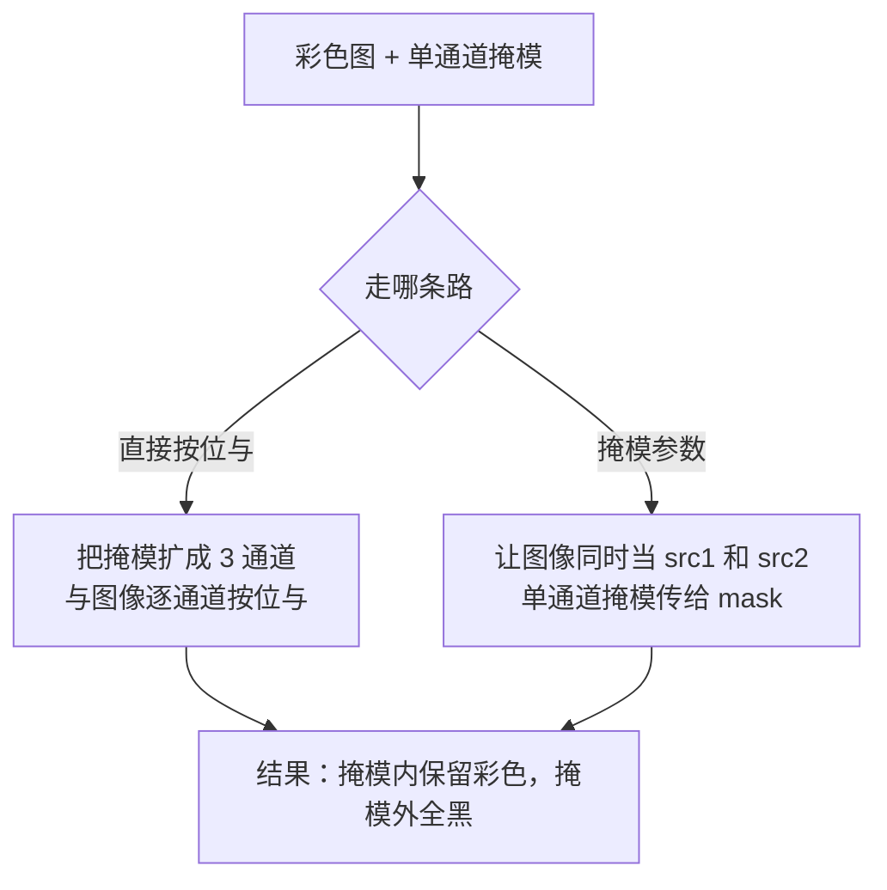
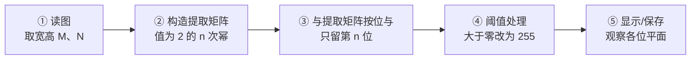
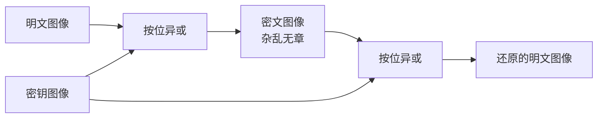
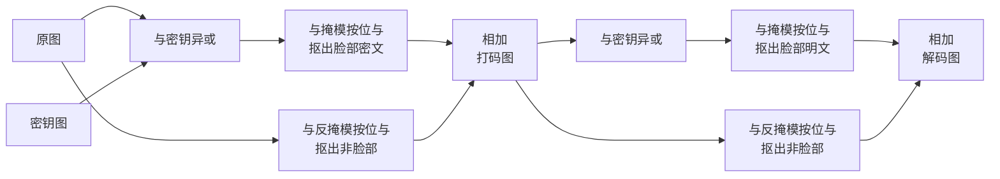

# 第 3 章 图像运算

> **本章解决**：两幅图像、或者图像与一个数值之间，到底能做哪些运算，以及这些运算怎样拼出真正的处理功能。加法有两种语义——加号运算符的**模运算**会把亮的像素变暗，`cv2.add()` 的**饱和运算**则把溢出截到 255；`cv2.addWeighted()` 用权重把两幅图混成一张。按位与、或、非、异或是另一条线：它配合**掩模**，决定"只处理哪一块区域"。有了这两条线，位平面分解、异或加密、最低有效位数字水印、脸部打码解码这些信息隐藏与区域处理的方法就能直接写出来。

## 3.0 本章导图

<div class="brtree">
  <div class="brrow">
    <span class="brlabel root">图像运算</span>
    <span class="brace"></span>
    <div class="brkids">
      <div class="brrow">
        <span class="brlabel">加法运算</span>
        <span class="brace"></span>
        <div class="brkids">
          <span class="brleaf">加号运算符：对 256 取模</span>
          <span class="brleaf">cv2.add：截断到饱和值 255</span>
          <span class="brleaf">图像配图像、图像配数值</span>
          <span class="brleaf">取模让亮处变暗，饱和让整体变亮</span>
        </div>
      </div>
      <div class="brrow">
        <span class="brlabel">图像加权和</span>
        <span class="brace"></span>
        <div class="brkids">
          <span class="brleaf">addWeighted：两幅图各乘权重再相加</span>
          <span class="brleaf">gamma 提亮度，必填可为零</span>
          <span class="brleaf">权重和等于 1 亮度不变</span>
          <span class="brleaf">可在 ROI 内混合局部</span>
        </div>
      </div>
      <div class="brrow">
        <span class="brlabel">按位逻辑运算</span>
        <span class="brace"></span>
        <div class="brkids">
          <span class="brleaf">与：全 1 才 1，可做掩模</span>
          <span class="brleaf">或：有 1 即 1，可写入特定位</span>
          <span class="brleaf">非：逐位取反，等价底片效果</span>
          <span class="brleaf">异或：相异为 1，两次还原</span>
        </div>
      </div>
      <div class="brrow">
        <span class="brlabel">掩模</span>
        <span class="brace"></span>
        <div class="brkids">
          <span class="brleaf">掩模值为非零的像素才处理</span>
          <span class="brleaf">其余像素在输出里置零</span>
          <span class="brleaf">灰度图直接按位与掩模图</span>
          <span class="brleaf">彩色图用掩模参数或三通道掩模</span>
        </div>
      </div>
      <div class="brrow">
        <span class="brlabel">位平面分解</span>
        <span class="brace"></span>
        <div class="brkids">
          <span class="brleaf">8 位图可拆成 8 个位平面</span>
          <span class="brleaf">与 2 的幂按位与取出指定位</span>
          <span class="brleaf">阈值到黑白才看得出来</span>
          <span class="brleaf">高位近似原图，低位近似噪声</span>
          <span class="brleaf">按权重加权即可合成回原图</span>
        </div>
      </div>
      <div class="brrow">
        <span class="brlabel">加密与信息隐藏</span>
        <span class="brace"></span>
        <div class="brkids">
          <span class="brleaf">明文与密钥异或得密文</span>
          <span class="brleaf">密文再异或同一密钥即还原</span>
          <span class="brleaf">密钥图要与原图同尺寸随机</span>
          <span class="brleaf">低位平面可替换成水印</span>
          <span class="brleaf">掩模加异或做脸部打码</span>
        </div>
      </div>
    </div>
  </div>
</div>

!!! note "运行环境约定"
    本章代码引用素材根目录下的图片：`picture1.jpg`（1920×1080，动漫人物）、`picture3.jpg`（736×1110，人像）、`watermark.jpg`（1920×1080，白底黑字手写图）。**运行时工作目录需为 数字图像处理-python 根目录**。原书用 `lena.bmp`、`boat.bmp`、`dollar.bmp`、`watermark.bmp`，这里换成同名的项目素材；尺寸不同，但所有结论与数值规律一致。

## 3.1 图像加法运算

灰度图像里一个像素用 8 个比特位（一个字节）表示，取值范围 \([0,255]\)。两幅图相加时，对应像素的和很容易超过 255，于是必须先回答一个问题：**溢出了怎么办？** 两种写法给了两个不同答案，这是本章第一个、也是最容易踩的分岔口。

| 写法 | 溢出怎么处理 | 本质 |
| --- | --- | --- |
| `a + b` | 对 256 取模 | numpy 的整型回绕（wrap-around） |
| `cv2.add(a, b)` | 截断为饱和值 255 | 饱和运算（**Saturating Arithmetic**） |

### 3.1.1 加号运算符

对图像 a（像素值 a）与图像 b（像素值 b）求和，"+"遵循：

\[
a+b=\begin{cases}
a+b, & a+b \leq 255\\
\mathrm{mod}(a+b,\ 256), & a+b > 255
\end{cases}
\]

逐条看：

- 和 **小于或等于 255**：直接相加。例如 28 + 36 = 64。
- 和 **大于 255**：结果对 256 取模。例如 255 + 58 = 313，则 \((255+58)\%\,256=57\)，得到 57。

规则也可以合并成一句：无论和不和超过 255，一律对 256 取模：

\[
a+b=\mathrm{mod}(a+b,\ 256)
\]

!!! note "拓展：取模的根源是 dtype"
    取模不是"加号运算符"的规矩，而是 `np.uint8` 的规矩：uint8 只有 8 个比特位，第 9 位（权值 256）无处安放，直接被丢掉，效果就是模 256。若把数组转成 `int16` 或 `int64` 再相加，就不会回绕——`np.uint8(250)+np.uint8(10)` 得 4，而 `np.int16(250)+np.int16(10)` 得 260。后面所有"越加越暗"的怪现象，都是 dtype 造成的。

【例 3.1】用随机数组模拟灰度图像，观察"+"的取模行为。把数组类型定为 `dtype=np.uint8`，值的范围自然落在 \([0,255]\)：

```python
import numpy as np

# 3×3 的"假灰度图"，dtype 必须写 uint8，才能复现 8 位图像的行为
img1 = np.random.randint(0, 256, size=[3, 3], dtype=np.uint8)
img2 = np.random.randint(0, 256, size=[3, 3], dtype=np.uint8)
print("img1=\n", img1)
print("img2=\n", img2)
print("img1+img2=\n", img1 + img2)      # 超过 255 的元素被对 256 取模
```

某次运行的输出（随机数每次都不同，看规律不看具体值）：

| img1 | img2 | img1 + img2 | 说明 |
| --- | --- | --- | --- |
| 178 | 26 | 204 | 和未超 255，直接相加 |
| 202 | 52 | 254 | 和未超 255 |
| 200 | 153 | 97 | 353 取模得 97，比两个加数都小 |
| 177 | 232 | 153 | 409 取模得 153 |
| 162 | 7 | 169 | 和未超 255 |

关键就在第 3、4 行：取模之后结果反而变小。这就是"两幅图相加却变暗"的机制。

### 3.1.2 cv2.add() 函数

`cv2.add()` 对溢出采用**饱和**处理——加到头就停：

```text
dst = cv2.add( src1, src2[, dst[, mask[, dtype]]] )
```

对 8 位灰度图，规则是：

\[
a+b=\begin{cases}
a+b, & a+b \leq 255\\
255, & a+b > 255
\end{cases}
\]

- 28 + 36 = 64，照常相加；
- 255 + 58 = 313，结果取饱和值 255。

`src1`、`src2` 两个参数有三种组合形式，本章后面会逐一用到：

| 形式 | 写法 | 要求与行为 |
| --- | --- | --- |
| 形式 1 | `cv2.add(图像1, 图像2)` | 两幅图**大小、类型必须一致**；逐元素相加后饱和 |
| 形式 2 | `cv2.add(数值, 图像)` | 数值当标量，与每个像素相加后饱和 |
| 形式 3 | `cv2.add(图像, 数值)` | 同上，顺序无关 |

【例 3.2】仍用随机数组，换成 `cv2.add()`：

```python
import numpy as np
import cv2

img1 = np.random.randint(0, 256, size=[3, 3], dtype=np.uint8)
img2 = np.random.randint(0, 256, size=[3, 3], dtype=np.uint8)
print("img1=\n", img1)
print("img2=\n", img2)
print("cv2.add(img1,img2)=\n", cv2.add(img1, img2))   # 超过 255 的统统压到 255
```

| img1 | img2 | 加号运算符 | cv2.add |
| --- | --- | --- | --- |
| 136 | 109 | 245 | 245 |
| 212 | 212 | 168 | 255 |
| 47 | 19 | 66 | 66 |
| 234 | 218 | 196 | 255 |
| 197 | 19 | 216 | 216 |
| 169 | 137 | 50 | 255 |

同一组输入，右列只会"到顶"，不会"掉下来"。

【例 3.3】把两种加法用在真实图像上，差异一目了然——拿一幅图与它自己相加：

```python
import cv2

# 工作目录需为 数字图像处理-python 根目录
a = cv2.imread("picture1.jpg", 0)     # 0：读成单通道灰度图
b = a                                 # 注意：这是别名，b 和 a 是同一块内存
result1 = a + b                       # 取模：超过 255 的部分回绕
result2 = cv2.add(a, b)               # 饱和：超过 255 的压到 255

print("原图 mean:", round(a.mean(), 2))       # 186.91
print("a+b  mean:", round(result1.mean(), 2)) # 169.92：整体变暗
print("add  mean:", round(result2.mean(), 2)) # 236.16：整体变亮

cv2.imshow("original", a)
cv2.imshow("result1", result1)
cv2.imshow("result2", result2)
cv2.waitKey()
cv2.destroyAllWindows()
```

实跑统计（1920×1080 灰度图）：

| 图像 | 平均像素值 | 观感 |
| --- | --- | --- |
| 原图 | 186.91 | —— |
| `a + b` | 169.92 | 本该更亮的像素回绕成小值，出现大片暗斑、噪点，很不自然 |
| `cv2.add(a, b)` | 236.16 | 整体提亮，其中 79.6% 的像素被压到 255（高光细节丢失） |

结论：**想让图变亮，用 `cv2.add()`；用加号运算符只会得到"回绕"的怪异结果**。两者都会损失信息，只是损失方式不同。

<figure>
  
  <figcaption>图 3.1 【例 3.3】程序的运行结果：原图、`a+b` 取模变暗、`cv2.add` 饱和变亮（代码实跑）</figcaption>
</figure>

!!! note "拓展：既不回绕、也不提前截断"
    需要保留中间结果时，先提升 dtype 再算，最后自己裁剪：

    ```python
    import numpy as np
    big = a.astype(np.int16) + b.astype(np.int16)   # 最大 510，装得下
    result = np.clip(big, 0, 255).astype(np.uint8)  # 手动饱和到 [0,255]
    ```

    `cv2.add()` 也支持 `dtype` 参数指定输出深度（如 `dtype=cv2.CV_16U`），此时按新深度饱和，不再卡在 255。

## 3.2 图像加权和

有时不需要"对等"相加，而是让一幅图多占一些、另一幅少占一些——这就是**图像加权和**（**Weighted Sum**），也叫**图像混合**（**Image Blending**）/ 图像融合：

\[
\mathrm{dst}=\mathrm{saturate}\left(\mathrm{src1}\times\alpha+\mathrm{src2}\times\beta+\gamma\right)
\]

`saturate()` 表示取饱和值（最大值）。参与运算的 `src1`、`src2` **必须大小、类型相同**，但对类型和通道数没有额外限制：灰度图、彩色图都行，几个通道都行，只要两者一致。OpenCV 用 `cv2.addWeighted()` 实现：

```text
dst = cv2.addWeighted( src1, alpha, src2, beta, gamma[, dst[, dtype]] )
```

| 参数 | 含义 |
| --- | --- |
| `src1` | 第一幅图像 |
| `alpha` | `src1` 的权重（系数） |
| `src2` | 第二幅图像，大小与通道数须与 `src1` 相同 |
| `beta` | `src2` 的权重（系数） |
| `gamma` | 加到每个和上的亮度调节量。**可以是 0，但必须写，不能省略** |

`alpha` 与 `beta` 的和**可以等于 1，也可以不等于 1**——这是它比 `cv2.add()` 灵活的地方，代价是权重和不为 1 时整体亮度会跟着变。整条式子读成一句话：

> 结果图像 = 图像1 × 系数1 + 图像2 × 系数2 + 亮度调节量

【例 3.4】用常数数组验证算式。`img1` 全是 100，`img2` 全是 10，权重 0.6 与 5，`gamma` 取 3：

```python
import cv2
import numpy as np

img1 = np.ones((3, 4), dtype=np.uint8) * 100   # 3×4、值全为 100 的"灰度图"
img2 = np.ones((3, 4), dtype=np.uint8) * 10    # 3×4、值全为 10
gamma = 3                                      # 亮度调节量

img3 = cv2.addWeighted(img1, 0.6, img2, 5, gamma)
print(img3)
```

输出每个元素都是 113：\(100\times0.6+10\times5+3=60+50+3=113\)。注意权重和 \(0.6+5=5.6\) 远大于 1——本例的基数小（100 与 10）才没顶到上限，换成亮一些的图，同样的系数会直接把大片像素压成 255。若把 `beta` 改成 0.4，结果就是 \(100\times0.6+10\times0.4+3=67\)。

【例 3.5】两幅真实图像按 0.6 / 0.4 混合。`addWeighted` 要求尺寸一致，先把第二幅缩放到第一幅的大小：

```python
import cv2

a = cv2.imread("picture1.jpg")                                  # 1920×1080
b = cv2.resize(cv2.imread("picture3.jpg"), (a.shape[1], a.shape[0]))  # 缩放到同尺寸

result = cv2.addWeighted(a, 0.6, b, 0.4, 0)   # 0.6+0.4=1，整体亮度基本不变
print(result.shape, result.dtype)             # (1080, 1920, 3) uint8

cv2.imshow("a", a)
cv2.imshow("b", b)
cv2.imshow("result", result)
cv2.waitKey()
cv2.destroyAllWindows()
```

两幅图各贡献一部分，结果同时看得出两者的轮廓与色彩，这就是"混合/透明过渡"的效果。把 `alpha` 从 0 连续调到 1、`beta` 取 `1-alpha`，就得到从 a 渐变到 b 的动画。

<figure>
  
  <figcaption>图 3.2 【例 3.5】程序的运行结果：两幅图按 0.6 / 0.4 加权混合（代码实跑）</figcaption>
</figure>

<figure>
  
  <figcaption>图 3.20 渐变混合：alpha 从 0 连续调到 1、beta 取 1−alpha，a 平滑过渡到 b（代码实跑）</figcaption>
</figure>

【例 3.6】只混合局部：把一幅图的脸部混进另一幅图的同一位置。做法是先切片取出两块同尺寸的 **ROI**（**Region of Interest**，感兴趣区域），混合后再写回：

```python
import cv2

lena = cv2.imread("picture3.jpg")     # 人像素材
bg = cv2.imread("picture1.jpg")       # 另一幅图

face1 = lena[150:550, 200:600]        # 人像的脸部区域，400×400
face2 = bg[250:650, 850:1250]         # 另一幅图里同尺寸的区域，400×400

add = cv2.addWeighted(face1, 0.6, face2, 0.4, 0)   # 两块 ROI 加权混合
lena2 = lena.copy()                                # 先复制，避免改到原图
lena2[150:550, 200:600] = add                      # 把混合结果写回

cv2.imshow("lena", lena)
cv2.imshow("result", lena2)
cv2.waitKey()
cv2.destroyAllWindows()
```

切片顺序是 `[行, 列]`，即 `[y, x]`：`150:550` 是高度方向（行），`200:600` 是宽度方向（列）。写反了会取到完全不相干的一块。

<figure>
  
  <figcaption>图 3.3 图像加权混合结果：只把两块 ROI 混合后写回原位置（代码实跑）</figcaption>
</figure>

权重和不为 1 时亮度怎么变，用常数图测一遍最清楚（`src1 = src2 = 120`，`gamma = 0`）：

| alpha | beta | alpha + beta | 输出值 | 效果 |
| --- | --- | --- | --- | --- |
| 0.2 | 0.2 | 0.4 | 48 | 明显变暗 |
| 0.5 | 0.5 | 1.0 | 120 | 亮度持平，只有混合 |
| 0.6 | 0.6 | 1.2 | 144 | 变亮 |
| 1.0 | 1.0 | 2.0 | 240 | 很亮，尚未饱和 |
| 2.0 | 2.0 | 4.0 | 255 | 饱和，细节全丢 |

!!! note "拓展：addWeighted 与 add 的关系"
    `cv2.addWeighted(a, 1, b, 1, 0)` 与 `cv2.add(a, b)` 结果完全相同——`addWeighted` 是"带系数的饱和加法"。反过来说，想在两幅图之间做"过渡"只能用 `addWeighted`；只想整体提亮，`cv2.add(img, 常数)` 更直接。另外，`addWeighted` 也要求两图**同尺寸、同通道数**，尺寸不同会直接报 `(-209:Sizes of input arguments do not match)`。

## 3.3 按位逻辑运算

**按位运算**（**Bitwise Operation**，简称位运算）把数值转成二进制后，在对应的比特位上做逻辑运算。图像处理里它非常常用：取某一位、保留某块区域、写入水印、加密，全靠它。OpenCV 提供了四个函数：

| 函数 | 基本含义 | 一句话用途 |
| --- | --- | --- |
| `cv2.bitwise_and()` | 按位与 | 掩模：非零区域保留，其余置零 |
| `cv2.bitwise_or()` | 按位或 | 合并、把信息写进指定的位 |
| `cv2.bitwise_xor()` | 按位异或 | 加密解密、找出两图差异 |
| `cv2.bitwise_not()` | 按位取反 | 反色（底片效果） |

### 3.3.1 按位与运算

与运算（**AND**）的规则：两个逻辑值**都为真时结果才为真**。可以类比**串联电路**——两个开关都闭合，灯才亮。

<figure>
  
  <figcaption>图 3.4 与运算类比电路：两个开关串联，都闭合灯才亮（截自原书）</figcaption>
</figure>

| 算子1 | 算子2 | 结果 | 规则 |
| --- | --- | --- | --- |
| 0 | 0 | 0 | and(0,0)=0 |
| 0 | 1 | 0 | and(0,1)=0 |
| 1 | 0 | 0 | and(1,0)=0 |
| 1 | 1 | 1 | and(1,1)=1 |

按位与就是把两个数转成二进制，逐位做与。两个 8 位数的例子：

| 数值 | 十进制 | 二进制 |
| --- | --- | --- |
| 数值1 | 198 | 1100 0110 |
| 数值2 | 219 | 1101 1011 |
| 与运算结果 | 194 | 1100 0010 |

函数原型：

```text
dst = cv2.bitwise_and( src1, src2[, dst[, mask]] )
```

| 参数 | 含义 |
| --- | --- |
| `dst` | 输出，与输入同大小的数组 |
| `src1` | 第一个输入，array 或 scalar |
| `src2` | 第二个输入，array 或 scalar |
| `mask` | 可选操作掩模，8 位单通道数组 |

按位与有两个必须记住的性质：

- 任何数值 N 与 **0** 按位与，得 **0**；
- 任何数值 N（8 位）与 **255**（二进制 1111 1111）按位与，得 **N 本身**。

| 运算 | 二进制 | 十进制 | 二进制 | 十进制 |
| --- | --- | --- | --- | --- |
| 数值 N | 1101 1011 | 219 | 1101 1011 | 219 |
| 特殊值 | 0000 0000 | 0 | 1111 1111 | 255 |
| 结果 | 0000 0000 | 0 | 1101 1011 | 219 |
| 说明 | 与 0 相与得 0 | —— | 与 255 相与保持不变 | —— |

这两条性质直接给出**掩模**（**Mask**）的用法：造一幅只有 0 和 255 的掩模图 M，与灰度图 G 做按位与，结果 R 中——掩模为 255 的位置取自 G，掩模为 0 的位置为零（黑）。

【例 3.7】用数组验证掩模效果：

```python
import cv2
import numpy as np

a = np.random.randint(0, 255, (5, 5), dtype=np.uint8)   # 模拟灰度图
b = np.zeros((5, 5), dtype=np.uint8)                     # 掩模：先全 0
b[0:3, 0:3] = 255                                        # 左上 3×3 打开
b[4, 4] = 255                                            # 右下角单独打开

c = cv2.bitwise_and(a, b)
print("a=\n", a)
print("b=\n", b)
print("c=\n", c)
```

掩模长这样：

```text
[[255 255 255   0   0]
 [255 255 255   0   0]
 [255 255 255   0   0]
 [  0   0   0   0   0]
 [  0   0   0   0 255]]
```

输出 c 里，b 为 255 的位置原样保留 a 的值，b 为 0 的位置全变成 0——例如 a 的 `[4,4]=121`，c 的 `[4,4]` 仍是 121；a 的 `[0,3]=66`，c 的 `[0,3]` 变成 0。

【例 3.8】给真实灰度图做掩模，只保留指定区域：

```python
import cv2
import numpy as np

a = cv2.imread("picture1.jpg", 0)              # 灰度图（1080×1920）
b = np.zeros(a.shape, dtype=np.uint8)          # 与 a 同尺寸的掩模
b[150:700, 800:1300] = 255                     # 掩模区域一
b[400:900, 600:800] = 255                      # 掩模区域二

c = cv2.bitwise_and(a, b)                      # 掩模内保留，掩模外全黑
cv2.imshow("a", a)
cv2.imshow("b", b)
cv2.imshow("c", c)
cv2.waitKey()
cv2.destroyAllWindows()
```

<figure>
  
  <figcaption>图 3.5 【例 3.8】程序的运行结果：掩模内保留原图，掩模外全黑（代码实跑）</figcaption>
</figure>

【例 3.9】彩色图像怎么办？按位运算要求两个操作数的**通道数相同**，所以 3 通道的 BGR 图不能直接与单通道掩模按位与（会报 `(-209:Sizes of input arguments do not match)`）。书中的做法是把掩模也建成 3 通道：

```python
import cv2
import numpy as np

a = cv2.imread("picture1.jpg", 1)              # 3 通道 BGR
b = np.zeros(a.shape, dtype=np.uint8)          # 掩模直接建成 3 通道
b[150:700, 800:1300] = 255
b[400:900, 600:800] = 255

c = cv2.bitwise_and(a, b)                      # 形状一致，可以按位与
print("a.shape=", a.shape)                     # (1080, 1920, 3)
print("b.shape=", b.shape)                     # (1080, 1920, 3)
```

三个通道的掩模同步为 0 / 255，等价于"这块像素保留、那块变黑"。更省事的写法留到 3.4 节：用 `mask` 参数，单通道掩模就能直接作用于彩色图。

<figure>
  
  <figcaption>图 3.6 【例 3.9】程序的运行结果：掩模扩成 3 通道后按位与提取（代码实跑）</figcaption>
</figure>

### 3.3.2 按位或运算

或运算（**OR**）：两个逻辑值中**有一个为真，结果就为真**。类比**并联电路**——任一开关闭合灯就亮。

<figure>
  
  <figcaption>图 3.7 或运算类比电路图：两个开关并联，任一闭合灯就亮（截自原书）</figcaption>
</figure>

| 算子1 | 算子2 | 结果 | 规则 |
| --- | --- | --- | --- |
| 0 | 0 | 0 | or(0,0)=0 |
| 0 | 1 | 1 | or(0,1)=1 |
| 1 | 0 | 1 | or(1,0)=1 |
| 1 | 1 | 1 | or(1,1)=1 |

198 与 219 按位或：

| 数值 | 十进制 | 二进制 |
| --- | --- | --- |
| 数值1 | 198 | 1100 0110 |
| 数值2 | 219 | 1101 1011 |
| 或运算结果 | 223 | 1101 1111 |

```text
dst = cv2.bitwise_or( src1, src2[, dst[, mask]] )
```

参数含义与 `bitwise_and` 完全一致。性质上它是"有 1 就置 1"：把 N 与 0 相或得 N，与 255 相或得 255。这两条后面都要用——**把一个只有 0/1 的位图与 0 相或，什么都不变；与 1 相或，那一位置 1**。3.8 节的水印嵌入正是靠这个把 1 个比特"写"进最低位。

!!! note "拓展：用或合并两个区域"
    `cv2.bitwise_or(cv2.bitwise_and(img, maskA), cv2.bitwise_and(img, maskB))` 可以把两个不相交的区域拼回一张图。前提是两个掩模**不重叠**：重叠处两个与结果都非零，或运算只会留下逐位合并后的值，原本的信息就糊了。3.9 节脸部打码里反复出现的"拼图"操作都是这个套路。

### 3.3.3 按位非运算

非运算（**NOT**）就是逐位取反：真变假、假变真。

| 算子 | 结果 | 规则 |
| --- | --- | --- |
| 0 | 1 | not(0)=1 |
| 1 | 0 | not(1)=0 |

| 说明 | 十进制 | 二进制 |
| --- | --- | --- |
| 原始数值 | 198 | 1100 0110 |
| 按位非结果 | 57 | 0011 1001 |

```text
dst = cv2.bitwise_not( src[, dst[, mask]] )
```

只有两个主要参数：`src` 是输入数组，`mask` 是可选掩模。对 8 位无符号整数，按位非等价于 `255 - N`：198 → 57，219 → 36，也就是常见的**反色（底片）效果**。

```python
import cv2

img = cv2.imread("picture1.jpg")
inv = cv2.bitwise_not(img)          # 三个通道分别取反
print(round(img.mean(), 2))         # 187.39
print(round(inv.mean(), 2))         # 67.61  正好是 255-187.39
```

!!! note "拓展：取反只对整型有意义"
    按位操作是"对二进制位"动手，只对整型（uint8、int16……）成立。传浮点数组进去 OpenCV 不会报错，但它会按 IEEE 754 的位模式去操作，结果毫无意义。做位运算前先确认 `img.dtype` 是整型。

### 3.3.4 按位异或运算

异或（**Exclusive OR**，**XOR**）也叫**半加运算**（**Half Addition**）：两个位**不同**时结果 1，**相同**时结果 0，规则与"不进位的二进制加法"一致，函数名通常写作 `xor`。

| 算子1 | 算子2 | 结果 | 规则 |
| --- | --- | --- | --- |
| 0 | 0 | 0 | xor(0,0)=0 |
| 0 | 1 | 1 | xor(0,1)=1 |
| 1 | 0 | 1 | xor(1,0)=1 |
| 1 | 1 | 0 | xor(1,1)=0 |

| 数值 | 十进制 | 二进制 |
| --- | --- | --- |
| 数值1 | 198 | 1100 0110 |
| 数值2 | 219 | 1101 1011 |
| 异或运算结果 | 29 | 0001 1101 |

```text
dst = cv2.bitwise_xor( src1, src2[, dst[, mask]] )
```

真正让异或成为"加密工具"的是它的**自反性**：

\[
\mathrm{xor}(a,b)=c \quad\Longrightarrow\quad \mathrm{xor}(c,b)=a,\ \ \mathrm{xor}(c,a)=b
\]

| a | b | c = xor(a,b) | xor(c,b) 应等于 a | xor(c,a) 应等于 b |
| --- | --- | --- | --- | --- |
| 0 | 0 | 0 | 0 | 0 |
| 0 | 1 | 1 | 0 | 1 |
| 1 | 0 | 1 | 1 | 0 |
| 1 | 1 | 0 | 1 | 1 |

对同一把密钥做两次异或，就回到原值。3.7 节的图像加密与 3.9 节的打码解码，全部建立在这一条性质上。

```python
import cv2
import numpy as np

a = np.array([[198]], dtype=np.uint8)
b = np.array([[219]], dtype=np.uint8)
print((a ^ b)[0, 0])                     # 29
print(cv2.bitwise_xor(a, b)[0, 0])       # 29，与 numpy 的 ^ 等价
print(cv2.bitwise_xor(cv2.bitwise_xor(a, b), b)[0, 0])   # 198：两次异或还原
```

## 3.4 掩模

OpenCV 里很多函数都带一个 **mask** 参数，也称掩码：

```text
计算结果 = cv2.add( 参数1, 参数2, 掩模 )
```

规则一句话：**只处理掩模值非零的像素，其余像素的输出置 0**。

用一个 4×4 的例子看语义。img1 全 3，img2 全 5，mask 只有右下 2×2 为 1：

\[
\mathrm{mask}=\begin{bmatrix}
0&0&0&0\\
0&0&0&0\\
0&0&1&1\\
0&0&1&1
\end{bmatrix}
\]

运算 `cv2.add(img1, img2, mask=mask)` 的结果是：

\[
\begin{bmatrix}
0&0&0&0\\
0&0&0&0\\
0&0&8&8\\
0&0&8&8
\end{bmatrix}
\]

掩模为 1 的地方算 3+5=8，其余一律 0。书中为了让"输出是新数组"这一点更直观，先给 img3 赋初值 66——**这个初值没有参与运算**，`cv2.add()` 会新建输出数组，原值直接被丢弃。

【例 3.10】演示掩模参数：

```python
import cv2
import numpy as np

img1 = np.ones((4, 4), dtype=np.uint8) * 3
img2 = np.ones((4, 4), dtype=np.uint8) * 5

mask = np.zeros((4, 4), dtype=np.uint8)
mask[2:4, 2:4] = 1                     # 只有右下 2×2 为非零

img3 = np.ones((4, 4), dtype=np.uint8) * 66   # 初值只为说明"会被丢弃"
print("初始值 img3=\n", img3)

img3 = cv2.add(img1, img2, mask=mask)
print("求和后 img3=\n", img3)
```

!!! note "拓展：掩模值 1 和 255 等价"
    掩模参数只判断"非零 / 零"，不要求写 255。实测 `mask[2:4,2:4]=1` 与 `=255` 的输出完全相同。但**把掩模当图像显示时**必须用 0/255——值为 1 的像素在 8 位灰度显示里几乎是黑的，所以书里显示掩模时都写成 `mask*255`。

位运算函数也都有 `mask` 参数。彩色图配单通道掩模有两种写法：



第二种写法的原理是：**任何数值与自身按位与，结果仍是自身**。所以 `cv2.bitwise_and(a, a, mask=mask)` 中，前两个参数等于什么都没做，真正起作用的只有 `mask`——它决定输出里哪些位置取 `a` 的值、哪些位置是 0。注意 `mask` 必须按关键字传参：`bitwise_and` 的第三个**位置参数**是 `dst`（输出数组），写成 `cv2.bitwise_and(a, a, mask)` 等于没传掩模，OpenCV 会静默返回 `a AND a` 的整幅原图。

!!! warning "原书笔误"
    书中"数值与自身按位与"的示例表把 198 的二进制写成了 `1101 1011`（那是 219 的二进制），运算结果一行也沿用了同一个错值。198 的二进制是 `1100 0110`，与自身按位与仍是 `1100 0110`，十进制 198——数值结论没错，二进制抄错了。

【例 3.11】用掩模参数处理彩色图：

```python
import cv2
import numpy as np

a = cv2.imread("picture1.jpg", 1)          # 3 通道
w, h, ch = a.shape                         # 书中沿用 w/h 命名：w 其实是行数（高）

mask = np.zeros((w, h), dtype=np.uint8)    # 单通道掩模
mask[150:700, 800:1300] = 255
mask[400:900, 600:800] = 255

c = cv2.bitwise_and(a, a, mask=mask)       # mask 必须关键字传参（第三个位置参数是 dst）
print("a.shape=", a.shape)                 # (1080, 1920, 3)
print("mask.shape=", mask.shape)           # (1080, 1920)

cv2.imshow("a", a)
cv2.imshow("mask", mask)
cv2.imshow("c", c)
cv2.waitKey()
cv2.destroyAllWindows()
```

注意 `mask.shape` 只有两维：传进来的掩模是单通道，作用到 3 通道图像时对三个通道一视同仁；掩模的**行、列数必须与图像一致**，否则报错。

<figure>
  
  <figcaption>图 3.8 彩色图像按位与提取：`mask` 参数保留指定区域（代码实跑）</figcaption>
</figure>

## 3.5 图像与数值的运算

加法运算与按位运算里，两个操作数可以都是图像，也可以是一个图像配一个数值。想整体提亮，最直接的办法就是给每个像素加同一个常数：

| 运算 | 输入 | 结果 | 说明 |
| --- | --- | --- | --- |
| `cv2.add(img1, img2)` | 3 与 5 | 8 | 图像加图像 |
| `cv2.add(img1, 6)` | 3 加 6 | 9 | 图像 + 数值 |
| `cv2.add(6, img2)` | 5 加 6 | 11 | 数值 + 图像，顺序无关 |

【例 3.12】用数组把三种形式都跑一遍：

```python
import cv2
import numpy as np

img1 = np.ones((4, 4), dtype=np.uint8) * 3
img2 = np.ones((4, 4), dtype=np.uint8) * 5

print("cv2.add(img1,img2)=\n", cv2.add(img1, img2))   # 全 8
print("cv2.add(img1,6)=\n", cv2.add(img1, 6))         # 全 9
print("cv2.add(6,img2)=\n", cv2.add(6, img2))         # 全 11
```

数值同样服从饱和规则。把一张 8 位灰度图整体加 100：

```python
import cv2

img = cv2.imread("picture1.jpg", 0)

bright_add = cv2.add(img, 100)   # 饱和：超过 255 的截到 255
bright_np = img + 100            # 模运算：超过 255 的回绕到小值

print(round(img.mean(), 2))         # 186.91
print(round(bright_add.mean(), 2))  # 239.15  提亮
print(round(bright_np.mean(), 2))   # 99.49   反而变暗
```

单看几个像素更清楚（`img = [0, 100, 200, 250]`）：

| 像素值 | 0 | 100 | 200 | 250 |
| --- | --- | --- | --- | --- |
| `cv2.add(img, 100)` | 100 | 200 | 255 | 255 |
| `img + 100` | 100 | 200 | 44 | 94 |

!!! note "拓展：减法也要用 OpenCV 的函数"
    对称的 `cv2.subtract()` 同样是饱和的：`cv2.subtract(5, 10)` 得 0（不会回绕成 251）。整体压暗 50 时，`cv2.subtract(img, 50)` 的均值从 186.91 降到 137.15，而 `img - 50` 因为小值回绕成 200 多，均值反而只降到 142.63，还多出一批反常的亮点。

!!! warning "原书笔误"
    书上把"给图像加一个固定值"演示成 `cv2.add(333, img)`。这在 cv2 里能跑（标量按饱和处理，全图变 255），但换成 numpy 的 `333 + img` 会在 NumPy 2.x 直接抛 `OverflowError: Python integer 333 out of bounds for uint8`——超出 dtype 范围的整数连"回绕"都不给。想加超过 255 的值，先把图转 `int16`。

## 3.6 位平面分解

把灰度图里所有像素的**同一个比特位**抽出来，重新组成一幅二值图，这张图叫一个**位平面**（**Bit Plane**），这个过程叫**位平面分解**（**Bit-plane Decomposition**，也译位平面切片）。

8 位灰度图的每个像素值可以写成：

\[
\mathrm{value}=a_7\times2^7+a_6\times2^6+a_5\times2^5+a_4\times2^4+a_3\times2^3+a_2\times2^2+a_1\times2^1+a_0\times2^0
\]

其中每个 \(a_i\) 取 0 或 1。权重天差地别：\(a_7\) 的权值是 128，\(a_0\) 只有 1。所以**第 7 位（最高位）对图像影响最大，第 0 位（最低位）影响最小**。全部像素的第 \(i\) 位 \(a_i\) 拼成的图，就叫第 \(i\) 个位平面（第 \(i\) 层）。8 位图一共能拆出 8 个位平面。

- 第 7 个位平面与原始图像相关性最高，看起来最像原图；
- 第 0 个位平面权重最低，看起来通常杂乱无章，接近随机噪声。

书里给的 4×4 例子（灰度图 O 的像素值）：

```text
209  197  163  193
125  247  160  112
161  137  243  203
 39   82  154  127
```

换成二进制：

```text
1101 0001   1100 0101   1010 0011   1100 0001
0111 1101   1111 0111   1010 0000   0111 0000
1010 0001   1000 1001   1111 0011   1100 1011
0010 0111   0101 0010   1001 1010   0111 1111
```

把所有像素的最低位（最右边那一位）竖起来看，就得到第 0 个位平面：`1 1 1 1 / 1 1 0 0 / 1 1 1 1 / 1 0 0 1`；取最高位则得到第 7 个位平面：`1 1 1 1 / 0 1 1 0 / 1 1 1 1 / 0 0 1 0`。前者是 4×4 的杂乱点阵，后者已经能看出原图明暗的大轮廓。

<figure>
  
  <figcaption>图 3.9 位平面分解：4×4 灰度图 8 个位平面的构成（截自原书）</figcaption>
</figure>

**分解的五个步骤**：



**② 构造提取矩阵**。按位与能"抠出"指定比特位：提取因子 F 只有第 n 位是 1，就能把 N 的第 n 位原样留下，其余位置零。

| 要提取的位平面 | 提取值 | 二进制 |
| --- | --- | --- |
| 0 | 1 | 0000 0001 |
| 1 | 2 | 0000 0010 |
| 2 | 4 | 0000 0100 |
| 3 | 8 | 0000 1000 |
| 4 | 16 | 0001 0000 |
| 5 | 32 | 0010 0000 |
| 6 | 64 | 0100 0000 |
| 7 | 128 | 1000 0000 |

**③ 提取位平面**。例：像素值 219 要取第 4 位，就用 16 去与它：

| 运算 | 类别 | 十进制 | 二进制 |
| --- | --- | --- | --- |
| 按位与 | 像素值 | 219 | 1101 1011 |
| 按位与 | 提取值 | 16 | 0001 0000 |
| 按位与 | 结果 | 16 | 0001 0000 |

219 的第 4 位是 1，按位与之后这一位仍带着自己的权重 16，所以结果是 16；若第 4 位是 0，结果就是 0。判断结果非零，就能还原出这一位是 0 还是 1。

**④ 阈值处理**。提取出来的位平面里，值为 1 的像素是 1，为 8 的是 8，直接按 8 位灰度显示全是近黑。要让它"看得见"，把大于 0 的值统一改成 255：

```python
import numpy as np

plane = np.array([[0, 8], [8, 0]], dtype=np.uint8)   # 已提取的位平面：值只可能是 0 或 8
mask = plane > 0        # 大于 0 → True，否则 False
plane[mask] = 255       # 布尔掩模索引，把 True 位置改成 255
print(plane)            # [[  0 255] [255   0]]
```

!!! warning "原书笔误"
    书中这段阈值示例写成 `mask = RD[:,:,i] > 0`，可 RD 在上下文里是 4×4 的**二维**数组，多写一个 `[:,:,i]` 会直接报索引错误。二维位平面用 `RD > 0` 即可；只有把 8 个位平面堆成三维数组（`r×c×8`，如例 3.13）时才需要第三个下标。同理，例 3.13 里阈值必须写成 `planes[:, :, i][mask] = 255` 只作用于当前层——直接写 `planes[mask] = 255`，二维布尔掩模会命中**全部 8 个通道**，把已经处理好的位平面一起污染成 255。

【例 3.13】一次取出 8 个位平面：

```python
import cv2
import numpy as np

lena = cv2.imread("picture1.jpg", 0)      # 灰度读入
r, c = lena.shape

# 提取矩阵：r×c×8，第 i 个通道的值全是 2 的 i 次幂
x = np.zeros((r, c, 8), dtype=np.uint8)
for i in range(8):
    x[:, :, i] = 2 ** i

planes = np.zeros((r, c, 8), dtype=np.uint8)
for i in range(8):
    planes[:, :, i] = cv2.bitwise_and(lena, x[:, :, i])   # 只留第 i 位
    mask = planes[:, :, i] > 0                            # 非零即"该位为 1"
    planes[:, :, i][mask] = 255                           # 阈值到 255，只作用当前层
    cv2.imshow(str(i), planes[:, :, i])                   # 窗口名就用位平面序号
cv2.waitKey()
cv2.destroyAllWindows()
```

第 0 个位平面是一片杂点，越往上越能看出原图轮廓，第 7 个位平面几乎就是原图的二值剪影。实测（`picture1.jpg`，1080×1920）：

| 位平面 | 白点比例 | 与原图相关系数 | 观感 |
| --- | --- | --- | --- |
| 0 | 0.512 | 0.026 | 杂乱无章，近似随机噪声 |
| 1 | 0.542 | 0.088 | 仍是噪声 |
| 2 | 0.549 | 0.124 | 隐约有纹理 |
| 3 | 0.565 | 0.146 | 轮廓开始出现 |
| 4 | 0.602 | 0.215 | 能看出大致形状 |
| 5 | 0.663 | 0.299 | 轮廓清晰 |
| 6 | 0.715 | 0.442 | 已接近二值剪影 |
| 7 | 0.796 | 0.843 | 与原图最接近 |

相关系数从 0.026 一路涨到 0.843，正是"位越高、权重越大、越像原图"的量化体现。白点比例随位升高而增大，是因为这张素材整体偏亮（均值 186.9），高位更容易是 1。

<figure>
  
  <figcaption>图 3.10 位平面分解效果图：第 0 位近似噪声，第 7 位最像原图（代码实跑）</figcaption>
</figure>

!!! note "拓展：位平面可以合成回原图"
    分解是可逆的。把第 i 个位平面（先归一化成 0/1）乘以 \(2^i\) 再全部相加，就得到原图：

    ```python
    import cv2
    import numpy as np

    gray = cv2.imread("picture1.jpg", 0)
    r, c = gray.shape

    planes = np.zeros((r, c, 8), dtype=np.uint8)
    for i in range(8):
        bit = cv2.bitwise_and(gray, 2 ** i)              # 取出第 i 位（0 或 2**i）
        planes[:, :, i] = (bit > 0).astype(np.uint8)     # 归一化成 0/1

    rebuilt = np.zeros(gray.shape, dtype=np.uint16)      # 用 uint16 装中间结果
    for i in range(8):
        rebuilt += planes[:, :, i].astype(np.uint16) * (2 ** i)

    print(np.array_equal(rebuilt.astype(np.uint8), gray))    # True，精确还原
    ```

    只保留高 4 位、低 4 位清零，就得到"压缩版"：实测峰值信噪比约 28.5 dB、单像素最大误差 15。这也解释了为什么图像压缩总盯着高位——丢掉低 4 位，人眼几乎察觉不到。

<figure>
  
  <figcaption>图 3.22 位平面重建验证：原图、仅保留高 4 位（PSNR 28.5 dB）、8 个位平面按权重建原（代码实跑）</figcaption>
</figure>

!!! note "拓展：另一种提取写法"
    书中给的提示是"右移再取模"：把像素右移 n 位再对 2 取模，就得到第 n 位。`((gray >> i) % 2)` 与"与 \(2^i\) 再判非零"的结果逐像素完全相同（实测 8 个位平面全部一致）。位运算里同一件事常常有多种写法，选自己读得顺的那种。

针对彩色图像，做法是**每个通道各自分解，再把三个通道的同名位平面合并**：R、G、B 的第 3 个位平面合起来，就是原图的"第 3 个位平面"彩色图。

## 3.7 图像加密和解密

异或的自反性可以直接拿来做加密：

- **加密**：明文与密钥按位异或，得到密文；
- **解密**：密文与同一把密钥再异或一次，得到明文。

单个像素走一遍：明文 216、密钥 178，`bit_xor(216,178)=106`；解密 `bit_xor(106,178)=216`，回到 216。

| 过程 | 运算 | 二进制 | 十进制 |
| --- | --- | --- | --- |
| 加密 | 明文 | 1101 1000 | 216 |
| 加密 | 密钥 | 1011 0010 | 178 |
| 加密 | 密文 | 0110 1010 | 106 |
| 解密 | 密文 | 0110 1010 | 106 |
| 解密 | 密钥 | 1011 0010 | 178 |
| 解密 | 明文 | 1101 1000 | 216 |

对每个像素重复这个动作，就完成了整幅图的加密解密：



【例 3.14】用随机数生成密钥图像，加密后再解密：

```python
import cv2
import numpy as np

lena = cv2.imread("picture1.jpg", 0)      # 明文
r, c = lena.shape
key = np.random.randint(0, 256, size=[r, c], dtype=np.uint8)   # 密钥图，与原图同尺寸

encryption = cv2.bitwise_xor(lena, key)          # 加密
decryption = cv2.bitwise_xor(encryption, key)    # 用同一密钥解密

print(np.array_equal(decryption, lena))          # True：无损还原
print(round(encryption.mean(), 1))               # 127.4：密文均值趋于 127.5
print(round(lena.mean(), 1))                     # 186.9

cv2.imshow("lena", lena)
cv2.imshow("key", key)
cv2.imshow("encryption", encryption)
cv2.imshow("decryption", decryption)
cv2.waitKey()
cv2.destroyAllWindows()
```

几个要点：

- **密钥图必须与原图同尺寸**：异或逐像素进行，尺寸不一致会直接报错；
- **密钥可以是任意图像**：有意义的图、无意义的图都行，关键是双方各存一份、保持一致；
- **密钥要随机**：用 `np.random.randint(0,256,...)` 生成，密文的均值会落在 127.5 附近（某次实测 127.4），直方图趋于均匀，看不出原图痕迹；若用一幅纯色图当密钥，密文的明暗结构会原样保留。

<figure>
  
  <figcaption>图 3.11 【例 3.14】程序的运行结果：明文、密钥、密文、解密结果（代码实跑）</figcaption>
</figure>

!!! note "拓展：这套加密的强度边界"
    这种"一次性异或"在密码学上叫**一次性密码本**（**One-Time Pad**）：密钥真随机、长度等于明文、且**只用一次**时，理论上是不可破解的。三条里坏掉任何一条就出问题——最典型的是**重复使用同一把密钥**：两幅密文异或后，密钥被消掉，剩下的正好是两幅明文的异或，统计规律立刻回来。另外它只管"内容不可读"，不管"完整性"：密文随便改一个比特，解密后就错一个比特，接收方无从察觉。

## 3.8 数字水印

**最低有效位**（**Least Significant Bit**，**LSB**）是一个二进制数的最低位（第 0 位）。**最低有效位信息隐藏**指的是：把需要隐藏的二值图像写进载体图像的最低有效位，也就是**用二值图像替换载体图像的第 0 个位平面**。

因为它在最低位，对像素值的影响极小（最多 1），人眼察觉不到，隐蔽性很高。需要时把第 0 个位平面提取出来，就得到藏在里面的二值图像。这种做法叫**数字水印**（**Digital Watermarking**），可以用于信息隐藏、版权认证、身份认证（数字签名）。水印信息可以是文本、视频、音频，本节只讨论二值图像。

### 3.8.1 原理

从位平面角度看只有两步：

- **嵌入**：把载体图像的第 0 个位平面替换为水印二值图；
- **提取**：把载体图像的第 0 个位平面取出来，就是水印。

**1. 嵌入过程**

（1）载体图像预处理。把载体图像写成二进制，标出最低位。以书中的 4×4 灰度图 O 为例：

```text
209  197  163  193
125  247  160  112
161  137  243  203
 39   82  154  127
```

它的最低位平面（第 0 个位平面）是：`1 1 1 1 / 1 1 0 0 / 1 1 1 1 / 1 0 0 1`。

（2）水印图像处理。水印先要变成**二值图**。灰度二值图里只有 0 和 255，把 255 换成 1，就得到"一个像素只占 1 个比特"的二进制二值图，正好能塞进最低位。

水印 W（灰度二值图）：

```text
255    0  255    0
255  255    0  255
  0    0    0    0
255  255    0  255
```

阈值处理后得到二进制水印 WB：

```text
1  0  1  0
1  1  0  1
0  0  0  0
1  1  0  1
```

（3）嵌入水印。把 O 的最低位逐个替换成 WB，得到含水印载体图像的二进制形式；转回十进制：

```text
209  196  163  192
125  247  160  113
160  136  242  202
 39   83  154  127
```

逐格对照能看清替换：209 是奇数（最低位 1），水印要 1 → 不变，仍是 209；197 是奇数，水印要 0 → 减 1 变 196；161 是奇数，水印要 0 → 变 160。**每个像素最多变动 1**，所以人眼看不出差别。

**2. 提取过程**

把含水印图像写成二进制，取最低位：得到 `1 0 1 0 / 1 1 0 1 / 0 0 0 0 / 1 1 0 1`，与 WB 完全一致。需要显示时再做阈值处理，把 1 换成 255，就还原出二值水印图 W。

实际使用中有两种扩展：在多个通道里嵌**同一个**水印（提高**鲁棒性**，部分水印丢失也能恢复），或在各通道里嵌**不同**的水印（提高嵌入容量）。彩色图的处理方式与灰度图完全相同，只是先要拆通道。

### 3.8.2 实现方法

**1. 嵌入过程**

（1）载体图像预处理：读图，取行数 M、列数 N。

（2）建立提取矩阵：建一个 M×N、元素全为 **254** 的数组。254 的二进制是 `1111 1110`——只有最低位是 0。

（3）保留高七位、最低位置零：载体图与 254 按位与。

| 运算 | 像素 P 的 LSB 为 1 | 像素 P 的 LSB 为 0 |
| --- | --- | --- |
| P 的值 | 1101 1001（217） | 1101 1000（216） |
| 与 254 相与 | 1111 1110（254） | 1111 1110（254） |
| 结果 | 1101 1000（216） | 1101 1000（216） |

LSB 原来是 1 的像素减 1，原来是 0 的不变——效果就是"最低位清零"。

（4）水印图像处理：把水印里的 255 换成 1，得到只有 0/1 的位图（其 8 位形式就是 `0000 0001` 和 `0000 0000`）。

（5）嵌入水印：把"高七位图像"与"0/1 水印"按位**或**。因为高七位的最低比特已经是 0：

- 水印位为 0：0 或 0 = 0，该像素不变；
- 水印位为 1：0 或 1 = 1，最低位被置 1。

| 运算 | 水印位为 1 | 水印位为 0 |
| --- | --- | --- |
| 数值 A（LSB 已清零） | 1101 1000（216） | 1101 1000（216） |
| 水印位 B | 0000 0001（1） | 0000 0000（0） |
| 结果 | 1101 1001（217） | 1101 1000（216） |

一句话：**A 与单位比特 B 相或，等价于用 B 替换 A 的最低位**。

（6）显示原始载体图、水印图、含水印图。

<figure>
  
  <figcaption>图 3.12 水印嵌入过程流程图（截自原书）</figcaption>
</figure>

!!! warning "原书笔误"
    书中 3.8.2 节那个 4×4 的"含水印载体图像"示例表有 7 个单元格与"高七位 或 水印位"算出来的值不一致（例如第 2 行第 2 列应为 86，表中写成 87；第 4 行第 1 列应为 85，表中写成 84）。机制本身没错，是表格誊抄串行了——按本节的步骤自己算一遍即可。

**2. 提取过程**

（1）读含水印图像，取大小 M×N。

（2）建立提取矩阵：与图像同尺寸、元素全为 **1**（二进制 `0000 0001`）。

（3）提取水印：含水印图与 1 按位与。高位全被置零，只剩最低位：217 → 1，216 → 0。

| 运算 | 像素 P 的 LSB 为 1 | 像素 P 的 LSB 为 0 |
| --- | --- | --- |
| P 的值 | 1101 1001（217） | 1101 1000（216） |
| 与 1 相与 | 0000 0001（1） | 0000 0001（1） |
| 结果 | 0000 0001（1） | 0000 0000（0） |

再把 1 阈值成 255，就得到可视的二值水印图。

（4）计算去除水印后的载体图像：把含水印图与 254 按位与，最低位清零即可。注意这只能"抹掉水印痕迹"，原始的最低位已经找不回来了。

（5）显示提取出的水印、去水印的载体图。

<figure>
  
  <figcaption>图 3.13 水印提取过程流程图（截自原书）</figcaption>
</figure>

!!! note "拓展：两种操作各有一个等价写法"
    提取最低位：`e % 2` 与 `cv2.bitwise_and(e, 1)` 结果相同；清零最低位：`(e >> 1) << 1` 与 `cv2.bitwise_and(e, 254)` 结果相同。都可实测验证。反过来说，**别用除法代替位移**——`e / 2` 会变成 float，`e // 2` 虽精确但慢，位运算才是这里想要的东西。

### 3.8.3 例题

【例 3.15】完整模拟水印的嵌入与提取。载体图与 `watermark.jpg` 都是 1920×1080，正好配套：

```python
import cv2
import numpy as np

# 载体图像（灰度）与水印图像（白底黑字）
lena = cv2.imread("picture1.jpg", 0)
watermark = cv2.imread("watermark.jpg", 0)

# ① 水印二值化：255 → 1，方便写进 1 个比特位
w = watermark[:, :] > 0
watermark[w] = 1

r, c = lena.shape

# ========== 嵌入 ==========
t254 = np.ones((r, c), dtype=np.uint8) * 254   # 1111 1110
lenaH7 = cv2.bitwise_and(lena, t254)           # 高七位保留，最低位清零
e = cv2.bitwise_or(lenaH7, watermark)          # 用或运算把水印写进最低位

# ========== 提取 ==========
t1 = np.ones((r, c), dtype=np.uint8)           # 0000 0001
wm = cv2.bitwise_and(e, t1)                    # 只留最低位：得到 0/1 图
print(wm.max(), wm.min())                      # 1 0

w = wm[:, :] > 0                               # 1 → 255，方便显示
wm[w] = 255

cv2.imshow("lena", lena)
cv2.imshow("watermark", watermark * 255)       # watermark 现在最大是 1，乘 255 才看得见
cv2.imshow("e", e)
cv2.imshow("wm", wm)
cv2.waitKey()
cv2.destroyAllWindows()
```

实测结论：

| 指标 | 数值 | 说明 |
| --- | --- | --- |
| 提取出的水印与原始二值水印 | 逐像素一致 | 无损提取 |
| 含水印图与原图的最大差值 | 1 | 每个像素最多改 1 |
| 发生变化的像素比例 | 约 48.8% | 只有水印位与原 LSB 不同才变 |
| 峰值信噪比 | 51.24 dB | 远高于人眼可察觉的门槛 |
| 原图均值 / 含水印图均值 | 186.91 / 187.38 | 亮度几乎不变 |

含水印图与原始图像肉眼看不出区别，隐蔽性很高。但也正因为"改一个比特"太简单，安全性并不高——拿到图的人取个最低位就能读出水印。

<figure>
  
  <figcaption>图 3.14 【例 3.15】程序的运行结果：载体图、水印、含水印图、提取出的水印（代码实跑）</figcaption>
</figure>

<figure>
  
  <figcaption>图 3.21 水印不可见性验证：含水印图与原图肉眼无差，逐像素差值放大 255 倍后才能看见变化、且幅度仅 ±1（代码实跑）</figcaption>
</figure>

!!! note "拓展：可见水印与不可见水印"
    **不可见水印**（**Invisible Watermark**）就是本节这种：嵌入后肉眼不可见，用于版权认证、溯源。**可见水印**（**Visible Watermark**）则要求看得见，典型做法是用 `cv2.addWeighted` 把水印图叠在原图上：

    ```python
    import cv2
    import numpy as np

    img = cv2.imread("picture1.jpg")
    logo = np.zeros_like(img)
    logo[:, :] = (255, 255, 255)                     # 白底水印块
    visible = cv2.addWeighted(img, 0.85, logo, 0.15, 0)   # 半透明叠加
    ```

    两者是一对权衡：可见水印能威慑盗用，但破坏画质；不可见水印不破坏观感，却必须扛得住后续处理。衡量这种"扛得住"的能力就是**鲁棒性**（**Robustness**）。LSB 水印的鲁棒性很差——实测把含水印图存成 JPEG 再读回，提取错误率高达 29.87%（PNG 为 0%），因为 JPEG 的量化把低位改得一塌糊涂。要抗压缩，得把水印嵌到中高位或频域去。

## 3.9 脸部打码及解码

最后用一个综合例子收口：用**掩模 + 按位运算**给脸部打码，再解回来。思路拆成四步：

1. 整幅图与密钥异或，得到"全是密文"的图；
2. 用掩模把**脸部密文**抠出来；
3. 用反掩模把**非脸部原图**抠出来；
4. 两块相加 → 得到"只有脸是密文"的打码图。

解码是它的逆过程：先把打码图**整幅**与密钥异或（脸部还原成明文，非脸部被搅成噪声），再用掩模从里面取出脸部明文、用反掩模从打码图里取出非脸部原图，两块相加就还原了。



【例 3.16】实现：

```python
import cv2
import numpy as np

lena = cv2.imread("picture3.jpg", 0)      # 人像素材，灰度
r, c = lena.shape

mask = np.zeros((r, c), dtype=np.uint8)
mask[250:750, 120:620] = 1                # 脸部区域：先存 1，显示时乘 255

key = np.random.randint(0, 256, size=[r, c], dtype=np.uint8)   # 与图同尺寸的密钥

# ========== 打码 ==========
lenaXorKey = cv2.bitwise_xor(lena, key)                  # 整幅图异或成密文
encryptFace = cv2.bitwise_and(lenaXorKey, mask * 255)     # 只留脸部密文
noFace1 = cv2.bitwise_and(lena, (1 - mask) * 255)         # 只留非脸部原图
maskFace = encryptFace + noFace1                          # 拼成打码图

# ========== 解码 ==========
extractOriginal = cv2.bitwise_xor(maskFace, key)          # 整幅图再异或一次
extractFace = cv2.bitwise_and(extractOriginal, mask * 255)  # 抠出脸部明文
noFace2 = cv2.bitwise_and(maskFace, (1 - mask) * 255)       # 抠出非脸部
extractLena = noFace2 + extractFace                        # 拼回原图

print(np.array_equal(extractLena, lena))                   # True：完全还原
```

十二个中间结果对应书中的图 (a)–(l)：

| 变量 | 含义 | 怎么来的 |
| --- | --- | --- |
| `lena` | 原图 | 读入 |
| `mask` | 掩模，脸部为 1 | 手工指定矩形区域 |
| `(1-mask)` | 掩模反色，非脸部为 1 | 1 减去掩模 |
| `key` | 密钥图 | 随机数生成 |
| `lenaXorKey` | 整幅打码图 | 原图与密钥异或 |
| `encryptFace` | 脸部密文 | 整幅密文与掩模按位与 |
| `noFace1` | 非脸部原图 | 原图与反掩模按位与 |
| `maskFace` | 打码结果 | 脸部密文 + 非脸部原图 |
| `extractOriginal` | 初步还原图 | 打码图与密钥异或 |
| `extractFace` | 脸部明文 | 初步还原图与掩模按位与 |
| `noFace2` | 非脸部（来自打码图） | 打码图与反掩模按位与 |
| `extractLena` | 解码结果 | 脸部明文 + 非脸部 |

实测（736×1110 人像，脸部区域 500×500）：打码后脸部 250000 个像素里有 249011 个与原图不同（占 99.6%），非脸部区域逐像素等于原图；解码结果与原图**完全一致**（`array_equal` 为 True）。

<figure>
  
  <figcaption>图 3.15 【例 3.16】程序的运行结果：打码与解码的 12 个中间结果（代码实跑）</figcaption>
</figure>

!!! warning "原书笔误"
    书中正文把 `maskFace = encryptFace + noFace1` 与 `extractLena = noFace2 + extractFace` 说成"按位或运算"，代码写的却是加号。本例结果相同，纯粹因为两块区域互斥——任何像素只有一个加数非零。真遇到重叠区域，加号会进位、在 uint8 下回绕，按位或只保留位的合并结果，两者立刻分家。拼互斥区域时用"或"更稳妥。

!!! note "拓展：这只是一个教学演示"
    打码的安全性完全依赖密钥图：拿到密钥 + 掩模位置，就能 100% 还原。真正的隐私保护要求"不可逆"——像素化、强模糊、直接覆盖，都是让信息真正消失，而不是换个形式存放。另外，若把掩模区域设得比实际人脸小，露在打码区外的五官就仍然可辨，这也是实际应用里容易翻车的地方。

## 坑与陷阱

!!! danger "8 个容易踩的坑"
    1. **用"+"提亮，结果越加越暗**：`np.uint8` 的和超过 255 会回绕，250+10 得 4。提亮请用 `cv2.add(img, n)`；确实需要中间值时先转 `int16`/`float` 再 `np.clip`。
    2. **dtype 悄悄改变了语义**：取模只在两边都是 `uint8` 时发生。`img + np.int64(10)` 会提升成 int64，得 260 而不回绕；`img + 100.0` 得 float64。先 `print(img.dtype)` 再决定用哪种加法。
    3. **add / addWeighted / bitwise 都要求尺寸与类型一致**：尺寸不同报 `(-209:Sizes of input arguments do not match)`，深度不同报 `(-5:Bad argument)`。混合两幅不同来源的图，先 `resize` 到同一尺寸。
    4. **彩色图直接与单通道掩模按位与会报错**：通道数不匹配同样是 -209。要么把掩模复制成 3 通道，要么改用 `cv2.bitwise_and(img, img, mask=mask)` 的掩模参数。
    5. **掩模必须 8 位单通道、且和图像同高同宽**：`mask` 参数要求 8 位单通道；用 0/1 存没问题，但要显示就得 `mask*255`，否则整片近黑，看不出掩模在哪。
    6. **位平面提取后直接显示是黑的**：取出来的值只有 0 或 2 的幂（最大 128），按 8 位灰度显示几乎没有对比度。一定要先阈值到 255 再看。
    7. **切片顺序是 [行, 列] 也就是 [y, x]**：`mask[250:750, 120:620]` 里前一组是高度方向。写反了区域会跑到别处，而且不报错——只是"掩模位置莫名其妙"。
    8. **LSB 水印存成 JPEG 就废了**：JPEG 量化会改写低位，实测提取错误率 29.87%。含水印图请存 PNG / BMP；要抗压缩就得换更鲁棒的嵌入方式。

    另外两个小坑：`b = a` 只是**别名**，改 b 会连带改 a，需要独立副本用 `a.copy()`；`np.random.randint(0, 256, ...)` 的第二个参数是**开区间上界**，写成 255 就永远取不到 255。

## 速览

1. 两种加法语义相反：`a + b` 对 256 取模（亮处回绕变暗），`cv2.add(a, b)` 饱和到 255（整体变亮）。取模是 `uint8` 决定的。
2. `cv2.add()` 支持"图像+图像""图像+数值""数值+图像"三种形式；图像之间要求大小、类型一致。
3. `cv2.addWeighted(src1, alpha, src2, beta, gamma)` 实现 \(src1\times\alpha+src2\times\beta+\gamma\)；`gamma` 必填可为 0，`alpha+beta` 可不为 1；和为 1 亮度不变，小于 1 变暗，大于 1 变亮直至饱和。
4. 加权和可用于整幅混合，也可切片取 ROI 混合后再写回；两图必须同尺寸、同通道。
5. 四个位运算：`bitwise_and`（掩模）、`bitwise_or`（写入特定位/合并）、`bitwise_xor`（加密/找差异）、`bitwise_not`（反色，等价 255-N）。
6. 按位与两个铁律：与 0 得 0，与 255 得自身；与自身相与也等于自身。
7. 掩模语义：非零位置参与运算，其余输出置 0；掩模值 1 与 255 等价。彩色图用 `mask` 参数传单通道掩模，或把掩模扩成 3 通道。
8. 位平面分解：用 2 的幂作提取矩阵按位与，再阈值到 255 才看得见；第 7 位最像原图，第 0 位近似噪声；按权重加权可精确合成回原图，只留高 4 位即得约 28.5 dB 的近似图。
9. 异或自反：`xor(xor(a,b),b)=a`。密钥图需与原图同尺寸、真随机，且只用一次；密钥随机的密文均值趋于 127.5。
10. LSB 水印：与 254 按位与清零最低位 → 与 0/1 水印按位或写入 → 与 1 按位与提取。每像素最多改 1，PSNR 约 51 dB，但怕 JPEG（错误率近 30%）。脸部打码 = 掩模抠脸部 + 异或加密 + 反掩模抠背景，二者相加。

## 术语速查

| 英文 / 函数 | 中文 | 一句话 |
| --- | --- | --- |
| Saturating Arithmetic | 饱和运算 | 溢出时截断到该类型的最大值，`cv2.add` 即此 |
| Modulo Arithmetic / Wrap-around | 模运算 / 回绕 | 溢出后对 256 取模，`uint8` 的默认行为 |
| cv2.add | 饱和加法 | 逐元素相加后饱和，图像优先用它 |
| cv2.addWeighted | 加权和 / 混合 | 两图各乘权重相加再加 gamma，可做渐变混合 |
| Image Blending | 图像混合 | `addWeighted` 的典型用途，权重和通常为 1 |
| gamma | 亮度调节量 | 加权和中额外加上的常数，必填可为 0 |
| ROI (Region of Interest) | 感兴趣区域 | 用切片取出的局部，可单独运算后写回 |
| Bitwise Operation | 按位运算 | 逐比特做逻辑运算，只对整型有意义 |
| bitwise_and / or / xor / not | 按位与 / 或 / 异或 / 非 | 掩模、写入、加密、反色的四件套 |
| Half Addition | 半加运算 | 异或的别名：不进位的二进制加法 |
| Mask | 掩模 / 掩码 | 8 位单通道数组，非零处参与运算，其余置 0 |
| Bit Plane | 位平面 | 同一比特位构成的二值图，8 位图有 8 层 |
| Bit-plane Decomposition | 位平面分解 | 用 2 的幂作提取矩阵按位与，逐层分解 |
| LSB (Least Significant Bit) | 最低有效位 | 第 0 位，权重 1，改它对人眼影响最小 |
| MSB (Most Significant Bit) | 最高有效位 | 第 7 位，权重 128，最像原图 |
| Digital Watermarking | 数字水印 | 把标识信息藏进载体图，可做版权/身份认证 |
| Invisible / Visible Watermark | 不可见 / 可见水印 | 前者藏于低位，后者半透明叠加可见 |
| Robustness | 鲁棒性 | 水印扛住压缩、裁剪等处理的能力 |
| Plaintext / Ciphertext / Key | 明文 / 密文 / 密钥 | 异或加密的三要素 |
| One-Time Pad | 一次性密码本 | 密钥真随机、等长、只用一次时可证明安全 |
| Information Hiding | 信息隐藏 | 把信息藏进载体而不易察觉的统称 |
| Saturation | 饱和值 | 某深度能表示的最大值，8 位无符号为 255 |
| PSNR | 峰值信噪比 | 衡量两图差异的指标，越大越接近 |

<p class="pdf-note"><a href="../第03章_图像运算_跟随代码.ipynb">配套跟随代码 · 第03章（ipynb）</a></p>
