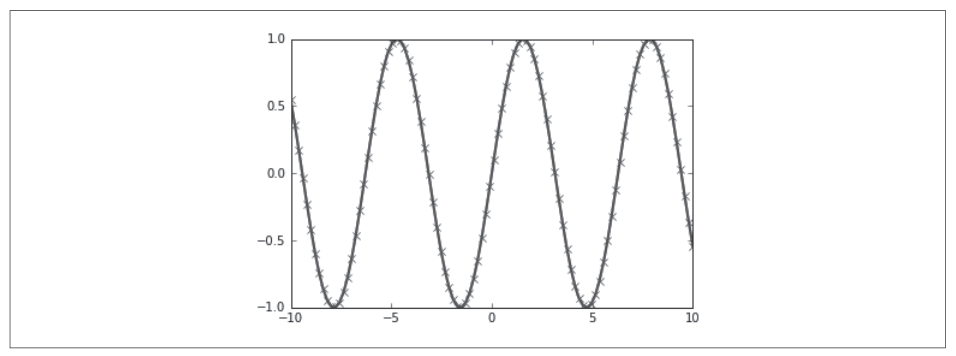
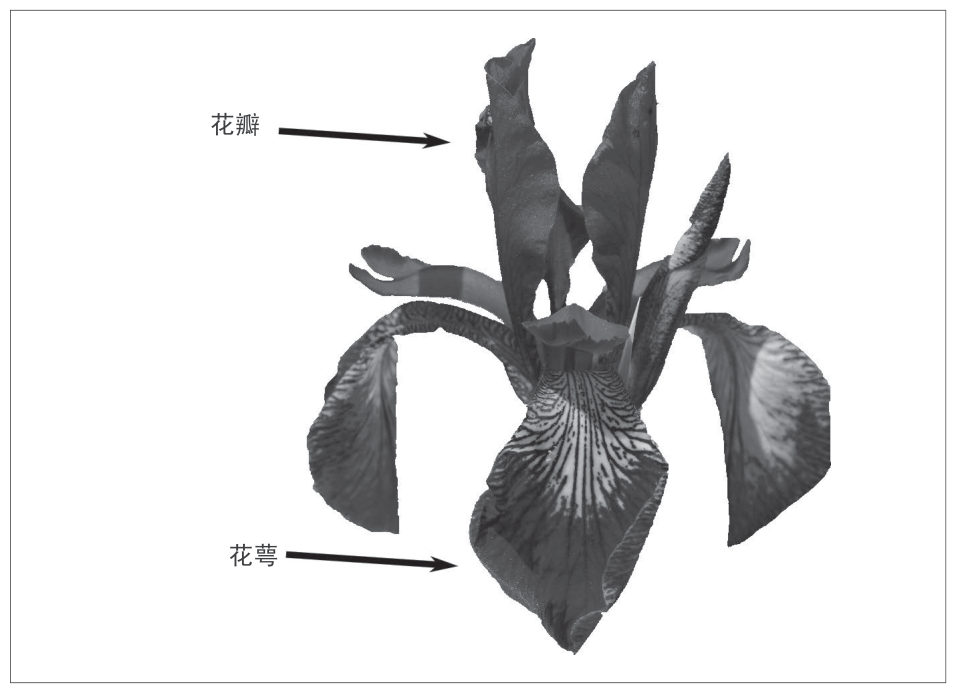
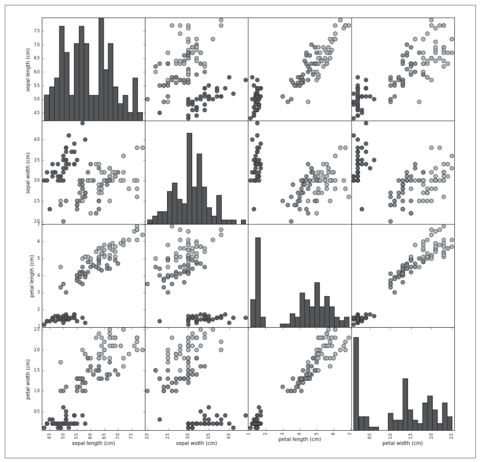

# 第 1 章 引言

> **本章解决**：机器学习是什么、能解决哪类问题、为什么用 Python 和 scikit-learn——然后带你跑通第一个完整应用：鸢尾花三分类（载入数据 → 划分训练/测试集 → 训练 k 近邻 → 预测新花 → 评估精度 97%）。这一章立起全书的骨架：后面 7 章不断换更强、更合适的模型，但 fit / predict / score 这套流程从头用到尾。

📓 **章代码**：[nb/ch01.ipynb](nb/ch01.ipynb)（分节跟随代码，固定种子实跑输出；旧 API 适配处见代码内“版本适配”注释）

机器学习（**machine learning**）是从数据中提取知识。它是统计学、人工智能和计算机科学交叉的研究领域，也被称为预测分析（**predictive analytics**）或统计学习（**statistical learning**）。近年来，机器学习方法已经应用到日常生活的方方面面：从自动推荐看什么电影、点什么食物、买什么商品，到个性化的在线电台和从照片中识别好友，许多现代化网站和设备的核心都是机器学习算法。你访问像 Facebook、Amazon 或 Netflix 这样的复杂网站时，很可能网站的每一部分都包含多种机器学习模型。

除了商业应用之外，机器学习也对当前数据驱动的研究方法产生了很大影响。本书中介绍的工具均已应用在各种科学问题上，比如研究恒星、寻找遥远的行星、发现新粒子、分析 DNA 序列，以及提供个性化的癌症治疗方案。

不过，如果想受益于机器学习算法，你的应用无需像上面那些例子那样给世界带来重大改变，数据量也用不着那么大。本章将解释机器学习如此流行的原因，并探讨机器学习可以解决哪些类型的问题，然后构建第一个机器学习模型，同时介绍一些重要的概念。

## 1.0 本章导图

<div class="brtree">
  <div class="brrow">
    <span class="brlabel root">第 1 章 引言</span>
    <span class="brace"></span>
    <div class="brkids">
      <div class="brrow">
        <span class="brlabel">为何选择机器学习</span>
        <span class="brace"></span>
        <div class="brkids">
          <span class="brleaf">规则系统两缺点：只适用单一领域 / 依赖专家决策过程</span>
          <span class="brleaf">人脸检测：表征差异让手工规则无解</span>
          <span class="brleaf">监督学习：输入/输出对，像有"老师"监督</span>
          <span class="brleaf">无监督学习：只有输入，理解评估更难</span>
          <span class="brleaf">数据表表征：行 = 样本，列 = 特征</span>
          <span class="brleaf">动手前六问清单 + 大局观</span>
        </div>
      </div>
      <div class="brrow">
        <span class="brlabel">为何选择 Python</span>
        <span class="brace"></span>
        <div class="brkids">
          <span class="brleaf">通用语言的功能 + 领域脚本的易用性</span>
          <span class="brleaf">终端 / Jupyter 直接交互，快速迭代</span>
          <span class="brleaf">还能做 GUI、Web 服务、集成现有系统</span>
        </div>
      </div>
      <div class="brrow">
        <span class="brlabel">scikit-learn 与工具链</span>
        <span class="brace"></span>
        <div class="brkids">
          <span class="brleaf">开源、文档全、工业界学术界都流行</span>
          <span class="brleaf">依赖 NumPy / SciPy</span>
          <span class="brleaf">绘图 matplotlib，表格 pandas</span>
          <span class="brleaf">交互环境 Jupyter Notebook</span>
          <span class="brleaf">mglearn：作者自带的绘图辅助库</span>
        </div>
      </div>
      <div class="brrow">
        <span class="brlabel">环境与版本</span>
        <span class="brace"></span>
        <div class="brkids">
          <span class="brleaf">Python 2 与 3 → 一律 Python 3</span>
          <span class="brleaf">scikit-learn ≥ 0.18（model_selection 模块）</span>
          <span class="brleaf">原书 0.18/0.19 → 如今 1.x 基本兼容</span>
        </div>
      </div>
      <div class="brrow">
        <span class="brlabel">第一个应用：鸢尾花分类</span>
        <span class="brace"></span>
        <div class="brkids">
          <span class="brleaf">监督 · 三分类：类别 class，标签 label</span>
          <span class="brleaf">Iris 数据集：150 × 4，Bunch 对象五键</span>
          <span class="brleaf">train_test_split 75/25 + random_state</span>
          <span class="brleaf">散点图矩阵先观察数据</span>
          <span class="brleaf">KNeighborsClassifier：fit → predict → score ≈ 0.97</span>
        </div>
      </div>
      <div class="brrow">
        <span class="brlabel">小结与展望</span>
        <span class="brace"></span>
        <div class="brkids">
          <span class="brleaf">核心四行代码适用于任何监督算法</span>
          <span class="brleaf">第 2 章：深入各种监督学习模型</span>
        </div>
      </div>
    </div>
  </div>
</div>

## 1.1 为何选择机器学习

在"智能"应用的早期，许多系统使用人为制订的"if"和"else"决策规则来处理数据，或根据用户输入的内容进行调整。想象有一个垃圾邮件过滤器，其任务是酌情将收到的某些邮件移动到垃圾邮件文件夹。你可以创建一个关键词黑名单，所有包含这些关键词的邮件都会被标记为垃圾邮件。这是用**专家设计的规则体系**来设计"智能"应用的一个示例。

人为制订的决策规则对某些应用来说是可行的，特别是人们对其模型处理过程非常熟悉的应用。但它有两个主要缺点：

- **做决策所需要的逻辑只适用于单一领域和单项任务**。任务哪怕稍有变化，都可能需要重写整个系统。
- **想要制订规则，需要对人类专家的决策过程有很深刻的理解**。

人为制订规则的方法不适用的一个例子就是图像中的人脸检测。如今每台智能手机都能够检测到图像中的人脸，但直到 2001 年人脸检测问题才得到解决。主要问题在于，计算机"感知"像素（像素组成了计算机中的图像）的方式与人类感知面部的方式有非常大的不同。正是由于这种**表征差异（representation difference）**，人类想制订出一套好规则来描述数字图像中的人脸构成，基本上是不可能的。

但有了机器学习算法，仅向程序输入海量人脸图像，就足以让算法自己确定识别人脸需要哪些特征——规则不再由人来写，而是从数据中学出来。

### 1.1.1 机器学习能够解决的问题

最成功的机器学习算法，是能够将决策过程自动化、并且从已知示例中**泛化（generalize）**得出的那些算法。在这种叫作**监督学习（supervised learning）**的方法中，用户将成对的**输入**和**预期输出**提供给算法，算法会找到一种方法，根据给定输入给出预期输出——尤其是在没有人类帮助的情况下，给定前所未见的输入，算法也能够给出相应的输出。

回到垃圾邮件过滤的例子：利用机器学习算法，用户为算法提供大量电子邮件（作为输入），以及这些邮件是否为垃圾邮件的信息（作为预期输出）。给定一封新邮件，算法就能够预测它是否为垃圾邮件。

从输入/输出对中进行学习的算法叫作监督学习算法，因为每个用于学习的样例都对应一个预期输出，好像有一个"老师"在监督着算法。创建一个包含输入和输出的数据集往往费时又费力，但监督学习算法很好理解，其性能也易于测量。**如果你的应用可以表示成一个监督学习问题，并且你能够创建包含预期输出的数据集，那么机器学习很可能可以解决你的问题。**

书中给出三个监督学习任务的示例，注意观察三者的输入、输出与数据收集方式：

| 监督学习任务 | 输入 | 预期输出 | 数据集怎么建 |
| --- | --- | --- | --- |
| 识别信封上手写的邮政编码 | 扫描的手写数字 | 邮政编码中的实际数字 | 收集许多信封，自己阅读邮政编码，把数字保存为预期输出 |
| 基于医学影像判断肿瘤是否为良性 | 医学影像 | 肿瘤是否为良性 | 需要医学影像数据库；咨询专家，医生查看所有影像判断良恶性，甚至还要做额外诊断确认是否癌变 |
| 检测信用卡交易中的诈骗行为 | 信用卡交易记录 | 该交易是否可能为诈骗 | 发卡单位保存所有交易，记录用户是否上报过诈骗交易即可 |

这三个例子有个有趣的现象：输入和输出看起来都相当简单，但**数据收集过程大不相同**。阅读信封虽然辛苦，却非常简单、不用花多少钱；获取医学影像和诊断不仅需要昂贵的设备，还需要稀有又昂贵的专家知识，更不要说伦理和隐私问题；检测信用卡诈骗的数据收集要容易得多——顾客会上报诈骗行为，为你提供预期输出，要拿到全部输入/输出对你只需等待即可。

本书会讲到的另一类算法是**无监督学习（unsupervised learning）**：只有输入数据是已知的，没有为算法提供输出数据。虽然这类算法有许多成功的应用，但理解和评估它们往往更加困难。三个示例如下：

| 无监督学习任务 | 输入 | 为什么输出未知 |
| --- | --- | --- |
| 确定一系列博客文章的主题 | 大量文本数据 | 事先可能并不知道有哪些主题，或者有多少个主题 |
| 将客户分成具有相似偏好的群组 | 一组客户记录 | 事先不知道可能有哪些分组（购物网站上的"父母""书虫""游戏玩家"），甚至不知道有多少组 |
| 检测网站的异常访问模式 | 网站访问流量 | 每种异常访问模式互不相同，可能没有任何记录在案的异常行为示例；只能观察流量，并不知道什么是正常、什么是异常 |

!!! note "拓展：监督、无监督之外还有别的吗"
    有。书中只分了两大类，但教科书上通常还有第三类**强化学习（reinforcement learning）**：不给出标准答案，只给"奖励信号"，让算法靠试错学策略（下棋、机器人控制）；以及介于两者之间的**半监督学习（semi-supervised learning）**（只有一小部分数据有标签）。近年火热的自监督预训练（如大语言模型）也算"自己造标签"的变体。本书聚焦前两大类：第 2 章讲监督学习，第 3 章讲无监督学习。

!!! note "拓展：数据收集成本是隐形的门槛"
    三个监督例子正好是数据获取难度的三档：**免费等待**（诈骗记录，顾客替你标注）、**人工标注**（信封邮政编码，人力便宜但枯燥）、**专家 + 设备**（医学影像，设备贵、专家稀缺、还有伦理隐私）。实践中标注成本（annotation cost）经常是机器学习项目最大的开销，"能不能拿到带标签的数据"往往在写第一行代码之前就决定了项目成败。

无论监督还是无监督任务，**将输入数据表征为计算机可以理解的形式都十分重要**。通常来说，将数据想象成表格是很有用的：每一个数据点（每一封电子邮件、每一名客户、每一次交易）对应表格中的一**行**，描述该数据点的每一项属性（比如客户年龄、交易金额或交易地点）对应表格中的一**列**。你可能会从年龄、性别、账号创建时间、在购物网站上的购买频率等方面来描述用户；可能会用每一个像素的灰度值来描述肿瘤图像，也可能利用肿瘤的大小、形状和颜色进行描述。

在机器学习中，这里的每个实体或每一行被称为一个**样本（sample）**或数据点，而每一列（用来描述这些实体的属性）则被称为**特征（feature）**。

本书后面会更详细介绍如何构建良好的数据表征，这被称为**特征提取（feature extraction）**或**特征工程（feature engineering）**。但你应该记住：**如果没有数据信息的话，所有机器学习算法都无法做出预测**。举个例子，如果你只有病人的姓氏这一个特征，那么任何算法都无法预测其性别——这一信息并未包含在数据中。如果你添加另一个特征，里面包含病人的名字，那么你预测正确的可能性就会变大，因为通过一个人的名字往往可以判断其性别。

### 1.1.2 熟悉任务和数据

在机器学习过程中，最重要的部分很可能是理解你正在处理的数据，以及这些数据与你想要解决的任务之间的关系。**随机选择一个算法并将数据输入进去，这种做法是不会有用的。**在开始构建模型之前，你需要理解数据集的内容。每一种算法的输入数据类型和最适合解决的问题都不一样。在构建机器学习解决方案的过程中，你应该给出下列问题的答案，或者至少把这些问题记在脑中：

- 我想要回答的问题是什么？已经收集到的数据能够回答这个问题吗？
- 要将我的问题表示成机器学习问题，用哪种方法最好？
- 我收集的数据是否足够表达我想要解决的问题？
- 我提取了数据的哪些特征？这些特征能否实现正确的预测？
- 如何衡量应用是否成功？
- 机器学习解决方案与我的研究或商业产品中的其他部分是如何相互影响的？

从更大的层面来看，机器学习算法和方法只是解决特定问题的过程中的一部分，一定要始终牢记整个项目的大局。许多人浪费大量时间构建复杂的机器学习解决方案，最终却发现没有解决正确的问题。深入研究技术细节时（本书后面会讲这些细节），很容易忽视最终目标。本书虽不会详细讨论上面列出的问题，但你仍要记住自己在开始构建机器学习模型时做出的假设——无论是明确的还是隐含的。

!!! note "拓展：选对算法不能靠抽签——没有免费的午餐"
    上面说"每一种算法的输入数据类型和最适合解决的问题都不一样"，其背后有个著名的理论结果：**没有免费的午餐定理（No Free Lunch theorem，Wolpert, 1996）**——把所有可能的问题平均起来看，任何两个学习算法的表现都一样好，因此不存在"在所有问题上都最优"的算法。工程含义就是：先理解数据和任务（本节的六问），再挑候选算法并用数据验证，而不是迷信某个"万能模型"。

## 1.2 为何选择 Python

Python 已经成为许多数据科学应用的通用语言。它既有**通用编程语言的强大功能**，也有**特定领域脚本语言（比如 MATLAB 或 R）的易用性**。Python 有用于数据加载、可视化、统计、自然语言处理、图像处理等各种功能的库，这个大型工具箱为数据科学家提供了大量的通用功能和专用功能。

使用 Python 的主要优点之一，是利用终端或其他类似 Jupyter Notebook 的工具能够直接与代码进行交互。机器学习和数据分析本质上都是**迭代过程**，由数据驱动分析——这些过程必须要有快速迭代和易于交互的工具。

作为通用编程语言，Python 还可以用来创建复杂的图形用户界面（**graphical user interface，GUI**）和 Web 服务，也可以集成到现有系统中——这一点是 MATLAB、R 这类纯脚本环境做不到的。

## 1.3 scikit-learn

scikit-learn 是一个开源项目，可以免费使用和分发，任何人都可以轻松获取其源代码来查看其背后的原理。scikit-learn 项目正在不断地开发和改进中，用户社区非常活跃。它包含许多目前最先进的机器学习算法，每个算法都有详细的文档（http://scikit-learn.org/stable/documentation）。scikit-learn 是一个非常流行的工具，也是最有名的 Python 机器学习库，广泛应用于工业界和学术界，网上有大量的教程和代码片段。它也可以与其他大量 Python 科学计算工具一起使用（下一节会讲到相关内容）。

阅读本书的过程中，建议你同时浏览 scikit-learn 用户指南（http://scikit-learn.org/stable/user_guide.html）和 API 文档，里面给出了每个算法的更多细节和更多选项。在线文档非常全面，而本书会介绍机器学习的所有必备知识，以便于你深入了解。

**安装 scikit-learn**：scikit-learn 依赖于另外两个 Python 包：NumPy 和 SciPy。若想绘图和进行交互式开发，还应该安装 matplotlib、IPython 和 Jupyter Notebook。原书推荐下面三个预先打包的 Python 发行版之一，里面已经装有必要的包。

- **Anaconda**（https://store.continuum.io/cshop/anaconda/）：用于大规模数据处理、预测分析和科学计算的 Python 发行版，预先安装好 NumPy、SciPy、matplotlib、pandas、IPython、Jupyter Notebook 和 scikit-learn，可以在 Mac OS、Windows 和 Linux 上运行。对尚未安装 Python 科学计算包的人，原书推荐使用 Anaconda。Anaconda 还免费提供商用的 Intel MKL 库（安装时自动装上），它可以使 scikit-learn 中许多算法的速度大大提升。
- **Enthought Canopy**（https://www.enthought.com/products/canopy/）：另一款科学计算发行版，预先装有 NumPy、SciPy、matplotlib、pandas 和 IPython，但免费版没有 scikit-learn。学术机构的成员可以申请学术许可，免费使用付费订阅版。适用于 Python 2.7.x，可在 Mac OS、Windows 和 Linux 上运行。
- **Python(x,y)**（http://python-xy.github.io/）：专为 Windows 打造的 Python 科学计算免费发行版，预先装有 NumPy、SciPy、matplotlib、pandas、IPython 和 scikit-learn。

如果已经安装了 Python，可以用 pip 安装上述所有包：

```text
$ pip install numpy scipy matplotlib ipython scikit-learn pandas
```

!!! note "版本差异"
    原书成文时（2016 年），"科学计算装哪个发行版"还是个真问题。如今格局已变：Enthought Canopy 已停止维护、退出主流，Python(x,y) 也多年未更新（Windows 下的继任者是社区维护的 WinPython）；store.continuum.io 这个老链接也已失效（Anaconda 官网现为 www.anaconda.com）。现在的标准做法是：装 **Anaconda / miniconda** 后用 conda 命令管理环境（conda 默认带的 NumPy/SciPy 即 MKL 加速版），或者用官方 pip 安装——scikit-learn 官方早已提供 Windows 下的 pip 轮子，不再需要专门发行版。MKL 级别的加速如今可选 `pip install scikit-learn-intelex`（Intel 扩展，按需启用）。

## 1.4 必要的库和工具

了解 scikit-learn 及其用法很重要，但还有其他一些库可以改善你的编程体验。scikit-learn 是基于 NumPy 和 SciPy 科学计算库的；除了这两者，本书还会用到 pandas 和 matplotlib，并介绍 Jupyter Notebook——一个基于浏览器的交互编程环境。简单来说，对这些工具你应该了解以下内容，以便充分利用 scikit-learn。（原书脚注：你如果不熟悉 NumPy 或 matplotlib，推荐阅读 SciPy 讲稿 http://www.scipy-lectures.org/ 的第 1 章。）

### 1.4.1 Jupyter Notebook

Jupyter Notebook 是可以在浏览器中运行代码的**交互环境**。这个工具在探索性数据分析方面非常有用，在数据科学家中广为使用。虽然 Jupyter Notebook 支持多种编程语言，但本书只需要支持 Python 即可。用 Jupyter Notebook 整合代码、文本和图像非常方便——实际上本书所有内容都是以 Jupyter Notebook 的形式编写的。所有代码示例都可以在 GitHub 下载：https://github.com/amueller/introduction_to_ml_with_python 。

!!! note "拓展：Jupyter 这个名字的来历"
    Jupyter 是对三种经典数据科学语言的致敬：**Julia、Python、R**（Ju-Pyt-R）。它的前身叫 IPython Notebook，后来才独立成支持多内核（kernel）的 Jupyter 项目。如今除了经典的 Notebook 界面，更常用的是功能更强的 **JupyterLab**（本书代码在两者中都能跑）。

### 1.4.2 NumPy

NumPy 是 Python 科学计算的基础包之一，功能包括**多维数组**、**高级数学函数**（比如线性代数运算和傅里叶变换）以及**伪随机数生成器**。

在 scikit-learn 中，NumPy 数组是**基本数据结构**：scikit-learn 接受 NumPy 数组格式的数据，你用到的所有数据都必须转换成 NumPy 数组。NumPy 的核心功能是 `ndarray` 类，即多维（n 维）数组，**数组的所有元素必须是同一类型**。

```python
# ===== 书 1.4.2 节 =====
import numpy as np

x = np.array([[1, 2, 3], [4, 5, 6]])   # 二维数组：2 行 3 列
print("x:\n{}".format(x))
```

输出：

```text
x:
[[1 2 3]
 [4 5 6]]
```

本书会经常用到 NumPy。对 NumPy `ndarray` 类的对象，书中将其简称为"NumPy 数组"或"数组"。

!!! note "拓展：NumPy 数组和 Python 自带列表差在哪"
    Python 自带的 `list` 里可以混装任意类型（`[1, "a", 3.5]` 合法），但 NumPy 数组**元素必须同类型**，因此数值数组在内存中是连续存放的，规模大得多也快得多。NumPy 的运算还是**向量化**的：`x * 2` 会对每个元素同时加倍（广播），而不是像列表那样报错或语义怪异。scikit-learn 的底层是 C/Cython 数值代码，只认同构的 NumPy 数组，所以"所有数据先转成数组"不是教条，是接口要求。

### 1.4.3 SciPy

SciPy 是 Python 中用于科学计算的**函数集合**，具有线性代数高级程序、数学函数优化、信号处理、特殊数学函数和统计分布等多项功能。scikit-learn 利用 SciPy 中的函数集合来实现算法。

对我们来说，SciPy 中最重要的是 `scipy.sparse`：它可以给出**稀疏矩阵（sparse matrix）**，稀疏矩阵是 scikit-learn 中数据的另一种表示方法。如果想保存一个大部分元素都是 0 的二维数组，就可以使用稀疏矩阵：

```python
# ===== 书 1.4.3 节 =====
from scipy import sparse

# 创建一个二维 NumPy 数组，对角线为 1，其余都为 0
eye = np.eye(4)
print("NumPy array:\n{}".format(eye))
```

输出：

```text
NumPy array:
[[ 1.  0.  0.  0.]
 [ 0.  1.  0.  0.]
 [ 0.  0.  1.  0.]
 [ 0.  0.  0.  1.]]
```

```python
# 将 NumPy 数组转换为 CSR 格式的 SciPy 稀疏矩阵
# 只保存非零元素
sparse_matrix = sparse.csr_matrix(eye)
print("\nSciPy sparse CSR matrix:\n{}".format(sparse_matrix))
```

输出：

```text
SciPy sparse CSR matrix:
  (0, 0)    1.0
  (1, 1)    1.0
  (2, 2)    1.0
  (3, 3)    1.0
```

通常来说，创建稀疏数据的**稠密表示（dense representation）**是不可能的（因为太浪费内存），所以我们需要直接创建其**稀疏表示（sparse representation）**。下面是创建同一稀疏矩阵的另一种方法，用的是 COO 格式：

```python
# ===== 书 1.4.3 节：COO 格式直接构建 =====
data = np.ones(4)                          # 4 个非零值，都是 1.0
row_indices = np.arange(4)                 # 每个非零值所在的行号
col_indices = np.arange(4)                 # 每个非零值所在的列号
eye_coo = sparse.coo_matrix((data, (row_indices, col_indices)))
print("COO representation:\n{}".format(eye_coo))
```

输出：

```text
COO representation:
  (0, 0)    1.0
  (1, 1)    1.0
  (2, 2)    1.0
  (3, 3)    1.0
```

关于 SciPy 稀疏矩阵的更多内容可查阅 SciPy 讲稿（http://www.scipy-lectures.org/）。

!!! note "拓展：稀疏矩阵什么时候真正省内存"
    一个 \(4\times4\) 的例子看不出好处。真正的用武之地是**文本数据**：词袋表示（第 7 章）里，一篇文档只会用到几万词词表中极少数的词，非零元素占比通常不到 1%——稠密存法会把内存吃爆，CSR 只存"非零值 + 位置"。scikit-learn 的 `CountVectorizer` / `TfidfVectorizer` 输出的就是 CSR 矩阵。CSR（按行压缩）适合行切片和行运算，COO（三元组列表）构建最简单，两者可随时互转。另注：SciPy 现在同时提供 `*_matrix`（老接口）与 `*_array`（新接口）两套稀疏类型，API 基本一致；本书沿用老写法 `csr_matrix`，仍完全可用。

### 1.4.4 matplotlib

matplotlib 是 Python 主要的科学绘图库，功能是生成可发布的可视化内容，如折线图、直方图、散点图等。将数据及各种分析可视化，可以让你产生深刻的理解，本书所有的可视化内容都用 matplotlib 完成。

在 Jupyter Notebook 中，你可以使用 `%matplotlib notebook` 和 `%matplotlib inline` 魔法命令，将图像直接显示在浏览器中。原书推荐 `%matplotlib notebook`，它可以提供交互环境（写作本书时用的是 `%matplotlib inline`）。下面的代码会生成图 1-1 中的图像：

```python
# ===== 书 1.4.4 节 =====
%matplotlib inline
import matplotlib.pyplot as plt

# 在 -10 和 10 之间生成一个数列，共 100 个数
x = np.linspace(-10, 10, 100)
# 用正弦函数创建第二个数组
y = np.sin(x)
# plot 函数绘制一个数组关于另一个数组的折线图
plt.plot(x, y, marker="x")
```



*图 1-1 用 matplotlib 画出正弦函数的简单折线图（截自原书）*

!!! note "版本差异"
    `%matplotlib notebook` 依赖经典 Notebook 的 nbagg 后端，**在 JupyterLab 中不生效**（图像不显示或报错）。新环境的等价替代：交互图用 `%matplotlib widget`（需先 `pip install ipympl`），静态图用 `%matplotlib inline`（至今仍是默认可用、最稳的选择）。本笔记统一用 `%matplotlib inline`。

### 1.4.5 pandas

pandas 是用于处理和分析数据的 Python 库。它基于一种叫作 **DataFrame** 的数据结构，这种数据结构模仿了 R 语言中的 DataFrame。简单来说，一个 pandas DataFrame 就是**一张表格**，类似于 Excel 表格。pandas 中包含大量用于修改表格和操作表格的方法，尤其是可以像 SQL 一样对表格进行查询和连接。

NumPy 要求数组中的所有元素类型必须完全相同，而 pandas 不是这样：**每一列数据的类型可以互不相同**（比如整型、日期、浮点数和字符串）。pandas 的另一个强大之处在于，它可以从许多文件格式和数据库中提取数据，如 SQL、Excel 文件和逗号分隔值（CSV）文件。pandas 的详细功能介绍超出了本书的范围，Wes McKinney 的《Python 数据处理》是很好的参考指南（原书编者注：该书已由人民邮电出版社出版，详见 http://www.ituring.com.cn/book/1819 ）。

下面是利用字典创建 DataFrame 的一个小例子：

```python
# ===== 书 1.4.5 节 =====
import pandas as pd
from IPython.display import display

# 创建关于人的简单数据集
data = {'Name': ["John", "Anna", "Peter", "Linda"],
        'Location': ["New York", "Paris", "Berlin", "London"],
        'Age': [24, 13, 53, 33]
       }

data_pandas = pd.DataFrame(data)
# IPython.display 可以在 Jupyter Notebook 中打印出"美观的" DataFrame
display(data_pandas)
```

输出（原书为 Jupyter 的表格渲染，这里重排为表格）：

|  | Age | Location | Name |
| --- | ---: | --- | --- |
| 0 | 24 | New York | John |
| 1 | 13 | Paris | Anna |
| 2 | 53 | Berlin | Peter |
| 3 | 33 | London | Linda |

查询这个表格的方法有很多种，举个例子：

```python
# ===== 书 1.4.5 节：查询年龄大于 30 的所有行 =====
display(data_pandas[data_pandas.Age > 30])
```

输出：

|  | Age | Location | Name |
| --- | ---: | --- | --- |
| 2 | 53 | Berlin | Peter |
| 3 | 33 | London | Linda |

!!! note "拓展：pandas 和 NumPy 在流水线里怎么分工"
    习惯做法：**读数据、清洗、按列名挑选、统计**用 pandas（列名和异构类型都在 DataFrame 里），**喂给 scikit-learn** 时保持数组语义（本章 1.7.3 就先把 X_train 转成 DataFrame 来画图，靠 `columns=feature_names` 让散点图矩阵自动带上轴名）。新版 scikit-learn 也接受 DataFrame 输入并在报错信息里回显列名，但混合类型列要先编码成数值——这个话题第 4 章会正面处理。

### 1.4.6 mglearn

本书的附加代码可以在 GitHub 下载（https://github.com/amueller/introduction_to_ml_with_python ）。附加代码不仅包括本书中的所有示例，还包括 **mglearn 库**——这是作者为本书编写的实用函数库，以免把代码清单与绘图和数据加载的细节混在一起。感兴趣的话可以查看仓库中的所有函数，但 mglearn 模块的细节并不是本书的重点。如果你在代码中看到了对 mglearn 的调用，通常是用来**快速美化绘图**，或者**获取一些有趣的数据**。

本书会频繁使用 NumPy、matplotlib 和 pandas，所有代码都默认导入了这些库：

```python
# ===== 书 1.4.6 节：全书代码的默认导入 =====
import numpy as np
import matplotlib.pyplot as plt
import pandas as pd
import mglearn
```

书中还假设你在 Jupyter Notebook 中运行代码，并使用 `%matplotlib notebook` 或 `%matplotlib inline` 魔法命令来显示图像。如果你没有使用 Jupyter Notebook 或这些魔法命令，那么就需要调用 `plt.show` 来显示图像。

!!! note "版本差异"
    mglearn 是作者的第三方辅助库，`pip install mglearn` 至今仍可安装；它跟随本书停留在较老的技术栈上，个别绘图函数在新版 NumPy / pandas 下可能打出弃用警告，主线功能不受影响。它**不是学习本书的必需品**——只影响插图复现，真正的算法都来自 scikit-learn；装不上时把对应调用替换为等价的 matplotlib 代码即可。

## 1.5 Python 2 与 Python 3 的对比

目前 Python 主要有两大版本广为使用：Python 2（更确切地说是 Python 2.7）和 Python 3（写作本书时的最新版本是 Python 3.5）。有时这会造成一些混乱。Python 2 已经停止开发，但由于 Python 3 包含许多重大变化，所以 Python 2 的代码通常无法在 Python 3 中运行。

如果你是 Python 新手，或者要从头开发一个新项目，强烈推荐使用最新版本的 Python 3，你无需做任何更改。如果你要依赖一个用 Python 2 编写的大型代码库，可以暂时不升级，但应该尽快迁移到 Python 3。在编写任何新代码时，想要编写能够在 Python 2 和 Python 3 中同时运行的代码，大多数情况下都是很容易的（原书脚注：six 包 https://pypi.python.org/pypi/six 可以方便地做到这一点）。如果你无需与旧版软件进行交互，一定要使用 Python 3。本书所有代码在两个版本下都可以运行，但具体的输出在 Python 2 中可能会略有不同。

!!! note "版本差异"
    这场争议如今已尘埃落定：**Python 2 于 2020 年 1 月 1 日正式停止维护（EOL）**，其后所有主流科学计算库（NumPy、pandas、scikit-learn）的新版本都只支持 Python 3。现在开新项目没有任何理由再碰 Python 2；本站配套的《机器学习实战》笔记里那批 Python 2 → 3 改写（`print` 函数、`raw_input`、`iteritems` 等）在本书代码中天然不存在——本书代码本来就是 Python 3 写的。

## 1.6 本书用到的版本

对于前面提到的这些库，本书用到的版本如下：

```python
# ===== 书 1.6 节：版本自检脚本 =====
import sys
print("Python version: {}".format(sys.version))

import pandas as pd
print("pandas version: {}".format(pd.__version__))

import matplotlib
print("matplotlib version: {}".format(matplotlib.__version__))

import numpy as np
print("NumPy version: {}".format(np.__version__))

import scipy as sp
print("SciPy version: {}".format(sp.__version__))

import IPython
print("IPython version: {}".format(IPython.__version__))

import sklearn
print("scikit-learn version: {}".format(sklearn.__version__))
```

输出：

```text
Python version: 3.5.2 |Anaconda 4.1.1 (64-bit)| (default, Jul  2 2016, 17:53:06)
[GCC 4.4.7 20120313 (Red Hat 4.4.7-1)]
pandas version: 0.18.1
matplotlib version: 1.5.1
NumPy version: 1.11.1
SciPy version: 0.17.1
IPython version: 5.1.0
scikit-learn version: 0.18
```

这些版本不一定要精确匹配，但 scikit-learn 的版本**不应低于本书使用的版本**。

!!! note "侧栏：本书假设你的 scikit-learn 版本不低于 0.18"
    0.18 版新增了 `model_selection` 模块。如果你用的是较早版本的 scikit-learn，那么需要修改从这个模块导入的内容（比如 `train_test_split` 在更老版本里住在 `sklearn.cross_validation` 中）。

!!! note "版本差异"
    原书基于 scikit-learn 0.18/0.19（2016—2017 年）。scikit-learn 1.0 于 2021 年发布，如今 1.x 是绝对主流。好消息是：本章用到的全部 API——`load_iris`、`train_test_split`、`KNeighborsClassifier`、`fit` / `predict` / `score`——在 1.x 下完全兼容，一行都不用改。全书偶尔会遇到个别不兼容的老 API（如第 2 章的 `load_boston` 在 1.2 起移除），本站笔记都会用"版本差异"标注并给出替代写法，代码本体保持原书面貌。

现在都已经安装完毕，我们来学习第一个机器学习应用。

## 1.7 第一个应用：鸢尾花分类

本节我们将完成一个简单的机器学习应用，并构建我们的第一个模型，同时还会介绍一些核心概念和术语。

假设有一名植物学爱好者对她发现的鸢尾花的品种很感兴趣。她收集了每朵鸢尾花的一些测量数据：**花瓣的长度和宽度**以及**花萼的长度和宽度**，所有测量结果的单位都是厘米（见图 1-2）。



*图 1-2 鸢尾花局部：上箭头所指为花萼（sepal），下箭头所指为花瓣（petal）——两者是不同的器官，别混（截自原书）*

她还有一些鸢尾花的测量数据，这些花之前已经被植物学专家鉴定为属于 **setosa、versicolor 或 virginica** 三个品种之一。对于这些测量数据，她可以确定每朵鸢尾花所属的品种。我们假设这位植物学爱好者在野外只会遇到这三种鸢尾花。

我们的目标是构建一个机器学习模型，可以从这些已知品种的鸢尾花测量数据中进行学习，从而能够预测新鸢尾花的品种。

因为我们有已知品种的鸢尾花的测量数据，所以这是一个**监督学习**问题。在这个问题中，我们要在多个选项中预测其中一个（鸢尾花的品种），这是一个**分类（classification）**问题的示例。可能的输出（鸢尾花的不同品种）叫作**类别（class）**。数据集中的每朵鸢尾花都属于三个类别之一，所以这是一个**三分类问题**。单个数据点（一朵鸢尾花）的预期输出是这朵花的品种，对于一个数据点来说，它的品种叫作**标签（label）**。

!!! note "拓展：这四个术语一句话锁死"
    数据表里：**一朵花 = 样本（sample）**，**四个测量值 = 特征（feature）**，**品种的三个可能取值 = 类别（class）**，**某朵花实际属于的品种 = 标签（label）**。另外，这个例子里的"三分类"是**多分类（multiclass classification）**的一种；第 2 章还会遇到"是/否"两类的**二分类（binary classification）**。顺带一句出处：Iris 数据集由统计学家 Ronald Fisher 于 1936 年引入他的分类论文，数据最初由植物学家 Edgar Anderson 采集——它是机器学习和统计学界用了近一个世纪的"果蝇级"经典数据集。

### 1.7.1 初识数据

本例中我们用到了鸢尾花（**Iris**）数据集，这是机器学习和统计学中一个经典的数据集，包含在 scikit-learn 的 `datasets` 模块中。我们可以调用 `load_iris` 函数来加载数据：

```python
# ===== 书 1.7.1 节 =====
from sklearn.datasets import load_iris
iris_dataset = load_iris()
```

`load_iris` 返回的 `iris` 对象是一个 **Bunch 对象**，与字典非常相似，里面包含键和值：

```python
# ===== 书 1.7.1 节：查看 Bunch 对象的键 =====
print("Keys of iris_dataset: \n{}".format(iris_dataset.keys()))
```

输出：

```text
Keys of iris_dataset:
dict_keys(['target_names', 'feature_names', 'DESCR', 'data', 'target'])
```

`DESCR` 键对应的值是数据集的简要说明。这里给出说明的开头部分（你可以自己查看其余的内容）：

```python
# ===== 书 1.7.1 节：查看数据集说明 =====
print(iris_dataset['DESCR'][:193] + "\n...")
```

输出：

```text
Iris Plants Database
====================

Notes
----
Data Set Characteristics:
    :Number of Instances: 150 (50 in each of three classes)
    :Number of Attributes: 4 numeric, predictive att
...
```

`target_names` 键对应的值是一个字符串数组，里面包含我们要预测的花的品种：

```python
# ===== 书 1.7.1 节：查看品种名 =====
print("Target names: {}".format(iris_dataset['target_names']))
```

输出：

```text
Target names: ['setosa' 'versicolor' 'virginica']
```

`feature_names` 键对应的值是一个字符串列表，对每一个特征进行了说明：

```python
# ===== 书 1.7.1 节：查看特征名 =====
print("Feature names: \n{}".format(iris_dataset['feature_names']))
```

输出：

```text
Feature names:
['sepal length (cm)', 'sepal width (cm)', 'petal length (cm)',
 'petal width (cm)']
```

数据包含在 `target` 和 `data` 字段中。`data` 里面是花萼长度、花萼宽度、花瓣长度、花瓣宽度的测量数据，格式为 NumPy 数组：

```python
# ===== 书 1.7.1 节：data 字段的类型与形状 =====
print("Type of data: {}".format(type(iris_dataset['data'])))
print("Shape of data: {}".format(iris_dataset['data'].shape))
```

输出：

```text
Type of data: <class 'numpy.ndarray'>
Shape of data: (150, 4)
```

可以看出，数组中包含 150 朵不同的花的测量数据。前面说过，机器学习中的个体叫作**样本（sample）**，其属性叫作**特征（feature）**。`data` 数组的形状（shape）是**样本数乘以特征数**——这是 scikit-learn 中的约定，你的数据形状应始终遵循这个约定。下面给出前 5 个样本的特征数值：

```python
# ===== 书 1.7.1 节：前 5 行数据 =====
print("First five rows of data:\n{}".format(iris_dataset['data'][:5]))
```

输出：

```text
First five rows of data:
[[ 5.1  3.5  1.4  0.2]
 [ 4.9  3.   1.4  0.2]
 [ 4.7  3.2  1.3  0.2]
 [ 4.6  3.1  1.5  0.2]
 [ 5.   3.6  1.4  0.2]]
```

从数据中可以看出，前 5 朵花的花瓣宽度都是 0.2 cm，第一朵花的花萼最长，是 5.1 cm。

`target` 数组包含的是测量过的每朵花的品种，也是一个 NumPy 数组，一维，每朵花对应其中一个数据：

```python
# ===== 书 1.7.1 节：target 字段 =====
print("Type of target: {}".format(type(iris_dataset['target'])))
print("Shape of target: {}".format(iris_dataset['target'].shape))
print("Target:\n{}".format(iris_dataset['target']))
```

输出：

```text
Type of target: <class 'numpy.ndarray'>
Shape of target: (150,)
Target:
[0 0 0 0 0 0 0 0 0 0 0 0 0 0 0 0 0 0 0 0 0 0 0 0 0 0 0 0 0 0 0 0 0 0 0 0 0
 0 0 0 0 0 0 0 0 0 0 0 0 0 1 1 1 1 1 1 1 1 1 1 1 1 1 1 1 1 1 1 1 1 1 1 1 1
 1 1 1 1 1 1 1 1 1 1 1 1 1 1 1 1 1 1 1 1 1 1 1 1 1 1 2 2 2 2 2 2 2 2 2 2 2
 2 2 2 2 2 2 2 2 2 2 2 2 2 2 2 2 2 2 2 2 2 2 2 2 2 2 2 2 2 2 2 2 2 2 2 2 2
 2 2]
```

上述数字的代表含义由 `iris['target_names']` 数组给出：**0 代表 setosa，1 代表 versicolor，2 代表 virginica**。

!!! note "拓展：Bunch 对象是什么"
    Bunch 是 scikit-learn 自带的容器：继承自 `dict`，额外支持**属性式访问**——`iris_dataset.data` 与 `iris_dataset['data']` 等价。所有 `load_*` 加载函数都返回它。另外，新版 scikit-learn 给 `load_iris` 增加了两个贴心参数：`return_X_y=True` 一步直接返回特征数组和标签数组，`as_frame=True` 把 data/target 直接包成 pandas DataFrame/Series——想快速建模时很省事，但初学阶段还是像书中那样拆开看键，把数据结构看透。

### 1.7.2 衡量模型是否成功：训练数据与测试数据

我们想利用这些数据构建一个机器学习模型，用于预测新测量的鸢尾花的品种。但在将模型应用于新的测量数据之前，我们需要知道模型是否有效——也就是说，我们是否应该相信它的预测结果。

**我们不能将用于构建模型的数据用于评估模型。**因为我们的模型会一直记住整个训练集，所以对于训练集中的任何数据点总会预测正确的标签。这种"记忆"无法告诉我们模型的**泛化（generalize）**能力如何（换句话说，在新数据上能否正确预测）。

我们要用新数据来评估模型的性能。新数据是指模型之前没有见过的数据，而我们拥有这些新数据的标签。通常的做法是将收集好的带标签数据（此例中是 150 朵花的测量数据）分成两部分：一部分数据用于构建机器学习模型，叫作**训练数据（training data）**或**训练集（training set）**；其余的数据用来评估模型性能，叫作**测试数据（test data）**、**测试集（test set）**或**留出集（hold-out set）**。

scikit-learn 中的 `train_test_split` 函数可以打乱数据集并进行拆分。这个函数将 **75%** 的行数据及对应标签作为训练集，剩下 **25%** 的数据及其标签作为测试集。训练集与测试集的分配比例可以是随意的，但使用 25% 的数据作为测试集是很好的经验法则。

scikit-learn 中的数据通常用大写的 `X` 表示，而标签用小写的 `y` 表示。这是受到了数学标准公式 \(f(x)=y\) 的启发，其中 \(x\) 是函数的输入，\(y\) 是输出。我们用大写的 `X` 是因为数据是一个二维数组（矩阵），用小写的 `y` 是因为目标是一个一维数组（向量）——这也是数学中的约定。

对数据调用 `train_test_split`，并对输出结果采用下面这种命名方法：

```python
# ===== 书 1.7.2 节 =====
from sklearn.model_selection import train_test_split
X_train, X_test, y_train, y_test = train_test_split(
    iris_dataset['data'], iris_dataset['target'], random_state=0)
```

在对数据进行拆分之前，`train_test_split` 函数利用伪随机数生成器将数据集**打乱**。如果我们只是将最后 25% 的数据作为测试集，那么所有数据点的标签都是 2，因为数据点是按标签排序的（参见之前 `iris['target']` 的输出）。测试集中只有三个类别之一，这无法告诉我们模型的泛化能力如何，所以我们将数据打乱，确保测试集中包含所有类别的数据。

为了确保多次运行同一函数能够得到相同的输出，我们利用 `random_state` 参数指定了随机数生成器的**种子**。这样函数输出就是固定不变的，所以这行代码的输出始终相同。本书用到随机过程时，都会用这种方法指定 `random_state`。

`train_test_split` 函数的输出为 `X_train`、`X_test`、`y_train` 和 `y_test`，它们都是 NumPy 数组。`X_train` 包含 75% 的行数据，`X_test` 包含剩下的 25%：

```python
# ===== 书 1.7.2 节：检查拆分后的形状 =====
print("X_train shape: {}".format(X_train.shape))
print("y_train shape: {}".format(y_train.shape))
print("X_test shape: {}".format(X_test.shape))
print("y_test shape: {}".format(y_test.shape))
```

输出：

```text
X_train shape: (112, 4)
y_train shape: (112,)
X_test shape: (38, 4)
y_test shape: (38,)
```

!!! note "拓展：random_state 到底固定了什么"
    伪随机数生成器像一台按公式吐数的机器：给它一个起点（种子 seed），它吐出的序列就完全确定。`random_state=0` 就是把种子钉死在 0，于是"打乱"结果每次一样——你跑出的数字才能和书上、和同学、和三个月后的自己对上。不指定时每次划分都不同，score 会小幅波动，排错也无从谈起。学习阶段固定种子是本书一以贯之的习惯；真实项目里则用交叉验证（第 5 章）在多种划分上平均，降低单次划分的偶然性。

!!! note "拓展：75/25 是经验法则，类别不平衡时要分层"
    测试集要足够大，估出来的精度才稳定，25% 是一个被广泛接受的折中。但 `train_test_split` 默认只是"打乱后按比例切"，如果三类样本数量悬殊（比如某类只占 5%），随机切分可能让测试集里某类很少甚至没有。这时用 `stratify=y` 参数按标签比例**分层抽样**，保证训练/测试集中各类占比一致。Iris 每类正好 50 朵、天然均衡，书里不分层也没问题；工程上养成随手 `stratify=y` 的习惯更保险。

### 1.7.3 要事第一：观察数据

在构建机器学习模型之前，通常最好**检查一下数据**：看看如果不用机器学习能不能轻松完成任务，或者需要的信息有没有包含在数据中。此外，检查数据也是发现异常值和特殊值的好方法。举个例子，可能有些鸢尾花的测量单位是英寸而不是厘米——在现实世界中，经常会遇到不一致的数据和意料之外的测量数据。

检查数据的最佳方法之一是**将其可视化**。一种可视化方法是绘制**散点图（scatter plot）**：将一个特征作为 x 轴，另一个特征作为 y 轴，将每一个数据点绘制为图上的一个点。不幸的是，计算机屏幕只有两个维度，所以我们一次只能绘制两个特征（也可能是 3 个），用这种方法难以对多于 3 个特征的数据集作图。

解决这个问题的一种方法是绘制**散点图矩阵（pair plot）**，从而可以两两查看所有的特征。如果特征数不多的话（比如我们这里有 4 个），这种方法是很合理的。但你应该记住：散点图矩阵无法同时显示所有特征之间的关系，所以这种可视化方法可能无法展示数据的某些有趣内容。

图 1-3 是**训练集中**特征的散点图矩阵，数据点的颜色与鸢尾花的品种相对应。为了绘制这张图，我们首先将 NumPy 数组转换成 pandas DataFrame（pandas 有一个绘制散点图矩阵的函数，叫作 `scatter_matrix`），矩阵的对角线是每个特征的直方图：

```python
# ===== 书 1.7.3 节 =====
# 利用 X_train 中的数据创建 DataFrame
# 利用 iris_dataset.feature_names 中的字符串对数据列进行标记
iris_dataframe = pd.DataFrame(X_train, columns=iris_dataset.feature_names)
# 利用 DataFrame 创建散点图矩阵，按 y_train 着色
# 版本适配：原书 pd.scatter_matrix 自 pandas 0.20 起移入 pandas.plotting，顶层入口已移除
grr = pd.plotting.scatter_matrix(iris_dataframe, c=y_train, figsize=(15, 15), marker='o',
                        hist_kwds={'bins': 20}, s=60, alpha=.8, cmap=mglearn.cm3)
```



*图 1-3 Iris 数据集训练集的散点图矩阵，按类别标签着色；对角线是各特征的直方图（截自原书）*

从图中可以看出，利用花瓣和花萼的测量数据基本可以将三个类别区分开。这说明机器学习模型很可能可以学会区分它们。

!!! note "版本差异"
    原书代码里的 `pd.scatter_matrix` 在 pandas 0.20 起已移入 `pandas.plotting`，顶层入口随后被移除——新版 pandas 下直接调用会报 `AttributeError: module 'pandas' has no attribute 'scatter_matrix'`。改成 **`pd.plotting.scatter_matrix(...)`** 即可，其余参数（`c` 着色、`figsize`、`marker`、`hist_kwds`、`s`、`alpha`、`cmap`）原样有效。

!!! note "拓展：对角线为什么画的是直方图"
    散点图矩阵的位置 \((i, j)\) 画的是"特征 \(i\) 对特征 \(j\)"的散点；轮到对角线 \((i, i)\) 时，自己对自己作散点只会得到一条 \(45°\) 斜线，没有信息量。pandas 就地改画该特征的**分布直方图**（`hist_kwds={'bins': 20}` 指定 20 个分箱）。直方图本身就有用：比如 petal length（花瓣长）那一格，setosa 的分布和另外两类几乎完全不重叠——单凭一个特征就能分出 setosa，这正是"模型能学好"的直观依据。

!!! note "拓展：为什么只画训练集，不画全部 150 朵"
    书中刻意用 `X_train` / `y_train` 作图，而不是完整的 150 朵。原因是**测试集要一直保持"未拆封"状态**：如果先看了测试集的分布，再据此决定用什么模型、什么特征，测试集就悄悄参与了你的决策，对它的评估结果会偏乐观。观察、预处理、选模型都用训练集信息，测试集只留到最后评估——这条纪律在第 5 章（交叉验证）和第 6 章（Pipeline 防泄漏）会被反复强调。

### 1.7.4 构建第一个模型：k 近邻算法

现在我们可以开始构建真实的机器学习模型了。scikit-learn 中有许多可用的分类算法，这里用的是 **k 近邻分类器**，这是一个非常容易理解的算法。构建此模型只需要保存训练集即可。要对一个新的数据点做出预测，算法会在训练集中寻找与这个新数据点距离最近的数据点，然后将找到的数据点的标签赋值给这个新数据点。

\(k\) 的含义是：我们可以考虑训练集中与新数据点最近的任意 \(k\) 个邻居（比如距离最近的 3 个或 5 个），而不是只考虑最近的那一个，然后用这些邻居中数量最多的类别做出预测。第 2 章会进一步介绍这个算法的细节，现在我们只考虑**一个邻居**的情况。

scikit-learn 中所有的机器学习模型都在各自的类中实现，这些类被称为 **Estimator 类**。k 近邻分类算法是在 `neighbors` 模块的 `KNeighborsClassifier` 类中实现的。我们需要将这个类实例化为一个对象，然后才能使用这个模型，这时需要设置模型的参数。`KNeighborsClassifier` 最重要的参数就是邻居的数目，这里我们设为 1：

```python
# ===== 书 1.7.4 节 =====
from sklearn.neighbors import KNeighborsClassifier
knn = KNeighborsClassifier(n_neighbors=1)
```

`knn` 对象对算法进行了封装：既包括用训练数据构建模型的算法，也包括对新数据点进行预测的算法，还包括算法从训练数据中提取的信息。对于 `KNeighborsClassifier` 来说，里面只保存了训练集。

想要基于训练集来构建模型，需要调用 `knn` 对象的 `fit` 方法，输入参数为 `X_train` 和 `y_train`，二者都是 NumPy 数组，前者包含训练数据，后者包含相应的训练标签：

```python
# ===== 书 1.7.4 节：fit 构建模型 =====
knn.fit(X_train, y_train)
```

输出：

```text
KNeighborsClassifier(algorithm='auto', leaf_size=30, metric='minkowski',
           metric_params=None, n_jobs=1, n_neighbors=1, p=2,
           weights='uniform')
```

`fit` 方法返回的是 `knn` 对象本身并做原处修改，因此我们得到了分类器的字符串表示，从中可以看出构建模型时用到的参数。几乎所有参数都是默认值，你也会注意到 `n_neighbors=1`，这是我们传入的参数。scikit-learn 中的大多数模型都有很多参数，但多用于速度优化或非常特殊的用途——你无需关注这个字符串表示中的其他参数。打印 scikit-learn 模型会生成非常长的字符串，但不要被它吓到；第 2 章会讲到所有重要的参数。本书的其他章节不会给出 `fit` 的输出，因为里面没有包含任何新的信息。

!!! note "版本差异"
    原书印出的 `fit` 返回值是老版 scikit-learn 的"全参数长 repr"。自 scikit-learn 0.23 起，打印估计器只显示**与默认值不同的参数**，所以 1.x 环境下你看到的输出是一行简洁的 `KNeighborsClassifier(n_neighbors=1)`。这只是显示风格的变化，模型的参数、行为完全一致。

!!! note "拓展：Estimator 统一接口是 scikit-learn 的宪法"
    所有模型都遵守同一套约定：**实例化（设参数）→ `fit(X_train, y_train)` 学习 → `predict(X_new)` 预测 → `score(X_test, y_test)` 评估**。好处巨大：换算法只换类名，代码骨架一行不动；后面第 6 章的 Pipeline 才能把"缩放器 + 模型"像乐高一样串起来。本站另一套笔记《机器学习实战》第 2 章手写了 kNN 的内部实现（距离计算、argsort、投票），想看这台机器的齿轮可以对照阅读。

### 1.7.5 做出预测

现在可以用这个模型对新数据进行预测了，我们可能并不知道这些新数据的正确标签。想象一下，我们在野外发现了一朵鸢尾花：花萼长 5 cm、宽 2.9 cm，花瓣长 1 cm、宽 0.2 cm。这朵鸢尾花属于哪个品种？

我们可以将这些数据放在一个 NumPy 数组中，再次计算形状——数组形状为**样本数（1）乘以特征数（4）**：

```python
# ===== 书 1.7.5 节 =====
X_new = np.array([[5, 2.9, 1, 0.2]])
print("X_new.shape: {}".format(X_new.shape))
```

输出：

```text
X_new.shape: (1, 4)
```

注意，我们将这朵花的测量数据转换为**二维 NumPy 数组的一行**，这是因为 scikit-learn 的输入数据必须是二维数组（哪怕只有一个样本）。

我们调用 `knn` 对象的 `predict` 方法来进行预测：

```python
# ===== 书 1.7.5 节：预测新花的品种 =====
prediction = knn.predict(X_new)
print("Prediction: {}".format(prediction))
print("Predicted target name: {}".format(
       iris_dataset['target_names'][prediction]))
```

输出：

```text
Prediction: [0]
Predicted target name: ['setosa']
```

根据我们模型的预测，这朵新的鸢尾花属于类别 0，也就是说它属于 **setosa** 品种。但我们怎么知道能否相信这个模型呢？我们并不知道这个样本的实际品种——这也是我们构建模型的重点啊！

!!! note "拓展：predict 为什么返回的是数组 [0] 而不是数字 0"
    因为 `predict` 的接口是**批量**的：输入形状 \((n_{samples}, 4)\)，一次可以预测任意多朵花，返回对应数量的标签数组。`X_new` 只有一行，所以返回 `[0]`。想一次测三朵花，就传 `np.array([[5, 2.9, 1, 0.2], [6.1, 3.0, 4.9, 1.8], [7.0, 3.2, 6.0, 2.3]])`，返回三个标签。这也解释了为什么哪怕单个样本也必须包成二维——这是批量接口的代价与约定。

### 1.7.6 评估模型

这里需要用到之前创建的测试集。这些数据没有用于构建模型，但我们知道测试集中每朵鸢尾花的实际品种。因此，我们可以对测试数据中的每朵鸢尾花进行预测，并将预测结果与标签（已知的品种）进行对比。我们可以通过计算**精度（accuracy）**来衡量模型的优劣，精度就是品种预测正确的花所占的比例：

```python
# ===== 书 1.7.6 节：对测试集整体预测 =====
y_pred = knn.predict(X_test)
print("Test set predictions:\n {}".format(y_pred))
```

输出：

```text
Test set predictions:
 [2 1 0 2 0 2 0 1 1 1 2 1 1 1 1 0 1 1 0 0 2 1 0 0 2 0 0 1 1 0 2 1 0 2 2 1 0 2]
```

```python
# ===== 书 1.7.6 节：手工计算精度 =====
print("Test set score: {:.2f}".format(np.mean(y_pred == y_test)))
```

输出：

```text
Test set score: 0.97
```

我们还可以使用 `knn` 对象的 `score` 方法来计算测试集的精度：

```python
# ===== 书 1.7.6 节：score 一行搞定 =====
print("Test set score: {:.2f}".format(knn.score(X_test, y_test)))
```

输出：

```text
Test set score: 0.97
```

对于这个模型来说，测试集的精度约为 0.97，也就是说，对于测试集中的鸢尾花，我们的预测有 97% 是正确的。根据一些数学假设，对于新的鸢尾花，可以认为我们的模型预测结果有 97% 都是正确的。对我们的植物学爱好者应用来说，高精度意味着模型足够可信，可以使用。后续章节将讨论提高性能的方法，以及模型调参时的注意事项。

!!! note "拓展：0.97 这个数是怎么算出来的"
    测试集有 38 朵花，模型只预测错了 1 朵：\(37 / 38 \approx 0.9737\)，保留两位小数即 0.97。`np.mean(y_pred == y_test)` 是"逐朵比对再求平均"的手工写法；`knn.score(X_test, y_test)` 是等价的内置封装（对分类器内部就是算精度），两者结果完全一致——书中两行代码就是想让你看到这个等价关系。

!!! note "拓展：97% 就该直接上线了吗"
    先冷静两秒。其一，38 朵的测试集很小，估计出的精度波动不小，换一次划分可能就变成 0.95 或 0.98——第 5 章的交叉验证会给出更靠谱的估计。其二，精度这个指标本身有盲区：类别不平衡时它会被多数类"灌水"（极端例子：99% 的样本是负类，无脑全猜负也有 99% 精度）。Iris 三类均衡、任务干净，0.97 可信；但换到不平衡的真实业务里，就得换成第 5 章的混淆矩阵、精确率/召回率等工具。

## 1.8 小结与展望

总结一下本章所学的内容。我们首先简要介绍了机器学习及其应用，然后讨论了监督学习和无监督学习之间的区别，并简要介绍了本书将会用到的工具。随后，我们构思了一项任务：利用鸢尾花的物理测量数据来预测其品种。我们在构建模型时用到了由专家标注过的测量数据集——专家已经给出了花的正确品种，因此这是一个**监督学习**问题。一共有三个品种：setosa、versicolor 或 virginica，因此这是一个**三分类**问题。在分类问题中，可能的品种被称为**类别（class）**，每朵花的品种被称为它的**标签（label）**。

鸢尾花数据集包含两个 NumPy 数组：一个包含数据，在 scikit-learn 中被称为 `X`；一个包含正确的输出或预期输出，被称为 `y`。数组 `X` 是特征的二维数组，每个数据点对应一行，每个特征对应一列；数组 `y` 是一维数组，里面包含一个类别标签，对每个样本都是一个 0 到 2 之间的整数。

我们将数据集分成**训练集（training set）**和**测试集（test set）**，前者用于构建模型，后者用于评估模型对前所未见的新数据的泛化能力。

我们选择了 k 近邻分类算法，根据新数据点在训练集中距离最近的邻居来进行预测。该算法在 `KNeighborsClassifier` 类中实现，里面既包含构建模型的算法，也包含利用模型进行预测的算法。我们将类实例化，并设定参数，然后调用 `fit` 方法来构建模型，传入训练数据（`X_train`）和训练输出（`y_train`）作为参数。我们用 `score` 方法来评估模型，该方法计算的是模型精度。我们将 `score` 方法用于测试集数据和测试集标签，得出模型的精度约为 97%，也就是说，该模型在测试集上 97% 的预测都是正确的。

!!! warning "原书笔误"
    原书这段小结印作"传入训练数据（X_train）和训练输出（y_trian）作为参数"——`y_trian` 是 `y_train` 的排印错误。

这让我们有信心将模型应用于新数据（在我们的例子中是新花的测量数据），并相信模型在约 97% 的情况下都是正确的。

下面汇总了整个训练和评估过程所必需的代码：

```python
# ===== 书 1.8 节：本章全部核心代码 =====
X_train, X_test, y_train, y_test = train_test_split(
    iris_dataset['data'], iris_dataset['target'], random_state=0)

knn = KNeighborsClassifier(n_neighbors=1)

knn.fit(X_train, y_train)

print("Test set score: {:.2f}".format(knn.score(X_test, y_test)))
```

输出：

```text
Test set score: 0.97
```

这个代码片段包含了应用 scikit-learn 中**任何**机器学习算法的核心代码。`fit`、`predict` 和 `score` 方法是 scikit-learn 监督学习模型中最常用的接口。学完本章介绍的概念，你可以将这些模型应用到许多机器学习任务上。下一章，我们会更深入地介绍 scikit-learn 中各种类型的监督学习模型，以及这些模型的正确使用方法。

## 坑与陷阱

!!! danger "本章最容易栽的 8 个地方"
    1. **新样本忘记做成二维数组**：`X_new = np.array([[5, 2.9, 1, 0.2]])` 外层少一层括号就会得到一维数组，`knn.predict` 直接报 `Expected 2D array, got 1D array instead`。scikit-learn 的约定永远是 \((n_{samples}, n_{features})\) 的二维输入，单个样本也要"包一层"（见 1.7.5 节）。
    2. **行、列含义搞反**：`data` 每行是一朵花、每列是一个特征（样本 × 特征）。把 (4, 150) 转置的数组喂进去，特征数对不上直接报错；更隐蔽的是自己拼数据时把特征拆成了多行——形状 (150, 4) 这个约定要刻进肌肉记忆。
    3. **拆分前不打乱**：Iris 的 `target` 是按 0/1/2 排好序的，直接拿最后 25% 当测试集，`y_test` 全是 2，评估结果毫无意义。必须用 `train_test_split`（自带打乱）。
    4. **忘记固定 `random_state`**：不指定种子时每次运行划分都不同，score 忽高忽低，与书上数字对不上、bug 也无法复现。全书所有随机过程都写 `random_state`。
    5. **用训练数据评估模型**：模型会"记住"训练集，训练集上的成绩必然虚高（本例 \(k=1\) 时训练集精度是 100%），它衡量的是记忆不是泛化。评估只能用测试集，更规范的做法是第 5 章的交叉验证。
    6. **新版 pandas 调 `pd.scatter_matrix` 报 AttributeError**：0.20 起函数搬到了 `pandas.plotting`，写 `pd.plotting.scatter_matrix(...)`（见 1.7.3 节版本差异）。
    7. **`%matplotlib notebook` 在 JupyterLab 里不显示图**：老魔法命令只对经典 Notebook 有效；JupyterLab 用 `%matplotlib widget`（需装 ipympl）或退回 `%matplotlib inline`。
    8. **把 mglearn 当成必需依赖**：mglearn 只是作者的绘图辅助库，没装会在 `import mglearn` 处报 ImportError。`pip install mglearn` 即可；它不影响任何算法主线，装不上就手写等价 matplotlib 绘图。

## 速览

1. 机器学习 = 从数据中提取知识，又名预测分析 / 统计学习；两大类：**监督学习**（输入/输出对，像有老师）与**无监督学习**（只有输入，理解评估更难）。
2. 数据表表征：行 = 样本（sample），列 = 特征（feature）；特征提取/特征工程构建良好表征——**数据里没有的信息，任何算法都变不出来**（只有姓氏预测不了性别）。
3. 动手前先过六问清单：问题是什么、怎么表示成 ML 问题、数据够不够、特征行不行、怎么衡量成功、与产品其他部分如何相互作用；牢记项目大局。
4. Python 生态四件套：NumPy（`ndarray`，元素同类型，sklearn 的基本数据结构）、SciPy（`scipy.sparse` 稀疏矩阵）、matplotlib（绘图）、pandas（DataFrame，列类型可异、像 SQL 一样查询）；交互环境 Jupyter Notebook；辅助库 mglearn 只管绘图。
5. 环境一律 Python 3（Python 2 已于 2020 年 EOL）；scikit-learn ≥ 0.18（`model_selection` 模块）；原书 0.18/0.19 的代码在 sklearn 1.x 下本章完全兼容。
6. Iris 数据集：150 朵 × 4 特征（花萼/花瓣的长与宽），三类各 50 朵；`load_iris` 返回 Bunch 对象，五键：`data`、`target`、`target_names`、`feature_names`、`DESCR`；标签 0/1/2 = setosa/versicolor/virginica。
7. 评估前提：`train_test_split` 打乱后按 75/25 拆分（`random_state=0` 固定可复现）；数据大写 `X`（二维矩阵）、标签小写 `y`（一维向量），源于 \(f(x)=y\)。
8. 模型：`KNeighborsClassifier(n_neighbors=1)`——kNN 找最近邻抄标签，\(k\) 个邻居则投票取多数；本章先只用 1 个邻居。
9. 三件套：`fit(X_train, y_train)` 构建 → `predict(X_new)` 预测（输入必须是二维，`X_new.shape == (1, 4)`）→ `score(X_test, y_test)` 评估；本章精度 0.97（37/38）。
10. 1.8 节的四行核心代码适用于 scikit-learn 的任何监督算法；第 2 章深入各种监督学习模型与正确用法。

## 术语速查

| 英文 | 中文 | 一句话 |
| --- | --- | --- |
| machine learning | 机器学习 | 从数据中提取知识，统计 × AI × 计算机的交叉领域 |
| predictive analytics | 预测分析 | 机器学习在商业语境下的别名 |
| statistical learning | 统计学习 | 机器学习在统计语境下的别名 |
| supervised learning | 监督学习 | 用成对输入/预期输出训练，"有老师"的学习 |
| unsupervised learning | 无监督学习 | 只有输入没有输出，找数据内在结构 |
| sample | 样本 | 数据表中的一行，一个实体/数据点 |
| feature | 特征 | 数据表中的一列，描述实体的属性 |
| feature extraction / engineering | 特征提取 / 特征工程 | 把原始数据加工成信息量足够的表征 |
| classification | 分类 | 在多个可能选项中预测其中一个（监督学习任务） |
| class | 类别 | 分类问题的可能输出之一（三个品种） |
| label | 标签 | 单个数据点的预期输出（这朵花的品种） |
| generalization | 泛化 | 在前所未见的新数据上正确预测的能力 |
| training set | 训练集 | 用于构建模型的数据（本书 75%） |
| test set / hold-out set | 测试集 / 留出集 | 用于评估泛化能力的数据（本书 25%） |
| accuracy | 精度 | 预测正确的比例，本章 0.97 = 37/38 |
| ndarray | 多维数组 | NumPy 核心类，元素同类型，形状 = 样本数 × 特征数 |
| sparse matrix（CSR / COO） | 稀疏矩阵 | 只存非零元素的表示，文本数据省内存的关键 |
| dense representation | 稠密表示 | 所有元素都存的常规表示，稀疏场景下太浪费 |
| DataFrame | 数据框 | pandas 的表格结构，各列类型可不同，支持类 SQL 查询 |
| scatter plot | 散点图 | 一个特征作 x 轴、另一个作 y 轴的二维可视化 |
| pair plot / scatter matrix | 散点图矩阵 | 特征两两成图一次看全，对角线为直方图 |
| Estimator | 估计器类 | scikit-learn 所有模型的统一类封装 |
| Bunch | Bunch 对象 | 类字典容器（还支持属性访问），`load_*` 函数的返回值 |
| train_test_split | 训练测试划分函数 | 打乱数据并按比例拆成训练/测试四件套 |
| KNeighborsClassifier | k 近邻分类器 | 找最近 \(k\) 个邻居投票/抄标签的分类模型 |
| random_state | 随机种子 | 钉死伪随机过程，保证结果可复现 |
| fit / predict / score | 三件套 | 构建 / 预测 / 评估——监督模型最常用接口 |

## 覆盖自查

??? note "原书小节 → 笔记位置"
    | 原书位置 | 内容 | 笔记位置 |
    | --- | --- | --- |
    | 章首 | 机器学习定义、别名、应用场景（商业 + 科学） | `## 1.0` 前的引言段 |
    | 1.1 为何选择机器学习 | 规则系统两缺点、人脸检测、表征差异 | `## 1.1` |
    | 1.1.1 机器学习能够解决的问题 | 监督/无监督定义、6 个示例、样本与特征、姓氏例子 | `### 1.1.1` |
    | 1.1.2 熟悉任务和数据 | 六问清单、大局观、假设 | `### 1.1.2` |
    | 1.2 为何选择 Python | 通用 + 易用、交互迭代、GUI/Web | `## 1.2` |
    | 1.3 scikit-learn | 开源生态、文档、安装（三个发行版 + pip） | `## 1.3` |
    | 1.4 必要的库和工具 | 注脚：SciPy 讲稿 | `## 1.4` 引言段 |
    | 1.4.1 Jupyter Notebook | 浏览器交互环境、GitHub 代码 | `### 1.4.1` |
    | 1.4.2 NumPy | ndarray、同类型元素、2×3 数组示例 | `### 1.4.2` |
    | 1.4.3 SciPy | scipy.sparse、CSR / COO 两个示例 | `### 1.4.3` |
    | 1.4.4 matplotlib | 魔法命令、正弦折线图（图 1-1） | `### 1.4.4` |
    | 1.4.5 pandas | DataFrame、字典建表、Age>30 查询 | `### 1.4.5` |
    | 1.4.6 mglearn | 作者辅助库、默认导入四件套 | `### 1.4.6` |
    | 1.5 Python 2 与 Python 3 | 版本选择建议、six 包脚注 | `## 1.5` |
    | 1.6 本书用到的版本 | 版本自检脚本、0.18 侧栏 | `## 1.6` |
    | 1.7 第一个应用：鸢尾花分类 | 问题定性：监督、分类、类别、标签（图 1-2） | `## 1.7` |
    | 1.7.1 初识数据 | load_iris、Bunch 五键、data/target 形状与取值 | `### 1.7.1` |
    | 1.7.2 训练数据与测试数据 | 泛化、75/25、X/y 约定、random_state | `### 1.7.2` |
    | 1.7.3 要事第一：观察数据 | 散点图 / 散点图矩阵（图 1-3）、单位错误检查 | `### 1.7.3` |
    | 1.7.4 构建第一个模型 | Estimator 类、KNeighborsClassifier、fit | `### 1.7.4` |
    | 1.7.5 做出预测 | X_new 二维约定、predict → setosa | `### 1.7.5` |
    | 1.7.6 评估模型 | y_pred、np.mean 与 score、精度 0.97 | `### 1.7.6` |
    | 1.8 小结与展望 | 全章回顾、核心四行代码（含 y_trian 笔误） | `## 1.8` |
    | 图 1-1 / 1-2 / 1-3 | 三张原书插图 | 1.4.4 / 1.7 / 1.7.3 |
