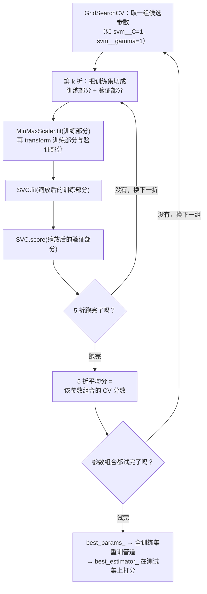

# 第 6 章 算法链与管道

> **本章解决**：机器学习应用很少是"一个算法跑到底"——缩放、特征提取、特征选择、模型训练要**链在一起**执行。怎么把这条链封装成一个 scikit-learn 估计器？用 **Pipeline 类（管道）**。本章先看一个反例：预处理放在交叉验证之外做，会"泄漏"验证部分的信息，把随机数据上的回归吹出 R²=0.91（管道纠正后是 -0.25）；然后学管道的创建、fit/predict 链、`步骤名__参数名` 的网格搜索语法，直到"连用哪个模型都交给网格搜索选"。
> 这一章没有新算法，全是**流程规范与工程接口**，但它决定第 2~5 章所有实验的结论是否可信。学完本章，scikit-learn 提供的通用工具与算法就全部齐了，下一章进入需要专门处理的文本数据。

📓 **章代码**：[nb/ch06.ipynb](nb/ch06.ipynb)（分节跟随代码，固定种子实跑输出；旧 API 适配处见代码内“版本适配”注释）

对于许多机器学习算法，你提供的特定**数据表示（data representation）**非常重要——第 4 章整章都在讲这个。第 3 章也讲过：先对数据缩放，再手工合并特征，再用无监督学习学习特征。所以大多数机器学习应用不仅需要应用单个算法，还需要**将许多不同的处理步骤和机器学习模型链接在一起**。本章介绍如何用 Pipeline 类简化"变换 + 模型"链的构建，重点是 **Pipeline 与 GridSearchCV 结合**，从而同时搜索所有处理步骤中的参数。

先用一个具体例子感受"模型链"。我们已经知道：用 MinMaxScaler 预处理可以大大提高核 SVM 在 cancer 数据集上的性能（第 3 章 0.63 → 0.97 那次）。划分数据、计算最小值最大值、缩放数据、训练 SVM，代码是这样的：

```python
# ===== 书第 6 章开篇：划分数据 → 缩放 → 训练 SVM =====
from sklearn.svm import SVC
from sklearn.datasets import load_breast_cancer
from sklearn.model_selection import train_test_split
from sklearn.preprocessing import MinMaxScaler

# 加载并划分数据
cancer = load_breast_cancer()
X_train, X_test, y_train, y_test = train_test_split(
    cancer.data, cancer.target, random_state=0)

# 计算训练数据的最小值和最大值（fit 只碰训练集——第 3 章立下的铁律）
scaler = MinMaxScaler().fit(X_train)

# 对训练数据进行缩放，然后在缩放后的训练数据上学习 SVM
X_train_scaled = scaler.transform(X_train)
svm = SVC()
svm.fit(X_train_scaled, y_train)

# 对测试数据用同一个缩放器变换，再打分
X_test_scaled = scaler.transform(X_test)
print("Test score: {:.2f}".format(svm.score(X_test_scaled, y_test)))
# → Test score: 0.95
```

四个对象（`train_test_split` 的四份输出、scaler、svm）、五次方法调用，全靠你手工保证顺序：**fit 两次、transform 两次、谁先谁后不能错**。步骤一多，出错只是时间问题。本章的 Pipeline 就把这条链变成一个对象、一次调用。

## 6.0 本章导图

<div class="brtree">
  <div class="brrow">
    <span class="brlabel root">算法链与管道</span>
    <span class="brace"></span>
    <div class="brkids">
      <div class="brrow">
        <span class="brlabel">泄漏问题</span>
        <span class="brace"></span>
        <div class="brkids">
          <span class="brleaf">预处理在 CV 外 → 验证部分信息泄漏</span>
          <span class="brleaf">评估虚高、可能选出次优参数</span>
          <span class="brleaf">缩放泄漏影响小，特征选择泄漏致命</span>
          <span class="brleaf">随机数据：R² 0.91（假）→ -0.25（真）</span>
        </div>
      </div>
      <div class="brrow">
        <span class="brlabel">构建管道</span>
        <span class="brace"></span>
        <div class="brkids">
          <span class="brleaf">(名称, 估计器) 元组列表，名称禁含 __</span>
          <span class="brleaf">fit：前步 fit+transform，末步 fit</span>
          <span class="brleaf">predict：前步 transform，末步 predict</span>
          <span class="brleaf">score：先变换测试数据再打分</span>
        </div>
      </div>
      <div class="brrow">
        <span class="brlabel">管道 + 网格搜索</span>
        <span class="brace"></span>
        <div class="brkids">
          <span class="brleaf">步骤名__参数名：svm__C / svm__gamma</span>
          <span class="brleaf">每折内部重新拟合缩放器</span>
          <span class="brleaf">交叉验证位于处理过程最外层</span>
        </div>
      </div>
      <div class="brrow">
        <span class="brlabel">通用接口与访问</span>
        <span class="brace"></span>
        <div class="brkids">
          <span class="brleaf">任意步数；末步可用回归 / 聚类 / 变换器</span>
          <span class="brleaf">make_pipeline 自动命名（同类加 -1/-2）</span>
          <span class="brleaf">steps / named_steps 取步骤</span>
          <span class="brleaf">best_estimator_ 链一路挖到 coef_</span>
        </div>
      </div>
      <div class="brrow">
        <span class="brlabel">搜索预处理 + 模型</span>
        <span class="brace"></span>
        <div class="brkids">
          <span class="brleaf">boston：polynomialfeatures__degree + ridge__alpha</span>
          <span class="brleaf">cv_results_ 热图：二次项有用</span>
          <span class="brleaf">测试分数 0.77 vs 无多项式 0.63</span>
          <span class="brleaf">组合数随参数指数增长</span>
        </div>
      </div>
      <div class="brrow">
        <span class="brlabel">搜索"用哪个模型"</span>
        <span class="brace"></span>
        <div class="brkids">
          <span class="brleaf">参数网格列表（5.2.3 非网格空间）</span>
          <span class="brleaf">classifier: [SVC(), RF] 替换步骤</span>
          <span class="brleaf">preprocessing: [None] 跳过步骤</span>
          <span class="brleaf">cancer 胜者：SVC + StandardScaler，C=10 γ=0.01</span>
        </div>
      </div>
    </div>
  </div>
</div>

## 6.1 用预处理进行参数选择

现在假设我们想用 GridSearchCV 给 SVC 找更好的参数（正如第 5 章做过的那样）。一种"看起来很自然"的写法是：**先缩放好数据，再在缩放后的数据上跑网格搜索**：

```python
# ===== 书 6.1 节：在"缩放好的数据"上做网格搜索（反例，不要模仿） =====
from sklearn.model_selection import GridSearchCV
# 只是为了便于说明，不要在实践中使用这些代码！
param_grid = {'C': [0.001, 0.01, 0.1, 1, 10, 100],
              'gamma': [0.001, 0.01, 0.1, 1, 10, 100]}
grid = GridSearchCV(SVC(), param_grid=param_grid, cv=5)
grid.fit(X_train_scaled, y_train)          # 注意：喂的是已经缩放过的 X_train_scaled
print("Best cross-validation accuracy: {:.2f}".format(grid.best_score_))
print("Best set score: {:.2f}".format(grid.score(X_test_scaled, y_test)))
print("Best parameters: ", grid.best_params_)
# → Best cross-validation accuracy: 0.98
# → Best set score: 0.97
# → Best parameters:  {'gamma': 1, 'C': 1}
```

数字看起来一切正常。但这段代码里有一个**不易察觉的陷阱**，把书里的推理一步一步摆出来：

1. 缩放时，我们用了**训练集中的所有数据**来 fit MinMaxScaler（找出 min/max）。
2. 然后在缩放后的训练数据上跑带交叉验证的网格搜索。
3. 交叉验证的每次划分，会把训练集再切成**训练部分**和**测试部分**（也叫验证部分）：测试部分用来度量"训练部分上学到的模型在新数据上的表现"。
4. 问题来了：**这个"测试部分"在缩放时已经被用过了**——它参与了 min/max 的计算。请记住，交叉验证每次划分的测试部分都是训练集的一部分，而我们用整个训练集的信息找出了缩放参数。
5. 于是对模型来说，"验证部分"和真正的新数据长得不一样：真正的新数据（比如测试集）**没有**参与缩放，它的 min/max 可能与训练数据不同。交叉验证的划分无法正确反映新数据的特征。

我们**把这部分数据的信息泄露（leak）给了建模过程**。后果：交叉验证分数过于乐观，并**可能导致选出次优的参数**。下面的图把"交叉验证"与"最终评估"两个过程里的数据使用情况画了出来：

```python
# ===== 书 6.1 节：画出"预处理在交叉验证之外"的数据使用图 =====
mglearn.plots.plot_improper_processing()
```

<figure>
  
  <figcaption>图 6-1 在交叉验证循环之外进行预处理时的数据使用情况（截自原书）</figcaption>
</figure>

看图的姿势：上下两条时间轴。**上条**是交叉验证内部——SVC 拟合、SVC 预测都只发生在训练部分/验证部分上，规规矩矩；**下条**是 scaler 拟合——它的横杆却横跨了整个训练集（训练部分 + 验证部分），也就是说验证部分的信息经由缩放器这个"旁门"流进了建模过程；测试集的预测用的也是这个看过验证部分的缩放器。

解决原则一句话：**在交叉验证的过程中，应该在进行任何预处理之前完成数据集的划分**。任何从数据集中提取信息的处理过程，都只能应用于数据集的训练部分——所以**任何交叉验证都应该位于处理过程的"最外层循环"**。

在 scikit-learn 里，想让 `cross_val_score` 和 GridSearchCV 做到这一点，用的就是 **Pipeline 类**：它可以把多个处理步骤**合并（glue，粘合）**成单个 scikit-learn 估计器。Pipeline 本身具有 `fit`、`predict`、`score` 方法，行为与其他模型完全相同。最常见的用例：**预处理步骤（缩放）+ 监督模型（分类器）**链接在一起。

## 6.2 构建管道

用 Pipeline 表示"先用 MinMaxScaler 缩放数据、再训练 SVM"这条工作流（暂时不用网格搜索）。第一步，构建一个由**步骤列表**组成的管道对象。每个步骤是一个元组，包含一个名称（你选定的任意字符串）和一个估计器的实例：

> 原书脚注 1：名称只有一个例外——**不能包含双下划线 `__`**。这个符号被保留给"步骤名\_\_参数名"语法（6.3 节就要用）。

```python
# ===== 书 6.2 节：创建两步管道 =====
from sklearn.pipeline import Pipeline
pipe = Pipeline([("scaler", MinMaxScaler()), ("svm", SVC())])
```

两个步骤：第一个叫 `"scaler"`，是 MinMaxScaler 的实例；第二个叫 `"svm"`，是 SVC 的实例。现在可以像任何其他 scikit-learn 估计器一样拟合这个管道：

```python
# ===== 书 6.2 节：像普通估计器一样使用管道 =====
pipe.fit(X_train, y_train)      # 一行顶开头的五次手工调用
print("Test score: {:.2f}".format(pipe.score(X_test, y_test)))
# → Test score: 0.95
```

`pipe.fit` 内部按顺序做了三件事：

1. 对第一个步骤（缩放器）调用 `fit`；
2. 用拟合好的缩放器**变换（transform）**训练数据；
3. 用缩放后的数据拟合 SVM。

对管道调用 `score` 时也一样是链式的：先用缩放器变换测试数据，再对 SVM 调用 `score`。结果 0.95 与本章开头手工逐步变换的代码完全相同——**管道没有改变任何计算，只是把流程封装了起来**。好处立竿见影："预处理 + 分类"需要的代码量变少了；但使用管道的**主要优点**在于：现在可以把 `pipe` 这个估计器直接丢进 `cross_val_score` 或 GridSearchCV——这正是下一节要做的。

## 6.3 在网格搜索中使用管道

在网格搜索中使用管道，与使用任何其他估计器一样。唯一的细微变化在参数网格上：**要为每个参数指定它属于管道中的哪一步**。要调的 C 和 gamma 都是 SVC（第二个步骤，名字叫 `"svm"`）的参数。语法：**步骤名称 + `__`（双下划线）+ 参数名称**。所以搜索 SVC 的 C 参数要写 `"svm__C"`，gamma 同理：

```python
# ===== 书 6.3 节：管道内网格搜索 =====
param_grid = {'svm__C': [0.001, 0.01, 0.1, 1, 10, 100],
              'svm__gamma': [0.001, 0.01, 0.1, 1, 10, 100]}
grid = GridSearchCV(pipe, param_grid=param_grid, cv=5)
grid.fit(X_train, y_train)        # 注意：这次喂的是未缩放的原始 X_train
print("Best cross-validation accuracy: {:.2f}".format(grid.best_score_))
print("Test set score: {:.2f}".format(grid.score(X_test, y_test)))
print("Best parameters: {}".format(grid.best_params_))
# → Best cross-validation accuracy: 0.98
# → Test set score: 0.97
# → Best parameters: {'svm__C': 1, 'svm__gamma': 1}
```

与 6.1 节的网格搜索不同，现在**对于交叉验证的每次划分，只使用该划分的训练部分来拟合 MinMaxScaler**——测试部分的信息没有泄露到参数搜索中。把图 6-2 与图 6-1 对比：

```python
# ===== 书 6.3 节：画出"预处理在交叉验证之内"的数据使用图 =====
mglearn.plots.plot_proper_processing()
```

<figure>
  
  <figcaption>图 6-2 使用管道在交叉验证循环内部进行预处理时的数据使用情况（截自原书）</figcaption>
</figure>

图 6-2 的关键差别：**scaler 拟合的横杆只搭在每次划分的训练部分上**，上下两行的"预处理"与"建模"都封闭在交叉验证循环内部，验证部分不再为缩放"提供参考"。交叉验证内部每一折的完整流程如下：



对照这张流程图再回看 6.1 节的错误写法：错误写法把 C 这一步整个提到了循环外面、只做一次——这就是全部问题的根源。

在交叉验证中，**信息泄露的影响大小取决于预处理步骤的性质**：用测试部分来估计数据的范围（缩放），通常不会产生可怕的影响；但在**特征提取和特征选择**中使用测试部分，会导致结果的显著差异。书里用《统计学习基础》（Hastie、Tibshirani 与 Friedman 合著）中的例子（做了修改）把这个差异演给你看。

### 举例说明信息泄露

考虑一个假想的回归任务：从高斯分布独立采样 100 个样本、10 000 个特征，响应（目标）也从高斯分布采样——**X 与 y 毫无关系，理论上不可能从这个数据集学到任何东西**：

```python
# ===== 书 6.3 节（泄漏实验）：纯随机数据 =====
import numpy as np
rnd = np.random.RandomState(seed=0)
X = rnd.normal(size=(100, 10000))     # 100 个样本、10000 个纯噪声特征
y = rnd.normal(size=(100,))           # 目标也是纯噪声
```

现在先从 10 000 个特征中用 SelectPercentile 选出"信息量最大"的 5%，再用交叉验证评估 Ridge 回归——**特征选择在交叉验证之外**：

```python
# ===== 书 6.3 节（泄漏实验）：错误做法——特征选择在交叉验证之外 =====
from sklearn.feature_selection import SelectPercentile, f_regression

select = SelectPercentile(score_func=f_regression, percentile=5).fit(X, y)
X_selected = select.transform(X)      # 在全部 100 个样本上选特征！
print("X_selected.shape: {}".format(X_selected.shape))
# → X_selected.shape: (100, 500)

from sklearn.model_selection import cross_val_score
from sklearn.linear_model import Ridge
print("Cross-validation accuracy (cv only on ridge): {:.2f}".format(
      np.mean(cross_val_score(Ridge(), X_selected, y, cv=5))))
# → Cross-validation accuracy (cv only on ridge): 0.91
```

交叉验证得到的平均 \(R^2\) 是 **0.91**——"非常好的模型"。这显然不对，因为数据是完全随机的。原因：10 000 个纯随机特征里总有几百个"碰巧"与目标相关，SelectPercentile 把它们挑了出来；由于特征选择是在**交叉验证之外**拟合的，它能找到**在训练部分和测试部分都碰巧相关**的特征——测试部分泄露出去的信息量太大，结果完全不切实际。

换成正确的交叉验证（用管道把特征选择包进去）对比：

```python
# ===== 书 6.3 节（泄漏实验）：正确做法——特征选择进管道 =====
pipe = Pipeline([("select", SelectPercentile(score_func=f_regression,
                                             percentile=5)),
                 ("ridge", Ridge())])
print("Cross-validation accuracy (pipeline): {:.2f}".format(
      np.mean(cross_val_score(pipe, X, y, cv=5))))
# → Cross-validation accuracy (pipeline): -0.25
```

这次得到**负的 \(R^2\)**，表示模型很差。管道让特征选择位于交叉验证循环内部：**仅用数据的训练部分选择特征**。选出的特征在训练部分碰巧与目标相关，但数据是完全随机的，这些特征**在测试部分并不相关**——分数自然崩了。修正泄漏问题之后，结论从"模型表现很好"变成了"模型根本没有效果"。这才是诚实的数据给出的答案。

!!! note "拓展：R² 与"负 R²"到底在说什么"
    \(R^2\)（决定系数，回归模型的默认分数）的严格定义是：

    \[
    R^2 = 1 - \frac{\sum_i (y_i - \hat y_i)^2}{\sum_i (y_i - \bar y)^2}
    \]

    人话版：分母是"无脑输出均值 \(\bar y\) 会错多远"，分子是"模型错多远"。所以 \(R^2=1\) 是完美预测；\(R^2=0\) 等价于"预测恒等于均值"；**负数说明模型比无脑输出均值还差**。在完全随机的数据上，任何模型的真值就是 0 附近——-0.25 是诚实答案，0.91 是泄漏吹出来的。

!!! note "拓展：SelectPercentile / f_regression 与多重比较"
    `f_regression` 对每个特征单独算一个 F 检验，本质是"这个特征与目标的相关性有多强"；`SelectPercentile(percentile=5)` 保留得分最高的前 5% 特征（10 000 × 5% = 500 个）。特征一多，纯随机也会冒出一批高分特征——这是统计学里经典的**多重比较问题（multiple comparisons）**：检验的次数越多，越容易"碰巧显著"。在 CV 外拟合特征选择，等于让这些"碰巧"同时为训练部分和测试部分服务。

!!! note "拓展：泄漏的"剂量"——缩放泄漏 vs 选择泄漏"
    同样是泄漏，剂量差很大。缩放只用了 min/max 这类**稳健统计量**，训练部分和验证部分的 min/max 通常相差无几，泄漏进来的"参考答案"噪声大、影响小——所以 6.1 节的错误写法得到的参数（C=1, gamma=1）与分数（0.97）和正确写法几乎一样，纯属侥幸。而特征选择相当于把验证部分的"哪些特征像答案"直接喂给了建模，剂量大到结论反转（0.91 → -0.25）。原则不变：**不赌剂量，预处理一律放进管道、放进交叉验证最外层**。

## 6.4 通用的管道接口

Pipeline 不只能用于"预处理 + 分类"，实际上可以把**任意数量的估计器**连接在一起。例如构建一个包含**特征提取、特征选择、缩放、分类**的管道，总共 4 个步骤。最后一步也可以换成回归或聚类。

对管道中估计器的唯一要求：**除最后一步之外的所有步骤都需要具有 transform 方法**——它们要生成新的数据表示，供下一步使用。

调用 `Pipeline.fit` 时，管道内部**依次对每个步骤调用 fit 和 transform**（原书注 2：或仅调用 fit_transform），每一步的输入是上一步 transform 的输出；对最后一步则只调用 fit。忽略细枝末节，其实现如下。记住 `pipeline.steps` 是由元组组成的列表：`pipeline.steps[0][1]` 是第一个估计器，`pipeline.steps[1][1]` 是第二个，以此类推：

```python
# ===== 书 6.4 节：Pipeline.fit 的等价实现（示意，忽略细节） =====
def fit(self, X, y):
    X_transformed = X
    for name, estimator in self.steps[:-1]:
        # 遍历除最后一步之外的所有步骤
        # 对数据进行拟合和变换
        X_transformed = estimator.fit_transform(X_transformed, y)
    # 对最后一步进行拟合
    self.steps[-1][1].fit(X_transformed, y)
    return self
```

用管道做预测时，同样先用除最后一步之外的所有步骤对数据做 transform，再对最后一步调用 predict：

```python
# ===== 书 6.4 节：Pipeline.predict 的等价实现（示意） =====
def predict(self, X):
    X_transformed = X
    for step in self.steps[:-1]:
        # 遍历除最后一步之外的所有步骤
        # 对数据进行变换
        X_transformed = step[1].transform(X_transformed)
    # 利用最后一步进行预测
    return self.steps[-1][1].predict(X_transformed)
```

整个过程如图 6-3 所示，其中包含两个变换器 T1、T2 和一个分类器：

<figure>
  
  <figcaption>图 6-3 管道的训练和预测过程概述（截自原书）</figcaption>
</figure>

对着图读一遍：训练时 \(X \xrightarrow{\text{T1.fit/transform}} X'1 \xrightarrow{\text{T2.fit/transform}} X'2 \xrightarrow{\text{Classifier.fit}} y\)；预测时 \(X \xrightarrow{\text{T1.transform}} X'1 \xrightarrow{\text{T2.transform}} X'2 \xrightarrow{\text{Classifier.predict}} y'\)。**变换器只管变换，最后的估计器只负责学习/预测**，两段各司其职。

管道实际上比上图更通用：**最后一步不需要具有 predict 方法**。比如可以创建一个只含缩放器和 PCA 的管道——最后一步（PCA）具有 transform 方法，所以可以对整个管道调用 `transform`，得到"PCA 作用在前一步处理过的数据上"的输出。一句话：**管道的最后一步只需要具有 fit 方法**；它有没有 predict 决定管道能不能 predict，有没有 transform 决定管道能不能 transform。

!!! note "拓展：重复计算太多？给管道加 memory 缓存"
    网格搜索中，同一个预处理步骤会被不同折、不同参数组合反复拟合。较新版本的 Pipeline 支持构造参数 `memory`（如 `Pipeline(steps, memory="cache_dir")`）：变换器的拟合结果会被缓存到目录，参数组合只变了最后一步时，前面的变换直接复用。对特征提取开销大的管道提速明显。scikit-learn 0.19 时代没有这个参数，书中未提。

!!! note "拓展：真实数据的"列级"预处理——ColumnTransformer"
    Pipeline 沿"整张表"套变换，而真实表格数据常需要"数值列缩放、类别列独热"这种**按列**的差异化处理。scikit-learn 的 `ColumnTransformer` 就是干这个的，而且它本身是一个变换器，可以直接塞进 Pipeline 当一步（`make_pipeline(ColumnTransformer([...]), LogisticRegression())`）。本书时代没有这个工具（0.20 引入），但它与本章的"链条封装 + 网格搜索"哲学完全一致，工程中几乎总是两者配合使用。

### 6.4.1 用 make_pipeline 方便地创建管道

上面的语法有时有点麻烦——通常并不需要为每个步骤提供自定义名称。便捷函数 **make_pipeline** 可以创建管道并**根据每个步骤所属的类自动命名**：

```python
# ===== 书 6.4.1 节：两种创建管道的写法 =====
from sklearn.pipeline import make_pipeline
# 标准语法
pipe_long = Pipeline([("scaler", MinMaxScaler()), ("svm", SVC(C=100))])
# 缩写语法
pipe_short = make_pipeline(MinMaxScaler(), SVC(C=100))
```

`pipe_long` 和 `pipe_short` 作用完全相同，只是 `pipe_short` 的步骤名是自动起的。通过 `steps` 属性查看：

```python
# ===== 书 6.4.1 节：查看自动生成的步骤名 =====
print("Pipeline steps:\n{}".format(pipe_short.steps))
# → [('minmaxscaler', MinMaxScaler(copy=True, feature_range=(0, 1))),
#    ('svc', SVC(C=100, ...))]        ← 书印为完整参数列表，此处省略
```

两个步骤被命名为 `minmaxscaler` 和 `svc`。**一般规则：步骤名称就是类名称的小写版本**。如果多个步骤属于同一个类，则附加一个数字：

```python
# ===== 书 6.4.1 节：同类步骤自动加序号 =====
from sklearn.preprocessing import StandardScaler
from sklearn.decomposition import PCA

pipe = make_pipeline(StandardScaler(), PCA(n_components=2), StandardScaler())
print("Pipeline steps:\n{}".format(pipe.steps))
# → [('standardscaler-1', StandardScaler(...)),
#    ('pca', PCA(n_components=2, ...)),
#    ('standardscaler-2', StandardScaler(...))]
```

第一个 StandardScaler 叫 `standardscaler-1`，第二个叫 `standardscaler-2`。但这种情况下，用显式名称的 Pipeline 构建更好——能为每个步骤提供更有语义的名字（比如"先标准化、再 PCA、再标准化"各有含义时）。

!!! note "版本差异：书印 repr 里的默认值是 0.19 时代的"
    书印输出里 `SVC(..., gamma='auto', ...)`、`LogisticRegression(..., solver='liblinear', multi_class='ovr', n_jobs=1, ...)` 都是 scikit-learn 0.19 的默认值。后续版本变化：**0.22 起 SVC 默认 `gamma='scale'`**（影响数值结果，复跑分数可能有零点几个百分点的出入）；**0.22 起 LogisticRegression 默认 `solver='lbfgs'`**（系数与书印略有不同），`multi_class` 参数自 1.5 起弃用，`n_jobs` 默认 None。这些 repr 差异只影响打印外观，不影响本章 API 用法。

### 6.4.2 访问步骤属性

通常你希望检查管道中某一步的属性——比如线性模型的系数，或 PCA 提取的成分。访问管道步骤最简单的方法是 **`named_steps` 属性**：它是一个字典，把步骤名称映射为估计器：

```python
# ===== 书 6.4.2 节：named_steps 访问步骤属性 =====
# 用上面定义的管道对 cancer 数据集进行拟合
pipe.fit(cancer.data)
# 从"pca"步骤中提取前两个主成分
components = pipe.named_steps["pca"].components_
print("components.shape: {}".format(components.shape))
# → components.shape: (2, 30)
```

`named_steps["pca"]` 拿到的就是那个拟合好的 PCA 对象，后面想取 `.components_`、`.mean_` 任意属性都可以。

### 6.4.3 访问网格搜索管道中的属性

使用管道的主要原因之一就是网格搜索，而常见任务是在网格搜索**内部**访问管道某一步的属性。场景：对 cancer 数据集上的 LogisticRegression 做网格搜索，在数据传入分类器之前先用 Pipeline 和 StandardScaler 缩放。先用 make_pipeline 创建管道：

```python
# ===== 书 6.4.3 节：网格搜索管道 =====
from sklearn.linear_model import LogisticRegression

pipe = make_pipeline(StandardScaler(), LogisticRegression())
```

第 2 章说过，LogisticRegression 需要调节的正则化参数是 **C**。对它使用对数网格，在 0.01 和 100 之间搜索。因为用了 make_pipeline，LogisticRegression 步骤的名字是自动生成的**小写类名** `logisticregression`——所以调节 C 必须写 `logisticregression__C`：

```python
# ===== 书 6.4.3 节：参数网格与搜索 =====
param_grid = {'logisticregression__C': [0.01, 0.1, 1, 10, 100]}

X_train, X_test, y_train, y_test = train_test_split(
    cancer.data, cancer.target, random_state=4)
grid = GridSearchCV(pipe, param_grid, cv=5)
grid.fit(X_train, y_train)
```

那么如何访问 GridSearchCV 找到的最佳 LogisticRegression 模型的系数？第 5 章说过，GridSearchCV 找到的最佳模型（在所有训练数据上重新训练得到的模型）保存在 **`grid.best_estimator_`** 中：

```python
# ===== 书 6.4.3 节：从 GridSearchCV 里"挖出"最佳模型 =====
print("Best estimator:\n{}".format(grid.best_estimator_))
# → Pipeline(steps=[('standardscaler', StandardScaler(...)),
#                   ('logisticregression', LogisticRegression(C=0.1, ...))])
```

`best_estimator_` 是一个**管道**，包含 standardscaler 和 logisticregression 两步。照旧用 named_steps 访问 logisticregression 步骤：

```python
# ===== 书 6.4.3 节：取最佳模型、读系数 =====
print("Logistic regression step:\n{}".format(
      grid.best_estimator_.named_steps["logisticregression"]))
# → LogisticRegression(C=0.1, ...)

print("Logistic regression coefficients:\n{}".format(
      grid.best_estimator_.named_steps["logisticregression"].coef_))
# → Logistic regression coefficients:
#   [[-0.389 -0.375 -0.376 -0.396 -0.115  0.017 -0.355 -0.39  -0.058  0.209
#     -0.495 -0.004 -0.371 -0.383 -0.045  0.198  0.004 -0.049  0.21   0.224
#     -0.547 -0.525 -0.499 -0.515 -0.393 -0.123 -0.388 -0.417 -0.325 -0.139]]
```

这条"寻宝链"值得背下来：**`grid.best_estimator_`（最佳管道）→ `.named_steps["logisticregression"]`（最佳模型）→ `.coef_`（模型属性）**。系数列表可能有点长，但通常有助于理解你的模型。补充一点解读（cancer 的类 0 是恶性、类 1 是良性）：系数大多为负，意思是这些特征取值越大，模型越把样本往"恶性"（类 0）推——与"肿瘤测量值越大越危险"的直觉一致。

!!! note "拓展：__ 语法是全库通用的"参数路径""
    `步骤名__参数名` 不只是 GridSearchCV 字典键的写法：scikit-learn 所有估计器的 `get_params()` / `set_params()` 都用同一套嵌套语法，例如 `pipe.set_params(svm__C=10)` 可以在不重建管道的情况下改参数；GridSearchCV 内部正是用它把参数"写进"管道深处。链条再深一层就再接一个 `__`（比如管道套管道时 `pipeline__svm__C`）。一句话：**双下划线就是 scikit-learn 的"成员访问点号"**——这也解释了为什么步骤名里不允许出现 `__`。

## 6.5 网格搜索预处理步骤与模型参数

用管道可以把机器学习工作流中的**所有处理步骤**封装成一个 scikit-learn 估计器。这么做的另一个好处：**可以用监督任务（回归/分类）的输出来调节预处理参数**——预处理不再凭经验拍脑袋，而是被交叉验证选中。

第 4 章在应用岭回归之前，用 boston 数据集构造过多项式特征。现在用管道重复这个建模过程，管道包含 3 个步骤：缩放数据、计算多项式特征、岭回归：

!!! note "版本差异：load_boston 已在 scikit-learn 1.2 被移除"
    boston 房价数据集因含一个涉及种族的敏感变量（B），自 scikit-learn 1.2 起被官方移除，`load_boston` 会直接报 ImportError。替代方案：

    1. `fetch_california_housing()`——回归任务结构相同、接口相同，但数据完全不同（20640 个样本、8 个特征），书印数字无法逐位复现，方法论演示足够；
    2. `fetch_openml(name="boston_house_prices", version=1)`——还是原数据，但返回 DataFrame 且含类别列，需要转成 float 才能喂给 sklearn；
    3. 旧版 mglearn 的扩展 boston（`mglearn.datasets.load_extended_boston()`，第 2 章用过）内部同样依赖 load_boston，在 1.2+ 环境会连带报错，需改用上面两种来源。

    本节的方法论（搜索预处理参数）与数据集无关，换哪个数据集都能照做，只是分数不同。

```python
# ===== 书 6.5 节：缩放 + 多项式特征 + 岭回归，三步管道 =====
# 原书：from sklearn.datasets import load_boston      # sklearn 1.2 起已移除，见上方"版本差异"（sklearn≥1.2 已移除，直接 ImportError）
# 版本适配：mglearn 内置等价加载（boston.data/target 用法不变，本地缓存离线可跑）
from mglearn.datasets import load_boston
boston = load_boston()
X_train, X_test, y_train, y_test = train_test_split(boston.data, boston.target,
                                                    random_state=0)

from sklearn.preprocessing import PolynomialFeatures
pipe = make_pipeline(
    StandardScaler(),
    PolynomialFeatures(),     # 默认 degree=2
    Ridge())
```

怎么知道该选几次多项式？要不要交互项？理想情况下，我们希望**根据回归结果来选择 degree 参数**。用管道就能搜索 degree 和 Ridge 的 alpha——给两个参数都加上步骤名前缀：

```python
# ===== 书 6.5 节：同时搜索预处理参数与模型参数 =====
param_grid = {'polynomialfeatures__degree': [1, 2, 3],
              'ridge__alpha': [0.001, 0.01, 0.1, 1, 10, 100]}
grid = GridSearchCV(pipe, param_grid=param_grid, cv=5, n_jobs=-1)
grid.fit(X_train, y_train)
```

3 种 degree × 6 种 alpha = 18 个参数组合，每个组合 5 折交叉验证——共 90 次拟合。像第 5 章那样，把交叉验证结果画成热图：

```python
# ===== 书 6.5 节：交叉验证分数热图 =====
plt.matshow(grid.cv_results_['mean_test_score'].reshape(3, -1),
            vmin=0, cmap="viridis")
plt.xlabel("ridge__alpha")
plt.ylabel("polynomialfeatures__degree")
plt.xticks(range(len(param_grid['ridge__alpha'])), param_grid['ridge__alpha'])
plt.yticks(range(len(param_grid['polynomialfeatures__degree'])),
           param_grid['polynomialfeatures__degree'])
plt.colorbar()
```

<figure>
  
  <figcaption>图 6-4 以多项式特征的次数和岭回归的 alpha 参数为坐标轴，绘制交叉验证平均分数的热图（截自原书）</figcaption>
</figure>

热图的读法：第二行（degree=2）整行都亮，说明**二次多项式很有用**；第三行（degree=3）明显发暗，效果比一次、二次都差很多——三次多项式把噪声也拟合了。从最佳参数中也能看出这一点：

```python
# ===== 书 6.5 节：最佳参数与测试分数 =====
print("Best parameters: {}".format(grid.best_params_))
# → Best parameters: {'polynomialfeatures__degree': 2, 'ridge__alpha': 10}

print("Test-set score: {:.2f}".format(grid.score(X_test, y_test)))
# → Test-set score: 0.77

# 对比：运行一个没有多项式特征的网格搜索
param_grid = {'ridge__alpha': [0.001, 0.01, 0.1, 1, 10, 100]}
pipe = make_pipeline(StandardScaler(), Ridge())
grid = GridSearchCV(pipe, param_grid, cv=5)
grid.fit(X_train, y_train)
print("Score without poly features: {:.2f}".format(grid.score(X_test, y_test)))
# → Score without poly features: 0.63
```

正与图 6-4 预料的一样，不使用多项式特征得到了明显更差的结果（0.63 vs 0.77）。**同时搜索预处理参数与模型参数是一个非常强大的策略**。但要记住：GridSearchCV 会尝试指定参数的**所有可能组合**，向网格中添加更多参数，需要构建的模型数量将呈**指数增长**。

!!! note "拓展：指数增长的应对——粗到细 / 随机搜索"
    组合数是各参数取值数的**乘积**：上例 3×6=18 组 × 5 折 = 90 次拟合，6.6 节的例子会到 75 组 × 5 折。参数一多（比如 6 个参数各 10 个取值）就是百万量级。实用对策：(1) **粗到细**——先用对数粗网格锁定量级，再在最佳值附近加密；(2) 每个参数少取几个值，但覆盖对数范围；(3) 超过 3~4 个连续参数时换 **RandomizedSearchCV**（随机采样参数空间，固定预算内覆盖更广）；(4) `n_jobs=-1` 并行只省时间、不省组合数，别指望它救指数爆炸。

## 6.6 网格搜索选择使用哪个模型

还可以更进一步：把 GridSearchCV 和 Pipeline 结合起来，**搜索管道中正在执行的实际步骤**——比如用 StandardScaler 还是用 MinMaxScaler，甚至分类器用 SVC 还是随机森林。这会导致更大的搜索空间，应当仔细考虑；**尝试所有可能的解决方案，通常并不是一种可行的机器学习策略**。但作为一个例子，我们比较 RandomForestClassifier 和 SVC：

> **原书笔误：正文说 iris，代码用的是 cancer**
> 原书正文写"在 iris 数据集上比较 RandomForestClassifier 和 SVC"，但随后的代码与输出全部是 **cancer 数据集**（`train_test_split(cancer.data, cancer.target, random_state=0)`，测试分数 0.98 与 cancer 的量级吻合）。英文原版即如此印刷，属文码不一致：阅读时以代码为准；两种分类器、两种预处理方案的比较方法本身在哪个数据集上都成立。

我们知道 SVC 可能需要缩放数据，所以还要搜索"用 StandardScaler 还是不用预处理"；RandomForestClassifier 不需要预处理。先定义管道，这里**显式命名步骤**——两个步骤：一个预处理、一个分类器，用 StandardScaler 和 SVC 实例化：

```python
# ===== 书 6.6 节：显式命名的两步管道 =====
pipe = Pipeline([('preprocessing', StandardScaler()), ('classifier', SVC())])
```

现在定义要搜索的参数网格。我们希望 classifier 是 RandomForestClassifier 或 SVC——两种分类器要调的参数不同、需要的预处理也不同，所以用 5.2.3 节"在非网格的空间中搜索"讲的**参数网格列表**。把一个估计器**分配**给一个步骤的办法：用步骤名称作为参数名称（`'classifier': [SVC()]`）。想跳过管道中的某个步骤（例如 RandomForest 不需要预处理），就把该步骤设为 **None**：

```python
# ===== 书 6.6 节：参数网格列表——连"用哪个模型"都交给搜索 =====
from sklearn.ensemble import RandomForestClassifier

param_grid = [
    {'classifier': [SVC()], 'preprocessing': [StandardScaler(), None],
     'classifier__gamma': [0.001, 0.01, 0.1, 1, 10, 100],
     'classifier__C': [0.001, 0.01, 0.1, 1, 10, 100]},
    {'classifier': [RandomForestClassifier(n_estimators=100)],
     'preprocessing': [None], 'classifier__max_features': [1, 2, 3]}]
```

读懂这个网格列表的两种键：

- **不带 `__` 的键**（`classifier`、`preprocessing`）：值是**估计器实例的列表**，表示"这一步换成哪个对象"——第一个字典里 preprocessing 有 StandardScaler 和 None 两种选择，None 就是"跳过这一步"；
- **带 `__` 的键**（`classifier__C` 等）：值是参数取值列表，属于普通调参。

两个字典按 5.2.3 节的规则**分别展开再取并集**：SVC 分支 1 × 2 × 6 × 6 = 72 个组合，随机森林分支 1 × 1 × 3 = 3 个组合，合计 75 组 × 5 折 = 375 次拟合。

像前面一样实例化网格搜索，在 cancer 数据集上运行：

```python
# ===== 书 6.6 节：在 cancer 上运行"选模型"网格搜索 =====
X_train, X_test, y_train, y_test = train_test_split(
    cancer.data, cancer.target, random_state=0)

grid = GridSearchCV(pipe, param_grid, cv=5)
grid.fit(X_train, y_train)
print("Best params:\n{}\n".format(grid.best_params_))
print("Best cross-validation score: {:.2f}".format(grid.best_score_))
print("Test-set score: {:.2f}".format(grid.score(X_test, y_test)))
# → Best params:
# → {'classifier': SVC(C=10, gamma=0.01, ...),
# →  'preprocessing': StandardScaler(...),
# →  'classifier__C': 10, 'classifier__gamma': 0.01}
# → Best cross-validation score: 0.99
# → Test-set score: 0.98
```

网格搜索的结果是 **SVC + StandardScaler 预处理，在 C=10、gamma=0.01 时给出最佳结果**。注意 `best_params_` 里连"选了哪个模型、哪种预处理"都一并返回——这一套写法把"模型选择"也变成了搜索空间的一部分。

!!! note "版本差异：SVC 的 gamma 默认值变了"
    书印输出里 `SVC(C=10, gamma=0.01, ...)` 是搜索选出来的参数，不受默认值影响；但管道定义 `('classifier', SVC())` 中的 SVC 在搜索前用的是 0.19 的默认 `gamma='auto'`，新版默认 `gamma='scale'`。对本节结论（胜者是 SVC）没有影响，只是复跑时中间过程可能略有不同。

## 6.7 小结与展望

本章介绍了 **Pipeline 类**——一种通用工具，可以把机器学习工作流中的多个处理步骤链接在一起。现实世界的机器学习应用很少只单独使用一个模型，而是一系列处理步骤。使用管道可以把多个步骤封装成**单个 Python 对象**，它具有我们熟悉的 scikit-learn 接口：`fit`、`predict` 和 `transform`。

最重要的结论：**用交叉验证评估模型、用网格搜索选择参数时，用 Pipeline 类把所有处理步骤都包进来，对正确的评估至关重要**——否则预处理泄露验证部分的信息，交叉验证分数失真（随机数据上 0.91 → -0.25 的教训）。

管道还能让代码更简洁，减少不用管道时可能犯的错误——比如**忘记把所有变换器应用于测试集**，或者**应用顺序错误**。选择特征提取、预处理和模型的正确组合，某种程度上是一门艺术，通常需要试错；有了管道，"尝试"多个不同处理步骤变得非常简单。试验时注意两点：不要把处理过程复杂化；**一定要评估模型中的每个组件是否必要**（就像图 6-4 告诉我们 degree=3 不必要那样）。

学完本章，你已经学完了 scikit-learn 提供的所有通用工具与算法，掌握了在实践中应用机器学习的必要机制。下一章将深入一种实践中常见的数据类型——**文本数据**，它需要一些专门的知识才能正确处理。

## 坑与陷阱

!!! danger "本章最容易栽的 8 个地方"
    1. **在缩放好的数据上直接跑 GridSearchCV**（6.1 反例）：交叉验证每一折的验证部分都参与了缩放器的 fit，评估虚高、可能选出次优参数。预处理必须进管道、进交叉验证最外层——`grid.fit(X_train)` 喂的永远是原始数据。
    2. **在交叉验证之外做特征选择 / 特征提取**：泄漏剂量远大于缩放。书里的随机数据实验：CV 外 SelectPercentile 吹出 R²=0.91，管道内正确做法是 -0.25。只要"这一步会从数据里提取信息"，它就必须在 CV 循环内部。
    3. **步骤名里用了双下划线**：Pipeline 步骤名可以随便起，唯独不能含 `__`——那是"步骤名__参数名"语法的前缀，撞了它 GridSearchCV 的参数解析直接错乱。
    4. **给非最后一步用了没有 transform 的模型**：Pipeline.fit 会对除最后一步外的每步调用 fit_transform，t-SNE 这类只有 fit_transform、无独立 transform 语义的模型放中间会出问题；同理管道想调 `pipe.predict`，最后一步就得有 predict。
    5. **make_pipeline 自动命名后写错参数键**：自动名是小写类名（同类多步加 `-1`/`-2`），写 param_grid 前先 `print(pipe.steps)` 确认。`LogisticRegression__C`、`logreg__C` 都会报"参数不存在"。
    6. **参数组合指数爆炸**：GridSearchCV 穷举所有组合，每加一个参数组合数就相乘（6.5 节 3×6=18 组 × 5 折；6.6 节 75 组 × 5 折）。先粗网格再细化，参数多时换 RandomizedSearchCV，`n_jobs=-1` 只是并行不省总量。
    7. **混淆"步骤赋值"与"参数调优"两种写法**：`'classifier': [SVC(), RandomForestClassifier()]` 是替换步骤实例（值是估计器列表、键不带 `__`），`'classifier__C': [...]` 才是调参数。6.6 节的网格列表里两种键混用，写之前想清楚每个键的角色。
    8. **新版复跑数字对不上就慌**：书中所有分数绑定旧版默认超参（SVC gamma='auto'、LogisticRegression solver='liblinear'）与特定 random_state。先对照"版本差异"note，再看自己代码；方法论正确、分数差零点几个百分点属正常。load_boston 在 1.2+ 直接 ImportError，换 fetch_california_housing。

## 速览

1. 本章核心问题：预处理若发生在交叉验证之外，验证部分的信息会泄漏进建模过程，交叉验证分数虚高、可能选出次优参数。
2. Pipeline 把多个步骤（`(名称, 估计器)` 元组列表）粘合成单个估计器，自带 fit/predict/score/transform；名称任意，唯独不能含双下划线 `__`。
3. fit 链：除最后一步外各步 fit+transform，最后一步 fit；predict 链：各步 transform，最后一步 predict；最后一步只需有 fit。
4. 泄漏实验：100×10000 纯随机数据，CV 外做 SelectPercentile + Ridge 得 R²=0.91；特征选择进管道后 R²=-0.25——结论从"很好"变"无效"。
5. 泄漏剂量：缩放泄漏通常影响小（min/max 是稳健统计量），特征选择/提取泄漏影响大——原则是不赌剂量，一律管道化。
6. 管道内网格搜索：参数键 = `步骤名__参数名`（svm__C、svm__gamma、ridge__alpha、logisticregression__C），grid.fit 喂原始数据。
7. 访问接口：make_pipeline 按小写类名自动命名（同类加 -1/-2）；`pipe.named_steps["名称"]` 取步骤；`grid.best_estimator_.named_steps[...]` 挖最佳模型属性（如 coef_）。
8. 搜索预处理参数：boston 三步管道搜索 polynomialfeatures__degree 与 ridge__alpha，选出 degree=2、alpha=10，测试分数 0.77（无多项式只有 0.63）；组合数指数增长。
9. 搜索"用哪个模型"：参数网格列表 + `'classifier': [SVC(), RandomForestClassifier()]` 步骤赋值 + `preprocessing: [None]` 跳过步骤；cancer 上胜出的是 SVC + StandardScaler（C=10, gamma=0.01），CV 0.99 / 测试 0.98。
10. 学完本章，scikit-learn 的通用工具与算法全部学完；下一章进入文本数据。

## 术语速查

| 英文 | 中文 | 一句话 |
| --- | --- | --- |
| Pipeline | 管道 | 把多个处理步骤粘合（glue）成单个 scikit-learn 估计器 |
| make_pipeline | 管道快捷构造函数 | 按小写类名自动命名步骤，同类加 -1/-2 |
| step / steps | 步骤 / 步骤列表 | (名称, 估计器) 元组；steps[0][1] 取出第一个估计器 |
| named_steps | 具名步骤字典 | 步骤名 → 拟合好的估计器实例 |
| 双下划线语法（\_\_） | 嵌套参数路径 | svm__C 表示 svm 步骤的 C 参数；get_params/set_params 同款 |
| data leakage | 数据泄露 | 预处理提前使用了验证/测试部分的信息，评估虚高 |
| transformer | 变换器 | 有 transform 方法的估计器；管道非末步必须是变换器 |
| estimator | 估计器 | scikit-learn 所有算法类的统称，都有 fit |
| cross_val_score | 交叉验证分数函数 | 对任意估计器手动做 CV 并返回各折分数 |
| GridSearchCV | 网格搜索交叉验证 | 穷举参数网格 × 交叉验证，选出 best_params_ |
| param_grid | 参数网格 | 字典或字典列表定义搜索空间；列表支持"换模型"分支 |
| best_score_ / best_params_ / best_estimator_ | 网格搜索三大属性 | 最佳 CV 分数 / 最佳参数 / 全训练集重训的最佳模型 |
| cv_results_ | 交叉验证结果字典 | mean_test_score 可 reshape 成热图 |
| SelectPercentile | 百分比特征选择 | 保留得分最高的前 percentile% 个特征 |
| f_regression | 回归 F 检验 | 单特征与目标的线性相关打分，供 SelectPercentile 用 |
| R² (coefficient of determination) | 决定系数 | 回归默认分数；0 ≈ 输出均值，负数比均值还差 |
| PolynomialFeatures | 多项式特征 | 生成 degree 次多项式与交互特征，可被搜索的预处理参数 |
| Ridge | 岭回归 | L2 正则线性回归，要调 alpha |
| RandomForestClassifier | 随机森林分类器 | 不需要缩放的树模型，调 max_features |
| MinMaxScaler / StandardScaler | 两种缩放器 | 第 3 章的老朋友，本章作为管道步骤出场 |
| preprocessing: None | 跳过步骤 | 参数网格里把某一步设为 None 即禁用它 |
| boston 数据集 | 波士顿房价数据 | 本章回归示例数据；sklearn 1.2 起已移除，见版本差异 |

## 覆盖自查

??? note "原书小节 → 笔记位置对照"
    | 原书小节 / 内容 | 笔记位置 |
    | --- | --- |
    | 章首引子（数据链的重要性、缩放 + SVM 0.95 的手工流程） | 章首 + 开篇代码 |
    | 6.1 用预处理进行参数选择（naive 网格搜索、泄漏原理、图 6-1） | 6.1 节 + 图 6-1 |
    | 6.2 构建管道（创建、fit 链、score、脚注 1 禁 \_\_） | 6.2 节 |
    | 6.3 在网格搜索中使用管道（svm__C 语法、图 6-2、泄漏影响大小讨论） | 6.3 节 + 图 6-2 + mermaid 流程图 |
    | 6.3 举例说明信息泄露（随机数据、SelectPercentile、0.91 vs -0.25） | 6.3 节泄漏实验 + 拓展 R² / f_regression / 泄漏剂量 |
    | 6.4 通用的管道接口（fit/predict 等价实现、图 6-3、末步只要求 fit） | 6.4 节 + 图 6-3 + 拓展 memory / ColumnTransformer |
    | 6.4.1 用 make_pipeline 方便地创建管道（自动命名、同类序号） | 6.4.1 节 + 版本差异（repr/默认值） |
    | 6.4.2 访问步骤属性（named_steps、components_） | 6.4.2 节 |
    | 6.4.3 访问网格搜索管道中的属性（best_estimator_ → named_steps → coef_） | 6.4.3 节 + 拓展 \_\_ 参数路径 |
    | 6.5 网格搜索预处理步骤与模型参数（boston 三步管道、图 6-4、0.77 vs 0.63、指数增长） | 6.5 节 + 图 6-4 + 拓展粗到细/随机搜索 |
    | 6.5 开头的 load_boston（新版不可用） | 6.5 节版本差异 note |
    | 6.6 网格搜索选择使用哪个模型（参数网格列表、步骤赋值、None 跳步、SVC+StandardScaler 胜出） | 6.6 节（iris/cancer 文码不一致已标注）+ 版本差异 gamma |
    | 6.7 小结与展望 | 6.7 节 |
