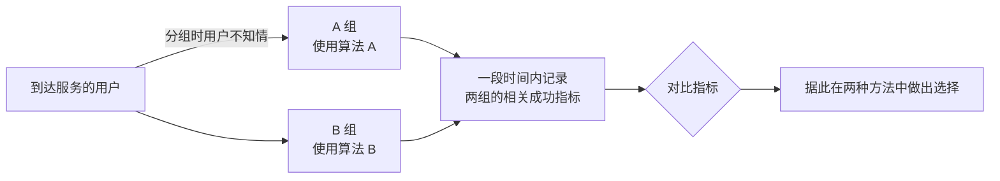

# 第 8 章 全书总结

> **本章解决**：全书最后一章不教新算法，教"怎么把前 7 章真正用起来"。动手之前怎么拆解问题、怎么定义并衡量成功（8.1）；原型怎么走向生产环境（8.2）；上线之后怎么在线测试、做 A/B 测试（8.3）；当 scikit-learn 没有你要的处理方法时，怎么按它的接口规矩写自己的估计器并接进 Pipeline 与 GridSearchCV（8.4，直接呼应第 6 章的管道与交叉验证）；最后给出继续深造的书单与路线图（8.5）。8.6 一句话收尾。

前 7 章你学会了用重要的机器学习算法做监督学习和无监督学习，足以解决很多种机器学习问题。这一章给出最后的建议、额外的资源和进一步提高机器学习与数据科学技能的路线——先讲方法论，再讲工程化，最后是进阶地图。

## 8.0 本章导图

<div class="brtree">
  <div class="brrow">
    <span class="brlabel root">全书总结</span>
    <span class="brace"></span>
    <div class="brkids">
      <div class="brrow">
        <span class="brlabel">方法论 8.1</span>
        <span class="brace"></span>
        <div class="brkids">
          <span class="brleaf">先问问题类型：探索还是目标</span>
          <span class="brleaf">动手前定义并衡量成功</span>
          <span class="brleaf">欺诈检测三问</span>
          <span class="brleaf">完美模型思想实验（省 100 美元不值得做）</span>
          <span class="brleaf">反馈环路：缺数据比调参更值得回头</span>
        </div>
      </div>
      <div class="brrow">
        <span class="brlabel">人在决策中 8.1</span>
        <span class="brace"></span>
        <div class="brkids">
          <span class="brleaf">无人车：必须即时决策</span>
          <span class="brleaf">医疗：算法先做 90%/50%/10% 也有收益</span>
          <span class="brleaf">简单情况算法、复杂情况人工</span>
        </div>
      </div>
      <div class="brrow">
        <span class="brlabel">原型到生产 8.2</span>
        <span class="brace"></span>
        <div class="brkids">
          <span class="brleaf">分析团队 Python/R，生产团队 Go/Scala/C++/Java</span>
          <span class="brleaf">高性能语言重新实现更省事</span>
          <span class="brleaf">可靠性、可预测性、运行时间、内存</span>
          <span class="brleaf">简单是关键 + 技术债论文</span>
        </div>
      </div>
      <div class="brrow">
        <span class="brlabel">测试生产系统 8.3</span>
        <span class="brace"></span>
        <div class="brkids">
          <span class="brleaf">离线评估只是第一步</span>
          <span class="brleaf">在线测试：改界面会改变用户行为</span>
          <span class="brleaf">A/B 盲测：两组用户比指标</span>
          <span class="brleaf">更复杂的 bandit 算法</span>
        </div>
      </div>
      <div class="brrow">
        <span class="brlabel">自定义估计器 8.4</span>
        <span class="brace"></span>
        <div class="brkids">
          <span class="brleaf">继承 BaseEstimator + TransformerMixin</span>
          <span class="brleaf">__init__ 存参数 / fit 返回 self / transform 只收 X</span>
          <span class="brleaf">分类回归换 ClassifierMixin/RegressorMixin + predict</span>
          <span class="brleaf">实战：ThresholdEstimator 接进 GridSearchCV</span>
        </div>
      </div>
      <div class="brrow">
        <span class="brlabel">下一步 8.5</span>
        <span class="brace"></span>
        <div class="brkids">
          <span class="brleaf">理论书单：ESL / Marsland / Bishop / Murphy</span>
          <span class="brleaf">其他工具：statsmodels / R / vw / mllib</span>
          <span class="brleaf">排序、推荐系统、时间序列</span>
          <span class="brleaf">概率编程：PyMC / Stan</span>
          <span class="brleaf">神经网络：Deep Learning</span>
          <span class="brleaf">大数据：核外学习 / 集群并行</span>
          <span class="brleaf">练手：Kaggle / OpenML</span>
        </div>
      </div>
    </div>
  </div>
</div>

## 8.1 处理机器学习问题

学完全书这些强大的方法，你可能很想马上拿最喜欢的算法去解决一个数据问题。作者明确说：**这通常不是开始分析的好方法**。机器学习算法通常只是更大的数据分析与决策过程的一小部分。为了有效利用机器学习，要退后一步，全面地思考问题。

第一个要想清楚的问题：**你想回答什么类型的问题？**是做探索性分析，看看能否在数据中找到有趣的内容？还是已经有了特定目标——比如检测欺诈用户交易、推荐电影或找到未知行星？如果带着目标来，那么在构建系统之前，先思考**如何定义并衡量成功**，以及成功的解决方案对总体业务目标或研究目标有什么影响。

以欺诈检测为目标，作者列出动手前必须回答的三个问题：

- 如何度量欺诈预测是否实际有效？
- 我有没有评估算法的合适数据？
- 如果我成功了，那么我的解决方案会对业务造成什么影响？

正如第 5 章所说，最好能用商业指标直接度量算法性能，比如增加利润或减少损失，但这通常难以做到。一个更容易回答的问题是：**"如果我构建出完美的模型，会怎么样？"**——如果完美检测所有欺诈行为每月只给公司省 100 美元，省下的钱可能都不够覆盖开始开发算法的成本；如果可能每月省上万美元，这个问题就值得探索。这个思想实验成本几乎为零，却是可行性判断的最低成本方案。

假设你已经定义好问题、确认解决方案影响重大、确信拥有合适的信息来评估成功。接下来的步骤通常是**获取数据并构建工作原型**。本书讲过的所有模型、评估与调参方法都用在这一步。但要记住：模型构建只是"**收集新数据、清洗数据、构建模型和分析模型**"这个反馈环路中的一小部分。


分析模型所犯的错误通常会告诉我们：数据中缺失了哪些内容、还可以收集哪些额外数据、或者如何重新规划任务使机器学习更加高效。**收集更多数据或不同的数据，或者稍微改变任务规划，可能比连续运行网格搜索来调参的回报更高。**这是全书方法论里最容易被忽视、也最值钱的一句。

> **侧栏：参与决策过程的人**
> 你还应该考虑是否应该让人参与决策过程，以及如何参与。有些过程（比如无人驾驶汽车的行人检测）需要立即做出决定；另一些过程不需要立刻响应，可以把不确定的决策交给人来定。例如医疗应用可能需要非常高的精度，单靠机器学习算法可能无法达到——但如果一个算法可以自动完成 90%、50% 甚至只有 10% 的决策过程，都可能已经减少了响应时间或降低了成本。许多应用都以"简单情况"为主：算法可以对其做出决策，剩下相对较少的"复杂情况"重新交给人来决定。

!!! note "拓展：这套思路在业界的名字——human-in-the-loop"
    "算法处理简单情况、人处理复杂情况"的架构叫**人在决策回路（human-in-the-loop）**，是内容审核、风控、医疗影像初筛等系统的标准设计。哪些样本该交给人，本身也可以量化：第 5 章讲过的预测不确定度就是现成工具——把 `predict_proba` 置信度低、两类概率接近的样本排进人工队列，模型只处理有把握的其余样本。自动化比例（哪怕只有 10%）乘上样本总量，省下的人力依然可观，这就是侧栏那个反直觉结论的实际含义。

## 8.2 从原型到生产

本书讨论的工具对许多机器学习应用都很好用，可以非常快速地进行分析和原型设计。许多组织——甚至是非常大型的组织，比如国际银行和全球社交媒体公司——也将 Python 和 scikit-learn 用于生产系统。但许多公司拥有复杂的基础架构，把 Python 集成进去并不总是容易。这不一定是个问题：常见的分工是数据分析团队和生产团队各用各的语言。

| 团队 | 常用语言 | 任务 |
| --- | --- | --- |
| 数据分析团队 | Python、R | 对想法进行快速测试（分析、原型） |
| 生产团队 | Go、Scala、C++、Java | 构建鲁棒性更好的可扩展系统 |

数据分析的需求与构建实时服务并不相同，所以这些任务使用不同的语言是有道理的。一个相对常见的解决方案：**用一种高性能语言在更大的框架内重新实现分析团队找到的解决方案**——这比嵌入整个库或整个编程语言、并与不同数据格式互相转换要简单得多。

无论你能否在生产系统中使用 scikit-learn，都要记住：**生产系统的要求与一次性的分析脚本不同**。把算法部署到更大的系统中，会涉及软件工程的很多内容：可靠性（reliability）、可预测性（predictability）、运行时间（running time）和内存需求（memory requirements）。对在这些领域表现良好的机器学习系统来说，**简单就是关键**。请仔细检查数据处理和预测流程中的每一部分，问自己三个问题：

- 每个步骤增加了多少复杂度？
- 每个组件对数据或计算基础架构变化的鲁棒性有多高？
- 每个组件的优点能否使其复杂度变得合理？

如果你正在构建复杂的机器学习系统，作者强烈推荐阅读 Google 机器学习团队研究者发布的论文 **"Machine Learning: The High Interest Credit Card of Technical Debt"**（原书链接 `research.google.com/pubs/pub43146.html`）。文章重点介绍大规模生产中创建并维护机器学习软件的权衡。技术债问题在大规模长期项目中特别紧迫，但即使是短期和较小的系统，吸取的教训也有助于构建更好的软件。

!!! note "拓展：这篇"技术债"论文讲了什么"
    论文作者为 Sculley 等人（Google，2014 年 NIPS 的 SE4ML 研讨会）。核心判断：机器学习代码只占真实系统的一小部分，周围包裹着数据依赖、胶水代码、配置、监控这些"暗物质"；模型一改，下游一切随之改变（论文称为 CACE 原则——Change Anything Changes Everything）。"复杂度是借来的债，上线后连本带息地还"——这与 8.2 节"简单就是关键"完全一致，也解释了为什么论文标题把机器学习比作"高息信用卡"。

## 8.3 测试生产系统

本书介绍的评估都基于**事先收集的测试集**，这叫**离线评估（offline evaluation）**。但如果你的机器学习系统是面向用户的，这只是评估算法的第一步。下一步通常是在线测试（online testing）或实时测试（live testing）：对算法在**整个系统中**使用的结果进行评估。

为什么要在线测？因为改变网站向用户呈现的推荐结果或搜索结果，可能极大地改变用户行为，并导致意想不到的结果——这些后果在离线测试集上根本看不见。为了防止意外，大部分面向用户的服务都采用 **A/B 测试（A/B testing）**，一种**盲的（blind）**用户研究形式。



A/B 测试的机制：在用户不知情的情况下，为选中的一部分用户提供使用算法 A 的网站或服务，为其余用户提供算法 B；对两组用户，在一段时间内记录相关的成功指标；然后对比算法 A 和算法 B 的指标，据此做出选择。通常情况下，**A 是一个新模型，B 是已建立的系统**。A/B 测试让我们能够在实际情况下评估算法，有助于发现用户与模型交互时的意外后果。

在线测试中还有比 A/B 测试更复杂的机制，比如 **bandit 算法**。John Myles White 的 *Bandit Algorithms for Website Optimization*（O'Reilly 出版社）对这一主题做了很好的介绍。

!!! note "拓展：A/B 测试的三条纪律"
    原书只交代了机制，实践里有三条纪律要守住。① **分组必须随机**：两组用户除了"用 A 还是 B"这一件事之外没有系统性差异，指标差异才能归因于模型；② **一次只改一个变量**：A 与 B 若同时换了模型和界面，差异就没法归因；③ **指标提前定好、观察期给足**：先写下要看的成功指标再看数据，否则容易"看完再挑好看的"；观察期太短还会撞上**新奇效应（novelty effect）**——用户对新界面多点几下，不代表模型更好。bandit 算法则更进一步：让流量在测试期间就逐渐偏向表现好的方案，减少"明明 B 更差还一直分给它流量"的浪费。

## 8.4 构建你自己的估计器

本书包含 scikit-learn 中实现的大量工具和算法，可用于各种类型的任务。但你通常需要对数据做一些**特殊处理**，这些处理方法没有在 scikit-learn 中实现。分两种情况：

- 如果只是数据预处理，在将数据传入 scikit-learn 模型或管道**之前**做掉，可能就足够了。
- 但如果你的预处理**依赖于数据**，而且你还想使用网格搜索或交叉验证，事情就变复杂了——第 6 章讨论过，所有依赖数据的处理过程都必须放进交叉验证循环内，否则分数不可信。

如何同时使用你自己的处理过程与 scikit-learn 工具？有一种简单的解决方案：**构建你自己的估计器（estimator）**！实现一个与 scikit-learn 接口兼容的估计器非常简单，从而可以与 Pipeline、GridSearchCV 和 cross_val_score 一起使用。scikit-learn 文档有详细说明（原书给的链接指向开发者文档 "rolling your own estimator" 一节；sklearn 1.x 下这一内容仍在官网开发者指南中，地址改为 `developers/develop.html#rolling-your-own-estimator`，搜索标题即可）。实现一个变换器类最简单的方法：从 **BaseEstimator** 和 **TransformerMixin** 继承，然后实现 `__init__`、`fit` 和 `transform`。

!!! warning "原书笔误：变换器要实现的是 transform，不是 predict"
    原书正文写"然后实现 \_\_init\_\_、fit 和 predict 函数"，但紧接着的示例实现的是 \_\_init\_\_、fit 和 **transform**，下一段又明确说"分类器或回归器……实现 predict，而不必实现 transform"。此处应为 transform。这是 OCR/翻译对照原文均无法自圆的内部矛盾，阅读时以示例代码为准。

书中给出的模板（In[1]）如下：

```python
# ===== 书 8.4 节 =====
from sklearn.base import BaseEstimator, TransformerMixin

class MyTransformer(BaseEstimator, TransformerMixin):
    def __init__(self, first_parameter=1, second_parameter=2):
        # 所有参数必须在__init__函数中指定
        self.first_parameter = 1        # ← 原书笔误，应为 self.first_parameter = first_parameter
        self.second_parameter = 2       # ← 原书笔误，应为 self.second_parameter = second_parameter

    def fit(self, X, y=None):
        # fit应该只接受X和y作为参数
        # 即使你的模型是无监督的，你也需要接受一个y参数！

        # 下面是模型拟合的代码
        print("fitting the model right here")
        # fit返回self
        return self

    def transform(self, X):
        # transform只接受X作为参数

        # 对X应用某种变换
        X_transformed = X + 1
        return X_transformed
```

!!! warning "原书笔误：\_\_init\_\_ 保存的不是传入的参数"
    模板注释说"所有参数必须在 \_\_init\_\_ 函数中指定"，代码却把 1 和 2 写死：你传入 `MyTransformer(first_parameter=5)`，`get_params()` 返回的却是 `first_parameter=1`（实跑验证）——参数被静默丢弃。一旦接进 GridSearchCV，调参就"调了个寂寞"，因为 set_params 改的属性从不参与计算。正确写法是 `self.first_parameter = first_parameter`、`self.second_parameter = second_parameter`。另注：本书配套 notebook 中参数名甚至拼成了 `first_paramter`，复现时留意。

!!! note "拓展：为什么模板长这样——三条规矩的用意"
    这三条规矩都不是仪式，各有工程目的。① **\_\_init\_\_ 只把参数存成同名属性**：BaseEstimator 通过检查 \_\_init\_\_ 的函数签名来实现 `get_params()`（所以 \_\_init\_\_ 只能用带默认值的关键字参数，不能用 \*args / \*\*kwargs），GridSearchCV 和 clone 再靠 `set_params` 改写这些属性——名字对得上，反射机制才能工作。② **fit 只接受 X、y 并返回 self**：返回 self 让 `fit(...).transform(...)` 链式调用可行；TransformerMixin 正是用你的 fit + transform 组合出 `fit_transform`，一行都不用你写。③ **无监督模型也要接受 y=None**：接口统一之后，Pipeline 不需要知道某个步骤是监督的还是无监督的，所有组件才能自由拼装。

!!! note "版本差异：BaseEstimator 在 sklearn 1.x 下的用法"
    继承 BaseEstimator / TransformerMixin / ClassifierMixin / RegressorMixin 的写法在 sklearn 1.x 下完全不变，`get_params` / `set_params` 反射机制也依旧（本书代码主线在 sklearn 1.6.1 下实跑通过）。两点新约定值得遵守：① \_\_init\_\_ 里**只保存参数，不做校验或转换**——校验、类型转换放到 fit 里做，sklearn 的估计器自检工具 check_estimator 会强制检查这一点；② transform / predict 开头建议用 `sklearn.utils.validation` 的 `check_is_fitted(self)` 检查"没 fit 就 transform"的错误用法。另外 `clone()` 会核对 get_params 与 \_\_init\_\_ 的一致性，参数必须原样保存、原样返回。

实现一个**分类器或回归器**的方法是类似的：只需从 **ClassifierMixin** 或 **RegressorMixin** 继承（而不是 TransformerMixin），此外你还要实现 `predict`，而不必实现 `transform`。从上面的例子可以看出，实现自己的估计器需要的代码很少；随着时间的推移，大部分 scikit-learn 用户都会构建出一组自定义模型。

#### 1. 笔记实战：ThresholdEstimator（sklearn 1.6 实跑）

光看模板不过瘾。按 8.4 节的规矩写一个真正有用的变换器：**把某一列替换成"该列是否超过阈值"的布尔特征**，然后接进 Pipeline，用 GridSearchCV 同时调"用哪个特征"和"阈值取多少"。数据用贯穿全书的 cancer 数据集；两个候选特征 7（mean concave points）和 27（worst concave points）正是第 3 章直方图分析里信息量最大的两列。以下代码在 sklearn 1.6.1 下实跑通过。

```python
# ===== 书 8.4 节 =====
import numpy as np
from sklearn.base import BaseEstimator, TransformerMixin

# 自定义估计器：把第 feature 列替换成"是否大于 threshold"的布尔特征
class ThresholdEstimator(BaseEstimator, TransformerMixin):
    def __init__(self, feature=0, threshold=0.0):
        # 所有参数必须在 __init__ 中保存为同名属性（8.4 节的规矩）
        self.feature = feature
        self.threshold = threshold

    def fit(self, X, y=None):
        # fit 只接受 X 和 y；这里没有需要从数据里学的量，什么都不用记
        return self                            # 必须返回 self

    def transform(self, X):
        # transform 只接受 X
        X_transformed = X.copy()               # 不改动原始输入
        # 用布尔特征替换原列：True/False 写进浮点数组时变成 1.0/0.0
        X_transformed[:, self.feature] = X[:, self.feature] > self.threshold
        return X_transformed

# 接入 Pipeline + GridSearchCV：依赖数据的预处理从此与交叉验证同处一个循环
from sklearn.datasets import load_breast_cancer
from sklearn.model_selection import train_test_split, GridSearchCV
from sklearn.pipeline import make_pipeline
from sklearn.preprocessing import StandardScaler
from sklearn.linear_model import LogisticRegression

cancer = load_breast_cancer()
X_train, X_test, y_train, y_test = train_test_split(
    cancer.data, cancer.target, stratify=cancer.target, random_state=0)

pipe = make_pipeline(
    ThresholdEstimator(),          # 自定义变换器，与其他 sklearn 组件完全同构
    StandardScaler(),
    LogisticRegression(max_iter=5000))

# 双下划线寻址（第 6 章）：make_pipeline 的步骤名是类名小写 thresholdestimator
param_grid = {
    'thresholdestimator__feature':   [7, 27],                     # mean / worst concave points
    'thresholdestimator__threshold': [0.0, 0.02, 0.05, 0.08, 0.1],
}
grid = GridSearchCV(pipe, param_grid, cv=5)
grid.fit(X_train, y_train)
print(grid.best_params_)
print("交叉验证最优分数: {:.3f}".format(grid.best_score_))
print("测试集分数: {:.3f}".format(grid.score(X_test, y_test)))
```

```text
{'thresholdestimator__feature': 7, 'thresholdestimator__threshold': 0.05}
交叉验证最优分数: 0.979
测试集分数: 0.965
```

两个值得核对的点：① 变换后第 7 列只剩 0.0 和 1.0 两个值，其余 29 列原样不动（`np.allclose` 实测一致）；② GridSearchCV 每评估一个参数组合，都通过 `set_params` 改写 ThresholdEstimator 的属性再重新拟合——这正是 BaseEstimator 反射机制的回报，你的自定义估计器与内置估计器在使用上毫无区别。交叉验证自动从 10 种组合中选出 feature=7、threshold=0.05。

!!! note "版本差异：LogisticRegression(max_iter=5000)"
    本书的年代（scikit-learn 0.19）逻辑回归默认 100 次迭代即可收敛；sklearn 1.x 在 cancer 数据上用默认值会发 ConvergenceWarning，这里显式调大 max_iter。ThresholdEstimator 本身不依赖版本。

还有一个判断标准要记住：**这个处理要不要从训练数据里学参数？**不依赖数据的处理（比如把数据裁剪到固定范围）直接在外面做掉即可，不必造估计器；依赖数据的处理（像本例的阈值、或第 3 章那些要 fit 缩放器）才必须包进估计器、放进交叉验证循环。

## 8.5 下一步怎么走

本书对机器学习做了介绍，目标是让你成为一名高效的从业者。如果你想进一步提高技能，下面是关于书籍和更专业资源的建议——按方向分七路。

### 8.5.1 理论

本书试图直观地解释常见机器学习算法的工作原理，不要求你在数学或计算机科学方面有坚实基础。但讨论的许多模型都用了概率论、线性代数和最优化方面的理论。理解算法的所有实现细节并无必要，但了解一些理论可以让你成为更优秀的数据科学家。如果本书激起了你对机器学习的兴趣，建议**至少挑选一本**深入阅读。

| 书名 | 作者 | 出版社 | 定位 |
| --- | --- | --- | --- |
| 《统计学习基础》（The Elements of Statistical Learning） | Hastie、Tibshirani、Friedman | — | 前言里推荐过，值得重新推荐 |
| Machine Learning: An Algorithmic Perspective | Stephen Marsland | Chapman and Hall/CRC | 相当好读，还附带 Python 代码 |
| Pattern Recognition and Machine Learning | Christopher Bishop | Springer | 着重概率框架 |
| Machine Learning: A Probabilistic Perspective | Kevin Murphy | MIT | 全面论述机器学习方法（1000 多页），深入介绍最先进的方法，内容比本书丰富得多 |

!!! note "拓展：四本书怎么选"
    按数学门槛大致是 Marsland < ESL < Bishop < Murphy。想先顺滑补理论、且希望有 Python 代码对照，从 Marsland 入手；想系统学统计学习理论（尤其回归、正则化、模型选择），选 ESL；想深入概率视角的贝叶斯建模，Bishop 和 Murphy 二选一——前者推导更细，后者覆盖更全（1000 多页更像百科）。本书 + Marsland 的组合是最低成本的起步路线。

### 8.5.2 其他机器学习框架和包

scikit-learn 是作者最喜欢的机器学习软件包，Python 是他们最喜欢的机器学习语言——但根据你的需求，特定情况下它们可能不是最佳选择。通常情况下，Python 很适合尝试与评估模型；更大型的 Web 服务和应用更常用 Java 或 C++ 编写，部署模型可能需要与这些系统集成。考虑 scikit-learn 之外的选择还有一个理由：如果你对统计建模和推断比对预测更感兴趣，就换 statsmodels；如果你还没有专情于 Python，就看看 R。

> **原书脚注 1**：Andreas 在这件事上可能并不完全客观。

| 工具 | 语言 / 平台 | 适合什么 |
| --- | --- | --- |
| statsmodels | Python | 用更具统计学意义的接口实现多种线性模型；关心统计建模和推断而非纯预测 |
| R | R 语言 | 专为统计分析设计的语言，以出色的可视化和许多（常常高度专业化的）统计建模包闻名 |
| vowpal wabbit（vw） | C++，带命令行界面 | 高度优化的机器学习包；对大型数据集和流数据特别有用 |
| mllib | Scala（基于 spark 分布式计算环境） | 集群上分布式运行的机器学习算法——写作本书时最常用的解决方案之一 |

### 8.5.3 排序、推荐系统与其他学习类型

本书是入门书，重点介绍最常见的机器学习任务：监督学习中的分类与回归，无监督学习中的聚类和信号分解。还有许多类型的机器学习，都有重要应用。其中**两个特别重要、本书没有包含**的主题：

1. **排序问题（ranking）**：对特定查询，检索出按相关性排序的答案。你今天可能已经用过排序系统——它就是搜索引擎的运行原理：输入搜索查询，获取按相关性排序的答案列表。Manning、Raghavan 和 Schütze 合著的 *Introduction to Information Retrieval* 对排序问题给出了很好的介绍。
2. **推荐系统（recommender system）**：根据用户偏好向用户提供建议。你可能已经在"您可能认识的人""购买此商品的顾客还购买了"或"您的最佳选择"等标题下遇到过推荐系统。这一主题有大量文献；想立刻投身其中，可以从经典的 **Netflix 大奖挑战（Netflix Prize，原书网址 www.netflixprize.com）**入手：Netflix 视频流网站发布了关于电影偏好的大型数据集，并对给出最佳推荐的团队奖励一百万美元。

另一种常见应用是**时间序列预测（time series prediction）**，比如股票价格，这方面也有大量文献。机器学习任务的类型远不止这里列出的这些——从书籍、研究论文和在线社区获取信息，找到最适合你实际情况的范式。

!!! note "拓展：Netflix Prize 的结局"
    大奖于 2009 年由 BellKor's Pragmatic Chaos 团队夺得（胜出方案是上百个模型的融合），但 Netflix 在工程评估后没有把获奖的融合模型完整用于生产——集成这么庞大的模型，精度提升抵不上工程成本。这恰好印证了 8.2 节的"简单就是关键"：离线指标上的最后一分，与生产环境中的收益并不等价。

### 8.5.4 概率建模、推断与概率编程

大部分机器学习软件包提供预定义的模型，每种模型应用一种特定算法。但许多现实世界的问题具有**特殊的结构**，如果将这种结构正确地纳入模型，可以得到性能更好的预测。这种结构通常可以用概率论的语言来表述，并且往往来自你想要预测的情况的数学模型。

书中的例子：构建一个在户外空间提供非常详细位置估计的移动应用，帮助用户定位历史遗迹。手机提供许多传感器帮你获取位置测量——GPS、加速度计和指南针——你可能还有该区域的精确地图。这个问题是**高度结构化**的：地图告诉你兴趣点和路径的位置；GPS 给出粗略位置；设备中的加速度计和指南针提供非常精确的相对测量。

把所有这些工具全部放进黑盒机器学习系统来预测位置，可能并不是好主意——这会丢掉你已经知道的关于现实世界如何运行的所有信息。如果指南针和加速度计告诉你用户正在向北走，而 GPS 说用户正在向南走，你可能不相信 GPS；如果位置估计说用户刚刚走过一堵墙，你也应该非常怀疑。正确做法：用**概率模型**表述这种情况，再用机器学习或概率推断算出**应该对每种测量方法信任多少**，并推断出用户位置的最佳猜测。

一旦用正确的方式表述了现状和不同因素共同作用的模型，就有方法直接从这些自定义模型计算出预测结果。最普遍的方法叫**概率编程语言（probabilistic programming language）**——它们用非常优雅又非常紧凑的方式表述学习问题。常见例子有 **PyMC**（可用于 Python）和 **Stan**（可用于多种语言的框架，包括 Python）。这些软件包要求你对概率论有一些了解，但大大简化了新模型的创建过程。

!!! note "拓展：PyMC 与 Stan 的定位"
    两者的共同抽象：模型 = 带随机变量的表达式，推断 = 从后验分布中采样。你声明变量之间的条件关系，引擎自动完成推断——Stan 以 Hamiltonian Monte Carlo（NUTS）见长，PyMC 则是 Python 原生的概率编程库，支持多种 MCMC 采样器和变分推断。它们适合"结构知道得很清楚、数据不多"的问题——书中的定位 App 正是典型：先验知识（地图、传感器的物理模型）显式写进模型。大规模纯预测任务通常还是梯度下降的监督模型更快、更省心。

### 8.5.5 神经网络

第 2 章和第 7 章都简要涉及了神经网络的主题，但这是机器学习快速发展的领域，每周都会发布新方法和新应用。机器学习和人工智能领域的最新突破都由这些进步驱动，比如 AlphaGo 程序在围棋比赛中战胜人类冠军、语音理解的性能不断提高、接近实时的语音翻译的出现。领域进步快到"当前对最新进展的任何参考很快都会过时"——Ian Goodfellow、Yoshua Bengio 和 Aaron Courville 的新书 *Deep Learning*（MIT 出版社）对这一主题做了全面介绍。

> **原书脚注 2**：*Deep Learning* 的预印本可在 http://www.deeplearningbook.org/ 查看。

### 8.5.6 推广到更大的数据集

本书总是假设所处理的数据可以被存储为**内存（RAM）中的一个 NumPy 数组或 SciPy 稀疏矩阵**。即使现代服务器通常有数百 GB 内存，这也是你能处理数据大小的根本限制——不是所有人都买得起这么大的机器，甚至从云端供应商租一台都负担不起。不过大多数应用中，用于构建机器学习系统的数据量相对较小，很少有机器学习数据集包含数百 GB 以上的数据；多数情况下，扩大内存或租一台云机器是可行的解决方案。但如果你需要处理 **TB 级别**的数据，或者需要节省处理大量数据的费用，有两种基本策略：

| 策略 | 在哪里算 | 优点 | 代价 |
| --- | --- | --- | --- |
| 核外学习（out-of-core learning） | 单台计算机（甚至单个处理器），从硬盘或网络逐块读取数据 | 不需要集群；scikit-learn 的一些模型直接实现 | 非常大的数据集上运行时间可能很长；并非所有算法都能这样实现 |
| 集群上的并行化（parallelization over a cluster） | 数据分给集群中的多台计算机，每台处理一部分 | 对某些模型快得多；可处理的数据大小仅受集群大小限制 | 通常需要相对复杂的基础架构，搭建与集成可能花费过大 |

核外学习的工作方式：从无法保存到主存储器的数据中学习，数据一次读取一个样本或一个数据块，每块都能读入 RAM；处理这个子集并更新模型，以体现从数据中学到的内容；然后舍弃该数据块，读取下一块。scikit-learn 的一些模型实现了核外学习（原书指向在线用户指南的 scaling_strategies 一节）。集群并行化方面，写作本书时最常用的分布式计算平台之一是构建在 Hadoop 之上的 **spark** 平台，其 **MLlib** 包包含一些机器学习功能：如果你的数据已经位于 Hadoop 文件系统中，或者你已经使用 spark 预处理数据，这可能是最简单的选项；否则建立并集成一个 spark 集群可能花费过大——前面提到的 **vw** 包提供了一些分布式功能，在这种情况下可能是更好的解决方案。

!!! note "拓展：sklearn 里核外学习长什么样"
    两个关键词：`partial_fit` 与流式读取。SGDClassifier、SGDRegressor、MiniBatchKMeans、Perceptron 等估计器有 `partial_fit` 方法，每次喂一块数据就更新一次模型，天然配合"读一块 → 更新 → 丢一块"的循环——与 8.4 节的 `fit` 全量拟合不同，`partial_fit` 可以在数据流上无限次调用。文本场景的经典组合是 HashingVectorizer（无状态哈希向量化，不需要 fit，天然支持流式）+ SGDClassifier，官方用户指南的 out-of-core 一节演示的就是这套流水线。

### 8.5.7 磨练你的技术

与生活中的许多事情一样，只有实践才能让你成为专家。不同的任务和不同的数据集上，特征提取、预处理、可视化和模型构建可能差异很大。你或许已经足够幸运，能够访问大量数据集和任务；如果还没想到什么任务，一个好的起点是**机器学习竞赛**——发布一个数据集和一个给定任务，许多团队为得到最佳预测结果而展开竞争，公司、非盈利组织和大学都会举办这种比赛。

- **Kaggle**（www.kaggle.com）：最常去的竞赛网站之一，定期举办数据科学比赛，一些比赛提供大量奖金；Kaggle 论坛也是关于机器学习最新工具和技巧的很好的信息来源，站内可以找到大量数据集。
- **OpenML**（www.openml.org）：更多的数据集及相关任务——拥有 20000 多个数据集，以及 50000 多个相关的机器学习任务。处理这些数据集是练习机器学习技能的好机会。

比赛的一个缺点：它提供了特定的指标让你优化，通常还提供一个固定的、已经预处理好的数据集。请记住，**定义问题和收集数据也是现实世界问题的重要方面**——用正确的方式表示问题，可能比努力提高分类器精度的最后一个百分点重要得多。这句话就是 8.1 节方法论在"练手"场景下的回响。

## 8.6 总结

全书最后只有两句话：作者希望已经让你相信了机器学习在大量应用中的实用性，以及在实践中实现机器学习的简单性。**继续挖掘数据，同时不要忽视大局。**前半句是 7 章算法与 API 的落点；后半句回到 8.1 节的方法论——算法只是数据分析与决策过程的一小部分，问题拆解、成功度量、数据本身往往比模型更重要。

## 坑与陷阱

!!! danger "本章最容易栽的 8 个地方"
    1. **上来就挑最喜欢的算法开干**：先回答三个问题——怎么度量成功、有没有合适数据、成功对业务的影响。用"完美模型"思想实验先做可行性判断：完美检测每月只省 100 美元的项目，不值得动手。
    2. **死磕网格搜索调参**：模型错误分析往往指出缺数据或任务需要重新规划；收集更多/不同的数据或重新表述任务，回报常常高于继续调参（8.1 节反馈环路）。
    3. **把离线评估分数当成终点**：面向用户的系统必须在线测试——改变呈现结果会改变用户行为，离线测试集上看不到这些意外后果。上线前安排 A/B 盲测。
    4. **\_\_init\_\_ 里不保存传入的参数**：原书模板把 `self.first_parameter = 1` 写死是笔误，复刻这个写法会让参数被静默丢弃（`get_params()` 返回硬编码值），GridSearchCV 的调参全部空转。
    5. **\_\_init\_\_ 里做校验或转换**：sklearn 1.x 的约定是 \_\_init\_\_ 只存参数，校验放到 fit；还要遵守 \_\_init\_\_ 只用带默认值的关键字参数（不能 \*args / \*\*kwargs），否则 get_params 的签名反射失效。
    6. **忘了 `return self` 或 fit 签名不对**：fit 必须返回 self（链式调用和 Pipeline 都依赖它），而且必须接受 y 参数——无监督的变换器也要 `def fit(self, X, y=None)`。
    7. **依赖数据的预处理放在交叉验证循环外**：这是第 6 章的数据泄漏老问题。阈值这种"从数据来的量"必须包进自定义估计器、放进 Pipeline，让 GridSearchCV 每折重新处理。
    8. **把比赛思维照搬进现实**：竞赛给你固定数据集和给定指标；现实中定义问题和收集数据本身就是重要工作，用正确的方式表示问题比最后 1% 的分类精度重要得多。

## 速览

1. 动手前先拆解问题：探索性分析还是特定目标；有目标就先定义并衡量成功，用欺诈检测三问自查。
2. "完美模型"思想实验是最低成本的可行性判断：每月省 100 美元不值得做，省上万美元值得探索。
3. 模型构建只是"收集 → 清洗 → 建模 → 分析"反馈环路的一小环；错误分析指向缺数据或任务重规划时，回头补数据比调参回报高。
4. 让人参与决策（human-in-the-loop）：简单情况算法处理、复杂情况人工；哪怕只自动化 10% 的决策，也可能显著减少响应时间或降低成本。
5. 原型到生产：分析团队用 Python/R、生产团队用 Go/Scala/C++/Java 各有道理；常见方案是用高性能语言重新实现分析结论；生产系统看可靠性、可预测性、运行时间、内存——简单是关键（Google 技术债论文）。
6. 面向用户的系统要在线评估：A/B 盲测（A 新模型、B 现有系统，记录两组指标再选择），更复杂的机制有 bandit 算法。
7. 自定义估计器 = 继承 BaseEstimator + TransformerMixin；实现 `__init__`（存同名参数）、`fit(X, y=None)`（返回 self）、`transform(X)`；分类器/回归器换 ClassifierMixin/RegressorMixin 并实现 predict。
8. 接口的回报：get_params/set_params 反射让自定义估计器直接进 Pipeline、GridSearchCV、cross_val_score——依赖数据的预处理从此放进交叉验证循环（8.4 笔记实战：ThresholdEstimator 调阈值与特征，验证集 0.979 / 测试集 0.965）。
9. 进阶地图：理论书单（Marsland 最易读、Bishop 概率框架、Murphy 大而全、ESL 经典）；其他工具（statsmodels/R、vw、spark+MLlib）；未覆盖的方向（排序、推荐系统、时间序列、概率编程 PyMC/Stan）；神经网络读 Goodfellow《Deep Learning》（deeplearningbook.org 有免费预印本）。
10. 数据装不下内存：核外学习（partial_fit 逐块更新、单机跑）或集群并行（spark/MLlib，vw 更轻量）；练手上 Kaggle 与 OpenML（2 万+数据集、5 万+任务）——但定义问题和收集数据本身，比优化指标的最后一个百分点重要。

## 术语速查

| 英文 | 中文 | 一句话 |
| --- | --- | --- |
| offline evaluation | 离线评估 | 在事先收集的测试集上评估算法，本书前 7 章的做法 |
| online testing / live testing | 在线测试 / 实时测试 | 评估算法在整个生产系统中使用的效果 |
| A/B testing | A/B 测试 | 盲用户研究：两组用户各用 A、B 方案，记录并对比指标 |
| blind user study | 盲用户研究 | 用户不知道自己身处哪个实验组，避免行为被心理预期干扰 |
| bandit algorithm | 老虎机算法 | 比 A/B 更复杂的在线测试机制，流量逐步偏向表现好的方案 |
| human-in-the-loop | 人在决策回路 | 算法处理简单情况，不确定的复杂情况交给人（拓展） |
| technical debt | 技术债 | 系统复杂度像高息贷款，上线后持续偿还（Google 论文） |
| reliability / predictability | 可靠性 / 可预测性 | 生产系统区别于分析脚本的两个基本要求 |
| estimator | 估计器 | sklearn 中所有算法类的统称，本章教你写自己的 |
| BaseEstimator | 估计器基类 | 提供 get_params/set_params 反射机制，GridSearchCV 靠它调参 |
| TransformerMixin | 变换器混入类 | 用你的 fit+transform 组合出 fit_transform |
| ClassifierMixin / RegressorMixin | 分类器 / 回归器混入类 | 自定义监督模型时替代 TransformerMixin，实现 predict |
| get_params / set_params | 取参数 / 设参数 | 按 \_\_init\_\_ 签名反射读写属性；clone 与调参的基础 |
| fit_transform | 拟合并变换 | fit 后接 transform 的合并写法，混入类免费赠送 |
| ranking | 排序问题 | 对特定查询返回按相关性排序的答案（搜索引擎的原理） |
| recommender system | 推荐系统 | 根据用户偏好提供建议；经典挑战是 Netflix Prize |
| time series prediction | 时间序列预测 | 股票价格等按时间顺序的预测任务 |
| probabilistic programming language | 概率编程语言 | 用紧凑声明式语言描述自定义概率模型并直接推断；PyMC、Stan |
| out-of-core learning | 核外学习 | 数据装不下内存：逐块读入、更新模型、舍弃，单机完成 |
| partial_fit | 增量拟合 | 每次喂一块数据更新一次模型，核外学习的方法基础（拓展） |
| parallelization over a cluster | 集群上的并行化 | 多台机器各处理一份数据，规模只受集群限制 |
| vowpal wabbit（vw） | vw 工具包 | C++ 编写的高度优化 ML 包，带命令行，擅长大数据与流数据 |
| spark / MLlib | spark 平台 / 其 ML 库 | 基于 Hadoop 的分布式计算平台及机器学习功能包 |
| Kaggle / OpenML | 竞赛平台 / 开放数据平台 | 练手的主要去处；OpenML 有 2 万+数据集、5 万+任务 |

## 覆盖自查

??? note "原书小节 → 笔记位置对照"
    | 原书小节 / 内容 | 笔记位置 |
    | --- | --- |
    | 章首导语（最后的建议、资源、提高技能的建议） | 章首 + 8.0 导图 |
    | 8.1 处理机器学习问题（问题类型、定义成功、欺诈三问、完美模型思想实验、反馈环路） | 8.1 节 + 反馈环路流程图 |
    | 8.1 侧栏：参与决策过程的人（无人车、医疗、90%/50%/10%） | 8.1 节侧栏 + 拓展 human-in-the-loop |
    | 8.2 从原型到生产（大型组织用 sklearn、两团队分工、重新实现方案、生产四要求、三问、Google 技术债论文） | 8.2 节 + 分工表 + 拓展论文导读 |
    | 8.3 测试生产系统（离线/在线评估、A/B 测试机制、bandit 算法、John Myles White 书） | 8.3 节 + A/B 流程图 + 拓展三条纪律 |
    | 8.4 构建你自己的估计器（动机、In[1] MyTransformer、ClassifierMixin/RegressorMixin 变体） | 8.4 节 + 代码逐段注释 + 两处笔误标注 + 版本差异 |
    | 8.4 配套实战：ThresholdEstimator + Pipeline + GridSearchCV（原书无此例，按 8.4 模板扩展，sklearn 1.6 实跑） | 8.4 节第 1 小节 |
    | 8.5 下一步怎么走（章首引言） | 8.5 节引言 |
    | 8.5.1 理论（ESL、Marsland、Bishop、Murphy 四本书） | 8.5.1 节 + 书单表 + 拓展选书建议 |
    | 8.5.2 其他机器学习框架和包（statsmodels、R、vowpal wabbit、mllib；脚注 1） | 8.5.2 节 + 工具表 + 原书脚注 1 |
    | 8.5.3 排序、推荐系统与其他学习类型（ranking、IR 书、推荐系统、Netflix Prize、时间序列） | 8.5.3 节 + 拓展 Netflix 结局 |
    | 8.5.4 概率建模、推断与概率编程（结构化问题、户外定位 App 例子、PyMC、Stan） | 8.5.4 节 + 拓展 PyMC/Stan 定位 |
    | 8.5.5 神经网络（AlphaGo、语音、Deep Learning 书；脚注 2） | 8.5.5 节 + 原书脚注 2 |
    | 8.5.6 推广到更大的数据集（内存限制、核外学习、集群并行、spark/MLlib、vw） | 8.5.6 节 + 策略对比表 + 拓展 partial_fit |
    | 8.5.7 磨练你的技术（Kaggle、OpenML 数字、比赛缺点、定义问题更重要） | 8.5.7 节 |
    | 8.6 总结（实用性、简单性、不要忽视大局） | 8.6 节 |
