# 第 1 章 控制系统导论

> **本章解决**：开课第一问——“自动控制到底是什么、靠什么起作用”。答案是一根主线：**测量 → 比较（求偏差）→ 放大执行 → 修正被控量**的负反馈闭环。本章用“人取书”把这条主线讲成白话，用龙门刨床速度控制把它落成电路，再用函数记录仪、电阻炉温控、锅炉液位三个工程实例把“被控对象、被控量、给定量、扰动”四要素辨析清楚；然后给系统分类（恒值/随动/程序、线性/非线性、连续/离散）和对系统的三条基本要求（稳、快、准）。全章几乎没有公式推导，方框图是唯一的“数学语言”——从第 2 章起，方框图里的每个方块都会被写成传递函数，本章的方框图思维请务必练熟。章末介绍 MATLAB 与 Python 两条仿真工具链，并给出全书第一个可运行的仿真示例。

## 1.0 本章导图

<div class="brtree">
  <div class="brrow">
    <span class="brlabel root">控制系统导论</span>
    <span class="brace"></span>
    <div class="brkids">
      <div class="brrow">
        <span class="brlabel">反馈控制原理（1-1）</span>
        <span class="brace"></span>
        <div class="brkids">
          <span class="brleaf">自动控制三要素</span>
          <span class="brleaf">人取书：按偏差控制</span>
          <span class="brleaf">负反馈 / 正反馈、闭环 / 开环</span>
          <span class="brleaf">龙门刨床速度控制全流程</span>
          <span class="brleaf">有静差系统与稳态误差</span>
        </div>
      </div>
      <div class="brrow">
        <span class="brlabel">方框图语言（1-1）</span>
        <span class="brace"></span>
        <div class="brkids">
          <span class="brleaf">方框 = 元部件</span>
          <span class="brleaf">信号线 + 箭头 = 信号流向</span>
          <span class="brleaf">输出居右、输入居左</span>
          <span class="brleaf">比较元件 ○ 与 ± 号</span>
        </div>
      </div>
      <div class="brrow">
        <span class="brlabel">控制装置六大元件（1-1）</span>
        <span class="brace"></span>
        <div class="brkids">
          <span class="brleaf">给定元件</span>
          <span class="brleaf">测量元件</span>
          <span class="brleaf">比较元件</span>
          <span class="brleaf">放大元件</span>
          <span class="brleaf">执行元件</span>
          <span class="brleaf">校正（补偿）元件</span>
        </div>
      </div>
      <div class="brrow">
        <span class="brlabel">三种基本控制方式（1-1）</span>
        <span class="brace"></span>
        <div class="brkids">
          <span class="brleaf">反馈控制：按偏差</span>
          <span class="brleaf">开环控制：按给定量</span>
          <span class="brleaf">顺馈控制：按（可测）扰动</span>
          <span class="brleaf">复合控制：偏差 + 扰动</span>
        </div>
      </div>
      <div class="brrow">
        <span class="brlabel">三个工程实例（1-2）</span>
        <span class="brace"></span>
        <div class="brkids">
          <span class="brleaf">函数记录仪：随动 + 双反馈</span>
          <span class="brleaf">电阻炉微机温控：数字控制</span>
          <span class="brleaf">锅炉液位：过程控制 + 气关阀</span>
          <span class="brleaf">被控量 / 给定量 / 扰动辨析</span>
        </div>
      </div>
      <div class="brrow">
        <span class="brlabel">分类与基本要求（1-3 / 1-4）</span>
        <span class="brace"></span>
        <div class="brkids">
          <span class="brleaf">线性连续 / 线性离散 / 非线性</span>
          <span class="brleaf">定常 / 时变</span>
          <span class="brleaf">恒值 / 随动 / 程序控制</span>
          <span class="brleaf">稳、快、准</span>
          <span class="brleaf">典型外作用：阶跃/斜坡/脉冲/正弦</span>
        </div>
      </div>
      <div class="brrow">
        <span class="brlabel">分析与设计工具（1-5）</span>
        <span class="brace"></span>
        <div class="brkids">
          <span class="brleaf">MATLAB + Simulink</span>
          <span class="brleaf">控制系统工具箱三大功能</span>
          <span class="brleaf">Python 五大模块</span>
          <span class="brleaf">第一个仿真：一阶系统阶跃响应</span>
        </div>
      </div>
    </div>
  </div>
</div>

## 1.1 自动控制的基本原理

### 自动控制技术及其应用

**自动控制**（automatic control）的定义：在**没有人直接参与**的情况下，利用外加的设备或装置（称**控制装置**（controller）或控制器），使机器、设备或生产过程（统称**被控对象**（controlled object））的某个工作状态或参数（即**被控量**（controlled variable））自动地按照预定的规律运行。

三个词先咬死：**控制装置**是外加的设备，**被控对象**是被控制的机器或过程，**被控量**是要求严格加以控制的物理量。书里随手列的应用：数控车床按预定程序自动切削工件；化学反应炉的温度或压力自动维持恒定；雷达和计算机组成的导弹发射和制导系统自动将导弹引导到敌方目标；无人驾驶飞机按预定航迹自动升降和飞行；人造卫星准确进入预定轨道并回收——全部以自动控制技术为前提。

近几十年来，随着电子计算机技术的发展，自动控制在宇宙航行、机器人控制、导弹制导、核动力等高新技术领域作用尤为突出；应用范围也已扩展到生物、医学、环境、经济管理等许多社会生活领域。

### 自动控制理论

自动控制理论是研究自动控制**共同规律**的技术科学。发展脉络分三段：

1. **初期**：以反馈理论为基础的自动调节原理，主要用于工业控制。
2. **经典控制理论**：第二次世界大战期间，飞机及船用自动驾驶仪、火炮定位系统、雷达跟踪系统等基于反馈原理的军用装备的设计需求，促进并完善了理论；战后形成完整体系——以**传递函数**为基础，主要研究**单输入-单输出（SISO）、线性定常系统**的分析与设计。
3. **现代控制理论**：20 世纪 60 年代初，随着现代应用数学新成果和电子计算机技术的应用、为适应宇航技术发展而诞生。主要研究具有高性能、高精度的**多变量变参数系统的最优控制**问题，主要方法是以状态为基础的**状态空间法**。

目前理论仍在继续发展，正向以控制论、信息论、仿生学为基础的**智能控制理论**方向深入。本书前 8 章是经典控制理论，第 9 章是状态空间。

### 反馈控制原理

要实现控制任务，先要把被控对象和控制装置按一定方式连接起来，组成一个有机总体——这就是**自动控制系统**。系统中，被控对象的输出量即被控量：可以要求保持为某一恒定值（温度、压力、液位等），也可以要求按某个给定规律运行（飞行航迹、记录曲线等）。

控制装置可以采用不同原理和方式对被控对象进行控制，**最基本的一种是基于反馈控制原理组成的反馈控制系统**。反馈控制系统中，控制装置对被控对象施加的控制作用，是**取自被控量的反馈信息，用来不断修正被控量与输入量之间的偏差**——这就是**反馈控制原理**（feedback control principle）。

#### 人取书：一个会动的反馈控制系统

人本身就是一个具有高度复杂控制能力的反馈控制系统。剖析“用手从桌上取书”的动作：

- **书的位置**是手运动的指令信息，一般称为**输入信号**；
- 取书时，眼睛**连续目测手相对于书的位置**，把这个信息（称为**反馈信息**）送入大脑；
- 大脑判断手与书之间的距离，产生**偏差信号**，并根据其大小发出控制手臂移动的命令（称为**控制作用**或操纵量），逐渐使手与书之间的距离（即偏差）减小；
- 只要偏差存在，上述过程就反复进行，**直到偏差减小为零**，手便取到了书。

所以，大脑控制手取书的过程，是一个**利用偏差产生控制作用、并不断使偏差减小直至消除**的运动过程；而为了获取偏差信号，必须要有手位置的反馈信息。两者结合，构成反馈控制。反馈控制实质上是**按偏差进行控制**的过程，因此也称为**按偏差控制**。

把人取物视为一个反馈控制系统时：**手是被控对象**，**手位置是被控量**（系统的输出量），产生控制作用的机构是眼睛、大脑和手臂，统称为控制装置。

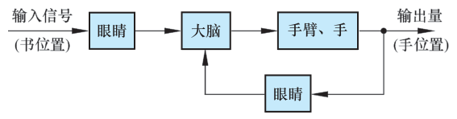{ .lq-img }

*图 1-1 人取书的反馈控制系统方框图（截自原书）*

#### 反馈、负反馈与闭环

从图 1-1 提炼三个定义：

- **反馈**（feedback）：取出输出量送回到输入端，并与输入信号相比较产生偏差信号的过程。
- **负反馈**（negative feedback）：输入信号与反馈信号**相减**，使产生的偏差越来越小；反之（相加、偏差越来越大）为**正反馈**（positive feedback）。
- **闭环控制**（closed-loop control）：由于引入了被控量的反馈信息，整个控制过程成为闭合过程，因此反馈控制也称闭环控制。

反馈控制就是**采用负反馈并利用偏差进行控制**的过程。

!!! note "拓展：正反馈不是“错误”，但控制回路里多半是灾难（补充）"
    正反馈在放大电路（振荡器）里是有意为之，但在控制回路里，正反馈意味着偏差越滚越大、系统失控。现场调试中“电机一上电就飞转、越调越猛”，第一件事就是查反馈极性是否接反（本该相减的两路信号接成了相加）。本课程后面所有方框图上比较元件的“−”号都代表这件事。

#### 工程实现：龙门刨床速度控制系统

工程上要实现反馈控制，系统中必须配置具有人的眼睛、大脑和手臂功能的设备，对被控量进行**连续的测量、反馈和比较**，并按偏差进行控制。这些设备依功能分别称为**测量元件、比较元件和执行元件**，统称为控制装置。

工业实例——**龙门刨床速度控制系统**：刨床加工表面不平整的毛坯时负载波动很大，但为保证加工精度和表面光洁度，不允许刨床速度变化过大，必须对速度进行闭环控制。

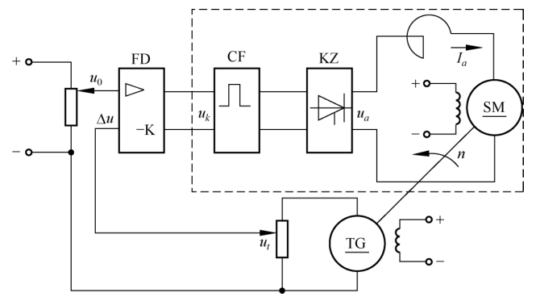{ .lq-img }

*图 1-2 龙门刨床速度控制系统原理图（截自原书）*

各部件的角色（对照图 1-2）：

| 部件 | 书中代号 | 功能角色 |
| --- | --- | --- |
| 主电动机（电枢控制直流电动机） | SM | **被控对象**，其转速即被控量 |
| 触发器 + 晶闸管整流装置 | CF + KZ | 提供/调节电枢电压 \(u_a\)，起执行控制动作的作用 → **执行元件** |
| 测速发电机 | TG | 测量刨床速度，给出与速度成正比的电压 \(u_t\) → **测量元件** |
| 给定电位器 | —— | 预先设置速度给定电压 \(u_0\) → **给定元件** |
| 放大器 | FD | 放大偏差电压 → **放大元件** |

工作原理：测速发电机电压 \(u_t\) 反馈到输入端，与给定电压 \(u_0\) **反向串联**，得到偏差电压

\[
\Delta u = u_0 - u_t
\]

\(u_0\) 是根据刨床工作情况预先设置的速度给定电压，与 \(u_t\) 相减形成偏差电压，因此 \(u_t\) 称为**负反馈电压**。偏差电压一般很微弱，须经放大器 FD 放大后才能作为触发器的控制电压 \(u_k\)。

#### 控制过程逐拍分析

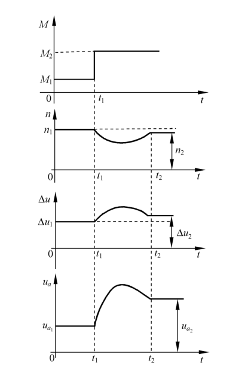{ .lq-img }

*图 1-3 龙门刨床速度自动控制过程（截自原书）*

正常工作时，某给定电压 \(u_0\) 对应确定的速度给定值 \(n\)，以及相应的 \(u_t\)、\(\Delta u\)、\(u_k\)。以负载突增为例（图 1-3 中 \(t_1\) 时刻负载由 \(M_1\) 突增为 \(M_2\)）：

1. 负载增大 → 电动机速度由给定值 \(n_1\) 急剧下降；
2. 速度下降 → 测速电压 \(u_t\) 相应减小；
3. \(u_t\) 减小 → 偏差电压 \(\Delta u = u_0 - u_t\) 增大；
4. \(\Delta u\) 增大 → 触发器控制电压 \(u_k\) 增大 → 晶闸管整流电压 \(u_a\) 升高；
5. \(u_a\) 升高 → 速度逐步回升，\(t_2\) 时回升到 \(n_2\)，与 \(n_1\) 已相差无几。

负载减小使速度上升时，各电压量反向变化，回落过程完全一样。另外，**调整给定电压 \(u_0\) 便可改变刨床工作速度**。所以这套系统既能在不同负载下自动维持速度不变，也能按需要自动改变速度，原理相同。

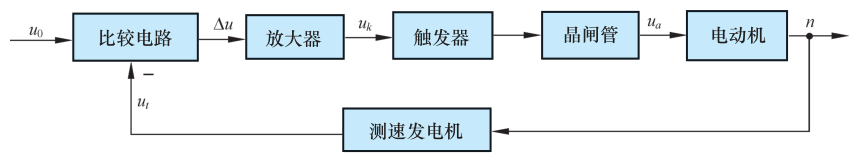{ .lq-img }

*图 1-4 龙门刨床速度控制系统方框图（截自原书）*

#### 有静差系统：稳态误差从哪来

图 1-2 的刨床速度控制系统是一个**有静差系统**。由图 1-3 可见，速度最终达到的稳态值 \(n_2\) 与原给定速度 \(n_1\) 之间**始终有一个差值**存在——这个差值正是用来产生一个附加的电动机电枢电压、以补偿因增加负载而引起的速度下降的。因此**差值的存在是保证系统正常工作所必需的**，一般称为**稳态误差**（steady-state error）。如果从结构上加以改进，这个稳态误差是可以消除的（第 3 章 3.6 节“减小稳态误差的措施”会兑现这句话）。

!!! note "拓展：为什么比例控制“天生”有静差（补充）"
    直觉版解释：这套系统里放大器、触发器、整流装置都近似比例环节，而电动机带负载需要一定的电枢电压。这个电压从哪来？只能从偏差 \(\Delta u\) 放大而来——**没有偏差就没有输出**。所以“稳态残差”不是故障，是比例控制的结构性代价。要让稳态误差归零，需要在结构里加积分环节（积分环节“累积”偏差，零偏差时仍能保持输出），这是第 3 章的内容，这里先埋个伏笔。

#### 方框图的画法约定

图 1-4 是与图 1-2 对应的方框图。画方框图（也称方块图）有四条约定：

1. 被控对象和控制装置的各元部件（硬件）分别用**方框**表示；
2. 系统中感兴趣的物理量（信号）——电流、电压、温度、位置、速度、压力等——标志在**信号线**上，流向用**箭头**表示；
3. 进入方框的箭头是该元部件的**输入量**，离开方框的箭头是**输出量**；
4. **被控对象的输出量 = 系统输出量（被控量），一般置于方框图的最右端；系统输入量一般置于最左端**。

### 反馈控制系统的组成

从完成“自动控制”这一功能看，一个系统必然包含**被控对象**和**控制装置**两大部分。不同系统中结构完全不同的元部件却可以有相同的功能，因此按**功能**分类，控制装置由以下元件组成：

| 元件 | 功能 | 实例 |
| --- | --- | --- |
| 给定元件 | 给出与期望的被控量相对应的系统输入量 | 图 1-2 中给出电压 \(u_0\) 的电位器 |
| 测量元件 | 检测被控制的物理量；非电量一般要转换为电量 | 测速发电机（转速→电压）；电位器、旋转变压器或自整角机（角度→电压）；热电偶（温度→电压） |
| 比较元件 | 把给定输入量与被控量实际值进行比较，求出偏差 | 差动放大器、机械差动装置、电桥电路；图 1-2 中 \(u_0\) 与 \(u_t\) 直流电压直接反向串联 |
| 放大元件 | 将偏差信号放大，推动执行元件 | 集成电路、晶闸管等组成的电压放大级和功率放大级 |
| 执行元件 | 直接推动被控对象，使被控量发生变化 | 阀、电动机、液压马达等 |
| 校正元件（补偿元件） | 结构或参数便于调整的元部件，以串联或反馈方式接入系统，改善系统性能 | 最简单的是电阻、电容组成的无源/有源网络，复杂的用电子计算机 |

一个典型的反馈控制系统组成如图 1-5。图中“○”代表比较元件，“−”号表示输入量与反馈量符号相反（负反馈），“+”号表示符号相同（正反馈）。

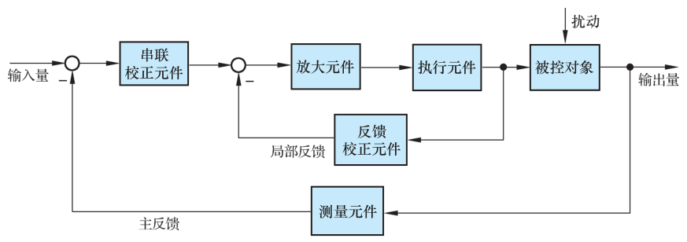{ .lq-img }

*图 1-5 典型反馈控制系统方框图（截自原书）*

几个通路名词：

- **前向通路**：信号从输入端沿箭头方向到达输出端的传输通路；
- **主反馈通路**：系统输出量经测量元件反馈到输入端的传输通路；
- **主回路**：前向通路与主反馈通路共同构成；
- **局部反馈通路 / 内回路**：局部反馈通路及其构成的回路（图 1-5 中反馈校正元件所在的回路；1.2 节函数记录仪里的测速反馈也是局部反馈）；
- 只包含一个主反馈通路的系统称**单回路系统**；有两个或两个以上反馈通路的系统称**多回路系统**。

#### 有用输入与扰动

加到反馈控制系统上的外作用有两种类型：

- **有用输入**：决定系统被控量的变化规律；
- **扰动**（disturbance）：系统不希望有的外作用，破坏有用输入对系统的控制。

扰动**总是不可避免的**，可以作用于系统中的任何元部件上，也可能几种扰动同时作用。电源电压的波动，环境温度、压力以及负载的变化，飞行中气流的冲击，航海中的波浪等，都是现实中存在的扰动。图 1-2 的速度控制系统中，**切削工件外形及切削量的变化就是一种扰动**——它直接影响电动机的负载转矩，进而引起刨床速度变化。

### 自动控制系统基本控制方式

反馈控制是自动控制系统**最基本、应用最广泛**的控制方式；除此之外还有开环控制方式和复合控制方式。近几十年，以现代数学为基础、引入电子计算机的新控制方式（最优控制、自适应控制、模糊控制等）也有了很大发展。

#### (1) 反馈控制方式

按偏差进行控制。特点：**不论什么原因**使被控量偏离期望值而出现偏差时，必定产生一个相应的控制作用去减小或消除这个偏差，使被控量与期望值趋于一致。因此反馈控制系统具有**抑制任何内、外扰动对被控量产生影响的能力，控制精度较高**。自动控制理论主要的研究对象就是这种控制方式组成的系统。

#### (2) 开环控制方式

**开环控制**（open-loop control）：控制装置与被控对象之间**只有顺向作用而没有反向联系**；系统输出量不会对系统的控制作用发生影响。开环系统可以按给定量控制方式组成，也可以按扰动控制方式组成。

**按给定量控制的开环控制**：控制作用直接由系统输入量产生，给定一个输入量就有一个输出量与之对应，**控制精度完全取决于元件及校准的精度**。图 1-2 中若只考虑虚线框内的部件（触发器 CF、晶闸管整流装置与电动机 SM），便是一个按给定量控制的开环系统：期望速度事先通过调节 \(u_k\) 确定，工作中即使速度偏离期望值，也不会反过来影响 \(u_k\)。它**没有自动修正偏差的能力、抗扰动性较差**，但**结构简单、调整方便、成本低**，在精度要求不高或扰动影响较小的场合仍有实用价值。自动售货机、自动洗衣机、产品自动生产线、数控车床以及指挥交通的红绿灯转换等，一般都是开环控制系统。

**按扰动控制的开环控制（顺馈控制）**：利用**可测量的扰动量**，产生一种补偿作用，以减小或抵消扰动对输出量的影响，也称**顺馈控制**（feedforward control）。例如直流速度系统中转速随负载增加而下降，其下降源于电枢回路电压降；若把负载引起的电流变化测量出来，按其大小产生一个附加控制作用去补偿转速下降，就构成按扰动控制的开环系统，如图 1-6 所示。

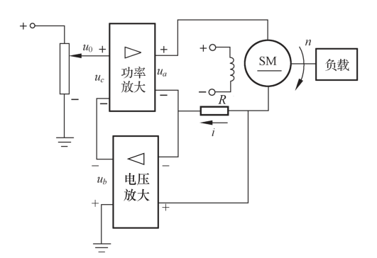{ .lq-img }

*图 1-6 按扰动控制的速度控制系统原理图（截自原书）*

这种方式**直接从扰动取得信息**并据以改变被控量，抗扰动性好、控制精度也较高，但**只适用于扰动可测量的场合**。

#### (3) 复合控制方式

按扰动控制在技术上较按偏差控制简单，但只适用于扰动可测量的场合，而且**一个补偿装置只能补偿一种扰动因素**，对其余扰动均不起补偿作用。比较合理的做法是把两者结合起来：对**主要扰动**采用适当的补偿装置实现按扰动控制，同时组成反馈控制系统实现按偏差控制、消除其余扰动产生的偏差。主要扰动已被补偿后，反馈系统就比较容易设计，控制效果更好。这种**按偏差控制 + 按扰动控制**相结合的方式称为**复合控制**（compound control）。

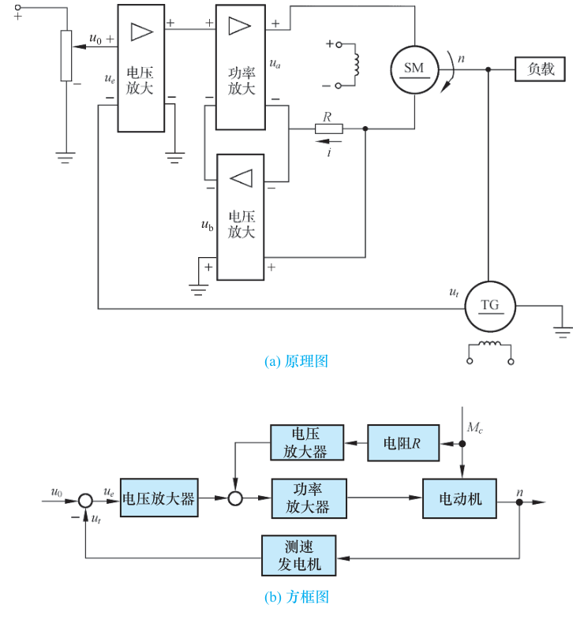{ .lq-img }

*图 1-7 电动机速度复合控制系统：(a) 原理图；(b) 方框图（截自原书）*

图 1-7 的复合系统里，\(u_0\) 经比较后走“电压放大器 → 功率放大器 → 电动机”的反馈主通道（按偏差控制），同时负载电流在电阻 \(R\) 上的压降 \(u_b\) 经电压放大器送入功率放大器输入端（按扰动补偿），转速 \(n\) 由测速发电机 \(u_t\) 闭环反馈。

## 1.2 自动控制系统示例

本节三个实例代表了三种典型场景：随动系统（函数记录仪）、计算机数字控制（电阻炉温控）、工业过程控制（锅炉液位）。读每个实例的固定动作：**先找被控对象 → 被控量 → 给定量 → 扰动 → 测量/比较/执行的信号路径**，再对照方框图。

### 函数记录仪

函数记录仪是一种通用的自动记录仪，可以在直角坐标上**自动描绘两个电量的函数关系**；带上走纸机构后，可以描绘**一个电量对时间的函数关系**。

组成：衰减器、测量元件、放大元件、**伺服电动机-测速机组**、齿轮系及绳轮，采用负反馈控制原理工作。

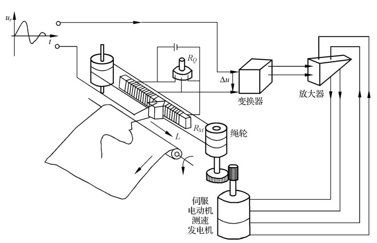{ .lq-img }

*图 1-8 函数记录仪原理示意图（截自原书）*

工作原理（对照图 1-8）：

1. 测量元件是由电位器 \(R_Q\) 和 \(R_M\) 组成的**桥式测量电路**，记录笔固定在电位器 \(R_M\) 的滑臂上，因此测量电路输出电压 \(u_p\) 与记录笔位移成正比；
2. 慢变输入电压 \(u_r\) 到来时，放大元件输入口得到偏差电压 \(\Delta u = u_r - u_p\)；
3. \(\Delta u\) 经放大后驱动伺服电动机，通过齿轮系及绳轮带动记录笔移动，**同时使偏差电压减小**；
4. \(\Delta u = 0\) 时电动机停转、记录笔静止，此时 \(u_p = u_r\)，记录笔位移与输入电压相对应；
5. 输入电压随时间连续变化时，记录笔便描绘出连续变化的曲线。

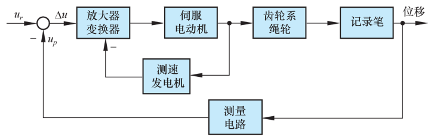{ .lq-img }

*图 1-9 函数记录仪方框图（截自原书）*

图 1-9 里有两层反馈：**测速发电机**反馈与电动机速度成正比的电压，用以**增加阻尼、改善系统性能**（局部反馈/内回路）；**测量电路**把记录笔位移送回输入端比较（主反馈/外回路）——这是一个典型的多回路系统。

| 要素 | 函数记录仪 |
| --- | --- |
| 被控对象 | 记录笔（经齿轮系、绳轮驱动） |
| 被控量（输出量） | 记录笔位移 |
| 给定量（输入量） | 待记录电压 \(u_r\)（随时间任意变化） |
| 主反馈 | 桥式测量电路输出 \(u_p \propto\) 记录笔位移 |
| 局部反馈 | 测速发电机电压 ∝ 电动机速度（增加阻尼） |
| 扰动 | 书中未点名具体扰动；随动系统中扰动影响是次要的（见 1.3 节），分析重点是跟随的快速性和准确性 |

### 电阻炉微型计算机温度控制系统

用于工业炉温控制的微型计算机控制系统，具有精度高、功能强、经济性好、无噪声、显示醒目、读数直观、打印存档方便、操作简单、灵活性和适应性好等一系列优点。

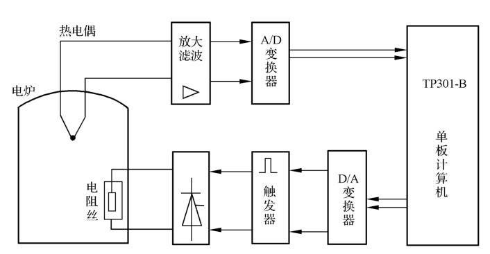{ .lq-img }

*图 1-10 电阻炉温度微机控制系统示意图（截自原书）*

工作原理（对照图 1-10，信号绕一圈）：

1. **加热**：电阻丝通过晶闸管主电路加热；
2. **给定**：炉温期望值用计算机键盘预先设置；
3. **测量**：炉温实际值由**热电偶**检测并转换成电压，经放大、滤波后，由 **A/D 变换器**把模拟量变成数字量送入计算机；
4. **比较与运算**：计算机把实测值与期望值比较产生偏差信号，根据预定的**控制算法**（即控制规律）计算出控制量；
5. **执行**：控制量经 **D/A 变换器**变换成电流，通过触发器控制**晶闸管导通角**，改变电阻丝中电流大小，达到控制炉温的目的。

除精确温度控制外，系统还有实时屏幕显示、打印功能，以及超温、极值和电阻丝、热电偶损坏**报警**等功能。1.3 节将引用它作为**线性离散控制系统**的典型例子——计算机里的信号是数码形式，时间上离散。

| 要素 | 电阻炉微机温控系统 |
| --- | --- |
| 被控对象 | 电阻炉（电阻丝加热） |
| 被控量（输出量） | 炉温 |
| 给定量 | 键盘预先设置的温度期望值 |
| 控制器 | 计算机（数字控制算法） |
| 测量元件 | 热电偶（温度→电压）+ 放大滤波 + A/D |
| 执行元件 | 触发器 + 晶闸管主电路（导通角→电流） |
| 扰动 | 书中未具体指名；凡使炉温偏离期望值的外作用（如电源电压波动、环境温度变化、被加热物吸热）都属扰动，与 1.1 节扰动的普遍说法一致 |

### 锅炉液位控制系统

锅炉是电厂和化工厂里常见的生产蒸汽的设备。液位**过低**易烧干锅而发生严重事故；液位**过高**易使蒸汽带水并有溢出危险。因此必须通过调节器严格控制锅炉液位，保证锅炉正常安全运行。

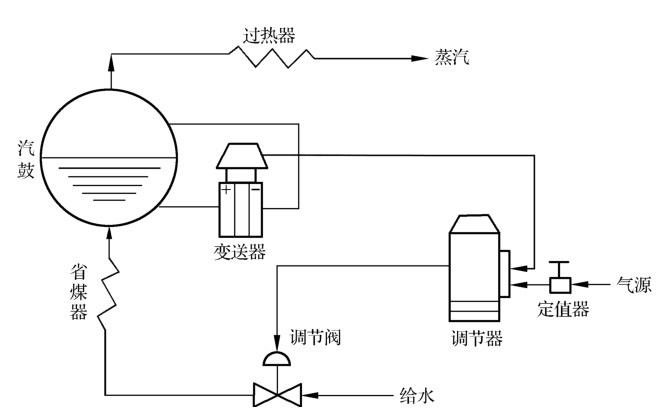{ .lq-img }

*图 1-11 锅炉液位控制系统示意图（截自原书）*

工作原理：蒸汽耗汽量与锅炉进水量相等时，液位保持为正常标准值。两种典型扰动——给水量不变而**蒸汽负荷突然增减**时液位下降/上升；蒸汽负荷不变而**给水管道水压变化**时液位也变化。不论哪种情况，只要实际液位与给定液位之间出现偏差，调节器都应立即控制，**开大或关小给水阀门**，使液位恢复到给定值。

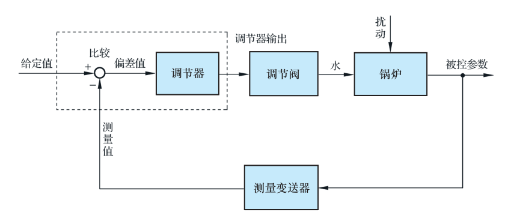{ .lq-img }

*图 1-12 锅炉液位控制系统方框图（截自原书）*

方框图各环节（图 1-12）：锅炉为被控对象，输出即被控参数液位；作用于锅炉的扰动是给水压力变化或蒸汽负荷变化等内外扰动；**测量变送器**为差压变送器，测量液位并转变为信号输至调节器；**调节器**是控制器（有电动、气动等形式），在调节器内将测量液位与给定液位比较得出偏差，按一定控制律——比例（P）、比例-积分（PI）、比例-积分-微分（PID）等——发出输出信号推动调节阀；**调节阀**起执行元件作用，根据控制信号调节锅炉进水量。

关于调节阀的两条工程知识（原书正文）：

- 阀门运动取决于阀门特性：有的阀门与输入信号呈正比变化，有的呈某种曲线关系变化。大多数调节阀为**气动薄膜调节阀**；若采用电动调节器，调节器与气动调节阀之间应有**电-气转换器**。
- 气动阀门分**气开**与**气关**两种：气开阀指调节器输出增加时阀门开大；气关阀指输出增加时阀门反而关小。为保证安全生产，蒸汽锅炉的给水调节阀一般采用**气关阀**——一旦断气，阀门保持打开位置，保证汽鼓不致烧干损坏。

| 要素 | 锅炉液位控制系统 |
| --- | --- |
| 被控对象 | 锅炉（汽鼓） |
| 被控量（被控参数） | 锅炉液位 |
| 给定量 | 正常标准液位（给定液位） |
| 测量元件 | 差压变送器（测量变送器） |
| 控制器 | 调节器（电动/气动，控制律 P / PI / PID） |
| 执行元件 | 给水调节阀（气动薄膜阀，气关式；电动调节器需电-气转换器） |
| 扰动 | 给水压力变化、蒸汽负荷变化（书中明确指出的内外扰动） |

!!! note "拓展：气开 / 气关的选择逻辑是“安全侧”设计（补充）"
    选气开还是气关，不问“正常时该开还是该关”，只问“**气源断了的那一刻，阀门停在哪个位置最安全**”。锅炉给水：断气→阀全开→锅炉不会被烧干，所以选气关。这一“失效-安全”（fail-safe）思想在过程控制里是通用套路：先找事故工况，再反推阀门失气（失电）时的默认位置。

## 1.3 自动控制系统的分类

自动控制系统有多种分类方法：

| 分类视角 | 类别 |
| --- | --- |
| 按控制方式 | 开环控制、闭环控制、复合控制等 |
| 按元件类型 | 机械系统、电气系统、机电系统、液压系统、气动系统等 |
| 按系统功用 | 温度控制系统、压力控制系统、位置控制系统等 |
| 按系统特性 | 线性系统和非线性系统、连续系统和离散系统、定常系统和时变系统、确定性系统和不确定性系统等 |
| 按输入量变化规律 | 恒值控制系统、随动系统和程序控制系统等 |

为全面反映系统特点，常将上述各种分类方法**组合应用**。下面展开书里重点讲的两类。

### 按系统特性分类

#### (1) 线性连续控制系统

可以用**线性微分方程**描述，一般形式为

\[
a_0\frac{\mathrm{d}^n}{\mathrm{d}t^n}c(t) + a_1\frac{\mathrm{d}^{n-1}}{\mathrm{d}t^{n-1}}c(t) + \cdots + a_{n-1}\frac{\mathrm{d}}{\mathrm{d}t}c(t) + a_n c(t)
= b_0\frac{\mathrm{d}^m}{\mathrm{d}t^m}r(t) + b_1\frac{\mathrm{d}^{m-1}}{\mathrm{d}t^{m-1}}r(t) + \cdots + b_{m-1}\frac{\mathrm{d}}{\mathrm{d}t}r(t) + b_m r(t)
\]

式中 \(c(t)\) 是被控量，\(r(t)\) 是系统输入量。系数 \(a_0, a_1, \cdots, a_n\)，\(b_0, b_1, \cdots, b_m\) 是**常数**时，称为**定常系统**；系数**随时间变化**时，称为**时变系统**。

#### (2) 线性离散控制系统

离散系统指系统的某处或多处的信号为**脉冲序列或数码形式**，信号在时间上是离散的。连续信号经过采样开关的**采样**就可以转换成离散信号。一般离散系统中既有连续的模拟信号，也有离散的数字信号，因此要用**差分方程**描述，线性差分方程的一般形式为

\[
a_0 c(k+n) + a_1 c(k+n-1) + \cdots + a_{n-1} c(k+1) + a_n c(k)
= b_0 r(k+m) + b_1 r(k+m-1) + \cdots + b_{m-1} r(k+1) + b_m r(k)
\]

式中 \(m \le n\)，\(n\) 为差分方程的次数；\(a_0, a_1, \cdots, a_n\)，\(b_0, b_1, \cdots, b_m\) 为系数；\(r(k)\)、\(c(k)\) 分别为输入和输出采样序列。工业计算机控制系统就是典型的离散系统——如 1.2 节的炉温微机控制系统。

#### (3) 非线性控制系统

系统中**只要有一个**元部件的输入-输出特性是非线性的，就称为**非线性控制系统**，要用非线性微分（或差分）方程描述。非线性方程的特点：**系数与变量有关**，或者方程中**含有变量及其导数的高次幂或乘积项**，例如

\[
\ddot{y}(t) + y(t)\dot{y}(t) + y^2(t) = r(t)
\]

严格地说，实际物理系统中都含有程度不同的非线性元部件：放大器和电磁元件的**饱和**特性，运动部件的**死区、间隙和摩擦**特性等。由于非线性方程数学处理上较困难，目前对不同类型的非线性控制系统的研究还没有统一的方法；但对**非线性程度不太严重**的元部件，可在一定范围内**线性化**，从而将非线性控制系统近似为线性化控制系统。

!!! note "拓展：“不太严重”怎么量化——小偏差法的直觉（补充）"
    线性化的通行做法是在工作点附近把非线性特性按泰勒级数展开、只取一次项，前提是信号只在**小范围**内偏离工作点。这也叫小偏差法，第 2 章 2-2 节会用一个完整实例（铁心线圈/液压阀类）把它推出来。这里先记住判据：偏离工作点越小，线性化越可信；大范围摆动时线性模型会失真。

### 按输入量变化规律分类

#### (1) 恒值控制系统

输入量是一个**常值**，要求被控量亦等于一个常值，故又称为**调节器**（regulator）。由于扰动的影响，被控量会偏离输入量出现偏差，控制系统便根据偏差产生控制作用，克服扰动影响、使被控量恢复到给定常值。因此恒值控制系统分析、设计的**重点是研究各种扰动对被控对象的影响以及抗扰动的措施**。

输入量可以随生成条件的变化而改变，但一经调整后，被控量就应与调整好的输入量保持一致。图 1-2 刨床速度控制系统就是一种恒值控制系统（输入量 \(u_0\) 是常值）。此外还有温度、压力、液位控制系统等。工业控制中，被控量是温度、流量、压力、液位等**生产过程参量**的控制系统称为**过程控制系统**（process control system），它们大多数属于恒值控制系统。

#### (2) 随动系统

输入量是**预先未知的、随时间任意变化**的函数，要求被控量以尽可能小的误差跟随输入量变化，故又称为**跟踪系统**。随动系统中扰动的影响是**次要**的，分析、设计的**重点是研究被控量跟随的快速性和准确性**。1.2 节的函数记录仪便是典型的随动系统。

在随动系统中，如果被控量是**机械位置或其导数**，这类系统称为**伺服系统**（servo system）。

#### (3) 程序控制系统

输入量是**按预定规律随时间变化**的函数，要求被控量迅速、准确地加以复现。机械加工使用的数字程序控制机床便是一例。

三者关系一句话：程序控制系统和随动系统的输入量都是时间函数，不同之处在于**前者是已知的时间函数，后者是未知的任意时间函数**；而**恒值控制系统可视为程序控制系统的特例**（输入“函数”是常值）。

!!! note "拓展：三类系统共用一把尺子（补充）"
    三类的差别本质上是“给定量由谁决定”：人定死（恒值）、已知函数（程序）、未知函数（随动）。设计侧重不同——恒值重**抗扰**，随动/程序重**跟踪**。但第 3 章会看到，动态性能指标统一用“阶跃响应”衡量，稳态误差按输入类型分别算——一套指标体系覆盖三类系统。

## 1.4 自动控制系统的基本要求

### 基本要求的提法

尽管系统类型不同、各有特殊要求，但共同的问题是：已知系统的结构和参数时，研究系统在**某种典型输入信号**下，被控量变化的**全过程**——恒值控制系统研究扰动作用引起被控量变化的全过程；随动系统研究被控量克服扰动影响并跟随输入量变化的全过程。对被控量变化全过程的共同基本要求归结为三条：**稳定性、快速性和准确性**，即**稳、快、准**。

#### (1) 稳定性

稳定性是**保证控制系统正常工作的先决条件**。稳定的控制系统，被控量偏离期望值的初始偏差应随时间的增长逐渐减小并趋于零：

- 稳定的恒值控制系统：被控量因扰动偏离期望值后，经过一个过渡过程，应恢复到原来的期望值状态；
- 稳定的随动系统：被控量应能始终跟踪输入量的变化。

反之，不稳定系统的初始偏差将随时间增长而发散，无法完成预定的控制任务。**线性自动控制系统的稳定性由系统结构和参数所决定，与外界因素无关。**

为什么会有过渡过程？控制系统中一般含有**储能元件或惯性元件**——绕组的电感、电枢转动惯量、电炉热容量、物体质量等——储能元件的能量不可能突变，因此控制过程不会立即完成，有一定延缓，被控量恢复期望值或跟踪输入量就有一个时间过程，称为**过渡过程**（transient process）。

振荡是这样形成的：被控对象的惯性使控制动作**不能瞬时**纠正偏差；控制装置的惯性使偏差信号不能**及时完全**转化为控制动作。于是——被控量已回到期望值、偏差为零时，执行机构因惯性仍继续向原方向动作，使被控量超过期望值、产生符号相反的偏差，执行机构又向反方向动作；控制动作已到位时，被控对象又因惯性偏差尚未归零，执行机构继续原方向运动，再次产生反号偏差。如此反复，被控量在期望值附近来回波动，过渡过程呈**振荡**形式。振荡**逐渐减弱**、系统最后达到平衡状态 → **稳定系统**；振荡**逐步增强**、被控量失控 → **不稳定系统**。

#### (2) 快速性

仅满足稳定性不够，还必须对过渡过程的**形式和快慢**提出要求，一般称为**动态性能**。两个例子：稳定的高射炮射角随动系统，炮身最终能跟踪目标，但若目标变动迅速而炮身过渡过程时间过长，就不可能击中目标；函数记录仪记录输入电压时，记录笔移动很慢或摆动幅度过大，不仅记录曲线失真，还会损坏记录笔或使电器元件承受过电压。因此，对过渡过程的**时间（快速性）**和**最大振荡幅度（超调量）**一般都有具体要求。

#### (3) 准确性

理想情况下，过渡过程结束后，被控量达到的稳态值（平衡状态）应与期望值一致。实际上，由于系统结构、外作用形式、摩擦和间隙等非线性因素的影响，稳态值与期望值之间会有误差存在，称为**稳态误差**（steady-state error）。稳态误差是衡量控制系统**控制精度**的重要标志，技术指标中一般都有具体要求。

!!! note "拓展：稳、快、准 与第 3 章性能指标的一一对应（补充）"
    | 基本要求 | 本章含义 | 第 3 章的量化指标 |
    | --- | --- | --- |
    | 稳 | 振荡衰减、偏差收敛 | 闭环极点全在 s 左半平面；劳斯判据判稳（3.5 节） |
    | 快 | 过渡过程时间短、振荡幅度小 | 上升时间 \(t_r\)、峰值时间 \(t_p\)、调节时间 \(t_s\)、超调量 \(\sigma\%\)（3.1 节定义，一阶/二阶系统算例在 3.2/3.3 节） |
    | 准 | 稳态值贴合期望值 | 稳态误差 \(e_{ss}\)、静态误差系数 \(K_p, K_v, K_a\)（3.6 节） |

    次序不能颠倒：**稳**是先决条件，不稳的系统谈快、准没有意义。

### 典型外作用

工程中控制系统承受的外作用形式多种多样，既有**确定性**外作用，又有**随机性**外作用。为了便于用**统一的方法**研究和比较控制系统性能，通常选用几种确定性函数作为**典型外作用**。可选作典型外作用的函数应具备三个条件：

1. 这种函数在现场或实验室中**容易实现**；
2. 控制系统在这种函数作用下的性能应**代表**实际工作条件下的性能；
3. 这种函数的数学表达式**简单**，便于理论计算。

控制工程设计中常用的典型外作用函数有**阶跃函数、斜坡函数、脉冲函数以及正弦函数**等确定性函数，此外还有**伪随机函数**。

#### (1) 阶跃函数

\[
f(t) =
\begin{cases}
0, & t < 0 \\
R, & t \ge 0
\end{cases}
\tag{1.1}
\]

式 (1.1) 表示 \(t=0\) 时出现的幅值为 \(R\) 的阶跃变化函数，如图 1-13 所示——\(t=0\) 时突然加到系统上的一个幅值不变的外作用。幅值 \(R=1\) 的阶跃函数称**单位阶跃函数**，用 \(1(t)\) 表示；幅值为 \(R\) 的阶跃函数写作 \(f(t) = R\cdot 1(t)\)；在任意时刻 \(t_0\) 出现的阶跃函数写作 \(f(t-t_0) = R\cdot 1(t-t_0)\)。

阶跃函数是实际工作条件下经常遇到的外作用：电源电压突然跳动、负载突然增大或减小、飞机飞行中遇到的常值阵风扰动等，都可视为阶跃外作用。**一般将阶跃函数作用下系统的响应特性作为评价系统动态性能指标的依据**。

#### (2) 斜坡函数

\[
f(t) =
\begin{cases}
0, & t < 0 \\
Rt, & t \ge 0
\end{cases}
\tag{1.2}
\]

式 (1.2) 表示 \(t=0\) 时刻开始、以恒定速率 \(R\) 随时间变化的函数，如图 1-14 所示。某些随动系统常工作于这种外作用下：雷达-高射炮防空系统中，雷达跟踪的目标以恒定速率飞行时，系统就可视为工作在斜坡函数作用下。

#### (3) 脉冲函数

\[
f(t) = \lim_{t_0 \to 0} \frac{A}{t_0}\left[1(t) - 1(t - t_0)\right]
\tag{1.3}
\]

式中 \(\dfrac{A}{t_0}[1(t) - 1(t - t_0)]\) 是由两个阶跃函数合成的**脉动函数**，其面积 \(A = (A/t_0)\, t_0\)，如图 1-15(a) 所示。当宽度 \(t_0\) 趋于零时，脉动函数的极限便是**脉冲函数**——一个宽度为零、幅值为无穷大、面积为 \(A\) 的极限脉冲，如图 1-15(b) 所示。脉冲函数的**强度通常用其面积表示**：面积 \(A=1\) 的脉冲函数称为**单位脉冲函数**或 **\(\delta\) 函数**；强度为 \(A\) 的脉冲函数写作 \(f(t) = A\delta(t)\)；在 \(t_0\) 时刻出现的单位脉冲函数写作 \(\delta(t - t_0)\)。

必须指出：脉冲函数在现实中**不存在**，只有数学上的定义，但它是一个重要而有效的数学工具。任意形式的外作用都可以分解成不同时刻的一系列脉冲函数之和——通过研究系统在脉冲函数作用下的响应特性，便可了解在任意形式外作用下的响应特性。

#### (4) 正弦函数

\[
f(t) = A\sin(\omega t - \varphi)
\tag{1.4}
\]

式中 \(A\) 为振幅；\(\omega = 2\pi f\) 为角频率；\(\varphi\) 为初始相角。很多实际随动系统经常工作在正弦外作用下：舰船的消摆系统、稳定平台的随动系统等，就处于形如正弦函数的波浪下工作。更重要的是，系统在正弦函数作用下的响应——**频率响应**——是研究控制系统频域性能的重要依据（详见第五章）。

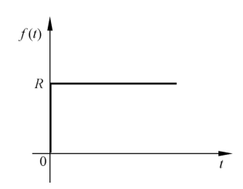{ .lq-img }

*图 1-13 阶跃函数特性（截自原书）*

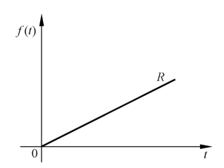{ .lq-img }

*图 1-14 斜坡函数特性（截自原书）*

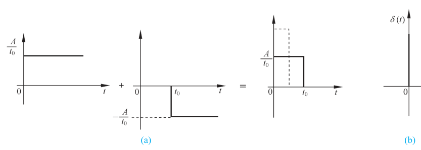{ .lq-img }

*图 1-15 脉动函数和脉冲函数特性：(a) 脉动函数的合成；(b) 极限脉冲（截自原书）*

!!! note "拓展：δ 函数的“强度”是面积不是幅值（补充）"
    \(\delta(t)\) 的幅值在数学上是无穷大，能用数字表达且有物理意义的只有它的面积（强度）。写 \(A\delta(t)\) 时，\(A\) 是强度；拉氏变换 \(\mathcal{L}[\delta(t)] = 1\)、\(\mathcal{L}[A\delta(t)] = A\)，第 2 章拉氏变换表里会用到。顺带一提：四种典型外作用正好对应后面各章的分析手段——阶跃/斜坡/脉冲对应时域法（第 3 章），正弦对应频域法（第 5 章）。

## 1.5 自动控制系统的分析与设计工具

对自动控制系统进行分析与设计，除了掌握基本的分析设计方法外，比较复杂的系统还需要借助软件工具。目前常用的软件工具有 MATLAB、Python 等。本书将结合控制系统分析和设计实例，用 MATLAB 或 Python 给出仿真方法和结果——本笔记同步给“MATLAB / Python 双 tab”对照，**Python 代码全部实跑验证**。

### MATLAB 工具

MATLAB（matrix laboratory，矩阵实验室）是一种科学与工程计算语言，广泛应用于自动控制、数学运算、信号分析、计算机技术、航空航天等领域。特点：语言简单易用、代码高效、功能丰富、出色的图形处理和系统仿真功能；配套**图形交互式仿真环境 Simulink**。

与控制系统相关的工具箱有：控制系统工具箱（control system toolbox）、系统辨识工具箱（system identification toolbox）、鲁棒控制工具箱（robust control toolbox）、模糊逻辑工具箱（fuzzy logic toolbox）、优化工具箱（optimization toolbox）等。本书主要使用**控制系统工具箱**，它对 LTI（线性时不变）系统的建模、分析和设计提供完整方案：

- **系统建模**：建立连续或离散系统的状态空间表达式、传递函数、零极点增益模型，并实现任意两者之间的转换；通过串联、并联、反馈连接及更一般的框图连接建立复杂系统的模型；以多种方式实现连续时间系统的离散化、离散时间系统的连续化及多重采样。
- **系统分析**：支持连续和离散系统、SISO 和 MIMO 系统。时域：单位脉冲响应、单位阶跃响应、零输入响应及一般任意输入响应的仿真；频域：Bode 图、Nichols 图、Nyquist 图的计算和绘制。另有框图式操作界面工具 **LTI 观测器**，支持对 10 种不同类型的系统进行响应分析。
- **系统设计**：计算系统各种特性——可控和可观 Gramian 矩阵、可控性/可观测性矩阵、传递零极点、Lyapunov 方程、稳定裕度、阻尼系数、根轨迹的增益选择等；支持可控/可观标准型实现、最小实现、均衡实现、降阶实现以及输入延时的 Pade 设计；可进行极点配置、观测器设计以及 LQ 和 LQG 最优控制。另提供框图式操作界面 **SISO 系统设计工具**，用于单输入单输出反馈控制系统的补偿器校正设计。

!!! warning "原书笔误（表 1-1 及正文）"
    1. 正文“可控和可观 **Gramain** 矩阵”应为 **Gramian** 矩阵（格拉姆矩阵）；
    2. 表 1-1 中“**ploy** 求矩阵的特征多项式”应为 **poly**；
    3. 表 1-1 中命令 `i` 的说明栏原书只印“−1”，按文意应为**虚数单位** \(\sqrt{-1}\)（与 `j` 行相同）。

书内给出的控制系统设计常用命令索引如表 1-1（完整转录，供查阅；命令的用法会在后续各章代码里逐个见到）。

??? note "表 1-1 MATLAB 常用命令索引（完整）"
    | 函数名 | 功能说明 |
    | --- | --- |
    | abs | 求绝对值或复数幅值 |
    | acker | SISO 系统的极点配置 |
    | acos | 计算反余弦 |
    | angle | 计算相角 |
    | ans | 为表达式而创建的缺省变量 |
    | asin | 计算反正弦 |
    | atan | 计算反正切 |
    | axis | 设定坐标轴的范围 |
    | bode | 生成 Bode 频率响应图 |
    | break | 中断循环执行语句 |
    | c2d | 将连续系统变换成离散系统 |
    | care | 求解代数黎卡提方程 |
    | clc | 清除命令窗口显示 |
    | clear | 删除内存中的变量和函数 |
    | clf | 清除当前图形窗口 |
    | collect | 符号计算中同类项合并 |
    | conj | 求共轭复数 |
    | conv | 多项式相乘或卷积 |
    | cos | 计算余弦 |
    | ctrb | 计算可控性矩阵 |
    | ctrbf | 对系统进行可控性分解 |
    | d2c | 将离散系统变换成连续系统 |
    | deconv | 多项式相除或逆卷积 |
    | det | 计算矩阵的行列式 |
    | diag | 建立对角矩阵或获取对角元素 |
    | diff | 差分函数或近似微分 |
    | dlyap | 求解离散系统的李雅普诺夫方程 |
    | eig | 计算矩阵的特征值和特征向量 |
    | else | 与 if 一起使用的转移语句 |
    | elseif | 条件转移语句 |
    | end | 结束控制语句 |
    | exp | 计算以 e 为底的指数函数 |
    | expm | 计算以 e 为底的矩阵指数函数 |
    | eye | 生成单位矩阵 |
    | feedback | 两个系统的反馈连接 |
    | figure | 创建图形窗口 |
    | for | 循环控制语句 |
    | format | 设置输出格式 |
    | global | 定义全局变量 |
    | grid | 在图形上加网格线 |
    | gtext | 在鼠标指定的位置添加说明 |
    | help | 打开帮助主题的清单 |
    | hold off | 取消当前图形保持，与 hold on 相对应 |
    | hold on | 当前图形保持，与 hold off 相对应 |
    | i | 虚数单位 \(\sqrt{-1}\)（原书印作“−1”） |
    | if | 条件转移语句 |
    | ilaplace | 拉普拉斯反变换，与 laplace 相对应 |
    | imag | 计算复数虚部 |
    | impulse | 计算系统的单位脉冲响应 |
    | initial | 计算系统的零输入响应 |
    | inv | 求矩阵的逆 |
    | iztrans | z 反变换，与 ztrans 相对应 |
    | j | 虚数单位 |
    | laplace | 拉普拉斯变换，与 ilaplace 相对应 |
    | limit | 计算极限值 |
    | log | 求自然对数 |
    | log10 | 求常用对数 |
    | loglog | 全对数坐标图形绘制 |
    | lsim | 计算系统在任意输入和初始条件下的时间响应 |
    | lyap | 求解连续系统的李雅普诺夫方程 |
    | margin | 从频率响应中求幅值裕度、相角裕度及其对应的截止频率、穿越频率 |
    | max | 求向量中的最大元素 |
    | mesh | 三维网格图形绘制 |
    | min | 求向量中的最小元素 |
    | minreal | 求系统的最小实现或零极点对消后的传递函数 |
    | NaN | 不定式表示 |
    | norm | 计算矩阵的范数 |
    | nyquist | 绘制 Nyquist 图 |
    | obsv | 计算可观测性矩阵 |
    | obsvf | 对系统进行可观测性分解 |
    | ode23 | 微分方程低阶数值解法 |
    | ode45 | 微分方程高阶数值解法 |
    | ones | 生成元素全部为 1 的矩阵 |
    | parallel | 两个系统的并联连接 |
    | pi | 圆周率 |
    | place | MIMO 系统的极点配置 |
    | plot | 绘制线性坐标图形 |
    | poly | 求矩阵的特征多项式（原书误印为 ploy） |
    | prod | 对向量中各元素求积 |
    | pzmap | 绘制线性系统的零极点图 |
    | quad | 低阶法计算数值积分 |
    | quad8 | 高阶法计算数值积分 |
    | rank | 求矩阵的秩 |
    | real | 计算复数实部 |
    | rem | 求除法的余数 |
    | residue | 部分分式展开 |
    | rlocfind | 由根轨迹的一组根确定相应的增益 |
    | rlocus | 计算根轨迹 |
    | roots | 求多项式的根 |
    | semilogx | 绘制 x 轴半对数坐标图形 |
    | semilogy | 绘制 y 轴半对数坐标图形 |
    | series | 两个系统的串联连接 |
    | sign | 符号函数 |
    | sin | 计算正弦 |
    | size | 查询矩阵的维数 |
    | solve | 求解代数方程 |
    | sqrt | 计算平方根 |
    | ss | 系统的状态空间描述 |
    | ss2ss | 状态空间的相似变换 |
    | ss2tf | 将状态空间形式转变为传递函数形式 |
    | step | 计算系统的单位阶跃响应 |
    | subplot | 将图形窗口分割为若干子窗口 |
    | sum | 对向量中各元素求和 |
    | syms | 创建符号对象 |
    | tan | 计算正切 |
    | text | 在图形上添加文字说明 |
    | tf | 系统的传递函数描述 |
    | tf2ss | 将传递函数形式转变为状态空间形式 |
    | tf2zp | 将传递函数模型转换成零极点模型 |
    | title | 在当前图形中添加标题 |
    | trace | 求矩阵的迹 |
    | tzero | 求传递零点 |
    | while | 循环控制语句 |
    | xlabel | 在图形上添加 x 坐标说明 |
    | ylabel | 在图形上添加 y 坐标说明 |
    | zeros | 生成零矩阵 |
    | zp2tf | 将零极点模型转换成传递函数模型 |
    | zpk | 系统的零极点描述 |
    | ztrans | z 变换，与 iztrans 相对应 |

### Python 工具

Python 是 20 世纪 90 年代初诞生的一种编程语言，提供高效的高级数据结构，能简单有效地面向对象编程；特点是简单易学、免费开源、扩展性强、算法资源库丰富，在人工智能、科学计算和统计、网络开发等领域应用广泛，在自动控制与人工智能结合等领域前景广阔。

Python 进行控制系统仿真常用以下模块：

| 模块 | 全称 | 定位 |
| --- | --- | --- |
| NumPy | numerical python | 科学计算基础包：数值计算、统计处理和信号处理，支持数组与矩阵运算，提供矩阵、线性代数、傅里叶变换等方案，是 Python 数据分析的基础 |
| SciPy | scientific python | 数值计算算法扩展包：统计、优化、整合、线性代数、傅里叶变换、信号和图像处理、常微分方程求解器等，其中含控制系统分析和设计相关函数；依赖 NumPy |
| SymPy | symbol python | 符号计算库：多项式求值、求极限、解方程、求积分、微分方程、级数展开、矩阵运算等 |
| Matplotlib | —— | 数据绘图包：静态、动画和交互式可视化，提供与 MATLAB 相似的命令 API（线图、散点图、等高线图、条形图、柱状图、3D 图形等） |
| python-control | control | 反馈控制系统分析和设计专用库：状态空间和频域中的线性输入/输出系统、结构图变换、时间响应、频率响应、控制分析、控制设计、估计器设计等 |

### 第一个仿真：一阶系统的阶跃响应

约定俗成，每个工具链学的第一行代码都是画阶跃响应。取最简单的一阶系统

\[
G(s) = \frac{1}{2s + 1}\quad (T = 2\ \mathrm{s})
\]

画它的单位阶跃响应曲线，并检查一阶系统的三个特征点：\(t = T\) 处响应到达终值的 63.2%，\(3T\) 处到达 95%，\(4T\) 处到达 98.2%（这些数字在第 3 章 3.2 节会从解析式推出来，这里先眼见为实）。

=== "MATLAB"

    ```matlab
    % ===== 书 1-5 节 =====
    % 第一个仿真：一阶系统 G(s) = 1/(2s+1) 的单位阶跃响应
    G = tf(1, [2 1]);      % 传递函数：分子 [1]，分母 [2 1]（s 的降幂排列），T = 2 s
    step(G);               % 单位阶跃响应
    grid on;
    title('Unit-step response of G(s) = 1/(2s+1)');
    % 读图：t = 2 s 处 y = 0.632，t = 6 s 处 y = 0.95，t = 8 s 处 y = 0.982
    ```

=== "Python"

    ```python
    # ===== 书 1-5 节 =====
    # 第一个仿真：一阶系统 G(s) = 1/(2s+1) 的单位阶跃响应
    # 实跑输出（python-control 0.10.2）：
    #   t =  2 s  ->  y = 0.632  (63.2%)
    #   t =  4 s  ->  y = 0.865  (86.5%)
    #   t =  6 s  ->  y = 0.950  (95.0%)
    #   t =  8 s  ->  y = 0.982  (98.2%)
    import numpy as np
    import control as ct
    import matplotlib.pyplot as plt

    G = ct.tf([1], [2, 1])            # 传递函数：分子 [1]，分母 [2, 1]
    print('G(s) =', G)

    t, y = ct.step_response(G, np.linspace(0, 10, 201))   # 单位阶跃响应
    for k in (1, 2, 3, 4):            # 一阶系统特征点：t = kT
        v = np.interp(2 * k, t, y)
        print(f't = {2*k:2d} s  ->  y = {v:.3f}  ({v*100:.1f}%)')

    fig, ax = plt.subplots(figsize=(6, 3.5))
    ax.plot(t, y, linewidth=1.5)
    ax.axvline(2, linestyle='--', linewidth=0.8)          # 标出 t = T = 2 s
    ax.annotate('63.2%', xy=(2, 0.632), xytext=(2.6, 0.45),
                arrowprops=dict(arrowstyle='->'))
    ax.set_xlabel('Time (s)')
    ax.set_ylabel('y(t)')
    ax.set_title('Unit-step response of G(s) = 1/(2s+1)')
    ax.grid(True)
    fig.tight_layout()
    plt.show()
    ```

读这段代码要抓住三个对应关系：`tf(分子, 分母)` 的系数都按 \(s\) 的**降幂**排列，所以 \(2s+1\) 写成 `[2 1]` 而不是 `[1 2]`；`step`（Python 为 `ct.step_response`）返回时间数组和响应数组，画出来就是图 1-13 那种输入下的输出全过程；打印的四个数就是“稳、快、准”里“快”的雏形——响应多快逼近终值 1。

!!! note "拓展：调节时间的工程口径 3T / 4T（补充）"
    一阶系统进入并保持在终值 \(\pm 5\%\) 误差带内需要 \(3T\)，进入 \(\pm 2\%\) 误差带需要 \(4T\)——上例 \(T = 2\ \mathrm{s}\)，即约 6 s / 8 s，与打印输出吻合。“调节时间”（settling time）的正式定义在 3.1 节。

## 坑与陷阱

!!! danger "8 个容易踩的坑"
    1. **反馈 ≠ 负反馈**：正反馈也是“反馈”（相加），但控制回路里正反馈让偏差越滚越大。“反馈控制”专指负反馈 + 按偏差控制；现场“越调越振”多半是反馈极性接反。
    2. **开环系统对扰动“无动于衷”**：按给定量控制的开环系统里，输出偏了也不会反过来影响控制作用，没有自动修正偏差的能力——自动售货机类的开环装置精度全靠元件质量和校准。
    3. **顺馈补偿有边界**：按扰动控制只适用于**可测量**的扰动，且一个补偿装置只能补偿**一种**扰动因素；其余扰动还得靠反馈兜底。这正是复合控制存在的理由。
    4. **有静差系统的稳态误差是“设计内”的**：图 1-2 刨床系统的稳态残差用来产生附加电枢电压补偿负载，是系统正常工作的必要条件；想消除它要从结构上改（加积分作用，3.6 节），不是把放大器增益拧大就行。
    5. **方框图的方位约定别画反**：被控量（输出）在最右端，输入在最左端；比较元件的“−”号代表负反馈，漏画一个负号，系统性质全变。
    6. **分类是按“输入量变化规律”，不是按元件或有无扰动**：同一套硬件换个给定方式就换类——图 1-2 接上测速反馈是恒值控制系统，只看虚线框内就是开环系统；恒值系统还是程序控制系统的特例。
    7. **稳字当头**：稳定性是先决条件；而且线性系统的稳定性只由**结构和参数**决定，与输入大小、外界因素无关——不能用“输入小一点就稳了”来搪塞不稳定系统。
    8. **δ 函数只有数学定义**：脉冲函数现实中不存在，强度用面积 \(A\) 表示而不是幅值；它好用是因为任意输入都能分解成脉冲串，脉冲响应就是系统的“指纹”。

## 速览

1. 自动控制 = 没有人直接参与，用控制装置使被控对象的被控量自动按预定规律运行；三要素：控制装置、被控对象、被控量。
2. 反馈控制原理一条主线：测量被控量 → 与给定值比较得偏差 → 放大后驱动执行机构修正被控量，直到偏差消除；按偏差控制 = 负反馈 = 闭环控制。
3. 控制装置按功能分六类元件：给定、测量、比较、放大、执行、校正（补偿）。
4. 三种基本控制方式：反馈（按偏差，抗一切内外扰动，精度高）、开环（按给定量，结构简单成本低但无自动修正；按扰动=顺馈，只补可测扰动）、复合（偏差+扰动，主要扰动先补掉）。
5. 三个实例的辨析主线：函数记录仪（被控量=记录笔位移，随动系统，测速局部反馈增阻尼）；电阻炉微机温控（被控量=炉温，数字控制器+A/D、D/A+晶闸管）；锅炉液位（被控量=液位，差压变送器+P/PI/PID 调节器+气关式调节阀）。
6. 按系统特性分：线性连续（微分方程）、线性离散（差分方程，如计算机控制系统）、非线性（含高次幂/乘积项或变系数，程度轻的可线性化）；系数为常数→定常，随时间变→时变。
7. 按输入量变化规律分：恒值（调节器，重抗扰）、随动（跟踪系统，重跟随快而准；被控量为机械位置→伺服系统）、程序（输入为已知时间函数）。
8. 基本要求稳快准：稳=先决条件（线性系统只由结构参数决定）；快=动态性能（过渡过程时间+超调量）；准=稳态误差（控制精度标志）。
9. 典型外作用：阶跃 \(R\cdot 1(t)\)（评价动态性能的依据）、斜坡 \(Rt\)（恒速跟踪）、脉冲 \(A\delta(t)\)（强度=面积，任意输入的分解基元）、正弦 \(A\sin(\omega t - \varphi)\)（频域分析的入口）。
10. 工具链：MATLAB（控制系统工具箱：建模/分析/设计 + Simulink）；Python（NumPy + SciPy + SymPy + Matplotlib + python-control）。一阶系统 \(G=1/(2s+1)\) 阶跃特征点：\(t=T\)→63.2%，\(3T\)→95%，\(4T\)→98.2%。

## 术语速查

| 英文 | 中文 | 一句话 |
| --- | --- | --- |
| automatic control | 自动控制 | 无人直接参与，控制装置让被控量按预定规律运行 |
| controlled object / plant | 被控对象 | 被控制的机器、设备或生产过程 |
| controlled variable | 被控量 | 要求严格加以控制的物理量，系统输出量 |
| controller | 控制装置（控制器） | 对被控对象施加控制作用的机构总体 |
| feedback | 反馈 | 取出输出量送回输入端并比较产生偏差信号 |
| negative feedback | 负反馈 | 输入与反馈相减，偏差越来越小 |
| closed-loop control | 闭环控制 | 带反馈、控制过程闭合的反馈控制 |
| open-loop control | 开环控制 | 只有顺向作用没有反向联系，输出不影响控制作用 |
| feedforward control | 顺馈控制 | 按可测扰动产生补偿作用的开环控制 |
| compound control | 复合控制 | 按偏差 + 按扰动相结合的控制方式 |
| disturbance | 扰动 | 不希望有的外作用，破坏有用输入的控制 |
| command / given element | 给定元件 | 给出与期望被控量对应的系统输入量 |
| measuring element | 测量元件 | 检测被控量，非电量一般转换为电量 |
| comparing element | 比较元件 | 求给定值与被控量实际值之偏差 |
| amplifying element | 放大元件 | 放大偏差信号以推动执行元件 |
| actuating element | 执行元件 | 直接推动被控对象（阀、电动机、液压马达等） |
| correcting / compensating element | 校正元件（补偿元件） | 串联或反馈接入，改善系统性能 |
| steady-state error | 稳态误差 | 过渡过程结束后被控量稳态值与期望值之差 |
| regulator | 调节器 | 恒值控制系统的别称（输入量为常值） |
| servo system | 伺服系统 | 被控量为机械位置或其导数的随动系统 |
| process control system | 过程控制系统 | 被控量为温度、流量、压力、液位等生产过程参量 |
| step function | 阶跃函数 | \(R\cdot 1(t)\)，\(t=0\) 突加幅值 \(R\)，动态性能的评价基准 |
| ramp function | 斜坡函数 | \(Rt\)，恒定速率变化，恒速跟踪场景 |
| impulse function / Dirac delta | 脉冲函数 / δ 函数 | 宽度为零、幅值无穷、面积（强度）为 \(A\) 的极限脉冲 |
| sinusoidal function | 正弦函数 | \(A\sin(\omega t-\varphi)\)，频率响应分析的外作用 |

## 覆盖自查

??? note "原书小节 → 笔记位置"
    | 原书小节/内容 | 笔记位置 |
    | --- | --- |
    | 1-1 自动控制的基本原理（1. 自动控制技术及其应用；2. 自动控制理论；3. 反馈控制原理：人取书/图 1-1/龙门刨床图 1-2～1-4/有静差系统；4. 反馈控制系统的组成：六类元件/图 1-5/有用输入与扰动；5. 基本控制方式：反馈/开环（图 1-6）/复合（图 1-7）） | 1.1 |
    | 1-2 自动控制系统示例（1. 函数记录仪：图 1-8、1-9；2. 电阻炉微型计算机温度控制：图 1-10；3. 锅炉液位控制：图 1-11、1-12，气开/气关阀） | 1.2（各实例附被控量/给定量/扰动辨析表） |
    | 1-3 自动控制系统的分类（按系统特性：线性连续微分方程/线性离散差分方程/非线性；按输入量变化规律：恒值/随动/程序） | 1.3 |
    | 1-4 自动控制系统的基本要求（1. 基本要求的提法：稳定性/快速性/准确性；2. 典型外作用：阶跃 (1-1)/斜坡 (1-2)/脉冲 (1-3)/正弦 (1-4)，图 1-13～1-15） | 1.4 |
    | 1-5 自动控制系统的分析与设计工具（1. MATLAB：控制系统工具箱三大功能、表 1-1 命令索引；2. Python：NumPy/SciPy/SymPy/Matplotlib/python-control） | 1.5（表 1-1 完整转录于折叠块；首个双 tab 仿真：一阶系统阶跃响应，Python 已实跑验证） |
    | 习题（图 1-16～1-21） | 未展开；对应内容见下表 |

??? note "习题 → 笔记位置（习题本身不展开，图与知识点已覆盖）"
    | 习题 | 内容 | 涉及知识点 → 笔记位置 |
    | --- | --- | --- |
    | 1-1 | 液位自动控制系统（图 1-16）工作原理与方框图 | 反馈控制原理 + 方框图画法 → 1.1；锅炉液位同类 → 1.2 |
    | 1-2 | 仓库大门自动开闭控制系统（图 1-17） | 电动执行 + 位置反馈 → 1.1（测量/执行元件）、伺服系统 → 1.3 |
    | 1-3 | 自动调压系统（图 1-18）：无差系统 vs 有差系统 | 有静差/无静差概念 → 1.1（有静差系统）；稳态误差 → 1.4、3.6 |
    | 1-4 | 水温控制系统（图 1-19）：温度控制 + 按流量顺馈 | 复合控制（顺馈补偿）→ 1.1 基本控制方式 (2)(3) |
    | 1-5 | 电炉温度控制系统（图 1-20）：被控对象/被控量/各部件作用/方框图 | 与 1.2 电阻炉微机温控同构 → 1.2 辨析表 |
    | 1-6 | 谷物湿度控制系统（图 1-21）：湿度顺馈 + 反馈 | 复合控制 → 1.1；湿度顺馈对应图 1-6、图 1-7 |
    | 1-7 | 六个微分方程判别线性定常/时变/非线性 | 按系统特性分类 → 1.3（线性微分方程一般形式、时变系数、高次幂与乘积项判据） |
