# 第 2 章 控制系统的数学模型

> **本章解决**：第 1 章说清了"控制系统是什么、要什么"，这一章回答"怎么把它写成数学"。核心链条：物理系统 → 微分方程（时域）→ 拉普拉斯变换 → 传递函数（复数域）→ 结构图/信号流图（图形化）→ 化简求闭环传递函数。有了传递函数，第 3 章的时域分析（稳定性、动态性能、稳态误差）和第 5、6 章的频率法、根轨迹法才有操作对象。全章的数学地基是 2-1 节的傅里叶变换与拉普拉斯变换——重点掌握性质表、部分分式反变换和"微分方程 ↔ 传递函数"的互换，最后用 MATLAB/Python 把建模仿成流水线。

## 2.0 本章导图

<div class="brtree">
  <div class="brrow">
    <span class="brlabel root">控制系统的数学模型</span>
    <span class="brace"></span>
    <div class="brkids">
      <div class="brrow">
        <span class="brlabel">傅氏级数与傅氏变换（2-1）</span>
        <span class="brace"></span>
        <div class="brkids">
          <span class="brleaf">狄利克雷条件与三角/复数级数</span>
          <span class="brleaf">对称性简化（表 2-1）</span>
          <span class="brleaf">方波展开：A/2 + (2A/π)cos 系</span>
          <span class="brleaf">T→∞：傅里叶积分与变换对</span>
          <span class="brleaf">方波频谱 2A·sin(aω)/ω</span>
        </div>
      </div>
      <div class="brrow">
        <span class="brlabel">拉普拉斯变换（2-1）</span>
        <span class="brace"></span>
        <div class="brkids">
          <span class="brleaf">收敛因子 e^{-σt} 引出 LT 定义</span>
          <span class="brleaf">0⁻ 型与 0⁺ 型下限</span>
          <span class="brleaf">八大定理（含证明思路）</span>
          <span class="brleaf">性质表 2-2 / 变换表 2-3</span>
          <span class="brleaf">部分分式法：单根与重根</span>
        </div>
      </div>
      <div class="brrow">
        <span class="brlabel">时域模型（2-2）</span>
        <span class="brace"></span>
        <div class="brkids">
          <span class="brleaf">RLC / 电动机 / 弹簧质量 / 齿轮系</span>
          <span class="brleaf">列写三步：定变量→物理定律→消中间变量</span>
          <span class="brleaf">系统级联：速度控制系统全流程</span>
          <span class="brleaf">相似系统与叠加原理</span>
          <span class="brleaf">拉氏变换法解微分方程</span>
          <span class="brleaf">小偏差线性化（泰勒展开）</span>
        </div>
      </div>
      <div class="brrow">
        <span class="brlabel">复数域模型（2-3）</span>
        <span class="brace"></span>
        <div class="brkids">
          <span class="brleaf">传递函数定义与四条性质</span>
          <span class="brleaf">零点、极点、K* 与 K</span>
          <span class="brleaf">极点定模态、零点调比重</span>
          <span class="brleaf">电位器 / 测速机 / 伺服电动机</span>
          <span class="brleaf">无源网络 / 水槽 / 加热炉</span>
          <span class="brleaf">负载效应</span>
        </div>
      </div>
      <div class="brrow">
        <span class="brlabel">结构图与信号流图（2-4）</span>
        <span class="brace"></span>
        <div class="brkids">
          <span class="brleaf">四种基本单元</span>
          <span class="brleaf">串/并/反馈等效 + 移点规则（表 2-4）</span>
          <span class="brleaf">节点、支路、回路、不接触回路</span>
          <span class="brleaf">梅森增益公式与克拉默法则推导</span>
          <span class="brleaf">双摆系统全流程演练</span>
          <span class="brleaf">四种闭环传递函数共用一个 Δ</span>
        </div>
      </div>
      <div class="brrow">
        <span class="brlabel">仿真建模（2-5）</span>
        <span class="brace"></span>
        <div class="brkids">
          <span class="brleaf">tf / zpk / conv 三种描述</span>
          <span class="brleaf">tf2zp ↔ zp2tf 模型转换</span>
          <span class="brleaf">parallel / series / feedback 连接</span>
          <span class="brleaf">多回路系统化简实例</span>
        </div>
      </div>
    </div>
  </div>
</div>

## 2.1 傅里叶变换与拉普拉斯变换

傅氏变换和拉氏变换是求解线性常微分方程的简便工具，也是建立复数域和频率域数学模型——传递函数和频率特性——的数学基础。两者有内在联系：傅氏变换对函数要求高（绝对可积等），有些函数根本变不了；拉氏变换条件宽松，工程上应用更广。本节路线：傅氏级数 →（周期 T→∞）傅氏积分/傅氏变换 →（乘收敛因子）拉氏变换。

### 2.1.1 傅里叶级数

周期为 \(T\) 的任一周期函数 \(f(t)\)，若满足**狄利克雷**（Dirichlet）条件：

1. 在一个周期内只有有限个不连续点；
2. 在一个周期内只有有限个极大值和极小值；
3. 积分 \(\displaystyle\int_{-T/2}^{T/2} \vert f(t)\vert\,\mathrm{d}t\) 存在；

则可展开为傅氏级数：

\[
f(t) = \frac{1}{2}a_0 + \sum_{n=1}^{\infty}(a_n\cos n\omega t + b_n\sin n\omega t)
\tag{2.1}
\]

系数由下式给出：

\[
a_n = \frac{2}{T}\int_{-T/2}^{T/2} f(t)\cos n\omega t\,\mathrm{d}t, \qquad n = 0, 1, 2, \cdots
\tag{2.2}
\]

\[
b_n = \frac{2}{T}\int_{-T/2}^{T/2} f(t)\sin n\omega t\,\mathrm{d}t, \qquad n = 1, 2, \cdots
\tag{2.3}
\]

式中 \(\omega = 2\pi/T\) 称为角频率。傅氏级数还有复数（指数）形式：

\[
f(t) = \sum_{n=-\infty}^{\infty} a_n \mathrm{e}^{\mathrm{j}n\omega t}
\tag{2.4}
\]

\[
a_n = \frac{1}{T}\int_{-T/2}^{T/2} f(t)\mathrm{e}^{-\mathrm{j}n\omega t}\,\mathrm{d}t
\tag{2.5}
\]

（式 2.4、2.5 可由式 2.1 用欧拉公式 \(\cos\theta = (\mathrm{e}^{\mathrm{j}\theta}+\mathrm{e}^{-\mathrm{j}\theta})/2\)、\(\sin\theta = (\mathrm{e}^{\mathrm{j}\theta}-\mathrm{e}^{-\mathrm{j}\theta})/(2\mathrm{j})\) 合并同频项直接得到。）

若 \(f(t)\) 具有对称性质（偶函数、奇函数、只有奇次或偶次谐波），级数中某些项自动为零，系数公式简化。**表 2-1** 是速查。

**表 2-1 周期函数 \(f(t)\) 的对称性质（原表重排）**

| 函数 | 对称性 | 傅氏级数特点 | \(a_n\) | \(b_n\) |
| --- | --- | --- | --- | --- |
| \(f_1(t)\) | 偶函数 \(f_1(t) = f_1(-t)\) | 只有余弦项 | \(\dfrac{4}{T}\displaystyle\int_0^{T/2} f_1(t)\cos n\omega t\,\mathrm{d}t\) | \(0\) |
| \(f_2(t)\) | 奇函数 \(f_2(t) = -f_2(-t)\) | 只有正弦项 | \(0\) | \(\dfrac{4}{T}\displaystyle\int_0^{T/2} f_2(t)\sin n\omega t\,\mathrm{d}t\) |
| \(f_3(t)\) | 只有偶次谐波 \(f_3\!\left(t\pm\dfrac{T}{2}\right) = f_3(t)\) | 只有偶数 \(n\) | \(\dfrac{4}{T}\displaystyle\int_0^{T/2} f_3(t)\cos n\omega t\,\mathrm{d}t\) | \(\dfrac{4}{T}\displaystyle\int_0^{T/2} f_3(t)\sin n\omega t\,\mathrm{d}t\) |
| \(f_4(t)\) | 只有奇次谐波 \(f_4\!\left(t\pm\dfrac{T}{2}\right) = -f_4(t)\) | 只有奇数 \(n\) | \(\dfrac{4}{T}\displaystyle\int_0^{T/2} f_4(t)\cos n\omega t\,\mathrm{d}t\) | \(\dfrac{4}{T}\displaystyle\int_0^{T/2} f_4(t)\sin n\omega t\,\mathrm{d}t\) |

**【例 2-1】周期方波的傅氏级数展开**

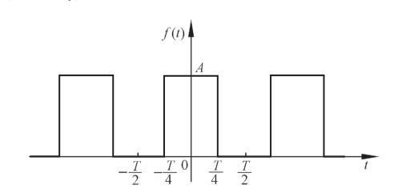{ .lq-img }

*图 2.1 周期方波特性（截自原书）*

方波在一个周期内的表达式：

\[
f(t) = \begin{cases} 0, & -\dfrac{T}{2} < t < -\dfrac{T}{4} \\[2pt] A, & -\dfrac{T}{4} < t < \dfrac{T}{4} \\[2pt] 0, & \dfrac{T}{4} < t < \dfrac{T}{2} \end{cases}
\]

\(f(t) = f(-t)\) 为偶函数，只需算 \(a_n\)。由表 2-1：

\[
a_n = \frac{4}{T}\int_0^{T/4} f(t)\cos n\omega t\,\mathrm{d}t = \frac{4}{T}\int_0^{T/4} A\cos n\omega t\,\mathrm{d}t = \frac{2A}{n\pi}\sin\frac{n\pi}{2}
\]

依次取 \(n = 0, 1, 2, 3, \cdots\)：\(a_0 = A\)（对 \(n=0\) 用洛必达法则取极限 \(\dfrac{2A}{n\pi}\sin\dfrac{n\pi}{2} \to A\)），\(a_1 = \dfrac{2A}{\pi}\)，\(a_2 = 0\)，\(a_3 = -\dfrac{2A}{3\pi}\)，\(a_4 = 0\)，\(a_5 = \dfrac{2A}{5\pi}\)，……。由式 (2.1)：

\[
f(t) = \frac{A}{2} + \frac{2A}{\pi}\left(\cos\omega t - \frac{1}{3}\cos 3\omega t + \frac{1}{5}\cos 5\omega t - \cdots\right)
\]

方波可以分解为直流分量加各次谐波；反过来，用不同频率的谐波合成可以得到方波。

### 2.1.2 傅里叶积分与傅里叶变换

非周期函数不能直接用傅氏级数——它的周期 \(T \to \infty\)、角频率 \(\omega_0 = 2\pi/T \to 0\)。把 \(f(t)\) 看成 \(T\to\infty\) 的周期函数：相邻谐波频率之差 \(\Delta\omega = \omega_0\) 变得无穷小，离散频率 \(n\omega_0\) 换成连续变量 \(\omega\)，式 (2.4)、(2.5) 改写为

\[
f(t) = \sum_{\omega}\mathrm{e}^{\mathrm{j}\omega t}a_{\omega}
\tag{2.6}
\]

\[
a_{\omega} = \frac{\Delta\omega}{2\pi}\int_{-T/2}^{T/2} f(t)\mathrm{e}^{-\mathrm{j}\omega t}\,\mathrm{d}t
\tag{2.7}
\]

将式 (2.7) 代入式 (2.6)、令 \(T\to\infty\)（\(\Delta\omega\to\mathrm{d}\omega\)，求和变积分），得**傅里叶积分**：

\[
f(t) = \frac{1}{2\pi}\int_{-\infty}^{\infty}\left[\int_{-\infty}^{\infty} f(t)\mathrm{e}^{-\mathrm{j}\omega t}\,\mathrm{d}t\right]\mathrm{e}^{\mathrm{j}\omega t}\,\mathrm{d}\omega
\tag{2.8}
\]

令内层积分为

\[
F(\omega) = \int_{-\infty}^{\infty} f(t)\mathrm{e}^{-\mathrm{j}\omega t}\,\mathrm{d}t
\tag{2.9}
\]

则式 (2.8) 变为

\[
f(t) = \frac{1}{2\pi}\int_{-\infty}^{\infty} F(\omega)\mathrm{e}^{\mathrm{j}\omega t}\,\mathrm{d}\omega
\tag{2.10}
\]

式 (2.9)、(2.10) 称为**傅氏变换对**：\(F(\omega) = \mathscr{F}[f(t)]\) 是 \(f(t)\) 的傅氏变换，\(f(t) = \mathscr{F}^{-1}[F(\omega)]\) 是反变换。非周期函数能做傅氏变换的条件仍是狄利克雷条件，只是第三条要改为 \(\displaystyle\int_{-\infty}^{\infty}\vert f(t)\vert\,\mathrm{d}t\) 存在（绝对可积）。

**【例 2-2】方波的傅氏变换**

原书图 2.2 的方波（幅值 \(A\)、半宽 \(a\)，只在 \(\vert t\vert < a\) 内非零）不是周期函数。由式 (2.9)：

\[
F(\omega) = \int_{-a}^{a} A\mathrm{e}^{-\mathrm{j}\omega t}\,\mathrm{d}t = \left.\frac{A}{-\mathrm{j}\omega}\mathrm{e}^{-\mathrm{j}\omega t}\right|_{-a}^{a} = \frac{2A\sin a\omega}{\omega}
\]

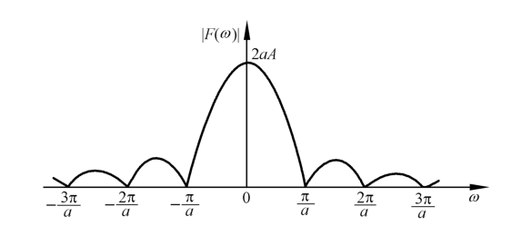{ .lq-img }

*图 2.3 方波的频谱特性 \(\vert F(\omega)\vert = 2A\vert\sin a\omega/\omega\vert\)（截自原书）*

频谱函数的模 \(\vert F(\omega)\vert\) 称为频谱（特性）。方波频谱是采样函数形状：能量集中在 \(\omega = 0\) 附近的主瓣，旁瓣按 \(1/\omega\) 衰减，过零点在 \(\omega = \pm\pi/a, \pm2\pi/a, \cdots\)。

傅氏方法的价值：任何周期函数可展开为许多正弦/余弦分量之和，任何非周期函数可表示为傅氏积分——时间域函数由此变换为频率域函数。研究输入为非正弦函数的线性系统时，可以用系统对各种频率正弦波的响应特性去了解系统对非正弦输入的响应。**频率域分析方法就建立在这个基础之上**（第 5 章）。

### 2.1.3 拉普拉斯变换

工程中常用的阶跃函数不满足绝对可积条件，做不了傅氏变换。例如单位阶跃 \(f(t) = 1(t)\)：

\[
F(\omega) = \int_0^{\infty}\mathrm{e}^{-\mathrm{j}\omega t}\,\mathrm{d}t = \left.\frac{\mathrm{e}^{-\mathrm{j}\omega t}}{-\mathrm{j}\omega}\right|_0^{\infty}
\]

上限处 \(\mathrm{e}^{-\mathrm{j}\omega t}\) 振荡不衰减，\(F(\omega)\) 算不出来。

**收敛因子**解决问题。用指数衰减函数 \(\mathrm{e}^{-\sigma t}1(t)\)（\(\sigma > 0\)）代替 \(1(t)\)：当 \(\sigma \to 0\) 时它趋于 \(1(t)\)，而 \(\mathrm{e}^{-\sigma t}\) 的衰减让积分收敛。它的傅氏变换：

\[
F_\sigma(\omega) = \int_0^{\infty} \mathrm{e}^{-\sigma t}\,\mathrm{e}^{-\mathrm{j}\omega t}\,\mathrm{d}t = \frac{1}{\sigma + \mathrm{j}\omega}
\]

这就是**单边广义傅里叶变换**。对一般 \(f(t)\)（设 \(t<0\) 时 \(f(t) = 0\)——总可以把外作用加上的瞬间选为 \(t=0\)，之前的行为放进初始条件），乘以收敛因子后研究 \(f(t)\mathrm{e}^{-\sigma t}\)：

\[
F_\sigma(\omega) = \int_0^{\infty} f(t)\mathrm{e}^{-(\sigma+\mathrm{j}\omega)t}\,\mathrm{d}t
\]

令 \(s = \sigma + \mathrm{j}\omega\)，得**拉普拉斯变换**：

\[
F(s) = \int_0^{\infty} f(t)\mathrm{e}^{-st}\,\mathrm{d}t
\tag{2.11}
\]

\(F_\sigma(\omega)\) 的傅氏反变换由式 (2.10)：

\[
f(t)\mathrm{e}^{-\sigma t} = \frac{1}{2\pi}\int_{-\infty}^{\infty} F_\sigma(\omega)\mathrm{e}^{\mathrm{j}\omega t}\,\mathrm{d}\omega
\]

两边乘 \(\mathrm{e}^{\sigma t}\)，以 \(\mathrm{d}\omega = \mathrm{d}s/\mathrm{j}\) 换元（\(\sigma\) 固定，\(\omega\) 从 \(-\infty\) 到 \(+\infty\) 对应 \(s\) 沿 \(\sigma + \mathrm{j}\omega\) 直线变化），得**拉普拉斯反变换**：

\[
f(t) = \frac{1}{2\pi\mathrm{j}}\int_{\sigma-\mathrm{j}\infty}^{\sigma+\mathrm{j}\infty} F(s)\mathrm{e}^{st}\,\mathrm{d}s
\tag{2.12}
\]

式 (2.11)、(2.12) 称为**拉氏变换对**。\(F(s)\) 称为 \(f(t)\) 的拉氏变换，也称**象函数**，记 \(F(s) = \mathscr{L}[f(t)]\)；\(f(t)\) 称为 \(F(s)\) 的拉氏反变换，也称**原函数**，记 \(f(t) = \mathscr{L}^{-1}[F(s)]\)。只要 \(\sigma\) 足够大（大于 \(f(t)\) 增长速率对应的横坐标），式 (2.12) 的积分就存在。

**【例 2-3】求 \(f(t) = \sin\omega t\) 的拉氏变换**

由欧拉公式 \(\sin\omega t = \dfrac{1}{2\mathrm{j}}(\mathrm{e}^{\mathrm{j}\omega t} - \mathrm{e}^{-\mathrm{j}\omega t})\) 及式 (2.11)：

\[
F(s) = \int_0^{\infty}\sin\omega t\,\mathrm{e}^{-st}\,\mathrm{d}t = \frac{1}{2\mathrm{j}}\int_0^{\infty}\left(\mathrm{e}^{-(s-\mathrm{j}\omega)t} - \mathrm{e}^{-(s+\mathrm{j}\omega)t}\right)\mathrm{d}t
\]

\[
= \frac{1}{2\mathrm{j}}\left(\frac{1}{s-\mathrm{j}\omega} - \frac{1}{s+\mathrm{j}\omega}\right) = \frac{1}{2\mathrm{j}}\cdot\frac{2\mathrm{j}\omega}{s^2+\omega^2} = \frac{\omega}{s^2+\omega^2}
\]

**【例 2-4】求单位脉冲函数 \(\delta(t)\) 的拉氏变换**

将 \(\delta(t)\) 写成宽度趋于零的方波极限：

\[
\delta(t) = \lim_{t_0\to 0}\left[1(t) - 1(t-t_0)\right]/t_0
\]

代入式 (2.11)：

\[
\mathscr{L}[\delta(t)] = \lim_{t_0\to 0}\frac{1}{t_0}\int_0^{\infty}\left[1(t)-1(t-t_0)\right]\mathrm{e}^{-st}\,\mathrm{d}t = \lim_{t_0\to 0}\frac{1}{t_0}\int_0^{t_0}\mathrm{e}^{-st}\,\mathrm{d}t
\]

\[
= \lim_{t_0\to 0}\frac{1}{t_0}\cdot\frac{1-\mathrm{e}^{-st_0}}{s} = \lim_{t_0\to 0}\frac{\frac{\mathrm{d}}{\mathrm{d}t_0}(1-\mathrm{e}^{-st_0})}{\frac{\mathrm{d}}{\mathrm{d}t_0}(st_0)} = \lim_{t_0\to 0}\frac{s\mathrm{e}^{-st_0}}{s} = 1
\]

（倒数第二步用洛必达法则。）强度为 \(A\) 的脉冲 \(A\delta(t)\) 的拉氏变换就等于 \(A\)。

**积分下限的 0⁻ 与 0⁺ 之争。** 式 (2.11) 下限为"零"，但有 \(0^-\) 与 \(0^+\) 之分。对在 \(t=0\) 连续或只有第一类间断点的函数，两种写法结果相同；对在 \(t=0\) 有无穷跳跃的函数（如 \(\delta(t)\)）结果不同：

\[
0^+\text{ 型：}\int_{0^+}^{\infty}\delta(t)\mathrm{e}^{-st}\,\mathrm{d}t = 0, \qquad
0^-\text{ 型：}\int_{0^-}^{\infty}\delta(t)\mathrm{e}^{-st}\,\mathrm{d}t = \int_{0^-}^{0^+}\delta(t)\mathrm{e}^{-st}\,\mathrm{d}t + 0 = 1
\]

\(0^+\) 型没有反映 \(\delta\) 函数在 \([0^-, 0^+]\) 区间的跳跃特性，\(0^-\) 型包含了这个区间，反映客观实际。**本书不加特别说明时均取 \(0^-\) 型变换**——这样 \(\mathscr{L}[\delta(t)] = 1\)，且 \(t=0\) 处的初始条件按 \(t=0^-\) 时刻取值。

!!! note "拓展：两个软件对 0⁻/0⁺ 的态度不一样（补充）"
    MATLAB 的 `laplace`/`ilaplace` 与控制工具箱默认 \(\mathscr{L}[\delta(t)] = 1\)（\(0^-\) 约定）；SymPy 的 `laplace_transform` 按 \((0,\infty)\) 积分，给出 \(\mathscr{L}[\delta(t)] = 0\)（\(0^+\) 约定，本节代码块里能直接看到这个输出）。做脉冲响应、初值跳变类问题时要心里有数：SymPy 手工补上 \(\delta\) 项，或改用 `sympy.integrals` 的条件设置。

### 2.1.4 拉普拉斯变换的基本定理

以下八条定理是拉氏变换法的全部工具箱，每条都给出证明思路——考试考推导时照此展开即可。记 \(F(s) = \mathscr{L}[f(t)]\)，\(\mathscr{L}^{-1}\) 为反变换。

**(1) 线性性质**

\[
\mathscr{L}[af_1(t) + bf_2(t)] = aF_1(s) + bF_2(s)
\]

证明思路：积分对被积函数的线性性，一步写出 \(\int_0^\infty (af_1 + bf_2)\mathrm{e}^{-st}\mathrm{d}t = a\int f_1\mathrm{e}^{-st}\mathrm{d}t + b\int f_2\mathrm{e}^{-st}\mathrm{d}t\)。反变换同样成立。

**(2) 微分定理**

\[
\mathscr{L}\left[\frac{\mathrm{d}f(t)}{\mathrm{d}t}\right] = sF(s) - f(0)
\]

证明（分部积分）：令 \(u = \mathrm{e}^{-st}\)、\(\mathrm{d}v = \mathrm{d}f(t)\)，则

\[
\int_0^{\infty} \mathrm{e}^{-st}\,\mathrm{d}f(t) = \left.\mathrm{e}^{-st}f(t)\right|_0^{\infty} + s\int_0^{\infty} f(t)\mathrm{e}^{-st}\,\mathrm{d}t = -f(0) + sF(s)
\]

（\(\mathrm{Re}\,s>0\) 时上限项 \(\mathrm{e}^{-st}f(t)\to 0\)。）高阶导数逐次套用：

\[
\mathscr{L}\left[\frac{\mathrm{d}^n f(t)}{\mathrm{d}t^n}\right] = s^nF(s) - s^{n-1}f(0) - s^{n-2}\dot f(0) - \cdots - f^{(n-1)}(0)
\]

若 \(f(t)\) 及其各阶导数的初始值全为零（零初始条件），则 \(\mathscr{L}[f^{(n)}(t)] = s^nF(s)\)——**微分算子 \(\mathrm{d}^n/\mathrm{d}t^n\) 与 \(s^n\) 在零初始条件下等价**，这是微分方程能变代数方程的全部秘密。

**(3) 积分定理**

\[
\mathscr{L}\left[\int f(t)\,\mathrm{d}t\right] = \frac{1}{s}F(s) + \frac{1}{s}f^{(-1)}(0)
\]

式中 \(f^{(-1)}(0)\) 是 \(\int f(t)\mathrm{d}t\) 在 \(t=0\) 的值。证明（分部积分）：令 \(u = \int f(t)\mathrm{d}t\)、\(\mathrm{d}v = \mathrm{e}^{-st}\mathrm{d}t\)，则

\[
\int_0^{\infty}\left[\int f(t)\mathrm{d}t\right]\mathrm{e}^{-st}\mathrm{d}t = \left.\left[\int f(t)\mathrm{d}t\right]\frac{\mathrm{e}^{-st}}{-s}\right|_0^{\infty} + \frac{1}{s}\int_0^{\infty}f(t)\mathrm{e}^{-st}\,\mathrm{d}t = \frac{1}{s}F(s) + \frac{1}{s}f^{(-1)}(0)
\]

零初始条件下 \(\mathscr{L}[f^{(-n)}(t)] = F(s)/s^n\)：**积分对应除以 \(s\)**。

**(4) 初值定理**

若 \(f(t)\) 及其一阶导数均可拉氏变换，则

\[
f(0^+) = \lim_{t\to 0^+} f(t) = \lim_{s\to\infty} sF(s)
\]

证明骨架：对 \(\mathrm{d}f/\mathrm{d}t\) 的变换式 \(sF(s) - f(0)\) 两边令 \(s\to\infty\)。左边 \(\lim_{s\to\infty}\int_0^{\infty} f'(t)\mathrm{e}^{-st}\mathrm{d}t\)：在 \(0^+ < t < \infty\) 上 \(\mathrm{e}^{-st}\to 0\)，积分只剩 \(t\to 0^+\) 附近的贡献，极限为 \(f(0^+)\)（严格说需换序论证），于是 \(\lim_{s\to\infty}sF(s) - f(0) = f(0^+) - f(0)\)。当 \(f(0) = f(0^+)\) 时即得定理。注意初值定理给的是 \(0^+\) 时刻的值——它看不到 \(\delta\) 函数在 \([0^-,0^+]\) 的跳跃。

**(5) 终值定理**

若 \(f(t)\) 及其一阶导数均可拉氏变换，且 \(sF(s)\) 在 \(s\) 平面右半平面及虚轴上解析（即 \(f(t)\) 有终值），则

\[
\lim_{t\to\infty} f(t) = \lim_{s\to 0} sF(s)
\]

证明骨架：同样从 \(sF(s) - f(0) = \int_0^{\infty} f'(t)\mathrm{e}^{-st}\mathrm{d}t\) 出发，令 \(s\to 0\)：\(\mathrm{e}^{-st}\to 1\)，左边 \(\to \lim_{s\to 0}\int_0^{\infty}f'(t)\mathrm{e}^{-st}\mathrm{d}t = \int_0^{\infty}f'(t)\mathrm{d}t = \lim_{t\to\infty}f(t) - f(0)\)，与右边 \(f(0)\) 相消即得。

!!! warning "终值定理的使用前提"
    \(f(t)\) 必须有终值。正弦函数 \(\sin\omega t\) 没有终值，\(sF(s)\) 在虚轴上有极点，套终值定理会得到荒谬结果。第 3 章判断稳态误差前先看系统稳定，原因就在这里。

**(6) 位移定理**

实域位移（延迟）与复域位移各一条：

\[
\mathscr{L}[f(t-\tau_0)\,1(t-\tau_0)] = \mathrm{e}^{-\tau_0 s}F(s) \qquad\text{（实域：原函数平移}\ \tau_0 \Leftrightarrow \text{象函数乘}\ \mathrm{e}^{-\tau_0 s}）
\]

\[
\mathscr{L}[\mathrm{e}^{-\alpha t}f(t)] = F(s+\alpha) \qquad\text{（复域：象函数平移}\ \alpha \Leftrightarrow \text{原函数乘}\ \mathrm{e}^{-\alpha t}）
\]

实域证明：令 \(t - \tau_0 = \tau\)，\(\int_{\tau_0}^{\infty} f(t-\tau_0)\mathrm{e}^{-st}\mathrm{d}t = \int_0^{\infty} f(\tau)\mathrm{e}^{-s(\tau+\tau_0)}\mathrm{d}\tau = \mathrm{e}^{-\tau_0 s}F(s)\)（\(t<\tau_0\) 时 \(f(t-\tau_0) = 0\)）。复域证明：\(\int_0^\infty \mathrm{e}^{-\alpha t}f(t)\mathrm{e}^{-st}\mathrm{d}t = \int_0^\infty f(t)\mathrm{e}^{-(s+\alpha)t}\mathrm{d}t = F(s+\alpha)\)，一步完成。

复域位移是求"衰减振荡"类变换的利器：由 \(\mathscr{L}[\sin\omega t] = \dfrac{\omega}{s^2+\omega^2}\) 直接得

\[
\mathscr{L}[\mathrm{e}^{-\alpha t}\sin\omega t] = \frac{\omega}{(s+\alpha)^2+\omega^2}
\]

实域位移是处理纯延迟环节 \(e^{-\tau s}\) 的根据（见 2.3.4 有纯延迟的单容水槽）。

**(7) 相似定理**

\[
\mathscr{L}\left[f\left(\frac{t}{a}\right)\right] = aF(as), \qquad a > 0
\]

证明：令 \(t/a = \tau\)，\(\dfrac{1}{a}\int_0^{\infty} f(\tau)\mathrm{e}^{-as\tau}\,\mathrm{d}\tau \cdot a = aF(as)\)（换元后 \(\mathrm{d}t = a\,\mathrm{d}\tau\)）。物理含义：时间轴比例尺改变，象函数形式类似地改变——仿真中"加快时间比例"就是它（原书图 2.4 给出 \(f(t)\)、\(f(2t)\)、\(f(t/2)\) 的波形对比：时间轴压缩 \(a\) 倍，频谱展宽 \(a\) 倍）。

**(8) 卷积定理**

\[
F_1(s)F_2(s) = \mathscr{L}\left[f_1(t) * f_2(t)\right] = \mathscr{L}\left[\int_0^t f_1(t-\tau)f_2(\tau)\,\mathrm{d}\tau\right]
\]

两个原函数的卷积对应它们象函数的乘积。证明骨架：把卷积写成 \(\int_0^t f_1(t-\tau)f_2(\tau)\mathrm{d}\tau = \int_0^\infty f_1(t-\tau)1(t-\tau)f_2(\tau)\mathrm{d}\tau\)（引入 \(1(t-\tau)\) 把积分上限扩到 \(\infty\)），交换积分次序：

\[
\int_0^{\infty}\int_0^{\infty} f_1(t-\tau)1(t-\tau)f_2(\tau)\mathrm{d}\tau\,\mathrm{e}^{-st}\mathrm{d}t
= \int_0^{\infty} f_2(\tau)\left[\int_0^{\infty} f_1(t-\tau)1(t-\tau)\mathrm{e}^{-st}\mathrm{d}t\right]\mathrm{d}\tau
\]

内层令 \(t - \tau = \lambda\)：\(= \mathrm{e}^{-s\tau}\int_0^{\infty}f_1(\lambda)\mathrm{e}^{-s\lambda}\mathrm{d}\lambda = \mathrm{e}^{-s\tau}F_1(s)\)，于是整体 \(= F_1(s)\int_0^\infty f_2(\tau)\mathrm{e}^{-s\tau}\mathrm{d}\tau = F_1(s)F_2(s)\)。卷积定理是"传递函数 = 脉冲响应的拉氏变换"与"输出 = 输入与脉冲响应的卷积"互通的桥梁（2.3 节）。

**表 2-2 拉普拉斯变换的基本性质（原表重排，\(F(s) = \mathscr{L}[f(t)]\)）**

| 序号 | 基本运算 | \(f(t)\) | \(F(s) = \mathscr{L}[f(t)]\) |
| --- | --- | --- | --- |
| 1 | 拉氏变换定义 | \(f(t)\) | \(\displaystyle\int_0^{\infty} f(t)\mathrm{e}^{-st}\,\mathrm{d}t\) |
| 2 | 位移（时间域） | \(f(t-\tau_0)1(t-\tau_0)\) | \(\mathrm{e}^{-\tau_0 s}F(s)\)，\(\tau_0 > 0\) |
| 3 | 相似性 | \(f(at)\) | \(\dfrac{1}{a}F\!\left(\dfrac{s}{a}\right)\)，\(a > 0\) |
| 4 | 一阶导数 | \(\dfrac{\mathrm{d}f(t)}{\mathrm{d}t}\) | \(sF(s) - f(0)\) |
| 5 | \(n\) 阶导数 | \(\dfrac{\mathrm{d}^n f(t)}{\mathrm{d}t^n}\) | \(s^nF(s) - s^{n-1}f(0) - s^{n-2}f'(0) - \cdots - f^{(n-1)}(0)\) |
| 6 | 不定积分 | \(\displaystyle\int f(t)\,\mathrm{d}t\) | \(\dfrac{1}{s}\left[F(s) + f^{(-1)}(0)\right]\) |
| 7 | 定积分 | \(\displaystyle\int_0^t f(t)\,\mathrm{d}t\) | \(\dfrac{1}{s}F(s)\) |
| 8 | 函数乘以 \(t\) | \(tf(t)\) | \(-\dfrac{\mathrm{d}F(s)}{\mathrm{d}s}\) |
| 9 | 函数除以 \(t\) | \(\dfrac{1}{t}f(t)\) | \(\displaystyle\int_s^{\infty} F(s)\,\mathrm{d}s\) |
| 10 | 位移（\(s\) 域） | \(\mathrm{e}^{-at}f(t)\) | \(F(s+a)\) |
| 11 | 初始值 | \(\displaystyle\lim_{t\to 0^+} f(t)\) | \(\displaystyle\lim_{s\to\infty} sF(s)\) |
| 12 | 终值 | \(\displaystyle\lim_{t\to\infty} f(t)\) | \(\displaystyle\lim_{s\to 0} sF(s)\) |
| 13 | 卷积 | \(f_1(t) * f_2(t) = \displaystyle\int_0^t f_1(\tau)f_2(t-\tau)\,\mathrm{d}\tau\) | \(F_1(s)F_2(s)\) |

**表 2-3 常用函数拉普拉斯变换对照表（原表重排）**

| 序号 | 象函数 \(F(s)\) | 原函数 \(f(t)\) |
| --- | --- | --- |
| 1 | \(1\) | \(\delta(t)\) |
| 2 | \(\dfrac{1}{s}\) | \(1(t)\) |
| 3 | \(\dfrac{1}{s^2}\) | \(t\) |
| 4 | \(\dfrac{1}{s^n}\) | \(\dfrac{t^{n-1}}{(n-1)!}\) |
| 5 | \(\dfrac{1}{s+a}\) | \(\mathrm{e}^{-at}\) |
| 6 | \(\dfrac{1}{(s+a)(s+b)}\) | \(\dfrac{1}{b-a}\left(\mathrm{e}^{-at} - \mathrm{e}^{-bt}\right)\) |
| 7 | \(\dfrac{s+a_0}{(s+a)(s+b)}\) | \(\dfrac{1}{b-a}\left[(a_0-a)\mathrm{e}^{-at} - (a_0-b)\mathrm{e}^{-bt}\right]\) |
| 8 | \(\dfrac{1}{s(s+a)(s+b)}\) | \(\dfrac{1}{ab} + \dfrac{1}{ab(a-b)}\left(b\mathrm{e}^{-at} - a\mathrm{e}^{-bt}\right)\) |
| 9 | \(\dfrac{1}{s^2+\omega^2}\) | \(\dfrac{1}{\omega}\sin\omega t\) |
| 10 | \(\dfrac{s}{s^2+\omega^2}\) | \(\cos\omega t\) |
| 11 | \(\dfrac{s+a_0}{s^2+\omega^2}\) | \(\dfrac{1}{\omega}(a_0^2+\omega^2)^{1/2}\sin(\omega t + \varphi)\)，\(\varphi = \arctan\dfrac{\omega}{a_0}\) |
| 12 | \(\dfrac{1}{s(s^2+\omega^2)}\) | \(\dfrac{1}{\omega^2}(1 - \cos\omega t)\) |
| 13 | \(\dfrac{s+a_0}{s(s^2+\omega^2)}\) | \(\dfrac{a_0}{\omega^2} - \dfrac{(a_0^2+\omega^2)^{1/2}}{\omega^2}\cos(\omega t + \varphi)\)，\(\varphi = \arctan\dfrac{\omega}{a_0}\) |
| 14 | \(\dfrac{s+a_0}{(s+a)(s^2+\omega^2)}\) | \(\dfrac{a_0-a}{a^2+\omega^2}\mathrm{e}^{-at} + \dfrac{1}{\omega}\left(\dfrac{a_0^2+\omega^2}{a^2+\omega^2}\right)^{1/2}\sin(\omega t + \varphi)\)，\(\varphi = \arctan\dfrac{a_0}{\omega} - \arctan\dfrac{a}{\omega}\) |
| 15 | \(\dfrac{1}{(s+a)^2+\omega^2}\) | \(\dfrac{1}{\omega}\mathrm{e}^{-at}\sin\omega t\) |
| 16 | \(\dfrac{s+a_0}{(s+a)^2+\omega^2}\) | \(\dfrac{1}{\omega}\left[(a_0-a)^2+\omega^2\right]^{1/2}\mathrm{e}^{-at}\sin(\omega t + \varphi)\)，\(\varphi = \arctan\dfrac{\omega}{a_0-a}\) |
| 17 | \(\dfrac{s+a}{(s+a)^2+\omega^2}\) | \(\mathrm{e}^{-at}\cos\omega t\) |
| 18 | \(\dfrac{1}{s^2(s+a)}\) | \(\dfrac{\mathrm{e}^{-at} + at - 1}{a^2}\) |
| 19 | \(\dfrac{s+a_0}{s^2(s+a)}\) | \(\dfrac{a_0-a}{a^2}\mathrm{e}^{-at} + \dfrac{a_0}{a}t + \dfrac{a-a_0}{a^2}\) |
| 20 | \(\dfrac{s+a_0}{(s+a)^2}\) | \(\left[(a_0-a)t + 1\right]\mathrm{e}^{-at}\) |
| 21 | \(\dfrac{1}{(s+a)^n}\) | \(\dfrac{1}{(n-1)!}t^{n-1}\mathrm{e}^{-at}\) |
| 22 | \(\dfrac{1}{s(s+a)^2}\) | \(\dfrac{1 - (1+at)\mathrm{e}^{-at}}{a^2}\) |
| 23 | \(\dfrac{1}{s(s+a)}\) | \(\dfrac{1}{a}(1 - \mathrm{e}^{-at})\) |
| 24 | \(\dfrac{s+a_0}{s(s+a)}\) | \(\dfrac{1}{a}\left[a_0 - (a_0-a)\mathrm{e}^{-at}\right]\) |
| 25 | \(\dfrac{s}{s^2+2\zeta\omega_{\mathrm{n}}s+\omega_{\mathrm{n}}^2}\) | \(-\dfrac{1}{\sqrt{1-\zeta^2}}\mathrm{e}^{-\zeta\omega_{\mathrm{n}}t}\sin(\omega_{\mathrm{n}}\sqrt{1-\zeta^2}\,t - \varphi)\)，\(\varphi = \arctan\dfrac{\sqrt{1-\zeta^2}}{\zeta}\)，\(0<\zeta<1\) |
| 26 | \(\dfrac{\omega_{\mathrm{n}}^2}{s^2+2\zeta\omega_{\mathrm{n}}s+\omega_{\mathrm{n}}^2}\) | \(\dfrac{\omega_{\mathrm{n}}}{\sqrt{1-\zeta^2}}\mathrm{e}^{-\zeta\omega_{\mathrm{n}}t}\sin(\omega_{\mathrm{n}}\sqrt{1-\zeta^2}\,t)\)，\(0<\zeta<1\) |
| 27 | \(\dfrac{\omega_{\mathrm{n}}^2}{s(s^2+2\zeta\omega_{\mathrm{n}}s+\omega_{\mathrm{n}}^2)}\) | \(1 - \dfrac{1}{\sqrt{1-\zeta^2}}\mathrm{e}^{-\zeta\omega_{\mathrm{n}}t}\sin(\omega_{\mathrm{n}}\sqrt{1-\zeta^2}\,t + \varphi)\)，\(\varphi = \arctan\dfrac{\sqrt{1-\zeta^2}}{\zeta}\)，\(0<\zeta<1\) |

!!! note "拓展：这张表的正确打开方式（补充）"
    表 2-3 不必背全，但 1–5、9–10、15、17、23、26 这几行是"积木"——2.1.5 的部分分式法把任何有理象函数拆成这几行的线性组合。行 11–14、16、19–20、24、27 的"振幅–相位"形式全部由积木行组合而来：例如行 27 就是行 12 的阻尼版（第 3 章二阶系统单位阶跃响应的标准形）。验证方法也简单：对行 13 做部分分式 \(\dfrac{s+a_0}{s(s^2+\omega^2)} = \dfrac{a_0/\omega^2}{s} + \dfrac{-a_0/\omega^2\, s + 1}{s^2+\omega^2}\) 再反变换、合并同频正余弦，就能复现书上的振幅相位式。

### 2.1.5 拉普拉斯反变换：部分分式展开法

从 \(F(s)\) 求 \(f(t)\) 可直接用式 (2.12)，但工程上更常用**部分分式展开法**（赫维赛德展开定理）：把复杂象函数拆成表 2-3 里简单函数的和，再查表。设 \(F(s)\) 为 \(s\) 的有理代数分式（\(m < n\)）：

\[
F(s) = \frac{B(s)}{A(s)} = \frac{b_0s^m + b_1s^{m-1} + \cdots + b_{m-1}s + b_m}{s^n + a_1s^{n-1} + \cdots + a_{n-1}s + a_n}
\]

分母因式分解后 \(s_1, s_2, \cdots, s_n\) 是 \(A(s) = 0\) 的根，称为 \(F(s)\) 的**极点**。按根是否重缘分两种情况。

**(1) \(A(s) = 0\) 无重根**：\(F(s)\) 展开为

\[
F(s) = \sum_{i=1}^{n}\frac{c_i}{s - s_i} = \frac{c_1}{s-s_1} + \frac{c_2}{s-s_2} + \cdots + \frac{c_n}{s-s_n}
\tag{2.13}
\]

待定常数 \(c_i\) 称为 \(F(s)\) 在极点 \(s_i\) 处的**留数**：

\[
c_i = \lim_{s\to s_i}(s - s_i)F(s)
\tag{2.14}
\]

或（对单极点等价，分子分母同除以 \((s-s_i)\) 后取极限）：

\[
c_i = \left.\frac{B(s)}{A'(s)}\right|_{s = s_i}
\tag{2.15}
\]

式中 \(A'(s)\) 是 \(A(s)\) 对 \(s\) 的一阶导数。由线性性质逐项反变换：

\[
f(t) = \mathscr{L}^{-1}[F(s)] = \sum_{i=1}^{n} c_i\mathrm{e}^{s_i t}
\tag{2.16}
\]

有理分式的拉氏反变换是若干指数项之和。

**【例 2-5】** 求 \(F(s) = \dfrac{s+2}{s^2+4s+3}\) 的原函数。

分母因式分解：\(s^2+4s+3 = (s+1)(s+3)\)，则

\[
F(s) = \frac{s+2}{(s+1)(s+3)} = \frac{c_1}{s+1} + \frac{c_2}{s+3}
\]

按式 (2.14)：

\[
c_1 = \lim_{s\to -1}(s+1)F(s) = \lim_{s\to -1}\frac{s+2}{s+3} = \frac{1}{2}, \qquad
c_2 = \lim_{s\to -3}(s+3)F(s) = \lim_{s\to -3}\frac{s+2}{s+1} = \frac{1}{2}
\]

由式 (2.16)：

\[
f(t) = \frac{1}{2}\left(\mathrm{e}^{-t} + \mathrm{e}^{-3t}\right)
\]

**(2) \(A(s) = 0\) 有重根**：设 \(r\) 重根 \(s_1\)，其余 \(s_{r+1},\cdots,s_n\) 为单根：

\[
F(s) = \frac{c_r}{(s-s_1)^r} + \frac{c_{r-1}}{(s-s_1)^{r-1}} + \cdots + \frac{c_2}{(s-s_1)^2} + \frac{c_1}{s-s_1} + \sum_{i=r+1}^{n}\frac{c_i}{s-s_i}
\]

单根部分照式 (2.14) 算；重根部分：

\[
c_r = \lim_{s\to s_1}(s-s_1)^r F(s), \quad
c_{r-1} = \lim_{s\to s_1}\frac{\mathrm{d}}{\mathrm{d} s}\left[(s-s_1)^r F(s)\right], \ \cdots, \quad
c_{r-j} = \frac{1}{j!}\lim_{s\to s_1}\frac{\mathrm{d}^j}{\mathrm{d} s^j}\left[(s-s_1)^r F(s)\right]
\tag{2.17}
\]

（对 \((s-s_1)^rF(s)\) 逐阶求导，阶数越高分母上残留的 \((s-s_1)\) 幂次越高，所以要除 \(j!\)。）反变换用表 2-3 第 21 行：

\[
f(t) = \left[\frac{c_r}{(r-1)!}t^{r-1} + \frac{c_{r-1}}{(r-2)!}t^{r-2} + \cdots + \frac{c_2}{1!}t + c_1\right]\mathrm{e}^{s_1 t} + \sum_{i=r+1}^{n}c_i\mathrm{e}^{s_i t}
\tag{2.18}
\]

**【例 2-6】** 求 \(F(s) = \dfrac{s^2+2}{(s+1)^2(s+3)s}\) 的原函数。

分母 \(A(s) = 0\) 有四个根：二重根 \(s_1 = s_2 = -1\)，单根 \(s_3 = 0\)、\(s_4 = -3\)：

\[
F(s) = \frac{c_1}{(s+1)^2} + \frac{c_2}{s+1} + \frac{c_3}{s} + \frac{c_4}{s+3}
\]

重根部分按式 (2.17)（注意 \((s+1)^2F(s) = \dfrac{s^2+2}{s(s+3)}\)）：

\[
c_1 = \lim_{s\to -1}\frac{s^2+2}{s(s+3)} = \frac{3}{(-1)\times 2} = -\frac{3}{2}
\]

\[
c_2 = \lim_{s\to -1}\frac{\mathrm{d}}{\mathrm{d}s}\left[\frac{s^2+2}{s(s+3)}\right] = \lim_{s\to -1}\frac{2s(s^2+3s) - (s^2+2)(2s+3)}{s^2(s+3)^2} = \frac{4-3}{4} = \frac{1}{4}
\]

单根部分按式 (2.14)：

\[
c_3 = \lim_{s\to 0}\,sF(s) = \frac{2}{1\times 3} = \frac{2}{3}, \qquad
c_4 = \lim_{s\to -3}(s+3)F(s) = \frac{9+2}{(-3)\times(-1)^2}\cdot\frac{1}{1}\cdot\frac{1}{1} = -\frac{11}{12}
\]

（\(c_4 = \dfrac{s^2+2}{(s+1)^2\,s}\Big|_{s=-3} = \dfrac{11}{4\times(-3)} = -\dfrac{11}{12}\)。）由式 (2.18)：

\[
f(t) = -\frac{3}{2}t\,\mathrm{e}^{-t} + \frac{1}{4}\mathrm{e}^{-t} + \frac{2}{3} - \frac{11}{12}\mathrm{e}^{-3t}
\]

两部分分式例题的机器验证（MATLAB 的 `residue` 一次给出全部留数——重根留数也会按顺序排好；符号法用 `ilaplace` 直接反变换）：

=== "MATLAB"

    ```matlab
    % ===== 书 2.1 节 例2-5 / 例2-6：部分分式与拉氏反变换 =====
    %% 例2-5 无重根：F(s) = (s+2)/(s^2+4s+3)
    num = [1 2]; den = [1 4 3];
    [r, p, k] = residue(num, den)   % r = [0.5; 0.5], p = [-1; -3] → f = 0.5*exp(-t)+0.5*exp(-3t)
    syms s t
    f5 = ilaplace((s+2)/(s^2+4*s+3))            % 1/(2*exp(3*t)) + 1/(2*exp(t))
    %% 例2-6 有二重根：F(s) = (s^2+2)/((s+1)^2*s*(s+3))
    f6 = ilaplace((s^2+2)/((s+1)^2*s*(s+3)))
    % → 2/3 + exp(-t)/4 - (3*t*exp(-t))/2 - exp(-3*t)/11*12 中的对应形式
    ```

=== "Python"

    ```python
    # ===== 书 2.1 节 例2-5 / 例2-6：部分分式与拉氏反变换 =====
    # MATLAB residue ↔ scipy.signal.residue（数值，单根最顺手）
    # MATLAB ilaplace ↔ sympy.inverse_laplace_transform（符号，重根也稳）
    import numpy as np
    import sympy as sp
    from scipy.signal import residue

    # 例2-5：F(s) = (s+2)/(s^2+4s+3)
    r, p, k = residue([1, 2], [1, 4, 3])
    # r = [0.5 0.5], p = [-1. -3.] → f(t) = 0.5*exp(-t) + 0.5*exp(-3t)
    print('r =', r, ' p =', p, ' k =', k)

    s, t = sp.symbols('s t', positive=True)
    F5 = (s + 2) / (s**2 + 4 * s + 3)
    print('apart :', sp.apart(F5, s))            # 1/(2*(s+3)) + 1/(2*(s+1))
    print('f5(t) =', sp.simplify(sp.inverse_laplace_transform(F5, s, t)))

    # 例2-6：F(s) = (s^2+2)/((s+1)^2 * s * (s+3))，二重根 s=-1
    F6 = (s**2 + 2) / ((s + 1)**2 * s * (s + 3))
    print('apart :', sp.apart(F6, s))
    # -11/(12*(s+3)) + 1/(4*(s+1)) - 3/(2*(s+1)^2) + 2/(3*s)
    # 手工留数核对（式 2.14 / 2.17）：
    c1 = sp.limit((s + 1)**2 * F6, s, -1)                  # -3/2
    c2 = sp.limit(sp.diff((s + 1)**2 * F6, s), s, -1)      # 1/4
    c3 = sp.limit(s * F6, s, 0)                            # 2/3
    c4 = sp.limit((s + 3) * F6, s, -3)                     # -11/12
    print('c1,c2,c3,c4 =', c1, c2, c3, c4)
    print('f6(t) =', sp.simplify(sp.inverse_laplace_transform(F6, s, t)))
    # → 2/3 + exp(-t)/4 - 3*t*exp(-t)/2 - 11*exp(-3*t)/12
    ```

!!! note "拓展：留数法与"乘 (s−sᵢ) 再取极限"是同一件事（补充）"
    式 (2.15) 的 \(c_i = B(s)/A'(s)\vert_{s_i}\) 来自洛必达：\(\lim_{s\to s_i}(s-s_i)\frac{B(s)}{A(s)} = \lim \frac{B(s)}{A(s)/(s-s_i)}\)，分母 \(\to A'(s_i)\)。它对单根最省事；重根必须回到式 (2.17) 的求导流程。MATLAB `residue` 对重根输出的留数顺序是 \(c_r, c_{r-1}, \cdots, c_1\)（对应 \(\frac{1}{(s-s_1)^r}\) 到 \(\frac{1}{s-s_1}\)），读结果时别排错位置。

## 2.2 控制系统的时域数学模型

本节研究描述线性、定常、集总参量控制系统的**微分方程**的建立和求解。

### 2.2.1 线性元件的微分方程

**【例 2-7】RLC 无源网络**

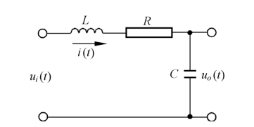{ .lq-img }

*图 2.5 RLC 无源网络（截自原书）*

以 \(u_i(t)\) 为输入量、\(u_o(t)\) 为输出量。设回路电流 \(i(t)\)，由基尔霍夫定律写出回路方程：

\[
L\frac{\mathrm{d}i(t)}{\mathrm{d}t} + Ri(t) + u_o(t) = u_i(t), \qquad u_o(t) = \frac{1}{C}\int i(t)\,\mathrm{d}t
\]

消去中间变量 \(i(t)\)（对第一式两边求导并代入 \(i = Cu_o'\)），得网络微分方程：

\[
LC\frac{\mathrm{d}^2 u_o(t)}{\mathrm{d}t^2} + RC\frac{\mathrm{d}u_o(t)}{\mathrm{d}t} + u_o(t) = u_i(t)
\tag{2.19}
\]

二阶线性微分方程——这就是图 2.5 无源网络的时域数学模型。

**【例 2-8】电枢控制直流电动机**

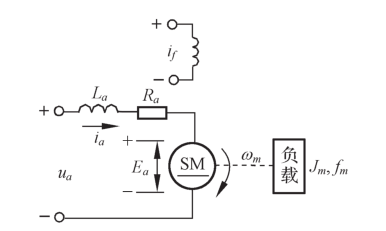{ .lq-img }

*图 2.6 电枢控制直流电动机原理图（截自原书）*

输入电枢电压 \(u_a(t)\)，输出电动机转速 \(\omega_m(t)\)；\(R_a, L_a\) 为电枢回路电阻和电感，\(M_c\) 为折合到电动机轴上的总负载转矩，激磁磁通为常值。电动机把电能转换为机械能：\(u_a\) 在电枢回路产生电流 \(i_a\)，电流与激磁磁通作用产生电磁转矩 \(M_m\)，拖动负载运动。运动方程由三部分组成：

电枢回路电压平衡方程：

\[
L_a\frac{\mathrm{d}i_a(t)}{\mathrm{d}t} + R_ai_a(t) + E_a = u_a(t)
\tag{2.20}
\]

式中反电势 \(E_a = C_e\omega_m(t)\）与激磁磁通及转速成正比、方向与 \(u_a\) 相反，\(C_e\) 是反电势系数。

电磁转矩方程：

\[
M_m(t) = C_mi_a(t)
\tag{2.21}
\]

\(C_m\) 为电动机转矩系数。

电动机轴上的转矩平衡方程：

\[
J_m\frac{\mathrm{d}\omega_m(t)}{\mathrm{d}t} + f_m\omega_m(t) = M_m(t) - M_c(t)
\tag{2.22}
\]

\(f_m\) 为黏性摩擦系数，\(J_m\) 为转动惯量（均折算到电动机轴）。

从式 (2.20)–(2.22) 消去中间变量 \(i_a(t)\)、\(E_a\)、\(M_m(t)\)：由式 (2.22) 解出 \(i_a = (J_m\dot\omega_m + f_m\omega_m + M_c)/C_m\)，代入式 (2.20)（用 \(E_a = C_e\omega_m\)），整理得：

\[
L_aJ_m\frac{\mathrm{d}^2\omega_m(t)}{\mathrm{d}t^2} + (L_af_m + R_aJ_m)\frac{\mathrm{d}\omega_m(t)}{\mathrm{d}t} + (R_af_m + C_mC_e)\omega_m(t) = C_mu_a(t) - L_a\frac{\mathrm{d}M_c(t)}{\mathrm{d}t} - R_aM_c(t)
\tag{2.23}
\]

工程应用中电枢电感 \(L_a\) 较小通常忽略，式 (2.23) 简化为一阶：

\[
T_m\frac{\mathrm{d}\omega_m(t)}{\mathrm{d}t} + \omega_m(t) = K_mu_a(t) - K_cM_c(t)
\tag{2.24}
\]

式中 \(T_m = \dfrac{R_aJ_m}{R_af_m + C_mC_e}\) 为电动机机电时间常数，\(K_m = \dfrac{C_m}{R_af_m + C_mC_e}\)、\(K_c = \dfrac{R_a}{R_af_m + C_mC_e}\) 为电动机传递系数。若 \(R_a\) 和 \(J_m\) 都可忽略，进一步简化为

\[
\omega_m(t) = \frac{1}{C_e}u_a(t)
\tag{2.25}
\]

转速与电枢电压成正比——电动机可作**测速发电机**使用。

**【例 2-9】弹簧–质量–阻尼器机械位移系统**

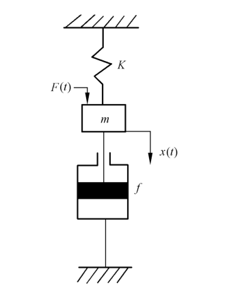{ .lq-img }

*图 2.7 弹簧–质量–阻尼器机械位移系统原理图（截自原书）*

质量 \(m\) 在外力 \(F(t)\) 作用下产生位移 \(x(t)\)。设位移、速度、加速度分别为 \(x(t)\)、\(\mathrm{d}x/\mathrm{d}t\)、\(\mathrm{d}^2x/\mathrm{d}t^2\)。由牛顿第二定律：

\[
m\frac{\mathrm{d}^2x(t)}{\mathrm{d}t^2} = F(t) - F_1(t) - F_2(t)
\tag{2.26}
\]

阻尼力 \(F_1(t) = f\,\dfrac{\mathrm{d}x(t)}{\mathrm{d}t}\)（方向与运动方向相反、与速度成正比，\(f\) 为阻尼系数）；弹簧弹力 \(F_2(t) = Kx(t)\)（方向与位移方向相反、与位移成正比，\(K\) 为弹性系数）。代入整理：

\[
m\frac{\mathrm{d}^2x(t)}{\mathrm{d}t^2} + f\frac{\mathrm{d}x(t)}{\mathrm{d}t} + Kx(t) = F(t)
\tag{2.27}
\]

与式 (2.19) 对照：\(LC \leftrightarrow m\)、\(RC \leftrightarrow f\)、\(1 \leftrightarrow K\)——两个物理系统数学模型同构。

**【例 2-10】齿轮系**

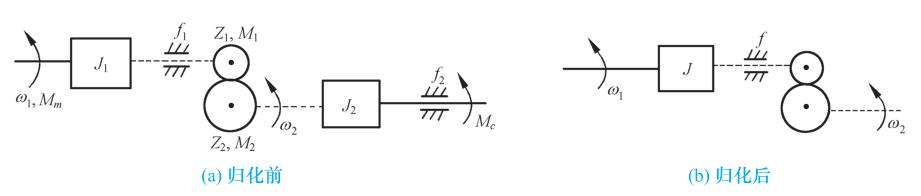{ .lq-img }

*图 2.8 齿轮系原理图：(a) 归化前；(b) 归化后（截自原书）*

执行元件与负载之间常通过齿轮系实现减速和增大力矩。齿轮 1、2 的转速、齿数、半径分别为 \(\omega_1, Z_1, r_1\) 与 \(\omega_2, Z_2, r_2\)，黏性摩擦系数与转动惯量分别为 \(f_1, J_1\) 与 \(f_2, J_2\)，原动转矩与负载转矩为 \(M_m, M_1\) 与 \(M_2, M_c\)。啮合齿轮线速度相同、传递功率相同：

\[
M_1\omega_1 = M_2\omega_2
\tag{2.28}
\]

\[
r_1\omega_1 = r_2\omega_2
\tag{2.29}
\]

齿数与半径成正比：

\[
\frac{r_1}{r_2} = \frac{Z_1}{Z_2}
\tag{2.30}
\]

由式 (2.28)–(2.30) 推得：

\[
\frac{\omega_1}{\omega_2} = \frac{Z_2}{Z_1}
\tag{2.31}
\]

\[
\frac{M_1}{M_2} = \frac{Z_1}{Z_2}
\tag{2.32}
\]

按定轴转动的动静法分别写齿轮 1、2 的运动方程：

\[
J_1\frac{\mathrm{d}\omega_1}{\mathrm{d}t} + f_1\omega_1 + M_1 = M_m
\tag{2.33}
\]

\[
J_2\frac{\mathrm{d}\omega_2}{\mathrm{d}t} + f_2\omega_2 + M_c = M_2
\tag{2.34}
\]

消去中间变量 \(\omega_2, M_1, M_2\)（用 \(\omega_2 = \frac{Z_1}{Z_2}\omega_1\)、\(M_1 = \frac{Z_1}{Z_2}M_2\) 代入）：

\[
\left[J_1 + J_2\left(\frac{Z_1}{Z_2}\right)^2\right]\frac{\mathrm{d}\omega_1}{\mathrm{d}t} + \left[f_1 + f_2\left(\frac{Z_1}{Z_2}\right)^2\right]\omega_1 + \left(\frac{Z_1}{Z_2}\right)M_c = M_m
\tag{2.35}
\]

令

\[
J = J_1 + J_2\left(\frac{Z_1}{Z_2}\right)^2
\tag{2.36}
\]

\[
f = f_1 + f_2\left(\frac{Z_1}{Z_2}\right)^2
\tag{2.37}
\]

\[
M_c' = \left(\frac{Z_1}{Z_2}\right)M_c
\tag{2.38}
\]

得齿轮系微分方程：

\[
J\frac{\mathrm{d}\omega_1}{\mathrm{d}t} + f\omega_1 + M_c' = M_m
\tag{2.39}
\]

\(J\)、\(f\)、\(M_c'\) 是折合到齿轮 1 的等效转动惯量、等效黏性摩擦系数与等效负载转矩。**折算等效值与速比有关**：速比越大（\(Z_2/Z_1\) 越大——注意这里 \(Z_1/Z_2\) 越小），折算到主动轴的等效值越小；速比足够大时后级齿轮及负载的影响可忽略。

!!! note "拓展：为什么折算要乘速比平方（补充）"
    式 (2.36) 中 \(J_2\) 折算系数是 \((Z_1/Z_2)^2\)：能量口径一致。负载动能 \(\frac{1}{2}J_2\omega_2^2 = \frac{1}{2}J_2\left(\frac{Z_1}{Z_2}\omega_1\right)^2\)，要与"等效惯量 \(J\) 在 \(\omega_1\) 下的动能 \(\frac{1}{2}J\omega_1^2\)"相等，必须有 \(J = J_2(Z_1/Z_2)^2\)。转矩按 \(Z_1/Z_2\) 一次方折算（功率不变，式 2.32），惯量与摩擦按平方折算，这组比例记牢，机械系统归一化不出错。

综上，**列写元件微分方程的步骤**：

1. 根据元件工作原理及其在控制系统中的作用，确定输入量和输出量；
2. 分析元件遵循的物理规律（或化学规律），列写相应微分方程；
3. 消去中间变量，得到输出量与输入量之间的微分方程——一般写成**标准形式**：与输入量有关的项在方程右端，与输出量有关的项在左端，两端导数项均按降幂排列。

### 2.2.2 控制系统微分方程的建立

建立系统微分方程：先由系统原理图画出方框图，分别列写各元件的微分方程，再消去中间变量。两点注意：一是**信号传递的单向性**——前一个元件的输出是后一个元件的输入，一级一级单向传递；二是**后级对前级的负载效应**（如无源网络输入阻抗对前级的影响、齿轮系对电动机转动惯量的影响，例 2-10 刚处理过后者）。

**【例 2-11】速度控制系统**

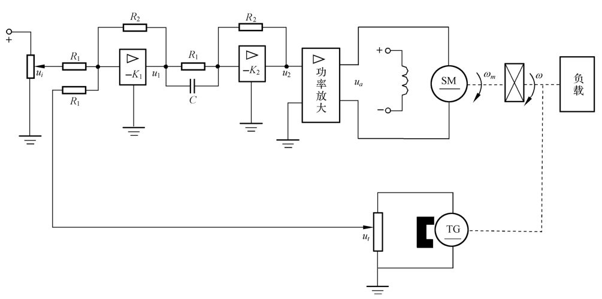{ .lq-img }

*图 2.9 速度控制系统原理图（截自原书）*

被控对象是电动机（带负载），输出量转速 \(\omega\)，输入量给定电压 \(u_i\)。系统由给定电位器、运算放大器Ⅰ（含比较作用）、运算放大器Ⅱ（含 RC 校正网络）、功率放大器、直流电动机、测速发电机、减速器组成。逐个列写：

**运算放大器Ⅰ**：\(u_i\) 与速度反馈电压 \(u_t\) 合成产生偏差电压并放大：

\[
u_1 = K_1(u_i - u_t)
\tag{2.40}
\]

\(K_1 = R_2/R_1\) 为运算放大器Ⅰ的放大系数。

**运算放大器Ⅱ**（含 RC 校正网络）：

\[
u_2 = K_2\left(\tau\frac{\mathrm{d}u_1}{\mathrm{d}t} + u_1\right)
\tag{2.41}
\]

\(K_2 = R_2/R_1\) 为其放大系数，\(\tau = R_1C\) 为微分时间常数。

**功率放大器**（晶闸管整流装置，忽略控制电路时间滞后）：

\[
u_a = K_3u_2
\tag{2.42}
\]

**直流电动机**：直接引用例 2-8 的式 (2.24)（\(T_m, K_m, K_c\) 及 \(M_c\) 均为折算到电动机轴上的等效值）：

\[
T_m\frac{\mathrm{d}\omega_m}{\mathrm{d}t} + \omega_m = K_mu_a - K_cM_c
\tag{2.43}
\]

**齿轮系**：速比 \(i\)，电动机转速 \(\omega_m\) 减速后为 \(\omega\)：

\[
\omega_m = i\,\omega
\tag{2.44}
\]

**测速发电机**：输出电压 \(u_t\) 与转速 \(\omega\) 成正比：

\[
u_t = K_t\omega
\tag{2.45}
\]

消去中间变量 \(u_t, u_1, u_2, u_a, \omega_m\)：把 (2.44)(2.45) 代入 (2.40)，再依次代入 (2.41)(2.42)(2.43)，整理后得系统微分方程：

\[
T_g\frac{\mathrm{d}\omega(t)}{\mathrm{d}t} + \omega(t) = K_g\left(\tau\frac{\mathrm{d}u_i(t)}{\mathrm{d}t} + u_i(t)\right) - K_c'\,M_c(t)
\tag{2.46}
\]

式中

\[
T_g = \frac{iT_m + K_1K_2K_3K_mK_t\tau}{1 + K_1K_2K_3K_mK_t}, \qquad
K_g = \frac{K_1K_2K_3K_m}{i\left(1 + K_1K_2K_3K_mK_t\right)}, \qquad
K_c' = \frac{K_c}{i\left(1 + K_1K_2K_3K_mK_t\right)}
\]

式 (2.46) 可研究给定电压 \(u_i\) 或负载扰动转矩 \(M_c\) 作用下速度控制系统的动态性能——一个方程、两个输入通道，这正是后面叠加原理的用武之地。

对比例 2-7 与例 2-9：**不同类型的元件或系统可以有形式相同的数学模型**。RLC 无源网络和弹簧–质量–阻尼器机械系统的数学模型都是二阶微分方程，称这些物理系统为**相似系统**。相似系统揭示不同物理现象间的相似关系，便于用简单模型研究相似的复杂系统，也是计算机数字仿真（用同一个程序解不同物理系统）的基础。

!!! note "拓展：机电相似系统对照（补充）"
    例 2-7 与例 2-9 的对应：\(L \leftrightarrow m\)（储能于运动/磁场）、\(R \leftrightarrow f\)（耗散）、\(1/C \leftrightarrow K\)（储能于势场）、\(u_i \leftrightarrow F\)（激励）、\(u_o \leftrightarrow x\)（响应）。这种"力–电压相似"（还有"力–电流相似"变体）在建模时可以互相搬运结论：机械系统的阻尼比、谐振频率可以直接套用 RLC 网络的公式，仿真时甚至可以互换模型。

### 2.2.3 线性系统的基本特性

用线性微分方程描述的元件或系统称为**线性系统**。线性系统的重要性质是**叠加原理**，含两层含义：

- **可叠加性**：对线性微分方程（如 \(a_0\ddot c + a_1\dot c + a_2c = f(t)\)），\(f = f_1\) 时解为 \(c_1\)，\(f = f_2\) 时解为 \(c_2\)，则 \(f = f_1 + f_2\) 时解必为 \(c = c_1 + c_2\)；
- **均匀性（齐次性）**：\(f = Af_1\)（\(A\) 为常数）时解必为 \(c = Ac_1\)。

两个外作用同时加于系统产生的总输出，等于各外作用单独作用时输出之和；外作用增大若干倍，输出增大同样倍数。因此多输入问题可以拆开逐个处理再叠加，每个外作用只需取单位值——这是后面"输入 \(R(s)\) 与扰动 \(N(s)\) 分通道求传递函数"（2.4.6 节）和例 2-15 的方法论基础。

### 2.2.4 线性定常微分方程的求解

求解方法有经典法和拉氏变换法两种。**拉氏变换法三步**：

1. 考虑初始条件，对微分方程每一项分别拉氏变换，把微分方程变成 \(s\) 的代数方程；
2. 由代数方程解出输出量的象函数表达式；
3. 对象函数求拉氏反变换，得到时域解。

**【例 2-12】RLC 网络的阶跃响应**

在例 2-7 中取 \(L = 1\,\mathrm{H}\)、\(C = 1\,\mathrm{F}\)、\(R = 1\,\Omega\)，电容初始电压 \(u_o(0) = 0.1\,\mathrm{V}\)，初始电流 \(i(0) = 0.1\,\mathrm{A}\)，电源电压 \(u_i(t) = 1\,\mathrm{V}\)。求电路突然接通电源时 \(u_o(t)\) 的变化规律。

网络微分方程即式 (2.19)：

\[
LC\frac{\mathrm{d}^2u_o(t)}{\mathrm{d}t^2} + RC\frac{\mathrm{d}u_o(t)}{\mathrm{d}t} + u_o(t) = u_i(t)
\tag{2.47}
\]

对各项拉氏变换（用微分定理并代入初始条件；\(\dot u_o(0) = i(0)/C = 0.1\)）：

\[
\mathscr{L}\left[\frac{\mathrm{d}u_o}{\mathrm{d}t}\right] = sU_o(s) - u_o(0), \qquad
\mathscr{L}\left[\frac{\mathrm{d}^2u_o}{\mathrm{d}t^2}\right] = s^2U_o(s) - su_o(0) - \dot u_o(0)
\]

代入已知数据 \(LC = RC = 1\)、\(u_o(0) = \dot u_o(0) = 0.1\)，整理得

\[
U_o(s) = \frac{0.1s^2 + 0.2s + 1}{s\left(s^2+s+1\right)}
\tag{2.48}
\]

电路突然接通电源，\(u_i(t) = 1(t)\)、\(U_i(s) = 1/s\)。对式 (2.48) 求拉氏反变换。部分分式：\(U_o(s) = \dfrac{1}{s} - \dfrac{0.9s + 0.8}{s^2+s+1}\)，配方可得 \(s^2+s+1 = (s+0.5)^2 + 0.866^2\)，查表 2-3（行 15、17）合并同频项：

\[
u_o(t) = 1 + 1.15\,\mathrm{e}^{-0.5t}\sin(0.866t - 120^{\circ}) + 0.2\,\mathrm{e}^{-0.5t}\sin(0.866t + 30^{\circ})\ \mathrm{V}
\tag{2.49}
\]

（等价形式：\(u_o(t) = 1 - \tfrac{2\sqrt3}{3}\mathrm{e}^{-0.5t}\sin(0.866t + 60^{\circ}) + 0.2\,\mathrm{e}^{-0.5t}\sin(0.866t + 30^{\circ})\)，两者恒等。）式 (2.49) 中前两项（\(1\) 与 \(1.15\cdots\) 项）由网络输入电压产生、与初始条件无关，称**零初始条件响应**；后一项由初始条件产生、与输入电压无关，称**零输入响应**。两者统称网络的单位阶跃响应。

如果输入是单位脉冲 \(\delta(t)\)（相当于突然接通电源又立即断开），此时 \(U_i(s) = 1\)，网络的输出称为**单位脉冲响应**。零初始条件下

\[
U_o(s) = \frac{1}{s^2+s+1} \quad\Longrightarrow\quad g(t) = 1.15\,\mathrm{e}^{-0.5t}\sin(0.866t)\ \mathrm{V}
\tag{2.50}
\]

用初值定理和终值定理直接从式 (2.48) 核对（\(u_i = 1(t)\) 时）：

\[
u_o(0^+) = \lim_{s\to\infty} sU_o(s) = \lim_{s\to\infty}\frac{0.1s^3+0.2s^2+s}{s^3+s^2+s} = 0.1\ \mathrm{V}, \qquad
u_o(\infty) = \lim_{s\to 0} sU_o(s) = \lim_{s\to 0}\frac{0.1s^2+0.2s+1}{s^2+s+1} = 1\ \mathrm{V}
\]

与式 (2.49) 的结果一致——**不必反变换也能预知响应的起点和终点**。

=== "MATLAB"

    ```matlab
    % ===== 书 2.2.4 节 例2-12：拉氏变换法解微分方程 =====
    syms s t
    % 考虑初始条件的代数方程：LC=RC=1, uo(0)=0.1, uo'(0)=0.1, ui=1(t)
    Uo = (0.1*s^2 + 0.2*s + 1)/(s*(s^2+s+1));   % 式(2.48)
    uo = ilaplace(Uo)                            % 时域解，即式(2.49)
    simplify(vpa(uo, 4))
    % 初值/终值定理核对
    uo0 = limit(s*Uo, s, inf)        % 0.1
    uoInf = limit(s*Uo, s, 0)        % 1
    % 单位脉冲响应（零初始条件）即式(2.50)
    g = ilaplace(1/(s^2+s+1))        % 1.15*exp(-t/2)*sin(0.866*t)
    ```

=== "Python"

    ```python
    # ===== 书 2.2.4 节 例2-12：拉氏变换法解微分方程 =====
    # MATLAB ilaplace ↔ sympy.inverse_laplace_transform；dsolve 可独立解微分方程互验
    import sympy as sp

    s, t = sp.symbols('s t', positive=True)
    Uo = (sp.Rational(1, 10) * s**2 + sp.Rational(2, 10) * s + 1) / (s * (s**2 + s + 1))
    uo = sp.inverse_laplace_transform(Uo, s, t)
    print('uo(t) =', sp.simplify(sp.expand(uo)))
    # → 1 - (7*sqrt(3)/30)*sin(sqrt(3)t/2)*exp(-t/2) - (9/10)*cos(sqrt(3)t/2)*exp(-t/2)
    #   即式(2.49)：1 + 1.15 e^(-t/2) sin(0.866t-120°) + 0.2 e^(-t/2) sin(0.866t+30°)

    # dsolve 独立验证（不经过拉氏变换）
    u = sp.Function('u')
    sol = sp.dsolve(sp.Eq(u(t).diff(t, 2) + u(t).diff(t) + u(t), 1),
                    ics={u(0): sp.Rational(1, 10),
                         u(t).diff(t).subs(t, 0): sp.Rational(1, 10)})
    print('dsolve:', sp.simplify(sp.expand(sol.rhs - uo)))   # 0

    # 初值/终值定理
    print('uo(0+) =', sp.limit(s * Uo, s, sp.oo), '  uo(∞) =', sp.limit(s * Uo, s, 0))  # 0.1  1

    # 单位脉冲响应（零初始条件），即式(2.50)
    g = sp.inverse_laplace_transform(1 / (s**2 + s + 1), s, t)
    print('g(t) =', sp.simplify(g))   # (2*sqrt(3)/3)*exp(-t/2)*sin(sqrt(3)t/2) ≈ 1.15 e^(-t/2) sin(0.866t)
    ```

### 2.2.5 非线性微分方程的线性化

严格说实际物理元件或系统都是非线性的：弹簧刚度与形变有关（\(K\) 是 \(x\) 的函数）、电阻电容电感随环境与电流变化、电动机的摩擦与死区……为简化模型可以忽略次要非线性；而对连续变化的非线性特性，常用**切线法**（**小偏差法**）：在工作点附近的小范围内，用直线代替非线性特性。

设非线性函数 \(y = f(x)\)，取平衡状态 \(A\) 为工作点：\(y_0 = f(x_0)\)。当 \(x = x_0 + \Delta x\) 时 \(y = y_0 + \Delta y\)。设 \(f(x)\) 在 \((x_0, y_0)\) 连续可微，泰勒展开：

\[
y = f(x) = f(x_0) + \left(\frac{\mathrm{d}f(x)}{\mathrm{d}x}\right)_{x_0}(x - x_0) + \frac{1}{2!}\left(\frac{\mathrm{d}^2f(x)}{\mathrm{d}x^2}\right)_{x_0}(x - x_0)^2 + \cdots
\]

当增量 \(\Delta x = x - x_0\) 很小时略去高次幂项：

\[
y - y_0 = \left(\frac{\mathrm{d}f(x)}{\mathrm{d}x}\right)_{x_0}(x - x_0)
\]

令 \(\Delta y = y - y_0\)、\(\Delta x = x - x_0\)、\(K = \left(\dfrac{\mathrm{d}f}{\mathrm{d}x}\right)_{x_0}\)，得线性化方程 \(\Delta y = K\Delta x\)；略去增量符号即 \(y = Kx\)。\(K\) 是函数 \(f(x)\) 在工作点 \(A\) 的**切线斜率**。

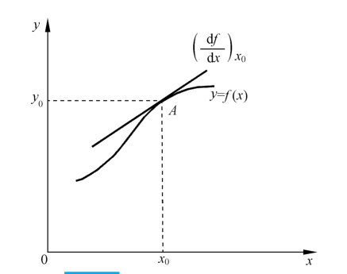{ .lq-img }

*图 2.10 小偏差线性化示意图（截自原书）*

两个自变量 \(x_1, x_2\) 的非线性函数 \(f(x_1, x_2)\) 同样在工作点 \((x_{10}, x_{20})\) 附近泰勒展开，略去二阶及以上项：

\[
y - y_0 = \left(\frac{\partial f}{\partial x_1}\right)_{x_{10},x_{20}}(x_1 - x_{10}) + \left(\frac{\partial f}{\partial x_2}\right)_{x_{10},x_{20}}(x_2 - x_{20})
\]

即 \(\Delta y = K_1\Delta x_1 + K_2\Delta x_2\)，其中 \(K_1 = \left(\partial f/\partial x_1\right)_{x_{10},x_{20}}\)、\(K_2 = \left(\partial f/\partial x_2\right)_{x_{10},x_{20}}\)。

**为什么"小偏差"对控制系统特别合理**：系统正常工作时处于平衡状态（被控量与期望值一致，系统不动作）；一旦被控量偏离期望，控制系统就动作把它拉回来——被控量的偏差一般不大，天生就是"小偏差"。所以把稳定工作状态取为起始状态、只研究增量运动，正是增量线性化方程描述的特性。

**【例 2-13】铁心线圈电路**

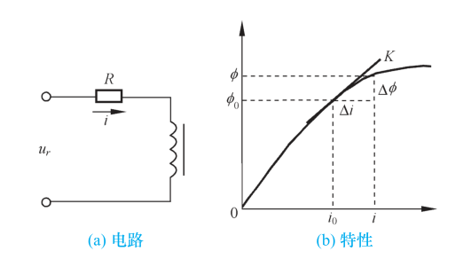{ .lq-img }

*图 2.11 铁心线圈电路及其特性：(a) 电路；(b) 特性（截自原书）*

以 \(u_r\) 为输入量、\(i\) 为输出量。铁心线圈磁通变化产生的感应电势 \(u_1 = K_1\dfrac{\mathrm{d}\phi(i)}{\mathrm{d}t}\)（\(\phi\) 与 \(i\) 非线性，见图 2.11b）。由基尔霍夫定律：

\[
u_r = K_1\frac{\mathrm{d}\phi(i)}{\mathrm{d}t} + Ri = K_1\frac{\mathrm{d}\phi(i)}{\mathrm{d}i}\cdot\frac{\mathrm{d}i}{\mathrm{d}t} + Ri
\tag{2.51}
\]

\(\mathrm{d}\phi(i)/\mathrm{d}i\) 是 \(i\) 的非线性函数，式 (2.51) 是非线性微分方程。

若电路的电压、电流只在平衡点 \((u_0, i_0)\) 附近微小变化，设 \(\Delta u_r = u_r - u_0\)、\(\Delta i = i - i_0\)，且 \(\phi(i)\) 在 \(i_0\) 邻域连续可导。把 \(\phi(i)\) 在 \(i_0\) 附近泰勒展开：

\[
\phi(i) = \phi(i_0) + \left(\frac{\mathrm{d}\phi(i)}{\mathrm{d}i}\right)_{i_0}\Delta i + \frac{1}{2!}\left(\frac{\mathrm{d}^2\phi(i)}{\mathrm{d}i^2}\right)_{i_0}(\Delta i)^2 + \cdots
\]

\(\Delta i\) 足够小时略去高阶项：

\[
\phi(i) - \phi(i_0) = \left(\frac{\mathrm{d}\phi(i)}{\mathrm{d}i}\right)_{i_0}\Delta i = K\,\Delta i
\]

其中 \(K = \left(\dfrac{\mathrm{d}\phi(i)}{\mathrm{d}i}\right)_{i_0}\)。令 \(\Delta\phi = \phi(i) - \phi(i_0)\) 并略去增量符号，得磁通与电流的增量线性化方程：

\[
\phi(i) = Ki
\tag{2.52}
\]

于是 \(\mathrm{d}\phi/\mathrm{d}i = K\)，代入式 (2.51)：

\[
K_1K\frac{\mathrm{d}i}{\mathrm{d}t} + Ri = u_r
\tag{2.53}
\]

这就是铁心线圈电路在平衡点 \((u_0, i_0)\) 的增量线性化微分方程。**平衡点变动时，\(K\) 值随之改变**——线性化模型是"工作点局部"的模型，不是全局模型。
## 2.3 控制系统的复数域数学模型

微分方程是时域模型：给定外作用和初始条件可以解出输出响应，直观，借助 MATLAB/Python 也能迅速准确地算。但**结构一改、参数一动，就要重新列写并求解微分方程**，不便于分析与设计。用拉氏变换解线性系统微分方程时得到的复数域模型——**传递函数**——可以表征系统动态性能、研究结构和参数变化的影响；经典控制理论的频率法和根轨迹法都以它为基础。它是经典控制理论中最基本、最重要的概念。

### 2.3.1 传递函数的定义和性质

**定义**：线性定常系统的传递函数，定义为**零初始条件下，系统输出量的拉氏变换与输入量的拉氏变换之比**。

设线性定常系统由 \(n\) 阶线性常微分方程描述：

\[
a_0\frac{\mathrm{d}^n c(t)}{\mathrm{d}t^n} + a_1\frac{\mathrm{d}^{n-1} c(t)}{\mathrm{d}t^{n-1}} + \cdots + a_{n-1}\frac{\mathrm{d}c(t)}{\mathrm{d}t} + a_nc(t)
= b_0\frac{\mathrm{d}^m r(t)}{\mathrm{d}t^m} + b_1\frac{\mathrm{d}^{m-1} r(t)}{\mathrm{d}t^{m-1}} + \cdots + b_{m-1}\frac{\mathrm{d}r(t)}{\mathrm{d}t} + b_mr(t)
\tag{2.54}
\]

\(c(t)\) 是输出量，\(r(t)\) 是输入量，\(a_i, b_j\) 为常系数。零初始条件下各项拉氏变换，得 \(s\) 的代数方程：

\[
(a_0s^n + a_1s^{n-1} + \cdots + a_{n-1}s + a_n)C(s) = (b_0s^m + b_1s^{m-1} + \cdots + b_{m-1}s + b_m)R(s)
\]

由定义得系统传递函数：

\[
G(s) = \frac{C(s)}{R(s)} = \frac{M(s)}{N(s)} = \frac{b_0s^m + b_1s^{m-1} + \cdots + b_{m-1}s + b_m}{a_0s^n + a_1s^{n-1} + \cdots + a_{n-1}s + a_n}
\tag{2.55}
\]

**【例 2-14】RLC 无源网络的传递函数**

例 2-7 已得网络微分方程 (2.19)。零初始条件下拉氏变换：

\[
(LCs^2 + RCs + 1)U_o(s) = U_i(s)
\]

由定义：

\[
G(s) = \frac{U_o(s)}{U_i(s)} = \frac{1}{LCs^2 + RCs + 1}
\tag{2.56}
\]

**传递函数的性质**：

1. 传递函数是复变量 \(s\) 的**有理分式函数**，具有复变函数的所有性质；\(m \le n\)，且所有系数均为实数；
2. 传递函数只取决于**系统或元件的结构和参数**，与输入量的形式无关，也不反映系统内部的任何信息——它把"输入 → 输出"的因果关系用一个方框联系起来；
3. 传递函数与微分方程**互通**：分子、分母多项式系数分别对应微分方程右端、左端的系数。零初始条件下，把微分方程的算符 \(\mathrm{d}/\mathrm{d}t\) 换成 \(s\) 得传递函数；反之把 \(s\) 换回 \(\mathrm{d}/\mathrm{d}t\) 得微分方程。例如 \(G(s) = \dfrac{b_1s+b_2}{a_0s^2+a_1s+a_2}\) 对应 \((a_0s^2+a_1s+a_2)C(s) = (b_1s+b_2)R(s)\) 对应 \(a_0\ddot c(t) + a_1\dot c(t) + a_2c(t) = b_1\dot r(t) + b_2r(t)\)；
4. 传递函数的拉氏反变换是系统的**脉冲响应** \(g(t)\)：单位脉冲 \(\delta(t)\) 输入时 \(R(s) = 1\)，故 \(g(t) = \mathscr{L}^{-1}[C(s)] = \mathscr{L}^{-1}[G(s)R(s)] = \mathscr{L}^{-1}[G(s)]\)。由卷积定理，零初始条件下任意输入的输出为

\[
c(t) = \mathscr{L}^{-1}[G(s)R(s)] = \int_0^t g(t-\tau)r(\tau)\,\mathrm{d}\tau = \int_0^t g(\tau)r(t-\tau)\,\mathrm{d}\tau
\]

传递函数在**零初始条件**下定义，这有两层含义：输入量在 \(t=0\) 才作用于系统（\(t=0^-\) 时输入及其各阶导数为零）；输入加于系统之前系统处于稳定工作状态（输出及其各阶导数在 \(t=0^-\) 时为零）。现实工程控制系统多属此类，所以传递函数可以表征系统动态性能、求出给定输入下的零初始条件响应。

**【例 2-15】电枢控制直流电动机的传递函数**

例 2-8 的简化微分方程 (2.24)：\(T_m\dot\omega_m + \omega_m = K_mu_a - K_cM_c\)。\(M_c(t)\) 可视为负载扰动转矩。按叠加原理分两个通道分别求传递函数再叠加。

求 \(u_a(t)\) 到 \(\omega_m(t)\)：令 \(M_c(t) = 0\)，零初始条件下拉氏变换得 \((T_ms+1)\Omega_m(s) = K_mU_a(s)\)：

\[
G_1(s) = \frac{\Omega_m(s)}{U_a(s)} = \frac{K_m}{T_ms + 1}
\tag{2.57}
\]

求 \(M_c(t)\) 到 \(\omega_m(t)\)：令 \(u_a(t) = 0\)：

\[
G_2(s) = \frac{\Omega_m(s)}{M_c(s)} = \frac{-K_c}{T_ms + 1}
\tag{2.58}
\]

两个输入同时作用时：

\[
\omega_m(t) = \mathscr{L}^{-1}\left[\frac{K_m}{T_ms+1}U_a(s) - \frac{K_c}{T_ms+1}M_c(s)\right] = \omega_1(t) + \omega_2(t)
\]

\(\omega_1(t)\) 是电枢电压作用下的转速分量，\(\omega_2(t)\) 是负载转矩作用下的转速分量。

### 2.3.2 传递函数的零点和极点

分子、分母多项式因式分解后可写为

\[
G(s) = \frac{b_0(s-z_1)(s-z_2)\cdots(s-z_m)}{a_0(s-p_1)(s-p_2)\cdots(s-p_n)} = K^*\frac{\displaystyle\prod_{i=1}^{m}(s-z_i)}{\displaystyle\prod_{j=1}^{n}(s-p_j)}
\tag{2.59}
\]

\(z_i\)（\(i=1,\cdots,m\)）是分子多项式的零点，称为传递函数的**零点**；\(p_j\)（\(j=1,\cdots,n\)）是分母多项式的零点，称为**极点**。零极点可以是实数或复数（复零极点成共轭对出现）。\(K^* = b_0/a_0\) 称为**根轨迹增益**——零极点形式在根轨迹法（第 4 章）中使用较多。在复平面上标出零极点的图形叫**零极点分布图**："○"表零点、"×"表极点。

因式分解也可写成时间常数形式（一次因子对应实数零极点，二次因子对应共轭复数零极点）：

\[
G(s) = \frac{b_m\displaystyle\prod_{i=1}^{m_1}(\tau_i s+1)\prod_{i=1}^{m_2}(\tau_i^2s^2 + 2\zeta_i\tau_i s+1)}{a_n\displaystyle\prod_{j=1}^{n_1}(T_j s+1)\prod_{j=1}^{n_2}(T_j^2s^2 + 2\zeta_jT_j s+1)}
\tag{2.60}
\]

\(\tau_i, T_j\) 称为时间常数，\(K = K^*\displaystyle\prod_{i=1}^{m}\vert z_i\vert \bigg/\prod_{j=1}^{n}\vert p_j\vert = b_m/a_n\) 称为**传递系数或增益**——这种形式在频率法（第 5 章）中使用较多。

### 2.3.3 极点和零点对输出的影响

**极点决定自由运动的模态**。传递函数的极点就是系统微分方程的特征根，决定系统自由运动的形态，称为**模态**；强迫运动（零初始条件响应）中也会包含这些模态。设系统

\[
G(s) = \frac{C(s)}{R(s)} = \frac{6(s+3)}{(s+1)(s+2)}
\]

极点 \(p_1 = -1\)、\(p_2 = -2\)，零点 \(z_1 = -3\)，自由运动的模态是 \(\mathrm{e}^{-t}\) 和 \(\mathrm{e}^{-2t}\)。当 \(r(t) = R_1 + R_2\mathrm{e}^{-5t}\)，即 \(R(s) = \dfrac{R_1}{s} + \dfrac{R_2}{s+5}\) 时，零初始条件响应：

\[
c(t) = \mathscr{L}^{-1}\left[\frac{6(s+3)}{(s+1)(s+2)}\left(\frac{R_1}{s} + \frac{R_2}{s+5}\right)\right] = \frac{9}{2}R_1 + R_2\mathrm{e}^{-5t} - (9R_1 + 3R_2)\mathrm{e}^{-t} + \left(\frac{3}{2}R_1 + 2R_2\right)\mathrm{e}^{-2t}
\]

前两项与输入函数 \(r(t)\) 同模态；后两项包含由极点 \(-1\)、\(-2\) 形成的自由运动模态——系统"固有"的成分，但其系数与输入有关，是**受输入激发而形成**的。

**零点不形成模态，但调整各模态的比重**。设两个传递函数极点相同、零点不同：

\[
G_1(s) = \frac{4s+2}{(s+1)(s+2)} \quad (z_1 = -0.5), \qquad
G_2(s) = \frac{1.5s+2}{(s+1)(s+2)} \quad (z_2 = -1.33)
\]

零极点分布见原书图 2.13(a)。零初始条件下单位阶跃响应（部分分式可逐个验证）：

\[
c_1(t) = 1 + 2\,\mathrm{e}^{-t} - 3\,\mathrm{e}^{-2t}, \qquad
c_2(t) = 1 - 0.5\,\mathrm{e}^{-t} - 0.5\,\mathrm{e}^{-2t}
\]

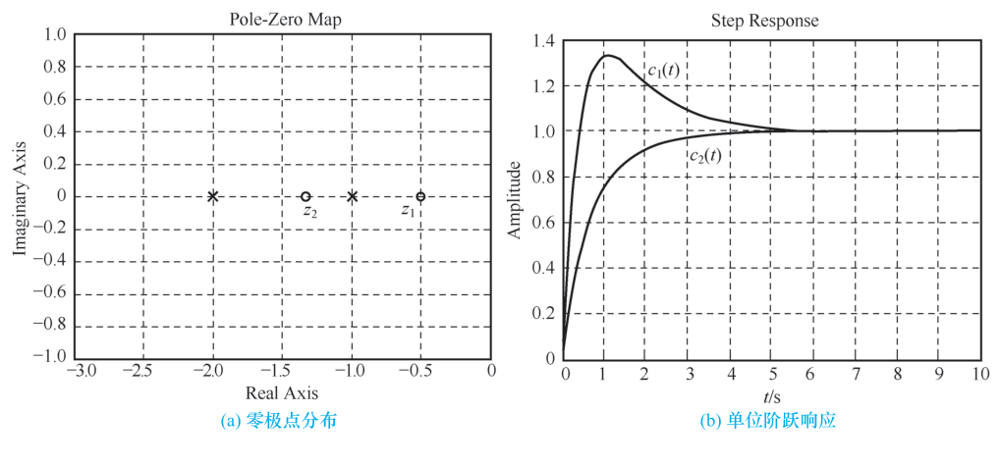{ .lq-img }

*图 2.13 零极点对输出响应的影响（MATLAB）：(a) 零极点分布；(b) 单位阶跃响应（截自原书）*

模态 \(\mathrm{e}^{-t}\)、\(\mathrm{e}^{-2t}\) 在两个响应中所占比重不同，取决于极点之间的距离、极点与零点之间的距离以及零点与原点的距离。\(G_1\) 的零点 \(z_1\) 接近原点、距两个极点都远，两个模态比重大、零点作用明显；\(G_2\) 的零点 \(z_2\) 距原点远且紧挨两个极点，模态比重就小。模态相同、零点位置不同，阶跃响应形状（图 2.13b）就完全不同。

```python
# ===== 书 2.3.3 节：零极点对输出的影响（图 2-13 的例子） =====
# MATLAB: G1 = tf([4 2],[1 3 2]); step(G1)  ↔  Python: ct.tf + ct.step_response
import numpy as np
import control as ct

G1 = ct.tf([4, 2], [1, 3, 2])      # 4(s+0.5)/((s+1)(s+2))，零点 -0.5
G2 = ct.tf([1.5, 2], [1, 3, 2])    # 1.5(s+4/3)/((s+1)(s+2))，零点 -1.33
print('G1 零/极点:', ct.zeros(G1), ct.poles(G1))   # [-0.5]  [-2 -1]
print('G2 零/极点:', ct.zeros(G2), ct.poles(G2))   # [-1.33] [-2 -1]

tvec = np.linspace(0, 10, 4001)
_, y1 = ct.step_response(G1, tvec)                 # step ↔ ct.step_response
_, y2 = ct.step_response(G2, tvec)
c1_book = 1 + 2 * np.exp(-tvec) - 3 * np.exp(-2 * tvec)      # 书给 c1(t)
c2_book = 1 - 0.5 * np.exp(-tvec) - 0.5 * np.exp(-2 * tvec)  # 书给 c2(t)
print('与解析式最大偏差:', np.max(np.abs(y1 - c1_book)),
      np.max(np.abs(y2 - c2_book)))   # 均为 1e-14 量级
```

### 2.3.4 典型元部件的传递函数

自动控制系统由各种机械、电子、液压、光学元部件连接组成。建模先从元部件做起。

**电位器** 把线位移或角位移变换为电压的装置；单个电位器作信号变换，一对电位器可组成误差检测器。

空载时输出电压与电刷角位移成正比（阶梯状误差来自绕线线径，理论分析用直线近似；原书图 2.14 给出电位器、桥式电位器、输出特性与框图四个分图）：

\[
u(t) = K_1\theta(t)
\tag{2.61}
\]

\(K_1 = E/\theta_{\max}\) 是**电位器传递系数**（\(E\) 电源电压，\(\theta_{\max}\) 最大工作角）。拉氏变换得传递函数——一个常值：

\[
G(s) = \frac{U(s)}{\Theta(s)} = K_1
\tag{2.62}
\]

一对相同电位器组成误差检测器，输出 \(u(t) = K_1[\theta_1(t) - \theta_2(t)] = K_1\Delta\theta(t)\)，以误差角 \(\Delta\theta\) 为输入时传递函数与单个电位器相同：

\[
G(s) = \frac{U(s)}{\Delta\Theta(s)} = K_1
\tag{2.63}
\]

**负载效应**：输出端接负载电阻 \(R_l\)（电位器电阻 \(R_p\)）时，输出电压为

\[
u(t) = \frac{E}{\dfrac{R_p}{\theta_{\max}}t\Big/\!\!\left(\dfrac{R_p}{\theta_{\max}}t \parallel R_l\right)}\cdot\frac{R_p}{\theta_{\max}}t
= \frac{E\,\theta(t)/\theta_{\max}}{1 + \dfrac{R_p}{R_l}\cdot\dfrac{\theta(t)}{\theta_{\max}}\left(1 - \dfrac{\theta(t)}{\theta_{\max}}\right)}
\]

输出电压与角位移**不再保持线性关系**，求不出传递函数。只有当 \(R_l\) 足够大（如 \(R_l \ge 10R_p\)）时 \(u(t) \approx E\theta(t)/\theta_{\max} = K_1\theta(t)\)，电位器才能视为线性元件。

**测速发电机** 测量角速度并转换成电压的装置，分直流（永磁式）与交流两种。

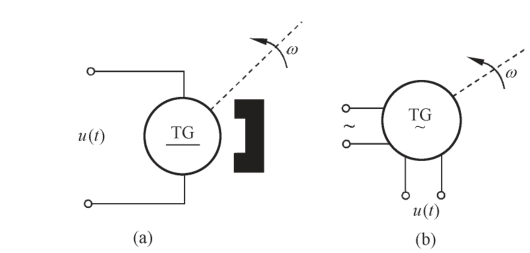{ .lq-img }

*图 2.16 测速发电机示意图：(a) 永磁式直流测速发电机；(b) 交流测速发电机（截自原书）*

转子与待测轴连接，输出与转子角速度成正比的电压：

\[
u(t) = K_t\theta'(t) = K_t\omega(t)
\tag{2.64}
\]

\(K_t\) 是测速发电机输出斜率（单位角速度的输出电压）。零初始条件下拉氏变换：

\[
G(s) = \frac{U(s)}{\Omega(s)} = K_t
\tag{2.65}
\]

或以角位移 \(\Theta(s)\) 为输入（\(\Omega(s) = s\Theta(s)\)）：

\[
G(s) = \frac{U(s)}{\Theta(s)} = K_ts
\tag{2.66}
\]

交流测速发电机（两互相垂直的线圈：激磁绕组 + 输出绕组）的输出电压包络线同样满足式 (2.64)，传递函数与方框图同直流型。

**电枢控制直流伺服电动机** 广泛用作执行机构。由式 (2.57)、(2.58) 可画出三种输入情况下的方框图（原书图 2.18）：电压到转速 \(\dfrac{K_m}{T_ms+1}\)、电压到角位移 \(\dfrac{K_m}{s(T_ms+1)}\)、负载转矩到转速 \(\dfrac{-K_c}{T_ms+1}\)。

**两相伺服电动机** 重量轻、惯性小、加速特性好的小功率交流执行机构：两互相垂直的定子线圈（一相激磁、一相控制）+ 高电阻值转子。转矩–速度特性有负斜率且非线性（原书图 2.19b 给出一组不同控制电压下的机械特性曲线）；伺服电动机一般工作在零转速附近，把低速线性段延伸到高速范围作线性化：

\[
M_m = -C_\omega\omega_m + M_s
\tag{2.67}
\]

\(M_m\) 输出转矩、\(\omega_m\) 角速度、\(C_\omega = \mathrm{d}M_m/\mathrm{d}\omega_m\) 阻尼系数（机械特性线性化直线斜率）、\(M_s\) 堵转转矩，\(M_s = C_mu_a\)（\(C_m\) 由额定电压下的堵转转矩确定）。

暂不考虑负载转矩，输出转矩用来驱动负载并克服黏性摩擦，转矩平衡方程为

\[
J_m\frac{\mathrm{d}^2\theta_m}{\mathrm{d}t^2} = M_m - f_m\frac{\mathrm{d}\theta_m}{\mathrm{d}t}
\tag{2.68}
\]

由式 (2.67)、(2.68) 消去 \(M_s, M_m\)，零初始条件拉氏变换得

\[
G(s) = \frac{\Theta_m(s)}{U_a(s)} = \frac{C_m}{s(J_ms^2 + f_ms + C_\omega)} = \frac{K_m}{s(T_ms + 1)}
\tag{2.69}
\]

\(K_m = \dfrac{C_m}{f_m + C_\omega}\) 为电动机传递系数，\(T_m = \dfrac{J_m}{f_m + C_\omega}\) 为电动机时间常数。由 \(\Omega_m(s) = s\Theta_m(s)\) 也可写成

\[
G(s) = \frac{\Omega_m(s)}{U_a(s)} = \frac{K_m}{T_ms + 1}
\tag{2.70}
\]

与直流电动机传递函数在形式上完全相同。

**无源网络** 求无源网络传递函数有两种方法：先列微分方程再拉氏变换（例 2-14 的路线）；或用**复数阻抗**直接列代数方程。复数阻抗：电阻 \(R\)、电容 \(1/(Cs)\)、电感 \(Ls\)。

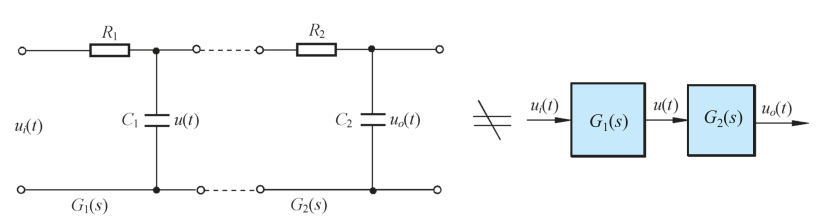{ .lq-img }

*图 2.21 负载效应示例（截自原书）*

例 2-14 的 RLC 网络用复数阻抗表示：\(Z_1 = R + Ls\)、\(Z_2 = 1/(Cs)\)，直接由分压关系写出传递函数：

\[
\frac{U_o(s)}{U_i(s)} = \frac{Z_2}{Z_1 + Z_2} = \frac{1}{LCs^2 + RCs + 1}
\]

注意前提：一般假设网络输出端接无穷大负载阻抗、输入内阻为零，否则要考虑负载效应。图 2.21 的两级 RC 网络，断开（空载）时各自传递函数为

\[
G_1(s) = \frac{1}{R_1C_1s + 1}, \qquad G_2(s) = \frac{1}{R_2C_2s + 1}
\]

若按方框串联计算：

\[
\frac{U_o(s)}{U_i(s)}\ \xrightarrow{\ G_1G_2\ }\ \frac{1}{(R_1C_1s+1)(R_2C_2s+1)}
\]

但两级**直接连接**后由电路方程实际求得：

\[
G(s) = \frac{U_o(s)}{U_i(s)} = \frac{1}{R_1R_2C_1C_2s^2 + (R_1C_1 + R_2C_2 + R_1C_2)s + 1}
\]

\(G(s) \ne G_1(s)G_2(s)\)——多出的 \(R_1C_2\) 项就是**负载效应**（后级成了前级的负载，分压关系变了）。只有当 \(R_1C_2\) 可忽略时 \(G(s) \approx G_1(s)G_2(s)\)；这要求后级输入阻抗足够大、或前级输出阻抗趋于零、或在两级之间接入**隔离放大器**（运放跟随器）。

**单容水槽** 水位控制系统的被控对象：调节阀控制流入量 \(Q_i\)，负载阀控制流出量 \(Q_o\)，被调量为水位 \(h\)。

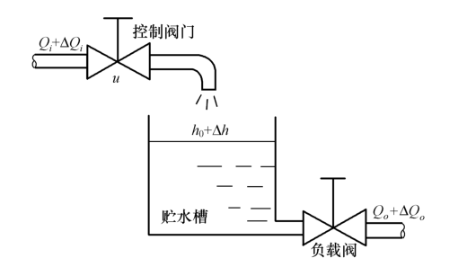{ .lq-img }

*图 2.22 单容水槽原理图（截自原书）*

记稳态值 \(\overline{Q_i}, \overline{Q_o}, h_0\) 与增量 \(\Delta Q_i, \Delta Q_o, \Delta h\)（\(u\) 为调节阀开度），\(A\) 为液槽横截面积，\(R\) 为负载阀液阻。物料平衡（初始平衡 \(Q_o = Q_i\)）：

\[
\Delta Q_i - \Delta Q_o = \frac{\mathrm{d}\Delta V}{\mathrm{d}t} = A\frac{\mathrm{d}\Delta h}{\mathrm{d}t}
\tag{2.71}
\]

\(\Delta Q_i\) 由阀开度增量引起（阀前后压差不变）：

\[
\Delta Q_i = K_u\Delta u
\tag{2.72}
\]

流出量与液位是非线性关系 \(Q_o = \alpha\sqrt{h}\)（\(\alpha\) 为阀口系数），在平衡点 \((h_0, Q_0)\) 附近线性化得**液阻**：

\[
\Delta Q_o = \frac{\Delta h}{R}
\tag{2.73}
\]

（\(R = 2\sqrt{h_0}/\alpha\)，即 \(\mathrm{d}Q_o/\mathrm{d}h\) 在 \(h_0\) 处取值的倒数。）代入式 (2.71)：

\[
T\frac{\mathrm{d}\Delta h}{\mathrm{d}t} + \Delta h = K\Delta u
\tag{2.74}
\]

\(T = RA\)、\(K = K_uR\)。零初始条件下拉氏变换得单容水槽传递函数——典型的**惯性环节**：

\[
G(s) = \frac{H(s)}{U(s)} = \frac{K}{Ts + 1}
\tag{2.75}
\]

**电加热炉** 电热丝两端电压 \(u\)，炉内温度 \(T_1\)。设电热丝质量 \(M\)、比热 \(C\)、传热系数 \(H\)、传热面积 \(A\)，未加温前炉温 \(T_0\)，单位时间产热 \(Q_i\)。热平衡（蓄热 + 散热）：

\[
MC\frac{\mathrm{d}(T_1 - T_0)}{\mathrm{d}t} + HA(T_1 - T_0) = Q_i
\]

\(Q_i\) 与外加电压平方成比例（非线性），在平衡点 \((Q_0, u_0)\) 附近线性化得 \(K_u = \Delta Q_i/\Delta u\)，于是增量微分方程：

\[
T\frac{\mathrm{d}\Delta T}{\mathrm{d}t} + \Delta T = K_u'\Delta u
\tag{2.76}
\]

\(\Delta T = T_1 - T_0\)、\(T = MC/(HA)\) 为电加热炉时间常数、\(K = K_u/(HA)\) 为传递系数。拉氏变换：

\[
G(s) = \frac{\Delta T(s)}{\Delta U(s)} = \frac{K}{Ts + 1}
\tag{2.77}
\]

又是惯性环节——传热对象与水槽（流体对象）同构，再次印证相似系统。

**有纯延迟的单容水槽** 调节阀距水槽较远时，开度变化引起的 \(\Delta Q_i\) 要经过传输时间 \(\tau\)（**纯延迟时间**）才影响液位：

\[
T\frac{\mathrm{d}\Delta h}{\mathrm{d}t} + \Delta h = K\Delta u(t - \tau)
\tag{2.78}
\]

零初始条件下拉氏变换（实域位移定理，\(\mathscr{L}[f(t-\tau)1(t-\tau)] = \mathrm{e}^{-\tau s}F(s)\)）：

\[
G(s) = \frac{H(s)}{U(s)} = \frac{K\,\mathrm{e}^{-\tau s}}{Ts + 1}
\tag{2.79}
\]

比式 (2.75) 多一个**延迟因子** \(\mathrm{e}^{-\tau s}\)。

!!! note "拓展：六个典型环节——把元部件抽象成积木（补充）"
    把 2.3.4 各元部件的传递函数抽象掉物理外衣，就得到经典控制理论的六个**典型环节**（式号指上文推导出处）：

    | 环节 | 传递函数 | 书中来源 | 特征 |
    | --- | --- | --- | --- |
    | 比例 | \(K\) | 电位器（式 2.62、2.63）、测速发电机以转速为输出（式 2.65） | 输出即时无失真地复现输入并放大 \(K\) 倍 |
    | 惯性 | \(\dfrac{K}{Ts+1}\) | 单容水槽（式 2.75）、电加热炉（式 2.77）、直流/两相伺服电动机（式 2.57、2.70） | 含一个储能元件，阶跃响应按 \(\mathrm{e}^{-t/T}\) 缓升，\(T\) 越大越"迟钝" |
    | 积分 | \(\dfrac{K}{s}\) | 测速发电机以角位移为输出（式 2.66）、电动机电压到角位移（原书图 2.18 的 \(\dfrac{K_m}{s(T_ms+1)}\) 中的 \(1/s\) 因子） | 输出是输入的累积，阶跃输入下输出直线增长 |
    | 微分 | \(Ks\)（含 \(\dfrac{\tau s+1}{Ts+1}\) 类实用微分） | 运算放大器Ⅱ 的 RC 校正网络（式 2.41）、测速机角度输入的 \(K_ts\)（式 2.66） | 输出正比于输入的变化率，"预兆"作用 |
    | 振荡 | \(\dfrac{1}{T^2s^2 + 2\zeta Ts + 1}\)（\(\zeta<1\)） | RLC 网络（式 2.56，\(LCs^2+RCs+1\) 即此形）、弹簧–质量–阻尼器（式 2.27） | 含两个异类储能元件，\(\zeta<1\) 时响应振荡衰减 |
    | 延迟 | \(\mathrm{e}^{-\tau s}\) | 有纯延迟的单容水槽（式 2.79） | 输出完全复现输入但推迟 \(\tau\)，相位损失随频率线性增长 |

    复杂传递函数都能分解为这些环节的串并联组合（式 2.60 的因子连乘形式正是为此而写）——这正是 2.4 节结构图"方框"里装的内容。

## 2.4 控制系统的结构图与信号流图

结构图和信号流图都是描述系统各元部件之间信号传递关系的数学图形，表示变量间的因果关系和运算关系。信号流图符号简单、便于绘制应用，但只适用于线性系统；结构图也可用于非线性系统。

### 2.4.1 系统结构图的组成和绘制

结构图由对信号进行单向运算的方框与信号流向线组成，四种基本单元：

- **信号线**：带箭头的直线，箭头表信号流向，线上标记信号的时间函数或象函数；
- **引出点**（测量点）：信号引出或测量的位置；同一位置引出的信号在数值和性质上完全相同；
- **比较点**（综合点）：对两个以上信号加减运算，"\(+\)"可省略；
- **方框**（环节）：写入元部件或系统的传递函数，输出 = 输入 × 传递函数，\(C(s) = G(s)U(s)\)，可视作单向运算的算子。

绘制结构图：先考虑负载效应分别列写各元部件的微分方程或传递函数并画成方框，再按信号流向用信号线依次连接。结构图是**系统原理图与数学方程的结合**：既补充原理图缺少的定量描述，又避免纯数学的抽象运算；可以从方框进行数学运算，也能直观了解各元部件的相互关系。注意：**结构图中的方框与实际元部件并非一一对应**——一个元部件可以画成几个方框，一个方框也可代表几个元部件、子系统乃至大系统。

**【例 2-16】电压测量装置**

系统是反馈控制结构：\(e_1\) 是待测量电压，\(e_2\) 是指示的测量值；\(e_2 \ne e_1\) 时产生误差电压 \(e = e_1 - e_2\)，经调制、放大驱动两相伺服电动机带动测量指针移动，直到 \(e_2 = e_1\)，指针指示值即待测电压。各元部件方程（零初始条件拉氏变换后）：

- 比较电路：\(E(s) = E_1(s) - E_2(s)\)；
- 调制器：\(\tilde U(s) = E(s)\)；
- 放大器：\(U_a(s) = K_a\tilde U(s)\)；
- 两相伺服电动机：\(M_s(s) = C_mU_a(s)\)（堵转转矩）、\(M_m(s) = (J_ms^2 + f_ms)\Theta_m(s)\)（转矩平衡），且 \(M_s - M_m = C_\omega s\,\Theta_m(s)\)——三者消去 \(M_s, M_m\) 即式 (2.69)；
- 绳轮传动机构：\(L(s) = r\,\Theta_m(s)\)；
- 测量电位器：\(E_2(s) = K_1L(s)\)。

按信号流向连接各方框得系统结构图（图 2.26h）；若电动机直接用式 (2.69) 表示，结构图简化为图 2.26(i)。

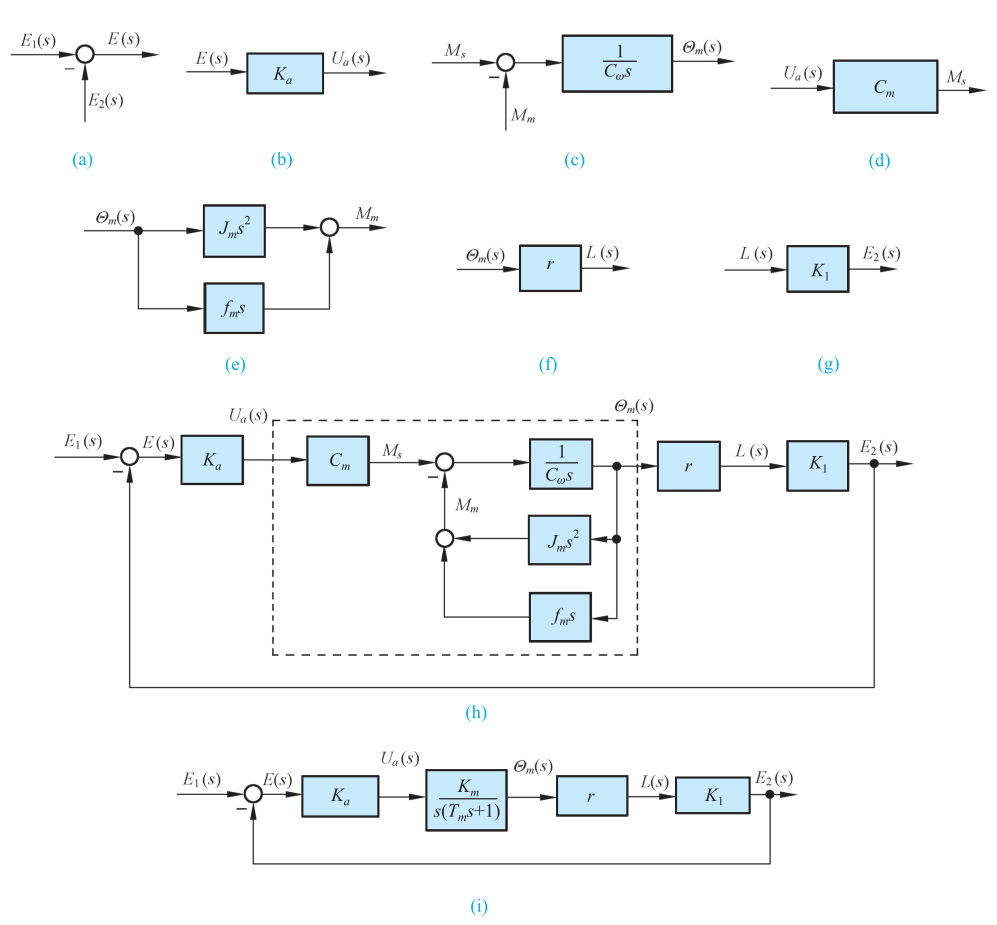{ .lq-img }

*图 2.26 电压测量装置系统结构图：(a)–(g) 各元部件方框；(h) 完整结构图；(i) 简化结构图（截自原书）*

### 2.4.2 结构图等效变换和简化

由结构图求系统传递函数需要简化。方框间基本连接方式只有**串联、并联、反馈**三种，复杂结构靠移动引出点/比较点、交换比较点来"解扣"，简化过程中**变换前后变量关系必须保持等效**。

**(1) 串联**：\(G_1\) 的输出作为 \(G_2\) 的输入（注意负载效应！），等效传递函数为乘积：

\[
C(s) = G_1(s)G_2(s)R(s)
\tag{2.80}
\]

**(2) 并联**：相同输入、输出取代数和，等效为代数和：

\[
C(s) = [G_1(s) \pm G_2(s)]R(s)
\tag{2.81}
\]

**(3) 反馈**：\(C(s) = G(s)E(s)\)、\(B(s) = H(s)C(s)\)、\(E(s) = R(s) \pm B(s)\)，消去 \(E(s), B(s)\)：

\[
C(s) = \frac{G(s)}{1 \mp G(s)H(s)}R(s)
\tag{2.82}
\]

\[
\Phi(s) = \frac{C(s)}{R(s)} = \frac{G(s)}{1 \mp G(s)H(s)}
\tag{2.83}
\]

称为**闭环传递函数**：分母中"−"对应**正反馈**，"\(+\)"对应**负反馈**。

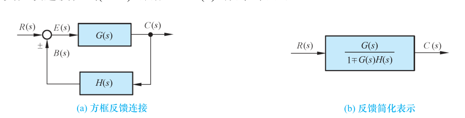{ .lq-img }

*图 2.29 方框的反馈连接及其简化：(a) 方框反馈连接；(b) 反馈简化表示（截自原书）*

**(4) 比较点和引出点的移动**：移动时保持信号等效；比较点和引出点之间一般不宜交换位置；"\(-\)"号可在信号线上越过方框移动，但不能越过比较点和引出点。**表 2-4** 汇集全部等效变换规则（原表含图示，此处给出运算关系；图形规则对照原书表 2-4）。

**表 2-4 结构图简化（等效变换）规则（原表重排）**

| 序号 | 规则 | 等效运算关系 |
| --- | --- | --- |
| (1) | 串联等效 | \(C(s) = G_1(s)G_2(s)R(s)\) |
| (2) | 并联等效 | \(C(s) = [G_1(s) \pm G_2(s)]R(s)\) |
| (3) | 反馈等效 | \(C(s) = \dfrac{G_1(s)R(s)}{1 \mp G_1(s)G_2(s)}\) |
| (4) | 等效单位反馈 | \(\dfrac{C(s)}{R(s)} = \dfrac{1}{G_2(s)}\cdot\dfrac{G_1(s)G_2(s)}{1 + G_1(s)G_2(s)}\) |
| (5) | 比较点前移 | \(C(s) = \left[R(s) \pm \dfrac{Q(s)}{G(s)}\right]G(s) = R(s)G(s) \pm Q(s)\) |
| (6) | 比较点后移 | \(C(s) = [R(s) \pm Q(s)]G(s) = R(s)G(s) \pm Q(s)G(s)\) |
| (7) | 引出点前移 | \(C(s) = R(s)G(s)\)（引出信号仍为 \(R(s)G(s)\)） |
| (8) | 引出点后移 | 引出信号 \(= \dfrac{1}{G(s)}\cdot R(s)G(s) = R(s)\)；\(C(s) = R(s)G(s)\) |
| (9) | 交换或合并比较点 | \(C(s) = R_1(s) \pm R_2(s) \pm R_3(s)\)（次序任意） |
| (10) | 交换比较点或引出点（一般不采用） | \(C(s) = R_1(s) - R_2(s)\) |
| (11) | 负号在支路上移动 | \(E(s) = [R(s) - H(s)C(s)]\)；负号越过一个方框后，\(E(s) = R(s) + H(s)\times(-1)C(s)\) |

**【例 2-17】多回路结构图化简**

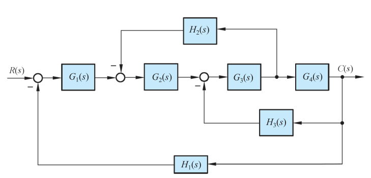{ .lq-img }

*图 2.30 例 2-17 系统结构图（截自原书）*

图 2.30 中各回路交叉，不移动引出点无法直接做方框运算。步骤：

1. 按规则 (8) 把 \(G_3\)、\(G_4\) 之间的引出点**后移**到 \(G_4\) 输出端（不宜前移），\(H_2\) 的输入信号要保持是 \(G_3\) 的输出，故反馈支路乘 \(1/G_4\)；
2. 化简 \(G_3, G_4, H_3\) 内环（式 2.83）：

\[
G_{34}(s) = \frac{G_3G_4}{1 + G_3G_4H_3}
\]

3. 化简 \(G_2, G_{34}, H_2/G_4\) 内环：

\[
G_{23}(s) = \frac{G_2G_{34}}{1 + G_2G_{34}\cdot H_2/G_4} = \frac{G_2G_3G_4}{1 + G_3G_4H_3 + G_2G_3H_2}
\]

4. 最外环 \(G_1, G_{23}, H_1\) 反馈化简：

\[
\frac{C(s)}{R(s)} = \frac{G_1G_2G_3G_4}{1 + G_2G_3H_2 + G_3G_4H_3 + G_1G_2G_3G_4H_1}
\]

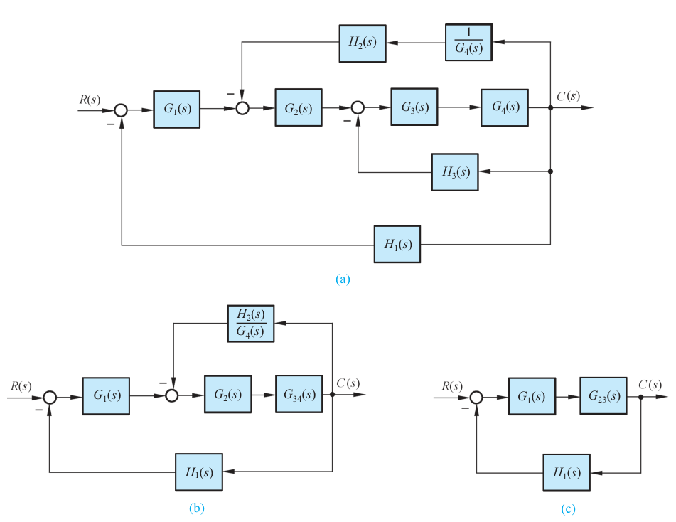{ .lq-img }

*图 2.31 例 2-17 系统结构图简化：(a) 引出点后移；(b) 化简内环一；(c) 化简内环二（截自原书）*

等效性的道理：\(H_2\) 原本从 \(G_3\) 输出取信号，引出点后移后取到的是 \(G_4\) 的输出，要乘 \(1/G_4\) 还原；比较点从 \(G_2\) 输入端移到输出端，\(G_2\) 输入少了一项，就在输出补上 \(H_2G_2\)——回路 \(G_2G_3H_2\) 的乘积保持不变。

**【例 2-18】交叉结构图化简**

原书图 2.32 中 \(G_1\) 与 \(G_2\) 之间有交叉的比较点和引出点，不能直接方框运算，也不可简单互换位置。最简便的方法：按规则 (5) 比较点前移、按规则 (8) 引出点后移，然后按规则 (2) 合并并联支路，最后按规则 (3) 化简反馈，得

\[
\frac{C(s)}{R(s)} = \frac{G_1G_2}{1 + G_1 + G_2 + G_1G_2H}
\]

（读者也可用其他变换路线验证。）

=== "MATLAB"

    ```matlab
    % ===== 书 2.4.2 节 例2-17：结构图化简（series/feedback 逐层化简） =====
    % 原理同例 2-17：引出点后移 → 内环逐层化简 → 外环化简
    s = tf('s');                    % 先造 4 个 G、3 个 H 当数值算例
    G1 = 1/(s+2); G2 = 1/(s+3); G3 = 1/(s+4); G4 = 1/(s+5);
    H1 = 1/(s+6); H2 = 2;       H3 = 3;
    sys34 = feedback(G3*G4, H3);            % 内环一：G34 = G3G4/(1+G3G4H3)
    sys23 = feedback(G2*sys34, H2/G4);      % 内环二：H2 移到 G4 后要除以 G4
    sys   = feedback(G1*sys23, H1)          % 外环
    % 与梅森公式结果互验（见 2.4.5 节例 2-20）
    P  = G1*G2*G3*G4;
    DD = 1 + G2*G3*H2 + G3*G4*H3 + G1*G2*G3*G4*H1;
    minreal(sys - P/DD)                     % 残差 ≈ 0
    ```

=== "Python"

    ```python
    # ===== 书 2.4.2 节 例2-17：结构图化简与梅森公式互验 =====
    import numpy as np
    import control as ct

    G1 = ct.tf([1], [1, 2]); G2 = ct.tf([1], [1, 3])
    G3 = ct.tf([1], [1, 4]); G4 = ct.tf([1], [1, 5])
    H1 = ct.tf([1], [1, 6]); H2 = ct.tf([2], [1]); H3 = ct.tf([3], [1])

    # 结构图等效变换路线：series/feedback 与 MATLAB 同名
    inner = ct.feedback(G3 * G4, H3)             # G34 = G3G4/(1+G3G4H3)
    mid   = ct.feedback(G2 * inner, H2 / G4)     # H2 移到 G4 之后 → 乘 1/G4
    sys_block = ct.feedback(G1 * mid, H1)

    # 梅森公式（例 2-20）：p1 = G1G2G3G4, Δ = 1 + G2G3H2 + G3G4H3 + G1G2G3G4H1, Δ1 = 1
    sys_mason = (G1 * G2 * G3 * G4) / (1 + G2 * G3 * H2 + G3 * G4 * H3
                                       + G1 * G2 * G3 * G4 * H1)
    wgrid = np.logspace(-2, 2, 400)
    dmax = np.max(np.abs(ct.frequency_response(sys_block, wgrid).complex
                         - ct.frequency_response(sys_mason, wgrid).complex))
    print('结构图化简 vs 梅森公式最大差 =', dmax)   # ~1e-18，二者恒等
    ```

### 2.4.3 信号流图的组成及性质

信号流图起源于梅森用图示法描述线性代数方程组：由**节点**和**支路**组成的信号传递网络。节点代表方程中的变量（小圆圈）；支路是连接两节点的定向线段，用**支路增益**表示两个变量的因果关系——支路相当于乘法器。原书图 2.34：两节点一条支路，\(U = IR\)，正是欧姆定律。

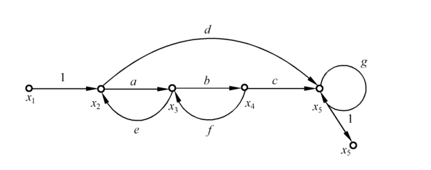{ .lq-img }

*图 2.35 典型的信号流图（截自原书）*

图 2.35 的五个节点 \(x_1, x_2, x_3, x_4, x_5\)、八条支路（增益 \(a, b, c, d, e, f, g, 1\)）对应方程组：

\[
x_2 = x_1 + ex_3, \qquad x_3 = ax_2 + fx_4, \qquad x_4 = bx_3, \qquad x_5 = dx_2 + cx_4 + gx_5
\]

每个方程左端的变量是右端变量的线性组合：右端为"原因"，左端为"结果"，信号流图把因果关节节贯通。**基本性质**：

1. 节点标志系统变量，一般自左向右设置；每个节点的变量是所有**流入**该节点的信号之代数和，同一节点**流出**各支路的信号均用该节点变量表示（如 \(x_3\) 是来自 \(x_2\) 和 \(x_4\) 的信号之和，同时又流向 \(x_4\)）；
2. 支路相当于乘法器：信号流经支路被乘以支路增益；
3. 信号在支路上只能沿箭头单向传递——只有前因后果的因果关系；
4. 对给定系统，节点变量的设置是任意的，信号流图**不唯一**。

**常用术语**（梅森公式的语言，务必配图 2.35 记牢）：

- **源节点**（输入节点）：只有输出支路、没有输入支路，一般代表输入变量（图中 \(x_1\)）；
- **阱节点**（输出节点）：只有输入支路、没有输出支路，一般代表输出变量（原书图 2.34 中的 \(U\)）；从混合节点引一条单位增益支路可把混合节点变为阱节点（图 2.35 中用单位增益支路引出的 \(x_5\)）；
- **混合节点**：既有输入支路又有输出支路（图中 \(x_2, x_3, x_4, x_5\)）；
- **前向通路**：信号从输入节点到输出节点传递时，每个节点只通过一次的通路；通路上各支路增益之乘积称**前向通路增益**，记 \(p_k\)。图 2.35 有两条：\(x_1\to x_2\to x_3\to x_4\to x_5\)，\(p_1 = abc\)；\(x_1\to x_2\to x_5\)，\(p_2 = d\)；
- **回路**：起点与终点在同一节点、且信号通过每一节点不多于一次的闭合通路（单独回路）；回路中所有支路增益之乘积称**回路增益**，记 \(L_a\)。图 2.35 有三个：\(x_2\to x_3\to x_2\)（\(L_1 = ae\)）、\(x_3\to x_4\to x_3\)（\(L_2 = bf\)）、\(x_5\to x_5\) 自回路（\(L_3 = g\)）；
- **不接触回路**：回路之间没有公共节点。图 2.35 有两对：\(x_2\to x_3\to x_2\) 与 \(x_5\to x_5\)；\(x_3\to x_4\to x_3\) 与 \(x_5\to x_5\)。

### 2.4.4 信号流图的绘制

**由微分方程绘制**：含微分/积分的方程先拉氏变换成 \(s\) 的代数方程；对每个变量设一个节点、按因果关系自左向右排列，用标明增益的支路正确连接。

**由结构图绘制**：结构图信号线上的信号 → 节点；方框 → 标有传递函数的支路。绘制时尽量精简节点：增益为 1 的相邻节点一般可合并（源节点和阱节点除外）；比较点之前没有引出点时，只需在比较点后设一个节点；比较点之前有引出点时，需在引出点和比较点各设一个节点，支路增益为 1。

**【例 2-19】由结构图到信号流图**

在结构图（原书图 2.38）信号线上标注变量名作为节点，按原顺序自左向右排列，方框换成相应增益的支路，得信号流图：

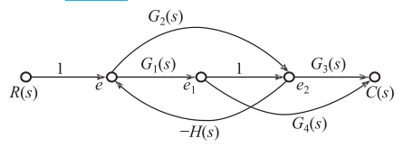{ .lq-img }

*图 2.39 例 2-19 系统的信号流图（截自原书）*

### 2.4.5 梅森增益公式

结构图等效变换繁琐。**梅森增益公式**直接从信号流图（也可直接用于结构图）写出源节点到阱节点的传递函数，不必简化。其来源：按克拉默（Cramer）法则解线性联立方程组时，把解的分子、分母多项式与流图（拓扑图）巧妙联系。

**推导**（原书图 2.40 的典型信号流图）：变量 \(U_i, U_o\) 之间，节点方程为

\[
X_1 = aU_i + fX_3, \quad X_2 = bX_1 + gX_3, \quad X_3 = cX_2 + hX_4, \quad X_4 = dX_3 + eU_i, \quad U_o = X_4
\]

整理为齐次形式后按克拉默法则解 \(X_4\)，系数行列式

\[
\Delta = 1 - (fb + gc + dh) + fbdh
\tag{2.84}
\]

\[
\Delta_4 = (1 - gc - bf)\,abcd\,U_i + (1 - gc - bf)\,eU_i + \cdots
\tag{2.85}
\]

于是

\[
\frac{U_o}{U_i} = \frac{X_4}{U_i} = \frac{abcd + e - (gce + bfe)}{1 - (fb + gc + dh) + fbdh}
\tag{2.86}
\]

对分母、分子做流图解读：分母 \(\Delta\) 中 \(-(fb+gc+dh)\) 是**三个单独回路增益之和**，\(fbdh\) 是**两个不接触回路增益乘积**；分子中 \(abcd + e\) 是**两条前向通路增益之和**，\(-(gce+bfe)\) 是"与前向通路 \(e\) 不接触的回路增益 × 该通路增益"之和。用流图术语写成：

\[
\Delta = 1 - \sum L_a + \sum L_bL_c
\tag{2.87}
\]

\[
\frac{U_o}{U_i} = \frac{\sum p_k - \sum p_iL_i}{\Delta} = \frac{\sum p_k\Delta_k}{\Delta}
\tag{2.88, 2.89}
\]

其中 \(\Delta_i = 1 - L_i\)（\(L_i\) 为与第 \(i\) 条前向通路**不接触**的回路增益之和；若前向通路与所有回路都接触则 \(L_i = 0\)、\(\Delta_i = 1\)）。

推而广之，**梅森增益公式**：

\[
P = \frac{1}{\Delta}\sum_{k=1}^{n} p_k\Delta_k
\tag{2.91}
\]

- \(P\)：从源节点到阱节点的传递函数（总增益）；
- \(n\)：前向通路总数；
- \(p_k\)：第 \(k\) 条前向通路增益；
- \(\Delta\)：**流图特征式**，

\[
\Delta = 1 - \sum L_a + \sum L_bL_c - \sum L_dL_eL_f + \cdots
\]

\(\sum L_a\) 为所有单独回路增益之和；\(\sum L_bL_c\) 为每两个互不接触回路增益乘积之和；\(\sum L_dL_eL_f\) 为每三个互不接触回路增益乘积之和……；
- \(\Delta_k\)：**流图余因子式**，等于 \(\Delta\) 中除去与第 \(k\) 条前向通路接触的回路增益项（包括回路增益乘积项）后的余项式。

**【例 2-20】用梅森公式重解例 2-17**

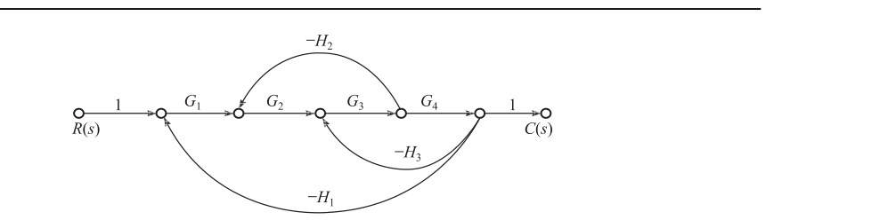{ .lq-img }

*图 2.41 与图 2.30 对应的系统信号流图（截自原书）*

从源节点 \(R\) 到阱节点 \(C\)：一条前向通路 \(p_1 = G_1G_2G_3G_4\)；三个单独回路 \(L_1 = -G_2G_3H_2\)、\(L_2 = -G_3G_4H_3\)、\(L_3 = -G_1G_2G_3G_4H_1\)；无不接触回路，且前向通路与所有回路均接触，\(\Delta_1 = 1\)。由式 (2.91)：

\[
\frac{C(s)}{R(s)} = \frac{P = p_1}{\Delta} = \frac{G_1G_2G_3G_4}{1 + G_2G_3H_2 + G_3G_4H_3 + G_1G_2G_3G_4H_1}
\]

与例 2-17 结构图变换结果完全一致——梅森公式一次到位。

**【例 2-21】双摆系统（建模四件套综合演练）**

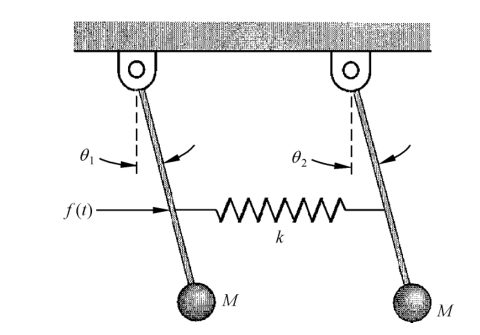{ .lq-img }

*图 2.42 双摆系统示意图（截自原书）*

双摆悬挂在无摩擦旋轴上，中点用弹簧连接。摆质量 \(M\)、摆杆长 \(l\)（质量不计），弹簧置于杆的 \(l/2\) 处、弹性系数 \(k\)；角位移很小可线性近似；\(\theta_1 = \theta_2\) 时弹簧无变形；外力 \(f(t)\) 只作用于左杆。令 \(a = g/l + k/(4M)\)、\(b = k/(4M)\)。要求：1) 列运动方程；2) 求 \(\Theta_1(s)/F(s)\)；3) 画结构图与信号流图。

**1) 运动方程。** 弹簧压力（摆杆转 \(\theta\) 时弹簧连接点横移 \(\frac{l}{2}\sin\theta\)）：

\[
F = k\frac{l}{2}(\sin\theta_1 - \sin\theta_2)
\]

左边摆杆（对旋轴取矩，\(f(t)\) 与弹簧力 \(F\) 的力臂均为 \(l/2\)）：

\[
f(t)\frac{l}{2}\cos\theta_1 - F\frac{l}{2}\cos\theta_1 - Mgl\sin\theta_1 = Ml^2\frac{\mathrm{d}^2\theta_1}{\mathrm{d}t^2}
\]

右边摆杆：

\[
F\frac{l}{2}\cos\theta_2 - Mgl\sin\theta_2 = Ml^2\frac{\mathrm{d}^2\theta_2}{\mathrm{d}t^2}
\]

小角度近似 \(\sin\theta_1 \approx \theta_1\)、\(\sin\theta_2 \approx \theta_2\)、\(\cos\theta_1 \approx \cos\theta_2 \approx 1\)，代入 \(F\) 并整理：

\[
\frac{\mathrm{d}^2\theta_1}{\mathrm{d}t^2} = -a\theta_1 + b\theta_2 + \frac{f(t)}{2Ml}, \qquad
\frac{\mathrm{d}^2\theta_2}{\mathrm{d}t^2} = -a\theta_2 + b\theta_1
\]

**2) 传递函数。** 零初始条件拉氏变换：

\[
(s^2 + a)\Theta_1(s) - b\Theta_2(s) = \frac{F(s)}{2Ml}, \qquad
(s^2 + a)\Theta_2(s) = b\Theta_1(s)
\]

由第二式 \(\Theta_2(s) = \dfrac{b}{s^2+a}\Theta_1(s)\)，代回第一式解出

\[
\frac{\Theta_1(s)}{F(s)} = \frac{s^2 + a}{2Ml\left[(s^2+a)^2 - b^2\right]}
\]

**3) 结构图与信号流图。** 按信号传递关系画出（结构图为两个积分器加反馈的对称结构，见原书图 2.43；信号流图见原书图 2.44）：

**4) 用梅森公式求 \(\Theta_1(s)/F(s)\)。** 为便于观察，把信号流图（原书图 2.44）改画成图 2.45（节点重排、回路标号）：

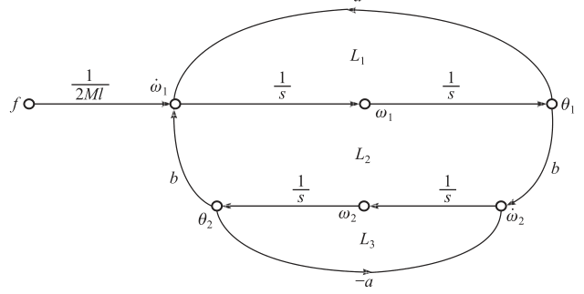{ .lq-img }

*图 2.45 双摆系统信号流图（改画，截自原书）*

- 单独回路三个：\(L_1 = -\dfrac{a}{s^2}\)（\(\omega_1\) 环）、\(L_2 = \dfrac{b^2}{s^4}\)（\(\theta_1 \to \dot\omega_2 \to \omega_2 \to \theta_2 \to \dot\omega_1 \to \omega_1 \to \theta_1\) 交叉环）、\(L_3 = -\dfrac{a}{s^2}\)（\(\omega_2\) 环）；
- 不接触回路一对：\(L_1\) 与 \(L_3\)（无公共节点）；
- 前向通路一条：\(p_1 = \dfrac{1}{2Ml}\cdot\dfrac{1}{s}\cdot\dfrac{1}{s} = \dfrac{1}{2Mls^2}\)，它与 \(L_1, L_2\) 接触、与 \(L_3\) 不接触，故 \(\Delta_1 = 1 - L_3 = 1 + \dfrac{a}{s^2}\)。

于是

\[
\Delta = 1 - \left(L_1 + L_2 + L_3\right) + L_1L_3 = 1 + \frac{2a}{s^2} + \frac{a^2 - b^2}{s^4} = \frac{(s^2+a)^2 - b^2}{s^4}
\]

\[
\frac{\Theta_1(s)}{F(s)} = \frac{p_1\Delta_1}{\Delta} = \frac{\dfrac{1}{2Mls^2}\left(1 + \dfrac{a}{s^2}\right)}{\dfrac{(s^2+a)^2 - b^2}{s^4}} = \frac{s^2 + a}{2Ml\left[(s^2+a)^2 - b^2\right]}
\]

与 2) 的拉氏变换法结果一致——四种建模方法（微分方程、传递函数、结构图、信号流图）可以互相转化与验证。

!!! note "拓展：余因子式 \(\Delta_k\) 最容易算错（补充）"
    \(\Delta_k\) 不是"\(\Delta\) 去掉与通路接触的回路"后剩下的数字，而是**特征式中删去这些回路项后余下的整式**。本例中 \(\Delta = 1 - L_1 - L_2 - L_3 + L_1L_3\)，删去含 \(\theta_1\) 节点的 \(L_1, L_2\)（以及乘积项 \(L_1L_3\) 中含 \(L_1\) 的部分）后只剩 \(1 - L_3\)，即 \(\Delta_1 = 1 + a/s^2\)。判断"接触"只看**节点集合是否相交**，与通路方向无关；每条前向通路的 \(\Delta_k\) 要单独算，不能共用。

### 2.4.6 闭环系统的传递函数

反馈控制系统常有两个外作用：有用输入 \(R(s)\) 与扰动 \(N(s)\)；输出为 \(C(s)\)。需要分别求：输入作用下的闭环传递函数 \(C(s)/R(s)\)、扰动作用下的闭环传递函数 \(C(s)/N(s)\)，以及以误差 \(E(s)\) 为输出的误差传递函数 \(E(s)/R(s)\)、\(E(s)/N(s)\)。

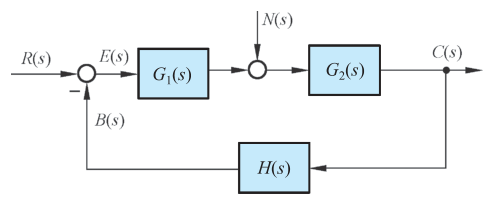{ .lq-img }

*图 2.46 反馈控制系统的典型结构图（截自原书）**

**(1) 输入信号下的闭环传递函数**：令 \(N(s) = 0\)：

\[
\Phi(s) = \frac{C(s)}{R(s)} = \frac{G_1(s)G_2(s)}{1 + G_1(s)G_2(s)H(s)}
\tag{2.92}
\]

\[
C(s) = \Phi(s)R(s) = \frac{G_1(s)G_2(s)}{1 + G_1(s)G_2(s)H(s)}R(s)
\tag{2.93}
\]

输出响应取决于闭环传递函数及输入信号的形式。

**(2) 扰动作用下的闭环传递函数**：令 \(R(s) = 0\)（把结构图改画成"扰动在前"的形式，见原书图 2.47）：

\[
\Phi_n(s) = \frac{C(s)}{N(s)} = \frac{G_2(s)}{1 + G_1(s)G_2(s)H(s)}
\tag{2.94}
\]

\[
C(s) = \Phi_n(s)N(s) = \frac{G_2(s)}{1 + G_1(s)G_2(s)H(s)}N(s)
\]

两作用同时施加时由叠加原理：

\[
C(s) = \Phi(s)R(s) + \Phi_n(s)N(s) = \frac{G_1G_2R(s) + G_2N(s)}{1 + G_1G_2H(s)}
\]

若满足 \(\vert G_1(s)G_2(s)H(s)\vert \gg 1\) 和 \(\vert G_1(s)H(s)\vert \gg 1\)，则简化为

\[
C(s) \approx \frac{R(s)}{H(s)}
\tag{2.95}
\]

输出只取决于反馈通路传递函数 \(H(s)\) 及输入 \(R(s)\)，与前向通路传递函数无关，也不受扰动影响。特别当 \(H(s) = 1\)（单位反馈）时 \(C(s) \approx R(s)\)，近似实现了对输入的完全复现，且对扰动有较强抑制能力。

**(3) 闭环误差传递函数**：以误差 \(E(s) = R(s) - B(s)\) 为输出：

\[
\Phi_e(s) = \frac{E(s)}{R(s)} = \frac{1}{1 + G_1(s)G_2(s)H(s)}
\tag{2.96}
\]

\[
\Phi_{en}(s) = \frac{E(s)}{N(s)} = \frac{-G_2(s)H(s)}{1 + G_1(s)G_2(s)H(s)}
\tag{2.97}
\]

**关键结论**：图 2.46 典型反馈系统的四种闭环传递函数 \(\Phi, \Phi_n, \Phi_e, \Phi_{en}\) 的**分母形式相同**——都是同一个特征式 \(1 + G_1(s)G_2(s)H(s)\)，其中 \(G_1(s)G_2(s)H(s)\) 称为系统的**开环传递函数**（主反馈断开后，从 \(R(s)\) 到反馈信号 \(B(s)\) 的传递函数）。线性系统可用叠加原理分别研究各种情况下的 \(C(s)\) 或 \(E(s)\) 再叠加；但**绝不允许把各种闭环传递函数叠加后求输出响应**。

## 2.5 控制系统建模的仿真方法

常用的系统模型有传递函数模型、零极点模型、状态空间模型等，MATLAB 与 Python 中函数调用格式一致。以图 2.48 的系统为例。

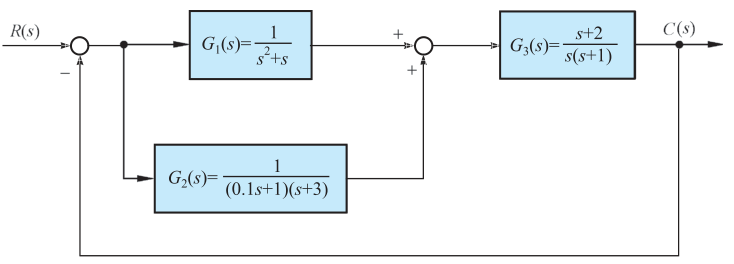{ .lq-img }

*图 2.48 控制系统结构图（截自原书）*

### 2.5.1 系统模型描述

**传递函数模型**：

```text
sys = tf(num, den, Ts)
```

`num, den` 是分子、分母多项式**按降幂排列**的系数向量；`Ts` 为采样时间，缺省时描述连续系统。图 2.48 中 \(G_1(s) = \dfrac{1}{s^2+s}\) 描述为 `G1 = tf([1], [1 1 0])`。

分子分母为因式连乘形式时，先用 `conv` 做多项式相乘展开。\(G_2(s) = \dfrac{1}{(0.1s+1)(s+3)}\)：

```text
num = 1; den = conv([0.1 1], [1 3]); G2 = tf(num, den)
```

**零极点模型**：

```text
sys = zpk(z, p, k, Ts)
```

`z, p, k` 分别为零点、极点、增益；无零（极）点用 `[]`。\(G_3(s) = \dfrac{s+2}{s(s+1)}\)（零点 \(-2\)、极点 \(0, -1\)）：

```text
G3 = zpk([-2], [0 -1], 1)
```

**状态空间模型**：将在第 9 章结合实例介绍。

### 2.5.2 模型转换

```text
[num, den] = zp2tf(z, p, k)     % 零极点模型 → 传递函数模型
[z, p, k]  = tf2zp(num, den)    % 传递函数模型 → 零极点模型
```

例如 `[z, p, k] = tf2zp([1], [1 1 0])` 把 \(G_1\) 转为零极点形式；`[num, den] = zp2tf([-2], [0 -1], 1)` 把 \(G_3\) 转回传递函数形式。

### 2.5.3 系统连接

最基本的三种连接方式（图 2.48 中全部出现）：

```text
sys = parallel(sys1, sys2)      % 并联：SISO 系统相当于 "+"
sys = series(sys1, sys2)        % 串联：SISO 系统相当于 "*"
sys = feedback(sys1, sys2, sign) % 反馈：sign=+1 正反馈，缺省 -1 负反馈
```

图 2.48：\(G_1\) 与 \(G_2\) 并联成 \(G_{12}\)，再与 \(G_3\) 串联成开环 \(G\)，单位负反馈闭环：

```text
G12 = parallel(G1, G2);  G = series(G12, G3);  sys = feedback(G, 1, -1)
```

三个环节一起建出来并连成闭环（Python 侧的闭环结果：\(\dfrac{1.1s^3 + 4.5s^2 + 7.6s + 6}{0.1s^6 + 1.5s^5 + 5.7s^4 + 8.4s^3 + 7.5s^2 + 7.6s + 6}\)）：

=== "MATLAB"

    ```matlab
    % ===== 书 2.5 节：图2-48 系统建模 / 模型转换 / 连接 =====
    s = tf('s');
    G1 = tf([1], [1 1 0]);                     % 1/(s^2+s)
    num2 = 1; den2 = conv([0.1 1], [1 3]);     % 因式连乘 → conv 展开
    G2 = tf(num2, den2);                       % 1/((0.1s+1)(s+3))
    G3 = zpk([-2], [0 -1], 1);                 % (s+2)/(s(s+1))
    [z, p, k] = tf2zp([1], [1 1 0])            % 模型转换：tf → zpk
    [num, den] = zp2tf([-2], [0 -1], 1)        % zpk → tf
    G12 = parallel(G1, G2);                    % 并联
    G   = series(G12, G3);                     % 串联
    sys = feedback(G, 1, -1)                   % 单位负反馈闭环
    ```

=== "Python"

    ```python
    # ===== 书 2.5 节：图2-48 系统建模 / 模型转换 / 连接 =====
    # tf/zpk/parallel/series/feedback 两库同名；
    # MATLAB conv ↔ numpy.convolve；MATLAB tf2zp/zp2tf ↔ scipy.signal.tf2zpk/zpk2tf
    import numpy as np
    import control as ct
    from scipy.signal import tf2zpk, zpk2tf

    G1 = ct.tf([1], [1, 1, 0])                       # G1 = tf([1],[1 1 0])
    G2 = ct.tf([1], np.convolve([0.1, 1], [1, 3]))   # 1/((0.1s+1)(s+3))
    G3 = ct.zpk([-2], [0, -1], 1)                    # (s+2)/(s(s+1))

    z, p, k = tf2zpk([1], [1, 1, 0])                 # tf2zp：z=[] p=[-1,0] k=1
    print('tf2zpk(G1):', z, p, k)
    num, den = zpk2tf([-2], [0, -1], 1)              # zp2tf：num=[1 2] den=[1 1 0]
    print('zpk2tf(G3):', num, den)

    G12 = ct.parallel(G1, G2)                        # 并联
    G   = ct.series(G12, G3)                         # 串联
    sys = ct.feedback(G, 1, sign=-1)                 # 单位负反馈闭环
    print(sys)
    ```

### 2.5.4 综合应用：多回路系统闭环传递函数

**【例 2-22】**

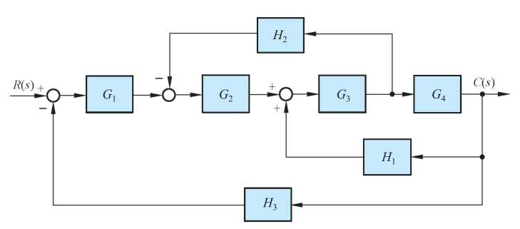{ .lq-img }

*图 2.49 多回路反馈系统结构图（截自原书）*

各环节：\(G_1 = \dfrac{1}{s+10}\)，\(G_2 = \dfrac{1}{s+1}\)，\(G_3 = \dfrac{s^2+1}{s^2+4s+4}\)，\(G_4 = \dfrac{s+1}{s+6}\)，\(H_1 = \dfrac{s+1}{s+2}\)，\(H_2 = 2\)，\(H_3 = 1\)。求闭环传递函数 \(C(s)/R(s)\)。

化简思路（对应图 2.49 的嵌套结构）：\(H_2\) 从 \(G_3\) 输出引出，先把它移到 \(G_4\) 之后（支路乘 \(G_4\)，得 \(\dfrac{2(s+6)}{s+1}\)）；由内向外逐环用 `series`/`feedback`：

1. `sys1 = series(G3, G4)`；`sys2 = feedback(sys1, H1, +1)`——注意此内环是**正反馈**；
2. `sys3 = series(G2, sys2)`；`sys4 = feedback(sys3, H2)`——\(H_2\) 移位后构成负反馈；
3. `sys5 = series(G1, sys4)`；`sys = feedback(sys5, H3)`——主回路单位负反馈。

运行结果（零极点增益形式）：

\[
\frac{C(s)}{R(s)} = \frac{0.083333\,(s+1)^2(s+2)(s^2+1)}{(s+10.12)(s+2.44)(s+2.349)(s+1)(s^2+1.176s+1.023)}
\]

式中"^"表示乘方。

=== "MATLAB"

    ```matlab
    % ===== 书 2.5 节 例2-22：多回路反馈系统闭环传递函数 =====
    G1 = tf([1], [1 10]); G2 = tf([1], [1 1]); G3 = tf([1 0 1], [1 4 4]);
    numg4 = [1 1]; deng4 = [1 6]; G4 = tf(numg4, deng4);
    H1 = zpk([-1], [-2], 1);
    numh2 = [2]; denh2 = [1]; H3 = 1;          % 建立各个方框子系统模型
    nh2 = conv(numh2, deng4);                  % 先将 H2 移至 G4 之后:
    dh2 = conv(denh2, numg4);                  % H2 = 2*(s+6)/(s+1)
    H2 = tf(nh2, dh2);
    sys1 = series(G3, G4);
    sys2 = feedback(sys1, H1, +1);             % G3、G4 和 H1 回路（正反馈）
    sys3 = series(G2, sys2);
    sys4 = feedback(sys3, H2);                 % H2 构成反馈回路
    sys5 = series(G1, sys4);
    sys = feedback(sys5, H3)                   % H3 主回路，输出闭环传递函数
    % → Zero/pole/gain: 0.083333 (s+1)^2 (s+2) (s^2+1)
    %   / ((s+10.12)(s+2.44)(s+2.349)(s+1)(s^2+1.176s+1.023))
    ```

=== "Python"

    ```python
    # ===== 书 2.5 节 例2-22：多回路反馈系统闭环传递函数 =====
    # 书用 import control as ctr，这里沿用笔记惯例 ct；函数名与 MATLAB 同名
    import numpy as np
    import control as ct

    G1 = ct.tf([1], [1, 10])
    G2 = ct.tf([1], [1, 1])
    G3 = ct.tf([1, 0, 1], [1, 4, 4])
    G4 = ct.tf([1, 1], [1, 6])
    H1 = ct.tf([1, 1], [1, 2])        # zpk([-1],[-2],1) 的 tf 等价形式
    H3 = 1                            # 建立各个方框子系统模型

    nh2 = np.convolve([2], [1, 6])    # 先将 H2 移至 G4 之后：
    dh2 = np.convolve([1], [1, 1])    # H2 = 2*(s+6)/(s+1)
    H2 = ct.tf(nh2, dh2)

    sys1 = ct.series(G3, G4)
    sys2 = ct.feedback(sys1, H1, sign=+1)   # G3、G4 和 H1 回路（正反馈）
    sys3 = ct.series(G2, sys2)
    sys4 = ct.feedback(sys3, H2)            # H2 构成反馈回路
    sys5 = ct.series(G1, sys4)
    sys  = ct.feedback(sys5, H3)            # H3 构成反馈主回路的闭环模型
    print(sys)
    # → (s^5 + 4 s^4 + 6 s^3 + 6 s^2 + 5 s + 2)
    #   / (12 s^6 + 205 s^5 + 1066 s^4 + 2517 s^3 + 3128 s^2 + 2196 s + 712)

    from scipy.signal import tf2zpk
    z, p, k = tf2zpk(sys.num[0][0], sys.den[0][0])
    print('K* =', round(k, 6))                # 0.083333
    print('零点:', np.round(z, 3))            # [-2, ±1j, -1, -1]
    print('极点:', np.round(p, 3))            # [-10.12, -2.44, -2.349, -1, -0.588±0.823j]
    ```

## 坑与陷阱

!!! danger "8 个容易踩的坑"
    1. **终值定理不是万能钥匙**：\(f(t)\) 必须有终值（\(sF(s)\) 在右半平面及虚轴解析）才能用。正弦输入、不稳定系统的"终值"都是假的；例 2-12 敢用，是因为极点 \(-0.5\pm 0.866\mathrm{j}\) 都在左半平面。第 3 章求稳态误差前先判稳，就是这个道理。
    2. **0⁻ 型与 0⁺ 型下限**：\(\delta(t)\) 的 \(0^+\) 型变换是 0，\(0^-\) 型才是 1。本书与 MATLAB 默认 \(0^-\)；SymPy 的 `laplace_transform` 按 \(0^+\) 算，对 \(\delta(t)\) 给 0——写脚本时要么手工补 \(\delta\) 项，要么记住这个差异。
    3. **重根留数要除阶乘并逐阶求导**：\(r\) 重极点的第 \(j\) 阶留数是 \(\frac{1}{j!}\lim\frac{\mathrm{d}^j}{\mathrm{d}s^j}[(s-s_1)^rF(s)]\)，漏掉 \(j!\) 或求导对象写错（忘了先乘 \((s-s_1)^r\)）是最常见错误；MATLAB `residue` 的重根留数按 \(c_r,\cdots,c_1\) 顺序输出，别排反。
    4. **串联相乘前先想负载效应**：两级 RC 网络直接连接后 \(G(s) \ne G_1(s)G_2(s)\)，多出的 \(R_1C_2\) 项就是后级对前级的反作用。只有后级输入阻抗足够大（或加隔离放大器）才能直接乘。结构图的"串联方框"默认已经消除了负载效应，两者不要混。
    5. **小偏差线性化是工作点局部模型**：\(\phi(i) = Ki\) 的 \(K\) 取决于平衡点 \(i_0\)，工作点一变 \(K\) 就变；增量方程也不能拿来算大幅运动。铁心线圈、水槽液阻、加热炉 \(Q_i\)-\(u\) 关系全是如此。
    6. **比较点/引出点移动必须补偿**：引出点后移要乘 \(1/G\)（例 2-17 的 \(H_2/G_4\)），比较点后移要在支路里补 \(G\)；"\(-\)"号可以越过方框，不能越过比较点和引出点。移动后用"回路乘积不变"自查：\(G_2G_3H_2\) 这类闭环特征在变换前后必须一致。
    7. **梅森公式的 \(\Delta_k\) 别想当然**：只有前向通路与**所有**回路都接触时 \(\Delta_k = 1\)。例 2-21 中 \(\theta_2\) 回路与前向通路不接触，\(\Delta_1 = 1 + a/s^2\) 而不是 1；漏掉这一项，分子就少一个 \((s^2+a)\)。不接触回路看节点集合，不看几何位置。
    8. **闭环传递函数不能叠加**：\(\Phi(s) + \Phi_n(s)\) 没有物理意义。线性系统叠加的是**输出** \(C(s) = \Phi R + \Phi_n N\)，不是传递函数。四种闭环传递函数分母同为特征式 \(1+G_1G_2H\)，分子各不相同，混写分子是常见失分点。

## 术语速查

| 英文 | 中文 | 一句话 |
| --- | --- | --- |
| Fourier series | 傅里叶级数 | 周期信号分解为正余弦谐波之和（式 2.1） |
| Dirichlet condition | 狄利克雷条件 | 可展开级数/可变换的收敛条件（有限间断点、极值点、绝对可积） |
| Fourier transform | 傅里叶变换 | 非周期信号的时域→频域变换对（式 2.9、2.10） |
| spectrum | 频谱 | \(\vert F(\omega)\vert\) 随 \(\omega\) 的分布 |
| Laplace transform | 拉普拉斯变换 | \(F(s)=\int f\mathrm{e}^{-st}\mathrm{d}t\)，把微分方程变成代数方程 |
| image function / original function | 象函数 / 原函数 | \(F(s)\) 与 \(f(t)\) 的别称 |
| convergence factor | 收敛因子 | \(\mathrm{e}^{-\sigma t}\)，把不可积函数拉进傅氏/拉氏变换 |
| convolution | 卷积 | \(f_1*f_2\)，时域卷积对应 \(s\) 域乘积 |
| initial/final value theorem | 初值/终值定理 | \(f(0^+)=\lim sF(s)\)，\(\lim f = \lim sF(s)\)（需有终值） |
| partial fraction expansion | 部分分式展开（赫维赛德展开） | 有理 \(F(s)\) 拆成查表简单分式之和 |
| residue | 留数 | \(c_i = \lim(s-s_i)F(s)\)，部分分式系数 |
| transfer function | 传递函数 | 零初始条件下 \(C(s)/R(s)\)，复数域模型 |
| zero / pole | 零点 / 极点 | 分子/分母多项式的根，决定响应的模态与形状 |
| root-trace gain \(K^*\) / gain \(K\) | 根轨迹增益 / 增益 | 零极点形式增益 \(b_0/a_0\) 与时间常数形式增益 \(b_m/a_n\) |
| mode | 模态 | 极点对应的自由运动形态 \(\mathrm{e}^{p_jt}\) |
| impulse response | 脉冲响应 | \(g(t)=\mathscr{L}^{-1}[G(s)]\)，系统的"指纹" |
| loading effect | 负载效应 | 后级接入改变前级输出的现象，串联公式的前提杀手 |
| block diagram | 结构图（方框图） | 信号线+引出点+比较点+方框组成的图形模型 |
| signal flow graph | 信号流图 | 节点+支路的信号传递网络，只适用线性系统 |
| source/sink node | 源节点 / 阱节点 | 只有出/入支路的节点，对应输入/输出变量 |
| forward path | 前向通路 | 源到阱、每节点只过一次的通路，增益 \(p_k\) |
| loop / non-touching loops | 回路 / 不接触回路 | 闭合通路（增益 \(L_a\)）；无公共节点的回路组 |
| Mason gain formula | 梅森增益公式 | \(P=\frac{1}{\Delta}\sum p_k\Delta_k\)，流图直读传递函数 |
| characteristic equation | 特征式 \(\Delta\) | \(1-\sum L_a+\sum L_bL_c-\cdots\)，闭环分母的源头 |
| open-loop transfer function | 开环传递函数 | 反馈断开后 \(R(s)\to B(s)\) 的传递函数 \(G_1G_2H\) |
| small-deviation linearization | 小偏差线性化 | 工作点泰勒展开取一阶，\(\Delta y = K\Delta x\) |

## 覆盖自查

??? note "原书小节 → 笔记位置"
    | 原书内容 | 笔记位置 |
    | --- | --- |
    | 章首引言（模型分类、分析法/实验法） | 2.1 开头 |
    | 2-1.1 傅里叶级数（式 2-1~2-5、表 2-1、例 2-1） | 2.1.1 |
    | 2-1.2 傅里叶积分和傅氏变换（式 2-6~2-10、例 2-2） | 2.1.2 |
    | 2-1.3 拉普拉斯变换（定义式 2-11~2-12、例 2-3、例 2-4） | 2.1.3 |
    | 2-1.4 拉氏变换积分下限（0⁻/0⁺） | 2.1.3 末 |
    | 2-1.5 拉氏变换定理 8 条 + 表 2-2 + 表 2-3 | 2.1.4 |
    | 2-1.6 拉氏反变换部分分式法（式 2-13~2-18、例 2-5、例 2-6） | 2.1.5 |
    | 2-2.1 线性元件微分方程（例 2-7~2-10、式 2-19~2-39） | 2.2.1 |
    | 2-2.2 系统微分方程建立（例 2-11、式 2-40~2-46、相似系统） | 2.2.2 |
    | 2-2.3 线性系统基本特性（叠加原理） | 2.2.3 |
    | 2-2.4 微分方程求解（例 2-12、式 2-47~2-50） | 2.2.4 |
    | 2-2.5 非线性微分方程线性化（图 2-10、例 2-13、式 2-51~2-53） | 2.2.5 |
    | 2-3.1 传递函数定义与性质（式 2-54~2-58、例 2-14、例 2-15） | 2.3.1 |
    | 2-3.2 零点和极点（式 2-59~2-60） | 2.3.2 |
    | 2-3.3 极点零点对输出的影响（图 2-13 例子） | 2.3.3 |
    | 2-3.4 典型元部件传递函数（电位器/测速机/伺服机/无源网络/水槽/加热炉/延迟水槽，式 2-61~2-79） | 2.3.4 |
    | 2-4.1 结构图组成与绘制（图 2-24、例 2-16） | 2.4.1 |
    | 2-4.2 等效变换与简化（式 2-80~2-83、表 2-4、例 2-17、例 2-18） | 2.4.2 |
    | 2-4.3 信号流图组成与性质（图 2-34、2-35、术语全套） | 2.4.3 |
    | 2-4.4 信号流图绘制（图 2-36、2-37、例 2-19） | 2.4.4 |
    | 2-4.5 梅森增益公式（式 2-84~2-91、例 2-20、例 2-21） | 2.4.5 |
    | 2-4.6 闭环系统传递函数（式 2-92~2-97、图 2-46、2-47） | 2.4.6 |
    | 2-5 建模仿真（tf/zpk/转换/连接、例 2-22） | 2.5 |
