# 第 3 章 线性系统的时域分析法

> **本章解决**：第 2 章把系统抽象成了传递函数，这一章回答最直接的问题——给它一个典型输入，输出随时间到底怎么走？时域分析法直接在时间域中求解、评价系统：先统一性能语言（上升/峰值/调节时间、超调量，3-1）；再把一阶、二阶系统的响应完全推透，得到动态指标与 \(\zeta\)、\(\omega_n\) 的闭式关系，并给出比例-微分、测速反馈两条改善性能的路线（3-2、3-3）；高阶系统用闭环主导极点降阶近似（3-4）；判稳不必求根，劳斯判据一张表解决，还能顺手定参数取值范围（3-5）；稳态精度用型别与静态误差系数查表即得，扰动误差另算（3-6）；最后全部交给 MATLAB/Python 仿真验证（3-7）。时域法直观、准确，是后面根轨迹法（第 4 章）与频域法（第 5 章）的基准。本章插图沿用原书图号（图 3-1～图 3-40），公式沿用原书式号 (3-1)～(3-68)。

## 3.0 本章导图

<div class="brtree">
  <div class="brrow">
    <span class="brlabel root">线性系统的时域分析</span>
    <span class="brace"></span>
    <div class="brkids">
      <div class="brrow">
        <span class="brlabel">性能指标（3-1）</span>
        <span class="brace"></span>
        <div class="brkids">
          <span class="brleaf">典型输入信号（表3-1）</span>
          <span class="brleaf">动态过程与稳态过程</span>
          <span class="brleaf">tr、tp、ts 定义</span>
          <span class="brleaf">超调量 σ%</span>
          <span class="brleaf">稳态误差 e<sub>ss</sub></span>
        </div>
      </div>
      <div class="brrow">
        <span class="brlabel">一阶系统（3-2）</span>
        <span class="brace"></span>
        <div class="brkids">
          <span class="brleaf">RC 电路：1/(Ts+1)</span>
          <span class="brleaf">阶跃 1−e<sup>−t/T</sup>，t<sub>r</sub>=2.2T</span>
          <span class="brleaf">脉冲、斜坡、加速度响应</span>
          <span class="brleaf">响应汇总（表3-2）</span>
          <span class="brleaf">微积分等价特性</span>
        </div>
      </div>
      <div class="brrow">
        <span class="brlabel">二阶系统（3-3）</span>
        <span class="brace"></span>
        <div class="brkids">
          <span class="brleaf">标准形式与特征根</span>
          <span class="brleaf">欠阻尼/临界/过阻尼全推导</span>
          <span class="brleaf">指标闭式（ζ、ω<sub>n</sub>）</span>
          <span class="brleaf">例3-1、例3-2</span>
          <span class="brleaf">比例-微分与测速反馈</span>
        </div>
      </div>
      <div class="brrow">
        <span class="brlabel">高阶系统（3-4）</span>
        <span class="brace"></span>
        <div class="brkids">
          <span class="brleaf">闭环零点与极点</span>
          <span class="brleaf">主导极点降阶</span>
          <span class="brleaf">例3-5、例3-6</span>
          <span class="brleaf">零点加快响应、远极点增阻尼</span>
        </div>
      </div>
      <div class="brrow">
        <span class="brlabel">稳定性（3-5）</span>
        <span class="brace"></span>
        <div class="brkids">
          <span class="brleaf">定义与充要条件</span>
          <span class="brleaf">必要条件：系数全为正</span>
          <span class="brleaf">劳斯表全规则</span>
          <span class="brleaf">两种特殊行处理</span>
          <span class="brleaf">给定稳定度定参数范围</span>
        </div>
      </div>
      <div class="brrow">
        <span class="brlabel">稳态误差（3-6）</span>
        <span class="brace"></span>
        <div class="brkids">
          <span class="brleaf">误差的两种定义</span>
          <span class="brleaf">型别与 K<sub>p</sub>、K<sub>v</sub>、K<sub>a</sub></span>
          <span class="brleaf">表 3-5 查误差</span>
          <span class="brleaf">扰动作用下的误差</span>
          <span class="brleaf">减小误差三措施</span>
        </div>
      </div>
      <div class="brrow">
        <span class="brlabel">时域仿真（3-7）</span>
        <span class="brace"></span>
        <div class="brkids">
          <span class="brleaf">roots 判稳</span>
          <span class="brleaf">step / stepinfo</span>
          <span class="brleaf">impulse / lsim / initial</span>
          <span class="brleaf">劳斯表辅助、误差系数计算</span>
        </div>
      </div>
    </div>
  </div>
</div>

## 3.1 系统的时域性能指标

控制系统性能的评价分为**动态性能指标**和**稳态性能指标**两类。要求时间响应，先得约定输入信号——实际系统的输入往往无法预先确定（防空火炮系统里敌机的位置和速度就是随机的），所以选取若干理想化的基本输入函数作为分析和比较的基准。

### 典型输入信号

**典型输入信号**：根据系统常遇到的输入信号形式，在数学描述上加以理想化的基本输入函数。常用五种，见表 3-1。

**表 3-1 典型输入信号**

| 名称 | 时域表达式 | 复域表达式 |
| --- | --- | --- |
| 单位阶跃函数 | \(1(t),\ t\ge 0\) | \(\dfrac{1}{s}\) |
| 单位斜坡函数 | \(t,\ t\ge 0\) | \(\dfrac{1}{s^2}\) |
| 单位加速度函数 | \(\dfrac{1}{2}t^2,\ t\ge 0\) | \(\dfrac{1}{s^3}\) |
| 单位脉冲函数 | \(\delta(t),\ t=0\) | \(1\) |
| 正弦函数 | \(A\sin\omega t\) | \(\dfrac{A\omega}{s^2+\omega^2}\) |

选哪种输入取决于系统常见的工作状态，同时往往**选最不利的信号**：室温/水位调节系统、工作状态突然改变或突然受恒定输入的系统用阶跃函数；跟踪通信卫星的天线系统、恒速输入系统用斜坡函数；宇宙飞船控制系统用加速度函数；冲击输入用脉冲函数；周期性变化输入用正弦函数。同一系统对不同输入的响应不同，但对线性系统而言它们表征的性能是一致的。通常以**单位阶跃函数**作典型输入，在统一基础上比较和研究各种系统。

!!! note "拓展：这五种信号是一根藤上的（补充）"
    表 3-1 前四个信号彼此是微积分关系：脉冲 \(\delta(t)\) 是阶跃 \(1(t)\) 的导数，阶跃是斜坡的导数，斜坡是加速度函数的导数。这层关系在 3.2 节末尾会兑现成"响应的微积分等价特性"——算一种响应等于算三种。至于随机信号（如定位雷达天线的输入含运动目标不规则信号加随机噪声），确定性典型输入替代不了，得用随机过程理论处理，不属于本书时域法的范围。

### 动态过程与稳态过程

在典型输入作用下，系统的时间响应由两部分组成：

- **动态过程**（过渡过程/瞬态过程）：输出量从初始状态到最终状态的响应过程。由于惯性、摩擦等原因，输出不可能完全复现输入，动态过程表现为衰减、发散或等幅振荡——能实际运行的系统，动态过程必须衰减，即**系统必须稳定**。它提供稳定性、响应速度与阻尼情况的信息。
- **稳态过程**（稳态响应）：\(t\to\infty\) 时输出量的表现方式，表征输出量最终复现输入量的程度，提供**稳态误差**信息。

### 动态性能指标

稳定是首要条件，只有动态过程收敛，研究动态性能才有意义。通常在**单位阶跃函数**作用下测定动态性能——阶跃输入对系统是最严峻的工作状态，阶跃响应合格，其他输入下的动态性能一般也令人满意。假定输入前系统处于静止、输出量及其各阶导数均为零。

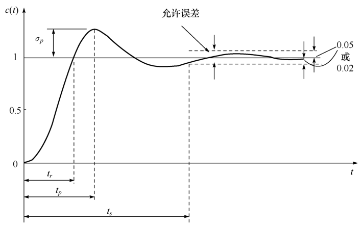{ .lq-img }

*图 3-1 单位阶跃响应曲线与动态性能指标（截自原书）*

- **上升时间**（rise time）\(t_r\)：响应从终值 10% 上升到终值 90% 所需的时间；对有振荡的系统，也可定义为响应从零第一次上升到终值所需的时间。响应速度的度量，越短越快。
- **峰值时间**（peak time）\(t_p\)：响应超过终值到达**第一个峰值**所需的时间。
- **调节时间**（settling time）\(t_s\)：响应到达并保持在终值 \(\pm 5\%\) 或 \(\pm 2\%\) 误差带内所需的最短时间。
- **超调量**（maximum overshoot）\(\sigma\%\)：最大偏离量 \(c(t_p)\) 与终值 \(c(\infty)\) 之差与终值之比的百分数：

\[
\sigma\% = \frac{c(t_p) - c(\infty)}{c(\infty)}\times 100\%
\tag{3.1}
\]

若 \(c(t_p) < c(\infty)\)，响应无超调。超调量亦称最大超调量或百分比超调量。

四个指标基本体现动态过程特征。常用组合：用 \(t_r\) 或 \(t_p\) 评价**响应速度**，用 \(\sigma\%\) 评价**阻尼程度**，\(t_s\) 是同时反映两者的综合指标。除简单的一、二阶系统外，精确确定这些指标的解析表达式很困难。

!!! note "拓展：两种上升时间定义对应仿真工具里的两个参数（补充）"
    \(t_r\) 的两种定义（10%→90% 与 0→100%）在不同场合各有使用：无超调系统（一阶、临界/过阻尼二阶）用 10%→90%，振荡系统用 0→100%（此时闭式是 \(t_r=(\pi-\beta)/\omega_d\)，见式 3.19）。MATLAB 的 `stepinfo` 与 python-control 的 `step_info` 默认按 **10%→90%** 计算（`RiseTimeLimits=(0.1, 0.9)`），书中查图估算的过阻尼 \(t_r\) 用的也是这个定义；两者别混用。

### 稳态性能

**稳态误差**（steady-state error）是稳态性能指标，通常在阶跃、斜坡或加速度函数作用下测定。若 \(t\to\infty\) 时输出量不等于输入量或输入量的确定函数，系统存在稳态误差。它是控制精度或抗扰动能力的度量，3.6 节专门讲。

## 3.2 一阶系统的时域分析

以一阶微分方程描述的系统叫**一阶系统**。工程实例不少，有些高阶系统的特性也常用一阶系统近似表征。

### 数学模型

看 RC 电路（图 3-2a）：电容电压 \(c(t)\) 为输出、输入电压 \(r(t)\)，充电方程为

\[
T\frac{dc(t)}{dt} + c(t) = r(t)
\tag{3.2}
\]

\(T = RC\) 为时间常数。零初始条件下取拉氏变换得传递函数：

\[
\varPhi(s) = \frac{C(s)}{R(s)} = \frac{1}{Ts+1}
\tag{3.3}
\]

结构图见图 3-2(b)。室温调节系统、恒温箱、水位调节系统的闭环传递函数都与式 (3.3) 同形，只是时间常数含义不同——所以式 (3.2)/(3.3) 就是**一阶系统的数学模型**。以下均设初始条件为零。

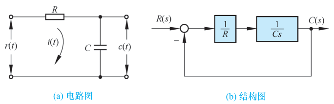{ .lq-img }

*图 3-2 一阶控制系统：(a) RC 电路；(b) 结构图（截自原书）*

具有同一运动方程或传递函数的所有线性系统，对同一输入的响应相同；对不同形式或不同功能的一阶系统，响应表达式的物理意义不同而已。

### 单位阶跃响应

输入 \(r(t)=1(t)\)，由式 (3.3)：

\[
c(t) = 1 - \mathrm{e}^{-t/T}, \qquad t\ge 0
\tag{3.4}
\]

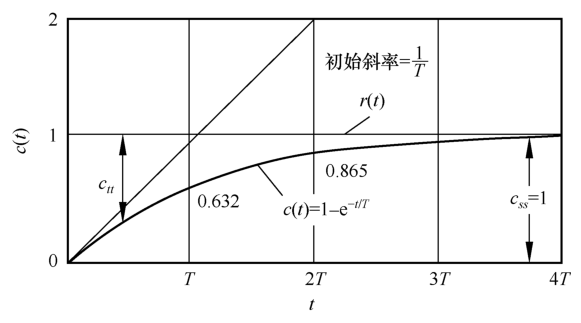{ .lq-img }

*图 3-3 一阶系统的单位阶跃响应曲线（截自原书）*

一条初值为零、按指数规律上升到终值 \(c_{ss}=1\) 的非周期曲线，两个特点：

1. **可用时间常数 \(T\) 度量输出**：\(c(T)=0.632\)；\(t=2T,3T,4T\) 时 \(c(t)\) 分别为终值的 86.5%、95%、98.2%。据此可用实验方法测定时间常数，或判定被测系统是否一阶。
2. **初始斜率为 \(1/T\) 并随时间下降**：

\[
\left.\frac{dc(t)}{dt}\right|_{t=0} = \frac{1}{T}, \qquad
\left.\frac{dc(t)}{dt}\right|_{t=T} = 0.368\frac{1}{T}, \qquad
\left.\frac{dc(t)}{dt}\right|_{t=\infty} = 0
\]

响应完成全部变化量需无限长时间（\(c(\infty)=1\)）。初始斜率特性也是确定 \(T\) 的常用方法。

按定义，一阶系统动态性能指标：

\[
t_r = 2.20T, \qquad t_s = 3T\,(\varDelta = 5\%)\ \text{或}\ 4T\,(\varDelta = 2\%)
\]

峰值时间 \(t_p\) 和超调量 \(\sigma\%\) 都不存在。\(T\) 反映惯性：惯性越小响应越快。

!!! note "拓展：2.2T 的来历（补充）"
    \(t_r=2.20T\) 按 10%→90% 定义算出：\(c(t)=1-\mathrm{e}^{-t/T}\) 到达 0.1 与 0.9 的时刻分别为 \(T\ln(1/0.9)=0.105T\) 与 \(T\ln 10=2.303T\)，差 \(2.198T\approx 2.2T\)。同理 \(t_s=3T\) 来自 \(1-\mathrm{e}^{-3}=0.95\)（5% 带），\(t_s=4T\) 来自 \(1-\mathrm{e}^{-4}=0.982\)（2% 带）——全部由 \(c(t)\) 直接反解，没有近似。

### 单位脉冲响应

输入理想单位脉冲 \(\delta(t)\)，\(R(s)=1\)，输出拉氏变换就是传递函数本身：\(C(s) = 1/(Ts+1)\)，称**脉冲响应**：

\[
c(t) = \frac{1}{T}\mathrm{e}^{-t/T}, \qquad t\ge 0
\tag{3.5}
\]

单调下降的指数曲线，各处斜率：初始 \(-1/T^2\)，\(t=T\) 处 \(-0.368/T^2\)，\(t\to\infty\) 为 0。若定义曲线衰减到其初始值 5% 所需时间为脉冲响应的调节时间，则仍有 \(t_s = 3T\)。

初始条件为零时，闭环传递函数与脉冲响应函数包含相同的动态信息——这适用于各阶线性定常系统，所以可用单位脉冲输入测出被测系统的闭环传递函数。工程上得不到理想脉冲，常用宽度 \(b\)、有限幅值的矩形脉动函数代替；要近似度够高，要求实际脉动函数的宽度远小于时间常数，一般规定 \(b < 0.1T\)。

### 单位斜坡响应

输入 \(r(t)=t\)：

\[
c(t) = (t - T) + T\mathrm{e}^{-t/T}, \qquad t\ge 0
\tag{3.6}
\]

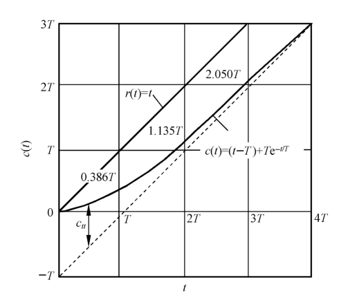{ .lq-img }

*图 3-5 一阶系统单位斜坡响应曲线（截自原书）*

稳态分量是与输入斜率相同、时间滞后 \(T\) 的斜坡函数——位置上存在稳态跟踪误差，其值正好等于 \(T\)；瞬态分量为衰减非周期函数。对比阶跃响应（图 3-3）很有意思：阶跃响应的位置误差随时间减小最后趋于零（初始误差最大、初始斜率最大）；斜坡响应的位置误差随时间增大最后趋于常值 \(T\)，且初始位置和初始斜率均为零（\(\dot c(0)=0\)）——**初始状态下输出速度与输入速度之间误差最大**。惯性越小，跟踪准确度越高。

### 单位加速度响应

输入 \(r(t)=t^2/2\)：

\[
c(t) = \frac{t^2}{2} - Tt + T^2\left(1 - \mathrm{e}^{-t/T}\right), \qquad t\ge 0
\tag{3.7}
\]

跟踪误差

\[
e(t) = r(t) - c(t) = Tt - T^2\left(1 - \mathrm{e}^{-t/T}\right)
\]

随时间增大直至无限大——**一阶系统不能跟踪加速度输入**。

### 响应汇总与线性定常特性

**表 3-2 一阶系统对典型输入信号的输出响应**

| 输入信号 \(r(t)\) | 输出响应 \(c(t)\) |
| --- | --- |
| \(1(t)\) | \(1-\mathrm{e}^{-t/T},\ t\ge 0\) |
| \(\delta(t)\) | \(\dfrac{1}{T}\mathrm{e}^{-t/T},\ t\ge 0\) |
| \(t\) | \(t-T+T\mathrm{e}^{-t/T},\ t\ge 0\) |
| \(\dfrac{1}{2}t^2\) | \(\dfrac{1}{2}t^2-Tt+T^2\left(1-\mathrm{e}^{-t/T}\right),\ t\ge 0\) |

表 3-2 背后是一条重要性质：输入信号导数的响应 = 该输入响应的导数；输入信号积分的响应 = 该输入响应的积分（积分常数由零输出初始条件确定）。脉冲 \(\to\) 阶跃 \(\to\) 斜坡 \(\to\) 加速度逐级求导，响应也逐级求导，一一对应。这条性质适用于**任何阶线性定常系统**，不适用于线性时变系统和非线性系统。所以研究线性定常系统的时间响应，不必对每种输入形式进行测定和计算，往往只取其中一种典型形式研究。

## 3.3 二阶系统的时域分析

以二阶微分方程描述的系统叫**二阶系统**。它本身应用普遍，不少高阶系统的特性在一定条件下也用二阶系统表征——本章的重头戏。

### 数学模型

典型实例：位置控制系统（图 3-6），任务是控制有黏性摩擦和转动惯量的负载，使负载位置与输入手柄位置协调。

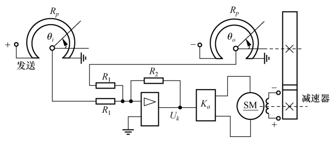{ .lq-img }

*图 3-6 位置控制系统原理图：两个电位器构成误差检测，放大后驱动伺服电动机经减速器带动负载（截自原书）*

按第 2 章的方法列写并画结构图（图 3-7），得系统开环传递函数：

\[
G(s) = \frac{K_s K_a C_m / i}{s\left[(L_a s + R_a)(J s + f) + C_m C_e\right]}
\]

式中 \(L_a, R_a\) 为电动机电枢绕组电感和电阻，\(C_m\) 为转矩系数，\(C_e\) 为反电势比例系数，\(K_s\) 为桥式电位器传递系数，\(K_a\) 为放大器增益，\(i\) 为减速器速比，\(J, f\) 为折算到电动机轴上的总转动惯量和总黏性摩擦系数。略去电枢电感 \(L_a\)，令

\[
K_1 = \frac{K_s K_a C_m}{i R_a}, \qquad F = f + \frac{C_m C_e}{R_a}
\]

\(K_1\) 称增益，\(F\) 称阻尼系数。开环传递函数简化为

\[
G(s) = \frac{K}{s(T_m s+1)}
\tag{3.8}
\]

其中 \(K = K_1/F\) 称**开环增益**，\(T_m = J/F\) 称**机电时间常数**。闭环传递函数：

\[
\varPhi(s) = \frac{\varTheta_o(s)}{\varTheta_i(s)} = \frac{K}{T_m s^2 + s + K}
\tag{3.9}
\]

对应的二阶运动微分方程：

\[
T_m\frac{d^2\theta_o(t)}{dt^2} + \frac{d\theta_o(t)}{dt} + K\theta_o(t) = K\theta_i(t)
\tag{3.10}
\]

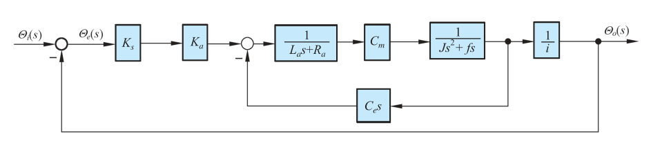{ .lq-img }

*图 3-7 位置控制系统结构图（截自原书）*

为使研究结论具有普遍意义，写成**标准形式**：

\[
\varPhi(s) = \frac{C(s)}{R(s)} = \frac{\omega_n^2}{s^2 + 2\zeta\omega_n s + \omega_n^2}
\tag{3.11}
\]

标准形式的二阶系统结构图如图 3-8：单位反馈，前向通道为 \(\omega_n^2/(s(s+2\zeta\omega_n))\)。图中 \(\omega_n = \sqrt{K/T_m}\) 为**自然频率**（无阻尼振荡频率），\(\zeta = \dfrac{1}{2\sqrt{T_m K}}\) 为**阻尼比**（相对阻尼系数）。

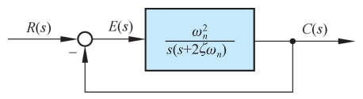{ .lq-img }

*图 3-8 标准形式的二阶系统结构图（截自原书）*

令分母多项式为零得**特征方程**：

\[
s^2 + 2\zeta\omega_n s + \omega_n^2 = 0
\tag{3.12}
\]

两个根（闭环极点）：

\[
s_{1,2} = -\zeta\omega_n \pm \omega_n\sqrt{\zeta^2 - 1}
\tag{3.13}
\]

二阶系统的时间响应取决于 \(\zeta\) 和 \(\omega_n\)。对结构和功用不同的二阶系统，两者的物理含义不同。

### 单位阶跃响应：阻尼比决定形态

特征根的性质由 \(\zeta\) 决定，分五种情况（图 3-9）：

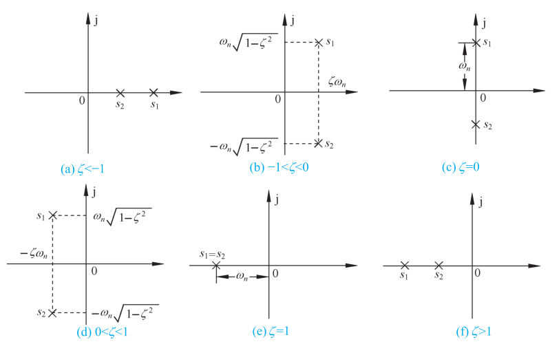{ .lq-img }

*图 3-9 二阶系统的闭环极点分布：(a) \(\zeta<-1\)；(b) \(-1<\zeta<0\)；(c) \(\zeta=0\)；(d) \(0<\zeta<1\)；(e) \(\zeta=1\)；(f) \(\zeta>1\)（截自原书）*

- **\(\zeta<0\)（负阻尼）**：两个正实部特征根，阶跃响应为发散正弦振荡或单调发散——**不稳定**。
- **\(\zeta=0\)（无阻尼）**：一对纯虚根 \(s_{1,2}=\pm j\omega_n\)，阶跃响应为等幅振荡。
- **\(0<\zeta<1\)（欠阻尼）**：一对负实部共轭复根 \(s_{1,2}=-\zeta\omega_n\pm j\omega_n\sqrt{1-\zeta^2}\)，阶跃响应为衰减振荡。
- **\(\zeta=1\)（临界阻尼）**：两个相等负实根 \(s_{1,2}=-\omega_n\)，非周期地趋于稳态输出。
- **\(\zeta>1\)（过阻尼）**：两个不相等负实根，也非周期趋于稳态，但比临界阻尼缓慢。

对图 3-6 的位置系统，\(\zeta = F/(2\sqrt{T_m K_1}) = F/F_c\)，其中 \(F_c = 2\sqrt{JK_1}\) 为 \(\zeta=1\) 时的**临界阻尼系数**——阻尼比就是阻尼系数与临界阻尼系数之比，故名阻尼比。

#### 欠阻尼（0<ζ<1）单位阶跃响应的推导

令 \(\sigma = \zeta\omega_n\)（**衰减系数**），\(\omega_d = \omega_n\sqrt{1-\zeta^2}\)（**阻尼振荡频率**），则 \(s_{1,2} = -\sigma \pm j\omega_d\)。输入 \(R(s)=1/s\) 时：

\[
C(s) = \frac{\omega_n^2}{s^2+2\zeta\omega_n s+\omega_n^2}\cdot\frac{1}{s}
     = \frac{1}{s} - \frac{s+\zeta\omega_n}{(s+\zeta\omega_n)^2+\omega_d^2} - \frac{\zeta\omega_n}{(s+\zeta\omega_n)^2+\omega_d^2}
\]

取拉氏反变换：

\[
c(t) = 1 - \frac{1}{\sqrt{1-\zeta^2}}\mathrm{e}^{-\zeta\omega_n t}\sin(\omega_d t + \beta), \qquad t\ge 0
\tag{3.14}
\]

式中 \(\beta = \arctan\dfrac{\sqrt{1-\zeta^2}}{\zeta}\) 或 \(\beta=\arccos\zeta\)。响应由两部分组成：稳态分量 1（无稳态位置误差）；瞬态分量是阻尼正弦振荡，衰减快慢取决于包络线 \(1 \pm \mathrm{e}^{-\zeta\omega_n t}/\sqrt{1-\zeta^2}\) 的收敛速度，所以 \(\sigma=\zeta\omega_n\) 叫衰减系数。

\(\zeta=0\) 时：

\[
c(t) = 1 - \cos\omega_n t, \qquad t\ge 0
\tag{3.15}
\]

平均值为 1 的正余弦等幅振荡，振荡频率为 \(\omega_n\)，故名**无阻尼振荡频率**（自然频率），由系统结构参数 \(K,T_m\)（或 \(K_1,J\)）决定。实际系统总有阻尼，实验只能测得 \(\omega_d\)，其值总小于 \(\omega_n\)；\(\zeta\) 增大时 \(\omega_d\) 减小；\(\zeta\ge 1\) 时 \(\omega_d\) 不复存在，响应不再振荡（为了叙述方便，\(\omega_n\) 与 \(\omega_d\) 的符号和名称在 \(\zeta\ge 1\) 时仍沿用）。

#### 临界阻尼（ζ=1）单位阶跃响应

\[
C(s) = \frac{\omega_n^2}{s(s+\omega_n)^2} = \frac{1}{s} - \frac{1}{s+\omega_n} - \frac{\omega_n}{(s+\omega_n)^2}
\]

\[
c(t) = 1 - (1 + \omega_n t)\,\mathrm{e}^{-\omega_n t}, \qquad t\ge 0
\tag{3.16}
\]

稳态值为 1 的**无超调单调上升**过程。变化率 \(dc/dt = \omega_n^2 t\,\mathrm{e}^{-\omega_n t}\)：\(t=0\) 时为零，\(t>0\) 恒正，\(t\to\infty\) 趋于零。

#### 过阻尼（ζ>1）单位阶跃响应

令

\[
T_1 = \frac{1}{\omega_n(\zeta - \sqrt{\zeta^2-1})}, \qquad
T_2 = \frac{1}{\omega_n(\zeta + \sqrt{\zeta^2-1})}
\]

为过阻尼二阶系统的两个时间常数（\(T_1>T_2\)），则

\[
C(s) = \frac{\omega_n^2}{s(s+1/T_1)(s+1/T_2)}
\]

\[
c(t) = 1 + \frac{T_2}{T_1 - T_2}\mathrm{e}^{-t/T_1} - \frac{T_1}{T_1 - T_2}\mathrm{e}^{-t/T_2}, \qquad t\ge 0
\tag{3.17}
\]

两个单调衰减指数项的代数和不会超过稳态值 1——非振荡的**过阻尼响应**。

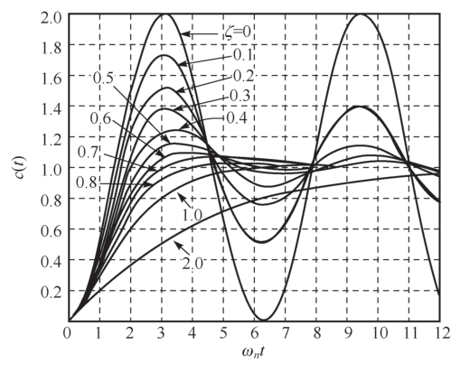{ .lq-img }

*图 3-10 二阶系统的单位阶跃响应曲线（横坐标为无因次时间 \(\omega_n t\)）（截自原书）*

从图 3-10 读结论：过阻尼与临界阻尼中，**临界阻尼响应上升时间最短、响应最快**；欠阻尼时阻尼比越小超调量越大、上升时间越短，通常取 \(\zeta=0.4\sim 0.8\) 为宜（超调适度、调节时间较短）；相同 \(\zeta\) 不同 \(\omega_n\) 的系统振荡特性相同而响应速度不同，\(\omega_n\) 越大响应越快。

### 欠阻尼二阶系统的动态过程分析

工程设计一般取 \(\zeta=0.4\sim 0.8\)：除 \(t_p\)、\(\sigma\%\)、\(t_r\) 可用 \(\zeta,\omega_n\) 准确表示外，\(t_s\) 很难用 \(\zeta,\omega_n\) 准确描述，只能工程近似。

先看各特征参量的几何意义（图 3-11）：衰减系数 \(\sigma\) 是闭环极点到**虚轴**的距离；阻尼振荡频率 \(\omega_d\) 是闭环极点到**实轴**的距离；自然频率 \(\omega_n\) 是闭环极点到**原点**的距离；\(\omega_n\) 与负实轴夹角的余弦正是阻尼比：

\[
\zeta = \cos\beta
\tag{3.18}
\]

故 \(\beta\) 称**阻尼角**。

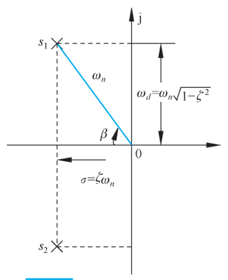{ .lq-img }

*图 3-11 欠阻尼二阶系统的特征参量（截自原书）*

!!! note "拓展：等 ζ 线是 s 平面上的射线（补充）"
    式 (3.18) 意味着所有具有相同 \(\zeta\) 的闭环极点落在从原点出发、与负实轴夹角 \(\beta=\arccos\zeta\) 的两条射线（**等 \(\zeta\) 线**）上；同一射线上离原点越远 \(\omega_n\) 越大。根轨迹设计（第 4 章）里"把主导极点校正到期望 \(\zeta\) 线上"的说法就源于此。常用锚点：\(\zeta=0.5\leftrightarrow\beta=60^\circ\)，\(\zeta=0.707\leftrightarrow\beta=45^\circ\)。

#### 上升时间 tr

在式 (3.14) 中令 \(c(t_r)=1\)：

\[
1 - \frac{\mathrm{e}^{-\zeta\omega_n t_r}}{\sqrt{1-\zeta^2}}\sin(\omega_d t_r + \beta) = 1
\quad\Longrightarrow\quad
\sin(\omega_d t_r + \beta) = 0
\]

\(\mathrm{e}^{-\zeta\omega_n t_r}\ne 0\)，故 \(\omega_d t_r + \beta = 0, \pi, 2\pi,\dots\)；按"第一次上升到终值"的定义取 \(\omega_d t_r = \pi - \beta\)：

\[
t_r = \frac{\pi - \beta}{\omega_d}
\tag{3.19}
\]

\(\zeta\) 一定时阻尼角 \(\beta\) 不变，响应速度与 \(\omega_n\) 成正比；\(\omega_d\) 一定时，\(\zeta\) 越小上升时间越短。

#### 峰值时间 tp

对式 (3.14) 求导并令其为零，整理得 \(\tan(\omega_d t_p + \beta) = \sqrt{1-\zeta^2}/\zeta = \tan\beta\)，三角方程的解为 \(\omega_d t_p = 0, \pi, 2\pi,\dots\)；按峰值时间定义取 \(\omega_d t_p = \pi\)：

\[
t_p = \frac{\pi}{\omega_d}
\tag{3.20}
\]

峰值时间等于**阻尼振荡周期的一半**，与闭环极点虚部数值成反比：\(\zeta\) 一定时，闭环极点离负实轴越远，峰值时间越短。

#### 超调量 σ%

把式 (3.20) 代入式 (3.14)，注意 \(\sin(\pi+\beta)=-\sin\beta = -\sqrt{1-\zeta^2}\)：

\[
c(t_p) = 1 + \mathrm{e}^{-\pi\zeta/\sqrt{1-\zeta^2}}
\]

按定义 (3.1)（\(c(\infty)=1\)）：

\[
\sigma\% = \mathrm{e}^{-\pi\zeta/\sqrt{1-\zeta^2}}\times 100\%
\tag{3.21}
\]

超调量**仅是 \(\zeta\) 的函数**，与 \(\omega_n\) 无关。\(\zeta\) 越大 \(\sigma\%\) 越小，反之亦然；取 \(\zeta=0.4\sim 0.8\) 时 \(\sigma\%\) 为 \(25.4\%\sim 1.5\%\)。

#### 调节时间 ts

式 (3.14) 的一对包络线 \(\pm\dfrac{\mathrm{e}^{-\zeta\omega_n t}}{\sqrt{1-\zeta^2}}\) 对称于 \(c(\infty)=1\)，整个响应都在包络线之内。实际响应的收敛程度**小于**包络线的收敛程度，用包络线估算调节时间结果略保守。

令 \(\varDelta\) 代表实际响应与稳态输出的误差。假定 \(\zeta\le 0.8\)，并把不等式右端分母中的 \(\zeta\) 代入 0.8（最保守），取 \(\varDelta=0.05\) 解得 \(t_s\le 3.5/(\zeta\omega_n)\)，常取

\[
t_s = \frac{3.5}{\zeta\omega_n} = \frac{3.5}{\sigma} \quad (\varDelta = 0.05)
\tag{3.22}
\]

\[
t_s = \frac{4.4}{\zeta\omega_n} = \frac{4.4}{\sigma} \quad (\varDelta = 0.02)
\tag{3.23}
\]

调节时间与闭环极点的**实部数值**成反比：闭环极点距虚轴越远，调节时间越短。阻尼比主要由超调量要求确定，所以调节时间主要由 \(\omega_n\) 决定——保持 \(\zeta\) 不变加大 \(\omega_n\)，可不改变超调而缩短调节时间。

各指标之间是**矛盾**的：响应速度（\(t_r\)）与阻尼程度（\(\sigma\%\)）不能同时满意。对图 3-8 的系统，\(\omega_n=\sqrt{K/T_m}\)、\(\zeta=1/(2\sqrt{T_mK})\)，而 \(T_m\) 是不可调的确定参数——增大开环增益 \(K\) 提高响应速度的同时必减小 \(\zeta\)。既要增强阻尼又要高响应速度，需要折中方案或补偿方案，这就引出 3.3 节末尾的两种控制方式。

**【例 3-1】由指标反求参数 \(K\) 和 \(\tau\)**

**已知**：系统结构图如图 3-14，性能指标 \(\sigma\%=20\%\)，\(t_p=1\,\mathrm{s}\)。求 \(K\)、\(\tau\)，并计算 \(t_r\)、\(t_s\)。

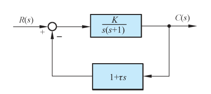{ .lq-img }

*图 3-14 例 3-1 控制系统结构图（截自原书）*

**解**：闭环传递函数

\[
\varPhi(s) = \frac{K}{s^2 + (1+K\tau)s + K}
\]

与标准形式 (3.11) 对比得 \(\omega_n=\sqrt{K}\)，\(\zeta=(1+K\tau)/(2\sqrt{K})\)。

由 \(\sigma\%=20\%\) 与式 (3.21) 反解 \(\zeta=\dfrac{\ln(1/\sigma_p)}{\sqrt{\pi^2+\ln^2(1/\sigma_p)}}\)（\(\sigma_p=0.2\)）：

\[
\zeta = 0.456
\]

再由 \(t_p = \pi/(\omega_n\sqrt{1-\zeta^2}) = 1\,\mathrm{s}\)：

\[
\omega_n = \frac{\pi}{t_p\sqrt{1-\zeta^2}} = 3.54\ \mathrm{rad/s}
\]

于是

\[
K = \omega_n^2 = 12.53\ (\mathrm{rad/s})^2, \qquad
\tau = \frac{2\zeta\omega_n - 1}{K} = 0.18\ \mathrm{s}
\]

由 \(\beta=\arccos\zeta = 1.09\ \mathrm{rad}\)、\(\omega_d = \omega_n\sqrt{1-\zeta^2} = 3.14\ \mathrm{rad/s}\)，式 (3.19) 与 (3.22) 给出

\[
t_r = \frac{\pi-\beta}{\omega_d} = 0.65\ \mathrm{s}, \qquad
t_s = \frac{3.5}{\zeta\omega_n} = 2.15\ \mathrm{s}\ (\varDelta=5\%)
\]

若取 \(\varDelta=0.02\)，\(t_s = 4.4/(\zeta\omega_n) = 2.70\ \mathrm{s}\)。

### 过阻尼二阶系统的动态过程分析

过阻尼响应缓慢，通常不希望采用；但低增益、大惯性的**温度控制系统**需要过阻尼，不允许超调又要求响应较快的**指示/记录仪表系统**用临界阻尼；有些高阶系统的时间响应还可用过阻尼二阶系统近似——研究它有工程意义。

\(\zeta>1\) 时只有上升时间和调节时间有意义，式 (3.17) 是超越方程，无法按定义求准确公式，工程上用数值解法制成曲线查用，或用曲线拟合法给近似公式。

**(1) 上升时间**：按 10%→90% 定义对式 (3.17) 数值求解，得无因次上升时间 \(\omega_n t_r\) 与 \(\zeta\) 的关系曲线，工程上将其近似描述为

\[
t_r = \frac{1 + 1.5\zeta + \zeta^2}{\omega_n}
\tag{3.24}
\]

**(2) 调节时间**：由式 (3.17)，令 \(T_1/T_2\) 为不同值可解出无因次调节时间 \(t_s/T_1\)。由于

\[
s^2 + 2\zeta\omega_n s + \omega_n^2 = (s+1/T_1)(s+1/T_2)
\]

\(\zeta\) 与自变量 \(T_1/T_2\) 的关系为

\[
\zeta = \frac{1 + T_1/T_2}{2\sqrt{T_1/T_2}}
\tag{3.25}
\]

若 \(T_1\ge 4T_2\)（第二个闭环极点的数值比第一个大四倍以上），系统可等效为具有 \(-1/T_1\) 极点的一阶系统，取 \(t_s = 3T_1\)，相对误差不超过 10%。当 \(\zeta=1\)（\(T_1/T_2=1\)）时，临界阻尼二阶系统的调节时间

\[
t_s = 4.75T_1 = \frac{4.75}{\omega_n} \quad (\varDelta = 5\%,\ \zeta=1)
\tag{3.26}
\]

**【例 3-2】角度随动系统的开环增益设计**

**已知**：角度随动系统如图 3-16，\(K\) 为开环增益，\(T=0.1\,\mathrm{s}\) 为伺服电动机时间常数。要求单位阶跃响应**无超调**，且 \(t_s\le 1\,\mathrm{s}\)（\(\varDelta=5\%\)）。求 \(K\) 与此时的 \(t_r\)。

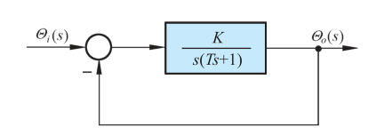{ .lq-img }

*图 3-16 例 3-2 角度随动系统结构图（截自原书）*

**解**：要求无超调且响应尽量快，取**临界阻尼** \(\zeta=1\)。由图 3-16 得闭环特征方程

\[
T s^2 + s + K = 0
\]

代入 \(T=0.1\)。\(\zeta=1\) 时 \(2\zeta\omega_n = 1/T = 10\)，故 \(\omega_n = 5\ \mathrm{rad/s}\)；由 \(\omega_n^2 = K/T\) 解得

\[
K = 2.5\ (\mathrm{rad/s})^2
\]

又 \(T_1 T_2 = 1/\omega_n^2\)，\(\zeta=1\) 时 \(T_1=T_2=1/\omega_n = 0.2\,\mathrm{s}\)。由式 (3.26)：

\[
t_s = \frac{4.75}{\omega_n} = 4.75 T_1 = 0.95\,\mathrm{s} \le 1\,\mathrm{s}\ (\varDelta=5\%)
\]

满足指标。由 \(\zeta=1\)、\(\omega_n=5\)，用式 (3.24)：

\[
t_r = \frac{1 + 1.5\zeta + \zeta^2}{\omega_n} = \frac{3.5}{5} = 0.70\,\mathrm{s}
\]

上述计算的准确性可用软件验证，仿真结果如图 3-17：\(t_r = t_{90}-t_{10} = 0.69\,\mathrm{s}\)，\(t_s = 0.97\,\mathrm{s}\)（\(\varDelta=5\%\)），\(t_s = 1.21\,\mathrm{s}\)（\(\varDelta=2\%\)）。

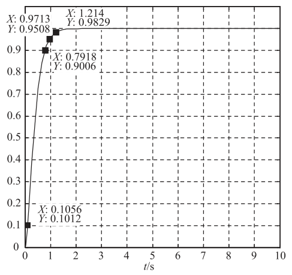{ .lq-img }

*图 3-17 例 3-2 的单位阶跃响应仿真结果（截自原书）*

!!! warning "原书笔误"
    例 3-2 解题第一句"由图 3-17 得闭环特征方程"应为"由**图 3-16**"——图 3-16 才是角度随动系统结构图，图 3-17 是仿真结果。

=== "MATLAB"

    ```matlab
    % ===== 书 3-3 节 例3-2 仿真验证 =====
    % 临界阻尼设计：K = 2.5 (rad/s)^2, T = 0.1 s
    K = 2.5; T = 0.1;
    sys = tf(K, [T 1 K]);        % Phi(s) = K/(T*s^2 + s + K)
    p = roots([T 1 K])           % 特征根 -5, -5：二重负实根，临界阻尼
    step(sys), grid on           % 单位阶跃响应（书图3-17）
    stepinfo(sys)                % 默认 tr 取 10%~90%、ts 取 2% 误差带
    % 与书一致：tr = t90-t10 = 0.69 s, ts(5%) = 0.97 s, ts(2%) = 1.21 s
    ```

=== "Python"

    ```python
    # ===== 书 3-3 节 例3-2 仿真验证 =====
    import control as ct

    T, K = 0.1, 2.5
    sys = ct.tf([K], [T, 1, K])        # Phi(s) = K/(T*s^2 + s + K)
    print(ct.poles(sys))               # [-5. -5.]：二重负实根，临界阻尼
    info = ct.step_info(sys)           # 默认 RiseTime 10%~90%、SettlingTime 2%
    print(info['RiseTime'], info['SettlingTime'])   # 0.670 1.172（书：0.69 / 1.21）
    info5 = ct.step_info(sys, SettlingTimeThreshold=0.05)
    print(info5['SettlingTime'])       # 0.949（书 5% 误差带：0.97）
    ```

!!! note "拓展：比例控制的天花板（补充）"
    例 3-2 里唯一可调的是开环增益 \(K\)。比例控制系统中通常只有增益可调，要同时满足各项性能指标是困难的：(1) 即使输入作用下的稳态和动态要求都满足了，扰动作用下的稳态误差要求也可能不满足（3.6 节）；(2) 高精度系统需要高增益压低死区、间隙、摩擦等非线性因素的影响，不能靠降低开环增益换小超调。所以必须研究其他控制方式——下面的两种。

### 二阶系统性能的改善

#### 比例-微分控制

设比例-微分控制的二阶系统如图 3-18：误差信号 \(E(s)\) 与其微分 \(T_d s E(s)\) 共同进入前向通道。输出同时受误差及其速率双重作用，是**早期控制**——在位置误差出现之前提前产生修正作用。

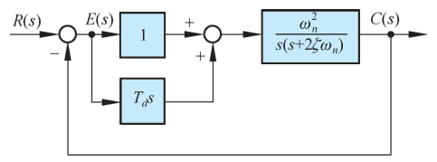{ .lq-img }

*图 3-18 比例-微分控制结构系统图（截自原书）*

物理概念先走一遍（图 3-19 的波形图）：设系统超调量大、用伺服电动机执行。\(t\in[0,t_1)\) 时误差为正但一直在减小（\(\dot e<0\)），纯比例控制产生的正向修正转矩过大，输出冲过希望值；\(t\in[t_1,t_3)\) 误差为负，电动机反转制动，但惯性和制动转矩不够，输出回落过头；\(t\in[t_3,t_5)\) 误差重新为正，力图阻止输出下降。若在 \(t\in[0,t_2)\) 减小正向转矩、增大反向制动转矩，在 \(t\in[t_2,t_4)\) 反过来，动态过程会显著改善——微分项恰好起这种作用：伺服电动机在比例-微分控制器作用下产生的转矩正比于 \(e(t) + T_d\dot e(t)\)。对 \(t\in[0,t_1)\)，\(\dot e<0\)，转矩 \(e+T_d\dot e < e\)，正向修正转矩减小；对 \(t\in[t_1,t_2)\)，\(e<0\) 且 \(\dot e<0\)，反向制动转矩比纯比例时大，超调量减小；对 \(t\in[t_2,t_3)\)，\(e<0\) 但 \(\dot e>0\)，制动转矩减小，有利于输出尽快达到稳态值。由于 \(\dot e\) 只反映误差变化速率，稳态时 \(\dot e=0\)，**微分部分不影响常值稳态误差**；它相当于增大系统阻尼，从而容许选用较大的开环增益，兼顾动态性能与稳态精度。

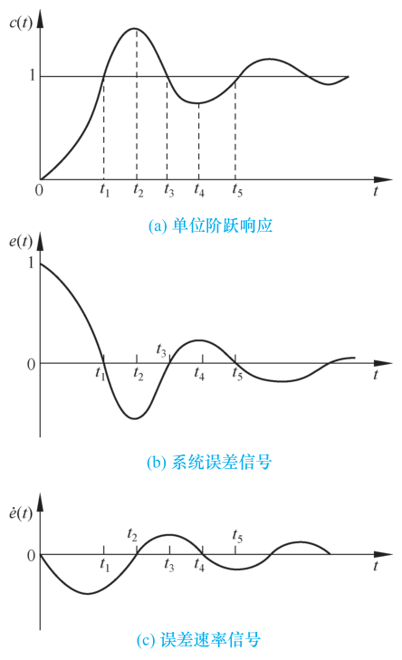{ .lq-img }

*图 3-19 比例-微分控制的波形图：(a) 单位阶跃响应；(b) 系统误差信号；(c) 误差速率信号（截自原书）*

分析法定量：由图 3-18，开环传递函数

\[
G(s) = \frac{C(s)}{E(s)} = \frac{K(1+T_d s)}{s\left(\dfrac{s}{2\zeta\omega_n}+1\right)} = \frac{\omega_n^2(T_d s+1)}{s(s+2\zeta\omega_n)}
\tag{3.27}
\]

式中 \(K = \omega_n/(2\zeta)\) 称开环增益。令 \(z = 1/T_d\)，闭环传递函数为

\[
\varPhi(s) = \frac{\omega_n^2(s+z)}{z\left(s^2 + 2\zeta_d\omega_n s + \omega_n^2\right)}
\tag{3.28}
\]

式中

\[
\zeta_d = \zeta + \frac{\omega_n}{2z} = \zeta + \frac{T_d\omega_n}{2}
\tag{3.29}
\]

比例-微分控制**不改变自然频率，但增大阻尼比**。适当选择开环增益和微分器时间常数，可使阶跃输入下的动态性能满意。工业上又称 **PD 控制**。它给系统增加了一个闭环零点 \(-z = -1/T_d\)，所以比例-微分控制的二阶系统叫**有零点的二阶系统**，比例控制的叫无零点的二阶系统。

单位阶跃输入下（\(\zeta_d<1\)），由式 (3.28) 取拉氏反变换：

\[
c(t) = 1 + r\,\mathrm{e}^{-\zeta_d\omega_n t}\sin\!\left(\omega_n\sqrt{1-\zeta_d^2}\,t + \psi\right), \qquad t\ge 0
\tag{3.30}
\]

式中

\[
r = \frac{\sqrt{z^2 - 2\zeta_d\omega_n z + \omega_n^2}}{z\sqrt{1-\zeta_d^2}}
\tag{3.31}
\]

\[
\psi = -\pi + \arctan\frac{\omega_n\sqrt{1-\zeta_d^2}}{z-\zeta_d\omega_n} + \arctan\frac{\sqrt{1-\zeta_d^2}}{\zeta_d}
\tag{3.32}
\]

各项指标：上升时间 \(t_r\) 与 \(\zeta_d\)、\(\omega_n\)、闭环零点值 \(z\) 有关，查无因次曲线（图 3-20）。

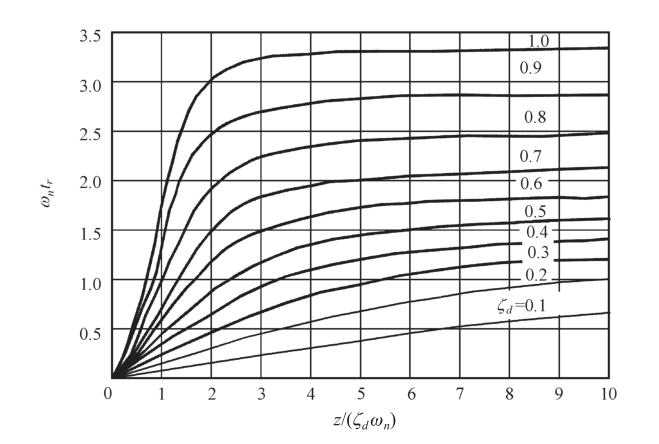{ .lq-img }

*图 3-20 有零点的二阶系统上升时间无因次曲线，参变量为 \(\zeta_d\)（截自原书）*

峰值时间与超调量：

\[
t_p = \frac{\beta_d - \psi}{\omega_n\sqrt{1-\zeta_d^2}}
\tag{3.33}
\]

\[
\beta_d = \arctan\frac{\sqrt{1-\zeta_d^2}}{\zeta_d}
\tag{3.34}
\]

\[
\sigma\% = r\,\sqrt{1-\zeta_d^2}\;\mathrm{e}^{-\zeta_d\omega_n t_p}\times 100\%
\tag{3.35}
\]

调节时间：令 \(\varDelta\) 为响应与稳态输出之间的误差，由式 (3.30) 有 \(|\varDelta|\le r\,\mathrm{e}^{-\zeta_d\omega_n t}\)，取 \(\varDelta=0.05\) 解出

\[
t_s = \frac{3 + \ln r}{\zeta_d\omega_n} = \frac{1}{\zeta_d\omega_n}\left[3 + \ln\frac{\sqrt{z^2-2\zeta_d\omega_n z+\omega_n^2}}{z\sqrt{1-\zeta_d^2}}\right]
\tag{3.36}
\]

（若取 \(\varDelta=0.02\)，把 3 换成 \(\ln 50\approx 3.9\)。）

**【例 3-3】PD 控制改善动态性能并保证稳态误差**

**已知**：单位反馈系统开环传递函数 \(G(s) = \dfrac{K(T_d s+1)}{s(1.67s+1)}\)。系统在单位斜坡输入时 \(e_{ss}(\infty)=1/K\)，要求 \(e_{ss}(\infty)\le 0.2\,\mathrm{rad}\)、\(\zeta_d = 0.5\)。确定 \(K\) 与 \(T_d\)，并估算阶跃输入下的动态性能。

**解**：由 \(1/K\le 0.2\) 取 \(K=5\)。先看 \(T_d=0\)（无零点二阶系统）：闭环特征方程 \(1.67s^2+s+5=0\)，即 \(s^2+0.6s+3=0\)，得 \(\zeta=0.173\)，\(\omega_n=1.732\ \mathrm{rad/s}\)。式 (3.19)～(3.22) 算得

\[
t_r = 1.02\,\mathrm{s},\quad t_p = 1.84\,\mathrm{s},\quad \sigma\% = 57.6\%,\quad t_s = 11.70\,\mathrm{s}\ (\varDelta=5\%)
\]

超调太大、调节太慢。\(T_d\ne 0\) 时要求 \(\zeta_d=0.5\)，由式 (3.29)：

\[
T_d = \frac{2(\zeta_d-\zeta)}{\omega_n} = \frac{2(0.5-0.173)}{1.732} = 0.38\,\mathrm{s}
\]

此时是有零点的二阶系统：查图 3-20 得 \(t_r=0.70\,\mathrm{s}\)；式 (3.33)、(3.35) 及 (3.36) 算得 \(t_p=1.63\,\mathrm{s}\)、\(\sigma\%=22\%\)、\(t_s=3.49\,\mathrm{s}\)（\(\varDelta=5\%\)）。比例-微分控制改善了动态性能，又满足稳态误差要求。

归纳：比例-微分控制**增大阻尼**，使阶跃响应超调量下降、调节时间缩短，且不影响常值稳态误差及自然频率；允许选较高开环增益，在保证一定动态性能条件下减小稳态误差。注意：微分器对噪声（尤其高频噪声）的放大远大于对缓慢输入的放大，输入端噪声强时不宜用 PD，可改用测速反馈。

#### 测速反馈控制

输出量的导数同样能改善性能。将输出的速度信号反馈到输入端与误差信号比较，效果与比例-微分相似：增大阻尼、改善动态性能。输出是机械角位移时，用**测速发电机**把角位移变换为正比于角速度的电压（图 3-21），\(K_t\) 为测速反馈系数（单位：电压/单位转速）。

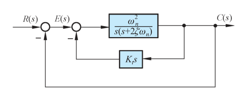{ .lq-img }

*图 3-21 测速反馈控制的二阶系统结构图（截自原书）*

由图 3-21，系统的开环传递函数：

\[
G(s) = \frac{\omega_n^2}{s(s + 2\zeta\omega_n + K_t\omega_n^2)} = \frac{\omega_n}{2\zeta + K_t\omega_n}\cdot\frac{1}{s\left(\dfrac{s}{2\zeta\omega_n + K_t\omega_n^2}+1\right)}
\]

开环增益为

\[
K = \frac{\omega_n}{2\zeta + K_t\omega_n}
\tag{3.37}
\]

闭环传递函数：

\[
\varPhi(s) = \frac{\omega_n^2}{s^2 + (2\zeta\omega_n + K_t\omega_n^2)s + \omega_n^2}
\tag{3.38}
\]

等效阻尼比：

\[
\zeta_t = \zeta + \frac{K_t\omega_n}{2}
\tag{3.39}
\]

测速反馈与比例-微分控制不同的是：**测速反馈会降低开环增益**，从而加大斜坡输入时的稳态误差（见 3.6 节）；相同的是同样不影响自然频率，并可增大阻尼比。把式 (3.29) 写成 \(\zeta_d = \zeta + T_d\omega_n/2\) 与式 (3.39) 对比：形式类似，数值上 \(K_t=T_d\) 时 \(\zeta_t=\zeta_d\)。但测速反馈**不形成闭环零点**，即便 \(K_t=T_d\)，两者对动态性能的改善程度也不同。设计时适当增大原系统开环增益弥补稳态误差损失，再选 \(K_t\) 使 \(\zeta_t\) 为 0.4～0.8。

**【例 3-4】比例控制 vs 测速反馈控制**

**已知**：控制系统如图 3-22，(a) 为比例控制，(b) 为测速反馈控制。确定使系统阻尼比为 0.5 的 \(K_t\) 值，并计算 (a)、(b) 的各项性能指标。

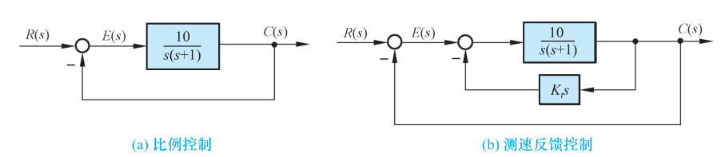{ .lq-img }

*图 3-22 例 3-4 控制系统结构图：(a) 比例控制；(b) 测速反馈控制（截自原书）*

**解**：系统 (a) 闭环传递函数 \(\varPhi_a(s) = \dfrac{10}{s^2+s+10}\)：\(\zeta=0.16\)，\(\omega_n=3.16\ \mathrm{rad/s}\)。单位斜坡输入下稳态误差 \(e_{ss}(\infty)=1/K=0.1\,\mathrm{rad}\)；单位阶跃下由式 (3.19)～(3.22)：

\[
t_r = 0.55\,\mathrm{s},\quad t_p = 1.01\,\mathrm{s},\quad \sigma\% = 60.4\%,\quad t_s = 7\,\mathrm{s}\ (\varDelta=5\%)
\]

系统 (b) 闭环传递函数 \(\varPhi_b(s) = \dfrac{10}{s^2+(1+10K_t)s+10}\)。由式 (3.39)：

\[
K_t = \frac{2(\zeta_t-\zeta)}{\omega_n} = \frac{2(0.5-0.16)}{3.16} = 0.22
\]

\(\zeta_t=0.5\)，\(\omega_n=3.16\ \mathrm{rad/s}\)。由式 (3.37) 得开环增益 \(K=3.16\)。于是

\[
e_{ss}(\infty) = 0.32\,\mathrm{rad},\quad t_r = 0.77\,\mathrm{s},\quad t_p = 1.15\,\mathrm{s},\quad \sigma\% = 16.3\%,\quad t_s = 2.22\,\mathrm{s}\ (\varDelta=5\%)
\]

例 3-4 表明：测速反馈可以改善系统动态性能，但会增大稳态误差（0.1→0.32 rad）。要减小稳态误差，必须加大原系统的开环增益，而使 \(K_t\) 单纯用来增大系统阻尼。

#### 比例-微分控制与测速反馈控制的比较

理想线性系统任取其一即可，实际系统要考虑具体组成、噪声大小与频率、线性范围和饱和程度。主要差别四条：

1. **附加阻尼来源**：PD 控制的阻尼产生于输入端误差信号的速度，测速反馈控制的阻尼来源于输出端响应的速度——给定开环增益和指令输入速度时，后者对应较大的稳态误差。
2. **使用环境**：PD 对输入端噪声有明显放大，噪声严重时不宜选用；且其输入是能量水平低的误差信号，需高质量放大器。测速反馈对输入端噪声有滤波作用，测速发电机输入信号能量水平较高，对元件无过高要求，使用场合广。
3. **对开环增益和自然频率的影响**：PD 不改变开环增益和自然频率；测速反馈降低开环增益——为保稳态误差要加大增益，又导致自然频率增大，存在高频噪声时可能引起共振。
4. **对动态性能的影响**：PD 相当于加入实零点，加快上升时间；相同阻尼比下 PD 系统的超调量大于测速反馈系统。闭环零点的影响在第四章详论。

## 3.4 高阶系统的时域分析

控制工程中几乎所有的系统都是高阶系统。对不能用一、二阶系统近似的高阶系统，动态指标的计算比较复杂——工程上用**闭环主导极点**概念近似分析，或直接用 MATLAB/Python 仿真。

### 高阶系统的单位阶跃响应

研究图 3-23 所示系统（前向通道 \(G(s)\)、反馈 \(H(s)\)），闭环传递函数：

\[
\varPhi(s) = \frac{C(s)}{R(s)} = \frac{G(s)}{1+G(s)H(s)}
\tag{3.41}
\]

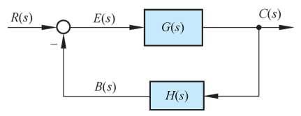{ .lq-img }

*图 3-23 控制系统结构图（截自原书）*

一般情况下 \(G(s)\)、\(H(s)\) 都是 \(s\) 的多项式之比：

\[
\varPhi(s)=\frac{M(s)}{D(s)}=\frac{b_0 s^m+b_1 s^{m-1}+\cdots+b_{m-1}s+b_m}{a_0 s^n+a_1 s^{n-1}+\cdots+a_{n-1}s+a_n},\qquad m\le n
\tag{3.42}
\]

把分子分母因式分解（MATLAB 的 `tf2zp`、Python 的 `scipy.signal.tf2zpk` 一行搞定），式 (3.42) 必可写成零极点形式：

\[
\varPhi(s)=\frac{K^*\prod\limits_{i=1}^{m}(s-z_i)}{\prod\limits_{j=1}^{n}(s-s_j)}
\tag{3.43}
\]

\(K^*=b_0/a_0\)；\(z_i\) 为 \(M(s)=0\) 的根，称**闭环零点**；\(s_j\) 为 \(D(s)=0\) 的根，称**闭环极点**。仿真上，高阶系统建模后直接 `step` 即可。

**【例 3-5】三阶系统的单位阶跃响应**

**已知**：闭环传递函数

\[
\varPhi(s)=\frac{5(s^2+5s+6)}{s^3+6s^2+10s+8}
\]

**解**：因式分解：

\[
\varPhi(s)=\frac{5(s+2)(s+3)}{(s+4)(s^2+2s+2)}
\]

\(R(s)=1/s\) 时：

\[
C(s)=\frac{5(s+2)(s+3)}{s(s+4)(s^2+2s+2)}
=\frac{A_0}{s}+\frac{A_1}{s+4}+\frac{A_2}{s+1-j}+\frac{\bar A_2}{s+1+j}
\]

算得留数：

\[
A_0=\frac{15}{4},\qquad A_1=-\frac{1}{4},\qquad A_2=\frac{1}{4}(-7-\mathrm{j}),\qquad \bar A_2=\frac{1}{4}(-7+\mathrm{j})
\]

拉氏反变换（初始条件全为零）得单位阶跃响应：

\[
c(t)=\frac{1}{4}\left[15-\mathrm{e}^{-4t}-10\sqrt{2}\,\mathrm{e}^{-t}\cos(t+8.1^\circ)\right]
\]

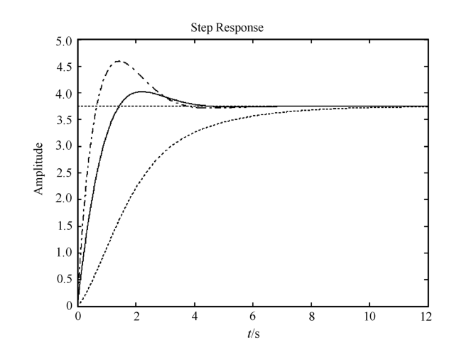{ .lq-img }

*图 3-24 例 3-5 高阶系统时间响应分析（MATLAB）：实线为原系统，虚线为极点移近虚轴的变体，点划线为零点移到 −1 的变体；稳态值 \(c(\infty)=\varPhi(0)=15/4=3.75\)（截自原书）*

!!! warning "原书笔误"
    原书答案印作 \(c(t)=\frac{1}{4}\left[12-\mathrm{e}^{-4t}-10\sqrt{2}\,\mathrm{e}^{-t}\cos(t+352^\circ)\right]\)，有两处错：**(1)** 常数项应为 **15**——稳态值 \(c(\infty)=A_0=15/4\)，且 \(c(0)=0\) 要求 \(15-1-10\sqrt 2\cos 8.1^\circ\approx 0\)；印 12 会得出 \(c(\infty)=3\)、\(c(0)=-0.75\)。(2) 相位应为 **\(+8.1^\circ\)**（等价于 \(\frac{1}{2}\mathrm{e}^{-t}(7\sin t-7\cos t)\) 前的负号约定），印 \(+352^\circ\) 相当于 \(−8^\circ\)，正弦分量的符号就反了。数值验证：修正后公式与 `step_response` 仿真逐点偏差在 \(10^{-6}\) 以内（见下方代码）。

=== "MATLAB"

    ```matlab
    % ===== 书 3-4 节 例3-5 =====
    num0 = 5*[1 5 6]; den0 = [1 6 10 8];    % 闭环传递函数分子/分母多项式
    sys0 = tf(num0, den0);                  % 高阶系统建模
    den = [1 6 10 8 0];                     % C(s) 的分母（多乘一个 s）
    [z, p, k] = tf2zp(num0, den0)           % 因式分解：零点/极点/增益
    sys = zpk(z, p, k)                      % 零极点增益形式
    [r, p, k] = residue(num0, den)          % 部分分式展开（留数）
    step(sys0), grid on                     % 单位阶跃响应（书图3-24实线）
    ```

=== "Python"

    ```python
    # ===== 书 3-4 节 例3-5 =====
    import numpy as np
    import control as ct
    from scipy.signal import residue, tf2zpk

    num0 = 5 * np.array([1, 5, 6])            # 5(s^2+5s+6)
    den0 = [1, 6, 10, 8]                      # (s+4)(s^2+2s+2)
    print(tf2zpk(num0, den0))     # 零点[-3,-2]，极点[-4,-1±j]，增益 5
    r, p, k = residue(num0, [1, 6, 10, 8, 0])   # C(s) 部分分式，极点 0,-1±j,-4
    print(np.round(r, 4))         # [3.75, -1.75±0.25j, -0.25] 即 A0, A2, A1
    sys = ct.tf(num0, den0)
    t, c = ct.step_response(sys, np.arange(0, 5, 0.001))
    c_fit = 3.75 - 0.25*np.exp(-4*t) - np.exp(-t)*(3.5*np.cos(t) - 0.5*np.sin(t))
    print(abs(c - c_fit).max())   # ~1e-13：与留数反变换式（勘误后书答案）一致
    ```

对稳定的高阶系统：闭环极点负实部的绝对值越大，对应响应分量衰减越快；反之衰减缓慢。时间响应的**类型**取决于闭环极点，响应的**形状**与闭环零点有关。

### 闭环主导极点及其动态性能分析

**闭环主导极点**（dominant poles）：如果在所有闭环极点中，距虚轴最近且**附近没有闭环零点**，而其余极点又离虚轴很远，那么最近极点对应的响应分量衰减缓慢、在时间响应中起主导作用——这样的极点叫闭环主导极点。可以是实数、复数或其组合；其余极点统称**非主导极点**。

工程上常把增益调整到使系统具有一对共轭复数主导极点，然后用二阶系统的指标估算高阶系统。

**【例 3-6】四阶系统按主导极点降阶**

**已知**：闭环传递函数

\[
\varPhi(s)=\frac{1.05(0.4762s+1)}{(0.125s+1)(0.5s+1)(s^2+s+1)}
\]

**解**：改写为零极点形式：

\[
\varPhi(s)=\frac{8(s+2.1)}{(s+8)(s+2)(s^2+s+1)}
\]

用 `pzmap` 画闭环零极点分布（图 3-25 左）：共轭复数主导极点 \(s_{1,2}=-0.5\pm\mathrm{j}0.866\)，非主导极点 \(s_3=-2\)、\(s_4=-8\) 实部的模比主导极点实部的模大三倍以上，闭环零点 \(z=-2.1\) 不在主导极点附近。因此可近似成：

\[
\varPhi(s)\approx\frac{1.05}{s^2+s+1}
\]

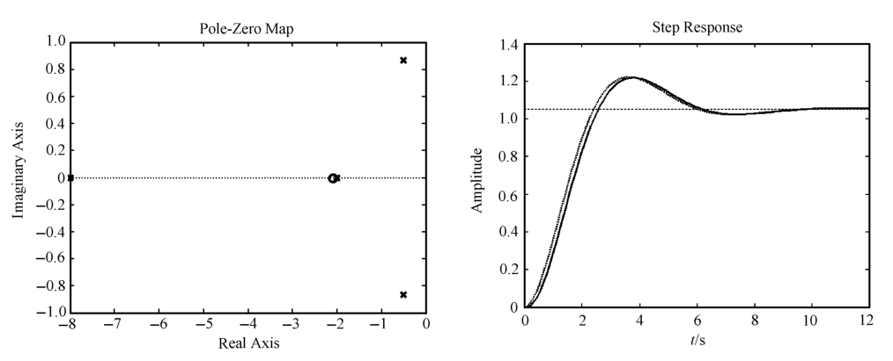{ .lq-img }

*图 3-25 例 3-6 闭环零极点分布图与单位阶跃响应（MATLAB）：实线为四阶原系统，虚线为近似二阶系统（截自原书）*

=== "MATLAB"

    ```matlab
    % ===== 书 3-4 节 例3-6 主导极点近似 =====
    sys  = zpk([-2.1], [-8 -2 -0.5+0.866i -0.5-0.866i], 8);  % 原四阶系统
    sys1 = tf(1.05, [1 1 1]);        % 主导极点近似的二阶系统
    pzmap(sys)                       % 闭环零极点分布（书图3-25）
    step(sys, 'b-', sys1, 'r:'), grid on   % 阶跃响应对比（见图 3-25 右）
    stepinfo(sys)                    % 四阶系统指标（表3-3 第2行）
    stepinfo(sys1)                   % 近似二阶系统（表3-3 第6行）
    ```

=== "Python"

    ```python
    # ===== 书 3-4 节 例3-6 主导极点近似 =====
    import control as ct

    sys4 = ct.zpk([-2.1], [-8, -2, -0.5 + 0.866j, -0.5 - 0.866j], 8)
    sys2 = ct.tf([1.05], [1, 1, 1])
    for name, s in [('四阶原系统', sys4), ('近似二阶', sys2)]:
        i = ct.step_info(s)          # tr 10%~90%，ts 2%
        print(f"{name}: tr={i['RiseTime']:.2f} tp={i['PeakTime']:.2f} "
              f"sigma%={i['Overshoot']:.1f} ts={i['SettlingTime']:.2f}")
    # 四阶原系统: tr=1.67 tp=3.79 sigma%=15.9 ts=8.21（书表3-3第2行：1.68/3.75/15.9/8.20）
    # 近似二阶  : tr=1.67 tp=3.63 sigma%=16.3 ts=8.09（书表3-3第6行：1.64/3.64/16.3/8.08）
    ```

对比仿真（表 3-3 第 2 行 vs 第 6 行）：不完全相同，但结果基本正确——高阶毕竟不是二阶，还要考虑非主导零、极点的影响。

**表 3-3 高阶系统动态性能分析比较（MATLAB 仿真，\(\varDelta=2\%\)）**

| 系统编号 | 闭环传递函数 \(\varPhi(s)\) | \(t_r\)/s | \(t_p\)/s | \(\sigma\%\) | \(t_s\)/s |
| --- | --- | --- | --- | --- | --- |
| 1 | \(\dfrac{1.05}{(0.125s+1)(0.5s+1)(s^2+s+1)}\) | 1.89 | 4.42 | 13.8 | 8.51 |
| 2 | \(\dfrac{1.05(0.4762s+1)}{(0.125s+1)(0.5s+1)(s^2+s+1)}\) | 1.68 | 3.75 | 15.9 | 8.20 |
| 3 | \(\dfrac{1.05(s+1)}{(0.125s+1)(0.5s+1)(s^2+s+1)}\) | 1.26 | 3.20 | 25.3 | 8.10 |
| 4 | \(\dfrac{1.05(0.4762s+1)}{(0.25s+1)(0.5s+1)(s^2+s+1)}\) | 1.73 | 4.09 | 15.0 | 8.36 |
| 5 | \(\dfrac{1.05(0.4762s+1)}{(0.5s+1)(s^2+s+1)}\) | 1.66 | 3.64 | 16.0 | 8.08 |
| 6 | \(\dfrac{1.05}{s^2+s+1}\) | 1.64 | 3.64 | 16.3 | 8.08 |

从表 3-3 的对比（1→2→3 行变零点，2→4→5 行变非主导极点）读出两条规律：

- **闭环零点影响**：比较第 1、2、3 行——闭环零点**减小峰值时间**（响应加快），**增大超调量**（减小阻尼），且零点越靠近虚轴作用越强。配置闭环零点要折中考虑响应速度与阻尼。
- **闭环非主导极点影响**：比较第 2、4、5 行——非主导极点**增大峰值时间**（响应变缓），**减小超调量**（增大阻尼），且越靠近虚轴作用越强。
- 再比较第 5、6 行：闭环零、极点彼此接近时，对响应速度的影响相互削弱。

!!! note "拓展：偶极子（补充，原书本节未展开）"
    主导极点条件里"附近没有闭环零点"的反面情形有个专门名词——**偶极子**（dipole）：一对相距很近的闭环零点和极点（距离远小于它们到其他零极点及原点的距离，工程上常以 1/5～1/10 倍为界）。偶极子的零、极点作用互相抵消，对系统时间响应的影响可忽略，分析时可以**对消**掉。这是表 3-3 第 5、6 行"零、极点彼此接近时影响相互削弱"的极限情形，也是第 4 章根轨迹设计中"用开环零点对消不良极点"的理论依据。

## 3.5 线性系统的稳定性分析

稳定是系统正常运行的首要条件。实际运行中总有负载和能源波动、参数变化、环境改变等扰动，系统不稳定就会在任何微小扰动下偏离原平衡状态并随时间发散。分析稳定性并提出保证稳定的措施，是自动控制理论的基本任务之一。

### 稳定性的基本概念

**稳定性**：系统在扰动消失后，由初始偏差状态恢复到原平衡状态的性能。直观例子是单摆（图 3-27）：支点 \(o\)，扰动把单摆从平衡点 \(a\) 偏到 \(b\)；扰动力消失后，单摆在重力下来回减幅摆动，最终回到 \(a\)——\(a\) 是**稳定平衡点**。而平衡点 \(d\) 一旦受扰偏离，无论多久都不可能回到原位——**不稳定平衡点**。

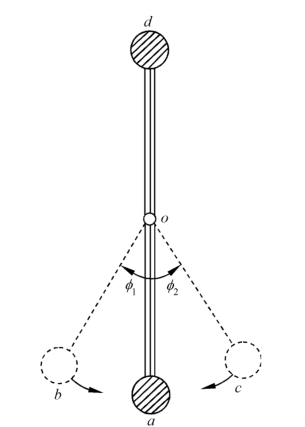{ .lq-img }

*图 3-27 单摆示意图：\(a\) 为稳定平衡点，\(d\) 为不稳定平衡点（截自原书）*

推广到控制系统：受有界扰动偏离原平衡状态后，**不论初始偏差多大**都能恢复的，叫**大范围稳定**；只有初始偏差小于某一范围才能恢复的，叫**小范围稳定**。对稳定的线性系统，大范围与小范围必然同时成立；只有非线性系统才可能小范围稳定而大范围不稳定（第八章）。

稳定性概念由俄国学者**李雅普诺夫**于 1892 年首先提出，沿用至今。对线性系统，运动稳定性与平衡状态稳定性等价。线性系统稳定性的定义：**若线性系统在初始扰动的影响下，其动态过程随时间的推移逐渐衰减并趋于零（原平衡工作点），则称系统渐近稳定，简称稳定；反之，若动态过程随时间推移而发散，则称系统不稳定。**

### 线性系统稳定的充分必要条件

稳定性仅取决于系统自身的固有特性，与外界条件无关。设初始条件为零时作用理想单位脉冲 \(\delta(t)\)，输出增量即脉冲响应 \(c(t)\)。若 \(t\to\infty\) 时

\[
\lim_{t\to\infty} c(t) = 0
\tag{3.44}
\]

即输出增量收敛于原平衡工作点，则线性系统稳定。

设闭环传递函数如式 (3.43)，特征方程 \(D(s)=0\) 的根 \(s_i\) 互不相等，且既有实根 \(s_j\)（共 \(q\) 个）又有共轭复根（共 \(r\) 对，\(q+2r=n\)）。脉冲 \(\delta(t)\) 的拉氏变换为 1，故

\[
C(s)=\varPhi(s)=\frac{K^*\prod\limits_{i}(s-z_i)}{\prod\limits_{j}(s-s_j)\prod\limits_{k}\left(s^2+2\zeta_k\omega_k s+\omega_k^2\right)}
\tag{3.45}
\]

展成部分分式（实极点留数 \(A_j=\lim\limits_{s\to -s_j}(s+s_j)C(s)\)，\(0<\zeta_k<1\)）：

\[
C(s)=\sum_{j=1}^{q}\frac{A_j}{s+s_j}+\sum_{k=1}^{r}\frac{B_k(s+\zeta_k\omega_k)+C_k\,\omega_k\sqrt{1-\zeta_k^2}}{(s+\zeta_k\omega_k)^2+\omega_k^2(1-\zeta_k^2)}
\tag{3.46}
\]

拉氏反变换得脉冲响应：

\[
c(t)=\sum_{j=1}^{q}A_j\,\mathrm{e}^{-s_j t}+\sum_{k=1}^{r}B_k\,\mathrm{e}^{-\zeta_k\omega_k t}\cos\!\left(\omega_k\sqrt{1-\zeta_k^2}\,t\right)+\sum_{k=1}^{r}C_k\,\mathrm{e}^{-\zeta_k\omega_k t}\sin\!\left(\omega_k\sqrt{1-\zeta_k^2}\,t\right),\quad t\ge 0
\tag{3.48}
\]

式中 \(B_k,C_k\) 为与留数有关的常系数。式 (3.48) 表明：

- **当且仅当全部特征根具有负实部**，式 (3.44) 才成立——系统稳定；
- 有一个及以上正实部根：\(\lim_{t\to\infty}c(t)=\infty\)，不稳定；
- 有零实部根而其余根负实部：\(c(t)\) 趋于常数或等幅振荡——不是渐近稳定，称**临界稳定**。

**线性系统稳定的充分必要条件：闭环系统特征方程的所有根均具有负实部；或者说，闭环传递函数的极点均位于左半 \(s\) 平面。**

应当指出：实际系统都是线性化系统，建模略去了次要因素、参数又在微小变化，**临界稳定现象实际观察不到**。经典控制理论中只有渐近稳定的系统才称稳定系统。稳定系统在有界输入下输出必有界；不稳定系统的输出也不会无限增大——或受机械制动限制，或系统被破坏，或进入非线性状态产生大幅等幅振荡。

### 劳斯稳定判据

按充要条件判稳需要求出全部特征根，高阶系统求根工作量大。劳斯（Routh）于 1877 年提出代数判据——以特征方程的系数为依据间接判断根是否全在 \(s\) 左半平面。

设线性系统特征方程

\[
D(s)=a_0 s^n+a_1 s^{n-1}+\cdots+a_{n-1}s+a_n=0,\qquad a_0>0
\tag{3.49}
\]

**稳定的必要条件**：特征方程各项系数均为正数。由代数方程根与系数的关系（韦达定理）：

\[
\frac{a_1}{a_0}=-\sum_{i=1}^{n}s_i,\qquad
\frac{a_2}{a_0}=\sum_{\substack{i,j=1\\ i\ne j}}^{n}s_i s_j,\qquad
\frac{a_3}{a_0}=-\sum_{\substack{i,j,k=1\\ i\ne j\ne k}}^{n}s_i s_j s_k,\quad\cdots,\quad
\frac{a_n}{a_0}=(-1)^n\prod_{i=1}^{n}s_i
\]

所有比值必须大于零，否则至少有一个正实部根。但**必要不充分**——系数全为正的特征方程完全可能有正实部根。

**劳斯表**（表 3-4）：前两行由特征方程系数按降幂间隔排列；以后各行逐行计算，空位置零，算到第 \(n\) 行为止，第 \(n+1\) 行只有第一列有值（等于 \(a_n\)），呈上三角形。

**表 3-4 劳斯表**

| | 第 1 列 | 第 2 列 | 第 3 列 | 第 4 列 | … |
| --- | --- | --- | --- | --- | --- |
| \(s^n\) | \(a_0\) | \(a_2\) | \(a_4\) | \(a_6\) | … |
| \(s^{n-1}\) | \(a_1\) | \(a_3\) | \(a_5\) | \(a_7\) | … |
| \(s^{n-2}\) | \(c_{13}=\dfrac{a_1 a_2-a_0 a_3}{a_1}\) | \(c_{23}=\dfrac{a_1 a_4-a_0 a_5}{a_1}\) | \(c_{33}=\dfrac{a_1 a_6-a_0 a_7}{a_1}\) | \(c_{43}\) | … |
| \(s^{n-3}\) | \(c_{14}=\dfrac{c_{13}a_3-a_1 c_{23}}{c_{13}}\) | \(c_{24}=\dfrac{c_{13}a_5-a_1 c_{33}}{c_{13}}\) | \(c_{34}=\dfrac{c_{13}a_7-a_1 c_{43}}{c_{13}}\) | \(c_{44}\) | … |
| \(s^{n-4}\) | \(c_{15}=\dfrac{c_{14}c_{23}-c_{13}c_{24}}{c_{14}}\) | \(c_{25}=\dfrac{c_{14}c_{33}-c_{13}c_{34}}{c_{14}}\) | \(c_{35}=\dfrac{c_{14}c_{43}-c_{13}c_{44}}{c_{14}}\) | \(c_{45}\) | … |
| ⋮ | ⋮ | ⋮ | ⋮ | ⋮ | |
| \(s^2\) | \(c_{1,n-1}\) | \(c_{2,n-1}\) | | | |
| \(s^1\) | \(c_{1,n}\) | | | | |
| \(s^0\) | \(c_{1,n+1}=a_n\) | | | | |

**劳斯稳定判据**：由特征方程 (3.49) 表征的线性系统稳定的充分必要条件是——**劳斯表中第一列各值为正**。若第一列出现小于零的数值，系统不稳定，且**第一列各系数符号的改变次数等于特征方程的正实部根的数目**。

**【例 3-7】四阶系统的稳定性**

特征方程 \(s^4+2s^3+3s^2+4s+5=0\)。劳斯表：

\[
\begin{array}{c|ccc}
s^4 & 1 & 3 & 5\\
s^3 & 2 & 4 & 0\\
s^2 & \dfrac{(2\times 3)-(1\times 4)}{2}=1 & 5 & 0\\
s^1 & \dfrac{(1\times 4)-(2\times 5)}{1}=-6 & 0 & \\
s^0 & 5 & &
\end{array}
\]

第一列 \(1,\,2,\,1,\,-6,\,5\) 有**两次变号**：系统不稳定，且有**两个正实部根**。（验证：`np.roots([1,2,3,4,5])` 得 \(0.288\pm 1.416\mathrm{j}\)、\(-1.288\pm 0.858\mathrm{j}\)。）

### 劳斯稳定判据的两种特殊情况

**(1) 某行第一列项为零，而其余各项不为零或不全为零**：算下一行第一个元时会出现无穷大，判据失效。例如 \(D(s)=s^3-3s+2=0\)：

\[
\begin{array}{c|cc}
s^3 & 1 & -3\\
s^2 & 0 & 2\\
s^1 & \infty &
\end{array}
\]

处理办法：用因子 \((s+a)\)（\(a\) 为任意正数）乘原特征方程，再对新方程用劳斯判据。以 \((s+3)\) 乘之得 \(s^4+3s^3-3s^2-7s+6=0\)，新劳斯表

\[
\begin{array}{c|ccc}
s^4 & 1 & -3 & 6\\
s^3 & 3 & -7 & 0\\
s^2 & -2/3 & 6 & 0\\
s^1 & 20 & 0 & 0\\
s^0 & 6 &
\end{array}
\]

第一列 \(1,\,3,\,-2/3,\,20,\,6\) 有**两次符号变化**：不稳定，两个正实部根。的确，\(D(s)=(s-1)^2(s+2)\)，有两个 \(s=1\) 的正实部根。

**(2) 劳斯表中出现全零行**：表明特征方程中存在一些**绝对值相同但符号相异**的特征根——大小相等符号相反的实根、一对共轭纯虚根、或对称于实轴的两对共轭复根。处理办法：用全零行**上面一行**的系数构造**辅助方程** \(F(s)=0\)，对 \(s\) 求导，用导数方程的系数取代全零行的元，继续运算。辅助方程次数通常为偶数，它的根就是那些数值相同符号相异的根。

**【例 3-8】全零行的处理**

特征方程 \(D(s)=s^6+s^5-2s^4-3s^3-7s^2-4s-4=0\)。列劳斯表：

\[
\begin{array}{c|cccc}
s^6 & 1 & -2 & -7 & -4\\
s^5 & 1 & -3 & -4 & 0\\
s^4 & 1 & -3 & -4 & \quad(\text{辅助方程系数})\\
s^3 & 0 & 0 & 0 & \quad(\text{全零行})\\
s^3 & 4 & -6 & 0 & \quad(\mathrm{d}F(s)/\mathrm{d}s=0\ \text{系数})\\
s^2 & -1.5 & -4 & &\\
s^1 & -16.7 & 0 & &\\
s^0 & -4 & & &
\end{array}
\]

\(s^3\) 行全零，用 \(s^4\) 行系数构造辅助方程

\[
F(s)=s^4-3s^2-4=0
\]

对 \(s\) 求导：\(\mathrm{d}F(s)/\mathrm{d}s=4s^3-6s=0\)，用系数 \([4,\ -6]\) 取代全零行，继续算完。第一列 \(1,\,1,\,1,\,4,\,-1.5,\,-16.7,\,-4\) 有**一次符号变化**：系统不稳定，有一个正实部根。解辅助方程 \(F(s)=0\) 得产生全零行的根为 \(\pm 2\) 和 \(\pm\mathrm{j}\)；直接求根验证：特征根为 \(\pm 2\)、\(\pm\mathrm{j}\) 及 \((-1\pm\mathrm{j}\sqrt 3)/2\)——劳斯表的判断正确。

### 劳斯稳定判据的应用

劳斯判据只判稳定性，不保证动态性能——它不能表明特征根相对虚轴的距离。若负实部根紧贴虚轴（\(|s_j|\) 或 \(\zeta_k\omega_k\) 很小），动态过程将具有缓慢的非周期特性或强烈的振荡。为使稳定系统有良好动态响应，希望特征根与虚轴保持一定距离。

- **检验给定稳定度**：在左半 \(s\) 平面作垂线 \(s=-a\)（\(a\) 为最小给定距离，称**给定稳定度**），用新变量 \(s_1=s+a\)（即 \(s=s_1-a\)）代入原特征方程得新方程，对新方程用劳斯判据，可判别特征根是否全部位于 \(s=-a\) 垂线之左。
- **确定参数取值范围**：确定一个或两个使系统稳定（或特征根全在 \(s=-a\) 之左）的参数取值范围。待定参数一般不能超过两个。

**【例 3-9】PI 控制系统的参数稳定域**

**已知**：比例-积分（PI）控制系统如图 3-28，\(K_1\) 为与积分器时间常数有关的待定参数，\(\zeta=0.2\)，\(\omega_n=86.6\)。求使闭环系统稳定的 \(K_1\) 范围；若要求闭环极点全部位于 \(s=-1\) 垂线之左，\(K_1\) 范围又如何？

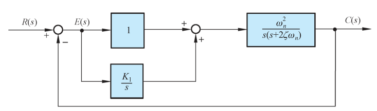{ .lq-img }

*图 3-28 例 3-9 比例-积分控制系统结构图（截自原书）*

**解**：闭环传递函数

\[
\varPhi(s)=\frac{\omega_n^2(s+K_1)}{s^3+2\zeta\omega_n s^2+\omega_n^2 s+K_1\omega_n^2}
\]

闭环特征方程 \(D(s)=s^3+2\zeta\omega_n s^2+\omega_n^2 s+K_1\omega_n^2=0\)。代入 \(\zeta=0.2\)、\(\omega_n=86.6\)（\(2\zeta\omega_n=34.6\)，\(\omega_n^2=7500\)）：

\[
D(s)=s^3+34.6s^2+7500s+7500K_1=0
\]

劳斯表：

\[
\begin{array}{c|cc}
s^3 & 1 & 7500\\
s^2 & 34.6 & 7500K_1\\
s^1 & \dfrac{34.6\times 7500-7500K_1}{34.6} & 0\\
s^0 & 7500K_1 &
\end{array}
\]

令第一列各元为正：\(7500K_1>0\) 且 \((34.6\times 7500-7500K_1)/34.6>0\)，得

\[
0<K_1<34.6
\]

要求极点全在 \(s=-1\) 之左：令 \(s=s_1-1\) 代入，整理得

\[
s_1^3+31.6s_1^2+7433.8s_1+(7500K_1-7466.4)=0
\]

新劳斯表（第一列：\(1,\ 31.6,\ \dfrac{31.6\times 7433.8-(7500K_1-7466.4)}{31.6},\ 7500K_1-7466.4\)），令各元为正：\(7500K_1-7466.4>0\) 给出 \(K_1>0.996\)，分子为正给出 \(K_1<32.3\)。即

\[
1<K_1<32.3
\]

## 3.6 线性系统的稳态误差计算

稳态误差是系统控制准确度（控制精度）的度量，通常称稳态性能。系统结构、输入作用的类型（控制量或扰动量）、输入函数形式（阶跃/斜坡/加速度）不同，稳态输出不可能在任何情况下都与输入一致；摩擦、间隙、不灵敏区、零位输出等非线性因素还造成附加稳态误差。稳态误差不可避免，设计任务之一是把它压到容许值以下。**只有系统稳定，研究稳态误差才有意义。**阶跃输入下没有原理性稳态误差的系统称**无差系统**，有原理性稳态误差的称**有差系统**。本节讨论原理性稳态误差的计算（系统结构、输入形式和类型引起的），非线性因素引起的附加（结构性）稳态误差另算。

### 误差与稳态误差

设控制系统结构图如图 3-23。当输入 \(R(s)\) 与主反馈信号 \(B(s)\) 不等时，比较装置输出

\[
E(s)=R(s)-H(s)C(s)
\tag{3.50}
\]

\(E(s)\) 称**误差信号**（简称误差，亦称偏差），系统在 \(E(s)\) 作用下动作，使输出趋于希望值。

误差有两种定义：式 (3.50) 在**输入端**定义，实际系统中可量测，有物理意义；另一种从**输出端**定义——输出量希望值与实际值之差，常用于性能指标提法，但有时无法量测。两者有内在联系：把图 3-23 等效为单位反馈（图 3-29），\(R'(s)\) 代表输出量希望值，\(E'(s)\) 为输出端定义的误差，且有简单关系

\[
E(s)=E'(s)/H(s)
\tag{3.51}
\]

本书以下均用输入端定义的 \(E(s)\) 计算。对单位反馈系统（\(H=1\)），两种定义一致。

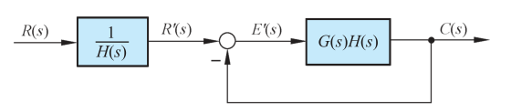{ .lq-img }

*图 3-29 与图 3-23 等效的单位反馈系统结构图（截自原书）*

误差本身是时间的函数：

\[
e(t)=\mathscr{L}^{-1}[E(s)]=\mathscr{L}^{-1}[\varPhi_e(s)R(s)]
\tag{3.52}
\]

其中**误差传递函数**：

\[
\varPhi_e(s)=\frac{E(s)}{R(s)}=\frac{1}{1+G(s)H(s)}
\tag{3.53}
\]

\(e(t)\) 含瞬态分量 \(e_{ts}(t)\) 与稳态分量 \(e_{ss}(t)\)。系统稳定时 \(e_{ts}(t)\to 0\)，**稳态误差**定义为 \(e_{ss}(\infty)\)，常简记 \(e_{ss}\)。

若 \(sE(s)\) 除原点外极点均在 \(s\) 左半平面（含原点），可用**终值定理**：

\[
e_{ss}(\infty)=\lim_{s\to 0}sE(s)=\lim_{s\to 0}\frac{sR(s)}{1+G(s)H(s)}
\tag{3.54}
\]

由式 (3.54) 算出的有时称**终值误差**——它给不出 \(e_{ss}(t)\) 随时间的变化规律，有局限性。

**【例 3-10】终值定理的适用条件**

设单位反馈系统 \(G(s)=1/(Ts)\)，输入分别为 \(r(t)=t^2/2\) 与 \(r(t)=\sin\omega t\)，求稳态误差。

**解**：\(r(t)=t^2/2\) 时 \(R(s)=1/s^3\)，由式 (3.53)：

\[
E(s)=\frac{s^2}{1+1/(Ts)}\cdot\frac{1}{s^3}=\frac{T}{s^2(Ts+1)}
=\frac{T}{s^2}-\frac{T^2}{s}+\frac{T^2}{Ts+1}
\]

取拉氏反变换：\(e(t)=Tt-T^2+T^2\mathrm{e}^{-t/T}=T(t-T)+T^2\mathrm{e}^{-t/T}\)。瞬态分量 \(T^2\mathrm{e}^{-t/T}\) 逐渐衰减至零；稳态分量 \(e_{ss}(t)=T(t-T)\)，表明 \(e_{ss}(\infty)=\infty\)——I 型系统不能跟踪加速度输入。

\(r(t)=\sin\omega t\) 时 \(R(s)=\omega/(s^2+\omega^2)\)，可解出

\[
e_{ss}(t)=-\frac{T\omega^2}{1+T^2\omega^2}\cos\omega t+\frac{\omega}{1+T^2\omega^2}\sin\omega t
\]

显然 \(e_{ss}(\infty)\ne 0\)。注意：**正弦函数的拉氏变换在虚轴上不解析，此时不能用终值定理**——否则会由式 (3.54) 得出 \(e_{ss}(\infty)=0\) 的错误结论（分母里的 \(s^2+\omega^2\) 在虚轴上有极点，终值定理条件被破坏）。

!!! note "拓展：终值定理三步走（补充）"
    用式 (3.54) 前固定做三件事：(1) 确认闭环**稳定**；(2) 写出 \(sE(s)\) 并检查它在虚轴（含原点）上的极点——输入的极点会被 \(1+GH\) 抵消多少决定 \(sE(s)\) 的虚轴极点；(3) 有虚轴极点就改用拉氏反变换求 \(e_{ss}(t)\)。正弦、\(1/s^v\) 配 0 型系统（\(v\) 不够）都是典型翻车点。

### 系统类型

式 (3.54) 表明稳态误差与开环传递函数的结构和输入形式密切相关。输入一定时，是否存在稳态误差取决于开环结构。按系统**跟踪不同输入信号的能力**分类是必要的。

一般开环传递函数可写成

\[
G(s)H(s)=\frac{K\prod\limits_{i=1}^{m_1}(\tau_i s+1)}{s^{\nu}\prod\limits_{j=1}^{n-\nu}(T_j s+1)}
\tag{3.55}
\]

\(K\) 为开环增益；\(\tau_i,T_j\) 为时间常数；\(\nu\) 为开环系统在 \(s\) 平面**坐标原点上的极点数**（积分环节数）。以 \(\nu\) 分类：\(\nu=0\) 称 0 型系统，\(\nu=1\) 称 I 型系统，\(\nu=2\) 称 II 型系统……\(\nu>2\) 时除复合控制系统外很难稳定，除航天控制系统外 III 型及以上几乎不采用。这种分类与阶次分类无关：阶次 \(m,n\) 不影响稳态误差数值。

令 \(G_0(s)H_0(s)=\prod(\tau_i s+1)\big/\prod(T_j s+1)\)，则 \(s\to 0\) 时 \(G_0H_0\to 1\)，式 (3.55) 可改写为

\[
G(s)H(s)=\frac{G_0(s)H_0(s)}{s^{\nu}}
\tag{3.56}
\]

稳态误差通式：

\[
e_{ss}(\infty)=\lim_{s\to 0}\frac{s R(s)}{1+K/s^{\nu}}=\lim_{s\to 0}\frac{s^{\nu+1}R(s)}{s^{\nu}+K}
\tag{3.57}
\]

影响稳态误差的因素：**系统型别 \(\nu\)、开环增益 \(K\)、输入信号的形式和幅值**。

### 阶跃输入作用下的稳态误差与静态位置误差系数

\(r(t)=R\cdot 1(t)\)，\(R(s)=R/s\)。各型系统的稳态误差：

\[
e_{ss}(\infty)=\begin{cases}R/(1+K)=\text{常数}, & \nu=0\\ 0, & \nu\ge 1\end{cases}
\]

习惯上用**静态位置误差系数** \(K_p\) 表示阶跃输入下的位置误差。由式 (3.54)：

\[
e_{ss}(\infty)=\frac{R}{1+K_p},\qquad
K_p=\lim_{s\to 0}G(s)H(s)
\tag{3.58, 3.59}
\]

各型系统的 \(K_p\)：\(\nu=0\) 时 \(K_p=K\)；\(\nu\ge 1\) 时 \(K_p=\infty\)。要阶跃输入无稳态误差，必须选 I 型及以上系统。习惯上把阶跃输入下的稳态误差称**静差**：0 型系统称有（静）差系统或零阶无差度系统，I 型系统称一阶无差度系统，II 型系统称二阶无差度系统。

### 斜坡输入作用下的稳态误差与静态速度误差系数

\(r(t)=Rt\)，\(R(s)=R/s^2\)。各型系统的稳态误差：

\[
e_{ss}(\infty)=\begin{cases}\infty, & \nu=0\\ R/K=\text{常数}, & \nu=1\\ 0, & \nu\ge 2\end{cases}
\]

用**静态速度误差系数** \(K_v\) 表示：

\[
e_{ss}(\infty)=\frac{R}{K_v},\qquad
K_v=\lim_{s\to 0}sG(s)H(s)
\tag{3.60, 3.61}
\]

\(K_v\) 的单位与开环增益相同（\(s^{-1}\)）。0 型系统 \(K_v=0\)；I 型系统 \(K_v=K\)；II 型及以上 \(K_v=\infty\)。

**必须注意："速度误差"并不是指输出与输入之间存在速度上的误差**，而是指系统在速度（斜坡）输入作用下，稳态输出与输入之间存在**位置**上的误差。式 (3.60) 表明：0 型系统稳态时不能跟踪斜坡输入；I 型单位反馈系统稳态输出速度与输入速度相同，但存在与 \(R\) 成正比、与 \(K\) 成反比的稳态位置误差；II 型及以上能准确跟踪，无位置误差。

若系统为非单位反馈且 \(H(s)=K_h\)（常数），输出量希望值为 \(R'(s)=R(s)/K_h\)，输出端稳态位置误差

\[
e_{ss}'(\infty)=\frac{e_{ss}(\infty)}{K_h}
\tag{3.62}
\]

（对加速度输入同样成立。）

**【例 3-11】非单位反馈系统的输出端误差**

非单位反馈系统 \(G(s)=10/(s+1)\)，\(H(s)=K_h\)，输入 \(r(t)=1(t)\)。分别求 \(K_h=1\) 与 \(K_h=0.1\) 时输出端的稳态位置误差 \(e_{ss}'(\infty)\)。

**解**：开环传递函数 \(G(s)H(s)=10K_h/(s+1)\)，为 0 型系统，\(K_p=K=10K_h\)。输入端稳态位置误差 \(e_{ss}=1/(1+10K_h)\)。由式 (3.62)：

- \(K_h=1\)：\(e_{ss}'=e_{ss}=1/11\)；
- \(K_h=0.1\)：\(e_{ss}'=e_{ss}/K_h=1/[K_h(1+10K_h)]=5\)，此时输出量的希望值为 \(r(t)/K_h=10\)。

### 加速度输入作用下的稳态误差与静态加速度误差系数

\(r(t)=Rt^2/2\)，\(R(s)=R/s^3\)。各型系统的稳态误差：

\[
e_{ss}(\infty)=\begin{cases}\infty, & \nu=0,1\\ R/K=\text{常数}, & \nu=2\\ 0, & \nu\ge 3\end{cases}
\]

用**静态加速度误差系数** \(K_a\) 表示：

\[
e_{ss}(\infty)=\frac{R}{K_a},\qquad
K_a=\lim_{s\to 0}s^2G(s)H(s)
\tag{3.63, 3.64}
\]

\(K_a\) 的单位为 \(s^{-2}\)。0 型及 I 型系统 \(K_a=0\)；II 型系统 \(K_a=K\)；III 型及以上 \(K_a=\infty\)。"加速度误差"同样指加速度输入下稳态输出与输入之间的**位置误差**。

静态误差系数 \(K_p,K_v,K_a\) 定量描述了系统跟踪不同形式输入的能力：输入形式、输出希望值与容许误差确定后，可据此选择系统型别和开环增益。对非单位反馈系统，静态误差系数没有明显的物理意义，也不便图形表示。

**组合输入**：若 \(r(t)=R_0\cdot 1(t)+R_1 t+\dfrac{1}{2}R_2 t^2\)，由线性叠加原理：

\[
e_{ss}(\infty)=\frac{R_0}{1+K_p}+\frac{R_1}{K_v}+\frac{R_2}{K_a}
\]

此时至少应选 II 型系统，否则稳态误差为无穷大。高型别对提高控制准确度有利，但要以确保稳定为前提，兼顾动态性能。

**表 3-5 输入信号作用下的稳态误差（以单位反馈系统为例）**

| 系统型别 | \(K_p\) | \(K_v\) | \(K_a\) | 阶跃输入 \(r(t)=R\cdot 1(t)\) | 斜坡输入 \(r(t)=Rt\) | 加速度输入 \(r(t)=Rt^2/2\) |
| --- | --- | --- | --- | --- | --- | --- |
| 0 | \(K\) | 0 | 0 | \(\dfrac{R}{1+K}\) | \(\infty\) | \(\infty\) |
| I | \(\infty\) | \(K\) | 0 | 0 | \(\dfrac{R}{K}\) | \(\infty\) |
| II | \(\infty\) | \(\infty\) | \(K\) | 0 | 0 | \(\dfrac{R}{K}\) |
| III | \(\infty\) | \(\infty\) | \(\infty\) | 0 | 0 | 0 |

同一系统在不同输入下稳态误差不同的物理解释，用下例说明。

**【例 3-12】位置随动系统对不同输入的稳态误差**

具有测速发电机内反馈的位置随动系统如图 3-32，开环传递函数 \(G(s)=\dfrac{1}{s(s+1)}\)，求 \(r(t)\) 分别为 \(1(t)\)、\(t\)、\(t^2/2\) 时的稳态误差。

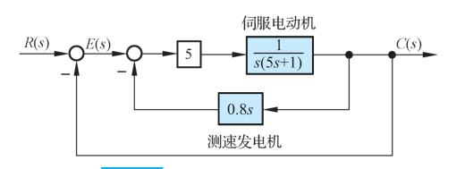{ .lq-img }

*图 3-32 例 3-12 具有测速发电机内反馈的位置随动系统结构图（截自原书）*

**解**：本例 \(K=1\) 的 I 型系统：\(K_p=\infty\)，\(K_v=1\)，\(K_a=0\)。故稳态误差分别为 \(0\)、\(1\)、\(\infty\)。物理解释：

- 阶跃位置输入下，稳态输出是恒定位置，伺服电动机必须**停止转动**——加在电动机控制绕组上的电压必须为零，即输入端误差信号稳态值为零：无位置误差。
- 斜坡输入下，稳态输出速度必须与输入速度相同，要求电动机**恒速运转**，控制绕组需要恒定电压，故误差信号终值为常值：存在常值速度误差。
- 加速度输入下，稳态输出应等加速变化，要求控制绕组电压**等速变化**，归结为误差信号随时间线性增长：\(t\to\infty\) 时加速度误差必为无穷大。

注意：只有输入是阶跃、斜坡、加速度函数或其线性组合时，静态误差系数法才有意义；求出的稳态误差或是零、或是常值、或是无穷大——其实质是终值定理法。输入为其他形式函数时此法失效。

求稳态误差的完整流程如下：

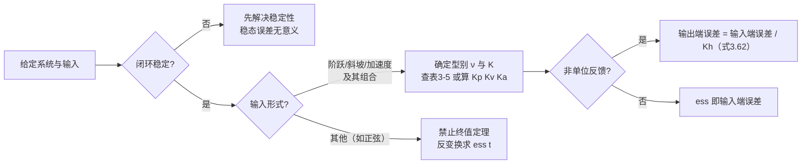

### 扰动作用下的稳态误差

控制系统还经常处于扰动之下：负载转矩变动、放大器零位与噪声、电源电压和频率波动、环境温度变化等。扰动作用下的稳态误差反映**抗干扰能力**。由于输入信号和扰动信号作用于系统的**不同位置**，即使系统对某种形式输入的稳态误差为零，对同一形式的扰动，其稳态误差未必为零。

设控制系统如图 3-33，\(N(s)\) 为扰动信号。扰动作用下理想输出应为零，故该非单位反馈系统响应扰动 \(n(t)\) 的输出端误差信号为

\[
E_n(s)=-C_n(s)=-\frac{G_2(s)}{1+G(s)}\,N(s)
\tag{3.65}
\]

式中 \(G(s)=G_1(s)G_2(s)H(s)\) 为开环传递函数，\(G_2(s)\) 为扰动作用点到输出之间的前向通道传递函数。当 \(sE_n(s)\) 在 \(s\) 右半平面及虚轴上解析时，可用终值定理计算扰动稳态误差。

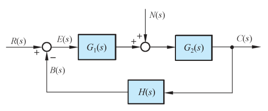{ .lq-img }

*图 3-33 扰动作用下的控制系统结构图（截自原书）*

**【例 3-13】比例控制系统对阶跃扰动转矩的稳态误差**

比例控制系统如图 3-34：\(R(s)=R_0/s\) 为阶跃输入，\(M\) 为比例控制器输出转矩，\(N(s)=n_0/s\) 为阶跃扰动转矩。求系统的稳态误差。

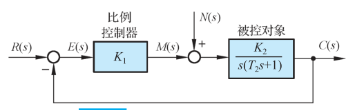{ .lq-img }

*图 3-34 例 3-13 比例控制系统结构图（截自原书）*

**解**：本例系统为 I 型系统（前向通道含一个积分环节）。令 \(N(s)=0\)：对阶跃输入的稳态误差为零。令 \(R(s)=0\)，扰动作用下输出量的实际值

\[
C_n(s)=\frac{K_2}{s(T_2 s+1)+K_1 K_2}\,N(s)
\]

输出希望值为零，故误差信号 \(E_n(s)=-C_n(s)\)，稳态误差

\[
e_{ssn}(\infty)=\lim_{s\to 0}sE_n(s)=-\frac{n_0}{K_1}
\tag{3.66}
\]

物理意义：稳态时比例控制器必须产生与扰动转矩 \(n_0\) 大小相等方向相反的转矩来平衡，该转矩折算到比较装置输出端的数值为 \(-n_0/K_1\)——所以必有常值稳态误差 \(-n_0/K_1\)。**增大扰动作用点之前的比例控制器增益 \(K_1\) 可减小它；稳态误差与 \(K_2\) 无关**——增大扰动点之后的前向通道增益，不能改变对扰动的稳态误差。

**【例 3-14】机器人手爪控制系统综合分析**

**已知**：机器人手爪由直流电机驱动改变两爪间夹角（图 3-35），\(K_m=30\)，\(R_f=1\)，\(K_f=K_i=1\)，\(J=0.1\)，\(f=1\)。求：(1) \(K_a=20\) 时单位阶跃输入下的响应 \(\theta(t)\)；(2) \(\theta_d(t)=0\)、\(n(t)=1(t)\) 时负载对系统的影响；(3) \(n(t)=0\)、\(\theta_d(t)=t\ (t>0)\) 时的稳态误差。

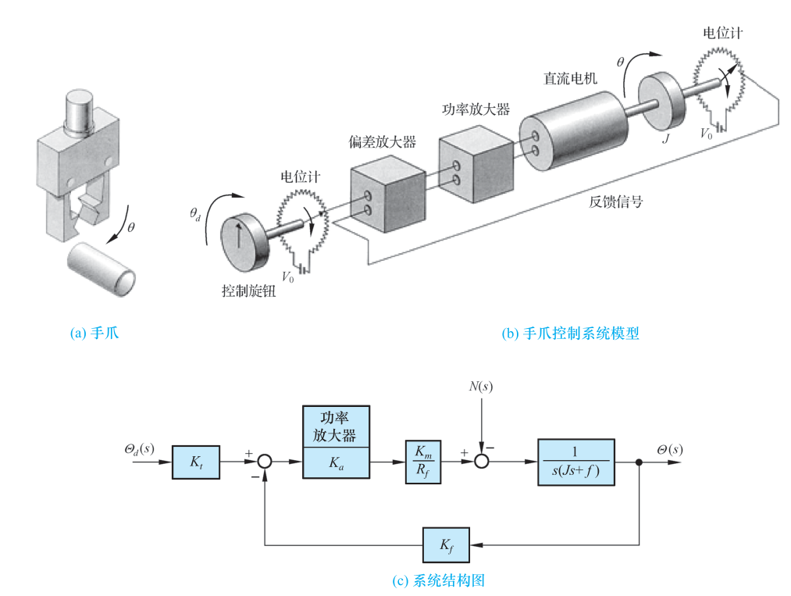{ .lq-img }

*图 3-35 机器人手爪控制系统：(a) 手爪；(b) 手爪控制系统模型；(c) 系统结构图（截自原书）*

**解**：(1) 闭环传递函数

\[
\varPhi(s)=\frac{K_a K_m K_i / R_f}{J s^2 + s + K_a K_m K_f K_i / R_f}=\frac{600}{0.1s^2+s+600}
\]

与标准形式对比：\(\omega_n=\sqrt{6000}=77.46\ \mathrm{rad/s}\)，\(\zeta=\dfrac{10}{2\omega_n}=0.0645\)。单位阶跃响应：

\[
\theta(t)=1-\frac{1}{\sqrt{1-\zeta^2}}\mathrm{e}^{-\zeta\omega_n t}\sin\left(\omega_n\sqrt{1-\zeta^2}\,t+\arctan\frac{\sqrt{1-\zeta^2}}{\zeta}\right)
=1-1.0021\,\mathrm{e}^{-5t}\sin(77.3t+86.3^\circ)
\]

动态性能估算：\(\sigma\%=100\mathrm{e}^{-\pi\zeta/\sqrt{1-\zeta^2}}\%=81.6\%\)，\(\beta=\arccos\zeta=86.3^\circ=1.506\ \mathrm{rad}\)，\(t_r=(\pi-\beta)/(\omega_n\sqrt{1-\zeta^2})=0.02\,\mathrm{s}\)，\(t_s=4.4/(\zeta\omega_n)=0.88\,\mathrm{s}\)（\(\varDelta=2\%\)）。

(2) 令 \(\varTheta_d(s)=0\)、\(N(s)=1/s\)，则

\[
\varTheta(s)=-\frac{1}{0.1s^2+s+600}\,N(s),\qquad
e_{ssn}(\infty)=\lim_{s\to 0}s\varTheta(s)=-\frac{1}{600}
\]

扰动输入幅值在输出端被削弱 600 倍。

(3) \(\varTheta_d(s)=1/s^2\)，误差 \(E(s)=\varTheta_d(s)-\varTheta(s)\)，由式 (3.53)：

\[
e_{ss}(\infty)=\lim_{s\to 0}\frac{s(0.1s+1)}{0.1s^2+s+600}\cdot\frac{1}{s}=\frac{1}{600}
\]

仿真验证见下方代码（斜坡稳态误差 \(1/600\approx 0.00167\)，与理论一致）。

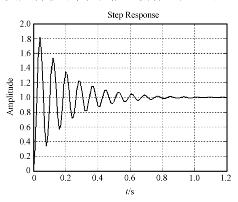{ .lq-img }

*图 3-36 机器人手爪控制系统单位阶跃响应（MATLAB）：\(\sigma\%\approx 81.6\%\) 的剧烈振荡（截自原书）*

=== "MATLAB"

    ```matlab
    % ===== 书 3-6 节 例3-14 机器人手爪 =====
    num = 600; den = [0.1 1 600]; sys = tf(num, den);
    figure(1)
    t = 0:0.01:1.2; step(sys, t), grid on          % 单位阶跃响应（书图3-36）
    figure(2)
    t = 0:0.005:0.6; u = t; lsim(sys, u, t), grid on   % 单位斜坡响应
    sysne = tf(-1, den);
    figure(3)
    t = 0:0.01:1.2; step(sysne, t), grid on        % 单位阶跃扰动响应
    stepinfo(sys)   % sigma%≈81.1、ts(2%)≈0.78，与书估算 81.6%/0.88 基本一致
    ```

=== "Python"

    ```python
    # ===== 书 3-6 节 例3-14 机器人手爪 =====
    import numpy as np
    import control as ct
    import matplotlib.pyplot as plt

    sys = ct.tf([600], [0.1, 1, 600])       # Theta(s)/Theta_d(s) = 600/(0.1s^2+s+600)
    print('wn=%.2f, zeta=%.4f' % (np.sqrt(6000), 10/(2*np.sqrt(6000))))
    info = ct.step_info(sys)
    print('sigma%%=%.1f, ts(2%%)=%.2f' % (info['Overshoot'], info['SettlingTime']))
    T = np.arange(0, 8, 0.002)
    resp = ct.forced_response(sys, T, T)    # 斜坡输入 u = t
    print('斜坡稳态误差 = %.6f（理论 1/600）' % (T - resp.outputs)[-1])
    _, yn = ct.step_response(ct.tf([-1], [0.1, 1, 600]), 50)
    print('阶跃扰动终值 = %.6f（理论 -1/600，扰动被削弱 600 倍）' % yn[-1])
    fig, ax = plt.subplots(1, 3, figsize=(12, 3))
    t1, y1 = ct.step_response(sys, np.arange(0, 1.2, 0.01))
    ax[0].plot(t1, y1); ax[0].set_title('Step response')
    ax[1].plot(T, resp.outputs); ax[1].plot(T, T, ':'); ax[1].set_title('Ramp response')
    t3, y3 = ct.step_response(ct.tf([-1], [0.1, 1, 600]), np.arange(0, 1.2, 0.01))
    ax[2].plot(t3, y3); ax[2].set_title('Step disturbance')
    plt.tight_layout(); plt.show()
    ```

### 减小或消除稳态误差的措施

**(1) 增大系统开环增益或扰动作用点之前系统的前向通道增益**。由表 3-5：增大 \(K\)，0 型系统减小阶跃输入的位置误差，I 型系统减小斜坡输入的速度误差，II 型系统减小加速度输入的加速度误差。对扰动（例 3-13）：增大**扰动作用点之前**的增益 \(K_1\) 可减小阶跃扰动的稳态误差；式 (3.66) 表明它与 \(K_2\) 无关——**增大扰动点之后的前向通道增益无效**。

**(2) 在前向通道或主反馈通道设置串联积分环节**。设

\[
G_1(s)=\frac{N_1(s)}{M_1(s)\,s^{\nu_1}},\qquad
G_2(s)=\frac{N_2(s)}{M_2(s)\,s^{\nu_2}},\qquad
H(s)=\frac{H_1(s)}{H_2(s)}
\]

其中 \(N_1,M_1,N_2,M_2,H_1,H_2\) 均不含 \(s=0\) 的因子；\(\nu_1,\nu_2\) 为前向通道两级各自的积分环节数。系统对输入信号的误差传递函数为

\[
\varPhi_e(s)=\frac{1}{1+G_1(s)G_2(s)H(s)}
=\frac{M_1(s)M_2(s)H_2(s)\,s^{\nu}}{s^{\nu}M_1(s)M_2(s)H_2(s)+N_1(s)N_2(s)H_1(s)},\qquad \nu=\nu_1+\nu_2
\tag{3.67}
\]

当主反馈通道不含 \(s=0\) 的零点和极点时，结论：

1. 前向通道串联积分环节数 \(\nu\) 与 \(\varPhi_e(s)\) 所含 \(s=0\) 的零点数相同，**决定系统响应输入信号的型别**；
2. 只要前向通道设置 \(\nu\) 个串联积分环节，必可消除系统在 \(r(t)=\sum\limits_{i=0}^{\nu-1}R_i t^i/i!\) 输入下的稳态误差。

若主反馈通道也含 \(\nu_3\) 个积分环节，\(H(s)=H_1(s)/(H_2(s)s^{\nu_3})\)，则对扰动作用的误差传递函数

\[
\varPhi_{en}(s)=\frac{E_n(s)}{N(s)}
=-\frac{G_2(s)}{1+G_1(s)G_2(s)H(s)}
=-\frac{M_1(s)N_2(s)H_2(s)\,s^{\nu_1+\nu_3}}{s^{\nu}M_1(s)M_2(s)H_2(s)+N_1(s)N_2(s)H_1(s)},\qquad \nu=\nu_1+\nu_2+\nu_3
\tag{3.68}
\]

\(\varPhi_{en}(s)\) 在 \(s=0\) 的零点数为 \(\nu_1+\nu_3\)，故对扰动作用：

1. **扰动作用点之前**的前向通道积分环节数与主反馈通道积分环节数之和决定系统响应扰动作用的型别，与扰动作用点之后的前向通道积分环节数**无关**；
2. 在扰动作用点之前的前向通道或主反馈通道中设置 \(\nu_1+\nu_3\) 个积分环节，必可消除 \(n(t)=\sum\limits_{i=0}^{\nu-1}n_i t^i/i!\) 扰动下的稳态误差。

特别指出：设置串联积分环节或增大开环增益消除/减小稳态误差，必然**降低稳定性**甚至造成不稳定，恶化动态性能——权衡稳定性、稳态误差与动态性能正是系统校正设计（后续章节）的主要内容。

**(3) 采用串级控制抑制内回路扰动**。多个扰动、高控制精度时宜用串级控制。图 3-40 为串级直流电动机速度控制系统方框图：内回路为**电流环（副回路）**，外回路为**速度环（主回路）**，主、副调节器串联共同控制。副回路包围的扰动称**二次扰动**（如电网电压波动 \(\Delta U_d\)），副回路之外的扰动称**一次扰动**（如负载变化 \(I_z\)）。

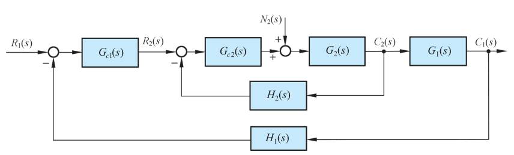{ .lq-img }

*图 3-40 串级控制系统结构图（截自原书）*

把副回路视为等效环节 \(G_2'(s)=\dfrac{G_{c2}(s)G_2(s)}{1+G_{c2}(s)G_2(s)H_2(s)}\)，副回路输出对二次扰动的闭环传递函数为 \(G_{n2}(s)=\dfrac{G_2(s)}{1+G_{c2}(s)G_2(s)H_2(s)}\)，比较可得 \(G_2'(s)=G_{c2}(s)G_{n2}(s)\)。于是主回路中：

\[
\frac{C_1(s)}{R_1(s)}=\frac{G_{c1}(s)G_2'(s)G_1(s)}{1+G_{c1}(s)G_2'(s)G_1(s)H_1(s)},\qquad
\frac{C_1(s)}{N_2(s)}=\frac{G_1(s)G_{n2}(s)}{1+G_{c1}(s)G_2'(s)G_1(s)H_1(s)}
\]

理想系统希望 \(C_1/N_2\to 0\)、\(C_1/R_1\to 1\)，串级系统抑制二次扰动的能力用比值

\[
\frac{C_1(s)/R_1(s)}{C_1(s)/N_2(s)}=G_{c1}(s)G_2'(s)
\]

表示。主、副调节器均用比例调节器（增益 \(K_{c1},K_{c2}\)）时该比值为 \(K_{c1}K_{c2}\)：主副调节器总增益越大，抑制二次扰动能力越强。副回路阶数取得低，\(K_{c2}\) 可以很大，通常 \(K_{c1}K_{c2}>K_{c1}\)——与单回路相比，串级控制对二次扰动的抑制能力一般可提高 **10～100 倍**。

**【例 3-15】PI 控制器消除阶跃扰动稳态误差**

在例 3-13 系统中采用比例-积分控制器（\(G_c=K_1\left(1+\dfrac{1}{T_i s}\right)\)，被控对象 \(G_2(s)=\dfrac{K_2}{s(T_2 s+1)}\)），分别计算阶跃转矩扰动和斜坡转矩扰动下的稳态误差。

**解**：扰动作用点之前的积分环节数 \(\nu_1=1\)，\(\nu_3=0\)——该 PI 控制系统对扰动作用为 I 型：阶跃扰动无稳态误差，斜坡扰动有常值稳态误差。由式 (3.65) 通分（分子分母同乘 \(T_i s\cdot s(T_2 s+1)\)）：

\[
E_n(s)=-\frac{K_2 T_i s}{T_i T_2 s^3+T_i s^2+K_1K_2 T_i s+K_1K_2}\,N(s)
\]

设 \(sE_n(s)\) 的极点位于 \(s\) 左半平面，用终值定理：

- \(N(s)=n_0/s\)（阶跃转矩扰动）：

\[
e_{ssn}(\infty)=\lim_{s\to 0}sE_n(s)=0
\]

- \(N(s)=n_1/s^2\)（斜坡转矩扰动）：

\[
e_{ssn}(\infty)=-\lim_{s\to 0}\frac{n_1 K_2 T_i s}{T_i T_2 s^3+T_i s^2+K_1K_2 T_i s+K_1K_2}=-\frac{n_1 T_i}{K_1}
\]

提高比例增益 \(K_1\) 可减小斜坡转矩下的稳态误差，但受稳定性与振荡性要求制约。物理意义：控制器含积分作用，只要稳态误差不为零，控制器就产生继续增长的输出转矩抵消阶跃扰动，直到误差为零才平衡——所以阶跃扰动误差被消除；斜坡扰动需要控制器稳态时输出反向斜坡转矩平衡，这只有在误差信号为负常值时才可能，故剩常值误差 \(-n_1T_i/K_1\)。

实际系统总同时承受输入和扰动。线性定常系统从安全性考虑，**总稳态误差 = 输入信号与扰动分别作用所得稳态误差的绝对值之和**。

## 3.7 线性系统的时域分析仿真

本节是前三节的工具化：求根判稳、画响应、算指标、辅助劳斯表、算误差系数。常用命令对照：

**表 3-6 时域分析常用命令（MATLAB ↔ python-control 0.10）**

| 功能 | MATLAB | Python（python-control） |
| --- | --- | --- |
| 特征根 | `p = roots(den)` 或 `pole(sys)` | `np.roots(den)` 或 `ct.poles(sys)` |
| 单位脉冲响应 | `impulse(sys, t)` | `ct.impulse_response(sys, T)` |
| 单位阶跃响应 | `step(sys, t)` | `ct.step_response(sys, T)` |
| 任意输入响应 | `lsim(sys, u, t, x0)` | `ct.forced_response(sys, T, U, X0)` |
| 零输入响应 | `initial(sys, x0, t)` | `ct.initial_response(sys, T, X0)`（需状态空间模型） |
| 动态性能指标 | `stepinfo(sys)` | `ct.step_info(sys)` |
| 传递函数建模 | `tf` / `zpk` | `ct.tf` / `ct.zpk` |
| 零极点增益分解 | `tf2zp` | `scipy.signal.tf2zpk` |
| 部分分式展开 | `residue` | `scipy.signal.residue` |
| 零极点图 | `pzmap` | `ct.pzmap` |
| 稳态（直流）增益 | `dcgain` | `ct.dcgain` |

`stepinfo`/`step_info` 默认口径一致：上升时间取 10%→90%，调节时间取 2% 误差带（python-control 对应参数 `RiseTimeLimits=(0.1,0.9)`、`SettlingTimeThreshold=0.02`）。

### 稳定性分析：求特征根

=== "MATLAB"

    ```matlab
    % ===== 书 3-7 节 稳定性分析 =====
    p = roots([1 2 3 4 5])              % 例3-7：0.288±1.416j 与 -1.288±0.858j，2 个正实部根
    p = roots([1 34.6 7500 7500*20])    % 例3-9 K1=20：实部全负，稳定
    p = roots([1 34.6 7500 7500*40])    % 例3-9 K1=40：2.24±87.6j，不稳定
    ```

=== "Python"

    ```python
    # ===== 书 3-7 节 稳定性分析 =====
    import numpy as np

    print(np.roots([1, 2, 3, 4, 5]))           # 例3-7：2 个正实部根 → 不稳定
    print(np.roots([1, 34.6, 7500, 7500*20]))  # 例3-9, K1=20：实部全负 → 稳定
    print(np.roots([1, 34.6, 7500, 7500*40]))  # 例3-9, K1=40：2.24±87.6j → 不稳定
    ```

### 劳斯表辅助计算

判稳用求根即可，但劳斯表还给出**右半平面根的个数**，且能处理含待定参数的特征方程。下面给出可直接使用的劳斯表函数（全零行自动用辅助方程导数系数替代，首元为零用小正数代替）。

=== "MATLAB"

    ```matlab
    % ===== 书 3-7 节 劳斯表辅助计算 =====
    [tab, n8] = routh([1 2 3 4 5])          % 例3-7：第一列 1 2 1 -6 5，变号 2 次
    [tab, n9] = routh([1 1 -2 -3 -7 -4 -4]) % 例3-8：全零行→辅助方程，变号 1 次

    function [tab, nchange] = routh(den)
    % ROUTH 劳斯表。den：特征多项式降幂系数。
    % 首元为零以小正数代替；全零行用辅助方程求导系数替代。
    n = numel(den); m = ceil(n/2) + 1;
    tab = zeros(n, m);
    for j = 1:m
        if 2*j-1 <= n, tab(1, j) = den(2*j-1); end   % s^n 行：a0 a2 a4 ...
        if 2*j   <= n, tab(2, j) = den(2*j);   end   % s^{n-1} 行：a1 a3 a5 ...
    end
    eps0 = 1e-6;
    for i = 3:n
        piv = tab(i-1, 1);
        if abs(piv) < eps0, piv = eps0; end          % 首元为零：小正数代替
        for j = 1:m-1
            tab(i, j) = (piv*tab(i-2, j+1) - tab(i-2, 1)*tab(i-1, j+1)) / piv;
        end
        if all(abs(tab(i, :)) < eps0)                % 全零行：辅助方程求导
            e = n - i + 1;                           % 上一行首元幂次
            for j = 1:m
                tab(i, j) = tab(i-1, j) * (e - 2*(j-1));
            end
        end
    end
    col = tab(:, 1); col = col(abs(col) >= eps0);
    nchange = sum(diff(sign(col)) ~= 0);             % 第一列变号次数
    end
    ```

=== "Python"

    ```python
    # ===== 书 3-7 节 劳斯表辅助计算 =====
    from fractions import Fraction as Fr

    def routh_table(den, eps=Fr(1, 10**6)):
        """劳斯表（分数精确运算）。den：特征多项式系数（s^n → 常数项）。
        返回 (rows, nchange, notes)：rows=[(幂标签, 行元素), ...]，
        nchange=第一列变号次数（=右半平面根数），notes 记录特殊行处理。"""
        n = len(den)
        a = [Fr(str(c)) for c in den]
        nc = (n + 1) // 2 + 1
        tab = [[Fr(0)] * nc for _ in range(n)]
        tab[0] = [a[2*j] if 2*j < n else Fr(0) for j in range(nc)]
        if n > 1:
            tab[1] = [a[2*j+1] if 2*j+1 < n else Fr(0) for j in range(nc)]
        notes, N = [], n - 1
        for i in range(2, n):
            piv = tab[i-1][0]
            used = piv if piv != 0 else eps          # 首元为零：小正数代替
            if piv == 0:
                notes.append(f's^{N-i+1} 行首元为 0，以 eps 代替')
            for j in range(nc):
                up2 = tab[i-2][j+1] if j+1 < nc else Fr(0)
                up1 = tab[i-1][j+1] if j+1 < nc else Fr(0)
                tab[i][j] = (used*up2 - tab[i-2][0]*up1) / used
            if all(v == 0 for v in tab[i]):          # 全零行：辅助方程求导
                e = N - (i - 1)
                aux = [(e-2*j, tab[i-1][j]) for j in range(nc) if tab[i-1][j] != 0]
                notes.append(f"s^{N-i} 行全零：辅助方程 " +
                             "+".join(f"({c})s^{k}" for k, c in aux) + "=0，导数系数替代")
                tab[i] = [tab[i-1][j]*(e-2*j) for j in range(nc)]
        first = [row[0] for row in tab]
        signs = [1 if v > 0 else -1 for v in first if v != 0]
        nchange = sum(1 for u, v in zip(signs, signs[1:]) if u != v)
        rows = [(f"s^{N-i}", [float(v) for v in row]) for i, row in enumerate(tab)]
        return rows, nchange, notes

    rows, nch, notes = routh_table([1, 2, 3, 4, 5])                 # 例3-7
    for lab, row in rows:
        print(lab, ["%g" % v for v in row])
    print("变号次数 =", nch)                       # 2 → 不稳定，2 个正实部根
    rows, nch, notes = routh_table([1, 1, -2, -3, -7, -4, -4])      # 例3-8
    for lab, row in rows:
        print(lab, ["%g" % v for v in row])
    print("变号次数 =", nch, notes)                # 1 → 不稳定，1 个正实部根
    ```

（Python 版对例 3-7 输出第一列 \(1,2,1,-6,5\)、变号 2；对例 3-8 输出全表并给出提示 `s^3 行全零：辅助方程 (1)s^4+(-3)s^2+(-4)s^0=0`，第一列 \(1,1,1,4,-1.5,-16.7,-4\)、变号 1——与 3.5 节手算一致。）

### 动态性能分析：脉冲、阶跃、斜坡响应

**【例 3-16】三种典型响应与动态指标**

**已知**：闭环传递函数 \(\varPhi(s)=\dfrac{16}{s^2+8\zeta s+16}\)，\(\zeta=0.707\)。求单位脉冲、单位阶跃、单位斜坡响应。

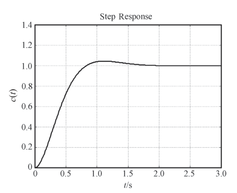{ .lq-img }

*图 3-44 例 3-16 系统单位阶跃响应（MATLAB）：\(\sigma\%=4.33\%\)、\(t_r=0.537\,\mathrm{s}\)、\(t_s=1.49\,\mathrm{s}\)（\(\varDelta=2\%\)）（截自原书）*

!!! warning "原书笔误"
    原书 Python 程序有两处问题：**(1)** `ctr.tf([16],[1, 8*zeta, 25])` 的分母常数项应为 **16**（MATLAB 原文就是 `den=[1 8*zeta 16]`，书图 3-44 也是 16 的响应；写 25 时 \(\omega_n=5\)，\(\zeta\) 变成 0.566）。**(2)** `ctr.pole(sys)` 在 python-control 0.10 中应为 **`ct.poles(sys)`**（复数属性名）。下面的代码已修正。

=== "MATLAB"

    ```matlab
    % ===== 书 3-7 节 例3-16 =====
    zeta = 0.707;
    sys = tf(16, [1 8*zeta 16]);         % Phi(s) = 16/(s^2+8*zeta*s+16)
    p = pole(sys)                        % 特征根 -2.8280±2.8289i，实部全负，稳定
    t = 0:0.01:3;
    figure(1); impulse(sys, t), grid on  % 单位脉冲响应
    figure(2); step(sys, t), grid on     % 单位阶跃响应（书图3-44）
    figure(3); u = t; lsim(sys, u, t), grid on   % 单位斜坡响应
    stepinfo(sys)   % sigma%=4.33, tr=0.537, ts(2%)=1.49
    ```

=== "Python"

    ```python
    # ===== 书 3-7 节 例3-16（原书代码两处笔误已修正）=====
    import numpy as np
    import control as ct
    import matplotlib.pyplot as plt

    zeta = 0.707
    sys = ct.tf([16], [1, 8*zeta, 16])   # 原书误写 [1, 8*zeta, 25]
    print(ct.poles(sys))                 # 原书误写 ctr.pole(sys)
    # [-2.828+2.8289j -2.828-2.8289j]：实部全负，稳定
    T = np.arange(0, 3, 0.01)
    t1, y1 = ct.impulse_response(sys, T)      # 单位脉冲响应
    t2, y2 = ct.step_response(sys, T)         # 单位阶跃响应（书图3-44）
    resp = ct.forced_response(sys, T, T)      # 单位斜坡响应（u=t）
    t3, y3 = resp.time, resp.outputs
    info = ct.step_info(sys)
    print('sigma%%=%.2f tr=%.3f tp=%.3f ts=%.2f' %
          (info['Overshoot'], info['RiseTime'], info['PeakTime'], info['SettlingTime']))
    # sigma%=4.33 tr=0.518 tp=1.110 ts=1.51（书 MATLAB：4.33 / 0.537 / 1.49）
    print('斜坡稳态误差 = %.4f（理论 2*zeta/wn = 0.354）' % (y3[-1] - T[-1]))
    fig, ax = plt.subplots(2, 2, figsize=(9, 6))
    ax[0, 0].plot(t1, y1); ax[0, 0].set_title('Impulse response')
    ax[0, 1].plot(t2, y2); ax[0, 1].set_title('Step response')
    ax[1, 0].plot(t3, y3); ax[1, 0].plot(T, T, ':'); ax[1, 0].set_title('Ramp response')
    ax[1, 1].plot(T, T - y3); ax[1, 1].set_title('Ramp error -> 2*zeta/wn')
    for a in ax.flat:
        a.set_xlabel('time (s)'); a.grid(True)
    plt.tight_layout(); plt.show()
    ```

斜坡响应的稳态误差 \(2\zeta/\omega_n = 1.414/4 = 0.354\) 正是稳态输出与输入两条平行斜线之间的间距——该闭环对应的开环传递函数为 \(\dfrac{16}{s(s+5.657)}\)，是 I 型系统（\(K_v=2.83\)），斜坡跟踪存在常值位置误差 \(1/K_v\)。

### 静态误差系数与型别的计算

=== "MATLAB"

    ```matlab
    % ===== 书 3-7 节 稳态误差与静态误差系数 =====
    % Kp = lim G(s), Kv = lim s*G(s), Ka = lim s^2*G(s)：用 dcgain 计算
    G1 = tf(100, conv([0.1 1], [5 1]));                              % 例3-13(1)：0 型
    G2 = tf(50, conv([1 0], conv([0.1 1], [5 1])));                  % 例3-13(2)：I 型
    G3 = tf(10*conv([2 1], [2 1]), conv([1 0 0], conv([1 6], [1 100])));  % (3)：II 型
    Kp1 = dcgain(G1)                     % 100
    Kv2 = dcgain(tf([1 0], 1)*G2)        % 50
    Ka3 = dcgain(tf([1 0 0], 1)*G3)      % 1/60
    % r=2t：(1) 0 型→∞；(2) 2/Kv=0.04；(3) 0
    % r=2+2t+t^2：(1)(2)→∞；(3) 2/Ka=120
    ```

=== "Python"

    ```python
    # ===== 书 3-7 节 稳态误差与静态误差系数 =====
    import numpy as np
    import control as ct

    def static_errors(GH):
        """返回 (型别 v, Kp, Kv, Ka)。v = 开环传递函数在原点的极点重数。"""
        num = np.atleast_1d(GH.num[0][0]).astype(float)
        den = np.atleast_1d(GH.den[0][0]).astype(float)
        v = int(len(den) - 1 - np.max(np.nonzero(np.abs(den) > 1e-12)[0]))
        den0 = den[:len(den) - v] if v else den          # 去掉 s^v 因子
        Kp = num[-1] / den[-1] if v == 0 else np.inf
        Kv = num[-1] / den0[-1] if v == 1 else (0 if v < 1 else np.inf)
        Ka = num[-1] / den0[-1] if v == 2 else (0 if v < 2 else np.inf)
        return v, Kp, Kv, Ka

    G1 = ct.tf([100], [0.5, 5.1, 1])          # 100/((0.1s+1)(5s+1))
    G2 = ct.tf([50], [0.5, 5.1, 1, 0])        # 50/(s(0.1s+1)(5s+1))
    G3 = ct.tf(10*np.convolve([2, 1], [2, 1]), [1, 106, 600, 0, 0])  # 10(2s+1)^2/(s^2(s+6)(s+100))
    for name, G in [('(1)', G1), ('(2)', G2), ('(3)', G3)]:
        v, Kp, Kv, Ka = static_errors(G)
        print(f'例3-13{name}: 型别 v={v}, Kp={Kp:.4g}, Kv={Kv:.4g}, Ka={Ka:.4g}')
    # (1) v=0 Kp=100；(2) v=1 Kv=50；(3) v=2 Ka=1/60≈0.0167
    # r=2t：(1) ∞；(2) 2/Kv=0.04；(3) 0
    # r=2+2t+t^2：(1)(2) ∞；(3) 2/Ka=120 —— 用仿真验证 (3)：
    L3 = ct.feedback(G3, 1)
    T = np.arange(0, 800, 0.05)
    u = 2 + 2*T + T**2
    err = u - ct.forced_response(L3, T, u).outputs
    print('(3) 仿真稳态误差 = %.4f（理论 2/Ka = 120）' % err[-1])
    ```

!!! note "拓展：算误差前先判稳（补充）"
    例 3-13(2) 的 \(G(s)=\dfrac{50}{s(0.1s+1)(5s+1)}\) 按表 3-5 是 I 型系统，\(r=2t\) 时"应有" \(e_{ss}=2/K_v=0.04\)。但它的闭环特征方程 \(0.5s^3+5.1s^2+s+50=0\) 劳斯第一列出现负值（特征根 \(0.33\pm 3.02\mathrm{j}\)）——**闭环根本不稳定**，\(0.04\) 只是形式答案。用表 3-5 之前先跑一遍 `roots`/劳斯表，是时域分析的标准动作。

## 坑与陷阱

!!! danger "8 个容易踩的坑"
    1. **\(t_s\) 公式是近似**：\(t_s=3.5/(\zeta\omega_n)\)、\(4.4/(\zeta\omega_n)\) 来自包络线且按 \(\zeta\le 0.8\) 最保守推出，结果比实际略长；它们只对 \(0<\zeta<1\) 的**无零点**二阶系统成立。有闭环零点（PD）用式 (3.36)，临界阻尼用 \(4.75/\omega_n\)，过阻尼查图——别一招走天下。
    2. **快与稳是矛盾的**：\(\sigma\%\) 只由 \(\zeta\) 决定（与 \(\omega_n\) 无关），\(t_r,t_p,t_s\) 都含 \(\omega_n\)。而对 \(\varPhi=K/(T_ms^2+s+K)\)，增大 \(K\) 在增大 \(\omega_n\) 的同时减小 \(\zeta\)——单靠调增益不可能"又快又稳"，必须用比例-微分或测速反馈补偿（式 3.29/3.39）。
    3. **劳斯判据只回答"稳不稳、几个右半平面根"**：它不保证动态性能（负实部根紧贴虚轴照样振荡缓慢）。要留裕量，用给定稳定度代换 \(s=s_1-a\) 再判一次（例 3-9）。
    4. **两种特殊行别硬算**：首元为零——小正数 \(\varepsilon\) 代替或乘 \((s+a)\)；全零行——用辅助方程 \(F(s)=0\) 的导数系数替代。全零行还附赠信息：\(F(s)\) 的根就是那些对称根（\(\pm\) 实根、\(\pm\mathrm{j}\) 虚根、对称复根）。
    5. **临界稳定 ≠ 稳定**：经典控制只认渐近稳定（零实部根按不稳定处理），且实际观察不到临界稳定。系数全为正只是**必要**条件，不能当判据用——\(s^3+2s^2+s+2=(s+2)(s^2+1)\) 系数全正却有虚根。
    6. **静态误差系数法有前提**：闭环稳定 + 输入是阶跃/斜坡/加速度及其线性组合。正弦输入用终值定理会得出 \(e_{ss}=0\) 的错误结论（例 3-10）；例 3-13(2) 的系统闭环不稳定，\(2/K_v\) 只是形式答案——先判稳，再查表 3-5。
    7. **"速度误差"是位置误差**：速度（加速度）误差指斜坡（加速度）输入下稳态输出的**位置**误差 \(R/K_v\)（\(R/K_a\)），不是速度误差。非单位反馈系统输出端误差要除以 \(K_h\)（式 3.62），静态误差系数只对单位反馈系统有直观图示。
    8. **压扰动误差看位置**：增大扰动作用点**之后**的增益对扰动稳态误差毫无作用（式 3.66 与 \(K_2\) 无关）；对扰动的型别由扰动点之前的积分环节数 \(\nu_1\) 加主反馈积分环节数 \(\nu_3\) 决定（式 3.68），扰动点之后串积分环节白搭——同一个系统对输入是 I 型、对扰动可能是 0 型。

## 术语速查

| 英文 | 中文 | 一句话 |
| --- | --- | --- |
| typical input signal | 典型输入信号 | 阶跃/斜坡/加速度/脉冲/正弦五种理想化基准输入 |
| rise time | 上升时间 \(t_r\) | 10%→90%（无超调）或 0→首次终值（振荡）的时间 |
| peak time | 峰值时间 \(t_p\) | 阶跃响应到达第一个峰的时间，\(\pi/\omega_d\) |
| settling time | 调节时间 \(t_s\) | 进入并保持在误差带（\(\pm5\%\) 或 \(\pm2\%\)）的最短时间 |
| maximum overshoot | 超调量 \(\sigma\%\) | 最大偏离与终值之比，欠阻尼时只由 \(\zeta\) 决定 |
| natural frequency | 自然频率 \(\omega_n\) | 无阻尼振荡频率，闭环极点到原点的距离 |
| damped oscillation frequency | 阻尼振荡频率 \(\omega_d\) | \(\omega_n\sqrt{1-\zeta^2}\)，闭环极点到实轴的距离 |
| damping ratio | 阻尼比 \(\zeta\) | 实际阻尼与临界阻尼之比，\(\zeta=\cos\beta\) |
| attenuation coefficient | 衰减系数 \(\sigma\) | \(\zeta\omega_n\)，闭环极点到虚轴的距离 |
| damping angle | 阻尼角 \(\beta\) | \(\omega_n\) 与负实轴的夹角，等 \(\zeta\) 线的几何参数 |
| critically / over damped | 临界阻尼 / 过阻尼 | \(\zeta=1\) 二重负实根 / \(\zeta>1\) 两不等负实根 |
| dominant poles | 闭环主导极点 | 离虚轴最近且附近无零点、决定响应形态的极点 |
| dipole | 偶极子 | 相距很近、作用对消的闭环零极点对（补充术语） |
| asymptotic stability | 渐近稳定 | 扰动消失后动态过程衰减回原平衡点；经典控制里的"稳定" |
| Routh stability criterion | 劳斯稳定判据 | 按劳斯表第一列符号判断根分布的代数判据 |
| auxiliary equation | 辅助方程 | 全零行上一行系数构成的 \(F(s)=0\)，给出对称根 |
| steady-state error | 稳态误差 \(e_{ss}\) | 误差信号 \(e(t)\) 的稳态分量终值 |
| error transfer function | 误差传递函数 | \(\varPhi_e(s)=1/(1+GH)\)（输入端定义） |
| system type | 系统型别 | 开环传递函数在原点的极点数 \(\nu\)（积分环节数） |
| static error coefficients | 静态误差系数 | \(K_p,K_v,K_a=\lim s^kGH\)，量化跟踪阶跃/斜坡/加速度的能力 |
| velocity error | 速度误差 | 斜坡输入下的稳态**位置**误差 \(R/K_v\)，不是速度误差 |
| given stability margin | 给定稳定度 | 要求特征根位于 \(s=-a\) 之左的裕量指标 |
| proportional-derivative control | 比例-微分控制（PD） | \(\zeta_d=\zeta+T_d\omega_n/2\)，加闭环零点，不改开环增益 |
| tachometer feedback | 测速反馈 | \(\zeta_t=\zeta+K_t\omega_n/2\)，不加零点，降低开环增益 |
| cascade control | 串级控制 | 主副回路串联，副回路强力抑制二次扰动（10～100 倍） |
| stepinfo | 动态指标一键计算 | MATLAB `stepinfo` / python-control `ct.step_info`，默认 10%→90% 与 2% 带 |

## 覆盖自查

??? note "原书小节 → 笔记位置"
    | 原书小节/内容 | 笔记位置 |
    | --- | --- |
    | 3-1 系统的时域性能指标（典型输入信号、动态/稳态过程、四个动态指标） | 3.1 |
    | 3-2 一阶系统的时域分析（数学模型、四种典型响应、表 3-2、微积分等价特性） | 3.2 |
    | 3-3 二阶系统的时域分析（数学模型、五种阻尼形态、欠阻尼指标推导、过阻尼分析、性能改善：比例-微分/测速反馈/两者比较） | 3.3 |
    | 3-4 高阶系统的时域分析（单位阶跃响应、主导极点、零点与非主导极点影响、表 3-3） | 3.4 |
    | 3-5 线性系统的稳定性分析（稳定性概念、充要条件、劳斯判据、两种特殊情况、判据应用） | 3.5 |
    | 3-6 线性系统的稳态误差计算（误差定义、系统型别、三个静态误差系数、表 3-5、扰动稳态误差、减小误差的措施） | 3.6 |
    | 3-7 线性系统的时域分析仿真（roots/impulse/step/lsim/initial、综合应用） | 3.7 |

??? note "原书例题 → 笔记位置"
    | 原书例题 | 内容 | 笔记位置 |
    | --- | --- | --- |
    | 例 3-1 | 由 \(\sigma\%,t_p\) 反求 \(K,\tau\) | 3.3 欠阻尼指标之后 |
    | 例 3-2 | 临界阻尼设计 \(K=2.5\)（含仿真验证 + 双 tab 代码） | 3.3 过阻尼分析之后 |
    | 例 3-3 | PD 控制器设计 \(K=5,T_d=0.38\) | 3.3 比例-微分控制 |
    | 例 3-4 | 测速反馈 \(K_t=0.22\) 与比例控制对比 | 3.3 测速反馈控制 |
    | 例 3-5 | 三阶系统部分分式响应（含勘误 + 双 tab 代码） | 3.4 |
    | 例 3-6 | 四阶系统主导极点降阶（含表 3-3 + 双 tab 代码） | 3.4 |
    | 例 3-7 | 劳斯判据判稳（两个正实部根） | 3.5 劳斯判据 |
    | 例 3-8 | 全零行/辅助方程（含勘误说明） | 3.5 特殊情况 (2) |
    | 例 3-9 | PI 系统 \(K_1\) 稳定域与给定稳定度 | 3.5 判据应用 |
    | 例 3-10 | 终值定理适用条件（正弦输入） | 3.6 误差与稳态误差 |
    | 例 3-11 | 非单位反馈输出端误差 | 3.6 斜坡输入 |
    | 例 3-12 | I 型系统三种输入的误差与物理解释 | 3.6 表 3-5 之后 |
    | 例 3-13 | 阶跃扰动转矩稳态误差 \(-n_0/K_1\) | 3.6 扰动作用 |
    | 例 3-14 | 机器人手爪综合分析（含双 tab 代码） | 3.6 扰动作用 |
    | 例 3-15 | PI 控制消除阶跃扰动误差 | 3.6 减小误差措施 |
    | 例 3-16 | 脉冲/阶跃/斜坡响应仿真（含勘误 + 双 tab 代码） | 3.7 动态性能分析 |
