# 第 4 章 线性系统的根轨迹法

> **本章解决**：第 3 章的时域法要先求出闭环特征根才能评价系统——高阶系统求根麻烦，更看不出"增益调大后极点往哪儿跑"。本章把问题倒过来：开环零、极点总是好求的，让根轨迹增益 \(K^*\) 从 0 变到 \(\infty\)，闭环极点在 \(s\) 平面上走出的曲线就是根轨迹（4-1）。伊文思 1948 年提出的八条绘制法则让人不求解根就能徒手画出全部轨迹（4-2）；变化参数换成别的量、或零极点增减，就得到广义根轨迹（4-3）；有了轨迹即可定增益取点、估算稳定性和动态性能（4-4）；最后 MATLAB/Python 一条命令出图（4-5）。根轨迹法与第 5 章频域法并列为经典控制两大图解工具，也是第 6 章校正设计的底图。本章插图沿用原书图号（图 4-1～图 4-24），公式沿用原书式号 (4-1)～(4-39)。

## 4.0 本章导图

<div class="brtree">
  <div class="brrow">
    <span class="brlabel root">线性系统的根轨迹法</span>
    <span class="brace"></span>
    <div class="brkids">
      <div class="brrow">
        <span class="brlabel">基本概念（4-1）</span>
        <span class="brace"></span>
        <div class="brkids">
          <span class="brleaf">根轨迹定义（Evans 1948）</span>
          <span class="brleaf">图 4-1／4-2 实例</span>
          <span class="brleaf">闭环零极点 vs 开环零极点（式4-6）</span>
          <span class="brleaf">根轨迹方程（式4-8）</span>
          <span class="brleaf">相角条件（充要）</span>
          <span class="brleaf">模值条件（定 K<sup>*</sup>）</span>
        </div>
      </div>
      <div class="brrow">
        <span class="brlabel">绘制法则（4-2）</span>
        <span class="brace"></span>
        <div class="brkids">
          <span class="brleaf">起点终点·分支数·对称连续</span>
          <span class="brleaf">渐近线 σ<sub>a</sub>、φ<sub>a</sub></span>
          <span class="brleaf">实轴区段（奇数判定）</span>
          <span class="brleaf">分离点 d 与分离角</span>
          <span class="brleaf">起始角 θ<sub>p</sub>／终止角 φ<sub>z</sub></span>
          <span class="brleaf">与虚轴交点（劳斯）</span>
          <span class="brleaf">根之和 ∑s<sub>i</sub>=∑p<sub>i</sub>（表4-1）</span>
        </div>
      </div>
      <div class="brrow">
        <span class="brlabel">典型例题（4-2）</span>
        <span class="brace"></span>
        <div class="brkids">
          <span class="brleaf">例4-1 概略轨迹</span>
          <span class="brleaf">例4-2 圆轨迹</span>
          <span class="brleaf">例4-3 起始/终止角</span>
          <span class="brleaf">例4-4 劳斯定交点</span>
          <span class="brleaf">例4-5 空间站（双tab）</span>
        </div>
      </div>
      <div class="brrow">
        <span class="brlabel">广义根轨迹（4-3）</span>
        <span class="brace"></span>
        <div class="brkids">
          <span class="brleaf">参数根轨迹</span>
          <span class="brleaf">等效开环传函 G=AP/Q</span>
          <span class="brleaf">例4-6 三系统对比（表4-2）</span>
          <span class="brleaf">附加开环零点（图4-20/21）</span>
        </div>
      </div>
      <div class="brrow">
        <span class="brlabel">性能分析（4-4）</span>
        <span class="brace"></span>
        <div class="brkids">
          <span class="brleaf">主导极点</span>
          <span class="brleaf">偶极子及其处理</span>
          <span class="brleaf">主导极点法（6倍/2~3倍）</span>
          <span class="brleaf">增益核算 Φ(0)=1</span>
          <span class="brleaf">零极点影响七条（图4-22）</span>
        </div>
      </div>
      <div class="brrow">
        <span class="brlabel">仿真（4-5）</span>
        <span class="brace"></span>
        <div class="brkids">
          <span class="brleaf">pzmap 零极点图</span>
          <span class="brleaf">rlocus → root_locus</span>
          <span class="brleaf">sgrid 等 ζ/ω<sub>n</sub> 网格</span>
          <span class="brleaf">rlocfind 思路</span>
          <span class="brleaf">例4-7 参数根轨迹（双tab）</span>
        </div>
      </div>
    </div>
  </div>
</div>

## 4.1 根轨迹法的基本概念

根轨迹法是分析和设计线性定常控制系统的**图解方法**，使用简便；分析多回路系统时比其他方法更方便，工程应用广泛。本节介绍根轨迹的基本概念、根轨迹与系统性能的关系，从闭环零、极点与开环零、极点的关系推出根轨迹方程，再把向量形式的根轨迹方程化为相角条件和模值条件。

### 根轨迹概念

**根轨迹**（root locus，简称根迹）：开环系统某一参数从零变到无穷时，闭环系统特征方程式的根在 \(s\) 平面上变化的轨迹。

当闭环系统没有零点与极点相消时，闭环特征方程的根就是闭环传递函数的极点，简称**闭环极点**。从已知的开环零、极点位置及某一变化参数求闭环极点分布，实际上是闭环特征方程的求根问题。特征方程阶数高于四阶时，除 MATLAB 软件外求根过程相当复杂；研究参数变化对根的影响更要大量反复计算，且看不出影响趋势——高阶系统的求根问题用解析法很不方便。1948 年，W.R.伊文思在"控制系统的图解分析"一文中提出了**根轨迹法**：开环增益或其他参数改变时，其全部数值对应的闭环极点均可在根轨迹图上简便地确定。系统稳定性由闭环极点唯一确定，稳态性能和动态性能又与闭环零、极点位置密切相关，所以根轨迹图不仅直接给出闭环系统时间响应的全部信息，还能指明开环零、极点应怎样变化才能满足性能指标要求。此外，用根轨迹法求高阶代数方程的根，比其他近似求根法简便。

具体看一个例子。设控制系统如图 4-1，闭环传递函数

\[
\varPhi(s)=\frac{C(s)}{R(s)}=\frac{2K}{s^2+2s+2K}
\]

于是特征方程式为

\[
s^2+2s+2K=0
\]

显然特征根为

\[
s_1=-1+\sqrt{1-2K}, \qquad s_2=-1-\sqrt{1-2K}
\]

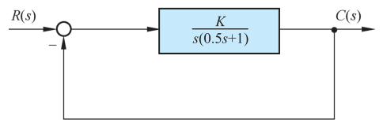{ .lq-img }

*图 4-1 控制系统结构图（截自原书）*

令开环增益 \(K\) 从零变到无穷，解析法可求出闭环极点全部数值，把它们标注在 \(s\) 平面上并连成光滑粗实线，如图 4-2。粗实线就是系统的根轨迹；箭头表示 \(K\) 增大时根轨迹的变化趋势，标注数值是与该闭环极点位置相应的开环增益 \(K\) 值。

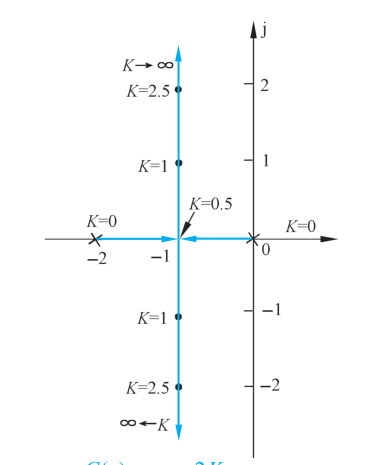{ .lq-img }

*图 4-2 \(2K/(s^2+2s+2K)\) 的根轨迹图（截自原书）*

!!! note "拓展：图上的 \(K\) 是开环增益还是根轨迹增益（补充）"
    图 4-1 系统的开环传递函数 \(G(s)=\dfrac{K}{s(0.5s+1)}=\dfrac{2K}{s(s+2)}\)。按根轨迹增益的定义（4.1 节第 3 部分），零极点形式下的增益 \(K^*=2K\)，与开环增益差一倍。图 4-2 上标注的是开环增益 \(K\)：本系统开环含一个积分环节，是 I 型系统，\(K\) 恰好就是静态速度误差系数 \(K_v\)，标注它便于直接读出稳态性能。MATLAB `rlocus`/Python `root_locus` 自动标注的都是根轨迹增益 \(K^*\)，读图时先弄清用的是哪个增益。

### 根轨迹与系统性能

有了根轨迹图，可以立即分析系统的各种性能。以图 4-2 为例：

**(1) 稳定性**：开环增益从零变到无穷时，图 4-2 上的根轨迹不会越过虚轴进入右半 \(s\) 平面，因此图 4-1 系统对所有 \(K\) 值都稳定——与 3-5 节的结论一致。分析高阶系统的根轨迹图时，轨迹可能越过虚轴进入 \(s\) 右半平面，此时**根轨迹与虚轴交点处的 \(K\) 值就是临界开环增益**。

**(2) 稳态性能**：图 4-2 系统开环在坐标原点有一个极点，属 I 型系统，根轨迹上的 \(K\) 值就是静态速度误差系数。给定稳态误差要求后，由根轨迹图可以确定闭环极点位置的容许范围。一般情况下根轨迹图上标注的参数不是开环增益而是**根轨迹增益**——开环增益和根轨迹增益之间仅相差一个比例常数，很容易换算；其他参数变化的根轨迹图情况类似。

**(3) 动态性能**：由图 4-2，\(0<K<0.5\) 时所有闭环极点位于实轴上，系统为过阻尼系统，单位阶跃响应为非周期过程；\(K=0.5\) 时闭环两个实数极点重合，为临界阻尼系统，响应仍非周期但比 \(0<K<0.5\) 快；\(K>0.5\) 时闭环极点为复数极点，系统欠阻尼，单位阶跃响应为阻尼振荡过程，超调量随 \(K\) 增大而加大，但调节时间变化不显著。

上述分析表明根轨迹与系统性能联系密切。但高阶系统用解析法绘制根轨迹显然不适用——希望有简便的图解方法，根据已知开环传递函数迅速绘出闭环根轨迹。为此先研究**闭环零、极点与开环零、极点之间的关系**。

### 闭环零、极点与开环零、极点之间的关系

开环零、极点是已知的，建立它们与闭环零、极点的关系，有助于绘制闭环根轨迹，并由此导出根轨迹方程。

设控制系统如图 4-3，闭环传递函数

\[
\varPhi(s)=\frac{G(s)}{1+G(s)H(s)}
\tag{4.1}
\]

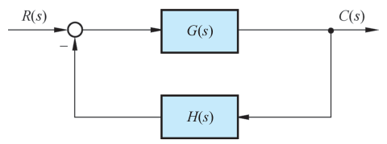{ .lq-img }

*图 4-3 控制系统结构图（截自原书）*

一般情况下，前向通路传递函数 \(G(s)\) 和反馈通路传递函数 \(H(s)\) 可分别表示为

\[
G(s)=\frac{K_G(\tau_1 s+1)(\tau_2^2 s^2+2\zeta_1\tau_2 s+1)\cdots}{s^{\nu}(T_1 s+1)(T_2^2 s^2+2\zeta_2 T_2 s+1)\cdots}
=K_G^*\frac{\prod\limits_{i=1}^{f}(s-z_i)}{\prod\limits_{i=1}^{q}(s-p_i)}
\tag{4.2}
\]

\[
K_G^*=K_G\frac{\tau_1\tau_2^2\cdots}{T_1T_2^2\cdots}
\tag{4.3}
\]

\[
H(s)=K_H^*\frac{\prod\limits_{j=1}^{l}(s-z_j)}{\prod\limits_{j=1}^{h}(s-p_j)}
\tag{4.4}
\]

式中 \(K_G\) 为前向通路增益，\(K_G^*\) 为前向通路根轨迹增益，两者满足式 (4.3)；\(K_H^*\) 为反馈通路根轨迹增益。于是图 4-3 系统的开环传递函数可表示为

\[
G(s)H(s)=K^*\frac{\prod\limits_{i=1}^{f}(s-z_i)\prod\limits_{j=1}^{l}(s-z_j)}{\prod\limits_{i=1}^{q}(s-p_i)\prod\limits_{j=1}^{h}(s-p_j)}
\tag{4.5}
\]

式中 \(K^*=K_G^*K_H^*\)，称为**开环系统根轨迹增益**，它与开环增益 \(K\) 的关系类似于式 (4.3)，仅相差一个比例常数。对有 \(m\) 个开环零点和 \(n\) 个开环极点的系统，必有 \(f+l=m\) 和 \(q+h=n\)。将式 (4.2) 和式 (4.5) 代入式 (4.1)，得

\[
\varPhi(s)=\frac{K_G^*\prod\limits_{i=1}^{f}(s-z_i)\prod\limits_{j=1}^{h}(s-p_j)}
{\prod\limits_{i=1}^{n}(s-p_i)+K^*\prod\limits_{j=1}^{m}(s-z_j)}
\tag{4.6}
\]

比较式 (4.5) 和式 (4.6)，可得结论：

1. **闭环系统根轨迹增益等于开环系统前向通路根轨迹增益**。对单位反馈系统，闭环根轨迹增益就等于开环系统根轨迹增益。
2. **闭环零点由开环前向通路传递函数的零点和反馈通路传递函数的极点组成**。对单位反馈系统，闭环零点就是开环零点。
3. **闭环极点与开环零点、开环极点以及根轨迹增益 \(K^*\) 均有关**。

根轨迹法的基本任务：由已知的开环零、极点分布及根轨迹增益，用图解方法找出闭环极点。确定闭环极点后，闭环传递函数形式便不难写出，因为闭环零点可由式 (4.6) 直接得到；已知闭环传递函数时，时间响应可用拉氏反变换求出。

### 根轨迹方程

根轨迹是系统所有闭环极点的集合。为了图解确定所有闭环极点，令闭环传递函数表达式 (4.1) 的分母为零，得闭环系统特征方程

\[
1+G(s)H(s)=0
\tag{4.7}
\]

由式 (4.6) 可见，当系统有 \(m\) 个开环零点和 \(n\) 个开环极点时，式 (4.7) 等价为

\[
K^*\frac{\prod\limits_{j=1}^{m}(s-z_j)}{\prod\limits_{i=1}^{n}(s-p_i)}=-1
\tag{4.8}
\]

式中 \(z_j\) 为已知的开环零点，\(p_i\) 为已知的开环极点，\(K^*\) 从零变到无穷。式 (4.8) 称为**根轨迹方程**。据此可画出 \(K^*\) 从零变到无穷时系统的连续根轨迹。应当指出：只要闭环特征方程能化成式 (4.8) 的形式，都可以绘制根轨迹，其中处于变动地位的实参数不限定是根轨迹增益 \(K^*\)，也可以是系统其他变化参数；但式 (4.8) 形式表达的开环零点和开环极点在 \(s\) 平面上的位置必须是确定的，否则无法绘制根轨迹。

根轨迹方程实质上是**向量方程**，直接使用不方便。考虑到

\[
-1=1\cdot\mathrm{e}^{\mathrm{j}(2k+1)\pi}; \qquad k=0,\pm 1,\pm 2,\cdots
\]

根轨迹方程 (4.8) 可用如下两个方程描述：

\[
\sum_{j=1}^{m}\angle(s-z_j)-\sum_{i=1}^{n}\angle(s-p_i)=(2k+1)\pi;\qquad k=0,\pm 1,\pm 2,\cdots
\tag{4.9}
\]

和

\[
K^*=\frac{\prod\limits_{i=1}^{n}\left\vert s-p_i\right\vert}{\prod\limits_{j=1}^{m}\left\vert s-z_j\right\vert}
\tag{4.10}
\]

式 (4.9) 与 (4.10) 是根轨迹上的点应**同时满足**的两个条件，前者称**相角条件**（angle condition），后者称**模值条件**（magnitude condition）。根据这两个条件可完全确定 \(s\) 平面上的根轨迹和根轨迹上对应的 \(K^*\) 值。特别指出：**相角条件是确定 \(s\) 平面上根轨迹的充分必要条件**——绘制根轨迹时只需要相角条件；只有需要确定根轨迹上各点的 \(K^*\) 值时，才使用模值条件。

## 4.2 常规根轨迹的绘制法则

本节讨论绘制常规根轨迹的法则和闭环极点的确定方法，重点放在法则的叙述和证明上。法则非常简单，熟练掌握后分析和设计控制系统非常有益。

以下讨论假定变化参数是根轨迹增益 \(K^*\)；可变参数为系统其他参数时这些法则仍然适用。用这些法则绘出的根轨迹，其相角遵循 \(180^\circ+2k\pi\) 条件，因此也称 **180°根轨迹**，相应绘制法则也称 180°根轨迹的绘制法则。

### 法则 1：根轨迹的起点和终点

**根轨迹起于开环极点，终于开环零点。**

**证明思路**：起点指 \(K^*=0\) 的根轨迹点，终点指 \(K^*\to\infty\) 的根轨迹点。由式 (4.6) 得闭环特征方程

\[
D(s)=\prod_{i=1}^{n}(s-p_i)+K^*\prod_{j=1}^{m}(s-z_j)=0
\tag{4.11}
\]

\(K^*=0\) 时方程的根为

\[
s=p_i;\qquad i=1,2,\cdots,n
\]

即 \(K^*=0\) 时闭环特征根就是开环传递函数 \(G(s)H(s)\) 的极点，所以根轨迹必起于开环极点。把式 (4.11) 改写为

\[
1+\frac{K^*\prod\limits_{j=1}^{m}(s-z_j)}{\prod\limits_{i=1}^{n}(s-p_i)}=0
\]

\(K^*=\infty\) 时根为

\[
s=z_j;\qquad j=1,2,\cdots,m
\]

所以根轨迹必终于开环零点。实际系统中分子次数 \(m\le n\)，因此有 \(n-m\) 条根轨迹的终点在无穷远处：\(s\to\infty\) 时式 (4.11) 的模值关系为

\[
\lim_{s\to\infty}\frac{\prod\limits_{i=1}^{n}\left\vert s-p_i\right\vert}{\prod\limits_{j=1}^{m}\left\vert s-z_j\right\vert}
=\lim_{s\to\infty}\left\vert s\right\vert^{\,n-m}=\frac{1}{K^*}=0 \qquad (n>m)
\]

把无穷远处的零点称为**无限零点**后，根轨迹必终止于开环零点——在此意义下开环零点数和开环极点数相等。绘制其他参数变化的根轨迹时可能出现 \(m>n\)：\(K^*=0\) 时必有 \(m-n\) 条根轨迹起点在无穷远处（**无限极点**），同样可以说根轨迹必起于开环极点。

### 法则 2：根轨迹的分支数、对称性和连续性

**根轨迹的分支数与开环有限零点数 \(m\) 和有限极点数 \(n\) 中的大者相等；根轨迹是连续的，且对称于实轴。**

**证明思路**：根轨迹是特征方程式的根随参数变化的轨迹，分支数必与闭环特征方程根的数目一致；由式 (4.11)，根的数目等于 \(m\) 和 \(n\) 中的大者。闭环特征方程的某些系数是 \(K^*\) 的函数，\(K^*\) 连续变化时系数随之连续变化，因而根的变化也连续——根轨迹具有连续性。闭环特征方程的根只有实根和复根两种：实根在实轴上，复根必共轭，根的集合自然对称于实轴。据此只需做出上半 \(s\) 平面的根轨迹，再镜像画出下半平面。

### 法则 3：根轨迹的渐近线

**当开环有限极点数 \(n\) 大于有限零点数 \(m\) 时，有 \(n-m\) 条根轨迹分支沿渐近线趋向无穷远处**，渐近线与实轴交角为 \(\varphi_a\)、交点为 \(\sigma_a\)：

\[
\varphi_a=\frac{(2k+1)\pi}{n-m};\qquad k=0,1,2,\cdots,n-m-1
\tag{4.18}
\]

\[
\sigma_a=\frac{\sum\limits_{i=1}^{n}p_i-\sum\limits_{j=1}^{m}z_j}{n-m}
\tag{4.19}
\]

**证明**：渐近线就是 \(s\) 值很大时的根轨迹，因此也一定对称于实轴。将开环传递函数写成多项式形式：

\[
G(s)H(s)=K^*\frac{\prod\limits_{j=1}^{m}(s-z_j)}{\prod\limits_{i=1}^{n}(s-p_i)}
=K^*\frac{s^m+b_1 s^{m-1}+\cdots+b_{m-1}s+b_m}{s^n+a_1 s^{n-1}+\cdots+a_{n-1}s+a_n}
\tag{4.12}
\]

式中

\[
b_1=-\sum_{j=1}^{m}z_j,\qquad a_1=-\sum_{i=1}^{n}p_i
\]

\(s\) 值很大时，式 (4.12) 可近似为

\[
G(s)H(s)\approx\frac{K^*}{s^{n-m}+(a_1-b_1)s^{n-m-1}}
\]

由 \(G(s)H(s)=-1\) 得渐近线方程

\[
s^{n-m}\left(1+\frac{a_1-b_1}{s}\right)=-K^*
\]

或

\[
s\left(1+\frac{a_1-b_1}{s}\right)^{\frac{1}{n-m}}=(-K^*)^{\frac{1}{n-m}}
\tag{4.13}
\]

根据二项式定理

\[
\left(1+\frac{a_1-b_1}{s}\right)^{\frac{1}{n-m}}
=1+\frac{a_1-b_1}{(n-m)s}+\frac{1}{2!}\frac{1}{n-m}\left(\frac{1}{n-m}-1\right)\left(\frac{a_1-b_1}{s}\right)^2+\cdots
\]

\(s\) 值很大时近似有

\[
\left(1+\frac{a_1-b_1}{s}\right)^{\frac{1}{n-m}}\approx 1+\frac{a_1-b_1}{(n-m)s}
\tag{4.14}
\]

将式 (4.14) 代入式 (4.13)，渐近线方程可表示为

\[
s\left[1+\frac{a_1-b_1}{(n-m)s}\right]=(-K^*)^{\frac{1}{n-m}}
\tag{4.15}
\]

以 \(s=\sigma+\mathrm{j}\omega\) 代入式 (4.15)（注意 \(-K^*=K^*\mathrm{e}^{\mathrm{j}(2k+1)\pi}\)），得

\[
\left(\sigma+\frac{a_1-b_1}{n-m}\right)+\mathrm{j}\omega
=\sqrt[n-m]{K^*}\left[\cos\frac{(2k+1)\pi}{n-m}+\mathrm{j}\sin\frac{(2k+1)\pi}{n-m}\right]
\]

令实部和虚部分别相等：

\[
\sigma+\frac{a_1-b_1}{n-m}=\sqrt[n-m]{K^*}\cos\frac{(2k+1)\pi}{n-m},\qquad
\omega=\sqrt[n-m]{K^*}\sin\frac{(2k+1)\pi}{n-m}
\]

从两式中解出

\[
\sqrt[n-m]{K^*}=\frac{\omega}{\sin\varphi_a}=\frac{\sigma-\sigma_a}{\cos\varphi_a}
\tag{4.16}
\]

\[
\omega=(\sigma-\sigma_a)\tan\varphi_a
\tag{4.17}
\]

式中

\[
\varphi_a=\frac{(2k+1)\pi}{n-m};\qquad k=0,1,\cdots,n-m-1
\tag{4.18}
\]

\[
\sigma_a=-\frac{a_1-b_1}{n-m}=\frac{\sum\limits_{i=1}^{n}p_i-\sum\limits_{j=1}^{m}z_j}{n-m}
\tag{4.19}
\]

\(s\) 平面上式 (4.17) 是直线方程，与实轴交角 \(\varphi_a\)、交点 \(\sigma_a\)。\(k\) 取不同值可得 \(n-m\) 个 \(\varphi_a\) 角而 \(\sigma_a\) 不变，因此根轨迹渐近线是 \(n-m\) 条与实轴交点为 \(\sigma_a\)、交角为 \(\varphi_a\) 的一组射线，如图 4-4（图中只画了一条渐近线）。

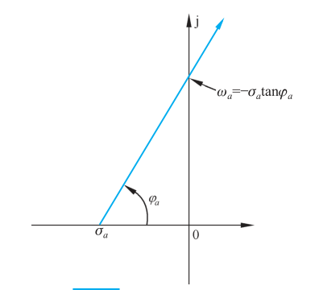{ .lq-img }

*图 4-4 根轨迹渐近线（截自原书）*

**例**：设控制系统如图 4-5(a)，开环传递函数

\[
G(s)=\frac{K^*(s+1)}{s(s+4)(s^2+2s+2)}
\]

先用前三个法则确定绘制根轨迹的有关数据。把开环零、极点标注在坐标比例尺相同的 \(s\) 平面上（"×"表示开环极点，"○"表示开环零点）——绘制过程中要对相角和模值做图解测量，**横坐标与纵坐标必须采用相同比例尺**。

- 由法则 1：根轨迹起于极点 \(p_1=0\)、\(p_2=-4\)、\(p_3=-1+\mathrm{j}\) 和 \(p_4=-1-\mathrm{j}\)，终于有限零点 \(z_1=-1\) 以及无穷远处。
- 由法则 2：根轨迹分支数 4 条，对称于实轴。
- 由法则 3：\(n-m=3\) 条渐近线，交点

\[
\sigma_a=\frac{\sum\limits_{i=1}^{4}p_i-z_1}{n-m}
=\frac{(0-4-1+\mathrm{j}-1-\mathrm{j})-(-1)}{3}=-1.67
\]

交角 \(\varphi_a=\dfrac{(2k+1)\pi}{n-m}\)：\(k=0\) 时 \(60^\circ\)，\(k=1\) 时 \(180^\circ\)，\(k=2\) 时 \(300^\circ\)。

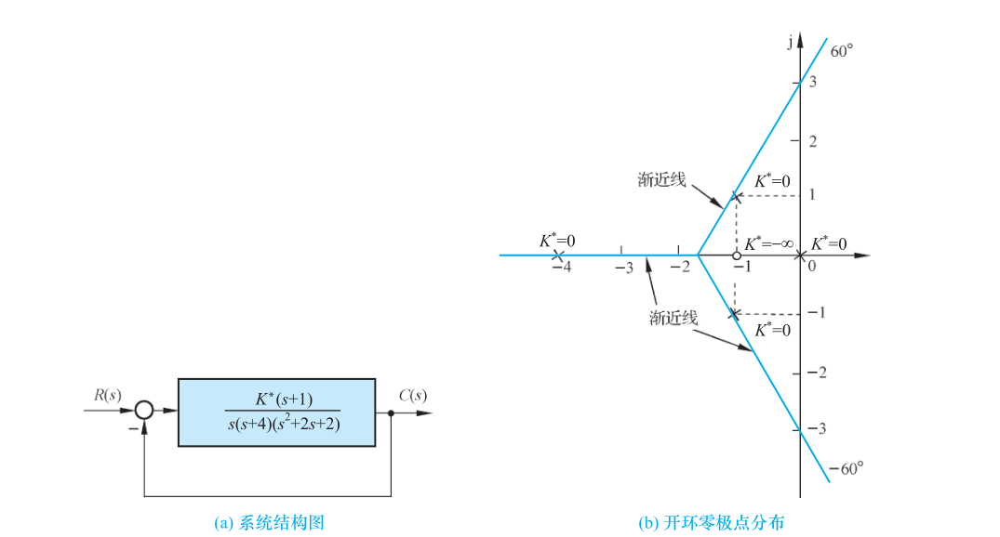{ .lq-img }

*图 4-5 开环系统 \(G(s)=\dfrac{K^*(s+1)}{s(s+4)(s^2+2s+2)}\) 的零、极点分布与根轨迹渐近线：（a）系统结构图；（b）开环零极点分布（截自原书）*

### 法则 4：根轨迹在实轴上的分布

**实轴上的某一区域，若其右边开环实数零、极点个数之和为奇数，则该区域必是根轨迹。**

**证明**：设开环零、极点分布如图 4-6，\(s_0\) 是实轴上某一测试点，\(\varphi_j\)（\(j=1,2,3\)）是各开环零点到 \(s_0\) 点向量的相角，\(\theta_i\)（\(i=1,2,3,4\)）是各开环极点到 \(s_0\) 点向量的相角。由图 4-6 可见：**复数共轭极点到实轴上任意一点（包括 \(s_0\)）的向量相角和为 \(2\pi\)**（即相当于 0），开环存在复数共轭零点时情况同样如此——确定实轴上的根轨迹时可以不考虑复数开环零、极点的影响。\(s_0\) 点**左边**的开环实数零、极点到 \(s_0\) 的向量相角为零；\(s_0\) 点**右边**的开环实数零、极点到 \(s_0\) 的向量相角均等于 \(\pi\)。令 \(\sum\varphi_j\) 代表 \(s_0\) 点之右所有开环实数零点到 \(s_0\) 的相角和，\(\sum\theta_i\) 代表 \(s_0\) 点之右所有开环实数极点到 \(s_0\) 的相角和，则 \(s_0\) 位于根轨迹上的充分必要条件是

\[
\sum\varphi_j-\sum\theta_i=(2k+1)\pi
\]

式中 \((2k+1)\) 为奇数。考虑到上述每个相角都等于 \(\pi\)，而 \(\pi\) 与 \(-\pi\) 代表同一角度，减去 \(\pi\) 相当于加上 \(\pi\)，于是等效条件为

\[
\sum\varphi_j+\sum\theta_i=(2k+1)\pi
\]

即右侧实数零、极点总数为奇数，法则得证。

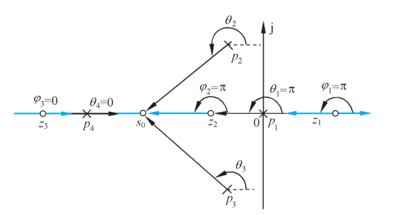{ .lq-img }

*图 4-6 实轴上的根轨迹（截自原书）*

对图 4-6 系统：\(z_1\) 和 \(p_1\) 之间、\(z_2\) 和 \(p_4\) 之间，以及 \(z_3\) 和 \(-\infty\) 之间的实轴部分都是根轨迹。

### 法则 5：根轨迹的分离点与分离角

两条或两条以上根轨迹分支在 \(s\) 平面上相遇又立即分开的点，称为**根轨迹的分离点**（breakaway point）。分离点坐标 \(d\) 是下列方程的解：

\[
\sum_{j=1}^{m}\frac{1}{d-z_j}=\sum_{i=1}^{n}\frac{1}{d-p_i}
\tag{4.20}
\]

式中 \(z_j\) 为各开环零点的数值，\(p_i\) 为各开环极点的数值；**分离角**为 \((2k+1)\pi/l\)。

**证明**：由根轨迹方程，闭环特征方程

\[
D(s)=\prod_{i=1}^{n}(s-p_i)+K^*\prod_{j=1}^{m}(s-z_j)=0
\]

根轨迹在 \(s\) 平面上相遇，说明闭环特征方程出现**重根**。设重根为 \(d\)，根据代数中的重根条件，有

\[
D(d)=0,\qquad \left.\frac{\mathrm{d}D(s)}{\mathrm{d}s}\right|_{s=d}=0
\]

即

\[
\prod_{i=1}^{n}(s-p_i)=-K^*\prod_{j=1}^{m}(s-z_j)
\tag{4.21}
\]

\[
\frac{\mathrm{d}}{\mathrm{d}s}\prod_{i=1}^{n}(s-p_i)=-K^*\frac{\mathrm{d}}{\mathrm{d}s}\prod_{j=1}^{m}(s-z_j)
\tag{4.22}
\]

将式 (4.21) 除以式 (4.22)：

\[
\frac{\dfrac{\mathrm{d}}{\mathrm{d}s}\prod\limits_{i=1}^{n}(s-p_i)}{\prod\limits_{i=1}^{n}(s-p_i)}
=\frac{\dfrac{\mathrm{d}}{\mathrm{d}s}\prod\limits_{j=1}^{m}(s-z_j)}{\prod\limits_{j=1}^{m}(s-z_j)}
\]

即

\[
\frac{\mathrm{d}\ln\prod\limits_{i=1}^{n}(s-p_i)}{\mathrm{d}s}=\frac{\mathrm{d}\ln\prod\limits_{j=1}^{m}(s-z_j)}{\mathrm{d}s}
\]

代入 \(\ln\prod(s-p_i)=\sum\ln(s-p_i)\)、\(\ln\prod(s-z_j)=\sum\ln(s-z_j)\)，得

\[
\sum_{i=1}^{n}\frac{\mathrm{d}\ln(s-p_i)}{\mathrm{d}s}=\sum_{j=1}^{m}\frac{\mathrm{d}\ln(s-z_j)}{\mathrm{d}s}
\qquad\Longrightarrow\qquad
\sum_{i=1}^{n}\frac{1}{s-p_i}=\sum_{j=1}^{m}\frac{1}{s-z_j}
\]

从中解出 \(s\)，即为分离点 \(d\)。

**分离点的特性**：根轨迹对称，所以分离点或位于实轴上，或以共轭形式成对出现在复平面中；常见的分离点是实轴上两条分支的分离点。这里不加证明地指出：\(l\) 条根轨迹分支进入并立即离开分离点时，分离角由 \((2k+1)\pi/l\) 决定（\(k=0,1,\cdots,l-1\)）。**分离角**定义为根轨迹进入分离点的切线方向与离开分离点的切线方向之间的夹角；\(l=2\) 时分离角必为直角。

此外还有三点应当指出：

- 开环系统**无有限零点**时，分离点方程 (4.20) 中应取 \(\sum\limits_{j=1}^{m}\dfrac{1}{d-z_j}=0\)，即 \(\sum\limits_{i=1}^{n}\dfrac{1}{d-p_i}=0\)。
- 分离点方程 (4.20) 不仅可确定实轴上的分离点，也可确定**复平面上的分离点**——只有开环零、极点分布非常对称时才出现，此时一般直接求分离点方程的根。
- 实质上，**根轨迹的分离点坐标就是 \(K^*\) 为某一特定值时闭环特征方程的实数等根或复数等根的数值**。

**例 4-1** 设系统结构图与开环零、极点分布如图 4-7，试绘制其概略根轨迹。

**解**：由法则 4，实轴上区域 \([-1,0]\) 和 \([-3,-2]\) 是根轨迹（图 4-7 中蓝线）。由法则 2，系统有三条根轨迹分支且对称于实轴。由法则 1，一条分支起于开环极点 (0) 终于开环有限零点 (-1)，另外两条起于开环极点 (-2) 和 (-3)，终于无穷远处（无限零点）。由法则 3，两条终于无穷的分支的渐近线与实轴交角为 \(90^\circ\) 和 \(270^\circ\)，交点

\[
\sigma_a=\frac{\sum\limits_{i=1}^{3}p_i-\sum\limits_{j=1}^{1}z_j}{n-m}
=\frac{(0-2-3)-(-1)}{3-1}=-2
\]

由法则 5，实轴区域 \([-3,-2]\) 必有一个分离点 \(d\)，满足

\[
\frac{1}{d+1}=\frac{1}{d}+\frac{1}{d+2}+\frac{1}{d+3}
\]

考虑到 \(d\) 必在 \(-2\) 和 \(-3\) 之间，试探法可得 \(d\approx-2.47\)（精确解 \(-2.466\)）。最后画出的概略根轨迹如图 4-7(b)。

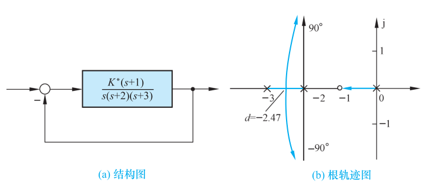{ .lq-img }

*图 4-7 例 4-1 系统的结构图及其概略根轨迹图：（a）结构图；（b）根轨迹图（截自原书）*

**例 4-2** 设单位反馈系统的开环传递函数

\[
G(s)=\frac{K^*(s+2)}{(s+1-\mathrm{j})(s+1+\mathrm{j})} \qquad (K^*=K)
\]

试绘制闭环系统根轨迹。

**解**：本例两条根轨迹分支分别起于开环复数极点 \((-1\pm\mathrm{j})\)，终于有限零点 \((-2)\) 和无限零点。由法则 1～5，在 \((-\infty,-2]\) 的实轴上必存在一个分离点 \(d\)，其方程为

\[
\frac{1}{d+2}=\frac{1}{d+1-\mathrm{j}}+\frac{1}{d+1+\mathrm{j}}
\]

经整理

\[
d^2+4d+2=0
\]

解析求解得 \(d=-3.414\) 或 \(d=-0.586\)，显然应取 \(d=-3.414\)（\(-0.586\) 不在实轴根轨迹区段上）。应用相角条件可画出准确根轨迹如图 4-8，其复数根轨迹部分是**圆的一部分**。一般地说，由两个极点（实数或复数）和一个有限零点组成的开环系统，只要有限零点没有位于两个实数极点之间，\(K^*\) 从零变到无穷时闭环根轨迹的复数部分，是**以有限零点为圆心、以有限零点到分离点的距离为半径的圆**（本例半径 \(=|-2-(-3.414)|=1.414\)），或圆的一部分。数学上可以严格证明。

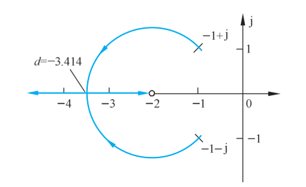{ .lq-img }

*图 4-8 例 4-2 系统的根轨迹图（截自原书）*

!!! note "拓展：两个极点加一个零点的根轨迹为什么是圆（补充）"
    设实数零点 \(z_1\) 与共轭复极点 \(p_1=\sigma+\mathrm{j}\omega\)、\(p_2=\sigma-\mathrm{j}\omega\)，取轨迹上任一点 \(s\)。相角条件要求 \(\angle(s-z_1)=\angle(s-p_1)+\angle(s-p_2)+180^\circ\)。对复平面上以 \(z_1\) 为中心的圆上任一点，\(s-z_1\) 的幅角恰等于 \(s-p_1\) 与 \(s-p_2\) 幅角的平均（圆周角定理：同弧上的圆周角），代入相角条件恰好成立；而圆的半径由过分离点的条件确定。所以这类系统的复数根轨迹是以零点为圆心的圆弧——记住这个结论，画这类轨迹时不必再逐点验算相角。

**例 4-3** 设系统开环传递函数

\[
G(s)=\frac{K^*(s+1.5)(s+2+\mathrm{j})(s+2-\mathrm{j})}{s(s+2.5)(s+0.5+\mathrm{j}1.5)(s+0.5-\mathrm{j}1.5)}
\]

试绘制该系统概略根轨迹。

**解**：将开环零、极点画在图 4-9 中，按如下典型步骤绘制：

1) **确定实轴上的根轨迹**。实轴上区域 \([-1.5,0]\) 和 \((-\infty,-2.5]\) 为根轨迹。
2) **确定根轨迹的渐近线**。本例 \(n=4\)、\(m=3\)，只有一条 \(180^\circ\) 的渐近线，它正好与实轴上的根轨迹区域 \((-\infty,-2.5]\) 重合，所以在 \(n-m=1\) 的情况下不必再确定渐近线。
3) **确定分离点**。一般说来，如果根轨迹位于实轴上一个开环极点和一个开环零点（有限零点或无限零点）之间，则在这两个相邻的零、极点之间，或者不存在任何分离点，或者同时存在离开实轴和进入实轴的两个分离点。本例无分离点。
4) **确定起始角与终止角**。为了较准确地画出根轨迹，应确定起始角和终止角。作各开环零、极点到复数极点 \((-0.5+\mathrm{j}1.5)\) 的向量并测出相应角度，如图 4-10(a)，按式 (4.23) 算出该极点处的起始角

\[
\theta_{p_1}=180^\circ+(\varphi_1+\varphi_2+\varphi_3)-(\theta_4+\theta_3+\theta_1)=79^\circ
\]

（图中量测值 \(\varphi_1=56.5^\circ\)、\(\varphi_2=19^\circ\)、\(\varphi_3=59^\circ\)、\(\theta_1=108.5^\circ\)、\(\theta_3=90^\circ\)、\(\theta_4=37^\circ\)；精确计算为 \(78.5^\circ\)，差异来自图解量测取整。）由对称性，极点 \((-0.5-\mathrm{j}1.5)\) 处的起始角为 \(-79^\circ\)。类似方法可算出复数零点 \((-2+\mathrm{j})\) 处的终止角为 \(149.5^\circ\)，各开环零、极点到 \((-2+\mathrm{j})\) 的向量相角如图 4-10(b) 所示。

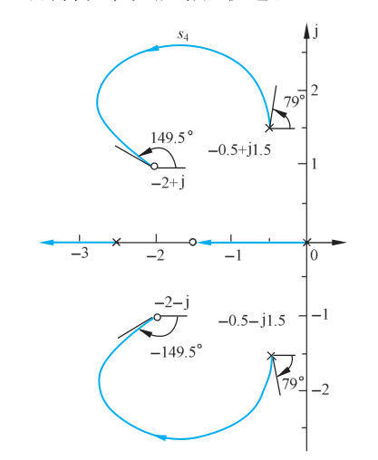{ .lq-img }

*图 4-9 例 4-3 系统的概略根轨迹图（截自原书）*

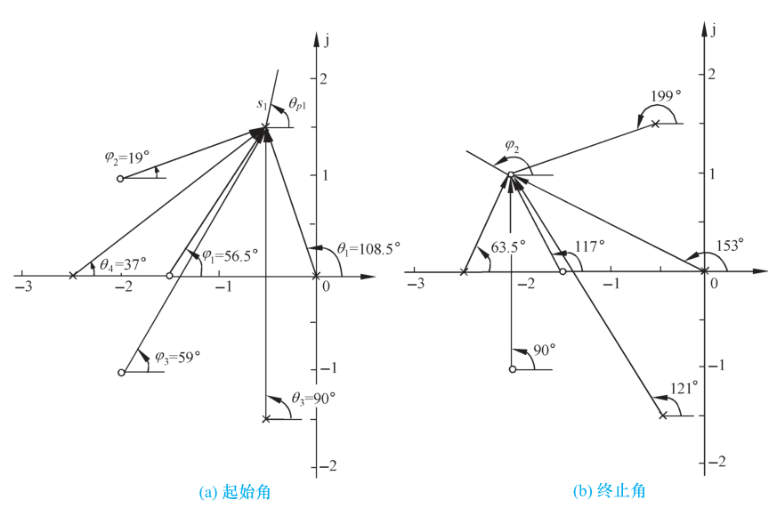{ .lq-img }

*图 4-10 例 4-3 根轨迹的起始角和终止角：（a）起始角；（b）终止角（截自原书）*

### 法则 6：根轨迹的起始角与终止角

根轨迹离开开环复数极点处的切线与正实轴的夹角，称为**起始角**（departure angle），以 \(\theta_{p_i}\) 标志；根轨迹进入开环复数零点处的切线与正实轴的夹角，称为**终止角**（arrival angle），以 \(\varphi_{z_i}\) 表示：

\[
\theta_{p_i}=(2k+1)\pi+\left(\sum_{j=1}^{m}\varphi_{z_j p_i}-\sum_{\substack{j=1\\(j\ne i)}}^{n}\theta_{p_j p_i}\right);\qquad k=0,\pm1,\pm2,\cdots
\tag{4.23}
\]

\[
\varphi_{z_i}=(2k+1)\pi-\left(\sum_{\substack{j=1\\(j\ne i)}}^{m}\varphi_{z_j z_i}-\sum_{j=1}^{n}\theta_{p_j z_i}\right);\qquad k=0,\pm1,\pm2,\cdots
\tag{4.24}
\]

式中 \(\varphi_{z_j p_i}\)、\(\theta_{p_j p_i}\) 表示其他开环零点、极点到待求起始角的复数极点 \(p_i\) 的向量相角，\(\varphi_{z_j z_i}\)、\(\theta_{p_j z_i}\) 表示其他开环零点、极点到待求终止角的复数零点 \(z_i\) 的向量相角。

**证明**：设开环系统有 \(m\) 个有限零点、\(n\) 个有限极点。在十分靠近待求起始角（或终止角）的复数极点（或复数零点）的根轨迹上取一点 \(s_1\)。由于 \(s_1\) 无限接近 \(p_i\)（或 \(z_i\)），除 \(p_i\)（或 \(z_i\)）外，所有开环零、极点到 \(s_1\) 点的向量相角都可用它们到 \(p_i\)（或 \(z_i\)）的向量相角代替，而 \(p_i\)（或 \(z_i\)）到 \(s_1\) 的向量相角即为起始角 \(\theta_{p_i}\)（或终止角 \(\varphi_{z_i}\)）。\(s_1\) 点必满足相角条件：

\[
\sum_{j=1}^{m}\varphi_{z_j p_i}-\sum_{\substack{j=1\\(j\ne i)}}^{n}\theta_{p_j p_i}-\theta_{p_i}=-(2k+1)\pi
\]

\[
\sum_{\substack{j=1\\(j\ne i)}}^{m}\varphi_{z_j z_i}+\varphi_{z_i}-\sum_{j=1}^{n}\theta_{p_j z_i}=(2k+1)\pi
\tag{4.25}
\]

移项立即得到式 (4.23) 和式 (4.24)。相角条件中 \((2k+1)\pi\) 与 \(-(2k+1)\pi\) 等价，为便于计算，上面两式右端有的用 \(-(2k+1)\pi\) 表示。

（例 4-3 的起始角 \(79^\circ\)、终止角 \(149.5^\circ\) 就是按这两式算出的。）

### 法则 7：根轨迹与虚轴的交点

若根轨迹与虚轴相交，交点上的 \(K^*\) 值和 \(\omega\) 值可用**劳斯判据**确定，也可令闭环特征方程中的 \(s=\mathrm{j}\omega\)，分别令实部和虚部为零求得。

**证明**：根轨迹与虚轴相交，表示闭环存在纯虚根，意味着该 \(K^*\) 值使闭环处于**临界稳定状态**。令劳斯表第一列中包含 \(K^*\) 的项为零，即可确定交点处的 \(K^*\) 值；一对纯虚根数值相同符号相异，利用劳斯表 \(s^2\) 行的系数构造辅助方程必可解出纯虚根，即交点上的 \(\omega\) 值。若根轨迹与正（负）虚轴有一个以上交点，则应采用劳斯表中幂大于 2 的 \(s\) 偶次方行的系数构造辅助方程。

另一种方法：将 \(s=\mathrm{j}\omega\) 代入闭环特征方程

\[
1+G(\mathrm{j}\omega)H(\mathrm{j}\omega)=0
\]

令实部和虚部分别为零：

\[
\mathrm{Re}\left[1+G(\mathrm{j}\omega)H(\mathrm{j}\omega)\right]=0,\qquad
\mathrm{Im}\left[1+G(\mathrm{j}\omega)H(\mathrm{j}\omega)\right]=0
\]

联立解出交点处的 \(K^*\) 和 \(\omega\)。

**例 4-4** 设系统开环传递函数

\[
G(s)H(s)=\frac{K^*}{s(s+3)(s^2+2s+2)}
\]

试绘制闭环系统的概略根轨迹。

**解**：

1) **实轴上的根轨迹**：区域 \([-3,0]\)。
2) **渐近线**：\(n-m=4\)，四条渐近线 \(\sigma_a=-1.25\)，\(\varphi_a=\pm45^\circ\)、\(\pm135^\circ\)。
3) **分离点**：本例无有限零点，故 \(\sum\limits_{i=1}^{4}\dfrac{1}{d-p_i}=0\)，即

\[
\frac{1}{d}+\frac{1}{d+3}+\frac{1}{d+1-\mathrm{j}}+\frac{1}{d+1+\mathrm{j}}=0
\]

试探法算出 \(d\approx-2.3\)（精确解 \(-2.289\)）。
4) **起始角**：量测各向量相角，算得 \(\theta_{p_1}=-71.6^\circ\)。
5) **与虚轴交点**：闭环特征方程

\[
s^4+5s^3+8s^2+6s+K^*=0
\]

劳斯表：

\[
\begin{array}{c|ccc}
s^4 & 1 & 8 & K^*\\
s^3 & 5 & 6 & \\
s^2 & 34/5 & K^* & \\
s^1 & (204-25K^*)/34 & & \\
s^0 & K^* & &
\end{array}
\]

令 \(s^1\) 行首项为零，得 \(K^*=8.16\)；由 \(s^2\) 行系数得辅助方程

\[
\frac{34}{5}s^2+K^*=0
\]

代入 \(K^*=8.16\) 并令 \(s=\mathrm{j}\omega\)，解出交点坐标 \(\omega=\pm1.1\)（更精确值 \(\pm\mathrm{j}1.095\)，见图 4-11）。

用特征方程直接求也可：\(s=\mathrm{j}\omega\) 代入得**实部方程** \(\omega^4-8\omega^2+K^*=0\)，**虚部方程** \(-5\omega^3+6\omega=0\)。虚部方程中 \(\omega=0\) 显然不是所求解，故交点 \(\omega=\pm1.1\)；代入实部方程得 \(K^*=8.16\)，与劳斯表法完全一致。整个系统概略根轨迹如图 4-11。

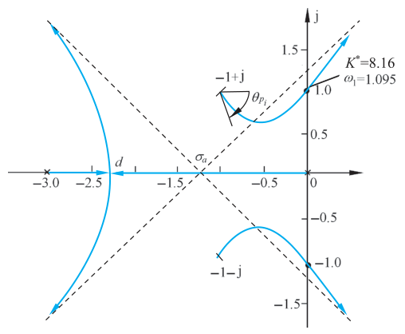{ .lq-img }

*图 4-11 例 4-4 的开环零、极点分布与概略根轨迹（截自原书）*

根据以上七个法则不难绘出概略根轨迹。为便于查阅，所有绘制法则统一归纳于表 4-1。

**表 4-1 常规根轨迹的绘制法则**

| 序号 | 内容 | 法则 |
| --- | --- | --- |
| 1 | 根轨迹的起点和终点 | 根轨迹起于开环极点（包括无限极点），终于开环零点（包括无限零点） |
| 2 | 分支数、对称性和连续性 | 分支数等于开环极点数 \(n\)（\(n>m\)）或开环零点数 \(m\)（\(m>n\)）；轨迹对称于实轴 |
| 3 | 根轨迹的渐近线 | \(n-m\) 条渐近线与实轴交角和交点为 \(\varphi_a=\dfrac{(2k+1)\pi}{n-m}\)（\(k=0,1,\cdots,n-m-1\)），\(\sigma_a=\dfrac{\sum p_i-\sum z_j}{n-m}\) |
| 4 | 根轨迹在实轴上的分布 | 实轴上某一区域，若其右方开环实数零、极点个数之和为奇数，则该区域必是根轨迹 |
| 5 | 分离点和分离角 | \(l\) 条根轨迹分支相遇，分离点坐标由 \(\sum\dfrac{1}{d-z_j}=\sum\dfrac{1}{d-p_i}\) 确定；分离角等于 \((2k+1)\pi/l\) |
| 6 | 起始角与终止角 | \(\theta_{p_i}=(2k+1)\pi+\left(\sum\varphi_{z_j p_i}-\sum\theta_{p_j p_i}\right)\)；\(\varphi_{z_i}=(2k+1)\pi-\left(\sum\varphi_{z_j z_i}-\sum\theta_{p_j z_i}\right)\) |
| 7 | 根轨迹与虚轴的交点 | 交点的 \(K^*\) 值和 \(\omega\) 值可利用劳斯判据确定 |
| 8 | 根之和 | \(\sum\limits_{i=1}^{n}s_i=\sum\limits_{i=1}^{n}p_i\) |

### 法则 8：根之和

系统的闭环特征方程在 \(n>m\) 的一般情况下，可有不同形式的表示：

\[
\prod_{i=1}^{n}(s-p_i)+K^*\prod_{j=1}^{m}(s-z_j)
=s^n+a_1 s^{n-1}+\cdots+a_{n-1}s+a_n
=\prod_{i=1}^{n}(s-s_i)
=s^n+\left(-\sum_{i=1}^{n}s_i\right)s^{n-1}+\cdots+\prod_{i=1}^{n}(-s_i)=0
\]

式中 \(s_i\) 为闭环特征根。当 \(n-m\ge2\) 时，特征方程第二项系数与 \(K^*\) 无关——无论 \(K^*\) 取何值，开环 \(n\) 个极点之和总是等于闭环特征方程 \(n\) 个根之和：

\[
\sum_{i=1}^{n}s_i=\sum_{i=1}^{n}p_i
\]

开环极点确定时这是不变的常数。所以开环增益 \(K\) 增大时，若闭环某些根在 \(s\) 平面上向左移动，则另一部分根必向右移动。此法则对判断根轨迹的走向很有用。

!!! note "拓展：根之和的第二种用法——由一对闭环极点求另一对（补充）"
    \(n-m\ge2\) 时 \(K^*\) 不改变 \(\sum s_i\)。例 4-4 中已知 \(K^*=8.16\) 时两个闭环极点是 \(\pm\mathrm{j}1.095\)，其余两个极点立刻可算：\(\sum s_i=\sum p_i=-5\)，故 \(s_3+s_4=-5\)（实部和各为 \(-2.5\)）；再由模的乘积 \(1.095^2\cdot\vert s_3 s_4\vert=K^*=8.16\) 得 \(\vert s_3s_4\vert=6.80\)，即 \(\omega^2=6.80-2.5^2=0.55\)，\(\omega=0.74\)——另一对极点 \(-2.5\pm\mathrm{j}0.74\)，与数值求根一致。不必展开多项式除法就能补齐全部闭环极点。

概略根轨迹的绘制流程如下：


### 闭环极点的确定

特定 \(K^*\) 值下的闭环极点用**模值条件**确定。比较简单的方法：先用试探法确定实数闭环极点的数值，然后用综合除法得到其余闭环极点。若特定 \(K^*\) 下闭环系统只有一对复数极点，可直接在概略根轨迹图上获得要求的闭环极点。

**例 4-5** 图 4-12 为空间站示意图。为有利于产生能量和进行通信，必须保持空间站对太阳和地球的合适指向。空间站的方位控制系统可由带执行机构和控制器的单位反馈控制系统表征，开环传递函数

\[
G(s)=\frac{K^*(s+20)}{s(s^2+24s+144)}
\]

试画出 \(K^*\) 值增大时的系统概略根轨迹图，求出使系统输出响应产生振荡的 \(K^*\) 取值范围，并应用 MATLAB 方法确定 \(K^*=10\) 时系统的单位阶跃响应曲线。

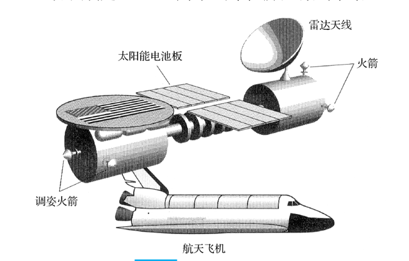{ .lq-img }

*图 4-12 空间站示意图（截自原书）*

**解**：开环传递函数

\[
G(s)=\frac{K^*(s+20)}{s(s+12)^2}
\]

令 \(K^*\) 从 \(0\to\infty\)，可画出概略根轨迹如图 4-13。图中：

- 渐近线：\(\sigma_a=\dfrac{0-12-12-(-20)}{3-1}=-2\)，\(\varphi_a=\pm90^\circ\)；
- 分离点：

\[
\frac{1}{d+20}=\frac{1}{d}+\frac{2}{d+12}
\qquad\Longrightarrow\qquad d=-4.75
\]

（分离点方程的另两个根 \(-25.2\) 与 \(-12\) 不落在实轴根轨迹区段上，舍去。）

应用模值条件，可得分离点处的根轨迹增益

\[
K^*=\frac{\prod\limits_{i=1}^{3}\left\vert d-p_i\right\vert}{\left\vert d-z_1\right\vert}
=\frac{4.75\times7.25\times7.25}{15.25}=16.37
\]

因而当 \(K^*>16.37\) 时，系统输出将会产生振荡。

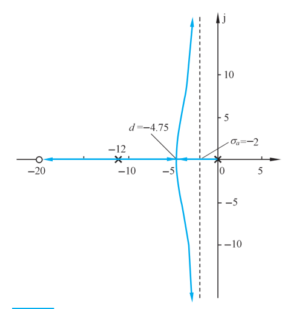{ .lq-img }

*图 4-13 空间站方位控制系统概略根轨迹图（截自原书）*

应用 MATLAB 软件可得系统的根轨迹图如图 4-14；若取 \(K^*=10\)，可得系统的单位阶跃响应如图 4-15（响应无超调——\(K^*=10<16.37\)，闭环极点 \(-1.73\)、\(-8.21\)、\(-14.06\) 全为负实数，与图 4-13 一致）。

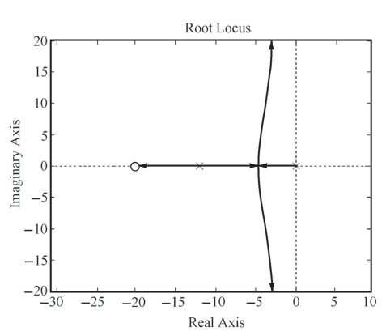{ .lq-img }

*图 4-14 方位控制系统根轨迹图（MATLAB）（截自原书）*

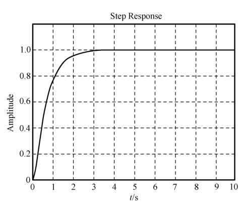{ .lq-img }

*图 4-15 方位控制系统单位阶跃响应（MATLAB）（截自原书）*

=== "MATLAB"

    ```matlab
    % ===== 书 4-2 节 例4-5 空间站方位控制 =====
    num = [1 20]; den = [1 24 144 0]; G0 = tf(num, den);
    figure(1);
    rlocus(G0); axis([-30 10 -20 20]);          % 系统根轨迹（书图4-14）
    K = 10; G = K*G0; sys = feedback(G, 1);
    figure(2);
    t = 0:0.01:10; step(sys, t);
    axis([0 10 0 1.2]); grid;                   % 单位阶跃输入响应（书图4-15）
    ```

=== "Python"

    ```python
    # ===== 书 4-2 节 例4-5 空间站方位控制 =====
    import numpy as np
    import control as ct
    import matplotlib.pyplot as plt

    G0 = ct.tf([1, 20], [1, 24, 144, 0])        # (s+20)/(s(s+12)^2)
    plt.figure(1)
    ct.root_locus(G0, xlim=(-30, 10), ylim=(-20, 20))    # 根轨迹（书图4-14）
    sys = ct.feedback(10 * G0, 1)               # K* = 10
    plt.figure(2)
    t, y = ct.step_response(sys, np.arange(0, 10, 0.01))  # 单位阶跃响应
    plt.plot(t, y); plt.grid(True)
    plt.xlabel('t/s'); plt.ylabel('Amplitude'); plt.ylim(0, 1.2)
    plt.show()
    print(ct.poles(sys))    # [-14.06 -8.21 -1.73] 全为负实数 → 无超调
    print(np.roots([1, 42, 480, 1440]))  # 分离点方程实根 -4.75，对应 K*=16.37
    ```

## 4.3 广义根轨迹

在控制系统中，除根轨迹增益 \(K^*\) 为变化参数的根轨迹以外，其他情形下的根轨迹统称为**广义根轨迹**（generalized root trajectory）。如系统的**参数根轨迹**、开环传递函数中零点个数多于极点个数时的根轨迹等，均可列入广义根轨迹范畴。通常，将负反馈系统中 \(K^*\) 变化时的根轨迹称为**常规根轨迹**。

### 1. 参数根轨迹

以非开环增益为可变参数绘制的根轨迹称为**参数根轨迹**（parameter root locus），以区别于以开环增益 \(K\) 为可变参数的常规根轨迹。

绘制参数根轨迹的法则与常规根轨迹完全相同。只需在绘制之前引入**等效单位反馈系统**和**等效传递函数**概念，常规根轨迹的所有绘制法则就都适用。为此，对闭环特征方程

\[
1+G(s)H(s)=0
\tag{4.26}
\]

进行等效变换，将其写为如下形式：

\[
A\frac{P(s)}{Q(s)}=-1
\tag{4.27}
\]

其中 \(A\) 为除 \(K^*\) 外系统任意的变化参数，而 \(P(s)\) 和 \(Q(s)\) 为两个与 \(A\) 无关的首一多项式。显然式 (4.27) 应与式 (4.26) 相等，即

\[
Q(s)+AP(s)=1+G(s)H(s)=0
\tag{4.28}
\]

根据式 (4.28)，可得等效单位反馈系统，其等效开环传递函数为

\[
G_1(s)H_1(s)=A\frac{P(s)}{Q(s)}
\tag{4.29}
\]

利用式 (4.29) 画出的根轨迹，就是参数 \(A\) 变化时的参数根轨迹。

需要强调指出：等效开环传递函数是根据式 (4.28) 得来的，因此**"等效"的含义仅在闭环极点相同这一点上成立，而闭环零点一般是不同的**。由于闭环零点对系统动态性能有影响，所以由闭环零、极点分布来分析和估算系统性能时，可以采用参数根轨迹上的闭环极点，但必须采用原来闭环系统的零点。这一处理方法和结论，对绘制开环零极点变化时的根轨迹同样适用。

**例 4-6** 设位置随动系统如图 4-16。图中系统Ⅰ为比例控制系统，系统Ⅱ为比例-微分控制系统，系统Ⅲ为测速反馈控制系统，\(T_a\) 表示微分器时间常数或测速反馈系数。试分析 \(T_a\) 对系统性能的影响，并比较系统Ⅱ和Ⅲ在具有相同阻尼比 \(\zeta=0.5\) 时的有关特点。

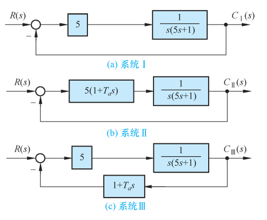{ .lq-img }

*图 4-16 位置随动系统结构图：（a）系统Ⅰ；（b）系统Ⅱ；（c）系统Ⅲ（截自原书）*

**解**：显然系统Ⅱ和Ⅲ具有相同的开环传递函数，即

\[
G(s)H(s)=\frac{5(1+T_a s)}{s(1+5s)}
\]

但它们的闭环传递函数不相同：

\[
\varPhi_{\text{Ⅱ}}(s)=\frac{5(1+T_a s)}{s(1+5s)+5(1+T_a s)}
\tag{4.30}
\]

\[
\varPhi_{\text{Ⅲ}}(s)=\frac{5}{s(1+5s)+5(1+T_a s)}
\tag{4.31}
\]

从式 (4.30) 和 (4.31) 可以看出：两者在 \(T_a\) 相同时具有**相同的闭环极点**，但系统Ⅱ具有闭环零点 \((-1/T_a)\)，系统Ⅲ不具有闭环零点。

将系统Ⅱ或Ⅲ的闭环特征方程式写成

\[
1+T_a\frac{s}{s(s+0.2)+1}=0
\tag{4.32}
\]

如果令

\[
G_1(s)H_1(s)=T_a\frac{s}{s(s+0.2)+1}
\]

则式 (4.32) 代表一个根轨迹方程，其参数根轨迹如图 4-17 所示。图中 \(T_a=0\) 时闭环极点位置为 \(s_{1,2}=-0.1\pm\mathrm{j}0.995\)，它就是系统Ⅰ的闭环极点。

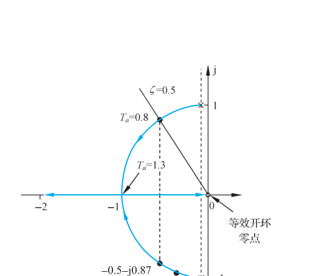{ .lq-img }

*图 4-17 系统Ⅱ和Ⅲ在 \(T_a\) 变化时的参数根轨迹（截自原书）*

为了确定系统Ⅱ和Ⅲ在 \(\zeta=0.5\) 时的闭环传递函数，在图 4-17 中作 \(\zeta=0.5\) 线，可得闭环极点 \(s_{1,2}=-0.5\pm\mathrm{j}0.87\)，相应的 \(T_a\) 值由模值条件算出为 0.8，于是有

\[
\varPhi_{\text{Ⅱ}}(s)=\frac{0.8(s+1.25)}{(s+0.5+\mathrm{j}0.87)(s+0.5-\mathrm{j}0.87)}
\]

\[
\varPhi_{\text{Ⅲ}}(s)=\frac{1}{(s+0.5+\mathrm{j}0.87)(s+0.5-\mathrm{j}0.87)}
\]

而系统Ⅰ的闭环传递函数与 \(T_a\) 值无关，应是

\[
\varPhi_{\text{Ⅰ}}(s)=\frac{1}{(s+0.1+\mathrm{j}0.995)(s+0.1-\mathrm{j}0.995)}
\]

各系统的单位阶跃响应可由拉氏反变换法确定为

\[
c_{\text{Ⅰ}}(t)=1-\mathrm{e}^{-0.1t}(\cos 0.995t+0.1\sin 0.995t)
\]

\[
c_{\text{Ⅱ}}(t)=1-\mathrm{e}^{-0.5t}(\cos 0.87t-0.347\sin 0.87t)
\]

\[
c_{\text{Ⅲ}}(t)=1-\mathrm{e}^{-0.5t}(\cos 0.87t+0.578\sin 0.87t)
\]

三种单位阶跃响应曲线如图 4-18。由图可见：系统Ⅱ的微分控制反映误差信号的变化率，能在误差信号增大之前提前产生控制作用，时间响应特性好，上升时间最短，快速性较好；系统Ⅲ的速度反馈加强了反馈作用，在三个系统中具有**最小的超调量**。

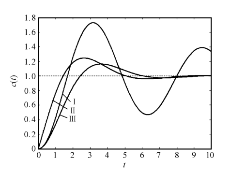{ .lq-img }

*图 4-18 位置随动系统的单位阶跃响应曲线（MATLAB）（截自原书）*

如果位置随动系统承受单位斜坡输入信号，同样由拉氏反变换法确定它们的单位斜坡响应：

\[
c_{\text{Ⅱ}}(t)=t-0.2+0.2\mathrm{e}^{-0.5t}(\cos 0.87t-5.19\sin 0.87t)
\tag{4.33}
\]

\[
c_{\text{Ⅲ}}(t)=t-1+\mathrm{e}^{-0.5t}(\cos 0.87t-0.58\sin 0.87t)
\tag{4.34}
\]

此时系统将出现速度误差，其数值为 \(e_{ss\text{Ⅱ}}(\infty)=0.2\) 和 \(e_{ss\text{Ⅲ}}(\infty)=1.0\)；系统Ⅰ的速度误差可利用终值定理法求出为 \(e_{ss\text{Ⅰ}}(\infty)=0.2\)。根据式 (4.33) 和 (4.34) 可画出系统Ⅱ和Ⅲ的单位斜坡响应，如图 4-19。

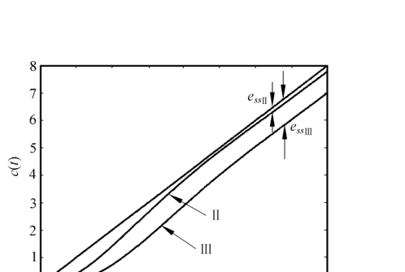{ .lq-img }

*图 4-19 位置随动系统Ⅱ和Ⅲ的单位斜坡响应曲线（MATLAB）（截自原书）*

最后，将位置随动系统的性能比较结果列于表 4-2。

**表 4-2 位置随动系统性能比较表（\(\zeta=0.5\)，\(T_a=0.8\)）**

| 性能 | 比例式（系统Ⅰ） | 比例-微分式（系统Ⅱ） | 测速反馈式（系统Ⅲ） |
| --- | --- | --- | --- |
| 峰值时间/s | 3.14 | 2.62 | 3.62 |
| 调节时间/s | 30 | 6.1 | 6.3 |
| 超调量/% | 73 | 24.8 | 16.3 |
| 速度误差 | 0.2 | 0.2 | 1.0 |

!!! note "拓展：表 4-2 两个数字的口径（补充）"
    **速度误差一行**：三个数的口径是输出端误差 \(r(t)-c(t)\)。系统Ⅱ和Ⅲ开环相同，\(K_v=5\)，输入端误差 \(E(s)=R(s)-H(s)C(s)\) 的稳态值都是 \(1/K_v=0.2\)；但系统Ⅲ的反馈通路 \(H(s)=1+T_a s\) 在稳态时给反馈信号附加了 \(T_a\dot c=0.8\)，所以输出端误差 \(r-c=0.2+T_a=1.0\)——这正是式 (4.34) 中 \(t-1\) 的来历。**调节时间一行**：\(30/6.1/6.3\) 按包络线公式 \(t_s=(3+\ln r)/(\zeta_d\omega_n)\)（即 3-3 节式 3.36，\(r\) 为响应式幅值系数）估算：系统Ⅰ \(r=1.005\) 得 30，系统Ⅱ \(r=1.059\) 得 6.1，系统Ⅲ \(r=1.155\) 得 6.3；数值仿真的实际入带时间更短（Ⅱ 约 4.5 s、Ⅲ 约 5.3 s、Ⅰ 约 29 s，5% 误差带）。峰值时间与超调量三行与仿真一致（3.16/2.64/3.63 s，72.9%/24.5%/16.3%）。

### 2. 附加开环零点的作用

控制系统设计中，常用**附加位置适当的开环零点**的方法改善系统性能，因此研究开环零点变化时的根轨迹变化有很大实际意义。

设系统开环传递函数

\[
G(s)H(s)=\frac{K^*(s-z_1)}{s(s^2+2s+2)}
\tag{4.35}
\]

式中 \(z_1\) 为附加的开环实数零点，其值可在 \(s\) 左半平面内任意选择；\(z_1\to\infty\) 表示有限零点 \(z_1\) 不存在的情况。令 \(z_1\) 为不同数值，对应式 (4.35) 的闭环系统根轨迹如图 4-20 所示。

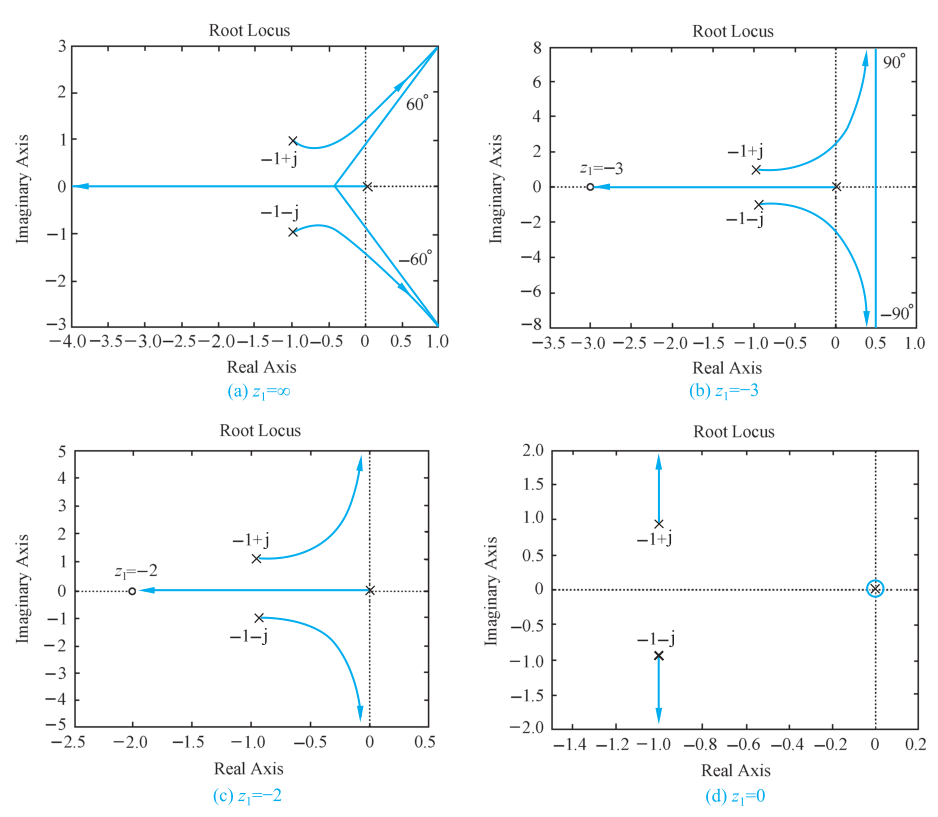{ .lq-img }

*图 4-20 \(z_1\) 为不同数值的系统根轨迹图（MATLAB）：（a）\(z_1=\infty\)；（b）\(z_1=-3\)；（c）\(z_1=-2\)；（d）\(z_1=0\)（截自原书）*

由图可见：开环极点位置不变，在系统中**附加开环负实数零点，可使系统根轨迹向 \(s\) 左半平面方向弯曲**，或者说根轨迹图发生趋向附加零点方向的变形，而且这种影响随开环零点接近坐标原点的程度而加强。附加的若不是负实数零点而是具有负实部的共轭零点，作用与负实数零点完全相同。此外，根据图 4-20、利用劳斯判据不难证明：当 \(z_1<-2\) 时系统的根轨迹与虚轴存在交点；而当 \(z_1\ge-2\) 时不存在交点。因此在 \(s\) 左半平面内的适当位置上附加开环零点，可以显著改善系统的稳定性。

!!! note "拓展：\(z_1=-2\) 为什么是分界点（补充）"
    式 (4.35) 的闭环特征方程为 \(s(s^2+2s+2)+K^*(s-z_1)=0\)，即 \(s^3+2s^2+(2+K^*)s-K^*z_1=0\)。令 \(s=\mathrm{j}\omega\)：虚部方程给 \(\omega^2=2+K^*\)（\(\omega\ne0\)），代回实部方程得 \(4=-K^*(z_1+2)\)，故存在正实数 \(K^*\) 解（即轨迹与虚轴相交）的充要条件正是 \(z_1<-2\)；此时临界增益 \(K^*=-4/(z_1+2)\)，\(z_1\) 越负临界增益越大，稳定裕度越高。

附加开环零点的目的除改善稳定性外，还要求对动态性能有明显改善；但稳定性和动态性能对附加零点位置的要求有时并不一致。以图 4-20 为例，图 (d) 对稳定性最有利，但对动态性能的改善却并不利。参看图 4-21 的两种情况：图 (a) 表示附加开环负实数零点 \(z_1\) 位于负实极点 \(p_2\) 和 \(p_3\) 之间的根轨迹上；图 (b) 表示 \(z_1\) 位于 \(p_1\) 和 \(p_2\) 之间的根轨迹上。

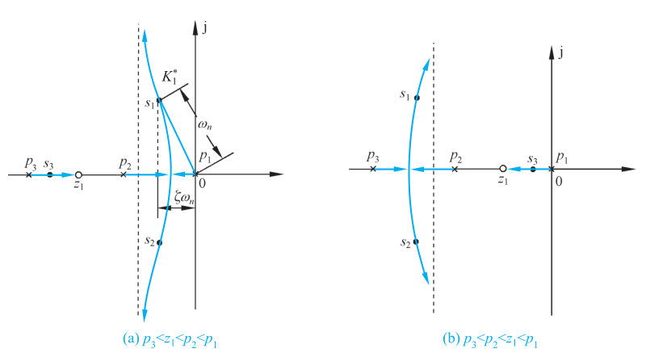{ .lq-img }

*图 4-21 控制系统的概略根轨迹图：（a）\(p_3<z_1<p_2<p_1\)；（b）\(p_3<p_2<z_1<p_1\)（截自原书）*

从稳定程度的观点看（指稳定裕度，见第五章），图 (b) 优于图 (a)；而从动态性能观点看，图 (a) 优于图 (b)。在图 (a) 中，当根轨迹增益为 \(K_1^*\) 时，复数极点 \(s_1\) 和 \(s_2\) 为闭环主导极点，实数极点 \(s_3\) 距虚轴较远、为非主导极点，闭环系统近似为一个二阶系统——阻尼比适中、超调量不大、响应较快、调节时间不长，这是设计一般随动系统所希望的动态特性。在图 (b) 中，实数极点 \(s_3\) 为闭环主导极点，系统等价于一阶系统，动态过程虽然可能是单调的，但响应速度较慢、调节时间较长。

这里需要对"可能"一词说明：增加开环零点就是增加闭环零点，**闭环零点对动态性能的影响相当于减小闭环系统的阻尼**，使过渡过程有出现超调的趋势，且这种作用随闭环零点接近坐标原点的程度而加强；此外系统并非都是真正的一阶系统，附加开环零点过分接近坐标原点时，过渡过程也可能出现振荡。有关闭环零点的作用将在 4-4 节详细探讨。

从以上定性分析可以看出：只有当附加零点相对原有开环极点的位置选配得当，才能使系统的稳态性能和动态性能同时得到显著改善。

!!! note "拓展：零度根轨迹（补充，原书本节未展开）"
    有一类问题画出的轨迹遵循 \(0^\circ+2k\pi\) 的相角条件，称**零度根轨迹**：内回路是正反馈的系统（\(1-G(s)H(s)=0\)），以及特征方程可化为 \(1-K^*P(s)/Q(s)=0\) 形式的某些参数根轨迹。此时模值条件不变，绘制法则逐条改号：实轴上某区域右侧开环实数零、极点个数之和为**偶数（含 0）**时才是根轨迹；渐近线交角改为 \(\varphi_a=2k\pi/(n-m)\)；起始角、终止角与分离角公式中 \((2k+1)\pi\) 换成 \(2k\pi\)。画之前先判断轨迹属于 180° 还是 0°，是根轨迹绘制的第一个动作。

## 4.4 系统性能的分析

经典控制理论中，控制系统设计的重要评价取决于系统的单位阶跃响应。应用根轨迹法可迅速确定系统在某一开环增益或某一参数值下的闭环零、极点位置，从而得到闭环传递函数，再用 MATLAB 求出单位阶跃响应和各项性能指标。但在系统初步设计过程中，重要的往往不是如何求出阶跃响应，而是**如何根据已知的闭环零、极点定性地分析系统的性能**。

### 1. 主导极点与偶极子

用根轨迹法求出闭环零点和极点后，立即可写出闭环传递函数，再用拉氏反变换或 MATLAB 仿真得到时间响应。工程实践中常用**主导极点**概念对高阶系统近似分析。例如研究具有如下闭环传递函数的系统：

\[
\varPhi(s)=\frac{20}{(s+10)(s^2+2s+2)}
\]

该系统的单位阶跃响应

\[
c(t)=1-0.024\mathrm{e}^{-10t}+1.55\mathrm{e}^{-t}\cos(t+129^\circ)
\]

式中指数项由闭环极点 \(s_1=-10\) 产生，衰减余弦项由闭环复数极点 \(s_{2,3}=-1\pm\mathrm{j}\) 产生。比较两者：指数项衰减迅速且幅值很小，可以略去，于是

\[
c(t)\approx1+1.55\mathrm{e}^{-t}\cos(t+129^\circ)
\]

上式表明系统的动态性能基本上由接近虚轴的闭环极点确定。这样的极点称为**主导极点**（dominant poles）。因此主导极点定义为：**对整个时间响应过程起主要作用的闭环极点**。必须注意：时间响应分量的消逝速度除取决于相应闭环极点的实部值外，还与该极点处的留数（即闭环零、极点之间的相互位置）有关——所以**只有既接近虚轴、又不十分接近闭环零点的闭环极点，才可能成为主导极点**。

如果闭环零、极点相距很近，这样的闭环零、极点常称为**偶极子**（dipole）。偶极子有实数偶极子和复数偶极子之分，复数偶极子必共轭出现。只要偶极子不十分接近坐标原点，它们对系统动态性能的影响就甚微，可以忽略。例如研究具有下列闭环传递函数的系统：

\[
\varPhi(s)=\frac{2a}{a+\delta}\cdot\frac{s+a+\delta}{(s+a)(s^2+2s+2)}
\tag{4.36}
\]

闭环系统有一对复数极点 \(-1\pm\mathrm{j}\)、一个实数极点 \(-a\) 和一个实数零点 \(-(a+\delta)\)。假定 \(\delta\to0\)，实数闭环零、极点十分接近构成偶极子；同时假定实数极点 \(-a\) 不非常接近坐标原点，则式 (4.36) 系统的单位阶跃响应为

\[
c(t)=1-\frac{2\delta}{(a+\delta)(a^2-2a+2)}\mathrm{e}^{-at}
+\frac{2a}{a+\delta}\cdot\frac{\sqrt{(a+\delta-1)^2+1}}{\sqrt{2}\cdot\sqrt{(a-1)^2+1}}\,\mathrm{e}^{-t}
\times\sin\!\left(t+\arctan\frac{1}{a+\delta-1}-\arctan\frac{1}{a-1}-135^\circ\right)
\tag{4.37}
\]

考虑到 \(\delta\to0\)，上式可简化为

\[
c(t)=1-\frac{2\delta}{a(a^2-2a+2)}\mathrm{e}^{-at}+\sqrt{2}\,\mathrm{e}^{-t}\sin(t-135^\circ)
\tag{4.38}
\]

在关于 \(\delta\) 和 \(a\) 的假定下，式 (4.38) 可进一步简化为

\[
c(t)\approx1+\sqrt{2}\,\mathrm{e}^{-t}\sin(t-135^\circ)
\tag{4.39}
\]

此时偶极子的影响完全可以略去不计，系统的单位阶跃响应主要由主导极点 \(-1\pm\mathrm{j}\) 决定。

如果偶极子十分接近原点，即 \(a\to0\)，那么式 (4.38) 只能简化为

\[
c(t)\approx1-\frac{\delta}{a}+\sqrt{2}\,\mathrm{e}^{-t}\sin(t-135^\circ)
\]

这时 \(\delta\) 与 \(a\) 可以相比，\(\delta/a\) 不能略去不计——**接近坐标原点的偶极子对系统动态性能的影响必须考虑**。然而，不论偶极子接近坐标原点的程度如何，它们并不影响系统主导极点的地位；复数偶极子也具备上述同样性质。

具体确定偶极子时可用经验法则：**如果闭环零、极点之间的距离比它们本身的模值小一个数量级，则这一对闭环零、极点就构成了偶极子。**

在工程计算中，采用主导极点代替系统全部闭环极点来估算系统性能指标的方法，称为主导极点法。采用主导极点法时：在全部闭环极点中，选留最靠近虚轴而又不十分靠近闭环零点的一个或几个闭环极点作为主导极点；略去不十分接近原点的偶极子，以及比主导极点距虚轴远 **6 倍以上**的闭环零、极点。这样，设计中所遇到的绝大多数有实际意义的高阶系统就可简化为只有一、两个闭环零点和两、三个闭环极点的系统，用比较简便的方法估算性能。为了使估算得到满意的结果，**选留的主导零点数不要超过选留的主导极点数**。在许多实际应用中，比主导极点距虚轴远 **2～3 倍**的闭环零、极点也常可放在略去之列。用主导极点代替全部闭环极点绘制时间响应曲线时，形状误差仅出现在曲线的起始段，主要决定性能指标的曲线中、后段形状基本不变。应当注意：**输入信号极点不在主导极点的选择范围之内**。

最后指出：在略去偶极子和非主导零、极点的情况下，闭环系统的根轨迹增益常会发生改变，**必须注意核算**，否则将导致性能估算错误。例如式 (4.36) 中显然有 \(\varPhi(0)=1\)，表明系统在单位阶跃函数作用下终值误差 \(e_{ss}(\infty)=0\)；如果略去偶极子而简化成

\[
\varPhi(s)\approx\frac{2a}{(a+\delta)(s^2+2s+2)}
\]

则有 \(\varPhi(0)=a/(a+\delta)\ne1\)，出现了单位阶跃作用下终值误差不为零的错误结果。

### 2. 系统性能的定性分析

采用根轨迹法分析或设计线性控制系统时，了解闭环零点和实数主导极点对系统性能指标的影响非常重要。由例 4-6 可见：闭环零点的存在使系统峰值时间提前，相当于减小闭环系统的阻尼，超调量加大；闭环零点接近坐标原点时这种作用尤甚。对具有一个闭环实数零点的振荡二阶系统，不同零点位置与超调量之间的关系曲线如图 4-22 所示。一般说来，闭环零点对调节时间的影响是不定的。

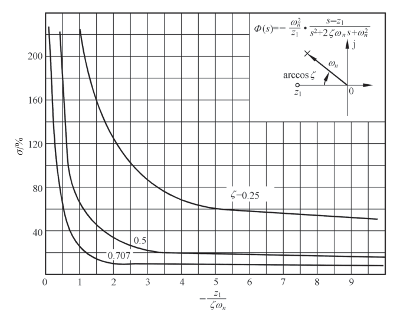{ .lq-img }

*图 4-22 二阶系统零点相对位置与超调量关系曲线（横轴为 \(-z_1/(\zeta\omega_n)\)，三条曲线对应 \(\zeta=0.25\)、0.5、0.707）（截自原书）*

闭环零点对系统性能影响的物理意义已在 3-3 节说明。**闭环实数主导极点**对系统性能的影响：其作用相当于增大系统的阻尼，使峰值时间滞后、超调量下降；如果实数极点比共轭复数极点更接近坐标原点，甚至可以使振荡过程变为非振荡过程。物理浅释：无零点三阶系统相当于欠阻尼二阶系统与一个滞后的平滑滤波器的串联，欠阻尼二阶系统的时间响应经过平滑滤波器后，峰值时间被滞后、超调量被削弱、过渡过程被平缓；实数极点越接近坐标原点意味着滤波器时间常数越大，这种作用越强。

闭环系统零、极点位置对时间响应性能的影响，归纳为以下几点：

1) **稳定性**：闭环极点全部位于 \(s\) 左半平面则系统一定稳定，稳定性只与闭环极点位置有关，与闭环零点位置无关。
2) **运动形式**：闭环系统无零点且闭环极点均为实数极点，时间响应一定单调；闭环极点均为复数极点，时间响应一般是振荡的。
3) **超调量**：主要取决于闭环复数主导极点的衰减率 \(\zeta_d/\sqrt{1-\zeta_d^2}\)，并与其他闭环零、极点接近坐标原点的程度有关。
4) **调节时间**：主要取决于最靠近虚轴的闭环复数极点的实部绝对值 \(\sigma_1=\zeta_d\omega_n\)；如果实数极点距虚轴最近且附近没有实数零点，则调节时间主要取决于该实数极点的模值。
5) **实数零、极点影响**：零点减小系统阻尼，使峰值时间提前、超调量增大；极点增大系统阻尼，使峰值时间滞后、超调量减小。它们的作用随其本身接近坐标原点的程度而加强。
6) **偶极子及其处理**：零、极点之间的距离比它们本身的模值小一个数量级即构成偶极子。远离原点的偶极子其影响可略；接近原点的偶极子其影响必须考虑。
7) **主导极点**：最靠近虚轴而附近又无闭环零点的一些闭环极点对系统性能影响最大，称为主导极点。凡比主导极点的实部大 **3～6 倍**以上的其他闭环零、极点，其影响均可忽略。

!!! note "拓展：偶极子对消是校正设计的常用手法（补充）"
    3-4 节讲主导极点时提到"零、极点彼此接近时影响相互削弱"，本节把它精确化为偶极子判据（距离比模值小一个数量级）。工程上的直接推论：串联校正中常用附加开环零点去抵消被控对象靠近虚轴的不良极点，使根轨迹整体左移、动态性能改善——第 6 章的超前校正就常用这一招。注意实际对消很难精确，零极点只是靠近而不是重合，被对消极点对应的时间响应分量幅值变小但仍然存在；只宜对时间常数较小、危害不大的极点做对消。

## 4.5 线性系统的根轨迹分析仿真

本节是前四节的工具化：画零极点分布、画根轨迹、在图上取点定增益。

### 1. 绘制零极点分布图

命令格式：`[p, z] = pzmap(sys)`

不带输出变量时，`pzmap` 命令直接在复平面内标出传递函数的零、极点：极点用"×"表示，零点用"o"表示。Python 对应 `ct.pzmap(sys)`。

### 2. 绘制根轨迹图

绘制根轨迹的一般步骤如下：

1) 先将特征方程写成 \(1+A\dfrac{P(s)}{Q(s)}=0\) 形式，其中 \(A\) 为所研究的变化参数，得到等效开环传递函数 \(G=A\dfrac{P(s)}{Q(s)}\)；
2) 调用 `rlocus` 命令绘制根轨迹。命令格式：`rlocus(G)`。

Python（python-control 0.10）中 `rlocus` 对应 **`ct.root_locus`**（别名 `ct.rlocus` 仍可用）；`grid=True` 时叠画等 \(\zeta\)、等 \(\omega_n\) 网格，相当于 MATLAB 的 `sgrid`。要拿到轨迹数据（根和增益）而不画图，用 `ct.root_locus_map(sys, gains=...)` 返回的对象（`.loci` 为各增益下的闭环根，`.gains` 为增益数组）；MATLAB 的 `rlocfind`（图上点选返回该点增益与全部闭环极点）没有直接对应函数，可用根轨迹数据反查某点增益，再用 `np.roots` 求该增益下全部闭环极点，思路见下面第二个代码块。

### 3. 综合应用：系统性能复域分析

**例 4-7** 已知单位负反馈系统的开环传递函数为

\[
G(s)=\frac{20}{(s+4)(s+K)}
\]

试画出 \(K\) 从零变化到无穷时的根轨迹图，并求出系统临界阻尼时对应的 \(K\) 值及其闭环极点。

**解**：由题意，系统闭环特征多项式为

\[
D(s)=s^2+4s+20+K(s+4)=0
\]

写成式 \(1+A\dfrac{P(s)}{Q(s)}=0\) 的形式（\(A=K\)，\(P(s)=s+4\)，\(Q(s)=s^2+4s+20\)），等效开环传递函数

\[
G^*(s)=\frac{K^*(s+4)}{s^2+4s+20}
\]

调用 `rlocus` 命令绘制根轨迹，零极点分布图与根轨迹图见图 4-23、图 4-24（零点 \(-4\)，极点 \(-2\pm\mathrm{j}4\)）。实轴上 \((-\infty,-4]\) 为根轨迹段，分离点方程

\[
\frac{2(d+2)}{(d+2)^2+16}=\frac{1}{d+4}
\quad\Longrightarrow\quad
d^2+8d-4=0
\quad\Longrightarrow\quad
d=-4-2\sqrt{5}=-8.47
\]

（另一根 \(d=-4+2\sqrt5=0.47\) 不在实轴根轨迹区段上，舍去。）临界阻尼对应两个闭环极点重合于分离点：由模值条件

\[
K^*=\frac{\left\vert d^2+4d+20\right\vert}{\left\vert d+4\right\vert}=\frac{57.9}{4.47}=12.94
\]

即临界 \(K\approx12.94\)，闭环极点 \(s_{1,2}=d=-8.47\)（二重负实根，\(\zeta=1\)、\(\omega_n=8.47\)）。

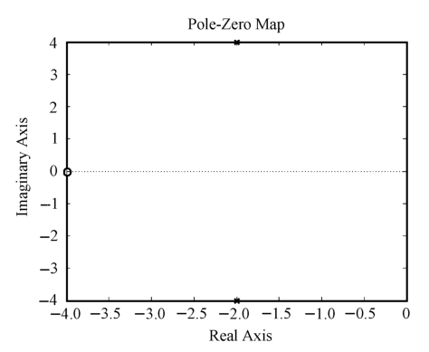{ .lq-img }

*图 4-23 零极点分布图（MATLAB）（截自原书）*

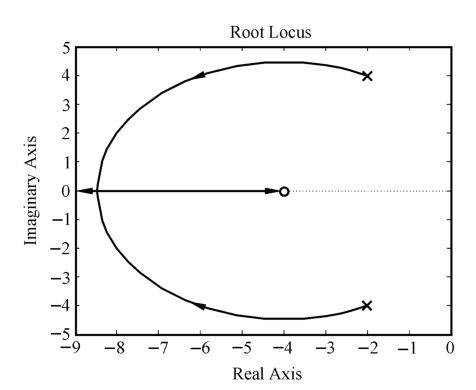{ .lq-img }

*图 4-24 例 4-7 参数根轨迹图（MATLAB）（截自原书）*

!!! warning "原书笔误"
    原书 Python 程序中 `x1, y1 = ctr.rlocus(sys, print_gain=True)` 在 python-control 0.10.2 下直接报 `TypeError: unrecognized keywords: {'print_gain': True}`：0.10 版函数已更名为 `root_locus`，没有 `print_gain` 参数，默认返回值也不再是 (roots, gains) 二元组（画图时返回绘图对象）。要拿数据用 `ct.root_locus_map(sys, gains=...)`（不画图、不触发弃用警告）。`mat.pzmap(sys)` 能画图但会发出弃用 FutureWarning，推荐 `ct.pzmap(sys)`。下面的代码已按 0.10.2 修正。

=== "MATLAB"

    ```matlab
    % ===== 书 4-5 节 例4-7 参数根轨迹 =====
    G = tf([1 4], [1 4 20]);        % 建立等效开环传递函数模型
    figure(1)
    pzmap(G);                       % 绘制零极点分布图（书图4-23）
    figure(2)
    rlocus(G);                      % 绘制根轨迹（书图4-24）
    % 临界阻尼 K* = 12.94：闭环极点 s = -8.47（二重），可由 rlocfind 点选分离点验证
    ```

=== "Python"

    ```python
    # ===== 书 4-5 节 例4-7 参数根轨迹（原书代码已按 0.10.2 修正）=====
    import numpy as np
    import control as ct
    import matplotlib.pyplot as plt

    sys = ct.tf([1, 4], [1, 4, 20])     # 等效开环传递函数 (s+4)/(s^2+4s+20)
    plt.figure(1)
    ct.pzmap(sys)                       # 零极点分布图（书图4-23）
    plt.figure(2)
    ct.root_locus(sys, grid=False)      # 根轨迹（书图4-24）；对应 MATLAB rlocus
    plt.show()
    # 临界阻尼：分离点 d 满足 d^2+8d-4=0，取 d = -4-2*sqrt(5) = -8.47
    d = -4 - 2 * np.sqrt(5)
    K = abs(d**2 + 4*d + 20) / abs(d + 4)
    print(K)                            # 12.944：临界 K*（即题中 K 值）
    print(np.roots([1, 4 + K, 20 + 4*K]))   # [-8.472 -8.472]：二重闭环极点
    ```

### 4. 绘图命令进阶：sgrid 与 rlocfind 思路

以例 4-4 的系统 \(G(s)=\dfrac{K^*}{s(s+3)(s^2+2s+2)}\) 为例：`sgrid` 在根轨迹上叠画等 \(\zeta\)、等 \(\omega_n\) 网格，用于按阻尼比选主导极点；`rlocfind` 在图上点选一点、返回该点的 \(K^*\) 与全部闭环极点。Python 里网格用 `ct.root_locus(..., grid=True)`；"点选取值"用根轨迹数据反查——找轨迹穿过虚轴（或某等 \(\zeta\) 线）处的增益，再求该增益下全部闭环极点。

=== "MATLAB"

    ```matlab
    % ===== 书 4-5 节 sgrid 与 rlocfind（例4-4 系统）=====
    G = zpk([], [0 -3 -1-1i -1+1i], 1);   % K*/(s(s+3)(s^2+2s+2))
    rlocus(G), sgrid                       % 根轨迹上叠画等 ζ、等 ωn 网格
    [K, poles] = rlocfind(G)               % 图上点选一点，返回该点 K* 与全部闭环极点
    % 点选虚轴交点：K* ≈ 8.16，poles = ±1.095i 与 -2.50±0.74i（与例4-4 劳斯表一致）
    ```

=== "Python"

    ```python
    # ===== 书 4-5 节 sgrid 与 rlocfind 思路（例4-4 系统）=====
    import numpy as np
    import control as ct
    import matplotlib.pyplot as plt

    G = ct.zpk([], [0, -3, -1-1j, -1+1j], 1)     # K*/(s(s+3)(s^2+2s+2))
    kv = np.concatenate([[0], np.logspace(-3, 2, 4000)])   # 加密增益取样点
    plt.figure()
    ct.root_locus(G, grid=True, gains=kv)        # grid=True：等 ζ、等 ωn 网格（sgrid）
    plt.show()

    # rlocfind 思路：由根轨迹数据反查"某点处的增益"
    rlm = ct.root_locus_map(G, gains=kv)         # 不画图，直接算根轨迹数据
    loci = np.asarray(rlm.loci)                  # 形状 (增益数, 极点数)，复数
    smax = loci.real.max(axis=1)                 # 每个增益下最右闭环极点的实部
    j = np.where((smax[:-1] <= 0) & (smax[1:] > 0))[0][0]   # 实部穿越 0 处
    K = np.interp(0, smax[j:j+2], kv[j:j+2])     # 线性插值得交点增益
    print(K)                                     # 8.160（例4-4 劳斯表：8.16）
    print(np.roots([1, 5, 8, 6, K]))             # 该增益下全部闭环极点
    # [-2.50±0.74j, ±1.095j]——两对极点，与劳斯表辅助方程一致
    ```

!!! note "拓展：模值条件取点的老手艺（补充）"
    没有软件的年代，在概略轨迹上定某增益的闭环极点靠模值条件手工试凑：先试实轴上的点，确定一个实极点后用综合除法（或法则 8 根之和）求其余极点；只有一对复数极点时直接在图上量。今天的做法等价而省力：`root_locus_map` 给出全部增益下的根，任何"某点处 \(K^*\) 是多少"的问题都变成一次插值。两者配合使用——手工估算用于心算校核，软件用于出数。

## 坑与陷阱

!!! danger "8 个容易踩的坑"
    1. **相角条件才是充要条件**：画轨迹只看相角条件（式 4.9），\(K^*\) 的取值不影响轨迹形状只影响"刻度"；模值条件（式 4.10）仅用来在既定轨迹上定 \(K^*\)。反着用（拿模值条件筛点）会白费功夫还可能画错。
    2. **渐近线交点 \(\sigma_a\) 的分子是"极点和减零点和"**，分母是 \(n-m\)：\(\sigma_a=(\sum p_i-\sum z_j)/(n-m)\)。把零点漏掉、或分母写成 \(n\)，整组渐近线就整体错位；渐近线条数是 \(n-m\)，不是 \(n\)。
    3. **分离点方程的根只是"候选"**：必须检验是否落在该系统的实轴根轨迹区段上——例 4-2 舍去 \(-0.586\) 取 \(-3.414\)，例 4-5 舍去 \(-25.2\) 与二重极点 \(-12\) 取 \(-4.75\)，例 4-7 舍去 \(+0.47\) 取 \(-8.47\)。零极点分布很对称时分离点还可能成对出现在复平面上。
    4. **实轴区段判定只数"右侧实数零极点"**：共轭复零、极点到实轴上任意点的相角和为 \(2\pi\)（相当于 0），不参与奇偶判定；左侧贡献 0、右侧每个贡献 \(\pi\)。二重开环极点要数两次（例 4-5 的 \(-12\)）。
    5. **\(K\) 与 \(K^*\) 差一个比例常数**：开环增益 \(K\) 是时间常数形式的增益，\(K^*\) 是零极点形式的增益（式 4.3）。图上标注、`rlocus` 输出的都是 \(K^*\)；换算开环增益（如 I 型系统的 \(K_v\)）时先归一化再算，例 4-5 的 \(K^*>16.37\) 才振荡对应开环增益还要除以相应常数。
    6. **等效开环传递函数只在"闭环极点相同"上等效**：参数根轨迹（式 4.29）给出的闭环零点与原系统不同。例 4-6 中系统Ⅱ、Ⅲ闭环极点相同，但Ⅱ多一个闭环零点 \(-1/T_a\)——估算动态性能时极点取自参数根轨迹、零点必须取原系统的，否则超调量判断会错。
    7. **主导极点法三道保险**：只略去比主导极点远 6 倍以上（常放宽到 2~3 倍）的零极点；偶极子接近原点时不能略（\(\delta/a\) 项）；略去偶极子和非主导零极点后**根轨迹增益常会改变，必须重新核算**保持 \(\varPhi(0)\) 不变（式 4.36 略去偶极子不核增益会得出"有稳态误差"的错误结论）。输入信号极点不参加主导极点挑选。
    8. **python-control 0.10 的根轨迹 API 换过代**：`rlocus` 更名 `root_locus`，原书例 4-7 代码的 `print_gain=True` 直接 TypeError；取数据用 `ct.root_locus_map(sys, gains=...)`（`.loci`/`.gains`），画等 \(\zeta\) 网格用 `grid=True`；`rlocfind` 无对应函数，按 4-5 节的插值思路反查。

## 术语速查

| 英文 | 中文 | 一句话 |
| --- | --- | --- |
| root locus | 根轨迹 | 开环某参数从 0 变到 \(\infty\) 时闭环特征根在 \(s\) 平面上的轨迹（Evans，1948） |
| root locus gain | 根轨迹增益 \(K^*\) | 零极点形式开环传函的增益，与开环增益 \(K\) 差一个比例常数 |
| open-loop gain | 开环增益 \(K\) | 时间常数形式开环传函的增益，I 型系统中即 \(K_v\) |
| root locus equation | 根轨迹方程 | \(K^*\prod(s-z_j)/\prod(s-p_i)=-1\)，特征方程的等价形式 |
| angle condition | 相角条件 | \(\sum\angle(s-z_j)-\sum\angle(s-p_i)=(2k+1)\pi\)，确定轨迹的充要条件 |
| magnitude condition | 模值条件 | \(K^*=\prod\vert s-p_i\vert/\prod\vert s-z_j\vert\)，确定轨迹上各点的 \(K^*\) |
| infinite zero / pole | 无限零点 / 无限极点 | \(n-m\) 条轨迹的终点（或起点）在无穷远处的说法 |
| asymptote | 根轨迹渐近线 | \(n-m\) 条射线，交点 \(\sigma_a=(\sum p-\sum z)/(n-m)\)、交角 \((2k+1)\pi/(n-m)\) |
| breakaway point | 分离点 \(d\) | 分支相遇又分开的点，由 \(\sum 1/(d-z)=\sum 1/(d-p)\) 求解 |
| separation angle | 分离角 | \((2k+1)\pi/l\)，\(l\) 条分支进入/离开分离点切线方向的夹角 |
| departure angle | 起始角 \(\theta_{p_i}\) | 轨迹离开复数开环极点处切线的方向角 |
| arrival angle | 终止角 \(\varphi_{z_i}\) | 轨迹进入复数开环零点处切线的方向角 |
| 180° root locus | 180°根轨迹 | 负反馈 \(K^*\) 变化的常规根轨迹，相角遵循 \((2k+1)\pi\) |
| zero-degree root locus | 零度根轨迹 | 正反馈等情形，相角遵循 \(2k\pi\)，法则逐条改号（拓展） |
| generalized root locus | 广义根轨迹 | 非 \(K^*\) 参数（参数根轨迹、\(m>n\) 等）情形的统称 |
| parameter root locus | 参数根轨迹 | 以非开环增益参数 \(A\) 变化绘制的根轨迹 |
| equivalent open-loop TF | 等效开环传递函数 | \(G_1H_1=A\cdot P(s)/Q(s)\)，仅在闭环极点上与原系统等效 |
| sum of roots | 根之和（法则8） | \(n-m\ge2\) 时 \(\sum s_i=\sum p_i\) 与 \(K^*\) 无关，用于判走向、补极点 |
| dominant poles | 闭环主导极点 | 最靠近虚轴且附近无闭环零点、决定响应形态的极点 |
| dipole | 偶极子 | 距离比模值小一个数量级的闭环零极点对；远离原点可略，靠近原点必算 |
| dominant pole method | 主导极点法 | 选留主导极点、略去 6 倍以上（常 2~3 倍）零极点的高阶系统估算方法 |
| pzmap / rlocus / sgrid | 零极点图 / 根轨迹 / 网格 | MATLAB 命令；Python 对应 `ct.pzmap` / `ct.root_locus` / `grid=True` |
| rlocfind | 图上取点定增益 | 返回点选处的 \(K^*\) 与全部闭环极点；Python 用 `root_locus_map` 反查 |

## 覆盖自查

??? note "原书小节 → 笔记位置"
    | 原书小节/内容 | 笔记位置 |
    | --- | --- |
    | 4-1 根轨迹法的基本概念（根轨迹概念、根轨迹与系统性能、闭环零极点与开环零极点关系式 4-1~4-6、根轨迹方程与相角/模值条件式 4-7~4-10） | 4.1 |
    | 4-2 常规根轨迹的绘制法则（法则 1～8 全部叙述与证明思路、表 4-1、闭环极点的确定） | 4.2（法则逐条 + mermaid 流程） |
    | 4-2 例 4-1～例 4-5（概略轨迹、圆轨迹、起始/终止角、劳斯定交点、空间站综合） | 4.2 各法则之后（例 4-5 含双 tab 代码） |
    | 4-3 广义根轨迹（参数根轨迹与等效开环传递函数式 4-26~4-29、例 4-6 与表 4-2、附加开环零点的作用式 4-35 与图 4-20/4-21） | 4.3 |
    | 4-4 系统性能的分析（主导极点、偶极子与式 4-36~4-39、主导极点法、闭环零极点影响的定性分析七条与图 4-22） | 4.4 |
    | 4-5 线性系统的根轨迹分析仿真（pzmap、rlocus、综合应用例 4-7） | 4.5（例 4-7 与 sgrid/rlocfind 思路均含双 tab 代码） |

??? note "原书例题 → 笔记位置"
    | 原书例题 | 内容 | 笔记位置 |
    | --- | --- | --- |
    | 例 4-1 | 三支轨迹概略绘制（分离点 \(d\approx-2.47\)） | 4.2 法则 5 |
    | 例 4-2 | 两极点一零点的圆轨迹（\(d=-3.414\)） | 4.2 法则 5（含圆的证明拓展） |
    | 例 4-3 | 起始角 \(79^\circ\)、终止角 \(149.5^\circ\) | 4.2 法则 6 |
    | 例 4-4 | 四支轨迹：渐近线、分离点、劳斯定虚轴交点（\(K^*=8.16\)，\(\omega=\pm1.1\)） | 4.2 法则 7 |
    | 例 4-5 | 空间站方位控制：概略轨迹、\(K^*>16.37\) 振荡、\(K^*=10\) 阶跃响应（含双 tab 代码） | 4.2 闭环极点的确定 |
    | 例 4-6 | 位置随动三系统对比：参数根轨迹、\(\zeta=0.5\) 取点、表 4-2 | 4.3 参数根轨迹 |
    | 例 4-7 | \(G(s)=20/[(s+4)(s+K)]\) 参数根轨迹：临界阻尼 \(K=12.94\)、\(s=-8.47\)（含勘误说明 + 双 tab 代码） | 4.5 综合应用 |
