# 第 5 章 线性系统的频域分析法

> **本章解决**：第 3 章在时间域里解响应、算指标，第 4 章用根轨迹看开环参数如何牵动闭环极点——两条路都绕不开高阶系统的繁琐计算。频域分析法换一个角度：任何信号都能拆成一堆不同频率的正弦波，那么只研究系统对**正弦输入的稳态响应**（幅值放大多少、相位滞后多少，即频率特性），就能用一张图判断闭环稳定性和"稳得有多好"。本章先建立频率特性的概念和三种几何表示（奈奎斯特图、伯德图、尼科尔斯图，5-1）；再把开环系统拆成八个典型环节逐个推奈氏图与伯德图，并给出开环幅相曲线和渐近伯德图的绘制方法（5-2）；然后用幅角原理搭起奈奎斯特稳定判据和对数频率稳定判据——不用求闭环特征根就能判稳（5-3）；在临界点 \((-1,\mathrm{j}0)\) 附近量化"离不稳定有多远"，得到相角裕度与幅值裕度（5-4）；最后建立谐振峰值、带宽等闭环频域指标与时域指标的换算关系（5-5），并交给 MATLAB/Python 仿真验证（5-6）。频域法是第 6 章频域校正设计的语言，\(\gamma\)、\(\omega_c\) 这两个指标会一路用到。本章插图沿用原书图号（图 5-1～图 5-46），公式沿用原书式号 (5-1)～(5-94)。

## 5.0 本章导图

<div class="brtree">
  <div class="brrow">
    <span class="brlabel root">线性系统的频域分析</span>
    <span class="brace"></span>
    <div class="brkids">
      <div class="brrow">
        <span class="brlabel">频率特性（5-1）</span>
        <span class="brace"></span>
        <div class="brkids">
          <span class="brleaf">RC 网络正弦稳态</span>
          <span class="brleaf">A(ω)=|G(jω)|、φ(ω)=∠G(jω)</span>
          <span class="brleaf">幅相曲线（奈奎斯特图）</span>
          <span class="brleaf">伯德图：L(ω)=20lg A(ω)</span>
          <span class="brleaf">尼科尔斯图</span>
        </div>
      </div>
      <div class="brrow">
        <span class="brlabel">典型环节（5-2）</span>
        <span class="brace"></span>
        <div class="brkids">
          <span class="brleaf">最小/非最小相位八环节</span>
          <span class="brleaf">振荡环节谐振 M<sub>r</sub>、ω<sub>r</sub></span>
          <span class="brleaf">渐近线与交接频率</span>
          <span class="brleaf">开环幅相曲线三要素</span>
          <span class="brleaf">开环伯德图绘制步骤</span>
          <span class="brleaf">延迟环节、实验法建模型</span>
        </div>
      </div>
      <div class="brrow">
        <span class="brlabel">频域稳定判据（5-3）</span>
        <span class="brace"></span>
        <div class="brkids">
          <span class="brleaf">幅角原理 R=P−Z</span>
          <span class="brleaf">F(s)=1+G(s)H(s)</span>
          <span class="brleaf">Γ 曲线与补作圆弧</span>
          <span class="brleaf">正/负穿越数 N</span>
          <span class="brleaf">奈氏判据、对数判据</span>
          <span class="brleaf">条件稳定系统</span>
        </div>
      </div>
      <div class="brrow">
        <span class="brlabel">稳定裕度（5-4）</span>
        <span class="brace"></span>
        <div class="brkids">
          <span class="brleaf">相角裕度 γ</span>
          <span class="brleaf">幅值裕度 h（dB）</span>
          <span class="brleaf">γ&gt;0 且 h&gt;1 判稳条件</span>
          <span class="brleaf">典型二阶系统 γ−ζ 曲线</span>
        </div>
      </div>
      <div class="brrow">
        <span class="brlabel">闭环频域指标（5-5）</span>
        <span class="brace"></span>
        <div class="brkids">
          <span class="brleaf">带宽频率 ω<sub>b</sub></span>
          <span class="brleaf">带宽与响应速度成正比</span>
          <span class="brleaf">M<sub>r</sub>≈1/sin γ</span>
          <span class="brleaf">γ、ω<sub>c</sub> 估时域指标</span>
          <span class="brleaf">祝融号轮控系统实例</span>
        </div>
      </div>
      <div class="brrow">
        <span class="brlabel">频域仿真（5-6）</span>
        <span class="brace"></span>
        <div class="brkids">
          <span class="brleaf">bode / margin</span>
          <span class="brleaf">nyquist</span>
          <span class="brleaf">例5-15 判稳全流程</span>
        </div>
      </div>
    </div>
  </div>
</div>

## 5.1 频率特性

控制系统中的信号可以表示为不同频率正弦信号的合成，控制系统的频率特性反映了正弦信号作用下系统响应的性能。应用频率特性研究线性系统的经典方法称为**频域分析法**。它有四个特点：

1. 频率特性可以用**分析法**和**实验法**获得，并能用多种形式的曲线表示，系统分析和控制器设计可以应用**图解法**进行；
2. 物理意义明确。一阶、二阶系统的频域指标和时域指标有**确定的对应关系**，高阶系统可建立近似的对应关系；
3. 频域设计可以兼顾**动态响应**和**噪声抑制**两方面的要求；
4. 不仅适用于线性定常系统，还可以推广应用于某些非线性系统（第八章的描述函数法）。

### 频率特性的基本概念

以图 5-1 的 RC 滤波网络为例建立概念。设电容初始电压为 \(u_{o_0}\)，输入正弦信号

\[
u_i = A\sin\omega t
\tag{5.1}
\]

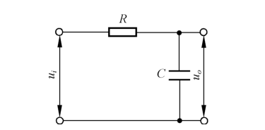{ .lq-img }

*图 5-1 RC 滤波网络（截自原书）*

记录网络的输入、输出波形：稳态时输出 \(u_o\) 仍是**同频率**的正弦信号，只是幅值有衰减、相位有延迟。RC 网络的输入和输出的关系可由微分方程描述：

\[
T\frac{\mathrm{d}u_o}{\mathrm{d}t} + u_o = u_i
\tag{5.2}
\]

式中 \(T=RC\) 为时间常数。取拉氏变换并代入初始条件 \(u_o(0)=u_{o_0}\)：

\[
U_o(s) = \frac{A\omega}{(s^2+\omega^2)(1+Ts)} + \frac{Tu_{o_0}}{1+Ts}
\tag{5.3}
\]

再由拉氏反变换求得

\[
u_o(t) = \left(u_{o_0} + \frac{A\omega T}{1+T^2\omega^2}\right)\mathrm{e}^{-\frac{t}{T}}
+ \frac{A}{\sqrt{1+T^2\omega^2}}\sin(\omega t - \arctan\omega T)
\tag{5.4}
\]

第一项因 \(T>0\) 随时间增大趋于零，是输出的**瞬态分量**；第二项正弦信号是输出的**稳态分量**

\[
u_{o_s}(t) = \frac{A}{\sqrt{1+T^2\omega^2}}\sin(\omega t - \arctan\omega T)
= A\cdot A(\omega)\sin[\omega t + \varphi(\omega)]
\tag{5.5}
\]

式中

\[
A(\omega) = \frac{1}{\sqrt{1+T^2\omega^2}}, \qquad \varphi(\omega) = -\arctan\omega T
\]

分别反映 RC 网络在正弦信号作用下输出稳态分量的幅值变化和相位变化，称为**幅值比**和**相位差**，都是输入频率 \(\omega\) 的函数。注意到 RC 网络的传递函数为

\[
G(s) = \frac{1}{Ts+1}
\tag{5.6}
\]

取 \(s=\mathrm{j}\omega\)：

\[
G(\mathrm{j}\omega) = G(s)\big|_{s=\mathrm{j}\omega} = \frac{1}{1+\mathrm{j}\omega T}\,\mathrm{e}^{-\mathrm{j}\arctan\omega T}
\tag{5.7}
\]

比较式 (5.5) 和 (5.7)：\(A(\omega)\) 与 \(\varphi(\omega)\) 恰好是 \(G(\mathrm{j}\omega)\) 的模 \(\vert G(\mathrm{j}\omega)\vert\) 和相角 \(\angle G(\mathrm{j}\omega)\)。这不是 RC 网络的巧合，而是普遍规律。

对一般稳定线性定常系统，设传递函数

\[
G(s) = \frac{N(s)}{D(s)} = \frac{b_0 s^m + b_1 s^{m-1} + \cdots + b_{m-1}s + b_m}{a_0 s^n + a_1 s^{n-1} + \cdots + a_{n-1}s + a_n}
\tag{5.8}
\]

输入谐波信号

\[
r(t) = A\sin(\omega t + \varphi)
\tag{5.9}
\]

\[
R(s) = \frac{A\omega\cos\varphi + A s\sin\varphi}{s^2+\omega^2}
\tag{5.10}
\]

系统稳定时，输出稳态分量的拉氏变换等于 \(C(s)\) 在虚轴极点 \(s=\pm\mathrm{j}\omega\) 处的部分分式。设

\[
G(\mathrm{j}\omega) = \frac{a(\omega) + \mathrm{j}b(\omega)}{c(\omega) + \mathrm{j}d(\omega)}
= \vert G(\mathrm{j}\omega)\vert\,\mathrm{e}^{\mathrm{j}\angle G(\mathrm{j}\omega)}
\tag{5.12}
\]

因为 \(G(s)\) 分子分母都是实系数多项式，\(a(\omega)\)、\(c(\omega)\) 是 \(\omega\) 的偶函数，\(b(\omega)\)、\(d(\omega)\) 是 \(\omega\) 的奇函数，于是

\[
\vert G(\mathrm{j}\omega)\vert = \left[\frac{a^2(\omega) + b^2(\omega)}{c^2(\omega) + d^2(\omega)}\right]^{1/2}
\tag{5.13}
\]

\[
\angle G(\mathrm{j}\omega) = \arctan\frac{b(\omega)c(\omega) - a(\omega)d(\omega)}{a(\omega)c(\omega) + b(\omega)d(\omega)}
\tag{5.14}
\]

因而

\[
G(-\mathrm{j}\omega) = \vert G(\mathrm{j}\omega)\vert\,\mathrm{e}^{-\mathrm{j}\angle G(\mathrm{j}\omega)}
\tag{5.15}
\]

由 \(R(s)\) 在 \(s=\pm\mathrm{j}\omega\) 处的留数得到稳态分量的拉氏变换：

\[
C_{ss}(s) = \frac{A\vert G(\mathrm{j}\omega)\vert}{2\mathrm{j}}
\left[\frac{\mathrm{e}^{\mathrm{j}[\varphi + \angle G(\mathrm{j}\omega)]}}{s - \mathrm{j}\omega}
- \frac{\mathrm{e}^{-\mathrm{j}[\varphi + \angle G(\mathrm{j}\omega)]}}{s + \mathrm{j}\omega}\right]
\tag{5.11}
\]

拉氏反变换给出稳态分量

\[
c_{ss}(t) = A\vert G(\mathrm{j}\omega)\vert\,\sin[\omega t + \varphi + \angle G(\mathrm{j}\omega)]
\tag{5.16}
\]

上式与式 (5.5) 相比较，令 \(\varphi=0\) 得

\[
A(\omega) = \vert G(\mathrm{j}\omega)\vert, \qquad \varphi(\omega) = \angle G(\mathrm{j}\omega)
\tag{5.17}
\]

式 (5.16) 表明：**稳定的线性定常系统在谐波输入下，输出稳态分量是与输入同频率的谐波函数，幅值和相位的变化是频率 \(\omega\) 的函数，且与系统数学模型相关**。为此定义：谐波输入下，输出响应中与输入同频率的谐波分量与谐波输入的幅值之比 \(A(\omega)\) 为**幅频特性**，相位之差 \(\varphi(\omega)\) 为**相频特性**，其指数表达形式

\[
G(\mathrm{j}\omega) = A(\omega)\,\mathrm{e}^{\mathrm{j}\varphi(\omega)}
\tag{5.18}
\]

称为系统的**频率特性**。

!!! note "拓展：这三个定义的适用范围不一样（补充）"
    频率特性的**定义**（式 5.17、5.18）对稳定和不稳定系统都成立——只要把 \(s=\mathrm{j}\omega\) 代进 \(G(s)\) 就能算。但**实验测定**只对稳定系统可行：在输入端施加不同频率的正弦信号、测稳态输出的幅值比和相位差即可；不稳定系统的稳态分量里混着由不稳定极点产生的发散或等幅振荡分量，实验测不到纯粹的稳态响应。另外，由傅氏变换的角度看，稳定系统的频率特性还等于输出与输入的傅氏变换之比 \(C(\mathrm{j}\omega)/R(\mathrm{j}\omega)=G(\mathrm{j}\omega)\)（式 5.19），这正是"频率特性"物理意义的数学表达。

频率特性与微分方程、传递函数一样，表征系统的运动规律，是频域分析的理论依据。三种描述之间的关系是：微分方程取拉氏变换得传递函数（\(s\) 域），令 \(s=\mathrm{j}\omega\) 得频率特性；传递函数令 \(s=p\) 对应微分方程算子。知道了任何一种，就可以确定另外两种。

### 频率特性的几何表示法

工程上把频率特性画成曲线再做图解分析。常用三种曲线。

**(1) 幅相频率特性曲线**（简称**幅相曲线**，又称奈奎斯特图或极坐标图）：以横轴为实轴、纵轴为虚轴构成复数平面。任一频率 \(\omega\) 的频率特性是一个复数——实部虚部形式给出坐标点，指数形式给出向量（长度为幅值，与实轴正方向夹角为相位）。由于幅频特性是 \(\omega\) 的偶函数、相频特性是奇函数，\(\omega\) 从 \(0\to+\infty\) 与 \(0\to-\infty\) 的幅相曲线关于实轴对称，一般只绘制 \(\omega\) 从零变化至 \(+\infty\) 的一段，用小箭头表示 \(\omega\) 增大方向。

对 RC 网络：

\[
G(\mathrm{j}\omega) = \frac{1}{1+\mathrm{j}\omega T} = \frac{1-\mathrm{j}\omega T}{1+\omega^2T^2}
\]

故

\[
\left[\mathrm{Re}\,G(\mathrm{j}\omega) - \frac{1}{2}\right]^2 + \left[\mathrm{Im}\,G(\mathrm{j}\omega)\right]^2 = \left(\frac{1}{2}\right)^2
\]

即 RC 网络的幅相曲线是以 \(\left(\frac{1}{2},\mathrm{j}0\right)\) 为圆心、半径为 \(\frac{1}{2}\) 的**半圆**（图 5-5）：\(\omega=0\) 时从 \((1,\mathrm{j}0)\) 出发，\(\omega\to\infty\) 时终于原点。

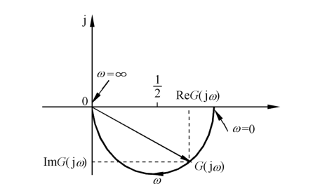{ .lq-img }

*图 5-5 RC 网络的幅相特性曲线：圆心 (1/2, j0)、半径 1/2 的半圆（截自原书）*

**(2) 对数频率特性曲线**（又称**伯德图**）：由对数幅频曲线和对数相频曲线组成，工程中使用最广。横坐标按 \(\lg\omega\) 分度（单位 rad/s），对数幅频曲线纵坐标为

\[
L(\omega) = 20\lg\vert G(\mathrm{j}\omega)\vert = 20\lg A(\omega)
\tag{5.20}
\]

线性分度，单位分贝（dB）；对数相频曲线纵坐标按 \(\varphi(\omega)\) 线性分度，单位度（°）。这样构成**半对数坐标系**。

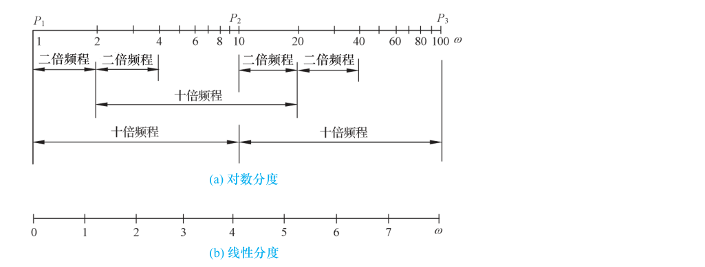{ .lq-img }

*图 5-6 对数分度与线性分度：对数分度上十倍频程占据一个单位长度（截自原书）*

对数分度中，变量增大 10 倍称为**十倍频程**（dec），坐标间距变化一个单位长度；设单位长度为 \(L\)，某十倍频程左端点为 \(\omega_0\)，坐标点相对左端点的距离如表 5-1。

**表 5-1 十倍频程中的对数分度**

| \(\omega/\omega_0\) | 1 | 2 | 3 | 4 | 5 | 6 | 7 | 8 | 9 | 10 |
| --- | --- | --- | --- | --- | --- | --- | --- | --- | --- | --- |
| \(\lg(\omega/\omega_0)\) | 0 | 0.301 | 0.477 | 0.602 | 0.699 | 0.778 | 0.845 | 0.903 | 0.954 | 1 |

!!! warning "原书笔误"
    原书表 5-1 中 \(\omega/\omega_0=6\) 对应的 \(\lg(\omega/\omega_0)\) 印作 **0.788**。按定义 \(\lg 6=0.778\)（\(10^{0.778}\approx 6.00\)，而 \(10^{0.788}\approx 6.14\)），且 0.778 恰好落在 0.699（5）与 0.845（7）的等距递增序列之间，应为 **0.778**。上表已按修正值给出。

对数分度实现了横坐标的**非线性压缩**，便于在很宽的频率范围展示特性变化；\(20\lg A(\omega)\) 把幅值的**乘除运算化为加减运算**，简化作图。RC 网络取 \(T=0.5\) 时，对数幅频从 0 dB 起经 \(\omega=1/T=2\) 后以约 \(-20\ \mathrm{dB/dec}\) 下降，相频从 \(0^\circ\) 单调降到 \(-90^\circ\)。

**(3) 对数幅相曲线**（又称尼科尔斯图）：纵坐标 \(L(\omega)\)（dB）、横坐标 \(\varphi(\omega)\)（°），均线性分度，\(\omega\) 为参变量。RC 网络 \(T=0.5\) 的尼科尔斯曲线是一条从原点附近出发、随 \(\omega\) 增大趋向 \((-\infty\ \mathrm{dB},-90^\circ)\) 的弧线，可由对数幅频、对数相频两张曲线逐点合并得到，工程上多用于闭环特性分析与校正设计。

## 5.2 典型环节与开环系统频率特性

设开环系统由 \(R(s)\) 经 \(G(s)\) 到输出、\(H(s)\) 构成主反馈，开环传递函数为 \(G(s)H(s)\)。要画开环频率特性曲线，先把开环系统拆成典型环节。

### 典型环节

开环传递函数分子分母都是实系数多项式，零极点或为实数或为共轭复数；把分子分母按零极点分解成因式并分类，就得到典型环节。典型环节分两大类。**最小相位环节**七种：

1. 比例环节 \(K\)（\(K>0\)）；
2. 惯性环节 \(\dfrac{1}{Ts+1}\)（\(T>0\)）；
3. 一阶微分环节 \(1+Ts\)（\(T>0\)）；
4. 振荡环节 \(\dfrac{1}{(s/\omega_n)^2 + 2\zeta s/\omega_n + 1}\)（\(\omega_n>0,\ 0<\zeta<1\)）；
5. 二阶微分环节 \((s/\omega_n)^2 + 2\zeta s/\omega_n + 1\)（\(\omega_n>0,\ 0<\zeta<1\)）；
6. 积分环节 \(\dfrac{1}{s}\)；
7. 微分环节 \(s\)。

**非最小相位环节**五种：比例环节 \(K\)（\(K<0\)）、惯性环节 \(\dfrac{1}{1-Ts}\)（\(T>0\)）、一阶微分环节 \(1-Ts\)（\(T>0\)）、振荡环节 \(\dfrac{1}{(s/\omega_n)^2 - 2\zeta s/\omega_n + 1}\)、二阶微分环节 \((s/\omega_n)^2 - 2\zeta s/\omega_n + 1\)。除比例环节外，非最小相位环节与对应最小相位环节的区别只在**开环零极点位置**：非最小相位环节对应 \(s\) **右半平面**的开环零点或极点，最小相位环节对应 \(s\) **左半平面**的开环零极点。

开环传递函数可写成典型环节的串联：

\[
G(s)H(s) = \prod_{i=1}^{N} G_i(s)
\tag{5.21}
\]

设典型环节频率特性

\[
G_i(\mathrm{j}\omega) = A_i(\omega)\,\mathrm{e}^{\mathrm{j}\varphi_i(\omega)}
\tag{5.22}
\]

则开环频率特性

\[
G(\mathrm{j}\omega)H(\mathrm{j}\omega) = \left[\prod_{i=1}^{N} A_i(\omega)\right]\mathrm{e}^{\mathrm{j}\left[\sum_{i=1}^{N}\varphi_i(\omega)\right]}
\tag{5.23}
\]

开环幅频、相频特性：

\[
A(\omega) = \prod_{i=1}^{N} A_i(\omega), \qquad \varphi(\omega) = \sum_{i=1}^{N}\varphi_i(\omega)
\tag{5.24}
\]

开环对数幅频特性：

\[
L(\omega) = 20\lg A(\omega) = \sum_{i=1}^{N} 20\lg A_i(\omega) = \sum_{i=1}^{N} L_i(\omega)
\tag{5.25}
\]

式 (5.24)、(5.25) 表明：开环频率特性是各典型环节频率特性的**合成**；开环对数频率特性则是各典型环节对数频率特性的**叠加**——这是伯德图作图方便的根源。

### 典型环节的频率特性

由各典型环节的传递函数取 \(\omega\in(0,+\infty)\)，可绘制幅相曲线和对数频率特性曲线，分别如图 5-10、图 5-11。以下逐条讲清它们的重要特点。

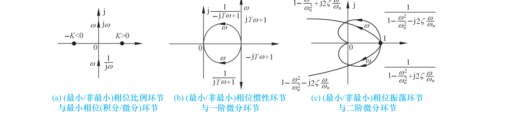{ .lq-img }

*图 5-10 典型环节幅相曲线：(a) 比例环节；(b) 惯性环节；(c) 振荡环节——每种都画了最小相位与非最小相位一对（截自原书）*

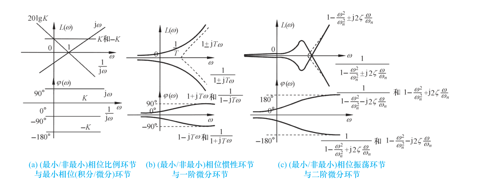{ .lq-img }

*图 5-11 典型环节对数频率特性曲线（伯德图）：(a) 比例环节；(b) 惯性环节；(c) 振荡环节（截自原书）*

**(1) 非最小相位环节和对应的最小相位环节**。每一种非最小相位典型环节都有一个最小相位环节与之对应，区别只是某个参数符号相反。

最小相位比例环节 \(G(s)=K\ (K>0)\)：

\[
A(\omega) = K, \qquad \varphi(\omega) = 0^\circ
\tag{5.26}
\]

非最小相位比例环节 \(G(s)=K\ (K<0)\)：

\[
A(\omega) = K,\qquad \varphi(\omega) = -180^\circ
\tag{5.27}
\]

最小相位惯性环节 \(G(s)=\dfrac{1}{Ts+1}\ (T>0)\)：

\[
A(\omega) = \frac{1}{\sqrt{1+T^2\omega^2}}, \qquad \varphi(\omega) = -\arctan T\omega
\tag{5.28}
\]

非最小相位（不稳定）惯性环节 \(G(s)=\dfrac{1}{1-Ts}\ (T>0)\)：

\[
A(\omega) = \frac{1}{\sqrt{1+T^2\omega^2}}, \qquad \varphi(\omega) = +\arctan T\omega
\tag{5.29}
\]

式 (5.28)、(5.29) 说明：一对最小/非最小相位环节**幅频特性相同、相频特性符号相反**，幅相曲线关于实轴对称；对数幅频曲线相同，对数相频曲线关于 \(0^\circ\) 线对称。这个结论对振荡环节、一阶微分环节、二阶微分环节同样适用。

**(2) 传递函数互为倒数的典型环节**。最小相位环节中，积分与微分、惯性与一阶微分、振荡与二阶微分互为倒数：

\[
G_1(s) = 1/G_2(s)
\tag{5.30}
\]

设 \(G_1(\mathrm{j}\omega)=A_1(\omega)\mathrm{e}^{\mathrm{j}\varphi_1(\omega)}\)，则

\[
A_2(\omega) = 1/A_1(\omega), \qquad L_2(\omega) = 20\lg A_2(\omega) = -L_1(\omega), \qquad \varphi_2(\omega) = -\varphi_1(\omega)
\tag{5.31}
\]

即互为倒数的典型环节，**对数幅频曲线关于 0 dB 线对称，对数相频曲线关于 \(0^\circ\) 线对称**。非最小相位环节中互为倒数的对也存在同样的对称性。

**(3) 振荡环节和二阶微分环节**。振荡环节传递函数

\[
G(s) = \frac{1}{(s/\omega_n)^2 + 2\zeta s/\omega_n + 1}, \qquad \omega_n>0,\ 0<\zeta<1
\tag{5.32}
\]

频率特性的幅值与相角：

\[
A(\omega) = \frac{1}{\sqrt{\left(1-\omega^2/\omega_n^2\right)^2 + 4\zeta^2\omega^2/\omega_n^2}}
\tag{5.33}
\]

\[
\varphi(\omega) = \begin{cases}
-\arctan\dfrac{2\zeta\omega/\omega_n}{1-\omega^2/\omega_n^2}, & \omega\le\omega_n \\[2ex]
-\left(180^\circ - \arctan\dfrac{2\zeta\omega/\omega_n}{\omega^2/\omega_n^2-1}\right), & \omega>\omega_n
\end{cases}
\tag{5.34}
\]

显然 \(\varphi(0)=0^\circ\)、\(\varphi(\infty)=-180^\circ\)，相频曲线从 \(0^\circ\) 单调减至 \(-180^\circ\)；\(\omega=\omega_n\) 时 \(\varphi(\omega_n)=-90^\circ\)，且由式 (5.33) 得 \(A(\omega_n)=\dfrac{1}{2\zeta}\)，即振荡环节的幅相曲线与虚轴交于 \(-\mathrm{j}\dfrac{1}{2\zeta}\)。

由式 (5.33) 得 \(A(0)=1\)、\(A(\infty)=0\)。分析 \(A(\omega)\) 的变化，令

\[
\frac{\mathrm{d}A^2(\omega)}{\mathrm{d}\omega}
= \frac{\mathrm{d}}{\mathrm{d}\omega}\left[\frac{1}{(1-\omega^2/\omega_n^2)^2 + 4\zeta^2\omega^2/\omega_n^2}\right] = 0
\tag{5.35}
\]

解得**谐振频率**

\[
\omega_r = \omega_n\sqrt{1-2\zeta^2}, \qquad 0<\zeta\le\frac{\sqrt 2}{2}
\tag{5.36}
\]

代入式 (5.33) 得**谐振峰值**

\[
M_r = A(\omega_r) = \frac{1}{2\zeta\sqrt{1-\zeta^2}}, \qquad 0<\zeta\le\frac{\sqrt 2}{2}
\tag{5.37}
\]

且

\[
\frac{\mathrm{d}M_r}{\mathrm{d}\zeta} = -\frac{2(1-2\zeta^2)}{\left(2\zeta\sqrt{1-\zeta^2}\right)^2} < 0, \qquad 0<\zeta<\frac{\sqrt 2}{2}
\tag{5.38}
\]

即 \(\omega_r\)、\(M_r\) 都是阻尼比 \(\zeta\) 的减函数。当 \(0<\zeta<\frac{\sqrt2}{2}\) 时，\(A(\omega)\) 在 \(\omega\in(0,\omega_r)\) 单调增、\(\omega\in(\omega_r,\infty)\) 单调减；当 \(\frac{\sqrt2}{2}<\zeta<1\) 时 \(A(\omega)\) 单调减。不同 \(\zeta\) 下的曲线见本笔记图 5-13。注意 \(\zeta\) 很小时 \(A(\omega_n)\approx\frac{1}{2\zeta}\) 很大——渐近线在 \(\omega_n\) 处是 0 dB，精确曲线却拱起很高，必须修正。

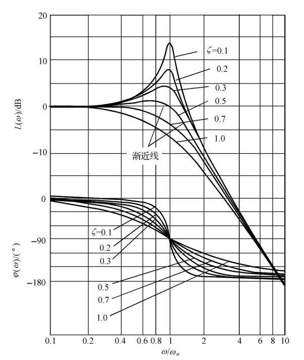{ .lq-img }

*图 5-13 振荡环节的对数频率特性曲线：谐振峰随 ζ 减小而升高（截自原书；其幅相曲线族见原书图 5-12）*

二阶微分环节的传递函数是振荡环节的倒数，按对称性可直接得到它的对数频率曲线，并有

\[
A(\omega_r) = 2\zeta\sqrt{1-\zeta^2} < 1, \qquad \omega_r = \omega_n\sqrt{1-2\zeta^2} < \omega_n
\tag{5.39}
\]

当 \(\frac{\sqrt2}{2}<\zeta<1\) 时 \(A(\omega)\) 从 1 单调增至 \(\infty\)；当 \(0<\zeta<\frac{\sqrt2}{2}\) 且 \(\omega\in(0,\omega_r)\) 时 \(A(\omega)\) 从 1 单调减至 \(A(\omega_r)\)，\(\omega\in(\omega_r,\infty)\) 单调增。概略幅相曲线从 \((1,\mathrm{j}0)\) 出发，先向左凹（\(0<\zeta<\frac{\sqrt2}{2}\) 时凹得更深），最终趋于正虚轴无穷远处。非最小相位二阶微分环节和不稳定振荡环节的曲线按 (1) 的对称规则确定。

**(4) 对数幅频渐近特性曲线**。为简化作图，惯性、一阶微分、振荡、二阶微分环节的对数幅频曲线常用低频和高频**渐近线**近似，称为对数幅频渐近特性曲线。

惯性环节的对数幅频特性：

\[
L(\omega) = -20\lg\left(1+T^2\omega^2\right)^{1/2}
\tag{5.40}
\]

当 \(\omega \ll 1/T\) 时，\(T^2\omega^2\approx 0\)：

\[
L(\omega) \approx 0
\tag{5.41}
\]

当 \(\omega \gg 1/T\) 时，\(T^2\omega^2 \gg 1\)：

\[
L(\omega) \approx -20\lg T\omega
\tag{5.42}
\]

因此惯性环节的对数幅频渐近特性

\[
L_a(\omega) = \begin{cases} 0, & \omega < \dfrac{1}{T} \\[1ex] -20\lg T\omega, & \omega \ge \dfrac{1}{T} \end{cases}
\tag{5.43}
\]

低频段是零分贝线，高频段是斜率 \(-20\ \mathrm{dB/dec}\) 的直线，两直线交于 \(\omega=\dfrac{1}{T}\)，称 \(\dfrac{1}{T}\) 为惯性环节的**交接频率**。渐近特性与精确特性存在误差

\[
\Delta L(\omega) = L(\omega) - L_a(\omega)
\tag{5.44}
\]

该误差在交接频率处最大，约 \(-3\ \mathrm{dB}\)，按误差曲线修正渐近线即得准确曲线。非最小相位惯性环节的对数幅频特性与惯性环节相同，渐近特性也相同；一阶微分环节（含非最小相位）与惯性环节的对数幅频特性互为倒数，故其渐近特性曲线与惯性环节的关于 0 dB 线互为镜像。

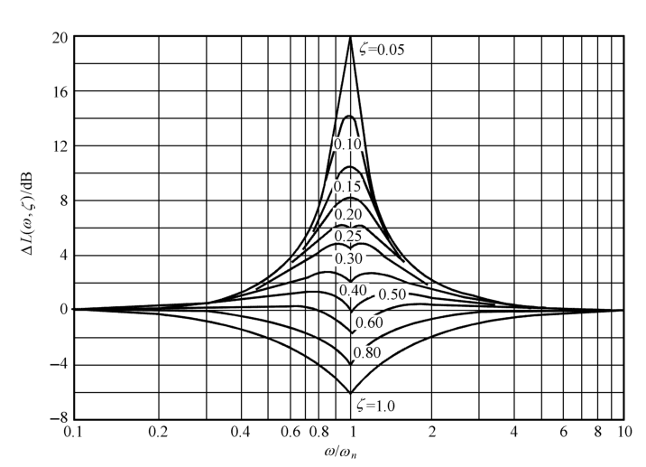{ .lq-img }

*图 5-17 振荡环节的误差曲线 ΔL(ω, ζ) 为一曲线簇：ζ 越小，交接频率附近的修正量越大（截自原书）*

振荡环节的对数幅频特性：

\[
L(\omega) = -20\lg\left[\left(1-\frac{\omega^2}{\omega_n^2}\right)^2 + \frac{4\zeta^2\omega^2}{\omega_n^2}\right]^{1/2}
\tag{5.45}
\]

\(\omega \ll \omega_n\) 时 \(L(\omega)\approx 0\)，低频渐近线为 0 dB 线；\(\omega \gg \omega_n\) 时 \(L(\omega) = -40\lg\dfrac{\omega}{\omega_n}\)，高频渐近线为过 \((\omega_n,0)\) 点、斜率 \(-40\ \mathrm{dB/dec}\) 的直线。振荡环节的交接频率为 \(\omega_n\)，对数幅频渐近特性

\[
L_a(\omega) = \begin{cases} 0, & \omega < \omega_n \\[1ex] -40\lg\dfrac{\omega}{\omega_n}, & \omega \ge \omega_n \end{cases}
\tag{5.46}
\]

\(L(\omega)\) 含 \(\zeta\)，而 \(L_a(\omega)\) 与 \(\zeta\) 无关，所以渐近近似存在与 \(\zeta\) 有关的误差，误差曲线 \(\Delta L(\omega,\zeta)\) 是一簇曲线（图 5-17），按它修正渐近线可得准确曲线。非最小相位振荡环节与振荡环节的渐近特性相同；二阶微分环节（含非最小相位）与振荡环节的渐近特性关于 0 dB 线对称。

半对数坐标系中的直线方程为

\[
L_a(\omega_2) - L_a(\omega_1) = k\left(\lg\omega_2 - \lg\omega_1\right)
\tag{5.47}
\]

其中 \((\omega_1, L_a(\omega_1))\)、\((\omega_2, L_a(\omega_2))\) 为直线上两点，\(k\ (\mathrm{dB/dec})\) 为斜率。

### 开环幅相特性曲线的绘制

按开环频率特性表达式取点、计算、作图可以画出准确的幅相曲线；工程上更需要**概略**曲线。概略开环幅相曲线应反映三个重要因素：

1. **起点**（\(\omega=0^+\)）和**终点**（\(\omega=\infty\)）；
2. **与实轴的交点**。设 \(\omega=\omega_x\) 时

\[
\mathrm{Im}\left[G(\mathrm{j}\omega_x)H(\mathrm{j}\omega_x)\right] = 0
\tag{5.48}
\]

或

\[
\angle\left[G(\mathrm{j}\omega_x)H(\mathrm{j}\omega_x)\right] = (2k+1)\times 180^\circ, \qquad k=0,\pm1,\pm2,\cdots
\tag{5.49}
\]

称 \(\omega_x\) 为**穿越频率**，曲线与实轴交点的坐标值为

\[
\mathrm{Re}\left[G(\mathrm{j}\omega_x)H(\mathrm{j}\omega_x)\right] = G(\mathrm{j}\omega_x)H(\mathrm{j}\omega_x)
\tag{5.50}
\]

3. **变化范围**（象限、单调性）。

**【例 5-1】0 型系统的开环幅相曲线**

已知某 0 型单位反馈系统

\[
G(s) = \frac{K}{(T_1s+1)(T_2s+1)}, \qquad K,T_1,T_2>0
\]

**解** 惯性环节的相角变化为 \(0^\circ\sim-90^\circ\)，两个惯性环节共 \(-180^\circ\)：

起点：\(A(0)=K\)，\(\varphi(0)=0^\circ\)；终点：\(A(\infty)=0\)，\(\varphi(\infty)=2\times(-90^\circ)=-180^\circ\)。

系统开环频率特性

\[
G(\mathrm{j}\omega) = \frac{K\left[(1-T_1T_2\omega^2) - \mathrm{j}(T_1+T_2)\omega\right]}{(1+T_1^2\omega^2)(1+T_2^2\omega^2)}
\]

令 \(\mathrm{Im}\,G(\mathrm{j}\omega_x)=0\) 得 \(\omega_x=0\)，即除 \(\omega=0\) 处外曲线与实轴无交点。相角从 \(0^\circ\) 单调减到 \(-180^\circ\)，曲线在第Ⅳ、第Ⅲ象限变化。若 \(K<0\)，非最小相位比例环节的相角恒为 \(-180^\circ\)，整条曲线绕原点顺时针旋转 \(180^\circ\)。

**【例 5-2】I 型系统的开环幅相曲线**

已知系统开环传递函数

\[
G(s)H(s) = \frac{K}{s(T_1s+1)(T_2s+1)}, \qquad K,T_1,T_2>0
\]

**解** 系统开环频率特性

\[
G(\mathrm{j}\omega)H(\mathrm{j}\omega) = \frac{K(1-\mathrm{j}T_1\omega)(1-\mathrm{j}T_2\omega)(-\mathrm{j})}{\omega(1+T_1^2\omega^2)(1+T_2^2\omega^2)}
= \frac{K\left[-(T_1+T_2)\omega + \mathrm{j}(-1+T_1T_2\omega^2)\right]}{\omega(1+T_1^2\omega^2)(1+T_2^2\omega^2)}
\]

!!! note "拓展：分子实部虚部怎么来的（补充）"
    把 \(\dfrac{1}{1+\mathrm{j}\omega T}\) 分子分母同乘共轭得 \(\dfrac{1-\mathrm{j}\omega T}{1+\omega^2T^2}\)，把 \(\dfrac{1}{\mathrm{j}\omega}\) 写成 \(\dfrac{-\mathrm{j}}{\omega}\)，三项相乘整理即得书上的展开：实部来自 \(-\omega(T_1+T_2)\) 项，虚部来自 \(-1+T_1T_2\omega^2\) 项——据此令虚部为零即可求与实轴的交点，例 5-3、例 5-4 的展开同理。

幅值变化：\(A(0^+)=\infty\)，\(A(\infty)=0\)。

相角变化：\(\angle\dfrac{1}{\mathrm{j}\omega}\) 为 \(-90^\circ\sim-90^\circ\)；\(\angle\dfrac{1}{1+\mathrm{j}T_1\omega}\) 为 \(0^\circ\sim-90^\circ\)；\(\angle\dfrac{1}{1+\mathrm{j}T_2\omega}\) 为 \(0^\circ\sim-90^\circ\)；\(\angle K\) 为 \(0^\circ\sim0^\circ\)。合计 \(\varphi(\omega)\) 从 \(-90^\circ\) 单调减至 \(-270^\circ\)。

起点处：\(\mathrm{Re}\left[G(\mathrm{j}0^+)H(\mathrm{j}0^+)\right]=-K(T_1+T_2)\)，\(\mathrm{Im}\left[G(\mathrm{j}0^+)H(\mathrm{j}0^+)\right]=-\infty\)。

与实轴的交点：令 \(\mathrm{Im}\left[G(\mathrm{j}\omega)H(\mathrm{j}\omega)\right]=0\)，得 \(\omega_x=\dfrac{1}{\sqrt{T_1T_2}}\)，于是

\[
G(\mathrm{j}\omega_x)H(\mathrm{j}\omega_x) = -\frac{KT_1T_2}{T_1+T_2}
\]

由此作开环幅相曲线如图 5-19 曲线①。图中虚线为**低频渐近线**（过 \(-K(T_1+T_2)\) 的竖直线）。由于用幅相曲线做分析时不需要准确知道渐近线位置，一般按 \(\varphi(0^+)\) 取坐标轴为渐近线，得概略曲线②。

本例积分环节个数 \(\nu=1\)。若 \(\nu=2,3,4\)，利用积分环节的相角 \(-\nu\times90^\circ\)，把曲线①分别绕原点旋转 \(-90^\circ\)、\(-180^\circ\)、\(-270^\circ\) 即得相应概略幅相曲线。

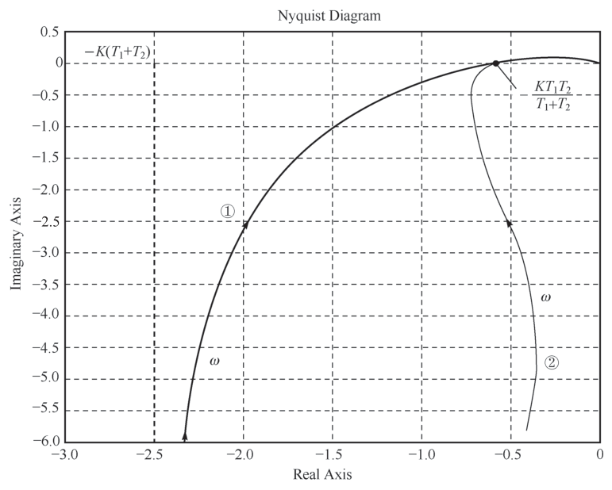{ .lq-img }

*图 5-19 例 5-2 系统概略开环幅相特性曲线：曲线①含低频渐近线，曲线②为按 \(\varphi(0^+)\) 取轴的概略曲线（截自原书；\(\nu=2,3,4\) 时整族曲线由 \(\nu=1\) 的曲线绕原点旋转而成，见原书图 5-20）*

**【例 5-3】含一阶微分环节的 I 型系统**

已知单位反馈系统开环传递函数

\[
G(s) = \frac{K(\tau s+1)}{s(T_1s+1)(T_2s+1)}, \qquad K,T_1,T_2,\tau>0
\]

**解** 系统开环频率特性为

\[
G(\mathrm{j}\omega) = \frac{-\mathrm{j}K\left[1-T_1T_2\omega^2 + T_2\tau\omega^2 + T_1\tau\omega^2 + \mathrm{j}\omega(\tau - T_1 - T_2 - T_1T_2\tau\omega^2)\right]}{\omega(1+T_1^2\omega^2)(1+T_2^2\omega^2)}
\]

起点：\(G(\mathrm{j}0^+)=\infty\angle(-90^\circ)\)；终点：\(G(\mathrm{j}\infty)=0\angle(-180^\circ)\)。

与实轴的交点：当 \(\tau<\dfrac{T_1T_2}{T_1+T_2}\) 时，得

\[
\omega_x = \frac{1}{\sqrt{T_1T_2 - T_1\tau - T_2\tau}}, \qquad
G(\mathrm{j}\omega_x) = -\frac{K(T_1T_2 - T_1\tau - T_2\tau)}{T_1+T_2}
\]

!!! warning "原书笔误"
    原书式印作 \(G(\mathrm{j}\omega_x)=-\dfrac{K(T_1+T_2)(T_1T_2-T_1\tau-T_2\tau+\tau^2)}{(T_1T_2-T_1\tau-T_2\tau+T_1^2)(T_1T_2-T_1\tau-T_2\tau+T_2^2)}\)。由于 \(T_1T_2-T_1\tau-T_2\tau+T_1^2=(T_1-\tau)(T_1+T_2)\)、\(T_1T_2-T_1\tau-T_2\tau+T_2^2=(T_2-\tau)(T_1+T_2)\)，该式化简后等于 \(-\dfrac{K}{T_1+T_2}\)——连 \(K\) 之外的全部参数都消掉了，显然有误（分子漏印了一个因子 \(T_1T_2-T_1\tau-T_2\tau\)）。正确结果为上式 \(G(\mathrm{j}\omega_x)=-\dfrac{K(T_1T_2-T_1\tau-T_2\tau)}{T_1+T_2}\)：代入 \(T_1=1,T_2=2,\tau=0.3,K=5\) 数值验证 \(G(\mathrm{j}\omega_x)=-1.833\)，与 \(-\dfrac{5\times1.1}{3}=-1.833\) 一致，而按原书式只能得 \(-1.667\)。

变化范围：\(\tau>\dfrac{T_1T_2}{T_1+T_2}\) 时，开环幅相特性曲线位于第Ⅲ象限或第Ⅳ与第Ⅲ象限；\(\tau<\dfrac{T_1T_2}{T_1+T_2}\) 时，位于第Ⅲ象限与第Ⅱ象限。据此可作出概略曲线。

**【例 5-4】含非最小相位一阶微分环节的系统**

已知系统开环传递函数

\[
G(s)H(s) = \frac{K(1-\tau s)}{s(Ts+1)}, \qquad K,\tau,T>0
\]

**解** 系统开环频率特性为

\[
G(\mathrm{j}\omega)H(\mathrm{j}\omega) = \frac{K\left[-(T+\tau)\omega - \mathrm{j}(1-T\tau\omega^2)\right]}{\omega(1+T^2\omega^2)}
\]

起点：\(A(0^+)=\infty\)，\(\varphi(0^+)=-90^\circ\)；终点：\(A(\infty)=0\)，\(\varphi(\infty)=-270^\circ\)。

与实轴的交点：令虚部为零，解得 \(\omega_x=\dfrac{1}{\sqrt{T\tau}}\)，\(G(\mathrm{j}\omega_x)H(\mathrm{j}\omega_x)=-K\tau\)。

因为 \(\varphi(\omega)\) 从 \(-90^\circ\) 单调减至 \(-270^\circ\)，幅相特性曲线在第Ⅲ与第Ⅱ象限间变化。

例 5-4 的系统含非最小相位一阶微分环节 \(1-\tau s\)。称开环传递函数**含有非最小相位环节**的系统为**非最小相位系统**，开环传递函数**全部由最小相位环节构成**的系统为**最小相位系统**。比较例 5-2、5-3、5-4：非最小相位环节的存在会明显改变频率特性，分析中必须重视。

### 开环对数频率特性曲线

开环传递函数作典型环节分解后，按式 (5.21)～(5.25) 先画各典型环节的对数频率特性曲线，再**叠加**即得开环曲线。开环对数幅频渐近特性在分析与设计中作用极大，这里重点讲它的绘制。

典型环节中，\(K\) 及 \(-K\)（\(K>0\)）、微分环节和积分环节的对数幅频特性本身就是直线，直接取为渐近特性。由式 (5.25) 得开环对数幅频渐近特性：

\[
L_a(\omega) = \sum_{i=1}^{N} L_{ai}(\omega)
\tag{5.51}
\]

把组成系统的典型环节分三类：1) \(\dfrac{K}{s^\nu}\) 或 \(Ks^\nu\) 型（\(K>0\)，比例 + 积分/微分组合）；2) 一阶环节（惯性、一阶微分及非最小相位对应环节，交接频率 \(\dfrac{1}{T}\)）；3) 二阶环节（振荡、二阶微分及非最小相位对应环节，交接频率 \(\omega_n\)）。记 \(\omega_{\min}\) 为最小交接频率，\(\omega<\omega_{\min}\) 的频段称**低频段**。绘制步骤：

1. **开环传递函数典型环节分解**；
2. **确定一阶、二阶环节的交接频率**，标在半对数坐标的 \(\omega\) 轴上；
3. **绘制低频段渐近线**：一阶、二阶环节在交接频率前斜率为 0，故 \(\omega<\omega_{\min}\) 频段的斜率由 \(\dfrac{K}{s^\nu}\) 决定，为 \(-20\nu\ \mathrm{dB/dec}\)。确定这条直线上一点可用三种方法——

   方法一：在 \(\omega<\omega_{\min}\) 内任取 \(\omega_0\)，计算

   \[
   L_a(\omega_0) = 20\lg K - 20\nu\lg\omega_0
   \tag{5.52}
   \]

   方法二：取 \(\omega_0=1\)，则

   \[
   L_a(1) = 20\lg K
   \tag{5.53}
   \]

   方法三：取 \(L_a(\omega_0)=0\)，则 \(\omega_0=K^{1/\nu}\)，即 \(\omega_0=\sqrt[\nu]{K}\)。
   过该点作斜率 \(-20\nu\ \mathrm{dB/dec}\) 的直线即低频渐近线（若 \(\omega_0>\omega_{\min}\)，该点位于低频渐近线的延长线上）；

4. **作 \(\omega\ge\omega_{\min}\) 频段**：每两个相邻交接频率之间为直线，每个交接频率处斜率发生变化，变化量取决于该处的环节类型，见表 5-2。

**表 5-2 交接频率点处斜率的变化表**

| 典型环节类别 | 典型环节传递函数 | 交接频率 | 斜率变化 |
| --- | --- | --- | --- |
| 一阶环节（\(T>0\)） | \(\dfrac{1}{Ts+1}\) | \(\dfrac{1}{T}\) | \(-20\ \mathrm{dB/dec}\) |
| | \(\dfrac{1}{1-Ts}\) | \(\dfrac{1}{T}\) | \(-20\ \mathrm{dB/dec}\) |
| | \(1+Ts\) | \(\dfrac{1}{T}\) | \(+20\ \mathrm{dB/dec}\) |
| | \(1-Ts\) | \(\dfrac{1}{T}\) | \(+20\ \mathrm{dB/dec}\) |
| 二阶环节（\(\omega_n>0,\ 1>\zeta\ge 0\)） | \(\dfrac{1}{(s/\omega_n)^2+2\zeta s/\omega_n+1}\) | \(\omega_n\) | \(-40\ \mathrm{dB/dec}\) |
| | \(\dfrac{1}{(s/\omega_n)^2-2\zeta s/\omega_n+1}\) | \(\omega_n\) | \(-40\ \mathrm{dB/dec}\) |
| | \((s/\omega_n)^2+2\zeta s/\omega_n+1\) | \(\omega_n\) | \(+40\ \mathrm{dB/dec}\) |
| | \((s/\omega_n)^2-2\zeta s/\omega_n+1\) | \(\omega_n\) | \(+40\ \mathrm{dB/dec}\) |

多个环节具有**相同交接频率**时，该点斜率变化取各环节斜率变化的**代数和**。以 \(k=-20\nu\ \mathrm{dB/dec}\) 的低频渐近线为起始直线，按交接频率由小到大依次按表 5-2 改变斜率，逐段画出即得开环对数幅频渐近特性。

**【例 5-5】开环对数幅频渐近特性曲线的绘制**

已知系统开环传递函数

\[
G(s)H(s) = \frac{2000s-4000}{s^2(s+1)(s^2+10s+400)}
\]

**解** 典型环节分解形式为

\[
G(s)H(s) = \frac{-10\left(1-\dfrac{s}{2}\right)}{s^2(s+1)\left[\left(\dfrac{s}{20}\right)^2 + \dfrac{1}{2}\dfrac{s}{20} + 1\right]}
\]

开环系统由六个典型环节串联：非最小相位比例环节（\(K=-10\)）、两个积分环节、非最小相位一阶微分环节（\(1-\frac{s}{2}\)）、惯性环节（\(s+1\)）和振荡环节（\(\omega_n=20\)，\(2\zeta=0.5\) 即 \(\zeta=0.25\)）。

1) 确定交接频率及斜率变化值：非最小相位一阶微分环节 \(\omega_2=2\)，斜率增加 \(20\ \mathrm{dB/dec}\)；惯性环节 \(\omega_1=1\)，斜率减小 \(20\ \mathrm{dB/dec}\)；振荡环节 \(\omega_3=20\)，斜率减小 \(40\ \mathrm{dB/dec}\)。最小交接频率 \(\omega_{\min}=\omega_1=1\)。

2) 绘制低频段（\(\omega<\omega_{\min}\)）：\(\nu=2\)，斜率 \(k=-40\ \mathrm{dB/dec}\)；按方法二取直线上一点 \((\omega_0,L_a(\omega_0))=(1,20\ \mathrm{dB})\)（因为 \(20\lg 10=20\)）。

3) 绘制 \(\omega\ge\omega_{\min}\) 频段：\(\omega_{\min}\le\omega<\omega_2\)，\(k=-60\ \mathrm{dB/dec}\)；\(\omega_2\le\omega<\omega_3\)，\(k=-40\ \mathrm{dB/dec}\)；\(\omega\ge\omega_3\)，\(k=-80\ \mathrm{dB/dec}\)。渐近特性曲线如图 5-23。

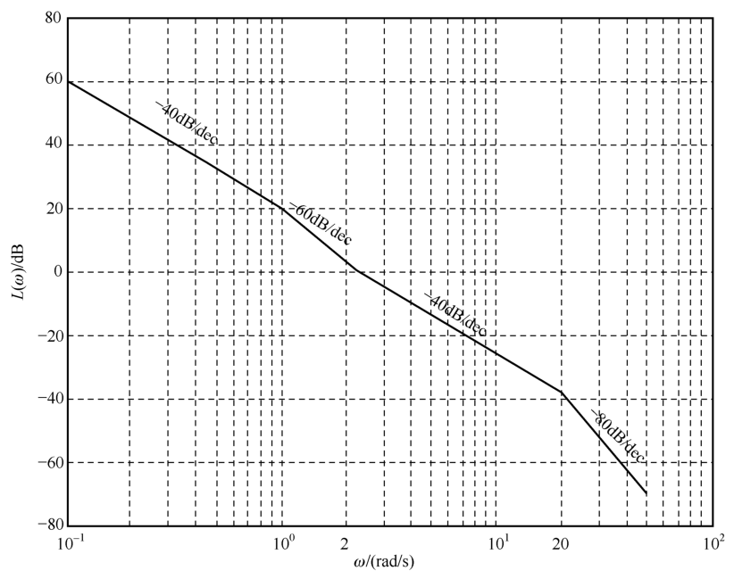{ .lq-img }

*图 5-23 例 5-5 系统开环对数幅频渐近特性曲线（MATLAB）：−40 → −60 → −40 → −80 dB/dec（截自原书）*

开环对数相频曲线一般按典型环节分解的相频表达式取若干频率点列表计算、光滑连接。**计算相角时必须注意判别象限**。例如例 5-5 中最容易出错的振荡环节因子：

\[
\varphi(\omega) = \angle\left[\frac{1}{1-\dfrac{\omega^2}{400}+\mathrm{j}\dfrac{\omega}{40}}\right] =
\begin{cases}
-\arctan\dfrac{\omega/40}{1-\omega^2/400}, & 0<\omega\le 20 \\[2ex]
-\left(180^\circ - \arctan\dfrac{\omega/40}{\omega^2/400-1}\right), & \omega>20
\end{cases}
\]

\(\omega>20\) 后实部 \(1-\omega^2/400<0\)，分母向量进入第Ⅱ象限，取角要按 \(180^\circ-\arctan(\cdot)\) 处理——这就是"判别象限"的含义。完整开环相角再叠加非最小相位比例环节的 \(180^\circ\)（\(K=-10\)）、积分环节的 \(-180^\circ\)、一阶微分环节的 \(-\arctan\frac{\omega}{2}\) 与惯性环节的 \(-\arctan\omega\)。

### 延迟环节和延迟系统

输出量经恒定延时 \(\tau\) 后不失真复现输入量变化的环节称为**延迟环节**，含延迟环节的系统称**延迟系统**（化工、电力系统多见）。延迟环节的时域表达式：

\[
c(t) = 1(t-\tau)\,r(t-\tau)
\tag{5.55}
\]

应用拉氏变换实数位移定理得传递函数

\[
G(s) = \frac{C(s)}{R(s)} = \mathrm{e}^{-\tau s}
\tag{5.56}
\]

频率特性

\[
G(\mathrm{j}\omega) = \mathrm{e}^{-\mathrm{j}\tau\omega} = 1\angle(-57.3\tau\omega^\circ)
\tag{5.57}
\]

幅值恒为 1、相角随 \(\omega\) 线性下降，所以延迟环节的幅相曲线是**单位圆**。延迟环节与线性环节串联时，对开环频率特性的影响是相频特性的明显变化（幅频不变）。如图 5-24，\(G(s)=\dfrac{10}{1+s}\) 与 \(\mathrm{e}^{-0.5s}\) 串联后，开环幅相曲线变成**螺旋线**：惯性环节的幅相曲线是以 \((5,\mathrm{j}0)\) 为圆心、半径 5 的半圆；任取频率点，惯性环节的频率特性点为 \(A\)，延迟系统的对应点 \(B\) 位于以 \(\vert OA\vert\) 为半径、圆心角 \(\theta=57.3\times0.5\omega\) 的圆弧上——延迟不改变模长，只把点沿等模长圆弧向后"拧"。

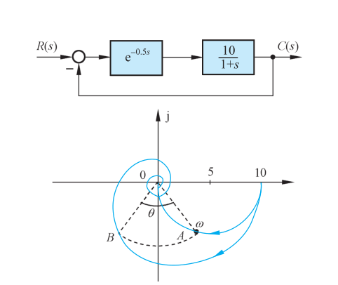{ .lq-img }

*图 5-24 延迟系统及其开环幅相特性曲线：串联 e^(−0.5s) 后半圆被拧成螺旋线（截自原书）*

### 传递函数的频域实验确定

稳定系统的频率响应是与输入同频率的正弦信号，幅值和相位随频率变化，因此可用**频率响应实验**确定稳定系统的数学模型。

**(1) 频率响应实验**：选择信号源正弦信号幅值使系统处于非饱和状态；在一定频率范围内改变输入频率，记录各频率点输出波形；由稳态段的输入输出幅值比和相位差绘制对数频率特性曲线。

**(2) 传递函数确定**：从低频段起，用斜率为 \(0,\pm20,\pm40,\cdots\ \mathrm{dB/dec}\) 的直线分段近似实验曲线，获得对数幅频渐近特性曲线；再由渐近特性反推最小相位条件下系统的传递函数——这是渐近特性绘制问题的**逆问题**。

**【例 5-6】由实验对数幅频曲线确定传递函数**

图 5-26 为某最小相位系统的开环对数幅频曲线及其渐近特性曲线，试确定系统传递函数。

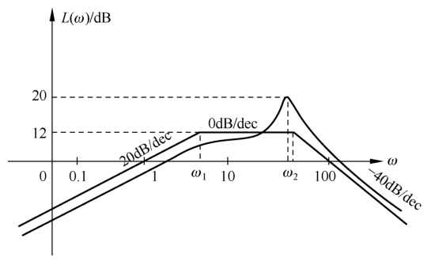{ .lq-img }

*图 5-26 由频率响应实验获得的系统开环对数幅频特性曲线（例 5-6）：低频 +20 dB/dec，两个交接频率，ω₂ 附近有谐振峰（截自原书）*

**解**

1) **确定积分或微分环节个数**：低频渐近线斜率为 \(+20\ \mathrm{dB/dec}\)，由 \(L_a(\omega)=20\lg K-20\nu\lg\omega\) 知斜率 \(=-20\nu\ \mathrm{dB/dec}\)，故 \(\nu=-1\)，系统含一个微分环节。

2) **确定传递函数结构形式**：渐近特性共两个交接频率——\(\omega=\omega_1\) 处斜率变化 \(-20\ \mathrm{dB/dec}\)，对应惯性环节；\(\omega=\omega_2\) 处斜率变化 \(-40\ \mathrm{dB/dec}\)，可对应振荡环节或重惯性环节，本例 \(\omega_2\) 附近存在**谐振现象**，应为振荡环节。故

\[
G(s) = \frac{Ks}{\left(\dfrac{1}{\omega_1}s+1\right)\left[\left(\dfrac{s}{\omega_2}\right)^2 + 2\zeta\dfrac{s}{\omega_2} + 1\right]}
\]

其中 \(\omega_1,\omega_2,\zeta,K\) 待定。

3) **确定参数**：低频渐近线方程 \(L_a(\omega)=20\lg K-20\nu\lg\omega=20\lg K+20\lg\omega\)，由给定点 \((\omega,L_a(\omega))=(1,0)\) 及 \(\nu=-1\) 得 \(K=1\)。

由直线方程式 (5.47) 及给定点 \((1,0)\)、\((\omega_1,12)\)、\(k=20\)：

\[
12-0 = 20(\lg\omega_1 - \lg 1) \quad\Longrightarrow\quad \omega_1 = 10^{0.6} = 3.98
\]

再由给定点 \((100,0)\)、\((\omega_2,12)\)、\(k=-40\)：

\[
0-12 = -40(\lg 100 - \lg\omega_2) \quad\Longrightarrow\quad \omega_2 = 10^{1.7} = 50.1
\]

在谐振频率 \(\omega_r\) 处振荡环节的谐振峰值为 \(20\lg M_r = 20\lg\dfrac{1}{2\zeta\sqrt{1-\zeta^2}}\)。按叠加性质，本例 \(20\lg M_r = 20-12 = 8\ \mathrm{dB}\)，故 \(M_r=2.512\)，于是

\[
\zeta^4 - \zeta^2 + 0.04 = 0 \quad\Longrightarrow\quad \zeta_1=0.204,\ \zeta_2=0.979
\]

只有 \(0<\zeta<0.707\) 才存在谐振峰值，故取 \(\zeta=0.204\)。所测系统的传递函数为

\[
G(s) = \frac{s}{\left(\dfrac{1}{3.98}s+1\right)\left[\left(\dfrac{s}{50.1}\right)^2 + \dfrac{0.408}{50.1}s + 1\right]}
\]

!!! note "拓展：由渐近特性反推传递函数的适用边界（补充）"
    由渐近特性反推传递函数只在**最小相位**条件下唯一成立：最小相位系统与其若干非最小相位"孪生系统"可以有完全相同的对数幅频曲线，但相频不同。若系统含非最小相位环节（右半平面零极点）或延迟环节，必须结合它们的相频影响并对照实测相频特性才能确定模型——幅频曲线单独定不了模型。

## 5.3 频域稳定判据

闭环稳定性是分析和设计的首要问题。奈奎斯特稳定判据（简称奈氏判据）和对数频率稳定判据是两种常用频域判据，特点是**根据开环系统频率特性曲线判定闭环系统稳定性**，使用方便、易于推广。

### 奈氏判据的数学基础

**(1) 幅角原理**。设 \(s\) 为复变量，\(F(s)\) 为 \(s\) 的有理分式函数。\(s\) 平面上任选一条闭合曲线 \(\Gamma\)，不通过 \(F(s)\) 的任一零点和极点；令 \(s\) 从 \(\Gamma\) 上任一点 \(A\) 起顺时针沿 \(\Gamma\) 运动一周回到 \(A\)，则 \(F(s)\) 平面上相应形成一条闭合曲线 \(\Gamma_F\)。为讨论方便，取

\[
F(s) = \frac{(s-z_1)(s-z_2)}{(s-p_1)(s-p_2)}
\tag{5.58}
\]

\(z_1,z_2\) 为零点，\(p_1,p_2\) 为极点。不失一般性，取 \(\Gamma\) 包围 \(F(s)\) 的零点 \(z_1\) 和极点 \(p_1\)（图 5-27）。\(s\) 沿 \(\Gamma\) 顺时针一周，\(F(s)\) 相角的变化

\[
\Delta\angle F(s) = \oint_\Gamma \mathrm{d}\angle F(s)
\tag{5.59}
\]

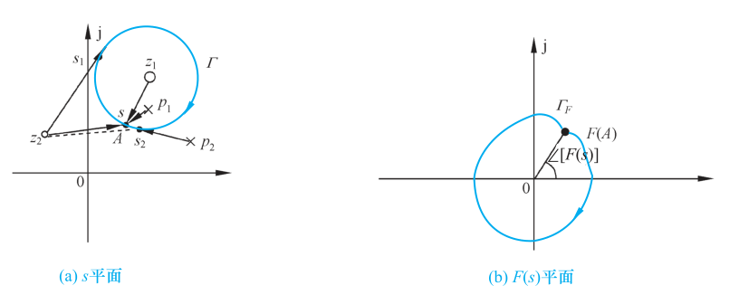{ .lq-img }

*图 5-27 s 平面与 F(s) 平面的映射关系：(a) s 平面闭合曲线 Γ 包围 z₁、p₁；(b) F(s) 平面的像 Γ_F 包围原点（截自原书）*

由对数相角的可加性：

\[
\angle F(s) = \angle(s-z_1) + \angle(s-z_2) - \angle(s-p_1) - \angle(s-p_2)
\tag{5.60}
\]

\[
\Delta\angle F(s) = \Delta\angle(s-z_1) + \Delta\angle(s-z_2) - \Delta\angle(s-p_1) - \Delta\angle(s-p_2)
\tag{5.61}
\]

\(z_1,p_1\) 被 \(\Gamma\) 包围：\(s\) 绕它们顺时针一周，\(\Delta\angle(s-z_1)=\Delta\angle(s-p_1)=-360^\circ\)（按复平面向量相角定义，逆时针为正、顺时针为负）。对未被包围的 \(z_2\)：过 \(z_2\) 作 \(\Gamma\) 的两条切线，设切点 \(s_1,s_2\)，在 \(\widehat{s_1s_2}\) 段 \(\angle(s-z_2)\) 减小、\(\widehat{s_2s_1}\) 段增大，一周积分

\[
\Delta\angle(s-z_2) = \int_{\widehat{s_1s_2}}\mathrm{d}\angle(s-z_2) + \int_{\widehat{s_2s_1}}\mathrm{d}\angle(s-z_2) = 0
\]

\(p_2\) 未被包围，同理 \(\Delta\angle(s-p_2)=0\)。这表明：**\(s\) 沿闭合曲线 \(\Gamma\) 运动一周时，\(F(s)\) 绕 \(F(s)\) 平面原点的圈数只和 \(F(s)\) 被 \(\Gamma\) 包围的零极点代数和有关**。本例 \(\Delta\angle F(s)=0\)，\(\Gamma_F\) 不包围原点。

**幅角原理**：设 \(s\) 平面闭合曲线 \(\Gamma\) 包围 \(F(s)\) 的 \(Z\) 个零点和 \(P\) 个极点，则 \(s\) 沿 \(\Gamma\) 顺时针运动一周时，\(F(s)\) 平面上闭合曲线 \(\Gamma_F\) 包围原点的圈数

\[
R = P - Z
\tag{5.62}
\]

\(R<0\) 和 \(R>0\) 分别表示 \(\Gamma_F\) 顺时针和逆时针包围原点，\(R=0\) 表示不包围。

**(2) 复变函数 \(F(s)\) 的选择**。稳定性判定要用已知的开环传递函数判定闭环稳定性。取

\[
F(s) = 1 + G(s)H(s) = \frac{B(s)}{A(s)} + 1 = \frac{B(s) + A(s)}{A(s)}
\tag{5.63}
\]

式中 \(G(s)H(s)=B(s)/A(s)\)。这样取的 \(F(s)\) 有三个特点：

1. \(F(s)\) 的**零点为闭环传递函数的极点**，\(F(s)\) 的**极点为开环传递函数的极点**——把开环极点、闭环极点和 \(F(s)\) 的零极点直接联系起来；
2. 开环传递函数分母阶次一般不小于分子阶次，故 \(F(s)\) 零点和极点数相同；
3. \(s\) 沿 \(\Gamma\) 一周产生的两条闭合曲线 \(\Gamma_F\) 与 \(\Gamma_{GH}\) 只差常数 1：\(\Gamma_F\) 可由 \(\Gamma_{GH}\) 沿实轴正方向平移一个单位长度获得。因此 **\(\Gamma_F\) 包围原点的圈数等于 \(\Gamma_{GH}\) 包围 \((-1,\mathrm{j}0)\) 点的圈数**（图 5-28）——把判定点从原点挪到了熟悉的 \((-1,\mathrm{j}0)\)。

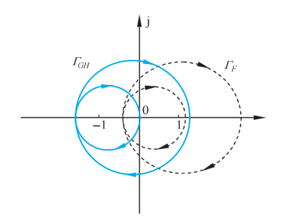{ .lq-img }

*图 5-28 Γ_F 与 Γ_GH 的关系：Γ_F 由 Γ_GH 沿实轴正方向平移 1 得到，包围原点的圈数等于 Γ_GH 包围 (−1, j0) 点的圈数（截自原书）*

**(3) \(s\) 平面闭合曲线 \(\Gamma\) 的选择**。闭环稳定性取决于 \(F(s)\) 的零点（闭环极点）位置，因此取 \(\Gamma\) 包围 \(s\) **右半平面**：若 \(Z=0\)，闭环稳定。考虑到 \(\Gamma\) 不得通过 \(F(s)\) 的零极点，\(\Gamma\) 取图 5-29 两种形式。

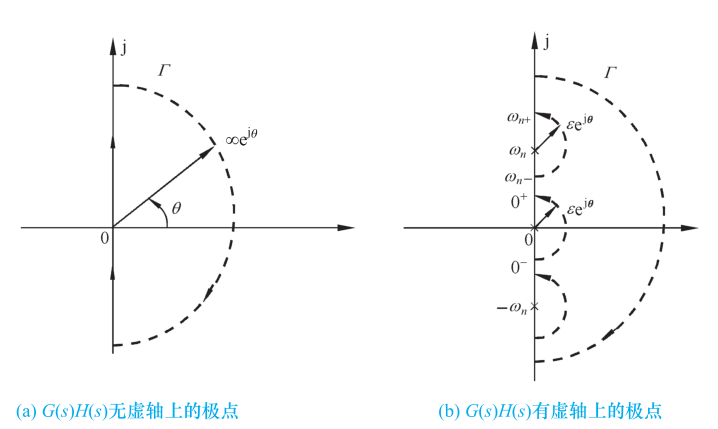{ .lq-img }

*图 5-29 s 平面的闭合曲线 Γ：(a) G(s)H(s) 无虚轴极点；(b) 有虚轴极点时在原点和 ±jωₙ 附近以无穷小半圆绕开（截自原书）*

\(G(s)H(s)\) 无虚轴极点时（图 5-29(a)），\(\Gamma\) 由四段组成：\(s=\infty\mathrm{e}^{\mathrm{j}\theta}\)（\(\theta\in[0^\circ,-90^\circ]\)，第Ⅳ象限无穷大 1/4 圆）、\(s=\mathrm{j}\omega\)（\(\omega\in(-\infty,0]\)，负虚轴）、\(s=\mathrm{j}\omega\)（\(\omega\in[0,+\infty)\)，正虚轴）、\(s=\infty\mathrm{e}^{\mathrm{j}\theta}\)（\(\theta\in[0^\circ,+90^\circ]\)，第Ⅰ象限无穷大 1/4 圆）。

\(G(s)H(s)\) 在虚轴上有极点时（图 5-29(b)），在图 (a) 基础上扩展以避开开环虚极点：开环系统含**积分环节**时，在原点附近取 \(s=\varepsilon\mathrm{e}^{\mathrm{j}\theta}\)（\(\varepsilon\) 为正无穷小量，\(\theta\in[-90^\circ,+90^\circ]\)），即圆心在原点、半径无穷小的半圆；含**等幅振荡环节**时，在 \(\pm\mathrm{j}\omega_n\) 附近取 \(s=\pm\mathrm{j}\omega_n+\varepsilon\mathrm{e}^{\mathrm{j}\theta}\)，即圆心在 \(\pm\mathrm{j}\omega_n\)、半径无穷小的半圆。按此 \(\Gamma\)，\(P\) 为 \(G(s)H(s)\) 在 \(s\) **右半平面**的极点数，**不包括虚轴上的极点**。

**(4) \(G(s)H(s)\) 闭合曲线的绘制**。\(\Gamma\) 关于实轴对称，\(G(s)H(s)\) 是实系数有理分式函数，故 \(\Gamma_{GH}\) 也关于实轴对称——只需绘制 \(\mathrm{Im}\,s\ge0\)、\(s\in\Gamma\) 对应的曲线段，得 \(G(s)H(s)\) 的**半闭合曲线**，称为**奈奎斯特曲线**，仍记为 \(\Gamma_{GH}\)。

1) \(G(s)H(s)\) 无虚轴极点：\(\Gamma_{GH}\) 在 \(s=\mathrm{j}\omega\)（\(\omega\in[0,+\infty)\)）段对应**开环幅相特性曲线**；\(s=\infty\mathrm{e}^{\mathrm{j}\theta}\)（\(\theta\in[0^\circ,+90^\circ]\)）段对应原点（\(n>m\) 时）或 \((K^*,\mathrm{j}0)\) 点（\(n=m\) 时），\(K^*\) 为开环根轨迹增益。

2) \(G(s)H(s)\) 含积分环节：设

\[
G(s)H(s) = \frac{G_1(s)}{s^\nu}, \qquad \nu>0,\ \vert G_1(\mathrm{j}0)\vert\ne\infty
\tag{5.64}
\]

有

\[
A(0^+) = \infty,\qquad \angle G(\mathrm{j}0^+)H(\mathrm{j}0^+) = \angle G_1(\mathrm{j}0) - \nu\times 90^\circ
\tag{5.65}
\]

在原点附近 \(\Gamma\) 为 \(s=\varepsilon\mathrm{e}^{\mathrm{j}\theta}\)（\(\theta\in[0^\circ,+90^\circ]\)），且 \(G_1(\varepsilon\mathrm{e}^{\mathrm{j}\theta})=G_1(\mathrm{j}0)\)，故

\[
\angle\left[G_1(\varepsilon\mathrm{e}^{\mathrm{j}\theta})\cdot(\varepsilon\mathrm{e}^{\mathrm{j}\theta})^{-\nu}\right]
= \angle G_1(\mathrm{j}0) - \nu\theta, \qquad 0\le\theta\le 90^\circ
\tag{5.66}
\]

对应的曲线为半径 \(\infty\)、圆心角 \(\nu\times90^\circ\) 的圆弧——即从 \(G(\mathrm{j}0^+)H(\mathrm{j}0^+)\) 点起，做半径无穷大、圆心角 \(\nu\times90^\circ\) 的圆弧（图 5-30 虚线）。所以**半闭合曲线 \(\Gamma_{GH}\) = 开环幅相曲线 + 按开环虚轴极点补作的无穷大半径虚线圆弧**。

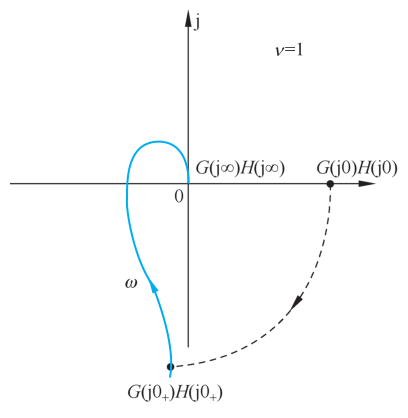{ .lq-img }

*图 5-30 F(s) 平面的半闭合曲线：ν=1 时从 G(j0⁺)H(j0⁺) 补作 ν×90° 的无穷大圆弧（虚线）（截自原书）*

**(5) 闭合曲线 \(\Gamma_F\) 包围原点圈数 \(R\) 的计算**。由半闭合曲线 \(\Gamma_{GH}\) 计算 \(R\)：设 \(N\) 为 \(\Gamma_{GH}\) 穿越 \((-1,\mathrm{j}0)\) 点左侧负实轴的次数，\(N_+\) 为**正穿越**次数和（从上向下穿越），\(N_-\) 为**负穿越**次数和（从下向上穿越），则

\[
R = 2(N_+ - N_-) = 2N
\tag{5.67}
\]

只数一半（\(\mathrm{Im}\,s\ge0\) 的半闭合曲线）再乘 2，是因为另一半的镜像部分贡献相同数量的穿越。

图 5-31 给出五种典型情形（虚线为按系统型次 \(\nu\) 补作的圆弧，\(A\)、\(B\) 为奈氏曲线与负实轴的交点）：

- 图(a)：\(A\) 在 \((-1,\mathrm{j}0)\) 左侧，\(\Gamma_{GH}\) 从下向上穿越，一次负穿越：\(N_-=1,N_+=0\)，\(R=-2\)；
- 图(b)：\(A\) 在 \((-1,\mathrm{j}0)\) 右侧：\(N_+=N_-=0\)，\(R=0\)；
- 图(c)：\(A,B\) 都在左侧，\(A\) 处从下向上（负穿越），\(B\) 处从上向下（正穿越）：\(N_+=N_-=1\)，\(R=0\)；
- 图(d)：\(A\) 处负穿越，\(B\) 处从上向下运动**止于**实轴（半次正穿越）：\(N_-=1,N_+=\frac12\)，\(R=-1\)；
- 图(e)：\(A\) 对应 \(\omega=0\)、随 \(\omega\) 增大 \(\Gamma_{GH}\) 离开负实轴（半次负穿越），\(B\) 处一次负穿越：\(N_-=\frac32,N_+=0\)，\(R=-3\)。

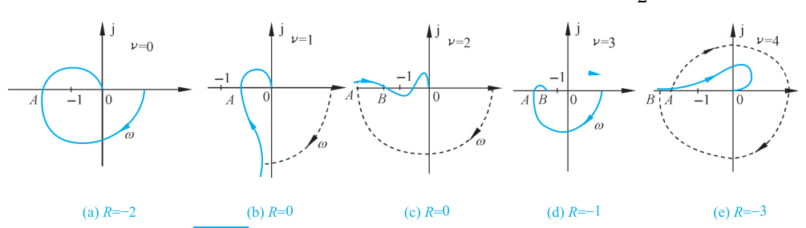{ .lq-img }

*图 5-31 系统开环半闭合曲线 Γ_GH 与 Γ_F 包围原点的圈数 R：(a) R=−2；(b) R=0；(c) R=0；(d) R=−1；(e) R=−3（截自原书）*

\(\Gamma_F\) 包围原点的圈数等于 \(\Gamma_{GH}\) 包围 \((-1,\mathrm{j}0)\) 点的圈数。计算 \(R\) 时要正确判断穿越方向、半次穿越和虚线圆弧产生的穿越次数。

### 奈奎斯特稳定判据

**奈氏判据**：反馈控制系统稳定的充分必要条件是半闭合曲线 \(\Gamma_{GH}\) 不穿过 \((-1,\mathrm{j}0)\) 点，且**逆时针包围临界点 \((-1,\mathrm{j}0)\) 的圈数 \(R\) 等于开环传递函数的正实部极点数 \(P\)**。

由幅角原理，\(\Gamma\) 包围的 \(F(s)=1+G(s)H(s)\) 零点数即闭环正实部极点数

\[
Z = P - R = P - 2N
\tag{5.68}
\]

\(P\ne R\) 时 \(Z\ne0\)，闭环不稳定。而 \(\Gamma_{GH}\) 穿过 \((-1,\mathrm{j}0)\) 点时，表明存在 \(s=\pm\mathrm{j}\omega_n\) 使

\[
G(\pm\mathrm{j}\omega_n)H(\pm\mathrm{j}\omega_n) = -1
\tag{5.69}
\]

即闭环特征方程有共轭纯虚根，系统可能临界稳定。计算穿越次数 \(N\) 时，**不计 \(\Gamma_{GH}\) 穿越 \((-1,\mathrm{j}0)\) 点本身的次数**。

**【例 5-7】确定闭环稳定时 \(K\) 值的范围**

已知单位反馈系统开环幅相特性曲线（\(K=10,P=0,\nu=1\)）如图 5-32：曲线与负实轴有三个交点，穿越频率 \(\omega_1,\omega_2,\omega_3\)。系统开环传递函数形如

\[
G(s) = \frac{K}{s}G_1(s), \qquad \lim_{s\to0}G_1(s)=1
\]

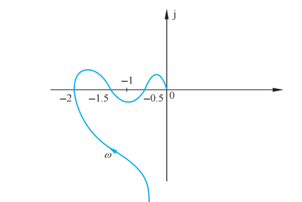{ .lq-img }

*图 5-32 例 5-7 系统开环幅相特性曲线（K=10，P=0，ν=1）：与负实轴交于 −2、−1.5、−0.5 三点（截自原书）*

于是 \(G(\mathrm{j}\omega_i)=\dfrac{K}{\mathrm{j}\omega_i}G_1(\mathrm{j}\omega_i)\)。\(K=10\) 时

\[
G(\mathrm{j}\omega_1)=-2,\qquad G(\mathrm{j}\omega_2)=-1.5,\qquad G(\mathrm{j}\omega_3)=-0.5
\]

若令 \(G(\mathrm{j}\omega_i)=-1\)，对应的 \(K\) 值为

\[
K_1 = \frac{10}{2}=5,\qquad K_2 = \frac{10}{1.5}=\frac{20}{3},\qquad K_3 = \frac{10}{0.5}=20
\]

分别取 \(0<K<K_1\)、\(K_1<K<K_2\)、\(K_2<K<K_3\)、\(K>K_3\) 时，开环幅相特性曲线如图 5-33(a)～(d)，按 \(\nu=1\) 补作虚圆弧得半闭合曲线 \(\Gamma_G\)。逐段数穿越：

- \(0<K<K_1\)：\(R=0\)，\(Z=0\)，闭环**稳定**；
- \(K_1<K<K_2\)：\(R=-2\)，\(Z=2\)，闭环**不稳定**；
- \(K_2<K<K_3\)：\(N_+=N_-=1\)，\(R=0\)，\(Z=0\)，闭环**稳定**；
- \(K>K_3\)：\(N_+=1,N_-=2\)，\(R=-2\)，\(Z=2\)，闭环**不稳定**。

综上，闭环稳定时 \(K\in(0,5)\cup\left(\frac{20}{3},20\right)\)。\(K=5,\frac{20}{3},20\) 时 \(\Gamma_G\) 穿过临界点 \((-1,\mathrm{j}0)\)，在这三个值的邻域内闭环可稳定或不稳定——系统闭环**临界稳定**。\(K=10\) 时的开环幅相曲线见图 5-32（与负实轴有三个交点）。

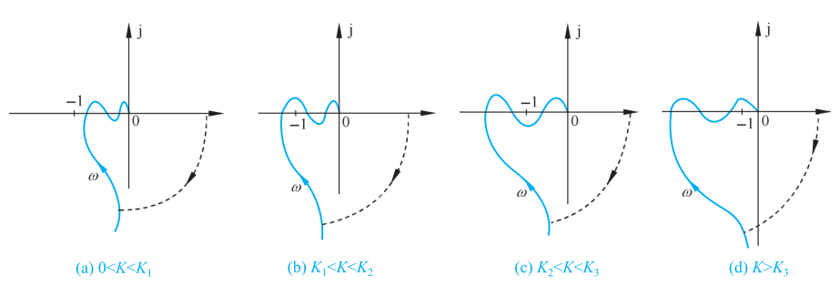{ .lq-img }

*图 5-33 例 5-7 系统在不同 K 值条件下的开环幅相特性曲线及 Γ_G 曲线：(a) 0<K<K₁；(b) K₁<K<K₂；(c) K₂<K<K₃；(d) K>K₃（截自原书）*

**【例 5-8】延迟系统的稳定延迟时间**

已知延迟系统开环传递函数

\[
G(s)H(s) = \frac{2\mathrm{e}^{-\tau s}}{s+1}, \qquad \tau>0
\]

试按奈氏判据确定闭环稳定时 \(\tau\) 的范围。

**解** 由图 5-24 可知延迟系统的 \(\Gamma_{GH}\) 是**顺时针螺旋线**。若幅相曲线与 \((-1,\mathrm{j}0)\) 左侧负实轴有 \(l\) 个交点，则 \(\Gamma_{GH}\) 包围 \((-1,\mathrm{j}0)\) 的圈数为 \(-2l\)；\(P=0\)，故 \(Z=2l\)，闭环不稳定。闭环稳定必须 \(l=0\)。

设 \(\omega_x\) 为曲线穿越负实轴的频率，由相角条件

\[
\varphi(\omega_x) = -\arctan\omega_x - \tau\omega_x = -(2k+1)\times 180^\circ, \qquad k=0,1,2,\cdots
\]

即 \(\arctan\omega_x + \tau\omega_x = (2k+1)\pi\)。而幅值 \(A(\omega_x)=\dfrac{2}{\sqrt{1+\omega_x^2}}\) 随 \(\omega_x\) 增大而减小。第一次穿越负实轴的频率 \(\omega_{xm}\) 满足 \(\arctan\omega_{xm}+\tau\omega_{xm}=\pi\)，此时 \(A(\omega_{xm})\) 最大。要 \(l=0\)，必须 \(A(\omega_{xm})<1\)，即 \(\omega_{xm}>\sqrt3\)。

由 \(\arctan\omega_x+\tau\omega_x=(2k+1)\pi\) 解出 \(\tau=\dfrac{(2k+1)\pi-\arctan\omega_x}{\omega_x}\)，它是 \(\omega_x\) 的减函数（求导后分子分母均为负），故 \(\omega_{xm}\) 也是 \(\tau\) 的减函数。当 \(\tau=\dfrac{\pi-\arctan\sqrt3}{\sqrt3}\) 时 \(\omega_{xm}=\sqrt3\)，临界稳定；\(\tau\) 再大则 \(\omega_{xm}<\sqrt3\)，不稳定。所以闭环稳定时

\[
\tau < \frac{\pi-\arctan\sqrt3}{\sqrt3} = \frac{2\pi}{3\sqrt3} \approx 1.21
\]

（数值验证：\(\tau\) 取该临界值时，\(\omega=\sqrt3\) 处 \(A=2/\sqrt{1+3}=1\)、相角恰为 \(-180^\circ\)，曲线正好穿过 \((-1,\mathrm{j}0)\)。）

### 对数频率稳定判据

奈氏判据基于复平面的半闭合曲线 \(\Gamma_{GH}\)；而 \(\Gamma_{GH}\) 可以转换到半对数坐标下，于是奈氏判据可以推广为对数频率稳定判据。关键是在半对数坐标下确定穿越次数 \(N_+\) 和 \(N_-\)。

**(1) 穿越点确定**。设 \(\omega=\omega_c\) 时

\[
A(\omega_c) = \vert G(\mathrm{j}\omega_c)H(\mathrm{j}\omega_c)\vert = 1, \qquad L(\omega_c) = 0
\tag{5.70}
\]

称 \(\omega_c\) 为**截止频率**。对复平面负实轴和开环对数相频特性，取频率为穿越频率 \(\omega_x\) 时

\[
\varphi(\omega_x) = (2k+1)\times 180^\circ, \qquad k=0,\pm1,\cdots
\tag{5.71}
\]

设半对数坐标下 \(\Gamma_{GH}\) 的对数幅频和对数相频曲线分别为 \(\Gamma_L\) 和 \(\Gamma_\varphi\)。\(\Gamma_{GH}\) 在 \(A(\omega)>1\) 时穿越负实轴的点，等价于 \(L(\omega)>0\) 时 \(\Gamma_\varphi\) 与 \((2k+1)\times180^\circ\) 平行线的交点。

**(2) \(\Gamma_\varphi\) 确定**。开环系统无虚轴极点时，\(\Gamma_\varphi\) 就是 \(\varphi(\omega)\) 曲线。开环系统存在积分环节 \(1/s^\nu\)（\(\nu>0\)）时：复平面上 \(\Gamma_{GH}\) 需从 \(\omega=0^+\) 的 \(G(\mathrm{j}0^+)H(\mathrm{j}0^+)\) 起逆时针补作 \(\nu\times90^\circ\) 半径无穷大的虚圆弧；对应地，在半对数坐标下需从 \(\varphi(\omega)\) 曲线 \(\omega\) 较小且 \(L(\omega)>0\) 的点处**向上补作 \(\nu\times90^\circ\) 的虚直线**，\(\varphi(\omega)\) 曲线和补作的虚直线构成 \(\Gamma_\varphi\)。

**(3) 穿越次数计算**。注意一个容易搞反的对应关系——**复平面上"由上向下"对应相频图上"由下向上"**（复平面上 \((-1,\mathrm{j}0)\) 左侧负实轴上方的点，相角在 \((-270^\circ,-180^\circ)\)，位于 \(-180^\circ\) 线下方）：

- **正穿越一次**：\(\Gamma_{GH}\) 由上向下穿越 \((-1,\mathrm{j}0)\) 左侧负实轴一次，等价于在 \(L(\omega)>0\) 时，\(\Gamma_\varphi\) **由下向上**穿越 \((2k+1)\times180^\circ\) 线一次；
- **负穿越一次**：\(\Gamma_{GH}\) 由下向上穿越负实轴一次，等价于 \(L(\omega)>0\) 时 \(\Gamma_\varphi\) **由上向下**穿越 \((2k+1)\times180^\circ\) 线一次；
- **正穿越半次**：\(\Gamma_{GH}\) 由上向下**止于**或**起于** \((-1,\mathrm{j}0)\) 左侧负实轴，等价于 \(L(\omega)>0\) 时 \(\Gamma_\varphi\) 由下向上止于或起于 \((2k+1)\times180^\circ\) 线；
- **负穿越半次**：\(\Gamma_{GH}\) 由下向上止于或起于负实轴，等价于 \(L(\omega)>0\) 时 \(\Gamma_\varphi\) 由上向下止于或起于 \((2k+1)\times180^\circ\) 线。

**补作的虚直线所产生的穿越皆为负穿越**。

**对数频率稳定判据**：设 \(P\) 为开环系统正实部极点数，反馈控制系统稳定的充分必要条件是 \(\varphi(\omega_c)\ne(2k+1)\times180^\circ\)（\(k=0,1,2,\cdots\)），且在 \(L(\omega)>0\) 频段内 \(\Gamma_\varphi\) 穿越 \((2k+1)\times180^\circ\) 线的次数 \(N=N_+-N_-\) 满足

\[
Z = P - 2N = 0
\tag{5.72}
\]

对数判据和奈氏判据本质相同，区别只在：前者在 \(L(\omega)>0\) 的频率范围内依 \(\Gamma_\varphi\) 曲线确定穿越次数 \(N\)。

**【例 5-9】把幅相曲线翻译成对数曲线数穿越**

已知某系统开环稳定，开环幅相特性曲线如图 5-34 所示，试用对数稳定判据判断闭环稳定性。

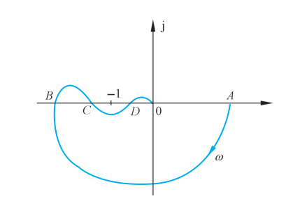{ .lq-img }

*图 5-34 例 5-9 某系统开环幅相特性曲线：ν=0、起点 A 在正实轴上，其对应的对数频率特性曲线见图 5-35（截自原书）*

**解** 系统开环对数频率特性曲线如图 5-35（相角表示不唯一，(a)(b) 是其中两种形式）。开环系统稳定，\(P=0\)；由幅相曲线知 \(\nu=0\)，不需补作虚直线。

图(a)：\(L(\omega)>0\) 频段内 \(\varphi(\omega)\) 曲线与 \(-180^\circ\) 线有两个交点，依频率由小到大分别为**一次负穿越**和**一次正穿越**，故 \(N=N_+-N_-=0\)。

图(b)：\(L(\omega)>0\) 频段内 \(\varphi(\omega)\) 曲线与 \(180^\circ\) 线和 \(-180^\circ\) 线有四个交点，依频率由小到大分别为**半次负穿越、半次负穿越、半次正穿越、半次正穿越**，故 \(N=0\)。

按对数稳定判据，图(a)(b) 都有 \(Z=P-2N=0\)，且 \(\varphi(\omega_c)\ne(2k+1)\times180^\circ\)，故系统**闭环稳定**。

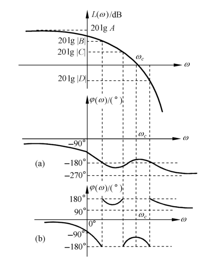{ .lq-img }

*图 5-35 例 5-9 某系统开环对数频率特性曲线：同一条幅相曲线的两种相角表示，穿越结论一致（截自原书）*

**【例 5-10】确定闭环不稳定极点的个数**

已知开环系统型次 \(\nu=3\)，\(P=0\)，开环对数相频特性曲线如图 5-36，图中当 \(\omega<\omega_c\) 时 \(L(\omega)>L(\omega_c)\)。试确定闭环不稳定极点的个数。

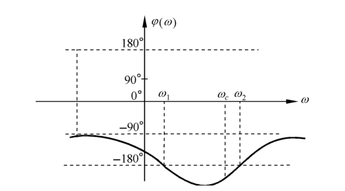{ .lq-img }

*图 5-36 例 5-10 系统开环对数相频特性曲线：低频端 φ(0⁺)=−90°，需向上补作 270° 虚直线至 180°（截自原书）*

**解** \(\nu=3\)，需在低频处由 \(\varphi(\omega)\) 曲线向上补作 \(270^\circ\) 的虚直线于 \(180^\circ\)（图 5-36 左端虚线）。补作虚直线由上向下起于 \(180^\circ\) 线——半次负穿越；在 \(L(\omega)>L(\omega_c)=0\ \mathrm{dB}\) 频段内，\(\varphi(\omega)\) 曲线与 \((2k+1)\times180^\circ\) 线还有一个交点 \(\omega_1\)，为一次负穿越。故 \(N_-=1.5\)，\(N_+=0\)，按对数稳定判据

\[
Z = P - 2N = 0 - 2\times(0-1.5) = 3
\]

闭环不稳定极点的个数为 **3**。

!!! note "拓展：为什么这里的 φ(0⁺) 是 −90° 而不是 −270°（补充）"
    \(\nu=3\) 而图中相频曲线低频端却停在 \(-90^\circ\)，说明开环增益为负：非最小相位比例环节贡献 \(180^\circ\)，\(\varphi(0^+)=-3\times90^\circ+180^\circ=-90^\circ\)。补作的虚直线从 \(-90^\circ\) 向上延伸 \(270^\circ\) 恰好到 \(180^\circ\)，与图中虚线一致；它在 \(\Gamma_\varphi\) 遍历中**由上向下起于** \(180^\circ\) 线，按规则计半次负穿越。

### 条件稳定系统

例 5-7 的分析表明：若开环传递函数在开右半 \(s\) 平面的极点数 \(P=0\)，当开环传递函数的某些系数（如开环增益）改变时，闭环稳定性会随之变化。这种**闭环稳定有条件**的系统称为**条件稳定系统**。

相应地，无论开环传递函数的系数怎样变化（例如 \(G(s)H(s)=\dfrac{K}{s^2(Ts+1)}\)），系统总是闭环不稳定的——这样的系统称为**结构不稳定系统**（两个积分环节提供 \(-180^\circ\) 相角，惯性环节再滞后，增益无论多大曲线都包围 \((-1,\mathrm{j}0)\) 点）。

为了表征系统的稳定程度，需要引入**稳定裕度**的概念。


## 5.4 频域稳定裕度

由奈氏判据，\(P=0\) 时闭环稳定性取决于 \(\Gamma_{GH}\) 包围 \((-1,\mathrm{j}0)\) 点的圈数。开环传递函数的某些系数变化时，\(\Gamma_{GH}\) 包围 \((-1,\mathrm{j}0)\) 的情况随之改变；\(\Gamma_{GH}\) 穿过 \((-1,\mathrm{j}0)\) 时闭环临界稳定（例 5-7）。因此称 \((-1,\mathrm{j}0)\) 为**临界点**，\(\Gamma_{GH}\) 相对临界点的偏离程度反映系统的**相对稳定性**；相对稳定性还影响系统时域响应的性能。频域相对稳定性即**稳定裕度**，用相角裕度 \(\gamma\) 和幅值裕度 \(h\) 度量。

### 相角裕度 γ

设 \(\omega_c\) 为系统的截止频率，显然

\[
A(\omega_c) = \vert G(\mathrm{j}\omega_c)H(\mathrm{j}\omega_c)\vert = 1
\tag{5.73}
\]

定义**相角裕度**

\[
\gamma = 180^\circ + \angle\left[G(\mathrm{j}\omega_c)H(\mathrm{j}\omega_c)\right]
\tag{5.74}
\]

\(\gamma\) 的含义：对于闭环稳定系统，如果开环相频特性再滞后 \(\gamma\) 度，系统将处于临界稳定状态。

### 幅值裕度 h

设 \(\omega_x\) 为系统的穿越频率，开环系统在 \(\omega_x\) 处的相角

\[
\varphi(\omega_x) = \angle\left[G(\mathrm{j}\omega_x)H(\mathrm{j}\omega_x)\right] = (2k+1)\times 180^\circ, \qquad k=0,\pm1,\cdots
\tag{5.75}
\]

定义**幅值裕度**

\[
h = \frac{1}{\vert G(\mathrm{j}\omega_x)H(\mathrm{j}\omega_x)\vert}
\tag{5.76}
\]

\(h\) 的含义：对于闭环稳定系统，如果开环幅频特性再增大 \(h\) 倍，系统将处于临界稳定状态。复平面中 \(\gamma\) 和 \(h\) 的表示如图 5-37(b)，图中同时给出不稳定系统的情形。对数坐标下幅值裕度定义为

\[
h(\mathrm{dB}) = 20\lg h = -20\lg\vert G(\mathrm{j}\omega_x)H(\mathrm{j}\omega_x)\vert
\tag{5.77}
\]

半对数坐标图中的 \(\gamma\) 与 \(h\) 见图 5-37(a)：稳定系统 \(L(\omega_c)=0\) 后曲线还要继续下降，\(h(\mathrm{dB})\) 为穿越频率处 \(L(\omega_x)\) 的"剩余负分贝"。

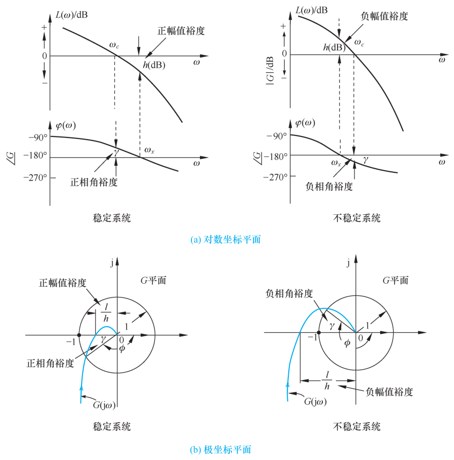{ .lq-img }

*图 5-37 稳定与不稳定系统的相角裕度和幅值裕度：(a) 对数坐标平面；(b) 极坐标平面（截自原书）*

**【例 5-11】K=4 和 K=10 时系统的稳定裕度**

已知单位反馈系统

\[
G(s) = \frac{K}{(s+1)^3}
\]

\(K\) 分别为 4 和 10，试确定系统的稳定裕度。

**解** 系统开环频率特性

\[
G(\mathrm{j}\omega) = \frac{K\left[(1-3\omega^2) - \mathrm{j}(3\omega-\omega^3)\right]}{(1+\omega^2)^3},\qquad
\angle G(\mathrm{j}\omega) = -3\arctan\omega
\]

按 \(\omega_x,\omega_c\) 定义可得 \(\omega_x=\sqrt3\)（令 \(-3\arctan\omega_x=-180^\circ\)）。

\(K=4\) 时：

\[
\vert G(\mathrm{j}\omega_x)\vert = \frac{4}{8} = 0.5,\qquad h=2,\qquad
\omega_c=1.233,\qquad \angle G(\mathrm{j}\omega_c)=-152.9^\circ,\qquad \gamma=27.1^\circ
\]

\(K=10\) 时：

\[
\vert G(\mathrm{j}\omega_x)\vert = \frac{10}{8} = 1.25,\qquad h=0.8,\qquad
\omega_c=1.908,\qquad \angle G(\mathrm{j}\omega_c)=-187.0^\circ,\qquad \gamma=-7.0^\circ
\]

分别作出 \(K=4\) 和 \(K=10\) 的开环幅相特性曲线（图 5-38）。由奈氏判据：\(K=4\) 时闭环稳定，\(h>1\)、\(\gamma>0\)；\(K=10\) 时闭环不稳定，\(h<1\)、\(\gamma<0\)。

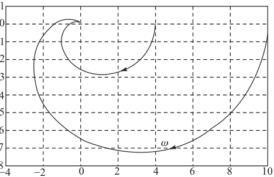{ .lq-img }

*图 5-38 例 5-11 K=4 和 K=10 时系统开环幅相特性曲线（MATLAB）：K=10 的曲线包围 (−1, j0) 点（截自原书）*

=== "MATLAB"

    ```matlab
    % ===== 书 5-4 节 例5-11 =====
    K = 4;  G = tf(K, conv([1 1], conv([1 1], [1 1])));   % G(s) = K/(s+1)^3
    nyquist(G), grid on                                   % 书图5-38
    [Gm, Pm, Wcg, Wcp] = margin(G)
    % Gm = 2（6.02 dB）, Pm = 27.1°, Wcg = wx = 1.732, Wcp = wc = 1.233
    K = 10; G = tf(K, conv([1 1], conv([1 1], [1 1])));
    [Gm, Pm, Wcg, Wcp] = margin(G)
    % Gm = 0.8（-1.94 dB）, Pm = -7.0°, Wcg = 1.732, Wcp = 1.908
    ```

=== "Python"

    ```python
    # ===== 书 5-4 节 例5-11 =====
    import numpy as np
    import control as ct

    for K in (4, 10):
        G = ct.tf([K], [1, 3, 3, 1])            # G(s) = K/(s+1)^3
        gm, pm, wcg, wcp = ct.margin(G)         # (h, γ, ωx, ωc)
        print(f'K={K}: |G(jwx)|={K/8:g}, h={gm:g} ({20*np.log10(gm):+.2f} dB), '
              f'wx={wcg:.3f}, wc={wcp:.3f}, gamma={pm:+.2f} deg')
        # K=4 : |G(jwx)|=0.5,  h=2  (+6.02 dB), wx=1.732, wc=1.233, gamma=+27.14 deg
        # K=10: |G(jwx)|=1.25, h=0.8 (-1.94 dB), wx=1.732, wc=1.908, gamma=-7.03 deg
        # 与书一致：K=4 稳定（h>1, γ>0）；K=10 不稳定（h<1, γ<0）
    ```

上述由 \(\gamma>0\) 且 \(h>1\)（或 \(h(\mathrm{dB})>0\)）判断闭环稳定性的方法，可推广至半闭合曲线 \(\Gamma_{GH}\) 分别与单位圆或负实轴**至多只有一个交点**（或 \(L(\omega)>0\) 时 \(\Gamma_\varphi\) 与 \((2k+1)\times180^\circ\) 线至多只有一个交点），且开环传递函数无 \(s\) 右半平面极点的情况。应注意的是：**非最小相位系统该结论不可靠**；而且**仅用相角裕度或仅用幅值裕度，都不足以反映系统的稳定程度**——两者要配合使用。

**【例 5-12】典型二阶系统的相角裕度**

典型二阶系统为单位反馈结构，前向通道传递函数为 \(\dfrac{\omega_n^2}{s(s+2\zeta\omega_n)}\)，试确定系统的相角裕度。

**解** 典型二阶系统的开环频率特性

\[
G(\mathrm{j}\omega) = \frac{\omega_n^2}{\mathrm{j}\omega(\mathrm{j}\omega+2\zeta\omega_n)}
= \frac{\omega_n^2}{\omega\sqrt{\omega^2+4\zeta^2\omega_n^2}}\,\angle\left(-90^\circ - \arctan\frac{\omega}{2\zeta\omega_n}\right)
\]

设 \(\omega_c\) 为截止频率，由 \(\vert G(\mathrm{j}\omega_c)\vert=1\)：

\[
\omega_n^4 = \omega_c^2\left(\omega_c^2 + 4\zeta^2\omega_n^2\right)
\quad\Longrightarrow\quad
\omega_c = \omega_n\left(\sqrt{4\zeta^4+1} - 2\zeta^2\right)^{1/2}
\tag{5.78}
\]

按相角裕度定义

\[
\gamma = 180^\circ + \angle G(\mathrm{j}\omega_c)
= 90^\circ - \arctan\frac{\omega_c}{2\zeta\omega_n}
= \arctan\left[2\zeta\left(\frac{1}{\sqrt{4\zeta^4+1}-2\zeta^2}\right)^{1/2}\right]
\tag{5.79}
\]

因为

\[
\frac{\mathrm{d}}{\mathrm{d}\zeta}\left(\sqrt{4\zeta^4+1}-2\zeta^2\right)
= \frac{4\zeta^3}{\sqrt{4\zeta^4+1}}\left(2\zeta^2 - \sqrt{4\zeta^4+1}\right) < 0
\]

故 \(\omega_c\) 为 \(\omega_n\) 的增函数和 \(\zeta\) 的减函数，而 \(\gamma\) 只与阻尼比 \(\zeta\) 有关，且为 \(\zeta\) 的增函数——\(\gamma\) 与 \(\zeta\) 一一对应（图 5-41 即由式 (5.93) 绘制的 \(\gamma\)-\(\zeta\) 曲线）。

## 5.5 闭环系统的频域性能指标

反馈控制系统的闭环传递函数

\[
\varPhi(s) = \frac{G(s)}{1+G(s)H(s)} = \frac{G(s)H(s)}{1+G(s)H(s)}\cdot\frac{1}{H(s)}
\tag{5.80}
\]

\(H(s)\) 为主反馈通道传递函数，一般为常数，不影响闭环频率特性的形状。因此研究闭环频域指标只需针对**单位反馈**系统进行。控制系统常伴随输入端和输出端的确定性扰动与随机噪声，闭环频域指标应反映**跟踪控制输入**和**抑制扰动信号**两方面的能力。

### 控制系统的频带宽度

设 \(\varPhi(\mathrm{j}\omega)\) 为闭环频率特性。当闭环幅频特性下降到频率为零时分贝值以下 3 dB（即 \(0.707\vert\varPhi(\mathrm{j}0)\vert\)）时，对应的频率称为**带宽频率** \(\omega_b\)，即

\[
20\lg\vert\varPhi(\mathrm{j}\omega_b)\vert = 20\lg\vert\varPhi(\mathrm{j}0)\vert - 3\ (\mathrm{dB})
\tag{5.81}
\]

频率范围 \((0,\omega_b)\) 称为系统的**带宽**。带宽表明：对高于带宽频率的正弦输入信号，系统输出呈现较大衰减。对 I 型及 I 型以上开环系统，\(\vert\varPhi(\mathrm{j}0)\vert=1\)、\(20\lg\vert\varPhi(\mathrm{j}0)\vert=0\)，故

\[
20\lg\vert\varPhi(\mathrm{j}\omega_b)\vert = -3\ \mathrm{dB}
\tag{5.82}
\]

带宽是频域中非常重要的指标。一阶、二阶系统的带宽与参数有解析关系。

设一阶系统闭环传递函数 \(\varPhi(s)=\dfrac{1}{Ts+1}\)。开环为 I 型，\(\vert\varPhi(\mathrm{j}0)\vert=1\)，按带宽定义

\[
20\lg\vert\varPhi(\mathrm{j}\omega_b)\vert = 20\lg\frac{1}{\sqrt{1+T^2\omega_b^2}} = -3\ \mathrm{dB}
\]

可求得带宽频率

\[
\omega_b = \frac{1}{T}
\tag{5.83}
\]

对二阶系统，闭环传递函数 \(\varPhi(s)=\dfrac{\omega_n^2}{s^2+2\zeta\omega_n s+\omega_n^2}\)，幅频特性

\[
\vert\varPhi(\mathrm{j}\omega)\vert = \frac{1}{\sqrt{\left(1-\omega^2/\omega_n^2\right)^2 + 4\zeta^2\omega^2/\omega_n^2}}
\]

由带宽定义解得

\[
\omega_b = \omega_n\left[\left(1-2\zeta^2\right) + \sqrt{4\zeta^4 - 4\zeta^2 + 2}\right]^{1/2}
\tag{5.84}
\]

由式 (5.83)，一阶系统带宽与时间常数 \(T\) 成反比；由式 (5.84)，二阶系统带宽与自然频率 \(\omega_n\) 成正比。记 \(A\left(\dfrac{\omega_b}{\omega_n}\right)=\dfrac{\omega_b}{\omega_n}\)，由于 \(\dfrac{\mathrm{d}A}{\mathrm{d}\zeta}<0\)，\(\omega_b\) 为 \(\zeta\) 的减函数。结合第三章"上升时间、调节时间与 \(\zeta,\omega_n\) 的关系"可知：**系统单位阶跃响应的速度和带宽成正比**——对任意阶次的控制系统这一关系仍成立。

设两个控制系统存在关系

\[
\varPhi_1(s) = \varPhi_2\left(\frac{s}{\lambda}\right), \qquad \lambda\ \text{为任意正常数}
\tag{5.85}
\]

则闭环频率特性 \(\varPhi_1(\mathrm{j}\omega)=\varPhi_2(\mathrm{j}\omega/\lambda)\)：两条对数幅频曲线形状相同、横坐标相差 \(\lambda\) 倍，按带宽定义

\[
\omega_{b1} = \lambda\,\omega_{b2}
\]

即系统 1 的带宽是系统 2 的 \(\lambda\) 倍。设两系统单位阶跃响应为 \(c_1(t),c_2(t)\)，由拉氏变换的尺度关系可得

\[
c_1(t) = c_2(\lambda t)
\tag{5.86}
\]

即系统 1 的上升时间和调节时间为系统 2 的 \(1/\lambda\)。**带宽扩大 \(\lambda\) 倍，响应速度加快 \(\lambda\) 倍**。但系统复现输入信号的能力取决于幅频和相频两方面：带宽大，跟踪控制信号能力强，抑制输入端**高频**扰动的能力弱——带宽选择要折中，不能一味求大。

### 系统带宽选择

受环境变化、元器件老化、电源波动和传感器、执行器非线性因素影响，系统输入输出端不可避免存在确定性扰动和随机噪声。带宽选择应综合考虑各种输入信号的频率范围及其对性能的影响：**使系统对控制输入信号有良好的跟踪能力，对扰动输入信号有较强的抑制能力**——控制信号的能量集中在低频段，就把带宽设计在覆盖它的位置；高频噪声多，就适当压缩带宽。

### 闭环系统频域指标和时域指标的转换

时域指标物理意义明确直观，但不能直接用于频域分析综合；闭环指标 \(\omega_b\) 能反映跟踪速度和抗扰能力，但要通过闭环频率特性确定，在校正装置形式参数未定时不便使用。开环指标 \(\gamma\) 和 \(\omega_c\) 可直接由开环对数频率特性得到，且在很大程度上决定系统性能——**工程上常用 \(\gamma\) 和 \(\omega_c\) 估算时域指标**。

**(1) 闭环指标与开环指标的关系**。稳定程度相仿的系统，\(\omega_c\) 大则 \(\omega_b\) 也大，\(\omega_c\) 可用来衡量响应速度。闭环振荡指标 \(M_r\) 与开环指标 \(\gamma\) 都表征稳定程度，可建立近似关系：设开环相频特性

\[
\varphi(\omega) = -180^\circ + \gamma(\omega)
\tag{5.87}
\]

其中 \(\gamma(\omega)\) 表示相角相对 \(-180^\circ\) 的相移。开环频率特性

\[
G(\mathrm{j}\omega) = A(\omega)\,\mathrm{e}^{\mathrm{j}[-180^\circ + \gamma(\omega)]}
= A(\omega)\left[-\cos\gamma(\omega) - \mathrm{j}\sin\gamma(\omega)\right]
\tag{5.88}
\]

闭环幅频特性

\[
M(\omega) = \frac{A(\omega)}{\sqrt{1 + 2A(\omega)\cos\varphi(\omega) + A^2(\omega)}}
= \frac{A(\omega)}{\sqrt{1 - 2A(\omega)\cos\gamma(\omega) + A^2(\omega)}}
\tag{5.89}
\]

一般情况下，\(M(\omega)\) 极大值附近 \(\gamma(\omega)\) 变化较小，且谐振频率 \(\omega_r\) 常位于 \(\omega_c\) 附近，即有

\[
\cos\gamma(\omega_r) \approx \cos\gamma
\tag{5.90}
\]

由式 (5.89)，令 \(\dfrac{\mathrm{d}M(\omega)}{\mathrm{d}A(\omega)}=0\) 得 \(A(\omega)=\dfrac{1}{\cos\gamma(\omega)}\)，相应的 \(M(\omega)\) 为极值，故谐振峰值

\[
M_r \approx \frac{1}{\sin\gamma}
\tag{5.91}
\]

由于 \(\cos\gamma(\omega_r)\le1\)，闭环幅频峰值处对应的开环幅值 \(A(\omega_r)\ge1\)，而 \(A(\omega_c)=1\)，显然 \(\omega_r\le\omega_c\)。\(\gamma\) 减小时 \(\omega_c-\omega_r\) 减小，\(\gamma=0\) 时 \(\omega_r=\omega_c\)——\(\gamma\) 较小时式 (5.91) 近似程度较高。控制系统设计中，一般先根据控制要求提出闭环指标 \(\omega_b\) 和 \(M_r\)，再由式 (5.91) 确定相角裕度 \(\gamma\) 并选择合适的截止频率 \(\omega_c\)，然后按 \(\gamma,\omega_c\) 选择校正网络结构并确定参数。

**(2) 开环指标与时域指标的关系**。对典型二阶系统，第三章已建立 \(\sigma\%\)、\(t_s\) 与 \(\zeta\) 的关系式；欲确定 \(\gamma,\omega_c\) 与 \(\sigma\%,t_s\) 的关系，只需 \(\gamma,\omega_c\) 关于 \(\zeta\) 的公式。典型二阶系统开环频率特性见例 5-12，由截止频率定义及式 (5.78) 求得

\[
\omega_c = \omega_n\left(\sqrt{4\zeta^4+1} - 2\zeta^2\right)^{1/2}
\tag{5.92}
\]

由式 (5.79) 求出相角裕度

\[
\gamma = 180^\circ + \angle G(\mathrm{j}\omega_c) = 90^\circ - \arctan\frac{\omega_c}{2\zeta\omega_n}
= \arctan\left[2\zeta\left(\frac{1}{\sqrt{4\zeta^4+1}-2\zeta^2}\right)^{1/2}\right]
\tag{5.93}
\]

上式表明典型二阶系统的 \(\gamma\) 与 \(\zeta\) 一一对应，图 5-41 就是按式 (5.93) 绘制的 \(\gamma\)-\(\zeta\) 曲线，\(\gamma\) 为 \(\zeta\) 的增函数。

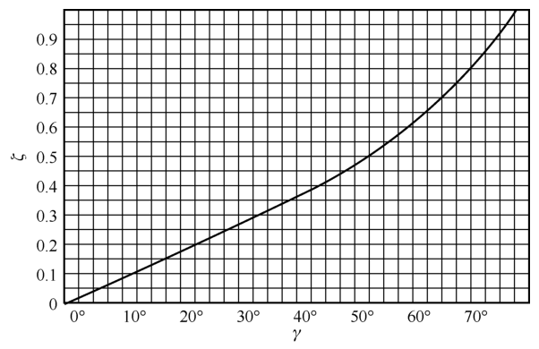{ .lq-img }

*图 5-41 典型二阶系统的 γ−ζ 曲线：γ 是 ζ 的单调增函数，一一对应（截自原书）*

为使控制系统具有良好的动态特性，一般希望

\[
\gamma = 30^\circ \sim 60^\circ
\tag{5.94}
\]

选定 \(\gamma\) 后，由 \(\gamma\)-\(\zeta\) 曲线确定 \(\zeta\)，再确定 \(\sigma\%\) 和 \(t_s\)。

**【例 5-13】由 \(\gamma\) 估算时域指标**

设一单位反馈系统的开环传递函数

\[
G(s) = \frac{K}{s(Ts+1)}
\]

若已知单位速度信号输入下的稳态误差 \(e_{ss}(\infty)=1/9\)，相角裕度 \(\gamma=60^\circ\)，试确定系统时域指标 \(\sigma\%\) 和 \(t_s\)。

**解** 该系统为 I 型系统，单位速度输入下的稳态误差为 \(1/K\)，由题设得 \(K=9\)。由 \(\gamma=60^\circ\) 查图 5-41 得阻尼比 \(\zeta=0.62\)（用式 (5.93) 验证：\(\gamma(0.62)=60.5^\circ\)，一致）。因此超调量

\[
\sigma\% = \mathrm{e}^{-\pi\zeta/\sqrt{1-\zeta^2}}\times 100\% = 8.4\%
\]

!!! warning "原书笔误"
    原书此处印作 \(\sigma\%=7.5\%\)。按 \(\zeta=0.62\) 用公式 (3.21) 计算：\(\dfrac{\pi\zeta}{\sqrt{1-\zeta^2}}=\dfrac{\pi\times0.62}{0.785}=2.483\)，\(\mathrm{e}^{-2.483}=0.084\)，即 \(\sigma\%\approx 8.4\%\)（数值验证见下）。而 \(7.5\%\) 对应 \(\zeta=0.636\)，与"由 \(\gamma=60^\circ\) 查得 \(\zeta=0.62\)"自相矛盾，应为笔误。

由于 \(K/T=\omega_n^2\)、\(1/T=2\zeta\omega_n\)，故

\[
\omega_n = \sqrt{\frac{K}{T}} = \frac{1}{2\zeta T},\qquad
\omega_n = 11.16\ \mathrm{rad/s}
\]

调节时间

\[
t_s = \frac{3.5}{\zeta\omega_n} = 3.5\times 2T = 0.50\ \mathrm{s}\quad(\varDelta=5\%)
\]

对于高阶系统，开环频域指标和时域指标不存在解析关系式，通常采用 MATLAB/Python 软件方便地获得闭环系统的频域性能和时域性能，便于统筹兼顾。

=== "MATLAB"

    ```matlab
    % ===== 书 5-5 节 例5-13 数值验证 =====
    zeta = 0.62;
    sigma = exp(-pi*zeta/sqrt(1-zeta^2))   % 0.0835 → σ% ≈ 8.4%（原书印 7.5%）
    K = 9; T = 1/(4*K*zeta^2)              % T = 0.0723
    wn = sqrt(K/T)                          % 11.16 rad/s
    ts = 3.5/(zeta*wn)                      % 0.506 s（Δ=5%）
    ```

=== "Python"

    ```python
    # ===== 书 5-5 节 例5-13 数值验证 =====
    import numpy as np

    zeta = 0.62
    print('sigma%% = %.2f' % (100*np.exp(-np.pi*zeta/np.sqrt(1-zeta**2))))  # 8.35（书印 7.5%）
    K = 9
    T = 1/(4*K*zeta**2)                     # 0.07226
    wn = np.sqrt(K/T)                       # 11.16
    print('T=%.5f wn=%.3f ts=%.3f' % (T, wn, 3.5/(zeta*wn)))               # ts=0.506 s
    # 相角裕度自洽校验：γ(ζ=0.62) = arctan[2ζ/(√(4ζ⁴+1)−2ζ²)^½] = 60.5°
    m = ((4*zeta**4+1)**0.5 - 2*zeta**2) ** 0.5
    print('gamma = %.2f deg' % np.degrees(np.arctan(2*zeta/m)))            # 60.49
    ```

**【例 5-14】"祝融号"火星车轮控系统的闭环频域指标**

"祝融号"火星车于 2021 年 5 月到达火星表面执行探测任务，它有一个可以模拟尺蠖运动的**主动悬挂系统**：车轮陷入岩石或沙子时可助其脱困，大大提高了外星探测车的机动性和生存机会（2022 年消息显示 NASA 艾姆斯研究中心研发的 VIPER 月球车也将采用类似移动轮子方式）。其轮控系统中，放大器和控制器为 \(G_c(s)=\dfrac{K(s+1)}{s+5}\)，执行机构为 \(G_0(s)=\dfrac{1}{s(s^2+2s+10)}\)，单位负反馈。

要求应用 MATLAB 软件完成：1) 绘制 \(K=20\) 时闭环系统的对数频率特性；2) 分别确定 \(K=20\) 和 \(K=40\) 时闭环系统的谐振峰值 \(M_r\)、谐振频率 \(\omega_r\) 和带宽频率 \(\omega_b\)。

**解** 本题展示在频域中进行火星车控制系统参数设计的过程：确定不同增益取值时系统的频域特征参数，为进一步设计提供技术数据。

开环传递函数

\[
G(s)G_0(s) = \frac{K(s+1)}{s(s+5)(s^2+2s+10)}
\]

闭环传递函数（\(K=20\)）：

\[
\varPhi(s) = \frac{20(s+1)}{s^4+7s^3+20s^2+70s+20}
\]

1) \(K=20\) 时的闭环系统 Bode 图如图 5-43。

2) 令 \(K=20\)，由图 5-43 可得：谐振峰值 \(M_r=0\ \mathrm{dB}\)（幅频无超过零频值的谐振峰）；谐振频率 \(\omega_r\) 不存在；在 \(20\lg\vert\varPhi(\mathrm{j}\omega)\vert=-3\ \mathrm{dB}\) 处查出带宽频率 \(\omega_b=3.62\ \mathrm{rad/s}\)。

3) \(K=40\) 时的闭环对数频率特性如图 5-44，由图测得

\[
M_r(\mathrm{dB}) = 9.58\ \mathrm{dB}\ (M_r=3.01),\qquad
\omega_r = 3.68\ \mathrm{rad/s},\qquad
\omega_b = 4.59\ \mathrm{rad/s}
\]

可见增益从 20 提高到 40，闭环出现了明显的谐振峰——稳定裕度下降的频域表现。

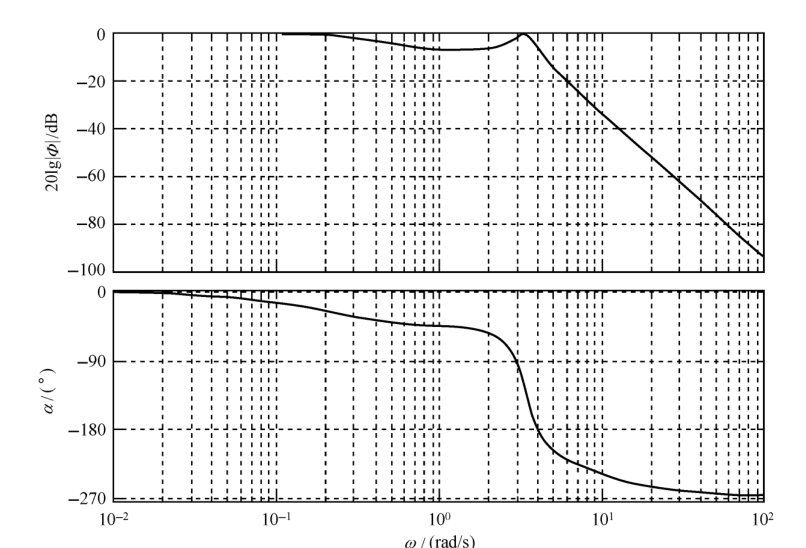{ .lq-img }

*图 5-43 单足机器人控制系统闭环 Bode 图（K=20，MATLAB）：无谐振峰，ω_b=3.62 rad/s（截自原书）*

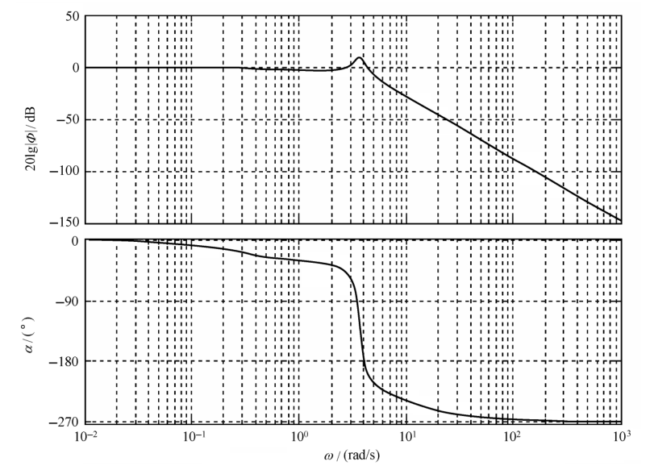{ .lq-img }

*图 5-44 单足机器人控制系统闭环 Bode 图（K=40，MATLAB）：谐振峰 M_r=3.01（9.58 dB），ω_r=3.68、ω_b=4.59 rad/s（截自原书）*

=== "MATLAB"

    ```matlab
    % ===== 书 5-5 节 例5-14 =====
    K = [20, 40];
    Gc = tf([1], conv([1, 0], [1, 2, 10]));    % Gc(s) = 1/(s(s^2+2s+10))
    for i = 1:2
        G1 = tf(K(i)*[1, 1], [1, 5]);          % G1(s) = K(s+1)/(s+5)
        G0 = series(G1, Gc);                   % 开环传递函数
        G  = feedback(G0, 1);                  % 闭环传递函数
        figure(i); bode(G); grid              % 闭环 Bode 图（书图5-43/5-44）
    end
    % 读图：K=20 时 Mr=0（无谐振峰）、wr 不存在、wb=3.62 rad/s；
    %       K=40 时 Mr(dB)=9.58（Mr=3.01）、wr=3.68 rad/s、wb=4.59 rad/s
    ```

=== "Python"

    ```python
    # ===== 书 5-5 节 例5-14 =====
    import numpy as np
    import control as ct

    w = np.logspace(-3, 3, 300000)
    for K in (20, 40):
        G0 = ct.tf(K*np.array([1.0, 1]), [1, 5]) * ct.tf([1], [1, 2, 10]) * ct.tf([1], [1, 0])
        Phi = ct.feedback(G0, 1)                    # 闭环 Φ(s)
        ct.bode_plot(Phi, w, dB=True, Hz=False)     # 闭环 Bode 图（书图5-43/5-44）
        mag = np.abs(ct.frequency_response(Phi, w).magnitude)
        m0 = mag[0]                                 # |Φ(j0)| = 1
        peak = mag.max()
        fall = np.diff((mag < m0/10**0.15).astype(int))   # 相对 |Φ(j0)| 跌破 -3dB
        wb = w[1:][np.where(fall == 1)[0][-1]]      # 带宽频率取最后一次跌破处（带边）
        if peak > m0 * 1.001:                       # 存在高于零频值的谐振峰
            print(f'K={K}: Mr={peak:.2f} ({20*np.log10(peak):.2f} dB), '
                  f'wr={w[mag.argmax()]:.2f}, wb={wb:.2f}')
        else:
            print(f'K={K}: 无谐振峰（Mr≈{20*np.log10(peak):.2f} dB）, wb={wb:.2f}')
        # K=20: 无谐振峰（Mr≈0.00 dB）, wb=3.63（书：Mr=0、wr 不存在、wb=3.62）
        # K=40: Mr=3.01 (9.58 dB), wr=3.67, wb=4.57（书：9.58 dB、3.68、4.59）
    ```

!!! note "拓展：ω_b 为什么取最后一次跌破 −3 dB（补充）"
    严格按定义逐点扫描，\(\vert\varPhi(\mathrm{j}\omega)\vert\) 在低频还有一个很浅的谷：\(K=20\) 时在 \(\omega\approx0.35\) 处刚好下探到 \(-3\ \mathrm{dB}\)，\(K=40\) 时在 \(\omega\approx0.74\)——随后又回到 \(-3\ \mathrm{dB}\) 以上（例 5-14 的闭环有一对阻尼较小的极点，幅频有起伏）。带宽 \((0,\omega_b)\) 是一个**包含零频的频带**，所以 \(\omega_b\) 取幅频**最终跌出** \(-3\ \mathrm{dB}\) 的频率（最后一次向下穿越），这才与书图 5-43/5-44 上读出的 3.62、4.59 一致。手工读图时看到的也正是这段"最终跌落"。

## 5.6 线性系统的频域分析仿真

本节是前五节的工具化：画伯德图、算裕度、画奈奎斯特图、判闭环稳定。常用命令对照：

**表 5-3 频域分析常用命令（MATLAB ↔ python-control 0.10）**

| 功能 | MATLAB | Python（python-control） |
| --- | --- | --- |
| 绘制伯德图 | `bode(sys)` | `ct.bode_plot(sys, dB=True, Hz=False)` |
| 幅值/相角裕度 | `[Gm,Pm,Wcg,Wcp]=margin(sys)` | `gm, pm, wcg, wcp = ct.margin(sys)` |
| 绘制奈奎斯特图 | `nyquist(sys)` | `ct.nyquist_plot(sys)` |
| 频率特性数据 | `[mag,phase,w]=bode(sys)` | `resp = ct.frequency_response(sys, w)` |
| 开环/闭环建模 | `tf` / `series` / `feedback` | `ct.tf` / `ct.series` / `ct.feedback` |

`bode`/`nyquist` 缺省输出变量时直接绘图；否则只把幅值、相角（或实部、虚部）存入向量。`margin` 直接绘制 Bode 图并把幅值裕度、相角裕度及对应的截止频率、穿越频率标注在图上。注意返回顺序 `Gm,Pm,Wcg,Wcp` 中 **Wcg 是相角穿越频率 \(\omega_x\)（幅值裕度对应），Wcp 是截止频率 \(\omega_c\)（相角裕度对应）**，python-control 的 `ct.margin` 同序。

### 综合运用：系统稳定性的频域分析

**【例 5-15】伯德图 + 奈奎斯特图判稳**

已知单位负反馈系统的开环传递函数

\[
G(s) = \frac{1280s+640}{s^4+24.2s^3+1604.81s^2+320.24s+16}
\]

试绘制其伯德图和奈奎斯特图，并判别闭环系统的稳定性。

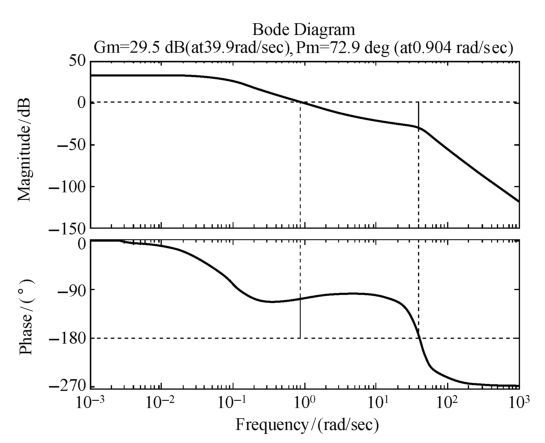{ .lq-img }

*图 5-45 例 5-15 开环伯德图（MATLAB）：Gm=29.5 dB、Pm=72.9°、ω_c=0.904 rad/s（截自原书）*

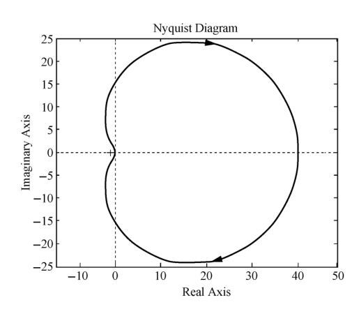{ .lq-img }

*图 5-46 例 5-15 开环奈奎斯特图（MATLAB）：曲线不包围 (−1, j0) 点（截自原书）*

**解** 系统无右半平面的开环极点（\(P=0\)），且从图 5-46 可以看出开环幅相曲线不包围 \((-1,\mathrm{j}0)\) 点，故闭环系统稳定。由图 5-45 得系统的幅值裕度 \(h=29.5\ \mathrm{dB}\)，相角裕度 \(\gamma=72.9^\circ\)，相应的截止频率 \(\omega_c=0.904\)、穿越频率 \(\omega_x=39.9\)。由奈氏判据知系统闭环稳定。

=== "MATLAB"

    ```matlab
    % ===== 书 5-6 节 例5-15 =====
    G = tf([1280 640], [1 24.2 1604.81 320.24 16]);   % 建立开环系统模型
    figure(1)
    margin(G)                                          % 伯德图，标注 h、γ、ωc、ωx（书图5-45）
    figure(2)
    nyquist(G)                                         % 奈奎斯特图（书图5-46）
    axis equal                                         % 调整纵横坐标比例，保持原形
    % 图5-45：h=29.5 dB，γ=72.9°，ωc=0.904，ωx=39.9；曲线不包围(-1,j0) → 闭环稳定
    ```

=== "Python"

    ```python
    # ===== 书 5-6 节 例5-15 =====
    import control as ct
    import numpy as np
    import matplotlib.pyplot as plt

    G = ct.tf([1280, 640], [1, 24.2, 1604.81, 320.24, 16])   # 建立开环系统模型

    plt.figure()
    ct.bode_plot(G, dB=True, Hz=False)                       # 绘制伯德图（书图5-45）
    plt.title('Bode Diagram')

    plt.figure()
    ct.nyquist_plot(G)                                       # 绘制奈奎斯特图（书图5-46）
    plt.title('Nyquist Diagram')

    h_lin, gamma, wx, wc = ct.margin(G)
    print('h = %.1f dB, gamma = %.1f deg, wc = %.3f, wx = %.1f'
          % (20*np.log10(h_lin), gamma, wc, wx))
    # h = 29.5 dB, gamma = 72.9 deg, wc = 0.904, wx = 39.9 —— 与书完全一致
    print('闭环稳定（P=0 且不包围 (-1,j0)）：',
          bool(np.all(ct.poles(ct.feedback(G, 1)).real < 0)))   # True
    plt.show()
    ```

## 坑与陷阱

!!! danger "8 个容易踩的坑"
    1. **频率特性"定义成立、实验受限"**：式 (5.17) 对不稳定系统照样可以代入 \(s=\mathrm{j}\omega\) 计算，但**实验法只适用于稳定系统**——不稳定系统的"稳态分量"里混着发散或等幅振荡项，根本测不到。
    2. **ν>0 的幅相曲线起点在无穷远，方向由 \(\nu\) 决定**：\(\varphi(0^+)=\angle G_1(\mathrm{j}0)-\nu\times90^\circ\)，概略曲线必须补作 \(\nu\times90^\circ\) 的无穷大圆弧（图 5-30）；数穿越 \(N\) 时这段虚圆弧的穿越（半次）也要计入（例 5-10 的半次负穿越就是它贡献的）。
    3. **同一交接频率的斜率变化取代数和**：两个惯性环节同在 \(\omega=1/T\)，斜率就跳 \(-40\ \mathrm{dB/dec}\)；把低频段斜率写成 \(-20\ \mathrm{dB/dec}\)、或把 \(20\lg K\) 的位置当成转折频率，都会把整条渐近线画错（式 5.52～5.54 三种定点方法任选其一）。
    4. **对数判据的"方向反转"与补作虚直线**：复平面上"由上向下穿越负实轴"等价于 \(\Gamma_\varphi\) "由下向上"穿越 \((2k+1)\times180^\circ\) 线（\(-180^\circ\) 线上方的相角在 \(-270^\circ\sim-180^\circ\)，画在 \(-180^\circ\) 线**下方**）；且补作的虚直线产生的穿越**一律为负穿越**——例 5-10 的半次负穿越就是这么来的。数穿越永远限定在 \(L(\omega)>0\) 频段。
    5. **\(\gamma>0\)、\(h>1\) 判稳有适用范围**：要求 \(\Gamma_{GH}\) 与单位圆、负实轴至多一个交点且 \(P=0\)；非最小相位系统不可靠。而且**只看 \(\gamma\) 或只看 \(h\) 都不够**——两者要同时满足且同时为正（例 5-11：\(K=10\) 时 \(h=0.8<1\) 且 \(\gamma=-7^\circ<0\)，两个指标一致判不稳定）。
    6. **0 型系统与 \(\nu=0\) 的幅相曲线起点在实轴上**：起点是 \((K,\mathrm{j}0)\) 或 \((-K,\mathrm{j}0)\)（例 5-1、例 5-11 的 \(K/(s+1)^3\)），不是无穷远；\(n=m\) 时终点也落在实轴上的 \(K^*\) 点。别拿"起点在无穷远"的惯性思维套所有系统。
    7. **带宽不是越大越好，\(\omega_b\) 取"最终跌出 −3 dB"处**：带宽大响应快，但对高频噪声的抑制能力变弱（5.5 节）；闭环幅频有浅谷时（例 5-14），逐点扫描得到的第一个 \(-3\ \mathrm{dB}\) 穿越并不是带宽频率，取最后一次穿越才与定义的频带 \((0,\omega_b)\) 一致。
    8. **渐近线要按误差曲线修正**：惯性环节交接频率处差 \(-3\ \mathrm{dB}\)；振荡环节渐近线在 \(\omega_n\) 处恒为 0 dB，精确值却是 \(20\lg\frac{1}{2\zeta}\)，\(\zeta=0.05\) 时高达 20 dB（图 5-17）——不修正就把谐振峰整个抹掉了；同理例 5-6 里靠"渐近线 20 dB 与谐振峰顶 20−12=8 dB"反推 \(\zeta\)。

## 术语速查

| 英文 | 中文 | 一句话 |
| --- | --- | --- |
| frequency characteristic | 频率特性 | \(G(\mathrm{j}\omega)=A(\omega)\mathrm{e}^{\mathrm{j}\varphi(\omega)}\)，正弦稳态下幅值比与相位差随 \(\omega\) 的变化 |
| magnitude/phase frequency characteristic | 幅频/相频特性 | \(A(\omega)=\vert G(\mathrm{j}\omega)\vert\) 与 \(\varphi(\omega)=\angle G(\mathrm{j}\omega)\) |
| Nyquist plot (polar plot) | 幅相曲线（奈奎斯特图/极坐标图） | 复平面上以 \(\omega\) 为参变量的 \(G(\mathrm{j}\omega)\) 轨迹 |
| Bode diagram | 伯德图 | 半对数坐标上的 \(L(\omega)=20\lg A(\omega)\) 与 \(\varphi(\omega)\) 两张图 |
| Nichols chart | 对数幅相曲线（尼科尔斯图） | 以 \(L(\omega)\) 为纵轴、\(\varphi(\omega)\) 为横轴的曲线 |
| decade | 十倍频程（dec） | 对数坐标上频率增大 10 倍所占的单位长度 |
| minimum phase system | 最小相位系统 | 开环零极点全在 \(s\) 左半平面的系统，幅频与相频一一对应 |
| corner (break) frequency | 交接频率 | 渐近幅频线斜率改变处的频率，一阶环节为 \(1/T\)、二阶环节为 \(\omega_n\) |
| asymptotic log magnitude characteristic | 对数幅频渐近特性 | 用低频、高频渐近线近似对数幅频曲线，交接频率处按表 5-2 修正 |
| resonant frequency / resonant peak | 谐振频率 / 谐振峰值 | \(\omega_r=\omega_n\sqrt{1-2\zeta^2}\)，\(M_r=1/(2\zeta\sqrt{1-\zeta^2})\)（\(0<\zeta\le0.707\)） |
| time delay element | 延迟环节 | \(G(s)=\mathrm{e}^{-\tau s}\)，幅值恒 1、相角 \(-57.3\tau\omega^\circ\) 线性滞后 |
| argument principle | 幅角原理 | \(s\) 沿 \(\Gamma\) 顺时针一周，\(F(s)\) 包围原点圈数 \(R=P-Z\) |
| Nyquist stability criterion | 奈氏判据 | \(\Gamma_{GH}\) 不穿过 \((-1,\mathrm{j}0)\) 且逆时针包围圈数 \(R=P\)，则闭环稳定 |
| logarithmic frequency stability criterion | 对数频率稳定判据 | \(L(\omega)>0\) 段 \(\Gamma_\varphi\) 穿越 \((2k+1)\times180^\circ\) 线的次数满足 \(Z=P-2N=0\) |
| positive/negative crossing | 正/负穿越 | 奈氏图上由上/下穿过临界段；对数图上方向反转（由下/上穿 \((2k+1)\times180^\circ\) 线） |
| cutoff frequency | 截止频率 \(\omega_c\) | 开环幅频 \(A(\omega_c)=1\)（\(L(\omega_c)=0\)）处的频率，衡量响应速度 |
| crossover (phase crossover) frequency | 穿越频率 \(\omega_x\) | \(\varphi(\omega_x)=(2k+1)\times180^\circ\) 处的频率，幅值裕度对应 |
| phase angle margin | 相角裕度 \(\gamma\) | \(\gamma=180^\circ+\angle G(\mathrm{j}\omega_c)H(\mathrm{j}\omega_c)\)，再滞后 \(\gamma\) 度就临界稳定 |
| gain margin | 幅值裕度 \(h\) | \(h=1/\vert G(\mathrm{j}\omega_x)H(\mathrm{j}\omega_x)\vert\)，再增大 \(h\) 倍就临界稳定 |
| conditionally stable system | 条件稳定系统 | 闭环稳定性随开环增益等系数变化的系统 |
| structurally unstable system | 结构不稳定系统 | 参数怎么调都闭环不稳定的系统（如 \(K/(s^2(Ts+1))\)） |
| bandwidth frequency | 带宽频率 \(\omega_b\) | 闭环幅频下降到零频值以下 3 dB 处的频率，\((0,\omega_b)\) 为带宽 |
| closed-loop frequency index | 闭环频域指标 | \(M_r\)、\(\omega_r\)、\(\omega_b\)，与 \(\gamma\)、\(\omega_c\) 可互相换算 |

## 覆盖自查

??? note "原书小节 → 笔记位置"
    | 原书小节/内容 | 笔记位置 |
    | --- | --- |
    | 5-1 频率特性（RC 网络引入、定义与证明、傅氏解释、三种几何表示：幅相曲线/伯德图/尼科尔斯图、表 5-1） | 5.1 |
    | 5-2 典型环节与开环系统频率特性（环节分类与分解、典型环节奈氏图与伯德图逐个推导、对称性、振荡环节谐振、渐近特性与误差曲线、开环幅相曲线三要素与例 5-1～5-4、开环对数渐近特性绘制步骤与例 5-5、延迟环节、频域实验确定传递函数与例 5-6） | 5.2 |
    | 5-3 频域稳定判据（幅角原理、F(s) 选择、Γ 选择、ΓGH 绘制与补作圆弧、R 计算、奈氏判据、例 5-7/5-8、对数判据与穿越规则、例 5-9/5-10、条件稳定系统） | 5.3 |
    | 5-4 频域稳定裕度（相角裕度、幅值裕度、图 5-37、例 5-11 含双 tab 代码、例 5-12 典型二阶系统 γ） | 5.4 |
    | 5-5 闭环系统的频域性能指标（频带宽度定义、一阶/二阶 ωb、带宽与响应速度、带宽选择、Mr≈1/sinγ、γ-ζ 曲线、例 5-13 含代码、例 5-14 祝融号含双 tab 代码） | 5.5 |
    | 5-6 线性系统的频域分析仿真（bode/margin/nyquist 命令、例 5-15 含双 tab 代码、命令对照表） | 5.6 |

??? note "原书例题 → 笔记位置"
    | 原书例题 | 内容 | 笔记位置 |
    | --- | --- | --- |
    | 例 5-1 | 0 型系统概略开环幅相曲线（含 K&lt;0 旋转 180°） | 5.2 开环幅相特性曲线绘制 |
    | 例 5-2 | I 型系统概略开环幅相曲线与 ν=1～4 旋转 | 5.2 开环幅相特性曲线绘制 |
    | 例 5-3 | 含一阶微分环节的 I 型系统（含穿越点勘误） | 5.2 开环幅相特性曲线绘制 |
    | 例 5-4 | 非最小相位系统幅相曲线（−90°→−270°） | 5.2 开环幅相特性曲线绘制 |
    | 例 5-5 | 开环对数幅频渐近特性绘制（六环节、分段斜率） | 5.2 开环对数频率特性曲线 |
    | 例 5-6 | 由实验对数幅频曲线反推传递函数（含 ζ 求解） | 5.2 传递函数的频域实验确定 |
    | 例 5-7 | 由奈氏判据定 K 值稳定范围 (0,5)∪(20/3,20) | 5.3 奈奎斯特稳定判据 |
    | 例 5-8 | 延迟系统 τ &lt; 2π/(3√3)≈1.21 | 5.3 奈奎斯特稳定判据 |
    | 例 5-9 | 对数判据：两种相角表示数穿越 N=0 | 5.3 对数频率稳定判据 |
    | 例 5-10 | 对数判据：ν=3 补虚直线，Z=3 | 5.3 对数频率稳定判据 |
    | 例 5-11 | K=4/10 的 γ、h 与判稳（含双 tab 代码） | 5.4 幅值裕度 h |
    | 例 5-12 | 典型二阶系统 ωc、γ 闭式 (5.78)(5.79) | 5.4 例 5-12 |
    | 例 5-13 | γ=60° → ζ=0.62 → σ%、ts（含 σ% 勘误与代码） | 5.5 闭环指标与时域指标转换 |
    | 例 5-14 | 祝融号轮控系统 Mr/ωr/ωb（含双 tab 代码） | 5.5 例 5-14 |
    | 例 5-15 | bode/margin/nyquist 判稳全流程（含双 tab 代码） | 5.6 综合运用 |
