# 第 6 章 线性系统的校正方法

> **本章解决**：前五章回答"怎么分析"，这一章回答"怎么改"——当调整放大器增益已无法同时满足稳态精度、响应速度与稳定裕度时，就在系统里加入参数可按需要改变的**校正装置**，让开环特性长成想要的样子。本章先统一设计语言：性能指标的时域/频域互换、带宽怎么选、校正方式（串联/反馈/前馈/复合）怎么分类、五种基本控制规律各自管什么（6-1）；再把工程常用的无源/有源校正网络——超前、滞后、滞后-超前——的电路、传递函数与伯德图逐个推透（6-2）；然后是本章主菜：频率法串联校正设计，超前、滞后、滞后-超前三套完整设计步骤，配例 6-3、6-4、6-5 逐步算到底（6-3）；性能指标给成时域特征量时，用前置滤波器构成前馈（组合）校正，并给出"最小节拍"标准化设计（6-4）；最后用 MATLAB/Python 仿真把设计闭环验证（6-5）。校正后系统的评价标准仍是第 3 章的时域指标与第 5 章的频域指标——本章就是前五章的汇合点。本章插图沿用原书图号（图 6-1～图 6-28），公式沿用原书式号 (6-1)～(6-36)。

## 6.0 本章导图

<div class="brtree">
  <div class="brrow">
    <span class="brlabel root">线性系统的校正</span>
    <span class="brace"></span>
    <div class="brkids">
      <div class="brrow">
        <span class="brlabel">设计问题（6-1）</span>
        <span class="brace"></span>
        <div class="brkids">
          <span class="brleaf">频域↔时域指标换算（式6-1～6-8）</span>
          <span class="brleaf">带宽选择 ω<sub>b</sub>=(5~10)ω<sub>M</sub></span>
          <span class="brleaf">串联/反馈/前馈/复合校正</span>
          <span class="brleaf">P·PD·I·PI·PID 控制规律</span>
          <span class="brleaf">例6-1、例6-2</span>
        </div>
      </div>
      <div class="brrow">
        <span class="brlabel">校正装置（6-2）</span>
        <span class="brace"></span>
        <div class="brkids">
          <span class="brleaf">无源超前 (1+aTs)/(1+Ts)</span>
          <span class="brleaf">无源滞后 (1+bTs)/(1+Ts)</span>
          <span class="brleaf">滞后-超前与分度系数 α</span>
          <span class="brleaf">表6-1 无源网络汇总</span>
          <span class="brleaf">有源网络与表6-2</span>
        </div>
      </div>
      <div class="brrow">
        <span class="brlabel">串联校正（6-3）</span>
        <span class="brace"></span>
        <div class="brkids">
          <span class="brleaf">分析法/综合法（期望特性）</span>
          <span class="brleaf">超前设计四步 + 例6-3</span>
          <span class="brleaf">滞后设计六步 + 例6-4</span>
          <span class="brleaf">滞后-超前 + 例6-5</span>
          <span class="brleaf">超前 vs 滞后对比</span>
        </div>
      </div>
      <div class="brrow">
        <span class="brlabel">前馈校正（6-4）</span>
        <span class="brace"></span>
        <div class="brkids">
          <span class="brleaf">前置滤波组合校正 例6-6</span>
          <span class="brleaf">最小节拍响应（表6-3）</span>
          <span class="brleaf">标准化传函配参 例6-7</span>
        </div>
      </div>
      <div class="brrow">
        <span class="brlabel">校正仿真（6-5）</span>
        <span class="brace"></span>
        <div class="brkids">
          <span class="brleaf">例6-8 超前校正全流程</span>
          <span class="brleaf">margin 算裕度</span>
          <span class="brleaf">校正前后 bode/step 对比</span>
        </div>
      </div>
    </div>
  </div>
</div>

## 6.1 系统的设计与校正问题

当被控对象给定后，按照被控对象的工作条件、被控量应具有的最大速度和加速度要求等，可以初步选定**执行元件**的型式、特性和参数；再根据测量精度、抗扰能力、被测信号的物理性质、测量过程中的惯性及非线性度等因素，选择合适的**测量变送元件**；在此基础上设计增益可调的**前置放大器与功率放大器**。这些初步选定的元件以及被控对象，构成系统中的**不可变部分**。设计控制系统的目的，是将构成控制器的各元件与被控对象适当组合起来，使之满足表征控制精度、阻尼程度和响应速度的性能指标要求。如果调整放大器增益后仍然不能全面满足设计要求，就需要在系统中增加一些参数及特性可按需要改变的**校正装置**——这就是控制系统设计中的**校正**问题。

### 性能指标

进行校正设计，除了应已知系统不可变部分的特性与参数外，还需要已知对系统提出的**全部性能指标**。指标通常由使用单位或被控对象的设计制造单位提出。不同控制系统对指标的侧重不同：调速系统对平稳性和稳态精度要求较高，随动系统则侧重快速性。指标的提出要符合实际系统的需要与可能——**不应当比完成给定任务所需的指标更高**；实际系统能达到的指标还受元部件固有误差、非线性特性、能源功率、机械强度等物理条件制约（要求响应快，就要考虑系统提供的最大速度、加速度和容许强度极限）。低速平稳性、对变载荷的适应性等特殊要求也要分别考虑。

设计方法依据指标的形式而定：

- 指标以单位阶跃响应的峰值时间、调节时间、超调量、阻尼比、稳态误差等**时域特征量**给出 → 一般采用**时域法**校正；
- 指标以相角裕度、幅值裕度、谐振峰值、闭环带宽、静态误差系数等**频域特征量**给出 → 一般采用**频率法**校正。

目前工程技术界多习惯采用频率法，故通常通过近似公式进行两种指标的互换。由第 5 章的结论，有如下关系成立（均针对二阶系统）：

\[
M_r = \frac{1}{2\zeta\sqrt{1-\zeta^2}}, \qquad \zeta\le 0.707
\tag{6.1}
\]

\[
\omega_r = \omega_n\sqrt{1-2\zeta^2}, \qquad \zeta\le 0.707
\tag{6.2}
\]

\[
\omega_b = \omega_n\sqrt{\left(1-2\zeta^2\right)+\sqrt{2-4\zeta^2+4\zeta^4}}
\tag{6.3}
\]

\[
\omega_c = \omega_n\sqrt{\sqrt{1+4\zeta^4}-2\zeta^2}
\tag{6.4}
\]

\[
\gamma = \arctan\frac{2\zeta}{\sqrt{\sqrt{1+4\zeta^4}-2\zeta^2}}
\tag{6.5}
\]

\[
\sigma\% = \mathrm{e}^{-\pi\zeta/\sqrt{1-\zeta^2}}\times 100\%
\tag{6.6}
\]

\[
t_s = \frac{3.5}{\zeta\omega_n}\ (\varDelta=5\%)\quad\text{或}\quad t_s = \frac{4.4}{\zeta\omega_n}\ (\varDelta=2\%)
\tag{6.7}
\]

高阶系统的频域指标关系：

\[
M_r = \frac{1}{\sin\gamma}
\tag{6.8}
\]

!!! note "拓展：这组换算公式的适用范围（补充）"
    式 (6.1)～(6.7) 是对标准无零点二阶系统 \( \varPhi(s)=\omega_n^2/(s^2+2\zeta\omega_n s+\omega_n^2) \) **精确**推出的（第 5 章 5-5 节），用于高阶系统时是近似——前提是闭环存在一对主导极点。式 (6.8) 的 \( M_r=1/\sin\gamma \) 则是高阶系统的经验关系，相当于把 \( \gamma\approx 90°- \) 阻尼角的关系代入 (6.1) 得到的估计式，工程上用来"给定 γ 估 \(M_r\)"或反过来。注意两处取值限制：\( \zeta>0.707 \) 时 \(M_r\)、\(\omega_r\) 失去意义（无谐振峰），\( \zeta=0.707 \) 时 \(M_r=1\)。

### 系统带宽的确定

性能指标中对带宽频率 \(\omega_b\) 的要求是一项重要技术指标。无论采用哪种校正方式，都要求校正后的系统**既能以所需精度跟踪输入信号，又能抑制噪声扰动信号**。实际运行中，输入信号一般是低频信号，噪声信号一般是高频信号，因此合理选择带宽是系统设计的重要问题。

- 为使系统准确复现输入，希望**带宽较大**；从抑制噪声角度看，又不希望带宽过大。
- 为使系统有较高的稳定裕度，希望开环对数幅频特性在截止频率 \(\omega_c\) 处的斜率为 \(-20\,\mathrm{dB/dec}\)；但从要求系统具有较强的从噪声中辨识信号的能力来考虑，却又希望 \(\omega_c\) 处的斜率小于 \(-40\,\mathrm{dB/dec}\)（高频衰减更快）。不同的 \(\omega_c\) 对应不同的 \(\omega_b\)，必须选择切合实际的带宽。

通常，一个设计良好的实际运行系统，其**相角裕度具有 45° 左右的数值**：过低于此值，动态性能较差且对参数变化的适应能力弱；过高于此值，对整个系统及其组成部件要求较高，实现困难或不经济，且稳定程度过好会造成动态过程缓慢。要实现 45° 左右的相角裕度，开环对数幅频特性在**中频区的斜率应为 \(-20\,\mathrm{dB/dec}\)**，同时中频区要占据一定频率范围，保证系统参数变化时相角裕度变化不大；过中频区后幅频特性应迅速衰减，以削弱噪声影响。

另一方面，进入系统输入端的信号既有输入 \(r(t)\) 又有噪声 \(n(t)\)：若输入信号带宽为 \(0\sim\omega_M\)，噪声集中起作用的频带为 \(\omega_1\sim\omega_N\)，则控制系统带宽频率通常取为

\[
\omega_b = (5\sim 10)\,\omega_M
\tag{6.9}
\]

且使 \(\omega_1\sim\omega_N\) 处于 \((0\sim\omega_b)\) 范围之外，如图 6-1 所示。

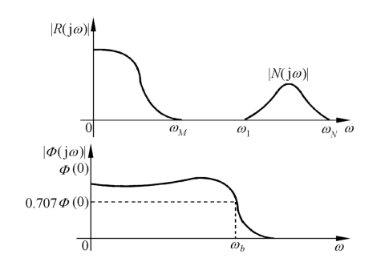{ .lq-img }

*图 6-1 系统带宽的确定：输入信号频谱 \(0\sim\omega_M\)，噪声频谱 \(\omega_1\sim\omega_N\)，闭环幅频在 \(\omega_b\) 处降到 \(0.707\varPhi(0)\)（截自原书）*

### 校正方式

按照校正装置在系统中的**连接方式**，控制系统校正方式可分为**串联校正、反馈校正、前馈校正和复合校正**四种。

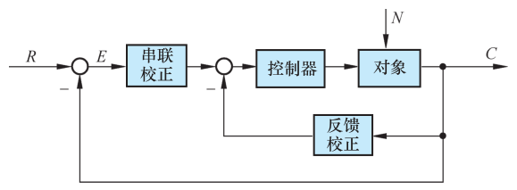{ .lq-img }

*图 6-2 串联校正与反馈校正系统方框图（截自原书）*

- **串联校正**：校正装置一般接在系统误差测量点之后，串接于系统前向通道之中；
- **反馈校正**：校正装置接在系统局部反馈通路之中（图 6-2）。

**前馈校正**又称**顺馈校正**，是在系统主反馈回路之外采用的校正方式，见图 6-3：一种接在系统给定值（或指令、参考输入信号）之后及主反馈作用点之前的前向通道上（图 6-3a），作用相当于对给定值信号进行整形或滤波后再送入反馈系统，因此又称为**前置滤波器**；另一种接在系统可测扰动作用点与误差测量点之间，对扰动信号进行直接或间接测量并经变换后接入系统，形成一条附加的对扰动影响进行补偿的通道（图 6-3b）。前馈校正可以单独作用于开环控制系统，也可以作为反馈控制系统的附加校正而组成**复合控制系统**。

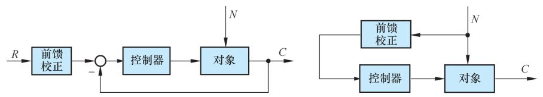{ .lq-img }

*图 6-3 前馈校正系统方框图：(a) 对给定值整形（前置滤波）；(b) 对扰动补偿（截自原书）*

究竟选用哪种校正方式，取决于系统中的信号性质、技术实现的方便性、可供选用的元件、抗扰性要求、经济性要求、环境使用条件以及设计者的经验等因素。

- **串联校正**设计比较简单，也比较容易对信号进行各种必要形式的变换。直流控制系统中传递直流电压信号，适于采用串联校正；交流载波控制系统中若采用串联校正，一般应接在**解调器和滤波器之后**，否则由于参数变化和载频漂移，校正装置的工作稳定性很差。
- 串联校正装置又分**无源**和**有源**两类。无源串联校正装置通常由 RC 无源网络构成，结构简单、成本低廉，但会使信号在变换过程中产生幅值衰减，且输入阻抗较低、输出阻抗较高，常需附加放大器以补偿幅值衰减并进行阻抗匹配；为避免功率损耗，无源校正装置通常安置在前向通路中**能量较低的部位**。有源串联校正装置由运算放大器和 RC 网络组成，参数可根据需要调整；工业自动化设备中经常采用由电动（或气动）单元构成的 **PID 控制器（PID 调节器）**，由比例、微分、积分单元组合而成，可实现各种要求的控制规律。
- **反馈校正**：实际控制系统中广泛采用。一般来说，反馈校正所需元件数目比串联校正少；反馈信号通常由系统输出端或放大器输出级供给，信号从高功率点传向低功率点，一般**无须附加放大器**；此外反馈校正尚可**消除系统原有部分参数波动**对系统性能的影响。

在性能指标要求较高的控制系统设计中，常常兼用串联校正与反馈校正，或串联校正与前馈校正的组合方式。

### 基本控制规律

确定校正装置的具体形式时，应先了解校正装置所需提供的**控制规律**，以便选择相应元件。包含校正装置在内的控制器，常采用比例、微分、积分等基本控制规律，或它们的组合——比例-微分（PD）、比例-积分（PI）、比例-积分-微分（PID）等，以实现对被控对象的有效控制。

**(1) 比例（P）控制规律**

具有比例控制规律的控制器称为 **P 控制器**，其输入 \(e(t)\) 与输出 \(m(t)\) 满足 \(m(t)=K_p e(t)\)（原书图 6-4 为其框图），\(K_p\) 称 P 控制器增益。P 控制器实质上是一个具有可调增益的放大器：在信号变换过程中只改变信号增益而**不影响相位**。串联校正中加大 \(K_p\) 可提高系统开环增益、减小稳态误差、提高控制精度，但会**降低相对稳定性**，甚至造成闭环不稳定——因此校正设计中很少单独使用比例控制规律。

**(2) 比例-微分（PD）控制规律**

PD 控制器的输出与输入关系：

\[
m(t) = K_p\left[e(t) + \tau\frac{\mathrm{d}e(t)}{\mathrm{d}t}\right]
\tag{6.10}
\]

式中 \(K_p\) 为比例系数，\(\tau\) 为微分时间常数，两者均可调（原书图 6-5 为 PD 控制器框图：\(E(s)\to K_p(1+\tau s)\to M(s)\)）。微分控制规律能**反应输入信号的变化趋势**，产生有效的早期修正信号，以增加系统的阻尼程度，从而改善稳定性。串联校正时可使系统增加一个 \(1/\tau\) 的开环零点，使相角裕度提高，有助于动态性能改善。

**【例 6-1】PD 控制器对系统性能的影响**

设比例-微分控制系统如图 6-6 所示（前向通道为 \(K_p(1+\tau s)\) 与 \(1/(Js^2)\) 串联，单位反馈）。

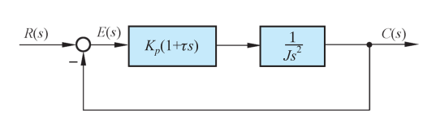{ .lq-img }

*图 6-6 比例-微分控制系统结构图（截自原书）*

**解**：无 PD 控制器时，闭环特征方程为

\[
Js^2 + 0 = 0
\]

阻尼比等于零，输出 \(c(t)\) 具有不衰减的等幅振荡形式，系统处于临界稳定状态（实际上的不稳定状态）。接入 PD 控制器后，闭环特征方程为

\[
Js^2 + K_p\tau s + K_p = 0
\]

其阻尼比 \(\zeta = \dfrac{\tau}{2}\sqrt{\dfrac{K_p}{J}} > 0\)，闭环系统稳定。PD 控制器提高系统的阻尼程度，可通过参数 \(K_p\) 及 \(\tau\) 调整。

需要指出：微分控制作用只对动态过程起作用，对稳态过程没有影响，且对系统噪声非常敏感，所以**单一的 D 控制器在任何情况下都不宜与被控对象串联起来单独使用**；通常微分控制规律总是与比例或比例-积分规律结合，构成 PD 或 PID 控制器。

**(3) 积分（I）控制规律**

I 控制器的输出与其输入的积分成正比：

\[
m(t) = K_i\int_0^t e(t)\,\mathrm{d}t
\tag{6.11}
\]

\(K_i\) 为可调比例系数（原书图 6-7 为 I 控制器框图：\(E(s)\to K_i/s\to M(s)\)）。由于积分作用，输入 \(e(t)\) 消失后，输出 \(m(t)\) 有可能是一个不为零的常量。串联校正时采用 I 控制器可以**提高系统型别**（无差度），有利于稳态性能；但积分控制使系统增加一个位于原点的开环极点，使信号产生 90° 的相角滞后，对稳定性不利——因此通常不宜采用单一的 I 控制器。

**(4) 比例-积分（PI）控制规律**

PI 控制器的输出同时成比例地反应输入及其积分：

\[
m(t) = K_p e(t) + \frac{K_p}{T_i}\int_0^t e(t)\,\mathrm{d}t
\tag{6.12}
\]

\(K_p\) 为可调比例系数，\(T_i\) 为可调积分时间常数（原书图 6-8 为 PI 控制器框图：\(E(s)\to K_p\left(1+\frac{1}{T_i s}\right)\to M(s)\)）。串联校正时，PI 控制器相当于在系统中增加了一个**位于原点的开环极点**（提高型别，消除或减小稳态误差）和一个**位于 \(s\) 左半平面的开环零点**（减小阻尼程度的恶化，缓和该极点对稳定性及动态过程的不利影响）。只要积分时间常数 \(T_i\) 足够大，PI 控制器对稳定性的不利影响可大为减弱。**PI 控制器主要用来改善控制系统的稳态性能**。

**【例 6-2】PI 控制器对系统稳态性能的改善**

设比例-积分控制系统如图 6-9，不可变部分的传递函数为 \(G_0(s)=\dfrac{K_0}{s(Ts+1)}\)。

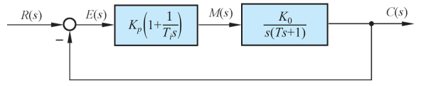{ .lq-img }

*图 6-9 比例-积分控制系统结构图（截自原书）*

**解**：不可变部分与 PI 控制器串联后，开环传递函数为

\[
G(s) = \frac{K_0 K_p\left(1+\dfrac{1}{T_i s}\right)}{s(Ts+1)}
     = \frac{K_0 K_p (T_i s+1)}{T_i s^2 (Ts+1)}
\]

系统由原来的 **I 型提高到 II 型**。若输入为斜坡函数 \(r(t)=R_1 t\)，由表 3-5：无 PI 控制器时稳态误差为 \(R_1/K_0\)；接入 PI 后稳态误差为**零**——I 型系统采用 PI 控制器后，消除了对斜坡输入的稳态误差，控制准确度大为改善。

采用 PI 后的系统特征方程为

\[
T_i T s^3 + T_i s^2 + K_0 K_p T_i s + K_0 K_p = 0
\]

式中 \(T,T_i,K_0,K_p\) 均为正数。由劳斯判据，调整 \(T_i\) 使之**大于系统不可变部分的时间常数 \(T\)**，即可保证闭环稳定（\(s^2\) 行验算：\(T_i\cdot K_0 K_p T_i - T_i T\cdot K_0 K_p = K_0 K_p T_i (T_i - T) > 0\)）。

**(5) 比例-积分-微分（PID）控制规律**

PID 控制器兼有三种基本规律各自的特点，其运动方程为

\[
m(t) = K_p e(t) + \frac{K_p}{T_i}\int_0^t e(t)\,\mathrm{d}t + K_p\tau\frac{\mathrm{d}e(t)}{\mathrm{d}t}
\tag{6.13}
\]

相应的传递函数（原书图 6-10 为 PID 控制器框图：\(E(s)\to K_p\left(1+\dfrac{1}{T_i s}+\tau s\right)\to M(s)\)）：

\[
G_c(s) = K_p\left(1 + \frac{1}{T_i s} + \tau s\right)
       = \frac{K_p\left(1 + T_i s + T_i\tau s^2\right)}{T_i s}
\tag{6.14}
\]

若 \(4\tau/T_i < 1\)，式 (6.14) 还可写成

\[
G_c(s) = \frac{K_p(1+\tau_1 s)(1+\tau_2 s)}{T_i s}
\tag{6.15}
\]

式中

\[
\tau_1 = \frac{T_i}{2}\left(1+\sqrt{1-\frac{4\tau}{T_i}}\right), \qquad
\tau_2 = \frac{T_i}{2}\left(1-\sqrt{1-\frac{4\tau}{T_i}}\right)
\]

（验证：\(\tau_1+\tau_2=T_i\)，\(\tau_1\tau_2=T_i\tau\)，与式 (6.14) 的分子展开一致。）由式 (6.15)，PID 校正除可使系统**型别提高一级**外，还将提供**两个负实零点**。与 PI 相比，PID 除了同样提高稳态性能外，还多提供一个负实零点，在提高动态性能方面具有更大优越性——因此工业过程控制系统中广泛使用 PID。PID 各部分参数在系统现场调试中最后确定：通常应使 **I 部分发生在系统频率特性的低频段**（提高稳态性能），**D 部分发生在中频段**（改善动态性能）。

## 6.2 常用校正装置及其特性

本节集中介绍常用无源及有源校正网络的电路形式、传递函数、对数频率特性及零、极点分布图，供控制系统校正时使用。

### 无源校正网络

#### 无源超前网络

图 6-11 是无源超前网络的电路图及其零、极点分布图。如果输入信号源内阻为零，且输出端负载阻抗为无穷大，则超前网络的传递函数为

\[
G_c(s) = \frac{1}{a}\cdot\frac{1+aTs}{1+Ts}
\tag{6.16}
\]

式中

\[
a = \frac{R_1+R_2}{R_2} > 1, \qquad
T = \frac{R_1 R_2}{R_1+R_2}C
\]

\(a\) 称**分度系数**，\(T\) 为时间常数。由式 (6.16)，采用无源超前网络串联校正时，**整个系统开环增益要下降 \(a\) 倍**，因此需要提高放大器增益加以补偿。超前网络的负实零点 \(-1/(aT)\) 总位于其负实极点 \(-1/T\) 之右，两者距离由 \(a\) 决定；改变 \(a\) 和 \(T\)，零、极点可在 \(s\) 平面负实轴上任意移动。

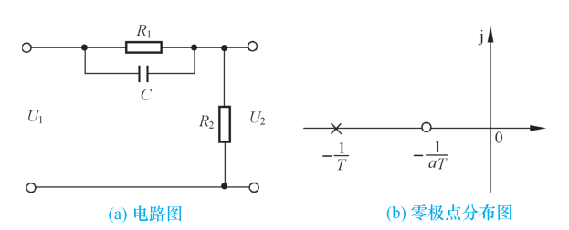{ .lq-img }

*图 6-11 无源超前网络：(a) 电路图；(b) 零极点分布图（截自原书）*

根据式 (6.16)，可画出无源超前网络 \(aG_c(s)\) 的对数频率特性（图 6-12a）。超前网络对频率在 \(1/(aT)\) 至 \(1/T\) 之间的输入信号有明显的**微分作用**：在该频率范围内，输出信号相角比输入信号相角超前——超前网络的名称由此而得。在最大超前角频率 \(\omega_m\) 处具有最大超前角 \(\varphi_m\)，且 \(\omega_m\) 正好处于 \(1/(aT)\) 和 \(1/T\) 的**几何中心**。

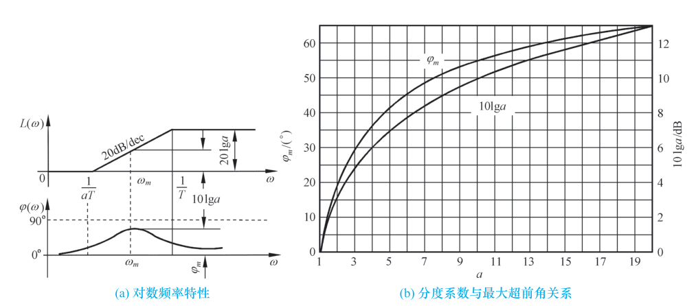{ .lq-img }

*图 6-12 无源超前网络特性：(a) 对数频率特性；(b) 分度系数与最大超前角关系（截自原书）*

超前网络的相角为

\[
\varphi_c(\omega) = \arctan aT\omega - \arctan T\omega
                 = \arctan\frac{(a-1)T\omega}{1+aT^2\omega^2}
\tag{6.17}
\]

将式 (6.17) 对 \(\omega\) 求导并令其为零，得最大超前角频率

\[
\omega_m = \frac{1}{T\sqrt{a}}
\tag{6.18}
\]

代入式 (6.17) 得最大超前角

\[
\varphi_m = \arctan\frac{a-1}{2\sqrt{a}} = \arcsin\frac{a-1}{a+1}
\tag{6.19}
\]

（推导：\(\varphi_m = \arctan\sqrt{a} - \arctan\frac{1}{\sqrt{a}}\)，正切差 \(\frac{\sqrt{a}-1/\sqrt{a}}{2} = \frac{a-1}{2\sqrt{a}}\)；再由 \(\sin\varphi_m = \frac{(a-1)/(2\sqrt{a})}{\sqrt{1+((a-1)/(2\sqrt{a}))^2}} = \frac{a-1}{a+1}\)。）

式 (6.19) 表明：最大超前角**仅与分度系数 \(a\) 有关**。\(a\) 越大，超前网络的微分效应越强。为了保持较高的系统信噪比，**实际选用的 \(a\) 值一般不超过 20**。此外，由图 6-12(a) 可见 \(\omega_m\) 处的对数幅频值

\[
L_c(\omega_m) = 20\lg\left|aG_c(\mathrm{j}\omega_m)\right| = 10\lg a
\tag{6.20}
\]

\(a\) 与 \(\varphi_m\) 及 \(10\lg a\) 的关系曲线见图 6-12(b)。

\(\omega_m\) 是 \(1/(aT)\) 与 \(1/T\) 的几何中心的证明：设 \(\omega_m\) 满足

\[
\lg\omega_m = \frac{1}{2}\left(\lg\frac{1}{aT} + \lg\frac{1}{T}\right)
\]

解得 \(\omega_m = \dfrac{1}{T\sqrt{a}}\)，与式 (6.18) 完全相同——故最大超前角频率确是两个交接频率的几何中心。

#### 无源滞后网络

无源滞后网络的电路图如图 6-13(a) 所示。输入信号源内阻为零、负载阻抗为无穷大时，滞后网络的传递函数为

\[
G_c(s) = \frac{1+bTs}{1+Ts}
\tag{6.21}
\]

式中

\[
b = \frac{R_2}{R_1+R_2} < 1, \qquad
T = (R_1+R_2)C
\]

\(b\) 称滞后网络的**分度系数**，表示滞后深度。

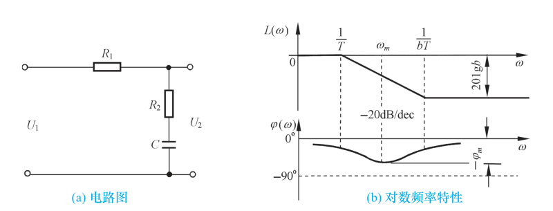{ .lq-img }

*图 6-13 无源滞后网络：(a) 电路图；(b) 对数频率特性（截自原书）*

无源滞后网络的对数频率特性如图 6-13(b)：在频率 \(1/T\) 至 \(1/(bT)\) 之间呈**积分效应**，对数相频特性呈**滞后**特性。与超前网络类似，最大滞后角 \(\varphi_m\) 发生在最大滞后角频率 \(\omega_m\) 处，且 \(\omega_m\) 正好是 \(1/T\) 与 \(1/(bT)\) 的几何中心：

\[
\omega_m = \frac{1}{T\sqrt{b}}
\tag{6.22}
\]

\[
\varphi_m = \arcsin\frac{1-b}{1+b}
\tag{6.23}
\]

（\(\varphi_m\) 本身为**负值**，即相角滞后量，推导与式 (6.19) 对偶：令 \(a=1/b\) 即得。）图 6-13(b) 还表明：滞后网络对低频有用信号**不产生衰减**，而对高频噪声信号有削弱作用，\(b\) 值越小，通过网络噪声电平越低。

采用无源滞后网络串联校正，主要是利用其**高频幅值衰减特性**，以降低系统开环截止频率、提高相角裕度。因此，力求避免最大滞后角发生在已校正系统开环截止频率 \(\omega_c''\) 附近。选择滞后网络参数时，通常使网络的交接频率 \(1/(bT)\) 远小于 \(\omega_c''\)，一般取

\[
\frac{1}{bT} = 0.1\,\omega_c''
\tag{6.24}
\]

此时，滞后网络在 \(\omega_c''\) 处产生的相角滞后为

\[
\varphi_c(\omega_c'') = \arctan bT\omega_c'' - \arctan T\omega_c''
\]

由两角和的三角函数公式，\(\tan\varphi_c(\omega_c'') = \dfrac{(b-1)T\omega_c''}{1+bT^2\omega_c''^2}\)；代入式 (6.24)（\(T\omega_c''=10/b\)）及 \(b<1\) 关系，可化简为

\[
\varphi_c(\omega_c'') \approx \arctan[0.1(b-1)]
\tag{6.25}
\]

（因为 \(\tan(\arctan 10 - \arctan(10/b)) = \dfrac{10(b-1)}{b+100}\approx 0.1(b-1)\)，\(b\ll 100\)。）\(b\) 与 \(\varphi_c(\omega_c'')\) 和 \(20\lg b\) 的关系曲线见原书图 6-14（对数坐标系）：\(b=0.1\) 时 \(20\lg b=-20\,\mathrm{dB}\)、\(\varphi_c(\omega_c'')\approx -5.2°\)。

#### 无源滞后-超前网络

无源滞后-超前网络的电路图如图 6-15(a) 所示（输入经 \(R_1\) 与 \(C_1\) 的并联支路到输出节点，\(R_2\) 与 \(C_2\) 的串联支路接在输出节点与地之间，输出电压取自该串联支路两端），其传递函数

\[
G_c(s) = \frac{(1+T_a s)(1+T_b s)}{T_a T_b s^2 + \left(T_a + T_b + T_{ab}\right)s + 1}
\tag{6.26}
\]

式中

\[
T_a = R_1 C_1, \qquad T_b = R_2 C_2, \qquad T_{ab} = R_1 C_2
\]

令式 (6.26) 的分母二项式有**两个不相等的负实根**，则式 (6.26) 可以写为

\[
G_c(s) = \frac{(1+T_a s)(1+T_b s)}{(1+T_1 s)(1+T_2 s)}
\tag{6.27}
\]

比较式 (6.26) 及式 (6.27)，可得

\[
T_1 T_2 = T_a T_b, \qquad T_1 + T_2 = T_a + T_b + T_{ab}
\]

设 \(T_1 > T_a\)，且

\[
\frac{T_a}{T_1} = \frac{T_2}{T_b} = \frac{1}{\alpha}
\]

其中 \(\alpha > 1\)，则有 \(T_1 = \alpha T_a\)，\(T_2 = T_b/\alpha\)。于是，无源滞后-超前网络的传递函数最后可表示为

\[
G_c(s) = \frac{(1+T_a s)(1+T_b s)}{(1+\alpha T_a s)\left(1+\dfrac{T_b}{\alpha}s\right)}
\tag{6.28}
\]

其中，\((1+T_a s)/(1+\alpha T_a s)\) 为网络的**滞后部分**，\((1+T_b s)/(1+T_b s/\alpha)\) 为网络的**超前部分**。

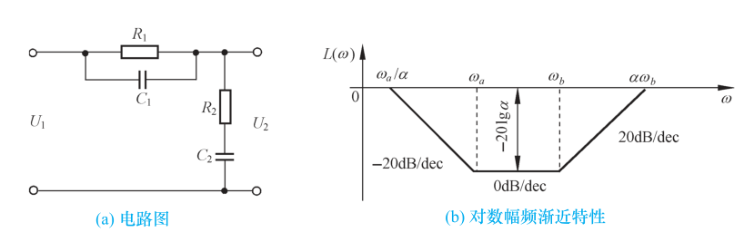{ .lq-img }

*图 6-15 无源滞后-超前网络：(a) 电路图；(b) 对数幅频渐近特性（截自原书）*

无源滞后-超前网络的对数幅频渐近特性如图 6-15(b)：低频部分和高频部分均起于和终于零分贝水平线，四个交接频率依次为 \(\omega_a/\alpha\)、\(\omega_a\)、\(\omega_b\)、\(\alpha\omega_b\)（\(\omega_a = 1/T_a\)，\(\omega_b = 1/T_b\)）。只要确定 \(\omega_a\)、\(\omega_b\) 和 \(\alpha\)（或者 \(T_a\)、\(T_b\) 和 \(\alpha\)）**三个独立变量**，图 6-15(b) 的形状即可确定。

常用无源校正网络的电路图、传递函数及对数幅频渐近特性汇总于表 6-1。

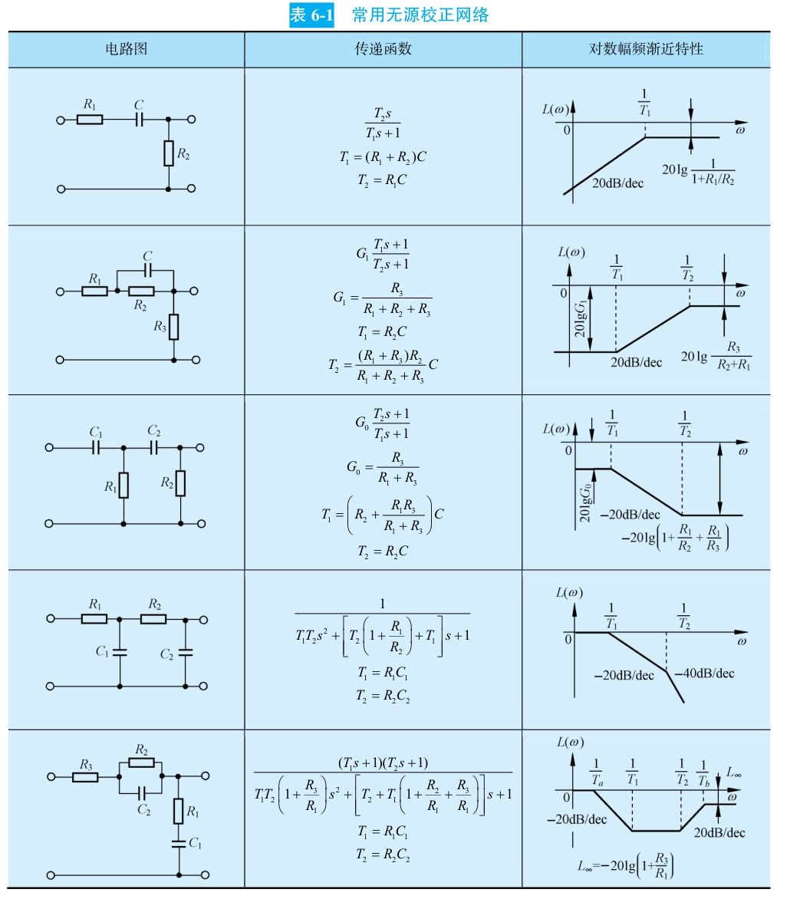{ .lq-img }

*表 6-1 常用无源校正网络（电路图、传递函数与对数幅频渐近特性，截自原书）：第 1 行为微分网络，第 2、3 行为带衰减的滞后网络，第 4 行为二阶低通（积分-惯性）网络，第 5 行为滞后-超前网络*

### 有源校正装置

实际控制系统中广泛采用无源网络进行串联校正，但在放大器级间接入无源校正网络后，由于**负载效应**问题，有时难以实现希望的控制规律；复杂网络的设计和调整也不方便。因此有时需要采用**有源校正装置**，工业过程控制系统中尤其如此。常用的有源校正装置，除测速发电机及其与无源网络的组合、PID 控制器外，通常把无源网络接在运算放大器的反馈通路中形成有源网络，以实现要求的控制规律。

有源校正网络有多种形式。图 6-16(a) 为**同相输入超前（微分）有源网络**，等效电路见图 6-16(b)。由于运算放大器本身增益较大，有源微分网络的传递函数可近似表示为输出电压 \(U_o\) 与反馈电压 \(U_f\) 之比：

\[
G_c(s) = \frac{U_o}{U_i} = \frac{U_o}{U_f}
\]

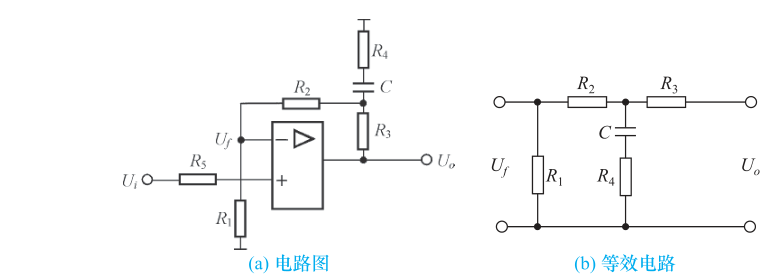{ .lq-img }

*图 6-16 有源微分网络及其等效电路：(a) 电路图；(b) 等效电路（截自原书）*

根据图 6-16(b) 可以具体推导有源微分网络的传递函数。令

\[
Z_1 = R_1 + R_2, \qquad Z_2 = R_4 + \frac{1}{Cs}, \qquad Z_1\,/\!/\,Z_2 = \frac{Z_1 Z_2}{Z_1 + Z_2}
\]

可以解得

\[
Z = R_3 + Z_1\,/\!/\,Z_2, \qquad
U_f = \frac{R_1 Z_2}{Z(Z_1 + Z_2)}\,U_o
\]

于是，有源微分网络的传递函数为

\[
G_o(s) = K\frac{1+T_1 s}{1+T_2 s}
\tag{6.29}
\]

式中

\[
K = \frac{R_1+R_2+R_3}{R_1} > 1
\]

\[
T_1 = \frac{(R_1+R_2+R_4)R_3 + (R_1+R_2)R_4}{R_1+R_2+R_3}\,C
     = \left(\frac{R_1+R_2}{R_1+R_2+R_3}R_3 + R_4\right)C, \qquad
T_2 = R_4 C
\]

所以 \(T_1 > T_2\)（零点 \(-1/T_1\) 位于极点 \(-1/T_2\) 之右，相角超前）——故图 6-16(a) 必为有源微分网络。

常用有源校正装置示于表 6-2。

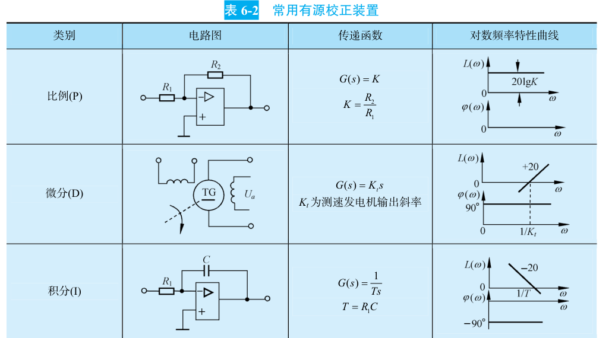{ .lq-img }

*表 6-2 常用有源校正装置（一）：比例(P)、微分(D，测速发电机 \(G(s)=K_t s\))、积分(I)，截自原书*

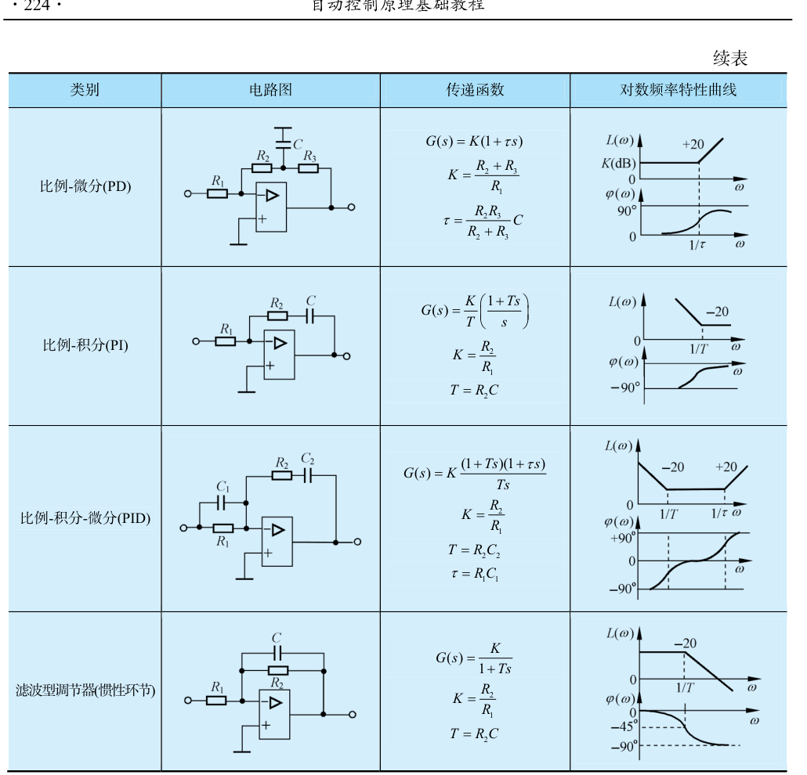{ .lq-img }

*表 6-2 常用有源校正装置（二，续表）：比例-微分(PD)、比例-积分(PI)、比例-积分-微分(PID)、滤波型调节器（惯性环节），截自原书*

表 6-2 中各装置的传递函数与电路参数为：PD 网络 \(G(s)=K(1+\tau s)\)，\(K=(R_2+R_3)/R_1\)，\(\tau=\dfrac{R_2 R_3}{R_2+R_3}C\)；PI 网络 \(G(s)=\dfrac{K}{T}\cdot\dfrac{1+Ts}{s}\)，\(K=R_2/R_1\)，\(T=R_2 C\)；PID 网络 \(G(s)=\dfrac{K(1+Ts)(1+\tau s)}{Ts}\)，\(K=R_2/R_1\)，\(T=R_2 C_2\)，\(\tau=R_1 C_1\)；滤波型调节器（惯性环节）\(G(s)=\dfrac{K}{1+Ts}\)，\(K=R_2/R_1\)，\(T=R_2 C\)。

## 6.3 串联校正

如果系统设计要求满足的性能指标属于**频域特征量**，则通常采用频域校正方法。本节介绍在开环系统对数频率特性基础上，以满足稳态误差、开环系统截止频率和相角裕度等要求为出发点，进行串联校正的方法。

### 频率响应法校正设计

在线性控制系统中，常用的校正装置设计方法有**分析法**和**综合法**两种。

- **分析法**又称**试探法**：设计比较直观，物理上易于实现，但要求设计者有一定的工程设计经验，设计过程带有试探性。目前工程技术界多采用分析法进行系统设计。
- **综合法**又称**期望特性法**：从闭环系统性能与开环系统特性密切相关这一概念出发，根据规定的性能指标要求确定系统**期望的开环特性形状**，然后与系统原有开环特性相比较，从而确定校正方式、校正装置的形式和参数。综合法有广泛的理论意义，但希望的校正装置传递函数可能相当复杂，物理上难以准确实现。

应当指出：不论分析法或综合法，其设计过程一般仅适用于**最小相位系统**（只有最小相位系统才能由对数幅频特性唯一确定相频特性）。

在频域内进行系统设计是一种**间接设计方法**——设计结果满足的是频域指标而不是时域指标；但频域法简便，在伯德图上虽不能严格定量地给出动态性能，却能方便地根据频域指标确定校正装置参数，特别是对已校正系统的高频特性有要求时更为方便。频域设计的这种简便性源于开环频率特性与闭环时间响应的联系：**开环频率特性的低频段表征闭环系统的稳态性能；中频段表征动态性能；高频段表征系统复杂性和噪声抑制性能**。因此频域法设计的实质，就是加入频率特性形状合适的校正装置，使开环系统频率特性变成所期望的形状：

- **低频段增益充分大**，保证稳态误差要求；
- **中频段对数幅频特性斜率一般为 \(-20\,\mathrm{dB/dec}\)**，并占据充分宽的频带，保证具备适当的相角裕度；
- **高频段增益尽快减小**，削弱噪声影响；若系统原有部分高频段已符合要求，校正时可保持高频段形状不变，以简化校正装置。

### 串联超前校正

利用超前网络或 PD 控制器进行串联校正的基本原理，是利用其**相角超前特性**。只要正确地将超前网络的交接频率 \(1/(aT)\) 和 \(1/T\) 选在待校正系统截止频率的两旁，并适当选择参数 \(a\) 和 \(T\)，就可以使已校正系统的截止频率和相角裕度满足性能指标要求，从而改善闭环系统的动态性能。闭环系统的稳态性能要求，可通过选择已校正系统的开环增益来保证。用频域法设计无源超前网络的步骤如下：

1. **根据稳态误差要求，确定开环增益 \(K\)**。
2. **利用已确定的开环增益，计算待校正系统的相角裕度**。
3. **根据截止频率 \(\omega_c''\) 的要求，计算超前网络参数 \(a\) 和 \(T\)**。关键是选择最大超前角频率等于要求的系统截止频率，即 \(\omega_m=\omega_c''\)，以保证系统的响应速度，并充分利用网络的相角超前特性。\(\omega_m=\omega_c''\) 成立的条件是

\[
-L'(\omega_c'') = L_c(\omega_m) = 10\lg a
\tag{6.30}
\]

（含义：超前网络 \(aG_c(s)\) 在 \(\omega_m\) 处的对数幅频值为 \(+10\lg a\)，恰好抵消待校正系统在 \(\omega_c''\) 处的负幅值 \(L'(\omega_c'')\)，使该点成为已校正系统的截止频率。）根据式 (6.30) 不难求出 \(a\) 值，然后由

\[
T = \frac{1}{\omega_m\sqrt{a}}
\tag{6.31}
\]

确定 \(T\) 值。

4. **验算已校正系统的相角裕度 \(\gamma''\)**。由于超前网络参数是按截止频率要求选择的，相角裕度是否满足要求必须验算。验算时，由已知 \(a\) 值查图 6-12(b) 或由式 (6.19) 求得 \(\varphi_m\)，再由已知的 \(\omega_c''\) 算出待校正系统在 \(\omega_c''\) 时的相角裕度 \(\gamma(\omega_c'')\)（若待校正系统为非最小相位系统，则 \(\gamma(\omega_c'')\) 由作图法确定），最后按下式算出

\[
\gamma'' = \varphi_m + \gamma(\omega_c'')
\tag{6.32}
\]

当验算结果 \(\gamma''\) 不满足指标要求时，需重选 \(\omega_m\) 值（一般使 \(\omega_m=\omega_c''\) 增大），然后重复以上计算步骤。

一旦完成校正装置设计，需要进行系统实际调校工作，或者进行 MATLAB 仿真以检查系统的时间响应特性；这时需将系统建模时省略的部分尽可能加入系统，以保证仿真结果的逼真度。如果由于系统固有非线性因素、噪声和负载效应等影响使已校正系统不能满足全部性能指标，则需适当调整校正装置的形式或参数，直到满足全部性能指标为止。

**【例 6-3】串联无源超前校正设计**

**已知**：控制系统如图 6-17。要求系统在单位斜坡输入信号作用时，位置输出稳态误差 \(e_{ss}(\infty)\le 0.1\,\mathrm{rad}\)，开环系统截止频率 \(\omega_c''\ge 4.4\,\mathrm{rad/s}\)，相角裕度 \(\gamma''\ge 45°\)，幅值裕度 \(h''\ge 10\,\mathrm{dB}\)。试设计串联无源超前网络。

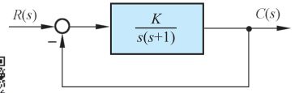{ .lq-img }

*图 6-17 例 6-3 控制系统结构图（截自原书）*

**解**：设计时首先调整开环增益。因为

\[
e_{ss}(\infty) = \frac{1}{K} \le 0.1
\]

故取 \(K=10\,(\mathrm{rad})^{-1}\)，待校正系统开环传递函数

\[
G_0(s) = \frac{10}{s(s+1)}
\]

上式代表最小相位系统，只需画出其对数幅频渐近特性，如图 6-18 中 \(L'(\omega)\) 所示。由图得待校正系统的 \(\omega_c'=3.1\,\mathrm{rad/s}\)，算出待校正系统的相角裕度

\[
\gamma' = 180° - 90° - \arctan\omega_c' = 17.9°
\]

而二阶系统的幅值裕度必为 \(+\infty\,\mathrm{dB}\)。相角裕度小的原因：待校正系统开环对数幅频渐近特性**中频区的斜率为 \(-40\,\mathrm{dB/dec}\)**。由于截止频率和相角裕度均低于指标要求，故采用**串联超前校正**是合适的。

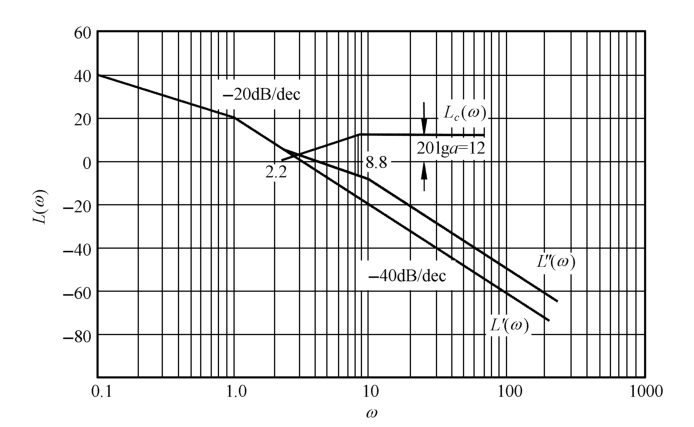{ .lq-img }

*图 6-18 例 6-3 系统开环对数幅频渐近特性：\(L'(\omega)\) 待校正，\(L_c(\omega)\) 校正网络，\(L''(\omega)\) 已校正（截自原书）*

下面计算超前网络参数。试选 \(\omega_m=\omega_c''=4.4\,\mathrm{rad/s}\)，由图 6-18 查得 \(L'(\omega_c'')=-6\,\mathrm{dB}\)，按式 (6.30) 算得

\[
a = 10^{0.6} \approx 4, \qquad
T = \frac{1}{\omega_m\sqrt{a}} = \frac{1}{4.4\times 2} = 0.114\,\mathrm{s}
\]

因此，超前网络传递函数为

\[
G_c(s) = \frac{1}{4}\cdot\frac{1+0.456s}{1+0.114s}
\]

为补偿无源超前网络产生的增益衰减，**放大器的增益需提高 4 倍**，否则不能保证稳态误差要求。

超前网络参数确定后，已校正系统的开环传递函数为

\[
G(s) = G_c(s)G_0(s) = \frac{10(1+0.456s)}{s(s+1)(1+0.114s)}
\]

其对数幅频渐近特性如图 6-18 中 \(L''(\omega)\) 所示。显然，已校正系统 \(\omega_c''=4.4\,\mathrm{rad/s}\)，算得待校正系统在该频率处的相角裕度

\[
\gamma(\omega_c'') = 180° - 90° - \arctan 4.4 = 12.8°
\]

而由式 (6-19) 算出 \(\varphi_m = \arcsin\dfrac{4-1}{4+1} = 36.9°\)，故已校正系统的相角裕度

\[
\gamma'' = \varphi_m + \gamma(\omega_c'') = 36.9° + 12.8° = 49.7° > 45°
\]

已校正系统的幅值裕度仍为 \(+\infty\,\mathrm{dB}\)（其对数相频特性不可能以有限值与 \(-180°\) 线相交）。此时全部性能指标均已满足。

本例亦可采用带惯性的 PD 控制器作为校正装置，它兼有直流放大器的功能。

本例表明：系统经串联校正后，**中频区斜率变为 \(-20\,\mathrm{dB/dec}\)**，并占据 \(6.6\,\mathrm{rad/s}\) 的频带范围（\(\omega=2.2\sim 8.8\,\mathrm{rad/s}\)，见图 6-18），从而相角裕度增大，动态过程超调量下降——实际运行的控制系统中，中频区斜率大多具有 \(-20\,\mathrm{dB/dec}\)。串联超前校正使开环系统截止频率增大，从而闭环系统带宽也增大，**响应速度加快**。

应当指出，在有些情况下采用串联超前校正是**无效**的，它受以下两个因素的限制：

1. **闭环带宽要求**。若待校正系统不稳定，为了得到规定的相角裕度，需要超前网络提供很大的相角超前量，\(a\) 值必须选得很大，从而造成已校正系统带宽过大，通过系统的高频噪声电平很高，很可能使系统失控。
2. **在截止频率附近相角迅速减小的待校正系统，一般不宜采用串联超前校正**。因为随着截止频率的增大，待校正系统相角迅速减小，已校正系统的相角裕度改善不大，很难得到足够的相角超前量。产生这种相角迅速减小的原因：在待校正系统截止频率附近，或有两个交接频率彼此靠近的惯性环节，或有两个交接频率彼此相等的惯性环节，或有一个振荡环节。

在上述情况下可采用其他方法校正，例如采用两级（或两级以上）串联超前网络（若选用无源网络，中间需串接隔离放大器）、串联滞后校正，或测速反馈校正。

### 串联滞后校正

利用滞后网络或 PI 控制器进行串联校正的基本原理，是利用其**高频幅值衰减特性**，使已校正系统截止频率下降，从而使系统获得足够的相角裕度。因此，滞后网络的最大滞后角应力求避免发生在系统截止频率附近。在**系统响应速度要求不高而抑制噪声电平性能要求较高**的情况下，可考虑采用串联滞后校正。此外，如果待校正系统已具备满意的动态性能，仅稳态性能不满足指标要求，也可以采用串联滞后校正以提高稳态精度，同时保持动态性能仍满足要求。

如果所研究的系统为单位反馈最小相位系统，则应用频域法设计串联无源滞后网络的步骤如下：

1. **根据稳态误差要求，确定开环增益 \(K\)**。
2. **利用已确定的开环增益，画出待校正系统的开环对数频率特性**，确定待校正系统的截止频率 \(\omega_c'\)、相角裕度 \(\gamma\) 和幅值裕度 \(h\,(\mathrm{dB})\)。
3. **选择不同的 \(\omega_c''\)，计算或查出不同的 \(\gamma\) 值，在开环伯德图上绘制 \(\gamma(\omega_c'')\) 曲线**。
4. **根据相角裕度 \(\gamma''\) 要求，选择已校正系统的截止频率 \(\omega_c''\)**。考虑到滞后网络在新的截止频率 \(\omega_c''\) 处会产生一定的相角滞后 \(\varphi_c(\omega_c'')\)，下式成立：

\[
\gamma'' = \gamma(\omega_c'') + \varphi_c(\omega_c'')
\tag{6.33}
\]

式中 \(\gamma''\) 是指标要求值；\(\varphi_c(\omega_c'')\) 在确定 \(\omega_c''\) 前可取为 \(-6°\)。于是根据式 (6.33) 的计算结果，在 \(\gamma(\omega_c'')\) 曲线上可查出相应的 \(\omega_c''\) 值。

5. **根据下述关系式确定滞后网络参数 \(b\) 和 \(T\)**：

\[
20\lg b + L'(\omega_c'') = 0
\tag{6.34}
\]

\[
\frac{1}{bT} = 0.1\,\omega_c''
\tag{6.35}
\]

式 (6.34) 成立的原因是显然的：要保证已校正系统的截止频率为上一步所选的 \(\omega_c''\) 值，就必须使滞后网络的衰减量 \(20\lg b\) 抵消待校正系统在新截止频率 \(\omega_c''\) 上的对数幅频值 \(L'(\omega_c'')\)（该值在待校正系统对数幅频曲线上可以查出），于是由式 (6.34) 算出 \(b\) 值。再由式 (6.35)，由已确定的 \(b\) 值立即算出滞后网络的 \(T\) 值。如果求得的 \(T\) 值过大难以实现，可将式 (6.35) 中的系数 0.1 适当加大（例如在 0.1～0.25 范围内选取），而 \(\varphi_c(\omega_c'')\) 的估计值相应在 \(-14°\sim -6°\) 范围内确定。

6. **验算已校正系统的相角裕度和幅值裕度**。

**【例 6-4】串联滞后校正设计**

**已知**：控制系统如图 6-19。要求校正后系统的静态速度误差系数等于 \(30\,\mathrm{s}^{-1}\)，相角裕度不低于 \(40°\)，幅值裕度不小于 \(10\,\mathrm{dB}\)，截止频率不小于 \(2.3\,\mathrm{rad/s}\)。试设计串联校正装置。

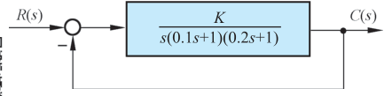{ .lq-img }

*图 6-19 例 6-4 控制系统结构图（截自原书）*

**解**：首先确定开环增益。由于

\[
K_v = \lim_{s\to 0} sG_0(s) = K = 30\,\mathrm{s}^{-1}
\]

故待校正系统开环传递函数应取

\[
G_0(s) = \frac{30}{s(1+0.1s)(1+0.2s)}
\]

然后画出待校正系统的对数幅频渐近特性，如图 6-20 所示。由图 \(\omega_c'=12\,\mathrm{rad/s}\)，算出

\[
\gamma = 90° - \arctan(0.1\omega_c') - \arctan(0.2\omega_c') = -27.6°
\]

说明待校正系统**不稳定**，且截止频率远大于要求值。在这种情况下采用串联超前校正是无效的：可以证明，当超前网络的 \(a\) 值取到 100 时，系统的相角裕度仍不满 30°，而截止频率却增至 \(26\,\mathrm{rad/s}\)。考虑到本例对截止频率值要求不大，故选用**串联滞后校正**可以满足需要的性能指标。

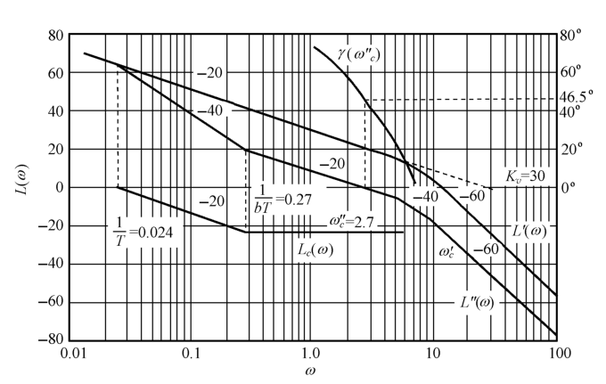{ .lq-img }

*图 6-20 例 6-4 系统开环对数幅频渐近特性：含 \(\gamma(\omega_c'')\) 曲线、校正网络 \(L_c(\omega)\) 与已校正系统 \(L''(\omega)\)（截自原书）*

现在作如下计算：

\[
\gamma(\omega_c'') = 90° - \arctan(0.1\omega_c'') - \arctan(0.2\omega_c'')
\]

并将 \(\gamma(\omega_c'')\) 曲线绘在图 6-20 中。根据 \(\gamma''\ge 40°\) 的要求和 \(\varphi_c(\omega_c'')=-6°\) 的估值，按式 (6.33) 求得 \(\gamma(\omega_c'')=46°\)。于是由 \(\gamma(\omega_c'')\) 曲线查得 \(\omega_c''=2.7\,\mathrm{rad/s}\)。由于指标要求 \(\omega_c''\ge 2.3\,\mathrm{rad/s}\)，故 \(\omega_c''\) 可在 \(2.3\sim 2.7\,\mathrm{rad/s}\) 范围内任取。考虑到 \(\omega_c''\) 取值较大时已校正系统响应速度较快，且滞后网络时间常数 \(T\) 值较小便于实现，故选取

\[
\omega_c'' = 2.7\,\mathrm{rad/s}
\]

然后，在图 6-20 上查出当 \(\omega_c''=2.7\,\mathrm{rad/s}\) 时 \(L'(\omega_c'')=21\,\mathrm{dB}\)，由式 (6.34) 求出

\[
b = 10^{-21/20} \approx 0.09
\]

再由式 (6.35) 算出

\[
T = \frac{1}{0.1 b\,\omega_c''} = \frac{1}{0.1\times 0.09\times 2.7} = 41\,\mathrm{s}
\]

则滞后网络的传递函数

\[
G_c(s) = \frac{1+bTs}{1+Ts} = \frac{1+3.7s}{1+41s}
\]

校正网络的 \(L_c(\omega)\) 和已校正系统的 \(L''(\omega)\) 已绘于图 6-20 之中。

最后校验相角裕度和幅值裕度。由式 (6.25) 及 \(b=0.09\) 算得 \(\varphi_c(\omega_c'')=\arctan[0.1(0.09-1)]=-5.2°\)，于是求出

\[
\gamma'' = 46.5° - 5.2° = 41.3°
\]

满足指标要求。然后用试算法可得已校正系统对数相频特性为 \(-180°\) 时的频率为 \(6.8\,\mathrm{rad/s}\)，求出已校正系统的幅值裕度为 \(10.5\,\mathrm{dB}\)，完全符合要求。

采用串联滞后校正，既能提高系统稳态精度，又基本不改变系统动态性能的原因是明显的：以图 6-20 为例，如果将已校正系统对数幅频特性**向上平移 \(21\,\mathrm{dB}\)**，则校正前后的相角裕度和截止频率基本相同，但开环增益却增大 **11 倍**（\(10^{21/20}\approx 11.2\)）。

**串联滞后校正与串联超前校正的对比**——两种方法在完成系统校正任务方面是相同的，但有以下不同之处：

1. 超前校正利用超前网络的**相角超前特性**，滞后校正利用滞后网络的**高频幅值衰减特性**。
2. 为了满足严格的稳态性能要求，当采用无源校正网络时，超前校正要求一定的**附加增益**，滞后校正一般不需要附加增益。
3. 对于同一系统，采用超前校正的系统**带宽**大于采用滞后校正的系统带宽。从提高响应速度的观点看，希望带宽越大越好；但带宽越大系统越易受噪声干扰影响——若系统输入端噪声电平较高，一般不宜选用超前校正。

最后指出：在有些应用方面，采用滞后校正可能得出**时间常数大到不能实现**的结果。这种不良后果的出现，是由于需要在足够小的频率值上安置滞后网络第一个交接频率 \(1/T\)，以保证在需要的频率范围内产生有效的高频幅值衰减特性所致。在这种情况下，最好采用**串联滞后-超前校正**。

### 串联滞后-超前校正

这种校正方法兼有滞后校正和超前校正的优点：已校正系统**响应速度较快、超调量较小、抑制高频噪声的性能也较好**。当待校正系统不稳定，且要求校正后系统的响应速度、相角裕度和稳态精度较高时，宜采用串联滞后-超前校正。其基本原理是：利用滞后-超前网络的**超前部分增大系统的相角裕度**，同时利用**滞后部分改善系统的稳态性能**。串联滞后-超前校正的设计步骤如下：

1. **根据稳态性能要求，确定开环增益 \(K\)**。
2. **绘制待校正系统的开环对数幅频渐近特性**，求出待校正系统的截止频率 \(\omega_c'\)、相角裕度 \(\gamma\) 及幅值裕度 \(h\,(\mathrm{dB})\)。
3. **在待校正系统开环对数幅频渐近特性上，选择斜率从 \(-20\,\mathrm{dB/dec}\) 变为 \(-40\,\mathrm{dB/dec}\) 的交接频率作为校正网络超前部分的交接频率 \(\omega_b\)**。\(\omega_b\) 的这种选法可以降低已校正系统的阶次，且可保证中频区斜率为期望的 \(-20\,\mathrm{dB/dec}\)，并占据较宽的频带。
4. **根据响应速度要求，选择系统的截止频率 \(\omega_c''\) 和校正网络衰减因子 \(1/\alpha\)**。要保证已校正系统的截止频率为所选的 \(\omega_c''\)，下列等式应成立：

\[
20\lg\alpha - \left[L'(\omega_c'') + 20\lg T_b\omega_c''\right] = 0
\tag{6.36}
\]

式中 \(T_b = 1/\omega_b\)；\(L'(\omega_c'')+20\lg T_b\omega_c''\) 可由待校正系统开环对数幅频渐近特性的 \(-20\,\mathrm{dB/dec}\) 延长线在 \(\omega_c''\) 处的数值确定。因此由式 (6.36) 可以求出 \(\alpha\) 值。

5. **根据相角裕度要求，估算校正网络滞后部分的交接频率 \(\omega_a\)**。
6. **校验已校正系统的各项性能指标**。

**【例 6-5】串联滞后-超前校正设计**

**已知**：待校正系统开环传递函数

\[
G_0(s) = \frac{K_v}{s\left(1+\dfrac{s}{2}\right)\left(1+\dfrac{s}{6}\right)}
\]

要求设计校正装置，使系统满足下列性能指标：

1. 在最大指令速度为 \(180°/\mathrm{s}\) 时，位置滞后误差不超过 \(1°\)；
2. 相角裕度为 \(45°\pm 3°\)；
3. 幅值裕度不低于 \(10\,\mathrm{dB}\)；
4. 动态过程调节时间不超过 \(3\,\mathrm{s}\)。

**解**：首先确定开环增益。由题意，位置滞后误差 \(e_{ss}=180/K_v\le 1°\)，取

\[
K_v = 180\,\mathrm{s}^{-1}
\]

作待校正系统对数幅频渐近特性 \(L'(\omega)\)，如图 6-21 所示。图中最低频段为 \(-20\,\mathrm{dB/dec}\) 斜率直线，其延长线交 \(\omega\) 轴于 \(180\,\mathrm{rad/s}\)，该值即 \(K_v\) 的数值。由图得待校正系统截止频率 \(\omega_c'=12.6\,\mathrm{rad/s}\)，算出待校正系统的相角裕度

\[
\gamma' = 90° - \arctan\frac{12.6}{2} - \arctan\frac{12.6}{6} = -55.5°
\]

幅值裕度 \(h=-30\,\mathrm{dB}\)，表明待校正系统**不稳定**。

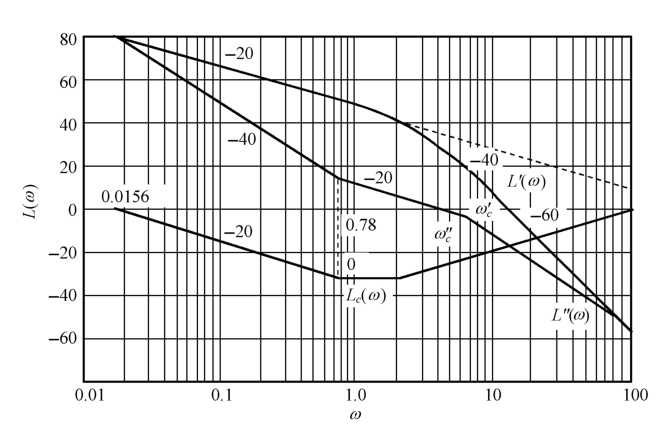{ .lq-img }

*图 6-21 例 6-5 系统开环对数幅频渐近特性：\(L'(\omega)\) 待校正，\(L_c(\omega)\) 校正网络，\(L''(\omega)\) 已校正（截自原书）*

由于待校正系统在截止频率处的相角滞后远小于 \(-180°\)，且响应速度有一定要求，故应优先考虑采用串联滞后-超前校正。论证如下。

**先看串联超前校正**：要把相角裕度从 \(-55.5°\) 提高到 \(45°\)，至少需选用**两级**串联超前网络，校正后系统的截止频率将过大，可能超过 \(25\,\mathrm{rad/s}\)。理论上截止频率越大响应越快——譬如 \(\omega_c''=25\,\mathrm{rad/s}\) 时调节时间近似为 \(0.34\,\mathrm{s}\)，比指标要求提高近 10 倍；然而进一步分析发现：① 伺服电机将出现**速度饱和**（超前校正要求伺服机构输出的变化速率超过伺服电机的最大输出转速），\(0.34\,\mathrm{s}\) 的调节时间将毫无意义；② 系统带宽过大，输出**噪声电平过高**；③ 需要**附加前置放大器**，系统结构复杂化。

**再看串联滞后校正**：可以使相角裕度提高到 \(45°\) 左右，但对本例高性能系统有两个严重缺点：① 滞后网络时间常数太大——静态速度误差系数越大，所需滞后网络时间常数越大。对本例，要求选 \(\omega_c''=1\,\mathrm{rad/s}\)，相应的 \(L'(\omega_c'')=45.1\,\mathrm{dB}\)，按式 (6.34) 求出 \(b=1/200\)，若取 \(1/(bT)=0.1\omega_c''\)，可得 \(T=2000\,\mathrm{s}\)，实际上无法实现；② 响应速度指标不满足——滞后校正极大地减小截止频率，粗略估算调节时间约 \(9.6\,\mathrm{s}\)，远大于指标要求值。

上述论证表明：纯超前校正及纯滞后校正都不宜采用，应当选用**串联滞后-超前校正**。

为了利用滞后-超前网络超前部分微分段的特性，研究图 6-21 发现：可取 \(\omega_b=2\,\mathrm{rad/s}\)（即待校正系统斜率从 \(-20\) 变 \(-40\,\mathrm{dB/dec}\) 的交接频率），超前部分零点 \((1+0.5s)\) 恰好对消待校正系统的极点 \(\left(1+\frac{s}{2}\right)\)，**降低已校正系统的阶次**。

根据 \(t_s\le 3\,\mathrm{s}\) 和 \(\gamma''=45°\) 的指标要求，不难算得 \(\omega_c''\ge 3.2\,\mathrm{rad/s}\)。考虑到要求中频区斜率为 \(-20\,\mathrm{dB/dec}\)，故 \(\omega_c''\) 应在 \(3.2\sim 6\,\mathrm{rad/s}\) 范围内选取；由于 \(-20\,\mathrm{dB/dec}\) 的中频区应占据一定宽度，故选

\[
\omega_c'' = 3.5\,\mathrm{rad/s}
\]

相应的 \(L'(\omega_c'')+20\lg T_b\omega_c'' = 34\,\mathrm{dB}\)（\(L'(3.5)=29.4\,\mathrm{dB}\) 在 \(-40\,\mathrm{dB/dec}\) 段上：\(20\lg(180\times 2/3.5^2)\)；\(20\lg T_b\omega_c''=20\lg(0.5\times 3.5)=4.9\,\mathrm{dB}\)）。由式 (6.36) 可算出

\[
20\lg\alpha = 34\,\mathrm{dB} \quad\Longrightarrow\quad \alpha = 50\ (1/\alpha = 0.02)
\]

此时，滞后-超前校正网络的频率特性可写为

\[
G_c(\mathrm{j}\omega) = \frac{\left(1+\mathrm{j}\omega/\omega_a\right)\left(1+\mathrm{j}\omega/\omega_b\right)}
{\left(1+\mathrm{j}\alpha\omega/\omega_a\right)\left(1+\mathrm{j}\omega/\alpha\omega_b\right)}
= \frac{\left(1+\mathrm{j}\omega/\omega_a\right)\left(1+\mathrm{j}\omega/2\right)}
{\left(1+\mathrm{j}50\omega/\omega_a\right)\left(1+\mathrm{j}\omega/100\right)}
\]

相应的已校正系统的频率特性为

\[
G_c(\mathrm{j}\omega)G_0(\mathrm{j}\omega) = \frac{180\left(1+\mathrm{j}\omega/\omega_a\right)}
{\mathrm{j}\omega\left(1+\mathrm{j}\omega/6\right)\left(1+\mathrm{j}50\omega/\omega_a\right)\left(1+\mathrm{j}\omega/100\right)}
\]

根据上式，利用相角裕度指标要求，可以确定校正网络参数 \(\omega_a\)。已校正系统的相角裕度

\[
\gamma'' = 180° + \arctan\frac{\omega_c''}{\omega_a} - 90° - \arctan\frac{\omega_c''}{6}
              - \arctan\frac{50\omega_c''}{\omega_a} - \arctan\frac{\omega_c''}{100}
= 57.7° + \arctan\frac{3.5}{\omega_a} - \arctan\frac{175}{\omega_a}
\]

考虑到 \(\omega_a < \omega_b = 2\,\mathrm{rad/s}\)，故可取 \(-\arctan(175/\omega_a)\approx -90°\)。因为要求 \(\gamma''=45°\)，所以上式可简化为

\[
\arctan\frac{3.5}{\omega_a} = 77.3°
\]

从而求得 \(\omega_a = 0.78\,\mathrm{rad/s}\)。这样，已校正系统 \(-20\,\mathrm{dB/dec}\) 斜率的中频区宽度 \(H = 6/0.78 = 7.69\)，满足中频区宽度近似关系式

\[
H \ge \frac{1+\sin\gamma''}{1-\sin\gamma''} = \frac{1+\sin 45°}{1-\sin 45°} = 5.83
\]

于是，校正网络和已校正系统的传递函数分别为

\[
G_c(s) = \frac{(1+1.28s)(1+0.5s)}{(1+64s)(1+0.01s)}
\]

\[
G_c(s)G_0(s) = \frac{180(1+1.28s)}{s(1+0.167s)(1+64s)(1+0.01s)}
\]

其对数幅频特性 \(L_c(\omega)\) 和 \(L''(\omega)\) 已分别表示在图 6-21 之中。

最后，用计算的方法验算已校正系统的相角裕度和幅值裕度指标，求得 \(\gamma''=45.5°\)，\(h''=27\,\mathrm{dB}\)，完全满足指标要求。

!!! warning "原书笔误"
    原书例 6-5 解题中有"于是**待校正系统**对数幅频特性在 \(\omega\le 6\,\mathrm{rad/s}\) 区间，其斜率均为 \(-20\,\mathrm{dB/dec}\)"一句。按待校正系统 \(G_0(s)=180/[s(1+s/2)(1+s/6)]\)，其 \(-20\,\mathrm{dB/dec}\) 段只到第一个交接频率 \(\omega=2\,\mathrm{rad/s}\)；\(\omega=2\sim 6\,\mathrm{rad/s}\) 区间斜率已是 \(-40\,\mathrm{dB/dec}\)。该句应为**已校正系统**的特性：超前部分零点 \((1+0.5s)\) 对消待校正系统极点 \((1+s/2)\) 之后，已校正系统才在 \(\omega_a\sim 6\,\mathrm{rad/s}\) 区间保持 \(-20\,\mathrm{dB/dec}\) 的中频段（这也正是第 3 步把 \(\omega_b\) 取在交接频率上的目的）。书末"相应的 \(L'(\omega_c'')+20\lg T_b\omega_c''=34\,\mathrm{dB}\)"与已校正系统频率特性表达式中只剩一个 \((1+\mathrm{j}\omega/6)\) 极点因子，均可佐证。

!!! note "拓展：设计结果的数值复核（补充）"
    用 python-control 按已校正开环 \(G(s)=180(1+1.28s)/[s(1+0.167s)(1+64s)(1+0.01s)]\) 精确计算：截止频率 \(3.25\,\mathrm{rad/s}\)、相角裕度 \(46.4°\)、幅值裕度 \(28.1\,\mathrm{dB}\)（渐近设计值 \(45.5°/27\,\mathrm{dB}\) 是把 \(\omega_c''=3.5\) 代入相角公式算的），闭环单位阶跃调节时间 \(t_s(2\%)\approx 3.0\,\mathrm{s}\)——与书的设计目标 \(t_s\le 3\,\mathrm{s}\) 一致。原书中"由 \(t_s\le 3\,\mathrm{s}\) 不难算得 \(\omega_c''\ge 3.2\,\mathrm{rad/s}\)"属高阶系统经验估算。

至此，三种串联校正的设计步骤与例题都已给出。什么时候选哪种校正，可按下图所示的逻辑判断（依据即上文的三套步骤与各自的适用限制）：

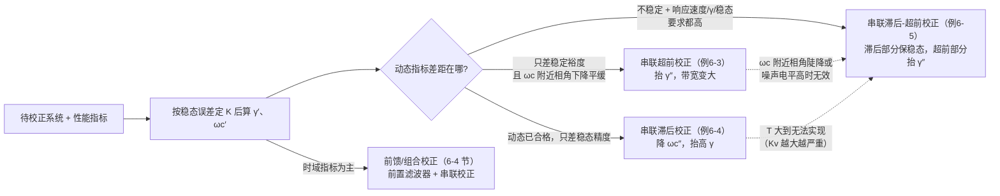

## 6.4 前馈校正

当系统性能指标要求为**时域特征量**时，为了改善控制系统的性能，除了采用串联校正方式外，还可以配置**前置滤波器**形成组合前馈校正方式，获得某些改善系统性能的特殊功能。

### 前置滤波组合校正

为了改善系统性能，在系统中常引入形如 \(G_c(s)=(s+z)/(s+p)\) 的串联校正网络，以改变系统的闭环极点。但是 \(G_c(s)\) 同时也会在系统闭环传递函数 \(\varPhi(s)\) 中**增加一个新的零点**，这个新增零点可能会严重影响闭环系统的动态性能。此时，可考虑在系统的输入端串接一个**前置滤波器**，以消除新增闭环零点的不利影响。

**【例 6-6】前置滤波器对消闭环零点**

**已知**：带有前置滤波器的控制系统如图 6-22。被控对象为 \(G_0(s)=\dfrac{1}{s}\)，串联校正网络为 PI 控制器 \(G_c(s)=\dfrac{K_1 s+K_2}{s}\)，\(G_p(s)\) 为前置滤波器。系统的设计要求为：① 系统阻尼比 \(\zeta_d = 1/\sqrt{2}=0.707\)；② 阶跃响应的超调量 \(\sigma\%\le 5\%\)；③ 阶跃响应的调节时间 \(t_s\le 0.6\,\mathrm{s}\)（\(\varDelta=2\%\)）。试设计 \(K_1\)、\(K_2\) 及 \(G_p(s)\)。

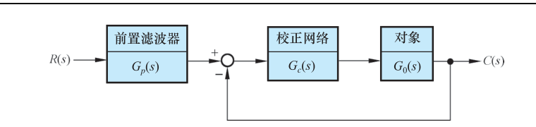{ .lq-img }

*图 6-22 带前置滤波器的控制系统结构图（截自原书）*

**解**：图 6-22 系统的闭环传递函数为

\[
\varPhi(s) = \frac{(K_1 s + K_2)G_p(s)}{s^2 + K_1 s + K_2}
\]

闭环系统特征方程为

\[
s^2 + K_1 s + K_2 = s^2 + 2\zeta_d\omega_n s + \omega_n^2 = 0
\]

根据系统对阻尼比和调节时间的要求，令 \(\zeta_d = 0.707\)，且由

\[
t_s = \frac{4.4}{\zeta_d\omega_n} \le 0.6\,\mathrm{s}\ (\varDelta=2\%)
\]

求得 \(\zeta_d\omega_n\ge 7.33\)。现取 \(\zeta_d\omega_n = 8\)，故得 \(\omega_n = 8\sqrt{2}\)，于是求出 PI 控制器参数

\[
K_1 = 2\zeta_d\omega_n = 16, \qquad K_2 = \omega_n^2 = 128
\]

若不引入前置滤波器，相当于 \(G_p(s)=1\)，系统的闭环传递函数为

\[
\varPhi(s) = \frac{16(s+8)}{s^2+16s+128}
          = \frac{\omega_n^2(s+z)}{z\left(s^2+2\zeta_d\omega_n s+\omega_n^2\right)}
\]

上式表明，此时系统为**有零点的二阶系统**。根据 \(\zeta_d = 1/\sqrt{2}\)，\(\omega_n = 8\sqrt{2}\)，\(z=8\)，以及第 3 章式 (3-30)，再由式 (3-31)、(3-32) 及 (3-34)，可得

\[
r = \frac{\sqrt{z^2 - 2\zeta_d\omega_n z + \omega_n^2}}{z\sqrt{1-\zeta_d^2}} = 1.41, \qquad
\psi = -\pi + \arctan\frac{\omega_n\sqrt{1-\zeta_d^2}}{z-\zeta_d\omega_n} + \arctan\frac{\sqrt{1-\zeta_d^2}}{\zeta_d} = -\frac{\pi}{4}
\]

（其中 \(\omega_n\sqrt{1-\zeta_d^2} = 8\)，\(z-\zeta_d\omega_n = 0\)，故 \(\arctan\infty = \pi/2\)。）于是，无前置滤波器时系统的动态性能可由图 3-20 及式 (3-33)、(3-35) 算得

\[
t_r = \frac{0.75}{\omega_n} = 0.07\,\mathrm{s}\quad\left(\frac{z}{\zeta_d\omega_n}=1,\ \omega_n t_r = 0.75\right), \qquad
t_p = \frac{\beta_d - \psi}{\omega_n\sqrt{1-\zeta_d^2}} = \frac{\pi/2}{8} = 0.2\,\mathrm{s}
\]

\[
\sigma\% = r\sqrt{1-\zeta_d^2}\,\mathrm{e}^{-\zeta_d\omega_n t_p}\times 100\% = 20.2\%, \qquad
t_s = \frac{4+\ln r}{\zeta_d\omega_n} = \frac{4+\ln 1.41}{8} = 0.54\,\mathrm{s}\ (\varDelta=2\%)
\]

显然，由于**新增零点的影响，超调量无法满足设计指标要求**（\(20.2\% \gg 5\%\)）。

考虑采用前置滤波器 \(G_p(s)\) 来**对消闭环传递函数 \(\varPhi(s)\) 中的零点**，并同时保持系统原有的直流增益（\(\varPhi(0)\)）不变，为此取

\[
G_p(s) = \frac{8}{s+8}
\]

因而闭环传递函数变成

\[
\varPhi(s) = \frac{128}{s^2+16s+128}
\]

此时，系统属**无零点的二阶系统**。由于 \(\beta = \arccos\zeta_d = \pi/4\)，\(\omega_n = 8\sqrt{2}\)，\(\omega_d = \omega_n\sqrt{1-\zeta_d^2} = 8\)，根据式 (3-19)～(3-23) 可以算出系统的动态性能指标为

\[
t_r = \frac{\pi-\beta}{\omega_d} = 0.29\,\mathrm{s}, \qquad
t_p = \frac{\pi}{\omega_d} = 0.39\,\mathrm{s}
\]

\[
\sigma\% = \mathrm{e}^{-\pi\zeta_d/\sqrt{1-\zeta_d^2}}\times 100\% = 4.3\% < 5\%, \qquad
t_s = \frac{4.4}{\zeta_d\omega_n} = 0.55\,\mathrm{s}\ (\varDelta=2\%)
\]

结果表明：**系统设计指标要求全部满足**。

MATLAB 验证（书图 6-23、6-24）：无前置滤波器时 \(\varPhi(s)=\dfrac{16(s+8)}{s^2+16s+128}\)，测得 \(\sigma\%=21\%\)，\(t_p=0.2\,\mathrm{s}\)，\(t_s=0.44\,\mathrm{s}\)（\(\varDelta=2\%\)）；有前置滤波器时 \(\varPhi(s)=\dfrac{128}{s^2+16s+128}\)，测得 \(\sigma\%=4\%\)，\(t_p=0.4\,\mathrm{s}\)，\(t_s=0.52\,\mathrm{s}\)（\(\varDelta=2\%\)）。

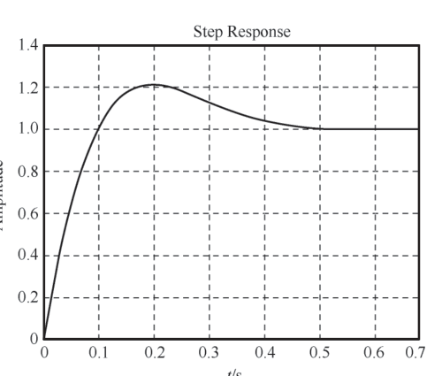{ .lq-img }

*图 6-23 无前置滤波器时系统的单位阶跃响应（MATLAB）：\(\sigma\%\approx 21\%\)（截自原书）*

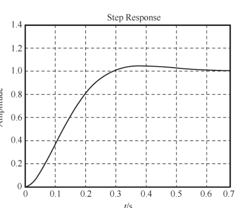{ .lq-img }

*图 6-24 有前置滤波器时系统的单位阶跃响应（MATLAB）：\(\sigma\%\approx 4\%\)（截自原书）*

=== "MATLAB"

    ```matlab
    % ===== 书 6-4 节 例6-6 前置滤波组合校正 =====
    K1=16; K2=128;
    Gc=tf([K1 K2],[1 0]);        % PI 控制器 (16s+128)/s
    G0=tf([1],[1 0]);            % 被控对象 1/s
    Gp=tf([8],[1 8]);            % 前置滤波器 8/(s+8)
    G=series(Gc,G0);
    sys0=feedback(G,1);          % 无前置滤波器时的闭环传递函数
    sys=series(sys0,Gp);         % 有前置滤波器时的闭环传递函数
    figure(1); step(sys0); grid  % 图6-23：sigma%=21%, tp=0.2s, ts(2%)=0.44s
    figure(2); step(sys); grid   % 图6-24：sigma%=4%,  tp=0.4s, ts(2%)=0.52s
    ```

=== "Python"

    ```python
    # ===== 书 6-4 节 例6-6 前置滤波组合校正 =====
    import control as ct

    K1, K2 = 16, 128
    Gc = ct.tf([K1, K2], [1, 0])     # PI 控制器 (16s+128)/s
    G0 = ct.tf([1], [1, 0])          # 被控对象 1/s
    Gp = ct.tf([8], [1, 8])          # 前置滤波器 8/(s+8)
    G = Gc * G0
    sys0 = ct.feedback(G, 1)         # 无前置滤波器的闭环
    sys = Gp * sys0                  # 有前置滤波器的闭环（滤波器在回路之外）
    i0, i1 = ct.step_info(sys0), ct.step_info(sys)
    print('无滤波: sigma%%=%.1f%% tp=%.2f ts(2%%)=%.2f' %
          (i0['Overshoot'], i0['PeakTime'], i0['SettlingTime']))
    # 无滤波: sigma%=20.8% tp=0.20 ts(2%)=0.44（书图6-23：21% / 0.2 / 0.44）
    print('有滤波: sigma%%=%.1f%% tp=%.2f ts(2%%)=%.2f' %
          (i1['Overshoot'], i1['PeakTime'], i1['SettlingTime']))
    # 有滤波: sigma%=4.3%  tp=0.39 ts(2%)=0.53（书图6-24：4% / 0.4 / 0.52）
    ```

### 最小节拍组合校正

一个好的控制系统，应该具有**快速的阶跃响应**，并且具有**最小的超调量**。**最小节拍响应**是指：以最小的超调量快速达到并保持在稳态响应允许波动范围内的时间响应，如图 6-25 所示。

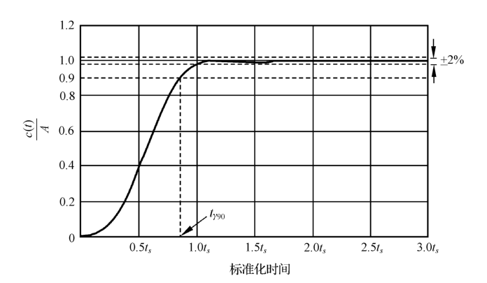{ .lq-img }

*图 6-25 最小节拍阶跃响应（A 为阶跃输入的幅值，波动带取稳态响应的 ±2%）（截自原书）*

当系统输入为阶跃信号时，允许波动范围取为稳态响应的 \(\pm 2\%\) 误差带，因此系统的**调节时间就是响应首次进入波动带的时间**。最小节拍响应具有如下特征：

1. 在阶跃输入作用下，稳态误差为零；
2. 阶跃响应具有最小的上升时间和调节时间；
3. 阶跃响应超调量 \(\lt 2\%\)。

最小节拍响应系统**标准化闭环传递函数** \(\varPhi(s)\) 及其系数 \(\alpha\)、\(\beta\)、\(\gamma\) 等的典型取值如表 6-3 所示，表中还列出了各阶最小节拍响应系统的主要响应性能——所有时间均取**标准化时间**（例如标准化调节时间 \(t_s=4.82\) 表示 \(\omega_n t_s=4.82\)，实际调节时间 \(t_s = 4.82/\omega_n\)）。

**表 6-3 最小节拍系统的标准化传递函数的典型系数和响应性能指标**

| 系统阶数 | 闭环传递函数 \(\varPhi(s)\) | \(\alpha\) | \(\beta\) | \(\gamma\) | \(\delta\) | \(\varepsilon\) | 超调量 | 欠调量 | 90%上升时间 \(t_{90}\) | 100%上升时间 \(t_r\) | 调节时间 \(t_s\) |
| --- | --- | --- | --- | --- | --- | --- | --- | --- | --- | --- | --- |
| 2 | \(\dfrac{\omega_n^2}{s^2+\alpha\omega_n s+\omega_n^2}\) | 1.82 |  |  |  |  | 0.10% | 0.00% | 3.47 | 6.59 | 4.82 |
| 3 | \(\dfrac{\omega_n^3}{s^3+\alpha\omega_n s^2+\beta\omega_n^2 s+\omega_n^3}\) | 1.90 | 2.20 |  |  |  | 1.65% | 1.36% | 3.48 | 4.32 | 4.04 |
| 4 | \(\dfrac{\omega_n^4}{s^4+\alpha\omega_n s^3+\beta\omega_n^2 s^2+\gamma\omega_n^3 s+\omega_n^4}\) | 2.20 | 3.50 | 2.80 |  |  | 0.89% | 0.95% | 4.16 | 5.29 | 4.81 |
| 5 | \(\dfrac{\omega_n^5}{s^5+\alpha\omega_n s^4+\beta\omega_n^2 s^3+\gamma\omega_n^3 s^2+\delta\omega_n^4 s+\omega_n^5}\) | 2.70 | 4.90 | 5.40 | 3.40 |  | 1.29% | 0.37% | 4.84 | 5.73 | 5.43 |
| 6 | \(\dfrac{\omega_n^6}{s^6+\alpha\omega_n s^5+\beta\omega_n^2 s^4+\gamma\omega_n^3 s^3+\delta\omega_n^4 s^2+\varepsilon\omega_n^5 s+\omega_n^6}\) | 3.15 | 6.50 | 8.70 | 7.55 | 4.05 | 1.63% | 0.94% | 5.49 | 6.31 | 6.04 |

注：表中所有时间均为标准化时间（\(\omega_n t\)）。

在设计具有最小节拍响应的系统时，要选择合适的校正网络类型，并令**校正后系统的闭环传递函数等于标准化闭环传递函数**，由此确定所需要的校正网络参数。

**【例 6-7】三阶最小节拍响应系统的设计**

**已知**：控制系统如图 6-22 所示。被控对象 \(G_0(s)=\dfrac{K}{s(s+1)}\)，超前校正网络 \(G_c(s)=\dfrac{s+z}{s+p}\)，前置滤波器 \(G_p(s)=\dfrac{z}{s+z}\)。若要求系统调节时间 \(t_s=2\,\mathrm{s}\)（\(\varDelta=2\%\)）左右，试选择增益 \(K\) 及校正网络参数 \(z\) 和 \(p\)，使该系统成为三阶最小节拍响应系统，并计算系统的实际动态性能指标。

**解**：系统闭环传递函数（前置滤波器在回路外，与回路串联）：

\[
\varPhi(s) = \frac{G_0(s)G_c(s)G_p(s)}{1+G_0(s)G_c(s)}
          = \frac{Kz}{s(s+1)(s+p) + K(s+z)}
\]

分母展开：\(s(s+1)(s+p)+K(s+z) = s^3+(1+p)s^2+(p+K)s+Kz\)。而三阶最小节拍标准化闭环传递函数为

\[
\varPhi(s) = \frac{\omega_n^3}{s^3+\alpha\omega_n s^2+\beta\omega_n^2 s+\omega_n^3}
\]

比较实际闭环传递函数与标准化闭环传递函数，可得

\[
Kz = \omega_n^3, \qquad \alpha\omega_n = p+1, \qquad \beta\omega_n^2 = p+K
\]

查表 6-3，有 \(\alpha=1.90\)，\(\beta=2.20\)，\(\omega_n t_s=4.04\)。代入要求值 \(t_s=2\,\mathrm{s}\)，可求得 \(\omega_n = 4.04/2 = 2.02\,\mathrm{rad/s}\)。不难算得

\[
p = \alpha\omega_n - 1 = 1.90\times 2.02 - 1 = 2.84, \qquad
K = \beta\omega_n^2 - p = 2.20\times 2.02^2 - 2.84 = 6.14, \qquad
z = \frac{\omega_n^3}{K} = \frac{8.24}{6.14} = 1.34
\]

校正网络及前置滤波器分别为

\[
G_c(s) = \frac{s+1.34}{s+2.84}, \qquad G_p(s) = \frac{1.34}{s+1.34}
\]

系统的实际性能指标为

\[
\sigma\% = 1.65\%, \qquad t_s = 2\,\mathrm{s}
\]

上述计算结果表明，\(\sigma\%\) 发生在容许的 \(\varDelta=\pm 2\%\) 误差带内，因此也可以认为系统的 \(\sigma\%=0\)。

MATLAB 验证（书图 6-26、6-27）：当系统无前置滤波器时，单位阶跃响应测得 \(\sigma\%=21\%\)，\(t_s=3.49\,\mathrm{s}\)（\(\varDelta=2\%\)），\(t_p=1.44\,\mathrm{s}\)；当系统有前置滤波器时，单位阶跃响应测得 \(\sigma\%\lt 2\%\)，\(t_s=2.4\,\mathrm{s}\)（\(\varDelta=2\%\)）。

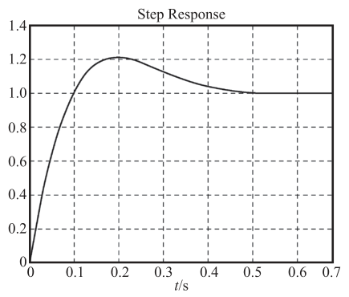{ .lq-img }

*图 6-26 无前置滤波器时系统的时间响应（MATLAB）：\(\sigma\%\approx 21\%\)（截自原书）*

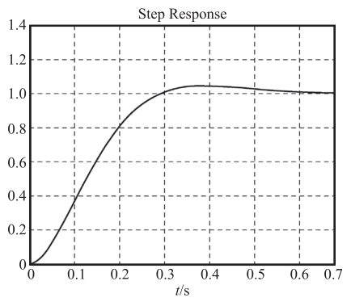{ .lq-img }

*图 6-27 有前置滤波器时系统的时间响应（MATLAB）：\(\sigma\%\lt 2\%\)（截自原书）*

=== "MATLAB"

    ```matlab
    % ===== 书 6-4 节 例6-7 最小节拍组合校正 =====
    K=6.14; z=1.34; p=2.84;
    G0=tf(K,[1,1,0]);            % 被控对象的传递函数 K/(s(s+1))
    Gc=tf([1,z],[1,p]);          % 校正网络的传递函数 (s+1.34)/(s+2.84)
    Gp=tf(z,[1,z]);              % 前置滤波器的传递函数 1.34/(s+1.34)
    G=series(G0,Gc);
    sys0=feedback(G,1);          % 无前置滤波器时系统的闭环传递函数
    sys=series(Gp,sys0);         % 有前置滤波器时系统的闭环传递函数
    figure(1); step(sys0); grid  % 图6-26：sigma%=21%, tp=1.44s, ts(2%)=3.49s
    figure(2); step(sys); grid   % 图6-27：sigma%<2%, ts(2%)=2.4s
    ```

=== "Python"

    ```python
    # ===== 书 6-4 节 例6-7 最小节拍组合校正 =====
    import control as ct

    K, z, p = 6.14, 1.34, 2.84
    G0 = ct.tf([K], [1, 1, 0])       # K/(s(s+1))
    Gc = ct.tf([1, z], [1, p])       # (s+1.34)/(s+2.84)
    Gp = ct.tf([z], [1, z])          # 1.34/(s+1.34)
    sys0 = ct.feedback(G0 * Gc, 1)   # 无前置滤波器的闭环
    sys = Gp * sys0                  # 有前置滤波器的闭环
    print('无滤波闭环极点:', ct.poles(sys0).round(3))
    # [-1.505 -1.167±2.026j]：即标准化三阶 s^3+3.838s^2+8.977s+8.242 的根，wn=2.02
    i0, i1 = ct.step_info(sys0), ct.step_info(sys)
    print('无滤波: sigma%%=%.1f%% tp=%.2f ts(2%%)=%.2f' %
          (i0['Overshoot'], i0['PeakTime'], i0['SettlingTime']))
    # 无滤波: sigma%=20.7% tp=1.49 ts(2%)=3.53（书图6-26：21% / 1.44 / 3.49）
    print('有滤波: sigma%%=%.2f%% ts(2%%)=%.2f' % (i1['Overshoot'], i1['SettlingTime']))
    # 有滤波: sigma%=1.58% ts(2%)=2.03（书：sigma%<2%，ts(2%)=2.4s）
    ```

!!! note "拓展：最小节拍系数表的来历（补充）"
    表 6-3 的系数是按"使 \(\pm 2\%\) 误差带内的调节时间与上升时间之综合最优"离线优化出来的标准化分母系数，思路与 ITAE（时间乘绝对误差积分）最优标准传函同族：分母系数都写成 \(\alpha\omega_n\)、\(\beta\omega_n^2\)、…、\(\omega_n^n\) 的形式，先由 \(t_s\) 指标定 \(\omega_n\)（查标准化调节时间列），再逐项配出校正装置参数。阶数越高，\(\beta,\gamma\) 等系数越大——高阶项要"压住"响应初期的振荡。用它配参的好处是**一次到位**：闭环响应形状直接就是优化结果，无需再试探增益。

## 6.5 线性系统的校正仿真

借助 MATLAB、Python 软件强大的计算功能，可以进一步讨论控制系统校正网络的设计问题，以获得满意的系统性能。下面结合实例，说明 MATLAB、Python 在控制系统校正中的具体应用。

**【例 6-8】频域法设计串联超前网络（仿真全流程）**

**已知**：设单位负反馈系统的开环传递函数为

\[
G_0(s) = \frac{K}{s(s+1)}
\]

若要求系统在单位斜坡输入信号作用时，位置输出稳态误差 \(e_{ss}(\infty)\le 0.1\,\mathrm{rad}\)，开环系统截止频率 \(\omega_c''\ge 4.4\,\mathrm{rad/s}\)，相角裕度 \(\gamma''\ge 45°\)，幅值裕度 \(h''\ge 10\,\mathrm{dB}\)，试设计串联无源超前网络。

**解**：利用频域法设计无源超前网络的步骤如下：

1) 根据稳态误差要求，确定开环增益 \(K\)（\(e_{ss}=1/K\le 0.1\Rightarrow K=10\)）。

2) 利用已确定的开环增益，计算待校正系统的幅值裕度、相角裕度及其对应的截止频率、穿越频率。

3) 根据截止频率 \(\omega_c''\) 的要求，计算超前网络参数 \(a\) 和 \(T\)。为保证系统的响应速度，并充分利用网络的相角超前特性，可选择最大超前角频率等于截止频率，即 \(\omega_m=\omega_c''\)；其中 \(a\) 由 \(L'(\omega_c'')+10\lg a=0\) 确定，再由 \(T=1/(\omega_m\sqrt{a})\) 确定 \(T\) 值。

4) 确定无源超前网络和最大超前角：

\[
aG_c(s) = \frac{1+aTs}{1+Ts}, \qquad
\varphi_m = \arcsin\frac{a-1}{a+1}
\]

5) 验算已校正系统的幅值裕度、相角裕度及其对应的截止频率、穿越频率。若验算结果不满足指标要求，需重新选择 \(\omega_m(=\omega_c'')\)，然后重复以上设计步骤。

运行下面的程序，得系统**校正前**截止频率 \(\omega_c'=3.0849\,\mathrm{rad/s}\)，相角裕度 \(\gamma'=17.9642°\)，而二阶系统的幅值裕度必为 \(+\infty\,\mathrm{dB}\)——由于截止频率和相角裕度均低于指标要求，故采用串联超前校正是合适的。**校正后**系统截止频率 \(\omega_c''=4.4\,\mathrm{rad/s}\)，相角裕度 \(\gamma''=49.3369°\ge 45°\)，幅值裕度仍为 \(+\infty\,\mathrm{dB}\)，全部满足设计指标要求。因此，超前网络传递函数为

\[
G_c(s) = \frac{1}{3.9417}\cdot\frac{1+0.4512s}{1+0.1145s}
\]

（放大器增益再提高 \(3.9417\) 倍补偿无源网络的衰减，已校正系统开环为 \(\dfrac{10(1+0.4512s)}{s(s+1)(1+0.1145s)}\)。）图 6-28 中虚线为系统校正前的对数频率特性，实线为校正后的对数频率特性。若不满足设计指标要求，可重新选取截止频率 \(\omega_c''\) 直到满意为止：例如重选 \(\omega_c''=5\,\mathrm{rad/s}\)，可得 \(\gamma''=58.4765°\ge 45°\)，幅值裕度为 \(+\infty\,\mathrm{dB}\)，仍然满足设计指标要求。

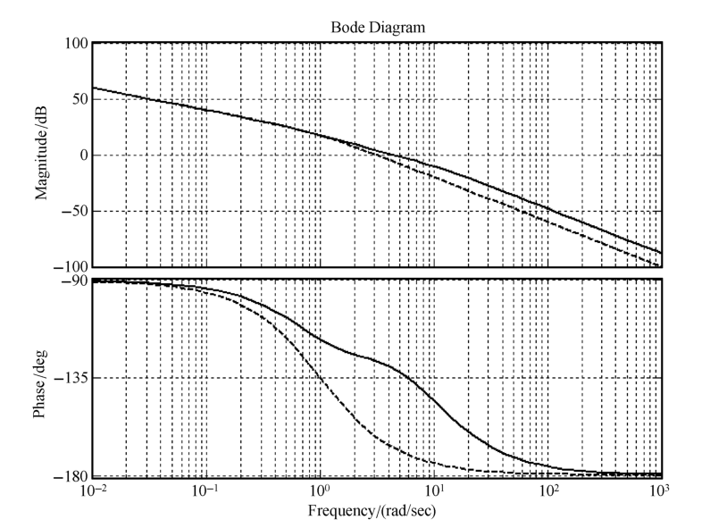{ .lq-img }

*图 6-28 系统校正前后开环对数频率特性（MATLAB）：虚线校正前，实线校正后（截自原书）*

=== "MATLAB"

    ```matlab
    % ===== 书 6-5 节 例6-8 串联超前校正设计 =====
    K=1/0.1;                          % 由稳态误差要求计算开环增益
    G0=zpk([], [0 -1], K);            % 建立开环系统模型 10/(s(s+1))
    [h0, r, wx, wc] = margin(G0)      % 校正前的幅值裕度/相角裕度/穿越频率/截止频率
    wm=4.4;                           % 试取已校正系统的截止频率
    L=bode(G0, wm);
    Lwc=20*log10(L)                   % L'(wm)≈-6 dB
    a=10^(-0.1*Lwc)                   % 确定超前校正网络参数 a（式6-30）
    T=1/(wm*sqrt(a))                  % 确定超前校正网络参数 T（式6-31）
    phi=asin((a-1)/(a+1))             % phi 表示最大超前角 φm（式6-19）
    Gc=(1/a)*tf([a*T 1], [T 1]);      % 无源超前网络（衰减 a 倍）
    Gc=a*Gc;                          % 放大器增益提高 a 倍，补偿衰减
    G=Gc*G0;                          % 计算已校正系统的开环传递函数
    bode(G,'r',G0,'b--'); grid        % 绘制系统校正前后的伯德图（书图6-28）
    [h, r, wx, wc] = margin(G)        % 已校正系统的裕度：wc=4.4, r=49.34
    ```

=== "Python"

    ```python
    # ===== 书 6-5 节 例6-8 串联超前校正设计 =====
    import numpy as np
    import control as ct
    import matplotlib.pyplot as plt

    K = 1/0.1                          # ess=1/Kv<=0.1 -> Kv=K=10
    G0 = ct.tf([K], [1, 1, 0])         # 建立开环系统模型 10/(s(s+1))

    # 2) 校正前的裕度（margin 返回 gm/pm 为倍数和角度，wg 为 -180° 穿越频率，wp 为截止频率）
    gm0, pm0, wg0, wc0 = ct.margin(G0)
    print('校正前: wc=%.4f rad/s, pm=%.4f deg' % (wc0, pm0))
    # 校正前: wc=3.0842 rad/s, pm=17.9642 deg（书：3.0849 / 17.9642，gm=+inf）

    # 3) 选 wm = wc'' = 4.4，由 L'(wm)+10lg a = 0 定 a，再定 T
    wm = 4.4
    Lwc = 20*np.log10(abs(ct.evalfr(G0, 1j*wm)))   # L'(wm)=-5.96 dB（书用 freqresp 求同值）
    a = 10**(-0.1*Lwc)                 # a = 3.9417（式6-30）
    T = 1/(wm*np.sqrt(a))              # T = 0.1145 s（式6-31）
    phim = np.degrees(np.arcsin((a-1)/(a+1)))
    print("L'(wm)=%.4f dB, a=%.4f, T=%.4f s, phim=%.2f deg" % (Lwc, a, T, phim))
    # L'(wm)=-5.9568 dB, a=3.9417, T=0.1145 s, phim=36.53 deg

    # 4) 无源超前网络（衰减 a 倍）+ 放大器增益补偿 a 倍，净效果即 (1+aTs)/(1+Ts)
    Gc = ct.tf([a*T, 1], [T, 1])       # 对应书 Gc=(1/3.9417)*(1+0.4512s)/(1+0.1145s)
    G = Gc * G0                        # 已校正系统开环传递函数

    # 5) 验算已校正系统的裕度
    gm, pm, wg, wc = ct.margin(G)
    print('校正后: wc=%.4f rad/s, pm=%.4f deg' % (wc, pm))
    # 校正后: wc=4.4000 rad/s, pm=49.3369 deg >= 45 deg，全部指标满足

    # 时域对比：校正前后单位阶跃闭环响应
    t = np.arange(0, 3, 0.002)
    c0 = ct.step_response(ct.feedback(G0, 1), t)
    c1 = ct.step_response(ct.feedback(G, 1), t)
    for tag, s in (('校正前', ct.feedback(G0, 1)), ('校正后', ct.feedback(G, 1))):
        i = ct.step_info(s)
        print('%s: sigma%%=%.1f%%, tr=%.2f s, ts(2%%)=%.2f s' %
              (tag, i['Overshoot'], i['RiseTime'], i['SettlingTime']))
    # 校正前: sigma%=60.3%, ts(2%)=7.38 s（t=3s 时仍在振荡，动态很差）
    # 校正后: sigma%=22.8%, tr=0.28 s, ts(2%)=1.24 s

    # 重选 wc''=5：a=6.5, T=0.0784 s，验算 gamma''=58.4765 deg，仍满足指标
    wm2 = 5.0
    a2 = 10**(-0.1*20*np.log10(abs(ct.evalfr(G0, 1j*wm2))))
    T2 = 1/(wm2*np.sqrt(a2))
    _, pm2, _, wc2 = ct.margin((a2*ct.tf([a2*T2, 1], [T2, 1])/a2) * G0)
    print('重选 wm=5: a=%.3f, T=%.4f, wc=%.3f, pm=%.4f deg' % (a2, T2, wc2, pm2))
    # 重选 wm=5: a=6.500, T=0.0784, wc=5.000, pm=58.4765 deg

    # 绘制系统校正前后的伯德图（书图6-28）与闭环阶跃响应对比
    fig, ax = plt.subplots(2, 1, figsize=(7, 6))
    ct.bode_plot(G0, ax=ax, linestyle='--', label='G0 (before)')
    ct.bode_plot(G, ax=ax, label='G (after)')
    ax[0].set_ylabel('Magnitude (dB)')
    ax[1].set_ylabel('Phase (deg)'); ax[1].set_xlabel('Frequency (rad/s)')
    for a_ in ax: a_.grid(True)
    ax[0].legend(); plt.tight_layout()
    fig2, ax2 = plt.subplots(figsize=(7, 4))
    ax2.plot(t, c0.outputs, '--', label='before')
    ax2.plot(t, c1.outputs, label='after')
    ax2.set_xlabel('time (s)'); ax2.set_ylabel('output')
    ax2.set_title('Closed-loop step response')
    ax2.grid(True); ax2.legend(); plt.tight_layout(); plt.show()
    ```

!!! note "拓展：margin 返回值的单位陷阱（补充）"
    MATLAB 的 `[h,r,wx,wc]=margin(G)` 中 \(h\) 是**线性倍数**（不是 dB），相角裕度 \(r\) 是度；python-control 的 `ct.margin(G)` 返回 `(gm, pm, wg, wp)` 同样 \(gm\) 为线性倍数。要报 \(h''\ge 10\,\mathrm{dB}\) 这类指标，须先做 \(20\lg h\) 换算——例 6-8 中二阶系统相频特性不会以有限值穿过 \(-180°\)，故 \(h=+\infty\)。另外原书 Python 代码里的 `ctr.freqresp(G0, wm)` 在 python-control 0.10 中已弃用（改用 `ct.frequency_response` 或如上 `ct.evalfr`），返回索引方式也与旧版不同。

## 坑与陷阱

!!! danger "8 个容易踩的坑"
    1. **无源网络衰减 \(a\) 倍必须补增益**：超前网络 \(G_c=(1/a)(1+aTs)/(1+Ts)\) 让开环增益掉 \(a\) 倍，稳态误差立刻变差 \(a\) 倍——例 6-3 里"放大器增益提高 4 倍"不是可选项，是设计的一部分。
    2. **\(\varphi_m\neq\gamma''\)，且 \(\gamma(\omega_c'')\) 要按新频率算**：超前校正把 \(\omega_c\) 从 \(\omega_c'\) 推到 \(\omega_c''\)，待校正系统在新频率处的相角更负（例 6-3：\(17.9°\to 12.8°\)）。拿旧 \(\gamma'\) 加 \(\varphi_m\) 会高估裕度；正确公式是 \(\gamma''=\varphi_m+\gamma(\omega_c'')\)。
    3. **\(a\le 20\)、每级超前最多提供约 \(60°\)**：\(a\) 太大带宽剧增、噪声电平剧增；需要更大超前角时用两级串联（中间加隔离放大器）或改用其他校正方式。
    4. **滞后网络要"避开"截止频率**：滞后相角在 \(\omega_c''\) 处按 \(1/(bT)=0.1\omega_c''\) 约定仍有约 \(-5°\)（式 6.25），设计时必须预留（式 6.33 中先扣 \(-6°\)）；若把最大滞后点放在 \(\omega_c''\) 附近，裕度会被吃掉一大截。
    5. **滞后校正的 \(T\) 可能大到无法实现**：\(K_v\) 越大需要的衰减越深，\(b\) 越小、\(T\) 越大（例 6-5：\(b=1/200\)，\(T=2000\,\mathrm{s}\)）。出现这种局面就换滞后-超前校正——滞后部分放 \(\omega_a\) 在低频、只管稳态，不必把 \(1/T\) 压到极低。
    6. **超前校正不是万能**：待校正系统不稳定、或 \(\omega_c\) 附近相角迅速减小（双惯性、振荡环节）时，单级超前无能为力（例 6-4：\(a=100\) 仍不满 30°）；此时选滞后或滞后-超前。
    7. **前置滤波器在回路之外**：它不影响闭环极点、稳定性和裕度，只整形闭环零点（例 6-6 用 \(8/(s+8)\) 对消 \(s+8\) 零点、例 6-7 用 \(1.34/(s+1.34)\) 对消校正网络零点）；对消用的极点自己要够快、在左半平面，否则等于引入新的慢模态。
    8. **频域法设计默认最小相位系统**：只有最小相位系统才能"看幅频定相角"。非最小相位系统（含不稳定环节、延迟）的 \(\gamma(\omega_c'')\) 要用作图法确定，直接套步骤会出错。

## 术语速查

| 英文 | 中文 | 一句话 |
| --- | --- | --- |
| compensator | 校正装置 | 参数可按需要改变的机构/装置，让系统全面满足性能指标 |
| series compensation | 串联校正 | 校正装置串接在前向通道误差测量点之后 |
| feedback compensation | 反馈校正 | 校正装置接在局部反馈通路，可消除参数波动影响 |
| feedforward compensation | 前馈校正 | 主反馈回路之外的校正（前置滤波/扰动补偿） |
| compound control | 复合控制 | 前馈+反馈组合的校正方式 |
| prefilter | 前置滤波器 | 对给定值整形/滤波的前馈校正装置 |
| lead network | 超前网络 | \(\frac{1}{a}\frac{1+aTs}{1+Ts}\)，相角超前，微分性质 |
| lag network | 滞后网络 | \(\frac{1+bTs}{1+Ts}\)，高频幅值衰减，积分性质 |
| lag-lead network | 滞后-超前网络 | 式 (6.28)，滞后部分保稳态、超前部分抬裕度 |
| gain division factor | 分度系数 \(a,b,\alpha\) | 决定零极点距离与最大超前/滞后角的无量纲参数 |
| maximum lead angle | 最大超前角 \(\varphi_m\) | \(\arcsin\frac{a-1}{a+1}\)，发生在几何中心 \(\omega_m=1/(T\sqrt a)\) |
| analytical method | 分析法（试探法） | 先选装置再验算的频域设计方法，工程主流 |
| synthesis method | 综合法（期望特性法） | 先画期望开环特性再求 \(G_c=G_{\text{期望}}/G_0\) |
| mid-frequency band | 中频区 | \(\omega_c\) 附近 \(-20\,\mathrm{dB/dec}\) 段，决定动态性能 |
| P/PD/I/PI/PID controller | 比例/比例-微分/积分/比例-积分/比例-积分-微分控制器 | 五种基本控制规律及其组合（式 6.10～6.15） |
| minimum beat response | 最小节拍响应 | 以最小超调量快速进入 \(\pm2\%\) 误差带的时间响应 |
| standardized closed-loop TF | 标准化闭环传递函数 | 系数 \(\alpha,\beta,\gamma\cdots\) 固定的最小节拍传函（表 6-3） |
| static velocity error coefficient | 静态速度误差系数 \(K_v\) | \(K_v=\lim sG_0(s)\)，定开环增益的出发点 |
| gain compensation | 增益补偿 | 放大器补 \(a\) 倍，抵消无源网络的幅值衰减 |
| mid-frequency width | 中频区宽度 \(H\) | \(H\ge\frac{1+\sin\gamma''}{1-\sin\gamma''}\)，保证 \(\gamma''\) 的经验关系 |

## 覆盖自查

??? note "原书小节 → 笔记位置"
    | 原书小节/内容 | 笔记位置 |
    | --- | --- |
    | 6-1 系统的设计与校正问题（性能指标、式 6-1～6-8、系统带宽的确定与式 6-9、校正方式四种、基本控制规律 P/PD/I/PI/PID 式 6-10～6-15） | 6.1 |
    | 6-2 常用校正装置及其特性（无源超前网络式 6-16～6-20、无源滞后网络式 6-21～6-25、无源滞后-超前网络式 6-26～6-28、表 6-1、有源校正装置与式 6-29、表 6-2） | 6.2 |
    | 6-3 串联校正（频率响应法：分析法/综合法与三频段；串联超前校正步骤与式 6-30～6-32；串联滞后校正步骤与式 6-33～6-35；超前 vs 滞后对比；串联滞后-超前校正步骤与式 6-36） | 6.3 |
    | 6-4 前馈校正（前置滤波组合校正、最小节拍组合校正与表 6-3） | 6.4 |
    | 6-5 线性系统的校正仿真（例 6-8 超前校正设计全流程与图 6-28） | 6.5 |

??? note "原书例题 → 笔记位置"
    | 原书例题 | 内容 | 笔记位置 |
    | --- | --- | --- |
    | 例 6-1 | PD 控制器使 \(Js^2\) 临界稳定系统增阻尼 | 6.1 比例-微分控制规律 |
    | 例 6-2 | PI 控制器使 I 型升 II 型、斜坡误差归零（\(T_i>T\) 保稳定） | 6.1 比例-积分控制规律 |
    | 例 6-3 | 串联无源超前校正：\(K=10\)，\(a=4\)，\(T=0.114\) s，\(\gamma''=49.7°\) | 6.3 串联超前校正 |
    | 例 6-4 | 串联滞后校正：\(K=30\)，\(b=0.09\)，\(T=41\) s，\(\gamma''=41.3°\)，\(h=10.5\) dB | 6.3 串联滞后校正 |
    | 例 6-5 | 串联滞后-超前校正：\(K_v=180\)，\(\omega_b=2\)，\(\alpha=50\)，\(\omega_a=0.78\)，\(\gamma''=45.5°\)（含原书笔误勘误） | 6.3 串联滞后-超前校正 |
    | 例 6-6 | 前置滤波器对消闭环零点：\(K_1=16\)，\(K_2=128\)，\(G_p=8/(s+8)\)（含双 tab 代码） | 6.4 前置滤波组合校正 |
    | 例 6-7 | 三阶最小节拍设计：\(K=6.14\)，\(z=1.34\)，\(p=2.84\)（含双 tab 代码） | 6.4 最小节拍组合校正 |
    | 例 6-8 | 频域法超前校正仿真：\(a=3.9417\)，\(T=0.1145\) s，\(\gamma''=49.3369°\)（含双 tab 代码） | 6.5 |
