# 第 7 章 线性离散系统的分析

> **本章解决**：前六章的系统里信号全是连续的，这一章把"数字计算机进控制回路"这件事数学化——回路里出现了只在采样瞬时才有定义的脉冲/数码信号，拉氏变换一用就冒出 \(e^{sT}\) 这种超越函数，连续域的整套工具失灵。本章的对策是换一把钥匙：先把采样与保持讲清（7-1、7-2，核心是香农采样定理与零阶保持器），再引入 z 变换把 \(s\) 的超越方程变成 \(z\) 的代数方程（7-3），据此建立差分方程与脉冲传递函数这套离散数学模型（7-4）；然后你会发现剧情全面重演——稳定性（单位圆代替左半平面，劳斯判据经 w 变换照用）、稳态误差（型别与误差系数的离散版）、动态性能（闭环极点分布决定暂态形态），全是第 3 章的老朋友换了张地图（7-5、7-6）；最后交给 c2d/dstep 一类离散仿真命令验证（7-7）。学完本章，第 2、3 章的方法论就完整移植到了计算机控制系统。本章插图沿用原书图号（图 7-1～图 7-38），公式沿用原书式号 (7-1)～(7-82)。

## 7.0 本章导图

<div class="brtree">
  <div class="brrow">
    <span class="brlabel root">线性离散系统的分析</span>
    <span class="brace"></span>
    <div class="brkids">
      <div class="brrow">
        <span class="brlabel">基本概念（7-1）</span>
        <span class="brace"></span>
        <div class="brkids">
          <span class="brleaf">采样/脉冲控制系统</span>
          <span class="brleaf">数字/计算机控制系统</span>
          <span class="brleaf">例7-1 炉温采样控制</span>
          <span class="brleaf">例7-2 高炮数字伺服</span>
          <span class="brleaf">A/D、D/A 两个特殊环节</span>
          <span class="brleaf">离散系统五个特点</span>
        </div>
      </div>
      <div class="brrow">
        <span class="brlabel">采样与保持（7-2）</span>
        <span class="brace"></span>
        <div class="brkids">
          <span class="brleaf">e*(t)=e(t)δ<sub>T</sub>(t) 调幅模型</span>
          <span class="brleaf">E*(s) 两种表达（式7-5/7-10）</span>
          <span class="brleaf">频谱：主分量+补分量</span>
          <span class="brleaf">香农采样定理 ω<sub>s</sub>≥2ω<sub>h</sub></span>
          <span class="brleaf">采样周期选取（表7-1）</span>
          <span class="brleaf">零阶保持器 Gh(s)=(1−e<sup>−Ts</sup>)/s</span>
        </div>
      </div>
      <div class="brrow">
        <span class="brlabel">z 变换理论（7-3）</span>
        <span class="brace"></span>
        <div class="brkids">
          <span class="brleaf">定义 z=e<sup>sT</sup>，E(z)=Σe(nT)z<sup>−n</sup></span>
          <span class="brleaf">级数求和法、部分分式法</span>
          <span class="brleaf">表7-2 z 变换表（18 条）</span>
          <span class="brleaf">线性/实数位移/复数位移/终值/卷积</span>
          <span class="brleaf">反变换三法：部分分式/幂级数/留数</span>
        </div>
      </div>
      <div class="brrow">
        <span class="brlabel">数学模型（7-4）</span>
        <span class="brace"></span>
        <div class="brkids">
          <span class="brleaf">差分方程（前向/后向）</span>
          <span class="brleaf">迭代法、z 变换法解差分方程</span>
          <span class="brleaf">脉冲传递函数 G(z)=Z{G(s)}</span>
          <span class="brleaf">串联：有/无采样开关之别</span>
          <span class="brleaf">带 ZOH：G(z)=(1−z<sup>−1</sup>)Z{G<sub>o</sub>(s)/s}</span>
          <span class="brleaf">闭环 Φ(z)=G/(1+HG)、表7-3</span>
          <span class="brleaf">z 变换法的三条局限</span>
        </div>
      </div>
      <div class="brrow">
        <span class="brlabel">稳定性与稳态误差（7-5）</span>
        <span class="brace"></span>
        <div class="brkids">
          <span class="brleaf">s→z 映射：虚轴→单位圆</span>
          <span class="brleaf">充要条件：|z<sub>i</sub>|&lt;1</span>
          <span class="brleaf">w 变换+劳斯判据</span>
          <span class="brleaf">例7-23、例7-24 判稳</span>
          <span class="brleaf">终值定理求 e<sub>ss</sub></span>
          <span class="brleaf">型别与 K<sub>p</sub>、K<sub>v</sub>、K<sub>a</sub>（表7-4）</span>
        </div>
      </div>
      <div class="brrow">
        <span class="brlabel">动态性能（7-6）</span>
        <span class="brace"></span>
        <div class="brkids">
          <span class="brleaf">C(z)=Φ(z)z/(z−1) 幂级数展开</span>
          <span class="brleaf">例7-26 全过程</span>
          <span class="brleaf">采样器：tp↓ σ↑</span>
          <span class="brleaf">ZOH：相角滞后 σ↑</span>
          <span class="brleaf">表7-5 三系统对比</span>
        </div>
      </div>
      <div class="brrow">
        <span class="brlabel">分析仿真（7-7）</span>
        <span class="brace"></span>
        <div class="brkids">
          <span class="brleaf">c2d / d2c 离散化</span>
          <span class="brleaf">step / lsim 离散版</span>
          <span class="brleaf">例7-27 稳定域+稳态误差</span>
          <span class="brleaf">dlsim 误差响应验证</span>
        </div>
      </div>
    </div>
  </div>
</div>

## 7.1 离散系统的基本概念

如果控制系统中**所有信号都是时间变量的连续函数**——换句话说，信号在全部时间上都是已知的——这样的系统叫连续时间系统，简称**连续系统**；只要有一处或几处信号是一串脉冲或数码、仅定义在离散时间上，就叫**离散时间系统**，简称**离散系统**。再按离散信号的形态细分：

- 离散信号是**脉冲序列**形式的，称采样控制系统或脉冲控制系统；
- 离散信号是**数字序列**形式的，称数字控制系统或计算机控制系统。

### 采样控制系统

一般说来，采样系统是对来自传感器的连续信息在**某些规定的时间瞬时**上取值。相邻两个脉冲之间的误差信息，系统并没有收到。如果在有规律的间隔上取到离散信息，这种采样称为**周期采样**；信息间隔时变或随机的，称为非周期采样或随机采样。本章只讨论**等周期采样**，并假定系统中有几个采样器时，它们**同步等周期**。

!!! note "拓展：同步等周期是个简化假定（补充）"
    实际计算机控制系统里可能出现多个采样开关采样周期不同（多速率采样）、或彼此不同步的情况，那时脉冲传递函数的推导会复杂得多（严格处理要用修正 z 变换或状态空间法）。本书全章建立在"所有开关同步、周期同为 T"这一假定上，这也是绝大多数单回路数字控制系统的实情。

例 7-1 的炉温系统是采样控制的原型。

**例 7-1** 图 7-1 是炉温采样控制系统原理图。当炉温 \(\theta\) 偏离给定值时，测温电阻阻值变化，电桥失去平衡，检流计指针偏转，偏角为 \(s\)。检流计是高灵敏度元件，不允许指针与电位器之间有摩擦力，所以由一套专门的同步电动机通过减速器带动凸轮运转，使检流计指针周期性上下运动，**每隔 T 秒与电位器接触一次，每次接触时间 \(\tau\)**。T 称为采样周期，\(\tau\) 称为采样持续时间。炉温连续变化时，电位器输出一串宽度为 \(\tau\) 的脉动电压信号 \(e^*_\tau(t)\)，如图 7-2(a) 所示；\(e^*_\tau(t)\) 经放大器、电动机及减速器控制阀门开度 \(\varphi\)，改变加热气体进气量，使炉温趋于给定值（由给定电位器给出）。

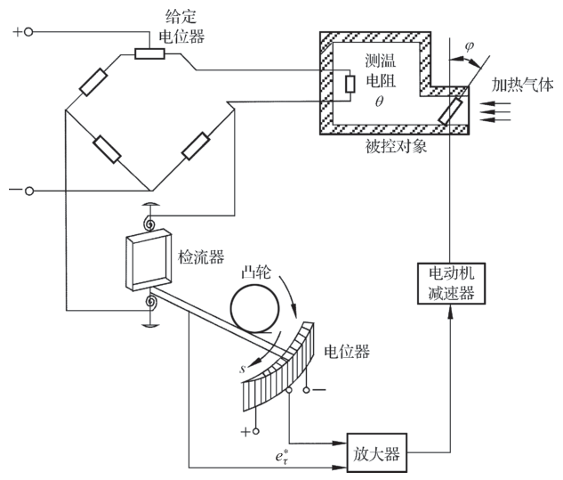{ .lq-img }

*图 7.1 炉温采样控制系统原理图（截自原书）*

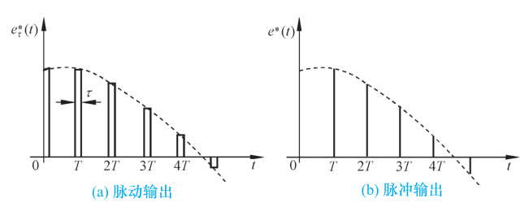{ .lq-img }

*图 7.2 电位器的输出电压：(a) 脉动输出；(b) 理想化后的脉冲输出（截自原书）*

这里有个工程上很深刻的对比：**炉温是大惯性过程，连续控制解决不了控制精度与动态性能的矛盾**。加大开环增益提精度，系统灵敏度随之提高——炉温低于给定值时，电动机迅速开大阀门，但炉温上升缓慢，等炉温到给定值时阀门早已开得更大，炉温继续上冲，造成反方向调节，振荡不止；炉温偏高时同样如此。改成采样控制后，只有检流计指针与电位器**接触的短暂时刻**电动机才在采样信号作用下旋转调节，脱开时电动机停转、保持阀门开度，**等待炉温缓慢变化**。电动机时转时停，调节过程的超调大为减少，甚至在较大开环增益下不但稳定、还能无超调。

由例 7-1 可见，采样系统里既有模拟部件又有脉冲部件。测量元件、执行元件和被控对象是模拟元件，输入输出是时间上和幅值上都连续的**模拟信号**；控制器中的脉冲元件，输入输出是时间上离散、幅值上连续的**离散模拟信号**。两种信号要相互传递，连续信号与脉冲序列之间用**采样器**，脉冲序列与连续信号之间用**保持器**——采样器和保持器是采样控制系统的两个特殊环节。

**(1) 信号采样和复现**。把连续信号转变为脉冲序列的过程叫**采样过程**（简称采样），实现采样的装置叫**采样器**或采样开关。用 T 表示采样周期（单位 s），\(f_s=1/T\) 表示采样频率（单位 1/s），\(\omega_s=2\pi f_s=2\pi/T\) 表示采样角频率（单位 rad/s）。实际采样开关多为电子开关，闭合时间极短，采样持续时间 \(\tau\) 远小于采样周期 T，也远小于系统连续部分的最大时间常数。为简化分析，认为 \(\tau\to 0\)，把采样器输出近似看成一串强度等于矩形脉冲面积的**理想脉冲** \(e^*(t)\)，如图 7-2(b)。

把脉冲序列转变为连续信号的过程叫**信号复现过程**，实现复现的装置叫**保持器**。用保持器不只是为了信号转换：采样器输出 \(e^*(t)\) 若不经滤波就恢复成连续信号，其中的高频分量相当于给连续部分加了噪声，不但影响控制质量，严重时加剧机械部件磨损。所以在采样器后面串联一个信号复现滤波器，最简单的由保持器实现，把 \(e^*(t)\) 复现成阶梯信号 \(e_h(t)\)；采样频率足够高时 \(e_h(t)\) 接近连续信号。

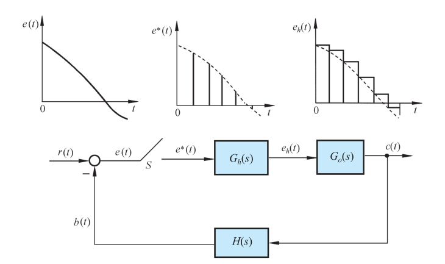{ .lq-img }

*图 7.4 采样系统典型结构图（截自原书）*

**(2) 采样系统的典型结构图**。按采样器位置不同可构成各种采样系统：采样器位于闭合回路之外（或系统本身无闭合回路）的叫**开环采样系统**；采样器位于闭合回路之内的叫**闭环采样系统**。用得最多的是**误差采样控制的闭环采样系统**，典型结构如图 7-4：S 为理想采样开关，采样瞬时的脉冲幅值等于相应瞬时误差信号 \(e(t)\) 的幅值；\(G_h(s)\) 为保持器、\(G_o(s)\) 为被控对象、\(H(s)\) 为测量变送反馈元件的传递函数。采样开关 S 的输出 \(e^*(t)\) 幅值与输入 \(e(t)\) 幅值之间是线性关系；当采样开关和系统其余部分的传递函数都具有线性特性时，称为**线性采样系统**。

### 数字控制系统

**数字控制系统**是以数字计算机为控制器、去控制具有连续工作状态的被控对象的闭环控制系统，包括工作于离散状态下的数字计算机和工作于连续状态下的被控对象两大部分。它在军事、航空及工业过程控制中应用广泛。

**例 7-2** 图 7-5（原书）是小口径高炮高精度数字伺服系统原理图。现代高炮伺服系统已由数字系统模式取代模拟模式，获得高速、高精度、无超调特性，性能大大超过原模拟系统——美国多管火炮反导系统"密集阵""守门员"等均采用数字伺服系统。本例以 MCS-96 系列单片机为数字控制器，结合 PWM（脉宽调制）直流伺服系统构成数字控制系统，具有低速性能好、稳态精度高、快速响应性好、抗扰能力强等特点。整个系统由控制计算机、被控对象和位置反馈三部分组成：数字信号发生器给出的 16 位数字输入 \(\theta_i\) 经两片 8255A 的口 A 进入控制计算机；输出角 \(\theta_0\)（模拟量）经 110XFS1/32 多极双通道旋转变压器和 2×12XSZ741 A/D 变换器完成绝对式轴角编码，得到粗、精各 12 位数码，经 8255A 口 B、口 C 进入计算机，软件合并成 16 位数字输出角；主控输出口（DAC1210）给出含误差角 \(\theta_e=\theta_i-\theta_0\) 及其一阶差分 \(\Delta\theta_e\)、输入角一阶差分 \(\Delta\theta_i\) 的复合控制信号，经 PWM 放大器驱动伺服电机；前馈输出口（DAC0832）把输入角二阶差分 \(\Delta^2\theta_i\) 经数字滤波后的前馈量加入系统以提高精度；另有粗、中、精三个误差角显示口供实时观测。PWM 放大器、伺服电机 ZK-21G、减速器、负载（小口径高炮）、测速发电机 45CY003 及速度/加速度无源校正网络构成闭环连续被控对象。

上例表明：计算机作为控制器，输入输出只能是二进制编码的数字信号（时间上、幅值上都离散），而被控对象和测量元件的信号是连续的，所以计算机控制系统中必须用 **A/D（模/数）和 D/A（数/模）转换器**实现两种信号的转换。计算机控制系统典型原理图如图 7-6（原书）：数字计算机每隔 T 秒进行一次控制修正，每个采样周期内完成连续信号的采样编码（A/D）和按控制律的数码运算，再由输出寄存器经解码网络把数码转换成连续信号（D/A）。**A/D 与 D/A 转换器是计算机控制系统的两个特殊环节**。

**(1) A/D 转换器**：把连续模拟信号转换为离散数字信号，含两个过程。一是**采样**：每隔 T 秒对连续信号 \(e(t)\) 采样一次得 \(e^*(t)\)，所以计算机中信号在时间上是断续的；二是**量化**（也称编码）：任何数值的离散信号必须表示成最小位二进制的整数倍才能运算，\(e^*(t)\) 经量化变成数字信号 \(\bar e^*(t)\)，所以断续性还表现在幅值上，如图 7-7（原书）的 (a) 连续信号 → (b) 离散信号 → (c) 数字信号。通常 A/D 有足够字长、量化单位 q 足够小，量化引起的幅值断续性可以忽略；再认为采样编码瞬时完成、用理想脉冲等效代替数字信号，则 **A/D 转换器可以用每隔 T 秒瞬时闭合一次的理想采样开关 S 表示**。

**(2) D/A 转换器**：把离散数字信号转换为连续模拟信号，也含两个过程。一是**解码**：离散数字信号 → 离散模拟信号；二是**复现**：离散模拟信号无法直接控制连续被控对象，需经保持器复现为连续模拟信号，如图 7-8（原书）的 (a) 离散数字信号 → (b) 连续模拟信号。计算机的输出寄存器和解码网络起到了保持器作用；保持后的 \(u_h(t)\) 是阶梯信号，采样频率足够高时趋近连续信号。

**(3) 数字控制系统的典型结构图**。假定 A/D 字长足够、量化可忽略、采样编码瞬时完成，则 A/D 可用周期为 T 的理想开关代替，D/A 可用传递函数为 \(G_h(s)\) 的保持器取代。数字控制器按一定控制律把采样误差信号 \(e^*(t)\) 加工成数字信号 \(u^*(t)\)，实质是一个**数字校正装置**，在结构图中可等效为一个传递函数为 \(G_c(s)\) 的脉冲控制器与一个周期为 T 的理想采样开关相串联。令被控对象传递函数为 \(G_o(s)\)、测量元件传递函数为 \(H(s)\)，得到图 7-9 所示的等效采样系统——这也是数字控制系统的常见典型结构图。

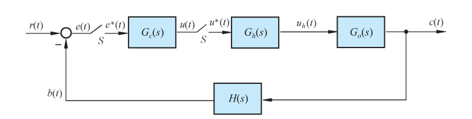{ .lq-img }

*图 7.9 数字控制系统典型结构图（截自原书）*

### 离散控制系统的特点

采样和数控技术广泛应用的原因，是数字控制系统较相应的连续系统有一系列特点：

1. 由数字计算机构成的数字校正装置，控制效果比连续式校正装置好，且控制规律由软件实现、易于改变，控制灵活。
2. 采样信号特别是数字信号的传递可以有效抑制噪声，提高系统抗扰能力。
3. 允许采用高灵敏度的控制元件，提高控制精度。
4. 一台计算机可分时控制若干个系统，设备利用率高，经济性好。
5. 对于具有传输延迟、特别是大延迟的控制系统，可以引入采样方式使系统稳定。

### 离散系统的研究方法

离散系统中有脉冲或数字信号，若仍沿用连续系统的拉氏变换方法建立各环节的传递函数，运算中会出现复变量 s 的**超越函数**。为克服这一障碍，需要采用 **z 变换法**建立离散系统的数学模型。经 z 变换处理后的离散系统，可以把连续系统的许多方法——稳定性分析、稳态误差计算、时间响应分析——经过适当改变后直接移植过来。这正是后面各节的展开顺序。

## 7.2 信号的采样与保持

离散系统中一处或数处的信号是脉冲序列或数字序列：把连续信号变成脉冲信号要靠采样器，把脉冲信号变回连续信号去控制连续式元部件要靠保持器。定量研究离散系统，必须先把采样过程和保持过程数学化。

### 采样过程

把连续信号变换为脉冲序列的装置称为采样器（采样开关），其采样过程可用一个周期性闭合的采样开关 S 表示，如图 7-10：每隔 T 秒闭合一次，闭合持续 \(\tau\) 秒；输入 \(e(t)\) 为连续信号，输出 \(e^*(t)\) 为宽度等于 \(\tau\) 的**调幅脉冲序列**，在采样瞬时 \(nT\)（\(n=0,1,2,\dots\)）出现。t=0 时采样器闭合 \(\tau\) 秒，此时 \(e^*(t)=e(t)\)；t=\(\tau\) 以后打开，\(e^*(t)=0\)；以后每隔 T 秒重复。显然，**采样过程要丢失采样间隔之间的信息**。

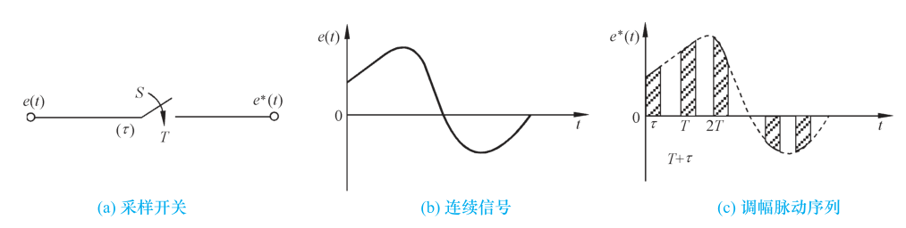{ .lq-img }

*图 7.10 实际采样过程：(a) 采样开关；(b) 连续信号；(c) 调幅脉冲序列（截自原书）*

有限脉冲宽度的采样系统数学分析非常复杂且无此必要——采样开关闭合时间通常为毫秒到微秒级，远小于 T 和连续部分最大时间常数，分析时认为 \(\tau=0\)，用**理想采样器**代替。此时采样过程可看成**幅值调制过程**：理想采样器像一个载波为 \(\delta_T(t)\) 的幅值调制器，输出 \(e^*(t)\) 是输入 \(e(t)\) 调制在载波 \(\delta_T(t)\) 上的结果，各脉冲强度（面积）用其高度表示，等于相应采样瞬时 \(t=nT\) 时 \(e(t)\) 的幅值，如图 7-11。数学描述为

\[
e^*(t)=e(t)\,\delta_T(t)
\tag{7.1}
\]

理想单位脉冲序列

\[
\delta_T(t)=\sum_{n=0}^{\infty}\delta(t-nT)
\tag{7.2}
\]

其中 \(\delta(t-nT)\) 是出现在 \(t=nT\)、强度为 1 的单位脉冲。故式 (7.1) 可写为

\[
e^*(t)=\sum_{n=0}^{\infty}e(nT)\,\delta(t-nT)
\tag{7.3}
\]

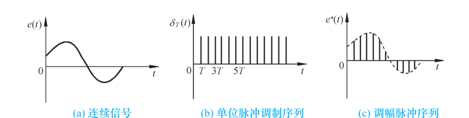{ .lq-img }

*图 7.11 理想采样过程：(a) 连续信号；(b) 单位脉冲调制序列；(c) 调幅脉冲序列（截自原书）*

注意：上述讨论假设 \(e(t)=0\ (t<0)\)，脉冲序列从零开始——这在实际控制系统中通常满足。

### 采样过程的数学描述

**(1) 采样信号的拉氏变换**。对式 (7.3) 取拉氏变换：

\[
E^*(s)=\mathcal{L}[e^*(t)]=\mathcal{L}\!\left[\sum_{n=0}^{\infty}e(nT)\,\delta(t-nT)\right]=\sum_{n=0}^{\infty}e(nT)\,\mathcal{L}[\delta(t-nT)]
\tag{7.4}
\]

由拉氏变换位移定理 \(\mathcal{L}[\delta(t-nT)]=e^{-nTs}\int_0^\infty\delta(t)\,\mathrm{d}t=e^{-nTs}\)，得

\[
E^*(s)=\sum_{n=0}^{\infty}e(nT)\,e^{-nTs}
\tag{7.5}
\]

式 (7.5) 把 \(E^*(s)\) 与采样函数值 \(e(nT)\) 直接联系，能直接看出 \(e^*(t)\) 的时间响应。但两点要强调：\(e^*(t)\) 只描述 \(e(t)\) 在采样瞬时的数值，\(E^*(s)\) **给不出采样间隔之间的信息**；式 (7.5) 形式上与连续信号的拉氏变换类似——若 \(e(t)\) 是有理函数，无穷级数 \(E^*(s)\) 总可写成 \(e^{Ts}\) 的有理函数（初值通常取 \(e(0^+)\)）。

**例 7-3** 设 \(e(t)=1(t)\)，求 \(e^*(t)\) 的拉氏变换。

解 由式 (7.5)：

\[
E^*(s)=\sum_{n=0}^{\infty}1\cdot e^{-nTs}=1+e^{-Ts}+e^{-2Ts}+\cdots
\]

无穷等比级数，公比 \(e^{-Ts}\)，求和得闭合形式

\[
E^*(s)=\frac{1}{1-e^{-Ts}}=\frac{e^{Ts}}{e^{Ts}-1},\qquad |e^{-Ts}|<1
\]

显然 \(E^*(s)\) 是 \(e^{Ts}\) 的有理函数。

**例 7-4** 设 \(e(t)=e^{-at}\)（t≥0，a 为常数），求 \(e^*(t)\) 的拉氏变换。

解 由式 (7.5)：

\[
E^*(s)=\sum_{n=0}^{\infty}e^{-anT}\,e^{-nTs}=\sum_{n=0}^{\infty}e^{-n(s+a)T}=\frac{1}{1-e^{-(s+a)T}}=\frac{e^{Ts}}{e^{Ts}-e^{-aT}},\qquad |e^{-(s+a)T}|<1
\]

也是 \(e^{Ts}\) 的有理函数。上述分析表明：只要 \(E(s)\) 可表示为 s 的有限次多项式之比，总可以用式 (7.5) 推出 \(E^*(s)\) 的闭合形式。然而 \(E^*(s)\) 虽是 \(e^{Ts}\) 的有理函数，却是 **s 的超越函数**，不便于分析和设计。通常采用 z 变换法：z 变换把离散系统的 s 超越方程变换为变量 z 的**代数方程**（见 7.3）。

**(2) 采样信号的频谱**。采样信号的信息不等于连续信号的全部信息，频谱因此发生变化；研究频谱的目的是找出 \(E^*(s)\) 与 \(E(s)\) 的相互联系。式 (7.2) 表明 \(\delta_T(t)\) 是周期函数，可展开为傅氏级数

\[
\delta_T(t)=\sum_{n=-\infty}^{+\infty}c_n\,e^{\mathrm{j}n\omega_s t}
\tag{7.6}
\]

式中 \(\omega_s=2\pi/T\) 为采样角频率，\(c_n\) 为傅氏系数：

\[
c_n=\frac{1}{T}\int_{-T/2}^{T/2}\delta_T(t)\,e^{-\mathrm{j}n\omega_s t}\,\mathrm{d}t
\]

由于在 \([-T/2, T/2]\) 中 \(\delta_T(t)\) 仅在 \(t=0\) 有值，且 \(e^{-\mathrm{j}n\omega_s t}\big|_{t=0}=1\)，所以

\[
c_n=\frac{1}{T}\int_{0^-}^{0^+}\delta(t)\,\mathrm{d}t=\frac{1}{T}
\tag{7.7}
\]

代入式 (7.6)：

\[
\delta_T(t)=\frac{1}{T}\sum_{n=-\infty}^{+\infty}e^{\mathrm{j}n\omega_s t}
\tag{7.8}
\]

再代入式 (7.1)：

\[
e^*(t)=\frac{1}{T}\sum_{n=-\infty}^{+\infty}e(t)\,e^{\mathrm{j}n\omega_s t}
\tag{7.9}
\]

两边取拉氏变换，由复数位移定理：

\[
E^*(s)=\frac{1}{T}\sum_{n=-\infty}^{+\infty}E(s+\mathrm{j}n\omega_s)
\tag{7.10}
\]

式 (7.10) 描述了理想采样器在频域中的特点，非常重要。若 \(E^*(s)\) 没有右半 s 平面极点，令 \(s=\mathrm{j}\omega\) 得采样信号的傅氏变换

\[
E^*(\mathrm{j}\omega)=\frac{1}{T}\sum_{n=-\infty}^{+\infty}E\bigl(\mathrm{j}(\omega+n\omega_s)\bigr)
\tag{7.11}
\]

式中 \(E(\mathrm{j}\omega)\) 为连续信号 \(e(t)\) 的傅氏变换。一般地，连续信号的频谱 \(|E(\mathrm{j}\omega)|\) 是单一的连续频谱（图 7-12，原书），其中 \(\omega_h\) 为频谱中的最大角频率；而采样信号的频谱 \(|E^*(\mathrm{j}\omega)|\) 是以采样角频率 \(\omega_s\) 为周期的**无穷多个频谱之和**，如图 7-13：n=0 的频谱称采样频谱的**主分量**，与连续频谱形状一致、仅幅值变化 1/T 倍；其余（\(n=\pm1,\pm2,\dots\)）都是采样引起的**高频频谱**，称采样频谱的**补分量**。图 7-13 画的是 \(\omega_s>2\omega_h\) 的情形；加大采样周期 T 使 \(\omega_s<2\omega_h\) 时，补分量相互交叠，采样器输出发生畸变，如图 7-14——这时即使用图 7-15（原书）所示 \(\omega=\omega_s/2\) 处突然截止的理想滤波器也无法恢复原连续信号的频谱。

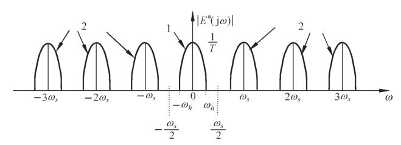{ .lq-img }

*图 7.13 采样信号频谱（ω<sub>s</sub>＞2ω<sub>h</sub>）：1 为主分量，2 为补分量（截自原书）*

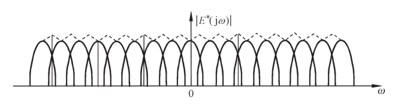{ .lq-img }

*图 7.14 采样信号频谱（ω<sub>s</sub>＜2ω<sub>h</sub>）：补分量交叠引起混叠（截自原书）*

所以，要想从 \(e^*(t)\) 中完全复现采样前的 \(e(t)\)，对采样角频率 \(\omega_s\) 有确定要求——这就是采样定理。

### 香农采样定理

在设计离散系统时，香农采样定理是必须严格遵守的准则，它指明了从采样信号中**不失真地复现原连续信号所必需的理论上的最大采样周期 T**。

!!! note "拓展：定理名称与"恰好 2ω<sub>h</sub>"为什么不行（补充）"
    该定理由 Nyquist 与 Shannon 先后给出，文献里也称奈奎斯特采样定理。式 (7.12) 取等号时 \(\omega_s=2\omega_h\)，主分量与补分量在 \(\omega_h\) 处首尾相接——理论上仍可分辨，但它要求理想低通滤波器在 \(\omega_s/2\) 处具有无限陡峭的截止特性，且实际信号带宽边缘并不干净，所以工程上总是留裕量取 \(\omega_s>2\omega_h\)，从不取恰好等于。

**香农采样定理**：如果采样器的输入信号 \(e(t)\) 具有有限带宽，且有直到 \(\omega_h\) 的频率分量，则使信号 \(e(t)\) 完全从采样信号 \(e^*(t)\) 中恢复过来的采样周期 T 满足

\[
T\le\frac{2\pi}{2\omega_h}=\frac{\pi}{\omega_h}
\tag{7.12}
\]

式 (7.12) 与 \(\omega_s\ge 2\omega_h\) 等价。满足定理条件时，要想不失真复现输入信号，需要理想滤波器：其幅频特性 \(|F(\mathrm{j}\omega)|\) 必须在 \(\omega=\omega_s/2\) 处突然截止，输出端便可准确得到 \(|E(\mathrm{j}\omega)|/T\) 的连续频谱——除幅值变化 1/T 倍外，频谱形状没有畸变。满足香农采样定理条件下理想采样器的特性如图 7-16（原书）：(a) 连续输入信号及其频谱；(b) 理想单位脉冲序列及其频谱；(c) 输出采样信号及其频谱（主频谱幅值为 1/T 倍）。

应当指出：香农采样定理只给出选择 T 或 \(f_s\) 的**指导原则**——由采样脉冲序列无失真再现原连续信号所允许的最大采样周期（最低采样频率）。工程实践中一般取 \(\omega_s>2\omega_h\)，而不取恰好 \(2\omega_h\)。

### 采样周期的选取

采样定理只给基本原则，没给具体计算公式。T 选得越小（\(\omega_s\) 越高），控制过程的信息越多，控制效果越好；但 T 过小会增加不必要的计算负担，造成实现较复杂控制规律的困难，而且 T 小到一定程度后再减小已无实际意义。反之 T 过大，给控制过程带来较大误差、降低动态性能，甚至可能导致整个控制系统失去稳定。

一般工业过程控制中，微型计算机的运算速度对采样周期选择的回旋余地较大，工程实践表明按表 7-1 的参考数据选择 T 可取得满意效果。但对**快速随动系统**，采样周期的选择是设计中必须认真考虑的问题。

**表 7-1 工业过程的采样周期选择**

| 控制过程 | 采样周期 T/s |
| --- | --- |
| 流量 | 1 |
| 压力 | 5 |
| 液面 | 5 |
| 温度 | 20 |
| 成分 | 20 |

从频域性能指标看：控制系统的闭环频率响应通常具有低通滤波特性，当随动系统输入信号的频率高于闭环幅频特性的谐振频率 \(\omega_r\) 时，信号通过系统将很快衰减，故可认为通过系统的控制信号最高频率分量为 \(\omega_r\)。随动系统中开环截止频率 \(\omega_c\) 与闭环谐振频率 \(\omega_r\) 相当接近，近似有 \(\omega_c=\omega_r\)，超过 \(\omega_c\) 的分量通过系统后将被大幅衰减。工程实践表明，随动系统的采样角频率可近似取为

\[
\omega_s=10\,\omega_c
\tag{7.13}
\]

或者

\[
T=\frac{1}{40}\,t_s
\tag{7.14}
\]

其中 \(t_s\) 为调节时间。

应当指出：采样周期选择得当，是 \(e(t)\) 可以从 \(e^*(t)\) 中完全复现的前提。然而理想滤波器实际并不存在，只能用特性接近的低通滤波器代替，**零阶保持器**是常用的低通滤波器之一。为此需要研究信号保持过程。

### 信号保持

用数字计算机作系统的信息处理机构时，处理结果的输出有两种方式：直接数字输出（屏幕显示、打印、二进制数送寄存器，如例 7-2 的误差角显示），或把数字信号转换为连续信号。后一种转换装置称为**保持器**。从数学上说，**保持器的任务是解决各采样点之间的插值问题**。

**(1) 保持器的数学描述**。由采样过程的描述可知：在采样时刻上，连续信号的函数值与脉冲序列的脉冲强度相等。\(nT\) 时刻：\(e^*(t)\big|_{t=nT}=e(nT)\)；\((n+1)T\) 时刻：\(e^*(t)\big|_{t=(n+1)T}=e[(n+1)T]\)。而在 \(nT\) 与 \((n+1)T\) 之间（\(0<\Delta t<T\)）连续信号 \(e(nT+\Delta t)\) 究竟多大、与 \(e(nT)\) 关系如何——这就是保持器要解决的问题。

实际上，**保持器是具有外推功能的元件**：现在时刻的输出取决于过去时刻离散信号的外推。通常用如下多项式外推公式描述保持器：

\[
e(nT+\Delta t)=a_0+a_1\Delta t+a_2\Delta t^2+\cdots+a_m\Delta t^m
\tag{7.15}
\]

式中 \(\Delta t\) 是以 \(nT\) 时刻为原点的坐标。式 (7.15) 表示：现在时刻的输出 \(e(nT+\Delta t)\) 值取决于 \(\Delta t=0,-T,-2T,\dots,-mT\) 各**过去时刻**的离散信号 \(e^*(nT),e^*[(n-1)T],\dots,e^*[(n-m)T]\) 共 m+1 个值；m+1 个待定系数 \(a_i\)（\(i=0,1,\dots,m\)）由过去各采样时刻的 m+1 个离散信号值唯一确定，故 \(a_i\) 有唯一解。这种保持器称为 **m 阶保持器**：m=0 称零阶保持器，m=1 称一阶保持器。工程实践中普遍采用零阶保持器。

**(2) 零阶保持器**。零阶保持器的外推公式为

\[
e(nT+\Delta t)=a_0
\]

显然 \(\Delta t=0\) 时也成立，故 \(a_0=e(nT)\)。零阶保持器的数学表达式为

\[
e(nT+\Delta t)=e(nT),\qquad 0\le\Delta t<T
\tag{7.16}
\]

即零阶保持器是一种**按常值外推**的保持器：把前一采样时刻 \(nT\) 的采样值 \(e(nT)\)（各采样点上 \(e^*(nT)=e(nT)\)）一直保持到下一采样时刻 \((n+1)T\) 到来之前，使 \(e^*(t)\) 变成阶梯信号 \(e_h(t)\)，如图 7-17。把阶梯信号的中点连接起来（图 7-17 点划线），可得与连续信号 \(e(t)\) 形状一致、但时间上落后 T/2 的响应 \(e[t-(T/2)]\)。

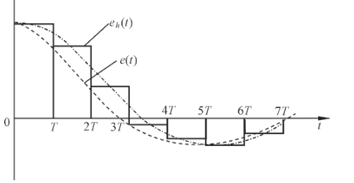{ .lq-img }

*图 7.17 零阶保持器的输出特性（截自原书）*

式 (7.16) 还表明：零阶保持过程是由于理想脉冲 \(e(nT)\delta(t-nT)\) 的作用结果。给零阶保持器输入一个理想单位脉冲 \(\delta(t)\)，其脉冲过渡函数 \(g_h(t)\) 是幅值为 1、持续时间为 T 的矩形脉冲，可分解为两个单位阶跃函数之和：

\[
g_h(t)=1(t)-1(t-T)
\]

取拉氏变换得零阶保持器的传递函数：

\[
G_h(s)=\frac{1}{s}-\frac{e^{-Ts}}{s}=\frac{1-e^{-Ts}}{s}
\tag{7.17}
\]

令 \(s=\mathrm{j}\omega\)，得零阶保持器的频率特性：

\[
G_h(\mathrm{j}\omega)=\frac{1-e^{-\mathrm{j}\omega T}}{\mathrm{j}\omega}
=\frac{2e^{-\mathrm{j}\omega T/2}(e^{\mathrm{j}\omega T/2}-e^{-\mathrm{j}\omega T/2})}{2\mathrm{j}\omega T}\cdot T
=T\,\frac{\sin(\omega T/2)}{\omega T/2}\,e^{-\mathrm{j}\omega T/2}
\tag{7.18}
\]

以采样角频率 \(\omega_s=2\pi/T\) 表示：

\[
G_h(\mathrm{j}\omega)=\frac{2\pi}{\omega_s}\cdot\frac{\sin\pi(\omega/\omega_s)}{\pi(\omega/\omega_s)}\,e^{-\mathrm{j}\pi(\omega/\omega_s)}
\tag{7.19}
\]

据此画出零阶保持器的幅频特性 \(|G_h(\mathrm{j}\omega)|\) 和相频特性 \(\angle G_h(\mathrm{j}\omega)\)，如图 7-18。零阶保持器具有如下特性：

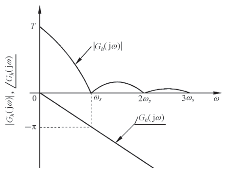{ .lq-img }

*图 7.18 零阶保持器的幅频特性和相频特性（截自原书）*

1. **低通特性**。幅值随频率增大迅速衰减，说明零阶保持器基本上是一个低通滤波器；但与理想滤波器相比，\(\omega=\omega_s/2\) 处幅值只有初值的 63.7%，且截止频率不止一个——除允许主要频谱分量通过外，还允许部分高频分量通过，造成数字控制系统输出中存在纹波。
2. **相角滞后特性**。零阶保持器产生相角滞后，且随 \(\omega\) 增大而加大，\(\omega=\omega_s\) 处相角滞后可达 \(-180^\circ\)，使闭环系统稳定性变差。
3. **时间滞后特性**。输出为阶梯信号 \(e_h(t)\)，平均响应为 \(e[t-(T/2)]\)——输出比输入在时间上滞后 T/2，相当于给系统增加了一个延迟时间为 T/2 的延迟环节，使系统总相角滞后增大，对稳定性不利；阶梯输出同时也增加输出中的纹波。

工程实践中，零阶保持器可用输出寄存器实现；正常情况下还应附加模拟滤波器（如例 7-2），以有效去除采样频率及其谐波频率附近的高频分量。

## 7.3 z 变换理论

z 变换的思想来源于连续系统：连续系统的动态及稳态性能用拉氏变换分析，离散系统的性能则用 z 变换获得。z 变换是从拉氏变换直接引申出来的变换方法，实际上是采样函数拉氏变换的变形，故又称**采样拉氏变换**，是研究线性离散系统的重要数学工具。

### z 变换定义

设连续函数 \(e(t)\) 是可拉氏变换的，则

\[
E(s)=\int_0^\infty e(t)\,e^{-st}\,\mathrm{d}t
\]

由于 \(t<0\) 时 \(e(t)=0\)，也可写成 \(\int_{-\infty}^{\infty}\)。对采样信号 (7.3) 取拉氏变换：

\[
E^*(s)=\int_{-\infty}^{+\infty}e^*(t)\,e^{-st}\,\mathrm{d}t
=\int_{-\infty}^{+\infty}\Bigl[\sum_{n=0}^{\infty}e(nT)\,\delta(t-nT)\Bigr]e^{-st}\,\mathrm{d}t
=\sum_{n=0}^{\infty}e(nT)\int_{-\infty}^{+\infty}\delta(t-nT)\,e^{-st}\,\mathrm{d}t
\tag{7.20}
\]

由广义脉冲函数的筛选性质 \(\int_{-\infty}^{+\infty}\delta(t-nT)f(t)\,\mathrm{d}t=f(nT)\)，有 \(\int_{-\infty}^{+\infty}\delta(t-nT)e^{-st}\,\mathrm{d}t=e^{-snT}\)。于是采样拉氏变换式 (7.20) 可写为

\[
E^*(s)=\sum_{n=0}^{\infty}e(nT)\,e^{-nsT}
\tag{7.21}
\]

式中各项均含 \(e^{sT}\) 因子，是 s 的超越函数。为便于应用，令变量

\[
z=e^{sT}
\tag{7.22}
\]

式中 T 为采样周期；z 是在复数平面上定义的复变量，通常称为 **z 变换算子**。代入式 (7.21)，采样信号 \(e^*(t)\) 的 z 变换定义为

\[
E(z)=E^*(s)\Big|_{s=\frac{1}{T}\ln z}=\sum_{n=0}^{\infty}e(nT)\,z^{-n}
\tag{7.23}
\]

记作

\[
E(z)=\mathcal{Z}[e^*(t)]=\mathcal{Z}[e(t)]
\tag{7.24}
\]

后一记号只为书写方便——并不意味着是连续信号 \(e(t)\) 的 z 变换，仍指采样信号 \(e^*(t)\) 的 z 变换。**z 变换仅是一种在采样拉氏变换中取 \(z=e^{sT}\) 的变量置换**：通过这种置换，可将 s 的超越函数转换为 z 的幂级数或 z 的有理分式。

### z 变换方法

求离散时间函数的 z 变换有多种方法，常用的两种主要方法如下。

**(1) 级数求和法**。直接根据 z 变换定义，把式 (7.23) 写成展开形式：

\[
E(z)=e(0)+e(T)z^{-1}+e(2T)z^{-2}+\cdots+e(nT)z^{-n}+\cdots
\tag{7.25}
\]

这是离散时间函数 \(e^*(t)\) 的无穷级数表达形式。给定理想采样开关的输入 \(e(t)\)（或输出 \(e^*(t)\)）及采样周期 T，立即可得 z 变换的级数展开式；对常用函数，级数形式都可写出闭合形式。

**例 7-5** 试求单位阶跃函数 \(1(t)\) 的 z 变换。

解 \(e(t)=1(t)\) 在所有采样时刻上的采样值均为 1，即 \(e(nT)=1\)（\(n=0,1,2,\dots\)），由式 (7.25)：

\[
E(z)=1+z^{-1}+z^{-2}+\cdots
\]

若 \(|z^{-1}|<1\)，无穷级数收敛，由等比级数求和公式得闭合形式：

\[
E(z)=\frac{1}{1-z^{-1}}=\frac{z}{z-1}
\]

因为 \(|z^{-1}|=|e^{-sT}|=e^{-\sigma T}\)（\(\sigma=\mathrm{Re}\,s\)），条件 \(|z^{-1}|<1\) 意味着 \(\sigma>0\)——这正是单位阶跃函数可拉氏变换的条件。本例结果与例 7-3 一致。

**例 7-6** 设 \(e(t)=\delta_T(t)=\sum_{n=0}^{\infty}\delta(t-nT)\)，试求理想脉冲序列 \(\delta_T(t)\) 的 z 变换。

解 因为 T 为采样周期，\(e^*(t)=\delta_T(t)\)，由拉氏变换知 \(E^*(s)=\sum_{n=0}^{\infty}e^{-nsT}\)。因此

\[
E(z)=1+z^{-1}+z^{-2}+\cdots=\frac{1}{1-z^{-1}}=\frac{z}{z-1},\qquad |z|>1
\]

从例 7-5 和例 7-6 可见：**相同的 z 变换 E(z) 对应于相同的采样函数 \(e^*(t)\)，但不一定对应于相同的连续函数 \(e(t)\)**（\(1(t)\) 与 \(\delta_T(t)\) 的采样值全为 1，z 变换相同，时域形状却截然不同）——这是利用 z 变换法分析离散系统时要特别注意的问题。

**(2) 部分分式法**。先求出已知连续时间函数 \(e(t)\) 的拉氏变换 \(E(s)\)，再把有理分式 \(E(s)\) 展成部分分式之和，使每一部分分式对应简单时间函数，其 z 变换已知，于是可方便求出 \(E(z)\)。

**例 7-7** 设 \(e(t)=\sin\omega t\)，试求其 \(E(z)\)。

解 对 \(e(t)=\sin\omega t\) 取拉氏变换，得 \(E(s)=\dfrac{\omega}{s^2+\omega^2}\)。展开为部分分式：

\[
E(s)=\frac{1}{2\mathrm{j}}\left(\frac{1}{s-\mathrm{j}\omega}-\frac{1}{s+\mathrm{j}\omega}\right)
\]

根据指数函数的 z 变换（表 7-2 第 8 条）：

\[
E(z)=\frac{1}{2\mathrm{j}}\left(\frac{z}{z-e^{\mathrm{j}\omega T}}-\frac{z}{z-e^{-\mathrm{j}\omega T}}\right)
=\frac{1}{2\mathrm{j}}\cdot\frac{z(e^{-\mathrm{j}\omega T}-e^{\mathrm{j}\omega T})}{z^2-z(e^{\mathrm{j}\omega T}+e^{-\mathrm{j}\omega T})+1}
\]

化简后得

\[
E(z)=\frac{z\sin\omega T}{z^2-2z\cos\omega T+1}
\]

常用时间函数的 z 变换表如表 7-2。由表可见：这些函数的 z 变换都是 z 的有理分式，且分母多项式的次数大于或等于分子多项式的次数；分母 z 多项式的最高次数与相应传递函数分母 s 多项式的最高次数相等。

**表 7-2 z 变换表**

| 序号 | 拉氏变换 \(E(s)\) | 时间函数 \(e(t)\) | z 变换 \(E(z)\) |
| --- | --- | --- | --- |
| 1 | \(e^{-nsT}\) | \(\delta(t-nT)\) | \(z^{-n}\) |
| 2 | 1 | \(\delta(t)\) | 1 |
| 3 | \(\dfrac{1}{s}\) | \(1(t)\) | \(\dfrac{z}{z-1}\) |
| 4 | \(\dfrac{1}{s^2}\) | \(t\) | \(\dfrac{Tz}{(z-1)^2}\) |
| 5 | \(\dfrac{1}{s^3}\) | \(\dfrac{t^2}{2!}\) | \(\dfrac{T^2z(z+1)}{(z-1)^3}\) |
| 6 | \(\dfrac{1}{s^4}\) | \(\dfrac{t^3}{3!}\) | \(\dfrac{T^3z(z^2+4z+1)}{(z-1)^4}\) |
| 7 | \(\dfrac{1}{s-(1/T)\ln a}\) | \(a^{t/T}\) | \(\dfrac{z}{z-a}\) |
| 8 | \(\dfrac{1}{s+a}\) | \(e^{-at}\) | \(\dfrac{z}{z-e^{-aT}}\) |
| 9 | \(\dfrac{1}{(s+a)^2}\) | \(t\,e^{-at}\) | \(\dfrac{Tze^{-aT}}{(z-e^{-aT})^2}\) |
| 10 | \(\dfrac{1}{(s+a)^3}\) | \(\dfrac{t^2}{2}e^{-at}\) | \(\dfrac{T^2z(z+e^{-aT})e^{-aT}}{2(z-e^{-aT})^3}\) |
| 11 | \(\dfrac{a}{s(s+a)}\) | \(1-e^{-at}\) | \(\dfrac{(1-e^{-aT})z}{(z-1)(z-e^{-aT})}\) |
| 12 | \(\dfrac{a^2}{s^2(s+a)}\) | \(t-\dfrac{1-e^{-at}}{a}\) | \(\dfrac{Tz}{(z-1)^2}-\dfrac{(1-e^{-aT})z}{a(z-1)(z-e^{-aT})}\) |
| 13 | \(\dfrac{\omega}{s^2+\omega^2}\) | \(\sin\omega t\) | \(\dfrac{z\sin\omega T}{z^2-2z\cos\omega T+1}\) |
| 14 | \(\dfrac{s}{s^2+\omega^2}\) | \(\cos\omega t\) | \(\dfrac{z(z-\cos\omega T)}{z^2-2z\cos\omega T+1}\) |
| 15 | \(\dfrac{\omega^2}{s(s^2+\omega^2)}\) | \(1-\cos\omega t\) | \(\dfrac{z(1-\cos\omega T)(z+1)}{(z-1)(z^2-2z\cos\omega T+1)}\) |
| 16 | \(\dfrac{\omega}{(s+a)^2+\omega^2}\) | \(e^{-at}\sin\omega t\) | \(\dfrac{ze^{-aT}\sin\omega T}{z^2-2ze^{-aT}\cos\omega T+e^{-2aT}}\) |
| 17 | \(\dfrac{s+a}{(s+a)^2+\omega^2}\) | \(e^{-at}\cos\omega t\) | \(\dfrac{z(z-e^{-aT}\cos\omega T)}{z^2-2ze^{-aT}\cos\omega T+e^{-2aT}}\) |
| 18 | \(\dfrac{b-a}{(s+a)(s+b)}\) | \(e^{-at}-e^{-bt}\) | \(\dfrac{z(e^{-aT}-e^{-bT})}{(z-e^{-aT})(z-e^{-bT})}\) |

表中的闭合形式都可以用"采样序列 \(e(nT)\) 与幂级数展开逐项比对"来验证：

=== "MATLAB"

    ```matlab
    % ===== 书 7-3 节 级数求和法与表7-2 验证 =====
    syms z n T a w positive
    % 单位阶跃：Z{1} 采样值恒为 1
    simplify(ztrans(sym(1), n, z))              % ans = z/(z-1)
    % 单位斜坡：采样值 0, T, 2T, ...
    simplify(ztrans(n*T, n, z))                 % ans = T*z/(z-1)^2
    % 指数：采样值 exp(-a*n*T)
    simplify(ztrans(exp(-a*n*T), n, z))         % ans = z/(z-exp(-a*T))
    % 正弦：采样值 sin(w*n*T)
    simplify(ztrans(sin(w*n*T), n, z))
    % ans = z*sin(T*w)/(z^2-2*cos(T*w)*z+1)
    ```

=== "Python"

    ```python
    # ===== 书 7-3 节 级数求和法与表7-2 验证 =====
    import sympy as sp

    z = sp.Symbol('z')
    q = sp.Symbol('q', positive=True)          # q = z^(-1)

    def series_coeffs(E, n=5):
        """把 E(z) 按 z^(-1) 幂级数展开，返回前 n 项系数（即 e(0),e(T),...）。"""
        return sp.expand(sp.series(E.subs(z, 1/q), q, 0, n).removeO()).as_poly(q).all_coeffs()[::-1]

    # 单位阶跃 1(t)：Z{1(t)} = z/(z-1)，采样值恒为 1
    print('1(t) :', series_coeffs(z/(z - 1)))
    # 单位斜坡 t：Z{t} = Tz/(z-1)^2，采样值 0,T,2T,...
    T = sp.Symbol('T', positive=True)
    print('t    :', series_coeffs(T*z/(z - 1)**2))
    # 指数 e^(-at)：Z{e^(-at)} = z/(z-e^(-aT))，采样值 e^(-anT)
    a = sp.Symbol('a', positive=True)
    print('e^-at:', series_coeffs(z/(z - sp.exp(-a*T))))
    # 正弦 sin(wt)：Z{sin wt} = z sin(wT)/(z^2-2z cos(wT)+1)
    w = sp.Symbol('w', positive=True)
    Ez = z*sp.sin(w*T)/(z**2 - 2*z*sp.cos(w*T) + 1)
    c = series_coeffs(Ez, 4)
    print('sin  :', [sp.trigsimp(sp.simplify(c[i])) for i in range(len(c))])
    # 期望输出：[1,1,1,1,1] / [0,T,2T,3T,4T] / [1,e^-aT,e^-2aT,...] / [0,sin wT,sin 2wT,...]
    ```

### z 变换性质

z 变换的基本定理使应用变得简单方便，内容与拉氏变换基本定理有相似之处。

**(1) 线性定理**。若 \(E_1(z)=\mathcal{Z}[e_1(t)]\)，\(E_2(z)=\mathcal{Z}[e_2(t)]\)，a 为常数，则

\[
\mathcal{Z}[e_1(t)\pm e_2(t)]=E_1(z)\pm E_2(z)
\tag{7.26}
\]

\[
\mathcal{Z}[a\,e(t)]=aE(z)
\tag{7.27}
\]

证明：由 z 变换定义

\[
\mathcal{Z}[e_1(t)\pm e_2(t)]=\sum_{n=0}^{\infty}\bigl[e_1(nT)\pm e_2(nT)\bigr]z^{-n}
=\sum_{n=0}^{\infty}e_1(nT)z^{-n}\pm\sum_{n=0}^{\infty}e_2(nT)z^{-n}=E_1(z)\pm E_2(z)
\]

\(\mathcal{Z}[a\,e(t)]=\sum_n a\,e(nT)z^{-n}=aE(z)\)。式 (7.26)、(7.27) 表明 z 变换满足齐次性与均匀性，是线性变换。

**(2) 实数位移定理**。又称平移定理。实数位移指整个采样序列在时间轴上左右平移若干采样周期：向左平移为超前，向右平移为滞后。若 \(e(t)\) 可拉氏变换、其 z 变换为 \(E(z)\)，则

\[
\mathcal{Z}[e(t-kT)]=z^{-k}E(z)
\tag{7.28}
\]

\[
\mathcal{Z}[e(t+kT)]=z^k\Bigl[E(z)-\sum_{n=0}^{k-1}e(nT)\,z^{-n}\Bigr]
\tag{7.29}
\]

其中 k 为正整数。

证明：由 z 变换定义

\[
\mathcal{Z}[e(t-kT)]=\sum_{n=0}^{\infty}e(nT-kT)z^{-n}=\sum_{n=0}^{\infty}e[(n-k)T]z^{-n}
\]

令 \(m=n-k\)：\(=\sum_{m=-k}^{\infty}e(mT)z^{-m-k}\)。由 z 变换的单边性，\(m<0\) 时 \(e(mT)=0\)，故 \(=\sum_{m=0}^{\infty}e(mT)z^{-m}\cdot z^{-k}=z^{-k}E(z)\)，证得式 (7.28)。

为证式 (7.29)，取 k=1：

\[
\mathcal{Z}[e(t+T)]=\sum_{n=0}^{\infty}e[(n+1)T]z^{-n}=\sum_{n=0}^{\infty}e[(n+1)T]\,z^{(n+1)}\cdot z^{-1}
\]

令 \(m=n+1\)：

\[
\mathcal{Z}[e(t+T)]=z^{-1}\sum_{m=1}^{\infty}e(mT)z^{-m}\cdot z=z\Bigl[\sum_{m=0}^{\infty}e(mT)z^{-m}-e(0)\Bigr]=zE(z)-ze(0)
\]

取 k=2，同理得 \(\mathcal{Z}[e(t+2T)]=z^2E(z)-z^2e(0)-ze(T)\)；取 k=k 时必有式 (7.29)。

实数位移定理中，式 (7.28) 称**滞后定理**，式 (7.29) 称**超前定理**。算子 z 有明确的物理意义：\(z^{-k}\) 代表时域中的**滞后环节**，把采样信号滞后 k 个采样周期；\(z^k\) 代表超前环节。但 \(z^k\) 仅用于运算，物理系统中并不存在。实数位移定理作用相当于拉氏变换中的微分和积分定理——应用它，可把描述离散系统的差分方程转换为 z 域的代数方程。

**例 7-8** 试用实数位移定理计算滞后一个采样周期的指数函数 \(e^{-a(t-T)}\) 的 z 变换（a 为常数）。

解 由式 (7.28)：

\[
\mathcal{Z}\bigl[e^{-a(t-T)}\bigr]=z^{-1}\,\mathcal{Z}\bigl[e^{-at}\bigr]=z^{-1}\cdot\frac{z}{z-e^{-aT}}=\frac{1}{z-e^{-aT}}
\]

**(3) 复数位移定理**。若函数 \(e(t)\) 可拉氏变换、其 z 变换为 \(E(z)\)，则

\[
\mathcal{Z}\bigl[e^{\pm at}e(t)\bigr]=E\bigl(ze^{\mp aT}\bigr)
\tag{7.30}
\]

证明：由 z 变换定义

\[
\mathcal{Z}\bigl[e^{\pm at}e(t)\bigr]=\sum_{n=0}^{\infty}e(nT)e^{\pm anT}z^{-n}=\sum_{n=0}^{\infty}e(nT)\bigl(ze^{\mp aT}\bigr)^{-n}
\]

令 \(z_1=ze^{\mp aT}\)，则 \(=\sum_{n=0}^{\infty}e(nT)z_1^{-n}=E(z_1)=E(ze^{\mp aT})\)。复数位移定理仿照拉氏变换的复数位移定理导出：函数 \(e^*(t)\) 乘以指数序列 \(e^{\pm anT}\) 的 z 变换，等于在 \(E(z)\) 中以 \(ze^{\mp aT}\) 取代原算子 z。

**例 7-9** 试用复数位移定理计算函数 \(te^{-at}\) 的 z 变换。

解 令 \(e(t)=t\)，由表 7-2 知 \(\mathcal{Z}[t]=\dfrac{Tz}{(z-1)^2}\)。根据复数位移定理 (7.30)：

\[
\mathcal{Z}\bigl[te^{-at}\bigr]=\frac{T\,(ze^{-aT})}{(ze^{-aT}-1)^2}=\frac{Tze^{-aT}}{(z-e^{-aT})^2}
\]

**(4) 终值定理**。如果函数 \(e(t)\) 的 z 变换为 \(E(z)\)，函数序列 \(e(nT)\) 为有限值（\(n=0,1,2,\dots\)），且极限 \(\lim_{n\to\infty}e(nT)\) 存在，则函数序列的终值

\[
\lim_{n\to\infty}e(nT)=\lim_{z\to1}(z-1)E(z)
\tag{7.31}
\]

证明：由线性定理

\[
\mathcal{Z}\bigl[e(t)+e(t-T)\bigr]=\mathcal{Z}[e(t)]+\mathcal{Z}[e(t-T)]=\sum_{n=0}^{\infty}\bigl[e(nT)+e[(n-1)T]\bigr]z^{-n}
\]

由实数位移定理 \(\mathcal{Z}[e(t-T)]=z^{-1}E(z)\)，于是

\[
(z-1)E(z)-ze(0)=\sum_{n=0}^{\infty}\bigl(e[(n+1)T]-e(nT)\bigr)z^{-n}
\]

两边取 \(z\to1\) 的极限。当取 \(n=N\) 为有限项时，右端可写为

\[
\sum_{n=0}^{N}\bigl(e[(n+1)T]-e(nT)\bigr)=e[(N+1)T]-e(0)
\]

令 \(N\to\infty\)：

\[
\lim_{z\to1}(z-1)E(z)-ze(0)=\lim_{N\to\infty}e[(N+1)T]-e(0)=\lim_{n\to\infty}e(nT)-e(0)
\]

所以 \(\lim_{n\to\infty}e(nT)=\lim_{z\to1}(z-1)E(z)\)。终值定理形式亦可表示为

\[
e(\infty)=\lim_{z\to1}(1-z^{-1})E(z)
\tag{7.32}
\]

在离散系统分析中，常用终值定理求取系统输出序列的终值误差（稳态误差）。

**例 7-10** 设 z 变换函数为

\[
E(z)=\frac{0.792z^2}{(z-1)(z^2-0.416z+0.208)}
\]

试利用终值定理确定 \(e(nT)\) 的终值。

解 由终值定理 (7.31) 得

\[
e(\infty)=\lim_{z\to1}(z-1)\,\frac{0.792z^2}{(z-1)(z^2-0.416z+0.208)}
=\lim_{z\to1}\frac{0.792z^2}{z^2-0.416z+0.208}=\frac{0.792}{1-0.416+0.208}=1
\]

**(5) 卷积定理**。设 \(x(nT)\) 和 \(y(nT)\) 为两个采样函数，其**离散卷积**定义为

\[
x(nT)*y(nT)=\sum_{k=0}^{\infty}x(kT)\,y[(n-k)T]
\tag{7.33}
\]

卷积定理：若 \(g(nT)=x(nT)*y(nT)\)，必有

\[
G(z)=X(z)\cdot Y(z)
\tag{7.34}
\]

证明：由 z 变换，\(X(z)=\sum_{k=0}^{\infty}x(kT)z^{-k}\)，\(Y(z)=\sum_{n=0}^{\infty}y(nT)z^{-n}\)。再由定理已知条件

\[
\mathcal{Z}[g(nT)]=\mathcal{Z}[x(nT)*y(nT)]
\tag{7.35}
\]

所以 \(\mathcal{Z}[g(nT)]=X(z)\sum_{k=0}^{\infty}x(kT)z^{-k}\cdot Y(z)=X(z)\cdot Y(z)\)（其中用到平移定理 \(\mathcal{Z}[y[(n-k)T]]=z^{-k}Y(z)\) 与求和次序交换）。卷积定理指出：**两个采样函数卷积的 z 变换，等于该两个采样函数相应 z 变换的乘积**。在离散系统分析中，卷积定理是沟通时域与 z 域的桥梁。

### z 反变换

在连续系统中，应用拉氏变换的目的是把微分方程变成 s 的代数方程、写出传递函数，再用拉氏反变换求时间响应。类似地，在离散系统中应用 z 变换，是为了把 s 的超越方程或差分方程转换为 z 的代数方程，写出脉冲传递函数（z 传递函数），再用 **z 反变换**求出离散系统的时间响应。

所谓 z 反变换，是已知 z 变换表达式 \(E(z)\)，求相应离散序列 \(e(nT)\) 的过程，记为

\[
e(nT)=\mathcal{Z}^{-1}[E(z)]
\]

进行 z 反变换时，信号序列仍是单边的：\(n<0\) 时 \(e(nT)=0\)。常用的 z 反变换法有如下三种。

**(1) 部分分式法**。又称查表法：根据已知 \(E(z)\)，通过查 z 变换表找出相应的 \(e^*(t)\) 或 \(e(nT)\)。z 变换表内容有限，需要先把 \(E(z)\) 展开成部分分式。考虑到 z 变换表中所有 \(E(z)\) 在分子上普遍有因子 z，**应将 \(E(z)/z\) 展开为部分分式**，再将所得每一项乘以 z。设 \(E(z)\) 无重极点，先求出极点 \(z_1,z_2,\dots,z_n\)，将 \(E(z)/z\) 展成

\[
\frac{E(z)}{z}=\sum_{i=1}^{n}\frac{A_i}{z-z_i}
\]

其中 \(A_i\) 为 \(E(z)/z\) 在极点 \(z_i\) 处的留数，于是

\[
E(z)=\sum_{i=1}^{n}\frac{A_iz}{z-z_i}
\]

逐项查 z 变换表得 \(\mathcal{Z}^{-1}\left[\dfrac{A_iz}{z-z_i}\right]=A_iz_i^n\)（\(i=1,2,\dots,n\)），最后写出

\[
e^*(t)=\sum_{n=0}^{\infty}\sum_{i=1}^{n}A_iz_i^n\,\delta(t-nT)
\tag{7.36}
\]

**例 7-11** 设 z 变换函数为

\[
E(z)=\frac{(1-e^{-aT})z}{(z-1)(z-e^{-aT})}
\]

试求其 z 反变换。

解 因为

\[
\frac{E(z)}{z}=\frac{1-e^{-aT}}{(z-1)(z-e^{-aT})}=\frac{1}{z-1}-\frac{1}{z-e^{-aT}}
\]

所以 \(E(z)=\dfrac{z}{z-1}-\dfrac{z}{z-e^{-aT}}\)。查 z 变换表 7-2 第 3 项及第 8 项，采样瞬时的信号序列为

\[
e(nT)=1-e^{-anT}
\]

故由式 (7.36) 得

\[
e^*(t)=\sum_{n=0}^{\infty}\bigl(1-e^{-anT}\bigr)\delta(t-nT)
\]

相应有 \(e(0)=0\)，\(e(T)=1-e^{-aT}\)，\(e(2T)=1-e^{-2aT}\)，……

**(2) 幂级数法**。又称综合除法。由表 7-2 知，\(E(z)\) 通常可表示为按 \(z^{-1}\) 升幂排列的两个多项式之比：

\[
E(z)=\frac{b_0+b_1z^{-1}+b_2z^{-2}+\cdots+b_mz^{-m}}{1+a_1z^{-1}+a_2z^{-2}+\cdots+a_nz^{-n}},\qquad m\le n
\tag{7.37}
\]

对式 (7.37) 直接作综合除法，得到按 \(z^{-1}\) 升幂排列的幂级数展开式

\[
E(z)=c_0+c_1z^{-1}+c_2z^{-2}+\cdots+c_nz^{-n}+\cdots=\sum_{n=0}^{\infty}c_nz^{-n}
\tag{7.38}
\]

若所得无穷幂级数收敛，则按 z 变换定义，式 (7.38) 中的系数 \(c_n\)（\(n=0,1,\dots\)）就是采样脉冲序列 \(e^*(t)\) 的脉冲强度 \(e(nT)\)，可直接写出

\[
e^*(t)=\sum_{n=0}^{\infty}c_n\,\delta(t-nT)
\tag{7.39}
\]

实际应用中常常只需计算有限的几项——**用幂级数法计算 \(e^*(t)\) 最简便**，这是 z 变换法的优点之一；但要从一组 \(e(nT)\) 值求出通项表达式一般比较困难。

**例 7-12** 设 z 变换函数

\[
E(z)=\frac{z^3+2z^2+1}{z^3-1.5z^2+0.5z}
\]

试用幂级数法求 \(E(z)\) 的 z 反变换。

解 将给定的 \(E(z)\) 表示为

\[
E(z)=\frac{1+2z^{-1}+z^{-3}}{1-1.5z^{-1}+0.5z^{-2}}
\]

利用综合除法得

\[
E(z)=1+3.5z^{-1}+4.75z^{-2}+6.375z^{-3}+\cdots
\]

由式 (7.39) 得采样函数

\[
e^*(t)=\delta(t)+3.5\,\delta(t-T)+4.75\,\delta(t-2T)+6.375\,\delta(t-3T)+\cdots
\]

应当指出，只要 \(E(z)\) 的幂级数在 z 平面的某个区域内收敛，应用 z 变换法解决离散系统问题时就不需要指出 \(E(z)\) 在什么 z 值上收敛。

**(3) 反演积分法**。又称留数法。实际问题中遇到的 \(E(z)\) 除有理分式外也可能是超越函数，此时无法用部分分式法及幂级数法，只能用反演积分法（它对有理分式也适用）。由于 \(E(z)\) 的幂级数展开形式为

\[
E(z)=\sum_{n=0}^{\infty}e(nT)z^{-n}=e(0)+e(T)z^{-1}+e(2T)z^{-2}+\cdots
\tag{7.40}
\]

所以 \(E(z)\) 可看成 z 平面上的劳伦级数，级数各系数 \(e(nT)\) 可由积分求出——求积分要用柯西留数定理，故也称留数法。

为推导反演积分公式，用 \(z^{n-1}\) 乘式 (7.40) 两端：

\[
E(z)z^{n-1}=e(0)z^{n-1}+e(T)z^{n-2}+\cdots+e(nT)z^{-1}+\cdots
\tag{7.41}
\]

设 \(\Gamma\) 为 z 平面上包围 \(E(z)z^{n-1}\) 全部极点的封闭曲线，沿 \(\Gamma\) 反时针方向积分：

\[
\oint_\Gamma E(z)z^{n-1}\,\mathrm{d}z=\oint_\Gamma e(0)z^{n-1}\,\mathrm{d}z+\cdots+\oint_\Gamma e(nT)z^{-1}\,\mathrm{d}z+\cdots
\tag{7.42}
\]

由复变函数论，对围绕原点的积分闭路 \(\Gamma\)：

\[
\oint_\Gamma\frac{\mathrm{d}z}{z^{k-n+1}}=\begin{cases}0, & k\ne n\\ 2\pi\mathrm{j}, & k=n\end{cases}
\]

故式 (7.42) 右端除 \(\oint_\Gamma e(nT)z^{-1}\,\mathrm{d}z=e(nT)\cdot2\pi\mathrm{j}\) 外，其余各项均为零。由此得到**反演积分公式**：

\[
e(nT)=\frac{1}{2\pi\mathrm{j}}\oint_\Gamma E(z)z^{n-1}\,\mathrm{d}z
\tag{7.43}
\]

根据柯西留数定理：设函数 \(E(z)z^{n-1}\) 除有限个极点 \(z_1,z_2,\dots,z_k\) 外在域 G 上解析，闭合路径 \(\Gamma\) 包含这些极点，则

\[
e(nT)=\frac{1}{2\pi\mathrm{j}}\oint_\Gamma E(z)z^{n-1}\,\mathrm{d}z=\sum_{i=1}^{k}\mathrm{Res}_{z\to z_i}\bigl[E(z)z^{n-1}\bigr]
\tag{7.44}
\]

式中 \(\mathrm{Res}\bigl[E(z)z^{n-1}\bigr]_{z\to z_i}\) 表示 \(E(z)z^{n-1}\) 在极点 \(z_i\) 处的留数。

**例 7-13** 设 z 变换函数

\[
E(z)=\frac{z^2}{(z-1)(z-0.5)}
\]

试用留数法求其 z 反变换。

解 因为函数

\[
E(z)z^{n-1}=\frac{z^{n+1}}{(z-1)(z-0.5)}
\]

有 \(z_1=1\) 和 \(z_2=0.5\) 两个极点，极点处留数

\[
\mathrm{Res}\bigl[E(z)z^{n-1}\bigr]_{z\to1}=\lim_{z\to1}\Bigl[(z-1)\frac{z^{n+1}}{(z-1)(z-0.5)}\Bigr]=\lim_{z\to1}\frac{z^{n+1}}{z-0.5}=2
\]

\[
\mathrm{Res}\bigl[E(z)z^{n-1}\bigr]_{z\to0.5}=\lim_{z\to0.5}\Bigl[(z-0.5)\frac{z^{n+1}}{(z-1)(z-0.5)}\Bigr]=\lim_{z\to0.5}\frac{z^{n+1}}{z-1}=-(0.5)^n
\]

所以由式 (7.44) 得

\[
e(nT)=2-(0.5)^n
\]

相应的采样函数

\[
e^*(t)=\sum_{n=0}^{\infty}\bigl[2-(0.5)^n\bigr]\delta(t-nT)
=\delta(t)+1.5\,\delta(t-T)+1.75\,\delta(t-2T)+1.875\,\delta(t-3T)+\cdots
\]

关于 \(E(z)z^{n-1}\) 在极点处留数的计算方法：若 \(z_i\)（\(i=1,2,\dots,k\)）为单极点，则

\[
\mathrm{Res}\bigl[E(z)z^{n-1}\bigr]_{z\to z_i}=\lim_{z\to z_i}\bigl[(z-z_i)E(z)z^{n-1}\bigr]
\tag{7.45}
\]

若 \(E(z)z^{n-1}\) 有 n 阶重极点 \(z_i\)，则

\[
\mathrm{Res}\bigl[E(z)z^{n-1}\bigr]_{z\to z_i}=\frac{1}{(n-1)!}\lim_{z\to z_i}\frac{\mathrm{d}^{n-1}}{\mathrm{d}z^{n-1}}\bigl[(z-z_i)^nE(z)z^{n-1}\bigr]
\tag{7.46}
\]

三种反变换方法的完整对例（幂级数法算前几拍最快、留数法给通项、终值定理一步到位）：

=== "MATLAB"

    ```matlab
    % ===== 书 7-3 节 z 反变换（例7-10 / 例7-12 / 例7-13） =====
    syms z n
    E = (z^3+2*z^2+1)/(z^3-1.5*z^2+0.5*z);        % 例7-12
    % 幂级数法：综合除法（按 z^-1 升幂展开前几项）
    % 手算：E = 1 + 3.5z^-1 + 4.75z^-2 + 6.375z^-3 + ...
    iztrans(E, z, n)                              % 符号通项
    E2 = z^2/((z-1)*(z-0.5));                     % 例7-13 留数法
    iztrans(E2, z, n)                             % ans = 2 - (1/2)^n
    E3 = 0.792*z^2/((z-1)*(z^2-0.416*z+0.208));   % 例7-10 终值定理
    limit((z-1)*E3, z, 1)                         % ans = 1
    ```

=== "Python"

    ```python
    # ===== 书 7-3 节 z 反变换三法（例7-10 / 例7-12 / 例7-13） =====
    import sympy as sp

    z, n = sp.symbols('z n')
    q = sp.Symbol('q', positive=True)          # q = z^(-1)

    # --- 例7-12 幂级数法（综合除法）：E(z)=(z^3+2z^2+1)/(z^3-1.5z^2+0.5z) ---
    E = (z**3 + 2*z**2 + 1)/(z**3 - sp.Rational(3,2)*z**2 + sp.Rational(1,2)*z)
    s = sp.series(E.subs(z, 1/q), q, 0, 5).removeO()
    print('例7-12 幂级数:', [float(c) for c in sp.Poly(sp.expand(s), q).all_coeffs()[::-1]])
    # 期望 [1, 3.5, 4.75, 6.375, 7.1875]

    # --- 例7-13 反演积分法（留数法）：E(z)=z^2/((z-1)(z-0.5)) ---
    E2 = z**2/((z - 1)*(z - sp.Rational(1,2)))
    expr = E2*z**(n - 1)                        # E(z)z^(n-1)
    r1 = sp.limit((z - 1)*expr, z, 1)           # 单极点 z=1 的留数
    r2 = sp.limit((z - sp.Rational(1,2))*expr, z, sp.Rational(1,2))
    print('例7-13 留数: Res(1) =', r1, ', Res(0.5) =', r2)
    en = sp.simplify(r1 + r2)
    print('e(nT) =', en, '→ 前4项:', [en.subs(n, k) for k in range(4)])
    # 期望 2 - 2^(-n)，即 1, 3/2, 7/4, 15/8

    # --- 例7-10 终值定理：E(z)=0.792z^2/((z-1)(z^2-0.416z+0.208)) ---
    E3 = sp.Rational(792,1000)*z**2/((z - 1)*(z**2 - sp.Rational(416,1000)*z + sp.Rational(208,1000)))
    print('例7-10 e(∞) =', sp.limit((z - 1)*E3, z, 1))   # 期望 1
    ```

!!! note "拓展：z 反变换给不出采样间隔之间的信息（补充）"
    例 7-12 的序列 \(\{1, 3.5, 4.75, 6.375,\dots\}\) 只回答"采样瞬时 \(e(t)\) 是多少"，两次采样之间 \(e(t)\) 走什么曲线，z 反变换原则上无法回答——这正是 7.4 节 z 变换法局限性的根源。工程上想知道采样间行为，可用**修正 z 变换**（modified z-transform）：在输出端虚设一个滞后 \(\Delta T\)（\(0<\Delta<T\)）的附加采样开关，把采样间隔按 m=T/\(\Delta\) 细分后逐段求 z 变换；MATLAB 符号工具箱与部分文献记作 mZT。本书不展开，知道有这个工具即可。

## 7.4 离散系统的数学模型

与连续系统类似，线性离散系统的数学模型有**差分方程、脉冲传递函数和离散状态空间表达式**三种。本节介绍差分方程及其解法、脉冲传递函数的基本概念，以及开环/闭环脉冲传递函数的建立方法。

### 离散系统的数学定义

离散时间理论中数字信号总以序列形式出现，可以把离散系统抽象为如下数学定义：**将输入序列 \(r(n)\)（\(n=0,\pm1,\pm2,\dots\)）变换为输出序列 \(c(n)\) 的一种变换关系，称为离散系统**，记为

\[
c(n)=F[r(n)]
\tag{7.47}
\]

其中 \(r(n)\) 和 \(c(n)\) 可理解为 \(t=nT\) 时的输入/输出序列 \(r(nT)\)、\(c(nT)\)。若变换关系线性，称**线性离散系统**；非线性则称非线性离散系统。

**(1) 线性离散系统**：满足叠加原理。若 \(c_1(n)=F[r_1(n)]\)，\(c_2(n)=F[r_2(n)]\)，且 \(r(n)=ar_1(n)+br_2(n)\)（a、b 为任意常数），则

\[
c(n)=F[r(n)]=F[ar_1(n)+br_2(n)]=aF[r_1(n)]+bF[r_2(n)]=ac_1(n)+bc_2(n)
\]

**(2) 线性定常离散系统**：输入输出关系不随时间改变——输入 \(r(n)\) 时输出为 \(c(n)\)；输入变为 \(r(n-k)\) 时输出相应变为 \(c(n-k)\)（\(k=0,\pm1,\pm2,\dots\)）。本章研究的对象是线性定常离散系统，用**线性定常（常系数）差分方程**描述。

### 线性常系数差分方程及其解法

对一般线性定常离散系统，k 时刻的输出 \(c(k)\) 不但与 \(k\) 时刻的输入 \(r(k)\) 有关，还与此前的输入 \(r(k-1),r(k-2),\dots\) 以及此前的输出 \(c(k-1),c(k-2),\dots\) 有关。用 n 阶**后向差分方程**描述：

\[
c(k)+a_1c(k-1)+a_2c(k-2)+\cdots+a_{n-1}c(k-n+1)+a_nc(k-n)
=\ b_0r(k)+b_1r(k-1)+\cdots+b_{m-1}r(k-m+1)+b_mr(k-m)
\]

亦可表示为

\[
c(k)=-\sum_{i=1}^{n}a_ic(k-i)+\sum_{j=0}^{m}b_jr(k-j)
\tag{7.48}
\]

式中 \(a_i\)（\(i=1,\dots,n\)）、\(b_j\)（\(j=0,\dots,m\)）为常系数，\(m\le n\)。式 (7.48) 称 n 阶线性常系数差分方程，数学上代表一个线性定常离散系统。也可以用 n 阶**前向差分方程**描述：

\[
c(k+n)+a_1c(k+n-1)+\cdots+a_{n-1}c(k+1)+a_nc(k)
=\ b_mr(k+m)+\cdots+b_1r(k+1)+b_0r(k)
\]

即

\[
c(k+n)=-\sum_{i=1}^{n}a_ic(k+n-i)+\sum_{j=0}^{m}b_jr(k+m-j)
\tag{7.49}
\]

常系数线性差分方程的求解有经典法、迭代法和 z 变换法。经典法与微分方程的经典解法类似，要求齐次方程通解加非齐次方程特解，非常不便。工程上常用后两种解法。

**(1) 迭代法**。已知差分方程 (7.48) 或 (7.49) 并给定输出序列初值，利用递推关系在计算机上一步一步算出输出序列。

**例 7-14** 已知差分方程

\[
c(k)=r(k)+5c(k-1)-6c(k-2)
\]

输入序列 \(r(k)=1\)，初始条件 \(c(0)=0\)，\(c(1)=1\)。试用迭代法求输出序列 \(c(k)\)，\(k=0,1,2,\dots,6\)。

解 根据初始条件及递推关系：

\[
c(0)=0,\quad c(1)=1
\]
\[
c(2)=r(2)+5c(1)-6c(0)=6
\]
\[
c(3)=r(3)+5c(2)-6c(1)=25
\]
\[
c(4)=r(4)+5c(3)-6c(2)=90
\]
\[
c(5)=r(5)+5c(4)-6c(3)=301
\]
\[
c(6)=r(6)+5c(5)-6c(4)=966
\]

**(2) z 变换法**。对差分方程两端取 z 变换，利用实数位移定理得到以 z 为变量的代数方程；解出 \(C(z)\) 后取 z 反变换得输出序列 \(c(k)\)。

**例 7-15** 试用 z 变换法解下列二阶差分方程：

\[
c^*(t+2T)+3c^*(t+T)+2c^*(t)=0
\]

或

\[
c(k+2)+3c(k+1)+2c(k)=0
\]

设初始条件 \(c(0)=0\)，\(c(1)=1\)。

解 对差分方程每一项取 z 变换，根据实数位移定理：

\[
\mathcal{Z}[c(k+2)]=z^2C(z)-z^2c(0)-zc(1)=z^2C(z)-z
\]
\[
\mathcal{Z}[3c(k+1)]=3zC(z)-3zc(0)=3zC(z),\qquad \mathcal{Z}[2c(k)]=2C(z)
\]

于是差分方程变换为 z 代数方程

\[
(z^2+3z+2)C(z)=z
\]

解出

\[
C(z)=\frac{z}{z^2+3z+2}=\frac{z}{(z+1)(z+2)}
\]

查 z 变换表 7-2（第 3 条的推广 \(\mathcal{Z}^{-1}\!\left[\frac{z}{z+a}\right]=(-a)^k\)），求出 z 反变换：

\[
c^*(t)=\sum_{n=0}^{\infty}\bigl[(-1)^n-(-2)^n\bigr]\delta(t-nT)
\]

或写成

\[
c(k)=(-1)^k-(-2)^k,\qquad k=0,1,2,\dots
\]

差分方程的解能提供给定输入序列下的输出序列响应特性，但不便于研究系统参数变化对性能的影响，因此需要另一种数学模型——**脉冲传递函数**。

=== "MATLAB"

    ```matlab
    % ===== 书 7-4 节 差分方程求解（例7-14 迭代法 / 例7-15 z 变换法） =====
    % 例7-14 迭代法：c(k)=r(k)+5c(k-1)-6c(k-2)，r(k)=1，c(0)=0，c(1)=1
    c = zeros(1,7); c(1) = 0; c(2) = 1;        % c(1),c(2) 即 k=0,1
    for k = 3:7
        c(k) = 1 + 5*c(k-1) - 6*c(k-2);        % r(k)=1
    end
    disp(c)                                    % 0 1 6 25 90 301 966
    % 例7-15 z 变换法：c(k+2)+3c(k+1)+2c(k)=0，c(0)=0，c(1)=1
    syms z n C
    Cz = solve((z^2+3*z+2)*C - z == 0, C);     % C(z)=z/((z+1)(z+2))
    ck = iztrans(Cz, z, n)                     % ans = (-1)^n - (-2)^n
    ```

=== "Python"

    ```python
    # ===== 书 7-4 节 差分方程求解（例7-14 迭代法 / 例7-15 z 变换法） =====
    import sympy as sp

    # --- 例7-14 迭代法：c(k)=r(k)+5c(k-1)-6c(k-2)，r(k)=1，c(0)=0，c(1)=1 ---
    c = [0, 1]
    for k in range(2, 7):
        c.append(1 + 5*c[k-1] - 6*c[k-2])
    print('例7-14 c(0..6) =', c)          # 期望 0,1,6,25,90,301,966

    # --- 例7-15 z 变换法：c(k+2)+3c(k+1)+2c(k)=0，c(0)=0，c(1)=1 ---
    z, k = sp.symbols('z k')
    C = sp.Symbol('C')
    # 实数位移定理：Z{c(k+2)}=z^2*C-z^2*c0-z*c1，Z{c(k+1)}=z*C-z*c0，c0=0、c1=1
    Cz = sp.solve(sp.Eq((z**2 + 3*z + 2)*C - z, 0), C)[0]
    print('C(z) =', sp.cancel(sp.together(Cz)))
    print('C(z)/z 部分分式 =', sp.apart(Cz/z))     # 查表7-2：z/(z+a) 对应 (−a)^k
    # 反变换：c(k)=(-1)^k-(-2)^k，用留数法验证
    n = sp.Symbol('n', integer=True, nonnegative=True)
    expr = Cz*z**(n - 1)
    res = sp.simplify(sum(sp.limit((z - p)*expr, z, p) for p in (-1, -2)))
    print('留数法 c(n) =', res)
    print('c(k) 前7项 =', [(-1)**i - (-2)**i for i in range(7)])   # 0,1,-3,7,-15,31,-63
    ```

### 脉冲传递函数

z 变换更重要的意义在于导出线性离散系统的脉冲传递函数，给分析带来极大方便。

**(1) 脉冲传递函数定义**。对线性连续系统，传递函数定义为零初始条件下输出拉氏变换与输入拉氏变换之比。对线性离散系统类似：设开环离散系统如图 7-19（原书）所示，系统初始条件为零，输入信号 \(r(t)\) 采样后 \(r^*(t)\) 的 z 变换为 \(R(z)\)，系统连续部分的输出为 \(c(t)\)、采样后 \(c^*(t)\) 的 z 变换为 \(C(z)\)，则**线性定常离散系统的脉冲传递函数定义为系统输出采样信号的 z 变换与输入采样信号的 z 变换之比**，记为

\[
G(z)=\frac{C(z)}{R(z)}
=\frac{\sum_{n=0}^{\infty}c(nT)z^{-n}}{\sum_{n=0}^{\infty}r(nT)z^{-n}}
\tag{7.50}
\]

所谓零初始条件，是指在 \(t<0\) 时输入脉冲序列各采样值 \(r(-T),r(-2T),\dots\) 以及输出脉冲序列各采样值 \(c(-T),c(-2T),\dots\) 均为零。

式 (7.50) 表明：已知 \(R(z)\) 和 \(G(z)\)，零初始条件下输出采样信号为

\[
c^*(t)=\mathcal{Z}^{-1}[C(z)]=\mathcal{Z}^{-1}[G(z)R(z)]
\]

求 \(c^*(t)\) 的关键在于求出 \(G(z)\)。然而对大多数实际系统，输出往往是连续信号 \(c(t)\) 而非采样信号 \(c^*(t)\)，如图 7-20（原书）。此时可以在系统**输出端虚设一个理想采样开关**（图中虚线），与输入采样开关同步、同周期。若实际输出 \(c(t)\) 比较平滑且采样频率较高，可用 \(c^*(t)\) 近似描述 \(c(t)\)。必须指出：虚设的采样开关并不存在，它只表明**脉冲传递函数所能描述的，只是输出连续函数 \(c(t)\) 在采样时刻上的离散值 \(c^*(t)\)**。

**(2) 脉冲传递函数意义**。对线性定常离散系统，若输入为单位脉冲序列

\[
r(nT)=\delta[(n-k)T]=\begin{cases}1, & n=k\\ 0, & n\ne k\end{cases}
\]

则系统输出称为**单位脉冲响应序列**，记为 \(c(nT)=K(nT)\)。由于线性定常离散系统的位移不变性（定常性），输入单位脉冲序列沿时间轴后移 k 个采样周期时，输出也相应后移 k 个采样周期，成为 \(K[(n-k)T]\)。\(K(nT)\) 与 \(K[(n-k)T]\) 有个专有名称——**加权序列**。"加权"的含义：对连续信号采样时，每一采样时刻的脉冲值等于该时刻的函数值，任何采样序列都可认为是被加了"权"的脉冲序列。

若输入采样信号 \(r^*(t)=\sum_{n=0}^{\infty}r(nT)\delta(t-nT)\) 是任意的，各采样时刻的输入脉冲值为 \(r(0)\delta(nT),r(T)\delta[(n-1)T],\dots,r(kT)\delta[(n-k)T],\dots\)，相应的输出脉冲值为 \(r(0)K(nT),r(T)K[(n-1)T],\dots,r(kT)K[(n-k)T],\dots\)。由线性定理，输出响应序列为

\[
c(nT)=\sum_{k=0}^{\infty}K[(n-k)T]\,r(kT)=\sum_{k=0}^{\infty}K(kT)\,r[(n-k)T]
\]

根据式 (7.33)，这是离散卷积表达式：

\[
c(nT)=K(nT)*r(nT)
\]

令加权序列的 z 变换 \(K(z)=\sum_{n=0}^{\infty}K(nT)z^{-n}\)，由卷积定理

\[
C(z)=K(z)R(z),\qquad \text{即}\quad K(z)=\frac{C(z)}{R(z)}
\tag{7.51}
\]

比较定义式 (7.50) 与式 (7.51)：

\[
G(z)=K(z)=\sum_{n=0}^{\infty}K(nT)z^{-n}
\tag{7.52}
\]

**脉冲传递函数的含义：系统脉冲传递函数 G(z) 等于系统加权序列 K(nT) 的 z 变换。**

如果描述线性定常离散系统的差分方程为

\[
c(nT)=-\sum_{k=1}^{n}a_kc[(n-k)T]+\sum_{k=0}^{m}b_kr[(n-k)T]
\]

零初始条件下取 z 变换并应用实数位移定理：

\[
C(z)=-\sum_{k=1}^{n}a_kC(z)z^{-k}+\sum_{k=0}^{m}b_kR(z)z^{-k}
\]

整理得

\[
G(z)=\frac{C(z)}{R(z)}=\frac{\sum_{k=0}^{m}b_kz^{-k}}{1+\sum_{k=1}^{n}a_kz^{-k}}
\tag{7.53}
\]

这就是脉冲传递函数与差分方程的关系。差分方程、加权序列 \(K(nT)\) 和脉冲传递函数 \(G(z)\) 都是对系统物理特性的不同数学描述：形式不同，实质不变，可相互转化。

**(3) 脉冲传递函数求法**。连续系统或元件的 \(G(z)\) 可通过其 \(G(s)\) 求取。由式 (7.52)：先求 \(G(s)\) 的拉氏反变换得脉冲过渡函数

\[
K(t)=\mathcal{L}^{-1}[G(s)]
\tag{7.54}
\]

再将 \(K(t)\) 按采样周期离散化得加权序列 \(K(nT)\)，最后对 \(K(nT)\) 作 z 变换。这一过程比较复杂——其实，把 z 变换表 7-2 中的 \(e(t)\) 看成 \(K(t)\)，表中的 \(E(s)\) 就是 \(G(s)\)、\(E(z)\) 就是 \(G(z)\)，**可直接从 G(s) 查表得 G(z)**；\(G(s)\) 阶次较高查不到时，把 \(G(s)\) 展成部分分式即可。

顺便指出：在图 7-20 中虚设采样开关的输出为采样输出

\[
c^*(t)=K^*(t)=\sum_{n=0}^{\infty}c(nT)\,\delta(t-nT)
\]

对上式取拉氏变换，得脉冲过渡函数的采样拉氏变换 \(G^*(s)=\mathcal{L}[K^*(t)]=\sum_{n=0}^{\infty}K(nT)e^{-nsT}\)；令 \(z=e^{sT}\) 得脉冲传递函数

\[
G(z)=G^*(s)\Big|_{s=\frac{1}{T}\ln z}=\sum_{n=0}^{\infty}K(nT)z^{-n}
\]

记为

\[
G(z)=G^*(s)=\mathcal{Z}[G(s)]
\tag{7.55}
\]

习惯上把 \(\mathcal{Z}[G(s)]\) 称为 \(G(s)\) 的 z 变换，这时应理解为按式 (7.52) 由 \(G(s)\) 求出所对应的 \(G(z)\)，**不能理解为对 \(G(s)\) 直接作 z 变换**。

**例 7-16** 设某环节的差分方程为

\[
c(nT)=r[(n-k)T]
\]

试求其脉冲传递函数 \(G(z)\)。

解 对差分方程取 z 变换，由实数位移定理得

\[
C(z)=z^{-k}R(z),\qquad G(z)=z^{-k}
\]

当 k=1 时 \(G(z)=z^{-1}\)，其物理意义是代表一个**延迟环节**：把输入序列右移一个采样周期后再输出。

**例 7-17** 设图 7-20 所示开环系统中的

\[
G(s)=\frac{a}{s(s+a)}
\]

试求相应的脉冲传递函数 \(G(z)\)。

解 将 \(G(s)\) 展成部分分式形式：

\[
G(s)=\frac{1}{s}-\frac{1}{s+a}
\]

查 z 变换表得

\[
G(z)=\frac{z}{z-1}-\frac{z}{z-e^{-aT}}=\frac{(1-e^{-aT})z}{(z-1)(z-e^{-aT})}
\]

### 开环系统脉冲传递函数

开环离散系统由几个环节串联组成时，其脉冲传递函数的求法与连续系统不完全相同——即使组成环节完全相同，**采样开关的数目和位置不同**，求出的开环脉冲传递函数也会截然不同。为此需了解采样函数拉氏变换 \(G^*(s)\) 的有关性质。

**(1) 采样拉氏变换的两个重要性质**。

1）采样函数的拉氏变换具有**周期性**：

\[
G^*(s)=G^*\bigl(s+\mathrm{j}k\omega_s\bigr)
\tag{7.56}
\]

式中 \(\omega_s\) 为采样角频率。证明：由式 (7.10)，将 \(e(t)\) 换成脉冲过渡函数对应的 \(g(t)\)，有

\[
G^*(s)=\frac{1}{T}\sum_{n=-\infty}^{+\infty}G(s+\mathrm{j}n\omega_s)
\tag{7.57}
\]

其中 T 为采样周期。令 \(s=s+\mathrm{j}k\omega_s\)，必有 \(G^*(s+\mathrm{j}k\omega_s)=\frac{1}{T}\sum_{n=-\infty}^{+\infty}G\bigl(s+\mathrm{j}(n+k)\omega_s\bigr)\)。令 \(l=n+k\)，得 \(G^*(s+\mathrm{j}k\omega_s)=\frac{1}{T}\sum_{l=-\infty}^{+\infty}G(s+\mathrm{j}l\omega_s)=G^*(s)\)。

2）若采样函数的拉氏变换 \(E^*(s)\) 与连续函数的拉氏变换 \(G(s)\) 相乘后再离散化，则 \(E^*(s)\) 可以从离散符号中提出来：

\[
\bigl[G(s)E^*(s)\bigr]^*=G^*(s)E^*(s)
\tag{7.58}
\]

证明：根据式 (7.57)：

\[
\bigl[G(s)E^*(s)\bigr]^*=\frac{1}{T}\sum_{n=-\infty}^{+\infty}G(s+\mathrm{j}n\omega_s)\,E^*(s+\mathrm{j}n\omega_s)
\]

再由周期性 (7.56) 知 \(E^*(s+\mathrm{j}n\omega_s)=E^*(s)\)，于是

\[
\bigl[G(s)E^*(s)\bigr]^*=E^*(s)\cdot\frac{1}{T}\sum_{n=-\infty}^{+\infty}G(s+\mathrm{j}n\omega_s)=E^*(s)G^*(s)
\]

**(2) 有串联环节时的开环系统脉冲传递函数**。两个环节串联时有两种情况。

1）**串联环节之间有采样开关**。设开环离散系统如图 7-21(a)，两个串联连续环节 \(G_1(s)\)、\(G_2(s)\) 之间有理想采样开关隔开。由脉冲传递函数定义：

\[
D(z)=G_1(z)R(z),\qquad C(z)=G_2(z)D(z)
\]

其中 \(G_1(z)\)、\(G_2(z)\) 分别为 \(G_1(s)\)、\(G_2(s)\) 的脉冲传递函数。于是 \(C(z)=G_2(z)G_1(z)R(z)\)，开环脉冲传递函数

\[
G(z)=\frac{C(z)}{R(z)}=G_1(z)G_2(z)
\tag{7.59}
\]

式 (7.59) 表明：**有理想采样开关隔开的两个线性连续环节串联时，其脉冲传递函数等于两个环节各自的脉冲传递函数之积**。可推广到 n 个环节相串联。

2）**串联环节之间无采样开关**。如图 7-21(b)，两个串联连续环节之间没有理想采样开关。系统连续信号的拉氏变换为

\[
C(s)=G_1(s)G_2(s)R^*(s)
\]

式中 \(R^*(s)=\sum_{n=0}^{\infty}r(nT)e^{-nsT}\) 为输入采样信号的拉氏变换。对输出 \(C(s)\) 离散化，由采样拉氏变换性质 (7.58)：

\[
C^*(s)=\bigl[G_1(s)G_2(s)R^*(s)\bigr]^*=\bigl[G_1(s)G_2(s)\bigr]^*R^*(s)=G_1G_2^{\,*}(s)R^*(s)
\tag{7.60}
\]

式中

\[
G_1G_2^{\,*}(s)=\bigl[G_1(s)G_2(s)\bigr]^*=\frac{1}{T}\sum_{n=-\infty}^{+\infty}G_1(s+\mathrm{j}n\omega_s)\,G_2(s+\mathrm{j}n\omega_s)
\]

通常 \(G_1G_2^{\,*}(s)\ne G_1^*(s)G_2^*(s)\)。对式 (7.60) 取 z 变换：

\[
C(z)=G_1G_2(z)R(z)
\]

式中 \(G_1G_2(z)\) 定义为 \(G_1(s)\) 和 \(G_2(s)\) **乘积**的 z 变换。开环系统脉冲传递函数

\[
G(z)=\frac{C(z)}{R(z)}=G_1G_2(z)
\tag{7.61}
\]

式 (7.61) 表明：**没有理想采样开关隔开的两个线性连续环节串联时，其脉冲传递函数等于两个环节传递函数乘积后的相应 z 变换**。也可推广到 n 个环节。

显然式 (7.59) 与式 (7.61) 不等：

\[
G_1(z)G_2(z)\ne G_1G_2(z)
\]

从这种意义上说，**z 变换无串联性**。下例说明。

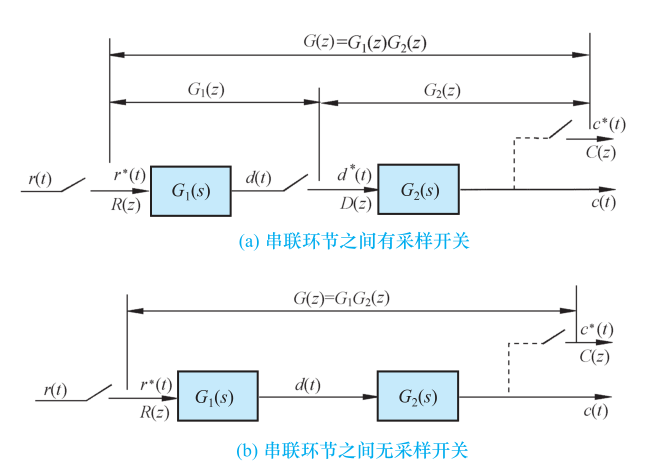{ .lq-img }

*图 7.21 环节串联时的开环离散系统脉冲传递函数：(a) 串联环节之间有采样开关；(b) 无采样开关（截自原书）*

**例 7-18** 设开环离散系统如图 7-21(a) 及 (b) 所示，其中 \(G_1(s)=1/s\)，\(G_2(s)=a/(s+a)\)，输入信号 \(r(t)=1(t)\)。试求系统 (a) 和 (b) 的脉冲传递函数 \(G(z)\) 和输出的 z 变换 \(C(z)\)。

解 查 z 变换表，输入 \(r(t)=1(t)\) 的 z 变换为 \(R(z)=\dfrac{z}{z-1}\)。

对于系统 (a)：

\[
G_1(z)=\mathcal{Z}\Bigl[\frac{1}{s}\Bigr]=\frac{z}{z-1},\qquad
G_2(z)=\mathcal{Z}\Bigl[\frac{a}{s+a}\Bigr]=\frac{az}{z-e^{-aT}}
\]

因此

\[
G(z)=G_1(z)G_2(z)=\frac{az^2}{(z-1)(z-e^{-aT})},\qquad
C(z)=G(z)R(z)=\frac{az^3}{(z-1)^2(z-e^{-aT})}
\]

对于系统 (b)：

\[
G_1(s)G_2(s)=\frac{a}{s(s+a)},\qquad
G(z)=G_1G_2(z)=\mathcal{Z}\Bigl[\frac{a}{s(s+a)}\Bigr]=\frac{(1-e^{-aT})z}{(z-1)(z-e^{-aT})}
\]

\[
C(z)=G(z)R(z)=\frac{(1-e^{-aT})z^2}{(z-1)^2(z-e^{-aT})}
\]

显然，串联环节之间有无同步采样开关隔离时，总脉冲传递函数和输出 z 变换是不相同的；不同之处仅表现在**零点**不同，**极点仍然一样**——这是离散系统特有的现象。

**(3) 有零阶保持器时的开环系统脉冲传递函数**。设有零阶保持器的开环离散系统如图 7-22(a)：\(G_h(s)\) 为零阶保持器传递函数，\(G_o(s)\) 为连续部分传递函数，两串联环节之间无同步采样开关隔离。由于 \(G_h(s)\) 不是 s 的有理分式函数，不便于用式 (7.61) 直接求开环脉冲传递函数。将图 7-22(a) 变换为图 7-22(b) 所示等效开环系统，推导过程比较简单。

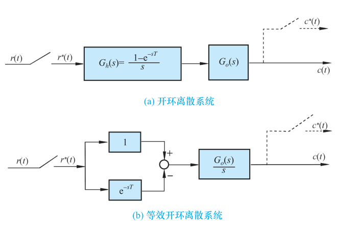{ .lq-img }

*图 7.22 有零阶保持器的开环离散系统结构图：(a) 开环离散系统；(b) 等效开环离散系统（截自原书）*

由图 7-22(b) 可得

\[
C(s)=\Bigl[\frac{G_o(s)}{s}-e^{-sT}\frac{G_o(s)}{s}\Bigr]R^*(s)
\tag{7.62}
\]

因为 \(e^{-sT}\) 为延迟一个采样周期的延迟环节，\(e^{-sT}G_o(s)/s\) 对应的采样输出比 \(G_o(s)/s\) 对应的采样输出延迟一个采样周期。对式 (7.62) 取 z 变换，根据实数位移定理及采样拉氏变换性质 (7.58)：

\[
C(z)=\mathcal{Z}\Bigl[\frac{G_o(s)}{s}\Bigr]R(z)-z^{-1}\mathcal{Z}\Bigl[\frac{G_o(s)}{s}\Bigr]R(z)
\]

于是，有零阶保持器时的开环系统脉冲传递函数

\[
G(z)=\frac{C(z)}{R(z)}=(1-z^{-1})\,\mathcal{Z}\Bigl[\frac{G_o(s)}{s}\Bigr]
\tag{7.63}
\]

当 \(G_o(s)\) 为 s 有理分式函数时，式 (7.63) 中的 \(\mathcal{Z}[G_o(s)/s]\) 也必然是 z 的有理分式函数。

**例 7-19** 设离散系统如图 7-22(a) 所示，已知

\[
G_o(s)=\frac{a}{s(s+a)}
\]

试求系统的脉冲传递函数 \(G(z)\)。

解 因为

\[
\frac{G_o(s)}{s}=\frac{a}{s^2(s+a)}=\frac{1}{s^2}-\frac{1}{a}\Bigl(\frac{1}{s}-\frac{1}{s+a}\Bigr)
\]

查 z 变换表 7-2：

\[
\mathcal{Z}\Bigl[\frac{G_o(s)}{s}\Bigr]
=\frac{Tz}{(z-1)^2}-\frac{1}{a}\cdot\frac{z}{z-1}+\frac{1}{a}\cdot\frac{z}{z-e^{-aT}}
\]

因此，有零阶保持器的开环系统脉冲传递函数（乘 \((1-z^{-1})\) 后通分合并）：

\[
G(z)=(1-z^{-1})\,\mathcal{Z}\Bigl[\frac{G_o(s)}{s}\Bigr]
=\frac{T}{z-1}-\frac{1}{a}+\frac{z-1}{a(z-e^{-aT})}
=\frac{(aT-1+e^{-aT})z+\bigl(1-(1+aT)e^{-aT}\bigr)}{a(z-1)(z-e^{-aT})}
\]

把上述结果与例 7-17 比较：连续部分传递函数相同，但没有零阶保持器。两例开环脉冲传递函数的**极点完全相同，仅零点不同**——零阶保持器不影响离散系统脉冲传递函数的极点。

用 sympy 查表法把例 7-18 与例 7-19 的推导全部机器验证一遍：

=== "MATLAB"

    ```matlab
    % ===== 书 7-4 节 开环脉冲传递函数（例7-17 / 例7-18 / 例7-19） =====
    syms z n t T a s positive
    G1 = 1/s;  G2 = a/(s+a);
    % Z{G(s)}：先拉氏反变换、按 nT 采样，再作序列 z 变换
    G1z = ztrans(subs(ilaplace(G1), t, n*T), n, z)         % z/(z-1)
    G2z = simplify(ztrans(subs(ilaplace(G2), t, n*T), n, z))  % a*z/(z-exp(-a*T))
    Ga = simplify(G1z*G2z)              % (a) 有采样开关：G1(z)*G2(z)
    Gb = ztrans(subs(ilaplace(G1*G2), t, n*T), n, z)       % (b) 无采样开关：G1G2(z)
    Gzoh = simplify((1-1/z)*ztrans(subs(ilaplace(G1*G2/s), t, n*T), n, z))  % 有 ZOH
    pretty(subs(Gzoh, [a T], [1 1]))    % a=1,T=1: (0.368z+0.264)/((z-1)(z-0.368))
    ```

=== "Python"

    ```python
    # ===== 书 7-4 节 开环脉冲传递函数（例7-17 / 例7-18 / 例7-19） =====
    import sympy as sp

    z, s, a, T = sp.symbols('z s a T', positive=True)
    E = sp.Symbol('E', positive=True)            # 记 E = e^(-aT)，避免 sympy 把它当普通函数化简

    def Z(Gs):
        """查表法求 Z{G(s)}：部分分式展开后逐项查 z 变换表7-2。"""
        table = {1/s: z/(z - 1),                 # 序号3：1(t)
                 1/s**2: T*z/(z - 1)**2,         # 序号4：t
                 1/(s + a): z/(z - E)}           # 序号8：e^(-at)
        out = 0
        for term in sp.Add.make_args(sp.apart(sp.cancel(Gs), s)):
            for b, zk in table.items():
                r = sp.cancel(term/b)
                if not r.has(s):
                    out += r*zk
                    break
        return sp.cancel(sp.together(out))

    G1, G2 = 1/s, a/(s + a)

    # --- 例7-18(a)：串联环节之间有采样开关，G(z)=G1(z)G2(z) ---
    print('G1(z) =', Z(G1))
    print('G2(z) =', Z(G2))
    print('(a) G1(z)G2(z) =', Z(G1)*Z(G2))
    # --- 例7-18(b)：串联环节之间无采样开关，G(z)=G1G2(z) ---
    print('(b) G1G2(z)  =', Z(G1*G2))

    # --- 例7-17 / 例7-19：G(s)=a/(s(s+a))，有无零阶保持器的 G(z) ---
    print('无ZOH G(z) =', Z(G1*G2))
    Gzoh = sp.cancel(sp.together((1 - 1/z)*Z(G1*G2/s)))       # G(z)=(1-z^-1)Z{Go(s)/s}
    print('有ZOH G(z) =', sp.fraction(sp.cancel(sp.together(Gzoh))))
    # a=1, T=1 数值代入：两例极点应相同（z=1 与 z=0.368），仅零点不同
    for name, expr in [('无ZOH', Z(G1*G2)), ('有ZOH', Gzoh)]:
        n, d = sp.fraction(sp.cancel(sp.together(expr)))
        sub = {a: 1, T: 1, E: sp.N(sp.exp(-1), 15)}
        print(name, 'a=1,T=1:  G(z) =', sp.factor(sp.N(n.subs(sub), 4)), '/',
              sp.factor(sp.N(d.subs(sub), 4)))
    # 期望：无ZOH 0.632z/((z-1)(z-0.368))；有ZOH 0.368(z+0.718)/((z-1)(z-0.368))
    ```

### 闭环系统脉冲传递函数

由于采样器在闭环系统中可以有多种配置可能性，**闭环离散系统没有唯一的结构图形式**。图 7-23 是比较常见的**误差采样**闭环离散系统结构图：虚线所示的理想采样开关是为便于分析而虚设的，输入采样信号 \(r^*(t)\) 和反馈采样信号 \(b^*(t)\) 事实上并不存在；所有理想采样开关同步工作，采样周期为 T。

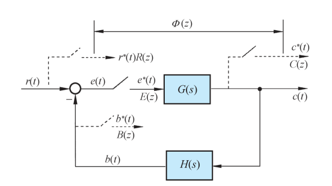{ .lq-img }

*图 7.23 闭环离散系统结构图（误差采样）（截自原书）*

由图 7-23 可见，连续输出信号和误差信号的拉氏变换为

\[
C(s)=G(s)E^*(s),\qquad E(s)=R(s)-H(s)C(s)
\]

因此有 \(E(s)=R(s)-H(s)G(s)E^*(s)\)。于是误差采样信号 \(e^*(t)\) 的拉氏变换

\[
E^*(s)=R^*(s)-HG^{\,*}(s)E^*(s)
\]

整理得

\[
E^*(s)=\frac{R^*(s)}{1+HG^{\,*}(s)}
\tag{7.64}
\]

由于（连续环节 \(G(s)\) 直接跟在采样开关后，可用性质 (7.58) 提出 \(E^*\)）

\[
C^*(s)=\bigl[G(s)E^*(s)\bigr]^*=G^*(s)E^*(s)=\frac{G^*(s)R^*(s)}{1+HG^{\,*}(s)}
\tag{7.65}
\]

对式 (7.64) 及式 (7.65) 取 z 变换，可得

\[
E(z)=\frac{R(z)}{1+HG(z)}
\tag{7.66}
\]

\[
C(z)=\frac{G(z)R(z)}{1+HG(z)}
\tag{7.67}
\]

根据式 (7.66)，定义

\[
\varPhi_e(z)=\frac{E(z)}{R(z)}=\frac{1}{1+HG(z)}
\tag{7.68}
\]

为闭环离散系统对于输入量的**误差脉冲传递函数**。根据式 (7.67)，定义

\[
\varPhi(z)=\frac{C(z)}{R(z)}=\frac{G(z)}{1+HG(z)}
\tag{7.69}
\]

为闭环离散系统对于输入量的**脉冲传递函数**。式 (7.68) 和式 (7.69) 是研究闭环离散系统时经常用到的两个闭环脉冲传递函数。与连续系统类似，令 \(\varPhi(z)\) 或 \(\varPhi_e(z)\) 的分母多项式为零，便得到闭环离散系统的**特征方程**：

\[
D(z)=1+GH(z)=0
\tag{7.70}
\]

式中 \(GH(z)\) 为离散系统开环脉冲传递函数。

需要指出：**闭环离散系统脉冲传递函数不能从 \(\varPhi(s)\) 和 \(\varPhi_e(s)\) 求 z 变换得来**，即

\[
\varPhi(z)\ne\mathcal{Z}[\varPhi(s)],\qquad \varPhi_e(z)\ne\mathcal{Z}[\varPhi_e(s)]
\]

原因也是采样器在闭环系统中有多种配置之故。通过与上面类似的方法可推导采样器为不同配置形式的其他闭环系统的脉冲传递函数。但只要误差信号 \(e(t)\) 处没有采样开关，输入采样信号 \(r^*(t)\)（包括虚构的 \(r^*(t)\)）便不存在，此时**不可能求出闭环离散系统对于输入量的脉冲传递函数，而只能求出输出采样信号的 z 变换函数 \(C(z)\)**。

**例 7-20** 设闭环离散系统结构图如图 7-24（原书：\(R(s)\) 经比较、采样后进 \(G_1(s)\)，再采样进 \(G_2(s)\)，\(H(s)\) 反馈）所示，试证其闭环脉冲传递函数为

\[
\varPhi(z)=\frac{G_1(z)G_2(z)}{1+G_1(z)HG_2(z)}
\]

证明 由图 7-24 得

\[
C(s)=G_2(s)E_1^*(s),\qquad E_1(s)=G_1(s)E^*(s)
\]

对 \(E_1(s)\) 离散化，有 \(E_1^*(s)=G_1^*(s)E^*(s)\)，于是

\[
C(s)=G_2(s)G_1^*(s)E^*(s)
\]

考虑到

\[
E(s)=R(s)-H(s)C(s)=R(s)-H(s)G_2(s)G_1^*(s)E^*(s)
\]

离散化后，有

\[
E^*(s)=R^*(s)-HG_2^{\,*}(s)G_1^*(s)E^*(s)
\]

即

\[
E^*(s)=\frac{R^*(s)}{1+G_1^*(s)HG_2^{\,*}(s)}
\]

所以，输出信号的采样拉氏变换

\[
C^*(s)=G_2^{\,*}(s)G_1^*(s)E^*(s)=\frac{G_1^*(s)G_2^{\,*}(s)R^*(s)}{1+G_1^*(s)HG_2^{\,*}(s)}
\]

对上式进行 z 变换，证得

\[
\varPhi(z)=\frac{C(z)}{R(z)}=\frac{G_1(z)G_2(z)}{1+G_1(z)HG_2(z)}
\]

对于采样器在闭环系统中具有各种配置的闭环离散系统典型结构图及其输出采样信号的 z 变换函数 \(C(z)\)，可参见表 7-3。八种配置的 \(C(z)\) 计算式汇总如下（结构图见表 7-3 原表截图）：

| 序号 | 输出 z 变换函数 \(C(z)\) |
| --- | --- |
| 1 | \(\dfrac{G(z)R(z)}{1+GH(z)}\) |
| 2 | \(\dfrac{RG_1(z)G_2(z)}{1+G_2HG_1(z)}\) |
| 3 | \(\dfrac{G(z)R(z)}{1+G(z)H(z)}\) |
| 4 | \(\dfrac{G_1(z)G_2(z)R(z)}{1+G_1(z)G_2H(z)}\) |
| 5 | \(\dfrac{RG_1(z)G_2(z)G_3(z)}{1+G_2G_1G_3H(z)}\) |
| 6 | \(\dfrac{RG(z)}{1+HG(z)}\) |
| 7 | \(\dfrac{R(z)G(z)}{1+G(z)H(z)}\) |
| 8 | \(\dfrac{G_1(z)G_2(z)R(z)}{1+G_1(z)G_2(z)H(z)}\) |

**表 7-3 典型闭环离散系统及输出 z 变换函数**（截自原书，两页拼读）：

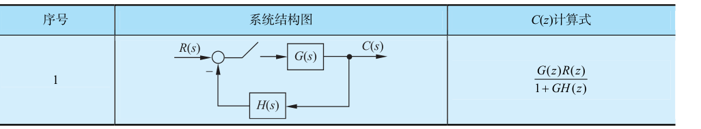{ .lq-img }

*表 7.3（第 1 行）误差采样闭环系统，\(C(z)=\dfrac{G(z)R(z)}{1+GH(z)}\)*

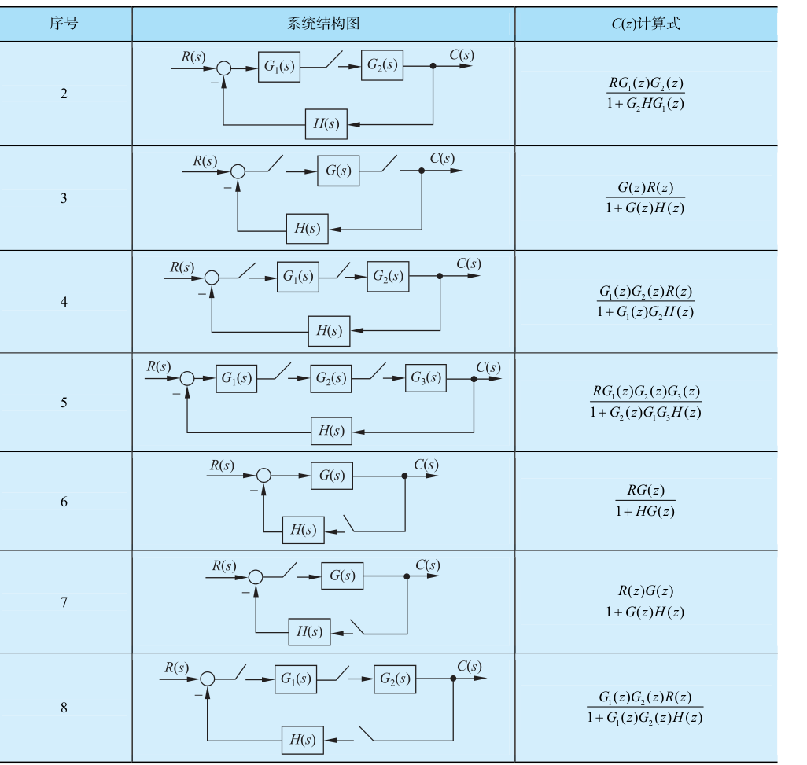{ .lq-img }

*表 7.3（第 2～8 行）采样开关位置各异的八种闭环配置（截自原书）*

!!! note "拓展：读表 7-3 的诀窍（补充）"
    八个公式不用死背，抓两条规则：其一，**离散符号 \((\cdot)(z)\) 只能"跨越"采样开关**——两个连续环节之间没有采样开关隔开时，必须先乘后离散（写作 \(G_1G_2H(z)\) 这种连写形式），隔开了才能各自离散再相乘；其二，输入 \(R(s)\) 未经采样就进入连续环节时，只能出现 \(RG(z)\) 这种**积的离散**，分离不出单独的 \(R(z)\)，此时就写不出对输入的闭环脉冲传递函数 \(\varPhi(z)\)，只能给 \(C(z)\)。第 1、6 行正是后者。

### z 变换法的局限性

z 变换法是研究线性定常离散系统的有效工具，但也有自身局限，应用时必须注意：

1) z 变换的推导建立在**假定采样信号可以用理想脉冲序列近似**的基础上，每个理想脉冲的面积等于采样瞬时上的时间函数值。这种假定只有当采样持续时间与系统的最大时间常数相比很小时才能成立。
2) 输出 z 变换函数 \(C(z)\) 只确定时间函数 \(c(t)\) **在采样瞬时上的数值**，不能反映 \(c(t)\) 在采样间隔中的信息。对任何 \(C(z)\)，z 反变换 \(c(nT)\) 只能代表 \(c(t)\) 在采样瞬时 \(t=nT\)（\(n=0,1,2,\dots\)）时的数值。
3) 用 z 变换法分析离散系统时，系统连续部分传递函数 \(G(s)\) 的**极点数至少要比其零点数多两个**，即 \(G(s)\) 的脉冲过渡函数 \(K(t)\) 在 \(t=0\) 时必须没有跳跃，或者满足

\[
\lim_{s\to\infty}sG(s)=0
\tag{7.71}
\]

否则用 z 变换法得到的系统采样输出 \(c^*(t)\) 与实际连续输出 \(c(t)\) 差别较大，甚至完全不符。

**例 7-21** 设 RC 积分网络如图 7-25 所示（采样器、1Ω 电阻、1F 电容），其输入 \(r(t)=1(t)\)，采样周期 T=1s。试比较 \(c^*(t)\) 与 \(c(t)\)。

解 网络传递函数

\[
G(s)=\frac{1}{s+1}
\]

相应的 z 变换为

\[
G(z)=\mathcal{Z}\Bigl[\frac{1}{s+1}\Bigr]=\frac{z}{z-e^{-T}}=\frac{z}{z-0.368}
\]

而输入 z 变换 \(R(z)=\dfrac{z}{z-1}\)。因此，网络输出 z 变换函数

\[
C(z)=G(z)R(z)=\frac{z^2}{(z-1)(z-0.368)}
=1+1.368z^{-1}+1.5z^{-2}+1.55z^{-3}+1.56z^{-4}+\cdots
\]

上式取 z 反变换，得输出采样信号

\[
c^*(t)=\delta(t)+1.368\,\delta(t-T)+1.5\,\delta(t-2T)+1.55\,\delta(t-3T)+1.56\,\delta(t-4T)+\cdots
\]

于是可画出 \(c(t)\) 在采样瞬时的值 \(c(nT)\)（T=1，n=0,1,2,…），如图 7-26(a)：阶梯上升到终值 1.582。如果采用拉氏变换方法求出当连续部分输入为 \(r^*(t)=\delta_T(t)\)（单位脉冲序列）时系统的连续输出 \(c(t)\)，如图 7-26(b)：\(c(t)\) 在每个采样瞬间跳升后按指数衰减，在两采样时刻之间从 1.582 跌落至 0.582，呈锯齿状。由图可见，把 \(c^*(t)\) 曲线中采样瞬时的幅值连接起来所画出的光滑曲线，与实际的 \(c(t)\) 有显著差别——这是因为此时 \(G(s)=1/(s+1)\) 极点数只比零点数多一个，**不满足式 (7.71)**。

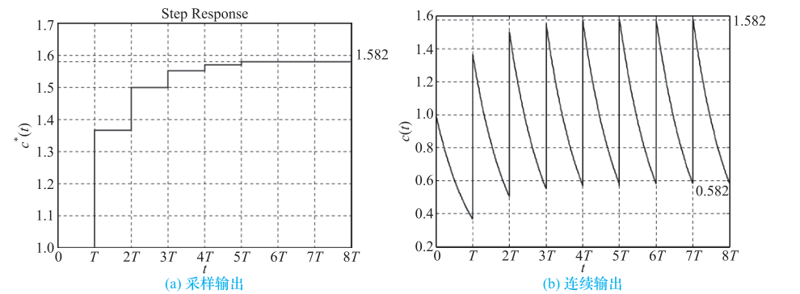{ .lq-img }

*图 7.26 积分网络的采样输出响应和连续输出响应：(a) 采样输出；(b) 连续输出（截自原书）*

## 7.5 离散系统的稳定性与稳态误差

稳定性和稳态误差是线性定常离散系统分析的重要内容。本节讨论如何在 z 域和 w 域中分析离散系统的稳定性，并给出计算离散系统在采样瞬时稳态误差的方法。为了把连续系统在 s 平面上分析稳定性的结果移植到 z 平面上，首先研究 **s 平面与 z 平面的映射关系**。

### s 域到 z 域的映射

z 变换定义中 \(z=e^{sT}\) 给出了 s 域到 z 域的关系。s 域中任意点表示为 \(s=\sigma+\mathrm{j}\omega\)，映射到 z 域则为

\[
z=e^{(\sigma+\mathrm{j}\omega)T}=e^{\sigma T}\,e^{\mathrm{j}\omega T}=|z|\,e^{\mathrm{j}\angle z}
\]

于是 s 域到 z 域的基本映射关系式为

\[
|z|=e^{\sigma T},\qquad \angle z=\omega T
\tag{7.72}
\]

令 \(\sigma=0\)（取 s 平面的虚轴），当 \(\omega\) 从 \(-\infty\) 变到 \(+\infty\) 时，映射到 z 平面的轨迹是**以原点为圆心的单位圆**——只是 s 平面上的点沿虚轴从 \(-\infty\) 移到 \(+\infty\) 时，z 平面上的相应点已沿单位圆转过了无穷多圈。因为 s 平面上的点沿虚轴从 \(-\omega_s/2\) 移动到 \(\omega_s/2\)（\(\omega_s\) 为采样角频率）时，z 平面上的相应点沿单位圆从 \(-\pi\) 逆时针变化到 \(\pi\)（式 (7.72) 中 \(\angle z=\omega T\)，\(\omega T=\pm\pi\) 对应 \(\omega=\pm\omega_s/2\)），正好转一圈；而从 \(\omega_s/2\) 移动到 \(3\omega_s/2\) 时又转一圈，依此类推，如图 7-27。可以把 s 平面划分为**无穷多条平行于实轴的周期带**，其中从 \(-\omega_s/2\) 到 \(\omega_s/2\) 的周期带称为**主要带**，其余的周期带称为**次要带**。

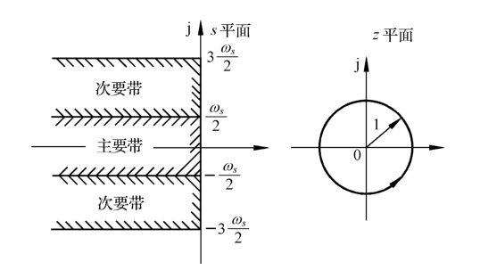{ .lq-img }

*图 7.27 s 平面虚轴在 z 平面上的映射：周期带与单位圆（截自原书）*

**(1) 等 \(\sigma\) 线映射**。s 平面上的等 \(\sigma\) 垂线，映射到 z 平面上是以原点为圆心、半径 \(|z|=e^{\sigma T}\) 的圆，如图 7-28。s 平面的虚轴（\(\sigma=0\)）映射为单位圆，所以左半 s 平面上的等 \(\sigma\) 线（\(\sigma<0\)）映射为单位圆内的同心圆，右半 s 平面的等 \(\sigma\) 线（\(\sigma>0\)）映射为单位圆外的同心圆。

**(2) 等 \(\omega\) 线映射**。在特定采样周期 T 下，由式 (7.72)，s 平面上的等 \(\omega\) 水平线映射到 z 平面上是从原点出发、相角 \(\angle z=\omega T\) 自正实轴计量的一簇射线，如图 7-29（原书）。特别地，s 平面上 \(\omega=\omega_s/2\) 的水平线在 z 平面上正好映射为**负实轴**。

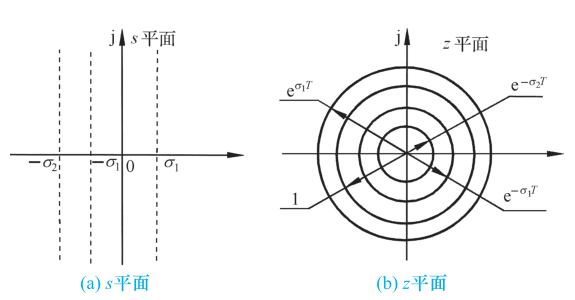{ .lq-img }

*图 7.28 s 平面和 z 平面上的等 σ 轨迹（截自原书）*

有了以上映射关系，可讨论 s 平面上周期带在 z 平面上的映射。设 s 平面上的主要带如图 7-30（原书，左半 s 平面上从 \(-\omega_s/2\) 到 \(\omega_s/2\) 的带域，五点编号 ①～⑤ 标出边界走向）所示，通过 \(z=e^{sT}\) 变换，映射为 z 平面上的**单位圆及单位圆内的负实轴**（图 7-30(b)）。类似地，由于

\[
z=e^{(s+\mathrm{j}n\omega_s)T}=e^{sT}e^{\mathrm{j}2\pi n}=e^{sT}
\]

s 平面上**所有的次要带在 z 平面上均映射为相同的单位圆及单位圆内的负实轴**——z 平面与 s 平面不是一一对应的。

### 离散系统稳定的充分必要条件

**定义**：若离散系统在有界输入序列作用下，其输出序列也是有界的，则称该离散系统是稳定的（BIBO 稳定）。

线性定常连续系统稳定的充要条件是齐次微分方程的解收敛、或特征方程根均具负实部、或传递函数极点均位于左半 s 平面。连续系统在时域或 s 域描述稳定性的方法同样可推广到离散系统——线性定常离散系统的时域模型是线性定常差分方程，z 域模型是脉冲传递函数，因此充要条件可从两方面研究。

**(1) 时域中离散系统稳定的充要条件**。设线性定常差分方程如式 (7.48)，其齐次差分方程为

\[
c(k)+\sum_{i=1}^{n}a_ic(k-i)=0
\]

设通解为 \(A_i\alpha_i^{\,k}\)，代入齐次方程得

\[
A_1\alpha_1^{\,k}+A_2\alpha_2^{\,k}+\cdots+A_n\alpha_n^{\,k}+a_1\bigl(A_1\alpha_1^{\,k-1}+\cdots\bigr)+\cdots+a_n\bigl(A_1\alpha_1^{\,k-n}+\cdots\bigr)=0
\]

或

\[
A_1\alpha_1^{\,k-n}\bigl(\alpha_1^{n}+a_1\alpha_1^{n-1}+\cdots+a_n\bigr)+A_2\alpha_2^{\,k-n}\bigl(\alpha_2^{n}+a_1\alpha_2^{n-1}+\cdots+a_n\bigr)+\cdots=0
\]

因 \(A_i\alpha_i^{\,k}\ne0\)，故必有

\[
\alpha_i^{n}+a_1\alpha_i^{n-1}+\cdots+a_{n-1}\alpha_i+a_n=0,\qquad i=1,2,\dots,n
\]

以 \(\alpha_i^n\) 乘之（约去公因子形式整理），得差分方程的**特征方程**：

\[
\alpha^n+a_1\alpha^{n-1}+a_2\alpha^{n-2}+\cdots+a_{n-1}\alpha+a_n=0
\tag{7.73}
\]

不失一般性，设特征方程 (7.73) 有各不相同的特征根 \(\alpha_1,\alpha_2,\dots,\alpha_n\)，则差分方程 (7.48) 的通解为

\[
c(k)=A_1\alpha_1^{\,k}+A_2\alpha_2^{\,k}+\cdots+A_n\alpha_n^{\,k},\qquad k=0,1,2,\dots
\]

系数 \(A_i\) 由给定的 n 个初始条件决定。当特征方程 (7.73) 的根 \(|\alpha_i|<1\)（\(i=1,2,\dots,n\)）时，必有 \(\lim_{k\to\infty}c(k)=0\)。故**时域充要条件**：当且仅当差分方程 (7.48) 所有特征根的模 \(|\alpha_i|<1\)，相应的线性定常离散系统是稳定的。

**(2) z 域中离散系统稳定的充要条件**。设典型离散系统结构图如图 7-23，其特征方程为式 (7.70)：\(D(z)=1+GH(z)=0\)。设特征方程的根（或闭环脉冲传递函数 (7.69) 的极点）为各不相同的 \(z_1,z_2,\dots,z_n\)。由 s 域到 z 域的映射关系：**s 左半平面映射为 z 平面上的单位圆内区域（稳定区域）；s 右半平面映射为单位圆外区域（不稳定区域）；s 平面的虚轴映射为单位圆周（临界稳定）**。因此，**z 域充要条件**：当且仅当离散特征方程 (7.70) 的全部特征根均分布在 z 平面上的单位圆内，或者所有特征根的模均小于 1（\(|z_i|<1\)，\(i=1,2,\dots,n\)），相应的线性定常离散系统是稳定的。

应当指出：上述稳定条件虽然是从特征方程无重根情形推导的，对有重根也正确。此外，现实系统中不存在临界稳定情况——若 \(|z_i|=1\) 或 \(|\alpha_i|=1\)，在经典控制理论中系统也属于不稳定范畴。

**例 7-22** 设一离散系统可用下列差分方程描述：

\[
c(n+1)-ac(n)=br(n),\qquad c(0)\ne0
\]

试分析系统稳定的充分必要条件。

解 给定系统相应的齐次方程为 \(c(n+1)-ac(n)=0\)。利用迭代法可求出通解

\[
c(n+1)=a^{n+1}c(0)
\]

由于 \(c(0)\ne0\)，因此当 \(|a|<1\) 时才有 \(\lim_{n\to\infty}c(n)=0\)。故系统稳定的充分必要条件是 \(|a|<1\)。

**例 7-23** 设离散系统如图 7-23 所示，其中 \(G(s)=\dfrac{10}{s(s+1)}\)，\(H(s)=1\)，T=1。试分析该系统的稳定性。

解 由已知 \(G(s)\) 可求出开环脉冲传递函数

\[
G(z)=\mathcal{Z}\Bigl[\frac{10}{s(s+1)}\Bigr]=\frac{10(1-e^{-T})z}{(z-1)(z-e^{-T})}
\]

根据式 (7.70)，本例闭环特征方程

\[
D(z)=1+G(z)=1+\frac{10(1-e^{-T})z}{(z-1)(z-e^{-T})}=0
\]

即

\[
z^2+4.952z+0.368=0
\]

解出特征方程的根

\[
z_1=-0.076,\qquad z_2=-4.876
\]

因为 \(|z_2|>1\)，所以该离散系统不稳定。

应当指出：当例 7-23 中**无采样器时，二阶连续系统总是稳定的**；引入采样器后，二阶离散系统却有可能变得不稳定——这说明**采样器的引入一般会降低系统的稳定性**。如果提高采样频率（减小采样周期），或者降低开环增益，离散系统的稳定性将得到改善。

### 离散系统的稳定性判据

连续系统的劳斯稳定判据通过特征方程的系数及其符号判稳，实质是判断特征方程的根是否都在左半 s 平面。离散系统需要判断特征根是否都在 z 平面的单位圆内，劳斯判据不能直接套用，必须引入另一种 **z 域到 w 域的线性变换**，使 z 平面上的单位圆内区域映射成 w 平面上的左半平面。这种新的坐标变换称为**双线性变换**，或称 **w 变换**。

如果令

\[
w=\frac{z-1}{z+1}
\tag{7.74}
\]

则有

\[
z=\frac{1+w}{1-w}
\tag{7.75}
\]

式 (7.74) 与式 (7.75) 表明复变量 z 与 w 互为线性变换，故 w 变换又称双线性变换。令复变量 \(z=x+\mathrm{j}y\)，\(w=u+\mathrm{j}v\)，代入式 (7.75)，得

\[
u+\mathrm{j}v=\frac{(x+\mathrm{j}y)+1}{(x+\mathrm{j}y)-1}
=\frac{(x^2+y^2)-1+2\mathrm{j}y}{(x-1)^2+y^2}
\]

显然

\[
u=\frac{(x^2+y^2)-1}{(x-1)^2+y^2}
\]

由于分母 \((x-1)^2+y^2\) 始终为正，因此 \(u=0\) 等价于 \(x^2+y^2=1\)，表明 **w 平面的虚轴对应于 z 平面上的单位圆周**；\(u<0\) 等价于 \(x^2+y^2<1\)，**左半 w 平面对应于 z 平面上单位圆内的区域**；\(u>0\) 等价于 \(x^2+y^2>1\)，**右半 w 平面对应于单位圆外区域**。z 平面和 w 平面的这种对应关系如图 7-31。

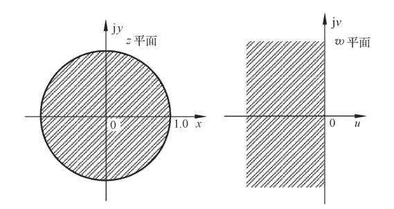{ .lq-img }

*图 7.31 z 平面与 w 平面的对应关系（截自原书）*

由 w 变换：通过式 (7.74)，可将线性定常离散系统在 z 平面上的特征方程 \(1+GH(z)=0\) 转换为 w 平面上的特征方程 \(1+GH(w)=0\)。于是离散系统稳定的充要条件，由"特征方程 \(1+GH(z)=0\) 的所有根位于 z 平面单位圆内"转换为"特征方程 \(1+GH(w)=0\) 的所有根位于左半 w 平面"——后者正好与 s 平面上应用劳斯判据的情形一样，所以根据 w 域中的特征方程系数，**可以直接应用劳斯表判断离散系统的稳定性**，相应称为 w 域中的劳斯稳定判据。

**例 7-24** 设闭环离散系统如图 7-32 所示（采样周期 T=0.1s），试求系统稳定时 K 的临界值。

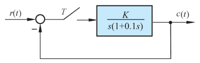{ .lq-img }

*图 7.32 例 7-24 闭环离散系统结构图（截自原书）*

解 求出 \(G(s)=\dfrac{K}{s(1+0.1s)}\) 的 z 变换：

\[
G(z)=\frac{0.632Kz}{z^2-1.368z+0.368}
\]

因闭环脉冲传递函数 \(\varPhi(z)=\dfrac{G(z)}{1+G(z)}\)，故闭环特征方程

\[
D(z)=1+G(z)=z^2+(0.632K-1.368)z+0.368=0
\]

令 \(z=(w+1)/(w-1)\)，得

\[
\Bigl(\frac{w+1}{w-1}\Bigr)^2+(0.632K-1.368)\Bigl(\frac{w+1}{w-1}\Bigr)+0.368=0
\]

化简后，得 w 域特征方程

\[
0.632Kw^2+1.264w+(2.736-0.632K)=0
\]

列出劳斯表：

\[
\begin{array}{c|cc}
w^2 & 0.632K & 2.736-0.632K\\
w^1 & 1.264 & 0\\
w^0 & 2.736-0.632K & 0
\end{array}
\]

从劳斯表第一列系数可以看出，为保证系统稳定，必须使 \(K>0\) 和 \(2.736-0.632K>0\)，即

\[
0<K<4.33
\]

故系统稳定的临界增益 \(K_c=4.33\)。

!!! note "拓展：朱利（Jury）判据——不经 w 变换直接在 z 域判稳（补充）"
    本版教材只讲 w 变换+劳斯。另有直接作用于 z 域特征方程 \(D(z)=a_nz^n+a_{n-1}z^{n-1}+\cdots+a_0=0\)（\(a_n>0\)）的**朱利判据**，思路同劳斯：先看必要条件 \(D(1)>0\)、\((-1)^nD(-1)>0\)、\(|a_0|<a_n\)；再把系数首尾倒排拼成 2n−3 行的朱利表，逐行要求"每行第一列元素的模大于该行末列元素的模"，全部满足则所有根在单位圆内。二阶系统 \(D(z)=z^2+a_1z+a_0=0\) 的朱利条件特别好用：\(D(1)>0\)、\(D(-1)>0\)、\(|a_0|<1\)，三条一查便知根是否都在单位圆内（可自行验证例 7-23：\(1+4.952+0.368>0\) 但 \(1-4.952+0.368<0\)，立判不稳定）。

### 离散系统的稳态误差

连续系统中建立在拉氏变换终值定理基础上的稳态误差计算方法，在一定条件下可以推广到离散系统。由于离散系统没有唯一的典型结构图形式，误差脉冲传递函数 \(\varPhi_e(z)\) 也给不出一般的计算公式，稳态误差需要针对不同形式的离散系统求取。这里介绍利用 z 变换终值定理的方法，求取**误差采样**的离散系统在采样瞬时的稳态误差。

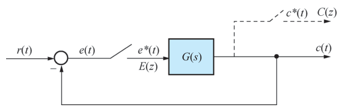{ .lq-img }

*图 7.33 单位反馈离散系统结构图（截自原书）*

设单位反馈误差采样系统如图 7-33，其中 \(G(s)\) 为连续部分的传递函数，\(e(t)\) 为系统连续误差信号，\(e^*(t)\) 为系统采样误差信号，其 z 变换函数

\[
E(z)=\mathcal{Z}[e^*(t)]=R(z)-C(z)=\varPhi_e(z)R(z)
\]

其中

\[
\varPhi_e(z)=\frac{E(z)}{R(z)}=\frac{1}{1+G(z)}
\]

为系统误差脉冲传递函数。如果 \(\varPhi_e(z)\) 的极点全部位于 z 平面上的单位圆内（即离散系统稳定），则可用 z 变换的终值定理求出采样瞬时的稳态误差

\[
e^*(\infty)=e(\infty)=\lim_{z\to1}(1-z^{-1})E(z)
=\lim_{z\to1}(1-z^{-1})\frac{R(z)}{1+G(z)}
=\lim_{z\to1}\frac{(z-1)R(z)}{z\bigl(1+G(z)\bigr)}
\tag{7.76}
\]

式 (7.76) 表明：线性定常离散系统的稳态误差，不但与系统本身的结构和参数有关，而且与输入序列的形式及幅值有关。除此以外，由于 \(G(z)\) 还与采样周期 T 有关，多数典型输入 \(R(z)\) 也与 T 有关，因此**离散系统的稳态误差数值与采样周期的选取也有关**。

**例 7-25** 设离散系统如图 7-33 所示，其中

\[
G(s)=\frac{1}{s(0.1s+1)},\qquad T=0.1\,\mathrm{s}
\]

输入连续信号 \(r(t)\) 分别为 \(1(t)\) 和 \(t\)。试求离散系统相应的稳态误差。

解 不难求出 \(G(s)=\dfrac{10}{s(s+10)}\) 相应的 z 变换为

\[
G(z)=\mathcal{Z}\Bigl[\frac{10}{s(s+10)}\Bigr]
=\frac{10(1-e^{-10T})z}{(z-1)(z-e^{-10T})}
=\frac{0.632z}{(z-1)(z-0.368)}
\]

（T=0.1s 时 \(e^{-10T}=e^{-1}=0.368\)。）因此，系统的误差脉冲传递函数

\[
\varPhi_e(z)=\frac{1}{1+G(z)}=\frac{(z-1)(z-0.368)}{z^2-0.736z+0.368}
\]

由于闭环极点 \(z_{1,2}=0.368\pm\mathrm{j}0.482\)，全部位于 z 平面上的单位圆内，因此可以应用终值定理求稳态误差。

当 \(r(t)=1(t)\)，相应 \(r(nT)=1\)，\(R(z)=\dfrac{z}{z-1}\)，由式 (7.76) 求得

\[
e(\infty)=\lim_{z\to1}\frac{(z-1)(z-0.368)}{z^2-0.736z+0.368}=0
\]

当 \(r(t)=t\)，相应 \(r(nT)=nT\)，\(R(z)=\dfrac{Tz}{(z-1)^2}\)，由式 (7.76) 求得

\[
e(\infty)=\lim_{z\to1}\frac{Tz}{z^2-0.736z+0.368}\cdot\frac{(z-1)(z-0.368)}{z-1}
=\lim_{z\to1}\frac{Tz}{z^2-0.736z+0.368}\,(z-0.368)
=\frac{T}{1-0.736+0.368}\times0.632=\frac{T}{1}=0.1
\]

如果希望求出其他结构形式离散系统的稳态误差，或者求出离散系统在扰动作用下的稳态误差，只要写出系统误差的 z 变换函数 \(E(z)\)，在离散系统稳定的前提下，同样可以应用 z 变换的终值定理算出。式 (7.76) 只是计算单位反馈误差采样离散系统的基本公式，当 \(G(z)\) 比较复杂时计算 \(e(\infty)\) 仍有一定计算量，因此希望把连续系统的**系统型别及静态误差系数**概念推广到离散系统，简化稳态误差的计算。

### 离散系统的型别与静态误差系数

讨论零阶保持器对开环脉冲传递函数 \(G(z)\) 的影响时曾指出：**零阶保持器不影响开环脉冲传递函数的极点**。因此开环脉冲传递函数 \(G(z)\) 的极点与相应连续传递函数 \(G(s)\) 的极点一一对应：如果 \(G(s)\) 有 \(\nu\) 个 \(s=0\) 的极点（即 \(\nu\) 个积分环节），则由 \(z=e^{sT}\) 可知，与 \(G(s)\) 相应的 \(G(z)\) 必有 \(\nu\) 个 \(z=1\) 的极点。连续系统把开环传递函数 \(G(s)\) 具有 \(s=0\) 的极点数作为划分系统型别的标准（\(\nu=0,1,2,\dots\) 称 0 型、Ⅰ型、Ⅱ型系统等），离散系统同样**把开环脉冲传递函数 \(G(z)\) 具有 \(z=1\) 的极点数 \(\nu\) 作为划分离散系统型别的标准**。

下面讨论图 7-33 所示不同型别的离散系统在三种典型输入信号作用下的稳态误差，建立离散系统**静态误差系数**的概念。

**(1) 单位阶跃输入时的稳态误差**。当系统输入为单位阶跃函数 \(r(t)=1(t)\) 时，\(R(z)=\dfrac{z}{z-1}\)。由式 (7.76) 知稳态误差为

\[
e(\infty)=\lim_{z\to1}\Bigl[1-\frac{1}{z}\Bigr]\frac{z}{z-1}\cdot\frac{1}{1+G(z)}
=\lim_{z\to1}\frac{1}{1+G(z)}=\frac{1}{1+K_p}
\tag{7.77}
\]

上式代表离散系统在采样瞬时的**稳态位置误差**。式中

\[
K_p=\lim_{z\to1}\bigl[1+G(z)\bigr]
\tag{7.78}
\]

称为**静态位置误差系数**。若 \(G(z)\) 没有 \(z=1\) 的极点，则 \(K_p\ne\infty\)，从而 \(e(\infty)\ne0\)，这样的系统称为 0 型离散系统；若 \(G(z)\) 有一个或一个以上 \(z=1\) 的极点，则 \(K_p=\infty\)，\(e(\infty)=0\)，相应称为Ⅰ型或Ⅰ型以上的离散系统。因此单位阶跃函数作用下，0 型离散系统在采样瞬时存在位置误差；Ⅰ型及Ⅰ型以上不存在——与连续系统十分相似。

**(2) 单位斜坡输入时的稳态误差**。当输入为单位斜坡函数 \(r(t)=t\) 时，\(R(z)=\dfrac{Tz}{(z-1)^2}\)。稳态误差为

\[
e(\infty)=\lim_{z\to1}\Bigl[1-\frac{1}{z}\Bigr]\frac{Tz}{(z-1)^2}\cdot\frac{1}{1+G(z)}
=\lim_{z\to1}\frac{T}{(z-1)\bigl(1+G(z)\bigr)}=\frac{T}{K_v}
\tag{7.79}
\]

上式也是离散系统在采样瞬时的稳态位置误差，仿照连续系统称为**速度误差**。式中

\[
K_v=\lim_{z\to1}(z-1)G(z)
\tag{7.80}
\]

称为**静态速度误差系数**。0 型系统的 \(K_v=0\)，Ⅰ型系统的 \(K_v\) 为有限值，Ⅱ型及Ⅱ型以上系统的 \(K_v=\infty\)，所以：0 型离散系统不能跟踪单位斜坡函数作用；Ⅰ型离散系统在单位斜坡函数作用下存在速度误差；Ⅱ型及Ⅱ型以上不存在稳态误差。

**(3) 单位加速度输入时的稳态误差**。当输入为单位加速度函数 \(r(t)=t^2/2\) 时，\(R(z)=\dfrac{T^2z(z+1)}{2(z-1)^3}\)。稳态误差为

\[
e(\infty)=\lim_{z\to1}\Bigl[1-\frac{1}{z}\Bigr]\frac{T^2z(z+1)}{2(z-1)^3}\cdot\frac{1}{1+G(z)}
=\lim_{z\to1}\frac{T^2(z+1)}{2(z-1)^2\bigl(1+G(z)\bigr)}=\frac{T^2}{K_a}
\tag{7.81}
\]

当然，式 (7.81) 也是系统的稳态位置误差，称为**加速度误差**。式中

\[
K_a=\lim_{z\to1}(z-1)^2G(z)
\tag{7.82}
\]

称为**静态加速度误差系数**。0 型及Ⅰ型系统的 \(K_a=0\)，Ⅱ型系统的 \(K_a\) 为常值，Ⅲ型及Ⅲ型以上系统的 \(K_a=\infty\)。因此：0 型及Ⅰ型离散系统不能跟踪单位加速度函数作用；Ⅱ型离散系统在单位加速度函数作用下存在加速度误差；只有Ⅲ型及Ⅲ型以上的离散系统才不存在采样瞬时的稳态位置误差。

不同型别单位反馈离散系统的稳态误差如表 7-4 所示。

**表 7-4 单位反馈离散系统的稳态误差**

| 系统类型 | 位置误差 \(r(t)=1(t)\) | 速度误差 \(r(t)=t\) | 加速度误差 \(r(t)=\dfrac{1}{2}t^2\) |
| --- | --- | --- | --- |
| 0 型 | \(\dfrac{1}{K_p}\) | \(\infty\) | \(\infty\) |
| Ⅰ型 | 0 | \(\dfrac{T}{K_v}\) | \(\infty\) |
| Ⅱ型 | 0 | 0 | \(\dfrac{T^2}{K_a}\) |
| Ⅲ型 | 0 | 0 | 0 |

!!! note "拓展：离散稳态误差比连续系统多了什么（补充）"
    把表 7-4 与第 3 章表 3-5 对照，结构完全平行，差别只有两处：其一，误差公式里多了采样周期 T（\(T/K_v\)、\(T^2/K_a\)），因为斜坡、加速度输入的 z 变换 \(Tz/(z-1)^2\)、\(T^2z(z+1)/2(z-1)^3\) 本身含 T——**采样周期选大，同样的 \(K_v\) 下跟踪误差按比例变大**；其二，所有结论只对采样瞬时成立，采样间隔之间的真实误差 \(e(t)\) 可能更大（尤其存在纹波时）。另外，型别的判定来源也变了：连续系统数 \(s=0\) 的极点，离散系统数 \(z=1\) 的极点，两者经 \(z=e^{sT}\) 一一对应，所以"积分环节个数=型别"这个口径在两个域里是一致的。

## 7.6 离散系统的动态性能分析

应用 z 变换法分析线性定常离散系统的动态性能，通常有时域法、根轨迹法和频域法，其中**时域法最简便**。本节介绍在时域中求取离散系统的时间响应，指出采样器和保持器对系统动态性能的影响。

### 离散系统的时间响应

已知离散系统结构和参数时，通常假定外作用为单位阶跃函数 \(1(t)\)。如果可以求出闭环脉冲传递函数 \(\varPhi(z)=C(z)/R(z)\)，其中 \(R(z)=\dfrac{z}{z-1}\)，则系统输出量的 z 变换函数

\[
C(z)=\varPhi(z)\,\frac{z}{z-1}
\]

将上式展成幂级数，通过 z 反变换，可求出输出信号的脉冲序列 \(c^*(t)\)，代表线性定常离散系统在单位阶跃输入下的响应过程。离散系统时域指标的定义与连续系统相同，故根据单位阶跃响应曲线 \(c^*(t)\) 可以方便地分析离散系统的动态和稳态性能。即使无法求出闭环脉冲传递函数 \(\varPhi(z)\)，由于 \(R(z)\) 已知、\(C(z)\) 的表达式总可以写出，求 \(c^*(t)\) 并无技术上的困难。

**例 7-26** 设有零阶保持器的离散系统如图 7-33 所示，其中

\[
G(s)=\frac{1}{s^2(s+1)}\,(1-e^{-Ts})
\]

\(r(t)=1(t)\)，T=1s。试分析该系统的动态性能。（原书取 K=1。）

解 先求开环脉冲传递函数 \(G(z)\)。因为

\[
G(s)=\frac{1-e^{-Ts}}{s^2(s+1)}
\]

对上式取 z 变换（\(G_o(s)/s\) 形式即 \(\dfrac{1}{s^2(s+1)}=\dfrac{1}{s^2}-\dfrac{1}{s}+\dfrac{1}{s+1}\)），由 z 变换的实数位移定理可得

\[
G(z)=(1-z^{-1})\,\mathcal{Z}\Bigl[\frac{1}{s^2(s+1)}\Bigr]
=\frac{(T-1+e^{-T})z+\bigl(1-(T+1)e^{-T}\bigr)}{(z-1)(z-e^{-T})}
\]

代入 T=1s、K=1，查 z 变换表求出

\[
G(z)=\frac{0.368z+0.264}{(z-1)(z-0.368)}
\]

再求闭环脉冲传递函数

\[
\varPhi(z)=\frac{G(z)}{1+G(z)}=\frac{0.368z+0.264}{z^2-z+0.632}
\]

将 \(R(z)=\dfrac{z}{z-1}\) 代入上式，求出单位阶跃序列响应的 z 变换：

\[
C(z)=\varPhi(z)R(z)=\frac{z(0.368z+0.264)}{(z-1)(z^2-z+0.632)}
\]

通过综合除法，将 \(C(z)\) 展成无穷幂级数：

\[
C(z)=0.368z^{-1}+1z^{-2}+1.4z^{-3}+1.4z^{-4}+1.147z^{-5}+0.895z^{-6}
+0.802z^{-7}+0.868z^{-8}+0.993z^{-9}+1.077z^{-10}+1.081z^{-11}+\cdots
\]

基于 z 变换定义，由上式求得系统在单位阶跃外作用下的输出序列 \(c(nT)\)：

\[
\begin{aligned}
&c(0)=0, && c(T)=0.368, && c(2T)=1, && c(3T)=1.4,\\
&c(4T)=1.4, && c(5T)=1.147, && c(6T)=0.895, && c(7T)=0.802,\\
&c(8T)=0.868, && c(9T)=0.993, && c(10T)=1.077, && c(11T)=1.081,\ \dots
\end{aligned}
\]

根据上述 \(c(nT)\) 数值绘出离散系统的单位阶跃响应 \(c^*(t)\)，如图 7-34。由图可求得给定离散系统的近似性能指标：上升时间 \(t_r=2\)s，峰值时间 \(t_p=4\)s，调节时间 \(t_s=16\)s（\(\Delta=2\%\)），超调量 \(\sigma\%=40\%\)。

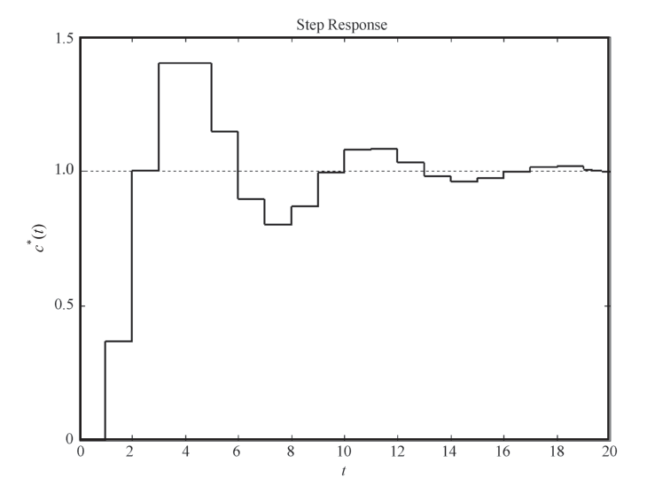{ .lq-img }

*图 7.34 例 7-26 离散系统单位阶跃响应（截自原书）*

应当指出：由于离散系统的时域性能指标只能按采样周期整数倍的采样值来计算，所以是**近似的**。

上述推导与指标可全部用仿真复现（含指标近似计算）：

=== "MATLAB"

    ```matlab
    % ===== 书 7-6 节 例7-26 动态性能 =====
    Phi = tf([0.368 0.264], [1 -1 0.632], 1)   % 闭环脉冲传递函数（T=1s）
    figure; step(Phi, 0:1:20); grid on         % c*(t) 阶梯响应，即图7-34
    % c(nT) n=0..12: 0 0.368 1 1.4 1.4 1.147 0.895 0.802 0.868 0.993 1.077 1.081 1.032
    % 按采样值近似：tr=2s, tp=4s, ts=16s(Δ=2%), σ%=40%（书值）
    % 表7-5 对比：连续 Φ(s)=1/(s^2+s+1)；只有采样器 T=0.2；采样器+ZOH T=0.2
    Gc = tf(1, [1 1 0]); Ts = 0.2;
    G1 = c2d(Gc, Ts, 'impulse');               % 只有采样器：G(z)=Z{G(s)}
    G2 = c2d(Gc, Ts, 'zoh');                   % 采样器+零阶保持器
    figure; step(feedback(G1,1), 0:Ts:20); hold on; step(feedback(G2,1), 0:Ts:20); grid on
    % 书表7-5：连续 tp=3.64 ts=8.08 σ=16.3%；只采样 1.40/7.60/49.6%；ZOH 3.60/8.40/20.6%
    ```

=== "Python"

    ```python
    # ===== 书 7-6 节 例7-26 动态性能 与 表7-5 三系统对比 =====
    import numpy as np
    import control as ct

    # --- 例7-26：K=1, T=1，G(s)=(1-e^-Ts)/(s^2(s+1)) 的带 ZOH 闭环系统 ---
    # G(z)=(0.368z+0.264)/((z-1)(z-0.368))，Φ(z)=G/(1+G)
    Phi = ct.tf([0.368, 0.264], [1, -1, 0.632], dt=1)
    print('Φ(z) =', Phi)
    T = np.arange(0, 21)
    t, y = ct.step_response(Phi, T)
    print('c(nT) n=0..12:', np.round(y[:13], 3))
    # 期望 0,0.368,1,1.4,1.4,1.147,0.895,0.802,0.868,0.993,1.077,1.081,1.032

    def dmetrics(t, y, final=1.0, delta=0.02):
        """按采样值近似计算 tr/tp/ts/σ%（离散指标，与书 7-6 节口径一致）。"""
        tp = t[int(np.argmax(y))]
        sigma = (y.max() - final)/final*100
        bad = np.where(np.abs(y - final) > delta*final)[0]
        ts = t[bad[-1] + 1] if bad[-1] + 1 < len(t) else t[-1]
        tr = t[np.where(y >= final)[0][0]]
        return tr, tp, ts, sigma

    tr, tp, ts, sig = dmetrics(t.astype(float), y)
    print('例7-26 指标: tr=%.0f tp=%.0f ts=%.0f σ%%=%.0f%%'
          % (tr, tp, ts, sig))            # 书: tr=2s, tp=4s, ts=16s(Δ=2%), 40%

    # --- 表7-5：连续 / 只有采样器 T=0.2 / 采样器+ZOH T=0.2 ---
    Gc = ct.tf([1], [1, 1, 0])                     # 开环 1/(s(s+1))
    tc, yc = ct.step_response(ct.feedback(Gc, 1), np.arange(0, 20, 0.001))
    print('连续系统: tp=%.2f ts=%.2f σ=%.1f%%'
          % dmetrics(tc, yc)[1:])                  # 书表7-5: 3.64, 8.08, 16.3%, 振荡0.5次

    Ts = 0.2
    Gd_samp = ct.tf([1 - np.exp(-Ts), 0], [1, -(1 + np.exp(-Ts)), np.exp(-Ts)], dt=Ts)
    Gd_zoh = ct.sample_system(Gc, Ts, method='zoh')
    for name, Gd, ref in [('只有采样器', Gd_samp, (1.40, 7.60, 49.6)),
                          ('采样器+ZOH', Gd_zoh, (3.60, 8.40, 20.6))]:
        Phi_d = ct.feedback(Gd, 1)
        t2, y2 = ct.step_response(Phi_d, np.arange(0, 20.01, Ts))
        tr, tp, ts, sig = dmetrics(t2, y2)
        print('%s T=0.2: tp=%.2f ts=%.2f σ%%=%.1f%%   (书: %s)'
              % (name, tp, ts, sig, ref))
    # 期望输出与书表7-5 逐项一致（连续系统 tp 网格分辨为 3.63≈书 3.64）
    ```

### 采样器和保持器对系统性能的影响

前面曾指出：采样器和保持器不影响开环脉冲传递函数的极点，仅影响开环脉冲传递函数的零点。但对闭环离散系统而言，开环脉冲传递函数**零点**的变化，必然引起闭环脉冲传递函数**极点**的改变，因此采样器和保持器会影响闭环离散系统的动态性能。通过一个具体例子定性说明这种影响。

在例 7-26 中，如果没有采样器和零阶保持器，则成为连续系统，其闭环传递函数

\[
\varPhi(s)=\frac{1}{s^2+s+1}
\]

显然该系统的阻尼比 \(\zeta=0.5\)，自然频率 \(\omega_n=1\)，其单位阶跃响应为

\[
c(t)=1-\frac{e^{-\zeta\omega_nt}}{\sqrt{1-\zeta^2}}\sin\bigl(\omega_n\sqrt{1-\zeta^2}\,t+\arccos\zeta\bigr)
=1-1.154e^{-0.5t}\sin(0.866t+60^\circ)
\]

相应的时间响应曲线如图 7-35 中曲线①所示。

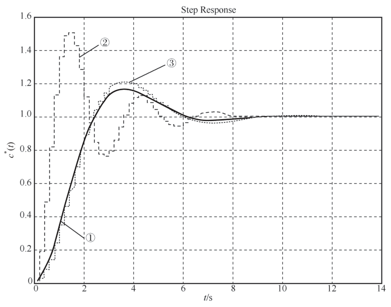{ .lq-img }

*图 7.35 连续与离散系统的时间响应：① 连续；② 只有采样器；③ 采样器+ZOH（截自原书）*

如果在例 7-26 中取 T=0.2 且**只有采样器而没有零阶保持器**，则系统的开环脉冲传递函数为

\[
G(z)=\mathcal{Z}\Bigl[\frac{1}{s(s+1)}\Bigr]=\frac{0.181z}{(z-1)(z-0.819)}
\]

相应的闭环脉冲传递函数

\[
\varPhi(z)=\frac{G(z)}{1+G(z)}=\frac{0.181z}{z^2-1.638z+0.819}
\]

代入 \(R(z)=\dfrac{z}{z-1}\) 得系统输出响应，如图 7-35 中曲线②所示。在例 7-26 中，若取 T=0.2 且**既有采样器又有零阶保持器**的单位阶跃响应曲线 \(c^*(t)\)，如图 7-35 中曲线③所示。

根据图 7-35，可求得各类系统的性能指标如表 7-5 所示。

**表 7-5 连续与离散系统的时域指标**

| 时域指标 | 连续系统 | 离散系统（只有采样器） | 离散系统（有采样器和保持器） |
| --- | --- | --- | --- |
| 峰值时间/s | 3.64 | 1.40 | 3.60 |
| 调节时间/s（\(\Delta=2\%\)） | 8.08 | 7.60 | 8.40 |
| 超调量/% | 16.3 | 49.6 | 20.6 |
| 振荡次数 | 0.5 | 2.0 | 0.5 |

由表可见，采样器和保持器对离散系统的动态性能有如下影响：

1. **采样器**可使系统的峰值时间和调节时间略有减小，但使超调量增大——采样造成的信息损失会降低系统的稳定程度。然而在某些情况下，例如在具有大延迟的系统中，误差采样反而会提高系统的稳定程度。
2. **零阶保持器**在采样周期较小时，对系统时间响应的峰值时间和调节时间都影响不大，但超调量有所增加——因为除了采样造成的不稳定因素外，零阶保持器的相角滞后降低了系统的稳定程度。

应当指出，离散系统在各种典型输入作用下的时间响应和动态性能，可应用 MATLAB 软件方便地获得。

## 7.7 线性离散系统的分析仿真

### 连续系统的离散化

用 **c2d 命令**和 **d2c 命令**可以实现连续系统模型和离散系统模型之间的转换。c2d 用于将连续系统模型转换成离散系统模型，d2c 用于将离散系统模型转换为连续系统模型。命令格式：

```matlab
sysd = c2d(sys, Ts, 'zoh')
sys  = d2c(sysd, 'zoh')
```

其中 sys 表示连续系统模型，sysd 表示离散系统模型，Ts 表示离散化采样时间，'zoh' 表示采用零阶保持器，默认缺省。

### 离散系统模型描述

离散系统的一般描述方法参见 2-5 节（tf/zpk/ss 均支持带采样周期 dt 的离散模型）。

### 离散系统时域分析

**impulse 命令、step 命令、lsim 命令和 initial 命令**可以用来仿真计算离散系统的响应，有关说明参见 3-7 节。这些命令用于离散系统时与连续系统没有本质差异，只是输出为 \(y(kT)\)，且具有**阶梯函数**的形式。离散频率特性用 dbode 绘制。

=== "MATLAB"

    ```matlab
    % ===== 书 7-7 节 连续系统的离散化与离散频域响应 =====
    G = tf(1, [1 1 0]);                 % 例7-26 的连续部分 1/(s(s+1))
    Gd = c2d(G, 1, 'zoh')               % → 0.3679z+0.2642 / (z^2-1.368z+0.3679)
    Gback = d2c(Gd, 'zoh')              % 还原连续模型，应回到 1/(s(s+1))
    w = [0.1 0.5 1 2 3];                % 数字角频率 wT ∈ (0, π)
    [mag, pha] = bode(Gd, w)            % dbode：离散频率特性
    ```

=== "Python"

    ```python
    # ===== 书 7-7 节 连续系统的离散化与离散频域响应 =====
    import numpy as np
    import control as ct

    G = ct.tf([1], [1, 1, 0])                   # 例7-26 的连续部分 1/(s(s+1))
    Gd = ct.c2d(G, 1, method='zoh')             # MATLAB: Gd = c2d(G, 1, 'zoh')
    print('Gd(z) =', Gd)
    print('零点:', np.round(Gd.zeros(), 4), ' 极点:', np.round(Gd.poles(), 4))
    # 手算对照：G(z) = (0.368z+0.264)/((z-1)(z-0.368))，一致

    # 离散频率特性（MATLAB: dbode(Gd)）：数字角频率 wT 取 (0, pi) 内若干点
    w = np.array([0.1, 0.5, 1.0, 2.0, 3.0])
    resp = ct.frequency_response(Gd, w)
    print('|Gd(e^jwT)| =', np.round(resp.magnitude, 4))
    print('相位/deg       =', np.round(np.degrees(resp.phase), 2))
    # python-control 0.10 没有与 d2c 同名的函数，离散→连续可用 scipy 或自行实现
    ```

### 综合运用

**例 7-27** 已知离散系统如图 7-36 所示，其中 ZOH 为零阶保持器，T=0.25。当 \(r(t)=2+t\) 时，欲使稳态误差小于 0.1，试求 K 值。

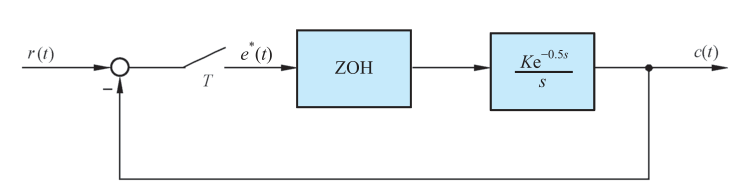{ .lq-img }

*图 7.36 例 7-27 闭环离散系统结构图（截自原书）*

解 本题关键是选择合适的稳定判据对闭环系统进行稳定性分析，选取的 K 值应**同时满足稳定性及稳态误差要求**。

开环脉冲传递函数为

\[
G(z)=\mathcal{Z}\Bigl[\frac{1-e^{-Ts}}{s}\cdot\frac{Ke^{-0.5s}}{s}\Bigr]
=K(1-z^{-1})z^{-2}\,\mathcal{Z}\Bigl[\frac{1}{s^2}\Bigr]
\]

由于 T=0.25，故 \(e^{-0.5s}=e^{-2Ts}=z^{-2}\)，所以

\[
G(z)=\frac{0.25K}{z^2(z-1)}
\]

闭环误差脉冲传递函数为

\[
\varPhi_e(z)=\frac{1}{1+G(z)}=\frac{z^2(z-1)}{z^3-z^2+0.25K}
\]

闭环特征方程为

\[
D(z)=z^3-z^2+0.25K=0
\]

将 \(z=\dfrac{w+1}{w-1}\) 代入特征方程，得 w 域特征方程

\[
D(w)=0.25Kw^3+(2-0.75K)w^2+(4+0.75K)w+(2-0.25K)=0
\]

在 w 域中用劳斯表分析系统的稳定性，得到使系统稳定的 K 值范围。列劳斯表如下：

\[
\begin{array}{c|cc}
w^3 & 0.25K & 4+0.75K\\
w^2 & 2-0.75K & 2-0.25K\\
w^1 & \dfrac{(2-0.75K)(4+0.75K)-0.25K(2-0.25K)}{2-0.75K} & 0\\
w^0 & 2-0.25K &
\end{array}
\]

其中 \(w^1\) 行首元化简为 \(\dfrac{8-2K-0.5K^2}{2-0.75K}\)。由劳斯判据知，使系统稳定的 K 值范围

\[
0<K<2.47
\]

（条件为 \(K>0\)、\(2-0.75K>0\Rightarrow K<2.67\)、\(8-2K-0.5K^2>0\Rightarrow K<2\sqrt5-2=2.47\)、\(2-0.25K>0\Rightarrow K<8\)，取交集。）

从满足稳态误差要求考虑：由于

\[
R(z)=\mathcal{Z}\bigl[2+t\bigr]=\frac{2z}{z-1}+\frac{Tz}{(z-1)^2}=\frac{2z(z-1)+Tz}{(z-1)^2}
\]

故稳态误差

\[
e(\infty)=\lim_{z\to1}(1-z^{-1})\varPhi_e(z)R(z)
=\lim_{z\to1}\frac{z-1}{z}\cdot\frac{z^2(z-1)}{z^3-z^2+0.25K}\cdot\frac{2z(z-1)+Tz}{(z-1)^2}
=\frac{T}{0.25K}=\frac{1}{K}
\]

由于要求 \(e(\infty)<0.1\)，则应有 \(K>10\)。显然，**满足 \(e(\infty)<0.1\) 的 K 值不存在**。

仿真验证：取 K=2.5，系统的误差输出响应如图 7-37 所示，系统不稳定；取 K=2.4，系统的误差输出响应如图 7-38 所示，系统稳定，但 \(e(\infty)=0.42>0.1\)。

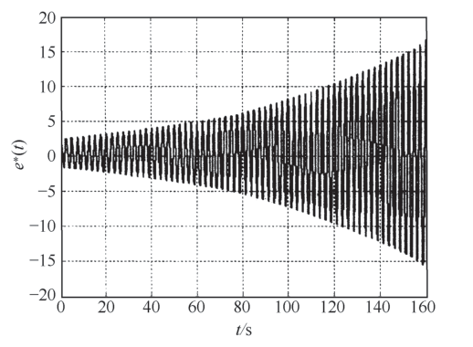{ .lq-img }

*图 7.37 例 7-27 离散系统误差时间响应（K=2.5，发散振荡）（截自原书）*

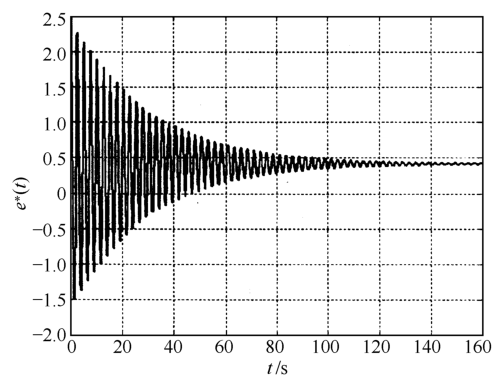{ .lq-img }

*图 7.38 例 7-27 离散系统误差时间响应（K=2.4，收敛到 0.42）（截自原书）*

原书给的判稳+稳态误差全过程也可以用 sympy 机器验证一遍（w 变换、劳斯条件、稳态误差）：

=== "MATLAB"

    ```matlab
    % ===== 书 7-7 节 例7-27 =====
    K = [2.5 2.4]; Ts = 0.25; T = 160;
    for i = 1:2
        G = tf(K(i), [1 0], 'inputdelay', 0.5);
        Gz = c2d(G, Ts, 'zoh');            % 含 0.5s 延迟的 ZOH 离散化 → 0.25K/(z^2(z-1))
        syse = feedback(1, Gz);            % 误差脉冲传递函数 Φe(z)
        t = 0:Ts:T; u = 2 + t;             % 定义系统输入
        area = [0 T -20 20; 0 T -2 2.5];
        figure(i); lsim(syse, u, t, 0); axis(area(i,:)); grid on  % 误差输出响应曲线
    end
    ```

=== "Python"

    ```python
    # ===== 书 7-7 节 例7-27：K=2.5 与 K=2.4 的误差输出响应 =====
    import numpy as np
    import matplotlib.pyplot as plt
    import scipy.signal

    Ts, Tend = 0.25, 160
    for K in (2.5, 2.4):
        # 误差脉冲传递函数 Φe(z)=z^2(z-1)/(z^3-z^2+0.25K)，z^-1 形式 (1-z^-1)/(1-z^-1+0.25K z^-3)
        syse = ([1, -1, 0, 0], [1, -1, 0, 0.25*K], Ts)
        t = np.arange(0, Tend, Ts)           # 定义系统输入
        u = 2 + t
        _, y = scipy.signal.dlsim(syse, u, t, 0)
        print('K=%.1f: e(160s) = %.3g' % (K, y[-1, 0]))
        plt.figure()                         # 绘制误差输出响应曲线
        plt.plot(t, y)
        plt.title('K = %.1f' % K)
        plt.xlabel('t/s')
        plt.ylabel('e*(t)')
        plt.grid()
    plt.show()
    # 预期：K=2.5 时 e(160s)≈16.7（发散振荡，对应图7-37）；
    #       K=2.4 时 e(160s)≈0.42（收敛，对应图7-38，理论 e(∞)=1/K）
    ```

!!! warning "原书笔误"
    原书例 7-27 的 Python 程序中引号、等号均为全角字符（`‘K=2.5’`、`T＝160`、`#定义系统输入` 等），直接复制会报语法错误，本笔记已按半角修正；其 `scipy.signal.dlsim` 的用法（传 `(num, den, Ts)` 元组、第四参为初态 x0=0）与原书一致。另外注意 `dlsim` 的分子分母按 **\(z^{-1}\) 降幂**排列，与控制库 `tf(num, den, dt)` 按 z 降幂的约定不同，两者不能混用。

## 坑与陷阱

!!! danger "8 个容易踩的坑"
    1. **相同的 E(z) 不一定对应相同的 e(t)**（例 7-5、例 7-6）：\(1(t)\) 和 \(\delta_T(t)\) 采样值全为 1，z 变换都是 \(z/(z-1)\)。z 变换只锁定采样瞬时值，连续波形本身丢了一份——反变换结果要按 \(e^*(t)\) 理解。
    2. **z 变换无串联性**（例 7-18）：\(G_1(z)G_2(z)\ne G_1G_2(z)\)。两个环节之间有没有采样开关，脉冲传递函数完全不同（只有极点恰好一样）。串联化简前先看开关位置，这是离散结构图化简的第一动作。
    3. **闭环脉冲传递函数不能由 \(\varPhi(s)\) 求 z 变换得到**：\(\varPhi(z)\ne\mathcal{Z}[\varPhi(s)]\)。采样器配置方式决定公式形状（表 7-3 八种）；误差信号处没有采样开关时 \(\varPhi(z)\) 根本不存在，只能写 \(C(z)\)（含 \(RG(z)\) 项）。
    4. **z 变换法有三条前提**：理想脉冲近似成立（\(\tau\) 足够小）、结果只代表采样瞬时值、要求 \(\lim_{s\to\infty}sG(s)=0\)（极点至少比零点多两个）。违反第三条时 \(c^*(t)\) 与真实 \(c(t)\) 差别巨大（例 7-21：采样值收敛到 1.58，真实值在 0.582～1.582 间锯齿振荡）。
    5. **劳斯判据不能直接用在 z 域**：z 域判稳看单位圆不是虚轴。必须先做 w 变换 \(z=\frac{w+1}{w-1}\)（注意方向：代回时用 \(w=\frac{z-1}{z+1}\)），把单位圆内变成左半 w 平面，再列劳斯表。
    6. **采样会降低稳定性**：二阶连续系统加采样后可能失稳（例 7-23，\(z^2+4.952z+0.368=0\) 有根 \(-4.876\)）。提高采样频率或降低开环增益可改善；ZOH 还有额外 T/2 滞后与相角滞后（\(\omega_s\) 处 \(-180^\circ\)），别把零阶保持器当理想低通。
    7. **离散静态误差系数自带 T**：速度误差 \(T/K_v\)、加速度误差 \(T^2/K_a\)（表 7-4）。采样周期选大了，同样的 \(K_v\) 误差按比例放大；且结论只对采样瞬时成立。查表 7-4 之前先判稳，别复刻第 3 章"形式答案"的错误。
    8. **离散指标只是近似**（例 7-26）：\(t_r,t_p,t_s,\sigma\%\) 全部按采样周期整数倍的采样值计算，精度受限于 T；采样间隔之间的信息 z 反变换原则上给不出，需要时用修正 z 变换或直接仿真连续部分。

## 术语速查

| 英文 | 中文 | 一句话 |
| --- | --- | --- |
| sampling | 采样 | 每隔 T 秒对连续信号取值一次，把 \(e(t)\) 变成 \(e^*(t)\) |
| sampler / sampling switch | 采样器 / 采样开关 | 实现采样的装置；理想化后视为幅值调制器 |
| sampling period T | 采样周期 | 两次采样的间隔；采样频率 \(f_s=1/T\)，角频率 \(\omega_s=2\pi/T\) |
| pulse sequence | 脉冲序列 | 时间离散、幅值连续的离散模拟信号 |
| digital sequence | 数字序列 | 时间、幅值都离散的信号（经量化编码） |
| quantization | 量化 | A/D 中把采样值归整到最小位二进制整数倍（编码）过程 |
| reconstruction / hold | 复现 / 保持 | 把脉冲序列恢复成连续信号；保持器是各采样点间的插值器 |
| zero-order hold (ZOH) | 零阶保持器 | 按常值外推的保持器，\(G_h(s)=(1-e^{-Ts})/s\)，输出阶梯信号 |
| Shannon sampling theorem | 香农采样定理 | \(\omega_s\ge2\omega_h\) 才能无失真复现；工程上取 \(\omega_s=10\omega_c\) 或 \(T=t_s/40\) |
| aliasing | 频谱混叠 | \(\omega_s<2\omega_h\) 时补分量交叠、频谱畸变，无法滤波复原 |
| primary band | 主要带 | s 平面上 \(-\omega_s/2\sim\omega_s/2\) 的周期带，映射为单位圆及内负实轴 |
| z-transform | z 变换 | 采样拉氏变换的变量置换 \(z=e^{sT}\)，\(E(z)=\sum e(nT)z^{-n}\) |
| z inverse transform | z 反变换 | 部分分式法/幂级数法/反演积分法（留数法）求 \(e(nT)\) |
| shift theorem | 实数位移定理 | \(z^{-k}\) 滞后、\(z^k\) 超前 k 拍；把差分方程变成代数方程的钥匙 |
| final-value theorem | 终值定理 | \(e(\infty)=\lim_{z\to1}(z-1)E(z)\)，离散稳态误差的计算基础 |
| difference equation | 差分方程 | 离散系统的时域模型；迭代法或 z 变换法求解 |
| pulse transfer function | 脉冲传递函数 | \(G(z)=C(z)/R(z)\)，等于加权序列（单位脉冲响应序列）的 z 变换 |
| weighting sequence | 加权序列 | 单位脉冲响应序列 \(K(nT)\)；\(G(z)=\mathcal{Z}[K(nT)]\) |
| fictitious sampler | 虚设采样开关 | 输出端假想的同步开关，只为定义 \(C(z)\)，实际不存在 |
| characteristic equation | 特征方程 | \(D(z)=1+GH(z)=0\)；根在单位圆内才稳定 |
| bilinear / w-transform | 双线性变换 / w 变换 | \(w=\frac{z-1}{z+1}\)，把单位圆内映成左半 w 平面，劳斯判据得以套用 |
| discrete system type | 离散系统型别 | 开环脉冲传递函数 \(G(z)\) 在 \(z=1\) 的极点数 \(\nu\) |
| discrete static error coefficients | 离散静态误差系数 | \(K_p=\lim G\)、\(K_v=\lim(z-1)G\)、\(K_a=\lim(z-1)^2G\)，误差 \(1/(1+K_p)\)、\(T/K_v\)、\(T^2/K_a\) |
| staircase response | 阶梯响应 | 离散系统 step 输出 \(y(kT)\) 的形态；ZOH 输出也是阶梯波 |

## 覆盖自查

??? note "原书小节 → 笔记位置"
    | 原书小节/内容 | 笔记位置 |
    | --- | --- |
    | 7-1 离散系统的基本概念（采样/数字控制系统、例 7-1 炉温、例 7-2 高炮、A/D 与 D/A、典型结构图、五个特点、研究方法） | 7.1 |
    | 7-2 信号的采样与保持（采样过程、拉氏变换、频谱、香农采样定理、采样周期选取表 7-1、信号保持与零阶保持器） | 7.2 |
    | 7-3 z 变换理论（定义、级数求和法、部分分式法、表 7-2、五条性质及证明、z 反变换三法） | 7.3 |
    | 7-4 离散系统的数学模型（离散系统数学定义、差分方程及两解法、脉冲传递函数定义/意义/求法、开环两性质、串联两种情况、带 ZOH、闭环、表 7-3、z 变换法局限性） | 7.4 |
    | 7-5 离散系统的稳定性与稳态误差（s→z 映射、等 σ/等 ω 线、主要带、充要条件两版、w 变换与劳斯、稳态误差终值定理法、型别与静态误差系数、表 7-4） | 7.5 |
    | 7-6 离散系统的动态性能分析（时间响应、例 7-26、采样器和保持器的影响、表 7-5） | 7.6 |
    | 7-7 线性离散系统的分析仿真（c2d/d2c、模型描述、时域分析、例 7-27 综合） | 7.7 |

??? note "原书例题 → 笔记位置"
    | 原书例题 | 内容 | 笔记位置 |
    | --- | --- | --- |
    | 例 7-1 | 炉温采样控制系统原理（连续 vs 采样调节的矛盾） | 7.1 采样控制系统 |
    | 例 7-2 | 小口径高炮高精度数字伺服系统 | 7.1 数字控制系统 |
    | 例 7-3 | \(1(t)\) 的采样拉氏变换 \(1/(1-e^{-Ts})\) | 7.2 采样信号的拉氏变换 |
    | 例 7-4 | \(e^{-at}\) 的采样拉氏变换 | 7.2 采样信号的拉氏变换 |
    | 例 7-5 | 级数求和法求 \(\mathcal{Z}[1(t)]\) | 7.3 级数求和法 |
    | 例 7-6 | \(\mathcal{Z}[\delta_T(t)]\) 与 E(z) 不唯一对应 e(t) | 7.3 级数求和法 |
    | 例 7-7 | 部分分式法求 \(\mathcal{Z}[\sin\omega t]\) | 7.3 部分分式法 |
    | 例 7-8 | 实数位移定理算 \(e^{-a(t-T)}\) | 7.3 实数位移定理 |
    | 例 7-9 | 复数位移定理算 \(te^{-at}\) | 7.3 复数位移定理 |
    | 例 7-10 | 终值定理求终值 =1 | 7.3 终值定理 |
    | 例 7-11 | 部分分式法 z 反变换 | 7.3 部分分式法（反变换） |
    | 例 7-12 | 幂级数法（综合除法）z 反变换 | 7.3 幂级数法 |
    | 例 7-13 | 留数法 z 反变换 \(2-(0.5)^n\) | 7.3 反演积分法 |
    | 例 7-14 | 迭代法解差分方程（0,1,6,25,90,301,966） | 7.4 迭代法 |
    | 例 7-15 | z 变换法解差分方程 \(c(k)=(-1)^k-(-2)^k\) | 7.4 z 变换法 |
    | 例 7-16 | \(c(nT)=r[(n-k)T]\Rightarrow G(z)=z^{-k}\) | 7.4 脉冲传递函数求法 |
    | 例 7-17 | \(G(s)=a/(s(s+a))\) 的 \(G(z)\)（无 ZOH） | 7.4 脉冲传递函数求法 |
    | 例 7-18 | z 变换无串联性（有/无采样开关对比） | 7.4 开环系统脉冲传递函数 |
    | 例 7-19 | 带 ZOH 的 \(G(z)\)，与例 7-17 比零点 | 7.4 有零阶保持器时 |
    | 例 7-20 | 证明 \(\varPhi(z)=\frac{G_1G_2}{1+G_1HG_2}\) | 7.4 闭环系统脉冲传递函数 |
    | 例 7-21 | RC 网络采样输出 vs 连续输出（式 7.71 反例） | 7.4 z 变换法的局限性 |
    | 例 7-22 | 一阶差分方程判稳 \(\vert a\vert<1\) | 7.5 时域充要条件 |
    | 例 7-23 | 二阶离散系统判稳（采样致不稳定） | 7.5 z 域充要条件 |
    | 例 7-24 | w 变换+劳斯求临界增益 \(K_c=4.33\) | 7.5 离散系统的稳定性判据 |
    | 例 7-25 | 单位反馈系统阶跃/斜坡稳态误差（0 与 0.1） | 7.5 离散系统的稳态误差 |
    | 例 7-26 | 带 ZOH 系统阶跃响应与指标（tr=2, tp=4, ts=16, σ=40%） | 7.6 离散系统的时间响应 |
    | 例 7-27 | 稳定域 \(0<K<2.47\) 与稳态误差 \(1/K\) 的矛盾、仿真验证 | 7.7 综合运用 |
