# 第 8 章 非线性控制系统分析

> **本章解决**：前七章的叠加原理、传递函数、劳斯表、奈氏判据全部建立在"线性"这个理想化假设上，而真实系统里放大器会饱和、电动机会死区、齿轮传动有间隙、继电器只开不关。本章先认识非线性系统的三张"新面孔"——稳定性与初始条件有关、没有外作用也会自振（自激振荡）、正弦响应发生畸变（8-1）；再用等效增益把常见非线性对系统运动的影响定性讲清楚（8-2）；然后是本章主角**描述函数法**：对非线性环节的正弦响应做谐波线性化，把它等效成一个只随幅值 \(A\) 变化的复变增益 \(N(A)\)，把第 5 章的奈氏判据推广过来——用 \(\varGamma_G\) 曲线与负倒描述函数 \(-1/N(A)\) 曲线的相对位置判稳、判自振、算自振的振幅与频率（8-3）；最后用数值积分与仿真验证（8-4）。相平面法与逆系统法只作简介。公式沿用原书式号 (8-1)～(8-55)，插图沿用原书图号（图 8-1～图 8-28）。

## 8.0 本章导图

<div class="brtree">
  <div class="brrow">
    <span class="brlabel root">非线性控制系统分析</span>
    <span class="brace"></span>
    <div class="brkids">
      <div class="brrow">
        <span class="brlabel">概述（8-1）</span>
        <span class="brace"></span>
        <div class="brkids">
          <span class="brleaf">饱和/死区/间隙无处不在</span>
          <span class="brleaf">液位系统 + 小偏差线性化</span>
          <span class="brleaf">多平衡点：稳定性随初条件变</span>
          <span class="brleaf">自激振荡（自振）</span>
          <span class="brleaf">频率响应畸变</span>
          <span class="brleaf">相平面 / 描述函数 / 逆系统</span>
        </div>
      </div>
      <div class="brrow">
        <span class="brlabel">常见非线性（8-2）</span>
        <span class="brace"></span>
        <div class="brkids">
          <span class="brleaf">等效增益 k=f(x)/x</span>
          <span class="brleaf">继电/死区/饱和/间隙/摩擦</span>
          <span class="brleaf">间隙：非单值、过零跳变</span>
          <span class="brleaf">对系统运动的影响</span>
        </div>
      </div>
      <div class="brrow">
        <span class="brlabel">描述函数定义（8-3）</span>
        <span class="brace"></span>
        <div class="brkids">
          <span class="brleaf">谐波分析与 A<sub>0</sub>、A<sub>n</sub>、B<sub>n</sub></span>
          <span class="brleaf">N(A)=Y<sub>1</sub>/A·e<sup>jφ₁</sup></span>
          <span class="brleaf">例8-1：继电 4M/(πA)</span>
          <span class="brleaf">奇函数：A<sub>0</sub>=0、A<sub>1</sub>=0；例8-2</span>
          <span class="brleaf">应用三条件、复变增益</span>
        </div>
      </div>
      <div class="brrow">
        <span class="brlabel">典型描述函数（8-3）</span>
        <span class="brace"></span>
        <div class="brkids">
          <span class="brleaf">死区饱和图解法 ψ<sub>1</sub>ψ<sub>2</sub></span>
          <span class="brleaf">饱和 / 死区闭式</span>
          <span class="brleaf">死区滞环继电推导</span>
          <span class="brleaf">表8-1 十一项查用</span>
        </div>
      </div>
      <div class="brrow">
        <span class="brlabel">系统简化（8-3）</span>
        <span class="brace"></span>
        <div class="brkids">
          <span class="brleaf">并联：N 代数相加</span>
          <span class="brleaf">串联：图解法、K=K<sub>1</sub>K<sub>2</sub></span>
          <span class="brleaf">与前后次序有关</span>
          <span class="brleaf">线性部分等效变换</span>
        </div>
      </div>
      <div class="brrow">
        <span class="brlabel">稳定性与自振（8-3）</span>
        <span class="brace"></span>
        <div class="brkids">
          <span class="brleaf">1+N(A)G(jω)=0</span>
          <span class="brleaf">判稳：Γ<sub>G</sub> 包围→不稳定</span>
          <span class="brleaf">交点=周期运动</span>
          <span class="brleaf">穿出/穿入判据</span>
          <span class="brleaf">例8-3、例8-4、例8-5</span>
        </div>
      </div>
      <div class="brrow">
        <span class="brlabel">分析仿真（8-4）</span>
        <span class="brace"></span>
        <div class="brkids">
          <span class="brleaf">ode45 / odeint</span>
          <span class="brleaf">sympy 算描述函数</span>
          <span class="brleaf">自振交点数值求解</span>
          <span class="brleaf">奈氏图叠画（例8-6）</span>
        </div>
      </div>
    </div>
  </div>
</div>

## 8.1 非线性控制系统概述

### 研究非线性控制理论的意义

理想的线性系统并不存在——组成控制系统的各元件，其动态和静态特性都存在不同程度的非线性。随动系统就是典型：放大元件受电源电压或输出功率限制，输入电压超出线性工作范围后输出呈饱和现象；执行元件电动机受轴上摩擦力矩和负载力矩影响，电枢电压达到一定数值才会转动（死区），电压超过一定数值后转速不再增加（饱和）；传动机构受加工和装配精度限制，换向时存在间隙特性（图 8-1）。

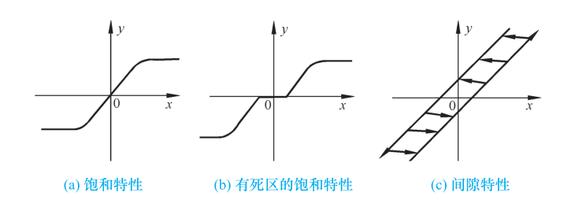{ .lq-img }

*图 8-1 几种典型的非线性特性：(a) 饱和特性；(b) 有死区的饱和特性；(c) 间隙特性（截自原书）*

系统中含有一个或多个具有非线性特性的元件时，该系统称为**非线性系统**（nonlinear control system）。原书图 8-2 的柱形液位系统是个好例子：贮槽截面积 \(C\)，液位高度 \(H\)，液体流入量 \(Q_i\)、流出量 \(Q_o\)。按水力学原理，流出量与液位平方根成正比：

\[
Q_o = k\sqrt{H}
\tag{8.1}
\]

比例系数 \(k\) 取决于液体的黏度和阀阻。贮槽的物料平衡给出液位系统动态方程：

\[
C\frac{\mathrm{d}H}{\mathrm{d}t} = Q_i - Q_o = Q_i - k\sqrt{H}
\tag{8.2}
\]

显然液位 \(H\) 与输入量 \(Q_i\) 之间的关系是非线性微分方程。一般地，非线性系统的数学模型可以表示为

\[
f\left(t,\ \frac{\mathrm{d}^n y}{\mathrm{d}t^n},\ \cdots,\ \frac{\mathrm{d}y}{\mathrm{d}t},\ y\right) =
g\left(t,\ \frac{\mathrm{d}^m r}{\mathrm{d}t^m},\ \cdots,\ \frac{\mathrm{d}r}{\mathrm{d}t},\ r\right)
\tag{8.3}
\]

其中 \(f(\cdot)\) 和 \(g(\cdot)\) 为非线性函数。

**两条近似的出路**：非线性程度不严重时（不灵敏区较小、输入信号幅值较小、传动机构间隙不大），可以忽略非线性特性的影响，把非线性环节视为线性环节；系统方程解析且工作在某一数值附近的较小范围内时，可用**小偏差法**（small-deviation linearization）线性化。以液位系统为例：设 \(H\) 在 \(H_0\) 附近变化，\(Q_i\) 在 \(Q_{i0}\) 附近变化，取 \(\Delta H=H-H_0\)、\(\Delta Q=Q_i-Q_{i0}\)，对 \(\sqrt H\) 作泰勒级数展开：

\[
\sqrt{H} = \sqrt{H_0} + \frac{1}{2\sqrt{H_0}}(H-H_0) + \cdots
\tag{8.4}
\]

鉴于 \(H\)、\(Q_i\) 变化较小，取 \(\sqrt H\) 泰勒展开的一次项近似，得小偏差线性化方程：

\[
C\frac{\mathrm{d}(\Delta H)}{\mathrm{d}t} = \Delta Q - \frac{k}{2\sqrt{H_0}}\,\Delta H
\tag{8.5}
\]

忽略非线性影响或作小偏差线性化后，非线性系统近似为线性系统，可采用线性定常系统的方法分析设计。但**非线性程度比较严重、工作范围较大**的系统，只有使用非线性系统的分析和设计方法才能得到较为正确的结果。非线性特性千差万别，目前**还没有统一的且普遍适用的处理方法**；线性系统是非线性系统的特例，线性系统的分析设计方法在非线性研究中仍将发挥非常重要的作用。

!!! note "拓展：'忽略'与'小偏差法'是两条不同的路（补充）"
    忽略非线性是把非线性环节直接当线性环节用（小间隙、小死区直接按比例环节算）；小偏差法是在工作点附近泰勒展开、只保留一次项（式 8.4 → 8.5），得到以增量 \(\Delta H\)、\(\Delta Q\) 为变量的线性模型——第 2 章建立增量方程用的正是这套手段。两者都只在**工作点附近的小范围**内成立：信号幅值一大（饱和真的切了顶、继电器真的换了向），线性模型失效，必须回到本章的方法。

### 非线性系统的特征

线性系统的重要特征是可以应用**线性叠加原理**；非线性系统的数学模型是非线性微分方程，叠加原理不能应用——**能否应用叠加原理是两类系统的本质区别**。非线性系统的运动主要有以下特点。

#### 稳定性分析复杂

按平衡状态的定义：无外作用且系统输出的各阶导数等于零时，系统处于平衡状态。线性系统只有一个平衡状态 \(y=0\)，线性系统的稳定性即为该平衡状态的稳定性，只取决于系统本身的结构和参数，**与外作用和初始条件无关**。

非线性系统可能存在**多个平衡状态**。看一阶非线性系统

\[
\dot x = x^2 - x = x(x-1)
\tag{8.6}
\]

令 \(\dot x=0\)，系统有两个平衡状态 \(x=0\) 和 \(x=1\)。各平衡状态的稳定性需求解式 (8.6)：设 \(t=0\) 时初始状态为 \(x_0\)，分离变量 \(\dfrac{\mathrm{d}x}{x(x-1)}=\mathrm{d}t\) 积分得

\[
x(t) = \frac{x_0\,\mathrm{e}^{-t}}{1-x_0+x_0\,\mathrm{e}^{-t}}
\tag{8.7}
\]

时间响应随初始条件而变（图 8-3）：\(x_0>1\) 时，在 \(t<\ln\dfrac{x_0}{x_0-1}\) 内随 \(t\) 增大 \(x(t)\) 递增，\(t=\ln\dfrac{x_0}{x_0-1}\) 时 \(x(t)\) 为无穷大；\(x_0<1\) 时 \(x(t)\) 递减并趋于 0。

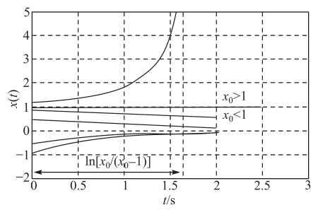{ .lq-img }

*图 8-3 非线性一阶系统的时间响应曲线（MATLAB）：\(x_0>1\) 发散（分母在 \(t=\ln[x_0/(x_0-1)]\) 处过零），\(x_0<1\) 收敛到 0（截自原书）*

考虑平衡状态受小扰动的影响：平衡状态 \(x=1\) 是**不稳定**的——稍有偏离，系统不能恢复至原平衡状态；平衡状态 \(x=0\) 在一定范围的扰动下（\(x_0<1\)）是**稳定**的。

由上例可见：非线性系统可能存在多个平衡状态，各平衡状态可能是稳定的也可能是不稳定的；初始条件不同，自由运动的稳定性亦不同。更重要的是——**平衡状态的稳定性不仅与系统的结构和参数有关，而且与系统的初始条件有直接的关系**。线性系统大范围稳定与小范围稳定必然同时成立，非线性系统可以只在小范围稳定（图 8-3 正是一例）。

#### 可能存在自激振荡现象

**自激振荡**（self-oscillation）：没有外作用时，系统内产生的具有固定振幅和频率的**稳定周期运动**，简称**自振**。

线性定常系统只有在**临界稳定**的情况下才能产生周期运动。看图 8-4 的二阶零阻尼线性系统（\(r=0\)，前向通道 \(1/s^2\)，反馈 \(\omega_n^2\)），初始条件 \(x(0)=x_0\)、\(\dot x(0)=\dot x_0\)，自由运动方程

\[
\ddot x + \omega_n^2 x = 0
\tag{8.8}
\]

用拉普拉斯变换法求解：

\[
X(s) = \frac{sx_0+\dot x_0}{s^2+\omega_n^2}
\tag{8.9}
\]

系统自由运动

\[
x(t) = \sqrt{x_0^2+\left(\frac{\dot x_0}{\omega_n}\right)^2}\,
\sin\!\left(\omega_n t + \arctan\frac{\omega_n x_0}{\dot x_0}\right) = A\sin(\omega_n t + \phi)
\tag{8.10}
\]

振幅 \(A\) 和相角 \(\phi\) 依赖于初始条件；且由线性叠加原理，运动过程中一旦外扰动使 \(x(t)\) 或 \(\dot x(t)\) 发生偏离，\(A\) 和 \(\phi\) 都将随之改变，周期运动将不能维持——**线性系统在无外信号作用时所具有的周期运动不是自激振荡**。

自振的正面教材是著名的范德波尔（van der Pol）方程

\[
\ddot x - 2\rho(1-x^2)\dot x + x = 0, \qquad \rho > 0
\tag{8.11}
\]

它描述具有非线性阻尼的二阶系统：扰动使 \(x<1\) 时，\(-2\rho(1-x^2)<0\)，系统具有**负阻尼**，从外部获得能量，\(x(t)\) 呈发散形式；\(x>1\) 时 \(-2\rho(1-x^2)>0\)，**正阻尼**，消耗能量，\(x(t)\) 呈收敛形式；\(x=1\) 时零阻尼，等幅振荡。仿真分析表明，系统能克服扰动对 \(x\) 的影响，保持幅值为 1 的等幅振荡（图 8-5）——这才是自振。

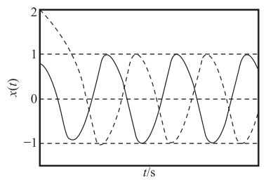{ .lq-img }

*图 8-5 非线性阻尼二阶系统的自激振荡（MATLAB）：不同初始条件的响应都被"吸"到幅值 1 的等幅振荡上（截自原书）*

必须指出：长时间大幅度的振荡会造成机械磨损、增加控制误差，多数情况下不希望系统有自振发生；但在控制中通过引入**高频小幅度的颤振**，可克服间隙、死区等非线性因素的不良影响，而振动试验中还必须使系统产生稳定的周期运动。研究自振的产生条件及抑制、确定自振的频率和周期，是非线性系统分析的重要内容。

!!! note "拓展：自振的几何名字叫极限环（补充）"
    在相平面（\(x\)–\(\dot x\) 平面）上看，自振对应一条孤立的封闭相轨迹，术语叫**极限环**（limit cycle）。范德波尔方程的极限环是**稳定的**：环内外的相轨迹都向它收敛，所以振荡幅值不会被扰动破坏——这正是"固定振幅"的含义。描述函数法后面算出的自振振幅 \(A\) 与频率 \(\omega\) 就是极限环参数的近似值，"近似"是因为只保留了基波。

#### 频率响应发生畸变

稳定线性系统的频率响应：正弦信号作用下的稳态输出是与输入同频率的正弦信号，其幅值和相位是输入频率 \(\omega\) 的函数。而非线性系统的频率响应除了含与输入同频率的**基频分量**外，还含 \(\omega\) 的**高次谐波分量**，使输出波形发生非线性畸变；若系统含有多值非线性环节（如间隙、滞环），输出的各次谐波分量的幅值还可能发生跃变。

### 非线性系统的分析与设计方法

系统分析和设计的目的是通过求取系统的运动形式、以解决稳定性问题为中心对系统实施有效控制。非线性系统形式多样，受数学工具限制，一般情况下难以求得非线性微分方程的解析解，只能采用工程上适用的近似方法。主要有三种：

1. **相平面法**（phase plane method）：推广应用时域分析法的图解方法，在相平面上绘制相轨迹曲线，确定非线性微分方程在不同初始条件下解的运动形式。仅适用于**一阶和二阶系统**。
2. **描述函数法**（describing function method）：基于频域分析法和非线性特性谐波线性化的图解分析方法。对满足结构要求的一类非线性系统，通过谐波线性化把非线性特性近似表示为复变增益环节，推广应用频率法，分析非线性系统的稳定性或自激振荡。
3. **逆系统法**（inverse system method）：运用内环非线性反馈控制构成**伪线性系统**，并以此为基础设计外环控制网络。用数学工具直接研究非线性控制问题，不必求解非线性系统的运动方程，是非线性系统控制研究的一个发展方向。

限于篇幅，本章仅介绍常用的描述函数法。

## 8.2 常见非线性特性及其对系统运动的影响

继电特性、死区、饱和、间隙和摩擦是实际系统中常见的非线性因素。很多情况下，非线性系统可以表示为**在线性系统的某些环节的输入或输出端加入非线性环节**的形式，非线性因素的影响会使线性系统的运动发生变化。本节从物理概念的角度出发、基于线性系统的分析方法对这类系统做定性分析——结论不够严谨，但对认识常见非线性因素的影响具有参考价值。分析中用简单的折线代替实际的非线性曲线（典型化），由此产生的误差一般在工程允许范围之内。

### 非线性特性的等效增益

设非线性特性可以表示为

\[
y = f(x)
\tag{8.12}
\]

把它看成一个环节：输入 \(x\)、输出 \(y\)。按照线性系统中比例环节的描述，定义输出 \(y\) 与输入 \(x\) 的比值为**等效增益**（equivalent gain）：

\[
k = \frac{y}{x} = \frac{f(x)}{x}
\tag{8.13}
\]

比例环节的增益为常值，而式 (8.12) 非线性环节的等效增益是**变增益**——非线性特性可视为变增益比例环节，比例环节是其特例。五种常见非线性特性的静特性与等效增益曲线见图 8-6。

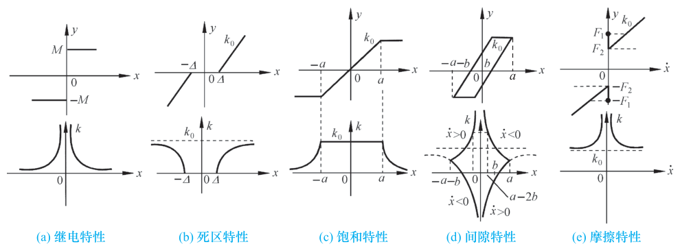{ .lq-img }

*图 8-6 常见非线性特性的等效增益曲线：上排为静特性，下排为对应的等效增益（截自原书）*

- **继电特性**（图 8-6a）：\(x\to 0\) 时 \(k\to\infty\)；输出 \(y\) 幅值保持不变，\(\vert x\vert\) 增大时 \(k\) 减小，\(\vert x\vert\to\infty\) 时 \(k\to 0\)。继电器、接触器和可控硅等电气元件的特性通常表现为继电特性。
- **死区特性**（图 8-6b）：\(\vert x\vert<\Delta\) 时 \(k=0\)；\(\vert x\vert>\Delta\) 时 \(k\) 为 \(\vert x\vert\) 的增函数，随 \(\vert x\vert\to\infty\) 趋于 \(k_0\)。死区一般由测量元件、放大元件及执行机构的不灵敏区造成。
- **饱和特性**（图 8-6c）：\(\vert x\vert<a\) 时输出随输入线性变化，\(k=k_0\)；\(\vert x\vert>a\) 时输出量保持常值，\(k\) 为 \(\vert x\vert\) 的减函数，随 \(\vert x\vert\to\infty\) 趋于零。放大器及执行机构受电源电压或功率的限制导致饱和。
- **间隙特性**（图 8-6d）：齿轮、蜗轮轴系的加工及装配误差或磁滞效应是主要原因。一对啮合齿轮正向运行时若主动轮改变方向，需运行**两倍的齿隙**才可使从动轮反向——间隙特性是**非单值函数**：

\[
y=\begin{cases}
k_0(x-b), & \dot x>0,\ x>-(a-2b)\\
k_0(a-b), & \dot x<0,\ x>a-2b\\
k_0(x+b), & \dot x<0,\ x<a-2b\\
k_0(-a+b), & \dot x>0,\ x<-(a-2b)
\end{cases}
\tag{8.14}
\]

  按式 (8.14) 分段确定等效增益（图 8-6d 下排）：主动轮改变方向的瞬时和从动轮由停止变为跟随的瞬时（\(x=\pm(a-2b)\)），增益曲线发生转折；主动轮转角过零时，增益发生 \(+\infty\) 到 \(-\infty\) 的跳变；其他运动点上增益的绝对值为 \(\vert x\vert\) 的减函数。
- **摩擦特性**（图 8-6e）：机械传动机构中普遍存在，表现为与物体运动方向相反的制动力，一般为三种形式的组合：物体开始运动所需克服的**静摩擦力** \(F_1\)、开始运动后的**动摩擦力** \(F_2\)、与相对滑动速率成正比的**黏性摩擦力**。等效增益是运动速率 \(\vert\dot x\vert\) 的减函数，\(\vert\dot x\vert\to\infty\) 时趋于 \(k_0\)；\(\vert\dot x\vert\) 在零附近微小变化时，静摩擦力与动摩擦力的突变式转变使等效增益变化剧烈。

### 常见非线性因素对系统运动的影响

非线性特性对系统性能的影响是多方面的、难以一概而论。定性分析采用图 8-7 的结构形式：\(k\) 为非线性特性的等效增益，\(G(s)\) 为最小相位线性部分的传递函数。忽略非线性（\(k\) 为常数）时就是线性系统；非线性特性用等效增益表示后，系统的开环零极点与开环增益为 \(k\cdot K\) 的线性系统相同（\(K\) 为线性部分开环增益）——**非线性因素的影响 = 通过开环增益的变化改变系统闭环极点的位置**。

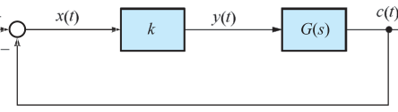{ .lq-img }

*图 8-7 等效增益表示的非线性系统结构图（截自原书）*

**(1) 继电特性**：\(0<k<\infty\) 且为 \(\vert x\vert\) 的减函数。系统受扰使 \(\vert x(t)\vert\ne 0\)、输出 \(c(t)\) 偏离原平衡状态后，\(\vert x(t)\vert\) 的减小使 \(k\) 随之增大；在力图使输出回到原平衡状态的过程中，实际继电特性具有一定的开关速度，\(c(t)\) 呈现为零附近的**高频小幅度振荡**；输入 \(r(t)=1(t)\) 时，单位阶跃响应的稳态过程亦呈现为 \(1(t)\) 叠加高频小幅度振荡的形式（图 8-8a 虚线，实线为线性系统输出）。继电特性常常使系统产生振荡现象。

**(2) 死区特性**：最直接的影响是使系统存在**稳态误差**。\(\vert x(t)\vert<\Delta\) 时 \(k=0\)，系统处于开环状态、失去调节作用；输入为速度信号时，\(\vert r-c\vert<\Delta\) 内无调节作用，导致输出在时间上滞后、降低跟踪精度。另一面，输入端存在小扰动信号时，在动态过程稳态值附近，死区的作用可**减少扰动信号的影响**。对动态性能：无死区时若系统阻尼比较小、超调量较大，死区使等效增益在 \(0\sim k_0\) 之间变化——\(\vert x(t)\vert\) 较大时增益大、响应速度快；\(\vert x(t)\vert\) 较小时增益下降、振荡性减弱，可**降低超调量**（图 8-8b）。

**(3) 饱和特性**：饱和使系统开环增益在饱和区下降。设计时为使功放元件得到充分利用，应力求使**功放级首先进入饱和**；为获得较好的动态性能，应通过合适选择线性区增益和饱和电压，使系统既能获得较小的超调量，又能保证较大的开环增益、减小稳态误差（图 8-8c）。

**(4) 间隙特性**：相当于死区的影响，降低跟踪精度；又是非单值函数——相同的输入 \(x(t)\)，输出 \(y(t)\) 的取值还取决于 \(\dot x(t)\) 的符号，受其影响负载系统的运动变化剧烈。从能量看：主动轮换向需越过两倍齿隙、其间不驱动负载，导致能量积累；重新驱动负载时积累能量的释放使负载运动变化加剧。**间隙过大、蓄能过多，会造成系统自振**。等效增益曲线在换向和越过齿隙瞬间发生切变；\(x(t)\) 过零时 \(k\to+\infty\)，\(x(t)\) 以高频振荡形式收敛，过零后 \(k\) 由 \(-\infty\) 趋于 0、闭环不稳定，输出迅速发散。间隙特性将严重影响系统性能（图 8-8d）。

**(5) 摩擦特性**：最主要的影响是造成系统**低速运动的不平滑性**——输入轴低速平稳运转时，输出轴的旋转呈现跳跃式变化，即**低速爬行**现象，由静摩擦到动摩擦的跳变产生。传动机构结构如原书图 8-9(a)（\(J\) 为转动惯量、\(i\) 为齿轮系速比）：输入转矩需克服静态转矩 \(F_1\) 方使输出轴由静止转动，而一旦转动，摩擦转矩即由 \(F_1\) 迅速降为动态转矩 \(F_2\)，造成输出轴在零附近小角度跳跃式变化；反映在等效增益上，\(x(t)\) 为零处表现为能量 \(F_1\) 的正脉冲和 \(F_1-F_2\) 的负脉冲。对雷达、天文望远镜、火炮等高精度控制系统，这种脉冲式输出变化导致的低速爬行往往导致不能准确跟踪目标，甚至丢失目标（原书图 8-9b）。

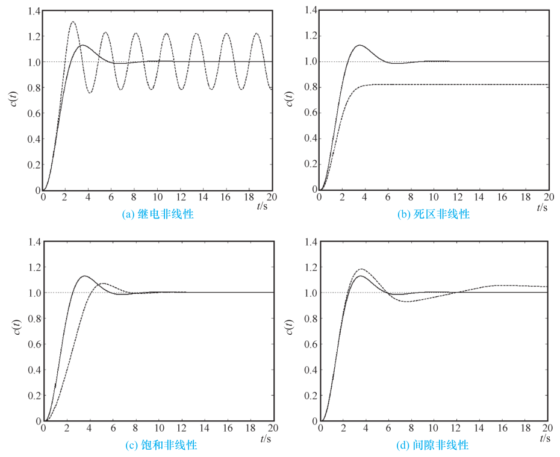{ .lq-img }

*图 8-8 常见非线性特性的影响（Simulink）：实线为线性系统输出、虚线为加入对应非线性后的输出——(a) 继电高频颤动；(b) 死区压超调、留稳态误差；(c) 饱和降低增益；(d) 间隙剧烈振荡（截自原书）*

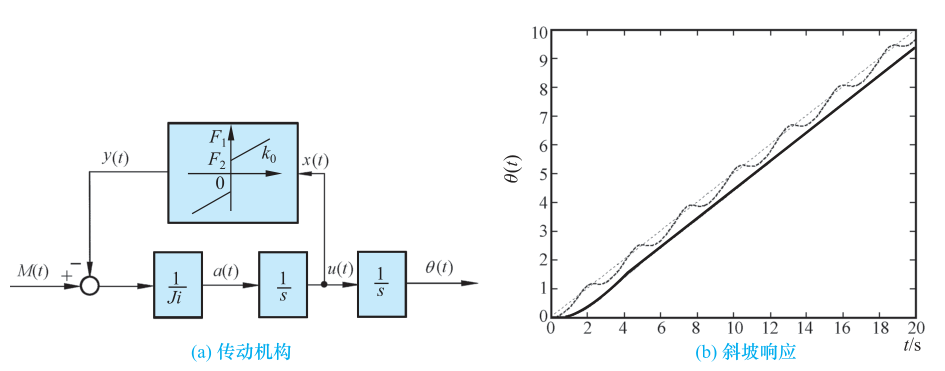{ .lq-img }

*图 8-9 传动机构结构图和摩擦特性影响（Simulink）：(a) 结构图；(b) 斜坡响应出现跳跃式低速爬行（截自原书）*

以上通过等效增益概念在一般意义上针对特定系统做了定性分析，在其他情况下不一定适用，具体问题必须具体分析；欲获得较为准确的结论，还应采用有效的方法做进一步的定量分析——这就引出 8.3 节的描述函数法。

!!! note "拓展：工程上削弱非线性不利影响的常用手段（补充）"
    - **提高回路增益**：增益足够大时，死区、间隙、摩擦在总传输中占的相对份额变小（第 3 章例 3-2 拓展提过"高精度系统需要高增益压低死区、间隙、摩擦等非线性因素"）；
    - **颤振（dither）**：注入高频小幅度信号把非线性环节"平均化"，8-1 节已提，液压伺服中常用；
    - **按已知非线性做反向补偿**：静特性已知时串入反向特性校正——逆系统法（8-1 节方法 (3)）的思想雏形；
    - **结构安排**：把非线性环节移出高增益回路（如利用扰动补偿通道），或用测速反馈改善阻尼。

## 8.3 描述函数法

描述函数法由达尼尔（P. J. Daniel）于 1940 年首先提出。基本思想：当系统满足一定的假设条件时，非线性环节在正弦信号作用下的输出可用**一次谐波分量**近似，由此导出非线性环节的近似等效频率特性，即**描述函数**；这时非线性系统就近似等效为一个线性系统，可应用线性系统理论中的频率法进行频域分析。

描述函数法主要用来分析**无外作用**情况下非线性系统的**稳定性**和**自激振荡**问题，不受系统阶次的限制，一般都能给出比较满意的结果，因而获得了广泛应用。但它对系统结构、非线性环节的特性和线性部分的性能都有一定要求，本身也是一种近似方法，应用有一定的限制条件；且描述函数法只能用来研究系统的频率响应特性，**不能给出时间响应的确切信息**。

### 描述函数的基本概念

#### 描述函数的定义

设非线性环节输入输出描述为

\[
y = f(x)
\tag{8.15}
\]

当输入信号为正弦

\[
x(t) = A\sin\omega t
\tag{8.16}
\]

时，可对非线性环节的稳态输出 \(y(t)\) 进行谐波分析。一般情况下 \(y(t)\) 为非正弦的周期信号，可展开成傅里叶级数：

\[
y(t) = A_0 + \sum_{n=1}^{\infty}\left(A_n\cos n\omega t + B_n\sin n\omega t\right)
     = A_0 + \sum_{n=1}^{\infty}Y_n\sin(n\omega t + \phi_n)
\]

其中 \(A_0\) 为直流分量，\(Y_n\sin(n\omega t+\phi_n)\) 为第 \(n\) 次谐波分量，且有

\[
Y_n = \sqrt{A_n^2+B_n^2}, \qquad \phi_n = \arctan\frac{A_n}{B_n}
\tag{8.17}
\]

\(A_n, B_n\) 为傅里叶系数：

\[
A_n = \frac{1}{\pi}\int_0^{2\pi} y(t)\cos n\omega t\,\mathrm{d}(\omega t), \qquad
B_n = \frac{1}{\pi}\int_0^{2\pi} y(t)\sin n\omega t\,\mathrm{d}(\omega t), \qquad n=1,2,\cdots
\tag{8.18}
\]

直流分量

\[
A_0 = \frac{1}{2\pi}\int_0^{2\pi} y(t)\,\mathrm{d}(\omega t)
\tag{8.19}
\]

若 \(A_0=0\)，且当 \(n>1\) 时 \(Y_n\) 均很小，则可近似认为非线性环节的正弦响应仅有一次谐波分量：

\[
y(t) \approx A_1\cos\omega t + B_1\sin\omega t = Y_1\sin(\omega t+\phi_1)
\tag{8.20}
\]

此时非线性环节可近似认为具有与线性环节相类似的频率响应形式。定义：正弦输入信号作用下，非线性环节的稳态输出中**一次谐波分量与输入信号的复数比**为非线性环节的**描述函数**（describing function），用 \(N(A)\) 表示：

\[
N(A) = \frac{Y_1}{A}\,\mathrm{e}^{\mathrm{j}\phi_1} = \frac{B_1}{A} + \mathrm{j}\frac{A_1}{A}
     = \vert N(A)\vert\,\mathrm{e}^{\mathrm{j}\angle N(A)}
\tag{8.21}
\]

**【例 8-1】理想继电特性的描述函数**

设继电特性为

\[
y(x)=\begin{cases} M, & x>0\\ -M, & x<0 \end{cases}
\tag{8.22}
\]

**解**：输入 \(x=A\sin\omega t\) 时，\(y(t)=M\)（\(0\le\omega t\le\pi\)）、\(y(t)=-M\)（\(\pi<\omega t<2\pi\)）。\(y(t)\) 奇对称，直流分量 \(A_0=0\)；\(y(t)\) 为 \(t\) 的奇函数，\(A_1=0\)：

\[
A_0 = \frac{1}{2\pi}\int_0^{2\pi} y(t)\,\mathrm{d}(\omega t) = 0, \qquad
A_1 = \frac{1}{\pi}\int_0^{2\pi} y(t)\cos\omega t\,\mathrm{d}(\omega t) = 0
\]

\[
B_1 = \frac{1}{\pi}\int_0^{2\pi} y(t)\sin\omega t\,\mathrm{d}(\omega t)
    = \frac{1}{\pi}\left[\int_0^{\pi} M\sin\omega t\,\mathrm{d}(\omega t) - \int_{\pi}^{2\pi} M\sin\omega t\,\mathrm{d}(\omega t)\right]
    = \frac{1}{\pi}(2M+2M) = \frac{4M}{\pi}
\]

则

\[
N(A) = \frac{B_1}{A} = \frac{4M}{\pi A}
\tag{8.23}
\]

一般情况下，描述函数 \(N\) 是输入信号幅值 \(A\) 和频率 \(\omega\) 的函数。当非线性环节中**不包含储能元件**时，其输出一次谐波分量的幅值和相位差与 \(\omega\) 无关，描述函数只与输入信号幅值 \(A\) 有关——本章讨论的各类非线性都属这种。

**关于直流分量 \(A_0\)**：若非线性环节的正弦响应为关于 \(t\) 的奇对称函数，即

\[
y(t) = f(A\sin\omega t) = -y\!\left(t+\frac{\pi}{\omega}\right)
\tag{8.24}
\]

则把 \(A_0\) 的积分（记 \(\theta=\omega t\)）分成两半，后半段用 \(\theta=\theta'+\pi\) 代换：

\[
A_0 = \frac{1}{2\pi}\left[\int_0^{\pi} y(\theta)\,\mathrm{d}\theta + \int_0^{\pi} y(\theta'+\pi)\,\mathrm{d}\theta'\right]
    = \frac{1}{2\pi}\left[\int_0^{\pi} y(\theta)\,\mathrm{d}\theta - \int_0^{\pi} y(\theta)\,\mathrm{d}\theta\right] = 0
\]

而当非线性特性为输入 \(x\) 的奇函数（\(f(x)=-f(-x)\)）时，\(y(t)=f(A\sin\omega t)\) 必为 \(t\) 的奇对称函数（\(f(A\sin(\omega t+\pi))=f(-A\sin\omega t)=-f(A\sin\omega t)\)），直流分量为零。此时 \(B_1\)、\(A_1\) 按半周期计算：

\[
B_1 = \frac{2}{\pi}\int_0^{\pi} y(t)\sin\omega t\,\mathrm{d}(\omega t), \qquad
A_1 = \frac{2}{\pi}\int_0^{\pi} y(t)\cos\omega t\,\mathrm{d}(\omega t)
\tag{8.25}
\]

**关于一次谐波的实部 \(A_1\)**：若 \(y(t)\) 为奇函数（\(y(t)=-y(-t)\)），利用周期性换区间、再作 \(t\to -t\) 代换：

\[
A_1 = \frac{1}{\pi}\int_0^{2\pi} y(t)\cos\omega t\,\mathrm{d}(\omega t)
    = \frac{1}{\pi}\int_{-\pi}^{\pi} y(t)\cos\omega t\,\mathrm{d}(\omega t)
    = \frac{1}{\pi}\left[\int_0^{\pi} y(-t)\cos(-\omega t)\,\mathrm{d}(\omega t) + \int_0^{\pi} y(t)\cos\omega t\,\mathrm{d}(\omega t)\right] = 0
\tag{8.26}
\]

若 \(y(t)\) 为奇函数、且又为半周期内对称（\(y(t)=y\!\left(\dfrac{\pi}{\omega}-t\right)\)），则只需积分四分之一周期：

\[
B_1 = \frac{4}{\pi}\int_0^{\pi/2} y(t)\sin\omega t\,\mathrm{d}(\omega t)
\tag{8.27}
\]

**【例 8-2】幂次型非线性特性的描述函数**

设某非线性元件的特性为

\[
y(x) = \frac{1}{2}x + \frac{1}{4}x^3
\tag{8.28}
\]

**解**：因 \(y(x)\) 为 \(x\) 的奇函数，故 \(A_0=0\)。输入 \(x=A\sin\omega t\) 时

\[
y(t) = \frac{A}{2}\sin\omega t + \frac{A^3}{4}\sin^3\omega t
\tag{8.29}
\]

为 \(t\) 的奇函数，故 \(A_1=0\)；又 \(y(t)\) 具有半周期对称，按式 (8.27)：

\[
B_1 = \frac{4}{\pi}\int_0^{\pi/2} y(t)\sin\omega t\,\mathrm{d}(\omega t)
    = \frac{4}{\pi}\left[\frac{A}{2}\int_0^{\pi/2}\sin^2\omega t\,\mathrm{d}(\omega t)
    + \frac{A^3}{4}\int_0^{\pi/2}\sin^4\omega t\,\mathrm{d}(\omega t)\right]
\]

由定积分公式

\[
I_n = \int_0^{\pi/2}\sin^n\omega t\,\mathrm{d}(\omega t) =
\begin{cases}
\dfrac{(n-1)(n-3)\cdots\times 4\times 2}{n(n-2)(n-4)\cdots\times 5\times 3}, & n\ \text{为奇整数}\\[2ex]
\dfrac{(n-1)(n-3)\cdots\times 5\times 3\times 1}{n(n-2)\cdots\times 4\times 2}\cdot\frac{\pi}{2}, & n\ \text{为偶整数}
\end{cases}
\tag{8.30}
\]

（本例用到 \(I_2=\dfrac{\pi}{4}\)、\(I_4=\dfrac{3\pi}{16}\)）得

\[
B_1 = \frac{4}{\pi}\left(\frac{A}{2}\cdot\frac{\pi}{4} + \frac{A^3}{4}\cdot\frac{3\pi}{16}\right) = \frac{A}{2} + \frac{3A^3}{16}
\]

则该非线性元件的描述函数为

\[
N(A) = \frac{B_1}{A} = \frac{1}{2} + \frac{3}{16}A^2
\tag{8.31}
\]

注意 \(N(A)\) 为实数且随 \(A\) 增大而增大——非线性环节的"增益"由输入幅值决定，这正是与线性比例环节的本质差异；8.4 节的代码会复核此结果。

#### 描述函数法分析的应用条件

1. 非线性系统应简化成**一个非线性环节和一个线性部分闭环连接**的典型结构形式（图 8-10）；
2. 非线性环节的输入输出特性 \(y(x)\) 应是 \(x\) 的**奇函数**（\(f(x)=-f(-x)\)），或正弦输入下的输出为 \(t\) 的奇对称函数（\(y(t+\pi/\omega)=-y(t)\)），以保证非线性环节的正弦响应不含常值分量，即 \(A_0=0\)；
3. 系统的线性部分应具有较好的**低通滤波性能**：非线性环节输入正弦时，实际输出必含高次谐波分量，经线性部分传递后高次谐波被大大削弱，闭环通道内近似地只有一次谐波分量流通，应用描述函数法的结果才比较准确。线性部分阶次越高，低通滤波性能越好；欲具有低通滤波性能，线性部分的极点应位于复平面的左半平面。对实际的非线性系统，大部分都容易满足这一条件。

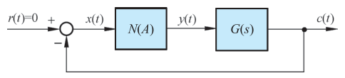{ .lq-img }

*图 8-10 非线性系统典型结构形式（截自原书）*

#### 描述函数的物理意义

线性系统的频率特性反映正弦信号作用下，系统稳态输出中**与输入同频率的分量**的幅值和相位相对于输入信号的变化；非线性环节的描述函数则反映非线性系统正弦响应中**一次谐波分量**的幅值和相位相对于输入信号的变化。忽略高次谐波分量、仅考虑基波分量，非线性环节的描述函数表现为**复数增益的放大器**。

线性系统的频率特性是输入正弦信号频率 \(\omega\) 的函数，与幅值 \(A\) 无关；而描述函数表示的非线性环节的近似频率特性是输入正弦信号**幅值 \(A\) 的函数**——描述函数表现为关于输入正弦信号幅值 \(A\) 的**复变增益放大器**，这正是非线性环节的近似频率特性与线性系统频率特性的本质区别。当非线性环节的频率特性由描述函数近似表示后，就可以推广应用频率法分析非线性系统的运动性质，问题的关键是描述函数的计算。

### 典型非线性特性的描述函数

典型非线性特性具有**分段线性**特点，描述函数计算的重点在于确定正弦响应曲线和积分区间，一般采用图解方法。

#### 死区饱和非线性环节

将正弦输入信号 \(x(t)\)、非线性特性 \(y(x)\) 和输出信号 \(y(t)\) 的坐标按图 8-11 所示方式和位置旋转摆放，由非线性特性的区间端点 \((\Delta, y(\Delta))\) 和 \((a, y(a))\) 可以确定 \(y(t)\) 关于 \(\omega t\) 的区间端点 \(\psi_1\) 和 \(\psi_2\)。输出 \(y(t)\) 的数学表达式为

\[
y(t)=\begin{cases}
0, & 0\le\omega t<\psi_1\\
K(A\sin\omega t-\Delta), & \psi_1\le\omega t\le\psi_2\\
K(a-\Delta), & \psi_2\le\omega t\le\dfrac{\pi}{2}
\end{cases}
\tag{8.32}
\]

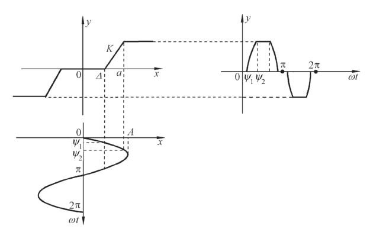{ .lq-img }

*图 8-11 死区饱和特性和正弦响应曲线：非线性转折点 \(\Delta\)、\(a\) 对应输出区间端点 \(\psi_1\)、\(\psi_2\)（截自原书）*

由非线性特性的转折点 \(\Delta\) 和 \(a\) 确定区间端点：

\[
\psi_1 = \arcsin\frac{\Delta}{A}
\tag{8.33}
\]

\[
\psi_2 = \arcsin\frac{a}{A}
\tag{8.34}
\]

由于 \(y(t)\) 为奇函数，所以 \(A_0=0\)、\(A_1=0\)；又 \(y(t)\) 为半周期内对称，按式 (8.27) 分线性段与平台段积分（代入 \(\sin 2\psi=2\sin\psi\cos\psi\)、\(\cos\psi_i=\sqrt{1-(\cdot/A)^2}\) 化简）：

\[
B_1 = \frac{4}{\pi}\left[\int_{\psi_1}^{\psi_2} K(A\sin\omega t-\Delta)\sin\omega t\,\mathrm{d}(\omega t)
     + \int_{\psi_2}^{\pi/2} K(a-\Delta)\sin\omega t\,\mathrm{d}(\omega t)\right]
    = \frac{2K}{\pi}\left[A(\psi_2-\psi_1) + a\cos\psi_2 - \Delta\cos\psi_1\right]
\]

**死区饱和特性**的描述函数为

\[
N(A) = \frac{2K}{\pi}\left[\arcsin\frac{a}{A} - \arcsin\frac{\Delta}{A}
      + \frac{a}{A}\sqrt{1-\left(\frac{a}{A}\right)^2}
      - \frac{\Delta}{A}\sqrt{1-\left(\frac{\Delta}{A}\right)^2}\right],
      \qquad A\ge a
\tag{8.35}
\]

取 \(\Delta=0\)，由式 (8.35) 得**饱和特性**的描述函数：

\[
N(A) = \frac{2K}{\pi}\left[\arcsin\frac{a}{A} + \frac{a}{A}\sqrt{1-\left(\frac{a}{A}\right)^2}\right],
\qquad A\ge a
\tag{8.36}
\]

对于**死区特性**，\(\psi_2=\pi/2\)（无饱和段），由式 (8.34) 得 \(a/A=1\)，则由式 (8.35) 得

\[
N(A) = \frac{2K}{\pi}\left[\frac{\pi}{2} - \arcsin\frac{\Delta}{A}
      - \frac{\Delta}{A}\sqrt{1-\left(\frac{\Delta}{A}\right)^2}\right],
\qquad A\ge\Delta
\tag{8.37}
\]

三个闭式可自检：死区在 \(A=\Delta\) 处 \(N=0\)（输入全部落在死区里）、\(A\to\infty\) 时 \(N\to K\)；饱和在 \(A=a\) 处 \(N=K\)、\(A\to\infty\) 时 \(N\to 0\)（饱和越深等效增益越低）——与图 8-6(b)(c) 的等效增益曲线完全一致。

#### 死区与滞环继电非线性环节

注意到滞环与输入信号及其变化率的关系，通过作图法获得 \(y(t)\)（图 8-12）。输出 \(y(t)\) 的数学表达式为

\[
y(t)=\begin{cases}
0, & 0\le\omega t<\psi_1\\
M, & \psi_1\le\omega t\le\psi_2\\
0, & \psi_2<\omega t\le\pi
\end{cases}
\tag{8.38}
\]

由于非线性特性导致 \(y(t)\) 产生不同线性变化的区间端点为

\[
\psi_1 = \arcsin\frac{h}{A}
\tag{8.39}
\]

\[
\psi_2 = \pi - \arcsin\frac{mh}{A}
\tag{8.40}
\]

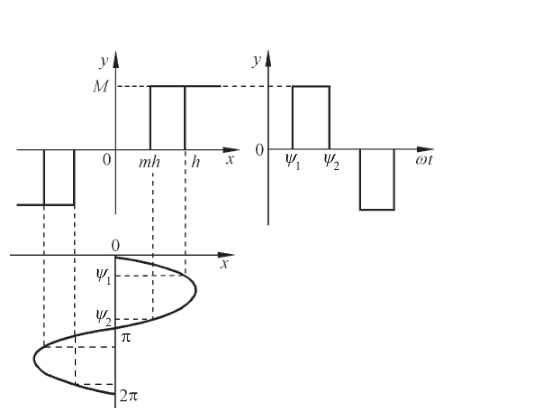{ .lq-img }

*图 8-12 死区滞环继电特性和正弦响应曲线：正向吸合于 \(h\)、释放于 \(mh\)，负半周对称（截自原书）*

由图可见，\(y(t)\) 为奇对称函数，而**非奇函数**（\(A_1\ne 0\)），由式 (8.25)：

\[
A_1 = \frac{2}{\pi}\int_0^{\pi} y(t)\cos\omega t\,\mathrm{d}(\omega t)
    = \frac{2}{\pi}\int_{\psi_1}^{\psi_2} M\cos\omega t\,\mathrm{d}(\omega t)
    = \frac{2Mh}{\pi A}(m-1)
\]

\[
B_1 = \frac{2}{\pi}\int_{\psi_1}^{\psi_2} M\sin\omega t\,\mathrm{d}(\omega t)
    = \frac{2M}{\pi}\left[\sqrt{1-\left(\frac{mh}{A}\right)^2} + \sqrt{1-\left(\frac{h}{A}\right)^2}\right]
\]

**死区滞环继电特性**的描述函数为

\[
N(A) = \frac{2M}{\pi A}\left[\sqrt{1-\left(\frac{mh}{A}\right)^2}
      + \sqrt{1-\left(\frac{h}{A}\right)^2}\right]
      + \mathrm{j}\,\frac{2Mh}{\pi A^2}(m-1), \qquad A\ge h
\tag{8.41}
\]

取 \(h=0\)，得**理想继电特性**的描述函数 \(N(A)=\dfrac{4M}{\pi A}\)（与例 8-1 一致）：

\[
N(A) = \frac{4M}{\pi A}
\tag{8.42}
\]

取 \(m=1\)，得**死区继电特性**的描述函数：

\[
N(A) = \frac{4M}{\pi A}\sqrt{1-\left(\frac{h}{A}\right)^2}, \qquad A\ge h
\tag{8.43}
\]

取 \(m=-1\)，得**滞环继电特性**的描述函数：

\[
N(A) = \frac{4M}{\pi A}\sqrt{1-\left(\frac{h}{A}\right)^2} - \mathrm{j}\,\frac{4Mh}{\pi A^2}, \qquad A\ge h
\tag{8.44}
\]

滞环继电的虚部为负——输出基波**滞后**于输入，相当于给回路附加了滞后相角，这正是滞环容易把系统"拖"进自振的代数根源。

**表 8-1 非线性特性及其描述函数**（查用表；静特性一栏给出分段定义，静特性曲线见 8.2 节图 8-6 与图 8-11/8-12）

| 非线性类型 | 静特性 | 描述函数 \(N(A)\) |
| --- | --- | --- |
| 理想继电特性、库仑摩擦 | 继电：\(y=\pm M\) 在原点跳变；库仑摩擦：\(y=M\,\mathrm{sign}\,\dot x\) | \(\dfrac{4M}{\pi A}\) |
| 有死区的继电特性 | \(\vert x\vert<h\)：\(y=0\)；\(\vert x\vert\ge h\)：\(y=\pm M\) | \(\dfrac{4M}{\pi A}\sqrt{1-\left(\dfrac{h}{A}\right)^2},\quad A\ge h\) |
| 有滞环的继电特性 | 吸合于 \(\pm h\)、释放于 \(\mp h\)（滞环宽 \(2h\)） | \(\dfrac{4M}{\pi A}\sqrt{1-\left(\dfrac{h}{A}\right)^2}-\mathrm{j}\dfrac{4Mh}{\pi A^2},\quad A\ge h\) |
| 有死区与滞环的继电特性 | 吸合于 \(\pm h\)、释放于 \(\mp mh\)（\(m=1\) 退化为死区继电，\(m=-1\) 退化为滞环继电） | \(\dfrac{2M}{\pi A}\left[\sqrt{1-\left(\dfrac{mh}{A}\right)^2}+\sqrt{1-\left(\dfrac{h}{A}\right)^2}\right]+\mathrm{j}\dfrac{2Mh}{\pi A^2}(m-1),\quad A\ge h\) |
| 饱和特性，幅值限制 | \(\vert x\vert<a\)：\(y=Kx\)；\(\vert x\vert\ge a\)：\(y=\pm Ka\) | \(\dfrac{2K}{\pi}\left[\arcsin\dfrac{a}{A}+\dfrac{a}{A}\sqrt{1-\left(\dfrac{a}{A}\right)^2}\right],\quad A\ge a\) |
| 有死区的饱和特性 | \(\vert x\vert<\Delta\)：\(y=0\)；\(\Delta\le\vert x\vert<a\)：\(y=K(x\mp\Delta)\)；\(\vert x\vert\ge a\)：\(y=\pm K(a-\Delta)\) | \(\dfrac{2K}{\pi}\left[\arcsin\dfrac{a}{A}-\arcsin\dfrac{\Delta}{A}+\dfrac{a}{A}\sqrt{1-\left(\dfrac{a}{A}\right)^2}-\dfrac{\Delta}{A}\sqrt{1-\left(\dfrac{\Delta}{A}\right)^2}\right],\quad A\ge a\) |
| 死区特性 | \(\vert x\vert<\Delta\)：\(y=0\)；\(\vert x\vert\ge\Delta\)：\(y=K(x\mp\Delta)\) | \(\dfrac{2K}{\pi}\left[\dfrac{\pi}{2}-\arcsin\dfrac{\Delta}{A}-\dfrac{\Delta}{A}\sqrt{1-\left(\dfrac{\Delta}{A}\right)^2}\right],\quad A>\Delta\) |
| 间隙特性 | \(\dot x>0\)：\(y=k(x-b)\)；\(\dot x<0\)：\(y=k(x+b)\)（换向需越过齿隙 \(2b\)，见式 8.14） | \(\dfrac{K}{\pi}\left[\dfrac{\pi}{2}+\arcsin\left(1-\dfrac{2b}{A}\right)+2\left(1-\dfrac{2b}{A}\right)\sqrt{\dfrac{b}{A}\left(1-\dfrac{b}{A}\right)}\right]-\mathrm{j}\dfrac{4Kb}{\pi A}\left(1-\dfrac{b}{A}\right),\quad A>b\) |
| 变增益特性 | \(\vert x\vert<s\)：\(y=K_1x\)；\(\vert x\vert\ge s\)：\(y=K_2x-(K_2-K_1)s\,\mathrm{sign}\,x\) | \(K_1+\dfrac{2(K_2-K_1)}{\pi}\left[\arcsin\dfrac{s}{A}+\dfrac{s}{A}\sqrt{1-\left(\dfrac{s}{A}\right)^2}\right],\quad A>s\) |
| 有死区的线性特性 | \(\vert x\vert<\Delta\)：\(y=0\)；\(x>\Delta\)：\(y=K(x-\Delta)+M\)（负半轴对称） | \(K-\dfrac{2K}{\pi}\arcsin\dfrac{\Delta}{A}+\dfrac{4M-2K\Delta}{\pi A}\sqrt{1-\left(\dfrac{\Delta}{A}\right)^2},\quad A>\Delta\) |
| 库仑摩擦加黏性摩擦 | \(y=Kx+M\,\mathrm{sign}\,\dot x\) | \(K+\dfrac{4M}{\pi A}\) |

!!! note "拓展：表 8-1 的记忆骨架（补充）"
    两条主线。**继电类**：以 \(\dfrac{4M}{\pi A}\) 为基准——死区乘因子 \(\sqrt{1-(h/A)^2}\)，滞环再添 \(-\mathrm{j}\dfrac{4Mh}{\pi A^2}\) 形式的虚部（滞后相角）。**线性-饱和类**：母公式为 \(\dfrac{2K}{\pi}\left[\arcsin u+u\sqrt{1-u^2}\right]\)（\(u\) 为转折点与幅值之比），饱和、死区、变增益、死区饱和都由它拼出。间隙是唯一的"非单值 + 复数"线性型。共同规律：**复数的负虚部 = 基波滞后相角**，判自振时它把 \(-1/N(A)\) 从实轴拉进第三象限，更容易与 \(\varGamma_G\) 相交。

### 非线性系统的简化

非线性系统的描述函数分析建立在图 8-10 所示的典型结构基础上。当系统由多个非线性环节和多个线性环节组合而成时，在一些情况下可通过等效变换使系统简化为典型结构形式。**等效变换的原则**：在 \(r(t)=0\) 的条件下，根据非线性特性的串、并联简化非线性部分为一个等效非线性环节，再保持等效非线性环节的输入输出关系不变，简化线性部分。

**(1) 非线性特性的并联**：若两个非线性特性输入相同、输出相加减，则等效非线性特性为两个非线性特性的叠加（原书图 8-13：死区继电特性 \(M,\Delta\) 与死区特性 \(K,\Delta\) 并联，等效为一条"有死区的线性特性"）。由描述函数定义，**并联等效非线性特性的描述函数为各非线性特性描述函数的代数和**。

**(2) 非线性特性的串联**：采用图解法。以死区特性（死区 \(\Delta_1\)、斜率 \(K_1\)）与死区饱和特性（死区 \(\Delta_2\)、饱和点 \(a_2\)、斜率 \(K_2\)）的串联简化为例（串联连接见原书图 8-14）：先将两个非线性特性按图 8-15(a)(b) 形式放置，再按输出端非线性特性的变化端点 \(\Delta_2\) 和 \(a_2\) 确定输入 \(x\) 的对应点 \(\Delta\) 和 \(a\)，获得等效非线性特性如图 8-15(c)。由 \(\Delta_2=K_1(\Delta-\Delta_1)\) 得

\[
\Delta = \Delta_1 + \frac{\Delta_2}{K_1}
\tag{8.45}
\]

由 \(a_2=K_1(a-\Delta_1)\) 得

\[
a = \frac{a_2}{K_1} + \Delta_1
\tag{8.46}
\]

\(\vert x\vert\le\Delta\) 时由 \(y(x_1)\) 特性知 \(y(x)=0\)；\(\vert x\vert\ge a\) 时 \(y(x)=K_2(a_2-\Delta_2)\)；\(\Delta<\vert x\vert<a\) 时 \(y(x_1)\) 位于线性区，\(y(x)\) 亦呈线性，设斜率为 \(K\)：\(y(x)=K_2(x_1-\Delta_2)=K_1K_2(x-\Delta)\)。特殊地，当 \(x=a\) 时 \(x_1=a_2\)，由 \(x_1=\Delta_2+K_1(a-\Delta)\) 得 \(a-\Delta=\dfrac{a_2-\Delta_2}{K_1}\)，因此 \(K=K_1K_2\)。

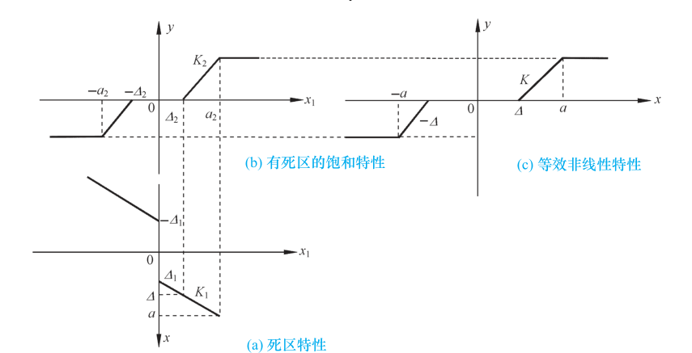{ .lq-img }

*图 8-15 非线性串联简化的图解方法：(a) 死区特性；(b) 有死区的饱和特性；(c) 等效非线性特性——由输出端端点 \(\Delta_2\)、\(a_2\) 反推输入端 \(\Delta\)、\(a\)（截自原书）*

应该指出，两个非线性环节的串联，**等效特性还取决于其前后次序**——调换前后次序则等效非线性特性亦不同，描述函数需按等效非线性环节的特性计算。多个非线性环节串联，可按上述方法由前向后逐一简化。

**(3) 线性部分的等效变换**：按线性系统结构图的等效变换规则处理即可。原书图 8-16 给出一个示例：\(G_1\)、\(G_2\)、\(G_3\) 与 \(N(A)\) 连接的系统，移动比较点后化为典型结构，非线性环节 \(N(A)\) 保持正向通道，线性部分等效为

\[
G(s) = \frac{G_2(s)G_3(s)}{1+G_1(s)G_2(s)}
\]

### 非线性系统稳定性分析的描述函数法

若非线性系统经过适当简化后具有图 8-10 的典型结构形式，且非线性环节和线性部分满足描述函数法的应用条件，则 \(N(A)\) 可等效为一个具有复变增益的比例环节——谐波线性化处理后已变成一个等效的线性系统，可以应用线性理论中的频域稳定判据。

#### 变增益线性系统的稳定性分析

先研究原书图 8-17(a) 的线性系统：比例环节增益 \(K\)，设 \(G(s)\) 的极点均位于 \(s\) 左半平面（\(P=0\)），\(\varGamma_G\) 为其奈奎斯特曲线。闭环特征方程

\[
1 + KG(\mathrm{j}\omega) = 0
\tag{8.47}
\]

或

\[
G(\mathrm{j}\omega) = -\frac{1}{K} + \mathrm{j}0
\tag{8.48}
\]

由奈氏判据：\(\varGamma_G\) 不包围 \(\left(-\dfrac{1}{K}, \mathrm{j}0\right)\) 点时，\(Z=P-2N=-2N=0\)，系统闭环稳定；包围该点时不稳定；穿过该点时临界稳定，产生等幅振荡。若 \(K\) 在一定范围内可变（\(K_1\le K\le K_2\)），\(\left(-\dfrac{1}{K},\mathrm{j}0\right)\) 为复平面实轴上的一段直线：\(\varGamma_G\) 不包围该线段则闭环稳定，包围则闭环不稳定。

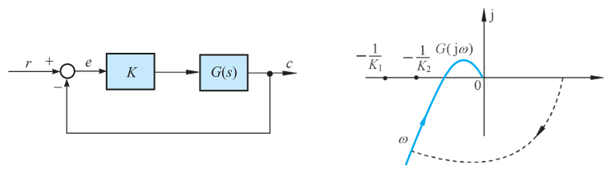{ .lq-img }

*图 8-17 可变增益的线性系统：(a) 结构图；(b) \(\varGamma_G\) 曲线与实轴上的 \(-1/K_1\)、\(-1/K_2\) 线段（截自原书）*

#### 应用描述函数分析非线性系统的稳定性

上述分析为描述函数法判稳奠定基础。非线性特性采用描述函数近似等效时，闭环特征方程为

\[
1 + N(A)G(\mathrm{j}\omega) = 0
\tag{8.49}
\]

即

\[
G(\mathrm{j}\omega) = -\frac{1}{N(A)}
\tag{8.50}
\]

称 \(-\dfrac{1}{N(A)}\) 为非线性环节的**负倒描述函数**。在复平面上绘制 \(\varGamma_G\) 曲线和 \(-1/N(A)\) 曲线时，后者上的**箭头表示随 \(A\) 增大**的变化方向。

**若两曲线无交点**，表明式 (8.49) 无 \(\omega\) 的正实数解，有两种可能（图 8-18）：

- (a) \(\varGamma_G\) 曲线包围 \(-1/N(A)\) 曲线：对非线性环节任一确定振幅 \(A\) 的正弦输入，点 \(\left(-\dfrac{1}{N(A)},\mathrm{j}0\right)\) 被 \(\varGamma_G\) 包围，系统不稳定，\(A\) 将增大，最终使 \(A\) 增大到极限位置或使系统发生故障；
- (b) \(\varGamma_G\) 不包围 \(-1/N(A)\) 曲线：系统稳定，\(A\) 将减小，最终使 \(A\) 减小为零，或使非线性环节的输入值为某定值、或位于该定值附近较小的范围。

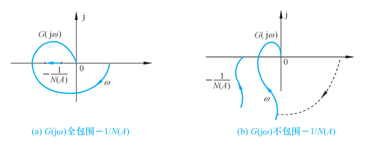{ .lq-img }

*图 8-18 \(\varGamma_G\) 曲线和 \(-1/N(A)\) 曲线无交点的两种形式：(a) 全包围 → 不稳定；(b) 不包围 → 稳定（截自原书）*

综上可得**非线性系统的稳定性判据**：若 \(\varGamma_G\) 曲线不包围 \(-1/N(A)\) 曲线，则非线性系统稳定；若 \(\varGamma_G\) 曲线包围 \(-1/N(A)\) 曲线，则非线性系统不稳定。

**【例 8-3】库仑摩擦加黏性摩擦系统的稳定性**

已知非线性系统如原书图 8-19：非线性环节为库仑摩擦加黏性摩擦（跳变 \(M=1\)、斜率 \(k=0.5\)），线性部分 \(G(s)=\dfrac{10}{s(s+1)(4s+1)}\)，试分析系统的稳定性。

**解**：线性环节 \(K=10\)，\(T_1=1\)，\(T_2=4\)，穿越频率及相应线性部分的幅值：

\[
\omega_x = \frac{1}{\sqrt{T_1T_2}} = \frac{1}{2}, \qquad
G(\mathrm{j}\omega_x) = -\frac{KT_1T_2}{T_1+T_2} = -8
\]

!!! note "拓展：\(\omega_x=1/\sqrt{T_1T_2}\) 与 \(G(\mathrm{j}\omega_x)=-KT_1T_2/(T_1+T_2)\) 的来历（补充）"
    对 \(G(s)=\dfrac{K}{s(T_1s+1)(T_2s+1)}\)，相角 \(\angle G=-90^\circ-\arctan T_1\omega-\arctan T_2\omega\)。与负实轴相交要求 \(\arctan T_1\omega_x+\arctan T_2\omega_x=90^\circ\)，由正切和角公式即 \(T_1T_2\omega_x^2=1\)，得 \(\omega_x=1/\sqrt{T_1T_2}\)。代入幅值式：\(\sqrt{1+T_1^2\omega_x^2}\cdot\sqrt{1+T_2^2\omega_x^2}=\sqrt{\frac{T_1+T_2}{T_2}}\cdot\sqrt{\frac{T_1+T_2}{T_1}}=\dfrac{T_1+T_2}{\sqrt{T_1T_2}}\)，故 \(\vert G(\mathrm{j}\omega_x)\vert=\dfrac{K}{\omega_x}\cdot\dfrac{\sqrt{T_1T_2}}{T_1+T_2}=KT_1T_2/(T_1+T_2)\)。本章三个例题（8-3、8-4、8-5）的线性部分都是这一结构，直接套用。

非线性环节为库仑摩擦加黏性摩擦，由表 8-1（\(N(A)=k+\dfrac{4M}{\pi A}\)）：

\[
-\frac{1}{N(A)} = -\frac{1}{k+\dfrac{4M}{\pi A}}, \qquad
-\frac{1}{N(0)} = 0, \qquad
-\frac{1}{N(\infty)} = -\frac{1}{k} = -2
\]

负倒描述函数曲线为负实轴上 \((-2,0)\) 的一段。作 \(\varGamma_G\) 曲线和 \(-1/N(A)\) 曲线如图 8-20：\(\varGamma_G\) 与负实轴交于 \(-8\)，**包围**了 \(-1/N(A)\) 曲线。根据非线性系统稳定判据，该非线性系统**不稳定**。

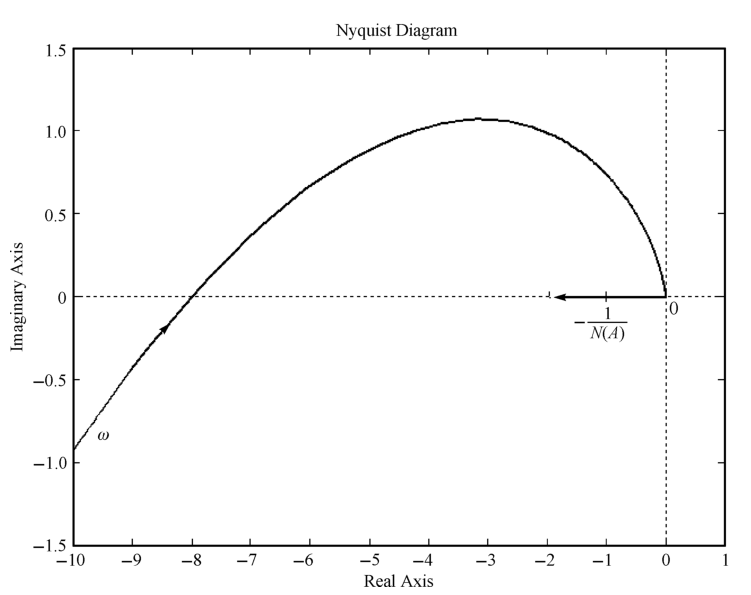{ .lq-img }

*图 8-20 例 8-3 系统稳定性分析（MATLAB）：\(\varGamma_G\) 与负实轴交于 \(-8\)，包围 \(-1/N(A)\)（截自原书）*

若 \(\varGamma_G\) 曲线和 \(-1/N(A)\) 曲线有交点，表明式 (8.50) 有 \(\omega\) 的正实数解，则系统存在着无外作用下的周期运动——这种情况下系统的稳定性和所具有的周期运动的稳定性必须另行分析。

#### 非线性系统存在周期运动时的稳定性分析

当 \(\varGamma_G\) 与 \(-1/N(A)\) 曲线有交点时，式 (8.50) 成立，写成幅值/相角形式与实/虚部形式：

\[
\begin{cases}
\vert G(\mathrm{j}\omega)\vert = \left\vert\dfrac{1}{N(A)}\right\vert\\[1ex]
\angle G(\mathrm{j}\omega) = -\pi - \angle N(A)
\end{cases}
\tag{8.51}
\]

\[
\begin{cases}
\mathrm{Re}\left[G(\mathrm{j}\omega)\right] = -\mathrm{Re}\left[\dfrac{1}{N(A)}\right]\\[1ex]
\mathrm{Im}\left[G(\mathrm{j}\omega)\right] = -\mathrm{Im}\left[\dfrac{1}{N(A)}\right]
\end{cases}
\tag{8.52}
\]

由上两式可解得交点处的频率 \(\omega\) 和振幅 \(A\)，每一个交点对应一个周期运动 \(x(t)=A\sin\omega t\)。如果该周期运动能够维持——外扰动使系统偏离后，扰动消失仍能恢复原周期运动——则称为**稳定的周期运动**。图 8-21 给出四种形式（\(P=0\)；交点 \(N_0\) 对应幅值 \(A_0\)，\(-1/N(A)\) 上的点 \(N_i\) 对应幅值 \(A_i\)）：

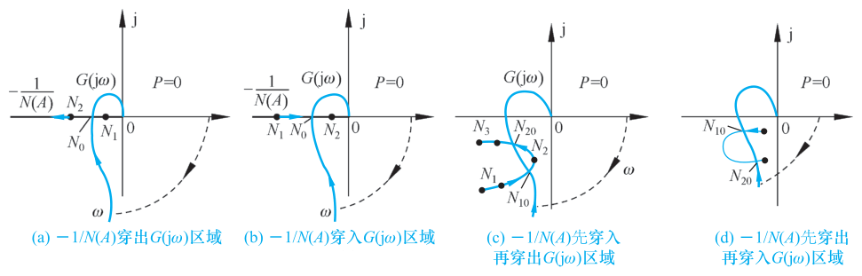{ .lq-img }

*图 8-21 存在周期运动的非线性系统：(a) \(-1/N(A)\) 穿出 \(\varGamma_G\) 区域；(b) 穿入；(c) 先穿入再穿出；(d) 先穿出再穿入（截自原书）*

- **(a)**：扰动使振幅减小为 \(A_1\) → \(\varGamma_G\) 包围 \(-1/N(A_1)\) → 系统不稳定 → 振幅增大，最终回到 \(N_0\)；扰动使振幅增大为 \(A_2\) → 不包围 → 系统稳定 → 振幅衰减，也回到 \(N_0\)。\(N_0\) 对应**稳定的周期运动**（自振）。
- **(b)**：\(-1/N(A)\) 的运动方向与 (a) 相反：幅值增大到 \(A_2\) → 不稳定 → 振幅进一步增大，发散至无穷；幅值减小到 \(A_1\) → 稳定 → 振幅进一步减小，衰减为零。\(N_0\) 对应**不稳定的周期运动**。
- **(c)**：两个交点 \(N_{10}\)、\(N_{20}\)：在 \(N_{20}\) 点，小扰动偏离后系统运动仍能恢复该周期运动——稳定；在 \(N_{10}\) 点，只要有扰动偏离，系统运动或收敛至零、或趋向 \(N_{20}\) 对应的周期运动——不稳定。
- **(d)**：两个交点 \(N_{10}\)、\(N_{20}\)：\(N_{10}\) 稳定、\(N_{20}\) 不稳定，外界小扰动或使系统运动发散至无穷，或趋向 \(N_{10}\) 对应的周期运动。

综合上述分析，把 \(\varGamma_G\) 包围的区域视为不稳定区域、不包围的区域视为稳定区域，可得**周期运动稳定性判据**：在 \(\varGamma_G\) 和 \(-1/N(A)\) 曲线的交点处，若 \(-1/N(A)\) 曲线沿振幅 \(A\) 增加的方向**由不稳定区域进入稳定区域**，该交点对应**稳定**的周期运动；反之，若沿 \(A\) 增加的方向**由稳定区域进入不稳定区域**，对应**不稳定**的周期运动。

图 8-21 还说明：非线性系统产生自振是**有条件的**——(b) 收敛还是发散取决于初始条件（即使处于零平衡状态，受大扰动仍将发散）；(c) 要求初始幅值 \(A>A_{10}\) 才产生稳定的周期运动；(d) 要求 \(A<A_{20}\)。这类系统稳定的周期运动只是对**一定范围的扰动**具有稳定性，扰动较大时系统将停振或发散至无穷。由于系统不可避免地存在各种扰动因素，**不稳定的周期运动在系统中不可能出现**；而欲利用非线性系统产生不受扰动影响的自激振荡，应选图 8-21(a) 所示的系统。

最后还需指出：描述函数法都建立在只考虑基波分量的基础上，实际系统中仍有一定量的高次谐波分量流通，自振波形并非纯正弦波。分析结果的准确性取决于 \(\varGamma_G\) 与 \(-1/N(A)\) 曲线在交点处的相对运动：若交点处两条曲线**几乎垂直相交**、且非线性环节输出的高次谐波分量被线性部分充分衰减，分析结果是准确的；若两曲线在交点处**几乎相切**，则在一些情况下（取决于高次谐波的衰减程度）不存在自振。

**【例 8-4】饱和非线性系统的自振与临界增益**

设具有饱和非线性特性的控制系统如原书图 8-22：饱和特性 \(a=1\)、\(k=2\)，线性部分 \(G(s)=\dfrac{K}{s(0.1s+1)(0.2s+1)}\)。试分析：1) \(K=15\) 时非线性系统的运动；2) 欲使系统不出现自振荡，确定 \(K\) 的临界值。

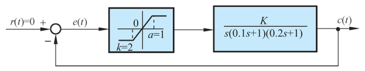{ .lq-img }

*图 8-22 具有饱和非线性特性的控制系统结构图（截自原书）*

**解 1)**：由表 8-1，饱和非线性特性的描述函数为

\[
N(A) = \frac{2k}{\pi}\left[\arcsin\frac{a}{A} + \frac{a}{A}\sqrt{1-\left(\frac{a}{A}\right)^2}\right], \qquad A\ge a
\tag{8.53}
\]

取 \(u=\dfrac{a}{A}\)，对 \(N(u)\) 求导：

\[
\frac{\mathrm{d}N(u)}{\mathrm{d}u} = \frac{2k}{\pi}\left(\frac{1}{\sqrt{1-u^2}} + \sqrt{1-u^2} - \frac{u^2}{\sqrt{1-u^2}}\right) = \frac{4k}{\pi}\sqrt{1-u^2}
\]

注意到 \(A>a\) 时 \(u=a/A<1\)，故 \(\dfrac{\mathrm{d}N}{\mathrm{d}u}>0\)：\(N(u)\) 为 \(u\) 的增函数，\(N(A)\) 为 \(A\) 的**减函数**，\(-1/N(A)\) 亦为 \(A\) 的减函数。代入给定参数 \(a=1\)、\(k=2\)：

\[
-\frac{1}{N(a)} = -\frac{1}{k} = -0.5, \qquad -\frac{1}{N(\infty)} = -\infty
\]

即 \(-1/N(A)\) 曲线沿负实轴从 \(-0.5\) 出发、随 \(A\) 增大趋向 \(-\infty\)，如图 8-23(a)。

线性部分 \(G(s)\) 在 \(K=15\) 时的 \(\varGamma_G\) 曲线如图 8-23(a) 曲线①，穿越频率与负实轴交点：

\[
\omega_x = \frac{1}{\sqrt{0.1\times 0.2}} = 7.07, \qquad
G(\mathrm{j}\omega_x) = -\frac{0.1\times 0.2\times 15}{0.1+0.2} = -1
\]

\(\varGamma_G\) 与负实轴交于 \((-1,\mathrm{j}0)\)，而 \(-1/N(A)\) 覆盖 \((-\infty,-0.5]\)——两曲线存在交点 \((-1,\mathrm{j}0)\)，且该交点处 \(-1/N(A)\) 沿 \(A\) 增大方向**由不稳定区域进入稳定区域**。根据周期运动稳定性判据，系统存在**稳定的周期运动（自振）**。

由式 (8.52)：

\[
\mathrm{Im}\left[G(\mathrm{j}\omega)N(A)\right] = \mathrm{Im}\left[G(\mathrm{j}\omega)\right]\cdot N(A) = 0
\quad\Longrightarrow\quad \omega = \omega_x = 7.07
\]

\[
\mathrm{Re}\left[G(\mathrm{j}\omega)N(A)\right] = \mathrm{Re}\left[G(\mathrm{j}\omega_x)\right]\cdot N(A) = -N(A) = -1
\quad\Longrightarrow\quad N(A)=1
\]

解 \(N(A)=1\) 可求得振幅 \(A=2.5\)（精确解 \(A\approx 2.47\)，见 8.4 节代码复核）。因而非线性系统处于自振荡情况下的非线性环节输入信号为

\[
e(t) = 2.5\sin 7.07t
\]

其响应曲线在 \(K=15\)、\(c(0)=-5\) 时如图 8-23(b) 实线：等幅振荡不衰减。

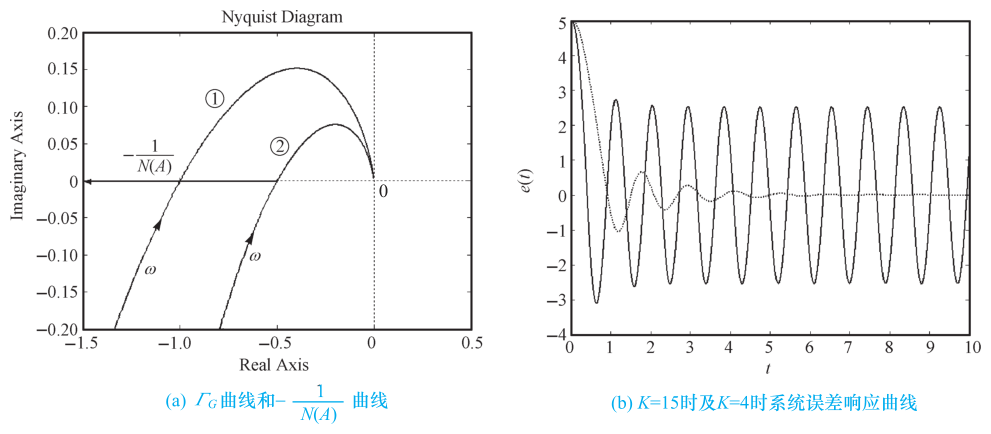{ .lq-img }

*图 8-23 例 8-4 非线性系统的稳定性分析（MATLAB）：(a) \(K=15\)（曲线①）与 \(K=7.5\)（曲线②）的 \(\varGamma_G\) 及 \(-1/N(A)\)；(b) \(K=15\) 自振与 \(K=4\) 收敛的误差响应（截自原书）*

**解 2)**：为使系统不出现自振荡，应调整 \(K\) 使 \(\varGamma_G\) 曲线移动、与 \(-1/N(A)\) 曲线无交点。考虑到 \(-1/N(A)\) 的最右端点为 \(-1/k=-0.5\)，故应有

\[
-\frac{0.02}{0.3}K > -0.5
\]

而 \(K\) 的临界值应使上述不等式变为等式：

\[
K_{\max} = \frac{0.5\times 0.3}{0.02} = 7.5
\]

\(K=7.5\) 时的 \(\varGamma_G\) 曲线如图 8-23(a) 曲线②（恰与 \(-1/N(A)\) 的端点 \(-0.5\) 接触）。若取 \(K=4\)、\(c(0)=-5\)，误差响应如图 8-23(b) 虚线，振荡收敛。用减小增益消除自振的代价是响应快速性与稳态精度下降。

**【例 8-5】死区继电系统与串联超前校正消除自振**

设非线性系统如原书图 8-24：死区继电特性 \(M=1\)、\(h=0.5\)，线性部分 \(G(s)=\dfrac{10}{s(0.5s+1)(0.125s+1)}\)，校正装置 \(G_c(s)\) 与非线性环节串联于正向通道。试分析：1) \(G_c(s)=1\)；2) \(G_c(s)=\dfrac{0.25s+1}{8.3(0.03s+1)}\) 时非线性系统的运动特性。

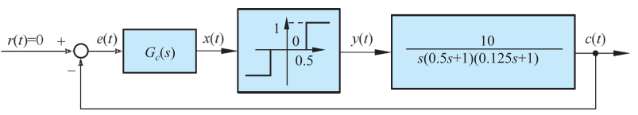{ .lq-img }

*图 8-24 例 8-5 非线性系统的结构图：\(G_c(s)\) → 死区继电（\(h=0.5\)，\(M=1\)）→ 线性部分（截自原书）*

**解**：由表 8-1，死区继电特性的描述函数为

\[
N(A) = \frac{4M}{\pi A}\sqrt{1-\left(\frac{h}{A}\right)^2}, \qquad A\ge h
\tag{8.54}
\]

取 \(u=\dfrac{h}{A}\)，则

\[
N(A)=N(u)=\frac{4M}{\pi h}\,u\sqrt{1-u^2}
\tag{8.55}
\]

!!! warning "原书笔误"
    式 (8.55) 的适用条件印作 "\(u\ge 1\)"。因 \(u=h/A\) 且 \(A\ge h\)，条件应为 **\(A\ge h\)（即 \(0<u\le 1\))**。

对 \(N(u)\) 求导：

\[
\frac{\mathrm{d}N(u)}{\mathrm{d}u} = \frac{4M}{\pi h}\left(\sqrt{1-u^2} - \frac{u^2}{\sqrt{1-u^2}}\right) = \frac{4M}{\pi h}\cdot\frac{1-2u^2}{\sqrt{1-u^2}}
\]

由极值条件 \(\dfrac{\mathrm{d}N(u)}{\mathrm{d}u}=0\)，得解 \(u_m=\dfrac{h}{A_m}=\dfrac{1}{\sqrt 2}\)，即 \(A_m=\sqrt 2\,h\)。又当 \(h\le A<A_m\) 时 \(\dfrac{\mathrm{d}N}{\mathrm{d}u}>0\)，\(A>A_m\) 时 \(\dfrac{\mathrm{d}N}{\mathrm{d}u}<0\)，故 \(A_m\) 为 \(N(A)\) 的极大值点，极大值为

\[
N(A_m) = \frac{2M}{\pi h} = 1.273, \qquad -\frac{1}{N(A_m)} = -0.785
\]

而 \(-1/N(A_m)\) 亦为 \(-1/N(A)\) 的极大值（最靠近原点），注意到 \(-1/N(h)=-1/N(\infty)=-\infty\)，\(-1/N(A)\) 曲线沿负实轴从 \(-\infty\) 上升到 \(-0.785\) 再回落到 \(-\infty\)，如图 8-25(a) 所示。

**1) \(G_c(s)=1\)**。\(\varGamma_G\) 曲线如图 8-25(a) 曲线①，穿越频率与负实轴交点：

\[
\omega_x = \frac{1}{\sqrt{T_1T_2}} = \frac{1}{\sqrt{0.5\times 0.125}} = 4, \qquad
G(\mathrm{j}\omega_x) = -\frac{KT_1T_2}{T_1+T_2} = -\frac{10\times 0.5\times 0.125}{0.5+0.125} = -1
\]

由图可知，在负实轴 \((-1,\mathrm{j}0)\) 点处，\(\varGamma_G\) 曲线和 \(-1/N(A)\) 曲线有**两个交点**，按式 (8.50)（即 \(N(A)=1\)）解得

\[
\begin{cases}\omega_1=4\\ A_1=0.556\end{cases}
\qquad
\begin{cases}\omega_2=4\\ A_2=1.146\end{cases}
\]

根据周期运动稳定性判据，\(A_1\) 和 \(\omega_1\) 对应**不稳定**的周期运动；\(A_2\) 和 \(\omega_2\) 对应**稳定**的周期运动。当初始条件或外扰动使 \(A<A_1\) 时，系统运动不存在自振，稳态误差 \(\vert e\vert<h\)；当初始条件 \(c(0)=2\) 使 \(A>A_2\) 时，系统产生自振 \(e(t)=1.146\sin 4t\)，如图 8-25(b) 曲线①。

**2) \(G_c(s)=\dfrac{0.25s+1}{8.3(0.03s+1)}\)** 为无源超前网络（直流增益 \(1/8.3\)、高频增益约 1），系统线性部分变为 \(G(s)G_c(s)\)。\(\varGamma_{GG_c}\) 曲线如图 8-25(a) 曲线②。由于 \(\varGamma_{GG_c}\) 曲线**不包围** \(-1/N(A)\) 曲线，系统稳定，自振消除。取 \(A\) 为定值，由 \(\vert G_c(\mathrm{j}\omega_c)G(\mathrm{j}\omega_c)N(A)\vert=1\) 可以解得 \(\omega_c\)，则相角裕度为

\[
\gamma(A) = 180^\circ - \angle\left[G(\mathrm{j}\omega_c)G_c(\mathrm{j}\omega_c)\right]
\]

特殊地，取 \(A=A_m\)，相应的相角裕度 \(\gamma_m\) 约为 \(30^\circ\)，而由图 8-25(a) 可知 \(\gamma(A)\ge\gamma_m\)。因此加入串联超前校正网络，可以使非线性系统消除自振，且使系统具有一定的相角裕度。当 \(c(0)=2\) 时，误差响应 \(e(t)\) 如图 8-25(b) 曲线②，收敛。当然也可以通过减小线性部分的增益消除自振，但这样做会使系统响应的快速性降低。

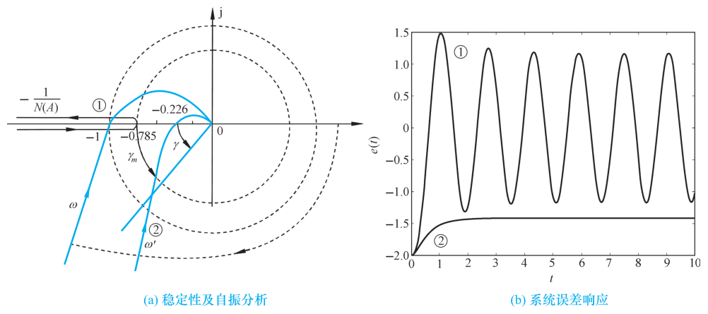{ .lq-img }

*图 8-25 例 8-5 非线性系统分析（MATLAB）：(a) 稳定性及自振分析（曲线① \(G_c=1\)、曲线② 加入超前校正，标注 \(-1\)、\(-0.785\)、\(-0.226\)、\(\gamma_m\)）；(b) 系统误差响应：① 自振不衰减、② 收敛（截自原书）*

!!! warning "原书笔误"
    书中称该情形"穿越频率 \(\omega_x'=11.97\)、\(G(\mathrm{j}\omega_x')G_c(\mathrm{j}\omega_x')=-0.226\)"。按书印的 \(G_c(s)=\dfrac{0.25s+1}{8.3(0.03s+1)}\)（含 \(1/8.3\) 增益）复核：\(\varGamma_{GG_c}\) 与负实轴的交点为 \(-0.021\)（\(\omega\approx 13.7\ \mathrm{rad/s}\)），\(A=A_m\) 时相角裕度约 \(63^\circ\)，均与书不符。书给的两个数实际对应**不含 \(1/8.3\) 增益**的 \(G_c(s)=\dfrac{0.25s+1}{0.03s+1}\)：\(\vert G(\mathrm{j}11.97)G_c(\mathrm{j}11.97)\vert=0.227\)（与 \(-0.226\) 的模吻合，但该点相角为 \(-175^\circ\)，并非穿越点；真正的穿越在 \(\omega\approx13.7\)、幅值 \(-0.176\)），此时 \(\gamma_m\approx28.5^\circ\)（书取约 \(30^\circ\)）。无论按哪种取值，\(\varGamma_{GG_c}\) 都不与 \(-1/N(A)\)（实轴段 \((-\infty,-0.785]\)）相交，"消除自振、系统稳定"的结论不变（复核见 8.4 节代码）。

## 8.4 非线性系统的分析仿真

非线性系统的分析是以解决稳定性问题为中心，一般采用描述函数法或相平面法来进行分析。下面先介绍 MATLAB、Python 中常用的求解微分方程的命令，再结合具体实例说明其在非线性控制系统分析中的应用。

### 微分方程高阶数值解法

MATLAB 命令格式：`[t, x] = ode45('fun', t, x0)`。其中描述系统微分方程的 M 文件 `fun` 为调用函数，`t` 为设定的仿真时间（向量），`x0` 为系统的初始状态。ode45 是变步长的四阶/五阶龙格-库塔法，饱和限幅、继电切换等非线性直接写进 `fun` 的右端即可。

Python 对应 `scipy.integrate.odeint(fun, x0, t)`（新一代接口为 `solve_ivp`）：`fun(x, t)` 返回状态导数向量。注意与 MATLAB 的 `fun(t, x)` **参数顺序相反**。

### 描述函数的符号计算（表 8-1 复核）

描述函数就是傅里叶系数积分（式 8.25/8.27），交给符号计算复核最稳妥：下面验证表 8-1 中理想继电（8.23）、死区继电（8.43）、滞环继电（8.44）、饱和（8.36）四个典型结果与例 8-2（8.31）。

=== "MATLAB"

    ```matlab
    % ===== 书 8.3 节 描述函数计算（符号积分验证表8-1）=====
    syms A M h th positive              % A:输入振幅, M/h:非线性参数, th=wt
    % 例8-1 理想继电(8-22)：奇对称公式(8-25)，M 段占 0~pi
    B1 = (2/pi)*int(M*sin(th), th, 0, pi)          % 4*M/pi
    N1 = simplify(B1/A)                            % 4*M/(pi*A)
    % 表8-1 有死区的继电(8-43)：M 段从 psi=asin(h/A) 到 pi-asin(h/A)
    psi = asin(h/A);
    B2 = (2/pi)*int(M*sin(th), th, psi, pi-psi)    % 4*M/pi*sqrt(1-(h/A)^2)
    N2 = simplify(B2/A)
    % 例8-2 (8-28)：y=x/2+x^3/4，奇函数+半周期内对称，用(8-27)
    y2 = (A/2)*sin(th) + (A^3/4)*sin(th)^3;
    B3 = (4/pi)*int(y2*sin(th), th, 0, pi/2)       % A/2 + 3*A^3/16
    N3 = simplify(B3/A)                            % 1/2 + 3*A^2/16
    ```

=== "Python"

    ```python
    # ===== 书 8.3 节 描述函数计算（sympy 符号积分验证表8-1）=====
    import sympy as sp

    A, M, h, th = sp.symbols('A M h theta', positive=True)

    def df(y, lo, hi):
        """奇对称公式(8-25)：N = B1/A + j*A1/A"""
        B1 = sp.simplify(2/sp.pi * sp.integrate(y*sp.sin(th), (th, lo, hi)))
        A1 = sp.simplify(2/sp.pi * sp.integrate(y*sp.cos(th), (th, lo, hi)))
        return sp.simplify(B1/A), sp.simplify(A1/A)

    print(df(M, 0, sp.pi))             # (4*M/(pi*A), 0) —— 例8-1 理想继电 (8.23)
    psi = sp.asin(h/A)
    print(df(M, psi, sp.pi - psi))     # (4*M*sqrt(A**2 - h**2)/(pi*A**2), 0) —— 死区继电 (8.43)

    x = A*sp.sin(th)                   # 例8-2 (8.28)：y=x/2+x^3/4，按(8-27)积 0~pi/2
    B1 = sp.simplify(4/sp.pi*sp.integrate((x/2 + x**3/4)*sp.sin(th), (th, 0, sp.pi/2)))
    print(sp.simplify(B1/A))           # 3*A**2/16 + 1/2 —— (8.31)

    a, K = sp.symbols('a K', positive=True)   # 饱和 (8.36)：线性段 + K*a 平台段
    p2 = sp.asin(a/A)
    B1 = (sp.integrate(K*A*sp.sin(th)**2, (th, 0, p2))
          + sp.integrate(K*a*sp.sin(th), (th, p2, sp.pi/2)))
    print(sp.simplify(4/sp.pi*B1/A))
    # 2*K*(A**2*asin(a/A) + a*sqrt(A**2 - a**2))/(pi*A**2)
    #   = (2K/pi)*[asin(a/A) + (a/A)*sqrt(1-(a/A)^2)] —— 与表8-1一致

    # 滞环继电 (8.44)：-M(0~psi)、M(psi~pi+psi)、-M(pi+psi~2pi)，全周期积分
    psi = sp.asin(h/A)
    B1 = (sp.integrate(-M*sp.sin(th), (th, 0, psi))
          + sp.integrate(M*sp.sin(th), (th, psi, sp.pi+psi))
          + sp.integrate(-M*sp.sin(th), (th, sp.pi+psi, 2*sp.pi)))
    A1 = (sp.integrate(-M*sp.cos(th), (th, 0, psi))
          + sp.integrate(M*sp.cos(th), (th, psi, sp.pi+psi))
          + sp.integrate(-M*sp.cos(th), (th, sp.pi+psi, 2*sp.pi)))
    print(sp.simplify(B1/sp.pi/A), sp.simplify(A1/sp.pi/A))
    # 4*M*sqrt(A**2-h**2)/(pi*A**2), -4*M*h/(pi*A**2) —— 即表8-1的实部与虚部
    ```

全部与表 8-1 吻合。注意滞环继电的积分区间要按全周期写（\(0\sim\psi_1\) 仍是 \(-M\) 而非 0），这正是"奇对称而非奇函数"的体现。

### 自振交点与校正复核（例 8-4 / 例 8-5）

判稳与自振的振幅频率归结为解 \(G(\mathrm{j}\omega)=-1/N(A)\)（式 8.51/8.52）。例 8-4、例 8-5 的交点都落在负实轴上（\(N(A)\) 为实数），可直接解 \(N(A)=\vert G(\mathrm{j}\omega_x)\vert\)。

=== "MATLAB"

    ```matlab
    % ===== 书 8.3 节 例8-4/例8-5 自振交点数值求解 =====
    syms A positive
    % 例8-4：饱和 a=1,k=2；G(jwx)=-1 处 N(A)=1
    Nsat = (4/pi)*(asin(1/A) + (1/A)*sqrt(1-1/A^2));
    A4 = vpasolve(Nsat == 1, A, 2.5)               % 2.4754（书取 2.5）
    % 例8-5：死区继电 M=1,h=0.5；N(A)=1 有两根
    Ndz = (4/(pi*A))*sqrt(1-(0.5/A)^2);
    A1s = vpasolve(Ndz == 1, A, [0.5 0.8])         % 0.5557（书 0.556，不稳定周期运动）
    A2s = vpasolve(Ndz == 1, A, [0.8 2.0])         % 1.1456（书 1.146，稳定周期运动）
    % 例8-5(2) 复核：Gc=(0.25s+1)/(8.3(0.03s+1))（无源超前）
    s = 1i*11.97;
    GGc = 10/(s*(0.5*s+1)*(0.125*s+1)) * (0.25*s+1)/(8.3*(0.03*s+1));
    abs(GGc), angle(GGc)*180/pi                    % 0.0274, -175.0（书 -0.226@11.97，见勘误）
    ```

=== "Python"

    ```python
    # ===== 书 8.3 节 例8-4/例8-5 自振交点数值求解 =====
    import sympy as sp
    import numpy as np
    from scipy.optimize import brentq

    A = sp.symbols('A', positive=True)

    # 例8-4：饱和 a=1、k=2，交点处 N(A)=1（-1/N(A) 与 -1 重合）
    Nsat = 4/sp.pi*(sp.asin(1/A) + (1/A)*sp.sqrt(1 - 1/A**2))
    print(sp.nsolve(Nsat - 1, A, 2.5))            # 2.47541447246708（书取 2.5）

    # 例8-5：死区继电 M=1、h=0.5，N(A)=1 的两个根
    Ndz = 4/(sp.pi*A)*sp.sqrt(1 - (sp.Rational(1, 2)/A)**2)
    print([float(sp.nsolve(Ndz - 1, A, g)) for g in (0.6, 1.2)])
    # [0.5557286658491892, 1.1455586358763503]（书 0.556 / 1.146）

    # 例8-5(2) 复核：Gc=(0.25s+1)/(8.3*(0.03s+1))，线性部分 GGc
    G  = lambda w: 10/(1j*w*(0.5j*w + 1)*(0.125j*w + 1))
    Gc = lambda w: (0.25j*w + 1)/(8.3*(0.03j*w + 1))
    v = G(11.97)*Gc(11.97)
    print('w=11.97: |GGc|=%.4f  ph=%.1f deg' % (abs(v), np.rad2deg(np.angle(v))))
    # 0.0274, -175.0 deg（书印 -0.226@11.97，对应不含1/8.3的Gc，见正文勘误）
    wx = brentq(lambda w: (G(w)*Gc(w)).imag, 5, 40)
    v = G(wx)*Gc(wx)
    print('负实轴穿越: wx=%.2f, GGc=%.4f' % (wx, v.real))       # 13.69, -0.0212

    Nm = 2/(np.pi*0.5)                                          # N(Am)=1.273
    wc = brentq(lambda w: abs(G(w)*Gc(w)) - 1/Nm, 0.2, 10)
    g = 180 + np.rad2deg(np.angle(G(wc)*Gc(wc)))
    print('A=Am: wc=%.3f, gamma_m=%.1f deg' % (wc, g))          # 1.327, 63.1 deg
    ```

代码复核结论：例 8-4 的自振振幅精确值为 \(2.475\)（书取 \(2.5\)）；例 8-5 的两交点 \(0.556/1.146\) 与书一致；例 8-5(2) 的勘误数值见 8.3 节 warning 框。

### 综合运用：非线性系统的稳定性分析

**【例 8-6】描述函数法判稳 + 时间响应**

设系统如图 8-26：饱和非线性（斜率 \(K=1\)、限幅 \(\pm 2\)）与线性部分 \(G(s)=\dfrac{1}{s(s+1)}\) 串联组成单位反馈系统。试用描述函数法判断系统的稳定性，并画出 \(c(0)=-3\)、\(\dot c(0)=0\) 的时间响应曲线。

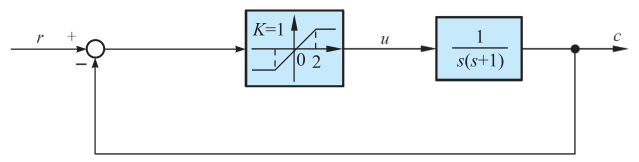{ .lq-img }

*图 8-26 饱和非线性系统结构图（截自原书）*

**解**：非线性环节（饱和，\(k=1\)、\(a=2\)）的描述函数为

\[
N(A) = \frac{2}{\pi}\left[\arcsin\frac{2}{A} + \frac{2}{A}\sqrt{1-\left(\frac{2}{A}\right)^2}\right], \qquad A\ge 2
\]

!!! warning "原书笔误"
    书中此式印作 \(\arctan\dfrac{2}{A}\)，应为 **\(\arcsin\dfrac{2}{A}\)**：书内配套代码用的正是 `asin`；且代入 \(A=a=2\) 时 \(\arcsin 1=\pi/2\) 给 \(N(a)=k=1\)（正确），\(\arctan 1=\pi/4\) 只能给 \(N(a)=0.5\)（错）。

在复平面内分别绘制线性环节的 \(\varGamma_G\) 曲线和负倒描述函数 \(-1/N(A)\) 曲线，由

\[
G(\mathrm{j}\omega) = -\frac{1}{N(A)}
\]

利用频域奈氏判据可知：若 \(\varGamma_G\) 曲线不包围 \(-1/N(A)\) 曲线，则非线性系统稳定；反之则不稳定。

=== "MATLAB"

    ```matlab
    % ===== 书 8.4 节 例8-6 描述函数法判稳 =====
    G = zpk([], [0 -1], 1);                  % 建立线性环节模型 1/(s(s+1))
    nyquist(G); hold on                      % 绘制奈奎斯特曲线 ΓG，并图形保持
    A = 2:0.01:60;                           % 设定非线性环节输入信号振幅范围
    N = (2*(asin(2./A)+(2./A).*sqrt(1-(2./A).^2)))/pi;   % 饱和 k=1,a=2 的 N(A)
    x = real(-1./N);                         % 计算负倒描述函数实部
    y = imag(-1./N);                         % 计算负倒描述函数虚部
    plot(x, y);                              % 绘制负倒描述函数曲线
    axis([-1.5 0 -1 1]); hold off            % 重新设置图形坐标，并取消图形保持
    ```

=== "Python"

    ```python
    # ===== 书 8.4 节 例8-6 描述函数法判稳 =====
    import numpy as np
    import matplotlib.pyplot as plt
    import control as ct

    sys = ct.tf([1], [1, 1, 0])              # G(s) = 1/(s(s+1))

    A = np.arange(2.0, 60, 0.01)             # 振幅范围（A >= a = 2）
    u = 2/A
    N = (2/np.pi)*(np.arcsin(u) + u*np.sqrt(1 - u**2))   # 饱和 k=1、a=2 的 N(A)
    invN = -1/N                              # 负倒描述函数：负实轴上，-1（A=2）-> -inf

    fig, ax = plt.subplots()
    ct.nyquist_plot(sys, ax=ax)              # ΓG 曲线（原书 MATLAB 用 nyquist(G); hold on）
    ax.plot(invN, np.zeros_like(invN), 'k-', lw=1.2)     # -1/N(A) 叠画
    ax.set_title('Nyquist Diagram')
    ax.set_xlabel('Real Axis')
    ax.set_ylabel('Imaginary Axis')
    plt.show()
    # -1/N(A) 从 -1（A=2）出发随 A 增大趋向 -inf；ΓG 位于三、四象限并趋近原点，
    # 不包围 -1/N(A) 曲线 —— 非线性系统稳定（书图8-27）
    ```

!!! warning "原书笔误"
    书中 Python 代码把根号内写作 `np.sqrt(-(2/A)**2)`——负数开平方恒为 `NaN`，负倒曲线画不出来。应为 **`np.sqrt(1-(2/A)**2)`**（MATLAB 一侧 `sqrt(1-(2./A).^2)` 是对的）。

运行上述程序，作 \(\varGamma_G\) 曲线和负倒描述函数 \(-1/N(A)\) 曲线如图 8-27：\(\varGamma_G\) 曲线**不包围** \(-1/N(A)\) 曲线。根据非线性稳定判据，该非线性系统**稳定**。

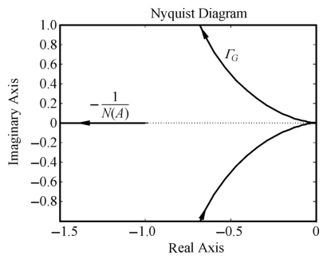{ .lq-img }

*图 8-27 例 8-6 系统描述函数法稳定性分析（MATLAB）：\(\varGamma_G\) 不包围 \(-1/N(A)\)（截自原书）*

再看时间响应。闭环在 \(r(t)=0\) 下的方程为 \(c''+c'=\mathrm{sat}(e)\)，其中误差 \(e=r-c=-c\)，饱和 \(\mathrm{sat}(\cdot)\) 斜率 1、限幅 \(\pm 2\)。书中 `ode45('fun',...)`/`odeint(fun,...)` 的 `fun` 未给出，现补全如下。

=== "MATLAB"

    ```matlab
    % ===== 书 8.4 节 例8-6 时间响应 =====
    % fun.m（书中未给出，补全）：c'' + c' = sat(e)，e = -c，饱和 ±2、斜率 1
    %   function dx = fun(t, x)
    %     e  = -x(1);
    %     u  = max(min(e, 2), -2);      % 饱和限幅
    %     dx = [x(2); u - x(2)];
    %   end
    t  = 0:0.01:30;                          % 设定仿真时间为 30s
    c0 = [-3 0]';                            % 初始条件 c(0)=-3, c'(0)=0
    [t, c] = ode45('fun', t, c0);            % 求解初始条件下的系统微分方程
    figure(1)
    plot(t, c(:, 1)); grid;                  % 绘制系统时间响应曲线
    xlabel('t(s)'); ylabel('c(t)')           % 添加坐标说明
    ```

=== "Python"

    ```python
    # ===== 书 8.4 节 例8-6 时间响应 =====
    import numpy as np
    import matplotlib.pyplot as plt
    from scipy.integrate import odeint

    def sat(e, a=2):                         # 饱和特性：斜率 1、限幅 ±2
        return np.clip(e, -a, a)

    def fun(x, t):                           # c'' + c' = sat(e)，e = -c（r=0）
        return [x[1], sat(-x[0]) - x[1]]

    t  = np.arange(0, 30, 0.01)              # 设定仿真时间为 30s
    c0 = [-3.0, 0.0]                         # 初始条件 c(0)=-3, c'(0)=0
    y  = odeint(fun, c0, t)                  # 求解非线性微分方程
    print('c(30) = %.2e' % y[-1, 0])         # -1.1e-06：振荡收敛到零
    plt.plot(t, y[:, 0])                     # 绘制系统时间响应曲线
    plt.xlabel('t(s)')
    plt.ylabel('c(t)')
    plt.show()
    ```

运行后系统时间响应如图 8-28：\(c(t)\) 从 \(-3\) 出发振荡收敛到零（超调约 \(0.45\) 后进入误差带），与描述函数法的判稳结论一致。

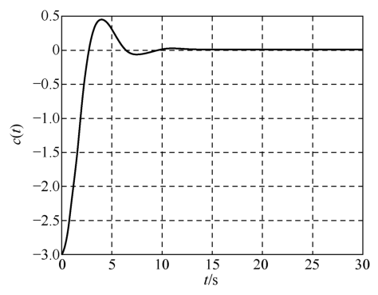{ .lq-img }

*图 8-28 例 8-6 系统时间响应曲线（MATLAB，\(c(0)=-3\)）：振荡收敛（截自原书）*

!!! note "拓展：例 8-6 为什么'稳定得很有分寸'（补充）"
    线性部分 \(G(s)=1/(s(s+1))\) 是 I 型系统，临界稳定结构的 \(\varGamma_G\) 在低频端贴着 \(\mathrm{Re}=-1\) 的渐近线走向无穷，而 \(-1/N(A)\) 正好从 \(-1\) 出发向 \(-\infty\) 延伸——两者擦肩而过但永不相交。饱和的 \(N(A)\) 随 \(A\) 增大而减小，相当于"幅值越大增益越低"，天然地把振幅往回压，所以响应振荡收敛且不会发散。若把线性部分增益加大，\(\varGamma_G\) 整体左移就可能包住 \(-1/N(A)\) 的一段，出现自振——例 8-4 正是这样一例。

## 坑与陷阱

!!! danger "8 个容易踩的坑"
    1. **三条应用条件缺一不可**：典型结构（一个 \(N(A)\) 配一个线性部分）、\(y(x)\) 为奇函数或输出奇对称（保证 \(A_0=0\)）、线性部分低通滤波（极点在左半平面）。阶次低、谐波衰减不足时，\(-1/N(A)\) 判据只是定性参考；两曲线几乎相切时结论最不可靠。
    2. **两个"频率特性"不是一回事**：线性频率特性是 \(\omega\) 的函数、与幅值无关；描述函数（无储能元件时）是幅值 \(A\) 的函数、与 \(\omega\) 无关。奈氏图上 \(\varGamma_G\) 动的是 \(\omega\)、\(-1/N(A)\) 动的是 \(A\)——判据是"包围/不包围"，别把 \(-1/N(A)\) 当线性系统读相角裕度。
    3. **端点与箭头先算清**：饱和型 \(-1/N(A)\) 从 \(-1/k\) 出发趋向 \(-\infty\)；死区继电型从 \(-\infty\)（\(A=h\)）先升到极大值 \(-1/N(A_m)=-\pi h/(2M)\) 再回落；滞环型根本不在实轴上（第三象限曲线）。箭头（\(A\) 增大方向）画反，周期运动稳定性结论跟着反。
    4. **有交点 ≠ 有自振**：交点只是周期运动的候选。图 8-21(b) 型交点对应不稳定周期运动，实际观察不到；(c)(d) 型还要求初始条件配合（自振有条件）；稳定周期运动也只对一定范围的扰动稳定，扰动过大停振或发散。
    5. **串联简化不能把 \(N(A)\) 相乘**：两个非线性环节串联按图解法求等效静特性（式 8.45/8.46，只对特定顺序成立）再算 \(N(A)\)，等效特性与前后次序有关；并联才可以把 \(N(A)\) 代数相加。
    6. **描述函数结果是近似值**：只保留基波、静特性用折线典型化。例 8-4 的 \(A=2.5\) 精确解是 \(2.475\)；自振参数当工程估算用，别当精确解。
    7. **间隙/滞环的虚部是滞后相角**：非单值特性的 \(N(A)\) 是复数、虚部为负，\(-1/N(A)\) 离开实轴扎进第三象限，与 \(\varGamma_G\) 相交的概率大增——"间隙容易引起自振"的代数根源。
    8. **仿真别把非线性写丢**：ode45/odeint 的 `fun` 必须显式写出饱和限幅、继电切换（例 8-6 的 \(c''+c'=\mathrm{sat}(-c)\)）；初始条件决定结局（例 8-5 的 \(A<A_1\) 收敛、\(A>A_2\) 自振）。描述函数回答"振不振、振多大"，时间响应还得靠数值积分。

## 术语速查

| 英文 | 中文 | 一句话 |
| --- | --- | --- |
| nonlinear control system | 非线性系统 | 含非线性环节的系统，叠加原理失效 |
| equilibrium state | 平衡状态 | 无外作用且输出各阶导数为零的状态；可多个、稳定性各异 |
| self-oscillation | 自激振荡（自振） | 无外作用下系统内部产生的固定幅频稳定周期运动 |
| limit cycle | 极限环 | 自振在相平面上的封闭轨迹（补充术语） |
| van der Pol equation | 范德波尔方程 | 非线性阻尼二阶系统，稳定极限环的标准例子（式 8.11） |
| frequency response distortion | 频率响应畸变 | 非线性正弦响应含高次谐波，波形不再同频正弦 |
| phase plane method | 相平面法 | 相轨迹图解法，仅适用一、二阶系统 |
| describing function | 描述函数 \(N(A)\) | 一次谐波分量与正弦输入的复数比，幅值 \(A\) 的复变增益 |
| harmonic linearization | 谐波线性化 | 只取基波、忽略高次谐波的等效线性化 |
| fundamental component | 一次谐波（基波） | 与输入同频的谐波分量 |
| higher harmonics | 高次谐波 | \(n>1\) 的谐波分量，靠线性部分低通特性抑制 |
| negative inverse describing function | 负倒描述函数 \(-1/N(A)\) | 复平面上与 \(\varGamma_G\) 比较的曲线，箭头沿 \(A\) 增大方向 |
| equivalent gain | 等效增益 \(k=f(x)/x\) | 非线性环节的"变增益比例环节"视角 |
| saturation | 饱和特性 | 大信号增益降为零的限幅特性，\(N(A)\) 随 \(A\) 减小 |
| dead zone | 死区特性 | 小信号无输出的不灵敏区，造成稳态误差、降低超调 |
| backlash | 间隙特性 | 换向需越过齿隙 \(2b\) 的非单值特性，可致自振 |
| relay characteristic | 继电特性 | 只有 \(\pm M\) 两个输出位的开关特性，常使系统振荡 |
| hysteresis | 滞环 | 吸合/释放点不同造成的多值特性，引入滞后相角 |
| Coulomb / viscous / static friction | 库仑/黏性/静摩擦 | 三种摩擦的组合（式 8.14 的 \(F_1\)、\(F_2\) 与黏性项） |
| low-speed creeping | 低速爬行 | 静→动摩擦跳变引起的输出轴跳跃式变化 |
| dither | 颤振 | 高频小幅信号，用来"平均化"死区、间隙等非线性 |
| small-deviation linearization | 小偏差线性化 | 工作点泰勒展开取一次项（式 8.4/8.5） |
| stable periodic motion | 稳定周期运动 | 交点处 \(-1/N(A)\) 由不稳定区穿入稳定区的周期运动 |
| low-pass filter property | 低通滤波性能 | 描述函数法应用条件：线性部分极点位于左半平面 |
| ode45 / odeint | 数值积分命令 | 变步长 RK45 解非线性微分方程，fun 的参数顺序两库相反 |

## 覆盖自查

??? note "原书小节 → 笔记位置"
    | 原书小节/内容 | 笔记位置 |
    | --- | --- |
    | 8-1 非线性控制系统概述（研究意义、液位系统与小偏差线性化、三大特征：多平衡点/自振/频率畸变、三种分析方法） | 8.1 |
    | 8-2 常见非线性特性及其对系统运动的影响（等效增益、五种非线性特性与式 8.14、继电/死区/饱和/间隙/摩擦定性分析） | 8.2 |
    | 8-3 描述函数法（定义推导与例 8-1/8-2、应用条件、物理意义、死区饱和与死区滞环继电推导、表 8-1 全录、系统简化三规则、变增益系统、判稳判据与例 8-3、周期运动稳定性判据与例 8-4/8-5） | 8.3 |
    | 8-4 非线性系统的分析仿真（ode45/odeint、描述函数符号计算、自振交点求解、例 8-6 判稳叠画与时间响应） | 8.4 |

??? note "原书例题 → 笔记位置"
    | 原书例题 | 内容 | 笔记位置 |
    | --- | --- | --- |
    | 例 8-1 | 理想继电特性 \(N(A)=4M/(\pi A)\) | 8.3 描述函数的定义 |
    | 例 8-2 | \(y=x/2+x^3/4\) → \(N(A)=1/2+3A^2/16\) | 8.3 描述函数的定义（式 8.26/8.27 之后） |
    | 例 8-3 | 库仑摩擦加黏性摩擦系统判稳（\(\varGamma_G\) 包围 \(-1/N(A)\)，不稳定） | 8.3 稳定性判据 |
    | 例 8-4 | 饱和系统自振 \(e(t)=2.5\sin 7.07t\)、临界增益 \(K_{\max}=7.5\) | 8.3 周期运动稳定性 |
    | 例 8-5 | 死区继电双交点 \(A_1=0.556/A_2=1.146\)、超前校正消除自振 | 8.3 周期运动稳定性 |
    | 例 8-6 | 饱和系统判稳（不包围）+ 时间响应振荡收敛（双 tab 代码） | 8.4 综合运用 |

