# 第 9 章 线性系统的状态空间分析与综合

> **本章解决**：前面八章全部围绕传递函数——它只描述输入-输出这个"外壳"，看不见系统内部，也管不了多输入-多输出系统。本章换一套语言：用状态变量 \(\boldsymbol{x}\) 把系统内部每个时刻的状况都写进方程，得到状态空间表达式（9-1），再在这套语言里重做整门课的事——解方程（状态转移矩阵）、判可控可观测（9-2）、判稳定（李雅普诺夫方法，9-3）、做设计（状态反馈配置极点 + 状态观测器重构不可测状态，9-4），最后交 MATLAB/Python 仿真（9-5）。经典法的结论在这里大多有对应版本：特征值判稳对应李雅普诺夫第一法、劳斯表对应特征值分布，而状态反馈与观测器则是经典法做不到的"由内而外"的设计。这是全书最后一章，也是现代控制理论的入口。

## 9.0 本章导图

<div class="brtree">
  <div class="brrow">
    <span class="brlabel root">状态空间分析与综合</span>
    <span class="brace"></span>
    <div class="brkids">
      <div class="brrow">
        <span class="brlabel">状态空间描述（9-1）</span>
        <span class="brace"></span>
        <div class="brkids">
          <span class="brleaf">状态 / 状态变量 / 动态方程</span>
          <span class="brleaf">建模：机理 / 微分方程 / 传函</span>
          <span class="brleaf">可控·可观测·对角规范形</span>
          <span class="brleaf">状态转移矩阵 e<sup>At</sup> 与性质</span>
          <span class="brleaf">传递函数矩阵 / 解耦</span>
          <span class="brleaf">离散化与递推求解</span>
        </div>
      </div>
      <div class="brrow">
        <span class="brlabel">可控性与可观测性（9-2）</span>
        <span class="brace"></span>
        <div class="brkids">
          <span class="brleaf">严格定义（时变系统给出）</span>
          <span class="brleaf">凯莱-哈密顿定理</span>
          <span class="brleaf">秩判据 / 规范形判据</span>
          <span class="brleaf">输出可控性</span>
          <span class="brleaf">离散系统判据</span>
          <span class="brleaf">线性变换·对偶原理·不变性</span>
        </div>
      </div>
      <div class="brrow">
        <span class="brlabel">李雅普诺夫稳定性（9-3）</span>
        <span class="brace"></span>
        <div class="brkids">
          <span class="brleaf">平衡状态</span>
          <span class="brleaf">稳定 / 渐近稳定 / 大范围</span>
          <span class="brleaf">第一法（间接法）</span>
          <span class="brleaf">第二法（直接法）V、V̇ 定号</span>
          <span class="brleaf">A<sup>T</sup>PA+PA=−Q 判据</span>
        </div>
      </div>
      <div class="brrow">
        <span class="brlabel">反馈结构与观测器（9-4）</span>
        <span class="brace"></span>
        <div class="brkids">
          <span class="brleaf">状态反馈 u=v−Kx</span>
          <span class="brleaf">两种输出反馈</span>
          <span class="brleaf">反馈对可控可观的影响</span>
          <span class="brleaf">极点配置条件与算法</span>
          <span class="brleaf">全维状态观测器设计</span>
          <span class="brleaf">分离定理</span>
        </div>
      </div>
      <div class="brrow">
        <span class="brlabel">分析仿真（9-5）</span>
        <span class="brace"></span>
        <div class="brkids">
          <span class="brleaf">ss 建模 / tf2ss / ss2tf</span>
          <span class="brleaf">ctrb / obsv / gram</span>
          <span class="brleaf">eig / lyap 判稳</span>
          <span class="brleaf">acker / place 配置极点</span>
          <span class="brleaf">综合应用例9-22、9-23</span>
        </div>
      </div>
    </div>
  </div>
</div>

## 9.1 线性系统的状态空间描述

### 系统数学描述的两种基本类型

本章研究的系统假定具有若干输入端和输出端，如图 9-1 所示：方框以外是系统环境，环境对系统的作用为系统输入，系统对环境的作用为系统输出，二者分别用向量 \(\boldsymbol{u}=[u_1,u_2,\cdots,u_p]^{\mathrm T}\) 和 \(\boldsymbol{y}=[y_1,y_2,\cdots,y_q]^{\mathrm T}\) 表示，它们是系统的**外部变量**；描述系统内部每个时刻所处状况的变量为**内部变量**，以向量 \(\boldsymbol{x}=[x_1,x_2,\cdots,x_n]^{\mathrm T}\) 表示。

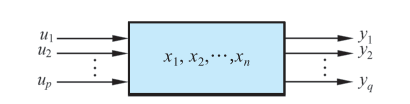{ .lq-img }

*图 9-1 系统的外部变量与内部变量（截自原书）*

系统的数学描述有两种基本类型：

- **外部描述**（输入-输出描述）：以传递函数或传递函数矩阵表征。把系统看成一个"黑箱"，只反映输入-输出间的因果关系，不表征系统的内部结构和内部变量。**外部描述通常只是对系统的一种不完全的描述**——具有完全不同内部结构的两个系统可能有相同的外部特性。
- **内部描述**（状态空间描述）：以状态空间表达式表征，通常由两个方程组成：反映内部变量 \(\boldsymbol{x}\) 与输入 \(\boldsymbol{u}\) 间因果关系的**状态方程**（微分方程或差分方程形式），以及表征 \(\boldsymbol{x}\)、\(\boldsymbol{u}\) 与输出 \(\boldsymbol{y}\) 之间转换关系的**输出方程**（代数方程形式）。内部描述是对系统的**完全的描述**，能完全表征系统的所有动力学特征。

仅当系统具有一定属性时（见 9.2 节可控且可观测），两种描述才等价。

### 状态空间的基本概念

- **状态**：系统在时间域中的行为或运动信息的集合。
- **状态变量**（State Variable）：确定系统状态的一组**独立（数目最小）**变量。一个用 \(n\) 阶微分方程描述的系统，当 \(n\) 个初始条件及 \(t\ge t_0\) 的输入给定时可唯一确定方程的解，故 \(x(t),\dot{x}(t),\cdots,x^{(n-1)}(t)\) 这 \(n\) 个独立变量可选作状态变量。
- **状态向量**（State Vector）：把 \(n\) 个状态变量看作向量 \(\boldsymbol{x}(t)\) 的分量。给定初始状态向量 \(\boldsymbol{x}(t_0)\) 及输入向量 \(\boldsymbol{u}(t)\)，则 \(t\ge t_0\) 的状态由 \(\boldsymbol{x}(t)\) 唯一确定。
- **状态空间**（State Space）：以 \(n\) 个状态变量作为基底所组成的 \(n\) 维空间。
- **状态轨线**：系统在任一时刻的状态在状态空间中用一点表示，随时间推移描绘出的轨迹。

**状态变量的选取不具有唯一性**，同一系统可有多种选取方法；状态变量也不一定在物理上可量测，有时只具有数学意义。但工程上应尽可能选容易量测的量：机械系统常选线（角）位移和线（角）速度，RCL 网络常选流经电感的电流和电容的端电压。

!!! note "拓展：为什么状态变量数目最小是 n 个（补充）"
    \(n\) 阶微分方程需要 \(n\) 个独立的初始条件才能唯一确定解，所以少于 \(n\) 个变量撑不起"完全描述"（有状态定不下来），多于 \(n\) 个则必有冗余（变量间不独立，互相能算出来）。"独立 + 最小"这两条合起来就是维数恰为 \(n\)。后面 9.2 节会看到：若系统内部存在不能控或不能观测的模态，用传递函数这种外部描述时维数甚至会"缩水"（零极点对消），这正是外部描述不完全的根源。

**线性系统的状态空间表达式**（又称**动态方程**）：

\[
\begin{aligned}
\dot{\boldsymbol{x}}(t) &= \boldsymbol{A}(t)\boldsymbol{x}(t)+\boldsymbol{B}(t)\boldsymbol{u}(t) \\
\boldsymbol{y}(t) &= \boldsymbol{C}(t)\boldsymbol{x}(t)+\boldsymbol{D}(t)\boldsymbol{u}(t)
\end{aligned}
\tag{9.1}
\]

线性离散时间系统（取 \(t_k=kT\)，\(T\) 为采样周期）：

\[
\begin{aligned}
\boldsymbol{x}(k+1) &= \boldsymbol{G}(k)\boldsymbol{x}(k)+\boldsymbol{H}(k)\boldsymbol{u}(k) \\
\boldsymbol{y}(k) &= \boldsymbol{C}(k)\boldsymbol{x}(k)+\boldsymbol{D}(k)\boldsymbol{u}(k)
\end{aligned}
\tag{9.2}
\]

若状态 \(\boldsymbol{x}\)、输入 \(\boldsymbol{u}\)、输出 \(\boldsymbol{y}\) 的维数分别为 \(n,p,q\)，则各矩阵的名称与维数为：

| 矩阵 | 名称 | 维数 |
| --- | --- | --- |
| \(\boldsymbol{A}(t)\)、\(\boldsymbol{G}(k)\) | 系统矩阵（状态矩阵） | \(n\times n\) |
| \(\boldsymbol{B}(t)\)、\(\boldsymbol{H}(k)\) | 控制矩阵（输入矩阵） | \(n\times p\) |
| \(\boldsymbol{C}(t)\)、\(\boldsymbol{C}(k)\) | 观测矩阵（输出矩阵） | \(q\times n\) |
| \(\boldsymbol{D}(t)\)、\(\boldsymbol{D}(k)\) | 前馈矩阵（输入输出矩阵） | \(q\times p\) |

**线性定常系统**：系数矩阵各元素都是常数，状态空间表达式的一般形式为

\[
\begin{aligned}
\dot{\boldsymbol{x}}(t) &= \boldsymbol{A}\boldsymbol{x}(t)+\boldsymbol{B}\boldsymbol{u}(t) \\
\boldsymbol{y}(t) &= \boldsymbol{C}\boldsymbol{x}(t)+\boldsymbol{D}\boldsymbol{u}(t)
\end{aligned}
\tag{9.3}
\]

\[
\begin{aligned}
\boldsymbol{x}(k+1) &= \boldsymbol{G}\boldsymbol{x}(k)+\boldsymbol{H}\boldsymbol{u}(k) \\
\boldsymbol{y}(k) &= \boldsymbol{C}\boldsymbol{x}(k)+\boldsymbol{D}\boldsymbol{u}(k)
\end{aligned}
\tag{9.4}
\]

当输出方程中 \(\boldsymbol{D}\equiv\boldsymbol{0}\) 时称**绝对固有系统**，否则称**固有系统**。为书写方便，常把固有系统 (9.3) 或 (9.4) 简记为系统 \((\boldsymbol{A},\boldsymbol{B},\boldsymbol{C},\boldsymbol{D})\) 或系统 \((\boldsymbol{G},\boldsymbol{H},\boldsymbol{C},\boldsymbol{D})\)，相应的绝对固有系统记为系统 \((\boldsymbol{A},\boldsymbol{B},\boldsymbol{C})\) 或系统 \((\boldsymbol{G},\boldsymbol{H},\boldsymbol{C})\)。

**线性系统的结构图**：状态空间表达式常用结构图表示。线性连续时间系统 (9.3) 的结构如图 9-2 所示，线性离散时间系统 (9.4) 的结构如图 9-3 所示。图中 \(\boldsymbol{I}\) 为 \(n\times n\) 单位矩阵，\(s\) 是拉普拉斯算子，\(z^{-1}\) 为单位延时算子。每一方框的输入-输出关系规定为：**输出向量 =（方框所示矩阵）×（输入向量）**。注意在向量、矩阵的乘法运算中，相乘顺序不允许任意颠倒。

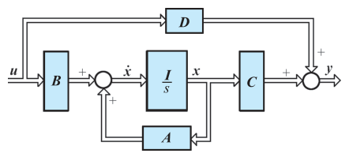{ .lq-img }

*图 9-2 线性连续时间系统结构图（截自原书）*

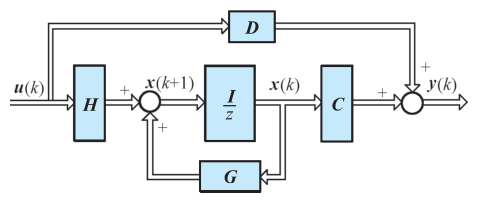{ .lq-img }

*图 9-3 线性离散时间系统结构图（截自原书）*

### 线性定常连续系统状态空间表达式的建立

建立状态空间表达式的方法主要有两种：一是直接根据系统机理建立微分方程（差分方程），选择有关物理量作为状态变量；二是由已知的其他数学模型（微分方程、传递函数、结构图）转化得到。

#### (1) 根据系统机理建立状态空间表达式

**【例 9-1】** 试列写图 9-4 所示 RLC 网络的电路方程，选择几组状态变量并建立相应的状态空间表达式，并就所选状态变量间的关系进行讨论。

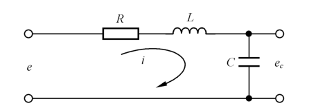{ .lq-img }

*图 9-4 RLC 网络（截自原书）*

**解** 根据电路定律可列方程

\[
Ri+L\frac{\mathrm{d}i}{\mathrm{d}t}+\frac{1}{C}\int i\,\mathrm{d}t=e
\]

电路输出量为

\[
y=e_c=\frac{1}{C}\int i\,\mathrm{d}t
\]

**1)** 设状态变量 \(x_1=i\)，\(x_2=\dfrac{1}{C}\displaystyle\int i\,\mathrm{d}t\)（电容电压），则状态方程为

\[
\begin{aligned}
\dot{x}_1 &=-\frac{R}{L}x_1-\frac{1}{L}x_2+\frac{1}{L}e \\
\dot{x}_2 &=\frac{1}{C}x_1
\end{aligned}
\]

输出方程为 \(y=x_2\)。其向量-矩阵形式为

\[
\begin{bmatrix} \dot{x}_1 \\ \dot{x}_2 \end{bmatrix}
=
\begin{bmatrix} -\dfrac{R}{L} & -\dfrac{1}{L} \\[2mm] \dfrac{1}{C} & 0 \end{bmatrix}
\begin{bmatrix} x_1 \\ x_2 \end{bmatrix}
+
\begin{bmatrix} \dfrac{1}{L} \\ 0 \end{bmatrix} e,
\qquad
y=\begin{bmatrix} 0 & 1 \end{bmatrix}
\begin{bmatrix} x_1 \\ x_2 \end{bmatrix}
\]

简记为 \(\dot{\boldsymbol{x}}=\boldsymbol{A}\boldsymbol{x}+\boldsymbol{b}e\)，\(\boldsymbol{y}=\boldsymbol{c}\boldsymbol{x}\)。

**2)** 设状态变量 \(x_1=i\)，\(x_2=\displaystyle\int i\,\mathrm{d}t\)（电容电荷），则有

\[
\begin{bmatrix} \dot{x}_1 \\ \dot{x}_2 \end{bmatrix}
=
\begin{bmatrix} -\dfrac{R}{L} & -\dfrac{1}{LC} \\[2mm] 1 & 0 \end{bmatrix}
\begin{bmatrix} x_1 \\ x_2 \end{bmatrix}
+
\begin{bmatrix} \dfrac{1}{L} \\ 0 \end{bmatrix} e,
\qquad
y=\begin{bmatrix} 0 & \dfrac{1}{C} \end{bmatrix}
\begin{bmatrix} x_1 \\ x_2 \end{bmatrix}
\]

**3)** 设状态变量 \(x_1=\dfrac{1}{C}\displaystyle\int i\,\mathrm{d}t+Ri\)，\(x_2=\dfrac{1}{C}\displaystyle\int i\,\mathrm{d}t\)，则 \(x_1=x_2+Ri\)，\(L\dfrac{\mathrm{d}i}{\mathrm{d}t}=-x_1+e\)，故

\[
\begin{aligned}
\dot{x}_1 &=\dot{x}_2+R\frac{\mathrm{d}i}{\mathrm{d}t}
=\frac{1}{RC}(x_1-x_2)+\frac{R}{L}(-x_1+e) \\
\dot{x}_2 &=\frac{1}{C}i=\frac{1}{RC}(x_1-x_2)
\end{aligned}
\qquad y=x_2
\]

其向量-矩阵形式为

\[
\begin{bmatrix} \dot{x}_1 \\ \dot{x}_2 \end{bmatrix}
=
\begin{bmatrix} \dfrac{1}{RC}-\dfrac{R}{L} & -\dfrac{1}{RC} \\[2mm] \dfrac{1}{RC} & -\dfrac{1}{RC} \end{bmatrix}
\begin{bmatrix} x_1 \\ x_2 \end{bmatrix}
+
\begin{bmatrix} \dfrac{R}{L} \\ 0 \end{bmatrix} e,
\qquad
y=\begin{bmatrix} 0 & 1 \end{bmatrix}
\begin{bmatrix} x_1 \\ x_2 \end{bmatrix}
\]

由上可见，**系统的状态空间表达式不具有唯一性**：选取不同的状态变量便有不同的状态空间表达式，但它们都描述同一系统。描述同一系统的不同状态空间表达式之间一定存在线性变换关系。就本例第 1) 组与第 3) 组状态变量而言，设第 1) 组为 \(\boldsymbol{x}\)、第 3) 组为 \(\bar{\boldsymbol{x}}\)，则有

\[
\bar{x}_1=x_2+Rx_1,\qquad \bar{x}_2=x_2
\quad\Longrightarrow\quad
\bar{\boldsymbol{x}}=\boldsymbol{P}\boldsymbol{x},
\qquad
\boldsymbol{P}=\begin{bmatrix} R & 1 \\ 0 & 1 \end{bmatrix}
\]

只要令 \(\bar{\boldsymbol{x}}=\boldsymbol{P}\boldsymbol{x}\)（\(\boldsymbol{P}\) 为非奇异变换矩阵），便可把一组状态变量变换为另一组。这套"等价变换"的系统性方法在 9.2 节第 7 小节展开。

#### (2) 由系统微分方程建立状态空间表达式

设系统输入量中不含导数项。单输入-单输出线性定常连续系统微分方程的一般形式为

\[
y^{(n)}+a_{n-1}y^{(n-1)}+a_{n-2}y^{(n-2)}+\cdots+a_1\dot{y}+a_0y=u
\tag{9.5}
\]

给定 \(n\) 个初值 \(y(0),\dot{y}(0),\cdots,y^{(n-1)}(0)\) 及 \(t\ge 0\) 的 \(u(t)\) 可唯一确定系统行为，故选取状态变量 \(x_1=y,\ x_2=\dot{y},\ \cdots,\ x_n=y^{(n-1)}\)，式 (9.5) 化为

\[
\begin{cases}
\dot{x}_1=x_2 \\
\dot{x}_2=x_3 \\
\quad\ \vdots \\
\dot{x}_n=-a_0x_1-a_1x_2-\cdots-a_{n-1}x_n+u
\end{cases}
\qquad y=x_1
\tag{9.6}
\]

其向量-矩阵形式为

\[
\dot{\boldsymbol{x}}=\boldsymbol{A}\boldsymbol{x}+\boldsymbol{b}u,
\qquad
y=\boldsymbol{c}\boldsymbol{x}
\tag{9.7}
\]

式中

\[
\boldsymbol{A}=
\begin{bmatrix}
0 & 1 & 0 & \cdots & 0 \\
0 & 0 & 1 & \cdots & 0 \\
\vdots & \vdots & \vdots & \ddots & \vdots \\
0 & 0 & 0 & \cdots & 1 \\
-a_0 & -a_1 & -a_2 & \cdots & -a_{n-1}
\end{bmatrix},
\qquad
\boldsymbol{b}=
\begin{bmatrix} 0 \\ 0 \\ \vdots \\ 0 \\ 1 \end{bmatrix},
\qquad
\boldsymbol{c}=\begin{bmatrix} 1 & 0 & \cdots & 0 \end{bmatrix}
\]

按式 (9.6) 绘制的结构图称为**状态变量图**，见图 9-5：每个积分器的输出都是对应的状态变量，状态方程由各积分器的输入-输出关系确定，输出方程在输出端获得。

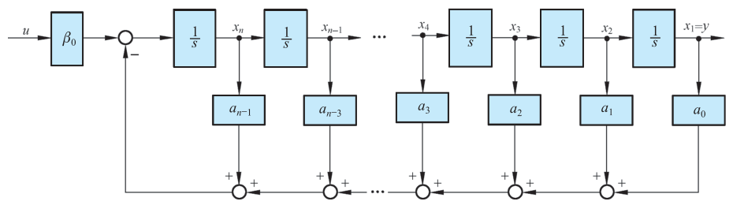{ .lq-img }

*图 9-5 输入量中不含导数项时的系统状态变量图（截自原书）*

**【例 9-2】** 设工业机器人如图 9-6 所示，两相伺服电机转动肘关节之后，通过小臂移动机器人的手腕。假定弹簧的弹性系数为 \(k\)，阻尼系数为 \(f\)，试列写该机器人的动态方程。

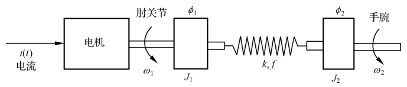{ .lq-img }

*图 9-6 工业机器人示意图（截自原书）*

**解** 转矩方程（\(C_m\) 为转矩系数，\(i(t)\) 为电机电流，\(\phi_1,\phi_2\) 与 \(\omega_1,\omega_2\) 分别为肘关节与手腕的转角与角速度，\(J_1,J_2\) 为转动惯量）：

\[
\begin{aligned}
J_1\frac{\mathrm{d}\omega_1}{\mathrm{d}t} &=-k(\phi_1-\phi_2)-f\omega_1+f\omega_2+C_m i \\
J_2\frac{\mathrm{d}\omega_2}{\mathrm{d}t} &=k(\phi_1-\phi_2)+f(\omega_1-\omega_2)
\end{aligned}
\]

对上二式作如下变换：把 \(k(\phi_1-\phi_2)\) 用 \(\omega_0^2\) 归并，其中

\[
\omega_0^2=\frac{k(J_1+J_2)}{J_1J_2}
\]

即

\[
\frac{1}{\omega_0}\frac{\mathrm{d}\omega_1}{\mathrm{d}t}
=-\frac{J_2\omega_0}{J_1+J_2}(\phi_1-\phi_2)-\frac{f}{J_1}\cdot\frac{\omega_1}{\omega_0}
+\frac{f}{J_1}\cdot\frac{\omega_2}{\omega_0}+\frac{C_m}{J_1\omega_0}i
\]

以及

\[
\frac{1}{\omega_0}\frac{\mathrm{d}\omega_2}{\mathrm{d}t}
=\frac{J_1\omega_0}{J_1+J_2}(\phi_1-\phi_2)+\frac{f}{J_2}\left(\frac{\omega_1}{\omega_0}-\frac{\omega_2}{\omega_0}\right)
\]

选取状态变量

\[
x_1=\phi_1-\phi_2,\qquad x_2=\frac{\omega_1}{\omega_0},\qquad x_3=\frac{\omega_2}{\omega_0}
\]

故可得

\[
\begin{aligned}
\dot{x}_1 &=\dot{\phi}_1-\dot{\phi}_2=\omega_1-\omega_2=\omega_0(x_2-x_3) \\
\dot{x}_2 &=-\frac{J_2\omega_0}{J_1+J_2}x_1-\frac{f}{J_1}x_2+\frac{f}{J_1}x_3+\frac{C_m}{J_1\omega_0}i \\
\dot{x}_3 &=\frac{J_1\omega_0}{J_1+J_2}x_1+\frac{f}{J_2}x_2-\frac{f}{J_2}x_3
\end{aligned}
\qquad y=x_3
\]

令 \(\boldsymbol{x}=[x_1\ \ x_2\ \ x_3]^{\mathrm T}\)，写成矩阵-向量形式，得工业机器人动态方程

\[
\dot{\boldsymbol{x}}
=\omega_0
\begin{bmatrix}
0 & 1 & -1 \\[1mm]
-\dfrac{J_2}{J_1+J_2} & -\dfrac{f}{J_1\omega_0} & \dfrac{f}{J_1\omega_0} \\[2mm]
\dfrac{J_1}{J_1+J_2} & \dfrac{f}{J_2\omega_0} & -\dfrac{f}{J_2\omega_0}
\end{bmatrix}\boldsymbol{x}
+
\begin{bmatrix} 0 \\[1mm] \dfrac{C_m}{J_1\omega_0} \\[2mm] 0 \end{bmatrix} i,
\qquad
y=\begin{bmatrix} 0 & 0 & 1 \end{bmatrix}\boldsymbol{x}
\]

这里状态变量做了 \(\omega/\omega_0\) 的无量纲化，并把相对角位移 \(\phi_1-\phi_2\)（弹簧的形变）直接取为状态——机理性建模时，"哪组量当状态"完全服从推导方便和物理可测。

#### (3) 由系统传递函数建立状态空间表达式

设系统传递函数为

\[
G(s)=\frac{Y(s)}{U(s)}
=\frac{b_ns^n+b_{n-1}s^{n-1}+\cdots+b_1s+b_0}{s^n+a_{n-1}s^{n-1}+\cdots+a_1s+a_0}
\tag{9.8}
\]

应用综合除法，有

\[
G(s)=b_n+\frac{\beta_{n-1}s^{n-1}+\beta_{n-2}s^{n-2}+\cdots+\beta_1s+\beta_0}{s^n+a_{n-1}s^{n-1}+\cdots+a_1s+a_0}
\triangleq b_n+\frac{N(s)}{D(s)}
\tag{9.9}
\]

式中 \(b_n\) 是直接联系输入与输出量的前馈系数，当 \(G(s)\) 的分母次数大于分子次数时 \(b_n=0\)，\(N(s)/D(s)\) 是严格有理真分式，其系数由综合除法得到：

\[
\beta_0=b_0-a_0b_n,\quad \beta_1=b_1-a_1b_n,\quad \cdots,\quad \beta_{n-2}=b_{n-2}-a_{n-2}b_n,\quad \beta_{n-1}=b_{n-1}-a_{n-1}b_n
\]

**1) \(N(s)/D(s)\) 串联分解的情况。** 将 \(N(s)/D(s)\) 分解为两部分相串联，如图 9-7 所示，\(z\) 为中间变量，\(z,y\) 应满足

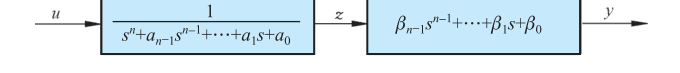{ .lq-img }

*图 9-7 \(N(s)/D(s)\) 的串联分解（截自原书）*

\[
z^{(n)}+a_{n-1}z^{(n-1)}+\cdots+a_1\dot{z}+a_0z=u,
\qquad
y=\beta_{n-1}z^{(n-1)}+\cdots+\beta_1\dot{z}+\beta_0z
\]

选取状态变量 \(x_1=z,\ x_2=\dot{z},\ x_3=\ddot{z},\ \cdots,\ x_n=z^{(n-1)}\)，则状态方程为

\[
\begin{aligned}
\dot{x}_1&=x_2 \\
\dot{x}_2&=x_3 \\
&\ \vdots \\
\dot{x}_n&=-a_0z-a_1\dot{z}-\cdots-a_{n-1}z^{(n-1)}+u \\
&=-a_0x_1-a_1x_2-\cdots-a_{n-1}x_n+u
\end{aligned}
\]

输出方程为

\[
y=\beta_0x_1+\beta_1x_2+\cdots+\beta_{n-1}x_n
\]

其向量-矩阵形式的动态方程为

\[
\dot{\boldsymbol{x}}=\boldsymbol{A}\boldsymbol{x}+\boldsymbol{b}u,
\qquad y=\boldsymbol{c}\boldsymbol{x}
\tag{9.10}
\]

式中

\[
\boldsymbol{A}=
\begin{bmatrix}
0 & 1 & 0 & \cdots & 0 \\
0 & 0 & 1 & \cdots & 0 \\
\vdots & \vdots & \vdots & \ddots & \vdots \\
0 & 0 & 0 & \cdots & 1 \\
-a_0 & -a_1 & -a_2 & \cdots & -a_{n-1}
\end{bmatrix},
\qquad
\boldsymbol{b}=
\begin{bmatrix} 0 \\ 0 \\ \vdots \\ 0 \\ 1 \end{bmatrix},
\qquad
\boldsymbol{c}=\begin{bmatrix} \beta_0 & \beta_1 & \cdots & \beta_{n-1} \end{bmatrix}
\]

上述 \(\boldsymbol{A}\) 阵又称**友矩阵**（companion matrix）；若状态方程中的 \(\boldsymbol{A},\boldsymbol{b}\) 具有这种形式，则称为**可控标准型**。当 \(\beta_1=\beta_2=\cdots=\beta_{n-1}=0\) 时，\(\boldsymbol{A},\boldsymbol{b}\) 的形式不变，\(\boldsymbol{c}=[\beta_0\ \ 0\ \ \cdots\ \ 0]\)。因而当 \(G(s)=b_n+N(s)/D(s)\) 时，\(\boldsymbol{A},\boldsymbol{b}\) 不变，\(y=\boldsymbol{c}\boldsymbol{x}+b_nu\)。\(N(s)/D(s)\) 串联分解时系统的可控标准型状态变量图如图 9-8 所示。

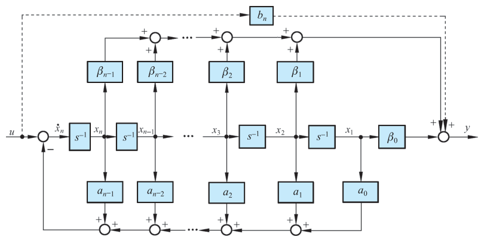{ .lq-img }

*图 9-8 \(N(s)/D(s)\) 串联分解系统的可控标准型状态变量图（截自原书）*

当 \(b_n=0\) 时，若按 \(x_n=y,\ x_i=\dot{x}_{i+1}+a_iy-b_iu\ (i=1,2,\cdots,n-1)\) 选取状态变量，则系统的 \(\boldsymbol{A},\boldsymbol{b},\boldsymbol{c}\) 矩阵为

\[
\boldsymbol{A}=
\begin{bmatrix}
0 & 0 & \cdots & 0 & -a_0 \\
1 & 0 & \cdots & 0 & -a_1 \\
0 & 1 & \cdots & 0 & -a_2 \\
\vdots & \vdots & \ddots & \vdots & \vdots \\
0 & 0 & \cdots & 1 & -a_{n-1}
\end{bmatrix},
\qquad
\boldsymbol{b}=
\begin{bmatrix} \beta_0 \\ \beta_1 \\ \beta_2 \\ \vdots \\ \beta_{n-1} \end{bmatrix},
\qquad
\boldsymbol{c}=\begin{bmatrix} 0 & \cdots & 0 & 1 \end{bmatrix}
\]

上述 \(\boldsymbol{A}\) 阵是友矩阵的转置。若动态方程中的 \(\boldsymbol{A},\boldsymbol{c}\) 具有这种形式，则称为**可观测标准型**。可控标准型与可观测标准型的各矩阵之间存在如下关系：

\[
\boldsymbol{A}_c=\boldsymbol{A}_o^{\mathrm T},\qquad
\boldsymbol{b}_c=\boldsymbol{c}_o^{\mathrm T},\qquad
\boldsymbol{c}_c=\boldsymbol{b}_o^{\mathrm T}
\tag{9.11}
\]

式中下标 \(c\) 表示可控标准型，\(o\) 表示可观测标准型，\(\mathrm T\) 为转置符号。式 (9.11) 所示关系称为**对偶关系**（系统层面的对偶原理见 9.2 节）。

**【例 9-3】** 设二阶系统的微分方程为

\[
\ddot{y}+2\zeta\omega\dot{y}+\omega^2y=T\dot{u}+u
\]

试列写系统的可控标准型、可观测标准型动态方程。

**解** 该系统的传递函数为

\[
G(s)=\frac{Y(s)}{U(s)}=\frac{Ts+1}{s^2+2\zeta\omega s+\omega^2}
\]

可控标准型动态方程的各矩阵为

\[
\boldsymbol{x}_c=
\begin{bmatrix} x_{c1} \\ x_{c2} \end{bmatrix},
\qquad
\boldsymbol{A}_c=
\begin{bmatrix} 0 & 1 \\ -\omega^2 & -2\zeta\omega \end{bmatrix},
\qquad
\boldsymbol{b}_c=
\begin{bmatrix} 0 \\ 1 \end{bmatrix},
\qquad
\boldsymbol{c}_c=\begin{bmatrix} 1 & T \end{bmatrix}
\]

由 \(G(s)\) 串联分解并引入中间变量 \(z\)，有

\[
\ddot{z}+2\zeta\omega\dot{z}+\omega^2z=u,
\qquad
y=T\dot{z}+z
\]

对 \(y\) 求导数并考虑上述关系式，则有

\[
\dot{y}=T\ddot{z}+\dot{z}=(1-2\zeta\omega T)\dot{z}-\omega^2Tz+Tu
\]

令 \(x_{c1}=z\)，\(x_{c2}=\dot{z}\)，可导出状态变量与输入、输出量的关系

\[
\begin{aligned}
x_{c1}&=\left[-T\dot{y}+(1-2\zeta\omega T)y+T^2u\right]/(1-2\zeta\omega T+\omega^2T^2) \\
x_{c2}&=\left(\dot{y}+\omega^2Ty-Tu\right)/(1-2\zeta\omega T+\omega^2T^2)
\end{aligned}
\]

可观测标准型动态方程各矩阵为

\[
\boldsymbol{x}_o=
\begin{bmatrix} x_{o1} \\ x_{o2} \end{bmatrix},
\qquad
\boldsymbol{A}_o=
\begin{bmatrix} 0 & -\omega^2 \\ 1 & -2\zeta\omega \end{bmatrix},
\qquad
\boldsymbol{b}_o=
\begin{bmatrix} 1 \\ T \end{bmatrix},
\qquad
\boldsymbol{c}_o=\begin{bmatrix} 0 & 1 \end{bmatrix}
\]

图 9-9 与图 9-10 分别示出了该系统可控标准型与可观测标准型状态变量图。

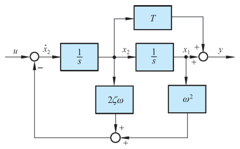{ .lq-img }

*图 9-9 例 9-3 系统可控标准型状态变量图（截自原书）*

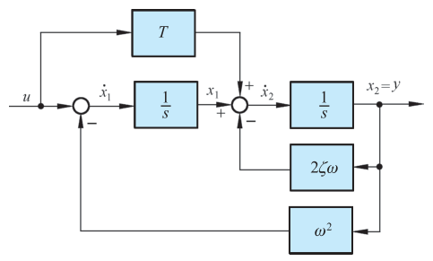{ .lq-img }

*图 9-10 例 9-3 系统可观测标准型状态变量图（截自原书）*

**2) \(N(s)/D(s)\) 只含单实极点时的情况。** 此时除了可化为上述可控标准型或可观测标准型动态方程以外，还可化为**对角型**动态方程，其 \(\boldsymbol{A}\) 阵是一个对角阵。

设 \(D(s)\) 可分解为

\[
D(s)=(s-\lambda_1)(s-\lambda_2)\cdots(s-\lambda_n)
\]

式中 \(\lambda_1,\cdots,\lambda_n\) 为系统的单实极点，则传递函数可展成部分分式之和

\[
\frac{Y(s)}{U(s)}=\frac{N(s)}{D(s)}=\sum_{i=1}^{n}\frac{c_i}{s-\lambda_i}
\]

而 \(c_i=\left[\dfrac{N(s)}{D(s)}(s-\lambda_i)\right]_{s=\lambda_i}\) 为 \(N(s)/D(s)\) 在极点 \(\lambda_i\) 处的**留数**，且有

\[
Y(s)=\sum_{i=1}^{n}\frac{c_i}{s-\lambda_i}U(s)
\]

若令状态变量

\[
X_i(s)=\frac{1}{s-\lambda_i}U(s); \qquad i=1,2,\cdots,n
\]

其反变换结果为

\[
\dot{x}_i(t)=\lambda_ix_i(t)+u(t),
\qquad
y(t)=\sum_{i=1}^{n}c_ix_i(t)
\]

展开得

\[
\begin{aligned}
\dot{x}_1&=\lambda_1x_1+u, & \dot{x}_2&=\lambda_2x_2+u, & \cdots,\quad &\dot{x}_n&=\lambda_nx_n+u \\
y&=c_1x_1+c_2x_2+\cdots+c_nx_n
\end{aligned}
\]

其向量-矩阵形式为

\[
\dot{\boldsymbol{x}}=
\begin{bmatrix} \lambda_1 & & & \boldsymbol{0} \\ & \lambda_2 & & \\ & & \ddots & \\ \boldsymbol{0} & & & \lambda_n \end{bmatrix}\boldsymbol{x}
+
\begin{bmatrix} 1 \\ 1 \\ \vdots \\ 1 \end{bmatrix}u,
\qquad
y=\begin{bmatrix} c_1 & c_2 & \cdots & c_n \end{bmatrix}\boldsymbol{x}
\tag{9.12}
\]

其状态变量图如图 9-11(a) 所示。

若令状态变量 \(X_i(s)=\dfrac{c_i}{s-\lambda_i}U(s)\)，则 \(Y(s)=\displaystyle\sum_{i=1}^{n}X_i(s)\)，进行反变换并展开，有

\[
\dot{\boldsymbol{x}}=
\begin{bmatrix} \lambda_1 & & & \boldsymbol{0} \\ & \lambda_2 & & \\ & & \ddots & \\ \boldsymbol{0} & & & \lambda_n \end{bmatrix}\boldsymbol{x}
+
\begin{bmatrix} c_1 \\ c_2 \\ \vdots \\ c_n \end{bmatrix}u,
\qquad
y=\begin{bmatrix} 1 & 1 & \cdots & 1 \end{bmatrix}\boldsymbol{x}
\tag{9.13}
\]

其状态变量图如图 9-11(b) 所示。显见，式 (9.13) 与式 (9.12) 存在对偶关系。

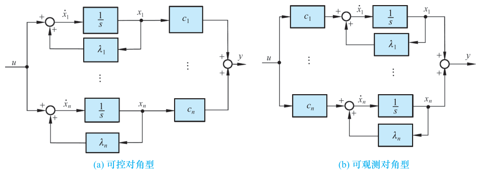{ .lq-img }

*图 9-11 系统对角型动态方程的状态变量图：(a) 可控对角型；(b) 可观测对角型（截自原书）*

!!! note "拓展：一个传递函数有无穷多个实现（补充）"
    例 9-1 与本小节都说明了同一系统可以写出多种动态方程——这类问题称为"实现"问题。本节给出的可控标准型、可观测标准型、对角型都是 \(n\) 维的"最小实现"（前提是 \(G(s)\) 的分子分母无公因子对消）；若 \(G(s)\) 存在零极点对消，\(n\) 维实现里必有既不能控又不能观测（或二者之一）的状态，维数更低的实现也存在。这也解释了为什么说传递函数是"不完全描述"：它只能反映系统中可控**且**可观测的那一部分（详见 9.2 节）。

### 线性定常连续系统状态方程的解

#### (1) 齐次状态方程的解

\[
\dot{\boldsymbol{x}}(t)=\boldsymbol{A}\boldsymbol{x}(t)
\tag{9.14}
\]

称为齐次状态方程，通常采用幂级数法和拉普拉斯变换法求解。

**1) 幂级数法。** 设式 (9.14) 的解是 \(t\) 的向量幂级数 \(\boldsymbol{x}(t)=\boldsymbol{b}_0+\boldsymbol{b}_1t+\boldsymbol{b}_2t^2+\cdots+\boldsymbol{b}_kt^k+\cdots\)，代入式 (9.14) 并令两边 \(t\) 同次项系数相等，得

\[
\boldsymbol{b}_1=\boldsymbol{A}\boldsymbol{b}_0,\quad
\boldsymbol{b}_2=\frac{1}{2}\boldsymbol{A}\boldsymbol{b}_1=\frac{1}{2!}\boldsymbol{A}^2\boldsymbol{b}_0,\quad
\boldsymbol{b}_3=\frac{1}{3!}\boldsymbol{A}^3\boldsymbol{b}_0,\ \cdots,\quad
\boldsymbol{b}_k=\frac{1}{k!}\boldsymbol{A}^k\boldsymbol{b}_0
\]

且 \(\boldsymbol{x}(0)=\boldsymbol{b}_0\)，故

\[
\boldsymbol{x}(t)=\left(\boldsymbol{I}+\boldsymbol{A}t+\frac{1}{2!}\boldsymbol{A}^2t^2+\cdots+\frac{1}{k!}\boldsymbol{A}^kt^k+\cdots\right)\boldsymbol{x}(0)
\tag{9.15}
\]

定义

\[
\mathrm{e}^{\boldsymbol{A}t}
\triangleq
\boldsymbol{I}+\boldsymbol{A}t+\frac{1}{2!}\boldsymbol{A}^2t^2+\cdots+\frac{1}{k!}\boldsymbol{A}^kt^k+\cdots=\sum_{k=0}^{\infty}\frac{1}{k!}\boldsymbol{A}^kt^k
\tag{9.16}
\]

则

\[
\boldsymbol{x}(t)=\mathrm{e}^{\boldsymbol{A}t}\,\boldsymbol{x}(0)
\tag{9.17}
\]

标量微分方程 \(\dot{x}=ax\) 的解为 \(x(t)=\mathrm{e}^{at}x(0)\)，向量方程 (9.14) 具有相似形式的解，故把 \(\mathrm{e}^{\boldsymbol{A}t}\) 称为**矩阵指数函数**，简称**矩阵指数**。由于 \(\boldsymbol{x}(t)\) 是由 \(\boldsymbol{x}(0)\) 转移而来，对于线性定常系统，\(\mathrm{e}^{\boldsymbol{A}t}\) 又称为**状态转移矩阵**，记为 \(\boldsymbol{\Phi}(t)\)：

\[
\boldsymbol{\Phi}(t)=\mathrm{e}^{\boldsymbol{A}t}
\tag{9.18}
\]

**2) 拉普拉斯变换法。** 将式 (9.14) 取拉氏变换：\(s\boldsymbol{X}(s)-\boldsymbol{x}(0)=\boldsymbol{A}\boldsymbol{X}(s)\)，则

\[
\boldsymbol{X}(s)=(s\boldsymbol{I}-\boldsymbol{A})^{-1}\boldsymbol{x}(0)
\tag{9.19}
\]

进行拉氏反变换，有

\[
\boldsymbol{x}(t)=\mathscr{L}^{-1}\left[(s\boldsymbol{I}-\boldsymbol{A})^{-1}\right]\boldsymbol{x}(0)
\tag{9.20}
\]

与式 (9.17) 相比，有

\[
\mathrm{e}^{\boldsymbol{A}t}=\mathscr{L}^{-1}\left[(s\boldsymbol{I}-\boldsymbol{A})^{-1}\right]
\tag{9.21}
\]

式 (9.21) 给出了 \(\mathrm{e}^{\boldsymbol{A}t}\) 的闭合形式，也说明了式 (9.16) 所示级数的收敛性。求解齐次状态方程的问题，就是计算状态转移矩阵 \(\boldsymbol{\Phi}(t)\) 的问题。

#### (2) 状态转移矩阵的运算性质

重写状态转移矩阵的幂级数展开式

\[
\boldsymbol{\Phi}(t)=\mathrm{e}^{\boldsymbol{A}t}=\boldsymbol{I}+\boldsymbol{A}t+\frac{1}{2!}\boldsymbol{A}^2t^2+\cdots+\frac{1}{k!}\boldsymbol{A}^kt^k+\cdots
\tag{9.22}
\]

\(\boldsymbol{\Phi}(t)\) 具有如下运算性质：

1. \(\boldsymbol{\Phi}(0)=\boldsymbol{I}\)。
2. \(\dot{\boldsymbol{\Phi}}(t)=\boldsymbol{A}\boldsymbol{\Phi}(t)=\boldsymbol{\Phi}(t)\boldsymbol{A}\)——\(\boldsymbol{A}\boldsymbol{\Phi}(t)\) 与 \(\boldsymbol{\Phi}(t)\boldsymbol{A}\) 可交换，\(\boldsymbol{\Phi}(0)=\boldsymbol{I}\)，且 \(\boldsymbol{\Phi}(t)\) 是矩阵微分方程 \(\dot{\boldsymbol{\Phi}}(t)=\boldsymbol{A}\boldsymbol{\Phi}(t),\ \boldsymbol{\Phi}(0)=\boldsymbol{I}\) 的唯一解。
3. \(\boldsymbol{\Phi}(t_1\pm t_2)=\boldsymbol{\Phi}(t_1)\boldsymbol{\Phi}(\pm t_2)=\boldsymbol{\Phi}(\pm t_2)\boldsymbol{\Phi}(t_1)\)——\(\boldsymbol{\Phi}(t_1)\) 与 \(\boldsymbol{\Phi}(\pm t_2)\) 可交换。
4. \(\boldsymbol{\Phi}^{-1}(t)=\boldsymbol{\Phi}(-t)\)，\(\boldsymbol{\Phi}(-t)=\boldsymbol{\Phi}^{-1}(t)\)——状态转移具有**可逆性**：\(\boldsymbol{x}(0)=\boldsymbol{\Phi}(-t)\boldsymbol{x}(t)\)，\(\boldsymbol{x}(0)\) 也可由 \(\boldsymbol{x}(t)\) 转移而来。
5. \(\boldsymbol{x}(t_2)=\boldsymbol{\Phi}(t_2-t_1)\boldsymbol{x}(t_1)\)——由 \(\boldsymbol{x}(t_1)\) 转移至 \(\boldsymbol{x}(t_2)\) 的状态转移矩阵为 \(\boldsymbol{\Phi}(t_2-t_1)\)。
6. \(\boldsymbol{x}(t_2)=\boldsymbol{\Phi}(t_2-t_1)\boldsymbol{\Phi}(t_1-t_0)\boldsymbol{x}(t_0)\)——可把一个转移过程分为若干个小的转移过程来研究，如图 9-12 所示。
7. \([\boldsymbol{\Phi}(t)]^k=\boldsymbol{\Phi}(kt)\)。
8. 若 \(\boldsymbol{\Phi}(t)\) 为 \(\dot{\boldsymbol{x}}(t)=\boldsymbol{A}\boldsymbol{x}(t)\) 的状态转移矩阵，则引入非奇异变换 \(\boldsymbol{x}=\boldsymbol{P}\bar{\boldsymbol{x}}\) 后的状态转移矩阵为 \(\bar{\boldsymbol{\Phi}}(t)=\boldsymbol{P}^{-1}\mathrm{e}^{\boldsymbol{A}t}\boldsymbol{P}=\mathrm{e}^{\boldsymbol{P}^{-1}\boldsymbol{A}\boldsymbol{P}t}\)。

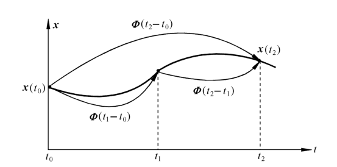{ .lq-img }

*图 9-12 状态转移矩阵性质 6) 的图示（截自原书）*

**【例 9-4】** 设系统状态方程为

\[
\begin{bmatrix} \dot{x}_1(t) \\ \dot{x}_2(t) \end{bmatrix}
=
\begin{bmatrix} 0 & 1 \\ -2 & -3 \end{bmatrix}
\begin{bmatrix} x_1(t) \\ x_2(t) \end{bmatrix}
\]

试求状态方程的解。

**解** 用拉氏变换法求解。

\[
(s\boldsymbol{I}-\boldsymbol{A})=
\begin{bmatrix} s & -1 \\ 2 & s+3 \end{bmatrix},
\qquad
|s\boldsymbol{I}-\boldsymbol{A}|=(s+1)(s+2)
\]

\[
(s\boldsymbol{I}-\boldsymbol{A})^{-1}
=\frac{\mathrm{adj}(s\boldsymbol{I}-\boldsymbol{A})}{(s+1)(s+2)}
=
\begin{bmatrix}
\dfrac{s+3}{(s+1)(s+2)} & \dfrac{1}{(s+1)(s+2)} \\[3mm]
\dfrac{-2}{(s+1)(s+2)} & \dfrac{s}{(s+1)(s+2)}
\end{bmatrix}
\]

对各元素取拉氏反变换（部分分式展开），得状态转移矩阵

\[
\boldsymbol{\Phi}(t)=
\begin{bmatrix}
2\mathrm{e}^{-t}-\mathrm{e}^{-2t} & \mathrm{e}^{-t}-\mathrm{e}^{-2t} \\
-2\mathrm{e}^{-t}+2\mathrm{e}^{-2t} & -\mathrm{e}^{-t}+2\mathrm{e}^{-2t}
\end{bmatrix}
\]

状态方程的解为

\[
\begin{bmatrix} x_1(t) \\ x_2(t) \end{bmatrix}
=
\boldsymbol{\Phi}(t)
\begin{bmatrix} x_1(0) \\ x_2(0) \end{bmatrix}
=
\begin{bmatrix}
(2\mathrm{e}^{-t}-\mathrm{e}^{-2t})x_1(0)+(\mathrm{e}^{-t}-\mathrm{e}^{-2t})x_2(0) \\
(-2\mathrm{e}^{-t}+2\mathrm{e}^{-2t})x_1(0)+(-\mathrm{e}^{-t}+2\mathrm{e}^{-2t})x_2(0)
\end{bmatrix}
\]

=== "MATLAB"

    ```matlab
    % ===== 书 9.1 节 例9-4/例9-6：状态转移矩阵 =====
    A = [0 1; -2 -3];
    Phi1 = expm(A*1)          % Phi(1) = [0.6004 0.2325; -0.4651 -0.0972]
    t = 0.7;  Phi07 = expm(A*t)        % 任意 t 的 Phi(t)
    ```

=== "Python"

    ```python
    # ===== 书 9.1 节 例9-4/例9-6：状态转移矩阵 =====
    import numpy as np
    from scipy.linalg import expm

    A = np.array([[0.0, 1.0], [-2.0, -3.0]])
    print(expm(A * 1.0))
    # [[ 0.6004  0.2325]
    #  [-0.4651 -0.0972]] —— 与原书例9-6 中 Phi(T) 数值一致（注意右下角是 -0.0972）
    print(expm(A * 0.7))     # 任意 t 的 Phi(t)
    ```

（Python 用 `scipy.linalg.expm` 数值求 \(\mathrm{e}^{\boldsymbol{A}t}\)，与手算闭式逐元素一致，误差 \(10^{-16}\) 量级。）

#### (3) 非齐次状态方程的解

\[
\dot{\boldsymbol{x}}(t)=\boldsymbol{A}\boldsymbol{x}(t)+\boldsymbol{B}\boldsymbol{u}(t)
\tag{9.32}
\]

称为非齐次状态方程，可用拉普拉斯变换法求解。两端取拉氏变换并整理：

\[
\boldsymbol{X}(s)=(s\boldsymbol{I}-\boldsymbol{A})^{-1}\boldsymbol{x}(0)+(s\boldsymbol{I}-\boldsymbol{A})^{-1}\boldsymbol{B}\boldsymbol{U}(s)
\]

进行拉氏反变换，并将 \((s\boldsymbol{I}-\boldsymbol{A})^{-1}\) 视为 \(F_1(s)\)、\(\boldsymbol{B}\boldsymbol{U}(s)\) 视为 \(F_2(s)\)，由卷积定理 \(\mathscr{L}^{-1}[F_1(s)F_2(s)]=\displaystyle\int_0^t f_1(t-\tau)f_2(\tau)\,\mathrm{d}\tau\)，得

\[
\boldsymbol{x}(t)=\mathrm{e}^{\boldsymbol{A}t}\boldsymbol{x}(0)+\int_0^t\mathrm{e}^{\boldsymbol{A}(t-\tau)}\boldsymbol{B}\boldsymbol{u}(\tau)\,\mathrm{d}\tau
\]

上式又可表示为

\[
\boldsymbol{x}(t)=\boldsymbol{\Phi}(t)\boldsymbol{x}(0)+\int_0^t\boldsymbol{\Phi}(t-\tau)\boldsymbol{B}\boldsymbol{u}(\tau)\,\mathrm{d}\tau
\tag{9.33}
\]

**【例 9-5】** 大功率高性能摩托车中常采用图 9-13 所示的弹簧-质量-阻尼器系统作为减震器。基本参数：质量 \(m=1\,\mathrm{kg}\)，摩擦系数 \(f=9\,\mathrm{kg\cdot m/s}\)，弹簧系数 \(k=20\,\mathrm{kg/m}\)，\(u(t)\) 为力输入，\(y(t)\) 为位移输出。要求：1) 选择状态变量 \(x_1=y\)，\(x_2=\dot{y}\)，列写系统的动态方程；2) 计算系统的特征根及状态转移矩阵 \(\boldsymbol{\Phi}(t)\)；3) 若初始条件 \(y(0)=1\)，\(\dot{y}(0)=2\)，在 \(0\le t\le 2\) 范围内绘出系统零输入响应 \(y(t)\) 及 \(\dot{y}(t)\)。

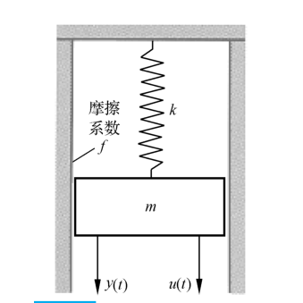{ .lq-img }

*图 9-13 弹簧-质量-阻尼器系统示意图（截自原书）*

**解**

**1)** 系统力平衡方程

\[
m\ddot{y}+f\dot{y}+ky=u
\quad\Longrightarrow\quad
\ddot{y}=-\frac{f}{m}\dot{y}-\frac{k}{m}y+\frac{1}{m}u
\]

选状态变量 \(x_1=y\)，\(x_2=\dot{y}\)，则有

\[
\dot{x}_1=x_2,
\qquad
\dot{x}_2=-\frac{k}{m}x_1-\frac{f}{m}x_2+\frac{1}{m}u
\]

写成向量-矩阵形式，系统的动态方程为 \(\dot{\boldsymbol{x}}=\boldsymbol{A}\boldsymbol{x}+\boldsymbol{b}u\)，\(y=\boldsymbol{c}\boldsymbol{x}\)，式中

\[
\boldsymbol{A}=
\begin{bmatrix} 0 & 1 \\ -\dfrac{k}{m} & -\dfrac{f}{m} \end{bmatrix}
=
\begin{bmatrix} 0 & 1 \\ -20 & -9 \end{bmatrix},
\qquad
\boldsymbol{b}=
\begin{bmatrix} 0 \\ \dfrac{1}{m} \end{bmatrix}
=
\begin{bmatrix} 0 \\ 1 \end{bmatrix},
\qquad
\boldsymbol{c}=\begin{bmatrix} 1 & 0 \end{bmatrix}
\]

**2)** 系统特征方程

\[
\det(s\boldsymbol{I}-\boldsymbol{A})=
\det\begin{bmatrix} s & -1 \\ 20 & s+9 \end{bmatrix}
=s^2+9s+20=(s+4)(s+5)=0
\]

故特征根 \(s_1=-4\)，\(s_2=-5\)。状态转移阵

\[
(s\boldsymbol{I}-\boldsymbol{A})^{-1}
=
\frac{1}{(s+4)(s+5)}
\begin{bmatrix} s+9 & 1 \\ -20 & s \end{bmatrix}
=
\begin{bmatrix}
\dfrac{5}{s+4}-\dfrac{4}{s+5} & \dfrac{1}{s+4}-\dfrac{1}{s+5} \\[3mm]
\dfrac{20}{s+5}-\dfrac{20}{s+4} & \dfrac{5}{s+5}-\dfrac{4}{s+4}
\end{bmatrix}
\]

所以

\[
\boldsymbol{\Phi}(t)=
\begin{bmatrix}
5\mathrm{e}^{-4t}-4\mathrm{e}^{-5t} & \mathrm{e}^{-4t}-\mathrm{e}^{-5t} \\
20\mathrm{e}^{-5t}-20\mathrm{e}^{-4t} & 5\mathrm{e}^{-5t}-4\mathrm{e}^{-4t}
\end{bmatrix}
\]

**3)** 已知 \(x_1(0)=y(0)=1\)，\(x_2(0)=\dot{y}(0)=2\)，令 \(u(t)=0\)，有

\[
\boldsymbol{x}(t)=\boldsymbol{\Phi}(t)\boldsymbol{x}(0)
=
\begin{bmatrix} 7\mathrm{e}^{-4t}-6\mathrm{e}^{-5t} \\ 30\mathrm{e}^{-5t}-28\mathrm{e}^{-4t} \end{bmatrix}
\]

可得 \(y(t)=x_1(t)=7\mathrm{e}^{-4t}-6\mathrm{e}^{-5t}\)，\(\dot{y}(t)=x_2(t)=30\mathrm{e}^{-5t}-28\mathrm{e}^{-4t}\)。运行下列程序，得系统的零输入响应如图 9-14 所示。

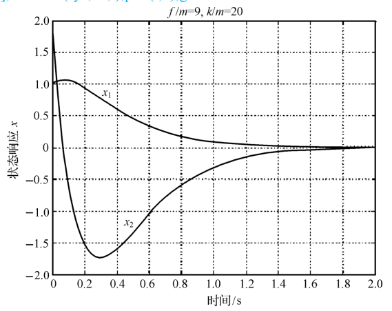{ .lq-img }

*图 9-14 例 9-5 系统的零输入响应（MATLAB）：\(x_1,y\) 与 \(x_2,\dot{y}\) 均按 \(\mathrm{e}^{-4t}\)、\(\mathrm{e}^{-5t}\) 衰减（截自原书）*

=== "MATLAB"

    ```matlab
    % ===== 书 9.1 节 例9-5 =====
    clc; clear
    m = 1; f = 9; k = 20;
    A = [0 1; -k/m -f/m]; b = [0; 1/m]; c = eye(2); d = 0;
    sys = ss(A, b, c, d);
    t = 0:0.01:2; x0 = [1; 2];
    x = initial(sys, x0, t);       % 零输入响应（书图9-14）
    plot(t, x); grid
    ```

=== "Python"

    ```python
    # ===== 书 9.1 节 例9-5 =====
    import numpy as np
    import control as ct
    import matplotlib.pyplot as plt

    m, f, k = 1, 9, 20
    A = np.array([[0.0, 1.0], [-k / m, -f / m]])
    b = np.array([[0.0], [1 / m]])
    sys = ct.ss(A, b, np.eye(2), 0)
    T = np.arange(0, 2, 0.01)
    resp = ct.initial_response(sys, T, X0=[1, 2])
    # 与手算闭式核对
    x1 = 7 * np.exp(-4 * T) - 6 * np.exp(-5 * T)
    x2 = 30 * np.exp(-5 * np.arange(0, 2, 0.01)) - 28 * np.exp(-4 * T)
    print('max err x1:', abs(resp.states[0] - x1).max())   # ~1e-15
    print('max err x2:', abs(resp.states[1] - x2).max())   # ~1e-15
    plt.plot(T, resp.states.T)
    plt.xlabel('time (s)'); plt.ylabel('x(t)')
    plt.title('initial response (fig 9-14)')
    plt.grid(True); plt.show()
    ```

!!! note "拓展：矩阵指数到底怎么算（补充）"
    本节给了两条手工路线：**拉氏变换法**（式 9-21，先求 \((s\boldsymbol{I}-\boldsymbol{A})^{-1}\) 再逐元素部分分式）与**幂级数法**（式 9-16，理论意义大于实用）。9.2 节的凯莱-哈密顿定理还会给第三条——\(\mathrm{e}^{\boldsymbol{A}t}=\sum_{m=0}^{n-1}\alpha_m(t)\boldsymbol{A}^m\)，把无限级数压成 \(n-1\) 阶多项式。数值计算则直接用 `expm`（MATLAB/SciPy 同名），内部用 Padé 近似加相似变换，对病态矩阵也稳。手工考试用拉氏法，工程用 `expm`。

### 系统的传递函数矩阵及解耦控制

对于多输入-多输出系统，需要讨论传递函数矩阵。

#### (1) 定义及表达式

初始条件为零时，输出向量的拉氏变换式与输入向量的拉氏变换式之间的传递关系称为**传递函数矩阵**，简称传递矩阵。设线性定常系统动态方程为

\[
\dot{\boldsymbol{x}}(t)=\boldsymbol{A}\boldsymbol{x}(t)+\boldsymbol{B}\boldsymbol{u}(t),
\qquad
\boldsymbol{y}(t)=\boldsymbol{C}\boldsymbol{x}(t)+\boldsymbol{D}\boldsymbol{u}(t)
\tag{9.34}
\]

令初始条件为零，进行拉氏变换并整理：\(\boldsymbol{X}(s)=(s\boldsymbol{I}-\boldsymbol{A})^{-1}\boldsymbol{B}\boldsymbol{U}(s)\)，则

\[
\boldsymbol{Y}(s)=\left[\boldsymbol{C}(s\boldsymbol{I}-\boldsymbol{A})^{-1}\boldsymbol{B}+\boldsymbol{D}\right]\boldsymbol{U}(s)\triangleq\boldsymbol{G}(s)\boldsymbol{U}(s)
\tag{9.35}
\]

系统的传递函数矩阵表达式为

\[
\boldsymbol{G}(s)=\boldsymbol{C}(s\boldsymbol{I}-\boldsymbol{A})^{-1}\boldsymbol{B}+\boldsymbol{D}
\tag{9.36}
\]

若输入 \(\boldsymbol{u}\) 为 \(p\) 维向量，输出 \(\boldsymbol{y}\) 为 \(q\) 维向量，则 \(\boldsymbol{G}(s)\) 为 \(q\times p\) 矩阵，其展开式为

\[
\begin{bmatrix} Y_1(s) \\ Y_2(s) \\ \vdots \\ Y_q(s) \end{bmatrix}
=
\begin{bmatrix}
G_{11}(s) & G_{12}(s) & \cdots & G_{1p}(s) \\
G_{21}(s) & G_{22}(s) & \cdots & G_{2p}(s) \\
\vdots & \vdots & \ddots & \vdots \\
G_{q1}(s) & G_{q2}(s) & \cdots & G_{qp}(s)
\end{bmatrix}
\begin{bmatrix} U_1(s) \\ U_2(s) \\ \vdots \\ U_p(s) \end{bmatrix}
\tag{9.37}
\]

式中 \(G_{ij}(s)\ (i=1,\cdots,q;\ j=1,\cdots,p)\) 表示第 \(i\) 个输出量与第 \(j\) 个输入量之间的传递函数。

#### (2) 开环与闭环传递矩阵

设多输入-多输出系统结构图如图 9-15 所示。图中 \(\boldsymbol{u},\boldsymbol{y},\boldsymbol{z},\boldsymbol{e}\) 分别为输入、输出、反馈、误差向量；\(\boldsymbol{G},\boldsymbol{H}\) 分别为前向通路和反馈通路的传递矩阵。

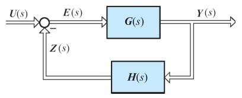{ .lq-img }

*图 9-15 多输入-多输出系统结构图（截自原书）*

由图可知

\[
\boldsymbol{Z}(s)=\boldsymbol{H}(s)\boldsymbol{Y}(s)=\boldsymbol{H}(s)\boldsymbol{G}(s)\boldsymbol{E}(s)
\tag{9.38}
\]

定义误差向量至反馈向量之间的传递矩阵 \(\boldsymbol{H}(s)\boldsymbol{G}(s)\) 为**开环传递矩阵**，它描述 \(\boldsymbol{E}(s)\) 至 \(\boldsymbol{Z}(s)\) 之间的传递关系。开环传递矩阵等于向量传递过程中所有部件传递矩阵的乘积，其**相乘顺序与传递过程相反**，且由于是矩阵相乘，顺序不能任意交换。

由于 \(\boldsymbol{Y}(s)=\boldsymbol{G}\boldsymbol{E}=\boldsymbol{G}(\boldsymbol{U}-\boldsymbol{Z})=\boldsymbol{G}(\boldsymbol{U}-\boldsymbol{H}\boldsymbol{Y})\)，则

\[
\boldsymbol{Y}(s)=\left[\boldsymbol{I}+\boldsymbol{G}(s)\boldsymbol{H}(s)\right]^{-1}\boldsymbol{G}(s)\boldsymbol{U}(s)
\tag{9.39}
\]

定义输入向量至输出向量之间的传递矩阵为**闭环传递矩阵**，记为 \(\boldsymbol{\Phi}(s)\)：

\[
\boldsymbol{\Phi}(s)=\left[\boldsymbol{I}+\boldsymbol{G}(s)\boldsymbol{H}(s)\right]^{-1}\boldsymbol{G}(s)
\tag{9.40}
\]

由于 \(\boldsymbol{E}(s)=\boldsymbol{U}-\boldsymbol{Z}=\boldsymbol{U}-\boldsymbol{H}\boldsymbol{G}\boldsymbol{E}\)，则

\[
\boldsymbol{E}(s)=\left[\boldsymbol{I}+\boldsymbol{H}(s)\boldsymbol{G}(s)\right]^{-1}\boldsymbol{U}(s)
\tag{9.41}
\]

定义输入向量至偏差向量之间的传递矩阵为**误差传递矩阵**，记为 \(\boldsymbol{\Phi}_e(s)\)：

\[
\boldsymbol{\Phi}_e(s)=\left[\boldsymbol{I}+\boldsymbol{H}(s)\boldsymbol{G}(s)\right]^{-1}
\tag{9.42}
\]

注意闭环传递矩阵里是 \(\boldsymbol{G}\boldsymbol{H}\)、误差传递矩阵里是 \(\boldsymbol{H}\boldsymbol{G}\)——矩阵乘法不可交换，\([\boldsymbol{I}+\boldsymbol{G}\boldsymbol{H}]^{-1}\boldsymbol{G}\neq\boldsymbol{G}[\boldsymbol{I}+\boldsymbol{H}\boldsymbol{G}]^{-1}\)。

#### (3) 解耦系统的传递矩阵

将式 (9.37) 写成标量方程组可见：一般多输入-多输出系统的传递矩阵不是对角阵，每一个输入量将影响所有输出量，每一个输出量也受到所有输入量的影响，这种系统称为**耦合系统**，其控制方式称为**耦合控制**。

对耦合系统进行控制是复杂的。工程中常希望实现某一输出量仅受某一输入量的控制，这种控制方式称为**解耦控制**，相应的系统称为**解耦系统**。解耦系统的输入向量和输出向量必有相同的维数，传递矩阵必为对角阵：

\[
\boldsymbol{Y}(s)=
\begin{bmatrix}
G_{11}(s) & & & \boldsymbol{0} \\
& G_{22}(s) & & \\
& & \ddots & \\
\boldsymbol{0} & & & G_{mm}(s)
\end{bmatrix}
\boldsymbol{U}(s)
\tag{9.44}
\]

可以看出，解耦系统是由 \(m\) 个独立的单输入-单输出系统

\[
Y_i(s)=G_{ii}(s)U_i(s); \qquad i=1,2,\cdots,m
\tag{9.45}
\]

组成。为了控制每个输出量，\(G_{ii}(s)\) 不得为零，即解耦系统的对角化传递矩阵必须是非奇异的。在系统中引入适当的校正环节使传递矩阵对角化，称为**解耦**。

### 线性离散系统状态空间表达式的建立及其解

离散系统中各个变量只在离散时刻取值，其状态空间描述只反映离散时刻的变量组间的因果关系和转换关系。线性离散系统的动态方程可利用系统的差分方程建立，也可利用线性连续动态方程的离散化得到。

#### (1) 由差分方程建立动态方程

单输入-单输出线性定常离散系统差分方程的一般形式为

\[
\begin{aligned}
&y(k+n)+a_{n-1}y(k+n-1)+\cdots+a_1y(k+1)+a_0y(k) \\
&\qquad = b_nu(k+n)+b_{n-1}u(k+n-1)+\cdots+b_1u(k+1)+b_0u(k)
\end{aligned}
\tag{9.46}
\]

式中 \(k\) 表示 \(kT\) 时刻，\(T\) 为采样周期，\(a_i,b_i\ (i=0,1,2,\cdots,n\)，且 \(a_n=1)\) 为表征系统特性的常系数。考虑初始条件为零时的 z 变换关系 \(\mathscr{Z}[y(k)]=Y(z)\)，\(\mathscr{Z}[y(k+i)]=z^iY(z)\)，对式 (9.46) 两端取 z 变换并整理，得脉冲传递函数

\[
G(z)=\frac{Y(z)}{U(z)}
=\frac{b_nz^n+b_{n-1}z^{n-1}+\cdots+b_1z+b_0}{z^n+a_{n-1}z^{n-1}+\cdots+a_1z+a_0}
=b_n+\frac{\beta_{n-1}z^{n-1}+\cdots+\beta_1z+\beta_0}{z^n+a_{n-1}z^{n-1}+\cdots+a_1z+a_0}
\triangleq b_n+\frac{N(z)}{D(z)}
\tag{9.47}
\]

式 (9.47) 与式 (9.9) 在形式上相同，故连续系统动态方程的建立方法可用于离散系统。例如在 \(N(z)/D(z)\) 的串联分解中引入中间变量 \(Q(z)\)，则有 \(z^nQ(z)+a_{n-1}z^{n-1}Q(z)+\cdots+a_1zQ(z)+a_0Q(z)=U(z)\)，\(Y(z)=\beta_{n-1}z^{n-1}Q(z)+\cdots+\beta_1zQ(z)+\beta_0Q(z)\)。设 \(X_1(z)=Q(z)\)，\(X_2(z)=zQ(z)=zX_1(z)\)，……，\(X_n(z)=z^{n-1}Q(z)=zX_{n-1}(z)\)，利用 z 反变换关系 \(\mathscr{Z}^{-1}[X_i(z)]=x_i(k)\)，\(\mathscr{Z}^{-1}[zX_i(z)]=x_i(k+1)\)，得动态方程

\[
\begin{cases}
x_1(k+1)=x_2(k) \\
x_2(k+1)=x_3(k) \\
\quad\ \vdots \\
x_n(k+1)=-a_0x_1(k)-a_1x_2(k)-\cdots-a_{n-1}x_n(k)+u(k) \\
y(k)=\beta_0x_1(k)+\beta_1x_2(k)+\cdots+\beta_{n-1}x_n(k)
\end{cases}
\tag{9.48}
\]

向量-矩阵形式为

\[
\begin{bmatrix} x_1(k+1) \\ x_2(k+1) \\ \vdots \\ x_{n-1}(k+1) \\ x_n(k+1) \end{bmatrix}
=
\begin{bmatrix}
0 & 1 & 0 & \cdots & 0 \\
0 & 0 & 1 & \cdots & 0 \\
\vdots & \vdots & \vdots & \ddots & \vdots \\
0 & 0 & 0 & \cdots & 1 \\
-a_0 & -a_1 & -a_2 & \cdots & -a_{n-1}
\end{bmatrix}
\begin{bmatrix} x_1(k) \\ x_2(k) \\ \vdots \\ x_{n-1}(k) \\ x_n(k) \end{bmatrix}
+
\begin{bmatrix} 0 \\ 0 \\ \vdots \\ 0 \\ 1 \end{bmatrix}u(k)
\tag{9.48a}
\]

\[
y(k)=\begin{bmatrix} \beta_0 & \beta_1 & \cdots & \beta_{n-2} & \beta_{n-1} \end{bmatrix}\boldsymbol{x}(k)+b_nu(k)
\tag{9.48b}
\]

简记为

\[
\boldsymbol{x}(k+1)=\boldsymbol{G}\boldsymbol{x}(k)+\boldsymbol{h}u(k),
\qquad
y(k)=\boldsymbol{c}\boldsymbol{x}(k)+du(k)
\tag{9.49}
\]

式中 \(\boldsymbol{G}\) 为友矩阵，\(\boldsymbol{G},\boldsymbol{h}\) 为可控标准型。可以看出，离散系统状态方程描述了 \((k+1)T\) 时刻的状态与 \(kT\) 时刻的状态及输入量之间的关系，输出方程描述了 \(kT\) 时刻的输出量与 \(kT\) 时刻的状态及输入量之间的关系。

线性定常多输入-多输出离散系统的动态方程为

\[
\boldsymbol{x}(k+1)=\boldsymbol{G}\boldsymbol{x}(k)+\boldsymbol{H}\boldsymbol{u}(k),
\qquad
\boldsymbol{y}(k)=\boldsymbol{C}\boldsymbol{x}(k)+\boldsymbol{D}\boldsymbol{u}(k)
\tag{9.50}
\]

系统结构图见图 9-3，图中 \(z^{-1}\) 为单位延迟器，其输入为 \((k+1)T\) 时刻的状态，输出为延迟一个采样周期的 \(kT\) 时刻的状态。

#### (2) 定常连续动态方程的离散化

已知定常连续系统状态方程 \(\dot{\boldsymbol{x}}=\boldsymbol{A}\boldsymbol{X}+\boldsymbol{B}\boldsymbol{u}\) 的解为

\[
\boldsymbol{x}(t)=\boldsymbol{\Phi}(t-t_0)\boldsymbol{x}(t_0)+\int_{t_0}^{t}\boldsymbol{\Phi}(t-\tau)\boldsymbol{B}\boldsymbol{u}(\tau)\,\mathrm{d}\tau
\]

令 \(t_0=kT\)，\(\boldsymbol{x}(t_0)=\boldsymbol{x}(kT)=\boldsymbol{x}(k)\)；令 \(t=(k+1)T\)；在 \(t\in[k,k+1)\) 区间内 \(u(t)=u(k)=\) 常数，于是其解化为

\[
\boldsymbol{x}(k+1)=\boldsymbol{\Phi}(T)\boldsymbol{x}(k)+\int_{kT}^{(k+1)T}\boldsymbol{\Phi}[(k+1)T-\tau]\boldsymbol{B}\,\mathrm{d}\tau\cdot\boldsymbol{u}(k)
\]

记 \(\boldsymbol{G}(T)=\displaystyle\int_{kT}^{(k+1)T}\boldsymbol{\Phi}[(k+1)T-\tau]\boldsymbol{B}\,\mathrm{d}\tau\)，引入变量置换 \((k+1)T-\tau=\tau'\)，则

\[
\boldsymbol{G}(T)=\int_0^T\boldsymbol{\Phi}(\tau')\boldsymbol{B}\,\mathrm{d}\tau'
\tag{9.51}
\]

故离散化状态方程为

\[
\boldsymbol{x}(k+1)=\boldsymbol{\Phi}(T)\boldsymbol{x}(k)+\boldsymbol{G}(T)\boldsymbol{u}(k)
\tag{9.52}
\]

式中 \(\boldsymbol{\Phi}(T)\) 与连续系统状态转移矩阵 \(\boldsymbol{\Phi}(t)\) 的关系为

\[
\boldsymbol{\Phi}(T)=\boldsymbol{\Phi}(t)\big|_{t=T}
\tag{9.53}
\]

离散化系统的输出方程仍为

\[
\boldsymbol{y}(k)=\boldsymbol{C}\boldsymbol{x}(k)+\boldsymbol{D}\boldsymbol{u}(k)
\tag{9.54}
\]

#### (3) 定常离散动态方程的解

求解离散动态方程的方法有递推法和 z 变换法，这里只介绍常用的**递推法**。对式 (9.52) 依次取 \(k=0,1,\cdots,k-1\)，可得 \(T,2T,\cdots,kT\) 时刻的状态，整理得

\[
\boldsymbol{x}(k)=\boldsymbol{\Phi}^k(T)\boldsymbol{x}(0)+\sum_{i=0}^{k-1}\boldsymbol{\Phi}^{k-1-i}(T)\boldsymbol{G}(T)\boldsymbol{u}(i)
\tag{9.55}
\]

式 (9.55) 为离散状态方程的解，又称离散状态转移方程。当 \(u(i)=0\ (i=0,1,\cdots,k-1)\) 时，有

\[
\boldsymbol{x}(k)=\boldsymbol{\Phi}^k(T)\boldsymbol{x}(0)\triangleq\boldsymbol{\Phi}(kT)\boldsymbol{x}(0)
\]

式中 \(\boldsymbol{\Phi}(k)\) 为离散化系统状态转移矩阵。输出方程为

\[
\boldsymbol{y}(k)=\boldsymbol{C}\boldsymbol{\Phi}^k(T)\boldsymbol{x}(0)+\boldsymbol{C}\sum_{i=0}^{k-1}\boldsymbol{\Phi}^{k-1-i}(T)\boldsymbol{G}(T)\boldsymbol{u}(i)+\boldsymbol{D}\boldsymbol{u}(k)
\tag{9.56}
\]

对于离散动态方程式 (9.50)，其解为

\[
\boldsymbol{x}(k)=\boldsymbol{G}^k\boldsymbol{x}(0)+\sum_{i=0}^{k-1}\boldsymbol{G}^{k-1-i}\boldsymbol{H}\boldsymbol{u}(i)
\tag{9.57}
\]

\[
\boldsymbol{y}(k)=\boldsymbol{C}\boldsymbol{G}^k\boldsymbol{x}(0)+\boldsymbol{C}\sum_{i=0}^{k-1}\boldsymbol{G}^{k-1-i}\boldsymbol{H}\boldsymbol{u}(i)+\boldsymbol{D}\boldsymbol{u}(k)
\tag{9.58}
\]

式中 \(\boldsymbol{G}^k\) 为 \(k\) 个 \(\boldsymbol{G}\) 自乘。

**【例 9-6】** 已知连续时间系统的状态方程为

\[
\dot{\boldsymbol{x}}=
\begin{bmatrix} 0 & 1 \\ -2 & -3 \end{bmatrix}\boldsymbol{x}+
\begin{bmatrix} 0 \\ 1 \end{bmatrix}u
\]

设 \(T=1\)，试求相应的离散时间状态方程。

**解** 由例 9-4 已知该连续系统的状态转移矩阵为

\[
\boldsymbol{\Phi}(t)=
\begin{bmatrix}
2\mathrm{e}^{-t}-\mathrm{e}^{-2t} & \mathrm{e}^{-t}-\mathrm{e}^{-2t} \\
-2\mathrm{e}^{-t}+2\mathrm{e}^{-2t} & -\mathrm{e}^{-t}+2\mathrm{e}^{-2t}
\end{bmatrix}
\]

\[
\boldsymbol{\Phi}(T)=\boldsymbol{\Phi}(t)\big|_{t=T=1}
=
\begin{bmatrix} 0.6004 & 0.2325 \\ -0.4651 & -0.0972 \end{bmatrix}
\]

\[
\boldsymbol{G}(T)=\int_0^T\boldsymbol{\Phi}(\tau)\,\mathrm{d}\tau\cdot\boldsymbol{b}
=
\begin{bmatrix}
\displaystyle\int_0^1(\mathrm{e}^{-\tau}-\mathrm{e}^{-2\tau})\,\mathrm{d}\tau \\[3mm]
\displaystyle\int_0^1(-\mathrm{e}^{-\tau}+2\mathrm{e}^{-2\tau})\,\mathrm{d}\tau
\end{bmatrix}
=
\begin{bmatrix} 0.1998 \\ 0.2325 \end{bmatrix}
\]

故离散化状态方程为

\[
\boldsymbol{x}(k+1)=
\begin{bmatrix} 0.6004 & 0.2325 \\ -0.4651 & -0.0972 \end{bmatrix}\boldsymbol{x}(k)
+
\begin{bmatrix} 0.1998 \\ 0.2325 \end{bmatrix}u(k)
\]

（\(\boldsymbol{A}\) 非奇异时 \(\boldsymbol{G}(T)\) 可用 \(\boldsymbol{A}^{-1}\left[\boldsymbol{\Phi}(T)-\boldsymbol{I}\right]\boldsymbol{b}\) 免积分算出，数值结果同为 \([0.1998,\ 0.2325]^{\mathrm T}\)。）

## 9.2 线性系统的可控性与可观测性

现代控制理论用状态方程和输出方程描述系统：输入和输出构成系统的**外部变量**，状态是**内部变量**，因而存在"系统内的所有状态是否可受输入影响"和"是否可由输出反映"两个问题——这就是**可控性**与**可观测性**。如果系统所有状态变量的运动都可以由输入来影响和控制、可由任意的初态达到原点，则称系统**完全可控**，简称系统可控；如果系统所有状态变量的任意形式的运动均可由输出完全反映，则称系统**完全可观测**，简称系统可观测。

可控性与可观测性概念是卡尔曼于 20 世纪 60 年代首先提出的，是用状态空间描述系统引申出来的新概念：它不仅是研究线性系统控制问题必不可少的重要概念，在最优控制、最优估计和自适应控制问题中也是常用概念。

**【例 9-7】** 给定系统的动态方程为

\[
\begin{bmatrix} \dot{x}_1 \\ \dot{x}_2 \end{bmatrix}
=
\begin{bmatrix} -4 & 0 \\ 0 & -5 \end{bmatrix}
\begin{bmatrix} x_1 \\ x_2 \end{bmatrix}
+
\begin{bmatrix} 1 \\ 2 \end{bmatrix}u,
\qquad
y=\begin{bmatrix} 0 & -6 \end{bmatrix}
\begin{bmatrix} x_1 \\ x_2 \end{bmatrix}
\]

试判断其可控性与可观测性。

**解** 写成标量方程组：

\[
\dot{x}_1=-4x_1+u,
\qquad
\dot{x}_2=-5x_2+2u,
\qquad
y=-6x_2
\]

状态变量 \(x_1\) 和 \(x_2\) 都可通过选择控制量 \(u\) 而由始点达到原点，因而系统**完全可控**；但输出 \(y\) 只反映状态变量 \(x_2\)，与 \(x_1\) 既无直接关系也无间接关系，所以系统**不完全可观测**。

上述直观说明只能解释非常简单系统的可控可观测性。为揭示本质属性并用于一般系统，需建立严格定义和判别准则。本章虽主要研究线性定常系统，但线性时变系统的定义更具代表性（定常系统只是时变系统的特例），故用时变系统给出定义，判据则分别给出。

### 可控性

考虑线性时变系统的状态方程

\[
\dot{\boldsymbol{x}}(t)=\boldsymbol{A}(t)\boldsymbol{x}(t)+\boldsymbol{B}(t)\boldsymbol{u}(t),
\qquad t\in T_t
\tag{9.59}
\]

式中 \(\boldsymbol{x}\) 为 \(n\) 维状态向量，\(\boldsymbol{u}\) 为 \(p\) 维输入向量，\(T_t\) 为时间定义区间。

- **状态可控**：对取定初始时刻 \(t_0\in T_t\) 的一个非零初始状态 \(\boldsymbol{x}(t_0)=\boldsymbol{x}_0\)，存在一个时刻 \(t_1\in T_t,\ t_1>t_0\)，和一个无约束的容许控制 \(\boldsymbol{u}(t),\ t\in[t_0,t_1]\)，使状态由 \(\boldsymbol{x}_0\) 转移到 \(\boldsymbol{x}(t_1)=\boldsymbol{0}\)，则称此 \(\boldsymbol{x}_0\) 在 \(t_0\) 时刻可控。
- **系统可控**：如果状态空间中的所有非零状态都在 \(t_0\) 时刻可控，则称系统在时刻 \(t_0\) 完全可控，简称系统在时刻 \(t_0\) 可控。
- **系统不完全可控**：如果状态空间中存在一个或一些非零状态在时刻 \(t_0\) 不可控，则称系统在时刻 \(t_0\) 不完全可控，简称系统不可控。

定义只要求在有限时间内把非零状态转移到坐标原点，对转移轨迹不加任何限制——可控性表征系统状态运动的**定性特性**。控制 \(\boldsymbol{u}(t)\) 的每个分量的幅值不加限制，但必须是**容许控制**，即每个分量 \(u_i(t)\) 在区间 \(T_t\) 上平方可积：\(\int_{t_0}^{t_1}u_i^2(t)\,\mathrm{d}t<\infty\)。对线性时变系统，可控性与初始时刻 \(t_0\) 的选取有关；而线性定常系统的可控性与 \(t_0\) 无关。

### 可观测性

可观测性表征状态可由输出完全反映的性能，应同时考虑状态方程和输出方程

\[
\begin{aligned}
\dot{\boldsymbol{x}}(t)&=\boldsymbol{A}(t)\boldsymbol{x}(t)+\boldsymbol{B}(t)\boldsymbol{u}(t), \qquad t\in T_t \\
\boldsymbol{y}(t)&=\boldsymbol{C}(t)\boldsymbol{x}(t)+\boldsymbol{D}(t)\boldsymbol{u}(t), \qquad \boldsymbol{x}(t_0)=\boldsymbol{x}_0
\end{aligned}
\tag{9.60}
\]

状态方程的解为

\[
\boldsymbol{x}(t)=\boldsymbol{\Phi}(t,t_0)\boldsymbol{x}_0+\int_{t_0}^{t}\boldsymbol{\Phi}(t,\tau)\boldsymbol{B}(\tau)\boldsymbol{u}(\tau)\,\mathrm{d}\tau
\tag{9.61}
\]

代入输出方程，得输出响应

\[
\boldsymbol{y}(t)=\boldsymbol{C}(t)\boldsymbol{\Phi}(t,t_0)\boldsymbol{x}_0+\boldsymbol{C}(t)\int_{t_0}^{t}\boldsymbol{\Phi}(t,\tau)\boldsymbol{B}(\tau)\boldsymbol{u}(\tau)\,\mathrm{d}\tau+\boldsymbol{D}(t)\boldsymbol{u}(t)
\tag{9.62}
\]

研究可观测性时，输出 \(\boldsymbol{y}\) 和输入 \(\boldsymbol{u}\) 均假定已知，只有初始状态 \(\boldsymbol{x}_0\) 未知。若定义

\[
\bar{\boldsymbol{y}}(t)\triangleq\boldsymbol{y}(t)-\boldsymbol{C}(t)\int_{t_0}^{t}\boldsymbol{\Phi}(t,\tau)\boldsymbol{B}(\tau)\boldsymbol{u}(\tau)\,\mathrm{d}\tau-\boldsymbol{D}(t)\boldsymbol{u}(t)
\]

则式 (9.62) 可写为

\[
\bar{\boldsymbol{y}}(t)=\boldsymbol{C}(t)\boldsymbol{\Phi}(t,t_0)\boldsymbol{x}_0
\tag{9.63}
\]

这表明可观测性即是 \(\boldsymbol{x}_0\) 可由 \(\boldsymbol{y}\) 完全确定的性能。由于 \(\boldsymbol{y}\) 和 \(\boldsymbol{x}_0\) 可取任意值，这又等价于研究 \(u=0\) 时由 \(\boldsymbol{y}\) 估计 \(\boldsymbol{x}_0\) 的可能性，即研究零输入方程

\[
\dot{\boldsymbol{x}}(t)=\boldsymbol{A}(t)\boldsymbol{x}(t),
\qquad
\boldsymbol{y}(t)=\boldsymbol{C}(t)\boldsymbol{x}(t)
\tag{9.64}
\]

的可观测性，此时 \(\boldsymbol{y}(t)=\boldsymbol{C}(t)\boldsymbol{\Phi}(t,t_0)\boldsymbol{x}_0\)。

- **系统完全可观测**：对式 (9.64) 所示线性时变系统，取定初始时刻 \(t_0\in T_t\)，存在有限时刻 \(t_1\in T_t,\ t_1>t_0\)，对所有 \(t\in[t_0,t_1]\)，系统的输出 \(\boldsymbol{y}(t)\) 能**唯一确定**状态向量的初值 \(\boldsymbol{x}(t_0)\)，则称系统在 \([t_0,t_1]\) 内完全可观测，简称系统可观测。若对一切 \(t_1>t_0\) 系统都可观测，则称系统在 \([t_0,\infty)\) 内完全可观测。
- **系统不可观测**：若输出 \(\boldsymbol{y}(t)\) 不能唯一确定所有状态初值 \(x_i(t_0)\ (i=1,\cdots,n)\)，即至少有一个状态的初值不能被 \(\boldsymbol{y}(t)\) 确定，则称系统在 \([t_0,t_1]\) 内不完全可观测，简称系统不可观测。

### 线性定常连续系统的可控性判据

考虑线性定常连续系统的状态方程

\[
\dot{\boldsymbol{x}}=\boldsymbol{A}\boldsymbol{x}+\boldsymbol{B}\boldsymbol{u},
\qquad
\boldsymbol{x}(0)=\boldsymbol{x}_0,\quad t\ge 0
\tag{9.66}
\]

式中 \(\boldsymbol{A},\boldsymbol{B}\) 分别为 \(n\times n\) 和 \(n\times p\) 常值矩阵。常用判据是直接由 \(\boldsymbol{A},\boldsymbol{B}\) 判断可控性的秩判据，其推导要用到凯莱-哈密顿定理。

**凯莱-哈密顿定理** 设 \(n\) 阶矩阵 \(\boldsymbol{A}\) 的特征多项式为

\[
f(\boldsymbol{\lambda})=|\boldsymbol{\lambda I}-\boldsymbol{A}|=\boldsymbol{\lambda}^n+a_{n-1}\boldsymbol{\lambda}^{n-1}+\cdots+a_1\boldsymbol{\lambda}+a_0
\tag{9.67}
\]

则 \(\boldsymbol{A}\) 满足其特征方程，即

\[
f(\boldsymbol{A})=\boldsymbol{A}^n+a_{n-1}\boldsymbol{A}^{n-1}+\cdots+a_1\boldsymbol{A}+a_0\boldsymbol{I}=\boldsymbol{0}
\tag{9.68}
\]

**证明** 由于 \((\boldsymbol{\lambda I}-\boldsymbol{A})^{-1}=\dfrac{\boldsymbol{B}(\boldsymbol{\lambda})}{f(\boldsymbol{\lambda})}\)，其中 \(\boldsymbol{B}(\boldsymbol{\lambda})\) 为 \((\boldsymbol{\lambda I}-\boldsymbol{A})\) 的伴随矩阵，其元素均为 \(\boldsymbol{\lambda}\) 的 \(n-1\) 阶多项式，由矩阵加法规则可分解为 \(n\) 个矩阵之和：

\[
\boldsymbol{B}(\boldsymbol{\lambda})=\boldsymbol{B}_{n-1}\boldsymbol{\lambda}^{n-1}+\boldsymbol{B}_{n-2}\boldsymbol{\lambda}^{n-2}+\cdots+\boldsymbol{B}_1\boldsymbol{\lambda}+\boldsymbol{B}_0
\tag{9.70}
\]

将 \((\boldsymbol{\lambda I}-\boldsymbol{A})^{-1}=\boldsymbol{B}(\boldsymbol{\lambda})/f(\boldsymbol{\lambda})\) 两端右乘 \((\boldsymbol{\lambda I}-\boldsymbol{A})\)，得 \(f(\boldsymbol{\lambda})\boldsymbol{I}=\boldsymbol{B}(\boldsymbol{\lambda})(\boldsymbol{\lambda I}-\boldsymbol{A})\)；将式 (9.70) 代入并展开，令两边 \(\boldsymbol{\lambda}\) 同次项的系数相等：

\[
\begin{aligned}
\boldsymbol{B}_{n-1}&=\boldsymbol{I}, &
\boldsymbol{B}_{n-2}&=\boldsymbol{A}+a_{n-1}\boldsymbol{I}, \\
\boldsymbol{B}_{n-3}&=\boldsymbol{A}^2+a_{n-1}\boldsymbol{A}+a_{n-2}\boldsymbol{I}, &\cdots,\quad
\boldsymbol{B}_0&=\boldsymbol{A}^{n-1}+a_{n-1}\boldsymbol{A}^{n-2}+\cdots+a_1\boldsymbol{I}
\end{aligned}
\tag{9.73}
\]

将上式两端按顺序右乘 \(\boldsymbol{A}^n,\boldsymbol{A}^{n-1},\cdots,\boldsymbol{A}^1,\boldsymbol{A}^0\)，再把各式相加，右端化为零（逐项与式 (9.68) 的系数对应相消），即证得 \(f(\boldsymbol{A})=\boldsymbol{0}\)。

**推论 1** 矩阵 \(\boldsymbol{A}\) 的 \(k\ (k\ge n)\) 次幂可表示为 \(\boldsymbol{A}\) 的 \(n-1\) 阶多项式：

\[
\boldsymbol{A}^k=\sum_{m=0}^{n-1}\alpha_m\boldsymbol{A}^m, \qquad k\ge n
\tag{9.75}
\]

**证明** 由式 (9.68) 有 \(\boldsymbol{A}^n=-a_{n-1}\boldsymbol{A}^{n-1}-\cdots-a_1\boldsymbol{A}-a_0\boldsymbol{I}\)，两端乘 \(\boldsymbol{A}\) 得 \(\boldsymbol{A}^{n+1}\) 也化为 \(n-1\) 阶多项式，依此递推即得。此推论可用以**简化矩阵幂的计算**。

**推论 2** 矩阵指数 \(\mathrm{e}^{\boldsymbol{A}t}\) 可表示为 \(\boldsymbol{A}\) 的 \(n-1\) 阶多项式：

\[
\mathrm{e}^{\boldsymbol{A}t}=\sum_{m=0}^{n-1}\alpha_m(t)\boldsymbol{A}^m
\tag{9.76}
\]

**证明** 把 \(\mathrm{e}^{\boldsymbol{A}t}=\sum_{k=0}^{\infty}\boldsymbol{A}^kt^k/k!\) 中的 \(\boldsymbol{A}^k\ (k\ge n)\) 用推论 1 代入、按 \(\boldsymbol{A}^m\ (m<n)\) 归并同类项，各 \(\alpha_m(t)\) 是 \(t\) 的幂函数（由特征多项式系数与 \(t\) 组合而成），即得式 (9.76)。式中 \(\alpha_m(t)\ (m=0,1,\cdots,n-1)\) 对 \(t\in[0,t_f]\) 的不同时刻构成的向量组线性无关。同理 \(\mathrm{e}^{-\boldsymbol{A}t}\) 也可表示为 \(\boldsymbol{A}\) 的 \(n-1\) 阶多项式：

\[
\mathrm{e}^{-\boldsymbol{A}t}=\sum_{m=0}^{n-1}\alpha_m(-t)\boldsymbol{A}^m
\tag{9.77}
\]

**【例 9-8】** 已知 \(\boldsymbol{A}=\begin{bmatrix} 0 & 1 \\ -2 & -3 \end{bmatrix}\)，试算出 \(\boldsymbol{A}^{100}\)。

**解** \(\boldsymbol{A}\) 的特征多项式为 \(f(\boldsymbol{\lambda})=|\boldsymbol{\lambda I}-\boldsymbol{A}|=\boldsymbol{\lambda}^2+3\boldsymbol{\lambda}+2\)。根据凯莱-哈密顿定理，有

\[
f(\boldsymbol{A})=\boldsymbol{A}^2+3\boldsymbol{A}+2\boldsymbol{I}=\boldsymbol{0}
\quad\Longrightarrow\quad
\boldsymbol{A}^2=-3\boldsymbol{A}-2\boldsymbol{I}
\]

故

\[
\boldsymbol{A}^3=\boldsymbol{A}\cdot\boldsymbol{A}^2=\boldsymbol{A}(-3\boldsymbol{A}-2\boldsymbol{I})=-3\boldsymbol{A}^2-2\boldsymbol{A}=7\boldsymbol{A}+6\boldsymbol{I}
\]

\[
\boldsymbol{A}^4=\boldsymbol{A}\cdot\boldsymbol{A}^3=\boldsymbol{A}(7\boldsymbol{A}+6\boldsymbol{I})=7\boldsymbol{A}^2+6\boldsymbol{A}=-15\boldsymbol{A}-14\boldsymbol{I}
\]

根据数学归纳法有 \(\boldsymbol{A}^k=(-1)^{k-1}(k+1)\boldsymbol{A}+(-1)^k k\boldsymbol{I}\)，故

\[
\boldsymbol{A}^{100}=(-1)^{99}\cdot101\,\boldsymbol{A}+(-1)^{100}\cdot100\,\boldsymbol{I}
=
\begin{bmatrix} 100 & -101 \\ 202 & -201 \end{bmatrix}
\]

**秩判据** 线性定常连续系统 (9.66) **完全可控的充分必要条件**是

\[
\mathrm{rank}\begin{bmatrix} \boldsymbol{B} & \boldsymbol{A}\boldsymbol{B} & \cdots & \boldsymbol{A}^{n-1}\boldsymbol{B} \end{bmatrix}=n
\tag{9.78}
\]

式中 \(n\) 为矩阵 \(\boldsymbol{A}\) 的维数，\(\boldsymbol{S}=[\boldsymbol{B}\ \ \boldsymbol{A}\boldsymbol{B}\ \ \cdots\ \ \boldsymbol{A}^{n-1}\boldsymbol{B}]\) 称为系统的**可控性判别阵**。

**【例 9-9】** 桥式网络如图 9-16 所示，试用可控性判据判断其可控性。

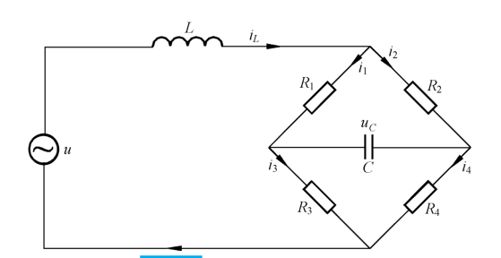{ .lq-img }

*图 9-16 例 9-9 桥式网络（截自原书）*

**解** 该桥式网络的微分方程为

\[
L\frac{\mathrm{d}i_L}{\mathrm{d}t}=u-R_1i_1-R_3i_3
\quad(\text{以及回路电压、节点电流关系})，
\qquad
i_C=i_1-i_2
\]

选取状态变量 \(x_1=i_L\)，\(x_2=u_C\)，消去微分方程组中的 \(i_1,i_2,i_3,i_4\)，可得状态方程

\[
\begin{bmatrix} \dot{x}_1 \\ \dot{x}_2 \end{bmatrix}
=
\begin{bmatrix}
-\dfrac{1}{L}\cdot\dfrac{R_1R_3}{R_1+R_3}-\dfrac{1}{L}\cdot\dfrac{R_2R_4}{R_2+R_4} & -\dfrac{1}{L}\cdot\dfrac{R_1R_3-R_2R_4}{(R_1+R_3)(R_2+R_4)} \\[3mm]
\dfrac{1}{C}\cdot\dfrac{R_2R_3-R_1R_4}{(R_1+R_3)(R_2+R_4)} & -\dfrac{1}{C}\cdot\dfrac{1}{R_1+R_3}-\dfrac{1}{C}\cdot\dfrac{1}{R_2+R_4}
\end{bmatrix}
\begin{bmatrix} x_1 \\ x_2 \end{bmatrix}
+
\begin{bmatrix} \dfrac{1}{L} \\[1mm] \dfrac{1}{C}\cdot\dfrac{R_1+R_3-R_2-R_4}{(R_1+R_3)(R_2+R_4)} \end{bmatrix} u
\]

其可控性矩阵为 \(\boldsymbol{S}=[\boldsymbol{b}\ \ \boldsymbol{A}\boldsymbol{b}]\)。当 \(\dfrac{R_1R_3}{R_1+R_3}\neq\dfrac{R_2R_4}{R_2+R_4}\) 时，\(\mathrm{rank}\,\boldsymbol{S}=2=n\)，系统**可控**。

但是，当**电桥处于平衡状态**，即 \(R_1R_4=R_2R_3\) 时，状态方程变为

\[
\dot{x}_1=-\frac{1}{L}\left(\frac{R_1R_3}{R_1+R_3}+\frac{R_2R_4}{R_2+R_4}\right)x_1+\frac{1}{L}u,
\qquad
\dot{x}_2=-\frac{1}{C}\left(\frac{1}{R_1+R_3}+\frac{1}{R_2+R_4}\right)x_2
\]

可控性矩阵为

\[
\boldsymbol{S}=[\boldsymbol{b}\ \ \boldsymbol{A}\boldsymbol{b}]
=
\begin{bmatrix}
\dfrac{1}{L} & -\dfrac{1}{L}\left(\dfrac{R_1R_3}{R_1+R_3}+\dfrac{R_2R_4}{R_2+R_4}\right) \\
0 & 0
\end{bmatrix}
\]

\(\mathrm{rank}\,\boldsymbol{S}=1<n\)，系统**不可控**，\(u\) 不能控制 \(x_2\)，\(x_2\) 是不可控状态变量——电桥一平衡，电容电压就"够不着"输入了。

**对角线规范型判据** 当式 (9.66) 中矩阵 \(\boldsymbol{A}\) 的特征值 \(\lambda_1,\lambda_2,\cdots,\lambda_n\) **两两相异**时，由线性变换可将式 (9.66) 变为对角线规范型

\[
\dot{\bar{\boldsymbol{x}}}=
\begin{bmatrix} \lambda_1 & & & \boldsymbol{0} \\ & \lambda_2 & & \\ & & \ddots & \\ \boldsymbol{0} & & & \lambda_n \end{bmatrix}\bar{\boldsymbol{x}}
+\boldsymbol{B}\boldsymbol{u}
\tag{9.79}
\]

则系统 (9.66) **完全可控的充分必要条件**是：式 (9.79) 中 \(\boldsymbol{B}\) **不包含元素全为零的行**。

（证明可用秩判据予以推证，过程略。直观上：对角型中各状态已解耦，\(\bar{x}_i\) 只受 \(\boldsymbol{u}\) 的第 \(i\) 行影响，\(\boldsymbol{B}\) 的某行全零意味着该模态与输入完全断开。）

**【例 9-10】** 已知线性定常系统的对角线规范型为

\[
\begin{aligned}
\dot{x}_1&=8x_1+\phantom{2}u_1 \\
\dot{x}_2&=-x_2+\phantom{0}u_1+3u_2 \\
\dot{x}_3&=2x_3+2u_2
\end{aligned}
\qquad
\dot{\boldsymbol{x}}=
\begin{bmatrix} 8 & 0 & 0 \\ 0 & -1 & 0 \\ 0 & 0 & 2 \end{bmatrix}\boldsymbol{x}
+
\begin{bmatrix} 1 & 0 \\ 1 & 3 \\ 0 & 2 \end{bmatrix}
\begin{bmatrix} u_1 \\ u_2 \end{bmatrix}
\]

试判定系统的可控性。

**解** 此规范型中 \(\boldsymbol{B}\) 不包含元素全为零的行，故系统**完全可控**。

### 输出可控性

如果系统需要控制的是输出量而不是状态量，则需要研究系统的**输出可控性**。

**输出可控性**：若在有限时间间隔 \([t_0,t_1]\) 内，存在无约束分段连续控制函数 \(\boldsymbol{u}(t)\)，能使任意初始输出 \(\boldsymbol{y}(t_0)\) 转移到任意最终输出 \(\boldsymbol{y}(t_1)\)，则称此系统输出完全可控，简称输出可控。

**输出可控性判据** 设线性定常连续系统的状态方程和输出方程为

\[
\dot{\boldsymbol{x}}=\boldsymbol{A}\boldsymbol{x}+\boldsymbol{B}\boldsymbol{u},
\qquad
\boldsymbol{y}=\boldsymbol{C}\boldsymbol{x}+\boldsymbol{D}\boldsymbol{u}
\tag{9.80}
\]

不失一般性，令 \(\boldsymbol{y}(t_1)=\boldsymbol{0}\)，将状态方程的解代入输出方程，并应用凯莱-哈密顿定理的推论 2（\(\mathrm{e}^{-\boldsymbol{A}t_1}=\sum_{m=0}^{n-1}\alpha_m(-t_1)\boldsymbol{A}^m\)），令 \(\boldsymbol{u}_m(t_1)=\int_0^{t_1}\alpha_m(t)\boldsymbol{u}(t)\,\mathrm{d}t\)，整理得

\[
\begin{bmatrix} \boldsymbol{C}\boldsymbol{B} & \boldsymbol{C}\boldsymbol{A}\boldsymbol{B} & \cdots & \boldsymbol{C}\boldsymbol{A}^{n-1}\boldsymbol{B} & \boldsymbol{D} \end{bmatrix}
\begin{bmatrix} \boldsymbol{u}_0(t_1) \\ \boldsymbol{u}_1(t_1) \\ \vdots \\ \boldsymbol{u}_{n-1}(t_1) \\ \boldsymbol{u}(t_1) \end{bmatrix}
=-\boldsymbol{C}\mathrm{e}^{\boldsymbol{A}t_1}\boldsymbol{x}_0
\tag{9.83}
\]

令

\[
\boldsymbol{S}_0=\begin{bmatrix} \boldsymbol{C}\boldsymbol{B} & \boldsymbol{C}\boldsymbol{A}\boldsymbol{B} & \cdots & \boldsymbol{C}\boldsymbol{A}^{n-1}\boldsymbol{B} & \boldsymbol{D} \end{bmatrix}
\tag{9.84}
\]

其中 \(\boldsymbol{S}_0\) 为 \(q\times(n+1)p\) 矩阵，称为**输出可控性矩阵**。故可证得：**输出可控的充分必要条件**是，输出可控性矩阵的秩等于输出向量的维数 \(q\)，即

\[
\mathrm{rank}\,\boldsymbol{S}_0=q
\tag{9.85}
\]

需要注意的是，**状态可控性与输出可控性是两个不同的概念，二者没有什么必然的联系**。

**【例 9-11】** 已知系统的状态方程和输出方程为

\[
\dot{\boldsymbol{x}}=
\begin{bmatrix} 0 & 1 \\ -1 & -2 \end{bmatrix}\boldsymbol{x}
+
\begin{bmatrix} 1 \\ -1 \end{bmatrix}u,
\qquad
y=\begin{bmatrix} 1 & 0 \end{bmatrix}\boldsymbol{x}
\]

试判断系统的状态可控性和输出可控性。

**解** 系统的状态可控性矩阵为

\[
\boldsymbol{S}=[\boldsymbol{b}\ \ \boldsymbol{A}\boldsymbol{b}]
=
\begin{bmatrix} 1 & -1 \\ -1 & 1 \end{bmatrix}
\]

\(|\boldsymbol{S}|=0\)，\(\mathrm{rank}\,\boldsymbol{S}<2\)，故**状态不完全可控**。

输出可控性矩阵为

\[
\boldsymbol{S}_0=[\boldsymbol{c}\boldsymbol{b}\ \ \boldsymbol{c}\boldsymbol{A}\boldsymbol{b}\ \ d]=\begin{bmatrix} 1 & -1 & 0 \end{bmatrix}
\]

因 \(\mathrm{rank}\,\boldsymbol{S}_0=1=q\)，故**输出可控**。

### 线性定常连续系统的可观测性判据

考虑输入 \(u=0\) 时系统的状态方程和输出方程

\[
\dot{\boldsymbol{x}}=\boldsymbol{A}\boldsymbol{x},\quad \boldsymbol{x}(0)=\boldsymbol{x}_0,\quad t\ge 0,
\qquad
\boldsymbol{y}=\boldsymbol{C}\boldsymbol{x}
\tag{9.86}
\]

**秩判据** 定常连续系统 (9.86) **完全可观测的充分必要条件**是

\[
\mathrm{rank}\begin{bmatrix} \boldsymbol{C} \\ \boldsymbol{C}\boldsymbol{A} \\ \vdots \\ \boldsymbol{C}\boldsymbol{A}^{n-1} \end{bmatrix}=n
\tag{9.87}
\]

或

\[
\mathrm{rank}\begin{bmatrix} \boldsymbol{C}^{\mathrm T} & \boldsymbol{A}^{\mathrm T}\boldsymbol{C}^{\mathrm T} & (\boldsymbol{A}^{\mathrm T})^2\boldsymbol{C}^{\mathrm T} & \cdots & (\boldsymbol{A}^{\mathrm T})^{n-1}\boldsymbol{C}^{\mathrm T} \end{bmatrix}=n
\tag{9.88}
\]

式 (9.87) 和式 (9.88) 中的矩阵均称为系统**可观测性判别阵**，简称可观测性阵。

**证明** 由式 (9.86)，\(\boldsymbol{y}(t)=\boldsymbol{C}\mathrm{e}^{\boldsymbol{A}t}\boldsymbol{x}_0\)。利用推论 2（式 9-76），可得

\[
\boldsymbol{y}(t)=
\begin{bmatrix} \alpha_0(t)\boldsymbol{I}_q & \alpha_1(t)\boldsymbol{I}_q & \cdots & \alpha_{n-1}(t)\boldsymbol{I}_q \end{bmatrix}
\begin{bmatrix} \boldsymbol{C} \\ \boldsymbol{C}\boldsymbol{A} \\ \vdots \\ \boldsymbol{C}\boldsymbol{A}^{n-1} \end{bmatrix}\boldsymbol{x}_0
\tag{9.89}
\]

式中 \(\boldsymbol{I}_q\) 为 \(q\) 阶单位阵。已知 \([\alpha_0(t)\boldsymbol{I}_q\ \cdots\ \alpha_{n-1}(t)\boldsymbol{I}_q]\) 的 \(nq\) 列线性无关，于是根据测得的 \(\boldsymbol{y}(t)\) 可唯一确定 \(\boldsymbol{x}_0\) 的充分必要条件是

\[
\mathrm{rank}\,\boldsymbol{V}\triangleq\mathrm{rank}\begin{bmatrix} \boldsymbol{C} \\ \boldsymbol{C}\boldsymbol{A} \\ \vdots \\ \boldsymbol{C}\boldsymbol{A}^{n-1} \end{bmatrix}=n
\]

这就是式 (9.87)。

**【例 9-12】** 试判断下列两个系统的可观测性

\[
\dot{\boldsymbol{x}}=\boldsymbol{A}\boldsymbol{x}+\boldsymbol{B}\boldsymbol{u},\qquad \boldsymbol{y}=\boldsymbol{C}\boldsymbol{x}
\]

1) \(\boldsymbol{A}=\begin{bmatrix} -2 & 0 \\ 0 & -1 \end{bmatrix}\)，\(\boldsymbol{b}=\begin{bmatrix} 3 \\ 1 \end{bmatrix}\)，\(\boldsymbol{c}=\begin{bmatrix} 1 & 0 \end{bmatrix}\)

2) \(\boldsymbol{A}=\begin{bmatrix} 1 & -1 \\ 1 & 1 \end{bmatrix}\)，\(\boldsymbol{B}=\begin{bmatrix} 2 & -1 \\ 1 & 0 \end{bmatrix}\)，\(\boldsymbol{C}=\begin{bmatrix} 1 & 0 \\ -1 & 1 \end{bmatrix}\)

**解**

1) \(\mathrm{rank}\,\boldsymbol{V}=\mathrm{rank}\begin{bmatrix} \boldsymbol{c}^{\mathrm T} & \boldsymbol{A}^{\mathrm T}\boldsymbol{c}^{\mathrm T} \end{bmatrix}
=\mathrm{rank}\begin{bmatrix} 1 & -2 \\ 0 & 0 \end{bmatrix}=1<n=2\)，故系统**不可观测**。

2) \(\mathrm{rank}\,\boldsymbol{V}=\mathrm{rank}\begin{bmatrix} \boldsymbol{C}^{\mathrm T} & \boldsymbol{A}^{\mathrm T}\boldsymbol{C}^{\mathrm T} \end{bmatrix}
=\mathrm{rank}\begin{bmatrix} 1 & -1 & 1 & 0 \\ 0 & 1 & -1 & 2 \end{bmatrix}=2=n\)，故系统**可观测**。

**对角线规范型判据** 线性定常连续系统 (9.86) **完全可观测的充分必要条件**是：当矩阵 \(\boldsymbol{A}\) 的特征值 \(\lambda_1,\lambda_2,\cdots,\lambda_n\) 两两相异时，由式 (9.86) 线性变换导出的对角线规范型为

\[
\dot{\bar{\boldsymbol{x}}}=
\begin{bmatrix} \lambda_1 & & & \boldsymbol{0} \\ & \lambda_2 & & \\ & & \ddots & \\ \boldsymbol{0} & & & \lambda_n \end{bmatrix}\bar{\boldsymbol{x}},
\qquad
\boldsymbol{y}=\bar{\boldsymbol{C}}\bar{\boldsymbol{x}}
\tag{9.90}
\]

式中 \(\bar{\boldsymbol{C}}\) **不包含元素全为零的列**。

**【例 9-13】** 已知线性定常系统的对角线规范型为

\[
\dot{\bar{\boldsymbol{x}}}=
\begin{bmatrix} 8 & 0 & 0 \\ 0 & -1 & 0 \\ 0 & 0 & 2 \end{bmatrix}\bar{\boldsymbol{x}},
\qquad
\boldsymbol{y}=
\begin{bmatrix} 1 & 0 & 0 \\ 0 & 2 & 3 \end{bmatrix}\bar{\boldsymbol{x}}
\]

试判定系统的可观测性。

**解** 显然，此规范型中 \(\bar{\boldsymbol{C}}\) 不包含元素全为零的列，故系统为**完全可观测**。

### 线性离散时间系统的可控性和可观测性

讨论线性离散系统时，为便于全面理解基本概念，利用线性时变离散系统给出有关定义，而判据仅限于线性定常离散系统。

#### (1) 线性离散系统的可控性

设线性时变离散时间系统的状态方程为

\[
\boldsymbol{x}(k+1)=\boldsymbol{G}(k)\boldsymbol{x}(k)+\boldsymbol{H}(k)\boldsymbol{u}(k),\qquad k\in T_k
\tag{9.91}
\]

如果对初始时刻 \(l\in T_k\) 和状态空间中的所有非零状态 \(\boldsymbol{x}(l)\)，都存在时刻 \(m\in T_k,\ m>l\)，和对应的控制 \(\boldsymbol{u}(k)\)，使得 \(\boldsymbol{x}(m)=\boldsymbol{0}\)，则称系统在时刻 \(l\) 为完全可控。

**线性定常离散系统的可控性判据** 设单输入线性定常离散系统的状态方程为

\[
\boldsymbol{x}(k+1)=\boldsymbol{G}\boldsymbol{x}(k)+\boldsymbol{h}u(k)
\tag{9.92}
\]

式中 \(\boldsymbol{G}\) 为 \(n\times n\) 非奇异矩阵。其解为 \(\boldsymbol{x}(k)=\boldsymbol{G}^k\boldsymbol{x}(0)+\sum_{i=0}^{k-1}\boldsymbol{G}^{k-1-i}\boldsymbol{h}u(i)\)。根据可控性定义，假定 \(k=n\) 时 \(\boldsymbol{x}(n)=\boldsymbol{0}\)，将解两端左乘 \(\boldsymbol{G}^{-n}\)，整理得

\[
\begin{bmatrix} \boldsymbol{G}^{-1}\boldsymbol{h} & \boldsymbol{G}^{-2}\boldsymbol{h} & \cdots & \boldsymbol{G}^{-n}\boldsymbol{h} \end{bmatrix}
\begin{bmatrix} u(0) \\ u(1) \\ \vdots \\ u(n-1) \end{bmatrix}
=-\boldsymbol{G}^{-n}\boldsymbol{x}(0)
\tag{9.94}
\]

记 \(\boldsymbol{S}_1'=[\boldsymbol{G}^{-1}\boldsymbol{h}\ \ \boldsymbol{G}^{-2}\boldsymbol{h}\ \ \cdots\ \ \boldsymbol{G}^{-n}\boldsymbol{h}]\) 为 \(n\times n\) 可控性矩阵。式 (9.94) 是含 \(n\) 个方程、\(n\) 个未知数 \(u(0),u(1),\cdots,u(n-1)\) 的非奇异线性方程组：当 \(\boldsymbol{S}_1'\) 的秩与增广矩阵 \([\boldsymbol{S}_1'\ \ \boldsymbol{G}^{-n}\boldsymbol{x}(0)]\) 的秩相等时方程组有唯一解，否则无解。在 \(\boldsymbol{x}(0)\) 任意的情况下，方程组有解的充分必要条件是

\[
\mathrm{rank}\,\boldsymbol{S}_1'=n
\qquad\text{即}\qquad
\det\boldsymbol{S}_1'\neq 0
\tag{9.96}
\]

由于满秩矩阵与另一满秩矩阵 \(\boldsymbol{G}^n\) 相乘其秩不变，且交换矩阵的列其秩也不变，故

\[
\mathrm{rank}\,\boldsymbol{S}_1=\mathrm{rank}\begin{bmatrix} \boldsymbol{h} & \boldsymbol{G}\boldsymbol{h} & \cdots & \boldsymbol{G}^{n-1}\boldsymbol{h} \end{bmatrix}=n
\tag{9.99}
\]

式 (9.96)～式 (9.99) 都称为可控性判据，\(\boldsymbol{S}_1\) 称为单输入离散系统的可控性矩阵。显然，状态可控性取决于 \(\boldsymbol{G}\) 和 \(\boldsymbol{h}\)。当 \(\mathrm{rank}\,\boldsymbol{S}_1<n\) 时系统不可控，表示不存在使任意 \(\boldsymbol{x}(0)\) 转移至 \(\boldsymbol{x}(n)=\boldsymbol{0}\) 的控制。式 (9.99) 避免了矩阵求逆，判可控性时使用比较方便。

上述方法可推广到多输入系统。设系统的状态方程为

\[
\boldsymbol{x}(k+1)=\boldsymbol{G}\boldsymbol{x}(k)+\boldsymbol{H}\boldsymbol{u}(k)
\tag{9.100}
\]

可控性问题即是能否求出无约束控制向量序列 \(\boldsymbol{u}(0),\boldsymbol{u}(1),\cdots,\boldsymbol{u}(n-1)\)，使系统从任意初态 \(\boldsymbol{x}(0)\) 转移至 \(\boldsymbol{x}(n)=\boldsymbol{0}\)。类似推导可得 \(\boldsymbol{S}_2'=[\boldsymbol{G}^{-1}\boldsymbol{H}\ \ \boldsymbol{G}^{-2}\boldsymbol{H}\ \ \cdots\ \ \boldsymbol{G}^{-n}\boldsymbol{H}]\) 为 \(n\times np\) 矩阵，于是多输入线性离散系统状态可控的充分必要条件是

\[
\mathrm{rank}\,\boldsymbol{S}_2=\mathrm{rank}\begin{bmatrix} \boldsymbol{H} & \boldsymbol{G}\boldsymbol{H} & \cdots & \boldsymbol{G}^{n-1}\boldsymbol{H} \end{bmatrix}=n
\tag{9.106}
\]

式 (9.102) 中方程个数（\(n\)）少于未知量个数（\(np\)），方程组的解不唯一——可任意假定 \(np-n\) 个控制量，其余 \(n\) 个控制量才能唯一确定。多输入线性离散系统控制序列的选择通常有无穷多种方式。由于 \(\boldsymbol{S}_2\) 的行数总小于列数，列写 \(\boldsymbol{S}_2\) 时只要所选的列能判断出秩为 \(n\)，便不必列出其余列。**多输入线性定常离散系统由任意初态转移至原点一般可少于 \(n\) 个采样周期。**

**【例 9-14】** 设单输入线性定常离散系统状态方程为

\[
\boldsymbol{x}(k+1)=
\begin{bmatrix} 1 & 0 & 0 \\ 0 & 2 & -2 \\ -1 & 1 & 0 \end{bmatrix}\boldsymbol{x}(k)
+
\begin{bmatrix} 1 \\ 0 \\ 1 \end{bmatrix}u(k)
\]

试判断其可控性；若初始状态 \(\boldsymbol{x}(0)=[2\ \ 1\ \ 0]^{\mathrm T}\)，确定使 \(\boldsymbol{x}(3)=\boldsymbol{0}\) 的控制序列 \(u(0),u(1),u(2)\)；研究使 \(\boldsymbol{x}(2)=\boldsymbol{0}\) 的可能性。

**解** 由题意知

\[
\boldsymbol{G}=
\begin{bmatrix} 1 & 0 & 0 \\ 0 & 2 & -2 \\ -1 & 1 & 0 \end{bmatrix},
\qquad
\boldsymbol{h}=
\begin{bmatrix} 1 \\ 0 \\ 1 \end{bmatrix}
\]

\[
\mathrm{rank}\,\boldsymbol{S}_1=\mathrm{rank}[\boldsymbol{h}\ \ \boldsymbol{G}\boldsymbol{h}\ \ \boldsymbol{G}^2\boldsymbol{h}]
=\mathrm{rank}
\begin{bmatrix} 1 & 1 & 1 \\ 0 & -2 & -2 \\ 1 & -1 & -3 \end{bmatrix}
=3=n
\]

故系统可控。用递推法求控制序列。由式 (9.92)，令 \(k=0,1,2\)，可得状态序列

\[
\boldsymbol{x}(1)=\boldsymbol{G}\boldsymbol{x}(0)+\boldsymbol{h}u(0)
=
\begin{bmatrix} 2 \\ 2 \\ -1 \end{bmatrix}+
\begin{bmatrix} 1 \\ 0 \\ 1 \end{bmatrix}u(0)
\]

\[
\boldsymbol{x}(2)=\boldsymbol{G}\boldsymbol{x}(1)+\boldsymbol{h}u(1)
=
\begin{bmatrix} 2 \\ 6 \\ 0 \end{bmatrix}+
\begin{bmatrix} 1 \\ -2 \\ -1 \end{bmatrix}u(0)+
\begin{bmatrix} 1 \\ 0 \\ 1 \end{bmatrix}u(1)
\]

\[
\boldsymbol{x}(3)=\boldsymbol{G}\boldsymbol{x}(2)+\boldsymbol{h}u(2)
=
\begin{bmatrix} 2 \\ 12 \\ 4 \end{bmatrix}+
\begin{bmatrix} 1 \\ -2 \\ -3 \end{bmatrix}u(0)+
\begin{bmatrix} 1 \\ -2 \\ -1 \end{bmatrix}u(1)+
\begin{bmatrix} 1 \\ 0 \\ 1 \end{bmatrix}u(2)
\]

令 \(\boldsymbol{x}(3)=\boldsymbol{0}\)，则有

\[
\begin{bmatrix} 1 & 1 & 1 \\ -2 & -2 & 0 \\ -3 & -1 & 1 \end{bmatrix}
\begin{bmatrix} u(0) \\ u(1) \\ u(2) \end{bmatrix}
=
\begin{bmatrix} -2 \\ -12 \\ -4 \end{bmatrix}
\]

其系数矩阵即可控性矩阵 \(\boldsymbol{S}_1\) 是非奇异的，求逆可得

\[
\begin{bmatrix} u(0) \\ u(1) \\ u(2) \end{bmatrix}
=
\begin{bmatrix} 1 & 1 & 1 \\ -2 & -2 & 0 \\ -3 & -1 & 1 \end{bmatrix}^{-1}
\begin{bmatrix} -2 \\ -12 \\ -4 \end{bmatrix}
=
\begin{bmatrix} -5 \\ 11 \\ -8 \end{bmatrix}
\]

若令 \(\boldsymbol{x}(2)=\boldsymbol{0}\)，即解方程组

\[
\begin{bmatrix} 1 & 1 \\ -2 & 0 \\ -1 & 1 \end{bmatrix}
\begin{bmatrix} u(0) \\ u(1) \end{bmatrix}
=
\begin{bmatrix} -2 \\ -6 \\ 0 \end{bmatrix}
\]

容易看出其系数矩阵的秩为 2，但增广矩阵的秩为 3，两个秩不等，方程组无解——意味着**不能在两个采样周期内**使系统由初始状态转移至原点。若该两个秩相等，则可用两步完成状态转移。

=== "MATLAB"

    ```matlab
    % ===== 书 9.2 节 例9-14 =====
    G = [1 0 0; 0 2 -2; -1 1 0]; h = [1; 0; 1];
    S1 = [h, G*h, G^2*h];      % 可控性矩阵
    rank(S1)                    % 3 = n，可控
    x = [2; 1; 0]; u = [-5; 11; -8];   % 书中解出的控制序列
    for k = 1:3
        x = G*x + h*u(k);
    end
    x'                          % x(3) ≈ [0 0 0]
    ```

=== "Python"

    ```python
    # ===== 书 9.2 节 例9-14 =====
    import numpy as np

    G = np.array([[1.0, 0, 0], [0, 2, -2], [-1, 1, 0]])
    h = np.array([[1.0], [0], [1]])
    S1 = np.hstack([h, G @ h, G @ G @ h])
    print(np.linalg.matrix_rank(S1))            # 3 -> 可控
    x = np.array([[2.0], [1], [0]])
    for u in (-5.0, 11.0, -8.0):                # 书中解出的控制序列
        x = G @ x + h * u
    print(x.ravel())                            # x(3) ≈ [0. 0. 0.]
    # 两步 x(2)=0：系数矩阵秩 2，增广矩阵秩 3，无解
    M = np.hstack([h, G @ h])
    rhs = -(G @ (G @ np.array([[2.0], [1], [0]])))
    print(np.linalg.matrix_rank(M), np.linalg.matrix_rank(np.hstack([M, rhs])))
    ```

#### (2) 线性离散系统的可观测性

设离散系统为

\[
\boldsymbol{x}(k+1)=\boldsymbol{G}(k)\boldsymbol{x}(k)+\boldsymbol{H}(k)\boldsymbol{u}(k),
\qquad
\boldsymbol{y}(k)=\boldsymbol{C}(k)\boldsymbol{x}(k)+\boldsymbol{D}(k)\boldsymbol{u}(k),
\qquad k\in T_k
\tag{9.107}
\]

若对初始时刻 \(l\in T_k\) 的任一非零初始状态 \(\boldsymbol{x}(l)=\boldsymbol{x}_0\)，都存在有限时刻 \(m\in T_k,\ m>l\)，且可由 \([l,m]\) 上的输出 \(\boldsymbol{y}(k)\) 唯一地确定 \(\boldsymbol{x}_0\)，则称系统在时刻 \(l\) 是完全可观测的。

**线性定常离散系统的可观测性判据** 设线性定常离散系统的动态方程为式 (9.108)，研究可观测性问题时 \(\boldsymbol{u}(k)\) 及各矩阵均已知，不失一般性可简化为零输入方程 \(\boldsymbol{x}(k+1)=\boldsymbol{G}\boldsymbol{x}(k)\)，\(\boldsymbol{y}(k)=\boldsymbol{C}\boldsymbol{x}(k)\)，其解为 \(\boldsymbol{x}(k)=\boldsymbol{G}^k\boldsymbol{x}(0)\)，\(\boldsymbol{y}(k)=\boldsymbol{C}\boldsymbol{G}^k\boldsymbol{x}(0)\)。将 \(\boldsymbol{y}(0),\boldsymbol{y}(1),\cdots,\boldsymbol{y}(n-1)\) 写成展开式的向量-矩阵形式：

\[
\begin{bmatrix} \boldsymbol{y}(0) \\ \boldsymbol{y}(1) \\ \vdots \\ \boldsymbol{y}(n-1) \end{bmatrix}
=
\begin{bmatrix} \boldsymbol{C} \\ \boldsymbol{C}\boldsymbol{G} \\ \vdots \\ \boldsymbol{C}\boldsymbol{G}^{n-1} \end{bmatrix}\boldsymbol{x}(0)
\tag{9.114}
\]

令

\[
\boldsymbol{V}_1^{\mathrm T}=
\begin{bmatrix} \boldsymbol{C}^{\mathrm T} & \boldsymbol{G}^{\mathrm T}\boldsymbol{C}^{\mathrm T} & \cdots & (\boldsymbol{G}^{\mathrm T})^{n-1}\boldsymbol{C}^{\mathrm T} \end{bmatrix}^{\mathrm T}
\tag{9.115}
\]

\(\boldsymbol{V}_1^{\mathrm T}\) 称为线性定常离散系统的可观测性矩阵，为 \(nq\times n\) 矩阵。式 (9.114) 含 \(nq\) 个方程，若有 \(n\) 个独立方程便可唯一确定 \(\boldsymbol{x}(0)\)。故系统可观测的充分必要条件为

\[
\mathrm{rank}\,\boldsymbol{V}_1^{\mathrm T}=n
\qquad\text{即}\qquad
\mathrm{rank}\,\boldsymbol{V}_1=
\mathrm{rank}\begin{bmatrix} \boldsymbol{C} & \boldsymbol{C}\boldsymbol{G} & \cdots & \boldsymbol{C}\boldsymbol{G}^{n-1} \end{bmatrix}^{\mathrm T}
=\mathrm{rank}\begin{bmatrix} \boldsymbol{C}^{\mathrm T} & \boldsymbol{G}^{\mathrm T}\boldsymbol{C}^{\mathrm T} & \cdots & (\boldsymbol{G}^{\mathrm T})^{n-1}\boldsymbol{C}^{\mathrm T} \end{bmatrix}=n
\tag{9.116}
\]

**【例 9-15】** 已知线性定常离散系统的动态方程 \(\boldsymbol{x}(k+1)=\boldsymbol{G}\boldsymbol{x}(k)+\boldsymbol{h}u(k)\)，\(\boldsymbol{y}(k)=\boldsymbol{C}_i\boldsymbol{x}(k)\ (i=1,2)\)，其中

\[
\boldsymbol{G}=
\begin{bmatrix} 1 & 0 & -1 \\ 0 & -2 & 1 \\ 3 & 0 & 2 \end{bmatrix},
\qquad
\boldsymbol{h}=
\begin{bmatrix} 2 \\ -1 \\ 1 \end{bmatrix},
\qquad
\boldsymbol{c}_1=\begin{bmatrix} 0 & 1 & 0 \end{bmatrix},
\qquad
\boldsymbol{C}_2=\begin{bmatrix} 0 & 0 & 1 \\ 1 & 0 & 0 \end{bmatrix}
\]

试判断系统的可观测性，并讨论可观测性的物理解释。

**解** 当观测矩阵为 \(\boldsymbol{c}_1\) 时，

\[
\boldsymbol{c}_1^{\mathrm T}=
\begin{bmatrix} 0 \\ 1 \\ 0 \end{bmatrix},
\qquad
\boldsymbol{G}^{\mathrm T}\boldsymbol{c}_1^{\mathrm T}=
\begin{bmatrix} 0 \\ -2 \\ 1 \end{bmatrix},
\qquad
(\boldsymbol{G}^{\mathrm T})^2\boldsymbol{c}_1^{\mathrm T}=
\begin{bmatrix} 3 \\ 4 \\ 0 \end{bmatrix}
\]

\[
\mathrm{rank}\,\boldsymbol{V}_1=\mathrm{rank}
\begin{bmatrix} 0 & 0 & 3 \\ 1 & -2 & 4 \\ 0 & 1 & 0 \end{bmatrix}
=3=n
\]

故系统**可观测**。由输出方程 \(y(k)=\boldsymbol{c}_1\boldsymbol{x}(k)=x_2(k)\) 可见，在第 \(k\) 步便可由输出确定状态变量 \(x_2(k)\)。由于

\[
y(k+1)=x_2(k+1)=-2x_2(k)+x_3(k)
\]

故在第 \(k+1\) 步便可确定 \(x_3(k)\)。由于

\[
\begin{aligned}
y(k+2)=x_2(k+2)&=-2x_2(k+1)+x_3(k+1) \\
&=-2\left[-2x_2(k)+x_3(k)\right]+3x_1(k)+2x_3(k)=4x_2(k)+3x_1(k)
\end{aligned}
\]

故在第 \(k+2\) 步便可确定 \(x_1(k)\)。该系统为三阶系统，可观测意味着**至多三步**便可由输出 \(y(k),y(k+1),y(k+2)\) 的测量值来确定三个状态变量。

当观测矩阵为 \(\boldsymbol{C}_2\) 时，

\[
\mathrm{rank}\,\boldsymbol{V}_1=\mathrm{rank}
\begin{bmatrix} 0 & 1 & 3 & 1 & 9 & -2 \\ 0 & 0 & 0 & 0 & 0 & 0 \\ 1 & 0 & 2 & -1 & 1 & -3 \end{bmatrix}
=2<n=3
\]

故系统**不可观测**。根据系统动态方程可导出

\[
\boldsymbol{y}(k)=
\begin{bmatrix} x_3(k) \\ x_1(k) \end{bmatrix},
\qquad
\boldsymbol{y}(k+1)=
\begin{bmatrix} 3x_1(k)+2x_3(k) \\ x_1(k)-x_3(k) \end{bmatrix},
\qquad
\boldsymbol{y}(k+2)=
\begin{bmatrix} 9x_1(k)+x_3(k) \\ -2x_1(k)-3x_3(k) \end{bmatrix}
\]

可看出三步的输出测量值中始终不含 \(x_2(k)\)，故 \(x_2(k)\) 是不可观测状态变量。只要有一个状态变量不可观测，则称系统不完全可观测，简称不可观测。

#### (3) 连续动态方程离散化后的可控性和可观测性

一个可控的或可观测的连续系统，当其离散化后**并不一定能保持**其可控性或可观测性。设连续系统动态方程为

\[
\dot{\boldsymbol{x}}=
\begin{bmatrix} 0 & 1 \\ -\omega^2 & 0 \end{bmatrix}\boldsymbol{x}
+
\begin{bmatrix} 0 \\ 1 \end{bmatrix}u,
\qquad
y=\begin{bmatrix} 1 & 0 \end{bmatrix}\boldsymbol{x}
\]

由于状态方程为可控标准型，故一定可控；由可观测性判据 \(\mathrm{rank}\,\boldsymbol{V}=\mathrm{rank}\begin{bmatrix} 1 & 0 \\ 0 & 1 \end{bmatrix}=2\)，故可观测。系统的状态转移矩阵为

\[
\boldsymbol{\Phi}(t)=
\begin{bmatrix} \cos\omega t & \dfrac{1}{\omega}\sin\omega t \\[2mm] -\omega\sin\omega t & \cos\omega t \end{bmatrix},
\qquad
\boldsymbol{G}(T)=\int_0^T\boldsymbol{\Phi}(\tau)\,\mathrm{d}\tau\cdot\boldsymbol{b}
=
\begin{bmatrix} \dfrac{1-\cos\omega T}{\omega^2} \\[2mm] \dfrac{\sin\omega T}{\omega} \end{bmatrix}
\]

离散化后系统的可控性矩阵与可观测性矩阵分别为

\[
\boldsymbol{S}_1=[\boldsymbol{G}\ \ \boldsymbol{\Phi}(T)\boldsymbol{G}]
=
\begin{bmatrix}
\dfrac{1-\cos\omega T}{\omega^2} & \dfrac{1-\cos\omega T}{\omega^2} \\[3mm]
\dfrac{\sin\omega T}{\omega} & \dfrac{2\sin\omega T\cos\omega T-\sin\omega T}{\omega}
\end{bmatrix},
\qquad
\boldsymbol{V}_1=
\begin{bmatrix} 1 & \cos\omega T \\ 0 & \omega\sin\omega T \end{bmatrix}
\]

当采样周期 \(T=\dfrac{\pi}{k\omega}\ (k=1,2,\cdots)\) 时，可控性矩阵 \(\boldsymbol{S}_1\) 和可观测性矩阵 \(\boldsymbol{V}_1\) 均出现零行，\(\mathrm{rank}\,\boldsymbol{S}_1=1<n\)，\(\mathrm{rank}\,\boldsymbol{V}_1=1<n\)，系统**不可控也不可观测**。这表明：连续系统可控或可观测时，若**采样周期选择不当**，对应的离散化系统便有可能不可控或不可观测，也有可能既不可控又不可观测。若连续系统不可控或不可观测，不管采样周期 \(T\) 如何选择，离散化后的系统一定是不可控或不可观测的。

### 线性定常系统的线性变换

为便于分析和综合设计，经常需要对系统进行各种非奇异变换，例如将 \(\boldsymbol{A}\) 阵对角化、将 \(\{\boldsymbol{A},\boldsymbol{b}\}\) 化为可控标准型、将 \(\{\boldsymbol{A},\boldsymbol{c}\}\) 化为可观测标准型等。

#### (1) 状态空间表达式的线性变换

设系统动态方程为 \(\dot{\boldsymbol{x}}=\boldsymbol{A}\boldsymbol{x}+\boldsymbol{b}u\)，\(y=\boldsymbol{c}\boldsymbol{x}\)，令

\[
\boldsymbol{x}=\boldsymbol{P}\bar{\boldsymbol{x}}
\tag{9.119}
\]

式中 \(\boldsymbol{P}\) 为非奇异线性变换矩阵，变换后的动态方程为

\[
\dot{\bar{\boldsymbol{x}}}=\bar{\boldsymbol{A}}\bar{\boldsymbol{x}}+\bar{\boldsymbol{b}}u,
\qquad
y=\bar{\boldsymbol{c}}\bar{\boldsymbol{x}}
\tag{9.120}
\]

式中

\[
\bar{\boldsymbol{A}}=\boldsymbol{P}^{-1}\boldsymbol{A}\boldsymbol{P},
\qquad
\bar{\boldsymbol{b}}=\boldsymbol{P}^{-1}\boldsymbol{b},
\qquad
\bar{\boldsymbol{c}}=\boldsymbol{c}\boldsymbol{P}
\tag{9.121}
\]

并称为对系统进行 \(\boldsymbol{P}\) 变换。线性变换的目的在于使 \(\boldsymbol{A}\) 阵规范化，以便于揭示系统特性及分析计算，且不会改变系统的原有性质，故称为**等价变换**。获得所需结果之后，再引入反变换关系 \(\bar{\boldsymbol{x}}=\boldsymbol{P}^{-1}\boldsymbol{x}\) 换算回原来的状态空间。

**1) 化 \(\boldsymbol{A}\) 阵为对角型。**

① 设 \(\boldsymbol{A}\) 阵为任意形式的方阵且有 \(n\) 个互异实数特征值 \(\lambda_1,\lambda_2,\cdots,\lambda_n\)，则可由非奇异线性变换化为对角阵：

\[
\boldsymbol{P}^{-1}\boldsymbol{A}\boldsymbol{P}=
\begin{bmatrix} \lambda_1 & & & \boldsymbol{0} \\ & \lambda_2 & & \\ & & \ddots & \\ \boldsymbol{0} & & & \lambda_n \end{bmatrix}\triangleq\boldsymbol{\Lambda}
\tag{9.122}
\]

其中 \(\boldsymbol{P}\) 阵由 \(\boldsymbol{A}\) 阵的实数特征向量 \(\boldsymbol{p}_i\ (i=1,2,\cdots,n)\) 组成：

\[
\boldsymbol{P}=\begin{bmatrix} \boldsymbol{p}_1 & \boldsymbol{p}_2 & \cdots & \boldsymbol{p}_n \end{bmatrix},
\qquad
\boldsymbol{A}\boldsymbol{p}_i=\lambda_i\boldsymbol{p}_i; \quad i=1,2,\cdots,n
\tag{9.123}
\]

② 若 \(\boldsymbol{A}\) 阵为友矩阵且有 \(n\) 个互异实数特征值 \(\lambda_1,\lambda_2,\cdots,\lambda_n\)，则下列的**范德蒙德（Vandermonde）矩阵** \(\boldsymbol{P}\) 可使 \(\boldsymbol{A}\) 对角化：

\[
\boldsymbol{P}=
\begin{bmatrix}
1 & 1 & \cdots & 1 \\
\lambda_1 & \lambda_2 & \cdots & \lambda_n \\
\lambda_1^2 & \lambda_2^2 & \cdots & \lambda_n^2 \\
\vdots & \vdots & \ddots & \vdots \\
\lambda_1^{n-1} & \lambda_2^{n-1} & \cdots & \lambda_n^{n-1}
\end{bmatrix}
\tag{9.125}
\]

**2) 化可控系统为可控标准型。** 单输入线性定常系统状态方程的可控标准型（式 9-126）所对应的可控性矩阵 \(\boldsymbol{S}\) 是一个主对角线元素均为 1 的右下三角阵，\(\det\boldsymbol{S}\neq 0\)，系统一定可控——这就是"可控标准型"名称的由来。对于可控系统，当 \(\boldsymbol{A},\boldsymbol{b}\) 不具有可控标准型时，一定可以通过适当的变换化为可控标准型。设系统状态方程为 \(\dot{\boldsymbol{x}}=\boldsymbol{A}\boldsymbol{x}+\boldsymbol{b}u\)，进行 \(\boldsymbol{P}^{-1}\) 变换，即令 \(\boldsymbol{x}=\boldsymbol{P}^{-1}\boldsymbol{z}\)，变换为

\[
\dot{\boldsymbol{z}}=\boldsymbol{P}\boldsymbol{A}\boldsymbol{P}^{-1}\boldsymbol{z}+\boldsymbol{P}\boldsymbol{b}u
\tag{9.130}
\]

其中要求 \(\boldsymbol{P}\boldsymbol{A}\boldsymbol{P}^{-1}\) 为友矩阵形式（末行为 \([-a_0\ -a_1\ \cdots\ -a_{n-1}]\)）、\(\boldsymbol{P}\boldsymbol{b}=[0\ \cdots\ 0\ 1]^{\mathrm T}\)。设 \(\boldsymbol{P}=[\boldsymbol{p}_1^{\mathrm T}\ \ \boldsymbol{p}_2^{\mathrm T}\ \ \cdots\ \ \boldsymbol{p}_n^{\mathrm T}]^{\mathrm T}\)（按行分块），根据 \(\boldsymbol{A}\) 阵变换要求展开比较可得

\[
\boldsymbol{p}_1\boldsymbol{b}=0,\qquad
\boldsymbol{p}_1\boldsymbol{A}\boldsymbol{b}=0,\qquad
\cdots,\qquad
\boldsymbol{p}_1\boldsymbol{A}^{n-2}\boldsymbol{b}=0,\qquad
\boldsymbol{p}_1\boldsymbol{A}^{n-1}\boldsymbol{b}=1
\]

写成矩阵形式即

\[
\boldsymbol{p}_1\begin{bmatrix} \boldsymbol{b} & \boldsymbol{A}\boldsymbol{b} & \cdots & \boldsymbol{A}^{n-1}\boldsymbol{b} \end{bmatrix}
=\begin{bmatrix} 0 & 0 & \cdots & 1 \end{bmatrix}
\tag{9.136}
\]

故

\[
\boldsymbol{p}_1=\begin{bmatrix} 0 & 0 & \cdots & 1 \end{bmatrix}\begin{bmatrix} \boldsymbol{b} & \boldsymbol{A}\boldsymbol{b} & \cdots & \boldsymbol{A}^{n-1}\boldsymbol{b} \end{bmatrix}^{-1}
\tag{9.137}
\]

该式表明 \(\boldsymbol{p}_1\) 是**可控性矩阵的逆阵的最后一行**。于是得出变换矩阵 \(\boldsymbol{P}^{-1}\)（书按 \(\boldsymbol{P}\) 记此矩阵，注意方向）的求法：

① 计算可控性矩阵 \(\boldsymbol{S}=[\boldsymbol{b}\ \ \boldsymbol{A}\boldsymbol{b}\ \ \cdots\ \ \boldsymbol{A}^{n-1}\boldsymbol{b}]\)；
② 计算可控性矩阵的逆阵 \(\boldsymbol{S}^{-1}\)；
③ 取出 \(\boldsymbol{S}^{-1}\) 的最后一行（即第 \(n\) 行）构成 \(\boldsymbol{p}_1\) 行向量；
④ 构造 \(\boldsymbol{P}\) 阵

\[
\boldsymbol{P}=
\begin{bmatrix} \boldsymbol{p}_1 \\ \boldsymbol{p}_1\boldsymbol{A} \\ \vdots \\ \boldsymbol{p}_1\boldsymbol{A}^{n-1} \end{bmatrix}
\tag{9.140}
\]

⑤ \(\boldsymbol{P}^{-1}\) 便是将非标准型可控系统化为可控标准型的变换矩阵（即 \(\boldsymbol{x}=\boldsymbol{P}^{-1}\boldsymbol{z}\)，\(\bar{\boldsymbol{A}}=\boldsymbol{P}\boldsymbol{A}\boldsymbol{P}^{-1}\)，\(\bar{\boldsymbol{b}}=\boldsymbol{P}\boldsymbol{b}\)）。

**3) 化可观系统为可观测标准型。** 变换过程如下：

① 针对线性连续定常系统 \((\boldsymbol{A},\boldsymbol{b},\boldsymbol{c})\)，计算可观测性矩阵

\[
\boldsymbol{V}=\begin{bmatrix} \boldsymbol{c} \\ \boldsymbol{c}\boldsymbol{A} \\ \vdots \\ \boldsymbol{c}\boldsymbol{A}^{n-1} \end{bmatrix}
\]

② 求 \(\boldsymbol{V}\) 的逆矩阵 \(\boldsymbol{V}^{-1}\)。
③ 取 \(\boldsymbol{V}^{-1}\) 的**最后一列**即第 \(n\) 列，构成向量 \(\boldsymbol{p}\)。
④ 构造变换矩阵及其逆矩阵

\[
\boldsymbol{P}=\begin{bmatrix} \boldsymbol{p} & \boldsymbol{A}\boldsymbol{p} & \cdots & \boldsymbol{A}^{n-1}\boldsymbol{p} \end{bmatrix}
\]

⑤ 求线性变换，得到可观测标准型的状态空间表达式

\[
\boldsymbol{A}_0=\boldsymbol{P}^{-1}\boldsymbol{A}\boldsymbol{P},
\qquad
\boldsymbol{b}_0=\boldsymbol{P}^{-1}\boldsymbol{b},
\qquad
\boldsymbol{c}_0=\boldsymbol{c}\boldsymbol{P}
\]

**【例 9-16】** 已知线性连续定常系统 \((\boldsymbol{A},\boldsymbol{b},\boldsymbol{c})\) 为

\[
\boldsymbol{A}=
\begin{bmatrix} 2 & -1 & -1 \\ 0 & 1 & 0 \\ 0 & 2 & 1 \end{bmatrix},
\qquad
\boldsymbol{b}=
\begin{bmatrix} 7 \\ 2 \\ 1 \end{bmatrix},
\qquad
\boldsymbol{c}=\begin{bmatrix} 1 & 1 & 0 \end{bmatrix}
\]

请将该系统化为可观测标准型，并求出相应的变换矩阵。

**解** 计算可观测性矩阵

\[
\boldsymbol{V}=\begin{bmatrix} \boldsymbol{c} \\ \boldsymbol{c}\boldsymbol{A} \\ \boldsymbol{c}\boldsymbol{A}^2 \end{bmatrix}
=
\begin{bmatrix} 1 & 1 & 0 \\ 2 & 0 & -1 \\ 4 & -4 & -3 \end{bmatrix}
\]

由于 \(\mathrm{rank}\,\boldsymbol{V}=3=n\)，因此系统可观测。求 \(\boldsymbol{V}\) 的逆矩阵

\[
\boldsymbol{V}^{-1}=
\begin{bmatrix} 2 & -1.5 & 0.5 \\ -1 & 1.5 & -0.5 \\ 4 & -4 & 1 \end{bmatrix}
\]

取 \(\boldsymbol{V}^{-1}\) 的最后一列

\[
\boldsymbol{p}=\begin{bmatrix} 0.5 \\ -0.5 \\ 1 \end{bmatrix}
\]

构造变换矩阵及其逆矩阵

\[
\boldsymbol{P}=[\boldsymbol{p}\ \ \boldsymbol{A}\boldsymbol{p}\ \ \boldsymbol{A}^2\boldsymbol{p}]
=
\begin{bmatrix} 0.5 & 0.5 & 1.5 \\ -0.5 & -0.5 & -0.5 \\ 1 & 0 & -1 \end{bmatrix},
\qquad
\boldsymbol{P}^{-1}=
\begin{bmatrix} 1 & 1 & 1 \\ -2 & -4 & -1 \\ 1 & 1 & 0 \end{bmatrix}
\]

线性变换

\[
\boldsymbol{A}_0=\boldsymbol{P}^{-1}\boldsymbol{A}\boldsymbol{P}=
\begin{bmatrix} 0 & 0 & 2 \\ 1 & 0 & -5 \\ 0 & 1 & 4 \end{bmatrix},
\qquad
\boldsymbol{b}_0=\boldsymbol{P}^{-1}\boldsymbol{b}=
\begin{bmatrix} 10 \\ -23 \\ 9 \end{bmatrix},
\qquad
\boldsymbol{c}_0=\boldsymbol{c}\boldsymbol{P}=\begin{bmatrix} 0 & 0 & 1 \end{bmatrix}
\]

即得到原系统的可观测标准型（末列 \([2\ \ -5\ \ 4]^{\mathrm T}=[-a_0\ \ -a_1\ \ -a_2]^{\mathrm T}\)，特征多项式 \(s^3-4s^2+5s-2\)）。

=== "MATLAB"

    ```matlab
    % ===== 书 9.2 节 例9-16 =====
    A = [2 -1 -1; 0 1 0; 0 2 1]; b = [7; 2; 1]; c = [1 1 0];
    V = [c; c*A; c*A^2];       % 可观测性矩阵
    rank(V)                     % 3，可观测
    p = inv(V)(:, 3);           % V^{-1} 的最后一列
    P = [p, A*p, A^2*p];
    A0 = inv(P)*A*P, b0 = inv(P)*b, c0 = c*P
    ```

=== "Python"

    ```python
    # ===== 书 9.2 节 例9-16 =====
    import numpy as np

    A = np.array([[2.0, -1, -1], [0, 1, 0], [0, 2, 1]])
    b = np.array([[7.0], [2], [1]])
    c = np.array([[1.0, 1, 0]])
    V = np.vstack([c, c @ A, c @ A @ A])
    print(np.linalg.matrix_rank(V))        # 3
    p = np.linalg.inv(V)[:, -1]            # V^{-1} 的最后一列
    P = np.column_stack([p, A @ p, A @ A @ p])
    print(np.linalg.inv(P) @ A @ P)        # [[0,0,2],[1,0,-5],[0,1,4]]
    print((np.linalg.inv(P) @ b).ravel())  # [10, -23, 9]
    print(c @ P)                           # [[0 0 1]]
    ```

#### (2) 对偶原理

在研究系统的可控性和可观测性时，利用**对偶原理**常常带来许多方便。设系统为 \(\Sigma_1(\boldsymbol{A},\boldsymbol{B},\boldsymbol{C})\)，则系统 \(\Sigma_2(\boldsymbol{A}^{\mathrm T},\boldsymbol{C}^{\mathrm T},\boldsymbol{B}^{\mathrm T})\) 为系统 \(\Sigma_1\) 的**对偶系统**。其动态方程分别为

\[
\Sigma_1:\ \dot{\boldsymbol{x}}=\boldsymbol{A}\boldsymbol{x}+\boldsymbol{B}\boldsymbol{u},\qquad \boldsymbol{y}=\boldsymbol{C}\boldsymbol{x}
\tag{9.141}
\]

\[
\Sigma_2:\ \dot{\boldsymbol{z}}=\boldsymbol{A}^{\mathrm T}\boldsymbol{z}+\boldsymbol{C}^{\mathrm T}\boldsymbol{v},\qquad \boldsymbol{w}=\boldsymbol{B}^{\mathrm T}\boldsymbol{z}
\tag{9.142}
\]

式中 \(\boldsymbol{x},\boldsymbol{z}\) 均为 \(n\) 维状态向量；\(\boldsymbol{u},\boldsymbol{w}\) 均为 \(p\) 维向量；\(\boldsymbol{y},\boldsymbol{v}\) 均为 \(q\) 维向量。注意到系统与对偶系统之间，其**输入、输出向量的维数是相交换的**。当 \(\Sigma_2\) 为 \(\Sigma_1\) 的对偶系统时，\(\Sigma_1\) 也是 \(\Sigma_2\) 的对偶系统。

不难验证，系统 \(\Sigma_1\) 的可控性矩阵 \([\boldsymbol{B}\ \ \boldsymbol{A}\boldsymbol{B}\ \ \cdots\ \ \boldsymbol{A}^{n-1}\boldsymbol{B}]\) 与对偶系统 \(\Sigma_2\) 的可观测性矩阵完全相同，系统 \(\Sigma_1\) 的可观测性矩阵 \([\boldsymbol{C}^{\mathrm T}\ \ \boldsymbol{A}^{\mathrm T}\boldsymbol{C}^{\mathrm T}\ \ \cdots\ \ ((\boldsymbol{A}^{\mathrm T})^{n-1}\boldsymbol{C}^{\mathrm T})]\) 与对偶系统 \(\Sigma_2\) 的可控性矩阵完全相同。由此得**对偶原理**：**对偶系统的可控性与可观测性互为等价**——\(\Sigma_1\) 可控 \(\Leftrightarrow \Sigma_2\) 可观测，\(\Sigma_1\) 可观测 \(\Leftrightarrow \Sigma_2\) 可控。

应用对偶原理，能把可观测的单输入-单输出系统化为可观测标准型的问题，转化为将其对偶系统化为可控标准型的问题：先按可控标准型步骤处理对偶系统 \(\dot{\boldsymbol{z}}=\boldsymbol{A}^{\mathrm T}\boldsymbol{z}+\boldsymbol{c}^{\mathrm T}v\)，再一次使用对偶原理便获得原系统的可观测标准型。结果是：将原系统化为可观测标准型需要进行 \(\boldsymbol{P}^{\mathrm T}\) 变换，即令 \(\boldsymbol{x}=\boldsymbol{P}^{\mathrm T}\bar{\boldsymbol{x}}\)，其中

\[
\boldsymbol{P}=
\begin{bmatrix}
\boldsymbol{v}_n^{\mathrm T} \\
\boldsymbol{v}_n^{\mathrm T}\boldsymbol{A} \\
\vdots \\
\boldsymbol{v}_n^{\mathrm T}\boldsymbol{A}^{n-1}
\end{bmatrix}^{\mathrm T},
\qquad
\boldsymbol{v}_n^{\mathrm T}\ \text{为原系统可观测性矩阵的逆阵中第}\ n\ \text{行的转置}
\tag{9.152}
\]

（这与前面"取 \(\boldsymbol{V}^{-1}\) 最后一列构造 \(\boldsymbol{P}=[\boldsymbol{p}\ \ \boldsymbol{A}\boldsymbol{p}\ \ \cdots]\)"的做法是同一件事的两种表述。）

#### (3) 非奇异线性变换的不变特性

系统经过非奇异线性变换后，其**特征值、传递矩阵、可控性、可观测性**等重要性质均保持不变。以 \(\boldsymbol{P}\) 变换（\(\boldsymbol{x}=\boldsymbol{P}\bar{\boldsymbol{x}}\)，\(\bar{\boldsymbol{A}}=\boldsymbol{P}^{-1}\boldsymbol{A}\boldsymbol{P},\ \bar{\boldsymbol{B}}=\boldsymbol{P}^{-1}\boldsymbol{B},\ \bar{\boldsymbol{C}}=\boldsymbol{C}\boldsymbol{P}\)）为例：

**1) 变换后系统特征值不变。**

\[
|\boldsymbol{\lambda I}-\bar{\boldsymbol{A}}|
=|\boldsymbol{\lambda I}-\boldsymbol{P}^{-1}\boldsymbol{A}\boldsymbol{P}|
=|\boldsymbol{P}^{-1}(\boldsymbol{\lambda I}-\boldsymbol{A})\boldsymbol{P}|
=|\boldsymbol{P}^{-1}|\cdot|\boldsymbol{\lambda I}-\boldsymbol{A}|\cdot|\boldsymbol{P}|
=|\boldsymbol{\lambda I}-\boldsymbol{A}|
\]

**2) 变换后系统传递矩阵不变。**

\[
\bar{\boldsymbol{G}}(s)=\bar{\boldsymbol{C}}(s\boldsymbol{I}-\bar{\boldsymbol{A}})^{-1}\bar{\boldsymbol{B}}+\boldsymbol{D}
=\boldsymbol{C}\boldsymbol{P}\left[\boldsymbol{P}^{-1}(s\boldsymbol{I}-\boldsymbol{A})\boldsymbol{P}\right]^{-1}\boldsymbol{P}^{-1}\boldsymbol{B}+\boldsymbol{D}
=\boldsymbol{C}(s\boldsymbol{I}-\boldsymbol{A})^{-1}\boldsymbol{B}+\boldsymbol{D}=\boldsymbol{G}(s)
\]

**3) 变换后系统可控性不变。**

\[
\mathrm{rank}\,\boldsymbol{S}'=\mathrm{rank}[\bar{\boldsymbol{B}}\ \ \bar{\boldsymbol{A}}\bar{\boldsymbol{B}}\ \ \cdots\ \ \bar{\boldsymbol{A}}^{n-1}\bar{\boldsymbol{B}}]
=\mathrm{rank}\left[\boldsymbol{P}^{-1}(\boldsymbol{B}\ \ \boldsymbol{A}\boldsymbol{B}\ \ \cdots\ \ \boldsymbol{A}^{n-1}\boldsymbol{B})\right]
=\mathrm{rank}\,\boldsymbol{S}
\]

（每个 \(\bar{\boldsymbol{A}}^k\bar{\boldsymbol{B}}=\boldsymbol{P}^{-1}\boldsymbol{A}^k\boldsymbol{B}\)，左乘满秩阵 \(\boldsymbol{P}^{-1}\) 不改变秩。）

**4) 变换后系统可观测性不变。**

\[
\mathrm{rank}\,\boldsymbol{V}'=\mathrm{rank}
\begin{bmatrix} \bar{\boldsymbol{C}} \\ \bar{\boldsymbol{C}}\bar{\boldsymbol{A}} \\ \vdots \\ \bar{\boldsymbol{C}}\bar{\boldsymbol{A}}^{n-1} \end{bmatrix}
=\mathrm{rank}\left[\boldsymbol{V}\boldsymbol{P}\right]=\mathrm{rank}\,\boldsymbol{V}
\]

其中 \(\bar{\boldsymbol{C}}\bar{\boldsymbol{A}}^k=\boldsymbol{C}\boldsymbol{A}^k\boldsymbol{P}\)，右乘满秩阵 \(\boldsymbol{P}\) 不改变秩。

!!! note "拓展：格拉姆矩阵判据（补充，原书未展开）"
    除秩判据与规范形判据外，还有一类**格拉姆矩阵判据**：线性定常连续系统 (9.66) 在 \([t_0,t_1]\) 完全可控的充要条件是可控性格拉姆矩阵

    \[ \boldsymbol{W}_c(t_0,t_1)=\int_{t_0}^{t_1}\mathrm{e}^{\boldsymbol{A}(t_1-\tau)}\boldsymbol{B}\boldsymbol{B}^{\mathrm T}\mathrm{e}^{\boldsymbol{A}^{\mathrm T}(t_1-\tau)}\,\mathrm{d}\tau \]

    非奇异；完全可观测的充要条件是可观测性格拉姆矩阵 \(\boldsymbol{W}_o(t_0,t_1)=\int_{t_0}^{t_1}\mathrm{e}^{\boldsymbol{A}^{\mathrm T}(t-t_0)}\boldsymbol{C}^{\mathrm T}\boldsymbol{C}\mathrm{e}^{\boldsymbol{A}(t-t_0)}\,\mathrm{d}t\) 非奇异。定常时它们与 \(\boldsymbol{A}\boldsymbol{W}_c+\boldsymbol{W}_c\boldsymbol{A}^{\mathrm T}+\boldsymbol{B}\boldsymbol{B}^{\mathrm T}=\boldsymbol{0}\)、\(\boldsymbol{A}^{\mathrm T}\boldsymbol{W}_o+\boldsymbol{W}_o\boldsymbol{A}+\boldsymbol{C}^{\mathrm T}\boldsymbol{C}=\boldsymbol{0}\) 的解对应，MATLAB/Python 中的 `gram` 函数即源于此（9.5 节给实现）。格拉姆判据理论价值在于对时变系统、随机系统同样好用。

!!! note "拓展：零极点对消与可控可观测的关系（补充）"
    用传递函数 \(G(s)=N(s)/D(s)\) 的可控标准型实现去检验可以发现：若 \(N(s)\) 与 \(D(s)\) 存在公因子（零极点对消），则该实现中必有**不能控且不能观测**的状态；无对消时 \(n\) 维实现才是最小实现（既可控又可观测）。反过来，单输入-单输出系统若可控可观测，其传函分母恰好是 \(\det(s\boldsymbol{I}-\boldsymbol{A})\)、分子分母无对消。这也是 9.1 节"外部描述不完全"的准确表述：**传递函数只保留系统中可控且可观测的部分**。9.4 节还会看到状态反馈配置的极点若与系统零点对消，同样会破坏可观测性。

## 9.3 李雅普诺夫稳定性分析

稳定性是系统的重要特性，是系统正常工作的必要条件，它描述初始条件下系统方程的解是否具有收敛性，而与输入作用无关。1892 年俄国学者李雅普诺夫提出的稳定性理论是确定系统稳定性的更一般性理论，它采用状态向量描述，不仅适用于单变量、线性、定常系统，而且适用于多变量、非线性、时变系统。李雅普诺夫理论提出判断系统稳定性的两种方法：**李雅普诺夫第一法（间接法）**——利用线性系统微分方程的解判断稳定性；**李雅普诺夫第二法（直接法）**——先构造李雅普诺夫函数，再利用它判断稳定性。间接法需要解微分方程，应用受限；直接法不需要求解系统微分方程，获得了广泛应用。

### 李雅普诺夫意义下的稳定性

设系统方程为

\[
\dot{\boldsymbol{x}}=\boldsymbol{f}(\boldsymbol{x},t)
\tag{9.153}
\]

式中 \(\boldsymbol{x}\) 为 \(n\) 维状态向量，\(\boldsymbol{f}(\boldsymbol{x},t)\) 为线性或非线性、定常或时变的 \(n\) 维向量函数。设方程的解为 \(\boldsymbol{x}(t;\boldsymbol{x}_0,t_0)\)，初始条件 \(\boldsymbol{x}_0\) 必满足 \(\boldsymbol{x}(t_0;\boldsymbol{x}_0,t_0)=\boldsymbol{x}_0\)。

**(1) 平衡状态。** 对于所有 \(t\)，满足

\[
\dot{\boldsymbol{x}}_e=\boldsymbol{f}(\boldsymbol{x}_e,t)=\boldsymbol{0}
\tag{9.155}
\]

的状态 \(\boldsymbol{x}_e\) 称为**平衡状态**。平衡状态的各分量相对于时间不再发生变化；已知状态方程时，令 \(\dot{\boldsymbol{x}}=\boldsymbol{0}\) 所求得的解 \(\boldsymbol{x}\) 便是一种平衡状态。线性定常系统 \(\dot{\boldsymbol{x}}=\boldsymbol{A}\boldsymbol{x}\) 的平衡状态满足 \(\boldsymbol{A}\boldsymbol{x}_e=\boldsymbol{0}\)：当 \(\boldsymbol{A}\) 为非奇异矩阵时，系统只有唯一的零解，即只存在一个位于状态空间原点的平衡状态；若 \(\boldsymbol{A}\) 为奇异矩阵，则系统存在无穷多个平衡状态。对于非线性系统，可能有一个或多个平衡状态。

**(2) 李雅普诺夫意义下的稳定性。** 设系统初始状态位于以平衡状态 \(\boldsymbol{x}_e\) 为球心、\(\delta\) 为半径的闭球域 \(S(\delta)\) 内，即 \(\|\boldsymbol{x}_0-\boldsymbol{x}_e\|\le\delta,\ t\ge t_0\)。若能使系统方程的解 \(\boldsymbol{x}(t;\boldsymbol{x}_0,t_0)\) 在 \(t\to\infty\) 的过程中都位于以 \(\boldsymbol{x}_e\) 为球心、任意规定的半径为 \(\varepsilon\) 的闭球域 \(S(\varepsilon)\) 内，即

\[
\|\boldsymbol{x}(t;\boldsymbol{x}_0,t_0)-\boldsymbol{x}_e\|\le\varepsilon,\qquad t\ge t_0
\tag{9.157}
\]

则称系统的平衡状态 \(\boldsymbol{x}_e\) 在**李雅普诺夫意义下是稳定的**。式中 \(\|\cdot\|\) 为欧几里得范数（空间距离的尺度），如

\[
\|\boldsymbol{x}_0-\boldsymbol{x}_e\|=\left[(x_{10}-x_{1e})^2+(x_{20}-x_{2e})^2+\cdots+(x_{n0}-x_{ne})^2\right]^{1/2}
\tag{9.158}
\]

实数 \(\delta\) 与 \(\varepsilon\) 有关，通常也与 \(t_0\) 有关；如果 \(\delta\) 与 \(t_0\) 无关，则称平衡状态是**一致稳定的**。

**应当注意**：按李雅普诺夫意义下的稳定性定义，当系统作不衰减的振荡运动时，将在平面描绘出一条封闭曲线，但只要不超出 \(S(\varepsilon)\)，则认为是**稳定的**——这与经典控制理论中线性定常系统稳定性的定义有差异，经典控制理论中的稳定性指的是**渐近稳定性**。

**(3) 渐近稳定性。** 若系统的平衡状态 \(\boldsymbol{x}_e\) 不仅具有李雅普诺夫意义下的稳定性，且有

\[
\lim_{t\to\infty}\|\boldsymbol{x}(t;\boldsymbol{x}_0,t_0)-\boldsymbol{x}_e\|=0
\tag{9.159}
\]

则称此平衡状态是**渐近稳定的**。从 \(S(\delta)\) 出发的轨迹不仅不会超出 \(S(\varepsilon)\)，且当 \(t\to\infty\) 时收敛于 \(\boldsymbol{x}_e\)。经典控制理论中的稳定性定义与此处的渐近稳定性对应。若 \(\delta\) 与 \(t_0\) 无关，且式 (9.159) 的极限过程与 \(t_0\) 无关，则称平衡状态是**一致渐近稳定的**。

**(4) 大范围（全局）渐近稳定性。** 当初始条件扩展至整个状态空间，且平衡状态均具有渐近稳定性时，称此平衡状态是**大范围渐近稳定的**。此时 \(\delta\to\infty\)，\(S(\delta)\to\infty\)，当 \(t\to\infty\) 时由状态空间中任一点出发的轨迹都收敛至 \(\boldsymbol{x}_e\)。对于严格线性的系统，如果它是渐近稳定的，则必定是大范围渐近稳定的（线性系统的稳定性与初始条件大小无关）；对于非线性系统，其稳定性往往与初始条件的大小密切相关，渐近稳定不一定是大范围渐近稳定。

**(5) 不稳定性。** 如果对于某个实数 \(\varepsilon>0\) 和任一个实数 \(\delta>0\)，不管这两个实数有多么小，在 \(S(\delta)\) 内总存在着一个状态 \(\boldsymbol{x}_0\)，使得由这一状态出发的轨迹超出 \(S(\varepsilon)\)，则平衡状态 \(\boldsymbol{x}_e\) 称为是**不稳定的**。

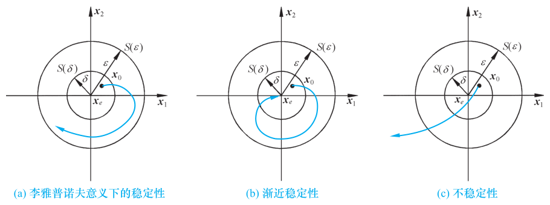{ .lq-img }

*图 9-17 有关稳定性的平面几何表示：(a) 李雅普诺夫意义下的稳定性；(b) 渐近稳定性；(c) 不稳定性（截自原书）*

### 李雅普诺夫第一法（间接法）

李雅普诺夫第一法是利用状态方程解的特性来判断系统稳定性的方法，适用于线性定常、线性时变以及非线性函数可线性化的情况。对线性定常系统有如下特征值判据：

**定理 9-1** 对于线性定常系统 \(\dot{\boldsymbol{x}}=\boldsymbol{A}\boldsymbol{x}\)，\(\boldsymbol{x}(0)=\boldsymbol{x}_0\)，\(t\ge 0\)，有：

1) 系统的每一平衡状态是在李雅普诺夫意义下稳定的充分必要条件是，\(\boldsymbol{A}\) 的所有特征值均具有**非正（负或零）实部**；
2) 系统的唯一平衡状态 \(\boldsymbol{x}_e=\boldsymbol{0}\) 是渐近稳定的充分必要条件是，\(\boldsymbol{A}\) 的所有特征值均具有**负实部**。

由于所讨论的系统为线性定常系统，当其为稳定时必是一致稳定；当其为渐近稳定时必是大范围一致渐近稳定。

### 李雅普诺夫第二法（直接法）

根据古典力学中的振动现象：若系统能量（含动能与位能）随时间推移而衰减，系统迟早会达到平衡状态。但要找到实际系统的能量函数表达式并非易事，李雅普诺夫提出可**虚构一个能量函数**——后被称为**李雅普诺夫函数**，一般与 \(x_1,x_2,\cdots,x_n\) 及 \(t\) 有关，记以 \(V(\boldsymbol{x},t)\)；若不显含 \(t\)，记以 \(V(\boldsymbol{x})\)。它是标量函数，考虑到能量总大于零，故为**正定函数**；能量衰减特性用 \(\dot{V}(\boldsymbol{x},t)\) 或 \(\dot{V}(\boldsymbol{x})\) 表示。第二法利用 \(V\) 及 \(\dot V\) 的符号特征直接对平衡状态稳定性作出判断，无须求出系统状态方程的解，故称直接法。遗憾的是，对一般非线性系统仍未找到构造李雅普诺夫函数的通用方法；对于线性系统，通常用二次型函数 \(\boldsymbol{x}^{\mathrm T}\boldsymbol{P}\boldsymbol{x}\) 作为李雅普诺夫函数。

**(1) 标量函数定号性（简要回顾）**

| 定号性 | 定义（域 \(S\) 包含状态空间原点） |
| --- | --- |
| 正定性 | \(V(\boldsymbol{0})=0\)，且对所有非零 \(\boldsymbol{x}\in S\) 有 \(V(\boldsymbol{x})>0\) |
| 负定性 | \(-V(\boldsymbol{x})\) 是正定函数 |
| 正半定性 | \(V(\boldsymbol{0})=0\)，且 \(V(\boldsymbol{x})\ge 0\)（原点及某些状态处可为零） |
| 负半定性 | \(-V(\boldsymbol{x})\) 是正半定函数 |
| 不定性 | 不论 \(S\) 多么小，\(V(\boldsymbol{x})\) 既可为正也可为负 |

**(2) 李雅普诺夫第二法主要定理**

**定理 9-2（定常系统大范围渐近稳定判别定理 1）** 对于定常系统

\[
\dot{\boldsymbol{x}}=\boldsymbol{f}(\boldsymbol{x}),\qquad t\ge 0,\qquad \boldsymbol{f}(\boldsymbol{0})=\boldsymbol{0}
\tag{9.160}
\]

如果存在一个具有连续一阶导数的标量函数 \(V(\boldsymbol{x})\)，其 \(V(\boldsymbol{0})=0\)，并且对于状态空间 \(X\) 中的一切非零点 \(\boldsymbol{x}\) 满足如下条件：1) \(V(\boldsymbol{x})\) 为正定；2) \(\dot{V}(\boldsymbol{x})\) 为负定；3) 当 \(\|\boldsymbol{x}\|\to\infty\) 时 \(V(\boldsymbol{x})\to\infty\)。则系统的原点平衡状态是**大范围渐近稳定**的。

**【例 9-17】** 设系统状态方程为

\[
\dot{x}_1=x_2-x_1(x_1^2+x_2^2),
\qquad
\dot{x}_2=-x_1-x_2(x_1^2+x_2^2)
\]

试确定系统的稳定性。

**解** 显然，原点 \((x_1=0,x_2=0)\) 是该系统唯一的平衡状态。选取正定标量函数

\[
V(\boldsymbol{x})=x_1^2+x_2^2
\]

则沿任意轨迹 \(V(\boldsymbol{x})\) 对时间的导数

\[
\dot{V}(\boldsymbol{x})=2x_1\dot{x}_1+2x_2\dot{x}_2=-2(x_1^2+x_2^2)^2
\]

是负定的。这说明 \(V(\boldsymbol{x})\) 沿任意轨迹是连续减小的，因此 \(V(\boldsymbol{x})\) 是一个李雅普诺夫函数。由于当 \(\|\boldsymbol{x}\|\to\infty\) 时 \(V(\boldsymbol{x})\to\infty\)，所以系统在原点处的平衡状态是**大范围渐近稳定**的。

一般地说，要构造一个李雅普诺夫函数 \(V(\boldsymbol{x})\) 使其满足定理 9-2 中所要求的 \(\dot V(\boldsymbol{x})\) 为负定这一条件，常常不易做到，且要求 \(\dot V\) 负定不免过于保守。下面给出将这一条件放宽后的判别定理。

!!! warning "原书笔误"
    原书此处的定理编号印为"定理 9-9"，据上下文应为**定理 9-2**；例 9-18 结尾的"根据定理 9-10 可判定"应为**定理 9-3**（本章定理 9-9、9-10 在 9.4 节，与稳定性判别无关）。

**定理 9-3（定常系统大范围渐近稳定判别定理 2）** 对于定常系统 (9.160)，如果存在一个具有连续一阶导数的标量 \(V(\boldsymbol{x})\)，其 \(V(\boldsymbol{0})=0\)，并且对状态空间 \(X\) 中的一切非零点 \(\boldsymbol{x}\) 满足如下条件：1) \(V(\boldsymbol{x})\) 为正定；2) \(\dot{V}(\boldsymbol{x})\) 为**负半定**；3) 对任意 \(\boldsymbol{x}\in X\)，\(\dot V(\boldsymbol{x}(t,\boldsymbol{x}_0,0))\not\equiv 0\)（即 \(\dot V\) 沿非零状态的受扰运动解不恒为零）；4) 当 \(\|\boldsymbol{x}\|\to\infty\) 时 \(V(\boldsymbol{x})\to\infty\)。则系统的原点平衡状态是大范围渐近稳定的。

**【例 9-18】** 已知定常系统状态方程为

\[
\dot{x}_1=x_2,
\qquad
\dot{x}_2=-x_1-(1+x_2)^2x_2
\]

试确定系统的稳定性。

**解** 易知原点 \((x_1=0,x_2=0)\) 为系统唯一的平衡状态。现取 \(V(\boldsymbol{x})=x_1^2+x_2^2\)，且有：

1) \(V(\boldsymbol{x})=x_1^2+x_2^2\) 为正定；
2) \(\dot{V}(\boldsymbol{x})=2x_1\dot{x}_1+2x_2\dot{x}_2=-2x_2^2(1+x_2)^2\)。容易看出，除了 ① \(x_1\) 任意、\(x_2=0\)；② \(x_1\) 任意、\(x_2=-1\) 时 \(\dot V(\boldsymbol{x})=0\) 以外，均有 \(\dot V(\boldsymbol{x})<0\)，所以 \(\dot V(\boldsymbol{x})\) 为负半定；
3) 检查是否 \(\dot V(\boldsymbol{x}(t,\boldsymbol{x}_0,0))\equiv 0\)。考察情况 ①：设 \(\bar{\boldsymbol{x}}(t,\boldsymbol{x}_0,0)=[x_1(t)\ \ 0]^{\mathrm T}\)，则由 \(x_2(t)\equiv 0\) 可导出 \(\dot{x}_2(t)=0\)，代入状态方程得 \(0=\dot{x}_1(t)=x_2(t)=0\) 与 \(\dot x_2(t)=-x_1(t)\)，要求 \(x_1(t)\equiv 0\)——这表明除了点 \((x_1=0,x_2=0)\) 外，\([x_1(t)\ \ 0]^{\mathrm T}\) 不是系统的受扰运动解。再考察情况 ②：设 \([x_1(t)\ \ -1]^{\mathrm T}\)，则由 \(x_2(t)=-1\) 可导出 \(\dot x_2(t)=0\)，代入状态方程得 \(\dot x_1(t)=x_2(t)=-1\) 与 \(0=\dot x_2(t)=-x_1(t)\)，要求 \(x_1(t)=0\) 与 \(\dot x_1(t)=-1\) 同时成立，显然矛盾——也不是受扰运动解。综合以上分析可知 \(\dot V(\boldsymbol{x}(t,\boldsymbol{x}_0,0))\not\equiv 0\)；
4) 当 \(\|\boldsymbol{x}\|\to\infty\) 时，显然有 \(V(\boldsymbol{x})=\|\boldsymbol{x}\|^2\to\infty\)。

于是，根据定理 9-3 可判定系统的原点平衡状态是**大范围渐近稳定**的。

由于上述判别定理都只提供了**充分条件**，如果经多次试取李雅普诺夫函数都得不到确定的答案时，就要考虑其为不稳定的可能性。下面的定理给出了判别不稳定的充分条件。

**定理 9-4（不稳定的判别定理）** 对于定常系统 (9.160)，如果存在一个具有连续一阶导数的标量函数 \(V(\boldsymbol{x})\)，其中 \(V(\boldsymbol{0})=0\)，和围绕原点的域 \(\Omega\)，使得对于一切 \(\boldsymbol{x}\in\Omega\) 和一切 \(t\ge t_0\) 满足：1) \(V(\boldsymbol{x})\) 为正定；2) \(\dot{V}(\boldsymbol{x})\) 为正定。则系统平衡状态为**不稳定**。

### 线性定常系统的李雅普诺夫稳定性分析

#### (1) 线性定常连续系统渐近稳定性的判别

设线性定常系统状态方程为 \(\dot{\boldsymbol{x}}=\boldsymbol{A}\boldsymbol{x}\)，\(\boldsymbol{x}(0)=\boldsymbol{x}_0\)，\(t\ge 0\)；\(\boldsymbol{A}\) 为非奇异矩阵，故原点是唯一平衡状态。设取正定二次型函数 \(V(\boldsymbol{x})=\boldsymbol{x}^{\mathrm T}\boldsymbol{P}\boldsymbol{x}\) 作为可能的李雅普诺夫函数，考虑到系统状态方程，则有

\[
\dot{V}(\boldsymbol{x})=\dot{\boldsymbol{x}}^{\mathrm T}\boldsymbol{P}\boldsymbol{x}+\boldsymbol{x}^{\mathrm T}\boldsymbol{P}\dot{\boldsymbol{x}}
=\boldsymbol{x}^{\mathrm T}(\boldsymbol{A}^{\mathrm T}\boldsymbol{P}+\boldsymbol{P}\boldsymbol{A})\boldsymbol{x}
\tag{9.161}
\]

令

\[
\boldsymbol{A}^{\mathrm T}\boldsymbol{P}+\boldsymbol{P}\boldsymbol{A}=-\boldsymbol{Q}
\tag{9.162}
\]

于是有

\[
\dot{V}(\boldsymbol{x})=-\boldsymbol{x}^{\mathrm T}\boldsymbol{Q}\boldsymbol{x}
\tag{9.163}
\]

根据定理 9-2，只要 \(\boldsymbol{Q}\) 正定（即 \(\dot V\) 负定），则系统是大范围渐近稳定的。于是线性定常连续系统渐近稳定的充分必要条件可表示为：给定一正定矩阵 \(\boldsymbol{P}\)，存在着满足式 (9.162) 的正定矩阵 \(\boldsymbol{Q}\)，而 \(\boldsymbol{x}^{\mathrm T}\boldsymbol{P}\boldsymbol{x}\) 是该系统的一个李雅普诺夫函数。式 (9.162) 称为**李雅普诺夫矩阵代数方程**。

实际使用时反过来更方便：**先选取 \(\boldsymbol{Q}\) 为正定实对称矩阵，再求解式 (9.162)**，若所求得的 \(\boldsymbol{P}\) 阵为正定实对称矩阵，则可判定系统是渐近稳定。常取 \(\boldsymbol{Q}\) 为单位阵或对角线阵。于是有：

**定理 9-5** 线性定常系统 \(\dot{\boldsymbol{x}}=\boldsymbol{A}\boldsymbol{x}\)，\(\boldsymbol{x}(0)=\boldsymbol{x}_0\)，\(t\ge 0\) 的原点平衡状态 \(\boldsymbol{x}_e=\boldsymbol{0}\) 为**渐近稳定的充要条件**是：对于任意给定的一个正定对称矩阵 \(\boldsymbol{Q}\)，有**唯一的**正定对称矩阵 \(\boldsymbol{P}\) 使式 (9.162) 成立。

对 \(\boldsymbol{Q}\) 的唯一限制是其应为对称正定阵。满足限制的 \(\boldsymbol{Q}\) 阵可能有无穷多个，但判断结果（系统是否渐近稳定）与 \(\boldsymbol{Q}\) 的不同选择无关。该定理的实质是给出了矩阵 \(\boldsymbol{A}\) 的所有特征值均具有负实部的充分必要条件。根据判别定理 2 还可推知：若系统任意的状态轨迹在非零状态不存在 \(\dot V(\boldsymbol{x})\) 恒为零时，\(\boldsymbol{Q}\) 阵可选择为**正半定**的（允许 \(\boldsymbol{Q}\) 取半正定对角阵且主对角线上部分元素为零），而解得的 \(\boldsymbol{P}\) 阵仍应正定。

一般地说，求解李雅普诺夫方程并非易事，因而这种方法往往不是用来判定系统的渐近稳定性，而是用来**构造**线性定常连续渐近稳定系统。

**【例 9-19】** 已知线性定常连续系统状态方程为

\[
\dot{x}_1=x_2,
\qquad
\dot{x}_2=2x_1-x_2
\]

试用李雅普诺夫方程判定系统的渐近稳定性。

**解** 为便于对比，先用特征值判据判断。系统状态方程为 \(\dot{\boldsymbol{x}}=\begin{bmatrix} 0 & 1 \\ 2 & -1 \end{bmatrix}\boldsymbol{x}\)，\(\boldsymbol{A}=\begin{bmatrix} 0 & 1 \\ 2 & -1 \end{bmatrix}\)，其特征方程

\[
|\boldsymbol{\lambda I}-\boldsymbol{A}|=
\begin{vmatrix} \boldsymbol{\lambda} & -1 \\ -2 & \boldsymbol{\lambda}+1 \end{vmatrix}
=\boldsymbol{\lambda}^2+\boldsymbol{\lambda}-2=(\boldsymbol{\lambda}-1)(\boldsymbol{\lambda}+2)=0
\]

特征值为 \(1\) 和 \(-2\)，故系统不稳定。令

\[
\boldsymbol{A}^{\mathrm T}\boldsymbol{P}+\boldsymbol{P}\boldsymbol{A}=-\boldsymbol{Q}=-\boldsymbol{I},
\qquad
\boldsymbol{P}=\boldsymbol{P}^{\mathrm T}=\begin{bmatrix} P_{11} & P_{12} \\ P_{12} & P_{22} \end{bmatrix}
\]

则有

\[
\begin{bmatrix} 0 & 2 \\ 1 & -1 \end{bmatrix}
\begin{bmatrix} P_{11} & P_{12} \\ P_{12} & P_{22} \end{bmatrix}
+
\begin{bmatrix} P_{11} & P_{12} \\ P_{12} & P_{22} \end{bmatrix}
\begin{bmatrix} 0 & 1 \\ 2 & -1 \end{bmatrix}
=
\begin{bmatrix} -1 & 0 \\ 0 & -1 \end{bmatrix}
\]

展开有

\[
4P_{12}=-1,\qquad 2P_{12}-2P_{22}=-1,\qquad P_{11}-P_{12}+2P_{22}=0
\]

解得

\[
\boldsymbol{P}=
\begin{bmatrix} -\dfrac{3}{4} & -\dfrac{1}{4} \\[2mm] -\dfrac{1}{4} & \dfrac{1}{4} \end{bmatrix}
\]

由于 \(P_{11}=-\dfrac{3}{4}<0\)，\(\det\boldsymbol{P}=-\dfrac{1}{4}<0\)，故 \(\boldsymbol{P}\) 不定，可知系统**非渐近稳定**。由特征值判据知系统是不稳定的。

=== "MATLAB"

    ```matlab
    % ===== 书 9.3 节 例9-19：李雅普诺夫方程 =====
    A = [0 1; 2 -1];
    P = lyap(A', eye(2))      % 解 A'P + PA = -I
    eig(P)                    % 判断 P 是否正定：有负特征值 -> P 不定 -> 非渐近稳定
    ```

=== "Python"

    ```python
    # ===== 书 9.3 节 例9-19：李雅普诺夫方程 =====
    import numpy as np
    import control as ct

    A = np.array([[0.0, 1.0], [2.0, -1.0]])
    P = ct.lyap(A.T, np.eye(2))     # 解 A^T P + P A = -I（ct.lyap 与 MATLAB lyap 同约定）
    print(P)
    # [[-0.75 -0.25]
    #  [-0.25  0.25]] —— 与手算一致：P11<0、detP=-0.25<0，P 不定，系统非渐近稳定
    print(np.linalg.eigvals(P))     # 一正一负 -> P 不定
    ```

#### (2) 线性定常离散系统渐近稳定性的判别

设线性定常离散系统状态方程为

\[
\boldsymbol{x}(k+1)=\boldsymbol{\Phi}\boldsymbol{x}(k),\qquad \boldsymbol{x}(0)=\boldsymbol{x}_0;\qquad k=0,1,2,\cdots
\tag{9.164}
\]

式中 \(\boldsymbol{\Phi}\) 阵非奇异，原点是平衡状态。取正定二次型函数

\[
V(\boldsymbol{x}(k))=\boldsymbol{x}^{\mathrm T}(k)\boldsymbol{P}\boldsymbol{x}(k)
\tag{9.165}
\]

以 \(\Delta V(\boldsymbol{x}(k))\) 代替 \(\dot V(\boldsymbol{x})\)：

\[
\Delta V(\boldsymbol{x}(k))=V(\boldsymbol{x}(k+1))-V(\boldsymbol{x}(k))
\tag{9.166}
\]

考虑到状态方程 (9.164) 有

\[
\Delta V(\boldsymbol{x}(k))=\boldsymbol{x}^{\mathrm T}(k)(\boldsymbol{\Phi}^{\mathrm T}\boldsymbol{P}\boldsymbol{\Phi}-\boldsymbol{P})\boldsymbol{x}(k)
\tag{9.167}
\]

令

\[
\boldsymbol{\Phi}^{\mathrm T}\boldsymbol{P}\boldsymbol{\Phi}-\boldsymbol{P}=-\boldsymbol{Q}
\tag{9.168}
\]

于是有

\[
\Delta V(\boldsymbol{x}(k))=-\boldsymbol{x}^{\mathrm T}(k)\boldsymbol{Q}\boldsymbol{x}(k)
\tag{9.169}
\]

**定理 9-6** 线性定常离散系统 (9.164) 渐近稳定的充分必要条件是，给定任一正定对称矩阵 \(\boldsymbol{Q}\)，存在一个正定对称矩阵 \(\boldsymbol{P}\) 使式 (9.168) 成立。\(\boldsymbol{x}^{\mathrm T}(k)\boldsymbol{P}\boldsymbol{x}(k)\) 是系统的一个李雅普诺夫函数，式 (9.168) 称为**离散的李雅普诺夫代数方程**，通常可取 \(\boldsymbol{Q}=\boldsymbol{I}\)。如果 \(\Delta V(\boldsymbol{x}(k))\) 沿任一解的序列不恒为零，则 \(\boldsymbol{Q}\) 可取为正半定矩阵。

!!! note "拓展：定理 9-5 与特征值判据是一枚硬币的两面（补充）"
    直观上看：\(\boldsymbol{Q}\) 正定意味着 \(\dot V=-\boldsymbol{x}^{\mathrm T}\boldsymbol{Q}\boldsymbol{x}<0\)，"能量"严格下降，必收敛到原点——这正是"所有模态都衰减"的代数说法。反过来，若 \(\boldsymbol{A}\) 有右半平面特征值，对应模态上 \(\boldsymbol{x}^{\mathrm T}\boldsymbol{P}\boldsymbol{x}\) 只会增大，\(\boldsymbol{P}\) 必定正定不起来。工程上这个定理更大的用途是**反向构造**：想要一个渐近稳定的 \(\boldsymbol{A}\)，任选 \(\boldsymbol{Q}\succ 0\) 解出 \(\boldsymbol{P}\succ 0\)，就能给出二次型性能指标下的最优反馈结构——LQR 最优控制的雏形就在这里。

## 9.4 线性定常系统的反馈结构及状态观测器

无论在经典控制理论还是现代控制理论中，反馈都是系统设计的主要方式。经典控制理论用传递函数描述系统，只能用输出量作反馈量；现代控制理论采用系统内部的状态变量描述物理特性，因而除输出反馈外，还经常采用**状态反馈**。状态反馈能提供更多的校正信息，在形成最优控制规律、抑制或消除扰动影响、实现系统解耦控制等方面获得了广泛应用。要利用状态进行反馈，必须用传感器测量状态变量，但并不是所有状态变量在物理上都可测量，于是提出了用**状态观测器**给出状态估值的问题。状态反馈与状态观测器的设计便构成了用状态空间法综合设计系统的主要内容。

### 线性定常系统常用反馈结构及其对系统特性的影响

#### (1) 两种常用反馈结构

在系统的综合设计中，两种常用的反馈形式是线性直接状态反馈和线性非动态输出反馈，简称为**状态反馈**和**输出反馈**。

**1) 状态反馈。** 设有 \(n\) 维线性定常系统

\[
\dot{\boldsymbol{x}}=\boldsymbol{A}\boldsymbol{x}+\boldsymbol{B}\boldsymbol{u},
\qquad
\boldsymbol{y}=\boldsymbol{C}\boldsymbol{x}
\tag{9.170}
\]

式中 \(\boldsymbol{x},\boldsymbol{u},\boldsymbol{y}\) 分别为 \(n,p,q\) 维向量；\(\boldsymbol{A},\boldsymbol{B},\boldsymbol{C}\) 分别为 \(n\times n\)、\(n\times p\)、\(q\times n\) 实数矩阵。当将系统的控制量 \(\boldsymbol{u}\) 取为状态变量的线性函数

\[
\boldsymbol{u}=\boldsymbol{v}-\boldsymbol{K}\boldsymbol{x}
\tag{9.171}
\]

时，称之为**线性直接状态反馈**，简称状态反馈。其中 \(\boldsymbol{v}\) 为 \(p\) 维参考输入向量，\(\boldsymbol{K}\) 为 \(p\times n\) 维实反馈增益矩阵（研究状态反馈时假定所有状态变量都可以用来反馈）。将式 (9.171) 代入式 (9.170) 可得状态反馈系统动态方程

\[
\dot{\boldsymbol{x}}=(\boldsymbol{A}-\boldsymbol{B}\boldsymbol{K})\boldsymbol{x}+\boldsymbol{B}\boldsymbol{v},
\qquad
\boldsymbol{y}=\boldsymbol{C}\boldsymbol{x}
\tag{9.172}
\]

其传递函数矩阵为

\[
\boldsymbol{G}_K(s)=\boldsymbol{C}\left[s\boldsymbol{I}-(\boldsymbol{A}-\boldsymbol{B}\boldsymbol{K})\right]^{-1}\boldsymbol{B}
\tag{9.173}
\]

因此可用 \(\{\boldsymbol{A}-\boldsymbol{B}\boldsymbol{K},\ \boldsymbol{B},\ \boldsymbol{C}\}\) 来表示引入状态反馈后的闭环系统。引入状态反馈后系统的**输出方程没有变化**。加入状态反馈后系统结构图如图 9-18 所示。

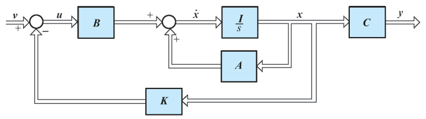{ .lq-img }

*图 9-18 加入状态反馈后的系统结构图（截自原书）*

**2) 输出反馈。** 系统的状态常常不能全部测量到，状态反馈法的应用受到限制，此时常采用输出反馈。输出反馈的目的首先是使系统闭环成为稳定系统，然后在此基础上进一步改善闭环系统性能。输出反馈有两种形式：

一种是**将输出量反馈至状态微分**，结构图如图 9-19 所示，动态方程为

\[
\dot{\boldsymbol{x}}=(\boldsymbol{A}-\boldsymbol{H}\boldsymbol{C})\boldsymbol{x}+\boldsymbol{B}\boldsymbol{u},
\qquad
\boldsymbol{y}=\boldsymbol{C}\boldsymbol{x}
\tag{9.174}
\]

其传递函数矩阵为

\[
\boldsymbol{G}_H(s)=\boldsymbol{C}\left[s\boldsymbol{I}-(\boldsymbol{A}-\boldsymbol{H}\boldsymbol{C})\right]^{-1}\boldsymbol{B}
\tag{9.175}
\]

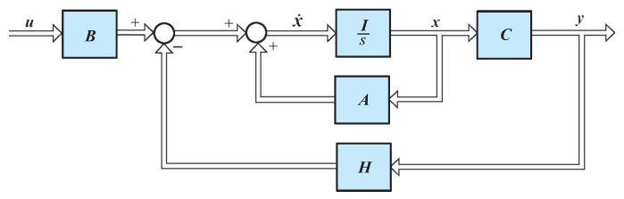{ .lq-img }

*图 9-19 输出反馈至状态微分的系统结构图（截自原书）*

另一种是**将输出量反馈至参考输入**，结构图如图 9-20 所示。当将控制量 \(\boldsymbol{u}\) 取为输出 \(\boldsymbol{y}\) 的线性函数

\[
\boldsymbol{u}=\boldsymbol{v}-\boldsymbol{F}\boldsymbol{y}
\tag{9.176}
\]

时，称之为**线性非动态输出反馈**，常简称为输出反馈，其中 \(\boldsymbol{v}\) 为 \(p\) 维参考输入向量，\(\boldsymbol{F}\) 为 \(p\times q\) 维实反馈增益矩阵。这是一种最常用的输出反馈。将式 (9.176) 代入式 (9.170) 可得输出反馈系统动态方程

\[
\dot{\boldsymbol{x}}=(\boldsymbol{A}-\boldsymbol{B}\boldsymbol{F}\boldsymbol{C})\boldsymbol{x}+\boldsymbol{B}\boldsymbol{v},
\qquad
\boldsymbol{y}=\boldsymbol{C}\boldsymbol{x}
\tag{9.177}
\]

其传递函数矩阵为

\[
\boldsymbol{G}_F(s)=\boldsymbol{C}\left[s\boldsymbol{I}-(\boldsymbol{A}-\boldsymbol{B}\boldsymbol{F}\boldsymbol{C})\right]^{-1}\boldsymbol{B}
\tag{9.178}
\]

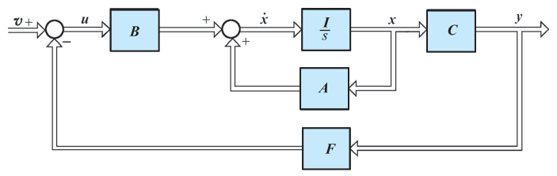{ .lq-img }

*图 9-20 输出反馈至参考输入的系统结构图（截自原书）*

不管是状态反馈还是输出反馈，都可以改变状态的系数矩阵，但这并不表明二者具有等同的功能：**状态**能完整地表征系统的动态行为，利用状态反馈时信息量大而完整，当系统完全可控时，可以在不增加系统维数的情况下**自由地支配响应特性**；而**输出反馈**仅利用了状态变量的线性组合，信息量较小，引入的补偿装置将使系统维数增加，且难以得到任意期望的响应特性。一个输出反馈系统的性能，一定有对应的状态反馈系统与之等同（如图 9-20 中令 \(\boldsymbol{F}\boldsymbol{C}=\boldsymbol{K}\) 便可确定状态反馈增益矩阵）；但一个状态反馈系统却不一定有对应的输出反馈系统与之等同（令 \(\boldsymbol{K}=\boldsymbol{F}\boldsymbol{C}\) 求 \(\boldsymbol{F}\) 时，有可能因 \(\boldsymbol{F}\) 含有输出量的高阶导数而无法实现）。对非最小相位被控对象，若选择右半平面校正零点去对消右半平面极点，会潜藏不稳定隐患。输出反馈所用的输出变量总易测量、实现方便，因而获得较广泛应用；状态反馈中不便或不能测量的状态变量，需利用状态观测器进行重构。

#### (2) 反馈结构对系统性能的影响

**定理 9-7** 对于系统 (9.170)，**状态反馈的引入不改变系统的可控性**。

**证明思路** 设被控系统 \(\Sigma_0\) 的可控性矩阵为 \(\boldsymbol{S}_c=[\boldsymbol{B}\ \ \boldsymbol{A}\boldsymbol{B}\ \ \cdots\ \ \boldsymbol{A}^{n-1}\boldsymbol{B}]\)，状态反馈系统 \(\Sigma_K\) 的可控性矩阵为 \(\boldsymbol{S}_{cK}=[\boldsymbol{B}\ \ (\boldsymbol{A}-\boldsymbol{B}\boldsymbol{K})\boldsymbol{B}\ \ \cdots\ \ (\boldsymbol{A}-\boldsymbol{B}\boldsymbol{K})^{n-1}\boldsymbol{B}]\)。把 \(\boldsymbol{B}\) 按列分块 \(\boldsymbol{B}=[\boldsymbol{b}_1\ \cdots\ \boldsymbol{b}_p]\)、\(\boldsymbol{K}\) 按行分块 \(\boldsymbol{K}=[\boldsymbol{k}_1^{\mathrm T}\ \cdots\ \boldsymbol{k}_p^{\mathrm T}]^{\mathrm T}\)，则

\[
(\boldsymbol{A}-\boldsymbol{B}\boldsymbol{K})\boldsymbol{b}_i=\boldsymbol{A}\boldsymbol{b}_i-[\boldsymbol{b}_1\ \cdots\ \boldsymbol{b}_p]\begin{bmatrix} \boldsymbol{k}_1\boldsymbol{b}_i \\ \vdots \\ \boldsymbol{k}_p\boldsymbol{b}_i \end{bmatrix}
=\boldsymbol{A}\boldsymbol{b}_i-\sum_{j=1}^{p}(\boldsymbol{k}_j\boldsymbol{b}_i)\boldsymbol{b}_j
\]

即 \((\boldsymbol{A}-\boldsymbol{B}\boldsymbol{K})\boldsymbol{B}\) 的列是 \([\boldsymbol{B}\ \ \boldsymbol{A}\boldsymbol{B}]\) 列的线性组合；同理 \((\boldsymbol{A}-\boldsymbol{B}\boldsymbol{K})^2\boldsymbol{B}\) 的列是 \([\boldsymbol{B}\ \ \boldsymbol{A}\boldsymbol{B}\ \ \boldsymbol{A}^2\boldsymbol{B}]\) 列的线性组合，依此类推，故 \(\mathrm{rank}\,\boldsymbol{S}_{cK}\le\mathrm{rank}\,\boldsymbol{S}_c\)。另一方面，\(\Sigma_0\) 又可看成 \(\Sigma_K\) 的状态反馈系统（\(\boldsymbol{u}=\boldsymbol{v}+\boldsymbol{K}\boldsymbol{x}\)），同理有 \(\mathrm{rank}\,\boldsymbol{S}_c\le\mathrm{rank}\,\boldsymbol{S}_{cK}\)。两者结合得

\[
\mathrm{rank}\,\boldsymbol{S}_{cK}=\mathrm{rank}\,\boldsymbol{S}_c
\]

从而当且仅当 \(\Sigma_0\) 可控时 \(\Sigma_K\) 可控。证毕。

**应当指出，状态反馈系统不一定能保持可观测性**，看一个反例：考察

\[
\dot{\boldsymbol{x}}=
\begin{bmatrix} 1 & 2 \\ 0 & 3 \end{bmatrix}\boldsymbol{x}+\begin{bmatrix} 0 \\ 1 \end{bmatrix}u,
\qquad
y=\begin{bmatrix} 1 & 1 \end{bmatrix}\boldsymbol{x}
\]

其可观测性判别阵

\[
\boldsymbol{V}_o=\begin{bmatrix} \boldsymbol{c} \\ \boldsymbol{c}\boldsymbol{A} \end{bmatrix}
=\begin{bmatrix} 1 & 1 \\ 1 & 5 \end{bmatrix},
\qquad
\mathrm{rank}\,\boldsymbol{V}_o=n=2
\]

故该系统可观测。现引入状态反馈，取 \(\boldsymbol{k}=[0\ \ 4]\)，则状态反馈系统 \(\Sigma_K\) 为

\[
\dot{\boldsymbol{x}}=(\boldsymbol{A}-\boldsymbol{b}\boldsymbol{k})\boldsymbol{x}+\boldsymbol{b}v
=
\begin{bmatrix} 1 & 2 \\ 0 & -1 \end{bmatrix}\boldsymbol{x}+\begin{bmatrix} 0 \\ 1 \end{bmatrix}v,
\qquad
y=\begin{bmatrix} 1 & 1 \end{bmatrix}\boldsymbol{x}
\]

其可观测性判别阵

\[
\boldsymbol{V}_{oK}=\begin{bmatrix} \boldsymbol{c} \\ \boldsymbol{c}(\boldsymbol{A}-\boldsymbol{b}\boldsymbol{k}) \end{bmatrix}
=\begin{bmatrix} 1 & 1 \\ 1 & 1 \end{bmatrix},
\qquad
\mathrm{rank}\,\boldsymbol{V}_{oK}=1<n=2
\]

故该状态反馈系统为**不可观测**。若取 \(\boldsymbol{k}=[0\ \ 5]\)，通过计算可知，此时它是可观测的。这表明状态反馈可能改变系统的可观测性，**其原因是状态反馈造成了所配置的极点与零点相对消**。

**定理 9-8** 对于系统 (9.170)，**输出至状态微分反馈的引入不改变系统的可观测性**。

**证明** 用对偶定理证明。设被控对象 \(\Sigma_0\) 为 \((\boldsymbol{A},\boldsymbol{B},\boldsymbol{C})\)，输出反馈至状态微分的系统 \(\Sigma_H\) 为 \((\boldsymbol{A}-\boldsymbol{H}\boldsymbol{C},\boldsymbol{B},\boldsymbol{C})\)。若 \((\boldsymbol{A},\boldsymbol{B},\boldsymbol{C})\) 可观测，则对偶系统 \((\boldsymbol{A}^{\mathrm T},\boldsymbol{C}^{\mathrm T},\boldsymbol{B}^{\mathrm T})\) 可控；由定理 9-7，加入状态反馈后的系统 \(((\boldsymbol{A}^{\mathrm T}-\boldsymbol{C}^{\mathrm T}\boldsymbol{H}^{\mathrm T}),\boldsymbol{C}^{\mathrm T},\boldsymbol{B}^{\mathrm T})\) 的可控性不变，即

\[
\mathrm{rank}\begin{bmatrix} \boldsymbol{C}^{\mathrm T} & \boldsymbol{A}^{\mathrm T}\boldsymbol{C}^{\mathrm T} & \cdots & (\boldsymbol{A}^{\mathrm T})^{n-1}\boldsymbol{C}^{\mathrm T} \end{bmatrix}
=\mathrm{rank}\begin{bmatrix} \boldsymbol{C}^{\mathrm T} & (\boldsymbol{A}-\boldsymbol{H}\boldsymbol{C})^{\mathrm T}\boldsymbol{C}^{\mathrm T} & \cdots & ((\boldsymbol{A}-\boldsymbol{H}\boldsymbol{C})^{\mathrm T})^{n-1}\boldsymbol{C}^{\mathrm T} \end{bmatrix}
\tag{9.182}
\]

上式表明原系统 \(\Sigma_0\) 与 \(\Sigma_H\) 可观测性判别阵的秩相等——若 \(\Sigma_0\) 可观测，则 \(\Sigma_H\) 也是可观测的。证毕。

但由定理 9-7，系统加入状态反馈后有可能使对偶系统的可观测性（即原系统的可控性）发生 \(\mathrm{rank}\,\boldsymbol{V}_o\neq\mathrm{rank}\,\boldsymbol{V}_{oH}\) 的变化，故**输出至状态微分的反馈有可能改变系统的可控性**。

**定理 9-9** 对于系统 (9.170)，**输出至参考输入反馈的引入能同时不改变系统的可控性和可观测性**，即输出反馈系统 \(\Sigma_F\) 为可控（可观测）的充分必要条件是被控系统 \(\Sigma_0\) 为可控（可观测）。

**证明** 首先，对任一输出至参考输入的反馈系统都能找到一个等价的状态反馈系统（\(\boldsymbol{F}\boldsymbol{C}=\boldsymbol{K}\)），由定理 9-7 知状态反馈可保持可控性，因而输出至参考输入反馈的引入不改变系统的可控性。其次，将 \(\boldsymbol{C},\boldsymbol{F}\) 分别按行、列分块（\(\boldsymbol{F}=[\boldsymbol{f}_1\ \cdots\ \boldsymbol{f}_q]\)），可验证 \(\boldsymbol{C}(\boldsymbol{A}-\boldsymbol{B}\boldsymbol{F}\boldsymbol{C})^k\) 的行是 \([\boldsymbol{C}^{\mathrm T}\ \ \boldsymbol{A}^{\mathrm T}\boldsymbol{C}^{\mathrm T}\ \cdots\ ((\boldsymbol{A}^{\mathrm T})^k\boldsymbol{C}^{\mathrm T})]^{\mathrm T}\) 的行的线性组合（组合系数为标量 \(\boldsymbol{c}_i\boldsymbol{B}\boldsymbol{f}_j\)），故 \(\boldsymbol{V}_{oF}\) 的每一行均可表为 \(\boldsymbol{V}_o\) 的行的线性组合，得 \(\mathrm{rank}\,\boldsymbol{V}_{oF}\le\mathrm{rank}\,\boldsymbol{V}_o\)；又 \(\Sigma_0\) 可看成 \(\Sigma_F\) 的输出反馈系统，反向同理得 \(\mathrm{rank}\,\boldsymbol{V}_o\le\mathrm{rank}\,\boldsymbol{V}_{oF}\)。两者结合得 \(\mathrm{rank}\,\boldsymbol{V}_{oF}=\mathrm{rank}\,\boldsymbol{V}_o\)，可观测性保持。证毕。

### 系统的极点配置

状态反馈和输出反馈都能改变闭环系统的极点位置。所谓**极点配置**，就是利用状态反馈或输出反馈使闭环系统的极点位于所希望的位置。系统的性能和它的极点位置密切相关，因而极点配置在系统设计中很重要。需要解决两个问题：一是建立**极点可配置的条件**，二是确定**极点配置所需要的反馈增益矩阵**。

#### (1) 极点可配置条件

**1) 利用状态反馈的极点可配置条件。**

**定理 9-10** 利用状态反馈任意配置闭环极点的充分必要条件是**被控系统 (9.170) 可控**。

**证明** 就单输入-多输出系统来证明，此时 \(\boldsymbol{B}\) 为一列向量，记为 \(\boldsymbol{b}\)。

**先证充分性。** 若系统 \((\boldsymbol{A},\boldsymbol{b})\) 可控，则通过非奇异线性变换 \(\boldsymbol{x}=\boldsymbol{P}^{-1}\bar{\boldsymbol{x}}\) 可变换为可控标准型

\[
\dot{\bar{\boldsymbol{x}}}=\bar{\boldsymbol{A}}\bar{\boldsymbol{x}}+\bar{\boldsymbol{b}}u
\tag{9.187}
\]

式中

\[
\bar{\boldsymbol{A}}=\boldsymbol{P}\boldsymbol{A}\boldsymbol{P}^{-1}=
\begin{bmatrix}
0 & 1 & 0 & \cdots & 0 \\
0 & 0 & 1 & \cdots & 0 \\
\vdots & \vdots & \vdots & \ddots & \vdots \\
0 & 0 & 0 & \cdots & 1 \\
-a_0 & -a_1 & -a_2 & \cdots & -a_{n-1}
\end{bmatrix},
\qquad
\bar{\boldsymbol{b}}=\boldsymbol{P}\boldsymbol{b}=
\begin{bmatrix} 0 \\ 0 \\ \vdots \\ 0 \\ 1 \end{bmatrix}
\]

在单输入情况下，引入状态反馈

\[
u=v-\boldsymbol{k}\bar{\boldsymbol{x}}=v-\boldsymbol{k}\boldsymbol{P}^{-1}\bar{\boldsymbol{x}}\triangleq v-\bar{\boldsymbol{k}}\bar{\boldsymbol{x}},
\qquad
\bar{\boldsymbol{k}}=\boldsymbol{k}\boldsymbol{P}^{-1}=\begin{bmatrix} \bar{k}_0 & \bar{k}_1 & \cdots & \bar{k}_{n-1} \end{bmatrix}
\tag{9.188}
\]

则引入状态反馈后闭环系统的状态阵为

\[
\bar{\boldsymbol{A}}-\bar{\boldsymbol{b}}\bar{\boldsymbol{k}}=
\begin{bmatrix}
0 & 1 & 0 & \cdots & 0 \\
0 & 0 & 1 & \cdots & 0 \\
\vdots & \vdots & \vdots & \ddots & \vdots \\
0 & 0 & 0 & \cdots & 1 \\
-(a_0+\bar{k}_0) & -(a_1+\bar{k}_1) & -(a_2+\bar{k}_2) & \cdots & -(a_{n-1}+\bar{k}_{n-1})
\end{bmatrix}
\tag{9.189}
\]

对于这种特殊形式的矩阵，容易写出其闭环特征方程

\[
\det[s\boldsymbol{I}-(\bar{\boldsymbol{A}}-\bar{\boldsymbol{b}}\bar{\boldsymbol{k}})]
=s^n+(a_{n-1}+\bar{k}_{n-1})s^{n-1}+\cdots+(a_1+\bar{k}_1)s+(a_0+\bar{k}_0)=0
\tag{9.190}
\]

显然，该 \(n\) 阶特征方程中的 \(n\) 个系数可通过 \(\bar{k}_0,\bar{k}_1,\cdots,\bar{k}_{n-1}\) 来**独立设置**，也就是说 \((\bar{\boldsymbol{A}}-\bar{\boldsymbol{b}}\bar{\boldsymbol{k}})\) 的特征值可以任意选择，即系统的极点可以任意配置。

**再证必要性。** 如果系统 \((\boldsymbol{A},\boldsymbol{b})\) 不可控，说明系统的有些状态将不受 \(u\) 的控制，引入状态反馈时就不可能通过控制来影响不可控的极点。证毕。

**2) 利用输出反馈的极点可配置条件。**

**定理 9-11** 用输出至状态微分的反馈任意配置闭环极点的充分必要条件是**被控系统 (9.170) 可观测**。

**证明** 以多输入-单输出系统为例。根据对偶定理，若被控系统 \((\boldsymbol{A},\boldsymbol{B},\boldsymbol{c})\) 可观测，则对偶系统 \((\boldsymbol{A}^{\mathrm T},\boldsymbol{c}^{\mathrm T},\boldsymbol{B}^{\mathrm T})\) 可控，由状态反馈极点配置定理知 \((\boldsymbol{A}^{\mathrm T}-\boldsymbol{c}^{\mathrm T}\boldsymbol{h}^{\mathrm T})\) 的特征值可任意配置，其中 \(\boldsymbol{h}\) 为 \(n\times 1\) 输出反馈向量。由于 \((\boldsymbol{A}^{\mathrm T}-\boldsymbol{c}^{\mathrm T}\boldsymbol{h}^{\mathrm T})\) 的特征值与 \((\boldsymbol{A}^{\mathrm T}-\boldsymbol{c}^{\mathrm T}\boldsymbol{h}^{\mathrm T})^{\mathrm T}=\boldsymbol{A}-\boldsymbol{h}\boldsymbol{c}\) 的特征值相同，故当且仅当系统 \((\boldsymbol{A},\boldsymbol{B},\boldsymbol{c})\) 可观测时，可以任意配置 \((\boldsymbol{A}-\boldsymbol{h}\boldsymbol{c})\) 的特征值。证毕。

为了根据期望闭环极点来设计输出反馈向量 \(\boldsymbol{h}\) 的参数，只需将期望的系统特征多项式与该输出反馈系统特征多项式 \(|s\boldsymbol{I}-(\boldsymbol{A}-\boldsymbol{h}\boldsymbol{c})|\) 相比即可。

对于多输入-单输出被控系统，当采用输出至参考输入的反馈时，反馈增益矩阵 \(\boldsymbol{F}\) 为 \(p\times 1\) 维，记为向量 \(\boldsymbol{f}\)，则 \(\boldsymbol{u}=\boldsymbol{v}-\boldsymbol{f}y\)，输出反馈系统的动态方程为

\[
\dot{\boldsymbol{x}}=(\boldsymbol{A}-\boldsymbol{B}\boldsymbol{f}\boldsymbol{c})\boldsymbol{x}+\boldsymbol{B}\boldsymbol{v},
\qquad
y=\boldsymbol{c}\boldsymbol{x}
\tag{9.192}
\]

若令 \(\boldsymbol{f}\boldsymbol{c}=\boldsymbol{K}\)，该输出反馈便等价为状态反馈，适当选择 \(\boldsymbol{f}\) 可使特征值任意配置。但是，当比例的状态反馈变换为输出反馈时，输出反馈中必定含有输出量的**各阶导数**，于是 \(\boldsymbol{f}\) 向量不是常数向量，给物理实现带来困难，应用受限。可推论：**当 \(\boldsymbol{f}\) 是常数向量时，便不能任意配置极点**。

#### (2) 单输入-单输出系统的极点配置算法

对于具体的可控单输入-单输出系统，求解实现希望极点配置的状态反馈向量 \(\boldsymbol{k}\) 时，不必像定理 9-10 的证明那样进行可控标准型变换，只需运行如下简单算法：

- **第 1 步**：列写系统状态方程及状态反馈控制律 \(\dot{\boldsymbol{x}}=\boldsymbol{A}\boldsymbol{x}+\boldsymbol{b}u\)，\(u=v-\boldsymbol{k}\boldsymbol{x}\)，式中 \(\boldsymbol{k}=[k_0\ \ k_1\ \ \cdots\ \ k_{n-1}]\)。
- **第 2 步**：检验 \((\boldsymbol{A},\boldsymbol{b})\) 的可控性。若 \(\mathrm{rank}[\boldsymbol{b}\ \ \boldsymbol{A}\boldsymbol{b}\ \ \cdots\ \ \boldsymbol{A}^{n-1}\boldsymbol{b}]=n\)，则转下步。
- **第 3 步**：由要求配置的闭环极点 \(\lambda_1,\lambda_2,\cdots,\lambda_n\)，求出希望特征多项式 \(a_0^*(s)=\prod_{i=1}^{n}(s-\lambda_i)\)。
- **第 4 步**：计算状态反馈系统的特征多项式 \(a_0(s)=\det[s\boldsymbol{I}-\boldsymbol{A}+\boldsymbol{b}\boldsymbol{k}]\)。
- **第 5 步**：比较多项式 \(a_0^*(s)\) 与 \(a_0(s)\)，令其对应项系数相等，可确定状态反馈增益向量 \(\boldsymbol{k}\)。

应用极点配置方法改善系统性能，有以下方面需要注意：

1) 配置极点时并非离虚轴越远越好，以免造成系统带宽过大使抗扰性降低；
2) 状态反馈向量 \(\boldsymbol{k}\) 中的元素不宜过大，否则物理实现不易；
3) 闭环零点对系统动态性能有影响，在规定希望配置的闭环极点时需要充分考虑闭环零点的影响；
4) 状态反馈对系统的**零点和可观测性没有影响**，只有当任意配置的极点与系统零点存在对消时，状态反馈系统的零点和可观测性质才会改变。

以上性质适用于单输入-多输出或单输出系统，但不适用于多输入-多输出系统。

**【例 9-20】** 已知单输入线性定常系统的状态方程为

\[
\dot{\boldsymbol{x}}=
\begin{bmatrix} 0 & 0 & 0 \\ 1 & -6 & 0 \\ 0 & 1 & -12 \end{bmatrix}\boldsymbol{x}
+
\begin{bmatrix} 1 \\ 0 \\ 0 \end{bmatrix}u
\]

求状态反馈向量 \(\boldsymbol{k}\)，使系统的闭环特征值为

\[
\lambda_1=-2,\qquad \lambda_2=-1+\mathrm{j},\qquad \lambda_3=-1-\mathrm{j}
\]

**解** 系统的可控性矩阵为

\[
\boldsymbol{S}_c=[\boldsymbol{b}\ \ \boldsymbol{A}\boldsymbol{b}\ \ \boldsymbol{A}^2\boldsymbol{b}]
=
\begin{bmatrix} 1 & 0 & 0 \\ 0 & 1 & -6 \\ 0 & 0 & 1 \end{bmatrix},
\qquad
\mathrm{rank}\,\boldsymbol{S}_c=3=n
\]

系统可控，满足极点可配置条件。系统的希望特征多项式为

\[
a_0^*(s)=(s-\lambda_1)(s-\lambda_2)(s-\lambda_3)
=(s+2)(s+1-\mathrm{j})(s+1+\mathrm{j})
=s^3+4s^2+6s+4
\]

令

\[
a_0(s)=\det(s\boldsymbol{I}-\boldsymbol{A}+\boldsymbol{b}\boldsymbol{k})
=\det
\begin{bmatrix} s+k_1 & k_2 & k_3 \\ -1 & s+6 & 0 \\ 0 & -1 & s+12 \end{bmatrix}
\]

\[
=s^3+(k_1+18)s^2+(18k_1+k_2+72)s+(72k_1+12k_2+k_3)
\]

于是有

\[
k_1+18=4,\qquad 18k_1+k_2+72=6,\qquad 72k_1+12k_2+k_3=4
\]

可求得

\[
k_1=-14,\qquad k_2=186,\qquad k_3=-1220
\qquad\Longrightarrow\qquad
\boldsymbol{k}=\begin{bmatrix} k_1 & k_2 & k_3 \end{bmatrix}=\begin{bmatrix} -14 & 186 & -1220 \end{bmatrix}
\]

=== "MATLAB"

    ```matlab
    % ===== 书 9.4 节 例9-20：极点配置 =====
    A = [0 0 0; 1 -6 0; 0 1 -12]; b = [1; 0; 0];
    S = ctrb(A, b); rank(S)                 % 3，可控
    p = [-2, -1+1j, -1-1j];                 % 希望闭环极点
    k = acker(A, b, p)                      % [-14 186 -1220]
    eig(A - b*k)                            % 校验：恰为 p
    ```

=== "Python"

    ```python
    # ===== 书 9.4 节 例9-20：极点配置 =====
    import numpy as np
    import control as ct

    A = np.array([[0.0, 0, 0], [1, -6, 0], [0, 1, -12]])
    b = np.array([[1.0], [0], [0]])
    print(np.linalg.matrix_rank(ct.ctrb(A, b)))   # 3，可控
    p = [-2, -1 + 1j, -1 - 1j]                    # 希望闭环极点
    k = ct.acker(A, b, p)                         # SISO 用 acker
    print(k)                                      # [-14. 186. -1220.]
    print(np.linalg.eigvals(A - b @ np.atleast_2d(k)))   # 校验：恰为 p
    ```

### 全维状态观测器及其设计

利用状态反馈配置系统极点时，需要用传感器测量状态变量以便实现反馈。但在许多情况下通常只有被控对象的输入量和输出量能够用传感器测量，而多数状态变量不易测得或不可能测得，于是提出了利用被控对象的**输入量和输出量建立状态观测器**（又称状态估计器、状态重构器）来重构状态的问题。当重构状态向量的维数**等于**被控对象状态向量的维数时，称为**全维状态观测器**。

#### (1) 全维状态观测器构成方案

设被控对象动态方程为

\[
\dot{\boldsymbol{x}}=\boldsymbol{A}\boldsymbol{x}+\boldsymbol{B}\boldsymbol{u},
\qquad
\boldsymbol{y}=\boldsymbol{C}\boldsymbol{x}
\tag{9.193}
\]

可构造一个动态方程与式 (9.193) 相同但用计算机实现的**模拟被控系统**

!!! warning "原书笔误"
    原书此处印为"与式 (9.189) 相同"，据上下文应为**式 (9.193)**（被控对象动态方程；(9.189) 是定理 9-10 证明中的闭环状态阵）。

\[
\dot{\hat{\boldsymbol{x}}}=\boldsymbol{A}\hat{\boldsymbol{x}}+\boldsymbol{B}\boldsymbol{u},
\qquad
\hat{\boldsymbol{y}}=\boldsymbol{C}\hat{\boldsymbol{x}}
\tag{9.194}
\]

式中 \(\hat{\boldsymbol{x}}\)，\(\hat{\boldsymbol{y}}\) 分别为模拟系统的状态向量和输出向量，是被控对象状态向量和输出向量的估值。当模拟系统与被控对象的初始状态向量相同时，在同一输入作用下有 \(\hat{\boldsymbol{x}}=\boldsymbol{x}\)，可用 \(\hat{\boldsymbol{x}}\) 作为状态反馈所需的信息。但被控对象的初始状态与设定值之间可能很不相同，模拟系统中积分器初始条件的设置又只能预估，两个系统的初始状态总有差异——即使两个系统的 \(\boldsymbol{A},\boldsymbol{B},\boldsymbol{C}\) 阵完全一样，也必定存在估计状态与实际状态的误差 \((\hat{\boldsymbol{x}}-\boldsymbol{x})\)，难以实现所需的状态反馈。但 \((\hat{\boldsymbol{x}}-\boldsymbol{x})\) 的存在必定导致 \((\hat{\boldsymbol{y}}-\boldsymbol{y})\) 的存在，而被控系统的输出量总是可以用传感器测量的，于是根据一般反馈控制原理，将 \((\hat{\boldsymbol{y}}-\boldsymbol{y})\) 负反馈至 \(\dot{\hat{\boldsymbol{x}}}\) 处，控制 \((\hat{\boldsymbol{y}}-\boldsymbol{y})\) 尽快逼近于零，从而使 \((\hat{\boldsymbol{x}}-\boldsymbol{x})\) 尽快逼近于零，便可以利用 \(\hat{\boldsymbol{x}}\) 来形成状态反馈。按以上原理构成的状态观测器及其实现状态反馈的结构图如图 9-21 所示。

状态观测器有两个输入，即 \(\boldsymbol{u}\) 和 \(\boldsymbol{y}\)，输出为 \(\hat{\boldsymbol{x}}\)。观测器含 \(n\) 个积分器并对全部状态变量作出估计。\(\boldsymbol{H}\) 为**观测器输出反馈阵**，它把 \((\hat{\boldsymbol{y}}-\boldsymbol{y})\) 负反馈至 \(\dot{\hat{\boldsymbol{x}}}\) 处，是为配置观测器极点、提高其动态性能（即尽快使 \(\hat{\boldsymbol{x}}-\boldsymbol{x}\) 逼近于零）而引入的，它是前面介绍过的一种输出反馈。

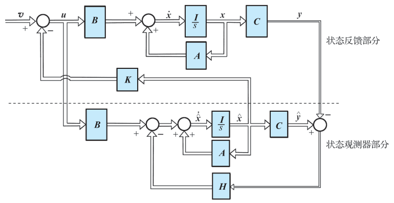{ .lq-img }

*图 9-21 状态观测器及其实现状态反馈的系统结构图（截自原书）*

#### (2) 全维状态观测器分析设计

由图 9-21 可列出全维状态观测器动态方程

\[
\dot{\hat{\boldsymbol{x}}}=\boldsymbol{A}\hat{\boldsymbol{x}}+\boldsymbol{B}\boldsymbol{u}-\boldsymbol{H}(\hat{\boldsymbol{y}}-\boldsymbol{y}),
\qquad
\hat{\boldsymbol{y}}=\boldsymbol{C}\hat{\boldsymbol{x}}
\tag{9.195}
\]

故有

\[
\dot{\hat{\boldsymbol{x}}}=\boldsymbol{A}\hat{\boldsymbol{x}}+\boldsymbol{B}\boldsymbol{u}-\boldsymbol{H}\boldsymbol{C}(\hat{\boldsymbol{x}}-\boldsymbol{x})
=(\boldsymbol{A}-\boldsymbol{H}\boldsymbol{C})\hat{\boldsymbol{x}}+\boldsymbol{B}\boldsymbol{u}+\boldsymbol{H}\boldsymbol{y}
\tag{9.196}
\]

式中 \((\boldsymbol{A}-\boldsymbol{H}\boldsymbol{C})\) 称为**观测器系统矩阵**。观测器分析设计的关键问题是：能否在任何初始条件下（尽管 \(\hat{\boldsymbol{x}}(t_0)\) 与 \(\boldsymbol{x}(t_0)\) 不同），总能保证

\[
\lim_{t\to\infty}(\hat{\boldsymbol{x}}(t)-\boldsymbol{x}(t))=\boldsymbol{0}
\tag{9.197}
\]

成立。只有满足式 (9.197)，状态反馈系统才能正常工作，式 (9.195) 所示系统才能作为实际的状态观测器，故式 (9.197) 称为**观测器存在条件**。

由式 (9.196) 与式 (9.193) 可得

\[
\dot{\boldsymbol{x}}-\dot{\hat{\boldsymbol{x}}}=(\boldsymbol{A}-\boldsymbol{H}\boldsymbol{C})(\boldsymbol{x}-\hat{\boldsymbol{x}})
\tag{9.198}
\]

其解为

\[
\boldsymbol{x}(t)-\hat{\boldsymbol{x}}(t)=\mathrm{e}^{(\boldsymbol{A}-\boldsymbol{H}\boldsymbol{C})(t-t_0)}\left[\boldsymbol{x}(t_0)-\hat{\boldsymbol{x}}(t_0)\right]
\tag{9.199}
\]

显见，当 \(\hat{\boldsymbol{x}}(t_0)=\boldsymbol{x}(t_0)\) 时，恒有 \(\hat{\boldsymbol{x}}(t)=\boldsymbol{x}(t)\)，所引入的输出反馈并不起作用；当 \(\hat{\boldsymbol{x}}(t_0)\neq\boldsymbol{x}(t_0)\) 时，输出反馈便起作用了，这时只要 \((\boldsymbol{A}-\boldsymbol{H}\boldsymbol{C})\) 的特征值具有负实部，初始状态向量误差总会按指数衰减规律满足式 (9.197)，其衰减速率取决于**观测器的极点配置**。由输出反馈定理 9-11 知，若被控对象可观测，则 \((\boldsymbol{A}-\boldsymbol{H}\boldsymbol{C})\) 的极点可任意配置，以满足 \(\hat{\boldsymbol{x}}\) 逼近 \(\boldsymbol{x}\) 的速率要求，因而保证了状态观测器的存在性。

**定理 9-12** 若被控系统 \((\boldsymbol{A},\boldsymbol{B},\boldsymbol{C})\) 可观测，则其状态可用形如

\[
\dot{\hat{\boldsymbol{x}}}=(\boldsymbol{A}-\boldsymbol{H}\boldsymbol{C})\hat{\boldsymbol{x}}+\boldsymbol{B}\boldsymbol{u}+\boldsymbol{H}\boldsymbol{y}
\tag{9.200}
\]

的全维状态观测器给出估值，其中矩阵 \(\boldsymbol{H}\) 按任意配置极点的需要来选择，以决定状态误差衰减的速率。

选择 \(\boldsymbol{H}\) 阵参数时，应注意防止数值过大带来的实现困难，如饱和效应、噪声加剧等；通常希望**观测器响应速度比状态反馈系统的响应速度要快些**。

**【例 9-21】** 设被控对象传递函数为

\[
\frac{Y(s)}{U(s)}=\frac{2}{(s+1)(s+2)}
\]

试设计全维状态观测器，将极点配置在 \(-10\)，\(-10\)。

**解** 被控对象的传递函数为

\[
\frac{Y(s)}{U(s)}=\frac{2}{(s+1)(s+2)}=\frac{2}{s^2+3s+2}
\]

根据传递函数可直接写出系统的可控标准型 \(\dot{\boldsymbol{x}}=\boldsymbol{A}\boldsymbol{x}+\boldsymbol{b}u\)，\(y=\boldsymbol{c}\boldsymbol{x}\)，其中

\[
\boldsymbol{A}=
\begin{bmatrix} 0 & 1 \\ -2 & -3 \end{bmatrix},
\qquad
\boldsymbol{b}=
\begin{bmatrix} 0 \\ 1 \end{bmatrix},
\qquad
\boldsymbol{c}=\begin{bmatrix} 2 & 0 \end{bmatrix}
\]

显然，系统可控可观测。\(n=2,\ q=1\)，输出反馈向量 \(\boldsymbol{h}\) 为 \(2\times 1\) 向量。全维状态观测器系统矩阵为

\[
\boldsymbol{A}-\boldsymbol{h}\boldsymbol{c}=
\begin{bmatrix} 0 & 1 \\ -2 & -3 \end{bmatrix}
-
\begin{bmatrix} h_0 \\ h_1 \end{bmatrix}\begin{bmatrix} 2 & 0 \end{bmatrix}
=
\begin{bmatrix} -2h_0 & 1 \\ -2-2h_1 & -3 \end{bmatrix}
\]

观测器特征方程为

\[
|\lambda\boldsymbol{I}-(\boldsymbol{A}-\boldsymbol{h}\boldsymbol{c})|
=\lambda^2+(2h_0+3)\lambda+(6h_0+2h_1+2)=0
\]

期望特征方程为

\[
(\lambda+10)^2=\lambda^2+20\lambda+100=0
\]

令两特征方程同次项系数相等可得

\[
2h_0+3=20,\qquad 6h_0+2h_1+2=100
\]

因而有

\[
h_0=8.5,\qquad h_1=23.5
\]

\(h_0,h_1\) 分别为由 \((\hat{y}-y)\) 引至 \(\dot{\hat{x}}_1\) 和 \(\dot{\hat{x}}_2\) 的反馈系数。被控对象及全维状态观测器组合系统的状态变量图如图 9-22 所示。

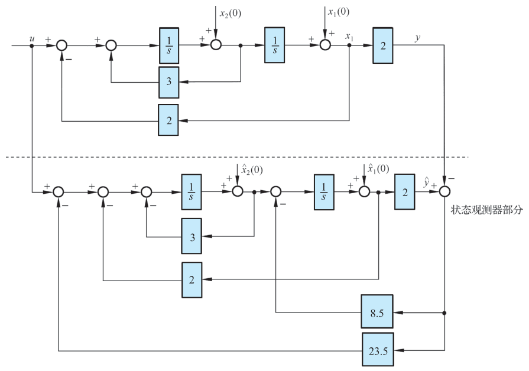{ .lq-img }

*图 9-22 例 9-21 全维状态观测器及被控对象组合系统的状态变量图（截自原书）*

=== "MATLAB"

    ```matlab
    % ===== 书 9.4 节 例9-21：观测器设计 =====
    A = [0 1; -2 -3]; b = [0; 1]; c = [2 0];
    p_ob = [-10 -10];                       % 观测器希望极点
    h = acker(A', c', p_ob)'                % h = [8.5; 23.5]（对偶系统配极点）
    eig(A - h*c)                            % 校验：-10, -10
    ```

=== "Python"

    ```python
    # ===== 书 9.4 节 例9-21：观测器设计 =====
    import numpy as np
    import control as ct

    A = np.array([[0.0, 1.0], [-2.0, -3.0]])
    b = np.array([[0.0], [1.0]])
    c = np.array([[2.0, 0.0]])
    h = ct.acker(A.T, c.T, [-10, -10])   # 对偶系统 (A', c') 配极点（SISO 可用 acker）
    print(h)                             # [8.5 23.5]
    print(np.linalg.eigvals(A - np.array(h).reshape(2, 1) @ c))   # [-10. -10.]
    ```

!!! note "拓展：为什么观测器极点要配得比状态反馈极点更快（补充）"
    分离定理只保证观测器极点不影响状态反馈子系统的极点，但状态误差 \((\boldsymbol{x}-\hat{\boldsymbol{x}})\) 的衰减快慢由观测器极点决定：观测器太慢，反馈用的一直是"过期"的估值，闭环真实性能会明显偏离设计值。工程经验是观测器极点实部取状态反馈极点的 **3～5 倍**：再快，\(\boldsymbol{H}\) 数值过大，测量噪声被放大（\(\boldsymbol{H}\boldsymbol{y}\) 项）、执行机构饱和，反而坏事——这正是原书"防止数值过大带来的实现困难"的含义。

### 分离特性

当用全维状态观测器提供的状态估值 \(\hat{\boldsymbol{x}}\) 代替真实状态 \(\boldsymbol{x}\) 来实现状态反馈时：为保持系统的期望特征值，状态反馈阵 \(\boldsymbol{K}\) 是否需要重新设计？观测器被引入系统以后，状态反馈系统部分是否会改变已经设计好的观测器极点配置，观测器输出反馈阵 \(\boldsymbol{H}\) 是否需要重新设计？为此需对引入观测器的状态反馈系统作进一步分析。整个系统的结构图如图 9-21 所示，是一个 \(2n\) 维的复合系统，其中

\[
\boldsymbol{u}=\boldsymbol{v}-\boldsymbol{K}\hat{\boldsymbol{x}}
\tag{9.201}
\]

状态反馈子系统动态方程为

\[
\dot{\boldsymbol{x}}=\boldsymbol{A}\boldsymbol{x}+\boldsymbol{B}\boldsymbol{u}
=\boldsymbol{A}\boldsymbol{x}-\boldsymbol{B}\boldsymbol{K}\hat{\boldsymbol{x}}+\boldsymbol{B}\boldsymbol{v},
\qquad
\boldsymbol{y}=\boldsymbol{C}\boldsymbol{x}
\tag{9.202}
\]

全维状态观测器子系统动态方程为

\[
\dot{\hat{\boldsymbol{x}}}=(\boldsymbol{A}-\boldsymbol{B}\boldsymbol{K}-\boldsymbol{H}\boldsymbol{C})\hat{\boldsymbol{x}}+\boldsymbol{H}\boldsymbol{C}\boldsymbol{x}+\boldsymbol{B}\boldsymbol{v}
\tag{9.203}
\]

故复合系统动态方程为

\[
\begin{bmatrix} \dot{\boldsymbol{x}} \\ \dot{\hat{\boldsymbol{x}}} \end{bmatrix}
=
\begin{bmatrix} \boldsymbol{A} & -\boldsymbol{B}\boldsymbol{K} \\ \boldsymbol{H}\boldsymbol{C} & \boldsymbol{A}-\boldsymbol{B}\boldsymbol{K}-\boldsymbol{H}\boldsymbol{C} \end{bmatrix}
\begin{bmatrix} \boldsymbol{x} \\ \hat{\boldsymbol{x}} \end{bmatrix}
+
\begin{bmatrix} \boldsymbol{B} \\ \boldsymbol{B} \end{bmatrix}\boldsymbol{v},
\qquad
\boldsymbol{y}=\begin{bmatrix} \boldsymbol{C} & \boldsymbol{0} \end{bmatrix}
\begin{bmatrix} \boldsymbol{x} \\ \hat{\boldsymbol{x}} \end{bmatrix}
\tag{9.204}
\]

在复合系统动态方程中，不用状态估值 \(\hat{\boldsymbol{x}}\)，而用状态误差 \((\boldsymbol{x}-\hat{\boldsymbol{x}})\)，会使分析研究更加直观方便。由式 (9.202) 和式 (9.203) 可得

\[
\frac{\mathrm{d}}{\mathrm{d}t}(\boldsymbol{x}-\hat{\boldsymbol{x}})=(\boldsymbol{A}-\boldsymbol{H}\boldsymbol{C})(\boldsymbol{x}-\hat{\boldsymbol{x}})
\tag{9.206}
\]

该式与 \(\boldsymbol{u},\boldsymbol{v}\) 无关，即 \((\boldsymbol{x}-\hat{\boldsymbol{x}})\) 是**不可控的**：不管施加什么样的控制信号，只要 \((\boldsymbol{A}-\boldsymbol{H}\boldsymbol{C})\) 的全部特征值均具有负实部，状态误差总会衰减到零，这正是所希望的，是状态观测器所具有的重要性质。对式 (9.204) 引入非奇异线性变换

\[
\begin{bmatrix} \boldsymbol{x} \\ \boldsymbol{x}-\hat{\boldsymbol{x}} \end{bmatrix}
=
\begin{bmatrix} \boldsymbol{I} & \boldsymbol{0} \\ \boldsymbol{I} & -\boldsymbol{I} \end{bmatrix}
\begin{bmatrix} \boldsymbol{x} \\ \hat{\boldsymbol{x}} \end{bmatrix}
\tag{9.207}
\]

则有

\[
\begin{bmatrix} \dot{\boldsymbol{x}} \\ \dot{\boldsymbol{x}}-\dot{\hat{\boldsymbol{x}}} \end{bmatrix}
=
\begin{bmatrix} \boldsymbol{A}-\boldsymbol{B}\boldsymbol{K} & \boldsymbol{B}\boldsymbol{K} \\ \boldsymbol{0} & \boldsymbol{A}-\boldsymbol{H}\boldsymbol{C} \end{bmatrix}
\begin{bmatrix} \boldsymbol{x} \\ \boldsymbol{x}-\hat{\boldsymbol{x}} \end{bmatrix}
+
\begin{bmatrix} \boldsymbol{B} \\ \boldsymbol{0} \end{bmatrix}\boldsymbol{v}
\tag{9.208}
\]

\[
\boldsymbol{y}=\begin{bmatrix} \boldsymbol{C} & \boldsymbol{0} \end{bmatrix}
\begin{bmatrix} \boldsymbol{x} \\ \boldsymbol{x}-\hat{\boldsymbol{x}} \end{bmatrix}
\tag{9.209}
\]

由于线性变换后系统传递函数矩阵具有不变性，由式 (9.208) 和式 (9.209) 可导出系统传递函数矩阵

\[
\boldsymbol{G}(s)=\boldsymbol{C}\left[s\boldsymbol{I}-(\boldsymbol{A}-\boldsymbol{B}\boldsymbol{K})\right]^{-1}\boldsymbol{B}
\tag{9.212}
\]

式 (9.212) 正是引入真实状态 \(\boldsymbol{x}\) 作为反馈的状态反馈系统

\[
\dot{\boldsymbol{x}}=(\boldsymbol{A}-\boldsymbol{B}\boldsymbol{K})\boldsymbol{x}+\boldsymbol{B}\boldsymbol{v},
\qquad
\boldsymbol{y}=\boldsymbol{C}\boldsymbol{x}
\tag{9.213}
\]

的传递函数矩阵。这说明**复合系统与状态反馈子系统具有相同的传递特性，与观测器部分无关**，可用估值状态 \(\hat{\boldsymbol{x}}\) 代替真实状态 \(\boldsymbol{x}\) 作为反馈。\(2n\) 维复合系统导出了 \(n\times n\) 传递矩阵，这是由于 \((\boldsymbol{x}-\hat{\boldsymbol{x}})\) 的不可控造成的。

由于线性变换后特征值具有不变性，由式 (9.208) 易导出其特征值满足关系式

\[
\det\left[s\boldsymbol{I}-(\boldsymbol{A}-\boldsymbol{B}\boldsymbol{K})\right]\cdot\det\left[s\boldsymbol{I}-(\boldsymbol{A}-\boldsymbol{H}\boldsymbol{C})\right]=0
\tag{9.215}
\]

该式表明**复合系统特征值是由状态反馈子系统和全维状态观测器子系统的特征值组合而成**，且两部分特征值相互独立、彼此不受影响，因而状态反馈矩阵 \(\boldsymbol{K}\) 和输出反馈矩阵 \(\boldsymbol{H}\) 可根据各自的要求来独立进行设计，故有下述分离定理。

**定理 9-13（分离定理）** 若被控系统 \((\boldsymbol{A},\boldsymbol{B},\boldsymbol{C})\) 可控可观测，用状态观测器估值形成状态反馈时，其系统的**极点配置和观测器设计可分别独立进行**，即 \(\boldsymbol{K}\) 和 \(\boldsymbol{H}\) 阵的设计可分别独立进行。

## 9.5 状态空间的分析仿真

### 控制系统状态空间模型描述

设有 \(n\) 个状态、\(p\) 个输入和 \(q\) 个输出的线性定常系统的状态空间模型为

\[
\dot{\boldsymbol{x}}(t)=\boldsymbol{A}\boldsymbol{x}(t)+\boldsymbol{B}\boldsymbol{u}(t),
\qquad
\boldsymbol{y}(t)=\boldsymbol{C}\boldsymbol{x}(t)+\boldsymbol{D}\boldsymbol{u}(t)
\]

在 MATLAB、Python 中，利用 `ss` 命令来建立状态空间模型。命令格式：`sys = ss(A, B, C, D, Ts)`，其中 \(\boldsymbol{A},\boldsymbol{B},\boldsymbol{C},\boldsymbol{D}\) 表示状态空间模型的系统矩阵，`Ts` 表示采样时间，缺省时描述的是连续系统。

### 系统模型转换

传递函数模型描述系统的外部特性，状态空间模型描述系统的内部特性，它们之间存在内在的等效关系。利用 `tf2ss` 函数可以实现传递函数模型到状态空间模型的转换，`ss2tf` 函数实现状态空间模型到传递函数模型的转换，`ss2ss` 函数实现状态空间模型之间的相似变换。相似变换后的系统状态空间模型矩阵与原模型矩阵关系为

\[
\hat{\boldsymbol{A}}=\boldsymbol{T}\boldsymbol{A}\boldsymbol{T}^{-1},
\qquad
\hat{\boldsymbol{B}}=\boldsymbol{T}\boldsymbol{B},
\qquad
\hat{\boldsymbol{C}}=\boldsymbol{C}\boldsymbol{T}^{-1}
\]

式中 \(\boldsymbol{T}\) 为非奇异变换矩阵。命令格式：

```matlab
[A, B, C, D] = tf2ss(num, den)     % 传函 -> 状态空间
[num, den] = ss2tf(A, B, C, D)     % 状态空间 -> 传函
sysT = ss2ss(sys, T)               % 相似变换
```

=== "MATLAB"

    ```matlab
    % ===== 书 9.5 节 ss 建模与模型转换 =====
    num = 2; den = [1 3 2];                 % G(s)=2/(s^2+3s+2)
    [A, B, C, D] = tf2ss(num, den)          % A=[0 1;-2 -3]（友矩阵型）
    sys = ss(A, B, C, D);                   % 建立状态空间模型
    [num2, den2] = ss2tf(A, B, C, D)        % 转回传函：2/(s^2+3s+2)
    T = [0 1; 1 0];                         % 任取非奇异阵做相似变换
    sysT = ss2ss(sys, T)                    % 传函不变
    ```

=== "Python"

    ```python
    # ===== 书 9.5 节 ss 建模与模型转换 =====
    import numpy as np
    import control as ct

    num, den = [2], [1, 3, 2]               # G(s)=2/(s^2+3s+2)
    sys = ct.tf2ss(num, den)                # 返回 StateSpace 对象
    print(sys.A, sys.B, sys.C)
    # python-control（scipy 实现）：A=[[-3,-2],[1,0]]，与 MATLAB 友矩阵型不同，
    # 但 sys2tf 结果相同 —— 见下
    G = ct.ss2tf(sys)
    print(G)                                # 2/(s^2+3s+2)
    T = np.array([[0.0, 1.0], [1.0, 0.0]])  # 任取非奇异阵做相似变换
    Ahat = T @ sys.A @ np.linalg.inv(T)     # python-control 0.10 无 ct.ss2ss，手动实现
    Bhat = T @ sys.B
    Chat = sys.C @ np.linalg.inv(T)
    print(ct.ss2tf(ct.ss(Ahat, Bhat, Chat, 0)))   # 传函不变
    ```

（注意：`ct.tf2ss` 直接返回 `StateSpace` 对象而不是 `A,B,C,D` 四元组；其 \(\boldsymbol{A}\) 是 \(\begin{bmatrix}-a_1&-a_0\\1&0\end{bmatrix}\) 形式，与 MATLAB 的友矩阵型互为转置排列，两者算出的传递函数完全相同。）

### 系统可控性及可观测性分析

系统的可控性及可观测性是线性系统分析中必不可少的重要问题。若系统完全可控，则 \(\mathrm{rank}\,\boldsymbol{S}=n\)，\(\boldsymbol{S}=[\boldsymbol{B}\ \ \boldsymbol{A}\boldsymbol{B}\ \ \cdots\ \ \boldsymbol{A}^{n-1}\boldsymbol{B}]\) 为系统的可控性矩阵；若系统完全可观测，则 \(\mathrm{rank}\,\boldsymbol{V}=n\)，\(\boldsymbol{V}=[\boldsymbol{C}^{\mathrm T}\ \ \boldsymbol{A}^{\mathrm T}\boldsymbol{C}^{\mathrm T}\ \ \cdots\ \ ((\boldsymbol{A}^{\mathrm T})^{n-1}\boldsymbol{C}^{\mathrm T})]^{\mathrm T}\) 为系统的可观测性矩阵。在 MATLAB 中可分别使用 `ctrb` 和 `obsv` 函数求取系统的可控性阵和可观测性阵，再用 `rank` 命令求取矩阵的秩，与 \(n\) 比较后判断。命令格式：`S = ctrb(A, B)`，`V = obsv(A, C)`。

=== "MATLAB"

    ```matlab
    % ===== 书 9.5 节 可控可观性分析（例9-22 的系统）=====
    A = [-2 2 -1; 0 -2 0; 1 -4 0]; b = [0; 1; 1]; c = [1 0 1];
    S = ctrb(A, b);  f = rank(S)      % f = 3 = n，完全可控
    V = obsv(A, c);  m = rank(V)      % m = 2 < n，不完全可观测
    Wc = gram(sys, 'c')               % 可控性格拉姆矩阵（需控制系统工具箱）
    Wo = gram(sys, 'o')               % 可观测性格拉姆矩阵
    ```

=== "Python"

    ```python
    # ===== 书 9.5 节 可控可观性分析（例9-22 的系统）=====
    import numpy as np
    import control as ct
    import scipy.linalg as sla

    A = np.array([[-2.0, 2, -1], [0, -2, 0], [1, -4, 0]])
    b = np.array([[0.0], [1], [1]]); c = np.array([[1.0, 0, 1]])
    S = ct.ctrb(A, b)
    print(np.linalg.matrix_rank(S))   # 3 = n，完全可控
    V = ct.obsv(A, c)
    print(np.linalg.matrix_rank(V))   # 2 < n，不完全可观测
    # ct.gram 依赖 slycot（未安装），用李雅普诺夫方程直接解格拉姆矩阵：
    Wc = sla.solve_lyapunov(A, -b @ b.T)     # A Wc + Wc A^T = -b b^T
    Wo = sla.solve_lyapunov(A.T, -c.T @ c)   # A^T Wo + Wo A = -c^T c
    print(np.linalg.matrix_rank(Wc), np.linalg.matrix_rank(Wo))   # 3 2
    # Wo 最小特征值 ~0 -> 奇异，与秩判据结论一致
    print(np.linalg.eigvals(Wo).min())
    ```

### 李雅普诺夫稳定性分析

**李雅普诺夫第一法（间接法）**：系统的唯一平衡状态 \(\boldsymbol{x}_e=\boldsymbol{0}\) 渐近稳定的充分必要条件是 \(\boldsymbol{A}\) 的所有特征根均具有负实部。MATLAB 中求矩阵特征根采用 `eig` 命令：`e = eig(A)`。

**李雅普诺夫第二法（直接法）**：对于线性定常系统 \(\dot{\boldsymbol{x}}=\boldsymbol{A}\boldsymbol{x}\) 的原点平衡状态渐近稳定的充分必要条件是：对于任意给定的一个正定对称矩阵 \(\boldsymbol{Q}\)，有唯一的正定对称矩阵 \(\boldsymbol{P}\) 使 \(\boldsymbol{A}^{\mathrm T}\boldsymbol{P}+\boldsymbol{P}\boldsymbol{A}=-\boldsymbol{Q}\) 成立。MATLAB 调用 `lyap` 函数直接求解对称矩阵 \(\boldsymbol{P}\)：`P = lyap(A', Q)`，其中 \(\boldsymbol{Q}\) 为选择的正定或半正定矩阵，\(\boldsymbol{P}\) 为李雅普诺夫方程的解。

=== "MATLAB"

    ```matlab
    % ===== 书 9.5 节 李雅普诺夫稳定性分析 =====
    A = [0 1; 2 -1];                       % 例9-19 的不稳定系统
    e = eig(A)                             % 特征值判据：[1; -2] -> 不稳定
    P = lyap(A', eye(2))                   % 直接法：A'P+PA=-I
    eig(P)                                 % P 有负特征值 -> 不正定 -> 非渐近稳定
    A2 = [0 1; -4 -3];                     % 换一个稳定系统对比
    P2 = lyap(A2', eye(2)), eig(P2)        % P2 正定 -> 渐近稳定
    ```

=== "Python"

    ```python
    # ===== 书 9.5 节 李雅普诺夫稳定性分析 =====
    import numpy as np
    import control as ct

    A = np.array([[0.0, 1.0], [2.0, -1.0]])
    print(np.linalg.eigvals(A))            # [ 1. -2.] -> 不稳定（第一法）
    P = ct.lyap(A.T, np.eye(2))            # 直接法：A^T P + P A = -I
    print(np.linalg.eigvals(P))            # 一正一负 -> P 不定 -> 非渐近稳定
    A2 = np.array([[0.0, 1.0], [-4.0, -3.0]])
    P2 = ct.lyap(A2.T, np.eye(2))
    print(np.linalg.eigvals(P2))           # 全正 -> P 正定 -> 渐近稳定
    ```

### 系统极点配置

命令格式：

```matlab
K = acker(A, b, P)      % SISO 系统
K = place(A, B, P)      % MIMO 系统
```

其中 \(\boldsymbol{K}\) 为状态反馈矩阵，\(\boldsymbol{P}\) 为希望配置的极点位置。`acker` 命令用于 SISO 系统，而 `place` 命令用于 MIMO 系统（Python 中 `ct.acker` 对应 `acker`、`ct.place` 对应 `place`；`ct.place` 基于鲁棒算法，**不允许重极点**，SISO 含重根时用 `ct.acker`）。用法已在例 9-20、例 9-21 给出。

### 综合应用

**【例 9-22】** 设系统状态方程为

\[
\dot{\boldsymbol{x}}=
\begin{bmatrix} -2 & 2 & -1 \\ 0 & -2 & 0 \\ 1 & -4 & 0 \end{bmatrix}\boldsymbol{x}
+
\begin{bmatrix} 0 \\ 1 \\ 1 \end{bmatrix}u,
\qquad
y=\begin{bmatrix} 1 & 0 & 1 \end{bmatrix}\boldsymbol{x},
\qquad
\boldsymbol{x}(0)=\begin{bmatrix} 1 \\ -2 \\ 3 \end{bmatrix}
\]

要求：1) 判断系统的稳定性，并绘制系统的零输入状态响应曲线；2) 求系统传递函数，并绘制系统在初始状态作用下的输出响应曲线；3) 判断系统的可控性，如有可能，将系统状态方程化为可控标准型；4) 判断系统的可观测性。

**解**

1) 利用李雅普诺夫第二法判断系统的稳定性。选定 \(\boldsymbol{Q}\) 为单位阵，求解李雅普诺夫方程，得对称矩阵 \(\boldsymbol{P}\)。若 \(\boldsymbol{P}\) 正定（即 \(\boldsymbol{P}\) 的全部特征根均为正数），则系统稳定。

2) 系统的传递函数 \(\boldsymbol{G}(s)=\boldsymbol{c}(s\boldsymbol{I}-\boldsymbol{A})^{-1}\boldsymbol{b}\)。

3) 系统的可控标准型实现可按如下步骤求解：① 计算系统的可控性矩阵 \(\boldsymbol{S}\)，利用秩判据判断可控性；② 若可控，计算 \(\boldsymbol{S}^{-1}\)；③ 取出 \(\boldsymbol{S}^{-1}\) 的最后一行构成 \(\boldsymbol{p}_1\) 行向量；④ 构造 \(\boldsymbol{T}\) 阵

\[
\boldsymbol{T}=
\begin{bmatrix} \boldsymbol{p}_1 \\ \boldsymbol{p}_1\boldsymbol{A} \\ \vdots \\ \boldsymbol{p}_1\boldsymbol{A}^{n-1} \end{bmatrix}
\]

⑤ 利用相似变换矩阵 \(\boldsymbol{T}\) 将非标准型可控系统化为可控标准型。

4) 计算系统的可观测性矩阵 \(\boldsymbol{V}\)，利用秩判据判断系统的可观测性。

运行程序，结果如下：

1) 由于对称矩阵

\[
\boldsymbol{P}=
\begin{bmatrix} 0.5 & -0.7778 & 0.5 \\ -0.7778 & 3.6944 & -2.1111 \\ 0.5 & -2.1111 & 1.5 \end{bmatrix}
\]

正定（特征值 \(0.213,\ 0.322,\ 5.160\) 全正），可知系统**稳定**。

2) 系统的传递函数

\[
\boldsymbol{\varPhi}(s)=\frac{s^2+s}{s^3+4s^2+5s+2}
\]

系统零输入响应的状态曲线和输出曲线分别如图 9-23 和图 9-24 所示。

!!! warning "原书笔误"
    图 9-23、图 9-24 的图注印为"例 9-23"，据正文应为**例 9-22** 的响应曲线。

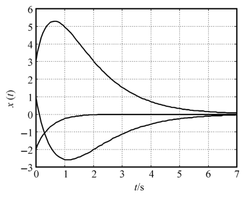{ .lq-img }

*图 9-23 例 9-22 系统零输入时状态响应曲线（MATLAB）（截自原书）*

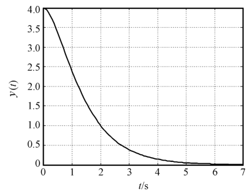{ .lq-img }

*图 9-24 例 9-22 系统零输入时输出响应曲线（MATLAB）（截自原书）*

3) 由于可控性矩阵满秩，所以系统完全可控。利用变换矩阵 \(\boldsymbol{T}\) 得系统的可控标准型

\[
\dot{\boldsymbol{x}}(t)=
\begin{bmatrix} 0 & 1 & 0 \\ 0 & 0 & 1 \\ -2 & -5 & -4 \end{bmatrix}\boldsymbol{x}(t)
+
\begin{bmatrix} 0 \\ 0 \\ 1 \end{bmatrix}u(t),
\qquad
y(t)=\begin{bmatrix} 0 & 1 & 1 \end{bmatrix}\boldsymbol{x}(t)
\]

4) 由于可观测性矩阵的秩为 2，非满秩，系统状态**不完全可观测**。（注：\(\boldsymbol{\varPhi}(s)\) 的分子 \(s^2+s=s(s+1)\) 与分母的公因子 \((s+1)\) 被约去——不可观测的正是 \(-1\) 这个模态，见 9.2 节对零极点对消的拓展说明。）

=== "MATLAB"

    ```matlab
    % ===== 书 9.5 节 例9-22 =====
    A = [-2 2 -1; 0 -2 0; 1 -4 0]; b = [0 1 1]'; c = [1 0 1]; d = 0;
    N = size(A); n = N(1);
    Q = eye(3);                       % 选定 Q 为单位阵
    P = lyap(A', Q)                   % 求对称阵 P
    e = eig(P)                        % 利用特征值判断 P 是否正定
    sys = ss(A, b, c, d);             % 建立系统的状态空间模型
    [y, t, x] = initial(sys, [1 -2 3]', 0:0.01:7);   % 零输入响应
    figure(1); plot(t, x); grid       % 状态曲线（书图9-23）
    figure(2); plot(t, y); grid       % 输出曲线（书图9-24）
    [num, den] = ss2tf(A, b, c, d)    % 状态空间 -> 传递函数
    S = ctrb(A, b); f = rank(S)       % 可控性：f=3=n 完全可控
    V = obsv(A, c); m = rank(V)       % 可观测性：m=2<n 不完全可观测
    S1 = inv(S);                      % S 的逆
    T = [S1(3,:); S1(3,:)*A; S1(3,:)*A^2];   % 变换矩阵 T
    sys1 = ss2ss(sys, T)              % 化为可控标准型
    ```

=== "Python"

    ```python
    # ===== 书 9.5 节 例9-22 =====
    import numpy as np
    import control as ct
    import matplotlib.pyplot as plt

    A = np.array([[-2.0, 2, -1], [0, -2, 0], [1, -4, 0]])
    b = np.array([[0.0], [1], [1]])
    c = np.array([[1.0, 0, 1]])
    d = 0
    n = A.shape[0]
    Q = np.eye(3)                        # 选定 Q 为单位阵
    P = ct.lyap(A.T, Q)                  # 求对称阵 P
    print(P)                             # [[0.5,-0.7778,0.5],[-0.7778,3.6944,-2.1111],[0.5,-2.1111,1.5]]
    print(np.linalg.eigvals(P))          # [5.16 0.322 0.213] 全正 -> P 正定 -> 稳定
    sys = ct.ss(A, b, c, d)              # 建立状态空间模型
    T = np.arange(0, 7, 0.01)
    resp = ct.initial_response(sys, T, X0=[1, -2, 3])   # 零输入响应
    # （原书用 ctr.forced_response(sys, t, X0=...)，等价）
    fig, ax = plt.subplots(1, 2, figsize=(9, 3.2))
    ax[0].plot(T, resp.states.T); ax[0].set_title('initial state response')
    ax[1].plot(T, resp.outputs.T); ax[1].set_title('initial output response')
    for a in ax: a.set_xlabel('t (s)'); a.grid(True)
    plt.tight_layout(); plt.show()       # 对应书图 9-23 / 9-24（英文标签，不嵌图）
    G = ct.ss2tf(sys)                    # 状态空间 -> 传递函数
    print(G)                             # (s^2+s)/(s^3+4s^2+5s+2)
    S = ct.ctrb(A, b)                    # 可控性矩阵
    print(np.linalg.matrix_rank(S))      # 3 -> 完全可控
    V = ct.obsv(A, c)                    # 可观测性矩阵
    print(np.linalg.matrix_rank(V))      # 2 -> 不完全可观测
    S1 = np.linalg.inv(S)
    p1 = S1[-1, :]                       # S^{-1} 的最后一行
    Tm = np.vstack([p1, p1 @ A, p1 @ A @ A])    # 变换矩阵 T
    Ac = Tm @ A @ np.linalg.inv(Tm)      # [[0,1,0],[0,0,1],[-2,-5,-4]]
    bc = Tm @ b                          # [0,0,1]
    cc = c @ np.linalg.inv(Tm)           # [0,1,1]
    print(Ac, bc.ravel(), cc)
    # 注：ct.canonical_form(sys, form='reachable') 也给可控型，但其 A 为
    # [[-4,-5,-2],[1,0,0],[0,1,0]] 的降幂排列形式，与原书友矩阵约定不同。
    ```

**【例 9-23】** 设线性定常系统的状态方程为

\[
\dot{\boldsymbol{x}}(t)=
\begin{bmatrix} -2 & -2.5 & -0.5 \\ 1 & 0 & 0 \\ 0 & 1 & 0 \end{bmatrix}\boldsymbol{x}(t)
+
\begin{bmatrix} 1 \\ 0 \\ 0 \end{bmatrix}u(t),
\qquad
y(t)=\begin{bmatrix} 1 & 4 & 3.5 \end{bmatrix}\boldsymbol{x}(t),
\qquad
\boldsymbol{x}(0)=\begin{bmatrix} 1 \\ -0.75 \\ 0.4 \end{bmatrix}
\]

试问：1) 能否通过状态反馈将系统的闭环极点配置在 \(-1\)、\(-2\) 和 \(-3\) 处？如有可能，求出上述极点配置的反馈增益向量 \(\boldsymbol{k}\)；2) 当系统的状态不可直接测量时，能否通过状态观测器来获取状态变量？如有可能，试设计一个极点位于 \(-3\)，\(-5\) 和 \(-7\) 的全维状态观测器。

**解** 本题设计步骤如下：

1) 检查系统的可控、可观性。若被控系统可控可观测，则满足分离定理，用状态观测器估值形成状态反馈时，其系统的极点配置和观测器设计可分别独立进行。

2) 对于系统 \(\dot{\boldsymbol{x}}=\boldsymbol{A}\boldsymbol{x}+\boldsymbol{b}u\)，选择状态反馈控制律 \(u=-\boldsymbol{k}\boldsymbol{x}+v\)，使闭环系统极点（即 \((\boldsymbol{A}-\boldsymbol{b}\boldsymbol{k})\) 的特征根）配置在期望极点处。

3) 构造全维状态观测器 \(\dot{\hat{\boldsymbol{x}}}=\boldsymbol{A}\hat{\boldsymbol{x}}+\boldsymbol{b}u-\boldsymbol{h}\boldsymbol{c}(\hat{\boldsymbol{x}}-\boldsymbol{x})=(\boldsymbol{A}-\boldsymbol{h}\boldsymbol{c})\hat{\boldsymbol{x}}+\boldsymbol{b}u+\boldsymbol{h}y\)，设计观测器输出反馈向量 \(\boldsymbol{h}\)，使观测器极点（即 \((\boldsymbol{A}-\boldsymbol{h}\boldsymbol{c})\) 的特征根）位于期望极点处。

4) 利用分离定理分别设计上述状态反馈控制律和观测器，可得复合系统动态方程

\[
\begin{bmatrix} \dot{\boldsymbol{x}} \\ \dot{\hat{\boldsymbol{x}}} \end{bmatrix}
=
\begin{bmatrix} \boldsymbol{A}-\boldsymbol{b}\boldsymbol{k} & \boldsymbol{b}\boldsymbol{k} \\ \boldsymbol{h}\boldsymbol{c} & \boldsymbol{A}-\boldsymbol{b}\boldsymbol{k}-\boldsymbol{h}\boldsymbol{c} \end{bmatrix}
\begin{bmatrix} \boldsymbol{x} \\ \hat{\boldsymbol{x}} \end{bmatrix}
+
\begin{bmatrix} \boldsymbol{b} \\ \boldsymbol{0} \end{bmatrix}v,
\qquad
y=\begin{bmatrix} \boldsymbol{c} & \boldsymbol{0} \end{bmatrix}
\begin{bmatrix} \boldsymbol{x} \\ \hat{\boldsymbol{x}} \end{bmatrix}
\]

运行程序，结果如下：

1) 由于系统可控，满足极点配置条件，得状态反馈增益向量 \(\boldsymbol{k}=[4\ \ 8.5\ \ 5.5]\)。

2) 由于系统可观测，满足观测器极点配置条件，得观测器输出反馈向量 \(\boldsymbol{h}=[35.2324\ \ -19.8169\ \ 16.2958]^{\mathrm T}\)。

设初始观测状态 \(\hat{\boldsymbol{x}}(0)=[0\ \ 0\ \ 0]^{\mathrm T}\)，那么系统零输入响应的系统状态曲线、观测状态曲线和状态误差曲线分别如图 9-25～图 9-27 所示。

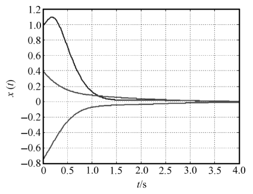{ .lq-img }

*图 9-25 例 9-23 系统零输入时状态响应曲线（MATLAB）（截自原书）*

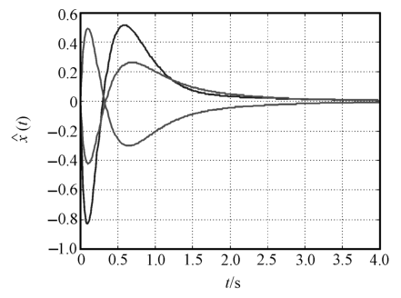{ .lq-img }

*图 9-26 例 9-23 系统零输入时观测器状态响应曲线（MATLAB）：\(\hat{\boldsymbol{x}}\) 迅速跟上真实状态（截自原书）*

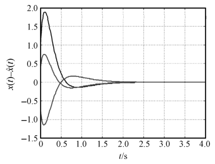{ .lq-img }

*图 9-27 例 9-23 系统零输入时状态误差响应曲线（MATLAB）：\(\boldsymbol{x}-\hat{\boldsymbol{x}}\) 按观测器极点 \(-3,-5,-7\) 决定的速率衰减到零（截自原书）*

=== "MATLAB"

    ```matlab
    % ===== 书 9.5 节 例9-23 =====
    A = [-2 -2.5 -0.5; 1 0 0; 0 1 0]; b = [1 0 0]'; c = [1 4 3.5]; d = 0;
    N = size(A); n = N(1);
    sys0 = ss(A, b, c, d);              % 建立系统状态空间模型
    S = ctrb(A, b);  f = rank(S)        % 可控性：3
    V = obsv(A, c);  m = rank(V)        % 可观测性：3
    Ps = [-1 -2 -3];                    % 系统的期望配置极点
    k = acker(A, b, Ps)                 % 反馈增益向量 k = [4 8.5 5.5]
    Po = [-3 -5 -7];                    % 观测器的期望配置极点
    h = (acker(A', c', Po))'            % 观测器输出反馈向量
    A1 = [A -b*k; h*c A-b*k-h*c]; b1 = [b; b]; c1 = [c zeros(1,3)]; d1 = 0;
    x0 = [1 -0.75 0.4]'; x10 = [0 0 0]';
    sys = ss(A1, b1, c1, d1);           % 建立复合系统动态模型
    t = 0:0.01:4;
    [y, t, x] = initial(sys, [x0; x10], t);
    figure(1); plot(t, x(:,1:3), '--'); grid    % 系统状态曲线（书图9-25）
    figure(2); plot(t, x(:,4:6)); grid          % 观测状态曲线（书图9-26）
    figure(3); plot(t, x(:,1:3)-x(:,4:6)); grid  % 状态误差曲线（书图9-27）
    ```

=== "Python"

    ```python
    # ===== 书 9.5 节 例9-23 =====
    import numpy as np
    import control as ct
    import matplotlib.pyplot as plt

    A = np.array([[-2.0, -2.5, -0.5], [1, 0, 0], [0, 1, 0]])
    b = np.array([[1.0], [0], [0]])
    c = np.array([[1.0, 4, 3.5]])
    d = 0
    n = A.shape[0]
    sys0 = ct.ss(A, b, c, d)                  # 建立系统状态空间模型
    S = ct.ctrb(A, b)                         # 可控性矩阵
    print(np.linalg.matrix_rank(S))           # 3 -> 可控
    V = ct.obsv(A, c)                         # 可观测性矩阵
    print(np.linalg.matrix_rank(V))           # 3 -> 可观测
    P_s = [-1, -2, -3]                        # 系统的期望配置极点
    k = ct.acker(A, b, P_s)                   # 反馈增益向量
    print(k)                                  # [4. 8.5 5.5]
    P_o = [-3, -5, -7]                        # 观测器的期望配置极点
    h = ct.acker(A.T, c.T, P_o)               # 对偶系统配极点
    print(h)                                  # [35.2324 -19.8169 16.2958]
    k = np.atleast_2d(k)
    h = np.array(h).reshape(3, 1)
    A1 = np.block([[A, -b @ k], [h @ c, A - b @ k - h @ c]])
    b1 = np.vstack((b, b))
    c1 = np.hstack((c, np.zeros((1, 3))))
    sys = ct.ss(A1, b1, c1, d)                # 建立复合系统动态模型（6 阶）
    print(np.linalg.eigvals(A1))              # = [-1,-2,-3] ∪ [-3,-5,-7]，分离定理
    T = np.arange(0, 4, 0.01)
    x0 = [1, -0.75, 0.4, 0, 0, 0]
    resp = ct.initial_response(sys, T, X0=x0)
    x = resp.states                           # 6 维状态
    err = x[:3, :] - x[3:, :]                 # 状态误差 x - xhat
    fig, ax = plt.subplots(1, 3, figsize=(12, 3.2))
    ax[0].plot(T, x[:3, :].T, '--'); ax[0].set_title('state response')
    ax[1].plot(T, x[3:, :].T); ax[1].set_title('observer state')
    ax[2].plot(T, err.T); ax[2].set_title('error x-xhat')
    for a in ax: a.set_xlabel('t (s)'); a.grid(True)
    plt.tight_layout(); plt.show()            # 对应书图 9-25~9-27（英文标签，不嵌图）
    ```

（复合系统 6 个特征值恰为 \(\{-1,-2,-3\}\cup\{-3,-5,-7\}\)——状态反馈子系统与观测器子系统的极点互不干扰，分离定理的直接验证；状态误差 \((\boldsymbol{x}-\hat{\boldsymbol{x}})\) 不到 1 s 就衰减到零，由观测器极点决定。）

## 坑与陷阱

!!! danger "8 个容易踩的坑"
    1. **状态空间表达式不唯一**：同一系统选不同状态变量就得到不同的 \(\boldsymbol{A},\boldsymbol{b},\boldsymbol{c}\)（例 9-1 的三组答案都算对），它们之间靠非奇异变换 \(\bar{\boldsymbol{x}}=\boldsymbol{P}\boldsymbol{x}\) 联系，且特征值、传递矩阵、可控性、可观测性都不变（等价变换）。别因为和"标准答案"不一致就否定自己——先核对维数 \(n\) 与特征值。
    2. **可控/可观测标准型的结构别死背**：用对偶关系 \(\boldsymbol{A}_c=\boldsymbol{A}_o^{\mathrm T},\ \boldsymbol{b}_c=\boldsymbol{c}_o^{\mathrm T},\ \boldsymbol{c}_c=\boldsymbol{b}_o^{\mathrm T}\) 一把抓。友矩阵末行按 \(s\) **升幂**排 \([-a_0\ -a_1\ \cdots\ -a_{n-1}]\)，\(\boldsymbol{c}=[\beta_0\ \beta_1\ \cdots\ \beta_{n-1}]\) 同序；把 \(a_0,a_{n-1}\) 顺序写反是最常见的失分点。
    3. **手算 \(\boldsymbol{A}^k\boldsymbol{b}\) 必错一两次**：可控性矩阵按 \([\boldsymbol{b}\ \ \boldsymbol{A}\boldsymbol{b}\ \ \boldsymbol{A}^2\boldsymbol{b}]\) 逐列算，\(n\ge 3\) 时善用凯莱-哈密顿降幂（例 9-8 的 \(\boldsymbol{A}^{100}\) 思路）或直接逐列做矩阵乘法，不要硬乘 \(n\) 阶大矩阵。
    4. **状态可控 ≠ 输出可控**：例 9-11 状态不完全可控却输出可控，二者没有必然联系。判断输出可控别忘了把 \(\boldsymbol{D}\) 也写进 \(\boldsymbol{S}_0=[\boldsymbol{C}\boldsymbol{B}\ \ \boldsymbol{C}\boldsymbol{A}\boldsymbol{B}\ \cdots\ \boldsymbol{C}\boldsymbol{A}^{n-1}\boldsymbol{B}\ \ \boldsymbol{D}]\)。
    5. **状态反馈保可控、不保可观测**：配置的极点撞上系统零点就对消，被对消的模态从此"看不见"（\(\boldsymbol{k}=[0\ 4]\) 反例）；输出至参考输入的反馈则两者都保持。选希望极点前先看清楚闭环零点在哪。
    6. **李雅普诺夫第二法是充分条件**：\(V(\boldsymbol{x})\) 靠凑，凑不出来不代表不稳定。\(\dot V\) 负半定时**必须**补证"\(\dot V\) 沿非零状态的受扰运动解不恒为零"（例 9-18 的两情况检验），跳过这步直接下"渐近稳定"结论是错的。
    7. **lyap 的参数与判断**：MATLAB `lyap(A',Q)`、Python `ct.lyap(A.T,Q)` 解的都是 \(\boldsymbol{A}^{\mathrm T}\boldsymbol{P}+\boldsymbol{P}\boldsymbol{A}=-\boldsymbol{Q}\)，参数别写反；\(\boldsymbol{P}\) 是否正定用特征值（全正）或顺序主子式判断。\(\boldsymbol{Q}\) 半正定仅在 \(\dot V\) 沿非零解不恒为零时允许，且此时 \(\boldsymbol{P}\) 仍须正定。
    8. **MATLAB 与 Python 的工具差异**：`ct.tf2ss` 返回 StateSpace 对象且 \(\boldsymbol{A}\) 是降幂伴随型（与 MATLAB 友矩阵型互为转置排列）；`ct.place` 不接受重极点（SISO 重根用 `ct.acker`，观测器配重根同样走对偶 `acker`）；`ct.gram` 需要 slycot——没有就用 `scipy.linalg.solve_lyapunov` 手解格拉姆方程。

## 术语速查

| 英文 | 中文 | 一句话 |
| --- | --- | --- |
| state variable | 状态变量 | 确定系统状态的数目最小的一组独立变量 |
| state vector / state space | 状态向量 / 状态空间 | \(n\) 个状态变量张成的 \(n\) 维空间与其中向量 |
| dynamic equation | 动态方程 | 状态方程 + 输出方程的合称，记作系统 \((\boldsymbol{A},\boldsymbol{B},\boldsymbol{C},\boldsymbol{D})\) |
| companion matrix | 友矩阵 | 末行为 \([-a_0\ \cdots\ -a_{n-1}]\)、上邻为单位超对角线的矩阵 |
| controllable canonical form | 可控标准型 | \(\boldsymbol{A}\) 为友矩阵、\(\boldsymbol{b}=[0\cdots01]^{\mathrm T}\) 的实现 |
| observable canonical form | 可观测标准型 | 可控标准型的转置对偶（式 9-11） |
| diagonal form | 对角型 | \(\boldsymbol{A}\) 为对角阵（单实极点留数展开）的实现 |
| state variable diagram | 状态变量图 | 积分器为骨架、按状态方程连接的结构图 |
| state transition matrix | 状态转移矩阵 \(\boldsymbol{\Phi}(t)\) | \(\mathrm{e}^{\boldsymbol{A}t}\)，\(\boldsymbol{x}(t)=\boldsymbol{\Phi}(t)\boldsymbol{x}(0)\) |
| matrix exponential | 矩阵指数 | \(\mathrm{e}^{\boldsymbol{A}t}=\sum \boldsymbol{A}^kt^k/k! =\mathscr{L}^{-1}[(s\boldsymbol{I}-\boldsymbol{A})^{-1}]\) |
| transfer function matrix | 传递函数矩阵 | \(\boldsymbol{G}(s)=\boldsymbol{C}(s\boldsymbol{I}-\boldsymbol{A})^{-1}\boldsymbol{B}+\boldsymbol{D}\) |
| decoupling control | 解耦控制 | 使传递矩阵对角化、一个输入只管一个输出 |
| controllability | 可控性 | 输入能把任意非零初态在有限时间引到原点 |
| observability | 可观测性 | 有限时间输出能唯一确定初始状态 |
| output controllability | 输出可控性 | \(\mathrm{rank}[\boldsymbol{C}\boldsymbol{B}\ \cdots\ \boldsymbol{C}\boldsymbol{A}^{n-1}\boldsymbol{B}\ \ \boldsymbol{D}]=q\) |
| controllability matrix | 可控性判别阵 \(\boldsymbol{S}\) | \([\boldsymbol{B}\ \ \boldsymbol{A}\boldsymbol{B}\ \cdots\ \boldsymbol{A}^{n-1}\boldsymbol{B}]\)，满秩 ⇔ 可控 |
| observability matrix | 可观测性判别阵 \(\boldsymbol{V}\) | \([\boldsymbol{C}^{\mathrm T}\ \ \boldsymbol{A}^{\mathrm T}\boldsymbol{C}^{\mathrm T}\ \cdots]^{\mathrm T}\)，满秩 ⇔ 可观测 |
| Gramian | 格拉姆矩阵 | \(\boldsymbol{W}_c,\boldsymbol{W}_o\) 非奇异 ⇔ 可控 / 可观测（补充判据） |
| Cayley-Hamilton theorem | 凯莱-哈密顿定理 | \(\boldsymbol{A}\) 满足自身特征方程 \(f(\boldsymbol{A})=\boldsymbol{0}\) |
| duality principle | 对偶原理 | \(\Sigma_1\) 可控 ⇔ 其对偶 \(\Sigma_2(\boldsymbol{A}^{\mathrm T},\boldsymbol{C}^{\mathrm T},\boldsymbol{B}^{\mathrm T})\) 可观测 |
| Vandermonde matrix | 范德蒙德矩阵 | 友矩阵对角化的现成变换矩阵 |
| equilibrium state | 平衡状态 | \(\boldsymbol{f}(\boldsymbol{x}_e,t)=\boldsymbol{0}\) 的状态 |
| Lyapunov function | 李雅普诺夫函数 | 虚构的"能量"标量函数 \(V(\boldsymbol{x})\)，正定且衰减则稳定 |
| positive definite | 正定 | \(V(\boldsymbol{0})=0\) 且非零状态处 \(V>0\)；二次型用 \(\boldsymbol{P}\succ 0\) 判 |
| Lyapunov equation | 李雅普诺夫方程 | \(\boldsymbol{A}^{\mathrm T}\boldsymbol{P}+\boldsymbol{P}\boldsymbol{A}=-\boldsymbol{Q}\)（离散为 \(\boldsymbol{\Phi}^{\mathrm T}\boldsymbol{P}\boldsymbol{\Phi}-\boldsymbol{P}=-\boldsymbol{Q}\)） |
| state feedback | 状态反馈 | \(\boldsymbol{u}=\boldsymbol{v}-\boldsymbol{K}\boldsymbol{x}\)，保可控、可能破坏可观测 |
| output feedback | 输出反馈 | \(\boldsymbol{u}=\boldsymbol{v}-\boldsymbol{F}\boldsymbol{y}\)（至参考输入）或 \(-\boldsymbol{H}\boldsymbol{y}\)（至状态微分） |
| pole placement | 极点配置 | 状态反馈任意配置闭环极点 ⇔ 系统可控 |
| full-order state observer | 全维状态观测器 | 用 \(\boldsymbol{u},\boldsymbol{y}\) 重构全部状态的 \(n\) 维动态系统 |
| separation theorem | 分离定理 | \(\boldsymbol{K}\) 与 \(\boldsymbol{H}\) 可各自独立设计，复合极点=两者之并 |

## 覆盖自查

??? note "原书小节 → 笔记位置"
    | 原书小节/内容 | 笔记位置 |
    | --- | --- |
    | 9-1 状态空间描述（两种基本描述类型） | 9.1 两种基本描述类型 |
    | 9-1 状态空间的基本概念（状态/状态变量/状态向量/状态空间/轨线、动态方程、结构图） | 9.1 状态空间的基本概念 |
    | 9-1 状态空间表达式的建立（机理：例9-1；微分方程：例9-2；传函：可控/可观测/对角标准型、例9-3） | 9.1 状态空间表达式的建立 |
    | 9-1 状态方程的解（齐次、状态转移矩阵性质、非齐次；例9-4、例9-5） | 9.1 状态方程的解 |
    | 9-1 传递函数矩阵与解耦控制（开环/闭环/误差传递矩阵） | 9.1 传递函数矩阵及解耦控制 |
    | 9-1 离散系统状态空间（差分方程建模、离散化、递推求解；例9-6） | 9.1 线性离散系统状态空间 |
    | 9-2 可控性与可观测性（物理概念：例9-7；定义） | 9.2 可控性 / 可观测性 |
    | 9-2 可控性判据（凯莱-哈密顿、秩判据：例9-8/9-9、对角规范型判据：例9-10） | 9.2 线性定常连续系统的可控性判据 |
    | 9-2 输出可控性（例9-11） | 9.2 输出可控性 |
    | 9-2 可观测性判据（秩判据：例9-12、对角规范型判据：例9-13） | 9.2 线性定常连续系统的可观测性判据 |
    | 9-2 离散系统可控可观（单/多输入判据：例9-14、可观测判据：例9-15、离散化影响） | 9.2 线性离散时间系统的可控性和可观测性 |
    | 9-2 线性变换（对角化、可控/可观测标准型变换、例9-16、对偶原理、不变特性） | 9.2 线性定常系统的线性变换 |
    | 9-3 李雅普诺夫意义下的稳定性（平衡状态、稳定/渐近稳定/大范围/不稳定） | 9.3 李雅普诺夫意义下的稳定性 |
    | 9-3 李雅普诺夫第一法（定理9-1） | 9.3 李雅普诺夫第一法 |
    | 9-3 李雅普诺夫第二法（定号性、定理9-2/9-3/9-4；例9-17、例9-18） | 9.3 李雅普诺夫第二法 |
    | 9-3 线性定常连续系统判别（定理9-5；例9-19） | 9.3 线性定常系统的李雅普诺夫稳定性分析 |
    | 9-3 线性定常离散系统判别（定理9-6） | 9.3 线性定常系统的李雅普诺夫稳定性分析 (2) |
    | 9-4 两种反馈结构（状态反馈、输出反馈两种形式） | 9.4 常用反馈结构 |
    | 9-4 反馈结构对系统性能的影响（定理9-7/9-8/9-9 及反例） | 9.4 反馈结构对系统性能的影响 |
    | 9-4 极点配置（定理9-10/9-11、SISO 算法；例9-20） | 9.4 系统的极点配置 |
    | 9-4 全维状态观测器（构成方案、分析设计、定理9-12；例9-21） | 9.4 全维状态观测器及其设计 |
    | 9-4 分离特性（复合系统分析、定理9-13） | 9.4 分离特性 |
    | 9-5 仿真（ss 建模、模型转换、可控可观分析、李雅普诺夫分析、极点配置、综合应用：例9-22/9-23） | 9.5 状态空间的分析仿真 |

??? note "原书例题 → 笔记位置"
    | 原书例题 | 内容 | 笔记位置 |
    | --- | --- | --- |
    | 例 9-1 | RLC 网络三组状态变量与线性变换 | 9.1 机理建模 |
    | 例 9-2 | 工业机器人动态方程（无量纲化建模） | 9.1 微分方程建模 |
    | 例 9-3 | 二阶系统可控/可观测标准型 | 9.1 传函建模 |
    | 例 9-4 | 拉氏变换法求 \(\boldsymbol{\Phi}(t)\)（含双 tab 代码） | 9.1 齐次状态方程的解 |
    | 例 9-5 | 弹簧-质量-阻尼器零输入响应（含双 tab 代码） | 9.1 非齐次状态方程的解之后 |
    | 例 9-6 | 连续系统离散化 \(T=1\) | 9.1 定常连续动态方程的离散化 |
    | 例 9-7 | 可控可观测的物理概念 | 9.2 引言 |
    | 例 9-8 | 凯莱-哈密顿算 \(\boldsymbol{A}^{100}\) | 9.2 可控性判据 |
    | 例 9-9 | 桥式网络平衡状态不可控 | 9.2 秩判据 |
    | 例 9-10 | 对角规范型判可控 | 9.2 对角线规范型判据 |
    | 例 9-11 | 状态不可控但输出可控 | 9.2 输出可控性 |
    | 例 9-12 | 两个系统的可观测性判断 | 9.2 可观测性判据 |
    | 例 9-13 | 对角规范型判可观测 | 9.2 对角线规范型判据 |
    | 例 9-14 | 离散可控性 + 控制序列（含双 tab 代码） | 9.2 离散系统可控性 |
    | 例 9-15 | 离散可观测性 + 三步重构解释 | 9.2 离散系统可观测性 |
    | 例 9-16 | 化可观测标准型（含双 tab 代码） | 9.2 线性变换 |
    | 例 9-17 | 非线性系统判稳（\(\dot V\) 负定） | 9.3 定理 9-2 |
    | 例 9-18 | 非线性系统判稳（\(\dot V\) 负半定 + 恒为零检验） | 9.3 定理 9-3 |
    | 例 9-19 | 李雅普诺夫方程判不稳定（含双 tab 代码） | 9.3 线性定常连续系统判别 |
    | 例 9-20 | 状态反馈极点配置（含双 tab 代码） | 9.4 SISO 极点配置算法 |
    | 例 9-21 | 全维观测器设计 \(h=[8.5,23.5]^{\mathrm T}\)（含双 tab 代码） | 9.4 全维状态观测器 |
    | 例 9-22 | 稳定性/传函/可控/可观综合（含双 tab 代码） | 9.5 综合应用 |
    | 例 9-23 | 极点配置 + 观测器 + 分离定理（含双 tab 代码） | 9.5 综合应用 |

