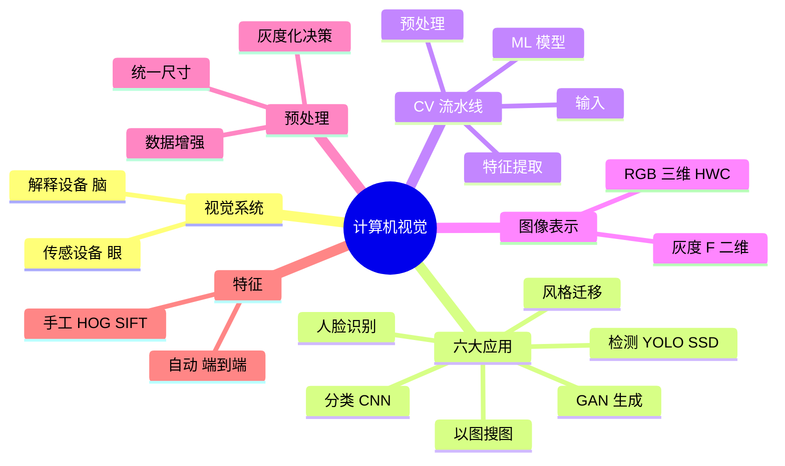
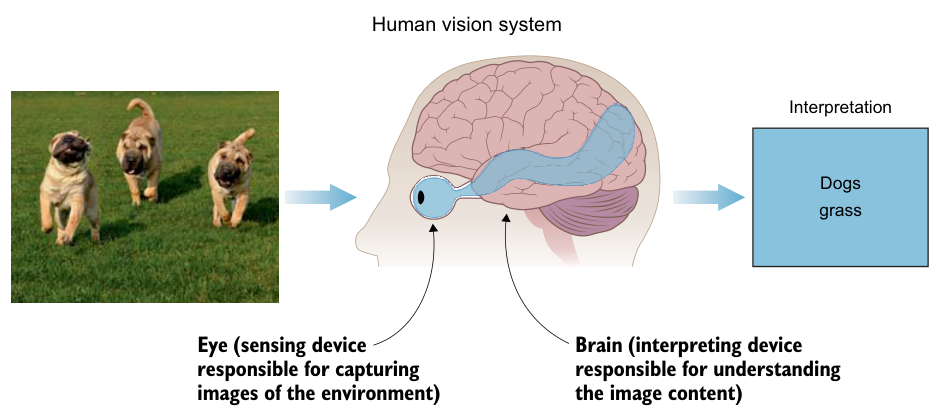
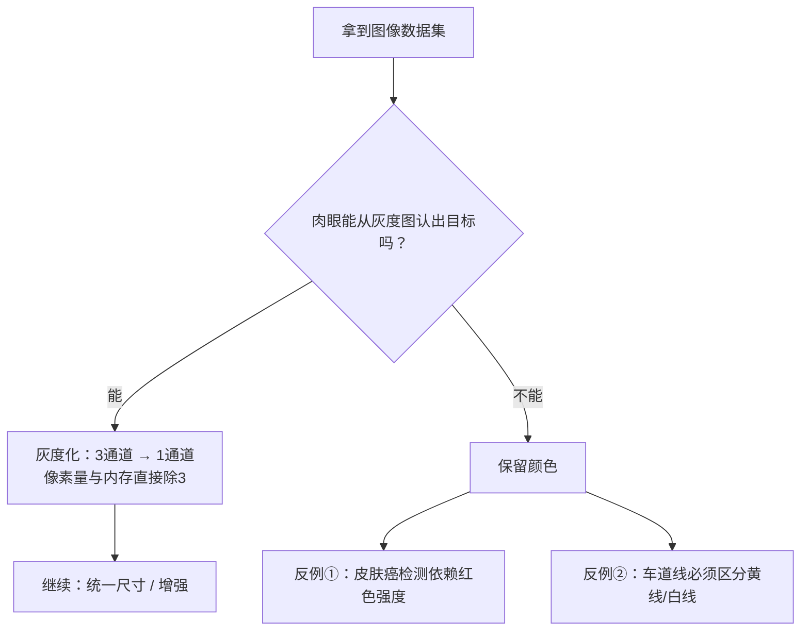
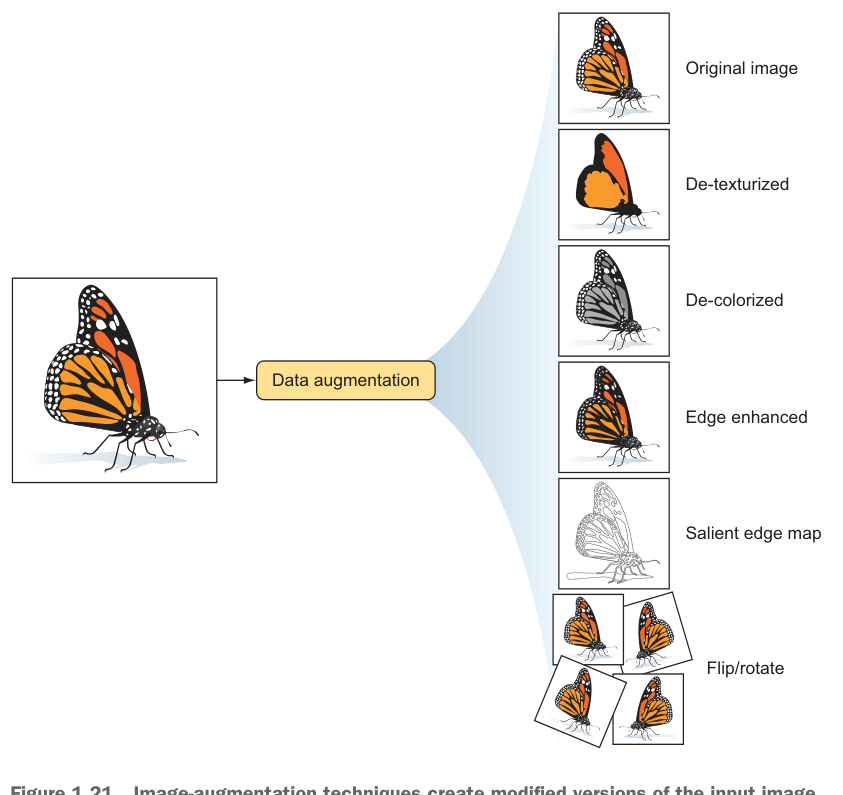
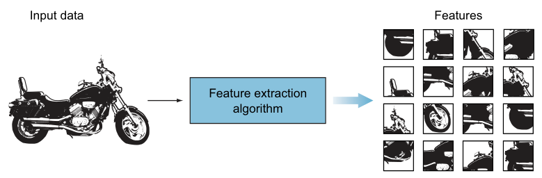
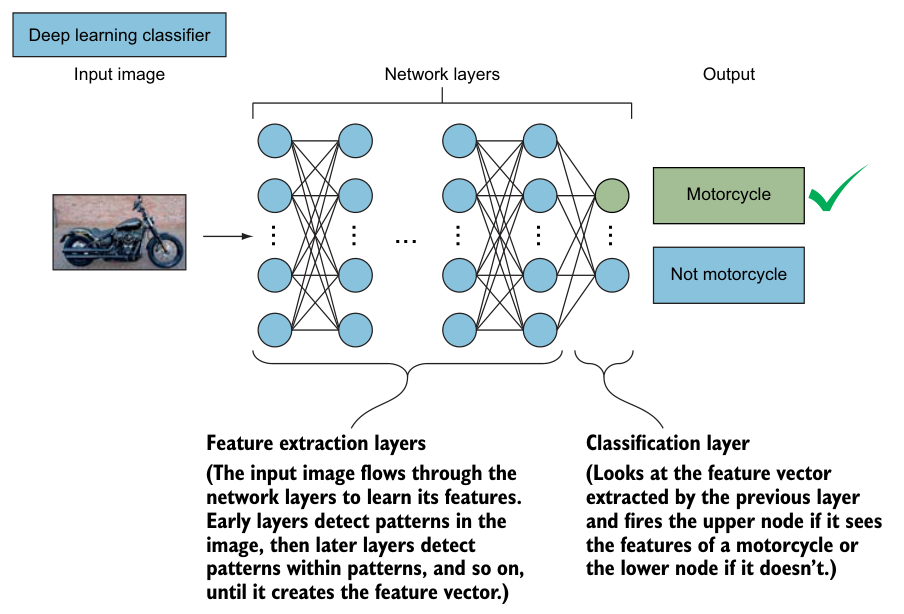

# 第 1 章 欢迎来到计算机视觉

> **本章解决**：视觉系统由什么组成、CV 能做什么、一张图如何变成预测。
> **全书主线**在 1.3 节：$\text{输入} \to \text{预处理} \to \text{特征提取} \to \text{ML 模型}$，后面九章全是这四步的展开。
> 本章无模型代码，配套 notebook 用 PyTorch/numpy 做概念演示。

## 1.0 本章导图



## 1.1 视觉系统：眼 + 脑

**计算机视觉（Computer Vision, CV）**：让 AI 通过图像/视频**看懂**世界，并据此行动。关键词是 **Visual Perception（视觉感知）**——不是"拍到"行人，而是理解行人在哪、车道在哪、标志什么含义。

!!! info "图像处理 ≠ 计算机视觉"
    处理图像（缩放、滤波）的机器 ≠ 理解图像内容的机器。图像处理只是 CV 系统里的一个零件。

人和机器的视觉系统结构相同（图 1.1、1.2）：

| 人类 | 机器 | 职责 |
| --- | --- | --- |
| 眼 | **Sensing Device** 传感设备 | 捕获图像 |
| 脑 | **Interpreting Device** 解释设备 | 理解内容、输出预测 |

{ .lq-img }
*图 1.1 人眼 + 大脑 = 传感 + 解释（截自原书）*

作者的"认狗"比喻把机器学习讲完了：第一次见狗不认识 → 被告知"这是狗" → 学会；见到马，大脑用特征推理"四条腿、长脸——是狗吗"，被纠正后调整参数记住区别。这就是 **Supervised Learning（监督学习）** + **Trial and Error（试错训练）**：带标签数据 → 预测 → 纠错 → 更新。区别只在样本效率：人几张图就够，机器要成千上万张。

### 传感设备：按任务特化

先定任务，再选设备。自动驾驶三件套互补：

| 设备 | 能力 | 短板 |
| --- | --- | --- |
| **Lidar** | 不可见光脉冲 → 高分辨率 3D 地图 | — |
| 相机 | 看懂标志、标线 | 测不了距离 |
| **Radar** | 测距、测速 | 看不清细节 |

医疗用 X 光/CT，农业用其他雷达。蜜蜂的复眼（最多 3 万个小透镜）分辨率低但对运动极敏感——高速飞行保命靠它：**传感器永远为任务而生**。

### 解释设备：ANN 的诞生

解释器是视觉系统的"脑"。科学家逆向工程中枢神经系统得到 **ANN（人工神经网络）**（图 1.3）：生物神经元的树突/突触 $\leftrightarrow$ 人工神经元的输入 $x_1,\dots,x_n$ / 输出 $f(x)$。

<figure>
  
  <figcaption>图 1.3 生物神经元 ↔ 人工神经元（截自原书）</figcaption>
</figure>

单个神经元机制极简单；**百万级神经元按层堆叠**才涌现学习行为——多层网络就是 **Deep Learning**（图 1.4）。

!!! note "机器能超过人脑吗"
    10,000 张狗图、130 个品种：神经网络训练几小时到 **>95%** 准确率。许多分类/检测任务上机器视觉已超人。

## 1.2 六大应用鸟瞰

| 应用 | 任务 | 代表模型 | 原书例子 |
| --- | --- | --- | --- |
| 图像分类 | 整图 → 一个标签 | **CNN** | 肺癌 CT 结节早筛（≤4mm 医生易漏）；交通标志 |
| 目标检测 | 多物体：分类 + 位置 | YOLO / SSD / Faster R-CNN | 图中同时框出行人/自行车（图 1.7） |
| 风格迁移 | 把 A 的风格套给 B | — | 城市照片 ×《星月夜》，几秒出"梵高画"（图 1.8） |
| 图像生成 | 从噪声/文字造新图 | **GAN**（2014, Goodfellow） | StackGAN：文字描述 → 从未存在的"照片"（图 1.9） |
| 人脸识别 | 精确识别人 | — | 手机解锁、watchlist 比对 |
| 图像推荐 | 以图搜图 | — | 电商相似服装检索（图 1.11） |

<table>
<tr>
<td></td>
<td></td>
</tr>
<tr>
<td></td>
<td></td>
</tr>
</table>
*图 1.7 目标检测 · 图 1.8 风格迁移 · 图 1.9 GAN 文字生图 · 图 1.10 人脸验证/辨识（截自原书）*

人脸识别的两种模式（引《Handbook of Face Recognition》）：

| 模式 | 匹配 | 回答的问题 |
| --- | --- | --- |
| **Face Identification** 人脸辨识 | 1 : N | "你是谁？"（查库） |
| **Face Verification** 人脸验证 | 1 : 1 | "你是不是你声称的人？"（证件比对） |

GAN 的影响力侧写：2018 年 10 月，GAN 画作《The Portrait of Edmond Belamy》拍出 **$432,500**。

## 1.3 CV 流水线（全书主线）


{ .lq-img }
*图 1.14 摩托车分类的概率输出（截自原书）*

作者让你"扮演分类器"逐个看特征：轮子 → 排除狗；车灯 → 更像摩托；后挡泥板 → 更像摩托；两个轮子 → 锁定。输出 $P(\text{motorcycle})=0.85$、$P(\text{car})=0.14$、$P(\text{dog})=0.01$。

**所有改进手段都落在这四步之内**——这张对照表贯穿全书：

| 想提升模型 | 动哪一步 | 对应章节 |
| --- | --- | --- |
| 多采数据 | ① | 第 4 章 |
| 预处理去噪、标准化 | ② | 第 3、4 章 |
| 更好的特征 | ③ | 第 3 章（CNN 自动提取） |
| 换分类器 / 调超参数 | ④ | 第 4 章 |

## 1.4 图像 = 函数

**Pixel（像素）**是图像的最小单元，值 = 该位置光强。把图像看成二元函数：

$$
\text{灰度：}\; F(x,y) \in [0, 255] \qquad
\text{RGB 彩色：}\; F(x,y) = [\,r(x,y),\ g(x,y),\ b(x,y)\,]
$$

- $0$ = 黑，$255$ = 白；坐标系**原点在左上角**。
- 尺寸记法：灰度 $700\times500$ 图 → 矩阵 $(700,500)$；彩色 $700\times700$ → $(700,700,3)$，即 **3 个矩阵堆叠**。
- 例：草地左上角 $F(0,0) = [11, 102, 35]$（森林绿）；$32\times16$ 网格共 $512$ 像素。

!!! warning "原书笔误"
    原书说"$32\times16$ 图的 y 轴从 0 到 16"——16 像素高的图索引是 $0\sim15$（图 1.15 自己标的也是 15）。

<figure>
  
  <figcaption>图 1.15 图像 = 像素网格上的函数 F(x,y)（截自原书）</figcaption>
</figure>

<table>
<tr>
<td></td>
<td></td>
</tr>
</table>
*图 1.16 计算机眼里只有数字矩阵 · 图 1.17 彩色图 = 3 通道堆叠（截自原书）*

**图像即函数 ⇒ 一切图像处理都是逐像素的数学运算**（$F$ 进，$G$ 出）：

| 应用 | 变换 |
| --- | --- |
| 变暗 | $G(x,y) = 0.5 \cdot F(x,y)$ |
| 变亮 | $G(x,y) = 2 \cdot F(x,y)$ |
| 下移 150 像素 | $G(x,y) = F(x,\,y+150)$ |
| 去灰成黑白 | $G(x,y) = 0$ 若 $F(x,y)<130$，否则 $255$ |

```python
import torch                                # 导入 PyTorch
img = torch.zeros(16, 32)                   # 16x32 灰度图，全黑
img[13, 12] = 255.0                         # F(12,13)=255：白像素
dark  = 0.5 * img                           # 变暗 G=0.5F
light = 2.0 * img                           # 变亮 G=2F
shift = torch.roll(img, shifts=150, dims=0) # 下移150像素
bw    = torch.where(img < 130, 0.0, 255.0)  # 阈值130二值化
```

## 1.5 预处理

目标：**降复杂度、提精度**。无法为每种拍摄条件写专属算法，所以先洗数据。

最常用的一刀——灰度化，砍前先过这个决策流程：



{ .lq-img }
*图 1.21 数据增强：翻转/旋转/去色/边缘增强，一个样本变 N 个（截自原书）*

- **统一尺寸（Standardization）**：CNN 要求同尺寸输入，先缩放（细节第 3 章）。
- **数据增强（Data Augmentation）**：缩放、旋转、仿射变换造"新"样本。
- **No Free Lunch**（Wolpert & Macready）：没有万能配方——架构、超参、预处理都只能按问题实验。

## 1.6 特征提取

**Feature（特征）**= 物体**独有且可测量**的属性，是喂给模型的输入。房价类比：面积、房间数 → 预测价。

同一个"轮子"特征的强弱：

| 判别问题 | 强弱 | 结论 |
| --- | --- | --- |
| 摩托 vs 狗 | 强 | 一锤定音 |
| 摩托 vs 自行车 | 弱 | 需补后视镜、车牌、脚踏等组合特征 |

{ .lq-img }
*图 1.22 图像 → 特征提取算法（黑盒）→ 特征向量（截自原书）*

**特征向量（Feature Vector）**：1D 数组，物体的紧凑表示。

### 好特征的两个标准

**① 可泛化（Repeatability）**：特征要识别"一般的"摩托，不是某张图的局部拷贝。看一张图学到的是具体轮子；看一千张图学到的是"带纹理的圆形"。

**② 有区分度**——作者的 Greyhound vs Labrador 思想实验：

<figure>
  
  <figcaption>图 1.24 身高特征：两端可分，20~30 英寸中间带重叠（截自原书）</figcaption>
</figure>

```python
def classify(height_inch):          # 输入：狗的身高（英寸）
    if height_inch <= 20:           # 直方图左端
        return "Labrador（>80%）"   # 小于20英寸：大概率拉布拉多
    if height_inch >= 30:           # 直方图右端
        return "Greyhound"          # 大于30英寸：基本是灵缇
    return "看其他特征"             # 中间带：身高失效
```

身高是**有用但不充分**的特征；眼色分布约 50/50（图 1.25），与犬种无相关——**无用特征**。推论：单特征够用就直接写 if-else，何必训练模型；也几乎不存在单特征包打天下，所以永远需要多特征组合。

!!! tip "选特征的方法"
    **假装自己是分类器**：想区分两类东西，你会先问什么信息？答案就是候选特征。好特征四条：可识别、易跟踪比较、跨尺度/光照/视角一致、有噪声或遮挡时仍可见。

### 手工特征 vs 自动特征

<table>
<tr>
<td></td>
<td></td>
</tr>
</table>
*图 1.26 传统 ML：手工特征 + SVM/AdaBoost · 图 1.27 DL：自动提特征，端到端（截自原书）*

| | 传统 ML | 深度学习 |
| --- | --- | --- |
| 特征来源 | 手工设计（**HOG / Haar Cascades / SIFT / SURF**） | 网络逐层自动学 |
| 分类器 | SVM / AdaBoost | 网络末层自带 |
| 训练方式 | 两段式 | **端到端** |
| 预处理 | 重 | 轻（网络自己干重活） |

!!! warning "误区：'神经网络只学有用特征'"
    初始化时网络对**所有**特征**随机赋权**，训练中才按重要性调整权重——出现频率高的模式权重变大，低权重特征几乎不影响输出。垃圾特征也会被捞进来，这正是后面正则化、Dropout 存在的理由。

**为什么要提特征**：1 万张 $1000\times1000$ 的摩托车图（背景有纯有乱）→ 提取后丢掉无关信息，只留浓缩特征列表喂分类器（图 1.28）——比让分类器直接啃原图简单快得多。

## 1.7 分类器学习算法

{ .lq-img }
*图 1.29 图像流过网络层层学特征，末层输出类别（截自原书）*

- 两条路线：传统 ML（SVM，部分问题够用）vs **CNN**（复杂视觉问题主力）。
- 浅层检测图案，深层检测"**图案中的图案**"，层层组合成特征向量。
- 网络越深学得越多——这就是 **Deep** Learning 名字的由来（深度带来 trade-off，第 2、3 章讲）。
- **最后一层通常就是分类器**：点亮 motorcycle 或 not motorcycle。

## 坑与陷阱

!!! danger "6 个容易踩的坑"
    1. **图像处理 ≠ 计算机视觉**：会缩放滤波不等于看懂图像。
    2. **别盲目灰度化**：颜色是关键特征时（皮肤红斑、黄/白车道线）去色 = 自废武功。
    3. **特征必须可泛化**：从单张图抠出的局部只是拷贝，不是特征。
    4. **"网络只学有用特征"是误区**：所有特征随机赋权起步，靠训练分优劣。
    5. **No Free Lunch**：没有万能配方，只有按问题的实验。
    6. **先定任务再选传感器**：顺序反了是端到端系统设计的大忌。

## 速览

1. 视觉系统 = 传感设备 + 解释设备，人机同构。
2. CV 流水线四步：输入 → 预处理 → 特征提取 → ML 模型；一切改进都落在这四步。
3. 图像是函数：灰度 $F(x,y)\in[0,255]$，彩色 $(H,W,3)$，原点在左上角。
4. 图像即函数 ⇒ 图像处理 = 逐像素数学运算。
5. 预处理目标是降复杂度提精度；灰度化前先做"肉眼测试"。
6. 特征 = 独有可测属性；特征向量是紧凑表示。
7. 好特征：可泛化 + 有区分度（Greyhound 实验）。
8. 传统 ML = 手工特征 + SVM；DL = 自动特征 + 端到端。
9. 网络对所有特征随机赋权起步，训练按频率/重要性调整。
10. 浅层学图案、深层学图案中的图案——深度学习之"深"。

## 术语速查

| 英文 | 中文 | 一句话 |
| --- | --- | --- |
| Visual Perception | 视觉感知 | 不止看见，而是看懂 |
| Sensing / Interpreting Device | 传感 / 解释设备 | 视觉系统的"眼"与"脑" |
| Lidar / Radar | 激光雷达 / 雷达 | 3D 建图 vs 测距测速 |
| ANN / Deep Learning | 人工神经网络 / 深度学习 | 单元简单，堆叠涌现智能 |
| Supervised Learning / Labeled Data | 监督学习 / 带标签数据 | 看带答案的样本学映射 |
| Image Classification | 图像分类 | 整图 → 一个标签 |
| Object Detection | 目标检测 | 分类 + 定位多物体 |
| Style Transfer | 风格迁移 | 把一幅画的风格套给另一张 |
| GAN | 生成对抗网络 | 2014 年提出，从文字/噪声生成新图 |
| Face Identification / Verification | 人脸辨识 / 验证 | 1:N "你是谁" vs 1:1 "你是不是你" |
| CV Pipeline | CV 流水线 | 输入→预处理→特征→模型 |
| Pixel / Channel | 像素 / 通道 | 灰度 1 通道，RGB 3 通道 |
| Data Augmentation | 数据增强 | 用变换造扩充样本 |
| Feature / Feature Vector | 特征 / 特征向量 | 独有可测属性 / 其 1D 表示 |
| HOG / SIFT / SURF / Haar | —— | 经典手工特征 |
| SVM / AdaBoost | —— | 传统 ML 分类器 |
| Repeatability | 可重复性 | 特征对同类所有物体稳定成立 |
| No Free Lunch Theorem | 没有免费午餐定理 | 无万能配方 |

## 覆盖自查

??? note "原书小节 → 笔记位置"
    | 原书 | 笔记 |
    | --- | --- |
    | 章首引言 | 导语 + 1.0 导图 |
    | 1.1（1.1.1–1.1.4 + 蜜蜂侧栏 + 超人侧栏） | §1.1 |
    | 1.2.1–1.2.6 + GAN 画作侧栏 | §1.2 |
    | 1.3 | §1.3 |
    | 1.4.1–1.4.3 + 表 1.1 + 图 1.19 + 侧栏 | §1.4（绿色色值表略，保留 F(0,0) 实例） |
    | 1.5 + 1.5.1 + 侧栏 | §1.5 |
    | 1.6.1–1.6.3 + 三处侧栏 | §1.6 |
    | 1.7 | §1.7 |
    | 章末 Summary | §速览 |
