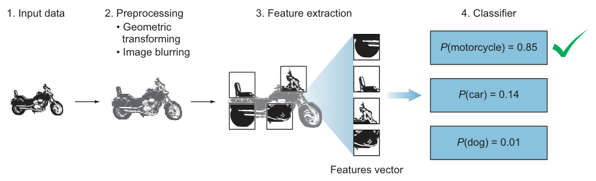
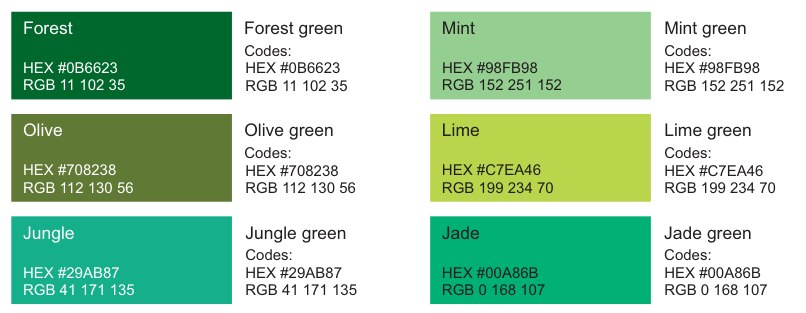
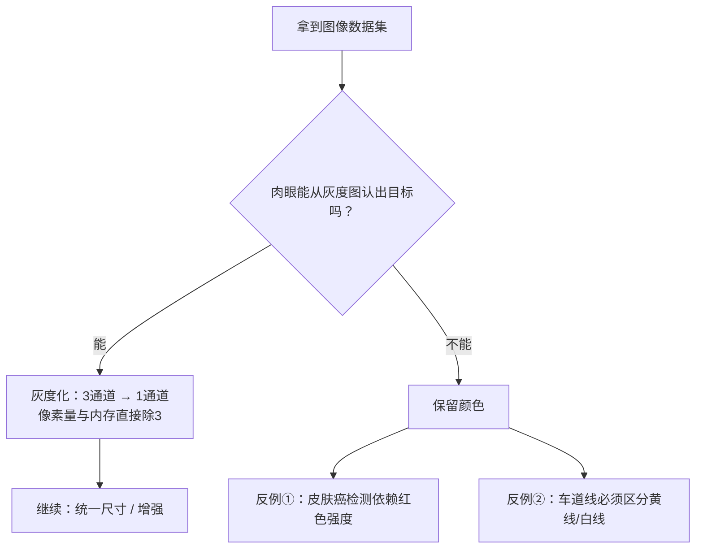

# 第 1 章 欢迎来到计算机视觉

> **本章解决**：视觉系统由什么组成、CV 能做什么、一张图如何一步步变成预测。
> **全书主线**在 1.3 节：$\text{输入} \to \text{预处理} \to \text{特征提取} \to \text{ML 模型}$——后面九章全是这四步的展开与深化。
> 本章没有正式的模型代码，配套 notebook 用 PyTorch/numpy 把每个概念做成了可运行的演示；学习目标是建立全书框架，后面的每一章都会回头引用这里的结构。

## 1.0 本章导图

<div class="brtree">
  <div class="brrow">
    <span class="brlabel root">计算机视觉</span>
    <span class="brace"></span>
    <div class="brkids">
      <div class="brrow">
        <span class="brlabel">视觉系统</span>
        <span class="brace"></span>
        <div class="brkids">
          <span class="brleaf">传感设备（眼）</span>
          <span class="brleaf">解释设备（脑）</span>
        </div>
      </div>
      <div class="brrow">
        <span class="brlabel">六大应用</span>
        <span class="brace"></span>
        <div class="brkids">
          <span class="brleaf">图像分类 → CNN</span>
          <span class="brleaf">目标检测 → YOLO / SSD</span>
          <span class="brleaf">风格迁移</span>
          <span class="brleaf">GAN 图像生成</span>
          <span class="brleaf">人脸识别</span>
          <span class="brleaf">以图搜图</span>
        </div>
      </div>
      <div class="brrow">
        <span class="brlabel">CV 流水线</span>
        <span class="brace"></span>
        <div class="brkids">
          <span class="brleaf">① 输入</span>
          <span class="brleaf">② 预处理</span>
          <span class="brleaf">③ 特征提取</span>
          <span class="brleaf">④ ML 模型</span>
        </div>
      </div>
      <div class="brrow">
        <span class="brlabel">图像表示</span>
        <span class="brace"></span>
        <div class="brkids">
          <span class="brleaf">灰度 F(x,y) ∈ [0,255]</span>
          <span class="brleaf">RGB (H, W, 3)</span>
        </div>
      </div>
      <div class="brrow">
        <span class="brlabel">预处理</span>
        <span class="brace"></span>
        <div class="brkids">
          <span class="brleaf">灰度化决策</span>
          <span class="brleaf">统一尺寸</span>
          <span class="brleaf">数据增强</span>
        </div>
      </div>
      <div class="brrow">
        <span class="brlabel">特征</span>
        <span class="brace"></span>
        <div class="brkids">
          <span class="brleaf">手工 HOG / SIFT + SVM</span>
          <span class="brleaf">自动提特征 + 分类，端到端</span>
        </div>
      </div>
    </div>
  </div>
</div>

## 1.1 视觉系统：眼 + 脑

**计算机视觉（Computer Vision, CV）**研究的是 AI 系统的视觉感知问题。任何 AI 系统的核心都是两件事：**感知（Perceive）环境 + 基于感知采取行动**。对人类来说，视觉只是感知的一种通道——我们同时靠听觉、嗅觉、触觉理解世界；AI 系统同理，构建什么应用，就选最能捕获环境的感知通道。而 CV 关注的视觉部分，定义是：**通过图像和视频感知并理解世界，为环境构建物理模型，让 AI 系统能据此做出合适的行动**。

关键词是 **Visual Perception（视觉感知）** 里的"感知"。以自动驾驶为例，视觉感知意味着：理解周围物体及其细节——行人、需要保持居中的车道——并检测交通标志、读懂标志含义。**我们要的不是"拍到"环境的画面，而是"看懂"环境。**

!!! info "图像处理 ≠ 计算机视觉"
    过去几十年，传统图像处理技术常被直接叫作"计算机视觉"，这不准确：一台**处理**图像的机器（缩放、滤波、变换）与一台**理解**图像内容的机器，是完全不同的两回事，而且后者绝非易事。在今天的 CV 系统里，图像处理只是更大系统中的一个零件——它的使命是理解图像内容。

### 人与机器的视觉系统同构

在最高层面上，人、动物、昆虫和大多数生物的视觉系统结构是一样的：一个**传感器（眼）**捕获图像，一个**大脑**处理并解释图像，最终基于从图像中提取的数据，输出对图像成分的预测。

| 人类 | 机器 | 职责 |
| --- | --- | --- |
| 眼 | **Sensing Device** 传感设备 | 捕获环境的图像 |
| 脑 | **Interpreting Device** 解释设备 | 理解图像内容、输出预测 |

<figure>
  
  <figcaption>图 1.1 人类视觉系统：眼负责捕获，脑负责理解（截自原书）</figcaption>
</figure>

作者用"你学会认狗"的过程，把机器学习的全部要素讲了一遍：

1. 第一次看到狗的图片，你不知道它是什么；有人告诉你"这是狗"。几次之后，你学会了认狗——**有标签的样本 + 被告知答案**，这就是 **Labeled Data（带标签数据）** 与 **Supervised Learning（监督学习）**。
2. 之后你看到一匹马，大脑开始用特征推理："四条腿、长脸、长耳朵——是狗吗？"被告知"错，这是马"之后，大脑调整内部参数，记住"腿更长的是马"。预测 → 犯错 → 纠错 → 更新参数，循环往复直到不再犯错——这是 **Training by Trial and Error（试错训练）**。

> "Congratulations! You just trained your brain to classify dogs and horses."（恭喜，你刚刚训练出了能分类狗和马的大脑。）——你的大脑和机器的 learning algorithm 本质上是同一套流程。

唯一的差距在**样本效率**：人只需要几张图就能学会认大多数物体，而机器需要成千上万张，复杂任务甚至要百万级样本。训练数据量这个主题会贯穿全书（第 4 章讲"该不该收集更多数据"，第 6 章讲怎么用迁移学习绕开它）。

!!! note "拓展：为什么机器的样本效率远低于人？"
    人脑带着数亿年进化预装好的"先验"（边缘、纹理、物体恒常性），学习新类别时只需在其上微调；而神经网络从随机初始化出发，所有层级特征都要从数据中学。**迁移学习（第 6 章）**正是把"预装先验"搬到机器上的手段：用 ImageNet 预训练替代进化预装，再用少量数据微调。

### AI 视觉系统的两个组件

要模仿人类视觉，机器需要同样的两个组件：一个模仿眼睛功能的**传感设备**，一个模仿大脑功能的、能解释和分类图像内容的强大**算法**（图 1.2）。本节先看前者，解释设备放到后面。

#### 传感设备：先定任务，再选设备

视觉系统为特定任务而设计，设计的第一要务是**为具体环境选择最好的传感设备**——相机、雷达、X 光、CT、Lidar，或多种设备的组合。作者反复强调：设计端到端视觉系统的第一步，永远是**明确它为哪个任务而生**。

以自动驾驶（AV）为例。它的视觉目标：让车理解周围环境，安全、准时地从 A 点到 B 点。为此车辆装备相机与传感器的组合，实现 360° 感知——行人、骑行者、车辆、道路施工，最远可达约三个橄榄球场的距离。三种典型设备各有所长：

| 设备 | 能力 | 短板 |
| --- | --- | --- |
| **Lidar（激光雷达）** | 发射不可见光脉冲，构建周围环境的高分辨率 **3D 地图** | — |
| 相机 | 看得懂交通标志、道路标线 | **测不了距离** |
| **Radar（雷达）** | 测量**距离与速度** | 看不清细节 |

其他领域同理：医疗诊断用 **X 光或 CT** 作为传感设备；农业视觉系统可能用其他类型的雷达捕获地表。

!!! note "侧栏：蜜蜂的复眼——传感器为任务特化"
    蜜蜂等昆虫的复眼由多达 **30,000 个小透镜**组成。复眼分辨率低，识别远处物体很弱；但它**对运动极其敏感**——这正是高速飞行时的求生刚需。蜜蜂不需要高清照片，它的视觉系统是为"飞行中捕捉最小运动"而特化的。传感器因物种的任务而特化，视觉系统的传感设备也因应用的任务而特化。

#### 解释设备：ANN 的诞生

解释器是视觉系统的"大脑"：接收传感设备的输出图像，学习其中的特征与模式，识别物体。作者在这里开了个玩笑："So we need to build a brain. Simple!"（所以我们需要造个大脑，简单！）。造法来自逆向工程：科学家研究中枢神经系统的工作方式，由此诞生了 **ANN（Artificial Neural Network，人工神经网络）**。

<figure>
  
  <figcaption>图 1.3 生物神经元 ↔ 人工神经元：树突接收信号 ↔ 输入 x₁…xₙ；突触输出信号 ↔ 输出 f(x)（截自原书）</figcaption>
</figure>

生物与人工的对应关系是：每个神经元都有一个主处理单元，接收输入信号 $(x_1, x_2, \dots, x_n)$ 并产生一个输出。单个神经元的行为极其简单——当足够多的输入被激活时，就向它连接的所有神经元"点火"。**但当百万级这样的神经元按层堆叠、彼此全连接（每个神经元连着数千个同伴）时，系统整体涌现出学习行为**。构建这种多层神经网络，就是 **Deep Learning（深度学习）**（图 1.4）。

核心机制一句话：**深度学习方法通过神经元层对数据做一序列变换（transformation），从而学习数据的表示（representations）**。这句话是全书所有架构的公理。

!!! note "侧栏：机器能超过人脑吗？"
    作者自问自答：十年前他会说"不能"，但两个场景改变了答案——
    **① 分类**：给你一本 10,000 张按品种分类的狗图（130 个品种），你研究完再考 100 张，能对几题？而一个神经网络**训练几小时就能超过 95% 的准确率**。
    **② 创作**：神经网络研究一幅画的笔触、颜色、阴影模式，几秒钟就能把它的风格迁移到新图上，产出新作品。
    结论：在许多图像分类与目标检测任务上，机器视觉已达到**超人**水平，且能力范围在快速扩张。

## 1.2 六大应用鸟瞰

背景：算力与数据量的双重暴涨，让 AI 在图像搜索/描述、图像视频分类、目标检测等复杂视觉任务上达到超人性能；深度神经网络同样成功用于 NLP 和语音交互（VUI）。作者明确说：应用多到需要一整本书才列得完，所以只给"鸟瞰"——用最流行的 DL 算法串联不同行业的应用（自动驾驶、无人机、机器人、店内摄像头、早期肺癌筛查）。

| 应用 | 任务定义 | 代表模型 | 原书例子 |
| --- | --- | --- | --- |
| 图像分类 | 整张图 → 预定义类别中的一个标签 | **CNN** | 肺癌 CT 结节早筛；交通标志识别 |
| 目标检测与定位 | 多物体：分类 + 各自位置 | YOLO / SSD / Faster R-CNN | 图中同时框出行人/自行车/云 |
| 生成艺术（风格迁移） | 把一幅画的风格迁移到另一张图 | — | 城市照片 ×《星月夜》 |
| 图像生成 | 从数据中学出"想象力"，造全新图像 | **GAN** | StackGAN 文字描述 → 高分辨率图像 |
| 人脸识别 | 精确识别或标记人脸 | — | 手机解锁、watchlist 比对 |
| 图像推荐 | 以图搜图 | — | 电商相似服装检索 |

### 图像分类：CNN 的主战场

**Image Classification（图像分类）**：给图像打上预定义类别集合中的一个标签。CNN 在这类任务上"真正大放异彩"，两个原书例子：

- **肺癌诊断**：肺癌危险的核心原因是确诊时往往已是中晚期。医生用肉眼在 CT 图像里找小结节——6~10mm 的中大结节识别得很好，但**≤4mm 的小结节容易漏**，而几乎每例肺癌都从小结节开始，且结节形状多样、医生要多年训练才能认全。CNN 从 X 光/CT 影像中**自动学习**这些特征，在结节致命前早期检出（图 1.5）。
- **交通标志识别**：传统 CV 方法也能做，但需要大量费时费力的人工**手工设计特征**；换成 DL，模型自己学习对这个 problem 最合适的特征（图 1.6）。

<table>
<tr>
<td></td>
<td></td>
</tr>
</table>
*图 1.5 X 光/CT 上的肿瘤检测 · 图 1.6 交通标志识别（截自原书）*

原书 NOTE 的推广结论：只要有一组带标签的图像——人或物识别、猫狗马分类、动物品种、农业用地类型……——就可以喂给 CNN，分类到任意多类。

### 目标检测与定位

分类是最基础的任务设定：**一张图只含一个物体**，识别它即可。但要逼近人类水平，网络必须能识别**多个物体及其位置**——这就是目标检测。**YOLO（you only look once）、SSD（single-shot detector）、Faster R-CNN** 等系统把图像切成小区域，逐区域打类别标签，从而定位并标注图中任意数量的物体（图 1.7）。这是自动驾驶等自主系统的基本前置能力（细节在第 7 章）。

### 风格迁移：几秒钟画完一幅"梵高"

**Neural Style Transfer（神经风格迁移）**：把内容图像与风格图像分离，将后者的笔触、配色"画"到前者的结构上——城市照片 ×《星月夜》= "梵高画的这座城"（图 1.8）。作者感叹：画家完成一幅画要几天几周，它几秒出图。实现机制在第 9 章。

### GAN：机器的想象力

作者的原话："这才是真正的魔法发生的地方——**创造**的魔法。"2014 年 **Ian Goodfellow** 发明 **GAN（Generative Adversarial Networks，生成对抗网络）**。它的定位：**GAN 是 CNN 的进化版架构**——所以先吃透 CNN（第 3 章），GAN（第 8 章）会容易得多。

给 GAN 一组图像，它能生成**全新的、从未存在过的、以假乱真**的图像。**StackGAN** 这类变体甚至能从一段文字描述生成匹配描述的高分辨率图像——注意这不是在图库里搜索，这些"照片"完全是想象出来的（图 1.9）。

!!! note "侧栏：GAN 创作的画作拍出 $432,500"
    2018 年 10 月，AI 画作《The Portrait of Edmond Belamy》成交价 **$432,500**。画中是虚构人物 Edmond de Belamy（深色礼服、白领，像一位教士）。创作团队是三位 25 岁的法国学生：网络在 15,000 幅 14~20 世纪的肖像画上训练后自行作画，打印装裱，落款是一段 GAN 算法代码。
    作者的展望：如果机器有了画图的想象力，未来它会不会创作电影、音乐、甚至书？从文字合成图像的能力终将允许我们只用文字描述就生成各种娱乐内容。

### 人脸识别：1:N 与 1:1

**Face Recognition（FR）**能精确识别或标记人脸（搜名人、给照片自动 tagging），本质是**细粒度分类**。按《Handbook of Face Recognition》（Li et al., Springer, 2011）分为两种模式：

| 模式 | 匹配方式 | 回答的问题 | 场景 |
| --- | --- | --- | --- |
| **Face Identification** 人脸辨识 | **1 : N**（查询脸 vs 库中全部模板） | "你是谁？" | 城市监控 watchlist 比对嫌疑人是"1 : few"变体 |
| **Face Verification** 人脸验证 | **1 : 1**（查询脸 vs 声称身份的模板） | "你是不是你声称的那个人？" | 手机人脸解锁 |

<figure>
  
  <figcaption>图 1.10 左：验证（是不是 Person 1）· 右：辨识（库中有没有她）（截自原书）</figcaption>
</figure>

（拓展）这对概念在第 10 章会升级成"视觉嵌入"的度量学习问题：verification 用相似度阈值判断，identification 用最近邻检索。

### 图像推荐系统

以图搜图：给定查询图，找出相似图像。电商是典型——用户点了一双鞋，系统展示相似款（图 1.11，服装检索，来源 Liu et al. 2016：每行最左是点击的查询图，后面是检索结果）。实现思路同样指向第 10 章：把图像映射成嵌入向量，在向量空间里做相似度检索。

<figure>
  
  <figcaption>图 1.11 服装检索：左列查询，右列返回相似款（截自原书）</figcaption>
</figure>

## 1.3 CV 流水线：全书主线

应用千差万别，但典型视觉系统都遵循同一套流程——**Computer Vision Pipeline（CV 流水线）**，四步（图 1.13）：


原书 DEFINITIONS，两个术语先钉死：

- **Image Classifier（图像分类器）**：以图像为输入、输出标签（类别）的算法。
- **Class（类别 / Category）**：机器学习中数据的输出类别。

{ .lq-img }
*图 1.14 摩托车分类的概率输出（截自原书）*

**走一遍流水线**（作者让你"扮演分类器"）。输入一张摩托车图，候选类别：摩托 / 汽车 / 狗。你逐个查看特征向量里的特征：

1. **轮子**——狗没有轮子（"正常的狗没有，机器狗除外"）→ 排除狗，剩汽车或摩托；
2. **车灯**——更像摩托车；
3. **后挡泥板**——更像摩托车；
4. **只有两个轮子**——基本锁定摩托车；
5. 继续看车身形状、踏板……直到得出最佳猜测。

输出是每个类别的概率：$P(\text{motorcycle}) = 0.85$、$P(\text{car}) = 0.14$、$P(\text{dog}) = 0.01$。模型答对了，但对汽车仍留有 14% 的"困惑"——概率输出天然携带置信度信息，这比硬标签有用得多（第 4 章的指标体系就建立在此之上）。

**本节最重要的推论**：想提升模型表现，所有手段都落在这四步之内——①采集更多训练图像；②更多预处理去噪；③提取更好的特征；④更换分类器 / 调超参数；外加更多训练时间。这张对照表值得记一辈子：

| 想提升模型 | 动哪一步 | 对应章节 |
| --- | --- | --- |
| 多采数据 | ① | 第 4 章 |
| 预处理去噪、标准化 | ② | 第 3、4 章 |
| 更好的特征 | ③ | 第 3 章（CNN 自动提取） |
| 换分类器 / 调超参数 / 训练更久 | ④ | 第 4 章 |

!!! note "拓展：'85% 准确'这句说法要小心"
    原书说"我们知道它是摩托，所以算法 85% 准确"——严格说这是**单样本置信度**，不是数据集意义上的准确率。准确率要在一批样本上统计（第 4 章），而且必须区分训练集与测试集，否则会高估泛化能力。

## 1.4 图像 = 函数

CV 应用处理图像或视频；视频就是**堆叠的连续图像帧**，所以先把图像吃透。

### 灰度图：F(x, y)

**Pixel（像素）**是数字图像的原始构建块，网格状排布；像素值表示**该位置出现的光强（intensity of light）**。把图像看成二元函数 $F(x, y)$——"告诉我坐标，我还你一个亮度值"：

$$
\text{灰度：}\; F(x, y) \in [0, 255]
$$

- $0$ = 全黑，$255$ = 全白，中间是灰度渐变。
- 坐标系与笛卡尔坐标系类似（二维 x-y 平面），但**原点在左上角**。
- 原书 $32\times16$ 摩托车例（图 1.15）：宽 32 像素、高 16 像素，x 轴 $0\to31$、y 轴 $0\to15$，共 $32\times16=512$ 个像素；$F(12,13)=255$（白）、$F(20,7)=0$（黑）、$F(18,9)=190$（灰）。

!!! warning "原书笔误"
    原书正文写"$32\times16$ 图的 y 轴从 0 到 **16**"——16 像素高的图，索引是 $0\sim15$（图 1.15 自己标的也是 15）。此处按图修正。

!!! note "拓展：为什么是 0~255？"
    每像素 8 bit，$2^8=256$ 个灰度级。16 bit 影像（医学影像常用）有 65,536 级——灰度级数由存储位深决定，训练时常再归一化到 $[0,1]$ 或 $[-1,1]$（第 3 章的预处理会见到）。

<figure>
  
  <figcaption>图 1.15 图像 = 像素网格上的函数 F(x,y)（截自原书）</figcaption>
</figure>

### 彩色图：三个堆叠的矩阵

人眼看到的是物体、风景、颜色；**计算机看到的只是一个二维数字矩阵**——"没有上下文，只是一大堆数据"。$24\times24$ 的图有 $576$ 个像素；$700\times500$ 的图矩阵维度就是 $(700,500)$。

彩色图在标准 **RGB** 系统下有**三个通道**（红、绿、蓝），即三个矩阵堆叠成 3D 矩阵：

$$
\text{RGB 彩色：}\; F(x, y) = [\,red(x,y),\ green(x,y),\ blue(x,y)\,]
$$

- $700\times700$ 彩色图的维度是 $(700, 700, 3)$；每个像素三个数（各 $0\sim255$）。
- 草地左上角像素 $F(0,0) = [11, 102, 35]$——三通道叠加才得到"森林绿"（图 1.18）。
- 除 RGB 外还有 **HSV、Lab** 等颜色系统，表示概念相同。

<table>
<tr>
<td></td>
<td></td>
</tr>
</table>
*图 1.16 计算机眼里只有数字矩阵 · 图 1.17 彩色图 = R/G/B 三通道堆叠（截自原书）*

{ .lq-img }
*图 1.19 不同深浅的绿 = R/G/B 三通道的不同强度组合（截自原书）*

| 颜色 | Forest | Olive | Jungle | Mint | Lime | Jade |
| --- | --- | --- | --- | --- | --- | --- |
| HEX | #0B6623 | #708238 | #29AB87 | #98FB98 | #C7EA46 | #00A86B |
| RGB | 11,102,35 | 112,130,56 | 41,171,135 | 152,251,152 | 199,234,70 | 0,168,107 |

!!! note "拓展：什么时候用 HSV/Lab？"
    RGB 三通道高度相关且受光照影响大；**HSV** 把"色调"与"明暗"分开，做颜色阈值分割（比如抠出黄色车道线）更稳。Lab 的 L 通道只含亮度，常用于不改变色彩结构的增强——第 9 章风格迁移会再遇到"把亮度与颜色分开处理"的思想。

### 图像即函数 ⇒ 处理即数学运算

把图像看成函数的最大好处：**所有图像处理都是逐像素的数学运算**——$F$ 进，$G$ 出。原书表 1.1（重排）：

| 应用 | 变换 | 逐条解读 |
| --- | --- | --- |
| 变暗 | $G(x,y) = 0.5 \cdot F(x,y)$ | 每个光强乘 0.5，整体变暗 |
| 变亮 | $G(x,y) = 2 \cdot F(x,y)$ | 光强翻倍（超 255 需截断） |
| 物体下移 150 像素 | $G(x,y) = F(x,\ y+150)$ | "输出位置 (x,y) 的值 = 原图更下方 (x, y+150) 的值"，画面内容向下挪 |
| 去灰成黑白（阈值 130） | $G(x,y) = 0$ 若 $F(x,y)<130$，否则 $255$ | 二值化：按阈值把灰度压成纯黑/纯白 |

```python
import torch                                # 导入 PyTorch
img = torch.zeros(16, 32)                   # 16x32 灰度图，全黑
img[13, 12] = 255.0                         # F(12,13)=255：白像素
dark  = 0.5 * img                           # 变暗 G=0.5F
light = 2.0 * img                           # 变亮 G=2F
shift = torch.roll(img, shifts=150, dims=0) # 下移150像素（循环滚动近似）
bw    = torch.where(img < 130, 0.0, 255.0)  # 阈值130二值化
```

配套 notebook 会把这些运算逐个跑出来并可视化。

## 1.5 图像预处理

类比 ML 项目的数据清洗：建模前要花大量时间整理数据。图像同理——**先洗后喂**。作者给出动机：**我们不可能为每一种拍摄条件写一个专属算法**；数据通常杂乱、来源多样，必须标准化，才能让一个通用算法去解。预处理的目标：**降低复杂度、提高精度**。

### 灰度化：省算力的一刀，砍前先过决策流程

彩色图三通道信息多、占内存；许多物体识别其实**不需要颜色**——亮度（明暗）模式就足以定义很多物体的形状与特征。灰度化把要处理的像素量直接砍到 1/3（图 1.20）。但作者立刻给了两个反例，说明这一刀不能乱砍：

- **皮肤癌检测**依赖皮肤红色强度（红疹），去色等于抹掉关键证据；
- **车道线检测**必须区分**黄线与白线**——交规里两者含义不同，灰度图做不到。



!!! tip "经验法则（适用于几乎所有预处理决策）"
    **用肉眼看灰度图：能认出你要找的目标，灰度就够用；认不出，就必须保留颜色（更多信息）。** 这条"肉眼测试"是作者给的最实用判断器。

!!! note "拓展：灰度转换公式"
    原书没给实现公式。工程上常用亮度加权：$Gray = 0.299R + 0.587G + 0.114B$（人眼对绿色最敏感，权重最高）。notebook 第 1 章实现过它与 OpenCV 结果的误差不超过 1。

### 统一尺寸（Standardization）

某些 ML 算法（尤其 CNN）要求**数据集中所有图像尺寸一致**——必须先缩放到相同宽高再喂给学习算法（这个约束的机制在第 3 章展开）。

### 数据增强（Data Augmentation）

用现有图像的**变换版本**扩充数据集：缩放、旋转、其他仿射变换。目的：让网络见识同一物体的各种形态，物体以任何形式出现时都更可能被识别（图 1.21，蝴蝶例：原图 / 去纹理 / 去色 / 边缘增强 / 显著边缘图 / 翻转旋转）。

<figure>
  
  <figcaption>图 1.21 一个样本变出六个变体（截自原书）</figcaption>
</figure>

### 其他技术

去背景降噪、增亮/调暗……按数据集与问题选。你会通过整本书积累"什么问题配什么预处理"的直觉。

!!! note "No Free Lunch 定理"
    David Wolpert 与 William Macready 在《No Free Lunch Theorems for Optimization》（IEEE Trans. on Evolutionary Computation）提出。团队里常说这句话，意思：**没有一条配方适用于所有模型**——选架构、调超参、做预处理，只有经验法则，没有保证成功的万能公式。

## 1.6 特征提取

流水线的核心组件。作者定位："整个 DL 模型都围绕提取有用特征来工作。"所以本章多花了笔墨。

原书 DEFINITION：**Feature（特征）**= 可观测现象的一个**可测量的**属性/特征，是你喂给 ML 模型以产出预测的输入。房价类比：输入特征 `square_foot`、`number_of_rooms`、`bathrooms`，模型输出预测价。**选到好特征，直接提升 ML 算法的预测力。**

### CV 里的特征：独有 + 可测量

CV 特征 = 图像中对特定物体**独有**的可测量数据：一种独特颜色，或线、边缘、图像块等具体形状。特征强弱是相对的：

| 用"轮子"判断 | 强弱 | 结论 |
| --- | --- | --- |
| 摩托车 vs 狗 | 强 | 一锤定音 |
| 摩托车 vs 自行车 | 弱 | 需补充后视镜、车牌、脚踏等**组合特征**共同描述物体 |

流程（图 1.22）：原始图像 → 特征提取算法（本章先当**黑盒**）→ **Feature Vector（特征向量）**——一个 1D 数组，是物体的稳健表示。

<figure>
  
  <figcaption>图 1.22 原始图像 → 特征提取算法 → 特征向量（截自原书）</figcaption>
</figure>

### 好特征标准①：可泛化（Repeatability）

> "Machine learning models are only as good as the features you provide."（模型的上限由你给的特征决定。）

图 1.22 里的特征来自**一辆**摩托车——但特征必须能检测"一般的"摩托，而不是这一辆的局部拷贝。以轮子为例：好的轮子特征不是某个特定轮子的复制品，而是"带某种纹理的圆形"这类**一般模式**——特征提取器看过成千上万张摩托图后，学到的是无视位置、无视型号的轮子共性。

### 好特征标准②：有区分度——Greyhound vs Labrador 思想实验

要区分灵缇与拉布拉多，候选特征两个：身高、眼色。

<figure>
  
  <figcaption>图 1.23 灵缇（瘦高）与拉布拉多（截自原书）</figcaption>
</figure>

**身高**：平均而言灵缇高几英寸，但犬类个体差异大。看身高分布直方图（图 1.24，x: 10~40 英寸）——

- 身高 $\le 20$ 英寸：超过 **80%** 概率是拉布拉多；
- 身高 $\ge 30$ 英寸：基本可以确定是灵缇；
- $20\sim30$ 的中间带：两者分布接近，需要看其他特征。

```python
def classify(height_inch):          # 输入：狗的身高（英寸）
    if height_inch <= 20:           # 直方图左端
        return "Labrador（>80%）"   # 小于20英寸：大概率拉布拉多
    if height_inch >= 30:           # 直方图右端
        return "Greyhound"          # 大于30英寸：基本是灵缇
    return "看其他特征"             # 中间带：身高失效，交给别的特征
```

结论：身高是**有用但不充分**的特征——它"增加了区分信息"，值得保留，但不能包打天下。

**眼色**（图 1.25）：蓝/棕两色在两个犬种中分布约 **50/50**，与犬种不相关——**无用特征**，直接丢弃。

<figure>
  
  <figcaption>图 1.25 眼色分布 50/50：无区分度（截自原书）</figcaption>
</figure>

两个推论（作者原话展开）：

1. **ML 项目里几乎不存在单特征包打天下**——每个特征只捕捉一类信息，所以几乎总是需要多特征组合。
2. **如果真的一个特征就够用，直接写 if-else 就行**，何必费劲训练分类器——反过来说，需要训练模型，正说明问题需要多特征联合判断。

!!! tip "选特征的方法：假装自己是分类器"
    想区分两类东西，做思想实验：**你会先问什么信息？**毛长？体型？颜色？答案就是候选特征。好特征四条：**可识别；易跟踪比较；跨尺度/光照/视角一致；有噪声或物体部分可见时仍可见。**

### 手工特征 vs 自动特征

<figure>
  
  <figcaption>图 1.26 传统 ML：手工特征 + SVM/AdaBoost（截自原书）</figcaption>
</figure>

**传统 ML 路线**：花大量时间做手工特征选择与工程——依靠领域知识（或与领域专家合作）设计特征，再喂给 **SVM** 或 **AdaBoost** 等分类器。经典手工特征集：

| 特征集 | 一句话说明（拓展） |
| --- | --- |
| **HOG**（方向梯度直方图） | 统计局部边缘方向分布，行人检测的经典特征 |
| **Haar Cascades** | 黑白矩形明暗差，实时人脸检测曾全靠它 |
| **SIFT**（尺度不变特征变换） | 关键点检测 + 描述子，尺度/旋转不变 |
| **SURF**（加速稳健特征） | SIFT 的加速版 |

**DL 路线**：不手工提特征——原始图像直接进网络，逐层自动找模式、建特征，并通过连接上的权重学习各特征对输出的重要性。**神经网络 = 特征提取器 + 分类器，端到端（end-to-end）可训练**；这正是它与传统 ML 的本质区别（图 1.27）。

<figure>
  
  <figcaption>图 1.27 输入直接流过网络：自动提特征 + 分类一步完成（截自原书）</figcaption>
</figure>

!!! warning "误区：'神经网络只学有用特征'"
    别以为网络天生只吸收好特征——**初始化时它把所有特征都捞进来，随机赋权**；训练过程中不断调整权重反映重要性：出现频率最高的模式权重升得更高、被视为更有用，权重最低的特征对输出几乎没有影响。垃圾特征也会进场，这正是第 3、4 章正则化与 Dropout 存在的理由。学习过程的细节在第 2 章。

### 为什么要提特征

原始图像携带太多与分类无关的冗余。预处理之后的第一步就是**简化**：保留重要信息（关键颜色、图像块），丢掉非必要信息，把又大又复杂的图像数据变成更小的特征集合——分类因此更简单、更快。

原书算例：10,000 张 $1000\times1000$ 的摩托车图（有的纯背景、有的杂乱背景）→ 特征提取后丢掉无关数据，只留浓缩的特征列表喂分类器（图 1.28）——比让分类器直接啃一亿像素的原图高效得多。

<figure>
  
  <figcaption>图 1.28 万张原图浓缩成一个特征向量再喂分类器（截自原书）</figcaption>
</figure>

好消息（作者强调）：**与手工时代相反，DL 几乎不需要预处理**——重活网络自己干。

## 1.7 分类器学习算法

流水线前三步的成果——图像的矩阵表示、干净的输入、浓缩的特征向量——在最后一步变现：把特征向量喂给**分类器**，输出类别标签（摩托 / 非摩托）。

- 两条路线：传统 ML（SVM，部分问题够用）vs **CNN**（复杂视觉问题上的主力）。
- 输入图像流过网络各层逐层学特征：**浅层检测图案，深层检测"图案中的图案"**，层层组合，直到形成特征向量。
- 网络越深，学到的数据特征越多——这正是 **Deep Learning** 名字的由来。（更多层也带来 trade-off，第 2、3 章展开。）
- **最后一层通常就是分类器**：看到摩托车的特征组合，点亮 motorcycle 节点；否则点亮 not motorcycle（图 1.29）。

<figure>
  
  <figcaption>图 1.29 特征提取层 + 分类层：逐层学习，末层出标签（截自原书）</figcaption>
</figure>

!!! note "拓展：'图案中的图案'在第 3 章会变成看得见的证据"
    第 3 章可视化卷积核时会看到：第一层卷积核响应边缘/颜色块，第二层响应角点与纹理组合，更深层响应物体部件——层级特征的直觉本章先立住。

## 坑与陷阱

!!! danger "6 个容易踩的坑"
    1. **图像处理 ≠ 计算机视觉**：会缩放滤波不等于看懂图像；图像处理只是 CV 系统的一个零件。
    2. **别盲目灰度化**：颜色是关键特征时（皮肤红斑、黄/白车道线）去色 = 自废武功。先做"肉眼测试"再决定。
    3. **特征必须可泛化**：从单张图抠出的局部只是拷贝，不是特征——要的是"看过一千张图"后的一般模式。
    4. **"网络只学有用特征"是误区**：所有特征随机赋权起步，靠训练分优劣；垃圾特征也会进场。
    5. **No Free Lunch**：没有万能配方，只有针对问题的经验法则 + 实验。
    6. **先定任务再选传感器**：顺序反了是端到端视觉系统设计的大忌（想想蜜蜂的复眼）。

## 速览

1. 视觉系统 = 传感设备（眼）+ 解释设备（脑），人机同构；设计第一步永远是明确任务。
2. CV 流水线四步：**输入 → 预处理 → 特征提取 → ML 模型**；一切改进手段都落在这四步之内。
3. 图像是函数：灰度 $F(x,y)\in[0,255]$（2D 矩阵），RGB 彩色 $(H,W,3)$（3D 矩阵），**原点在左上角**。
4. 图像即函数 ⇒ 图像处理 = 逐像素数学运算（变暗、变亮、平移、二值化……）。
5. 预处理目标：降复杂度、提精度；灰度化先做"肉眼测试"，颜色可能是关键证据。
6. 特征 = 独有可测属性；特征向量是喂给模型的紧凑 1D 表示。
7. 好特征两标准：**可泛化**（Repeatability）+ **有区分度**（Greyhound 实验）。
8. 传统 ML = 手工特征（HOG/SIFT/…）+ SVM/AdaBoost；DL = 自动特征 + 分类，端到端训练。
9. 网络对所有特征**随机赋权**起步，训练按频率/重要性调整权重。
10. 浅层学图案、深层学图案中的图案——深度学习之"深"；末层通常就是分类器。

## 术语速查

| 英文 | 中文 | 一句话 |
| --- | --- | --- |
| Computer Vision | 计算机视觉 | 通过图像/视频理解世界、构建物理模型 |
| Visual Perception | 视觉感知 | 不止"看见"，而是看懂环境 |
| Sensing Device | 传感设备 | 视觉系统的"眼"，按任务选型 |
| Interpreting Device | 解释设备 | 视觉系统的"脑"，学习特征与模式 |
| Lidar / Radar | 激光雷达 / 雷达 | 高分辨率 3D 建图 vs 测距测速 |
| ANN | 人工神经网络 | 模仿生物神经元连接的计算模型 |
| Deep Learning | 深度学习 | 多层神经元堆叠，逐层变换学习表示 |
| Supervised Learning / Labeled Data | 监督学习 / 带标签数据 | 看带答案的样本学映射 |
| Trial and Error | 试错训练 | 预测→犯错→纠错→更新参数 |
| Image Classification | 图像分类 | 整图 → 一个预定义标签 |
| Object Detection | 目标检测 | 分类 + 定位图中多个物体 |
| Style Transfer | 风格迁移 | 把一幅画的风格套到另一张图上 |
| GAN | 生成对抗网络 | 2014 年 Goodfellow 提出，可"想象"出新图 |
| StackGAN | —— | 文字描述 → 高分辨率图像 |
| Face Identification / Verification | 人脸辨识 / 验证 | 1:N "你是谁" vs 1:1 "你是不是你" |
| Image Recommendation | 图像推荐 | 以图搜图（电商相似商品） |
| CV Pipeline | CV 流水线 | 输入→预处理→特征→模型 四步 |
| Pixel / Channel | 像素 / 通道 | 图像最小单元；灰度 1 通道，RGB 3 通道 |
| Image Preprocessing | 图像预处理 | 标准化、灰度化、去噪等"洗数据" |
| Data Augmentation | 数据增强 | 用变换造扩充样本 |
| Feature / Feature Vector | 特征 / 特征向量 | 独有可测属性 / 其 1D 紧凑表示 |
| Feature Engineering | 特征工程 | 传统 ML 里靠领域知识手工设计特征 |
| HOG / SIFT / SURF / Haar | —— | 经典手工特征集 |
| SVM / AdaBoost | —— | 传统 ML 时代常用的分类器 |
| Repeatability | 可重复性 | 特征对同类所有物体稳定成立 |
| No Free Lunch Theorem | 没有免费午餐定理 | 不存在适用一切问题的万能配方 |

## 覆盖自查

??? note "原书小节 → 笔记位置"
    | 原书 | 笔记 |
    | --- | --- |
    | 章首引言与本章路线 | 导语 + 1.0 导图 |
    | 1.1（1.1.1–1.1.4 + 蜜蜂侧栏 + 超人侧栏 + 认狗比喻） | §1.1 |
    | 1.2.1–1.2.6 + GAN 画作侧栏 | §1.2（肺癌/交通标志/检测/风格/GAN/人脸/推荐全覆盖） |
    | 1.3（含 DEFINITIONS 与摩托车概率走查） | §1.3 |
    | 1.4.1–1.4.3 + 表 1.1 + 图 1.19 + 侧栏 | §1.4（绿色色值表重排收录） |
    | 1.5 + 1.5.1 + 两处侧栏 | §1.5 |
    | 1.6.1–1.6.3 + 三处侧栏 | §1.6 |
    | 1.7 | §1.7 |
    | 章末 Summary（5 条） | §速览（无重复摘抄） |
