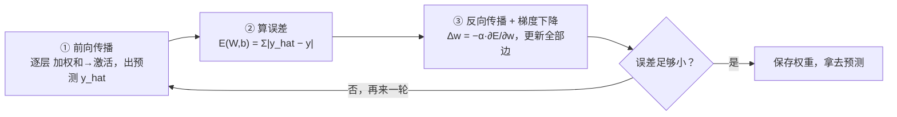

# 第 2 章 深度学习与神经网络

> **本章解决**：第 1 章把深度学习算法当成"自动提特征 + 分类"的黑盒（图 2.1）；本章把这个盒子打开——神经网络到底怎么算、怎么学、怎么更新参数。
> 主线四件事：感知机 → 多层感知机（MLP）架构 → 训练三步（前向传播、算误差、优化权重）→ 反向传播。学完本章，第 3 章回到 CV，讲全书最重要的架构：卷积神经网络（CNN）。
> 本章是全书公式最密的一章：每个公式都先给"人话版"，再给严格式。配套 numpy/PyTorch 代码全部可运行。

本章覆盖（原书 This chapter covers）：

- 理解感知机与多层感知机
- 各种激活函数的用法
- 用前向传播、误差函数与误差优化训练网络
- 反向传播

设计一个神经网络 = 一串设计决策：选优化器、选损失函数、选激活函数、设计架构（几层、每层多少神经元、怎么连）。本章逐个拆。

## 2.0 本章导图

<div class="brtree">
  <div class="brrow">
    <span class="brlabel root">神经网络怎么学</span>
    <span class="brace"></span>
    <div class="brkids">
      <div class="brrow">
        <span class="brlabel">感知机</span>
        <span class="brace"></span>
        <div class="brkids">
          <span class="brleaf">加权和 z = Σxᵢwᵢ + b</span>
          <span class="brleaf">偏置 b = 恒 1 额外输入</span>
          <span class="brleaf">阶跃激活 0 / 1</span>
          <span class="brleaf">试错学习四步</span>
          <span class="brleaf">极限：只解线性可分</span>
        </div>
      </div>
      <div class="brrow">
        <span class="brlabel">MLP 架构</span>
        <span class="brace"></span>
        <div class="brkids">
          <span class="brleaf">输入层 = 特征向量</span>
          <span class="brleaf">隐藏层 = 特征学习</span>
          <span class="brleaf">权重连接（边）</span>
          <span class="brleaf">输出层</span>
          <span class="brleaf">≥2 隐藏层 = 深度网络</span>
        </div>
      </div>
      <div class="brrow">
        <span class="brlabel">激活函数</span>
        <span class="brace"></span>
        <div class="brkids">
          <span class="brleaf">Heaviside 阶跃</span>
          <span class="brleaf">Sigmoid（二分类）</span>
          <span class="brleaf">Softmax（多分类）</span>
          <span class="brleaf">tanh（零中心）</span>
          <span class="brleaf">ReLU / Leaky ReLU</span>
        </div>
      </div>
      <div class="brrow">
        <span class="brlabel">前向传播</span>
        <span class="brace"></span>
        <div class="brkids">
          <span class="brleaf">逐层：加权和 → 激活</span>
          <span class="brleaf">矩阵形式 σ(W⁽³⁾σ(W⁽²⁾σ(W⁽¹⁾x)))</span>
          <span class="brleaf">隐藏节点 = 新特征</span>
        </div>
      </div>
      <div class="brrow">
        <span class="brlabel">误差函数</span>
        <span class="brace"></span>
        <div class="brkids">
          <span class="brleaf">MSE / MAE（回归）</span>
          <span class="brleaf">交叉熵（分类）</span>
          <span class="brleaf">误差必须恒正</span>
        </div>
      </div>
      <div class="brrow">
        <span class="brlabel">优化 + 反向传播</span>
        <span class="brace"></span>
        <div class="brkids">
          <span class="brleaf">方向 = 梯度 ∂E/∂w</span>
          <span class="brleaf">步长 = 学习率 α</span>
          <span class="brleaf">批量 / 随机 / 小批量 GD</span>
          <span class="brleaf">Δw = −α·dE/dw</span>
          <span class="brleaf">链式法则连乘回传</span>
        </div>
      </div>
    </div>
  </div>
</div>

## 2.1 理解感知机

人工神经网络（**ANN**, Artificial Neural Network）由大量神经元（**neuron**）按层组织、彼此连接，做计算、出预测（图 2.2）。这种架构也叫**多层感知机（MLP, Multilayer Perceptron）**——这个名字更直观：一层层感知机堆起来的网络。**ANN 和 MLP 两个词在本书里互换使用**，指同一种架构。

先放大看最小部件：单个感知机。理解了一个感知机怎么工作，多个感知机协作学习就好懂了。

### 2.1.1 什么是感知机

最简单的神经网络就是**感知机（Perceptron）**：只含一个神经元。概念上它模仿生物神经元（图 2.3）：生物神经元从树突接收电信号，对不同信号做不同强度的调制，当输入信号总强度超过某个阈值时，才通过突触向外点火输出；输出再喂给下一个神经元，如此往复。

<figure>
  
  <figcaption>图 2.3 生物神经元 ↔ 人工神经元：树突接收 ↔ 输入 x₁…xₙ，突触输出 ↔ f(x)（截自原书）</figcaption>
</figure>

要建模这个"超阈值才点火"的现象，人工神经元做两件连续的事：

1. **算加权和**——代表输入信号的总强度；
2. **套阶跃函数**——总强度超过阈值就输出 1（点火），否则输出 0（沉默）。

不是所有输入特征都同样重要（第 1 章的老话题），所以每个输入分到一个**连接权重（connection weight）**来反映重要性。图 2.4 是感知机的完整结构：

<figure>
  
  <figcaption>图 2.4 感知机：输入加权求和（Sum），再过激活函数 f，输出结果（截自原书）</figcaption>
</figure>

- **输入向量（Input vector）**：喂给神经元的特征向量，通常大写 \(X\)，即 \((x_1, x_2, \dots, x_n)\)。
- **权重向量（Weights vector）**：每个 \(x_i\) 配一个权重 \(w_i\)，代表它区分不同样本的重要性。
- **神经元函数（Neuron functions）**：神经元内部的计算——加权和 + 激活函数。
- **输出（Output）**：由你选的激活函数决定。阶跃函数输出 0 或 1；其他激活函数输出概率或浮点数。输出节点就是感知机的预测。

!!! note "侧栏：连接权重（Connection Weights）"
    不是所有输入特征都同等重要。每个输入特征 \(x_i\) 分到的权重 \(w_i\) 反映它在决策中的分量：**权重大 → 放大信号，权重小 → 衰减信号**。常见的神经网络画法里，权重就画成从输入节点连向感知机的线（边）。
    例：用面积、地段、房间数预测房价。三个特征 \(x_1, x_2, x_3\)，若面积对价格的影响是地段的两倍、地段是房间数的两倍，权重大致就是 8、4、2。
    权重怎么分配、学习怎么发生，是神经网络训练的核心——本章剩下的篇幅都在讲它。

#### 加权和函数（Weighted Sum）

加权和又叫**线性组合（linear combination）**：所有输入乘以各自权重后求和，再加偏置项。它的图像是一条直线：

\[
z = x_1 \cdot w_1 + x_2 \cdot w_2 + x_3 \cdot w_3 + \dots + x_n \cdot w_n + b
\]

紧凑写法：\(z = \sum_i x_i \cdot w_i + b\)，其中 \(b\) 是偏置（bias，即直线的截距）。Python 实现（原书代码，numpy）：

```python
# ===== 书 2.1.1 节：加权和 =====
z = np.dot(w.T, X) + b   # X 为输入向量（大写），w 为权重向量，b 为截距
```

!!! note "侧栏：偏置 b 是什么，为什么要加它？"
    回忆一点线性代数。直线方程 \(y = mx + b\)：要确定一条线，需要两样东西——**斜率**和**线上的一个点**。偏置就是线在 y 轴上的那个点，它让直线可以沿 y 轴上下平移，去更好地贴合数据。**没有 b，直线只能过原点 (0,0)，拟合能力大打折扣**。原书给了个直观测试：让一条过原点的直线去分开"圆圈"和"星星"两组数据——做不到。
    实现上，给输入层加一个**取值恒为 1 的额外输入节点**，它连出的权重就是偏置。神经网络里 b 被当作一个额外的权重对待：随机初始化、由神经元在学习中调整，目标是让代价函数最小。

#### 阶跃激活函数（Step Activation Function）

无论生物还是人工神经网络，神经元都不会把收到的原始输入直接输出——中间还有一步，叫**激活函数（activation function）**，它是"大脑的决策单元"。激活函数拿到的还是那个加权和 \(z = \sum x_i \cdot w_i + b\)，当加权和高于某个阈值时就"激活"（点火）这个神经元。

感知机算法用的最简单激活函数是**阶跃函数**：输出二值（0 或 1）。书正文写"加权和 ≥ 0 就点火"，而图 2.5 和书内代码取的是 \(>0\) 点火——边界点两处不一致，不影响理解，本文统一按代码（\(\le 0\) 输出 0）：

\[
\text{output} =
\begin{cases}
0 & \text{若 } w \cdot x + b \le 0 \\
1 & \text{若 } w \cdot x + b > 0
\end{cases}
\]

```python
# ===== 书 2.1.1 节：阶跃函数 =====
def step_function(z):
    if z <= 0:
        return 0
    else:
        return 1
```

### 2.1.2 感知机怎么学习？

感知机用**试错（trial and error）**学习：把权重当成旋钮，上下拧，直到网络训练好（图 2.6：每个权重画成一个可调的旋钮，在训练中被上下调整以优化损失函数）。学习逻辑四步：

1. 神经元算加权和、套激活函数，做出预测 \(\hat{y}\)——这叫**前向过程（feedforward）**：\(\hat{y} = \text{activation}(\sum_i x_i \cdot w_i + b)\)；
2. 拿预测和正确标签比，算误差：\(\text{error} = y - \hat{y}\)；
3. 更新权重：预测偏高，就把权重往"让下次预测低一点"的方向调，反之亦然；
4. 重复！

这个过程循环很多次，权重不断更新，直到第 2 步的误差非常小（接近零）——说明预测已很接近正确值。此时可以停止训练，**保存表现最好的权重**，用到结果未知的新样本上。

### 2.1.3 一个神经元够吗？

不够，看为什么。感知机是一个**线性函数**——训练好的神经元产出一条直线来切分数据。

例：训练感知机预测一个球员能否入选校队，只用两个特征（身高、年龄）。训练就是在找最好的权重和偏置，产出一条最能分开"录取 / 落选"的直线：

\[
z = \text{height} \cdot w_1 + \text{age} \cdot w_2 + b
\]

训练完成后即可预测新球员：来一个身高 150 cm、12 岁的球员，把 (150, 12) 代入上式——点落在直线下方（图 2.7），神经元预测"不录取"；落在上方则"录取"。

<figure>
  
  <figcaption>图 2.7 线性可分数据：一条直线就能分开两类（✓ 录取 / ✗ 落选）（截自原书）</figcaption>
</figure>

图 2.7 里单个感知机工作良好，因为数据**线性可分（linearly separable）**——一条直线就能分开训练数据。但生活没这么简单：数据更复杂、一条直线分不开（非线性数据）怎么办？

<figure>
  
  <figcaption>图 2.8 非线性数据：一条直线不够。两个感知机给出两条线（Neuron 1 / Neuron 2），切分效果好得多（截自原书）</figcaption>
</figure>

两条线肯定比一条好，但仍有颜色分错的地方。再加更多神经元呢？——对，就是这个思路。**概念上加的神经元越多，网络对训练数据的拟合越好**；但加得太多会让网络**过拟合（overfit）**训练数据（后面细讲）。一般规则：网络越复杂，越能学到数据的特征。

!!! note "拓展：XOR 为什么必须隐藏层"
    "单个感知机解不了的问题"最经典的例子是异或（XOR）。XOR 的四个样本点在平面上**线性不可分**：没有任何一条直线能把 \((0,0),(1,1)\) 与 \((0,1),(1,0)\) 分到两侧。1969 年 Minsky 与 Papert 在《Perceptrons》里严格证明了单层感知机的这个死穴——这一批评常被认为助推了 1970 年代的"AI 第一次寒冬"。
    解法正是本章的主题：加一个隐藏层。两个隐藏神经元各学一条决策线，输出层把两条线组合成一个"楔形"区域，XOR 就可解了。"深度"的价值从这里就开始了。

## 2.2 多层感知机

单个感知机对付"一条线能分开"的简单数据集很好用；但真实世界复杂得多——这才是神经网络展示全部潜力的地方。

!!! note "侧栏：线性 vs 非线性问题"
    - **线性数据集**：一条直线就能切开。
    - **非线性数据集**：一条直线不够，需要多条线围成一个形状来切分。
    二维例子里，线性问题的星星和圆点用一条直线就能分类；非线性数据一条线无能为力。

要切分非线性数据，需要不止一条线——也就是要一个能用上几十上百个神经元的架构。看图 2.9：感知机是产出直线的线性函数，要拟合这份数据，得围出一个三角形般的形状——三条线刚好够用。

<figure>
  
  <figcaption>图 2.9 三个感知机（一个隐藏层）围出三角形，切分非线性数据（截自原书）</figcaption>
</figure>

图 2.9 是一个建模非线性数据的小神经网络：三个神经元堆在同一层里，这层叫**隐藏层（hidden layer）**——因为训练过程中我们看不到这些层的输出。

### 2.2.1 多层感知机架构

把"多神经元"的思路推到更复杂的数据集。图 2.10 来自一个可视化的神经网络实验台（浏览器里可交互调结构）：要拟合这个螺旋形二分类数据集，需要几十个神经元。非常常见的做法是把神经元一层层堆起来（隐藏层），每层 n 个神经元，层与层之间用权重连接——这就得到**多层感知机（MLP）**架构。

<figure>
  
  <figcaption>图 2.10 神经网络可视化实验台：6 个隐藏层（每层 6 个神经元）逐层学习特征，最终分开螺旋数据（截自原书）</figcaption>
</figure>

神经网络架构的四大组件：

- **输入层（Input layer）**：装着特征向量。
- **隐藏层（Hidden layers）**：神经元层层堆叠。叫"隐藏"是因为我们**看不到也控制不了**这些层的输入和输出——只能把特征向量喂进输入层、看着输出层吐结果。
- **权重连接（Weight connections，即边）**：每条连接上分配权重，反映这个连接对最终预测的影响大小。图论的术语里叫连接节点的**边（edge）**。
- **输出层（Output layer）**：模型的答案从这里出。依网络设置，最终输出可以是实数值（回归问题）或一组概率（分类问题）——由输出层神经元用的激活函数类型决定（下一节细讲）。

### 2.2.2 隐藏层是什么？

隐藏层是**特征学习过程的核心车间**。看图 2.10 的隐藏层节点：浅层检测简单模式、学习低级特征（直线）；后面的层检测"图案中的图案"，学出更复杂的特征和形状；再后面是图案中的图案中的图案……层层递进。这个概念在第 3 章讲卷积网络时会反复用到。

现在记住：神经网络靠堆隐藏层来互相学习复杂特征，直到拟合数据。**设计网络时如果拟合不了数据，一个候选解法就是加隐藏层。**

### 2.2.3 几层？每层几个节点？

作为机器学习工程师，你的日常工作就是设计网络、调超参数。没有放之四海皆准的配方，本书会帮你建立调参直觉并给一些起点。**层数**和**每层神经元数**是最重要的超参数之二。

- 一个网络可以有**一个或多个隐藏层**（技术上想要多少有多少），每层一个或多个神经元。
- 通常把**两个及以上隐藏层**的网络叫**深度神经网络（deep neural network）**。
- 一般规则：网络越深，对训练数据拟合越好。**但太深不是好事**——网络可能把训练集"背下来"而不是学到特征，遇到新数据就抓瞎（**过拟合**）；而且算力开销随深度涨。
- 你的任务是搭一个"对数据来说不太简单、也不太复杂"的网络。建议：先读别人成功实现的架构，建立"什么算太简单"的感觉；**从 3~5 层起步**（CPU 训练的话），观察性能——欠拟合（underfitting）就加层，出现过拟合迹象就减层。在可视化实验台里亲手试，感受加层的效应。

!!! note "侧栏：全连接层（Fully Connected Layers）"
    经典 MLP 架构里，每一层与下一个隐藏层**全连接**：一层的每个节点都连着上一层的所有节点。这些边就是权重，代表该节点对输出值的重要性。第 3 章会看到其他架构变体（卷积、循环网络）。现在记住：这是最基本的神经网络架构，以下名字都指它——**ANN、MLP、全连接网络（fully connected network）、前馈网络（feedforward network）**。

来做个小练习，数一数一个网络的边（权重）总数。设 MLP 有两个隐藏层、各 5 个神经元，输入 4 个节点，输出 3 个节点：

| 连接段 | 计算 | 边数 |
| --- | --- | --- |
| Weights_0_1（输入→层1） | \(4 \times 5 + 5\) 个偏置（每神经元 1 个） | 25 |
| Weights_1_2（层1→层2） | \(5 \times 5 + 5\) | 30 |
| Weights_2_out（层2→输出） | \(5 \times 3 + 3\) | 18 |
| **总计** | | **73** |

就这么个简单网络也有 73 个权重。它们的值**随机初始化**，然后网络通过前向传播 + 反向传播学出最贴合训练数据的权重值。

三层全连接 4 → 5 → 5 → 3，逐层参数量 25 / 30 / 18，合计 73。结构、参数量与书完全一致：

```python
# ===== 书 2.2.3 节：数一数网络参数 =====
import torch.nn as nn

model = nn.Sequential(
    nn.Linear(4, 5),   # 输入 4 特征 → 隐藏层1：4×5 权重 + 5 偏置 = 25 参数
    nn.Linear(5, 5),   # 隐藏层1 → 隐藏层2：5×5 权重 + 5 偏置 = 30 参数
    nn.Linear(5, 3),   # 隐藏层2 → 输出层：5×3 权重 + 3 偏置 = 18 参数
)
# nn.Linear 的两个要点：
# ① 每层的输入/输出维度都要写全，不会自动推断；
# ② 权重形状是 (out_features, in_features)，转置关系不影响参数量统计。

for name, p in model.named_parameters():      # 逐个看参数形状
    print(name, list(p.shape))
print(sum(p.numel() for p in model.parameters()))   # 73 —— 与书中 model.summary() 对账一致
```

### 2.2.4 本节要点

回顾一下：

- 生物神经元与人工神经元同构：都有输入，神经元做计算调制信号、产生输出。
- 人工神经元的两个核心计算：**加权和** + **激活函数**。
- 网络给所有边**随机赋初始权重**；权重反映特征对输出预测的有用程度。
- 感知机 = 单神经元 = 线性函数 = 一条直线，只能切线性可分数据；切非线性数据需要多神经元组成 **MLP**。
- MLP 架构 = 输入特征 + 连接权重 + 隐藏层 + 输出层。
- 学习 = 三步循环：**前向计算出预测**（加权和 + 激活）→ **算误差** → **反向传播误差并更新权重**使误差最小。

需要心里有数的超参数（原书清单，重排）：

| 超参数 | 管什么 | 书中建议 |
| --- | --- | --- |
| 隐藏层数 / 每层神经元数 | 拟合能力；太多会过拟合 | 从小网络起步观察性能，逐步加层直到满意 |
| 激活函数 | 引入非线性 | 隐藏层用 **ReLU**，输出层用 **softmax**（本书后续项目的默认搭配） |
| 误差函数 | 衡量预测离标签多远 | 回归用**均方误差**，分类用**交叉熵** |
| 优化器 | 找最小化误差的权重 | 本章讲批量 / 随机 / 小批量 GD；Adam、RMSprop 也很流行（本书不展开） |
| batch size | 一次参数更新吃多少子样本 | 32 是好默认；再试 64、128、256。大批学得快但更吃内存 |
| epochs | 整个训练集展示给网络几遍 | 加大 epochs，直到"验证精度下降而训练精度还在涨"（过拟合信号）就停 |
| 学习率 | 优化器的输入参数 | 太小：无穷时间内必到最小误差；太大：快但不保证找到最小。用库默认值起步，按数量级上下调（第 4 章细讲） |

!!! note "侧栏：更多超参数（More on Hyperparameters）"
    还没聊到的超参数还有 dropout 和正则化（regularization），第 3 章讲完 CNN、第 4 章再细讲调参。
    总原则：**调超参数最好的方式就是试错**——自己做项目 + 读别人的架构，慢慢建立"好起点"的直觉。更要紧的是学会"看症状、拧对旋钮"：误差不降还来回震荡 → 大概率调小学习率；网络连训练数据都学不好 → 大概率欠拟合，加神经元、加层。

## 2.3 激活函数

设计神经网络时，你得为神经元的计算选激活函数。激活函数也叫**传递函数（transfer function）**或**非线性（nonlinearities）**——因为它把加权和的线性组合变换成非线性模型。激活函数放在每个感知机的末端，决定是否激活这个神经元。

**为什么要激活函数？** 直接算加权和、一层层传下去出结果不行吗？——不行。激活函数的使命是**给网络注入非线性**：没有它，MLP 无论堆多少层，表现都跟单个感知机差不多。激活函数还负责把输出值限制在有限的范围内。回到校队例子（图 2.11，与图 2.7 同款散点）：模型先算加权和得到线性函数 \(z = \text{height} \cdot w_1 + \text{age} \cdot w_2 + b\)——**这个输出没有任何界，z 可以是任何数**。激活函数把预测值包进有限范围：例子里用阶跃函数，\(z > 0\) 判"线上方（录取）"，\(z < 0\) 判"线下方（拒绝）"。没有激活函数，感知机只是产出一个数字的线性函数，**做决策的是激活函数**。

!!! note "拓展：为什么一定要非线性激活"
    数学上一句话：**线性函数的复合还是线性函数**。设两层都不加激活：\(g(x) = W_2(W_1 x + b_1) + b_2 = (W_2 W_1)\,x + (W_2 b_1 + b_2)\)——括号里只是一个新权重矩阵和新偏置，两层网络塌缩成一层仿射变换。堆一百层也一样。所以"深度"带来表达能力的前提，是层与层之间隔着非线性。有了非线性，理论上足够宽的单隐藏层网络就能逼近任意连续函数（万能逼近定理，Cybenko 1989 / Hornik 1991），而深层网络能学出层级化的特征——这正是图 2.10 里"六层逐层学螺旋"的原理。

激活函数有无穷多种（这几年还不断有新的 SOTA 激活出现），但覆盖绝大多数需求的就那么几个。逐个看。

### 2.3.1 线性传递函数（Linear Transfer Function）

线性传递函数又叫**恒等函数（identity function）**：信号原样通过，输出等于输入——等于没有激活函数。网络有多少层都白搭：全程都在算线性激活，最多是对进来的加权平均做个缩放，永远不会变换出非线性：

\[
\text{activation}(z) = z = wx + b
\]

两个线性函数的复合仍是线性函数——**不往网络里扔非线性激活，无论多深都算不出有意思的东西。这里没有学习！**

用导数看更透彻。取 \(z(x) = w \cdot x + b\)，其中 \(w = 4, b = 0\)，即 \(z(x) = 4x\)（图 2.12）；它的导数 \(z'(x) = 4\)——原书图 2.13 里就是一条 \(y = 4\) 的水平直线。

<figure>
  
  <figcaption>图 2.12 线性激活 f(x) = 4x；其导数（图 2.13）是一条 y = 4 的水平直线（截自原书）</figcaption>
</figure>

**线性函数的导数是常数，与输入 x 无关**——每次反向传播拿到的梯度都一样。这是大问题：梯度一成不变，误差得不到实质性改善。学完本章的反向传播，这一点会更清楚。

### 2.3.2 Heaviside 阶跃函数（二分类器）

阶跃函数输出二值：输入 \(x > 0\) 点火（\(y = 1\)），否则（\(x < 0\)）不点火（\(y = 0\)）。主要用于**二分类**问题：真/假、垃圾邮件/正常邮件、及格/不及格。公式见 2.1.1 节；图 2.14 与图 2.5 同一条曲线——把输入变成零或一。

### 2.3.3 Sigmoid / Logistic 函数

最常见的激活函数之一，常用于**二分类器**：两个类别时预测某类的概率。sigmoid 把所有值压进 0 到 1 之间的概率区间——极端值和离群值被压平但**不被删除**。它把 \((-\infty, +\infty)\) 上的连续变量转换成 0~1 的概率；画出来是 S 形曲线，所以也叫 S 形函数。阶跃函数给离散答案（过/不过），sigmoid 给**通过的概率和失败的概率**（图 2.15）：

\[
\sigma(z) = \frac{1}{1 + e^{-z}}
\]

```python
# ===== 书 2.3.3 节：sigmoid =====
import numpy as np

def sigmoid(x):
    return 1 / (1 + np.exp(-x))
```

<figure>
  
  <figcaption>图 2.15 sigmoid：把整个实数轴压进 (0,1)，输出"通过的概率"（截自原书）</figcaption>
</figure>

!!! note "侧栏：即时线性代数（选读）——sigmoid 公式是怎么推出来的"
    深挖一下 sigmoid 的数学，看它解决什么问题、公式怎么来。例：只根据**年龄**一个特征预测病人是否患糖尿病。把病人数据画出来，得到线性模型 \(z = \beta_0 + \beta_1 \cdot \text{age}\)（下图）。图里 25 岁以下病人的预测概率是**负数**，43 岁以上又**超过 1（100%）**——概率不能是负数也不能超过 1，这是线性函数在大多数场景失效的活例子。
    <figure>
      
      <figcaption>线性模型给概率"判负"又"爆表"：25 岁以下 p&lt;0，50 岁以上 p&gt;1（截自原书）</figcaption>
    </figure>
    怎么修出 \(0 < p < 1\)？第一步，消掉负值——**指数函数**：任何数的指数恒为正。对线性方程取指数：\(p = \exp(z) = \exp(\beta_0 + \beta_1 \cdot \text{age})\)，概率保证大于 0。第二步，压住超过 1 的值——按比例的思维，任何数除以一个比它大的数，结果小于 1。把上式除以"它本身加一个小量"（取 1，或某个极小值 \(\epsilon\)）：
    \[
    p = \frac{\exp(z)}{\exp(z) + \epsilon}
    \]
    再把分子分母同除以 \(\exp(z)\)：
    \[
    p = \frac{1}{1 + \exp(-z)}
    \]
    画出它的概率曲线——正是 sigmoid 的 S 形：概率不再低于 0 或高于 1；病人年龄越大，概率**渐近**趋近 1；权重往下走，函数渐近趋近 0，但永远不出 \((0,1)\) 区间。这就是 sigmoid 函数与逻辑回归（logistic regression）的图。
    <figure>
      
      <figcaption>年龄越大概率渐近 1——sigmoid / 逻辑回归的曲线（截自原书）</figcaption>
    </figure>

### 2.3.4 Softmax 函数

softmax 是 sigmoid 的**推广版**：类别多于两个时拿分类概率。它强制网络的所有输出加起来等于 1（每个输出都在 0 和 1 之间）。深度学习里最常见的用法：从多个候选里预测**单一类别**。

\[
\sigma(x_j) = \frac{e^{x_j}}{\sum_i e^{x_i}}
\]

<figure>
  
  <figcaption>图 2.16 softmax：把任意打分（1.2 / 0.9 / 0.4）转成和为 1 的概率（0.46 / 0.34 / 0.20）（截自原书）</figcaption>
</figure>

!!! tip "TIP"
    softmax 是多分类问题输出层的**默认选择**。两个类别时用 softmax 也完全没问题——它基本就退化成 sigmoid。本节末尾给"什么场景用哪个"的推荐。

### 2.3.5 双曲正切函数（tanh）

tanh 是 sigmoid 的平移缩放版：不把信号压进 0~1，而是压进 **−1 到 1**。在隐藏层里 **tanh 几乎总是比 sigmoid 好**，因为它把数据中心化——数据均值接近 0 而不是 0.5，下一层学起来省力一点：

\[
\tanh(x) = \frac{\sinh(x)}{\cosh(x)} = \frac{e^{x} - e^{-x}}{e^{x} + e^{-x}}
\]

sigmoid 和 tanh 共同的缺点：当 \(z\) 很大或很小时，函数的梯度（导数/斜率）变得非常小（接近零）——**拖慢梯度下降**（图 2.17，曲线两端已经"躺平"）。接下来出场的 ReLU 就是冲着解决这个问题来的。

<figure>
  
  <figcaption>图 2.17 tanh：|z| 大时曲线饱和，斜率趋近 0（截自原书）</figcaption>
</figure>

### 2.3.6 修正线性单元（ReLU）

**ReLU（Rectified Linear Unit）**只在输入大于零时激活节点：输入低于零输出恒为 0；输入高于零时与输出呈线性关系：

\[
f(x) = \max(0, x)
\]

```python
# ===== 书 2.3.6 节：ReLU =====
def relu(x):
    if x < 0:
        return 0
    else:
        return x
```

写作本书时，ReLU 被认为是**最先进（state-of-the-art）**的激活函数：它在各种场景都表现良好，在隐藏层里训练效果倾向于好过 sigmoid 和 tanh（图 2.18）。

<figure>
  
  <figcaption>图 2.18 ReLU：负值全部归零，正值原样通过（截自原书）</figcaption>
</figure>

### 2.3.7 Leaky ReLU

ReLU 的一个缺点：\(x\) 为负时**导数等于零**。Leaky ReLU 是缓解这个问题的变体：\(x < 0\) 时不再输出 0，而是给一个小的负斜率（约 0.01）。它通常比 ReLU 好用，但实际中用得不如 ReLU 多。看图 2.19 的曲线——能看出那个"泄漏"吗？

\[
f(x) = \max(0.01x, x)
\]

```python
# ===== 书 2.3.7 节：Leaky ReLU =====
def leaky_relu(x):
    if x < 0:
        return x * 0.01
    else:
        return x
```

<figure>
  
  <figcaption>图 2.19 Leaky ReLU：负半轴留一道 0.01 斜率的"裂缝"（截自原书）</figcaption>
</figure>

为什么是 0.01？有人把它当超参数调，但这有点杀鸡用牛刀——你还有更大的问题要操心。想试就试不同值（0.1、0.01、0.002），看效果。

激活函数速查表（原书表 2.1，重排；曲线见上文各图）：

| 激活函数 | 公式 | 输出范围 | 一句话定位 |
| --- | --- | --- | --- |
| 线性传递（恒等） | \(f(x) = x\) | \((-\infty, \infty)\) | 信号原样通过；几乎不用 |
| Heaviside 阶跃 | \(0\) 若 \(z \le 0\)；\(1\) 若 \(z > 0\) | \(\{0, 1\}\) | 二分类的离散输出 |
| Sigmoid / Logistic | \(\sigma(z) = \dfrac{1}{1 + e^{-z}}\) | \((0, 1)\) | 二分类输出概率 |
| Softmax | \(\sigma(x_j) = \dfrac{e^{x_j}}{\sum_i e^{x_i}}\) | \((0,1)\)，总和为 1 | 多分类输出概率 |
| tanh | \(\dfrac{e^{x} - e^{-x}}{e^{x} + e^{-x}}\) | \((-1, 1)\) | 隐藏层里几乎总比 sigmoid 好 |
| ReLU | \(f(x) = \max(0, x)\) | \([0, \infty)\) | 隐藏层的默认推荐，优于 tanh |
| Leaky ReLU | \(f(x) = \max(0.01x, x)\) | \((-\infty, \infty)\) | 负区留 0.01 斜率的 ReLU 补丁 |

配套演示：一段代码把 5 条曲线画在一起（notebook 复现书内各图）：

```python
# ===== 概念演示：一屏看完 5 种激活函数（书 2.3 节曲线复现） =====
import numpy as np
import matplotlib.pyplot as plt

z = np.linspace(-6, 6, 300)                      # 采样区间
funcs = {
    "step":       lambda z: np.where(z > 0, 1.0, 0.0),
    "sigmoid":    lambda z: 1 / (1 + np.exp(-z)),
    "tanh":       np.tanh,
    "ReLU":       lambda z: np.maximum(0, z),
    "Leaky ReLU": lambda z: np.where(z > 0, z, 0.01 * z),
}
fig, axes = plt.subplots(1, 5, figsize=(15, 2.8))
for ax, (name, f) in zip(axes, funcs.items()):
    ax.plot(z, f(z)); ax.set_title(name)
    ax.axhline(0, lw=0.5); ax.axvline(0, lw=0.5)
plt.show()
```

!!! note "侧栏：超参数警报——激活函数到底怎么选"
    激活函数一多，选择困难症要犯。选个好激活函数固然重要，但作者保证这不是难事——有经验法则可循：
    **隐藏层**：绝大多数情况用 **ReLU**（或 Leaky ReLU），本书所有项目都这么干。它正成为默认选择，原因有二：计算比其他激活函数快；更重要的是**不容易梯度消失**——sigmoid、tanh 在输入较大时会饱和（曲线趋平，饱和值约 1），梯度就是斜率，曲线躺平就没有斜率，梯度趋零，误差就难以下降到最小值（这个现象叫**梯度消失/爆炸**，后续章节细讲）。ReLU 对大输入不饱和。
    **输出层**：多数分类问题（类别互斥）用 **softmax**；二分类用 **sigmoid**；**回归问题干脆不加激活函数**——加权和节点产出的连续输出正是你要的（比如用同街区其他房价预测某套房价格）。

## 2.4 前向传播

会堆感知机、连权重、算加权和、套激活函数了，现在把完整的**前向计算（forward pass）**跑通，产出预测。

**前向传播（feedforward）**= 逐层"算线性组合 + 套激活函数"的全过程。这个名字点明了信息流动的方向：从输入层穿过隐藏层，一直到输出层。一句话：**前向传播就是穿过各层算出预测的那一串计算。**

以图 2.20 的三层网络为例，认识各组件：

- **层（Layers）**：输入层 3 个特征；三个隐藏/输出层分别有 3、4、1 个神经元。（图 2.20 顶部标的 n=3/4/1 是每层神经元个数——与权重记号 \(W^{(n)}\) 里表示层号的 n 是两码事，原书复用了同一个字母。）
- **权重与偏置（w, b）**：节点间的边随机赋权，记作 \(W^{(n)}_{ab}\)：上标 (n) 是层号，下标 ab 表示这条边连接**第 n 层的第 a 个神经元**与**前一层（n−1 层）的第 b 个神经元**。例如 \(W^{(2)}_{23}\) 连接第 2 层的第 2 个节点和第 1 层的第 3 个节点。（其他 DL 文献里 \(W^{(n)}_{ab}\) 的记号可能不同，没关系——**全网络跟住一种约定就行**，原书原话。）
- 偏置的待遇和权重一样：随机初始化、训练中学习。为了省事，本书从现在起**把偏置也统一记作 w**——DL 文献里基本都这么干。
- **激活函数 \(\sigma(x)\)**：本例用 sigmoid。
- **节点值 \(a\)**：加权和套激活后的结果记作 \(a^m_{(n)}\)：**上标 m 是层内节点编号，下标 n 是层号**。例如 \(a^{2}_{(3)}\) 是第 3 层的第 2 个节点。

<figure>
  
  <figcaption>图 2.20 三层网络：输入 3 特征 → 层1（3 神经元）→ 层2（4 神经元）→ 层3（1 神经元），边上标着各权重（截自原书）</figcaption>
</figure>

### 2.4.1 前向计算

材料齐了，开算。第 1 层的三个节点：

\[
a^{1}_{(1)} = \sigma(w^{(1)}_{11}x_1 + w^{(1)}_{12}x_2 + w^{(1)}_{13}x_3)
\]

\[
a^{2}_{(1)} = \sigma(w^{(1)}_{21}x_1 + w^{(1)}_{22}x_2 + w^{(1)}_{23}x_3)
\]

\[
a^{3}_{(1)} = \sigma(w^{(1)}_{31}x_1 + w^{(1)}_{32}x_2 + w^{(1)}_{33}x_3)
\]

第 2 层对 \(a^{1}_{(2)}, a^{2}_{(2)}, a^{3}_{(2)}, a^{4}_{(2)}\) 做同样的计算，一路算到第 3 层的输出预测：

\[
\hat{y} = a^{1}_{(3)} = \sigma(w^{(3)}_{11}a^{1}_{(2)} + w^{(3)}_{12}a^{2}_{(2)} + w^{(3)}_{13}a^{3}_{(2)} + w^{(3)}_{14}a^{4}_{(2)})
\]

!!! warning "原书笔误（记号两处）"
    ① 原书输出式写作 \(\hat{y} = a^{1}_{(2)}\)——但式中的权重是 \(W^{(3)}\)（连接第 2 层与第 3 层），结果应是**第 3 层的节点** \(a^{1}_{(3)}\)，图 2.20 自己标的也是 \(a^1_3\)。
    ② 原书第一层公式里 \(x_2, x_3\) 的系数写作 \(w^{(1)}_{21}, w^{(1)}_{31}\)，与其自身定义（下标 a = 本层节点、b = 前层节点）相反，按定义应为 \(w^{(1)}_{12}, w^{(1)}_{13}\)。本文已按定义统一。

一个两层小网络就要解这么多方程。要是输入层几百个节点、隐藏层又是几百个呢？——**用矩阵**，一次喂进多个输入，计算大幅提速；用 NumPy 这类工具，一行代码搞定。

矩阵版（图 2.21）：把输入堆成一个向量 (3,1)，从右往左读——输入向量乘第 1 层权重矩阵 \(W^{(1)}\)、套 sigmoid；结果乘 \(W^{(2)}\)、套 sigmoid；再乘 \(W^{(3)}\)、套 sigmoid；有第 4 层就继续乘 \(\sigma \cdot W^{(4)}\)……直到吐出最终预测 \(\hat{y}\)。原书的简写形式：

\[
\hat{y} = \sigma \cdot W^{(3)} \cdot \sigma \cdot W^{(2)} \cdot \sigma \cdot W^{(1)} \cdot (x)
\]

严格写开（σ 逐元素作用在矩阵乘法的结果上）：

\[
\hat{y} = \sigma\left(W^{(3)}\,\sigma\left(W^{(2)}\,\sigma\left(W^{(1)}\,x\right)\right)\right)
\]

<figure>
  
  <figcaption>图 2.21 前向传播的矩阵形式：x (3×1) → σ(W⁽¹⁾x) → σ(W⁽²⁾·) → σ(W⁽³⁾·) = ŷ，从右往左读（截自原书）</figcaption>
</figure>

用 numpy 把这个 3-3-4-1 网络跑通（维度与图 2.21 完全对齐）：

```python
# ===== 概念演示：矩阵形式前向传播（书 2.4.1 节，图 2.20/2.21 同构网络） =====
import numpy as np

sigmoid = lambda z: 1 / (1 + np.exp(-z))

x  = np.array([[1.0], [2.0], [3.0]])   # 输入向量 (3,1)
W1 = np.random.randn(3, 3)             # 第 1 层权重 (3,3)：3 个神经元
W2 = np.random.randn(4, 3)             # 第 2 层权重 (4,3)：4 个神经元
W3 = np.random.randn(1, 4)             # 第 3 层权重 (1,4)：1 个输出节点

y_hat = sigmoid(W3 @ sigmoid(W2 @ sigmoid(W1 @ x)))   # 从右往左逐层算
print(y_hat)                            # (1,1) —— 网络的预测
```

!!! note "侧栏：向量与矩阵复习（选读）"
    前向计算就是一连串矩阵乘法。实际干活不用手算（DL 库一行代码搞定），但懂底层的数学会让你调试网络时有的放矢。快速过一遍：
    **维度定义**：标量（scalar）= 单个数；向量（vector）= 一维数组；矩阵（matrix）= 二维数组；张量（tensor）= 维度 n > 2 的 n 维数组。数学惯例：标量小写斜体（如 \(n\)）；向量小写粗斜体（如 \(\mathbf{x}\)）；矩阵大写粗斜体（如 \(\mathbf{X}\)）；矩阵维度写作 (行 × 列)。
    **标量乘法**：标量乘进矩阵的每个元素，**不改变矩阵维度**。
    **矩阵乘法**：\((r_1 \times c_1) \cdot (r_2 \times c_2)\) 要求 \(c_1 = r_2\)（前者的列数 = 后者的行数），结果的维度是 \((r_1 \times c_2)\)。原书给了一个 (3×3)·(3×1) 的例子：结果向量的第一个元素 \(x = 3 \cdot 13 + 4 \cdot 8 + 2 \cdot 6 = 83\)，同理 \(y = 63\)、\(z = 37\)。学完规则，拿张纸把前面神经网络例子的矩阵维度走一遍（图 2.21 的矩阵方程可直接拿来练手）。
    **转置（transposition）**：行向量变列向量、反之亦然；形状 \((m \times n)\) 翻转成 \((n \times m)\)，记号是上标 \(A^T\)：
    \[
    A = \begin{bmatrix} 2 & 8 \end{bmatrix} \Rightarrow A^T = \begin{bmatrix} 2 \\ 8 \end{bmatrix}
    \qquad
    A = \begin{bmatrix} 0 & 2 & 1 \\ 1 & 4 & -1 \end{bmatrix} \Rightarrow A^T = \begin{bmatrix} 0 & 1 \\ 2 & 4 \\ 1 & -1 \end{bmatrix}
    \]

### 2.4.2 特征学习

隐藏层的节点 \(a^i\) 就是**每层学出来的新特征**。看图 2.20：3 个输入特征 \((x_1, x_2, x_3)\)，第一层前向计算后变成 3 个值不同的新特征（\(a^{1}_{(1)}, a^{2}_{(1)}, a^{3}_{(1)}\)）；下一层在图案里再找图案，产出新特征 \(a^{1}_{(2)}, \dots, a^{4}_{(2)}\)，以此类推。

每层产出的特征**没法被完全理解**——看不到、也控制不了，这是神经网络魔法的一部分，所以才叫"隐藏层"。我们能做的：盯着最终预测输出，不断调参数，直到对网络表现满意。

用小例子再过一遍。图 2.22：根据三个特征（卧室数、面积、街区）估计房价。输入特征值 3、2000、1 经第一层前向传播变成新特征值（\(a_1 \dots a_4\)），再变成预测输出 \(\hat{y}\)。训练时，我们看预测、与真实房价比出误差、重复迭代直到误差最小。

<figure>
  
  <figcaption>图 2.22 三个输入特征逐层变换成新特征，最终输出房价估计（截自原书）</figcaption>
</figure>

再看一遍那张可视化实验台的图（图 2.23，与图 2.10 同图，原书复用）帮眼睛建立直觉：第一层学直线、边缘这类基础特征；第二层开始学角点等更复杂的特征；一路继续，最后几层学出圆形、螺旋这类能拟合数据集的复杂形状。

神经网络就是这样学新特征的：隐藏层先识别数据中的模式，再识别图案中的图案，再再识别……**网络越深，对训练数据学得越多**。

## 2.5 误差函数

前向传播会了，能出预测了。新问题：**怎么评价这个预测？它离正确答案（标签）有多远？**——测误差。误差函数（error function）又叫**代价函数（cost function）**或**损失函数（loss function）**，DL 文献里三词互换。

### 2.5.1 误差函数是什么？

误差函数衡量神经网络预测相对期望输出（标签）"错得有多离谱"，量化我们离正确解的距离。loss 高 = 模型干得差；loss 越小 = 干得越好；loss 大 = 模型还需要更多训练来提精度。

### 2.5.2 为什么需要误差函数？

算误差本质是个**优化问题**——机器学习工程师（和数学家）的最爱。优化问题 = 定义一个误差函数 + 调整它的参数把误差压到最小。一般规律：**只要能为问题定义出误差函数，就有很大把握用优化算法把它解掉**。

优化问题的终极目标：找到让误差函数尽可能小的最优变量（权重）。不知道自己离目标多远，下一轮迭代该改什么？——所以先有误差函数，才有"最小化误差"这件事（误差函数优化，下一节展开）。眼下只需要知道：误差函数告诉我们离正确预测多远、离期望性能差多少。

### 2.5.3 误差必须恒为正

场景：两个数据点，第一个误差 +10，第二个误差 −10——平均误差 = 0！"误差 = 0"意味着完美预测，实际上两次都差了 10。误误导人。我们要**每个预测的误差都是正的**，取平均时才不会互相抵消。射手的比喻：瞄准靶子差了 1 英寸——**朝哪个方向偏不重要，重要的是每枪离靶心多远**。

图 2.24 画了两个模型各自损失函数随时间的变化：模型 1 压误差压得更好；模型 2 开局不错，6 个 epoch 后就躺平不动了。

<figure>
  
  <figcaption>图 2.24 两个模型的损失曲线：模型 1 持续下降，模型 2 很快进入平台期（截自原书）</figcaption>
</figure>

不同损失函数对同一个预测给出的误差不同，对模型表现的影响可观。系统讨论损失函数超出本书范围；这里聚焦最常用的两个：**均方误差**（及其变体，回归用）和**交叉熵**（分类用）。

### 2.5.4 均方误差（MSE）

**均方误差（MSE, Mean Squared Error）**常用于要求输出实数值的**回归问题**（如房价）。不只是拿预测减标签 \((\hat{y}_i - y_i)\)，而是**先平方、再对全部数据点取平均**：

\[
E(W, b) = \frac{1}{N} \sum_{i=1}^{N} (\hat{y}_i - y_i)^2
\]

MSE 是好选择的几个理由：平方保证误差恒正；大误差被罚得更重；数学上好处理（求导干净）。公式符号见表 2.2。

MSE 对**离群值（outliers）相当敏感**——误差被平方放大。这不一定是坏事：预测股价时你就想让模型考虑离群值，敏感反而是优点；但预测城市房价时，你可能不想要被离群值带偏的模型——这种场景你更关心**中位数**而不是均值。专为这个目的设计的 MSE 变体是**平均绝对误差（MAE, Mean Absolute Error）**：对整个数据集取绝对误差的平均，不平方：

\[
E(W, b) = \frac{1}{N} \sum_{i=1}^{N} \left| \hat{y}_i - y_i \right|
\]

原书表 2.2（回归问题的符号，重排）：

| 符号 | 含义 |
| --- | --- |
| \(E(W, b)\) | 损失函数（有的文献写作 \(J(W, b)\)） |
| \(W\) | 权重矩阵（有的文献用 \(\theta\)） |
| \(b\) | 偏置向量 |
| \(N\) | 训练样本数 |
| \(\hat{y}_i\) | 预测输出（有的文献写作 \(h_{w,b}(X)\)） |
| \(y_i\) | 正确输出（标签） |
| \((\hat{y}_i - y_i)\) | 通常叫**残差（residual）** |

### 2.5.5 交叉熵（Cross-entropy）

交叉熵常用于**分类问题**：它量化**两个概率分布之间的差异**。例：把一张图分成三类（狗、猫、鱼），这张图是狗。该训练样本的"真实"分布与模型的第一次预测：

| | P(cat) | P(dog) | P(fish) |
| --- | --- | --- | --- |
| 真实分布 | 0.0 | 1.0 | 0.0 |
| 模型第一次预测 | 0.2 | 0.3 | 0.5 |

预测分布离真实分布有多远？交叉熵说了算：

\[
E(W, b) = -\sum_{i=1}^{m} y_i \log(p_i)
\]

其中 \(y\) 是目标概率，\(p\) 是预测概率，\(m\) 是类别数（这里求和跑遍猫、狗、鱼三类）。代入算例：

\[
E = -(0.0 \cdot \log(0.2) + 1.0 \cdot \log(0.3) + 0.0 \cdot \log(0.5)) = 1.2
\]

这就是预测离真实分布的"错误程度"。再看预测变好时损失怎么变：几个迭代后网络学到一些模式，狗的概率从 30% 涨到 50%（预测变成 0.3 / 0.5 / 0.2）：

\[
E = -(0.0 \cdot \log(0.3) + 1.0 \cdot \log(0.5) + 0.0 \cdot \log(0.2)) = 0.69
\]

预测变好（狗从 30% 到 50%），损失从 1.2 降到 0.69。理想情况：网络 100% 确定是狗时，交叉熵损失 = 0（可以自己代进去验算）。

对全部训练样本（n 个）算交叉熵误差的一般式：

\[
E(W, b) = -\sum_{i=1}^{n} \sum_{j=1}^{m} y_{ij} \log(p_{ij})
\]

用 numpy 复现书中两次算例：

```python
# ===== 概念演示：交叉熵算例（书 2.5.5 节） =====
import numpy as np

y_true = np.array([0.0, 1.0, 0.0])   # 真实分布：这张图是狗
p      = np.array([0.2, 0.3, 0.5])   # 模型第一次预测（狗只有 30%）
print(-np.sum(y_true * np.log(p)))    # 1.204… ≈ 书中的 1.2

p_better = np.array([0.3, 0.5, 0.2]) # 几轮训练后（狗 50%）
print(-np.sum(y_true * np.log(p_better)))  # 0.693… ≈ 书中的 0.69
```

!!! note "侧栏 NOTE（原书）"
    这些计算不需要手算。懂底层机制是为了在设计网络时有更好的直觉。实际 DL 项目里用 PyTorch 等深度学习框架，误差函数只是个参数选项。

!!! warning "原书笔误（记号）"
    原书交叉熵公式印作 \(E(W, b) = -\sum \hat{y}_i \log(p_i)\)，但紧接着的解释明确说"y 是目标概率、p 是预测概率"——而 \(\hat{y}\) 按全书约定是**预测值**，帽子标反了。按其算例（\(y = [0, 1, 0]\)、\(p = [0.2, 0.3, 0.5]\)）与正文解释，公式应为 \(E = -\sum y_i \log(p_i)\)，本文已改正，计算结果不受影响。

!!! note "拓展：分类为什么用交叉熵而不是 MSE？"
    直觉版：分类输出的是概率分布，交叉熵就是专门度量"两个分布差多远"的尺子；MSE 度量的是数值距离，不对位。数学版更硬：用 sigmoid/softmax + MSE 时，\(\partial E / \partial z\) 里含 \(\sigma'(z)\) 因子——饱和区 \(\sigma'(z) \approx 0\)，学不动（见 2.6.2 节 \(\sigma' \le 0.25\)）；换成交叉熵，\(\partial E / \partial z = p - y\)，**没有 \(\sigma'\) 因子**——预测错得越离谱，梯度越大，学得越快。此外 MSE 叠在 sigmoid 上是非凸的，容易掉进糟糕的局部解。所以分类任务的标配是"softmax/sigmoid + 交叉熵"。

### 2.5.6 误差与权重的最后一点

网络要学习，就得把误差函数压到最小（理想是 0）；误差越低，预测精度越高。怎么压？

看一个单输入感知机的例子，理解权重与误差的关系。设输入 \(x = 0.3\)，标签（目标预测）\(y = 0.8\)。感知机的预测输出：

\[
\hat{y}_i = w \cdot x = w \cdot 0.3
\]

最简形式的误差（预测与标签直接比）：

\[
\text{error} = |\hat{y} - y| = |w \cdot 0.3 - 0.8|
\]

盯住这个误差函数：输入 \(x\) 和目标 \(y\) 是**固定值**（对这些数据点永远不变）；式子里能变的只有误差和权重。要到最小误差，能动谁？——**权重**。权重就是个旋钮，网络上下拧它直到误差最小。**网络就是这样学习的：调权重。**

把误差对权重画出来，得到图 2.25 的曲线。前面说过，网络以随机权重初始化——权重落在曲线上某处，我们的任务是**让它沿着曲线下降到误差最小的最优值**。找到目标权重的过程，就是用优化算法迭代调整权重值。

<figure>
  
  <figcaption>图 2.25 误差（代价）函数 J(w) 对权重 w 的曲线：从随机的起始权重沿斜坡下降到目标权重（截自原书）</figcaption>
</figure>

## 2.6 优化算法

训练神经网络 = 给网络看很多样本（训练集）→ 前向计算出预测 → 与正确标签比出误差 → 调整所有边上的权重直到误差最小（= 精度最高）。剩下的问题：**造一个算法替我们找最优权重**。

### 2.6.1 什么是优化？

优化（optimization）= 把问题框定成"最大化或最小化某个值"。算误差函数最美妙的地方：它把神经网络变成一个**以最小化误差为目标的优化问题**。

通勤比喻：优化从家到公司的通勤，先定义要优化的度量（误差函数）——成本？时间？距离？按选定的损失函数去改参数。优化成本？也许选两小时的慢车，甚至（ hypothetically）步行五小时把成本压到零。优化时间？花 $50 打车 20 分钟到家。**损失函数定了，参数怎么改就定了。**

!!! tip "TIP"
    神经网络里，"优化误差函数" = 不断更新权重和偏置，直到找到最优权重——让误差最小的那组权重值。

看看要优化的空间长什么样。最简单的网络（单输入感知机）只有一个权重，误差对权重画出来是 2D 曲线（图 2.26，与图 2.25 同图，原书复用）。两个权重呢？把两个权重的所有取值都画出来，得到误差的 3D 曲面（图 2.27）。更多权重呢？你的网络动辄几百上千个权重（每条边一个），人类最多理解三维，10 个权重的误差图都没法画了。所以接下来都用 2D/3D 误差面来研究——目标始终是：**在这片空间里搜索让误差最低的权重**。

<figure>
  
  <figcaption>图 2.27 两个权重的所有取值 → 3D 误差曲面；红点是要找的目标权重（截自原书）</figcaption>
</figure>

**为什么需要优化算法？暴力枚举不行吗？** 理论上可以：试 1,000 个权重取值、挑误差最小的那个——输入很少、网络只有一两个神经元时可能行得通。但它不 scale。看一个很简单的网络：4 个特征预测房价，一个隐藏层 5 个神经元（图 2.28）——输入到隐藏层 20 条边（权重），隐藏层到输出 5 条，共 **25 个权重变量**要调。每个权重试 1,000 个值，组合总数：

\[
1{,}000 \times 1{,}000 \times \dots \times 1{,}000 = 1{,}000^{25} = 10^{75} \text{ 种组合}
\]

把全球最快的超级计算机借来——神威·太湖之光（Sunway TaihuLight），93 petaflops = \(93 \times 10^{15}\) 次浮点运算/秒。最好情况下它需要：

\[
\frac{10^{75}}{93 \times 10^{15}} = 1.08 \times 10^{58} \text{ 秒} = 3.42 \times 10^{50} \text{ 年}
\]

比宇宙存在的时间还长。谁等得起？——别忘了这还只是个用聪明优化算法**几分钟**就能训完的简单网络。真实世界的网络有几千个输入、几十个隐藏层，还要求几小时（至多几天/几周）训完。所以必须换思路——最流行的神经网络优化算法：**梯度下降（gradient descent）**。它有几个变体：**批量梯度下降（BGD）**、**随机梯度下降（SGD）**、**小批量梯度下降（MB-GD）**。

### 2.6.2 批量梯度下降（Batch Gradient Descent）

**梯度（gradient）**也叫导数（derivative）：描述与曲线相切的直线在任一点处的斜率（变化率）的函数——说穿了就是曲线在某点的陡峭程度（图 2.29，a~f 六个点的切线斜率各不相同）。

**梯度下降 = 迭代地更新权重，沿着误差曲线的斜坡往下走，直到误差最小的点。**看误差函数对权重的曲线：在当前权重处求误差函数的导数得到斜率（方向），不断重复，一步步走到最小误差（图 2.30）。

<table>
<tr>
<td></td>
<td></td>
</tr>
</table>
*图 2.29 梯度 = 曲线在各点切线的斜率（a~f 点各不同） · 图 2.30 梯度下降 = 增量小步走下误差曲线（截自原书）*

**梯度下降怎么工作？**把误差函数画成 3D 图（图 2.31）一步步走：随机初始权重在 A 点，目标是下到产出最小误差的 \(w_1, w_2\)（目标权重）。下山前每一步要定两件事：

- **步进方向（梯度）**
- **步长（学习率）**

<figure>
  
  <figcaption>图 2.31 站在误差山的 A 点，四周找最陡的下山方向，走到 B 重新计算，循环到谷底（截自原书）</figcaption>
</figure>

**方向（梯度）**：站在山顶 A 点，环顾四周（方向 1、2、3、4……），选出下降最陡的方向——设是方向 3，走过去到 B 点，重新算前向和误差、再找最陡方向，如此循环直到山脚。对误差关于权重求导 \(\dfrac{dE}{dw_i}\) 就得到该走的方向。梯度只管方向——**步子迈多大还没定**：1 英尺一小步，还是 100 英尺一跳跃？

**步长（学习率 \(\alpha\)）**：网络下山时每一步的大小，记作希腊字母 alpha（\(\alpha\)）。它是训练神经网络时**最重要的超参数之一**。学习率大 → 学得快（步子大）；小 → 学得慢。听起来该用大的，几分钟训完？——没那么美。看图 2.32：从 A 点迈一大步，没下山，反而跨到对面山坡的 B 点；再一大步到 C……**误差来回震荡，永远下不去**。

<figure>
  
  <figcaption>图 2.32 学习率太大：A → B → C 在山坡间来回弹跳，误差不降反荡（截自原书）</figcaption>
</figure>

结论：学习率**非常小**——最终能到最小误差，但训练要几周甚至几个月；学习率**非常大**——可能永远震荡训不动。通常把学习率初始化为 **0.1 或 0.01**，观察网络表现再继续调。

!!! note "拓展：学习率的三种命运"
    学习率几乎单手决定收敛质量，三种典型命运：**适中**（0.01 附近）——平稳下降到谷底；**过大**——在谷两侧弹跳甚至发散（图 2.32），误差曲线上下乱震荡是最直观的症状；**过小**——能收敛但按月计费。实践套路：从 0.01 出发按数量级调（0.1 → 0.001 → …），配合学习率调度（训练后期衰减，前大步后小步）效果更好；Adam 这类自适应优化器（2.6.5 节末尾提到，第 4 章展开）会为每个参数自动调有效步长。记住一个症状配一个药方：**误差震荡 → 先降学习率**。

**方向 × 步长 = 权重更新量**。方向（导数）乘步长（学习率），得到每步的权重变化：

\[
\Delta w_i = -\alpha \frac{dE}{dw_i}
\]

**带负号**是因为导数算出来的总是**上坡**方向的斜率——我们要下山，得往斜率的反方向走。然后：

\[
w_{\text{next-step}} = w_{\text{current}} + \Delta w
\]

亲手在一张碗形误差面上走一遍（对应图 2.30 的增量小步）：

```python
# ===== 概念演示：手动梯度下降（书 2.6.2 节，碗底在 w=20 的误差面） =====
def J(w):  return (w - 20) ** 2          # 误差函数（最小值在 w=20）
def dJ(w): return 2 * (w - 20)           # 梯度：曲线在该点的斜率

w, lr = 0.0, 0.1                          # 随机初始权重、学习率 α
for step in range(15):
    dw = -lr * dJ(w)                      # Δw = −α · dE/dw（负号：下山方向）
    w = w + dw                            # w_next = w_current + Δw
    print(f"step {step:02d}: w = {w:8.3f},  J(w) = {J(w):.3f}")
# 观察：w 一步步逼近 20，J(w) 一步步逼近 0 —— 这就是"下山"
```

!!! note "侧栏：微积分复习——算偏导数（选读）"
    导数是研究"变化"的学问：度量曲线上某一点的陡峭程度。误差图上我们恰恰想要"当前权重点处曲线有多陡"——数学刚好递上了刀。
    导数的别名：斜率（slope）、变化率（rate of change）。误差函数记作 \(E(x)\) 时，误差对权重的导数记作 \(\dfrac{dE(x)}{dw}\) 或 \(\dfrac{\partial E}{\partial w}\)——它回答："改一下权重，总误差会变多少。"
    数学家准备了几条求导规则（本书不给证明，直接拿来用）：

    | 规则 | 公式 |
    | --- | --- |
    | 常数规则 | \(\frac{d}{dx}(c) = 0\) |
    | 常数倍规则 | \(\frac{d}{dx}[cf(x)] = c f'(x)\) |
    | 幂规则 | \(\frac{d}{dx}(x^n) = n x^{n-1}\) |
    | 和/差规则 | \(\frac{d}{dx}[f(x) \pm g(x)] = f'(x) \pm g'(x)\) |
    | 乘积规则 | \(\frac{d}{dx}[f(x)g(x)] = f(x)g'(x) + g(x)f'(x)\) |
    | 商规则 | \(\frac{d}{dx}\left[\frac{f(x)}{g(x)}\right] = \frac{g(x)f'(x) - f(x)g'(x)}{[g(x)]^2}\) |
    | 链式法则 | \(\frac{d}{dx}f(g(x)) = f'(g(x))\,g'(x)\) |

    拿简单函数练一遍：\(f(x) = 10x^5 + 4x^7 + 12x\)。套幂规则、常数倍规则、和规则，得 \(f'(x) = 50x^4 + 28x^6 + 12\)（也记作 \(f'(x)\)）。想直观理解就画出 \(f(x)\)：想知道任意点的斜率，代入该点算 \(f'(x)\)——\(f'(2)\) 给出第一条切线的斜率，\(f'(6)\) 给出第二条。
    最后一个例子：用幂规则推 sigmoid 的导数：
    \[
    \frac{d}{dx}\sigma(x) = \frac{d}{dx}\left[\frac{1}{1 + e^{-x}}\right]
    = \frac{d}{dx}\left(1 + e^{-x}\right)^{-1}
    = -(1 + e^{-x})^{-2}(-e^{-x})
    = \frac{e^{-x}}{(1 + e^{-x})^2}
    \]
    \[
    = \frac{1}{1 + e^{-x}} \cdot \frac{e^{-x}}{1 + e^{-x}} = \sigma(x) \cdot (1 - \sigma(x))
    \]
    写成代码：
    ```python
    def sigmoid(x):
        return 1/(1+np.exp(-x))

    def sigmoid_derivative(x):
        return sigmoid(x) * (1 - sigmoid(x))
    ```
    导数规则不用背、导数也不用自己算——DL 社区的库一行代码全包了。但懂底层发生了什么，很值。

!!! note "拓展：σ'(z) ≤ 0.25——梯度消失的数学根源"
    \(\sigma'(z) = \sigma(z)(1-\sigma(z))\) 在 \(z = 0\) 处取最大值 \(0.25\)；\(|z| > 4\) 时跌破 0.018。也就是说 sigmoid 神经元"最努力"时每层也只能传 1/4 的梯度。反向传播要沿层**连乘**这些系数（下一节），L 层 sigmoid 网络的梯度里就带着 \(\le 0.25^L\) 的因子——指数级衰减，深层几乎收不到更新信号。这就是"梯度消失"，也是超参数警报里"隐藏层默认 ReLU（正区导数恒为 1，不饱和）"的数学后台。

**批量梯度下降的两大陷阱**

梯度下降是抵达最小误差的强力算法，但有两个大坑：

第一，**不是所有代价函数都长成前面那种简单的碗**。可能有坑洞、山脊和各种崎岖地形，抵达最小误差变得非常困难。看图 2.33：误差函数起伏不平。还记得权重是随机初始化的吗？如果起点恰好落在右侧的小山上，梯度下降确实会下到一个极小值——但那是**局部极小（local minima）**，只是算法随机出发的那座小山的谷底，不是整个误差函数的最低点。我们想要的是**全局极小（global minima）**。

<figure>
  
  <figcaption>图 2.33 复杂误差函数：随机起点可能落进局部极小；目标是全局极小（截自原书）</figcaption>
</figure>

第二，**批量梯度下降每一步都用整个训练集算梯度**。回忆这个损失函数：

\[
L(W, b) = \frac{1}{N} \sum_{i=1}^{N} (\hat{y}_i - y_i)^2
\]

训练集 \(N = 1\) 亿条记录时，算法要**对 1 亿条记录求和才能走一步**——计算上非常昂贵、非常慢。这也是它叫"批量"梯度下降的原因：整个训练数据当一个 batch 用。解法见下一节：随机梯度下降。

### 2.6.3 随机梯度下降（SGD）

**随机梯度下降（SGD, Stochastic Gradient Descent）**随机挑数据点，一次一个地做梯度下降（图 2.34）。这样提供了很多不同的权重起点，把所有的山都下一遍、各算出局部极小——这些局部极小里的最小值就是全局极小。"Stochastic"就是"随机"的花哨说法。SGD 大概是机器学习（尤其深度学习）**用得最多的优化算法**。

<figure>
  
  <figcaption>图 2.34 SGD：在曲线上随机选点、各自下山，汇总局部极小逼近全局极小（截自原书）</figcaption>
</figure>

批量 GD 对整个训练集测一次损失和梯度才走一步；SGD 每走一步只随机挑**一个**训练实例、只按它算梯度。两种算法的伪代码对比：

| 批量 GD | 随机 SGD |
| --- | --- |
| ① 取全部数据 | ① 随机打乱训练集样本 |
| ② 计算梯度 | ② 取一个数据实例 |
| ③ 更新权重、下一步 | ③ 计算梯度 |
| ④ 重复 n 个 epoch（迭代） | ④ 更新权重、下一步 |
| → 下山路径**平滑、近乎直线** | ⑤ 再取一个实例，重复 n 个 epoch |
| | → 下山路径**锯齿状震荡** |

批量 GD 用全部数据算完梯度才走一步，所以下山路平滑得近乎直线。SGD 因为随机的天性，通向全局最小值的路径不直接、在 2D 代价面上看是锯齿状的——每次迭代只想拟合好**单个**训练样本，快是快了，但不保证每步都向下。它会到达全局极小**附近**，然后继续在附近弹跳、永不落定。实践中这不是问题：**离全局极小足够近，对大多数用途已经够好**。SGD 几乎总是比批量 GD 表现更好、更快。

!!! note "拓展：高维误差面上，'局部极小'其实很少见"
    图 2.33 的"困在局部山谷"在低维很好想象，但真实的网络动辄百万维参数。高维非凸优化的研究（如 Dauphin et al., 2014）发现：维度一高，所有方向都"封死"的严格局部极小极其罕见，真正遍地都是的是**鞍点（saddle points）**——某些方向向上、某些方向向下。而 SGD 每步只看一个/一小撮样本带来的随机噪声，恰好是帮助走出鞍点和平坦区的天然扰动。所以"随机"不只是省算力，还是搜索质量的一部分。

### 2.6.4 小批量梯度下降（Mini-batch GD）

**小批量梯度下降（MB-GD, Mini-batch Gradient Descent）**是 BGD 和 SGD 之间的折中：不用单样本（SGD）也不用全部样本（BGD）算梯度，而是把训练样本切成**小批（mini-batch）**逐批算梯度（常见的 mini-batch 大小 k = 256——注意口径：2.2.4 节与 2.6.5 节建议从 32 试起，256 也在推荐清单里）。MB-GD 比 BGD 收敛需要的迭代更少（因为权重更新更频繁）；同时还能用**向量化运算**，计算性能通常反超 SGD。

### 2.6.5 梯度下降要点总结

信息量有点大，收个尾。作者脑子里的梯度下降是这样的：

- **三种类型**：批量、随机、小批量。
- **共同概念**：
  - 找最陡下坡的方向：误差对权重的导数 \(\dfrac{dE}{dw_i}\)；
  - 定步长（学习率）——算法自己算斜率，学习率是你**试错调整的超参数**；
  - 学习率从 **0.01** 起步，往下走 0.001、0.0001、0.00001。调得越低，越有保证降到最小误差（前提是训练无穷长时间）。我们没有无穷时间，0.01 是合理起点。
- **批量 GD**：算完全部训练数据的梯度才更新一次。数据大时计算量爆炸，不 scale。
- **随机 GD**：按单个实例的梯度更新。比批量 GD 快，通常能到全局极小附近。
- **小批量 GD**：两者的折中——取一组训练实例（mini-batch）算梯度、更新，重复直到处理完全部数据。**多数情况下，MB-GD 是好的起点**。
  - `batch_size` 是要调的超参数（第 4 章调参节再见）。典型起点：batch_size = 32、64、128、256。
  - **别把 batch_size 和 epoch 搞混**：epoch 是全部训练数据过一遍的完整周期；batch 是一次算梯度用的样本组大小。例：训练集 1,000 样本、batch_size = 256，则 epoch 1 = 第 1 批（256）+ 第 2 批（256）+ 第 3 批（256）+ 第 4 批（232）。

梯度下降的变体层出不穷，是活跃的研究方向。流行的增强版：**Nesterov 加速梯度、RMSprop、Adam、Adagrad**。现在不用管它们——第 4 章讲调参时再细说。

本节必须带走的三个记忆点：① 梯度下降怎么工作（斜率 + 步长）；② 批量 / 随机 / 小批量的区别；③ 你要调的两个超参数：**学习率**和 **batch_size**。搞定这些就能进下一节了。超参数调优不用焦虑——后面章节和几乎所有项目都会反复练。

## 2.7 反向传播

反向传播是神经网络学习的**核心**。到这里你已经知道，训练神经网络通常是下面三步的循环：

- **前向传播**：算线性组合（加权和），套激活函数，得到预测 \(\hat{y}\)：\(\hat{y} = \sigma \cdot W^{(3)} \cdot \sigma \cdot W^{(2)} \cdot \sigma \cdot W^{(1)} \cdot (x)\)；
- **算误差**：预测与标签比较，得误差/损失函数：\(E(W, b) = \sum_{i=1}^{N} |\hat{y}_i - y_i|\)；
- **用梯度下降优化**：算出优化误差函数的 \(\Delta w_i = -\alpha \dfrac{dE}{dw_i}\)，把 \(\Delta w\) **反向传播**穿过网络去更新权重：\(w_{\text{new}} = w_{\text{old}} - \alpha \dfrac{\partial E}{\partial W}\)。



本节深挖最后一步。

### 2.7.1 反向传播是什么？

**反向传播（backpropagation）**也叫**反向过程（backward pass）**：把误差对每个具体权重的导数，从最后一层（输出层）**往回**传播到第一层（输入层），以调整权重。把 \(\Delta w\) 从预测节点 \(\hat{y}\) 一路穿过隐藏层传回输入层，权重随之更新（\(w_{\text{next-step}} = w_{\text{current}} + \Delta w\)）——误差就沿误差山又下一格。然后循环重启（步骤 1→3），再下一格，直到最小误差。

只有一个权重时很直观：\(w_{\text{new}} = w - \alpha \dfrac{dE}{dw}\)，直接加 \(\Delta w\) 就行。但换成权重变量一大堆的 MLP 就复杂了——看图 2.35 的场景：**怎么算总误差对 \(w^{(1)}_{1,3}\) 的导数？** \(\dfrac{dE}{dw}\) 的含义是"改一下 \(w_{1,3}\)，总误差变多少"。

靠近误差函数的权重好办：\(w^{(4)}_{2,1}\) 直连误差函数，套导数规则直接算。但要算总误差对一路回到输入层的所有权重的导数，需要一条微积分规则——**链式法则**。图 2.36 展示反向传播如何用链式法则把梯度沿网络**逆向**流动（图 2.36 与图 2.35 同图，原书复用）。

<figure>
  
  <figcaption>图 2.35/2.36 反向传播：把 ∂E/∂w 从输出层沿链式法则逐层传回输入层，更新途中的每条边（截自原书）</figcaption>
</figure>

!!! note "侧栏：微积分复习——导数的链式法则（选读）"
    回到微积分。前面列的导数规则里最重要的就是链式法则：
    \[
    \frac{d}{dx}f(g(x)) = f'(g(x))\,g'(x)
    \]
    链式法则计算"函数套函数"的复合导数，也叫**由外而内规则（outside-inside rule）**：
    \[
    \frac{d}{dx}f(g(x)) = \underbrace{\frac{d}{dx}f(g(x))}_{\text{外层函数的导数}} \times \underbrace{\frac{d}{dx}g(x)}_{\text{内层函数的导数}}
    \]
    一句话：**函数复合时，导数直接相乘。**这对反向传播是天赐良机——前向传播本来就是一串函数的复合，反向传播就是对这串函数逐段求导。
    实现时我们要做的只是把一串偏导数**乘起来**，把误差的影响一路传回输入。例：要算总误差对输入 \(x\) 的影响 \(\dfrac{dE}{dx}\)：
    \[
    \frac{dE}{dx} = \frac{dE}{dB} \cdot \frac{dB}{dA} \cdot \frac{dA}{dx}
    \]
    无非是**上游梯度 × 局部梯度**，一路乘到目标值。

正式推一遍：算误差对 \(w^{(1)}_{1,3}\) 的导数——(1) 表示第 1 层，1,3 表示"第一条输入上的第三条权重"（原书原话）：

\[
\frac{\partial E}{\partial w^{(1)}_{1,3}} = \frac{\partial E}{\partial w^{(4)}_{2,1}} \times \frac{\partial w^{(4)}_{2,1}}{\partial w^{(3)}_{2,2}} \times \frac{\partial w^{(3)}_{2,2}}{\partial w^{(2)}_{3,2}} \times \frac{\partial w^{(2)}_{3,2}}{\partial w^{(1)}_{1,3}}
\]

公式看着唬人，实际做的只是：**把从输出节点一路回到输入节点的每条边的偏导数乘起来**。复杂全是记号闹的——读懂 \(w^{(1)}_{1,3}\) 之后，反向传播方程用白话说就是：

> 传回边 \(w^{(1)}_{1,3}\) 的误差 = 误差对第 4 条边的影响 × 对第 3 条边的影响 × 对第 2 条边的影响 × 对目标边的影响。

齐活。这就是神经网络用来更新权重、贴合问题的反向传播技术。

!!! note "拓展：'边到边'连乘的严格版"
    书中把每条边的影响写成 \(\partial w / \partial w\) 直接连乘，是教学化的简写。严格链条上，每条边对误差的影响要**穿过激活函数**：以第 \(l\) 层为例，\(\dfrac{\partial E}{\partial w^{(l)}} = \dfrac{\partial E}{\partial a^{(l)}} \cdot \underbrace{\dfrac{\partial a^{(l)}}{\partial z^{(l)}}}_{=\,\sigma'(z^{(l)})} \cdot \dfrac{\partial z^{(l)}}{\partial w^{(l)}}\)，其中 \(z^{(l)}\) 是加权和、\(a^{(l)} = \sigma(z^{(l)})\) 是节点输出。连乘里塞着 \(\sigma'\)——这正是上一节"梯度消失"的入口：sigmoid 的 \(\sigma' \le 0.25\)，层一多梯度指数级缩水。现代框架（PyTorch 等）的**自动微分（autograd）**就是把这条严格链自动建好，你只管 `loss.backward()`。

### 2.7.2 反向传播要点

- 反向传播是**神经元的学习程序**。
- 它反复调整网络连接的权重，最小化代价函数（实际输出向量与期望输出向量之差）。
- 权重调整的结果：**隐藏层开始表示出输入层特征之外的重要特征**。
- 对每一层，目标是找到一组权重，使得对每个输入向量，产出的输出向量都等于（或接近）期望输出向量。产出与期望的差值就是误差函数。
- 反向过程（图 2.37）从网络末端开始，把误差反向喂回，**递归地套链式法则**算出直到网络输入端的全部梯度，然后更新权重。
- 再强调一次：典型神经网络问题的目标，是发现一个最贴合数据的模型——说到底就是**选一组最好的权重参数，把代价/损失函数压到最小**。

<figure>
  
  <figcaption>图 2.37 前向过程算出预测（左）；反向过程把误差导数传回来更新权重（右）（截自原书）</figcaption>
</figure>

最后是一组必须分清的概念（原书 Summary）：

| | 参数（Parameters） | 超参数（Hyperparameters） |
| --- | --- | --- |
| 是什么 | 权重、偏置 | 层数、激活函数、损失函数、优化器、早停（early stopping）、学习率 |
| 谁来调 | 训练过程中**模型自动**调整 | 训练之前**你**来定 |

## 坑与陷阱

!!! danger "8 个容易踩的坑"
    1. **线性激活 = 白加深**：两层线性复合仍是一层仿射（\(W_2 W_1\) 合并完事），深度毫无意义。层间必须夹非线性激活。
    2. **sigmoid/tanh 会饱和**：\(|z|\) 一大曲线躺平、梯度趋零，深网络连乘后梯度指数缩水（消失）。隐藏层默认 ReLU / Leaky ReLU。
    3. **学习率拧过头**：太大 → 误差在山坡间震荡永不收敛（图 2.32）；太小 → 训练按月计。从 0.01 起步、按数量级调，看到震荡先降学习率。
    4. **随机起点可能掉进局部极小**：不是所有误差面都是简单的碗（图 2.33）。SGD 的随机性正是逃出局部山谷的解药之一。
    5. **batch_size ≠ epoch**：batch_size 是一次算梯度的样本数；epoch 是全部训练数据过一遍。1,000 样本 + batch_size 256 = 一个 epoch 跑 4 个 batch。
    6. **越深越大 ≠ 越好**：层和神经元加过头 → 过拟合（背题而不是学特征）+ 算力暴涨。从 3~5 层起步看症状加减。
    7. **误差必须恒正**：+10 和 −10 平均成 0 是假完美（射手偏左偏右都是脱靶）。所以 MSE 平方、MAE 加绝对值。
    8. **MSE 怕离群值**：误差平方会放大极端样本的影响。股价预测要这种敏感；城市房价要抗离群 → 换 MAE（关心中位数）。

## 速览

1. 感知机 = 加权和 \(z = \sum_i x_i w_i + b\) + 阶跃激活；偏置 b 等价于一个恒为 1 的额外输入，当作权重学习。
2. 感知机是线性函数，只能解**线性可分**问题；非线性数据要多个神经元围出形状 → MLP（ANN / MLP / 全连接 / 前馈网络四个名字同义）。
3. MLP 四组件：输入层（特征向量）、隐藏层（特征学习车间）、权重连接（边）、输出层；≥2 个隐藏层即"深度"网络。
4. 隐藏层学特征：浅层学简单模式，深层学"图案中的图案"；拟合不动时，加层是候选解法。
5. 激活函数注入非线性：隐藏层默认 **ReLU**；输出层多分类 **softmax**、二分类 **sigmoid**、回归不加激活。
6. 前向传播 = 逐层"加权和 → 激活"；矩阵形式 \(\hat{y} = \sigma(W^{(3)}\sigma(W^{(2)}\sigma(W^{(1)}x)))\)，隐藏节点就是逐层学出的新特征。
7. 误差函数：回归用 **MSE**（怕离群值时用 MAE），分类用**交叉熵**；误差必须恒正，否则正负抵消出假完美。
8. 梯度下降 = 方向（梯度 \(\frac{dE}{dw}\)）+ 步长（学习率 \(\alpha\)）；更新式 \(\Delta w_i = -\alpha \frac{dE}{dw_i}\)，\(w_{\text{next}} = w_{\text{current}} + \Delta w\)。
9. 三种 GD：批量（全数据算梯度，慢但平滑）、随机（单样本，快、路径抖）、小批量（折中，**默认起点**，batch_size 从 32 试起）。
10. 反向传播 = 链式法则把 \(\partial E/\partial w\) 从输出层逐边连乘回输入层再更新权重；**参数**（权重/偏置）模型自动调，**超参数**（层、激活、损失、优化器、学习率…）你来调。

## 术语速查

| 英文 | 中文 | 一句话 |
| --- | --- | --- |
| Perceptron | 感知机 | 单神经元网络：加权和 + 阶跃激活 |
| Weighted Sum | 加权和 | \(z = \sum x_i w_i + b\)，又名线性组合 |
| Bias | 偏置 | 直线截距；实现为恒 1 的额外输入 |
| Connection Weight | 连接权重 | 边上的数，反映输入重要性 |
| Activation Function | 激活函数 | 又名传递函数 / 非线性；决定神经元是否点火 |
| Heaviside Step Function | 阶跃函数 | \(z>0\) 出 1 否则 0；二分类离散输出 |
| Sigmoid / Logistic | S 型函数 | 压进 (0,1) 的概率；二分类输出层 |
| Softmax | — | sigmoid 的多类推广；输出和为 1 |
| Tanh | 双曲正切 | 压进 (−1,1)，零中心；隐藏层优于 sigmoid |
| ReLU / Leaky ReLU | 修正线性单元 / 带泄漏版 | max(0, x)；负区留 0.01 斜率防死区 |
| MLP / ANN | 多层感知机 / 人工神经网络 | 神经元按层堆叠全连接；两词同义 |
| Hidden Layer | 隐藏层 | 特征学习车间；输入输出不可见 |
| Fully Connected / Feedforward Network | 全连接 / 前馈网络 | 每节点连上前一层全部节点 |
| Feedforward / Forward Pass | 前向传播 | 逐层"加权和→激活"算出预测 |
| Error / Cost / Loss Function | 误差 / 代价 / 损失函数 | 衡量预测离标签多远；三词同义 |
| MSE / MAE | 均方误差 / 平均绝对误差 | 回归常用；后者抗离群值 |
| Cross-Entropy | 交叉熵 | 度量两个概率分布的差异；分类标配 |
| Residual | 残差 | \(\hat{y}_i - y_i\)，预测减标签 |
| Gradient | 梯度 | 误差曲线在某点的斜率 = 下降方向 |
| Learning Rate \(\alpha\) | 学习率 | 每步步长；最重要的超参数之一 |
| BGD / SGD / MB-GD | 批量 / 随机 / 小批量梯度下降 | 全数据 / 单样本 / 小批更新 |
| Epoch / Batch Size | 轮次 / 批大小 | 全数据过一遍 vs 一次算梯度的样本数 |
| Backpropagation | 反向传播 | 链式法则把误差梯度传回各条边 |
| Chain Rule | 链式法则 | 复合函数求导 = 层层导数相乘 |
| Parameter / Hyperparameter | 参数 / 超参数 | 模型训练中自动调 vs 你训练前定 |

## 覆盖自查

??? note "原书小节 → 笔记位置"
    | 原书 | 笔记 |
    | --- | --- |
    | 章首（本章 covers + 章节布局 + 设计决策清单） | 导语 + 2.0 导图 |
    | 2.1（2.1.1 感知机 + Connection weights 侧栏 + bias 侧栏 + 加权和/阶跃；2.1.2 试错学习；2.1.3 线性极限） | §2.1（图 2.3/2.4/2.6/2.7/2.8 嵌入；图 2.5 与图 2.14 同图，公式与代码在正文） |
    | 2.2（Linear vs nonlinear 侧栏；2.2.1 架构；2.2.2 隐藏层；2.2.3 层数/节点 + Fully connected 侧栏 + 73 边练习；2.2.4 要点 + 超参数清单 + More on hyperparameters 侧栏） | §2.2（图 2.9/2.10 嵌入；PyTorch 实现并对账 73 参数） |
    | 2.3（为什么需要激活 + 图 2.11；2.3.1 线性 + 图 2.12/2.13；2.3.2 阶跃 + 图 2.14；2.3.3 sigmoid + 图 2.15 + Just-in-time linear algebra 侧栏；2.3.4 softmax + 图 2.16 + TIP；2.3.5 tanh + 图 2.17；2.3.6 ReLU + 图 2.18；2.3.7 Leaky ReLU + 图 2.19；表 2.1；Hyperparameter alert 侧栏） | §2.3（图 2.11 与 2.7 同款散点、图 2.14 与 2.5 同图，正文注明；图 2.13 以文字描述；表 2.1 重排；侧栏两图 fig-2-s1/s2 截自原书） |
    | 2.4（前向传播定义 + 图 2.20；2.4.1 计算 + 矩阵形式 + 图 2.21；2.4.2 特征学习 + 图 2.22/2.23；Vectors and matrices 侧栏） | §2.4（图 2.20/2.21/2.22 嵌入；图 2.23 与 2.10 同图原书复用，正文注明；矩阵侧栏含转置例） |
    | 2.5（2.5.1–2.5.3 误差函数 + 图 2.24；2.5.4 MSE/MAE + 表 2.2；2.5.5 交叉熵 + NOTE；2.5.6 误差与权重 + 图 2.25） | §2.5（图 2.24/2.25 嵌入；图 2.26 与 2.25 同图原书复用，正文注明） |
    | 2.6（2.6.1 优化 + 通勤比喻 + 图 2.26/2.27 + 暴力枚举 10⁷⁵ + 图 2.28；2.6.2 批量 GD + 图 2.29/2.30/2.31/2.32 + Calculus refresher 侧栏 + 两大陷阱 + 图 2.33；2.6.3 SGD + 图 2.34 + 伪代码对比；2.6.4 MB-GD；2.6.5 要点） | §2.6（图 2.27/2.29/2.30/2.31/2.32/2.33/2.34 嵌入；图 2.28 未嵌图，10⁷⁵ 数值推导完整保留在正文） |
    | 2.7（三步循环 + 2.7.1 反向传播 + 图 2.35/2.36 + Chain rule 侧栏；2.7.2 要点 + 图 2.37） | §2.7（图 2.35/2.37 嵌入；图 2.36 与 2.35 同图，正文注明） |
    | 章末 Summary（参数 vs 超参数） | §2.7.2 末表 + §速览第 10 条 |
