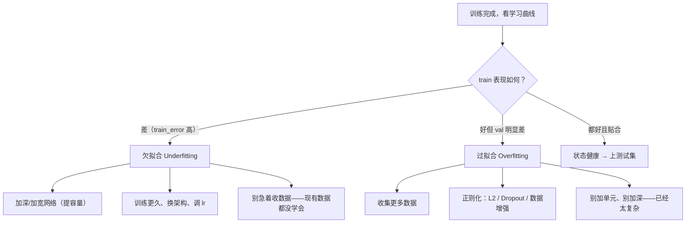
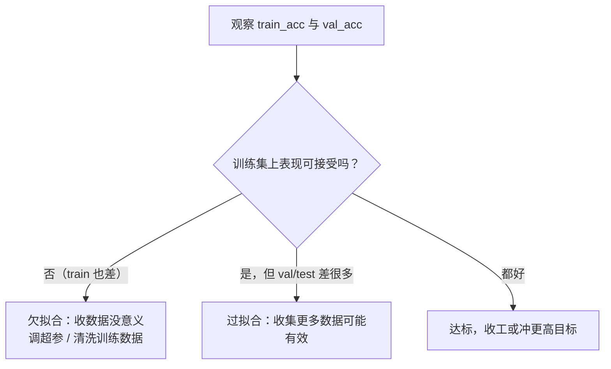

# 第 4 章 项目构建与超参数调优

> **本章解决**：一个 DL 项目从想法到可用模型，中间的完整工程流程——定指标、立基线、备数据、诊断瓶颈、调参、正则化，最后用 CIFAR-10 项目把准确率从约 65% 拉到 90%。
> 第 2、3 章给了零件（MLP、CNN、反向传播），本章是第一部分的收官：把它们装配成能迭代的**项目**。第 5 章起进入第二部分，用更强的架构（LeNet→ResNet）继续提分。
> 深度学习是高度**经验性（empirical）**的工作：先有想法 → 写代码跑实验 → 观察结果 → 用结果修正想法。本章教的就是这条循环怎么转得快、转得对。

## 4.0 本章导图

<div class="brtree">
  <div class="brrow">
    <span class="brlabel root">项目构建与调优</span>
    <span class="brace"></span>
    <div class="brkids">
      <div class="brrow">
        <span class="brlabel">性能指标 4.1</span>
        <span class="brace"></span>
        <div class="brkids">
          <span class="brleaf">accuracy 及其失灵</span>
          <span class="brleaf">混淆矩阵 TP/FP/FN/TN</span>
          <span class="brleaf">Precision / Recall</span>
          <span class="brleaf">F-score（调和平均）</span>
        </div>
      </div>
      <div class="brrow">
        <span class="brlabel">基线与数据 4.2-4.3</span>
        <span class="brace"></span>
        <div class="brkids">
          <span class="brleaf">抄最优架构当基线</span>
          <span class="brleaf">train/val/test 划分</span>
          <span class="brleaf">同分布原则</span>
          <span class="brleaf">归一化（训练集统计量）</span>
        </div>
      </div>
      <div class="brrow">
        <span class="brlabel">诊断 4.4</span>
        <span class="brace"></span>
        <div class="brkids">
          <span class="brleaf">过拟合 / 欠拟合</span>
          <span class="brleaf">学习曲线三形态</span>
          <span class="brleaf">Bayes error 基准</span>
          <span class="brleaf">更多数据 or 调参？</span>
        </div>
      </div>
      <div class="brrow">
        <span class="brlabel">调参 4.5-4.7</span>
        <span class="brace"></span>
        <div class="brkids">
          <span class="brleaf">架构：深度/宽度/激活</span>
          <span class="brleaf">学习率 + decay 调度</span>
          <span class="brleaf">mini-batch 大小</span>
          <span class="brleaf">Momentum / Adam</span>
          <span class="brleaf">epochs 与早停</span>
        </div>
      </div>
      <div class="brrow">
        <span class="brlabel">正则化 4.8</span>
        <span class="brace"></span>
        <div class="brkids">
          <span class="brleaf">L2 / weight decay</span>
          <span class="brleaf">Dropout</span>
          <span class="brleaf">数据增强</span>
        </div>
      </div>
      <div class="brrow">
        <span class="brlabel">批归一化 4.9</span>
        <span class="brace"></span>
        <div class="brkids">
          <span class="brleaf">covariate shift</span>
          <span class="brleaf">μ/σ 归一 + γ/β 缩放平移</span>
          <span class="brleaf">训练 vs 推理行为</span>
        </div>
      </div>
      <div class="brrow">
        <span class="brlabel">项目 4.10</span>
        <span class="brace"></span>
        <div class="brkids">
          <span class="brleaf">CIFAR-10：65% → 90%</span>
          <span class="brleaf">VGG 风 6CONV+1FC</span>
          <span class="brleaf">增强 + BN + Dropout + L2</span>
        </div>
      </div>
    </div>
  </div>
</div>

## 4.1 定义性能指标

**Performance Metrics（性能指标）**用来回答"模型到底好不好"。最朴素的指标是 **Accuracy（准确率）**——模型预测正确的次数占比。测 100 个样本、对 90 次，就是 90%：

\[
\text{accuracy} = \frac{\text{预测正确的样本数}}{\text{样本总数}}
\]

### 4.1.1 accuracy 什么时候失灵

accuracy 在很多场景够用，但考虑这个极端例子：给一种**罕见病**设计诊断测试，每一百万人里只有 1 人患病。不做任何训练、甚至不建系统，直接把输出**硬编码为"阴性"**——系统立刻获得 99.999% 的准确率。

听起来很美？它**一个病人都抓不出来**。指标数字漂亮与系统有用完全是两回事：accuracy 不适合度量这类模型的"好"，我们需要从不同角度度量预测能力的其他指标。

### 4.1.2 混淆矩阵

**Confusion Matrix（混淆矩阵）**：一张描述分类模型性能的表。概念本身很好懂，容易绕的是配套术语。走一遍：构建"病人有病/健康"的二分类器，预测为**正类（positive，有病）**或**负类（negative，健康）**。对 1,000 个病人跑模型，结果进表：

| | 模型预测：有病（正类） | 模型预测：健康（负类） |
| --- | --- | --- |
| **真实：有病（正类）130 人** | **100** —— True Positive（TP） | **30** —— False Negative（FN） |
| **真实：健康（负类）870 人** | **70** —— False Positive（FP） | **800** —— True Negative（TN） |

四个基本量（都是整数计数，不是比率）：

| 术语 | 含义 | 统计学的别名 |
| --- | --- | --- |
| **True Positive（TP）** | 正确预测"有病" | —— |
| **True Negative（TN）** | 正确预测"健康" | —— |
| **False Positive（FP）** | 错误预测"有病"（其实健康） | **Type I Error** 第一类错误 |
| **False Negative（FN）** | 错误预测"健康"（其实有病） | **Type II Error** 第二类错误 |

关键决策来了：模型判"阴性"的人会被**直接打发回家**，判"阳性"的人送去**进一步检查**。哪种错误更不可接受？——把健康人误判为阳性，代价只是多做一轮检查；把病人误判为阴性**送回家，可能危及生命**。所以医疗诊断场景**最在乎 FN 的数量**：宁可错抓，不可放过。这个"抓全病人"的指标叫 **Recall（召回率）**。

### 4.1.3 Precision 与 Recall

**Recall（召回率，别名 Sensitivity 敏感度）**回答：**真正有病的人里，模型查出来了多少**。它直接盯着 FN——漏诊了多少病人：

\[
\text{Recall} = \frac{\text{TP}}{\text{TP} + \text{FN}}
\]

**Precision（精确率）**站在相反的角度回答：**模型报"阳性"的人里，真有病的多少**。它盯着 FP——多少人被误诊为有病：

\[
\text{Precision} = \frac{\text{TP}}{\text{TP} + \text{FP}}
\]

!!! warning "原书笔误"
    原书写"Precision (also known as **specificity**)"——错。Precision 的统计学别名是 **PPV（Positive Predictive Value，阳性预测值）**；specificity（特异度）是另一个指标 $TN/(TN+FP)$，对应的是 recall 的同伴。原书对 recall 的文字表述也绕（说成"多少病人被误诊为健康"），记住公式对应的白话即可：**recall 管"漏报"（FN），precision 管"误报"（FP）**。

!!! note "侧栏：怎么选定合适的指标"
    医疗诊断选了 recall，但**其他场景答案不同**。判定方法就一句话：**问自己两种错误哪种代价更大——FP 还是 FN？**
    例：垃圾邮件分类器。哪种错误更糟——把正常邮件错判为垃圾（**FP**，邮件丢失），还是把垃圾邮件放进收件箱（FN，只是看着烦）？显然前者。所以垃圾邮件过滤要的是 **precision**。
    如果两者都要兼顾——那就是下面的 F-score。

### 4.1.4 F-score

很多时候想把 precision 和 recall 合成**一个数字**。做法是把两者转成 **F-score（F1 分数）**——数学上这是 p 与 r 的 **Harmonic Mean（调和平均）**：

\[
\text{F-score} = \frac{2pr}{p+r}
\]

回到医疗例子：我们说这是高召回模型，但如果模型为了不漏掉任何病人，把大量健康人也报成"有病"（FP 爆炸，precision 很低）呢？recall 高不等于模型好，**两个分数要放在一起看**——F-score 就是那个"放在一起"的数字。用原书表里的两个分类器感受一下调和平均的"惩罚"力度：

| 分类器 | Precision | Recall | F-score |
| --- | --- | --- | --- |
| A | 95% | 90% | **92.4%** |
| B | 98% | 85% | **91.0%** |

B 的 precision 更高（98%），但 recall 掉到 85% 拖了后腿，F-score 反而低于更均衡的 A。

!!! note "拓展：F1 为什么用调和平均，不用算术平均"
    算术平均 $\frac{p+r}{2}$ 对两个数"一视同仁"：precision=100%、recall=0% 的模型也能拿 50 分——但这是个除硬编码外毫无用处的模型。**调和平均偏向较小值**：只要有一项趋近 0，F1 就被拖向 0（上面这个模型 F1 = 0）。它实现的正是我们想要的语义：**两者都得高，短板受重罚**。数值上也能看到：A 的算术平均是 92.5%，调和平均 92.4%——两者接近时几乎无差；不均衡时差异拉大。另外 F1 只是 $F_\beta$ 家族 $\beta=1$ 的特例：$\beta>1$ 更重视 recall，$\beta<1$ 更重视 precision，按业务偏好选。

!!! note "原书 NOTE"
    定义评估指标是**必做步骤**：它决定你改进系统的方向。没有明确定义的指标，你根本判断不出对系统的每次改动是进步还是退步。

## 4.2 设计基线模型

指标定好后，第二步是搭一套**合理的端到端系统**先跑起来。基线模型（**Baseline Model**）的设计要匹配问题类型，要回答这些问题：

- 用 **MLP** 还是 **CNN**（或后面会讲的 RNN）？
- 要不要用 **YOLO / SSD** 这类目标检测技术（后面章节讲）？
- 网络多深？
- 用什么激活函数？
- 用什么优化器？
- 要不要加 **Dropout / 批归一化**这类正则化层防过拟合？

一条实用捷径：**如果你的问题与某个被广泛研究过的问题相似，直接把该任务上已知表现最好的模型和算法抄过来当起点**。甚至可以拿在别的数据集上训练过的模型直接用——这叫 **Transfer Learning（迁移学习）**，第 6 章详讲。

原书给的具体例子：第 3 章项目就是拿 **AlexNet** 当基线。它的完整架构（图 4.1）：

\[
\text{INPUT} \Rightarrow \text{CONV1} \Rightarrow \text{POOL1} \Rightarrow \text{CONV2} \Rightarrow \text{POOL2} \Rightarrow \text{CONV3} \Rightarrow \text{CONV4} \Rightarrow \text{CONV5} \Rightarrow \text{POOL3} \Rightarrow \text{FC6} \Rightarrow \text{FC7} \Rightarrow \text{SOFTMAX\_8}
\]

<figure>
  
  <figcaption>图 4.1 AlexNet：5 个卷积层 + 3 个全连接层（截自原书）</figcaption>
</figure>

一份成熟架构就是一张现成的"超参数清单"，抄下来就能开跑：

| 超参数 | AlexNet 的取值 |
| --- | --- |
| 网络深度（层数） | 5 卷积层 + 3 全连接层 |
| 各卷积层深度（filter 数） | CONV1=96, CONV2=256, CONV3=384, CONV4=384, CONV5=256 |
| filter 尺寸 | 11×11, 5×5, 3×3, 3×3, 3×3 |
| 隐藏层激活 | ReLU（CONV1 到 FC7） |
| 池化 | CONV1、CONV2、CONV5 后各一个 Max pooling |
| FC6 / FC7 | 各 4,096 个神经元 |
| 输出层 FC8 | 1,000 个神经元 + softmax |

!!! warning "原书笔误"
    原书超参清单里写 "CONV4 = **385**"，对照图 4.1 及 AlexNet 原论文应为 **384**。

!!! note "原书 NOTE"
    第 5 章会系统讲主流 CNN 架构及其 PyTorch 实现：LeNet、AlexNet、VGG、ResNet、Inception——帮你建立"什么问题配什么架构"的直觉，甚至启发你发明自己的架构。

## 4.3 让数据ready：训练前的数据准备

指标和基线都有了，轮到数据。真实世界的数据是脏的，不能直接喂给网络。注意：这个过程**因问题和数据而异**，本节讲的是最基础的"数据按摩"手法，并帮你建立"什么样的数据算 ready"的直觉。

### 4.3.1 train / validation / test 划分

训练 ML 模型要先把数据切成 **Training（训练集）**和 **Testing（测试集）**（图 4.2）：训练集用来训练模型、更新权重；测试集模型**从未见过**，用来评估泛化性能。

<figure>
  
  <figcaption>图 4.2 数据切成训练集与测试集（截自原书）</figcaption>
</figure>

**黄金法则：绝不使用测试数据参与训练。**训练时绝不能把测试样本给模型看，否则模型就是在作弊。给模型看训练样本学特征，再在从未见过的数据上测泛化，才能得到**无偏的性能评估**。

!!! note "侧栏：validation 数据集是干什么的"
    训练过程中，**每个 epoch 结束后**都要评估模型的 accuracy 和 error，用于观察和调参。用测试集做这件事就违反了黄金法则——测试集只在**训练完成之后**评估最终性能。所以需要额外切一份 **Validation（验证集）**：训练期间用它评估与调参（图 4.3），训练完用测试集做终考。

<figure>
  
  <figcaption>图 4.3 训练集用来训练，验证集用来训练期间做决策，测试集只在最后使用（截自原书）</figcaption>
</figure>

训练循环的伪代码长这样：

```text
for each epoch:
    for each training data instance:      # 训练阶段
        propagate error through the network
        adjust the weights
        calculate the accuracy and error over training data
    for each validation data instance:    # 验证阶段：只算指标，不更新权重
        calculate the accuracy and error over the validation data
```

每个 epoch 跑完会记录 `train_loss, train_acc, val_loss, val_acc` 四个数（图 4.4 的逐轮日志示例：`loss: 1.6192 - acc: 0.4140 - val_loss: 1.3582 - val_acc: 0.5166`），第 4.4 节就用它们诊断过拟合/欠拟合。

**切多大比例？**传统经验：

| 数据规模 | 推荐划分 |
| --- | --- |
| 小数据集（过去的常态，几万样本） | 80/20 或 70/30（train/test）；加验证集则 60/20/20 或 70/15/15 |
| 大数据集（如今动辄百万级） | **验证、测试各 1% 就够**——100 万样本各留 1 万，没必要扣着几十万不用 |

逻辑很直白：评估集只要**统计上够可靠**就行，剩下的数据拿来训练更划算。

### 4.3.2 数据预处理

好消息：神经网络需要的预处理**极少**——数据够多时它能直接从原始数据学特征（这是相对传统 ML 的大优势）。坏消息：为了性能或绕开网络限制，下面几招仍然常用：灰度化、缩放、归一化、数据增强。

!!! note "侧栏：确保 train/val/test 来自同一分布"
    切分数据时最重要的一件事：**三个数据集必须来自同一分布（same distribution）**。反例：做手机端的车型分类器，为了"数据越多越好"去网上爬了一堆高质量、专业构图的汽车图，测试集上成绩喜人——上线后在手机实拍图上一塌糊涂。因为模型在**高清图**上训练和调参，而生产环境是**模糊、低分辨率**的实拍图，分布变了。修复办法：把低质量图像**加进训练与验证集**，让三个集合同分布。

**灰度化**：第 3 章讲过彩色图是三个矩阵、灰度图一个，颜色带来额外计算量。如果问题不需要颜色，可以全转灰度省算力。经验法则就是人类水平规则：**你肉眼能从灰度图里认出目标，网络大概率也能**。

**缩放（Image Resizing）**：神经网络要求所有图像同尺寸。MLP 输入层节点数必须等于像素数；CNN 也要在第一层声明输入形状——PyTorch 的卷积层按 `(N, C, H, W)` 组织数据，首层只需给出输入通道数，图像尺寸由输入张量决定：

```python
import torch.nn as nn

# 输入 (N, 3, 32, 32)：3 通道彩色图；输出 16 个特征图
conv = nn.Conv2d(in_channels=3, out_channels=16, kernel_size=2, padding=1)
```

数据集里同时有 32×32、28×28、64×64 的图，就必须先统一 resize。

**归一化（Data Normalization）**：把数据重新缩放，让每个输入特征（图像场景下就是像素）具有**相近的数值分布**。原图像素范围参差——一张 0~255，另一张 20~200。推荐归一化到 **0~1**（或其他统一小范围），能加速学习、让网络更快收敛。对网络友好的数据有两个特征：

- **数值小**：大多数值落在 [0, 1] 附近；
- **同质**：所有像素在同一范围内。

具体做法是**减去均值、除以标准差**，归一化后的分布是以 0 为中心的近高斯形状（图 4.5）：

\[
x_{\text{norm}} = \frac{x - \mu}{\sigma}
\]

<figure>
  
  <figcaption>图 4.5 归一化三步：减均值零中心化 → 除以标准差（截自原书）</figcaption>
</figure>

为什么值得做？看梯度下降的路径（图 4.6）：未归一化时，代价函数是一个**被压扁拉长的碗**，GD 在窄方向上反复振荡、沿"之"字路线磨到最小值；归一化后碗变得**对称圆润**，GD 直奔最小值，收敛快得多。

<figure>
  
  <figcaption>图 4.6 左：归一化特征，GD 直线奔向最小值；右：未归一化，GD 振荡绕远路（截自原书）</figcaption>
</figure>

!!! tip "原书 TIP：为什么未归一化时 GD 会振荡？"
    各特征的取值范围不同 → 同一个学习率在各个维度上造成的修正量**不成比例** → GD 被迫振荡着走向最小值，下山路径变长。归一化消除了量纲差异，一步顶一步。

!!! tip "原书 TIP：训练集和测试集必须用同一组 mean/std"
    两个数据集要经历**完全相同的变换**——用**训练集的**均值和标准差去归一化训练集、验证集和测试集。4.10 项目里就是这个写法。

!!! note "拓展：为什么归一化必须用训练集的统计量"
    test/val 集在"模拟未来没见过的数据"，而未来数据的统计量你根本拿不到；如果用全量或测试集的 mean/std，等于把测试集的信息提前泄露进训练流程（**data leakage，数据泄漏**），评估会偏乐观。工程上的铁律：**统计量只在训练集上算，再套用到所有划分**。第 6 章迁移学习里"用预训练模型的 mean/std"是同一原则——统计量来自定义分布的那一方。

**数据增强**：本节先记住它是工具箱里的另一件预处理武器，细节在 4.8.3 正则化处展开。

## 4.4 评估模型并解读性能

基线搭好、数据备好、模型训完——现在要判断：有没有瓶颈？哪个组件拖后腿？差性能来自过拟合、欠拟合，还是数据本身有缺陷？

神经网络常被批评是"黑盒"：工作得很好，却说不清为什么。可解释性研究正在快速发展；本节先教你最实用的一手——**诊断网络行为**。

### 4.4.1 诊断过拟合与欠拟合

ML 性能差的主因就两个：**Underfitting（欠拟合）**与**Overfitting（过拟合）**。

- **欠拟合 = 模型太简单**：学不动训练数据，训练集上就表现差。例：用一个单感知器去分开图 4.7 的叉和圈——一条直线怎么画都分不开。
- **过拟合 = 模型对当前问题太复杂**：不去学泛化特征，而是**背下了训练数据**（memorize）。训练集上表现极好，遇到没见过的新数据就崩（图 4.8：决策边界把每个训练点都精确圈住）。
- **我们想要"刚刚好"**（图 4.9）：模型漏分了一个 O 形样本，但这种边界明显更能**泛化**到新数据。

<table>
<tr>
<td></td>
<td></td>
<td></td>
</tr>
</table>
*图 4.7 欠拟合：直线分不开 · 图 4.8 过拟合：每个点都被精确记住 · 图 4.9 刚刚好：能泛化（截自原书）*

!!! tip "原书 TIP：学生备考比喻"
    欠拟合 = 学生没怎么复习，考试不及格。过拟合 = 学生**背下了整本书**：考书上的原题全对，题目一出书就傻眼——没有泛化。理想学生：把书学透，考"与书相关的新题"也能答好。

**诊断靠两个数：训练误差与验证误差。**

| 观察到的现象 | 诊断 | 处理方向 |
| --- | --- | --- |
| train_error = 1%，val_error = 10% | **过拟合**：背下了训练集 | 调超参抑制过拟合，迭代训练-测试-评估 |
| train_error = 14%，val_error = 15% | **欠拟合**：太简单，学不动 | 加隐藏层 / 训练更久 / 换架构 |

!!! note "侧栏：用人类水平表现估计 Bayes error"
    "表现不错"是多不错？需要一个现实的基准来对比。理论上模型能达到的最低错误率叫 **Bayes Error Rate（贝叶斯错误率）**，它不可知，但人类在视觉任务上很强，可以拿 **Human-Level Performance（人类水平）当它的代理**：
    - 猫狗分类这种简单任务：人类错误率约 0.5%。你的模型 95% accuracy（错误 5%）远高于 0.5% → 还差得远，可能在欠拟合。
    - 给放射科医生看的医学影像分类：人类错误率约 5%。同样 95% 的模型其实已经**做得很好**。
    这不是说要设人类为上限——DL 完全可以超越人类——而是说它是**判断模型好坏的免费标尺**。

### 4.4.2 画学习曲线

与其盯着每轮打印的数字比大小，不如把训练/验证误差随 epoch 的变化画成**Learning Curve（学习曲线）**（图 4.10）。三种形态对应三种诊断：

<figure>
  
  <figcaption>图 4.10 学习曲线三形态：A 过拟合 · B 欠拟合 · C 刚刚好（截自原书）</figcaption>
</figure>

- **形态 A（过拟合）**：训练 loss 持续下降（网络确实在学习），验证 loss 先降一点然后**趋平甚至回升**。网络学得"太用力"，把训练集背下来了。此时**不需要**加隐藏单元、不需要更复杂的模型——恰恰相反，网络相对数据太复杂了。**药方：收集更多数据，或上正则化**（4.8）。
- **形态 B（欠拟合）**：训练、验证 loss **都很差**。网络根本没在学习，加数据没用（现有数据都没消化）。**药方：造一个更复杂的模型**。
- **形态 C（刚刚好）**：训练、验证 loss 都健康下降并贴合。这种状态的网络大概率能在测试集和真实场景表现良好。

把"看到什么 → 得什么病 → 开什么药"固化成决策流程——**本章最值得收藏的一张图**：



| 曲线形态 | 诊断 | 药方（按优先级） |
| --- | --- | --- |
| train 降、val 平/升 | 过拟合 | 更多数据；L2/Dropout/增强；降低复杂度 |
| train、val 都差 | 欠拟合 | 加大容量（深度/宽度）；训练更久；换架构 |
| train、val 同降且贴合 | 刚刚好 | 保持，进测试环节 |

### 4.4.3 练习：搭建、训练并评估一个网络

正式调参前，跑一个完整的小实验串起全流程。步骤：造玩具数据 → 80/20 切分 → 建 MLP → 训练 → 评估 → 画曲线。

```python
# ===== 4.4.3 完整小实验：造数据 → 切分 → 建 MLP → 训练 → 评估 → 画曲线 =====
from sklearn.datasets import make_blobs
import torch, torch.nn as nn
from torch.utils.data import DataLoader, TensorDataset
import matplotlib.pyplot as plt

# 1-2. 造数据：1000 个样本、2 个特征、3 个类别
X, y = make_blobs(n_samples=1000, centers=3, n_features=2,
                  cluster_std=2, random_state=2)

# 3-4. 切分 80/20（本例不单设验证集，用 test 集兼当验证）
n_train = 800
train_X = torch.tensor(X[:n_train], dtype=torch.float32)
test_X  = torch.tensor(X[n_train:],   dtype=torch.float32)
train_y = torch.tensor(y[:n_train], dtype=torch.long)   # 类别索引，CE 损失直接接收
test_y  = torch.tensor(y[n_train:],  dtype=torch.long)
train_loader = DataLoader(TensorDataset(train_X, train_y), batch_size=64, shuffle=True)

# 5. 模型：两层 MLP（2 → 25 → 3），共 153 个参数
model = nn.Sequential(
    nn.Linear(2, 25), nn.ReLU(),     # 隐藏层：2 特征进、25 单元、ReLU
    nn.Linear(25, 3),                # 输出层：3 个 logits
)
loss_fn = nn.CrossEntropyLoss()      # 内部完成 log_softmax + 负对数似然
opt = torch.optim.Adam(model.parameters(), lr=1e-3)

# 6. 训练 1000 epochs，逐轮记录 train/test accuracy 供画曲线
history = {'train': [], 'test': []}
for epoch in range(1000):
    model.train()
    for xb, yb in train_loader:
        opt.zero_grad()
        loss = loss_fn(model(xb), yb)
        loss.backward()
        opt.step()
    model.eval()
    with torch.no_grad():
        tr = (model(train_X).argmax(1) == train_y).float().mean().item()
        te = (model(test_X).argmax(1)  == test_y ).float().mean().item()
    history['train'].append(tr)
    history['test'].append(te)
    if (epoch + 1) % 250 == 0:
        print(f'epoch {epoch+1}: Train: {tr:.3f}, Test: {te:.3f}')

# 7. 画学习曲线
plt.plot(history['train'], label='train')
plt.plot(history['test'],  label='test')
plt.xlabel('epoch'); plt.ylabel('accuracy'); plt.legend(); plt.show()
# >> 1000 epochs 后：Train ≈ 0.83, Test ≈ 0.84
```

这个网络（图 4.11）：第一层 2×25+25=75 个参数，第二层 25×3+3=78 个，共 153。可以用 `sum(p.numel() for p in model.parameters())` 核对（`nn.Linear` 自带偏置）。把训练/测试 accuracy 曲线画出来（图 4.12）：

<figure>
  
  <figcaption>图 4.12 练习的学习曲线：train 与 test 贴着走（截自原书）</figcaption>
</figure>

**解读**：两条曲线行为一致 → 没有过拟合（过拟合的样子是 train 好、test 差）。但**可能欠拟合**：这么简单的数据集只有 83% 左右属于差成绩。改进方向：上更复杂的网络 + 其他抗欠拟合手段。

## 4.5 改进网络与调超参数

诊断完过拟合/欠拟合，接下来决定：时间花在**调网络**、**清洗数据**还是**收集数据**上？最怕闷头忙几个月，回头发现方向几乎不涨分。所以调参之前，先回答"要不要收集更多数据"。

### 4.5.1 收集更多数据 vs 调超参数

新手第一反应永远是"堆数据"。但收集+标注数据不总是可行：成本可能很高，甚至未必有效。

!!! note "原书 NOTE：标注是人工活（human in the loop）"
    写作时点，大部分标注靠人一张张看图打标签。更贵的是专业领域：标肺部 X 光查肿瘤，得雇**有资质的医生**——成本远高于雇人分猫狗。所以"多收数据"对某些 accuracy 问题确实是好方案，也能增强鲁棒性，但**不总是可行**。

原书作者做这个决策的流程（照做即可）：



!!! tip "原书 TIP"
    评估性能的目标是给问题**定性归类**：数据问题 → 花时间在预处理/收集数据；学习算法问题 → 花时间调网络。

### 4.5.2 参数 vs 超参数

| | **Parameters（参数）** | **Hyperparameters（超参数）** |
| --- | --- | --- |
| 谁来定 | 网络**自己学出来**、训练中自动更新 | **ML 工程师**训练前设定、之后人工调 |
| 具体是什么 | 权重 weights 与偏置 biases（反向传播自动优化到最小误差） | 学习率、batch size、epochs、隐藏层数…… |
| 控制什么 | 模型的预测函数本身 | 网络结构 + 训练方式 |

一句话：参数是网络在训练中"学会"的变量，我们不直接碰；超参数是我们设的旋钮，网络不会自己学。

### 4.5.3 神经网络超参数全景

超参数没有万能数值（又是 No Free Lunch），好值取决于数据集与任务。想调得准，先理解**每个旋钮往哪边拧会发生什么**。原书把 NN 超参数分成三类（"旋钮面板"：学习率 0.0001~0.1、epochs 0~1000、隐藏单元 0~10000、mini-batch 1~1024）：

| 类别 | 成员 |
| --- | --- |
| **网络架构** | 隐藏层数（深度）、每层神经元数（宽度）、激活函数类型 |
| **学习与优化** | 学习率与 decay 调度、mini-batch 大小、优化算法、epochs（与早停） |
| **正则化** | L2、Dropout、数据增强 |

前两类在第 2、3 章见过，正则化是本章新内容。下面逐个讲"拧大/拧小各意味着什么"。

### 4.5.4 网络架构超参数

**深度与宽度**：隐藏层数（depth）× 每层单元数（width）决定网络的**学习能力（learning capacity）**。目标是**够用就好**：太小欠拟合，太大过拟合。没有先验答案——先选个起点，跑起来看表现，再上下调。

数据集越复杂，需要的容量越大（图 4.13）：

<figure>
  
  <figcaption>图 4.13 从左到右：单感知器能分 → 加几个神经元 → 要很多神经元（截自原书）</figcaption>
</figure>

- 容量给太多 → 可能过拟合背题；过拟合了就**减单元**。
- 一般经验：**加神经元，加到验证误差不再改善为止**。
- 代价是算力：深网络训练贵。单元太少欠拟合；**单元偏多通常不致命——前提是配正则化**（Dropout 等，本章后面讲）。
- 推荐去浏览器里的可视化 Playground 玩：拖网络结构、加层加单元、盯学习行为，直觉就是这么攒出来的。

**激活函数**：激活给神经元引入**非线性**——没有它，网络只是线性组合的堆叠，解不了任何非线性问题。这是活跃的研究方向，新激活函数层出不穷，但写作时点：**隐藏层 ReLU 及其变体（如 Leaky ReLU）表现最好；输出层分类问题用 softmax**，单元数 = 类别数。

!!! note "侧栏：层数与参数量——从算力角度想问题"
    神经元越多 → 要优化的参数越多（用 `sum(p.numel() for p in model.parameters())` 看总参数数）。硬件（算力/内存）紧张时，降参数量的两个抓手：
    ① **减网络的深度与宽度**（隐藏层和单元数）——直接减参数；
    ② **加 pooling 层**，或调卷积层的 **stride / padding** 缩小特征图尺寸——间接减参数。
    复杂网络 → 参数多 → 算力内存需求高，trade-off 在真实项目里天天要权衡。建基线最好的办法仍是：**看主流架构怎么解同类问题，从它出发**，评估 → 调参 → 重复。

## 4.6 学习与优化

架构定了，接下来是决定网络**怎么学**的超参数。

### 4.6.1 学习率与 decay 调度

> "学习率是最重要的单个超参数。如果只来得及优化一个超参数，那就是它。" ——Yoshua Bengio

复习 GD（第 2 章）：优化器在误差曲面上找让误差最小的权重，**learning rate（lr）就是下山每一步的步长**——它决定优化器下山的快慢。把代价函数画成一个权重轴上的 U 形曲线（图 4.14，最简化的情况），权重从随机初始点出发：

<figure>
  
  <figcaption>图 4.14 U 形代价曲线：从随机初值出发，一步步走向最小误差（截自原书）</figcaption>
</figure>

按 lr 的大小分四种情况（图 4.15~4.18）：

<figure>
  
  <figcaption>图 4.15 理想 lr：一步正好落在最小值（运气爆表的理论情形）（截自原书）</figcaption>
</figure>

<table>
<tr>
<td></td>
<td></td>
<td></td>
</tr>
</table>
*图 4.16 lr 偏小：碎步慢慢蹭到谷底 · 图 4.17 lr 偏大：越过最优值来回震荡 · 图 4.18 lr 太大（理想值两倍以上）：越跳越远，发散（截自原书）*

- **lr 略小于理想值**：碎步下行，最终能到最优，只是慢。
- **lr 大于理想值**：第一步就**冲过头（overshoot）**越过最优点，再从对面冲回来；可能收敛到一个"还不错"但**不是最低**的误差。
- **lr 远大于理想值**（两倍以上）：不仅冲过头，还越跳越远——这叫 **Divergence（发散）**。

**太高 vs 太低的权衡**（原书 TIP 展开成表）：

| lr | 收敛速度 | 风险 |
| --- | --- | --- |
| 太低 | 极慢（理论上无限时间必收敛） | 训练成本不可接受 |
| 太高 | 前期下得快 | 振荡、跳过最小值甚至发散 |
| **刚好** | **直奔最小值** | —— |

### 4.6.2 系统地找最优学习率

最优 lr 取决于**损失曲面的拓扑**，而后者取决于模型架构与数据集——所以没有放之四海的数。实践起点：**用框架优化器的默认值**（各家文档可查，如 PyTorch 的 Adam 默认 lr=0.001），训练不顺再在"惯嫌犯"序列里试：**0.1, 0.01, 0.001, 0.0001, 0.00001, 0.000001**。

调试时盯住验证损失 **val_loss**：

| val_loss 的表现 | 诊断 | 药方 |
| --- | --- | --- |
| 每步都在降 | 正常 | 继续训到不再改善 |
| 训练跑完了还在降（没收敛） | lr 太小 | 同 lr 加 epochs 再训；或把 lr 调大一档再训 |
| 开始上升或上下振荡 | lr 太大 | 减小 lr |

把 lr 与 loss 曲线的对应关系画出来，四种形态一目了然（原书未编号插图，转成表）：

| lr | loss 曲线形态 |
| --- | --- |
| much smaller（太小） | 一直降，但要很久很久才收敛 |
| larger（偏大） | 比起点好，但离最优还远 |
| much larger（太大） | 先降后升——权重离最优点越来越远 |
| good（刚好） | 稳定下降直到最低点 |

### 4.6.3 学习率衰减与自适应学习率

手动调 lr 是迭代活：设一个静态值 → 等训练完 → 评估 → 再调。更聪明的做法是 **Learning Rate Decay（学习率衰减）**：让 lr **在训练过程中自动变化**，往往比静态值表现更好，且大幅缩短拿到好结果的时间。

思路：小 lr 更可能到达低误差点但太耗时——那就**先大后小**：训练初期用大 lr 大步逼近最小值，之后每过 n 个 epoch 把 lr 减一档，避免在谷底来回打水漂。

- **Linear Decay（线性衰减）**：例如每 5 个 epoch 减半（图 4.19）。
- **Exponential Decay（指数衰减）**：例如每 8 个 epoch 乘 0.1（图 4.20）——收敛明显更慢，但最终会到。

<table>
<tr>
<td></td>
<td></td>
</tr>
</table>
*图 4.19 线性衰减：每 5 个 epoch 减半 · 图 4.20 指数衰减：每 8 个 epoch ×0.1（截自原书）*

再进一步是 **Adaptive Learning（自适应学习率）**：用启发式规则自动更新 lr——该降时降，**改进太慢时还会升**。自适应策略通常优于其他设定方式；**Adam 与 Adagrad** 就是代表（4.7.2 展开）。

### 4.6.4 Mini-batch 大小

`batch_size` 对训练的**资源需求与速度**影响巨大。复习第 2 章的三种梯度下降（图 4.21、4.22）：

| 类型 | 每次更新用多少数据 | 噪声 | 优点 | 缺点 |
| --- | --- | --- | --- | --- |
| **Batch GD（BGD）** | 整个训练集（每 epoch 只更新一次） | 低，路径平滑 | 步子大且稳 | 大数据下每步都太久；内存吃不消 |
| **Stochastic GD（SGD）** | **单个样本**（又称 online learning） | 高，振荡着走向最小值 | 进步快，常能非常接近全局最小；调小 lr 可降噪 | 逐样本计算，**吃不到矩阵乘法的提速红利** |
| **Mini-batch GD（MB-GD）** | 一批（几十到几百） | 中 | 矩阵乘法提速 + 不用等全数据集 | 要选批大小 |

<figure>
  
  <figcaption>图 4.21 Batch GD：低噪声直达最小误差（截自原书）</figcaption>
</figure>

<figure>
  
  <figcaption>图 4.22 Stochastic GD：高噪声、振荡着走向最小误差（截自原书）</figcaption>
</figure>

两个极端：batch=1 就是 SGD（每样本都更新，丢了矩阵提速）；batch=全集就是 BGD（大数据下一步等太久）。中间就是 MB-GD。

**选多大的批？**原书指南：

- 小数据集（< 2,000 样本）：直接用 BGD，全量训练很快。
- 大数据集：从 **64 或 128** 起步，在 **32 → 64 → 128 → 256 → 512 → 1024** 这条刻度上**翻倍调试**。
- 铁律：**batch 必须装得进 CPU/GPU 内存**。1024 以上可行但少见；大批吃到矩阵乘法加速，代价是更多内存与算力。
- batch、算力与 epochs 的关系（原书未编号插图）：批越大 → 每 epoch 的算力开销越大 → 找到好的 w,b 所需 epochs 越少。SGD 每步便宜但要跑很多步；BGD 反之。

## 4.7 优化算法

DL 历史上提出过大量优化算法，多数后来被证明**泛化不了**到各种网络。社区最终沉淀下来的共识：**GD 及其少数变体**够用。本节讲两个公认出色、跨架构稳定的：**Momentum** 与 **Adam**。（更多算法读 Sebastian Ruder 的综述 *An overview of gradient descent optimization algorithms*，arxiv.org/pdf/1609.04747.pdf。）

### 4.7.1 带动量的梯度下降

SGD 的老毛病：**垂直方向的振荡**（图 4.23）拖慢收敛，还让人不敢用大 lr（怕冲过头发散）。

<figure>
  
  <figcaption>图 4.23 SGD 的垂直振荡拖慢前进；我们想要的是水平方向快速逼近目标（截自原书）</figcaption>
</figure>

**Momentum（动量）**的解法：沿相关方向加速、在无关方向上**软化振荡**——垂直方向的学习变慢，水平方向的进展变快，更快到达目标最小值。直觉就是经典物理的动量：**雪球滚下山**，越滚越快；梯度方向一致的维度上动量累加，方向反复变化的维度上更新被抵消削弱。

!!! note "侧栏：momentum 的数学"
    在权重更新式里加一个**速度项（velocity term）**：

    \[
    w_{\text{old}} \to w_{\text{new}} = w_{\text{old}} - \alpha \frac{\partial E}{\partial w_i} \quad\text{（原始规则）}
    \]

    \[
    w_{\text{new}} = w_{\text{old}} - \text{learning rate} \times \text{gradient} + \text{velocity term} \quad\text{（新规则）}
    \]

    其中 velocity term = **过去梯度的加权平均**。方向一致的梯度互相增强，来回变的梯度互相抵消——收敛更快、振荡更少。

### 4.7.2 Adam

**Adam = Adaptive Moment Estimation（自适应矩估计）**。它像 momentum 一样保留**过去梯度的指数衰减平均**；如果说 momentum 是"滚下斜坡的球"，Adam 就是**带摩擦的重球**——动量被摩擦力拖住、可控。Adam 通常快于其他优化器，是训练复杂网络的安全牌。

新超参数怎么办？好消息：**主流框架的默认值基本不用动，只有 lr 必须自己调**（lr 不是 Adam 专属超参）。PyTorch 的签名与作者推荐的默认值：

```python
torch.optim.Adam(model.parameters(), lr=0.001,
                 betas=(0.9, 0.999), eps=1e-8, weight_decay=0.0)
```

| 超参数 | 推荐值 | 作用 |
| --- | --- | --- |
| lr | **必须调** | 学习率 |
| β1（momentum 项） | 0.9 | 一阶矩（梯度均值）的衰减率 |
| β2（RMSprop 项） | 0.999 | 二阶矩（梯度方差）的衰减率 |
| ε | 10⁻⁸ | 防除零的小数 |

`betas` 依次对应 β1、β2，`weight_decay` 是 L2 惩罚系数（默认 0）。这些默认值就是推荐值，上手时只需改 lr。

### 4.7.3 epochs 数量与早停准则

**Epoch（轮次）**= 模型完整看一遍训练数据。epochs 越多学得越足，但训过头就开始过拟合。盯什么？还是 **train 与 val 两组误差**。原书走了一遍真实场景：

前 3 个 epoch（图 4.24）：train 与 val 误差都在降 → 网络仍在学习，**此时停训练毫无道理**，让它继续。

```text
Epoch 1, Training Error: 5.4353, Validation Error: 5.6394
Epoch 2, Training Error: 5.1364, Validation Error: 5.2216
Epoch 3, Training Error: 4.7343, Validation Error: 4.8337
```

再训 6 个 epoch（图 4.25）：train_error 还在改善（好事），但**第 8 个 epoch 起 val_error 开始振荡上升**——train 在涨分、val 在退步 = **开始过拟合**：

```text
Epoch 6, Training Error: 3.7312, Validation Error: 3.8324
Epoch 7, Training Error: 3.5324, Validation Error: 3.7215
Epoch 8, Training Error: 3.7343, Validation Error: 3.8337   <-- val 开始恶化
```

画成曲线（图 4.26）："just right" 停在两条曲线分叉之前。

<figure>
  
  <figcaption>图 4.26 train_error 持续改善而 val_error 转头向上 = 开始过拟合（截自原书）</figcaption>
</figure>

### 4.7.4 早停

**Early Stopping（早停）**：监控验证误差，**在它开始变大之前**自动停训。PyTorch 没有内置回调，自己写一个小类即可，`monitor / min_delta / patience / save_best` 的语义与调参直觉完全保留：

```python
import torch

class EarlyStopping:
    """按验证损失早停，并在指标改善时保存最优权重。"""
    def __init__(self, save_path, monitor='val_loss', min_delta=0.0,
                 patience=20, save_best=True):
        self.save_path = save_path
        self.monitor = monitor
        self.min_delta = min_delta
        self.patience = patience
        self.save_best = save_best
        self.best = float('inf')       # 历史最优验证损失
        self.best_state = None         # 历史最优权重
        self.counter = 0               # 连续未改善的 epoch 数
        self.should_stop = False

    def step(self, val_loss, model):
        if val_loss < self.best - self.min_delta:      # 有实质改善
            self.best = val_loss
            self.counter = 0
            if self.save_best:
                self.best_state = {k: v.detach().clone()
                                   for k, v in model.state_dict().items()}
                torch.save(self.best_state, self.save_path)
        else:                                          # 连续 patience 轮没改善
            self.counter += 1
            if self.counter >= self.patience:
                self.should_stop = True

    def restore(self, model):
        """训练结束后回滚到验证损失最低的那份权重。"""
        if self.best_state is not None:
            model.load_state_dict(self.best_state)
```

用法：每个 epoch 结束把 `val_loss` 交给 `stopper.step(val_loss, model)`；`should_stop` 变成 `True` 就 `break`；训练结束调用 `stopper.restore(model)` 回到最优权重。

| 参数 | 含义 | 怎么设 |
| --- | --- | --- |
| `monitor` | 监控哪个指标 | 通常 `val_loss`——它是模型性能的"内部模考"，验证集好，测试/生产大概率也好 |
| `min_delta` | 算"改善"的最小变化量 | 无标准值：先跑几个 epoch 看误差变化速率再定；**默认 0 在多数情况就很好** |
| `patience` | 指标不改善时**再等几个 epoch** 才停 | 设 1 太激进——误差小幅振荡后继续改善很常见；**等 10~20 个 epoch** 再判死刑 |

!!! tip "原书 TIP"
    早停的最大好处：**你不用再操心 epochs 该设多少**——设一个很大的数，让停训机制自己决定何时收手。

!!! note "拓展：早停为什么算正则化"
    正则化的定义是"抑制过拟合、提升泛化的手段"。早停把权重停在了**验证误差最低**的时刻——那之后的训练只是在背训练集、把权重推向过拟合区域。它等效于给"训练时长"这个自由度加了约束：容量大 + 训练短 = 有效模型复杂度被压低。与 L2/Dropout 不同，它零成本、不改变网络结构，是"免费的正则化"，实践中几乎总是开着。

## 4.8 防过拟合的正则化技术

网络过拟合 → 说明它太复杂 → 第一招是**Regularization（正则化）**：给它"做减法"。本节三个最常用的技术：**L2、Dropout、数据增强**。

### 4.8.1 L2 正则化

基本思想：在误差函数里**加一个正则化项**，把隐藏单元的权重压小、压到接近零——网络因此被"简化"：

\[
\text{error function}_{\text{new}} = \text{error function}_{\text{old}} + \text{regularization term}
\]

（误差函数用第 2 章讲过的任意一个都行：MSE 或交叉熵。）L2 的正则化项：

\[
\text{L2 term} = \frac{\lambda}{2m} \sum w^2
\]

其中 **λ 是正则化系数（超参数）**，m 是样本数，w 是权重。合起来的新误差函数：

\[
\text{error function}_{\text{new}} = \text{error function}_{\text{old}} + \frac{\lambda}{2m} \sum w^2
\]

**为什么能抑制过拟合？**看反向传播的权重更新式：

\[
W_{\text{new}} = W_{\text{old}} - \alpha \frac{\partial \text{Error}}{\partial W_x}
\]

加了正则项后误差变大 → 导数也变大 → 同样的 lr 减掉更多 → $W_{\text{new}}$ 更小。极端情形：正则项 ×lr = $W_{\text{old}}$ 时，新权重直接归零，**这个神经元的贡献被取消**——网络变得更简单。实际中 L2 不会把权重精确压到 0，只是压小、削弱其影响；权重可忽略的单元几乎不贡献学习，网络等效简化，过拟合随之减轻。因为**逼着权重衰减向零**，L2 又叫 **Weight Decay（权重衰减）**。

PyTorch 里把 L2 交给优化器——`weight_decay` 就是 λ：

```python
# weight_decay 对应正则项系数 λ：每次更新把权重额外往零拉一点
opt = torch.optim.Adam(model.parameters(), lr=1e-3, weight_decay=1e-4)
```

λ 是可调超参；一般从 `1e-4` 量级起步，仍见过拟合迹象就**调大 λ** 进一步压复杂度。

### 4.8.2 Dropout 层

**Dropout（随机失活）**：每次训练迭代中，每个神经元以概率 p 被**临时忽略**（本迭代不参与，下次迭代可能复活）。故意暂停一部分神经元的学习听起来反直觉，但效果好得惊人。p 叫 **Dropout Rate（失活率）**，典型范围 **0.3~0.5**：从 0.3 起步，见过拟合就加。

!!! tip "原书 TIP：团队掷硬币比喻"
    每天早上掷硬币决定谁来做那件关键任务。几轮下来，**所有队员都学会了这件事**，没人能躺赢、也没人掉链子——团队对变化的抗性大幅增强。网络同理：没有哪个神经元能当独苗，特征学习被摊到所有单元上。

**L2 vs Dropout**：目标相同——削弱神经元、降复杂度。差别在手段：

| | L2 | Dropout |
| --- | --- | --- |
| 做法 | 把权重**调小**，削弱单元影响 | 每次迭代**整体取消**一部分单元 |
| 效果 | 权重衰减向零（不等于零） | 被选中的单元本迭代完全失声 |

两者可以（也推荐）**同时使用**，都让网络更稳健、更具韧性。

### 4.8.3 数据增强

抗过拟合的根本办法之一是**更多数据**；拿不到真数据，就**自己造**：对现有图像做变换生成新实例，是给学习算法添训练数据的**廉价途径**。

常见变换：翻转（flipping）、旋转（rotation）、缩放（scaling）、变焦（zooming）、光照变化等。图 4.27 对数字"6"做增强，一张图变出 20 张新图：

<figure>
  
  <figcaption>图 4.27 数字 6 的一堆变体：翻过来、转个角度都还是 6（截自原书）</figcaption>
</figure>

增强的实质：告诉算法"翻转、旋转之后的 6 依然是 6"——模型对任何形态的 6 都更鲁棒。**它算正则化**，因为让网络见过物体的各种变体后，特征学习对"原始形态"的依赖降低了，新数据上更有韧性。

PyTorch 用 `torchvision.transforms` 把变换串成流水线，Dataset 每次取样本时随机执行：

```python
from torchvision import transforms

train_tf = transforms.Compose([
    transforms.RandomHorizontalFlip(p=0.5),   # 水平翻转
    transforms.RandomVerticalFlip(p=0.5),     # 垂直翻转（按任务决定是否保留）
    transforms.RandomRotation(15),            # 随机旋转 ±15°
    transforms.ToTensor(),                    # PIL 图 -> [0, 1] 张量
])
```

每个 epoch 重新遍历数据集，同一张原图会得到不同的随机变换——这就是"免费造数据"的来源。

## 4.9 批归一化

4.3 节给**输入层**做了归一化，训练提速。问题来了：隐藏层提取的特征（activation 值）本质上是**下一层的输入**，它们一直在变——既然输入层吃归一化的甜头，为什么不把**每个隐藏层的值也归一化**（图 4.28）？这就是 **Batch Normalization（BN，批归一化）**：训练提速更多、网络更韧。

<figure>
  
  <figcaption>图 4.28 这些激活值就是下一层的输入——为什么不归一化它们？（截自原书）</figcaption>
</figure>

### 4.9.1 covariate shift 问题

先看 BN 要解决的问题。假设训了个猫分类器，训练集里**全是白猫**；测试集里出现各色猫，模型表现骤降——因为它学的分布（白猫）在测试时**变了**（图 4.29）。

<figure>
  
  <figcaption>图 4.29 A：训练集全白猫；B：测试集五颜六色。分布一变，模型就懵（截自原书）</figcaption>
</figure>

原书定义：**模型学的是映射 X→y，如果 X 的分布发生了变化，就叫 Covariate Shift（协变量偏移）**——此时往往需要重新训练模型。

### 4.9.2 神经网络内部的 covariate shift

BN 解决的其实是**网络内部**的同款问题。看图 4.30 的四层 MLP，站到**第三层 L3 的视角**：

- L3 的输入是 L2 的激活值 $(a_1^2, a_2^2, a_3^2, a_4^2)$——前层提取的特征；
- L3 的任务是把这些输入映射到 $\hat y$、逼近标签 y；
- 但训练中前面各层的参数 (w, b) 一直在被更新 → **L2 的激活值一直在变** → 站在 L3 看，自己的输入分布漂移不停 = 网络内部患上了 covariate shift。

<figure>
  
  <figcaption>图 4.30 四层 MLP：L2 的激活值是 L3 的输入，而它们随训练不断漂移（截自原书）</figcaption>
</figure>

**BN 的作用：压缩隐藏层取值分布的漂移程度，让后面的层站在更稳的地基上学习。**

!!! note "原书 NOTE（精确理解 BN）"
    BN **不能取消、也不减少**隐藏单元取值的变化本身——它保证的是**变化的分布保持稳定**：具体的值可以变，但**均值和方差不变**。

### 4.9.3 BN 的数学

BN 出自 Ioffe 与 Szegedy 2015 年论文 *Batch Normalization: Accelerating Deep Network Training by Reducing Internal Covariate Shift*（arxiv.org/abs/1502.03167）。它在**每层激活函数之前**插入一个操作，做三步：

**① 零中心化**——算当前 **mini-batch** 的均值与方差（"batch"归一化名字的由来）：

\[
\mu_B \leftarrow \frac{1}{m} \sum_{i=1}^{m} x_i \qquad \sigma_B^2 \leftarrow \frac{1}{m} \sum_{i=1}^{m} (x_i - \mu_B)^2
\]

**② 归一化**（ε 是防除零的小数，典型 10⁻⁵）：

\[
\hat{x}_i \leftarrow \frac{x_i - \mu_B}{\sqrt{\sigma_B^2 + \epsilon}}
\]

**③ 缩放与平移**——乘 γ 再加 β：

\[
y_i \leftarrow \gamma \hat{x}_i + \beta
\]

（原书此式写作 $y_i \leftarrow \gamma X_i + \beta$，按上下文应为归一化后的 $\hat{x}_i$。）

关键设计：**γ 和 β 是网络的新增可学习参数**——优化算法像更新权重偏置一样更新它们。直觉：纯归一化会把每层强制成标准正态，太死板；γ/β 让网络**自己学每层最优的缩放和均值**。副作用是训练初期 GD 还在搜索合适的 γ/β 时偏慢，找到合理值后明显加速。

### 4.9.4 PyTorch 实现

原理要懂，但用 BN 不用自己写公式——`torch.nn` 里就是一层。全连接层配 `BatchNorm1d`、卷积层配 `BatchNorm2d`；把它放在隐藏层**之后**，归一化其输出再喂给下一层：

```python
import torch.nn as nn

model = nn.Sequential(
    nn.Linear(hidden_units, hidden_units), nn.ReLU(),  # 第一个隐藏层
    nn.BatchNorm1d(hidden_units),                      # BN 归一化上一层的输出
    nn.Dropout(0.5),                                   # 建议：Dropout 放 BN 之后，
                                                       # 让随机关闭的节点不跳过归一化
    nn.Linear(hidden_units, units), nn.ReLU(),         # 第二个隐藏层
    nn.BatchNorm1d(units),
    nn.Linear(units, 2),                               # 输出 2 类 logits，softmax 在损失里
)
```

`nn.Linear` 的输出形状是 `(N, out_features)`，`BatchNorm1d(out_features)` 正好按特征维归一化；如果是卷积特征图 `(N, C, H, W)`，就换成 `BatchNorm2d(C)`，按通道统计。

!!! note "拓展：BN 在训练期与推理期的行为差异"
    **训练时**：μ、σ 用**当前 mini-batch** 的统计量算（batch 小则噪声大），同时用滑动平均悄悄维护一份**全局运行统计量** running_mean / running_var。**推理时**：不再按批计算——样本可能一次只来一条，按批算毫无意义——直接使用训练期间积累的**运行统计量**。这带来两个工程后果：① PyTorch 里忘写 `model.eval()`，BN 会继续用当前批统计量，精度莫名下降是经典事故；② batch 极小（如 1）时 BN 训练统计量失真，这也是 GroupNorm 等变体存在的理由。另外注意 PyTorch 的 **momentum 语义**：`BatchNorm2d(momentum=0.1)` 里的 momentum 是**新批统计量的权重**，即 `running = (1 - momentum) * running + momentum * batch`，默认 0.1 意味着运行统计量缓慢跟随当前批（时间常数约 10 个 batch）；调大它跟得更快，但也更抖。

!!! note "拓展：BN 放在激活前还是激活后"
    4.9.3 的文字说"BN 加在每层激活函数之前"，而 4.10 项目的实现写成 **Conv → ReLU → BN**（激活之后）。两种流派都存在：原始论文放激活前；实践中"卷积→BN→激活"与"卷积→激活→BN"都能工作，**同一网络里保持统一**即可，别当成对错题。

### 4.9.5 BN 小结

值得带走的直觉：BN 把归一化从输入层推广到**所有隐藏层**，**削弱了前后层学习过程的耦合**，让每层更独立地学习。站在后面的层看：前面的层被约束在**同均值同方差**的分布上，漂移幅度小得多，学习任务因此变简单。机制上：隐藏单元被迫保持由 **γ、β 两个显式可学习参数**控制的标准化分布——学习算法在训练中自动设定它们。

## 4.10 项目：在 CIFAR-10 上冲高准确率

第 3 章的 CIFAR-10 项目只有约 65% accuracy；本章把学到的技术全用上，冲到约 **90%**。流程：

1. 导依赖
2. 备数据：下载 → 切 train/val/test → 归一化
3. 建架构：更深网络 + Dropout + L2 + BN
4. 训练：手写循环 + 早停/保存最优权重
5. 评估
6. 画学习曲线

### 数据准备（STEP 1-2）

CIFAR-10：**50,000 张 32×32 彩色训练图 + 10,000 张测试图，10 个类别**（`torchvision.datasets` 也内置 CIFAR-100、MNIST、Fashion-MNIST 等）。把训练集再切出 5,000 张做验证。

归一化：**用训练集的 mean/std**（呼应 4.3.2 的 TIP），在 `ToTensor()` 把像素缩到 0~1 之后按通道统计，再由 `transforms.Normalize` 套到三个集合；`clamp_min(1e-7)` 防除零。

数据增强：选哪些变换**不靠拍脑袋**——去看网络**分错/识别差的图**，找规律提假设，实验验证再重复。比如错样多是旋转过的物体，就加旋转增强。本项目用了旋转 + 水平/垂直平移 + 水平翻转。下载、切分、归一化、增强一次写完：

```python
# ===== STEP 1-2：下载 CIFAR-10、切分、算训练集统计量、定义增强 =====
import torch
from torch.utils.data import DataLoader, Subset
from torchvision import datasets, transforms
import matplotlib.pyplot as plt

# torchvision 自动下载并解压到 ./data（首次运行需要联网）
raw_train = datasets.CIFAR10('./data', train=True,  download=True)
raw_test  = datasets.CIFAR10('./data', train=False, download=True)

# 前 5,000 张做验证，其余 45,000 张训练
val_idx, train_idx = range(0, 5000), range(5000, 50000)

# 归一化统计量只在训练部分上算：像素缩到 0~1 后按通道求 mean/std
pixels = torch.tensor(raw_train.data[5000:], dtype=torch.float32).div_(255)
mean = pixels.mean(dim=(0, 1, 2))
std  = pixels.std(dim=(0, 1, 2)).clamp_min(1e-7)   # 防除零
mean, std = mean.tolist(), std.tolist()

# 训练集：随机增强 + 归一化；验证/测试集：只做确定性归一化
train_tf = transforms.Compose([
    transforms.RandomRotation(15),                             # 随机旋转 ±15°
    transforms.RandomAffine(degrees=0, translate=(0.1, 0.1)),  # 水平/垂直平移 ±10%
    transforms.RandomHorizontalFlip(),                         # 水平翻转
    transforms.ToTensor(),
    transforms.Normalize(mean, std),                           # 套用训练集统计量
])
eval_tf = transforms.Compose([
    transforms.ToTensor(),
    transforms.Normalize(mean, std),
])

# 增强版与确定性版各实例化一次，再用 Subset 切同一批索引
train_ds = datasets.CIFAR10('./data', train=True, download=False, transform=train_tf)
eval_ds  = datasets.CIFAR10('./data', train=True, download=False, transform=eval_tf)
train_set = Subset(train_ds, train_idx)
valid_set = Subset(eval_ds,  val_idx)
test_set  = datasets.CIFAR10('./data', train=False, download=False, transform=eval_tf)

train_loader = DataLoader(train_set, batch_size=128, shuffle=True, num_workers=0)
valid_loader = DataLoader(valid_set, batch_size=256, num_workers=0)
test_loader  = DataLoader(test_set,  batch_size=256, num_workers=0)
# 标签保持 0~9 的整数类别索引，nn.CrossEntropyLoss 直接接收，无需 one-hot

print(f'mean={mean}, std={std}')
print(f'train={len(train_set)}, valid={len(valid_set)}, test={len(test_set)}')
# 形状：训练 (45000, 32, 32, 3)、验证 (5000, 32, 32, 3)、测试 (10000, 32, 32, 3)
```

!!! warning "原书笔误"
    原书打印输出写 `x_test = (1000, 32, 32, 3)`，应为 **(10000, 32, 32, 3)**——正文自己写明测试集是 10,000 张。

`num_workers=0` 最稳；在 Linux 上可以调到 2~4 加速取数。训练集走 `train_tf`，每个 epoch 的同一张原图都会得到不同变换；验证/测试集只走 `eval_tf`，结果可复现。

### 架构（书 STEP 3）

第 3 章是 AlexNet 风格（3 CONV + 2 FC）；本项目**加深到 6 CONV + 1 FC** 换取更大学习容量，配置清单：

| 设计决策 | 取值 | 灵感来源 |
| --- | --- | --- |
| 卷积核 / 池化窗 | 3×3 卷积、2×2 池化 | VGGNet（牛津 VGG，第 5 章详讲） |
| 池化位置 | **每两个卷积层后**放一个（而非每层都放） | VGGNet |
| Dropout | 每隔两个卷积层放一个，p = 0.2 / 0.3 / 0.4 递增 | 4.8.2 |
| BatchNorm | **每个卷积层后**加一层，归一化下一层的输入 | 4.9 |
| L2 | 所有可学习权重加 L2（`weight_decay=1e-4`） | 4.8.1 |

各层通道数：CONV1-2 = 32，CONV3-4 = 64（32×2），CONV5-6 = 128（32×4）；L2 系数 `weight_decay = 1e-4`。完整实现：

```python
# ===== STEP 3：6 个卷积层 + 1 个全连接层的 VGG 风网络 =====
import torch.nn as nn

class CifarNet(nn.Module):
    def __init__(self, base=32):
        super().__init__()
        def conv_bn(cin, cout):
            return nn.Sequential(
                nn.Conv2d(cin, cout, kernel_size=3, padding=1),  # 3×3 卷积，same padding
                nn.ReLU(),                                       # 隐藏层统一 ReLU
                nn.BatchNorm2d(cout),                            # 每个卷积层后接 BN
            )
        self.features = nn.Sequential(
            conv_bn(3, base),        conv_bn(base, base),        # CONV1-2：32 通道
            nn.MaxPool2d(2), nn.Dropout(0.2),                    # 池化 + Dropout p=0.2
            conv_bn(base, base*2),   conv_bn(base*2, base*2),    # CONV3-4：64 通道
            nn.MaxPool2d(2), nn.Dropout(0.3),
            conv_bn(base*2, base*4), conv_bn(base*4, base*4),    # CONV5-6：128 通道
            nn.MaxPool2d(2), nn.Dropout(0.4),
        )
        self.classifier = nn.Sequential(
            nn.Flatten(),                              # 128×4×4 -> 2048 维
            nn.Linear(base * 4 * 4 * 4, 10),           # 10 类 logits，softmax 在损失里
        )
    def forward(self, x):
        return self.classifier(self.features(x))

model = CifarNet()
print(model)   # 也可用 sum(p.numel() for p in model.parameters()) 看总参数量
```

### 训练（书 STEP 4）与超参策略

作者的超参决策过程比数字本身更有价值：

| 超参数 | 决策过程 |
| --- | --- |
| batch_size | 想快点训 → 从 64 起翻倍 → 试 **256 时显存爆了**（`CUDA out of memory`）→ 退回 **128**。呼应 4.6.4：batch 必须装进内存 |
| epochs | 先训 **50** 发现还在改善 → 加到 **125**，达到 90%+；再训还能涨。呼应早停思想：给足预算、盯 val 指标 |
| 优化器 | **Adam**（4.7.2），lr=1e-4，weight_decay=1e-4（L2）；另加 1e-6 的按步 lr 衰减 |
| 硬件 | GPU 训了约 3 小时；没 GPU 就减 epochs，或挂着过夜训 |

训练循环全部手写：每个 epoch 记录 train/val 的 loss 与 accuracy；早停器按 `val_loss` 保存最优权重（直接复用 4.7.4 的 `EarlyStopping`）；数据增强已由 Dataset 侧的 `train_tf` 完成。

```python
# ===== STEP 4：手写训练循环 + 早停/保存最优权重 =====
import torch
from torch.optim.lr_scheduler import LambdaLR

device = torch.device('cuda' if torch.cuda.is_available() else 'cpu')
model = CifarNet().to(device)
loss_fn = nn.CrossEntropyLoss()
opt = torch.optim.Adam(model.parameters(), lr=1e-4, weight_decay=1e-4)  # weight_decay = L2
# lr 按步衰减：lr_t = lr / (1 + 1e-6 * step)，对应书里的 decay=1e-6
scheduler = LambdaLR(opt, lr_lambda=lambda step: 1.0 / (1.0 + 1e-6 * step))

@torch.no_grad()
def evaluate(loader):
    """返回该数据集上的平均损失与准确率；不更新权重。"""
    model.eval()
    total_loss, correct, n = 0.0, 0, 0
    for xb, yb in loader:
        xb, yb = xb.to(device), yb.to(device)
        logits = model(xb)
        total_loss += loss_fn(logits, yb).item() * len(yb)
        correct += (logits.argmax(1) == yb).sum().item()
        n += len(yb)
    return total_loss / n, correct / n

# EarlyStopping 见 4.7.4：按 val_loss 早停，并保存历史最优权重
stopper = EarlyStopping('cifar10_best.pt', monitor='val_loss',
                        min_delta=0.0, patience=20)
history = {'train_loss': [], 'train_acc': [], 'val_loss': [], 'val_acc': []}

for epoch in range(125):                      # epochs=125
    model.train()
    run_loss, run_correct, n = 0.0, 0, 0
    for xb, yb in train_loader:
        xb, yb = xb.to(device), yb.to(device)
        opt.zero_grad()
        logits = model(xb)
        loss = loss_fn(logits, yb)
        loss.backward()
        opt.step()
        scheduler.step()                       # 每个 batch 走一步学习率衰减
        run_loss += loss.item() * len(yb)
        run_correct += (logits.argmax(1) == yb).sum().item()
        n += len(yb)

    train_loss, train_acc = run_loss / n, run_correct / n
    val_loss, val_acc = evaluate(valid_loader)
    history['train_loss'].append(train_loss)
    history['train_acc'].append(train_acc)
    history['val_loss'].append(val_loss)
    history['val_acc'].append(val_acc)
    stopper.step(val_loss, model)             # 只在 val_loss 改善时存权重
    print(f'epoch {epoch+1:3d} | train loss {train_loss:.4f} acc {train_acc:.3f} '
          f'| val loss {val_loss:.4f} acc {val_acc:.3f}')
    if stopper.should_stop:
        print(f'early stop @ epoch {epoch+1}, best val_loss={stopper.best:.4f}')
        break

stopper.restore(model)     # 回滚到验证损失最低的权重
print(f'best val_loss = {stopper.best:.4f}')
```

### 评估与学习曲线（STEP 5-6）

`stopper.restore(model)` 已把权重换回验证损失最低的一份；下面在**从未参与训练/调参**的测试集上做终考，并把训练过程记录的四条曲线画出来：

```python
# ===== STEP 5-6：测试集评估 + 学习曲线 =====
import matplotlib.pyplot as plt

test_loss, test_acc = evaluate(test_loader)
print(f'Test result: {test_acc*100:.3f} loss: {test_loss:.3f}')
# >> 期望 ≈ Test result: 90.260 loss: 0.398

plt.figure(figsize=(6, 4))
plt.plot(history['train_loss'], label='train loss')
plt.plot(history['val_loss'],   label='val loss')
plt.xlabel('epoch'); plt.ylabel('loss'); plt.legend(); plt.show()

plt.figure(figsize=(6, 4))
plt.plot(history['train_acc'], label='train acc')
plt.plot(history['val_acc'],   label='val acc')
plt.xlabel('epoch'); plt.ylabel('accuracy'); plt.legend(); plt.show()
```

最终：**测试准确率 90.26%**（起点约 65%）。学习曲线（图 4.33）里 train 与 val 贴合上升、未见分叉——训练还有余地。

<figure>
  
  <figcaption>图 4.33 CIFAR-10 项目最终学习曲线（截自原书）</figcaption>
</figure>

### 想再涨分？五个实验方向

| 方向 | 具体做法 |
| --- | --- |
| 更多 epochs | 曲线到 123 epoch 还在改善 → 加到 150/200 |
| 更深的网络 | 加层提容量 |
| 更低的学习率 | 降 lr（记得同时加长训练） |
| 换 CNN 架构 | Inception / ResNet（第 5 章）：ResNet 训 200 epochs 可到 **95%** |
| 迁移学习 | 第 6 章：用预训练网络，几分之一的时间拿更高分 |

## 坑与陷阱

!!! danger "8 个容易踩的坑"
    1. **不平衡数据上 accuracy 是谎话**：罕见病数据集上"永远输出阴性"就有 99.999% 准确率，但一个病人也抓不到。先看类别分布，再选指标。
    2. **测试集只能用一次**：训练期看测试集 = 作弊；调参用验证集，终考才用测试集。
    3. **train/val/test 必须同分布**：高清网图训练 + 手机实拍部署，上线即翻车。把"未来的样子"混进训练集。
    4. **归一化只能用训练集的 mean/std**：拿测试集统计量算归一化是数据泄漏，评估虚高。
    5. **val_loss 振荡上行 = lr 太大**：不是"再训训就好"，先降 lr；loss 先降后升是发散前兆。
    6. **patience=1 的早停太神经质**：误差小幅振荡后继续改善是常态，等 10~20 个 epoch 再停。
    7. **PyTorch 里忘 `model.eval()`**：BN 切回批统计量、Dropout 继续失活，推理精度莫名掉一截。
    8. **别把"堆数据"当万能药**：先看 train 表现——train 都差是欠拟合，收数据没用，先提容量。

## 速览

1. **accuracy 会失灵**：类别不平衡时需要 precision / recall / F-score；选指标 = 回答"FP 和 FN 哪个代价大"。
2. 混淆矩阵四格：TP/TN 预测对，FP（Type I）误报，FN（Type II）漏报；F1 = 2pr/(p+r)，调和平均重罚短板。
3. 基线模型的最快路径：**抄**同类问题上已知最好的架构（AlexNet 例），甚至直接迁移学习（第 6 章）。
4. 数据划分：小数据 60/20/20 或 70/15/15；大数据 val/test 各 1% 足够；**三集必须同分布**。
5. 归一化 = 减均值除标准差，**统计量只用训练集算**；它让代价函数变对称、GD 直线收敛。
6. 诊断看两条曲线：train 好 val 差 = 过拟合（多数据/正则化）；train 都差 = 欠拟合（提容量/训更久）；都贴合 = 健康。
7. 参数是网络学出来的（权重/偏置），超参数是你设的旋钮；三大类：架构、学习与优化、正则化。
8. **学习率是最重要的单个超参数**（Bengio）；val_loss 上升/振荡 = 太大，训练完还在降 = 太小；可用线性/指数 decay 或 Adam 自适应。
9. batch 从 64/128 起步翻倍调试，必须装进显存；Momentum = 加"过去梯度加权平均"的速度项，Adam = 带摩擦的重球，默认值 β1=0.9、β2=0.999、ε=10⁻⁸，只有 lr 必须调。
10. L2（λ/2m·Σw²，权重衰减）与 Dropout（p≈0.3~0.5，随机失活）推荐**一起用**；数据增强 = 免费造数据；BN 稳定各层输入分布（μ/σ 归一 + 可学习的 γ/β），训练/推理行为不同。

## 术语速查

| 英文 | 中文 | 一句话 |
| --- | --- | --- |
| Accuracy | 准确率 | 预测正确数 / 总数；不平衡时会骗人 |
| Confusion Matrix | 混淆矩阵 | 按"真实×预测"分四格统计的表 |
| TP / TN / FP / FN | 真/假正例与负例 | 对/错 × 报阳/报阴；FP=Type I，FN=Type II |
| Precision（PPV） | 精确率 | TP/(TP+FP)：报阳里的真阳性率，管误报 |
| Recall（Sensitivity） | 召回率 | TP/(TP+FN)：有病者被查出的比例，管漏报 |
| F-score / F1 | F1 分数 | precision 与 recall 的调和平均 |
| Baseline Model | 基线模型 | 首个端到端可跑的参照系统 |
| Validation Set | 验证集 | 训练期间评估调参用；测试集只在终局用 |
| Same Distribution | 同分布 | train/val/test 与生产数据须同源同质 |
| Normalization | 归一化 | 减均值除标准差；统计量取自训练集 |
| Bayes Error Rate | 贝叶斯错误率 | 理论最低错误率；常拿人类水平当代理 |
| Overfitting / Underfitting | 过拟合 / 欠拟合 | 背题 vs 没学会；看 train 与 val 的差 |
| Learning Curve | 学习曲线 | loss 随 epoch 的曲线，诊断形态 A/B/C |
| Parameter | 参数 | 权重与偏置，训练中自动学出 |
| Hyperparameter | 超参数 | 训练前人工设定：lr、batch、epochs…… |
| Learning Rate Decay | 学习率衰减 | 训练中按线性/指数策略降 lr |
| Adaptive Learning | 自适应学习率 | 自动升降 lr，如 Adam、Adagrad |
| Mini-batch Size | 批大小 | 一次前向/反向的样本数；64/128 起翻倍 |
| BGD / SGD / MB-GD | 全批/随机/小批梯度下降 | 全集 / 单样本 / 一批更新一次 |
| Momentum | 动量 | 权重更新加"过去梯度加权平均"速度项 |
| Adam | 自适应矩估计 | 带摩擦的重球；β1=0.9、β2=0.999 |
| Early Stopping | 早停 | 监控 val_loss，停止恶化前停训 |
| Patience | 容忍轮数 | 早停参数：不改善时再等几轮 |
| L2 / Weight Decay | L2 正则 | λ/2m·Σw² 把权重压向零，简化网络 |
| Dropout | 随机失活 | 每次迭代以 p（0.3~0.5）临时删神经元 |
| Data Augmentation | 数据增强 | 翻转/旋转等变换免费造训练样本 |
| Covariate Shift | 协变量偏移 | 输入分布改变；BN 治"网络内部版" |
| Batch Normalization | 批归一化 | 隐藏层值按批归一 + γ/β 缩放平移 |
| One-hot Encoding | 独热编码 | 类标签转向量；PyTorch 的 CE 损失可省 |

## 覆盖自查

??? note "原书小节 → 笔记位置"
    | 原书 | 笔记 |
    | --- | --- |
    | 章首（本章路线 + TIP 动手攒直觉） | 导语 + 4.0 导图 |
    | 4.1（4.1.1 accuracy、4.1.2 混淆矩阵、4.1.3 P/R + 选指标侧栏、4.1.4 F-score + NOTE） | §4.1（表 4.1 重排；specificity 勘误） |
    | 4.2 + NOTE（AlexNet + 图 4.1） | §4.2（CONV4=385 勘误） |
    | 4.3.1 + validation 侧栏 + 划分比例 + 图 4.2-4.4 | §4.3.1 |
    | 4.3.2 + 同分布侧栏 + 图 4.5-4.6 + 两处 TIP | §4.3.2（+ 归一化统计量拓展） |
    | 4.4.1 + 学生备考 TIP + Bayes error 侧栏 + 图 4.7-4.9 | §4.4.1 |
    | 4.4.2 + 图 4.10 | §4.4.2（+ 诊断决策流程图/表） |
    | 4.4.3 练习 + 图 4.11-4.12 | §4.4.3（PyTorch 版，参数量文字化） |
    | 4.5.1 + human-in-the-loop NOTE + TIP | §4.5.1（决策流程 mermaid） |
    | 4.5.2 参数 vs 超参数 | §4.5.2（对照表） |
    | 4.5.3 + 旋钮面板图 | §4.5.3（三分类表） |
    | 4.5.4 + 参数量侧栏 + 图 4.13 | §4.5.4 |
    | 4.6.1 + Bengio 引言 + 图 4.14-4.18 + TIP | §4.6.1 |
    | 4.6.2 + lr 四形态图 | §4.6.2（图转表） |
    | 4.6.3 + 图 4.19-4.20 | §4.6.3 |
    | 4.6.4 + 图 4.21-4.22 + batch 关系图 + 选型指南 | §4.6.4 |
    | 4.7.1 + momentum 数学侧栏 + 图 4.23 | §4.7.1 |
    | 4.7.2 Adam | §4.7.2（+ PyTorch 签名） |
    | 4.7.3 + 图 4.24-4.26 | §4.7.3（逐轮日志转代码块） |
    | 4.7.4 早停 + TIP | §4.7.4（+ 早停=正则化拓展） |
    | 4.8.1 L2 + 实践说明 | §4.8.1 |
    | 4.8.2 Dropout + 掷硬币 TIP | §4.8.2 |
    | 4.8.3 数据增强 + 图 4.27 | §4.8.3 |
    | 4.9.1 covariate shift + 图 4.29 | §4.9.1 |
    | 4.9.2 + NOTE + 图 4.30 | §4.9.2 |
    | 4.9.3 + BN 数学侧栏 | §4.9.3（γX→γx̂ 括注） |
    | 4.9.4 BN 实现 | §4.9.4（PyTorch 版 + 训练/推理差异拓展 + 前后位置拓展） |
    | 4.9.5 BN recap | §4.9.5 |
    | 4.10 STEP 1-6 + 图 4.31-4.33 + Further improvements | §4.10（x_test=1000 勘误；4.31/4.32 表格化） |
    | Summary（5 条） | §速览（无重复摘抄） |
