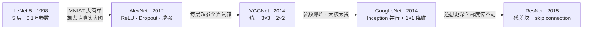

# 第 5 章 经典 CNN 架构演进

> **本章解决**：卷积、池化、全连接这些积木（第 3 章）该怎么拼成一个能打的网络？答案是抄作业——逐个拆解 LeNet-5、AlexNet、VGGNet、Inception/GoogLeNet、ResNet 五个划时代架构，看每代设计者解决了上一代的什么短板。
> 主线一条：**更深、更准、更省**。第 4 章的超参调优技巧在本章全部落地：每个网络都按原论文配置了优化器、学习率、正则化。
> 读完本章，你应当具备的能力是**读论文 → 复现架构**——这是全书作者最想交给你的技能。

## 5.0 本章导图

<div class="brtree">
  <div class="brrow">
    <span class="brlabel root">经典 CNN 架构演进</span>
    <span class="brace"></span>
    <div class="brkids">
      <div class="brrow">
        <span class="brlabel">设计模式</span>
        <span class="brace"></span>
        <div class="brkids">
          <span class="brleaf">特征提取(conv) + 分类(FC)</span>
          <span class="brleaf">深度↑ 维度↓</span>
          <span class="brleaf">FC 单元恒定或递减</span>
          <span class="brleaf">深度按权重层数称呼</span>
        </div>
      </div>
      <div class="brrow">
        <span class="brlabel">LeNet-5 · 1998</span>
        <span class="brace"></span>
        <div class="brkids">
          <span class="brleaf">5 权重层 · 61,706 参数</span>
          <span class="brleaf">tanh + 平均池化</span>
          <span class="brleaf">MNIST &gt;99%</span>
        </div>
      </div>
      <div class="brrow">
        <span class="brlabel">AlexNet · 2012</span>
        <span class="brace"></span>
        <div class="brkids">
          <span class="brleaf">ReLU 治梯度消失</span>
          <span class="brleaf">Dropout 0.5 + 数据增强</span>
          <span class="brleaf">LRN（今用 BN）· 双 GPU</span>
          <span class="brleaf">6000 万参数 · top-5 15.3%</span>
        </div>
      </div>
      <div class="brrow">
        <span class="brlabel">VGGNet · 2014</span>
        <span class="brace"></span>
        <div class="brkids">
          <span class="brleaf">统一 3×3 conv + 2×2 pool</span>
          <span class="brleaf">小核堆叠：27C² vs 49C²</span>
          <span class="brleaf">VGG16 1.38 亿 · VGG19 1.44 亿</span>
        </div>
      </div>
      <div class="brrow">
        <span class="brlabel">Inception · GoogLeNet 2014</span>
        <span class="brace"></span>
        <div class="brkids">
          <span class="brleaf">核尺寸：全都要（多尺度并行）</span>
          <span class="brleaf">1×1 降维层（bottleneck）</span>
          <span class="brleaf">9 个模块 2+5+2 · 22 层</span>
          <span class="brleaf">约 1300 万参数 · top-5 6.67%</span>
        </div>
      </div>
      <div class="brrow">
        <span class="brlabel">ResNet · 2015</span>
        <span class="brace"></span>
        <div class="brkids">
          <span class="brleaf">skip connection 直通梯度</span>
          <span class="brleaf">残差块 relu(f(x)+x)</span>
          <span class="brleaf">bottleneck 1×1 代替池化</span>
          <span class="brleaf">50/101/152 层 · top-5 3.57%</span>
        </div>
      </div>
    </div>
  </div>
</div>

## 5.1 CNN 设计模式

第 3、4 章把零件凑齐了：卷积层、池化层、全连接层，加上正则化、数据增强、Dropout、超参调优。本章看它们如何组装——近年来大量 CV 研究其实都在回答"**怎么把这些基础积木拼成有效的 CNN**"。培养直觉最好的办法是读别人的架构（就像大多数人靠读别人的代码学会写代码）。

作者给每个架构固定讲五件事：**创新点**（解决了什么问题）、**架构**、**代码实现**、**学习超参**（按原论文配置）、**性能**（MNIST / ImageNet 成绩）。三个学习目标：

1. 理解各架构的结构与超参——简单/中等复杂度问题用 AlexNet、VGGNet 就够，超复杂问题再上 Inception、ResNet；
2. 理解每个架构的创新点与动机——**每一代网络都是为了解决上一代的具体短板**，读完这五个就有能力读懂新出的网络；
3. 理解 CNN 的演进脉络与设计者的思考过程——积累"什么可行、什么会出问题"的直觉。

!!! tip "作者最想传递的技能：读论文"
    逐篇啃论文、抓住核心思想、动手实现——作者认为这是每个 DL 从业者的必备技能，也是本书想留下的最大资产：三四年后的最新技术今天没人能教你，能带走的是"自己去读、自己去实现"的能力。建议动手前先读原论文（链接在各节脚注），第 1 部分的知识足够你读懂 pioneers 的原文。

动手抄架构之前，先记住三条反复出现的设计模式：

### 模式 1：特征提取 + 分类两段式

卷积网络几乎总由两部分组成：**特征提取**——一串卷积层；**分类**——一串全连接层。从 LeNet、AlexNet 到近几年的 Inception、ResNet，无一例外（图 5.1）。

<figure>
  
  <figcaption>图 5.1 ConvNet 的通用骨架：卷积堆叠提特征，全连接做分类（截自原书）</figcaption>
</figure>

### 模式 2：深度增加，维度减小

每一层的输入都是一张"图"。要泛化地看：每张图是 **H × W × 深度** 的 3D 体。输入层深度 = 颜色通道（灰度 1、RGB 3）；越往深处走，"深度"变成**特征图（feature maps）的数量**——它代表前层提取出的特征种类。所以你会看到一条铁律（图 5.2）：

- **深度（通道数）随层数增加**：224×224×3 → 55×55×96 → 27×27×256 → 13×13×384……
- **空间尺寸随层数减小**：224 → 55 → 27 → 13……

<figure>
  
  <figcaption>图 5.2 越深通道越多、空间越小（截自原书）</figcaption>
</figure>

### 模式 3：全连接层的单元数恒定或递减

这条不算严格规律，但很实用：一个网络里所有全连接层的隐藏单元数，要么逐层相同、要么逐层递减，**几乎见不到逐层递增的**。研究表明 FC 单元数保持恒定不影响效果——设计网络时可以少做一个选择题：选一个数，套用到所有 FC 层（AlexNet 的 FC6 = FC7 = 4096 就是典型）。

这些架构成名多半因为它们在 ImageNet 竞赛上成绩好。ImageNet 是一个百万级图像基准，DL/CV 研究者用它对比算法（详见 5.3 节侧栏）。

!!! info "本章代码片段不可直接运行"
    书中代码按原论文规格实现结构，目标是教你"读论文 → 写实现"；完整可运行代码在书的官网与 GitHub 仓库（moelgendy/deep_learning_for_vision_systems）。下文所有代码均用 PyTorch 编写，层数/通道/核大小/超参与书一致，参数量已逐一跑模型对账。

## 5.2 LeNet-5

1998 年 Lecun 等人提出 LeNet-5——CNN 的开山之作。组件你在第 3 章全见过（当年它们可是新发明）：**5 个权重层** = 3 个卷积层 + 2 个全连接层，名字里的"-5"就是指权重层数。

!!! note "定义：权重层（Weight Layer）"
    卷积层与全连接层叫**权重层**——它们带可训练权重；池化层没有任何权重，不算数。描述网络深度时通用的约定是数权重层：比如 AlexNet 称为 8 层深（5 conv + 3 FC）。只关心权重层的原因：它们才反映模型的**计算复杂度**。

### 5.2.1 LeNet 架构

原书的架构串：

\[\text{INPUT} \Rightarrow \text{C1} \Rightarrow \text{TANH} \Rightarrow \text{S2} \Rightarrow \text{C3} \Rightarrow \text{TANH} \Rightarrow \text{S4} \Rightarrow \text{C5} \Rightarrow \text{TANH} \Rightarrow \text{FC6} \Rightarrow \text{SOFTMAX}\]

C = 卷积层，S = 次采样（池化）层，FC = 全连接层。注意 LeCun 团队用的是 **tanh** 而不是今天的 ReLU——1998 年 ReLU 还没进 DL 的视野，隐藏层流行 tanh 或 sigmoid。

<table>
<tr>
<td></td>
<td></td>
</tr>
</table>
*图 5.3 LeNet-5 原始架构 · 图 5.4 现代画法的 LeNet-5：5×5 卷积 + 平均池化 + 三层 FC（120/84/10）（截自原书）*

### 5.2.2 LeNet-5 实现（PyTorch）

读原论文第 6–8 页，抄下四组规格：

| 设计项 | 原论文规格 |
| --- | --- |
| 各卷积层滤波器数 | C1 = 6，C3 = 16，C5 = 120 |
| 卷积核大小 | 一律 5×5 |
| 池化层 | 每个 conv 后接 2×2、stride 2 的**平均池化**（当年还没有 max pooling） |
| 激活函数 | 隐藏层 tanh（对称函数被认为比 sigmoid 收敛更快） |

```python
# ===== 书 5.2.2 节 =====
import torch
import torch.nn as nn

class LeNet5(nn.Module):
    """书图 5.4：C1(6) → S2 → C3(16) → S4 → C5(120) → FC6(84) → 输出(10)"""
    def __init__(self, num_classes=10):
        super().__init__()
        self.features = nn.Sequential(
            nn.Conv2d(1, 6, kernel_size=5, padding='same'),   # C1: 28×28×1 → 28×28×6（same 填充：宽高不变）
            nn.Tanh(),                                        # 1998 年还没有 ReLU
            nn.AvgPool2d(kernel_size=2, stride=2),            # S2: → 14×14×6（书用平均池化，不是最大池化）
            nn.Conv2d(6, 16, kernel_size=5),                  # C3: → 10×10×16（无填充，10 = 14−5+1）
            nn.Tanh(),
            nn.AvgPool2d(kernel_size=2, stride=2),            # S4: → 5×5×16
            nn.Conv2d(16, 120, kernel_size=5),                # C5: → 1×1×120
            nn.Tanh(),
        )
        self.classifier = nn.Sequential(
            nn.Flatten(),                                     # 1×1×120 → 120
            nn.Linear(120, 84),                               # FC6
            nn.Tanh(),
            nn.Linear(84, num_classes),                       # FC7 输出层
        )

    def forward(self, x):
        return self.classifier(self.features(x))

model = LeNet5()
print(f"{sum(p.numel() for p in model.parameters()):,}")      # 61,706
```

!!! note "拓展：softmax 去哪了？"
    架构串末尾印着 SOFTMAX，代码里却找不到它——PyTorch 惯例是网络直接输出 logits（不加 softmax），训练时用 `nn.CrossEntropyLoss`：它内部已包含 log-softmax + 负对数似然，数值上比"先 softmax 再取 log"稳定得多。推理要概率时再手动 `torch.softmax(out, dim=1)`。本章之后所有网络同理。

对账：C1 参数 (5×5×1+1)×6 = 156；C3 = (5×5×6+1)×16 = 2,416；C5 = (5×5×16+1)×120 = 48,120；FC6 = 120×84+84 = 10,164；输出 = 84×10+10 = 850。合计 **61,706**——与原书的参数汇总（图 5.5）一模一样。按今天的标准这只是个小网络；后面 AlexNet 直接放大一千倍。

!!! note "读原论文的建议（作者经验）"
    LeNet 论文比本章其他论文难读。核心内容在论文第 2 节（架构与学习细节）；第 3 节是一堆有趣的实验和结果；后面大篇幅讲 graph transformer network，今天已不常用，可跳过。推荐的阅读顺序：**先 AlexNet（5.3），再 VGGNet（5.4），最后回头读 LeNet**——读完现代的再看经典，事半功倍。

### 5.2.3 学习超参

LeCun 团队用**分段衰减**的学习率：前 2 个 epoch 用 0.0005，接着 3 个用 0.0002，再 4 个用 0.00005，之后 0.00001；SGD 优化，共训 20 epochs，batch 32。PyTorch 用 `LambdaLR` 调度器实现分段衰减：

```python
# ===== 书 5.2.3 节 =====
optimizer = torch.optim.SGD(model.parameters(), lr=5e-4)   # 基准 lr

def lr_lambda(epoch):
    """原书调度：前 2 个 epoch 5e-4 → 3~5 取 2e-4 → 6~9 取 5e-5 → 之后 1e-5。
    注意：LambdaLR 传入的 epoch 从 0 计数，书中的调度条件 `epoch <= 2`
    实际覆盖前 3 个 epoch——抄调度函数时留意这个 off-by-one。"""
    if epoch <= 2:   return 1.0             # lr = 5e-4
    elif epoch <= 5: return 2e-4 / 5e-4     # lr = 2e-4
    elif epoch <= 9: return 5e-5 / 5e-4     # lr = 5e-5
    else:            return 1e-5 / 5e-4     # lr = 1e-5

scheduler = torch.optim.lr_scheduler.LambdaLR(optimizer, lr_lambda=lr_lambda)

criterion = nn.CrossEntropyLoss()            # softmax 并入损失（见上文拓展）
# 训练循环（20 epochs，batch_size=32）：每个 epoch 结束调 scheduler.step()
```

### 5.2.4 MNIST 上的成绩

MNIST 上训练 LeNet-5，准确率 **99% 以上**。作者留了个实验：把隐藏层激活换成 ReLU 再跑一遍，观察性能差异（tanh → ReLU 的提速效果在 5.3 节展开）。

## 5.3 AlexNet

LeNet 在 MNIST 上很强，但 MNIST 太简单：灰度单通道、只有 10 类。AlexNet 的动机就是**造一个更深的网络去学更复杂的函数**——它 2012 年赢得 ILSVRC 图像分类竞赛冠军，在 120 万张高分辨率图像、1000 类的 ImageNet 上训练。它是第一个真正意义上的"深度"网络，让 CV 社区从此认真对待卷积网络。

LeNet 和 AlexNet 结构同源：卷积 + 池化堆叠提特征，FC + softmax 收尾。差距在体量：**61,000 参数 → 约 6,000 万参数、65 万个神经元**——更大的学习容量，才啃得动复杂特征。

!!! info "侧栏：ImageNet 与 ILSVRC"
    **ImageNet**（image-net.org）：为视觉识别研究而生的大型图像库，按 WordNet 词表把图像标注进约 **22,000 个类别**；图片从网络收集、由人工用 Amazon Mechanical Turk 打标，目前已超 **1,400 万张**。数据按 **synset**（同义词组）组织，目标是每个 synset 1,000+ 张图。
    **ILSVRC**（ImageNet Large Scale Visual Recognition Challenge）：ImageNet 主办的年度竞赛，比拼分类、检测、场景标注算法。本章就用 ILSVRC 成绩当作各架构的对比基准。

<figure>
  
  <figcaption>图 5.6 AlexNet：5 个卷积层 + 3 个全连接层，1000 类输出（截自原书）</figcaption>
</figure>

### 5.3.1 AlexNet 架构

积木与 LeNet 相同，规格不同：11×11、5×5、3×3 三种卷积核；最大池化降采样；Dropout 防过拟合；隐藏层全部 ReLU（LeNet 是 tanh），输出层 softmax。文字串：

\[\text{INPUT} \Rightarrow \text{CONV1} \Rightarrow \text{POOL2} \Rightarrow \text{CONV3} \Rightarrow \text{POOL4} \Rightarrow \text{CONV5} \Rightarrow \text{CONV6} \Rightarrow \text{CONV7} \Rightarrow \text{POOL8} \Rightarrow \text{FC9} \Rightarrow \text{FC10} \Rightarrow \text{SOFTMAX}\]

（原书把末项印作 "SOFTMAX7"，是编号笔误，实为第 11 层的 softmax。）

!!! warning "224 还是 227？"
    AlexNet 原论文写输入 224×224×3，但只有 **227×227×3** 才能让尺寸算得通：\((227-11)/4+1=55\)。作者判断这是论文的排版笔误——复现时请用 227。

逐层尺寸（对照图 5.7，记住这套手算，复现论文时用得上）：

| 层 | 配置 | 输出尺寸 | 计算 |
| --- | --- | --- | --- |
| CONV1 | 11×11, stride 4, 96 核 | 55×55×96 | (227−11)/4+1 = 55 |
| Pool | 3×3, stride 2 | 27×27×96 | (55−3)/2+1 = 27 |
| CONV2 | 5×5, pad 2, 256 核 | 27×27×256 | (27+2×2−5)/1+1 = 27 |
| Pool | 3×3, stride 2 | 13×13×256 | (27−3)/2+1 = 13 |
| CONV3 | 3×3, pad 1, 384 核 | 13×13×384 | (13+2×1−3)/1+1 = 13 |
| CONV4 | 3×3, pad 1, 384 核 | 13×13×384 | 同上 |
| CONV5 | 3×3, pad 1, 256 核 | 13×13×256 | 同上 |
| Pool | 3×3, stride 2 | 6×6×256 | (13−3)/2+1 = 6 |
| Flatten | — | 9,216 | 6×6×256 |
| FC6 / FC7 | 4,096 神经元 | — | 模式 3：两个 FC 同宽 |
| Softmax | 1,000 神经元 | — | 1000 类 |

<figure>
  
  <figcaption>图 5.7 AlexNet 8 个权重层的手算尺寸账（截自原书）</figcaption>
</figure>

!!! note "这些超参是怎么定出来的？"
    核大小、深度、stride、池化位置——全靠大量试错。思路不变：多堆权重层提升容量，中间插池化控制尺寸（第 2 章）。精确调参正是 CNN 设计的痛点之一；下一节的 VGGNet 用"统一配置"缓解了它。

### 5.3.2 AlexNet 的创新点

AlexNet 之前，DL 只在语音识别等少数领域起步；AlexNet 让 CV 社区相信 DL 真的行。它的创新点你在前几章都见过，这里快速过一遍：

**① ReLU 激活函数。** 用 ReLU 替代 tanh/sigmoid，训练快得多。原因：sigmoid 在饱和区导数极小，权重更新几乎消失——**梯度消失（vanishing gradient）问题**。ReLU 定义 \(f(x)=\max(0,x)\)，第 2 章讲过细节。

!!! note "侧栏：梯度消失问题"
    sigmoid 把大输入空间压进 (0,1)（tanh 是 (−1,1)），输入大幅变化只引起输出的微小变化，导数因此变得极小。反向传播时梯度要逐层连乘权重矩阵，小于 1 的因子连乘 → 指数级衰减到 0，浅层学不到东西，网络性能饱和甚至退化。反过来梯度也可能指数级增大——**梯度爆炸（exploding gradients）**。这个问题在本章 5.6 节 ResNet 处还会回来，那才是它的正面决战。

<figure>
  
  <figcaption>sigmoid 及其导数：导数最大仅 0.25，|x|>4 后趋近 0——深层连乘后梯度形同归零（截自原书）</figcaption>
</figure>

!!! note "拓展：ReLU 为什么快——把账算到底"
    对比两边的梯度上界：sigmoid 导数 \(\sigma'(x)=\sigma(x)(1-\sigma(x))\le 0.25\)，且在饱和区（|x|>4）趋近 0；n 层连乘最好情况衰减 \(0.25^n\)，坏情况直接归零。ReLU 在正区导数**恒等于 1**，n 层连乘不缩水，梯度原样到达浅层；负区导数为 0 反而带来稀疏性。AlexNet 论文的实测：同样配置下 ReLU 版把训练错误率降到 25% 所需的 epoch 数约为 tanh 版的 **1/6**。代价是 ReLU 无上界、输出分布可能漂移——BN（第 4 章）正是它的好搭档。

**② Dropout 层。** 被 Dropout 的神经元前向不参与、反向不更新。这意味着每喂一次输入，网络等于**采样了一个不同的子架构，但所有子架构共享同一套权重**。神经元无法依赖特定同伴，被迫学出与任意随机子集都能协作的稳健特征。Krizhevsky 在两个 FC 层用了 **p = 0.5**。

!!! note "拓展：Dropout 为什么等价于免费集成"
    训练时每个 mini-batch 采样一个子网络，成千上万个子网络各自学一点，但权重共享让它们互相"借脑"；测试时关闭 Dropout、激活按比例缩放，相当于**把所有子网络的预测平均**——这就是书说"采样不同架构、共享权重"的集成（ensemble）视角。所以 Dropout 0.5 时常把 FC 层放宽一倍来补偿容量（AlexNet 的 4096 也有此考量）。

**③ 数据增强。** 用**保持标签的变换**（旋转、翻转、缩放等）人工扩充训练集，第 4 章详解过。

**④ 局部响应归一化（LRN）。** 与第 4 章的批归一化（BN）不同，LRN 靠"邻通道竞争"加速收敛。**如今 BN 已全面替代 LRN**——书里的实现也直接用 BN。

**⑤ 权重正则化。** Krizhevsky 用 weight decay = 0.0005，即第 4 章的 **L2 正则**。过拟合压不住时可以调大 λ：

```python
# L2 正则交给优化器：λ 就是 weight_decay（Krizhevsky 取 5e-4）
optimizer = torch.optim.SGD(model.parameters(), lr=0.01, momentum=0.9,
                            weight_decay=5e-4)
```

**⑥ 双 GPU 训练。** 当年的 GTX 580 只有 3 GB 显存，装不下 120 万训练样本，团队把网络拆到两块 GPU 上分头算、按需通信（论文里网络画成两条管道就是这个原因）。今天你不需要复刻这套细节——分布式训练已有成熟得多的方案。

### 5.3.3 AlexNet 实现（PyTorch）

读原论文第 4 页的架构描述。8 个权重层（5 conv + 3 FC），末层 1000 类 softmax；书的实现给每个卷积层后加了 BN、所有隐藏层用 ReLU：

```python
# ===== 书 5.3.3 节 =====
class AlexNet(nn.Module):
    """8 个权重层：5 conv + 3 FC；输入 227×227×3（论文写 224 是笔误）"""
    def __init__(self, num_classes=1000):
        super().__init__()
        self.features = nn.Sequential(
            # 第 1 层 CONV1：11×11 大核、stride 4；书版 conv 后接 BN 替代原论文 LRN
            nn.Conv2d(3, 96, kernel_size=11, stride=4),      # → 55×55×96
            nn.ReLU(inplace=True),
            nn.MaxPool2d(kernel_size=3, stride=2),           # → 27×27×96（overlapping pool）
            nn.BatchNorm2d(96),
            # 第 2 层 CONV2：5×5，same padding；原论文自此层起带 0.0005 的 weight decay
            nn.Conv2d(96, 256, kernel_size=5, padding=2),    # → 27×27×256
            nn.ReLU(inplace=True),
            nn.MaxPool2d(kernel_size=3, stride=2),           # → 13×13×256
            nn.BatchNorm2d(256),
            # 第 3 层 CONV3：AlexNet 作者在 conv3 之后没有加池化
            nn.Conv2d(256, 384, kernel_size=3, padding=1),   # → 13×13×384
            nn.ReLU(inplace=True),
            nn.BatchNorm2d(384),
            # 第 4 层 CONV4（与第 3 层同构）
            nn.Conv2d(384, 384, kernel_size=3, padding=1),   # → 13×13×384
            nn.ReLU(inplace=True),
            nn.BatchNorm2d(384),
            # 第 5 层 CONV5
            nn.Conv2d(384, 256, kernel_size=3, padding=1),   # → 13×13×256
            nn.ReLU(inplace=True),
            nn.BatchNorm2d(256),
            nn.MaxPool2d(kernel_size=3, stride=2),           # → 6×6×256
        )
        self.classifier = nn.Sequential(
            nn.Flatten(),                                    # 6×6×256 = 9,216
            nn.Linear(9216, 4096),                           # FC6
            nn.ReLU(inplace=True),
            nn.Dropout(0.5),
            nn.Linear(4096, 4096),                           # FC7（与 FC6 同宽，设计模式 3）
            nn.ReLU(inplace=True),
            nn.Dropout(0.5),
            nn.Linear(4096, num_classes),                    # FC8 → 1000 类 logits
        )

    def forward(self, x):
        return self.classifier(self.features(x))

model = AlexNet()
print(f"{sum(p.numel() for p in model.parameters()):,}")     # 62,381,096
```

对账：可训练参数 **62,381,096**（书里参数汇总的 Total 62,383,848 还包含 5 个 BN 层共 2,752 个不可训练的均值/方差统计量）；FC 三层就占约 5,860 万——大头永远在全连接。

### 5.3.4 学习超参

AlexNet 训了 **90 epochs，在两块 GTX 580 上跑了 6 天**。初始 lr = 0.01、momentum = 0.9，验证误差不再改善时衰减 lr——正文说"除以 10"，书中代码实际每次乘 √0.1 ≈ 0.316：

```python
# ===== 书 5.3.4 节 =====
import math

# L2 正则交给优化器：weight_decay=5e-4（原论文的 weight decay）
# 注意：weight_decay 作用于交给优化器的全部参数（含 bias、BN 的 γ/β）
optimizer = torch.optim.SGD(model.parameters(), lr=0.01, momentum=0.9, weight_decay=5e-4)

# 验证损失停滞时 lr × 0.1^0.5 ≈ ×0.316（patience 用默认值）
scheduler = torch.optim.lr_scheduler.ReduceLROnPlateau(optimizer, mode='min',
                                                       factor=math.sqrt(0.1))
criterion = nn.CrossEntropyLoss()      # 交叉熵损失（内部已含 log-softmax）
# 训练 90 epochs、batch_size=128；每个 epoch 调 scheduler.step(val_loss)
```

### 5.3.5 AlexNet 成绩

2012 年 ILSVRC 上 **top-5 错误率 15.3%**，碾压第二名的 26.2%（传统分类器方法）。这一跳让 CV 社区看到了卷积网络的潜力，直接催生了后面几代架构。

!!! note "侧栏：top-1 / top-5 错误率是什么"
    **top-1**：正确类别没拿到最高分的比例；**top-5**：正确类别没进前五猜测的比例。例：100 类问题喂一张猫图，输出 Cat 70%、Dog 20%、Horse 5%、Motorcycle 4%、Car 0.6%、Plane 0.4%——若真实标签是 Cat，本题 top-1 答对；若真实标签是 Horse，top-1 错、但进了 top-5。统计 100 张图里漏掉真标签的次数即错误率。
    理想是永远 top-1 正确，但 top-5 能更全面地衡量"错的时候离正确答案有多近"——1000 类问题里随机猜 top-1 命中率只有 0.1%，top-5 也才 0.5%，15.3% 的成绩含金量极高。

## 5.4 VGGNet

VGGNet 2014 年出自牛津大学 Visual Geometry Group（名字由来），组件与 LeNet/AlexNet 完全同款——区别只是**更深**（更多 conv、pool、dense）。它又名 **VGG16**：16 个权重层 = 13 conv + 3 FC。成名点不是新零件，而是**统一架构带来的易懂好抄**。

### 5.4.1 创新点：统一组件 + 小核堆叠

AlexNet 的痛点：每层核大小、padding、stride 都要单独试错。VGG 的答案是**一刀切**：

- 所有卷积层：**3×3 核、stride 1、same padding**；
- 所有池化层：**2×2 池、stride 2**。

为什么改用小核？Simonyan 和 Zisserman 的理由：同样大的感受野下，**多个小核堆叠优于一个大核**——堆叠增加了非线性层数（更多 ReLU），决策函数更有区分度；同时参数更少、成本更低。

!!! note "侧栏：感受野（Receptive Field）"
    感受野 = 输出所依赖的输入图像区域（第 3 章）。两个 3×3 卷积（中间不插池化）的等效感受野是 **5×5**；三个连起来是 **7×7**。小核堆叠 = 用更少的参数买同样大的"视野"，还白赚两层非线性。

把参数账摆出来：C 通道下，三层 3×3 卷积的权重数是 \(3\times(3^2C^2)=27C^2\)；一个 7×7 卷积要 \(7^2C^2=49C^2\)——**多出 81%**。更深反而更省。

!!! note "拓展：3×3 由此成为默认核"
    VGG 之后，3×3 逐步成了全行业的默认卷积核：Inception 的 3×3 分支、ResNet 的 bottleneck 中层全是 3×3；连 Inception 的 5×5 分支后来也在实践中被两个 3×3 级联替换。今天读到的任何现代网络几乎找不到 11×11 这样的大核——这笔 27C² 对 49C² 的账就是起点。

架构组织方式：若干 3×3 卷积堆成一个块，块尾接 2×2 池化；卷积块序列之后接传统分类器（FC + softmax），见图 5.8。

<figure>
  
  <figcaption>图 5.8 VGG16：5 个卷积块（通道 64→128→256→512→512）+ 3 层 FC（截自原书）</figcaption>
</figure>

### 5.4.2 VGGNet 的各配置

Simonyan 和 Zisserman 给出 A、A-LRN、B、C、D、E 六种配置（图 5.9），全部同一设计模板，只是每块卷积层数不同。**D = VGG16、E = VGG19** 最常用（名字来自权重层数）。每个块 = 一串 3×3 卷积 + 块尾 2×2 池化。

<figure>
  
  <figcaption>图 5.9 VGG 六种配置：从 11 层的 A 到 19 层的 E，D/E 即 VGG16/VGG19（截自原书）</figcaption>
</figure>

各配置参数量（原书表 5.1，单位：百万）：

| 配置 | A | A-LRN | B | C | D (VGG16) | E (VGG19) |
| --- | --- | --- | --- | --- | --- | --- |
| 参数量 | 133 | 133 | 134 | 134 | **138** | **144** |

VGG16 更常用：性能几乎追平 VGG19，参数却少一截。

### 5.4.3 VGG16 实现（PyTorch）

防过拟合的正则（原论文规格）：L2 正则 weight decay \(5\times10^{-4}\)（书实现里为省篇幅未加，下面超参代码补上）、前两个 FC 层后 Dropout 0.5。

```python
# ===== 书 5.4.3 节 =====
class VGG(nn.Module):
    """配置 D（VGG16）：每块卷积数 (2,2,3,3,3)；配置 E（VGG19）= (2,2,4,4,4)"""
    def __init__(self, block_convs=(2, 2, 3, 3, 3), num_classes=1000):
        super().__init__()
        channels = [64, 128, 256, 512, 512]          # 5 个块的通道数（图 5.9）
        layers, in_ch = [], 3
        for n, ch in zip(block_convs, channels):
            for _ in range(n):                        # n 个 3×3 卷积：stride 1 + same padding
                layers += [nn.Conv2d(in_ch, ch, kernel_size=3, stride=1, padding=1),
                           nn.ReLU(inplace=True)]
                in_ch = ch
            layers += [nn.MaxPool2d(kernel_size=2, stride=2)]   # 块尾统一 2×2 池化
        self.features = nn.Sequential(*layers)
        self.classifier = nn.Sequential(
            nn.Flatten(),                             # 224/2⁵ = 7 → 7×7×512 = 25,088
            nn.Linear(25088, 4096),                   # FC-4096
            nn.ReLU(inplace=True),
            nn.Dropout(0.5),                          # 前 2 个 FC 后 Dropout
            nn.Linear(4096, 4096),
            nn.ReLU(inplace=True),
            nn.Dropout(0.5),
            nn.Linear(4096, num_classes),
        )

    def forward(self, x):
        return self.classifier(self.features(x))

vgg16 = VGG()                                      # 配置 D：16 权重层
vgg19 = VGG(block_convs=(2, 2, 4, 4, 4))           # 配置 E：第 3/4/5 块各加一层卷积
print(f"{sum(p.numel() for p in vgg16.parameters()):,}")   # 138,357,544
print(f"{sum(p.numel() for p in vgg19.parameters()):,}")   # 143,667,240
```

两个数字都与原书一致：**138,357,544 / 143,667,240**。

### 5.4.4 学习超参与成绩

训练流程照搬 AlexNet：mini-batch GD + momentum 0.9，初始 lr 0.01，验证集准确率停滞时 ÷10。

```python
# ===== 书 5.4.3 节（超参） =====
optimizer = torch.optim.SGD(vgg16.parameters(), lr=0.01, momentum=0.9,
                            weight_decay=5e-4)             # 论文的 L2：5×10⁻⁴
scheduler = torch.optim.lr_scheduler.ReduceLROnPlateau(optimizer, mode='max', factor=0.1)
criterion = nn.CrossEntropyLoss()
```

成绩：VGG16 在 ImageNet 上 top-5 错误率 **8.1%**（AlexNet 是 15.3%），VGG19 更进一步到约 **7.4%**。值得一记的细节：尽管参数更多、网络更深，VGG 反而**需要更少的 epoch 就收敛**——深度 + 小卷积核带来了隐式正则化。

## 5.5 Inception 与 GoogLeNet

2014 年 Google 团队发表 "Going Deeper with Convolutions"，Inception 网络问世。它的目标写进了论文标题：**网络更深的同时，把网络内部的计算资源用得更省**。其中一个具体形态叫 **GoogLeNet**，作为该团队的 ILSVRC 2014 参赛作品：**22 层深**（超过 VGG），参数却只有 VGG 的约 1/12（约 1.38 亿 → 约 1300 万），成绩还显著更好。积木仍学自经典网络（AlexNet/VGG），新零件叫 **Inception 模块（inception module）**。

### 5.5.1 创新点：核尺寸别选了，全都要

设计前几代网络时，每层都要做两道选择题：

- **卷积核多大？** 1×1、3×3、5×5，甚至 11×11（AlexNet）。小核抓细节，大核会漏掉细小特征（第 3 章）——每一层都得试。
- **池化层放哪？** AlexNet 每一两个 conv 就池化一次；VGG 随网络加深改为每两、三、四个 conv 池化一次。全靠实验摸。

Inception 的回答相当豪横：**别选了，全都放进同一个模块里并行跑**。于是架构从"层叠层"变成"**模块叠模块**"（图 5.10）：Inception 网络开头是一个卷积层 + 池化层，中间堆 inception 模块和池化层，末尾还是常规的全连接分类器。

<figure>
  
  <figcaption>图 5.10 经典 CNN（层叠层） vs Inception 网络（模块叠模块）（截自原书）</figcaption>
</figure>

### 5.5.2 Inception 模块：naive 版本

Inception 模块 = 四层并行组合：

1. 1×1 卷积层
2. 3×3 卷积层
3. 5×5 卷积层
4. 3×3 最大池化层

四路输出在**通道维拼接**成一个体，作为下一级的输入。跟着书上的例子走一遍，设输入是 32×32×200：

| 分支 | 配置 | 输出 |
| --- | --- | --- |
| 1×1 卷积 | 64 核，padding = same | 32×32×64 |
| 3×3 卷积 | 128 核，padding = same | 32×32×128 |
| 5×5 卷积 | 32 核，padding = same | 32×32×32 |
| 3×3 max pool | padding = same，stride 1 | 32×32×**200**（池化不改通道） |

<figure>
  
  <figcaption>图 5.11 naive Inception 模块：四路并行，输出深度拼接（截自原书）</figcaption>
</figure>

!!! warning "原书笔误（勘误①）"
    原书说四个输出拼成 32×32×**256**。但池化分支不改变通道数——输入 200 通道进来，3×3 max pool（same、stride 1）出去还是 200 通道。正确的拼接深度是 \(64+128+32+200=\textbf{424}\)，不是 256。（图 5.11 里池化分支标的 32×32×32 同样不对，应为 32×32×200。）

!!! info "为什么用 padding = same"
    same 填充指让输出与输入**等宽等高**——PyTorch 里用 padding 参数控制：3×3 核配 `padding=1`、5×5 核配 `padding=2`（`nn.Conv2d` 也直接支持 `padding='same'`）。四条分支必须等宽等高才能在通道维对齐拼接——这也是 Inception 模块里所有 conv 用 same、池化用 stride 1 的原因：拼接时直接把各分支通道数加起来即可。

### 5.5.3 Inception 模块：带降维的版本

naive 版有个大问题：**大核太贵**。算一算上面例子里 5×5 分支的乘法量：输入 32×32×200，接 32 个 5×5×32 的核，

\[(32\times32\times200)\times(5\times5\times32)=163{,}840{,}000\approx 1.6\ \text{亿次乘法}\]

现代计算机跑得动，但确实贵。救星是**降维层（dimensionality reduction layer）——1×1 卷积**：在大核（3×3、5×5）之前先插一个 1×1 卷积把**深度压小**，乘法量跟着崩塌。

<figure>
  
  <figcaption>图 5.12 1×1 降维层把 1.6 亿乘法压到约 1/10（截自原书）</figcaption>
</figure>

还是那个例子：输入 32×32×200，先过 16 核的 1×1 卷积压成 32×32×16，再上 5×5 卷积。输出还是 32×32×32（与不加降维层时相同），但成本变成两段：

\[\underbrace{(32\times32\times200)\times(1\times1\times16)}_{3.2\ \text{百万}}+\underbrace{(32\times32\times16)\times(5\times5\times32)}_{13.1\ \text{百万}}=16.3\ \text{百万}\]

**1.63 亿 → 1630 万，整整省 90%。**

!!! note "侧栏：1×1 卷积层"
    1×1 卷积**保持空间尺寸（H、W）不变，只改通道数（深度）**：\(6\times6\times32\) 的输入乘以 \(1\times1\times\#\text{filters}\) 的核，输出 \(6\times6\times\#\text{filters}\)。因为它把网络收窄再放开、形似瓶子的瓶颈，也叫**瓶颈层（bottleneck layer）**；又因为它专门压维度，叫 reduce layer。

<figure>
  
  <figcaption>1×1 卷积：空间不动，深度自选（截自原书）</figcaption>
</figure>

<figure>
  
  <figcaption>瓶颈层：收窄 → 放开，故得此名（截自原书）</figcaption>
</figure>

!!! note "拓展：1×1 卷积为什么这么划算"
    两笔账。**乘法账**（书上的）：5×5 卷积的乘法数 = 输出元素数 × 每个输出元素的乘法量 = \(HW\,C_{out}\times(5\times5\,C_{in})\)，与 \(C_{in}\) 成正比——先用 1×1 把 \(C_{in}\) 从 200 压到 16，乘法直接 ÷12.5。**参数账**同理：权重数从 \(5\times5\times200\times C_{out}\) 降到 \(1\times1\times200\times16+5\times5\times16\times C_{out}\)。
    那压扁了不怕丢信息吗？Szegedy 等人的实验结论（书里原话）：**只要降得适度，大幅压缩表示尺寸也不伤性能**。直觉是 1×1 相当于对每个像素位置做一次跨通道的"信息重组"，通道之间的相关性往往远高于压后的通道数，压掉的是冗余不是信号。这个思想 5.6 节的 ResNet bottleneck 会原样再用一次。

现在把降维版模块拼出来（图 5.13）：保留四路拼接的骨架，在 **3×3 和 5×5 之前**各加一个 1×1 reduce 层；**max pool 之后也要补一个 1×1**——因为池化层不降深度，不补的话拼接深度会失控。书里给出的设计动机：先在多个尺度上分别处理视觉信息再聚合，下一级就能同时从不同尺度抽象特征；降维让每级可以放心加大单元数，而不会让后级计算量爆炸。

<figure>
  
  <figcaption>图 5.13 带降维的 Inception 模块：三处 1×1（3×3 前、5×5 前、池化后）（截自原书）</figcaption>
</figure>

**小结**：不想纠结核尺寸、不想决定池化位置？Inception 让你全都要——这是 naive 版；大核太贵，就在 3×3/5×5 前与池化后插 1×1 reduce 层——这是降维版。

### 5.5.4 Inception 架构与 GoogLeNet

用降维版模块堆网络：模块叠模块，中间隔 3×3 池化层降采样（图 5.14），想多深就堆多少。原论文团队造的特定形态就是 **GoogLeNet**（ILSVRC 2014 参赛网络）：**共 9 个 inception 模块**，每隔几个块插一个 max pool 控制尺寸。

<figure>
  
  <figcaption>图 5.15 GoogLeNet 三段式：Part A 经典堆叠开场，Part B 九个模块 + 3×3 池化，Part C 分类器（截自原书）</figcaption>
</figure>

为方便实现，书把 GoogLeNet 拆成三部分：

| 部分 | 内容 |
| --- | --- |
| **Part A** | 与 LeNet/AlexNet 同款：一串卷积 + 池化 |
| **Part B** | 9 个 inception 模块，按 **2 + 池化 + 5 + 池化 + 2** 分组（即 3a,3b → pool → 4a…4e → pool → 5a,5b） |
| **Part C** | 分类器：全连接 + softmax |

!!! warning "原书笔误（勘误②）"
    原书正文把 Part B 写成"两个模块 + 池化 + **五个**模块 + 池化 + **五个**模块"（2+5+5=12 个）。但 GoogLeNet 一共只有 9 个 inception 模块，正确分组是 **2+5+2**——书里自己的代码（3a,3b / 4a–4e / 5a,5b）和图 5.15 都是 2+5+2。

### 5.5.5 GoogLeNet 实现（PyTorch）

每个 inception 模块四条路线（对照图 5.16）：① 1×1 卷积；② 1×1 → 3×3；③ 1×1 → 5×5；④ 3×3 池化 → 1×1。各路线滤波器数从原论文的配置表（图 5.17）抄：

<figure>
  
  <figcaption>图 5.17 原论文的 GoogLeNet 全配置表：每行一个模块，#3×3 reduce / #5×5 reduce 就是 1×1 降维核数（截自原书）</figcaption>
</figure>

整理成表（原书表 5.2 只列了 3a/3b，这里补全 9 个模块）：

| 模块 | #1×1 | #3×3 reduce | #3×3 | #5×5 reduce | #5×5 | pool proj |
| --- | --- | --- | --- | --- | --- | --- |
| inception (3a) | 64 | 96 | 128 | 16 | 32 | 32 |
| inception (3b) | 128 | 128 | 192 | 32 | 96 | 64 |
| inception (4a) | 192 | 96 | 208 | 16 | 48 | 64 |
| inception (4b) | 160 | 112 | 224 | 24 | 64 | 64 |
| inception (4c) | 128 | 128 | 256 | 24 | 64 | 64 |
| inception (4d) | 112 | 144 | 288 | 32 | 64 | 64 |
| inception (4e) | 256 | 160 | 320 | 32 | 128 | 128 |
| inception (5a) | 256 | 160 | 320 | 32 | 128 | 128 |
| inception (5b) | 384 | 192 | 384 | 48 | 128 | 128 |

```python
# ===== 书 5.5.5 节 =====
class InceptionModule(nn.Module):
    """四条路线并行 → 通道维拼接（PyTorch 的通道维是 dim=1）"""
    def __init__(self, in_ch, f1x1, f3x3_red, f3x3, f5x5_red, f5x5, f_pool):
        super().__init__()
        # 路线①：1×1 直连
        self.route1 = nn.Sequential(nn.Conv2d(in_ch, f1x1, kernel_size=1), nn.ReLU())
        # 路线②：1×1 降维 → 3×3
        self.route2 = nn.Sequential(nn.Conv2d(in_ch, f3x3_red, kernel_size=1), nn.ReLU(),
                                    nn.Conv2d(f3x3_red, f3x3, kernel_size=3, padding=1), nn.ReLU())
        # 路线③：1×1 降维 → 5×5
        self.route3 = nn.Sequential(nn.Conv2d(in_ch, f5x5_red, kernel_size=1), nn.ReLU(),
                                    nn.Conv2d(f5x5_red, f5x5, kernel_size=5, padding=2), nn.ReLU())
        # 路线④：3×3 池化（不降深度）→ 1×1 补一刀
        self.route4 = nn.Sequential(nn.MaxPool2d(kernel_size=3, stride=1, padding=1),
                                    nn.Conv2d(in_ch, f_pool, kernel_size=1), nn.ReLU())

    def forward(self, x):
        return torch.cat([self.route1(x), self.route2(x),
                          self.route3(x), self.route4(x)], dim=1)
```

```python
# ===== 书 5.5.5 节：GoogLeNet 主体 =====
class GoogLeNet(nn.Module):
    def __init__(self, num_classes=1000):
        super().__init__()
        # ---- Part A：7×7/2 → 3×3池 → 1×1(64) → 3×3(192) → 3×3池 ----
        # 原论文此处用 LocalRespNorm，书实现换成了 BatchNorm（LRN 已被 BN 取代）
        self.partA = nn.Sequential(
            nn.Conv2d(3, 64, kernel_size=7, stride=2, padding=3), nn.ReLU(),  # 224 → 112
            nn.MaxPool2d(kernel_size=3, stride=2, padding=1),                 # 112 → 56
            nn.BatchNorm2d(64),
            nn.Conv2d(64, 64, kernel_size=1), nn.ReLU(),
            nn.Conv2d(64, 192, kernel_size=3, padding=1), nn.ReLU(),
            nn.BatchNorm2d(192),
            nn.MaxPool2d(kernel_size=3, stride=2, padding=1),                 # 56 → 28
        )
        # ---- Part B：2 + 5 + 2 共 9 个 inception 模块（勘误②：不是 2+5+5）----
        self.inc3a = InceptionModule(192,  64,  96, 128, 16,  32,  32)
        self.inc3b = InceptionModule(256, 128, 128, 192, 32,  96,  64)
        self.pool1 = nn.MaxPool2d(kernel_size=3, stride=2, padding=1)         # 28 → 14
        self.inc4a = InceptionModule(480, 192,  96, 208, 16,  48,  64)
        self.inc4b = InceptionModule(512, 160, 112, 224, 24,  64,  64)
        self.inc4c = InceptionModule(512, 128, 128, 256, 24,  64,  64)
        self.inc4d = InceptionModule(512, 112, 144, 288, 32,  64,  64)
        self.inc4e = InceptionModule(528, 256, 160, 320, 32, 128, 128)
        self.pool2 = nn.MaxPool2d(kernel_size=3, stride=2, padding=1)         # 14 → 7
        self.inc5a = InceptionModule(832, 256, 160, 320, 32, 128, 128)
        self.inc5b = InceptionModule(832, 384, 192, 384, 48, 128, 128)
        # ---- Part C：分类器 ----
        self.partC = nn.Sequential(
            nn.AdaptiveAvgPool2d(1),          # 7×7×1024 → 1×1×1024（全局平均池化）
            nn.Flatten(),
            nn.Dropout(0.4),                  # dropout 40%
            nn.Linear(1024, num_classes),     # 书示例代码输出 10 类（CIFAR）；ImageNet 用 1000
        )

    def forward(self, x):
        x = self.partA(x)
        x = self.pool1(self.inc3b(self.inc3a(x)))
        x = self.pool2(self.inc4e(self.inc4d(self.inc4c(self.inc4b(self.inc4a(x))))))
        x = self.inc5b(self.inc5a(x))
        return self.partC(x)

model = GoogLeNet()
print(f"{sum(p.numel() for p in model.parameters()):,}")   # 6,999,064
```

!!! note "拓展：参数到底是 700 万还是 1300 万？"
    上面按书结构实现的主干网络是 **6,999,064** 个参数。原论文的完整版还带**两个辅助分类器**（auxiliary classifiers，分别挂在 4a、4d 之后，用于中途注入梯度、缓解深网训练难），加上它们总数约 **1,300 万**——书里"参数减少 12 倍（1.38 亿 → 约 1300 万）"取的就是含辅助分类器的口径（torchvision 的 googlenet 即 13,005,084）。本书实现没做辅助分支，无需纠结。

Part C 的细节：Szegedy 等人实验发现加一层 7×7 平均池化能让 top-1 准确率再涨约 **0.6%**，再接 40% 的 Dropout 防过拟合。图 5.18 是 Part A 的结构图（7×7 conv → 3×3 pool → 1×1 conv → 3×3 conv → 3×3 pool）：

<figure>
  
  <figcaption>图 5.18 GoogLeNet 的 Part A（截自原书）</figcaption>
</figure>

!!! warning "原书笔误（小）"
    书中 Part A 代码注释写 "input layer with size = 24 × 24 × 3"，而代码实际输入的图像是 224×224×3——应为 224，注释笔误。

### 5.5.6 学习超参

SGD + momentum 0.9（不用 Nesterov）；固定学习率衰减：**每 8 个 epoch 乘 0.96**（即衰减 4%）。书给的示例配置：初始 lr 0.01、batch 256、25 epochs。

```python
# ===== 书 5.5.6 节 =====
import math

optimizer = torch.optim.SGD(model.parameters(), lr=0.01, momentum=0.9, nesterov=False)
# lr = 0.01 × 0.96^floor((1+epoch)/8)：每 8 个 epoch 乘 0.96（epoch 从 0 计）
scheduler = torch.optim.lr_scheduler.LambdaLR(
    optimizer, lr_lambda=lambda epoch: 0.96 ** math.floor((1 + epoch) / 8))
criterion = nn.CrossEntropyLoss()
# 训练 25 epochs、batch_size=256（书示例；每个 epoch 调 scheduler.step()）
```

### 5.5.7 Inception 成绩

GoogLeNet 是 **ILSVRC 2014 冠军**，top-5 错误率 **6.67%**——离人类水平已经很近，远好于 AlexNet 和 VGGNet。

## 5.6 ResNet

**残差网络（Residual Neural Network, ResNet）**，2015 年微软研究院出品。两大法宝：带 **skip connection** 的残差模块 + 隐藏层重度 BatchNorm。这套组合拳让他们训出了 **50、101、152 层**的极深网络——计算复杂度却比 19 层的 VGGNet 还低。ResNet 拿下 **ILSVRC 2015** 冠军，top-5 错误率 **3.57%**，超过此前所有 ConvNet。

### 5.6.1 创新点：skip connection 解锁"超深"

回看演进线：LeNet → AlexNet → VGG → Inception，规律是**越深、容量越大、提特征越强**——深网能表达复杂函数，从低层边缘到高层的复杂特征都能学到。那能不能一路加深到 50、100、150 层？

第 4 章说过：层数太多容易过拟合。但这不是主要障碍——Dropout、L2、BatchNorm 都治得住。真正卡住加深的是另一个现象：**梯度消失**。

!!! note "侧栏：梯度消失与梯度爆炸"
    极深网络里，更新权重的信号传到浅层时已经非常微弱。回顾第 2 章的梯度下降：误差梯度从最后一层逐层往回传，**每经过一层就要乘一次该层的权重矩阵**——小于 1 的因子连乘，梯度指数级缩水到 0，浅层学不动，网络性能饱和甚至快速退化（vanishing gradient）。反过来梯度也可能指数级膨胀，爆出巨大的数值（exploding gradients）。

He 等人的解法很优雅：给梯度开一条**直通车**。**跳跃连接（skip connection）**把前面层的信息直接送到后面层，为梯度提供一条绕过中间层的捷径路径。另一个重要收益：skip connection 让模型可以学出**恒等函数（identity function）**——就算新增的卷积层什么都没学到，输出至少等于输入，**新层再差也不会拖累前一层**（图 5.19），深度从此"只赚不亏"。

<figure>
  
  <figcaption>图 5.19 左：普通串叠；右：加一条 skip connection，把输入 x 也送到后面（截自原书）</figcaption>
</figure>

细节看图 5.20：捷径箭头指向的是**第二个卷积层的末尾**——两条路径在**该层 ReLU 之前**相加。x 走捷径，主路算出 \(f(x)\)，相加后一起过激活：

\[\text{output} = \text{relu}\big(f(x) + x\big)\]

<figure>
  
  <figcaption>图 5.20 主路 f(x) + 捷径 x，相加后再过 ReLU（截自原书）</figcaption>
</figure>

!!! note "拓展：残差连接为什么治梯度消失——一行求导"
    把块输出写成 \(y=f(x)+x\)，反向传播时 \(\dfrac{\partial y}{\partial x}=\dfrac{\partial f}{\partial x}+1\)。关键在那个 **"+1"**：无论 \(f\) 的导数多小，梯度里永远有一份"1"原封不动地流回浅层——连乘链条上每过一块就补一个 1，梯度不再指数衰减（对照图 5.20 的捷径箭头）。同理，恒等项让"最优解 = 恒等映射"变得触手可及：多余层只要把 \(f\) 推向 0 就无害，这就是 152 层训得动的数学根基。

代码上 skip connection 一目了然——最简残差块只要两个 3×3 卷积加一条捷径：

```python
# ===== 书 5.6.1 节：skip connection 结构演示 =====
class SimpleResidualBlock(nn.Module):
    """最简残差块：两个 3×3 卷积（F1 个滤波器）+ 捷径，输出 relu(f(x)+x)"""
    def __init__(self, f1):
        super().__init__()
        self.conv1 = nn.Conv2d(f1, f1, kernel_size=3, stride=1, padding=1)
        self.conv2 = nn.Conv2d(f1, f1, kernel_size=3, stride=1, padding=1)
        self.relu  = nn.ReLU()

    def forward(self, x):
        shortcut = x                       # 存下输入 x，留作捷径
        out = self.relu(self.conv1(x))     # 主路：CONV + ReLU
        out = self.conv2(out)              #       CONV
        out = out + shortcut               # 两路相加
        return self.relu(out)              # relu(f(x)+x)
```

skip connection + 卷积层的组合叫**残差块（residual block）**。与 Inception 一样，ResNet 也是"积木叠积木"：开头卷积 + 池化，中间残差块堆叠（想多深堆多少），末尾 FC + softmax（图 5.21）。

<figure>
  
  <figcaption>图 5.21 三代骨架对比：经典串叠 / Inception 模块堆叠 / 残差块堆叠（截自原书）</figcaption>
</figure>

### 5.6.2 残差块

残差模块两条分支：

- **捷径路径（shortcut path）**：把输入原样连到加法处（图 5.22）；
- **主路（main path）**：一串卷积 + 激活，共 **3 个卷积层**，每个卷积后接 BatchNorm（防过拟合、加速训练）。架构：\([\text{CONV} \Rightarrow \text{BN} \Rightarrow \text{ReLU}]\times3\)。

<figure>
  
  <figcaption>图 5.22 残差块：主路三个 CONV+BN，相加后统一过 ReLU（截自原书）</figcaption>
</figure>

两个细节：

1. **块内没有池化层。** He 等人改用**瓶颈 1×1 卷积**控制尺寸（和 Inception 同思路）：每个残差块以 1×1 卷积开场压输入、3×3 卷积干正事、再以 1×1 卷积收尾控输出。这个配置叫**瓶颈残差块（bottleneck residual block）**。
2. **shortcut 何时要改造？** 块与块堆叠时尺寸会变，而矩阵相加要求两路形状一致。解法：给捷径也接一个瓶颈层（1×1 卷积 + BN）再相加——这叫 **reduce shortcut**（图 5.23）。

<figure>
  
  <figcaption>图 5.23 reduce shortcut：捷径上加 1×1 conv + BN，尺寸对齐才能相加（截自原书）</figcaption>
</figure>

**残差块小结**：主路 = 1×1 → 3×3 → 1×1（各带 BN，前两层后有 ReLU）；捷径两种做法——regular shortcut（原样直连）与 reduce shortcut（中途加 1×1 conv + BN）。实现 ResNet 时两种都会用到。把残差块封装成一个类：`reduce=True` 走 reduce shortcut，参数里另有主路中层核大小 `kernel_size`、三个卷积的滤波器数 `f1/f2/f3` 与降采样步长 `s`：

```python
# ===== 书 5.6.2 节 =====
class BottleneckBlock(nn.Module):
    """主路 [1×1 → 3×3 → 1×1]（各带 BN）+ shortcut；
    reduce=True 时主路第一层与捷径都用 stride=s 降采样（reduce shortcut）"""
    def __init__(self, in_ch, f1, f2, f3, kernel_size=3, reduce=False, s=2):
        super().__init__()
        # 主路第 1 层（1×1）：reduce 时 stride=s，与捷径同步降采样
        self.conv1 = nn.Conv2d(in_ch, f1, kernel_size=1, stride=s if reduce else 1)
        self.bn1   = nn.BatchNorm2d(f1)
        # 主路第 2 层（3×3，same padding）
        self.conv2 = nn.Conv2d(f1, f2, kernel_size=kernel_size, stride=1,
                               padding=kernel_size // 2)
        self.bn2   = nn.BatchNorm2d(f2)
        # 主路第 3 层（1×1，输出通道 f3）——BN 之后不再 ReLU，等相加后再过
        self.conv3 = nn.Conv2d(f2, f3, kernel_size=1)
        self.bn3   = nn.BatchNorm2d(f3)
        # 捷径：reduce 时加 1×1 conv + BN 对齐尺寸；否则原样直连
        if reduce:
            self.shortcut = nn.Sequential(
                nn.Conv2d(in_ch, f3, kernel_size=1, stride=s),
                nn.BatchNorm2d(f3))
        else:
            self.shortcut = nn.Identity()
        self.relu = nn.ReLU()

    def forward(self, x):
        shortcut = self.shortcut(x)                 # 捷径 = x（或 1×1+BN 后的 x）
        out = self.relu(self.bn1(self.conv1(x)))    # 主路第 1 层
        out = self.relu(self.bn2(self.conv2(out)))  # 主路第 2 层
        out = self.bn3(self.conv3(out))             # 主路第 3 层（无 ReLU）
        return self.relu(out + shortcut)            # relu(f(x)+x)：先加再激活
```

### 5.6.3 ResNet50 实现（PyTorch）

残差块就绪，叠出完整 ResNet。这里实现 **ResNet50**（50 个权重层，"50"由此得名）；照图 5.24 的表可同法造 18/34/101/152 层版本（18/34 层用普通 3×3 块，50 层以上用瓶颈块）。

<figure>
  
  <figcaption>图 5.24 原论文的 ResNet 变体表：conv2_x~conv5_x 的块数决定 18/34/50/101/152（截自原书）</figcaption>
</figure>

50 层的账：

| 阶段 | 内容 | 卷积层数 |
| --- | --- | --- |
| Stage 1 | 7×7 卷积 | 1 |
| Stage 2 | 3 个残差块 × [1×1+3×3+1×1] | 9 |
| Stage 3 | 4 个残差块 | 12 |
| Stage 4 | 6 个残差块 | 18 |
| Stage 5 | 3 个残差块 | 9 |
| 输出 | 全连接 softmax | 1 |
| **合计** | | **50** |

!!! info "实现约定"
    每个阶段的**第一个**残差块用 reduce shortcut（降空间尺寸），其余块用 regular shortcut——对应函数里 `reduce=True`。

```python
# ===== 书 5.6.3 节 =====
class ResNet50(nn.Module):
    def __init__(self, num_classes=1000):
        super().__init__()
        # Stage 1：7×7/2 卷积 + BN + ReLU + 3×3/2 最大池化
        self.stem = nn.Sequential(
            nn.Conv2d(3, 64, kernel_size=7, stride=2, padding=3),
            nn.BatchNorm2d(64), nn.ReLU(),
            nn.MaxPooling2d(kernel_size=3, stride=2, padding=1))

        def stage(in_ch, f, n_blocks, s):
            # 阶段首块：reduce shortcut 降采样（stride=s）
            blocks = [BottleneckBlock(in_ch, f, f, 4 * f, reduce=True, s=s)]
            # 其余块：regular shortcut
            blocks += [BottleneckBlock(4 * f, f, f, 4 * f) for _ in range(n_blocks - 1)]
            return nn.Sequential(*blocks)

        self.stage2 = stage(64,   64,  3, s=1)   # 3 块 = 9 层
        self.stage3 = stage(256,  128, 4, s=2)   # 4 块 = 12 层
        self.stage4 = stage(512,  256, 6, s=2)   # 6 块 = 18 层
        self.stage5 = stage(1024, 512, 3, s=2)   # 3 块 = 9 层
        # AVGPOOL：书中代码用 1×1 窗口的平均池化，对 7×7 输入毫无降维作用（勘误③）；
        # 按原论文应使用全局平均池化：
        self.avgpool = nn.AdaptiveAvgPool2d(1)
        self.fc = nn.Linear(2048, num_classes)   # FC + softmax（softmax 并入损失）

    def forward(self, x):
        x = self.stem(x)
        x = self.stage5(self.stage4(self.stage3(self.stage2(x))))
        x = self.avgpool(x)                      # 7×7×2048 → 1×1×2048
        return self.fc(torch.flatten(x, 1))

model = ResNet50()
print(f"{sum(p.numel() for p in model.parameters()):,}")   # 25,583,592
```

!!! warning "原书笔误（勘误③）：1×1 平均池化"
    原书 AVGPOOL 用的是 1×1 窗口的平均池化——1×1 窗口等于把每个数字原样复制，7×7 输入出去还是 7×7，起不到降维作用。原论文用的是 **global average pooling**（整张特征图取平均，7×7×2048 → 1×1×2048），PyTorch 对应 `nn.AdaptiveAvgPool2d(1)`。

对账：**25,583,592** 个可训练参数（与原书实现的口径一致，conv 带偏置；若按 torchvision 惯例在 BN 前省略 conv 偏置则为 25,557,032）。复杂度同样惊人地低：图 5.24 底部的 FLOPs 行显示 ResNet50 只需 3.8×10⁹ 次运算；书里明确说 50/101/152 层的 ResNet"复杂度比 19 层的 VGGNet 还低"——**更深反而更便宜**，这就是瓶颈设计的威力。

!!! note "拓展：更深曾先饱和，ResNet 为何能继续加深"
    第 4 章的视角：更深 → 容量更大 → 更容易过拟合，但正则化能治。真正的墙是**退化（degradation）**：训练深度加深后，**训练误差**反而回升——这不是过拟合（过拟合是训练误差低、验证误差高），而是优化变难：普通深网里浅层学恒等映射都很费劲。ResNet 的两个设计正对此症：① 捷径让"学恒等"零成本（\(f\to 0\) 即可），加深不再有下限风险；② 恒等项给梯度留常数通路，很深的网络也能正常反向传播。于是 50/101/152 层全线训练成功且持续变好——深度第一次成为"可自由消费"的资源。

### 5.6.4 学习超参

He et al. 沿用 AlexNet 式的训练法：mini-batch GD + momentum 0.9；初始 lr 0.1，验证误差停滞时 ÷10；L2 正则 weight decay 0.0001（书实现里为简洁未加）；每个卷积后、激活前接 BN 加速训练。训练 200 epochs、batch 256。

```python
# ===== 书 5.6.4 节 =====
optimizer = torch.optim.SGD(model.parameters(), lr=0.1, momentum=0.9,
                            weight_decay=1e-4)             # 论文的 L2（书代码省略，此处补上）
# 验证损失连续 5 个 epoch 停滞就把 lr 乘 √0.1 ≈ 0.316，lr 下限 5e-7
scheduler = torch.optim.lr_scheduler.ReduceLROnPlateau(
    optimizer, mode='min', factor=math.sqrt(0.1), patience=5, min_lr=5e-7)
criterion = nn.CrossEntropyLoss()
# 训练 200 epochs、batch_size=256
```

### 5.6.5 ResNet 成绩

ResNet-152 拿下 **ILSVRC 2015** 分类冠军：单模型 top-5 错误率 **4.49%**，模型集成后 **3.57%**——大幅领先 GoogLeNet 的 6.67%。它还顺手拿下了当年多个检测与定位赛事的第一（第 7 章再会）。更重要的遗产：**残差块打开了高效训练数百层网络的大门**，此后"残差"成了所有极深网络（含 Transformer）的标配组件。

!!! note "侧栏：善用开源实现"
    实战建议：这些网络因为学习率衰减等调参细节非常"娇气"，照论文复现很难完全对上——DL 研究者复现别人的工作也费劲。好在大多数研究者会把代码开源：GitHub 搜网络名，能找到现成的 PyTorch 实现；找到原作者的实现可以直接起飞。当然，像本章这样从零重写一遍也是极好的练习。

## 5.7 五大架构演进总览

把五代网络串成一条决策链——每一环都在解决上一环暴露的短板：



一张表收拢全部关键数字：

| 架构 | 年份 | 深度（权重层） | 核心创新 | 参数量 | ILSVRC 成绩（top-5 错误率） |
| --- | --- | --- | --- | --- | --- |
| **LeNet-5** | 1998 | 5（3 conv + 2 FC） | 首个完整 CNN 范式；tanh + 平均池化 | 61,706 | （MNIST >99%，非 ILSVRC） |
| **AlexNet** | 2012 | 8（5 conv + 3 FC） | ReLU、Dropout 0.5、数据增强、LRN、双 GPU | ≈6,200 万 | 2012 冠军 **15.3%**（第二名 26.2%） |
| **VGGNet** | 2014 | 16 / 19 | 统一 3×3 conv + 2×2 pool；小核堆叠替代大核 | 1.38 亿 / 1.44 亿 | **8.1% / 7.4%** |
| **GoogLeNet** | 2014 | 22 | Inception 模块（多尺度并行）+ 1×1 降维 | ≈1,300 万 | 2014 冠军 **6.67%** |
| **ResNet** | 2015 | 50 / 101 / 152 | 残差块 + skip connection；重度 BN；bottleneck | ≈2,560 万（50 层） | 2015 冠军 **3.57%**（集成）/ 4.49%（单模型） |

训练配置也值得并排看一眼（各节已给出 PyTorch 代码）：

| 网络 | 优化器 | 初始 lr | 调度 | batch | epochs |
| --- | --- | --- | --- | --- | --- |
| LeNet-5 | SGD | 5e-4 | 分段衰减（2/3/4 个 epoch 各降一档） | 32 | 20 |
| AlexNet | SGD, momentum 0.9 | 0.01 | 验证损失停滞 ×√0.1 | 128 | 90 |
| VGGNet | GD, momentum 0.9 | 0.01 | 验证准确率停滞 ÷10 | — | — |
| GoogLeNet | SGD, momentum 0.9 | 0.01 | 每 8 epoch ×0.96 | 256 | 25（示例） |
| ResNet | SGD, momentum 0.9 | 0.1 | 验证损失停滞 ×√0.1（patience 5） | 256 | 200 |

一条隐藏主线：**分类器部分（FC + softmax）五年几乎没动**，进化的全部火力都集中在特征提取器的组织方式上——串叠 → 统一串叠 → 模块堆叠 → 带捷径的模块堆叠。记住这条线，第 6 章的迁移学习（直接拿这些架构当预训练特征提取器）就顺理成章了。

## 坑与陷阱

!!! danger "8 个容易踩的坑"
    1. **AlexNet 输入是 227×227×3，不是 224**：论文写 224，但 \((227-11)/4+1=55\) 才算得通；复现用 227。
    2. **naive Inception 拼接深度别漏算池化分支**：池化不改通道，输入 200 通道时拼接是 64+128+32+**200** = 424（书误写 256）。
    3. **池化层不降深度**：想让 Inception 拼接深度可控，池化后必须补 1×1；想让网络变窄，靠的也是 1×1 而不是池化。
    4. **残差块相加发生在最后的 ReLU 之前**：主路第三层只有 CONV+BN，没有 ReLU；先 \(f(x)+x\) 再统一激活。
    5. **块间尺寸变了必须用 reduce shortcut**：矩阵相加要求形状一致；捷径上的 1×1 conv + BN 负责对齐尺寸与步长。
    6. **1×1 平均池化不是全局平均池化**：1×1 窗口对 7×7 毫无作用；用 `nn.AdaptiveAvgPool2d(1)`。
    7. **weight_decay 作用于优化器里的全部参数**：包括 bias 和 BN 的 γ/β，比"只罚卷积核"（一些论文的做法）更粗；想精确复现就给参数分组，把 bias/BN 组的 weight_decay 设为 0。
    8. **lr 调度器的 epoch 从 0 计数**：抄学习率调度函数时核对边界（"前 2 个 epoch"到底是 epoch&lt;2 还是 ≤2）。

## 速览

1. 三条设计模式：**特征提取（conv）+ 分类（FC）** 两段式；**深度增加、空间维度减小**；FC 单元数恒定或递减。
2. 网络深度按**权重层**（conv + FC）称呼：LeNet-5、AlexNet-8、VGG16/19、GoogLeNet-22、ResNet-50/101/152。
3. LeNet-5：tanh + 5×5 卷积 + 平均池化，61,706 参数，MNIST >99%。
4. AlexNet 三板斧：ReLU 治梯度消失、Dropout 0.5 + 数据增强治过拟合；另有 LRN（今被 BN 取代）与双 GPU 训练；top-5 15.3% vs 第二名 26.2%。
5. VGG 的统一美学：全 3×3（stride 1, same）+ 全 2×2 池化（stride 2）；两个 3×3 ≈ 5×5 感受野、三层 ≈ 7×7，27C² 对 49C² 省 81% 参数；138M / 144M。
6. Inception 的豪横：核尺寸与池化位置别选了，**四路并行、深度拼接**；1×1 reduce 层把 5×5 分支的 1.63 亿乘法砍到 1,630 万。
7. GoogLeNet 三段式：Part A 经典开场 + Part B 九个模块（2+5+2）+ Part C 分类器；约 1,300 万参数拿 6.67%。
8. ResNet 残差块：主路 [1×1→3×3→1×1] 各带 BN，捷径 x 直连，\(\text{relu}(f(x)+x)\)；恒等项给梯度留了一条常数通道。
9. ResNet50 = 1 + 9 + 12 + 18 + 9 + 1 = 50 权重层；每阶段首块用 reduce shortcut；全局平均池化收尾；2,558 万参数拿下 3.57%。
10. 演进主线：特征提取器的组织方式从串叠 → 统一串叠 → 模块堆叠 → 残差堆叠；分类器五年没变；top-5 错误率 15.3% → 8.1% → 6.67% → 3.57%。

## 术语速查

| 英文 | 中文 | 一句话 |
| --- | --- | --- |
| Weight Layer | 权重层 | 带可训练权重的层（conv/FC），网络深度的计数单位 |
| Design Pattern | 设计模式 | CNN 反复出现的结构套路（两段式、深而窄等） |
| Receptive Field | 感受野 | 输出所依赖的输入区域；两个 3×3 ≈ 一个 5×5 |
| Vanishing / Exploding Gradients | 梯度消失 / 爆炸 | 梯度逐层连乘指数缩小 / 放大，深网训练受阻 |
| ReLU | 修正线性单元 | \(f(x)=\max(0,x)\)，正区导数恒 1，训练快 |
| Dropout | 随机失活 | 训练时按概率暂时删神经元，等价于隐式集成 |
| Data Augmentation | 数据增强 | 保标签变换扩充数据（旋转/翻转/缩放） |
| Local Response Normalization (LRN) | 局部响应归一化 | AlexNet 时代的跨通道归一化，已被 BN 取代 |
| Batch Normalization (BN) | 批归一化 | 按 mini-batch 统计量归一化，深网标配 |
| Weight Decay / L2 | 权重衰减 | L2 正则；PyTorch 在优化器里写 weight_decay |
| Top-1 / Top-5 Error | Top-1 / Top-5 错误率 | 正确类未得最高分 / 未进前五的比例 |
| ILSVRC | ImageNet 大规模视觉识别挑战赛 | 各架构对榜的年度竞赛 |
| Inception Module | Inception 模块 | 1×1 / 3×3 / 5×5 / 池化四路并行再拼接 |
| Depth Concatenation | 深度拼接 | 沿通道维拼接多分支输出 |
| Reduce Layer / Bottleneck | 降维层 / 瓶颈层 | 1×1 卷积压通道，省算力省参数 |
| Skip Connection | 跳跃连接 | 给梯度开捷径：把输入直接加到块输出上 |
| Residual Block | 残差块 | 主路 + 捷径，输出 relu(f(x)+x) |
| Regular / Reduce Shortcut | 常规 / 降维捷径 | 捷径直连 vs 加 1×1+BN 对齐尺寸 |
| Global Average Pooling | 全局平均池化 | 整张特征图取平均，H×W×C → 1×1×C |
| Auxiliary Classifier | 辅助分类器 | GoogLeNet 中途的分支头，注入梯度（13M 口径的来源） |
| Nesterov Momentum | Nesterov 动量 | 先按动量试探再算梯度的 SGD 变体 |
| Bottleneck Residual Block | 瓶颈残差块 | 1×1→3×3→1×1 主路的残差块，ResNet50 起用 |

## 覆盖自查

??? note "原书小节 → 笔记位置"
    | 原书 | 笔记 |
    | --- | --- |
    | 章首（本章路线 / 三目标 / 读论文 TIP / 代码不可运行 NOTE） | 导语 + §5.1 |
    | 5.1（模式 1–3） | §5.1（图 5.1、5.2） |
    | 5.2.1–5.2.2（LeNet 架构 + 实现 + 读论文建议 + 图 5.5 summary） | §5.2（图 5.3/5.4，61,706 对账） |
    | 5.2.3–5.2.4（学习率调度 + MNIST 成绩） | §5.2.3–5.2.4 |
    | 5.3 开篇 + ImageNet 侧栏 | §5.3 |
    | 5.3.1（架构 + 224/227 NOTE + 逐层尺寸 + 图 5.6/5.7） | §5.3.1 |
    | 5.3.2（ReLU + 梯度消失侧栏 / Dropout / 增强 / LRN / 权重正则 / 多 GPU） | §5.3.2（图 fig-5-vanish） |
    | 5.3.3–5.3.4（实现 62,381,096 + 超参） | §5.3.3–5.3.4 |
    | 5.3.5（15.3% vs 26.2% + top-1/top-5 侧栏） | §5.3.5 |
    | 5.4.1（统一组件 + 3×3 论证 + 感受野侧栏） | §5.4.1（图 5.8） |
    | 5.4.2（配置 A–E + 表 5.1 + 图 5.9） | §5.4.2（重排表） |
    | 5.4.3–5.4.4（VGG16/19 实现 + 超参 + 成绩） | §5.4.3–5.4.4 |
    | 5.5.1–5.5.2（全都要 + naive 模块例题 + same padding NOTE） | §5.5.1–5.5.2（图 5.10/5.11，勘误①） |
    | 5.5.3（成本计算 + 1×1 侧栏 + 降维版模块 + 图 5.12/5.13） | §5.5.3 |
    | 5.5.4（堆叠 + GoogLeNet 三部分 + "2+5+5"笔误 + 图 5.14/5.15） | §5.5.4（勘误②） |
    | 5.5.5（inception_module + Part A/B/C + 表 5.2 + 图 5.16/5.17/5.18） | §5.5.5（补全 9 模块配置表） |
    | 5.5.6–5.5.7（超参 + 6.67%） | §5.5.6–5.5.7 |
    | 5.6.1（更深不强？/ 消失爆炸侧栏 / skip connection / 残差块演示 / 图 5.19/5.20） | §5.6.1 |
    | 5.6.2（残差块 / bottleneck / reduce shortcut + 函数实现 + 图 5.21/5.22/5.23） | §5.6.2 |
    | 5.6.3（ResNet50 + 50 层账 + 1×1 平均池化笔误 + 图 5.24） | §5.6.3（勘误③） |
    | 5.6.4–5.6.5（超参 + 成绩 + 开源实现侧栏） | §5.6.4–5.6.5 |
    | 章末 Summary（6 条） | §速览（无重复摘抄） |
