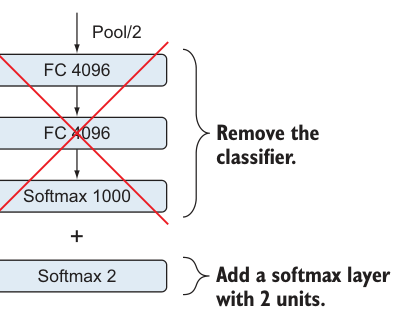
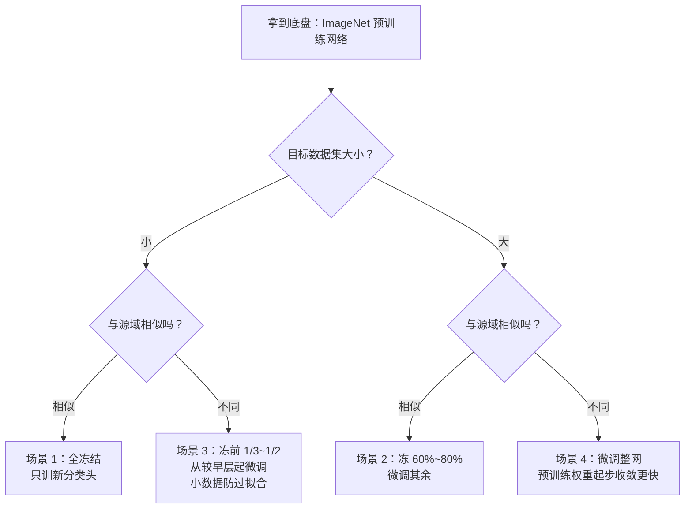

# 第 6 章 迁移学习

> **本章解决**：数据不够、算力不够时，怎么站在"别人训好的网络"肩膀上做自己的视觉任务。
> 前面埋的伏笔到本章收线：第 1 章说过机器样本效率低，第 4 章讲过数据量怎么估——工程界最常用的答案是**迁移学习（Transfer Learning, TL）**：下载一个在 ImageNet 上调好训好的网络，把它的知识搬到你的小数据集上。
> 主线：为什么迁移（6.1）→ 是什么（6.2）→ 为什么可行（6.3）→ 三种用法（6.4）→ 四场景决策表（6.5）→ 数据集哪里找（6.6）→ 两个端到端项目（6.7 猫狗、6.8 手语）。

## 6.0 本章导图

<div class="brtree">
  <div class="brrow">
    <span class="brlabel root">迁移学习</span>
    <span class="brace"></span>
    <div class="brkids">
      <div class="brrow">
        <span class="brlabel">解决什么</span>
        <span class="brace"></span>
        <div class="brkids">
          <span class="brleaf">数据问题：采集+标注贵</span>
          <span class="brleaf">算力问题：数周多 GPU</span>
          <span class="brleaf">附赠：泛化更好、防过拟合</span>
        </div>
      </div>
      <div class="brrow">
        <span class="brlabel">定义</span>
        <span class="brace"></span>
        <div class="brkids">
          <span class="brleaf">知识 = 特征图 feature maps</span>
          <span class="brleaf">预训练模型（Pretrained Model）</span>
          <span class="brleaf">源域 → 目标域</span>
        </div>
      </div>
      <div class="brrow">
        <span class="brlabel">工作原理</span>
        <span class="brace"></span>
        <div class="brkids">
          <span class="brleaf">网络学的 = 优化后的权重</span>
          <span class="brleaf">低层通用（边缘/色块）</span>
          <span class="brleaf">高层特定（狗头/车轮）</span>
          <span class="brleaf">越深越难迁移</span>
        </div>
      </div>
      <div class="brrow">
        <span class="brlabel">三种方式</span>
        <span class="brace"></span>
        <div class="brkids">
          <span class="brleaf">① 作分类器：直接预测</span>
          <span class="brleaf">② 作特征提取器：全冻+新头</span>
          <span class="brleaf">③ 微调：冻部分+联合训练</span>
        </div>
      </div>
      <div class="brrow">
        <span class="brlabel">四场景决策</span>
        <span class="brace"></span>
        <div class="brkids">
          <span class="brleaf">小×相似 → 特征提取器</span>
          <span class="brleaf">大×相似 → 整网微调</span>
          <span class="brleaf">小×不同 → 早层起微调</span>
          <span class="brleaf">大×不同 → 整网微调</span>
        </div>
      </div>
      <div class="brrow">
        <span class="brlabel">公开数据集</span>
        <span class="brace"></span>
        <div class="brkids">
          <span class="brleaf">MNIST / Fashion-MNIST</span>
          <span class="brleaf">CIFAR-10 / 100</span>
          <span class="brleaf">ImageNet / MS COCO</span>
          <span class="brleaf">Open Images / Kaggle</span>
        </div>
      </div>
      <div class="brrow">
        <span class="brlabel">两个项目</span>
        <span class="brace"></span>
        <div class="brkids">
          <span class="brleaf">猫狗：特征提取器，95.79%</span>
          <span class="brleaf">手语 0-9：微调最后 5 层，98%</span>
        </div>
      </div>
    </div>
  </div>
</div>

## 6.1 迁移学习解决什么问题

为一个具体视觉问题构建系统，通常要**收集并标注海量数据**再从头训练网络。可以像第 3 章那样从零开始，勉强可行；但换个思路——**下载一个别人已经调优、训练好的神经网络，把它当作你新任务的起点**，行不行？行，这就是迁移学习：下载开源模型和它的优化参数（权重），以其为起点在自己的小数据集上训练，**训得更快、成绩更高**。

DL 研究者和从业者发过大量论文和开源项目：花数周数月、在 GPU 上训练出 SOTA（state-of-the-art）成果。别人已经替你趟过这条痛苦的高成本研发之路——你直接下载开源架构+权重，就是一个很好的起点。**迁移学习 = 把知识从一个域里预训练好的网络，迁移到另一个域里你自己的问题上**（图 6.1）。

<figure>
  
  <figcaption>图 6.1 迁移学习：把网络从一个任务学到的知识搬到新任务。神经网络语境下，"知识"就是提取出的特征（截自原书）</figcaption>
</figure>

名字已经说明一切：把网络在某个数据集上学到的东西，迁移到相关的另一个问题上。它现在这么流行，是因为**用相对少的数据、在很短的训练时间里，就能训出深度网络**。重要性来自一个现实：大多数真实项目根本没有百万级标注图像可用来训这种复杂模型。

流程思路很直白：先在超大数据集上训练一个深度网络——训练过程中，网络提取出大量可用于检测物体的有用特征；然后把这些特征（特征图，feature maps）搬到新网络里，在新数据集上训练，解决另一个问题。复用 ImageNet 这类标准 CV 基准数据集上训出的模型权重，直接省掉"采集+训练海量数据"的全过程；顶级模型可以下载即用，也可以整合进你自己的新模型。

那么问题来了：为什么不直接在新数据集上从头训练一个网络？回答这个问题，先看从头训练的两只拦路虎：

| 拦路虎 | 内容 |
| --- | --- |
| **数据问题**（Data problem） | 从头训练要大量数据才能出像样的结果，而现实中数据集够大的情况很少见。采集和标注都贵：基本靠人手工拍图、逐张标注，是个不轻的活 |
| **算力问题**（Computation problem） | 就算弄到几十万张图，在百万级图像上训深度网络通常要**多 GPU 训数周**。别忘了训练是迭代过程——即使算力管够，每轮迭代还要换超参数反复实验直到结果满意，项目成本会非常高 |

极少数人会真正从零训练整个卷积网络，原因就是这两条。

### 附赠的好处：泛化与抗过拟合

迁移学习还有一个重要好处：**帮助模型泛化（generalize）学到的知识、避免过拟合**。模型部署到真实环境后，面对的是无数没见过的条件；每个客户有自己的偏好，产生的数据与训练数据不同；模型被要求在很多"相关但不完全相同"的任务上表现良好。

例：把汽车分类器部署上线后，用户的相机型号五花八门，画质、分辨率各异，还有晴天雨天的差别。要对所有这些情形训练，要么穷举每种情况并采集海量图像，要么构建一个**更稳健、更擅长泛化到新用例**的模型。迁移学习干的就是后者——穷举所有野外情形不现实，而从一个"见过数百万图像"的网络迁移特征过来，模型不易过拟合，遇到新场景泛化更好。对"标注数据充足"以外的一切生产级 DL 应用，这一步是刚需。

## 6.2 什么是迁移学习

正式定义：**迁移学习是把网络从一个任务（那里数据充足）学到的知识（特征图），转移到数据不充足的新任务**。一般做法：先在与目标问题相似的问题上训练一个网络，然后把训好的模型的一层或多层，装进在新问题上训练的新模型里。

要训一个达到或超过人类水平的图像分类器，需要海量数据、大算力和大把时间——大多数人三样都凑不齐。于是研究者在大数据集（ImageNet、MS COCO、Open Images 等）上把 SOTA 模型训好，公开共享给大众复用。结论：**你永远不必再从头训练图像分类器**——除非你数据集超大、算力预算超大；即便如此，用迁移学习在你的大数据集上微调（fine-tune）预训练网络，往往仍然更划算（6.4、6.5 讲清楚为什么）。

!!! info "原书 NOTE：'from scratch' 是什么意思"
    说一个模型"从头训练"，指的是模型对世界**零知识**起步：结构和参数都从随机猜测开始。落到实操：权重随机初始化，需要经过训练过程才能被优化。

迁移学习的直觉：**模型在一个足够大、足够一般（general）的数据集上训练后，实际上就成了"视觉世界的通用表示"**。它的特征图可以不经大训练直接拿来用——迁移到你的模型里，作为自己任务的基座。

作者引用 Yosinski 等人的经典论文（*How Transferable Are Features in Deep Neural Networks?*, NeurIPS 2014）给这段直觉盖章：

> 先在基数据集（base dataset）和基任务上训练一个基网络，然后把学到的特征复用（repurpose）/迁移到第二个目标网络，让它在目标数据集和目标任务上训练。**当特征是"通用的"——即对基任务和目标任务都适用，而不是基任务特有——时，这个过程往往奏效。**

### 例子：三步改造 VGG16

假设要训一个猫狗二分类模型。选择一：每类收集几十万张图、标注、从头训练。选择二：从预训练网络迁移知识。走选择二，第一步是找一个**特征与我们问题相近**的数据集——花点时间探索开源数据集，挑最贴近的。这里用 ImageNet：上一章刚认识过它，而且里面猫狗图非常多，预训练网络早就熟悉猫狗特征，后面需要的训练量最小。第二步，挑一个在 ImageNet 上训过、成绩好的网络——第 5 章的 VGGNet、GoogLeNet、ResNet 都行。这里选 **VGG16**。

改造方法（图 6.2）：下载带预训练权重的 VGG16 → **去掉分类器部分** → **加上自己的分类器** → 重训新网络。这叫"把预训练网络当特征提取器用"（pretrained network as a feature extractor），6.4 再展开各种方式。

<figure>
  
  <figcaption>图 6.2 对 VGG16 做迁移学习：冻结特征提取部分（13 个卷积层），去掉分类器（FC 4096 → FC 4096 → Softmax 1000），接上自己的 2 单元 softmax（截自原书）</figcaption>
</figure>

!!! info "原书 DEFINITION：预训练模型（Pretrained Model）"
    预训练模型 = 之前在**大数据集**（通常是大尺度图像分类任务）上训练过的网络。两种用法：直接拿来做预测；或只取它的特征提取部分，接上自己的分类器。这里的分类器可以是一个或多个全连接层，甚至可以是 SVM 之类的传统 ML 算法。

下面用 PyTorch 按五步走一遍：

**第 1-2 步：下载 VGG16 + ImageNet 权重，去掉分类头。** 旧的全连接分类器（4096 → 4096 → 1000）是给 ImageNet 的 1,000 类准备的，新任务用不上，只保留卷积特征提取部分。torchvision 的 `vgg16` 把网络分成 `features`（13 个卷积层 + 5 个池化）和 `classifier`（3 个全连接）两块，取前者即可。打印参数量会看到：这就是第 5 章手搭过的那个 VGG16 架构——从库直接下载流行网络是最快路径；也可以像第 5 章那样自己搭网络、单独下载权重（本章末项目演示）。

```python
# ===== 6.2 节（第 1-2 步）：下载 VGG16 + ImageNet 权重，取出卷积基座 =====
import torch.nn as nn
from torchvision import models

# torchvision 的 vgg16 自带 classifier（为 ImageNet 的 1,000 类服务），
# 迁移学习只保留 features + 全局池化：
base_model = models.vgg16(weights=models.VGG16_Weights.IMAGENET1K_V1)
conv_base  = nn.Sequential(
    base_model.features,   # 13 个卷积层，共 14,714,688 个参数，与原书参数账一致
    base_model.avgpool,    # 自适应平均池化：输出 (512, 7, 7)
    nn.Flatten(),          # 展平：512*7*7 = 25,088
)
```

**第 3 步：冻结特征提取层。** 冻结（Freezing）= 锁住已训练的权重，训练时不让它们被更新。做法是把每个参数的 `requires_grad` 置为 `False`：冻结后这 14,714,688 个参数全部变成不可训练，反向传播不再为它们算梯度。

```python
# 续上（第 3 步）：冻结卷积基座的全部权重
for param in conv_base.parameters():
    param.requires_grad = False   # 反向传播不再计算/更新这些权重的梯度
```

**第 4-5 步：接新分类头，组装新模型。** 取基座最后一层（VGG16 最后一个池化）的输出，展平后接一个 2 类输出层（问题只有两类）。新模型 = 带预训练权重的全部特征提取层 + 一个未训练的新输出层。也就是说，**训练时只训这个输出层**，让它学习新问题的特定特征（German Shepherd / Beagle / Neither）。

```python
# 续上（第 4-5 步）：接自己的 2 类分类头，组装新模型
head = nn.Linear(25088, 2)   # 2 类输出；CrossEntropyLoss 内部自带 softmax，无需再加
new_model = nn.Sequential(conv_base, head)

# 核对参数量
total     = sum(p.numel() for p in new_model.parameters())
trainable = sum(p.numel() for p in new_model.parameters() if p.requires_grad)
print(f'Total params: {total:,}')                     # 14,764,866
print(f'Trainable params: {trainable:,}')             # 50,178
print(f'Non-trainable params: {total - trainable:,}') # 14,714,688
```

{ .lq-img }
*图 6.3 去掉分类器部分，接一个 2 隐单元的 softmax 层（截自原书）*

参数账本（三段代码三次打印）：

| 阶段 | Total | Trainable | Non-trainable |
| --- | --- | --- | --- |
| 下载基座（只取 features） | 14,714,688 | 14,714,688 | 0 |
| 冻结后 | 14,714,688 | 0 | 14,714,688 |
| 接上展平 + 2 类输出层后 | 14,764,866（按明细核算） | 50,178 | 14,714,688 |

!!! warning "原书笔误：new_model 的 Total params"
    原书该处打印的 `Total params: 14,789,955`，但同一张表里 `Trainable params: 50,178` 与 `Non-trainable params: 14,714,688` 之和是 **14,764,866**，自相矛盾。按逐层明细核算：展平层 0 参数，输出层参数 = 25,088 × 2 + 2 = 50,178，故总数应为 14,714,688 + 50,178 = **14,764,866**。本笔记以明细为准。

训练新模型比从头训快得多——看数字：可训练参数约 5 万，不可训练参数约 1400 万。那 1400 万参数已在大数据集上训好、被我们冻结来复用特征；需要操心的只有新加的输出层。

而且迁移学习**性能更好**：等效于这个模型在"ImageNet + 我们的小数据集"的合并知识上训练过，看得懂物体更细的差异（nuances），面对从未见过的新图像泛化更好。

本节只演示了"搭模型"这一步；怎么在小数据集上训练新网络，放到 6.7、6.8 两个端到端项目里走完整流程。

## 6.3 迁移学习的工作原理

是什么、解决什么，都清楚了。现在回答更根本的问题：**为什么迁移学习可行？从一个问题迁到另一个问题的，到底是什么？一个在一个数据集上训练的网络，凭什么能在另一个可能毫不相关的数据集上表现好？**

先热身，四个快问快答（都是前几章的复习）：

| 问题 | 答案 |
| --- | --- |
| 训练时网络到底在学什么？ | **特征图（feature maps）** |
| 这些特征怎么学出来的？ | 反向传播过程中反复更新权重，直到找到最小化误差函数的最优权重 |
| 特征与权重什么关系？ | 特征图 = 权重滤波器在卷积过程中滑过输入图像的结果（图 6.4） |
| 从一个网络迁到另一个网络的是什么？ | 下载预训练网络的**优化后的权重**，把它们作为训练起点，再训练以适配新问题 |

<figure>
  
  <figcaption>图 6.4 卷积核对输入图像卷积生成特征图：优化好的权重决定它"找什么"（截自原书）</figcaption>
</figure>

展开说"预训练网络"到底指什么。训练卷积网络时，网络把图像提取成**特征图**：每一层施加权重滤波器后的输出，是训练集中存在的特征的一种表示。叫"map（图/映射）"是因为它标记了某种特征在图像中的位置——CNN 找的是直线、边缘乃至物体这类特征，一经发现就在特征图上报告。每个权重滤波器各找各的：一个找直线，一个找曲线，等等（图 6.5）。

<figure>
  
  <figcaption>图 6.5 网络以特征图的形式提取图像特征：每个滤波器报告自己负责的那类特征出现在哪（截自原书）</figcaption>
</figure>

神经网络在前向传播+反向传播的训练循环里迭代更新权重。走完一系列训练迭代和超参调优、结果满意了，就说"训练完成"。训练完成后产出**两样东西：网络架构 + 训练好的权重**。所以"用一个预训练网络"的意思就是：**把架构和权重一起下载下来**。

训练时模型只学训练数据集里存在的特征。但下载大模型（如 Inception）时，它在巨型数据集（如 ImageNet）上提取过的**所有特征**都归你用——这些预训练模型甚至发现了我们数据集里没有的特征，能帮我们搭出更好的卷积网络。

视觉问题里，网络要学的东西海量存在：**低层特征**（low-level）如边缘、角点、圆形、曲线、色块；**中高层特征**（mid/high-level）如眼睛、圆圈、方块、轮子。图像里的细节太多了——训练集只有 1,000 张甚至 25,000 张时，可能根本不够模型把这些学全。用预训练网络，等于**把这些知识直接"下载"进你的网络**：起点高得多、快得多、性能上限也更高。

### 6.3.1 网络如何逐层学特征

神经网络一层接一层、以复杂度递增的方式逐步学习数据集里的特征（都是特征图）。**越往网络深处走，学到的特征越"图像特定"（image-specific）**。图 6.6：第一层检测边缘、曲线这类低层特征；第一层的输出作为第二层的输入，产生半圆、方块这类更高层的特征；再下一层把上一层的输出组装成熟悉物体的部件；再往后一层检测出物体本身。层数越深，激活图表示的特征越复杂；越往深处，滤波器开始对**更大的像素区域**产生响应；高层把输入中对判别重要的方面放大、把无关变化抑制掉。

以人脸检测模型为例（图 6.6）：

- **第一层**：学到线、边缘、色块等低层特征。这些特征**看起来不特定于某个数据集或任务**——是对很多数据集、很多任务都适用的通用特征；
- **中层**：把线组装起来识别形状、角、圆。注意特征开始变得特定于任务（人脸）：中层特征包含组成人脸部件（眼睛、鼻子）的形状组合；
- **深层**：特征从**通用过渡到特定**，到最后一层形成非常特定于任务的高级特征——开始出现把一个人与另一个人区分开的面部细节。

<figure>
  
  <figcaption>图 6.6 CNN 在浅层学低层通用特征（边缘、色块），越深越特定：中层是边缘的组合，深层是高度特定于训练集的特征（截自原书）</figcaption>
</figure>

把这个例子推一步：对比分别在人脸、汽车、大象、椅子上训练的四个模型各自提取的特征图（图 6.7）。**各模型的浅层特征非常相似**——都是边缘、线、色块这类低层特征。这说明：在一个任务上训练的模型，会在网络浅层捕捉到数据类型间相似的关系，**可以轻易复用到其他领域的不同问题上**。而越往深处，特征越特定，直到网络过拟合自己的训练数据、难以泛化到别的任务。**低层特征几乎总是可迁移的**，因为它们承载的是"图像长什么样"的结构与本性这类通用信息；把线、点、曲线、物体小部件这类信息迁移过去，能让网络在新任务上学得更快、用更少的数据。

<figure>
  
  <figcaption>图 6.7 四个模型（人脸/汽车/大象/椅子）的特征图：浅层几乎一样（都是边缘方向），深层各不相同（截自原书）</figcaption>
</figure>

!!! note "拓展：为什么冻结低层是安全的——'通用性'的实验依据"
    本节的观察有一条著名的实验支撑：Yosinski et al.（2014）把网络切成两半分别训练，发现**特征可迁移性随层数加深而下降**——前几层特征在两个域之间几乎无损，深层的迁移收益随与目标任务的距离快速衰减；同时"直接复用前几层"与"微调前几层"的性能差距很小，说明低层特征连微调都常常不需要。这就是"冻结低层"的底气：低层学的是所有自然图像共有的统计规律（边缘方向、颜色斑点、纹理），换域后依然成立。

### 6.3.2 后层特征的可迁移性

靠后层的特征能不能迁移，取决于**原数据集与新数据集的相似度**。所有图像都有形状和边缘，所以浅层通常跨域可迁移；而只有开始提取高层特征时，我们才能区分物体——比如"脸上有鼻子"或"车上有轮胎"："有鼻子，这是人；有轮胎，这是车。"根据源域与目标域的相似程度，决定只迁移浅层特征、还是连高层一起迁、或取中间某层。

!!! info "原书 DEFINITIONS：源域与目标域"
    **源域（Source Domain）**：预训练网络当初训练所用的原始数据集。
    **目标域（Target Domain）**：我们要把网络训练上去的新数据集。

## 6.4 迁移学习的三种方式

三种主要方式：**预训练网络作分类器**、**预训练网络作特征提取器**、**微调（fine-tuning）**。每种都能有效节省开发与训练深度 CNN 的时间；哪个在你的新 CV 任务上产出最好，事先未必看得清，可能需要实验对比。

### 6.4.1 预训练网络作分类器（as a classifier）

不冻结任何层、不做任何额外训练：直接拿一个在相似问题上训练好的网络**部署**到你的任务上。下载架构+预训练权重，对新数据直接跑预测。适用前提：新问题的域与预训练网络的域**非常相似**，拿来就能用。

放到狗的例子里：VGG16 在 ImageNet 上训练过，而 ImageNet 狗图极多——预训练网络相当一部分"表示能力"（representational power）就花在区分狗的品种上。直接用它预测图 6.8 的德国牧羊犬：

```python
# ===== 6.4.1 节：预训练网络直接作分类器 =====
import torch
from torchvision import models, transforms
from PIL import Image

# 这次用整个网络（卷积特征提取 + ImageNet 的 1,000 类分类器）
model = models.vgg16(weights=models.VGG16_Weights.IMAGENET1K_V1).eval()

# 预处理必须与 VGG16 预训练时一致：缩放到 224、ImageNet 均值/标准差归一化
tf = transforms.Compose([
    transforms.Resize(256),
    transforms.CenterCrop(224),        # 中心裁剪到 224×224
    transforms.ToTensor(),
    transforms.Normalize([0.485, 0.456, 0.406], [0.229, 0.224, 0.225]),
])
img = Image.open('german_shepherd.jpg').convert('RGB')   # 读图
x = tf(img).unsqueeze(0)                                 # 加 batch 维：(1, 3, 224, 224)

with torch.no_grad():
    yhat = model(x)                            # 输出 1,000 类 logits
    conf, idx = yhat.softmax(dim=1)[0].max(0)  # 取概率最高的一类
label = models.VGG16_Weights.IMAGENET1K_V1.meta['categories'][idx]  # 查类别名
print(f'{label} ({conf.item()*100:.2f}%)')     # → German_shepherd (99.72%)
```

<figure>
  
  <figcaption>图 6.8 用来跑预测的德国牧羊犬样本图（截自原书）</figcaption>
</figure>

模型以 **99.72%** 的置信度直接认出了狗的品种。底气来自数据：ImageNet 有**超过 20,000 张带标注的狗图，分成 120 类**。原书邀请读者去书中网站（www.manning.com/books/deep-learning-for-vision-systems 或 www.computervisionbook.com）拿自己的图玩这个实验，顺便看看 ImageNet 里都有什么类。

### 6.4.2 预训练网络作特征提取器（as a feature extractor）

就是 6.2 节猫狗例子的完整版：拿 ImageNet 预训练的 CNN，**冻结特征提取部分的权重、去掉旧分类器、接上新的全连接分类层从头训练**。图 6.9：冻结全部 13 个卷积层的权重，把旧分类器换成新的。

适用场景：**新任务与预训练网络的源数据集相似**。ImageNet 猫狗样例多，网络学到的特征图里有大量猫狗特征，对新任务直接可用——连高层特征都能复用。

<figure>
  
  <figcaption>图 6.9 加载预训练 VGG16：冻结 13 个卷积层的权重，去掉旧分类器，接自己的新分类器（截自原书）</figcaption>
</figure>

做法：冻结预训练网络的**全部层**，只在新数据集上训练新加的分类器。叫"作特征提取器"的原因：冻结特征提取部分，等于把学到的全部特征图原样搬到新问题里，只在其上新增一个从头训练的分类器。

**为什么要扔掉旧分类器？** 分类器部分通常**非常特定于原始分类任务**——即特定于模型训练时的那组类别。ImageNet 有 1,000 类，分类器已经"过拟合"到把图像分进这 1,000 类；而新问题（猫 vs 狗）只有 2 类。为一个 2 类问题从头训练一个新分类器，比复用 1,000 类的旧分类器有效得多。

### 6.4.3 微调（Fine-tuning）

前两种方式都要求目标域与源域**大体相似**。要是目标域和源域不同、甚至非常不同呢？还能用迁移学习吗？**能。** 域差异很大时迁移学习照样好使——前提是把源域的**正确特征图**提取出来，再**微调**它们去适配目标域。

图 6.10 把"从哪里截断预训练网络"画成了一张决策图：

- 整网下载、原样跑预测 → **作分类器**；
- 只冻结卷积层 → **作特征提取器**，把全部高层特征图迁移到你的域；
- 冻结到某一层、其余重训 → **微调**。

<figure>
  
  <figcaption>图 6.10 网络逐层学特征，迁移学习要决定"冻结到哪一层"：冻在第 3 层特征图就保住第 1-3 层学到的东西；整条蓝色箭头都是微调的候选范围（截自原书）</figcaption>
</figure>

正式定义：**微调 = 冻结用于特征提取的一部分网络层，联合训练（jointly train）未冻结的层与新加的分类器层**。叫"微调"的原因：重训特征提取层时，我们把高阶特征表示**微调**得与新任务数据集更相关。

落到实操：假如冻结图 6.10 中的特征图 1 和 2，新网络就以特征图 2 为输入、从这里开始学习，把后面各层的特征适配到新数据集——**省掉了学特征图 1、2 要花的时间**。

浅层特征图是通用的，越深越特定（图 6.10 里特征图 4 已高度特定于源域）。按两个域的相似度决定冻结在哪层：

- **域相似** → 冻到最后的特征图级别（特征图 4）也行；
- **域非常不同** → 只冻结特征图 1，其余全部重训。

两个极端之间是一整段连续的微调选项：重训整网，或冻在特征图 1、2、3、4 的任意一层重训其余。**通常靠试错（trial and error）定**，但有章可循：决策是两个变量的函数——**数据量**与**源/目标域相似度**，展开成 6.5 的四场景。

!!! note "原书侧栏：为什么微调比从头训练好？"
    从头训练 = 权重随机初始化 + 梯度下降找最优解（第 2 章）。随机初值不保证靠近最优值：初始化离最优越远，优化器收敛越慢。微调的起点则是预训练网络**已经优化好的权重**——直接从它收敛的终点接着走，所以收敛快得多。本质区别：**微调"已经优化过的权重"去适配新问题，而不是拿随机权重从零找一遍**。就算决定重训整个预训练网络，从训过的权重出发也比随机初始化收敛快。

!!! note "原书侧栏：微调时用更小的学习率"
    常见做法：被微调的 ConvNet 权重用**较小**的学习率，而新加的（随机初始化的）分类器权重用较大的学习率。原因：ConvNet 权重已经相对好，不想太快、太大程度地扭曲它们——尤其是当上层的新分类器还在从随机初始化状态训练的时候。

!!! note "拓展：差异化学习率（Discriminative Learning Rates）"
    上面两条侧栏合起来就是"差异化学习率"的思想：**不同层组用不同学习率**。工程上常见三级配置——新分类头 \(10^{-3}\sim10^{-2}\)、靠近头部的高阶卷积层 \(10^{-4}\)、冻结或近冻结的低层 \(0\sim10^{-5}\)（快照：特征是分层特异的，头层需要大步长学全新映射，低层只需小步长防走样）。PyTorch 用 `param_groups` 实现：`torch.optim.Adam([{'params': head.parameters(), 'lr': 1e-3}, {'params': conv_tail.parameters(), 'lr': 1e-4}])`。这一技巧由 ULMFiT（Howard & Ruder, 2018）在 NLP 里推广，如今是迁移学习的标配。

!!! note "拓展：微调过头会发生灾难性遗忘"
    微调不是越彻底越好。若解冻的层太多、或学习率太大，新任务的梯度会**覆盖**预训练权重里编码的通用知识——网络在旧能力上"失忆"，只记得新数据集的怪癖，这正是过拟合的另一种面孔，业界称**灾难性遗忘（catastrophic forgetting）**。三个对策：学习率调小（如上）；**渐进式解冻**（gradual unfreezing，从最深层开始逐 epoch 解冻，ULMFiT 技巧）；低层学习率设为 0 等同于保持冻结。6.8 项目里"先只解冻最后 5 层、不够再扩"就是这套纪律的实践版。

## 6.5 如何选择迁移的层次：四场景决策表

复习一下基础：早层提取通用特征，越深越特定于训练数据。所以我们可以**自选**从预训练模型提取特征的层次：新任务与源域（如 ImageNet）差异大 → 用模型**前几层**的输出可能更合适；新任务与源域相似 → 用**更深层**的输出，甚至 softmax 之前那个全连接层的输出。

选层次是两个因素的函数：

| 因素 | 影响 |
| --- | --- |
| **目标数据集大小**（小 / 大） | 数据集小时，多训几层也学不到多少东西，还容易过拟合新数据 → 少微调，多依赖源数据集 |
| **源/目标域相似度** | 分类汽车和船 → ImageNet 是好选择（相似特征多）；在 X 光上分肺癌 → 完全不同的域，需要大量微调 |

两个因素交叉，得到四个场景（原书表 6.1）：

| 场景 | 目标数据大小 | 与原数据集相似度 | 策略 |
| --- | --- | --- | --- |
| 1 | 小 | 相似 | 预训练网络作特征提取器 |
| 2 | 大 | 相似 | 微调整个网络 |
| 3 | 小 | 非常不同 | 从网络较早的激活处开始微调 |
| 4 | 大 | 非常不同 | 微调整个网络 |

### 6.5.1 场景 1：目标数据集小且相似

原数据集与我们的新数据集相似 → 预训练网络的高层特征对我们的数据集同样相关 → **冻结特征提取部分，只重训分类器**，多半是最优解。

第二个理由反向成立：数据集小，**别微调**特征提取层——在小数据集上微调会迫使网络过拟合我们的数据。按定义，小数据集没有足够信息覆盖物体所有可能的特征，天生无法泛化到没见过的新数据；微调越多，过拟合越狠。

作者举了个"雪天狗"的例子：假设新数据集里所有狗都拍在雪地里。微调这个数据集，新网络会把"雪""白色背景"当成狗的特定特征学进去，换到别的天气就认不出狗了。**经验法则：数据少的时候，微调要时刻提防过拟合。**

### 6.5.2 场景 2：目标数据集大且相似

两域相似 → 仍然可以像场景 1 那样冻结特征提取部分、重训分类器。但数据多，**微调整网或部分网络**有更高把握不会过拟合，能吃到性能增益。不过微调整网并非必需（高层特征反正相关，两域相似）——**好的起点：冻结预训练网络的约 60%–80%，重训其余部分**。

### 6.5.3 场景 3：目标数据集小且非常不同

数据集不同 → 预训练网络的高层特征（含更多数据集特定内容）就不宜冻结了，**从更早的层开始重训**、甚至全解冻微调整网都更合理。但小数据集微调整网容易过拟合 → **折中方案**最好：**冻结预训练网络的约前 1/3 到 1/2**。反正浅层是非常通用的特征图，哪怕域差异巨大，对你的数据集照样有用。

### 6.5.4 场景 4：目标数据集大且非常不同

数据集大，你可能想干脆从头训练整网、完全不碰迁移学习。但实践中，**从预训练模型初始化权重通常仍然非常划算**——收敛更快（6.4.3 侧栏讲过原因）。而且大数据集给了你**微调整个网络而不必担心过拟合**的信心。

### 6.5.5 四场景小结

两个主因素（数据量、域相似度）交叉出表 6.1 的四个场景；图 6.11 把"每种场景该微调到什么深度"画在了一张图上。



<figure>
  
  <figcaption>图 6.11 表 6.1 + 四场景的微调深度指南：网络从浅到深，场景 1 全冻、场景 2 冻大半、场景 3 冻前段、场景 4 全解冻（截自原书）</figcaption>
</figure>

## 6.6 公开数据集

CV 研究社区有个好传统：把数据集传上网。ImageNet、MS COCO、Open Images、MNIST、CIFAR……这些名字背后，都是研究者们上传的、被同行当基准反复训练算法刷 SOTA 的数据集。

本节过一遍最流行的几个，帮你找到最适合自己问题的数据集。注意两点：这里列的是**写书时**CV 社区最常用的，不是全集——开源图像数据集极多且每天在增加，动手做项目前值得自己再调研一轮。

| 数据集 | 规模 | 内容与用途 |
| --- | --- | --- |
| **MNIST** | 60,000 训练 + 10,000 测试 | 0-9 手写数字，灰度 28×28；图像数据集的"hello, world!"，如今太简单，已不是 CNN 基准 |
| **Fashion-MNIST** | 60,000 训练 + 10,000 测试 | 10 类服装，格式与 MNIST 相同；为取代"过简单"的 MNIST 而生 |
| **CIFAR-10** | 50,000 训练 + 10,000 测试 | 32×32 彩色图，10 类每类 6,000 张；比 MNIST 难（彩色+姿态多变），仍是基准 |
| **CIFAR-100** | 100 类 × 600 张 | CIFAR-10 的大哥：100 类组成 20 个超类，每图带细标签（fine）+ 粗标签（coarse） |
| **ImageNet** | 1,400 万+ 张 | 近 22,000 个类别；WordNet 层级组织（synset），目标每 synset 1,000+ 图；ILSVRC 竞赛基准 |
| **MS COCO** | 328,000 张（20 万+已标注） | 150 万物体实例、80 个常见类别；面向目标检测、实例分割、图像描述、人体关键点 |
| **Google Open Images** | 900 万+ 张 | 多为复杂场景、跨数千类；200 万+张带边界框（约 1,540 万框、600 类），带位置标注的数据集里最大 |
| **Kaggle** | —— | ML/DL 竞赛网站，全世界选手提交算法参赛；海量数据集的集散地 |

### 6.6.1 MNIST

MNIST（Modified National Institute of Standards and Technology）是带标注的 0-9 手写数字图像集，任务是分类手写数字。曾是分类算法基准的头牌，被称为图像数据集界的 **"hello, world!"**。但如今它相对太简单——一个基础 CNN 就能刷到 99% 以上准确率，**MNIST 已不再被视为 CNN 性能的基准**。第 3 章用它做过分类项目，可回去复习。规模：60,000 张训练图 + 10,000 张测试图，全部灰度（单通道）、28×28 像素（图 6.12）。

<figure>
  
  <figcaption>图 6.12 MNIST 样例（截自原书）</figcaption>
</figure>

### 6.6.2 Fashion-MNIST

Fashion-MNIST 的诞生动机就是**取代原版 MNIST**——后者对现代卷积网络来说太简单了。数据存储格式与 MNIST 完全相同，内容换成 60,000 张训练图 + 10,000 张测试图、10 个服装类别：t-shirt/top、trouser、pullover、dress、coat、sandal、shirt、sneaker、bag、ankle boot（图 6.13）。探索下载：`github.com/zalandoresearch/fashion-mnist`。

<figure>
  
  <figcaption>图 6.13 Fashion-MNIST 样例（截自原书）</figcaption>
</figure>

### 6.6.3 CIFAR

CIFAR-10（`www.cs.toronto.edu/~kriz/cifar.html`）是 CV/ML 文献里另一个图像分类基准。它比 MNIST 复杂：MNIST 是灰度、物体完美居中，CIFAR 是**彩色（三通道）**且物体外观变化剧烈。CIFAR-10 = 32×32 彩色图 × 10 类 × 每类 6,000 张，共 50,000 训练 + 10,000 测试（图 6.14）。**CIFAR-100** 是它的大哥：100 类、每类 600 张；这 100 类又归成 **20 个超类**；每张图带两个标签——细标签（fine label，所属类）与粗标签（coarse label，所属超类）。

<figure>
  
  <figcaption>图 6.14 CIFAR-10 的 10 个类别样例（截自原书）</figcaption>
</figure>

### 6.6.4 ImageNet

前几章反复用过的老朋友，为了清单完整还是正式介绍一遍。写书时点，ImageNet 是 CV 研究者评估分类算法的**当前基准**。它是一个大型视觉数据库，为视觉物体识别软件研究而建：把图像按一套预定义的词和短语标注、归类到**近 22,000 个类别**。图像从网络收集，经 Amazon 的 Mechanical Turk 众包人工标注；截至目前项目里有**超过 1,400 万张图像**。管理如此海量的数据，靠的是 WordNet 层级：WordNet 里每个有意义的词/短语是一个**同义词集（synset）**，ImageNet 的图像按 synset 组织，目标是每个 synset 1,000+ 张图（图 6.15，斯坦福大学拼合的样例集）。

CV 社区平时说"ImageNet"，一般指 **ILSVRC**（ImageNet Large Scale Visual Recognition Challenge）竞赛：程序比赛正确分类、检测物体和场景。本书后续将用 ILSVRC 作为比较各网络性能的基准。

<figure>
  
  <figcaption>图 6.15 ImageNet 样例拼图（斯坦福大学整理，截自原书）</figcaption>
</figure>

### 6.6.5 MS COCO

MS COCO（Common Objects in Context，`cocodataset.org`）是微软的开源图像数据库，目标是为**目标检测、实例分割（instance segmentation）、图像描述（image captioning）、人体关键点定位**这几类研究提供未来燃料。数据集含 **328,000 张图像**，其中超过 200,000 张已标注，涵盖 **150 万个物体实例**、**80 个"4 岁小孩都能轻松认出"的物体类别**。动机与内容的权威描述见创建者原论文（Lin et al., *Microsoft COCO: Common Objects in Context*, 2015）。

<figure>
  
  <figcaption>图 6.16 MS COCO 样例（COCO Consortium 版权，CC BY 4.0 授权使用；截自原书）</figcaption>
</figure>

### 6.6.6 Google Open Images

Open Images 是 Google 创建的开源图像库，截至写书含**超过 900 万张图像**。它的独特之处：图像多为**复杂场景**、横跨**数千个物体类别**；其中超过 200 万张带人工标注的**边界框**——这使 Open Images 成为**现存最大的带物体位置标注的数据集**。该子集内含约 **1,540 万个边界框、600 类物体**（图 6.17）。与 ImageNet/ILSVRC 类似，它也有自己的竞赛：Open Images Challenge。

<figure>
  
  <figcaption>图 6.17 Open Images 的边界框标注样例（截自 Google AI Blog，Vittorio Ferrari, 2017；截自原书）</figcaption>
</figure>

### 6.6.7 Kaggle

除了上面这些，**Kaggle**（`www.kaggle.com`）是另一个数据集宝库：一个举办 ML/DL 竞赛的网站，全世界的人参赛提交算法参与评测。

多去探索这些数据集、以及每天涌现的新数据集，能建立"它们各自支持什么类别、什么用例"的手感。本书本章的两个项目主要用 ImageNet；全书往后会大量使用 MS COCO——尤其第 7 章。

## 6.7 项目 1：预训练网络作特征提取器（猫狗分类）

场景对应表 6.1 的**场景 1**：手头数据极少、目标域与源域相似 → 把预训练卷积网络当**特征提取器**：冻结特征提取部分、加自己的分类器、在小数据集上重训。任务：训一个能识别猫狗图的分类器——项目本身不难，意义在于**完整走一遍"小数据+相似域"的迁移学习实现**。

这个项目还有一个重要副产品：学会**预处理自己的自定义数据**。此前的项目用的 CIFAR、MNIST 都由 `torchvision.datasets` 直接下载好、张量也规范好了；本项目演示怎么组织自己的数据目录、怎么用 `ImageFolder` + `DataLoader` 把数据喂给网络（图 6.18）。

代码 notebook 和数据集在书中网站下载。由于用了迁移学习，训练**不需要高算力**——个人电脑就能跑，**不需要 GPU**。网络选 VGG16：虽然不是 ILSVRC 错误率最低的，但对这个任务效果好、训得比其他模型快；作者跑出约 96% 的准确率。想实验的话可以换 GoogLeNet 或 ResNet 对比。

标准流程七步：

1. 导入必要的库；
2. 预处理数据，喂给神经网络；
3. 从大数据集上训练好的 VGG16 加载预训练权重；
4. **冻结**卷积层（特征提取部分）的全部权重——冻结哪些层取决于新任务与原数据集的相似度；本例中 ImageNet 猫狗图很多，网络早就练出了提取目标物体细粒度特征的本事；
5. 用自定义分类器替换网络的全连接层——可以加任意多层、每层任意多隐单元；这种简单问题加一层 64 单元即可：模型欠拟合就往上加，过拟合就往下减；输出层的单元数必须等于类别数（本例 2）；
6. 配置优化器与损失，在猫狗新数据上训练，让模型适配小数据集；
7. 评估模型。

**第 2 步：数据预处理。** PyTorch 用 `torchvision.datasets.ImageFolder` 从文件夹读图，配 `transforms` 做缩放、张量化和归一化；需要即时（on the fly）增强时，把增强变换直接加进 `transforms.Compose`（本项目为简单起见不启用增强）。`ImageFolder` 要求数据目录长成图 6.18 那样：`train/valid` 下按**类别建子目录**（每类一个文件夹，图片放里面）。原书测试集是 `test/Test_folder` 平铺图片，直接读不了；本项目给测试图也按类别建子目录，统一用 `ImageFolder` 读。

<figure>
  
  <figcaption>图 6.18 ImageFolder 所需的数据目录结构：按"根目录/类别子目录/图片"组织（截自原书）</figcaption>
</figure>

```python
# ===== 6.7 节（第 2 步）：数据预处理 =====
# ImageFolder 读"根目录/类别子目录/图片"结构，DataLoader 负责出批
from torch.utils.data import DataLoader
from torchvision import datasets, transforms

tf = transforms.Compose([
    transforms.Resize((224, 224)),    # 统一尺寸 224×224
    transforms.ToTensor(),            # 像素转 [0,1] 并变成 CHW 张量
    transforms.Normalize([0.485, 0.456, 0.406],   # VGG16 预训练时的 ImageNet 归一化参数，
                         [0.229, 0.224, 0.225]),  # 必须与预训练一致，否则特征失真
])
train_ds = datasets.ImageFolder('data/train', tf)   # 训练集：每类一个子目录，batch 10
valid_ds = datasets.ImageFolder('data/valid', tf)   # 验证集：同样的目录约定，batch 30
train_loader = DataLoader(train_ds, batch_size=10, shuffle=True)
valid_loader = DataLoader(valid_ds, batch_size=30, shuffle=False)

# 测试集：原书的 test/Test_folder 是平铺图片（没有类别子目录），ImageFolder 读不了；
# 给测试图按类别建子目录即可复用 ImageFolder，否则要写自定义 Dataset 返回 (图像, 标签)
test_ds = datasets.ImageFolder('data/test', tf)     # 目录约定：data/test/<类别>/<图片>
test_loader = DataLoader(test_ds, batch_size=50, shuffle=False)
```

!!! note "拓展：常用数据增强变换"
    本章两个项目都没开增强（`transforms.Compose` 里只有缩放/张量化/归一化），但真实项目几乎必开。直接把下面这些变换加进 `Compose` 即可：

    | `torchvision.transforms` | 说明 |
    | --- | --- |
    | `RandomRotation(40)` | 随机旋转 ±40° |
    | `RandomAffine(0, translate=(0.2, 0.2))` | 水平/垂直平移 |
    | `RandomAffine(0, shear=20)` | 剪切（单位：角度） |
    | `RandomAffine(0, scale=(0.8, 1.2))` | 随机缩放 |
    | `RandomHorizontalFlip()` | 水平翻转 |
    | `RandomAffine(..., fill=...)` | 变换空隙的填充方式 |

    第 1 章讲过增强的动机：让网络见识同一物体的各种形态。迁移学习里数据越少，增强越重要（相当于免费扩充目标域数据）。

**第 3-5 步：加载 VGG16 → 冻结 → 加新分类器。** 只取 VGG16 的卷积基座（丢掉旧分类器）；冻结全部卷积层；在新头里依次加展平、一个 64 单元的全连接层、批归一化、Dropout、2 类输出层——批归一化和 dropout 用来防过拟合（第 4 章）。

```python
# ===== 6.7 节（第 3-5 步）：加载预训练权重、冻结、加新分类器 =====
import torch
import torch.nn as nn
from torchvision import models

base_model = models.vgg16(weights=models.VGG16_Weights.IMAGENET1K_V1)
for p in base_model.features.parameters():   # 第 4 步：冻结全部 13 个卷积层
    p.requires_grad = False

new_model = nn.Sequential(
    base_model.features,                     # 冻结的卷积基座（14,714,688 参数）
    base_model.avgpool,
    nn.Flatten(),                            # 展平 → 25,088
    nn.Linear(25088, 64), nn.ReLU(),         # 全连接 64 单元：25,088×64+64 = 1,605,696
    nn.BatchNorm1d(64),                      # 批归一化：可训练 γ/β 128 + 滑动统计量 128
    nn.Dropout(0.5),                         # 随机丢弃 50%
    nn.Linear(64, 2),                        # 输出 2 类：64×2+2 = 130
)
```

参数账本与原书一致（按原书口径，批归一化的滑动统计量也计入 Total）：Total **16,320,770** = Trainable **1,605,954** + Non-trainable **14,714,816**。这里三处账目值得对一对：可训练的 1,605,954 = 新分类头两个全连接层 1,605,696 + 130，再加批归一化的 γ/β 128 个；不可训练的 14,714,816 = 冻结的卷积基座 14,714,688 + 批归一化的滑动均值/方差 128 个。注意 PyTorch 的 `parameters()` 不把 BN 的 `running_mean`/`running_var` 算作参数，直接统计会得到 16,320,642；这里沿用原书口径把这两个 buffer 也计入，方便对账。

**第 6 步：配置优化器并训练。** 优化器 Adam、学习率 0.0001，损失交叉熵；20 个 epoch。原书数据极少，每个 epoch 只走 4 个训练 batch、2 个验证 batch；这里按标准做法每轮走完整个训练集和验证集，收敛更快。

```python
# ===== 6.7 节（第 6 步）：配置优化器并训练 =====
device = 'cuda' if torch.cuda.is_available() else 'cpu'
new_model.to(device)
loss_fn   = nn.CrossEntropyLoss()             # 交叉熵（标签为类别序号）
optimizer = torch.optim.Adam(                 # Adam，学习率 1e-4
    [p for p in new_model.parameters() if p.requires_grad], lr=0.0001)

for epoch in range(20):                       # 20 个 epoch
    new_model.train()
    for x, y in train_loader:
        x, y = x.to(device), y.to(device)
        optimizer.zero_grad()
        loss = loss_fn(new_model(x), y)
        loss.backward()
        optimizer.step()

    # 每个 epoch 后在验证集上算准确率
    new_model.eval()
    correct = total = 0
    with torch.no_grad():
        for x, y in valid_loader:
            x, y = x.to(device), y.to(device)
            pred = new_model(x).argmax(dim=1)
            correct += (pred == y).sum().item()
            total   += y.size(0)
    print(f'epoch {epoch+1}: val_acc={correct/total:.4f}')
```

原书训练日志（20 个 epoch，每个约 25-29 秒、普通 CPU）：第 1 个 epoch acc 0.6083 / val_acc 0.6833；第 5 个 epoch 训练 acc 已到 1.0000；第 20 个 epoch 收在 loss 0.0112 / acc 1.0000 / val_loss 0.1743 / val_acc 0.8837。**全程不到 10 分钟**——迁移学习的算力账就是这么好算。

**第 7 步：评估。** 把测试集按类别子目录组织好、用同一个 `tf` 读进 `test_loader`，逐批前向并统计准确率：

```python
# ===== 6.7 节（第 7 步）：评估 =====
new_model.eval()
correct = total = 0
with torch.no_grad():
    for x, y in test_loader:
        pred = new_model(x.to(device)).argmax(dim=1).cpu()
        correct += (pred == y).sum().item()
        total   += y.size(0)
print(f'Testing accuracy: {correct/total:.4f}')   # 原书结果：0.9579
```

书里的评估结果：**Testing loss 0.1042，Testing accuracy 0.9579**——不到 10 分钟训练、极小数据集，95.79% 的准确率非常好。

## 6.8 项目 2：微调（手语数字分类）

对应表 6.1 的**场景 3**：目标数据集小、且与源域非常不同。目标：训一个手语数字分类器，区分 0-9 共 **10 类**手势（图 6.19）。

数据集细节：

| 项目 | 值 |
| --- | --- |
| 类别数 | 10（数字 0-9） |
| 图像尺寸 | 100 × 100 |
| 色彩空间 | RGB |
| 训练集 | 1,712 张 |
| 验证集 | 300 张 |
| 测试集 | 50 张 |

数据集小得肉眼可见。在它上面从头训网络不会有好结果；而用迁移学习——哪怕源域（自然图像）与目标域（手部手势）非常不同——作者跑出了 **98% 以上**的准确率。

!!! info "原书 NOTE：对评估结果持保留态度"
    这个 98% 要打折扣看：数据集只有 50 张测试图，网络没经过大数据量的彻底测试。迁移学习本来就该有不错的成绩，但作者特意点出这个局限。

代码和数据集同样在书中网站下载；与项目 1 一样**不需要 GPU**。为了与项目 1 便于对比，仍用 ImageNet 预训练的 VGG16。微调流程七步：导入库 → 预处理数据 → 加载 ImageNet 预训练权重 → **冻结特征提取器的一部分** → 加新分类器 → 配置优化器并训练 → 评估。

**第 2 步：数据预处理。** 与项目 1 相同：`ImageFolder` + `DataLoader`，`train/valid/test` 三条路径，batch 大小 10/30/50（测试集 `shuffle=False` 保持顺序）。数据集规模：train 1,712 张、valid 300 张、test 50 张，各 10 类——和表格对上了。

```python
# ===== 6.8 节（第 2 步）：数据预处理 =====
from torch.utils.data import DataLoader
from torchvision import datasets, transforms

tf = transforms.Compose([
    transforms.Resize((224, 224)),   # 原图 100×100，统一放大到 VGG16 需要的 224×224
    transforms.ToTensor(),
    transforms.Normalize([0.485, 0.456, 0.406], [0.229, 0.224, 0.225]),
])
train_ds = datasets.ImageFolder('sign_language/train', tf)
valid_ds = datasets.ImageFolder('sign_language/valid', tf)
test_ds  = datasets.ImageFolder('sign_language/test',  tf)
train_loader = DataLoader(train_ds, batch_size=10, shuffle=True)   # 1,712 张
valid_loader = DataLoader(valid_ds, batch_size=30, shuffle=False)  # 300 张
test_loader  = DataLoader(test_ds,  batch_size=50, shuffle=False)  # 50 张
```

**第 3 步：加载做全局平均池化的 VGG16。** 这次不把 7×7×512 直接摊平，而是对最后一层卷积的输出做**全局平均池化（GAP）**：特征图按通道取平均，得到 512 维向量（代码里用 `Flatten` 压掉 1×1 的空间维），再接分类头。

```python
# ===== 6.8 节（第 3 步）：加载 VGG16，用 GAP 代替展平 =====
import torch
import torch.nn as nn
from torchvision import models

base_model = models.vgg16(weights=models.VGG16_Weights.IMAGENET1K_V1)
# GAP 在组装新模型时作为 AdaptiveAvgPool2d(1) 加入，见第 5 步
```

!!! note "拓展：GAP 替代展平的意义"
    展平把 7×7×512=25,088 个值摊平直连分类头，动辄百万参数（项目 1 的 64 单元全连接就有 1,605,696 个）；**GAP 对每个通道取平均**，只输出 512 个值，分类头从 512 起步（项目 2 的 10 类输出层只有 5,130 个参数）。参数骤减 = 更强的抗过拟合 + 更小的训练开销，而且 GAP 对平移更稳健。这个用法出自 Lin et al. 的 Network in Network（2014），如今在 ResNet 等架构里是标准配置。

**第 4 步：冻结一部分特征提取器，其余微调。** 微调层级通常靠试错。VGG16 有 13 个卷积层：可以全冻、也可以冻一部分，取决于你的数据与源数据的相似度。手语场景的域**非常不同** → 先只微调**最后 5 层**；结果不满意再扩。这次结果 98%，层级合适；要是网络不收敛，就多解冻几层再试。

```python
# ===== 6.8 节（第 4 步）：冻结除最后 5 层外的所有层 =====
# torchvision 的 features 按"卷积/ReLU/池化"逐层排列，block5 的三个卷积在索引 24/26/28。
# 冻结 features[:24] 就冻住前 4 个 block（到 block4 的池化层），block5 保持可训练；
# 池化层没有参数，因此实际解冻的是 block5 的 3 个卷积层。
for p in base_model.features[:24].parameters():
    p.requires_grad = False        # 前 4 个 block 全冻
# features[24:]（block5 三层卷积，2,359,808×3 = 7,079,424 参数）保持可训练
```

冻结后核对（原书参数账）：Total 14,714,688 = Trainable **7,079,424** + Non-trainable **7,635,264**——正好一半一半略偏冻，与"微调从后段开始"的场景 3 策略吻合。

**第 5 步：加新分类器。** 取卷积基座 GAP 后的 512 维向量，直接接一个 10 类输出层：

```python
# ===== 6.8 节（第 5 步）：加新分类器并组装 =====
new_model = nn.Sequential(
    base_model.features,        # 前 4 个 block 冻结，block5 三层卷积可训练
    nn.AdaptiveAvgPool2d(1),    # 全局平均池化：7×7 → 1×1，0 参数
    nn.Flatten(),               # → 512
    nn.Linear(512, 10),         # 输出 10 类：512×10+10 = 5,130
)
# 核对：Total 14,719,818 = 14,714,688 + 5,130
#       Trainable 7,084,554 = 7,079,424 + 5,130；Non-trainable 7,635,264
```

**第 6 步：配置优化器并训练，保存最优权重。** 优化器仍是 Adam、学习率 0.0001，损失交叉熵。每轮训练后在验证集上算准确率，若创历史新高就把权重存盘（`torch.save()`）；训练结束后加载这份最优权重再评估：

```python
# ===== 6.8 节（第 6 步）：训练，并手动保存验证集最优权重 =====
device = 'cuda' if torch.cuda.is_available() else 'cpu'
new_model.to(device)
loss_fn   = nn.CrossEntropyLoss()
optimizer = torch.optim.Adam(
    [p for p in new_model.parameters() if p.requires_grad], lr=0.0001)

def evaluate(loader):
    new_model.eval()
    correct = total = 0
    with torch.no_grad():
        for x, y in loader:
            pred = new_model(x.to(device)).argmax(dim=1).cpu()
            correct += (pred == y).sum().item()
            total   += y.size(0)
    return correct / total

best_val_acc = 0.0
for epoch in range(20):                        # 20 个 epoch（原书日志另有一次 150 epoch 运行）
    new_model.train()
    for x, y in train_loader:                  # batch 10，每轮覆盖全部 1,712 张
        x, y = x.to(device), y.to(device)
        optimizer.zero_grad()
        loss = loss_fn(new_model(x), y)
        loss.backward()
        optimizer.step()
    val_acc = evaluate(valid_loader)
    if val_acc > best_val_acc:                 # 验证准确率创新高才保存
        best_val_acc = val_acc
        torch.save(new_model.state_dict(), 'signlanguage_model.pt')
```

!!! warning "原书前后不一致：Epoch 1/150"
    书中代码写 `epochs=20`，但训练日志打印的是 `Epoch 1/150`——日志应是另一次 150 个 epoch 的运行截取了前 20 行。不影响方法本身；照抄代码跑 20 个 epoch 即可。

书里 20 个 epoch 的日志走势（每个 epoch 约 40 秒、普通 CPU，20 个 epoch 不到 15 分钟）：epoch 1 acc 只有 0.1833；epoch 4 破 0.5；epoch 9 val_acc 到 0.90；epoch 11 起多次 val_acc = 1.0000。注意训练 acc 起步慢——这正是微调的正常节奏：先让随机初始化的新分类头学会用现成特征，解冻的 block5 才慢慢适配手语域。

**第 7 步：评估 + 混淆矩阵。** 与项目 1 同款评估循环，书的结果：**Testing loss 0.0574，Testing accuracy 0.9800**。更深一层的评估是**混淆矩阵（confusion matrix）**——第 4 章讲过的分类性能表，能看清模型在测试集上"把什么错认成了什么"：

```python
# ===== 6.8 节（第 7 步）：评估 + 混淆矩阵 =====
import matplotlib.pyplot as plt
from sklearn.metrics import confusion_matrix

# 先加载验证集上表现最好的权重，再在测试集上收集真值与预测
new_model.load_state_dict(torch.load('signlanguage_model.pt', map_location=device))
new_model.eval()
y_true, y_pred = [], []
with torch.no_grad():
    for x, y in test_loader:
        pred = new_model(x.to(device)).argmax(dim=1).cpu()
        y_true.extend(y.tolist())
        y_pred.extend(pred.tolist())

cm_labels = ['0','1','2','3','4','5','6','7','8','9']
cm = confusion_matrix(y_true, y_pred)   # 行=真值，列=预测；对角线=分对的数量
plt.imshow(cm, cmap=plt.cm.Blues)
plt.colorbar()
for i in range(len(cm_labels)):         # 把数值写在格子里
    for j in range(len(cm_labels)):
        plt.text(j, i, cm[i, j])
plt.xticks(range(10), cm_labels, rotation=90); plt.xlabel('Predicted label')
plt.yticks(range(10), cm_labels); plt.ylabel('True label')
plt.title('Confusion matrix')
plt.show()
```

读法（图 6.20）：先看 Predicted label 轴上的数字，再到 True label 轴上核对是否分对。比如预测轴的"0"：5 张测试图全被判为 0，没有一张错认成别的数。逐个数字过一遍——**模型对全部测试图预测正确，唯一的例外是真实标签为 8 的那一张**，被误判成了 7（每类各 5 张测试图，50÷10）。

<figure>
  
  <figcaption>图 6.19 手语数字数据集样例：0-9 十种手势（截自原书）</figcaption>
</figure>

<figure>
  
  <figcaption>图 6.20 手语分类器的混淆矩阵：对角线全 5，唯一错误是真实 8 被判成 7（1 张）（截自原书）</figcaption>
</figure>

## 坑与陷阱

!!! danger "6 个容易踩的坑"
    1. **数据少就别大幅微调**：小数据集上微调特征提取层，网络会把数据集的偶然属性（雪地背景、拍摄角度）当成物体特征学进去，过拟合到没法泛化——场景 1 的"雪天狗"。
    2. **旧分类器别复用**：预训练网络的分类器特定于它的 1,000 类任务（已过拟合到那组类别）；新任务哪怕类别名撞上，也应该换新头从头训。
    3. **微调学习率不降 = 白干**：用大学习率微调预训练权重，几个 epoch 就把 ImageNet 学来的通用特征冲掉了（灾难性遗忘）；微调层用小学习率，新头用大学习率。
    4. **冻结多少靠拍脑袋**：冻结层级不是玄学也不是定值——数据量 × 域相似度两个因素先定场景，再按 60-80%、前 1/3~1/2 这类起点试错调整。
    5. **测试集只有 50 张别狂欢**：手语项目 98% 的置信区间宽得很；小测试集上的高分只能当"没坏"的信号，不能当性能证明。
    6. **下载权重 ≠ 直接能训**：预处理必须和预训练时一致（224×224、ImageNet 归一化参数），否则特征空间全错；`ImageFolder` 的目录约定（类别子目录）不满足也直接报错。

## 速览

1. 迁移学习 = 把大数据集上学到的知识（**特征图/权重**）搬到数据少的新任务；解决**数据问题**与**算力问题**，还附赠更好的泛化与抗过拟合。
2. 预训练模型 = 架构 + 权重一起下载；"from scratch" 指权重随机初始化、零知识起步。
3. 三步改造 VGG16（特征提取器用法）：只取 `features` 去掉旧分类器 → 冻结卷积基座 → 加新分类头；可训练参数从 1,400 万降到 5 万（本项目）。
4. 网络逐层学特征：**越深越特定**；低层（边缘、色块）几乎总可迁移，高层（狗头、轮胎）是否可迁移取决于源/目标域相似度。
5. 三种方式：**作分类器**（直接预测，99.72% 认出德牧）、**作特征提取器**（全冻+新头）、**微调**（冻一部分，联合训练其余+新头）。
6. 微调优于从头训练：从已优化的权重起步收敛快；微调层用**小学习率**、新分类头用大学习率（差异化学习率）。
7. 四场景决策：小×相似→特征提取器；大×相似→冻 60-80% 微调其余；小×不同→冻前 1/3~1/2；大×不同→微调整网（大数据集才有这个胆量）。
8. 数据集速记：MNIST（已退役）、Fashion-MNIST（其替代品）、CIFAR-10/100、ImageNet（1,400 万图/22,000 类/ILSVRC）、MS COCO（检测分割描述）、Open Images（1,540 万框）、Kaggle（竞赛集散地）。
9. 项目 1（猫狗，场景 1）：冻结 VGG16 + 64 单元新头 + BN + Dropout，CPU 训不到 10 分钟，测试准确率 **95.79%**。
10. 项目 2（手语 0-9，场景 3）：GAP 代替展平 + 解冻最后 5 层 + 每轮保存验证最优权重，CPU 约 15 分钟，测试准确率 **98%**；混淆矩阵显示唯一错误是 8 误判为 7。

## 术语速查

| 英文 | 中文 | 一句话 |
| --- | --- | --- |
| Transfer Learning | 迁移学习 | 把预训练网络学到的知识搬到新任务 |
| Pretrained Model | 预训练模型 | 在大数据集上训好、公开共享的网络（架构+权重） |
| From Scratch | 从头训练 | 权重随机初始化、零知识起步 |
| Feature Map | 特征图 | 滤波器卷过图像的输出，标记某类特征的位置 |
| Freeze / Trainable | 冻结 / 可训练 | 锁住权重不更新 / 参数参与反向传播 |
| Source Domain | 源域 | 预训练网络的原始数据集 |
| Target Domain | 目标域 | 要训练上去的新数据集 |
| Pretrained Network as a Classifier | 作分类器 | 整网直接对新数据预测，不冻不训 |
| Pretrained Network as a Feature Extractor | 作特征提取器 | 冻结全部特征层，只训新加的分类器 |
| Fine-tuning | 微调 | 冻结部分特征层，联合训练其余层+新分类器 |
| Fine-tuning Level | 微调层级 | 从哪层开始解冻重训——由数据量×域相似度决定 |
| Discriminative Learning Rate | 差异化学习率 | 深层小学习率护旧知识，新头大学习率学新映射 |
| Catastrophic Forgetting | 灾难性遗忘 | 微调过猛覆盖预训练知识，旧能力尽失 |
| Generalization | 泛化 | 对没见过的新场景仍表现良好 |
| Data / Computation Problem | 数据 / 算力问题 | 从头训练的两只拦路虎 |
| MNIST / Fashion-MNIST | —— | 28×28 灰度小图集；后者为取代前者而生 |
| CIFAR-10 / CIFAR-100 | —— | 32×32 彩色基准集；100 版带细/粗双标签 |
| ImageNet / ILSVRC | —— | 1,400 万图、WordNet synset 组织；年度分类检测竞赛 |
| MS COCO | —— | 32.8 万图、80 类、检测/分割/描述多任务 |
| Open Images | —— | 900 万+图、1,540 万边界框（600 类） |
| Kaggle | —— | ML/DL 竞赛与数据集平台 |
| Data Augmentation (on the fly) | 即时数据增强 | 读图时随机变换扩充样本（第 1 章） |
| Best Checkpoint | 最优权重保存 | 验证指标创新高才保存模型参数，训练结束回滚到它 |
| Confusion Matrix | 混淆矩阵 | 行真值列预测的网格，定位"错认成什么"（第 4 章） |
| Global Average Pooling (GAP) | 全局平均池化 | 每通道取平均替代展平，砍参数抗过拟合 |
| Batch Normalization | 批归一化 | 稳定训练；注意它还有不可训练的滑动统计量 |

## 覆盖自查

??? note "原书小节 → 笔记位置"
    | 原书 | 笔记 |
    | --- | --- |
    | 章首导言 + This chapter covers | 导语 + 6.0 导图 |
    | 6.1（两大问题 + 泛化好处 + 汽车分类器例） | §6.1 |
    | 6.2（定义 + from scratch NOTE + Yosinski 引文 + 猫狗例 + DEFINITION + 五步改造 + 三张参数账） | §6.2（参数表重排；Total params 勘误） |
    | 6.3（四问四答 + 特征图 + 架构+权重） | §6.3 |
    | 6.3.1（逐层特征 + 人脸例 + 四模型对比） | §6.3.1 |
    | 6.3.2（后层可迁移性 + 源域/目标域 DEFINITIONS） | §6.3.2 |
    | 6.4.1（作分类器 + 德牧 99.72%） | §6.4.1 |
    | 6.4.2（作特征提取器 + 丢旧分类器的理由） | §6.4.2 |
    | 6.4.3（微调定义 + 图 6.10 + 两个 WHY 侧栏） | §6.4.3（附差异化学习率、灾难性遗忘拓展） |
    | 6.5 + 6.5.1–6.5.5 + 表 6.1 + 图 6.11 | §6.5（四场景决策表 + mermaid 决策图） |
    | 6.6 + 6.6.1–6.6.7（MNIST→Kaggle） | §6.6（规模/用途总表 + 各小节） |
    | 6.7（项目 1 全流程 + 图 6.18 + 训练日志 + 95.79%） | §6.7（附数据增强变换表） |
    | 6.8（项目 2 全流程 + GAP + 解冻最后 5 层 + 最优权重保存 + 混淆矩阵） | §6.8（附 GAP 拓展、Epoch/150 勘误） |
    | 章末小结（10 条） | §速览（无重复摘抄） |
