# 第 7 章 目标检测：R-CNN、SSD 与 YOLO

> **本章解决**：从"这张图是什么"升级到"图里有哪些物体、各在哪里"。前六章的图像分类默认一张图只有一个主角；本章让网络同时输出**类别 + 边界框**。
> 全书位置：第 5、6 章的 CNN/迁移学习是本章的"特征提取器零件"；本章讲完判别式任务的巅峰（检测），第 8 章起进入生成模型。
> 三大主角：**R-CNN 家族**（两阶段，准）、**SSD** 与 **YOLO**（单阶段，快），外加一个自动驾驶 SSD 训练项目。

## 7.0 本章导图

<div class="brtree">
  <div class="brrow">
    <span class="brlabel root">目标检测</span>
    <span class="brace"></span>
    <div class="brkids">
      <div class="brrow">
        <span class="brlabel">通用框架 7.1</span>
        <span class="brace"></span>
        <div class="brkids">
          <span class="brleaf">Region Proposal（objectness）</span>
          <span class="brleaf">特征提取 + 分类/回归</span>
          <span class="brleaf">NMS 去重</span>
          <span class="brleaf">指标：FPS / IoU / PR / mAP</span>
        </div>
      </div>
      <div class="brrow">
        <span class="brlabel">R-CNN 家族 7.2（两阶段）</span>
        <span class="brace"></span>
        <div class="brkids">
          <span class="brleaf">R-CNN：Selective Search + SVM</span>
          <span class="brleaf">Fast：整图一次 CNN + RoI Pooling</span>
          <span class="brleaf">Faster：RPN 取代 Selective Search</span>
          <span class="brleaf">50s → 2s → 0.2s</span>
        </div>
      </div>
      <div class="brrow">
        <span class="brlabel">SSD 7.3（单阶段）</span>
        <span class="brace"></span>
        <div class="brkids">
          <span class="brleaf">VGG16 基网络 + 多尺度特征层</span>
          <span class="brleaf">8732 个 default box</span>
          <span class="brleaf">MultiBox 预测 + NMS 解码</span>
        </div>
      </div>
      <div class="brrow">
        <span class="brlabel">YOLO 7.4（单阶段）</span>
        <span class="brace"></span>
        <div class="brkids">
          <span class="brleaf">S×S 网格 + 每格 B 框</span>
          <span class="brleaf">Darknet-53 + 三尺度检测</span>
          <span class="brleaf">10647 个框 → NMS</span>
        </div>
      </div>
      <div class="brrow">
        <span class="brlabel">项目 7.5</span>
        <span class="brace"></span>
        <div class="brkids">
          <span class="brleaf">SSD7 七步训练</span>
          <span class="brleaf">Udacity 自动驾驶数据集</span>
        </div>
      </div>
      <div class="brrow">
        <span class="brlabel">核心构件</span>
        <span class="brace"></span>
        <div class="brkids">
          <span class="brleaf">Anchor / Prior 锚框</span>
          <span class="brleaf">RoI Pooling</span>
          <span class="brleaf">Multi-task Loss</span>
          <span class="brleaf">Hard Negative Mining</span>
        </div>
      </div>
    </div>
  </div>
</div>

## 7.1 通用目标检测框架

**图像分类**假设图里只有一个主要目标，模型只管输出类别。**目标检测（Object Detection）**要同时干两件事：**定位（localize）**图中的一个或多个物体 + **分类（classify）**每个物体——做法是在每个被识别的物体周围画一个**边界框（Bounding Box）**，框上带着预测类别。

| | 图像分类 | 目标检测 |
| --- | --- | --- |
| 目标 | 预测图中物体的类别 | 预测物体位置（边界框）+ 各框的类别 |
| 输入 | 单物体的图像 | 含一个或多个物体的图像 |
| 输出 | 一个类别标签 + 概率（如 84% cat） | 一个或多个边界框（坐标）+ 每框的类别概率 |
| 双物体示例 | —— | box1 坐标 \((x,y,w,h)\) + 类别概率；box2 坐标 + 类别概率 |

坐标约定先钉死：\((x, y, w, h)\) 里 \((x, y)\) 是**边界框中心点**坐标，\(w\)、\(h\) 是框的宽和高。（7.2 节 R-CNN 的回归器用的是"框原点 + 宽高"的写法，两种口径都会出现，注意区分。）

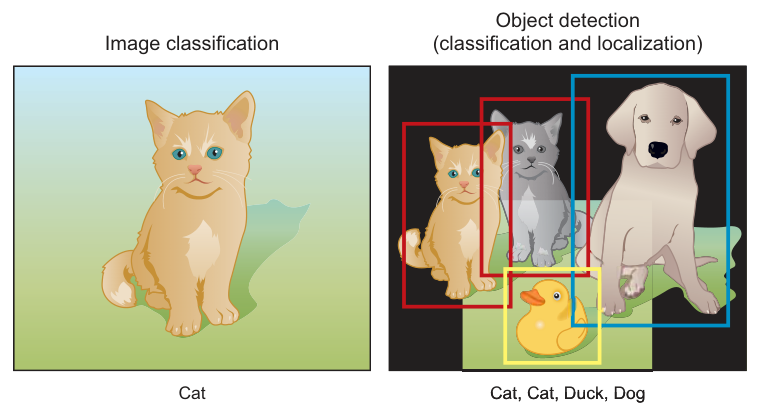{ .lq-img }
*图 7.1 分类任务输出一个"cat"标签；检测任务输出四个框及各自类别（两只猫、一只鸭、一只狗）（截自原书）*

应用面：自动驾驶要靠检测车辆、行人、道路、障碍物来规划路线；机器人要检测感兴趣目标；安防系统要检测入侵者等异常目标。本章路线：① 通用框架 → ② R-CNN 家族 / SSD / YOLO 三大算法 → ③ 端到端实战项目。

一个典型的检测系统有**四个组件**：

1. **Region Proposal（区域候选）**——用算法或 DL 模型生成**感兴趣区域（RoI, Region of Interest）**：网络认为"可能有物体"的区域。输出是大量边界框，每个框带一个 **objectness score（目标性得分）**，得分高的框进入后续处理。
2. **特征提取与网络预测**——对每个候选框提取视觉特征，判断有没有物体、是什么物体（分类组件）。
3. **非极大值抑制（NMS, Non-Maximum Suppression）**——同一个物体通常被框了多次，NMS 把重叠框合并成一个。
4. **评估指标**——分类用 accuracy/precision/recall，检测有自己的指标：**mAP**、**PR 曲线**、**IoU**。

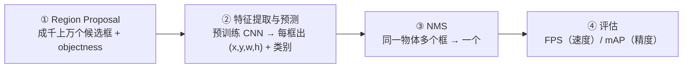

### 7.1.1 Region proposals：先圈出"可能有货"的区域

系统先扫图，提出 RoI 供后续分析。每个候选区域打一个 **objectness score**：高分 = 大概率含物体（**foreground 前景**），保留送入后续步骤；低分 = 大概率是背景（**background**），直接丢弃。

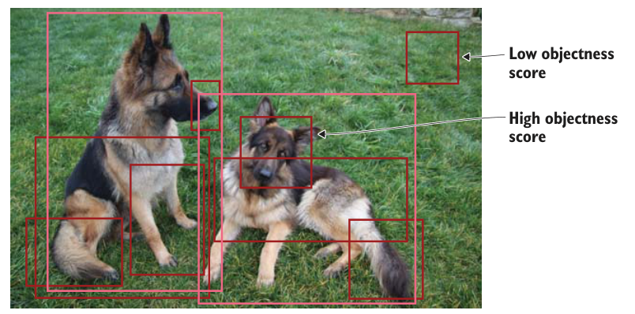{ .lq-img }
*图 7.2 高 objectness 的候选框（前景）被保留，低 objectness 的（背景）被丢弃（截自原书）*

生成候选的方法：最早的 **Selective Search（选择性搜索）** 算法（讲 R-CNN 时细讲）；后来的方法用深度网络提取的复杂视觉特征来生成区域。关键认知：**这一步会产出成千上万个候选框**。网络按 objectness 阈值给每个区域贴"前景/背景"标签——阈值是可调超参数：

- 阈值**过低**：穷举所有可能的候选 → 查全率高，但计算量爆炸、检测变慢；
- 阈值**过高**：候选少、速度快，但可能漏检。

所以 region proposal 的本质权衡是**候选数量 vs 计算复杂度**，正确姿势是**用问题专属的先验信息减少 RoI 数量**。

### 7.1.2 Network predictions：每个候选都过一遍"分类器 + 定位器"

这一步的主角是**预训练 CNN**：在 ImageNet / MS COCO 这类大数据集上预训练的分类模型，提取的特征泛化性相当好——所以检测框架普遍"借"它们当特征提取器（第 6 章迁移学习的直接应用）。

网络对每个高 objectness 区域做**两个预测**：

- **边界框预测**：输出定位物体的框坐标 \((x, y, w, h)\)（中心点 + 宽高）；
- **类别预测**：经典 softmax 输出每类的概率。

因为候选成千上万，**同一个物体必然被多个框命中**。图 7.3 里网络确实找到了狗、也分对了类——但检测"开火"了 5 次，因为狗出现在 5 个 RoI 里，于是有 5 个框。

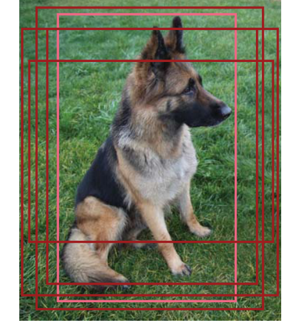{ .lq-img }
*图 7.3 检测器对同一物体产出多个框；我们要把它合并成最贴合的那一个（截自原书）*

多数问题里每个物体只要一个框。设想你在写"数图里有几只狗"的程序——按现在的输出会数出 5 只。这就轮到 NMS 登场。

### 7.1.3 非极大值抑制（NMS）

**NMS（Non-Maximum Suppression，非极大值抑制）**保证每个物体只被检测一次。顾名思义：在围着同一物体的所有框里，找**预测概率最大**的那个框，**抑制（suppress）**掉其余的框。若物体较大、候选超过 2000 个，其中很多框彼此高度重叠——NMS 后只剩最贴合的那个（图 7.4）。

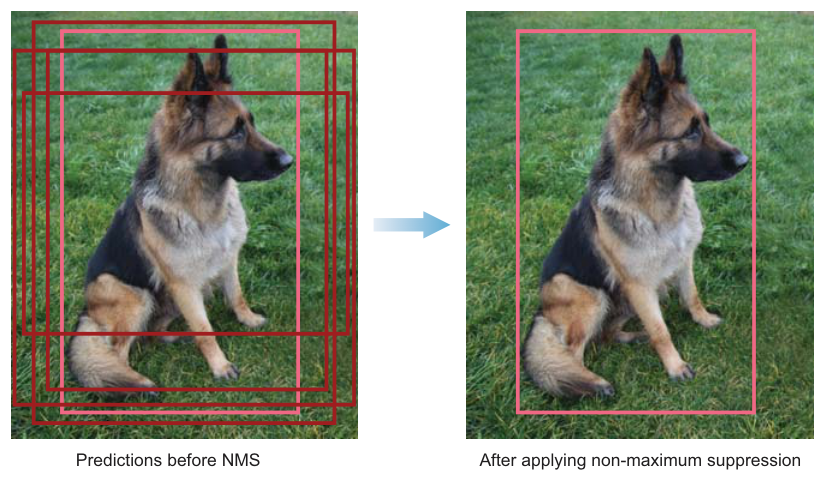{ .lq-img }
*图 7.4 NMS 前：同一物体一堆框；NMS 后：只留拟合最好的一个（截自原书）*

NMS 算法四步：

1. **丢弃**预测概率低于**置信度阈值（confidence threshold）**的所有框（阈值可调）；
2. 在剩余框中选出**概率最高**的那个；
3. 计算其余**同类别预测**框与它的重叠度，重叠度度量就是 **IoU**（下一小节）；
4. 与已选框 **IoU 高于 NMS 阈值**的框被抑制（它们大概率框的是同一个物体）。NMS 阈值通常取 **0.5**，可调——想多留框就调高，想更狠地删就调低。

NMS 技术在各检测框架里基本是标配，但置信度阈值和 NMS 阈值都要按场景调。

!!! note "拓展：'非极大值'是什么意思？"
    传统信号处理里有"极大值抑制"：只保留局部极大值点、抹平其余。NMS 加个"非"字——保留**极大值本身**，抑制**非极大值**的邻居。放到检测里：置信度最高的框是"极大值"，和它高度重叠的低分框都是"非极大值"，一律删掉。所以两个阈值分工明确：**confidence threshold 管"框够不够自信"，NMS 阈值管"两个框是不是同一个物体"**。

按书 7.1.3 的步骤把 NMS 补成可运行的 numpy 实现（单类简化版，多类时按类别分组各做一遍）：

```python
# ===== 书 7.1.3 NMS 算法步骤的 numpy 可运行实现 =====
import numpy as np

def iou_matrix(boxes):
    """boxes: (N,4) 每行 [xmin, ymin, xmax, ymax]，返回 (N,N) IoU 矩阵"""
    x1 = np.maximum(boxes[:, None, 0], boxes[None, :, 0])   # 交集左上 x
    y1 = np.maximum(boxes[:, None, 1], boxes[None, :, 1])
    x2 = np.minimum(boxes[:, None, 2], boxes[None, :, 2])   # 交集右下 x
    y2 = np.minimum(boxes[:, None, 3], boxes[None, :, 3])
    inter = np.clip(x2 - x1, 0, None) * np.clip(y2 - y1, 0, None)  # 交集面积
    area = (boxes[:, 2] - boxes[:, 0]) * (boxes[:, 3] - boxes[:, 1])
    union = area[:, None] + area[None, :] - inter            # 并集面积
    return inter / np.clip(union, 1e-9, None)

def nms(boxes, scores, conf_thresh=0.5, nms_thresh=0.5):
    keep = scores >= conf_thresh              # 第 1 步：置信度阈值先筛
    boxes, scores = boxes[keep], scores[keep]
    order = scores.argsort()[::-1]            # 按置信度从高到低
    selected = []
    while order.size > 0:
        i = order[0]                          # 第 2 步：取最高分框
        selected.append(i)
        ov = iou_matrix(boxes[order])         # 第 3 步：算它与其余框的 IoU
        order = order[1:][ov[0, 1:] <= nms_thresh]  # 第 4 步：抑制高重叠框
    return boxes[selected], scores[selected]

boxes  = np.array([[10,10,60,60],[12,12,62,62],[200,200,260,260]], dtype=float)
scores = np.array([0.9, 0.8, 0.7])
print(nms(boxes, scores))   # 前两个框几乎重叠 → 只留 0.9 那个；第三个保留
```

### 7.1.4 检测器评估指标：FPS 与 mAP

检测器用两个主指标评估：**帧率（FPS, Frames Per Second）**测速度，**平均精度均值（mAP, mean Average Precision）**测精度。论文里的标准句式："Network X achieves mAP of Y% at Z FPS"——例如 Faster R-CNN 只有 7 FPS，SSD 能跑 59 FPS。

#### IoU：两个框的重叠度

**交并比（IoU, Intersection over Union）**衡量预测框 \(B_{predicted}\) 与人工标注的真值框 \(B_{ground\ truth}\) 的重叠程度：

\[
\text{IoU} = \frac{|B_{ground\ truth} \cap B_{predicted}|}{|B_{ground\ truth} \cup B_{predicted}|}
\]

取值 0（完全不重叠）到 1（100% 重叠），越高越好。算 IoU 需要两个框：标注阶段人工画的**真值框（ground truth）** + 模型输出的**预测框**。

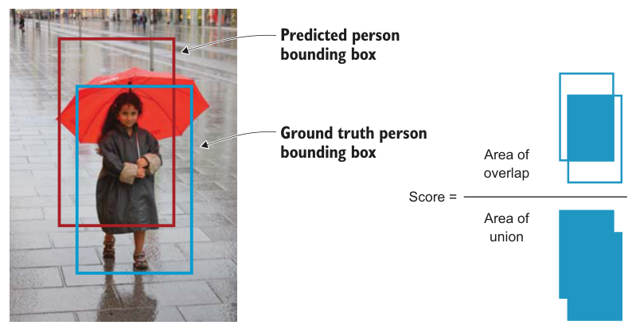{ .lq-img }
*图 7.5 IoU = 重叠面积 / 并集面积（截自原书）*

IoU 用来定义"预测对了没有"：**IoU 高于阈值的预测记为 True Positive（TP）**，低于阈值记为 False Positive（FP）。阈值按比赛可调，标准值 **0.5**：MS COCO 等挑战赛会用 mAP@0.5 或 mAP@0.75 这种写法，@后面的数就是 IoU 阈值。

#### PR 曲线

有了 TP/FP，就能像第 4 章一样对每个类别算 precision 和 recall（FN = False Negative）：

\[
\text{Precision} = \frac{TP}{TP + FP}, \qquad \text{Recall} = \frac{TP}{TP + FN}
\]

对**所有类别**算完 precision/recall 后，画出 **PR 曲线（Precision-Recall curve）**（图 7.7）。做法：**变动置信度阈值**，每个物体类别画一条曲线。好检测器的标准：**recall 增大时 precision 仍然保持高位**——也就是说你随便调置信度阈值，两个指标都扛得住；差检测器想拉高 recall 就得多收 FP（precision 被拖低）。所以 PR 曲线通常从高 precision 起步、随 recall 增大而下降。

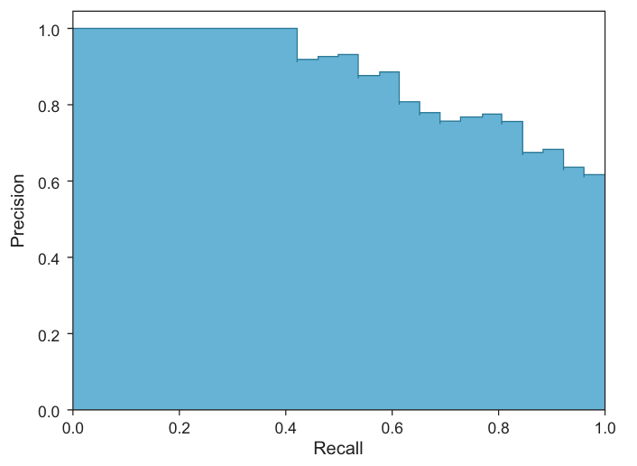{ .lq-img }
*图 7.7 PR 曲线：precision 随 recall 增大下降得越慢，检测器越好（截自原书）*

#### 从 PR 曲线到 mAP

- **AP（Average Precision，平均精度）** = PR 曲线下的面积（AUC），**每个类别各有一个 AP**；
- **mAP（mean AP）** = 所有类别 AP 的平均。

注意有些论文把 AP 和 mAP 混用。mAP 的完整计算流程（书 RECAP）：

1. 取每个边界框的 objectness score（框里有物体的概率）；
2. 计算 precision 和 recall；
3. 变动得分阈值，为每个类别画 PR 曲线；
4. 算每类的 AP（PR 曲线下面积）；
5. 对所有类别求平均 → mAP。

mAP 比传统指标（如 accuracy）复杂得多——好消息是**不用手算**，绝大多数 DL 检测实现都自带 mAP 计算，本章项目里会用到。

!!! note "拓展：mAP 为什么比单点 accuracy 更公平？"
    检测输出是"框 + 置信度"，**选哪个置信度阈值会直接改变结果**：阈值高 → 报得少而准（precision 高、recall 低）；阈值低 → 报得多而杂（反过来）。单点 accuracy 只反映某一个阈值下的表现，换个阈值结论就翻车。mAP 把**整条 PR 曲线**（所有阈值）都算进来，再对类别取平均，既排除了"挑阈值"的水分，也不会被"类别数量不平衡"带偏——这才是对"检测器整体能力"的公平评分。

IoU 的 numpy 单对框实现（完整批量版见上面 `iou_matrix`）：

```python
# ===== 书 7.1.4 IoU 算例 =====
def iou(a, b):
    x1, y1 = max(a[0], b[0]), max(a[1], b[1])   # 交集左上角
    x2, y2 = min(a[2], b[2]), min(a[3], b[3])   # 交集右下角
    inter = max(0, x2 - x1) * max(0, y2 - y1)
    area_a = (a[2] - a[0]) * (a[3] - a[1])
    area_b = (b[2] - b[0]) * (b[3] - b[1])
    return inter / (area_a + area_b - inter)

a = [0.0, 0.0, 100.0, 100.0]   # 真值框
b = [20.0, 20.0, 120.0, 120.0] # 预测框，右移下移 20px
print(iou(a, b))               # 0.4705...：交集 80×80=6400，并集 20000-6400=13600
```

## 7.2 基于区域的卷积神经网络（R-CNN 家族）

R-CNN 家族（**R-CNN**，Region-based CNN）由 Ross Girshick 等人在 2014 年开创，2015、2016 年分别扩展出 **Fast R-CNN** 与 **Faster R-CNN**。本节先快速走完这条演进线，再深入 Faster R-CNN 的架构。原论文：R-CNN（arXiv:1311.2524）、Fast R-CNN（arXiv:1504.08083）、Faster R-CNN（arXiv:1506.01497）。

### 7.2.1 R-CNN：把检测拆成"候选 + 分类"的流水线

R-CNN 是家族里最朴素的架构，却是理解所有后续检测算法的地基——它是 CNN 用于目标检测与定位最早的大型成功应用之一，在 PASCAL VOC-2012 和 ILSVRC 2013 检测挑战上拿下当时的 SOTA。

R-CNN 由四个模块组成：

1. **提取感兴趣区域**（= region proposal）：**Selective Search** 算法扫描输入图，找出"团块状"的区域作为 RoI。候选尺寸不一，但 CNN 要求固定输入尺寸——所以 RoI 还要**扭曲（warp）成固定大小**。
2. **特征提取模块**：在**每个**候选区域上跑一个预训练 CNN 提特征（就是前面章节学的那个典型 CNN 特征提取器）。
3. **分类模块**：用 **SVM**（传统 ML 分类器）基于特征给候选分类。
4. **定位模块**（= 边界框回归器，bounding-box regressor）：回归出框的位置和大小。ML 问题分两类——分类输出离散类别，**回归（regression）**输出连续值。这里回归器对每个物体类别预测 4 个实数 \((x, y, w, h)\) 定义边界框。

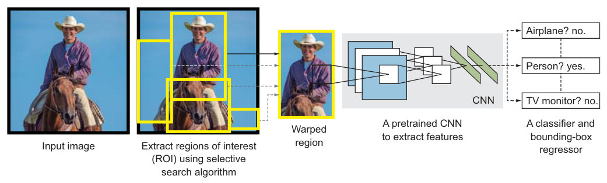{ .lq-img }
*图 7.8 R-CNN 架构总览：Selective Search 提候选 → 扭曲 → CNN 提特征 → 分类器 + 回归器（截自原书）*

本质上，**R-CNN 把目标检测转化成了"一堆小图的图像分类问题"**。

#### Selective Search：贪心搜索 + 自底向上分割

**Selective Search** 是一个**贪心搜索算法**，通过把相似的像素、纹理合并成矩形区域来找出可能含物体的区域。它合两种老办法之长：**穷举搜索**（检查图里所有位置）+ **自底向上分割**（层次化合并相似区域）。

工作方式：先跑一个分割算法找 blob（图中的"团块"，可能是一个个物体），再**自底向上**递归合并区域，产出约 **2,000 个待查区域**：

1. 计算所有相邻区域之间的相似度；
2. 合并最相似的两个区域，重算新区域与其邻居的相似度；
3. 重复直到整个物体被合并进同一个区域。

细节（相似度怎么算）超出本书范围，可以当黑盒用："一个聪明地扫描图像、给你提出 RoI 位置的算法"。想深挖看原论文 Uijlings et al., "Selective Search for Object Recognition," 2012。

#### 训练 R-CNN：三个模块分别训

四个模块里只有 Selective Search 不用训练（它不是学习算法）。所以训练 R-CNN 要做三件事：

1. **训练特征提取 CNN**：从零训练（少见）或微调预训练网络（第 6 章的方法）；
2. **训练 SVM 分类器**：传统 ML 分类器，同样要在带标签数据上训练；
3. **训练边界框回归器**：对 K 个物体类别各输出 4 个实数，把候选框"收紧"到物体上。

看出问题了吗——**训练一个 R-CNN 要分别训练三个模块，几乎没有共享计算**。多阶段流水线训练是 R-CNN 的一大硬伤。

#### R-CNN 的缺点

R-CNN 好懂、当年也 SOTA，但它**不是单一的端到端系统**，而是几个独立算法拼起来的。三个显著缺点：

- **检测非常慢**：每张图 Selective Search 提约 2,000 个 RoI，每个候选都要**单独过一遍完整流水线**（CNN 特征提取 + 分类器），**不共享计算** → 计算量爆炸。这使 R-CNN 与自动驾驶等实时应用无缘。
- **训练是多阶段流水线**：CNN、SVM、回归器三套训练，复杂且非端到端。
- **训练在空间和时间上都贵**：训练 SVM 和回归器前，要把每张图每个候选的特征**写到磁盘**——用 VGG16 这类深网络，几千张图的训练在 GPU 上要跑**数天**，提取的特征要占**几百 GB** 存储。

我们需要一个端到端 DL 系统来修掉这些毛病，还更快更准——先看 Fast R-CNN。

### 7.2.2 Fast R-CNN：整图过一次 CNN

Fast R-CNN（Girshick，2015）与 R-CNN 相似，但靠**两个改动**同时提速又提精度：

1. **先 CNN，后提候选**：把特征提取器先作用在**整张输入图**上，然后再提区域——整图只跑一次 ConvNet，而不是让 2,000 个重叠区域各跑一遍。
2. **softmax 换掉 SVM**：把分类也并进 ConvNet 的工作——一个模型同时干特征提取和分类。

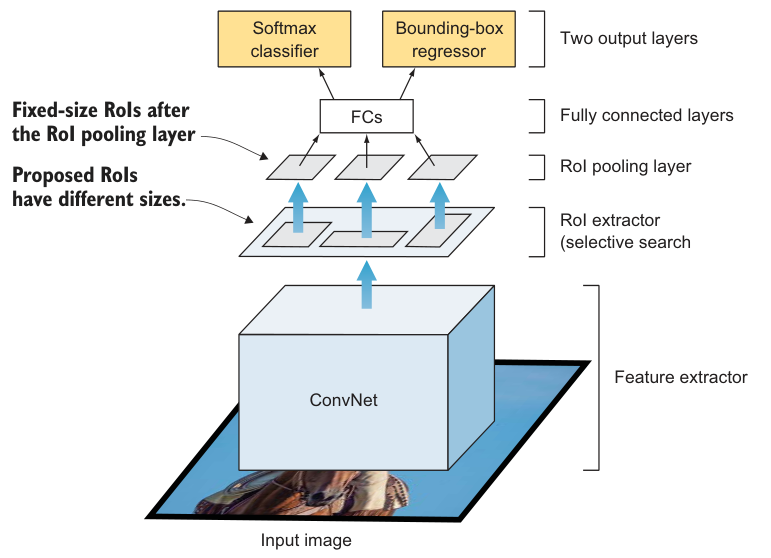{ .lq-img }
*图 7.10 Fast R-CNN：特征提取在整图上进行，候选从最后的特征图上取，RoI Pooling 输出固定尺寸（截自原书）*

架构四模块：

1. **特征提取模块**：ConvNet 从整图提特征；
2. **RoI 提取器**：Selective Search 仍在原图上提约 2,000 个候选——但映射到特征图上取用；
3. **RoI Pooling 层**：新组件。用 max pooling 把特征图上**任意大小**的 RoI 转成**固定空间尺寸 H×W** 的小特征图，才能喂给全连接层（FC 层要求固定输入）；
4. **双头输出层**：一个 softmax 分类头（对每个 RoI 输出离散概率分布）+ 一个边界框回归头（预测相对原始 RoI 的偏移）。

**关键区别**：Fast R-CNN 的候选基于网络**最后的特征图**（不是原图），所以整图只训一个 ConvNet；分类用一个 softmax 直接输出概率，不用再训一堆 SVM。要训练的神经网络从"1 个 + N 个 SVM"变成"就 1 个"。

#### 多任务损失（Multi-task Loss）

Fast R-CNN 是端到端学习：同时学"物体类别"和"框位置大小"，所以损失是**多任务损失**——两个输出头各有一个损失：

- **分类损失**：softmax 在 \(K+1\) 类上输出概率（多一类**背景**，\(u=0\) 是背景），真类别为 \(u\) 时是 log loss：

\[
L_{cls}(p, u) = -\log p_u
\]

- **回归损失**：对每个类别 \(u\) 输出框回归偏移 \(t^u = (t_x^u, t_y^u, t_w^u, t_h^u)\)，真值框 \(v = (x, y, w, h)\)，用 **smooth L1 损失**度量差异——它是稳健损失，据称比 L2 等回归损失**对离群点更不敏感**：

\[
L_{loc}(t^u, u) = \mathrm{L1}_{smooth}(t^u_i - v_i)
\]

总损失把两者加起来，并给回归项加一个**指示函数** \([u \ge 1]\)：当区域被分类为**背景**（\(u=0\)）时，回归损失直接归零——背景区域没有"框"可言：

\[
L(p, u, t^u, v) = L_{cls}(p, u) + [u \ge 1] \cdot L_{loc}(t^u, v), \qquad [u \ge 1] = \begin{cases} 1 & u \ge 1 \\ 0 & \text{otherwise} \end{cases}
\]

```python
# ===== 书 7.2.2 多任务损失的 PyTorch 实现 =====
import torch
import torch.nn.functional as F

def fast_rcnn_loss(cls_logits, bbox_deltas, labels, bbox_targets):
    # cls_logits: (N, K+1)  softmax 分类头输出
    # bbox_deltas: (N, K*4) 框回归头输出   labels: (N,) 真类别（0=背景）
    # bbox_targets: (N, K*4) 回归真值
    l_cls = F.cross_entropy(cls_logits, labels)          # Lcls = -log p_u
    is_obj = (labels >= 1).float().unsqueeze(1)          # 指示函数 [u>=1]
    l_loc = F.smooth_l1_loss(bbox_deltas, bbox_targets, reduction='none').sum(1)
    return l_cls + (is_obj * l_loc).mean()               # L = Lcls + [u>=1]·Lloc
```

#### Fast R-CNN 还差什么

测试时间大幅变快（不用每图喂 2,000 个候选进 CNN，卷积每图只做一次）；训练也快了（所有组件都在一个网络里）。但**大瓶颈还在**：Selective Search 生成候选**又慢又是独立的外部模型**。达成完全端到端检测的最后一步——**把候选生成也并进 DL 网络**——就是 Faster R-CNN。

!!! note "拓展：RoI Pooling 到底在池化什么？"
    整图经过 CNN 后得到一张低分辨率特征图，Selective Search 的候选是原图坐标——映射到特征图上就是一个大小不一的小窗口。FC 层只吃固定长度向量，所以 RoI Pooling 把每个窗口硬性 max pooling 成固定的 \(H \times W\)（如 7×7）网格。代价是两次取整量化：RoI 边界坐标和池化格子边界都被取整，错位可达一个像素以上。后来的 **RoI Align**（Mask R-CNN）改用双线性插值、取消取整，精度更高——面试常考的"RoI Pooling vs RoI Align"差异就在这。

### 7.2.3 Faster R-CNN：候选生成也搬进网络

Faster R-CNN（Ren、He、Girshick、Sun，2016）是家族第三代。和 Fast R-CNN 一样，图先进 CNN 得到卷积特征图；区别是：**不再用 Selective Search 在特征图上找候选，而是用一个 Region Proposal Network（RPN，区域候选网络）在训练过程中直接预测候选**。候选再经 RoI Pooling 整形，送去分类和框回归。改进效果：候选更少、测试接近实时（在当年 SOTA 精度下）。

架构 = 两个网络：

- **RPN**：取代 Selective Search 的 ConvNet，从特征提取器最后的特征图上提 RoI。两个输出：**objectness score**（有物体/没物体）+ **框位置**；
- **Fast R-CNN**：老三样——基网络特征提取器、RoI Pooling、双 FC 输出头（softmax 分类 + 框回归）。

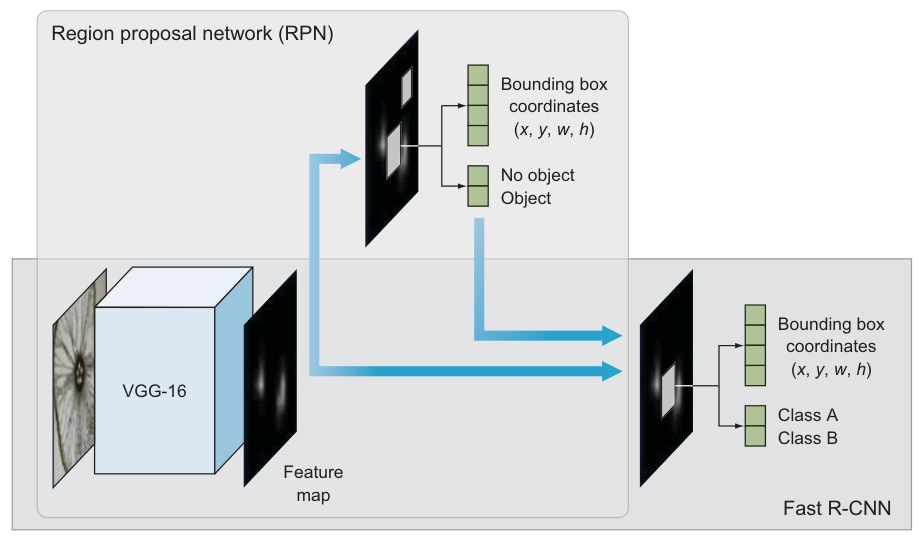{ .lq-img }
*图 7.11 Faster R-CNN：RPN 找"可能含物体的区域"，Fast R-CNN 分类并微调框；两者共享 VGG16 的卷积层（截自原书）*

流程：输入图 → 预训练 CNN 提特征 → 特征**并行**送往两处：① RPN 判断图里哪儿可能有物体（此刻只知道"有"，不知道"是什么"）；② RoI Pooling 取固定尺寸特征窗口。然后过两个全连接层：一个输出类别，一个输出框坐标。**五个组件全部进了网络内部**：基网络、候选生成、RoI Pooling、分类、框回归——真正端到端。

#### 基网络：随便换的"发动机"

和 Fast R-CNN 一样，基网络 = 预训练 CNN 切掉分类头。原文用 ZF 和 VGG；现在按问题随便挑：

| 网络 | 参数量 | 特点 |
| --- | --- | --- |
| MobileNet | 约 330 万 | 为速度优化的小网络 |
| ResNet-152 | 约 6,000 万 | 152 层，曾是 ImageNet 分类 SOTA |
| DenseNet | —— | 精度提升的同时参数更少 |

!!! note "侧栏：VGGNet vs ResNet"
    如今 ResNet 基本取代 VGG 当基网络：层数更多（更深）→ 学习复杂特征的能力更强（分类如此，检测理应同样成立）；而且残差连接 + batch normalization 让深模型好训练——这两个东西 VGG 诞生时还没发明。详见第 5 章。

!!! note "侧栏：全卷积网络（FCN）"
    检测网络的一个重要性质：**全卷积（fully convolutional）**——网络里没有全连接层。分类网络去 FC 层的常规做法：整个体上做 average pooling，再接一个全连接 softmax 头。FCN 两大好处：**更快**（只有卷积运算）；**输入分辨率任意**（只要内存装得下）。FCN 使网络对输入尺寸不变——但实际中常仍用固定输入尺寸：要**按批处理**图像（GPU 并行加速）时，批内所有图必须同宽同高。

#### RPN：注意力机制式的候选网络

RPN 基于基网络最后的特征图，找出可能含物体的区域——所以它也被叫作 **attention network（注意力网络）**：把网络的注意力引导到有意思的区域上。Faster R-CNN 用 RPN 把候选生成"烤"进 R-CNN 架构，替代外挂的 Selective Search。

RPN 由两层构成（图 7.12）：

- 一个 **3×3 全卷积层**（512 通道）——在特征图上滑 3×3 滑窗；
- 两个**并行的 1×1 卷积层**：一个**分类层**（这个区域有没有物体——前景/背景二分类），一个**回归层**（框预测）。

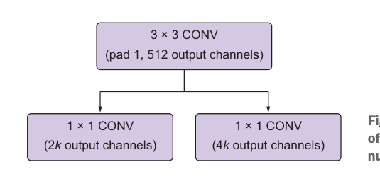{ .lq-img }
*图 7.12 RPN 的卷积实现：3×3 中间层 + 两个 1×1 头，k 是 anchor 数（截自原书）*

**重点澄清**：RPN 的分类器和回归器**不预测物体类别**——那是后面 FC 层的事。RPN 只回答一个问题："这个区域里有没有物体？"它是二分类器，输出区域的 objectness score（前景/背景概率）。答"有"的区域才送去 RoI Pooling 和最终输出层（图 7.13）。

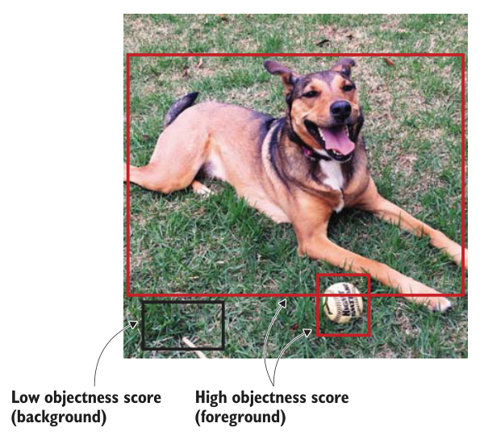{ .lq-img }
*图 7.13 RPN 分类器输出 objectness score：含物体（前景）vs 背景（截自原书）*

!!! note "侧栏：RPN 可以单独当应用用"
    单类别检测问题里，objectness 概率可直接当最终类别概率——前景就是"这一类"，背景就是"不是这一类"。用 RPN 单干图的是速度：它是个只用卷积层的极简网络，预测比带完整分类基网络的方案快。

#### Anchor boxes：回归的是"偏移量"，不是绝对坐标

回归器怎么预测框？先看难点：直接回归中心点 \((x, y)\) 很麻烦——你得加规则强制网络把值预测在图像边界内。更聪明的做法：在图里铺一堆**参考框（anchor boxes，锚框）**，让回归层预测**相对锚框的偏移量（deltas）** \((\Delta x, \Delta y, \Delta w, \Delta h)\)，把锚框调整到贴合物体，得到最终候选（图 7.14）。

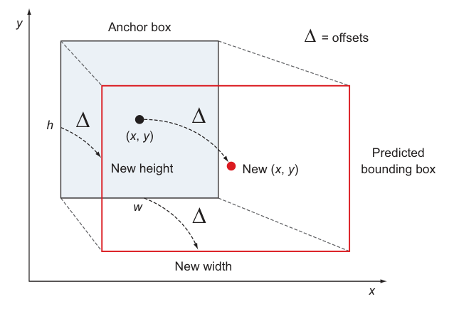{ .lq-img }
*图 7.14 从 anchor box 出发预测 delta 偏移，得到预测边界框（截自原书）*

**Anchor boxes**：用滑窗方式，RPN 在特征图的**每个位置**生成 \(k\) 个候选区域，以滑窗中心为中心，**尺度和长宽比各不相同**，覆盖千奇百怪的物体形状。它们是预先铺好在图上的固定框，作为首次预测物体位置时的参考。原文（Ren et al.）用了 **9 个 anchor**：同一中心、**3 种长宽比 × 3 种尺度**。

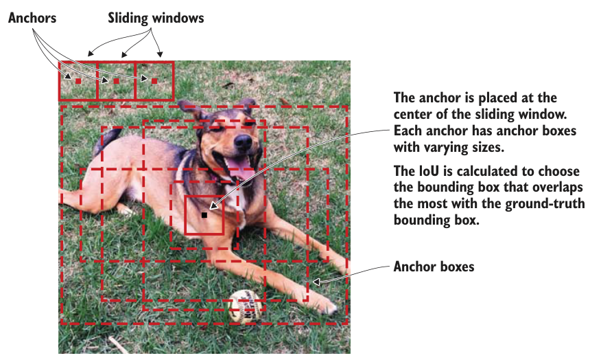{ .lq-img }
*图 7.15 anchor 位于每个滑窗中心；IoU 用来挑出与真值框重叠最大的框（截自原书）*

#### 训练 RPN

RPN 学习给 anchor 分类（输出 objectness score）+ 逼近物体的 4 个坐标。训练用人工标注的**真值框（ground truth）**。对每个 anchor 算重叠概率 \(p\)（anchor 与真值框的 IoU）：

\[
p = \begin{cases} +1 & \text{IoU} > 0.7 \\ -1 & \text{IoU} < 0.3 \\ 0 & \text{otherwise} \end{cases}
\]

与真值框重叠大的 anchor 标为**正样本**（大概率含物体）；重叠小的标为**负样本**。

!!! warning "原书笔误"
    原书此处的分段函数把负样本标号排印成"1–"（即 −1）。结合上下文（"labeled as negative"）与 Ren et al. 原文（−1 表示忽略/负样本、0 表示不参与），这里应为 \(-1\)，分段含义是：IoU>0.7 → 正（+1），IoU<0.3 → 负（−1），中间地带 → 忽略（0）。

训练时，正负 anchor 被送进两个分支：anchor 二分类（有/无物体）+ 位置参数（4 坐标）回归。对应每个位置的 \(k\) 个 anchor，**RPN 输出 \(2k\) 个得分和 \(4k\) 个坐标**——\(k=9\) 时就是 18 个 objectness 得分 + 36 个坐标（图 7.16）。

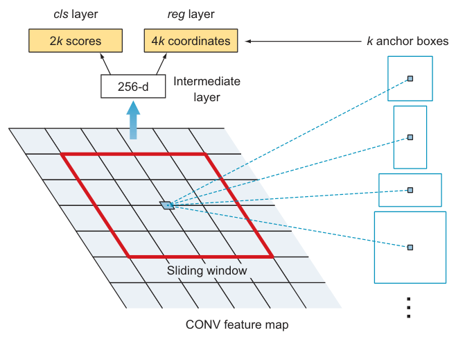{ .lq-img }
*图 7.16 RPN 输出：中间层（图中为 256-d，对应 ZF 基网络；正文 512 通道对应 VGG）→ cls 层 2k 得分 + reg 层 4k 坐标（截自原书）*

#### 全连接输出层

最后的 FC 层吃两个输入：基 ConvNet 的特征图 + RPN 给的 RoI，输出每个选中区域的类别与框参数。分类用 softmax；框回归对坐标做线性回归。**所有参数用多任务损失一起训练**：

\[
L(\{p_i\}, \{t_i\}) = \frac{1}{N_{cls}} \sum_i L_{cls}(p_i, p_i^*) + \lambda \frac{1}{N_{loc}} \sum_i p_i^* \cdot \mathrm{L1}_{smooth}(t_i - t_i^*)
\]

公式看着吓人，其实比长得简单（不想看可以跳过，不影响跑通 Faster R-CNN；但啃下来对"优化在底层怎么工作"的理解加深很多）。符号对照（表 7.2）：

| 符号 | 含义 |
| --- | --- |
| \(p_i\)、\(p_i^*\) | \(p_i\)：anchor \(i\) 是物体的预测概率；\(p_i^*\)：二值真值（0/1） |
| \(t_i\)、\(t_i^*\) | \(t_i\)：预测的 4 个框参数；\(t_i^*\)：真值参数 |
| \(N_{cls}\) | 分类损失的归一化项，Ren et al. 取 mini-batch 大小 ≈ 256 |
| \(N_{loc}\) | 回归损失的归一化项，Ren et al. 取 anchor 位置数 ≈ 2400 |
| \(L_{cls}\) | 二分类 log loss：\(-p_i^* \log p_i - (1-p_i^*)\log(1-p_i)\)（多分类问题在这里被转成"是不是目标物体"的二分类） |
| \(\mathrm{L1}_{smooth}\) | 框回归的 smooth L1 损失，稳健、对离群点不如 L2 敏感 |
| \(\lambda\) | 平衡参数，Ren et al. 取 ≈ 10（让 \(L_{cls}\) 与 \(L_{loc}\) 权重相当） |

先暂时忽略归一化项和求和下标 \((i)\)，单个实例的损失就是：

\[
\text{Loss} = L_{cls}(p, p^*) + p^* \cdot \mathrm{L1}_{smooth}(t - t^*)
\]

两项各看一眼：

- **分类损失** = 第 2 章讲的交叉熵，算预测概率 \(p\) 与真值 \(p^*\) 的误差，没新东西；
- **位置损失** = smooth L1 度量 \((t_i, t_i^*)\) 差异，再乘以真值概率 \(p^*\)——**不是物体（\(p^*=0\)）就把整个位置损失清零**，与 Fast R-CNN 的指示函数异曲同工。

两项相加 = 多任务损失。把 \((i)\) 和 \(\Sigma\) 放回去，就是对所有实例求和。

### 7.2.4 R-CNN 家族总结：一张表看懂演进

表 7.3 是全章（也是全书）最值得背的一张表——**同一任务，三代架构，速度差 250 倍**：

| | R-CNN | Fast R-CNN | Faster R-CNN |
| --- | --- | --- | --- |
| mAP（PASCAL VOC 2007） | 66.0% | 66.9% | 66.9% |
| 单图测试时间 | 50 秒 | 2 秒 | 0.2 秒 |
| 相对 R-CNN 加速 | 1× | 25× | 250× |
| 候选生成 | Selective Search 提约 2,000 个 RoI | Selective Search 提约 2,000 个 RoI | **RPN**（网络自己提） |
| CNN 使用方式 | 每个候选区域**各自**过一遍 ConvNet | **整图过一次** CNN，在特征图上取候选 | 整图过一次 CNN，与 RPN 共享卷积层 |
| 分类方式 | 线性 SVM（另训） | 单个 softmax（网络内） | softmax（网络内） |
| 端到端？ | 否（三模块分别训） | 半（候选仍靠外部算法） | **是**（完全端到端 DL 网络） |
| 短板 | 计算量大（无共享计算）+ 三个模型 | Selective Search 慢，计算仍高 | 候选生成仍花时间；多系统串行，性能受前级牵制 |

!!! note "拓展：为什么单阶段快、两阶段准？（RoI 的作用）"
    两阶段的精髓在 **RoI 是一道"看清楚再答"的筛选闸门**：RPN 先用廉价的二分类把几千个位置粗筛成几百个"高嫌疑"区域，每个区域再被**裁成固定尺寸的特征**送进重量级分类头细看——计算花在刀刃上，分类头见到的都是"值得细看"的候选，所以精度高。单阶段砍掉这道闸门，在**稠密**的位置采样上（SSD 8,732 个 / YOLO 10,647 个框）一次性出全部预测——省掉了"先粗筛再细看"的串行两步，自然快；但成千上万个框里绝大多数是背景，正负样本严重失衡，训练难度大、精度略降。一句话：**两阶段用"稀疏候选 + 精分类"换准，单阶段用"稠密预测 + 一把梭"换快**。

R-CNN 家族的遗留问题（每一代都在修上一代，但都没做到实时）：

1. 训练笨重、耗时过长；
2. 训练分多个阶段（候选生成 vs 分类器分开训）;
3. 推理太慢。

解决之道就是砍掉 region proposal 阶段——**单阶段检测器（one-stage detector）**：

- **两阶段（R-CNN 家族）**：① 用 Selective Search 或 RPN 提 RoI——候选是**稀疏**的（潜在的边界框候选是无穷多的）；② 分类器只处理这些候选。
- **单阶段（SSD、YOLO）**：跳过候选阶段，直接在**稠密采样**的可能位置上跑检测。更快更简单，但精度可能略降。

**一般来说：单阶段不如两阶段准，但显著更快。** 下面两节分别看 SSD 和 YOLO。

## 7.3 单发多框检测器（SSD）

SSD（Single Shot MultiBox Detector）由 Wei Liu 等人于 2016 年发布（arXiv:1512.02325），在 PASCAL VOC、MS COCO 等标准数据集上刷出 **74.3% mAP @ 59 FPS** 的新纪录。

R-CNN 家族是多阶段的：先预测框的 objectness score，再把框送进分类器。**单阶段检测器（SSD、YOLO）里，卷积层直接"一发"同时做两个预测**——名字里的 single shot 就是这么来的。图像只过一次网络，每个框的 objectness score 用 logistic 回归预测，表示它与真值的重叠程度：重叠 100% → 得分 1，零重叠 → 得分 0。再设阈值 0.5：得分高于 50% 的框判定"大概率有目标"，出预测；低于则忽略。

!!! note "侧栏：FPS 怎么读"
    Faster R-CNN 只有 7 FPS。多年来大家从流水线的每个环节下手提速，但速度大涨往往以精度大跌为代价——本节会看到 SSD 为什么能两全。基准数据：SSD300（输入 300×300）74.3% mAP @ 59 FPS；SSD512（输入 512×512）76.8% mAP @ 22 FPS；Faster R-CNN 73.2% mAP @ 7 FPS。（SSD300/512 的数字指输入边长。）

### 7.3.1 SSD 高层架构：一个前馈网络 + 一堆框

SSD 基于一个前馈卷积网络：产出**固定数量**的边界框 + 每框含物体的类别得分，最后接 NMS 得到最终检测。三大部件：

1. **基网络（base network）提特征图**：标准预训练分类网络，切掉分类层。原文用 VGG16；VGG19、ResNet 也行，效果应当不差；
2. **多尺度特征层（multi-scale feature layers）**：在基网络后接一系列卷积层，尺寸**逐层递减**，实现多尺度检测；
3. **NMS**：去掉重叠框，每个物体留一个。

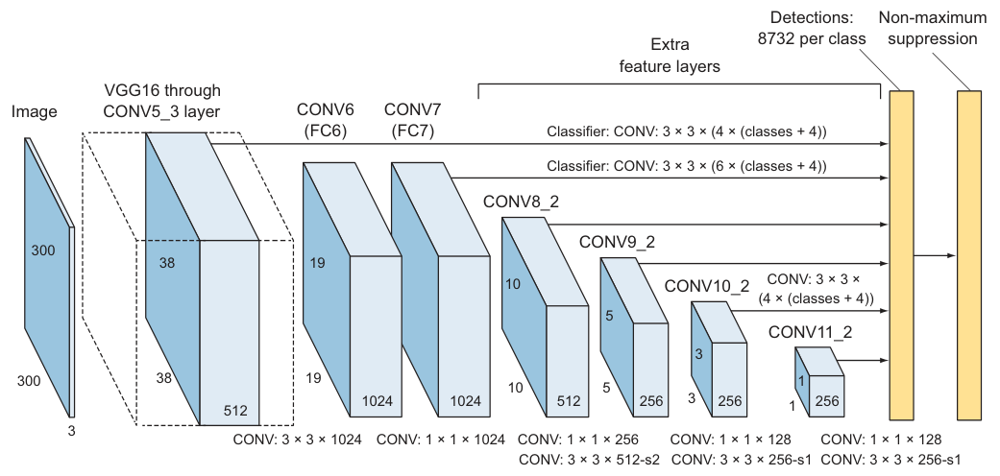{ .lq-img }
*图 7.17 SSD 架构：VGG16 基网络 + 额外特征层，conv4_3、7、8_2、9_2、10_2、11_2 六层直接向 NMS 供框（截自原书）*

看图 7.17：预测来自 **conv4_3、conv7、conv8_2、conv9_2、conv10_2、conv11_2** 六层（尺寸 38/19/10/5/3/1），每层先过一个小 **3×3 卷积**做检测，网络对每个类别共输出 **8,732 个候选框**，再由 NMS 压到每物体一个。**8732 是怎么算出来的？**

每层特征图的每个位置放若干个框（类似 anchor，SSD 里叫 **default box**）。以 conv4_3（尺寸 38×38×512）为例：3×3 卷积在 38×38=1,444 个位置各出 **4 个框**——图 7.17 顶部标注的 `CONV: 3×3×(4×(classes+4))` 意思是每框输出 \(4+\) 类数个通道（4 个框值 + 各类概率）。框数算术：

| 预测来源层 | 特征图尺寸 | 每位置框数 | 框数 |
| --- | --- | --- | --- |
| conv4_3 | 38×38 | 4 | 38×38×4 = 5,776 |
| conv7 | 19×19 | 6 | 19×19×6 = 2,166 |
| conv8_2 | 10×10 | 6 | 10×10×6 = 600 |
| conv9_2 | 5×5 | 6 | 5×5×6 = 150 |
| conv10_2 | 3×3 | 4 | 3×3×4 = 36 |
| conv11_2 | 1×1 | 4 | 1×1×4 = 4 |
| **合计** | | | **8,732** |

实算核对：5776 + 2166 + 600 + 150 + 36 + 4 = 8732，成立。注意两点：① 小特征图（conv10_2、conv11_2）每位置框数反而少（4 个）——它们负责大物体；② **8732 是"每个类别"的框数**，NMS 要逐类做。

!!! warning "原书笔误：conv8_2 / conv9_2 的 padding"
    原书按 `valid`（无填充）描述 conv8_2、conv9_2，但 8732 的分解要求特征图尺寸为 38/19/10/5/3/1——按 `valid` 算一遍就露馅：conv8_2 从 19×19 经 3×3 步幅 2，`valid` 得 9×9（\(\lfloor(19-3)/2\rfloor+1\)），`pad=1` 才得 10×10；conv9_2 同理，`valid` 得 4×4，`pad=1` 才得 5×5。而后两层 conv10_2、conv11_2 是步幅 1，`valid` 恰好算出 3×3 与 1×1，与原书一致（对应 Caffe 原版实现的 pad 0）。结论：**conv8_2/conv9_2 用 padding=1，conv10_2/conv11_2 保持 valid**，下节代码已按此修正。

**每个框的预测长什么样？**每个预测输出：

- 4 个值描述边界框 \((x, y, w, h)\)；
- 1 个 objectness score；
- \(C\) 个类别概率。

合计 \(5 + C\) 个值。若问题有 4 个物体类，每条预测就是向量 \([x, y, w, h, \text{obj}, C_1, C_2, C_3, C_4]\)。

### 7.3.2 基网络：切掉头的 VGG16

SSD 的基网络是 **VGG16 切掉全连接分类层**（VGG16 详见第 5 章）。选它是因为分类性能强、迁移学习生态成熟。原 FC 层的位置换成一组辅助卷积层（conv6 起），逐层缩小特征图尺寸，实现多尺度特征提取。PyTorch 实现如下：conv4_3 的输出经 `L2Norm` 后直接送预测头，pool5 改成 3×3/步幅 1，conv6 用膨胀率 6 的空洞卷积。

```python
# ===== 书 7.3.2 节 SSD 的 VGG16 基网络（PyTorch）=====
import torch
import torch.nn as nn


class L2Norm(nn.Module):
    """conv4_3 的 L2 归一化：逐像素按通道求 L2 范数，再乘可学习尺度 gamma（初值 20）"""

    def __init__(self, n_channels, scale=20.0, eps=1e-10):
        super().__init__()
        self.weight = nn.Parameter(torch.full((n_channels,), scale))
        self.eps = eps

    def forward(self, x):
        norm = x.pow(2).sum(dim=1, keepdim=True).sqrt() + self.eps   # (N,1,H,W)
        return self.weight.view(1, -1, 1, 1) * (x / norm)


def conv_relu(in_ch, out_ch, kernel=3, stride=1, padding=1, dilation=1):
    return [nn.Conv2d(in_ch, out_ch, kernel, stride, padding, dilation=dilation),
            nn.ReLU(inplace=True)]


class VGG16Base(nn.Module):
    """VGG16 前段（conv1_1~conv5_3）+ SSD 的 conv6/conv7；输出 conv4_3 与 conv7 两张特征图"""

    def __init__(self):
        super().__init__()
        self.block1 = nn.Sequential(*conv_relu(3, 64), *conv_relu(64, 64),
                                    nn.MaxPool2d(2, 2, ceil_mode=True))      # 300 → 150
        self.block2 = nn.Sequential(*conv_relu(64, 128), *conv_relu(128, 128),
                                    nn.MaxPool2d(2, 2, ceil_mode=True))      # 150 → 75
        self.block3 = nn.Sequential(*conv_relu(128, 256), *conv_relu(256, 256),
                                    *conv_relu(256, 256),
                                    nn.MaxPool2d(2, 2, ceil_mode=True))      # 75 → 38
        # conv4_x 与 pool4 分开：conv4_3 的输出要直接送预测头
        self.conv4 = nn.Sequential(*conv_relu(256, 512), *conv_relu(512, 512),
                                   *conv_relu(512, 512))                     # 38×38×512
        self.pool4 = nn.MaxPool2d(2, 2, ceil_mode=True)                      # 38 → 19
        self.conv5 = nn.Sequential(*conv_relu(512, 512), *conv_relu(512, 512),
                                   *conv_relu(512, 512))                     # 19×19×512
        self.pool5 = nn.MaxPool2d(3, 1, 1)                                   # 尺寸不变
        # conv6：空洞卷积，padding=dilation 保持 19×19；conv7：1×1
        self.conv6 = nn.Sequential(*conv_relu(512, 1024, padding=6, dilation=6))
        self.conv7 = nn.Sequential(*conv_relu(1024, 1024, kernel=1, padding=0))
        self.norm4 = L2Norm(512, scale=20.0)

    def forward(self, x):
        x = self.block1(x)
        x = self.block2(x)
        x = self.block3(x)
        feat4_3 = self.conv4(x)              # 38×38×512
        x = self.pool4(feat4_3)
        x = self.conv5(x)
        x = self.pool5(x)
        x = self.conv6(x)
        feat7 = self.conv7(x)                # 19×19×1024
        return self.norm4(feat4_3), feat7


if __name__ == '__main__':
    f4, f7 = VGG16Base()(torch.randn(1, 3, 300, 300))
    print(f4.shape, f7.shape)                # (1,512,38,38) (1,1024,19,19)
```

两个关键点（书明确强调）：**conv4_3 会被再次用来直接出预测**（它是六个预测层之一）；**pool5 的输出喂给 conv6**——多尺度特征层的第一层。

实战中通常用 `torchvision.models.vgg16(weights='DEFAULT')` 的前 13 个卷积层初始化 `VGG16Base`，再训练 conv6 之后的部分；上面的代码保留随机初始化，方便单独跑通形状。

#### 基网络怎么出预测：prior + 逐框提问

书里的"轮船"例子（图 7.18）把流程讲得很直白：

1. 与 R-CNN 的 anchor 类似，SSD 在图上铺一张 **prior** 网格（SSD 把 anchor 叫 **prior（先验框）**）。每个 prior 中心生成一组候选框；
2. 基网络把每个候选框当独立小图，逐框问："这个框里有船吗？"——即"我在这个框里提取到船特征了吗？"
3. 找到船特征的框，其坐标预测 + 类别预测被送往 NMS 层；
4. NMS 删掉所有框，只留与真值框重叠最大的那个。

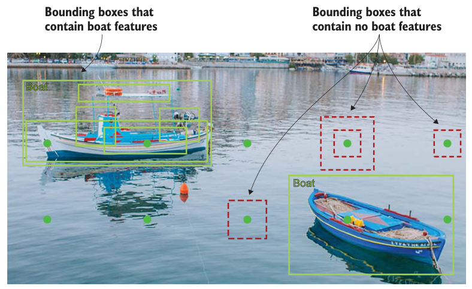{ .lq-img }
*图 7.18 实线框 = 网络找到了船特征；虚线框 = 没有（截自原书）*

!!! note "侧栏：基网络可以换"
    Liu et al. 用 VGG16 因为它分类强。换更深的 VGG19 或 ResNet 精度只会更好，但更慢。想要"精度-速度"平衡，MobileNet 是好选择。

### 7.3.3 多尺度特征层：小框看小物，大框看大物

多尺度层接在被截断的基网络尾部，尺寸逐层递减。**为什么要多尺度？**看图 7.19 的马：远景的马小，容易整个装进 prior 里，基网络能检出；离镜头最近的那匹马太大——把它的一个候选框单独抠出来（图 7.20），你能看出马的特征吗？看不出。

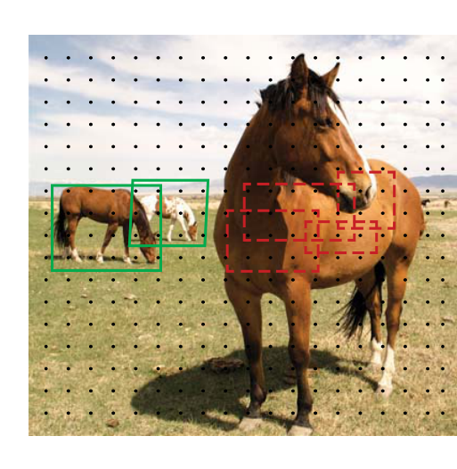{ .lq-img }
*图 7.19 远处的马装得进 prior（绿实线框），最近的马需要另一种尺度的 prior 才能盖住可识别特征（截自原书）*

一种老办法是把图像预处理成多个尺寸分别推理再合并结果。SSD 的做法更高明：**用网络里多个不同尺寸的特征层模拟同样的效果，还跨尺度共享参数**。CNN 逐层缩小空间维度、降低分辨率——**用低分辨率特征图检测大物体**（如 4×4 特征图），高分辨率特征图检测小物体：

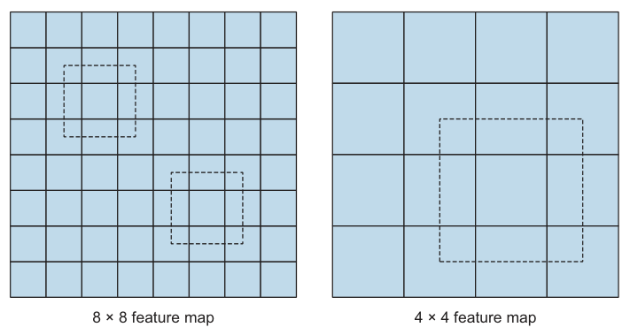{ .lq-img }
*图 7.21 左：8×8 高分辨率特征图检小物体；右：4×4 低分辨率特征图检大物体（截自原书）*

直觉想象：多尺度层把图像"缩小"到马能装进框里（图 7.22）。实际当然不是真缩小图像——图像经过卷积后早就面目全非，但**特征保留**（卷积原理见第 3 章）。多尺度带来的精度提升非常显著（图 7.23）：

| 预测来源层 | mAP（用边界框） | mAP（不用） | 框数 |
| --- | --- | --- | --- |
| conv4_3, conv7, conv8_2, conv9_2, conv10_2, conv11_2（全部六层） | **74.3** | 63.4 | 8,732 |
| 去掉 conv4_3（五层） | 74.6 | 63.1 | 8,764 |
| conv7 起（四层） | 73.8 | 68.4 | 8,942 |
| conv8_2 起（三层） | 70.7 | 69.2 | 9,864 |
| conv9_2 起（两层） | 64.2 | 64.4 | 9,025 |
| 仅 conv7（一层） | 62.4 | 64.0 | 8,664 |

只用 conv7 一层时表现最差（62.4%）——**把不同尺度的框摊到不同层上，是 SSD 精度的命根子**。

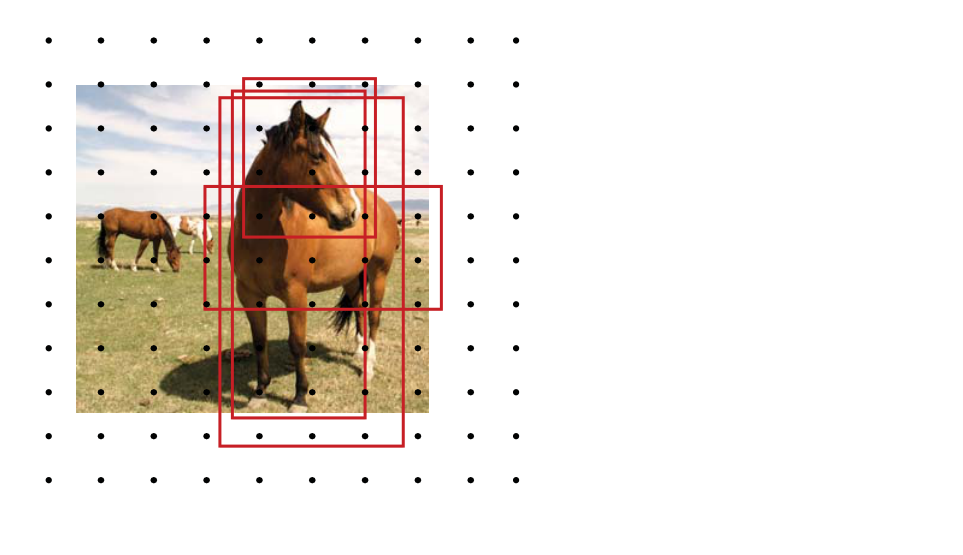{ .lq-img }
*图 7.22 多尺度层"缩小"空间维度后，新 prior 相当于拉远视角，盖住了近处那匹马的可识别特征（截自原书）*

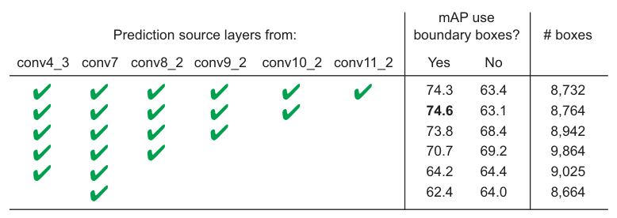{ .lq-img }
*图 7.23 原文实验：预测来源层越多 mAP 越高（截自原书）*

#### 多尺度层的结构

Liu et al. 加了六个尺寸递减的卷积层（大量调参试错的结果）。conv6 是 3×3，conv7 是 1×1；conv8~conv11 每个是"块"：**1×1 降通道 + 3×3 降尺寸** 两层一组。PyTorch 实现（conv8_2 / conv9_2 用 `padding=1` 修正尺寸）：

```python
# ===== 书 7.3.3 节 SSD 多尺度特征层 + 预测头（PyTorch，已修正 padding）=====
import torch
import torch.nn as nn

# 承接 7.3.2 的 VGG16Base / conv_relu；六层的通道数与每位置框数
FEATURE_CHANNELS = (512, 1024, 512, 256, 256, 256)   # conv4_3, conv7, conv8_2, conv9_2, conv10_2, conv11_2
NUM_BOXES        = (4, 6, 6, 6, 4, 4)                # 每位置框数
# 8732 = 38²·4 + 19²·6 + 10²·6 + 5²·6 + 3²·4 + 1²·4
#      = 5776 + 2166 + 600 + 150 + 36 + 4


class ExtraLayers(nn.Module):
    """conv8~conv11：每个块 = 1×1 降通道 + 3×3 降尺寸"""

    def __init__(self):
        super().__init__()
        # conv8：19×19 → 10×10（stride 2 + pad 1；用 valid 会得到 9×9，见上文笔误说明）
        self.conv8 = nn.Sequential(*conv_relu(1024, 256, kernel=1, padding=0),
                                   *conv_relu(256, 512, stride=2, padding=1))
        # conv9：10×10 → 5×5（同样必须 pad 1）
        self.conv9 = nn.Sequential(*conv_relu(512, 128, kernel=1, padding=0),
                                   *conv_relu(128, 256, stride=2, padding=1))
        # conv10：5×5 → 3×3（stride 1，valid）
        self.conv10 = nn.Sequential(*conv_relu(256, 128, kernel=1, padding=0),
                                    *conv_relu(128, 256, padding=0))
        # conv11：3×3 → 1×1（stride 1，valid）
        self.conv11 = nn.Sequential(*conv_relu(256, 128, kernel=1, padding=0),
                                    *conv_relu(128, 256, padding=0))

    def forward(self, x):
        f8 = self.conv8(x)
        f9 = self.conv9(f8)
        f10 = self.conv10(f9)
        f11 = self.conv11(f10)
        return f8, f9, f10, f11


class SSD300(nn.Module):
    """SSD300：VGG16 基网络 + 六个预测头；返回 (N,8732,C+1) 分类与 (N,8732,4) 回归"""

    def __init__(self, num_classes):
        super().__init__()
        self.num_classes = num_classes + 1          # 加背景类
        self.base = VGG16Base()
        self.extra = ExtraLayers()
        # 每个预测层接一个 3×3 卷积：loc 出 4·k 通道，cls 出 (C+1)·k 通道
        self.loc_heads = nn.ModuleList([
            nn.Conv2d(c, k * 4, 3, padding=1)
            for c, k in zip(FEATURE_CHANNELS, NUM_BOXES)])
        self.cls_heads = nn.ModuleList([
            nn.Conv2d(c, k * self.num_classes, 3, padding=1)
            for c, k in zip(FEATURE_CHANNELS, NUM_BOXES)])

    def forward(self, x):
        f4_3, f7 = self.base(x)
        f8, f9, f10, f11 = self.extra(f7)
        feats = [f4_3, f7, f8, f9, f10, f11]

        locs, clss = [], []
        for feat, loc_head, cls_head in zip(feats, self.loc_heads, self.cls_heads):
            # (N,k*4,H,W) → (N,H*W*k,4)：每个位置的 k 个框摊平成一行一框
            loc = loc_head(feat).permute(0, 2, 3, 1).reshape(x.size(0), -1, 4)
            cls = cls_head(feat).permute(0, 2, 3, 1).reshape(x.size(0), -1, self.num_classes)
            locs.append(loc)
            clss.append(cls)
        return torch.cat(clss, dim=1), torch.cat(locs, dim=1)   # (N,8732,C+1), (N,8732,4)


if __name__ == '__main__':
    model = SSD300(num_classes=20)                  # 20 个正类 + 1 个背景
    cls_pred, loc_pred = model(torch.randn(1, 3, 300, 300))
    print(cls_pred.shape, loc_pred.shape)           # (1,8732,21) (1,8732,4)
```

书里的原话："不做科研的话，你大概率不需要自己实现检测架构——下载开源实现改造即可。"这些代码块的意义是帮你把层结构内化。

!!! note "侧栏：空洞（膨胀）卷积 Atrous / Dilated Convolutions"
    给卷积层加一个**膨胀率（dilation rate）**参数：定义核内取值的间隔。3×3 核、膨胀率 2 → 感受野等价 5×5，参数仍只要 9 个——想象把 5×5 核每隔一行一列删掉一个值。同样的计算代价换来更宽的视野，在**实时分割**领域特别流行；需要大视野又用不起多层卷积或大核时用它。PyTorch 写法：`nn.Conv2d(1024, 1024, 3, padding=6, dilation=6)`（padding 取 dilation 的值以保持特征图尺寸）。SSD 的 conv6 用的是膨胀率 6。

#### Default boxes 的生成（可运行实现，实算验证 8732）

```python
# ===== 书 7.3.1/7.3.3 default box 生成（PyTorch，实算 = 8732）=====
import math
import torch

def default_boxes(feature_sizes=(38, 19, 10, 5, 3, 1),
                  num_boxes=(4, 6, 6, 6, 4, 4),
                  scales=(0.1, 0.26, 0.42, 0.58, 0.74, 0.9, 1.05)):
    """按各预测层的特征图尺寸生成 default box；默认参数对应 SSD300，返回 (8732, 4)。
    feature_sizes 的元素可以是 int（正方形特征图）或 (h, w)（矩形特征图）。"""
    rows = []
    for li, (fs, nb) in enumerate(zip(feature_sizes, num_boxes)):
        fh, fw = (fs, fs) if isinstance(fs, int) else fs
        # 4 框层长宽比 (1, 2, 1/2)；6 框层再加 (3, 1/3)；每位置最后附加一个 sqrt(s·s') 方框
        ars = (1, 2, 0.5) if nb == 4 else (1, 2, 0.5, 3, 1/3)
        assert len(ars) + 1 == nb, '每位置框数 = 长宽比个数 + 1 个附加方框'
        s_k, s_next = scales[li], scales[li + 1]          # 本层 / 下一层尺度（scales 长度 = 层数 + 1）
        # 每个格子的中心（归一化到 [0,1]）
        cy, cx = torch.meshgrid((torch.arange(fh, dtype=torch.float32) + 0.5) / fh,
                                (torch.arange(fw, dtype=torch.float32) + 0.5) / fw,
                                indexing='ij')
        for ar in ars:                                     # 各长宽比
            w = s_k * math.sqrt(ar)
            h = s_k / math.sqrt(ar)
            rows.append(torch.stack([cx, cy, torch.full_like(cx, w),
                                     torch.full_like(cx, h)], dim=-1))
        s2 = math.sqrt(s_k * s_next)                       # 附加方框：ar=1 的第二尺度
        rows.append(torch.stack([cx, cy, torch.full_like(cx, s2),
                                 torch.full_like(cx, s2)], dim=-1))
    return torch.cat([r.reshape(-1, 4) for r in rows], dim=0)


dboxes = default_boxes()
print(dboxes.shape)   # torch.Size([8732, 4])
print(8732 == 38**2*4 + 19**2*6 + 10**2*6 + 5**2*6 + 3**2*4 + 1**2*4)   # True
```

### 7.3.4 SSD 的 NMS：8732 → 200

推理时每类 8,732 个框涌出来，必须用 NMS 大幅剪枝：置信度和 IoU 低于阈值的框丢弃，只留 top N。SSD 的做法：**按置信度排序**，从最高分开始，逐个检查是否有同类别、IoU 超过阈值的高分框已经"占位"——有就忽略当前框（它俩大概率框的同一个物体）。IoU 阈值可调，Liu et al. 选 **0.45**；每图最多保留 **top 200** 个预测。

解码 + NMS 的核心代码（全程 torch 张量，逐类做 NMS）：

```python
# ===== 书 7.3.4 SSD 解码 + NMS（纯 PyTorch，逐类）=====
import torch


def cxcywh_to_xyxy(boxes):
    """(...,4) 中心点+宽高 → (xmin, ymin, xmax, ymax)"""
    cx, cy, w, h = boxes.unbind(-1)
    return torch.stack([cx - w / 2, cy - h / 2, cx + w / 2, cy + h / 2], dim=-1)


def decode(default_boxes, offsets, variances=(0.1, 0.1, 0.2, 0.2)):
    """把网络输出的偏移量解码回 (cx, cy, w, h)
    default_boxes: (M,4)；offsets: (M,4) 网络原始输出"""
    d = default_boxes
    cx = d[:, 0] + variances[0] * offsets[:, 0] * d[:, 2]   # cx + 0.1·t_x·w
    cy = d[:, 1] + variances[1] * offsets[:, 1] * d[:, 3]
    w = d[:, 2] * torch.exp(variances[2] * offsets[:, 2])   # w·exp(0.2·t_w)
    h = d[:, 3] * torch.exp(variances[3] * offsets[:, 3])
    return torch.stack([cx, cy, w, h], dim=1)


def nms_torch(boxes, scores, iou_thresh=0.45):
    """贪心 NMS：boxes (N,4) 为 xyxy，scores (N,)，返回保留的下标"""
    order = scores.argsort(descending=True)
    keep = []
    while order.numel() > 0:
        i = order[0]
        keep.append(i)
        if order.numel() == 1:
            break
        rest = order[1:]
        x1 = torch.maximum(boxes[rest, 0], boxes[i, 0])
        y1 = torch.maximum(boxes[rest, 1], boxes[i, 1])
        x2 = torch.minimum(boxes[rest, 2], boxes[i, 2])
        y2 = torch.minimum(boxes[rest, 3], boxes[i, 3])
        inter = (x2 - x1).clamp(min=0) * (y2 - y1).clamp(min=0)
        area_i = (boxes[i, 2] - boxes[i, 0]) * (boxes[i, 3] - boxes[i, 1])
        area_r = (boxes[rest, 2] - boxes[rest, 0]) * (boxes[rest, 3] - boxes[rest, 1])
        iou = inter / (area_i + area_r - inter).clamp(min=1e-9)
        order = rest[iou <= iou_thresh]
    return torch.stack(keep)


def decode_detections(cls_pred, loc_pred, default_boxes, num_classes,
                      conf_thresh=0.5, iou_thresh=0.45, top_k=200,
                      variances=(0.1, 0.1, 0.2, 0.2), img_size=None):
    """cls_pred: (N,M,C+1) 各类概率；loc_pred: (N,M,4)
    返回每张图的 (boxes, scores, labels)，boxes 为 (xmin,ymin,xmax,ymax)"""
    results = []
    for n in range(cls_pred.size(0)):
        probs = cls_pred[n]
        boxes = cxcywh_to_xyxy(decode(default_boxes, loc_pred[n], variances)).clamp(0, 1)
        dets = []
        for c in range(1, num_classes):                  # 0 是背景，逐类 NMS
            scores = probs[:, c]
            mask = scores > conf_thresh
            if mask.sum() == 0:
                continue
            b, s = boxes[mask], scores[mask]
            if s.numel() > top_k:                        # 先取 top_k 再 NMS
                s, idx = s.topk(top_k)
                b = b[idx]
            keep = nms_torch(b, s, iou_thresh)
            dets.append(torch.cat([b[keep], s[keep, None],
                                   torch.full((keep.numel(), 1), float(c))], dim=1))
        if dets:
            det = torch.cat(dets, dim=0)
            det = det[det[:, 4].argsort(descending=True)][:top_k]   # 每图最多 top_k 个
        else:
            det = torch.zeros((0, 6))
        boxes_out = det[:, :4]
        if img_size is not None:                         # 归一化坐标 → 原图像素坐标
            h, w = img_size
            boxes_out = boxes_out * torch.tensor([w, h, w, h], dtype=boxes_out.dtype)
        results.append((boxes_out, det[:, 4], det[:, 5].long()))
    return results
```

## 7.4 YOLO：你只看一次

**YOLO（You Only Look Once）**是 Joseph Redmon 等人开创的检测网络家族，一路演进：

| 版本 | 年份 | 关键词 |
| --- | --- | --- |
| YOLOv1 | 2016 | "unified, real-time object detection"——单一网络统一"候选 + 分类"两个组件（arXiv:1506.02640） |
| YOLOv2（YOLO9000） | 2016 | 能检 **9,000+** 种物体（ImageNet + COCO 训练）；16% mAP 不算好，但**测试极快**（arXiv:1612.08242） |
| YOLOv3 | 2018 | 模型显著变大，mAP **57.9%**——YOLO 家族的最好成绩（arXiv:1804.02767） |

YOLO 家族是第一批"快到实时"的端到端检测模型之一。精度**接近但不如** R-CNN，但胜在速度——实时视频/摄像头输入里最常露脸的就是它。

核心思路与 R-CNN 家族彻底分道扬镳：**不做 region proposal**。把输入图切成网格（grid of cells），**每个格子直接预测少量边界框 + 分类**，产出的大量候选框再用 NMS 收敛成最终预测（图 7.26）。v1 提出总体架构，v2 引入预定义 anchor box 改进框质量，v3 进一步精修架构与训练。本节聚焦 v3（写书时的家族 SOTA）。

### 7.4.1 YOLOv3 怎么工作：网格 + 每格 B 框

网络把输入图切成 \(S \times S\) 个格子。**真值框的中心落在哪个格子，哪个格子就负责检测这个物体**。每个格子预测 \(B\) 个边界框，每框输出：

- **框坐标** \((b_x, b_y, b_w, b_h)\)——\(x, y\) 是相对格子位置的偏移量；
- **objectness score（\(P_o\)**）：格子含物体的概率，过 sigmoid 压到 0~1。计算方式是"含物体概率 × 预测框与真值的 IoU"：

\[
P_o = \Pr(\text{containing an object}) \times \text{IoU}(\text{pred}, \text{truth})
\]

- **类别预测**：框里有物体时，输出 \(K\) 个类别的概率（\(K\) = 问题类别数）。

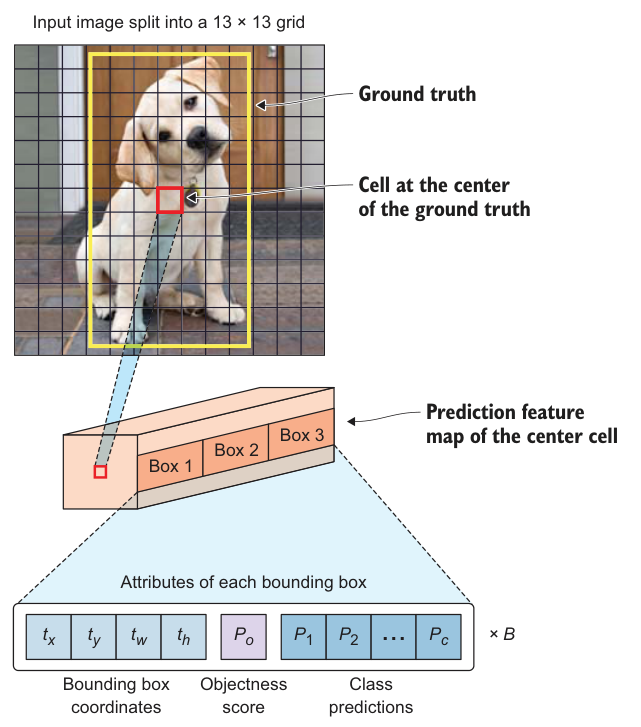{ .lq-img }
*图 7.26 输入切成 13×13 网格（169 格）；真值框中心的格子出 3 个框（B=3），每框 = 坐标 + objectness + 类别（截自原书）*

**总预测值数量**：每框 \(4 + 1 + K\) 个值，每格 \(B\) 框，共 \(S \times S\) 格：

\[
\text{Total predicted values} = S \times S \times (5B + K)
\]

**v3 的一个重要改动**：v3 之前类别得分用 softmax——softmax 隐含"每个框只属于一个类"的假设（属于 A 就必不属于 B）。对某些数据集成立，但遇到 **Woman 与 Person** 这种标签就翻车（一个人可以同时是两者）。v3 改用 **sigmoid 逐类打分**，多标签建模更贴近数据。

#### 多尺度预测：为什么每格 3 个框

图 7.26 里预测特征图有 3 个框——与 SSD 的 prior 类似，**YOLOv3 有 9 个 anchor，每个格子在每个尺度出 3 个框**。检测层在**三个不同尺寸**的特征图上做检测，步幅（stride）分别为 32、16、8：输入 416×416 时，就是在 13×13、26×26、52×52 三个网格上检测（图 7.27）——**13×13 负责大物体，26×26 负责中物体，52×52 负责小物体**。负责检出狗的框，是与真值框 IoU 最高的那个 anchor 对应的框。

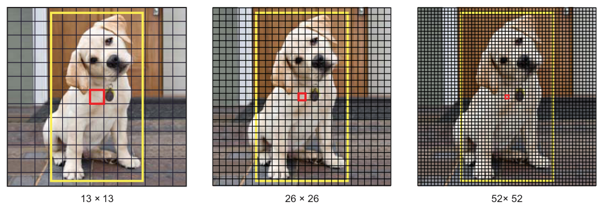{ .lq-img }
*图 7.27 三个尺度的预测特征图：13×13 / 26×26 / 52×52（截自原书）*

!!! note "侧栏：多尺度是为了救小物体"
    小物体检测是 YOLOv2 的重灾区。上采样（upsampling）层帮网络**保留并学习细粒度特征**——这正是检出小物体的关键。流程：输入不断下采样到 stride 32 的层出第一个检测；特征图 2× 上采样，与前面同尺寸的特征图拼接（concatenate），在 stride 16 出第二个检测；再上采样一次，在 stride 8 出第三个。

!!! note "拓展：YOLO 的 10647 个框别数错"
    书中口径：输入 416×416 时，YOLOv3 预测 \((52 \times 52) + (26 \times 26) + (13 \times 13)) \times 3 = 10{,}647\) 个边界框——实算 \((2704 + 676 + 169) \times 3 = 3549 \times 3 = 10647\)，成立。容易误读成"13×13×3"（那是 507，只是**单个尺度**的框数；10647 是**三个尺度之和**）。按 7.4.1 的 \(S \times S \times (5B + K)\) 公式看单个尺度的输出张量：COCO 80 类时，13×13 尺度输出 \(13 \times 13 \times (3 \times (4+1+80))\) 的特征图，三个尺度张量里的"框槽位"加起来正是 10647。接下来老套路：先按 objectness 过滤，再用 NMS 消掉同一物体的重复检测（同一个格子的 3 个框可能都命中，相邻格子也可能框同一个物体）。

#### YOLOv1 的框数（顺带对照）

SSD 一节提过：YOLOv1 最后是 7×7 个位置、每位置 2 个框：\(7 \times 7 \times 2 = 98\) 个框。从 v1 的 98 框到 v3 的 10,647 框，"稠密预测"的密度翻了百倍。

### 7.4.2 YOLOv3 架构：Darknet-53

YOLO 是把检测 + 分类统一进一个端到端网络的单网络。特征提取器的灵感来自 **GoogLeNet（Inception）**：不用 Inception 模块，而是 **1×1 降维层 + 3×3 卷积层**的组合——Redmon 和 Farhadi 管它叫 **DarkNet**（图 7.28）。

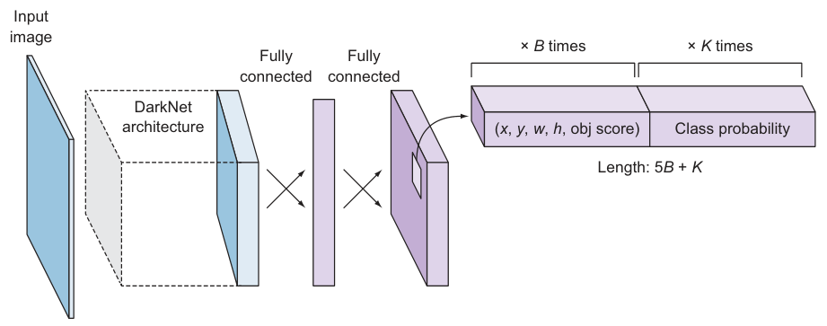{ .lq-img }
*图 7.28 YOLO 高层架构：DarkNet 特征 → FC → 输出长度 5B+K 的预测 × B 框 × K 类（截自原书）*

**代际对比**：

- **YOLOv2**：自定义深架构 **darknet-19**（19 层）+ 检测用的 11 层 = 30 层。小物体检测常翻车——下采样丢失细粒度特征。而且缺三样如今 SOTA 的标配：**无残差块、无跳跃连接、无上采样**。
- **YOLOv3**：全部补齐。基网络 **Darknet-53**（53 层，ImageNet 训练），检测任务再叠 53 层，共 **106 层全卷积**架构。这也是 v3 比 v2 慢的原因——换来检测精度大涨。

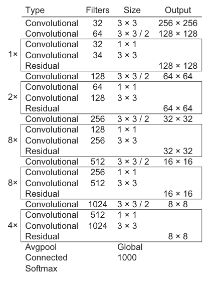{ .lq-img }
*图 7.29 Darknet-53 特征提取器：卷积 + 残差块（1×/2×/8×/8×/4× 组）+ 全局池化 + 1000 类 softmax（截自原书）*

!!! warning "原书笔误：Darknet-53 表中的 '34' 个滤波器"
    图 7.29 中第一个残差块（1× 组）的第二层滤波器数印作 **34**，按 Redmon 原论文应为 **64**（32@1×1 → 64@3×3，残差输出 128×128 空间尺寸）。

#### 完整架构：三个检测头怎么接

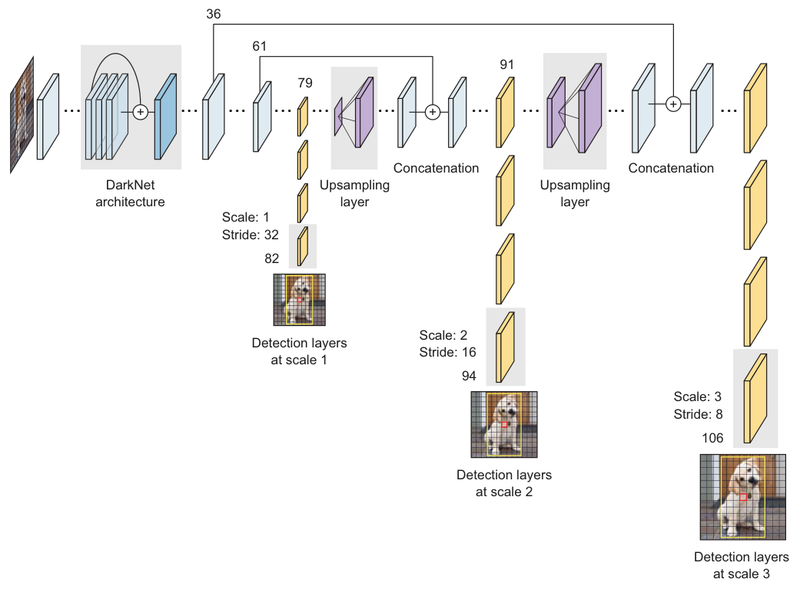{ .lq-img }
*图 7.30 YOLOv3 全架构：Darknet 主干下采样至层 79 后分三路，分别在层 82/94/106 出三个尺度的检测（截自原书）*

对照图 7.30 走一遍数据流：

1. 输入图过 Darknet-53 一路下采样到**层 79**；网络继续下采样，在**层 82** 出**第一个检测**——13×13 网格，负责大物体；
2. **层 79** 的特征图 **2× 上采样**到 26×26，与**层 61** 的特征图拼接；**层 94** 出**第二个检测**——26×26，负责中物体；
3. 同样的流程再来一遍：**层 91** 的特征图过几个上采样卷积层，与**层 36** 的特征图深度拼接；**层 106** 出**第三个检测**——52×52，负责小物体。

#### SSD vs YOLO：同门不同路

两者都是单阶段检测器，都是"稠密预测 + NMS 收尾"，但设计取舍不同——这张对比表是本章第二个必背表：

| | SSD | YOLOv3 |
| --- | --- | --- |
| 发表 | Liu et al., 2016 | Redmon & Farhadi, 2018（家族始于 v1, 2016） |
| 候选生成 | 无（单阶段），prior 网格 | 无（单阶段），S×S 网格 + anchor |
| 预测位置 | 6 层多尺度特征图（38/19/10/5/3/1） | 3 个尺度（stride 32/16/8 → 13/26/52） |
| 每位置框数 | 4 或 6 个 default box | 每格每尺度 3 个（9 个 anchor） |
| 候选框总数 | **8,732 个/类**（300×300 输入） | **10,647 个**（416×416 输入，三尺度合计） |
| 每框输出 | \(5 + C\)（4 坐标 + 1 objectness + C 类） | \(5B + K\) 每格；每框 \(4+1+K\) |
| 类别得分 | softmax | **sigmoid**（多标签，v3 起） |
| 精度 | 74.3% mAP @ 59 FPS（SSD300）；76.8% @ 22 FPS（SSD512） | 57.9% mAP（v3，YOLO 家族最佳） |
| 小物体 | 靠多尺度低分辨率特征图 | 靠上采样 + 拼接保细粒度特征（v2 痛点） |
| NMS 参数 | IoU 阈值 0.45，top 200 | objectness 过滤 + NMS |

## 7.5 项目：自动驾驶场景训练 SSD

本章项目用 **SSD7**——SSD300 的七层精简版：**刻意不优化**的架构，目标是在个人电脑上快速训完（作者在 CPU 上跑了约 20 小时，GPU 会快得多）。网络结构沿用 SSD 论文的分层设计，数据集与超参全部来自原书项目。

数据集：Udacity 自动驾驶数据集（github.com/udacity/self-driving-car）——**22,000+ 张**已标注图像、**5 个类别**（car、truck、pedestrian、bicyclist、traffic light），全部缩放到 300×480。这些是白天在加州 Mountain View 真实行车拍的，**没有做过任何清理**——真实感正是它的价值。标签由 CrowdAI 和 Autti 完成，CSV 格式：`xmin, xmax, ymin, ymax, class_id, frame`（框坐标 + 类别 + 文件名）。

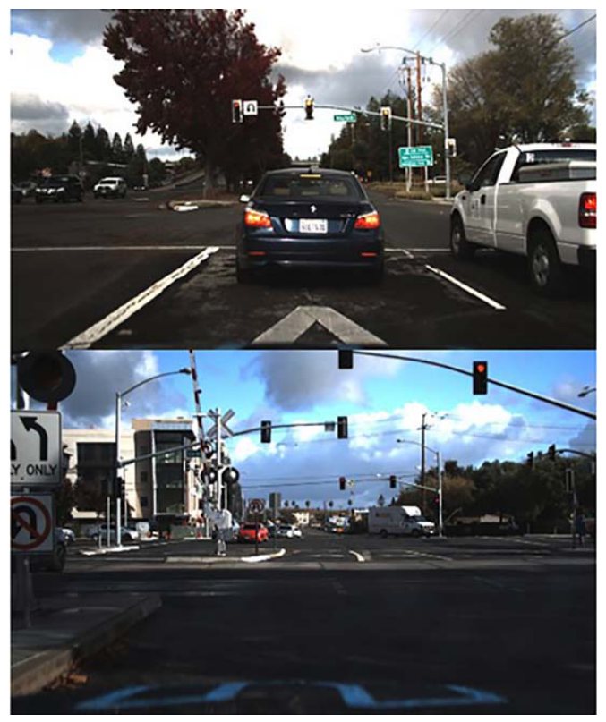{ .lq-img }
*图 7.31 Udacity 数据集样例：红绿灯、路口、卡车、铁路道口（截自原书，© 2016 Udacity, MIT License）*

!!! note "侧栏：自己标注数据用 LabelImg"
    要标注自己的数据，开源工具 LabelImg（pypi.org/project/labelImg）安装即用。

七步走（每步给出纯 PyTorch 实现）：

### 第 1 步：构建模型

`build_ssd7()`：卷积特征层 + 若干从不同特征层取输入的卷积预测头（就是 7.3 的结构）。关键配置：`scales=(0.08, 0.16, 0.32, 0.64, 0.96)`（显式锚框尺度）、`aspect_ratios=(0.5, 1.0, 2.0)`、`two_boxes_for_ar1=True`（长宽比 1 出两个框）、`clip_boxes=False`、`variances=(1.0, 1.0, 1.0, 1.0)`（编码目标坐标的缩放方差）、坐标用中心点 `(cx, cy, w, h)`、`normalize_coords=True`、推理阈值 `conf_thresh=0.01`、`iou_thresh=0.45`、`top_k=200`、`nms_max_output=400`、L2 正则 `5e-4`。

### 第 2 步：模型配置

```python
# ===== 书 7.5.2 项目配置（超参与书一致）=====
img_height, img_width, img_channels = 300, 480, 3   # 数据集已是 300×480
pixel_mean, pixel_std = 127.5, 127.5                # (x - 127.5) / 127.5 → [-1, 1]

num_classes       = 5                               # 5 个正类；模型内部另加 1 个背景类
scales            = (0.08, 0.16, 0.32, 0.64, 0.96)   # 显式 default box 尺度
aspect_ratios     = (0.5, 1.0, 2.0)                  # default box 长宽比
two_boxes_for_ar1 = True    # 长宽比 1 时出两个框（一个边长 s，一个 sqrt(s·s')）
clip_boxes        = False   # default box 不裁剪到图像边界内
variances         = (1.0, 1.0, 1.0, 1.0)             # 目标坐标编码的方差（本项目全取 1）
normalize_coords  = True    # 坐标相对图像尺寸归一化
```

### 第 3 步：创建模型 + 优化器 + 损失

```python
# ===== 书 7.5.3 SSD7 模型（PyTorch：7 个卷积层 + 4 个预测层）=====
import torch
import torch.nn as nn


def conv_bn_elu(in_ch, out_ch, kernel=3):
    return nn.Sequential(
        nn.Conv2d(in_ch, out_ch, kernel, padding=kernel // 2, bias=False),
        nn.BatchNorm2d(out_ch, momentum=0.01),   # 滑动平均系数 0.99 → PyTorch momentum 0.01
        nn.ELU(inplace=True))


class SSD7(nn.Module):
    """7 个卷积层 + 4 个预测层（conv4/conv5/conv6/conv7），每层 4 个 default box"""

    def __init__(self, num_classes, scales=(0.08, 0.16, 0.32, 0.64, 0.96),
                 aspect_ratios=(0.5, 1.0, 2.0)):
        super().__init__()
        self.num_classes = num_classes + 1          # 加背景类
        self.scales = scales
        self.n_boxes = len(aspect_ratios) + 1       # ar=1 时额外一个框
        self.conv1 = conv_bn_elu(3, 32, 5)
        self.conv2 = conv_bn_elu(32, 48)
        self.conv3 = conv_bn_elu(48, 64)
        self.conv4 = conv_bn_elu(64, 64)            # 预测层 1
        self.conv5 = conv_bn_elu(64, 48)            # 预测层 2
        self.conv6 = conv_bn_elu(48, 48)            # 预测层 3
        self.conv7 = conv_bn_elu(48, 32)            # 预测层 4
        self.pool = nn.MaxPool2d(2, 2)
        channels = (64, 48, 48, 32)
        self.cls_heads = nn.ModuleList([
            nn.Conv2d(c, self.n_boxes * self.num_classes, 3, padding=1)
            for c in channels])
        self.loc_heads = nn.ModuleList([
            nn.Conv2d(c, self.n_boxes * 4, 3, padding=1)
            for c in channels])

    def forward(self, x):
        x = self.pool(self.conv1(x))                # 300×480 → 150×240
        x = self.pool(self.conv2(x))                # → 75×120
        x = self.pool(self.conv3(x))                # → 37×60
        f4 = self.conv4(x)                          # 37×60（预测层 1）
        x = self.pool(f4)                           # → 18×30
        f5 = self.conv5(x)                          # 18×30（预测层 2）
        x = self.pool(f5)                           # → 9×15
        f6 = self.conv6(x)                          # 9×15（预测层 3）
        x = self.pool(f6)                           # → 4×7
        f7 = self.conv7(x)                          # 4×7（预测层 4）
        feats = (f4, f5, f6, f7)

        locs, clss = [], []
        for feat, loc_head, cls_head in zip(feats, self.loc_heads, self.cls_heads):
            loc = loc_head(feat).permute(0, 2, 3, 1).reshape(feat.size(0), -1, 4)
            cls = cls_head(feat).permute(0, 2, 3, 1).reshape(feat.size(0), -1, self.num_classes)
            locs.append(loc)
            clss.append(cls)
        return torch.cat(clss, dim=1), torch.cat(locs, dim=1)


def build_ssd7(num_classes, scales=(0.08, 0.16, 0.32, 0.64, 0.96),
               aspect_ratios=(0.5, 1.0, 2.0)):
    return SSD7(num_classes, scales=scales, aspect_ratios=aspect_ratios)


if __name__ == '__main__':
    model = build_ssd7(num_classes=5)
    cls_pred, loc_pred = model(torch.randn(1, 3, 300, 480))
    # 11692 = 37·60·4 + 18·30·4 + 9·15·4 + 4·7·4
    print(cls_pred.shape, loc_pred.shape)           # (1,11692,6) (1,11692,4)
```

```python
# ===== 书 7.5.3 优化器（Adam 1e-3；L2 正则 5e-4）=====
import torch

model = build_ssd7(num_classes=num_classes)     # 5 个正类 + 背景
optimizer = torch.optim.Adam(model.parameters(), lr=1e-3,       # 书：lr=0.001
                             betas=(0.9, 0.999), eps=1e-8,      # beta1/beta2/epsilon 同书
                             weight_decay=5e-4)                 # 书：L2 正则 0.0005

# 可选：加载已保存权重
# model.load_state_dict(torch.load('ssd7_best.pt', map_location='cpu'), strict=False)
```

损失用 `MultiBoxLoss` 实现：分类项在「全部正样本 + 挖掘出的难负样本」上算交叉熵，定位项只算正样本，最后按正样本数归一。

```python
# ===== 书 7.5.3 多任务损失 + hard negative mining（PyTorch）=====
import torch
import torch.nn as nn
import torch.nn.functional as F


class MultiBoxLoss(nn.Module):
    """SSD 多任务损失：分类 softmax + 定位 smooth L1，负样本按 1:3 做难例挖掘"""

    def __init__(self, neg_pos_ratio=3, alpha=1.0):
        super().__init__()
        self.neg_pos_ratio = neg_pos_ratio
        self.alpha = alpha

    def forward(self, cls_pred, loc_pred, cls_target, loc_target):
        # cls_pred: (N,M,C+1) logits；loc_pred: (N,M,4)
        # cls_target: (N,M)  0=背景，1..C=正类，-1=忽略；loc_target: (N,M,4)
        N, M, C1 = cls_pred.shape
        valid = cls_target >= 0
        pos = cls_target > 0
        neg = valid & (cls_target == 0)

        # 每个框的分类损失；被忽略的框先置 0
        cls_loss_all = F.cross_entropy(
            cls_pred.reshape(-1, C1), cls_target.clamp(min=0).reshape(-1),
            reduction='none').view(N, M)
        cls_loss_all = cls_loss_all.masked_fill(~valid, 0.0)

        # hard negative mining：按损失降序取 neg_pos_ratio 倍于正样本数的负样本
        n_pos = pos.sum(dim=1)                          # (N,)
        n_neg = torch.minimum(self.neg_pos_ratio * n_pos, neg.sum(dim=1))
        neg_score = cls_loss_all.masked_fill(~neg, float('-inf'))
        neg_idx = neg_score.argsort(dim=1, descending=True)
        neg_sel = torch.zeros_like(neg)
        for i in range(N):
            neg_sel[i, neg_idx[i, :int(n_neg[i])]] = True

        cls_loss = cls_loss_all[pos | neg_sel].sum() / n_pos.sum().clamp(min=1)
        loc_loss = F.smooth_l1_loss(
            loc_pred[pos], loc_target[pos], reduction='sum') / n_pos.sum().clamp(min=1)
        return cls_loss + self.alpha * loc_loss


if __name__ == '__main__':
    torch.manual_seed(0)
    cls_target = torch.zeros(2, 100, dtype=torch.long)
    cls_target[:, :3] = 1                               # 每张图 3 个正样本
    loss = MultiBoxLoss(neg_pos_ratio=3, alpha=1.0)(
        torch.randn(2, 100, 6), torch.randn(2, 100, 4),
        cls_target, torch.randn(2, 100, 4))
    print(loss.item())                                  # 标量损失
```

!!! note "拓展：hard negative mining 是什么？"
    8,732 个框里 99% 是背景——**负样本严重过剩**，直接训练会被背景淹没。SSD 的解法就是损失里的 `neg_pos_ratio=3`：每个 batch 先按分类损失给所有负样本**排序**，只保留"损失最大"（最难分、最容易误判成正样本）的**3 倍于正样本数**的负样本参与损失——正负样本比固定在 1:3。这就是 **hard negative mining（难例挖掘）**：不学平庸的背景，专攻长得像物体的背景。`alpha=1.0` 则是定位损失相对分类损失的权重。

### 第 4 步：加载数据

PyTorch 流程：写一个 `Dataset` 子类（`__getitem__` 读图、按 CSV 取框、做增强）→ `parse_csv` 读图像目录 + 标签 CSV（格式 `['image_name', 'xmin', 'xmax', 'ymin', 'ymax', 'class_id']`）→ 打印数据集规模：**训练 18,000 张 / 验证 4,241 张**。数据增强（`torchvision.transforms` 组合或手写张量增强）：随机亮度 ±48、随机对比度 0.5~1.8、随机饱和度 0.5~1.8、随机色相 ±18、随机水平翻转 0.5、随机平移、随机缩放 0.5~2.0（各以 0.5 概率施加），框随图变换并被裁剪过滤（`clip_boxes=True`、`bounds_box_filter=(0.3, 1.0)`、`n_boxes_min=1`）。

再在 `collate_fn` 里做匹配编码：把真值标签编码成损失需要的格式——按 multi 匹配 default box（**pos_iou_thresh=0.5**：IoU≥0.5 的 default box 算正样本；**neg_iou_limit=0.3**：IoU>0.3 的背景框不参与负样本——与 7.2.3 RPN 的正负判定同思想），并为各预测层生成 default box。

Dataset 读 CSV + 增强后，在 collate 里做同样的匹配编码：

```python
# ===== 书 7.5.4 真值匹配与编码（PyTorch）=====
import torch

# 按 SSD7 的 4 个预测层生成 default box（11692 = 37·60·4 + 18·30·4 + 9·15·4 + 4·7·4）
dboxes = default_boxes(feature_sizes=((37, 60), (18, 30), (9, 15), (4, 7)),
                       num_boxes=(4, 4, 4, 4),
                       scales=(0.08, 0.16, 0.32, 0.64, 0.96))


def cxcywh_to_xyxy(boxes):
    """(...,4) 中心点+宽高 → (xmin, ymin, xmax, ymax)"""
    cx, cy, w, h = boxes.unbind(-1)
    return torch.stack([cx - w / 2, cy - h / 2, cx + w / 2, cy + h / 2], dim=-1)


def iou_matrix(a, b):
    """a (G,4)、b (M,4)，输入输出都用 xyxy，返回 (G,M)"""
    x1 = torch.maximum(a[:, None, 0], b[None, :, 0])
    y1 = torch.maximum(a[:, None, 1], b[None, :, 1])
    x2 = torch.minimum(a[:, None, 2], b[None, :, 2])
    y2 = torch.minimum(a[:, None, 3], b[None, :, 3])
    inter = (x2 - x1).clamp(min=0) * (y2 - y1).clamp(min=0)
    area_a = (a[:, 2] - a[:, 0]) * (a[:, 3] - a[:, 1])
    area_b = (b[:, 2] - b[:, 0]) * (b[:, 3] - b[:, 1])
    return inter / (area_a[:, None] + area_b[None, :] - inter).clamp(min=1e-9)


def encode_offsets(dboxes, gt):
    """dboxes / gt: (K,4) 均为 (cx,cy,w,h)；返回 (K,4) 回归目标"""
    cx = (gt[:, 0] - dboxes[:, 0]) / dboxes[:, 2]     # 中心偏移 ÷ 框宽
    cy = (gt[:, 1] - dboxes[:, 1]) / dboxes[:, 3]     # 中心偏移 ÷ 框高
    cw = torch.log(gt[:, 2] / dboxes[:, 2])           # 宽比取对数
    ch = torch.log(gt[:, 3] / dboxes[:, 3])           # 高比取对数
    return torch.stack([cx, cy, cw, ch], dim=1)


def encode_targets(gt_boxes, gt_labels, dboxes,
                   pos_iou_thresh=0.5, neg_iou_limit=0.3):
    """gt_boxes: (G,4) 为 (cx,cy,w,h)；gt_labels: (G,)；dboxes: (M,4)
    返回 cls_target (M,) 与 loc_target (M,4)：0=背景，-1=忽略"""
    overlaps = iou_matrix(cxcywh_to_xyxy(gt_boxes), cxcywh_to_xyxy(dboxes))  # (G,M)
    best_iou, best_gt = overlaps.max(dim=0)              # 每个 default box 的最佳真值
    labels = torch.zeros(len(dboxes), dtype=torch.long)  # 0 = 背景
    pos = best_iou >= pos_iou_thresh
    labels[pos] = gt_labels[best_gt[pos]]
    labels[(best_iou > neg_iou_limit) & ~pos] = -1       # 0.3 < IoU < 0.5：忽略
    offsets = torch.zeros(len(dboxes), 4)
    offsets[pos] = encode_offsets(dboxes[pos], gt_boxes[best_gt[pos]])
    return labels, offsets


if __name__ == '__main__':
    demo_dboxes = torch.tensor([[0.5, 0.5, 0.2, 0.2],   # 与真值几乎重合
                                [0.2, 0.2, 0.1, 0.1],   # 远处背景
                                [0.9, 0.9, 0.05, 0.05]])  # 远处背景
    gt_boxes = torch.tensor([[0.51, 0.50, 0.21, 0.20]])
    labels, offsets = encode_targets(gt_boxes, torch.tensor([1]), demo_dboxes)
    print(labels.tolist())                              # [1, 0, 0]
    print(offsets[0])                                   # 第一个框的 4 个回归目标
```

### 第 5 步：训练

训练循环里手写四件事：按 val_loss 存最优权重、写训练日志、val_loss 连续 **10** 个 epoch 不改善就早停、平台期把学习率乘 **0.2**（耐心 **8**，min_lr=1e-5）。训练规模：**epoch 0→20，每 epoch 1,000 步**（作者自定，不保证收敛最优；batch_size=**16**）。

```python
# ===== 书 7.5.5 手写训练循环（超参与书一致）=====
import torch
from torch.optim.lr_scheduler import ReduceLROnPlateau

device = torch.device('cuda' if torch.cuda.is_available() else 'cpu')


def train_one_epoch(model, loader, optimizer, criterion, device, max_steps=1000):
    model.train()
    total, steps = 0.0, 0
    for step, (images, cls_target, loc_target) in enumerate(loader):
        if step >= max_steps:                       # 每 epoch 固定 1000 步
            break
        images = images.to(device)
        cls_pred, loc_pred = model(images)
        loss = criterion(cls_pred, loc_pred,
                         cls_target.to(device), loc_target.to(device))
        optimizer.zero_grad()
        loss.backward()
        optimizer.step()
        total += loss.item()
        steps += 1
    return total / max(steps, 1)


@torch.no_grad()
def evaluate(model, loader, criterion, device):
    model.eval()
    total, n = 0.0, 0
    for images, cls_target, loc_target in loader:
        images = images.to(device)
        cls_pred, loc_pred = model(images)
        total += criterion(cls_pred, loc_pred,
                           cls_target.to(device), loc_target.to(device)).item()
        n += 1
    return total / max(n, 1)


def fit(model, train_loader, val_loader, epochs=20):
    optimizer = torch.optim.Adam(model.parameters(), lr=1e-3,
                                 betas=(0.9, 0.999), eps=1e-8,
                                 weight_decay=5e-4)     # 书：L2 正则 0.0005
    criterion = MultiBoxLoss(neg_pos_ratio=3, alpha=1.0)
    scheduler = ReduceLROnPlateau(optimizer, mode='min', factor=0.2,
                                  patience=8, min_lr=1e-5)
    best_val, bad_epochs = float('inf'), 0
    for epoch in range(epochs):
        train_loss = train_one_epoch(model, train_loader, optimizer, criterion, device)
        val_loss = evaluate(model, val_loader, criterion, device)
        scheduler.step(val_loss)                        # 平台期学习率 ×0.2
        print(f'epoch {epoch:02d}  loss {train_loss:.4f}  val_loss {val_loss:.4f}')
        if val_loss < best_val:                         # 按 val_loss 存最优
            best_val = val_loss
            torch.save(model.state_dict(), 'ssd7_best.pt')
            bad_epochs = 0
        else:
            bad_epochs += 1
            if bad_epochs >= 10:                        # 连续 10 轮不改善则早停
                print('early stop')
                break
    return model


# 用法（model 由第 3 步构建，loader 由第 4 步的 Dataset + DataLoader 构建，batch_size=16）：
# model = fit(model, train_loader, val_loader, epochs=20)
```

### 第 6 步：可视化损失

画 `loss` 与 `val_loss` 曲线确认训练方向正确（图 7.32）：loss 从约 3.97 一路降到约 2.15，val_loss 从约 3.23 降到约 2.45 后趋平——训练健康，没有发散也没有明显过拟合。

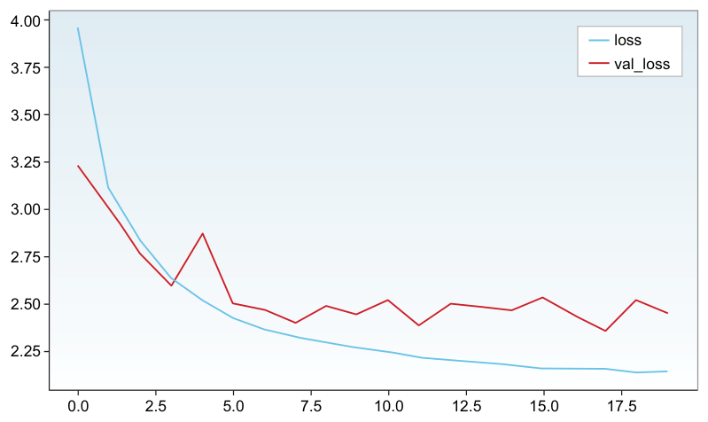{ .lq-img }
*图 7.32 SSD7 训练 20 个 epoch 的 loss / val_loss（截自原书）*

### 第 7 步：预测

用验证集做预测：取一个 batch（batch_size=1、不做增强）→ `model(images)` 得到原始输出 → **`decode_detections` 解码**（参数：`conf_thresh=0.5`、`iou_thresh=0.45`、`top_k=200`、`normalize_coords=True`）。打印结果每行是 `class conf xmin ymin xmax ymax`（图 7.33），画到图上如图 7.34——每个预测框旁标注类别 + 置信度（jeep 0.88、car 0.93、car 0.60……），真值框也画出来对比。

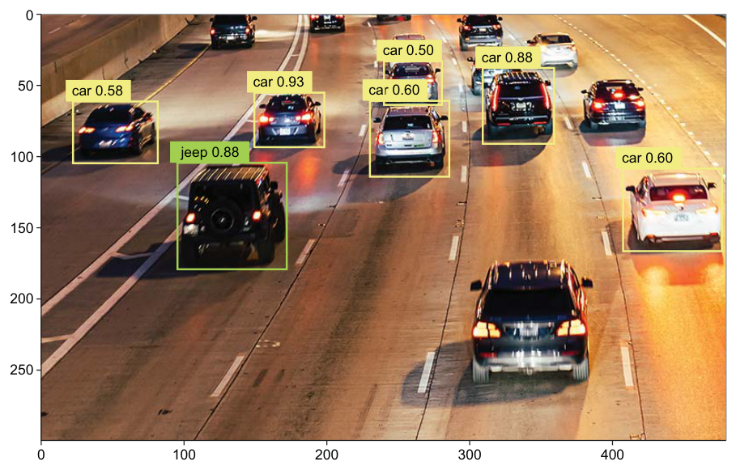{ .lq-img }
*图 7.34 预测框画回原图：类别 + 置信度一目了然（截自原书）*

```python
# ===== 书 7.5.7 预测 + 解码（PyTorch）=====
model.eval()
images, _, _ = next(iter(val_loader))            # batch_size=1、不做增强
images = images.to(device)                       # 与训练同一设备
with torch.no_grad():
    cls_logits, loc_pred = model(images)         # 原始输出：类别 logits / 框偏移
    cls_prob = torch.softmax(cls_logits, dim=-1)  # 解码前先转成概率

# dboxes：第 4 步按项目 scales 生成的 default box，形状 (M,4)
dets = decode_detections(
    cls_prob, loc_pred, dboxes, num_classes=6,   # 5 个正类 + 背景
    conf_thresh=0.5, iou_thresh=0.45, top_k=200,
    variances=(1.0, 1.0, 1.0, 1.0),              # 项目配置：不缩放
    img_size=(300, 480))                         # 归一化坐标 → 像素坐标

boxes, scores, labels = dets[0]
for box, score, label in zip(boxes, scores, labels):
    print(f'{label.item():>7d} {score:.2f} '
          f'{box[0]:.1f} {box[1]:.1f} {box[2]:.1f} {box[3]:.1f}')
```

## 坑与陷阱

!!! danger "8 个容易踩的坑"
    1. **两个阈值别混**：confidence threshold 管框"够不够自信"，NMS/IoU 阈值管"两框是不是同一物体"；评估时的 IoU 阈值（0.5/0.75）又是另一回事——三套阈值各司其职。
    2. **R-CNN 慢的根源**是"每个候选各过一遍 CNN、无共享计算"——不是 Selective Search 本身慢（它只是最后的瓶颈）。
    3. **RoI Pooling 的存在理由**：候选尺寸不一，FC 层只吃固定输入——没有它，Fast/Faster R-CNN 的双头输出接不上。
    4. **anchor 回归预测的是偏移量 Δ**，不是绝对坐标——直接回归中心点要额外约束防出界，锚框 + 偏移才是标准答案。
    5. **SSD 的 8732 是"每类"的框数**，NMS 逐类做；YOLO 的 10647 是**三尺度之和**，别写成 13×13×3=507。
    6. **YOLOv3 用 sigmoid 不用 softmax**：softmax 强加"一框一类"假设，Woman/Person 这类多标签数据会翻车。
    7. **背景框淹没问题**：单阶段检测 99% 的候选是背景——`neg_pos_ratio=3` 的 hard negative mining 不是可选优化，是训练能收敛的前提。
    8. **选型口诀**：单阶段快但略降精度，两阶段准但慢；实时（自动驾驶、视频流）选 YOLO/SSD，离线高精度选 Faster R-CNN。

## 速览

1. 检测 = 分类 + 定位：输出边界框 \((x,y,w,h)\) + 每框类别概率；框坐标以**中心点**表示。
2. 通用框架四组件：**region proposal → 特征提取与预测 → NMS → 评估指标**。
3. NMS 四步：置信度筛 → 取最高分 → 算 IoU → 抑制高重叠框；IoU = 交集面积 / 并集面积。
4. mAP = 各类 AP（PR 曲线下面积）的平均；PR 曲线扫置信度阈值画成——比单点 accuracy 公平。
5. R-CNN 演进主线：候选从 **Selective Search（外挂）→ 特征图上取 → RPN（网络内生）**；50s → 2s → 0.2s（250 倍加速），mAP 66.0% → 66.9% → 66.9%。
6. 多任务损失 \(L = L_{cls} + [u{\ge}1] \cdot L_{loc}\)：背景区域定位损失清零；框回归用 smooth L1（对离群点稳健）。
7. Faster R-CNN 的 RPN：3×3 conv（512 通道）+ 两个 1×1 头，输出 2k 得分 + 4k 坐标（k=9 个 anchor：3 尺度 × 3 长宽比）；anchor 标签按 IoU 分正负（>0.7 正 / <0.3 负）。
8. SSD：VGG16 基网络 + 六个递减特征层（38/19/10/5/3/1）出 8,732 个框/类，多尺度 = 低分辨率层检大物体；NMS 阈值 0.45、top 200。
9. YOLOv3：S×S 网格 + 每格 B=3 框 + sigmoid 多标签；Darknet-53 + 53 层 = 106 层全卷积，三尺度（13/26/52）合计 10,647 框，mAP 57.9%。
10. 项目七步：建模 → 配置 → 优化器与损失（Adam 1e-3 + MultiBoxLoss(neg_pos_ratio=3, alpha=1.0)）→ 数据（18,000/4,241，batch 16）→ 训练（20 epochs × 1000 步，早停 10、LR×0.2）→ 看损失 → 解码预测。

## 术语速查

| 英文 | 中文 | 一句话 |
| --- | --- | --- |
| Object Detection | 目标检测 | 分类 + 定位图中多个物体 |
| Bounding Box | 边界框 | 框住物体的矩形，\((x,y,w,h)\) |
| Region Proposal / RoI | 区域候选 / 感兴趣区域 | 系统认为可能含物体的候选区域 |
| Objectness Score | 目标性得分 | 框内有物体的概率 |
| Selective Search | 选择性搜索 | 贪心 + 分割的候选算法，每图约 2,000 框 |
| NMS | 非极大值抑制 | 保留最高分框、删高重叠重复框 |
| IoU | 交并比 | 交集面积 / 并集面积，0~1 |
| mAP | 平均精度均值 | 各类 AP（PR 曲线下面积）的平均 |
| PR Curve | PR 曲线 | 扫置信度阈值的 precision-recall 曲线 |
| FPS | 帧率 | 每秒处理帧数，衡量检测速度 |
| R-CNN / Fast / Faster | R-CNN 家族 | 两阶段检测三代目：50s / 2s / 0.2s |
| RPN | 区域候选网络 | 内生于网络的候选生成器（attention 网络） |
| Anchor Box | 锚框 | 预铺的参考框；回归预测相对它的偏移 Δ |
| RoI Pooling | RoI 池化 | 把任意尺寸 RoI max pooling 成固定 H×W |
| Multi-task Loss | 多任务损失 | 分类损失 + 定位损失的加权和 |
| Smooth L1 | 平滑 L1 损失 | 对离群点比 L2 稳健的回归损失 |
| Two-stage / One-stage | 两阶段 / 单阶段 | 先候选再分类 vs 稠密位置一次出预测 |
| SSD / Default Box (Prior) | 单发多框检测器 / 先验框 | 多尺度层上的锚框（SSD 的 anchor 叫法） |
| Dilated (Atrous) Conv | 空洞卷积 | 核内取值留间隔，小核大感受野 |
| YOLO / Darknet | —— | 网格 + 逐格出框；Darknet-53 特征主干 |
| Hard Negative Mining | 难例挖掘 | 只用最难的 3 倍负样本算损失（neg_pos_ratio=3） |
| Ground Truth | 真值 | 人工标注的边界框 |
| mAP@0.5 / @0.75 | —— | IoU 阈值 0.5 / 0.75 下的 mAP（COCO 口径） |

## 覆盖自查

??? note "原书小节 → 笔记位置"
    | 原书 | 笔记 |
    | --- | --- |
    | 章首（分类 vs 检测、表 7.1、图 7.1、章节路线） | 导语 + 7.1 开篇 |
    | 7.1（四组件）+ 7.1.1 + 7.1.2 + 7.1.3 + 7.1.4（FPS/IoU/PR/mAP + RECAP） | §7.1（含 numpy IoU/NMS 实现） |
    | 7.2.1（R-CNN 四模块、Selective Search 侧栏、训练、缺点） | §7.2.1 |
    | 7.2.2（Fast R-CNN 架构、多任务损失、缺点） | §7.2.2（含 PyTorch 损失） |
    | 7.2.3（基网络、VGG vs ResNet 侧栏、FCN 侧栏、RPN、anchor、RPN 训练、FC 层、多任务损失、RPN 单独应用侧栏） | §7.2.3 |
    | 7.2.4（表 7.3 演进总结 + R-CNN 局限 + 两阶段 vs 单阶段） | §7.2.4（表格重排 + 拓展） |
    | 7.3（单阶段原理 + FPS 侧栏）+ 7.3.1（8732）+ 7.3.2（基网络 + 预测输出侧栏）+ 7.3.3（多尺度 + 空洞卷积侧栏）+ 7.3.4（NMS） | §7.3（padding 笔误标注 + PyTorch 全套核心代码） |
    | 7.4（家族 + v1/v2/v3）+ 7.4.1（网格、10647、多尺度）+ 7.4.2（Darknet、三检测头） | §7.4（含 SSD vs YOLO 对比表） |
    | 7.5（SSD7 项目七步 + LabelImg 侧栏） | §7.5（PyTorch 训练骨架 + 超参全保留） |
    | 章末 Summary | §速览（无重复摘抄） |

