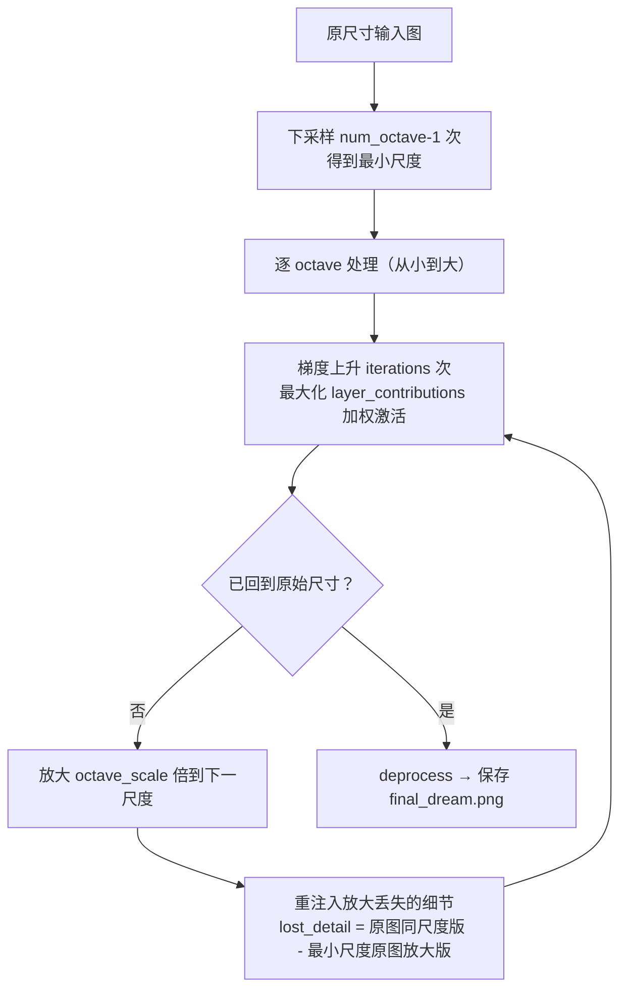

# 第 9 章 DeepDream 与神经风格迁移

> **本章解决**：CNN 内部到底"看"到了什么？能不能把网络学到的特征"印"回图像上？答案是两个创作型技术：**DeepDream**（把某层特征图案画到输入图上，造出迷幻梦境）和**神经风格迁移**（把一幅画的风格搬到另一张图的内容上）。
> **与前后章的关系**：第 3 章建立 CNN、第 6 章给了预训练网络——本章把训练好的网络**反着跑**：不对权重求梯度更新，而是**对输入图像求梯度**。9.1 的可视化技术是理解 9.2、9.3 的地基。

## 9.0 本章导图

<div class="brtree">
  <div class="brrow">
    <span class="brlabel root">生成式视觉</span>
    <span class="brace"></span>
    <div class="brkids">
      <div class="brrow">
        <span class="brlabel">可视化 CNN 特征</span>
        <span class="brace"></span>
        <div class="brkids">
          <span class="brleaf">梯度上升于输入空间</span>
          <span class="brleaf">block1 方向颜色 → block3 网格斑点 → block5 图案中的图案</span>
          <span class="brleaf">诊断网络依赖什么特征（鸟眼案例）</span>
        </div>
      </div>
      <div class="brrow">
        <span class="brlabel">反向运行网络</span>
        <span class="brace"></span>
        <div class="brkids">
          <span class="brleaf">权重冻结，只对输入求导</span>
          <span class="brleaf">梯度上升（max），不是梯度下降（min）</span>
          <span class="brleaf">让某层激活最大的输入 = 该层"梦中图案"</span>
        </div>
      </div>
      <div class="brrow">
        <span class="brlabel">DeepDream</span>
        <span class="brace"></span>
        <div class="brkids">
          <span class="brleaf">最大化整层激活（非单个滤波器）</span>
          <span class="brleaf">layer_contributions 层加权字典</span>
          <span class="brleaf">octave 多尺度 + 细节重注入</span>
          <span class="brleaf">Inception v3，狗脸/鸟羽来自 ImageNet</span>
        </div>
      </div>
      <div class="brrow">
        <span class="brlabel">神经风格迁移</span>
        <span class="brace"></span>
        <div class="brkids">
          <span class="brleaf">内容损失：深层特征 MSE</span>
          <span class="brleaf">风格损失：多层 Gram 矩阵</span>
          <span class="brleaf">总变差损失：空间平滑</span>
          <span class="brleaf">三损失加权求和</span>
        </div>
      </div>
      <div class="brrow">
        <span class="brlabel">优化循环</span>
        <span class="brace"></span>
        <div class="brkids">
          <span class="brleaf">L-BFGS（书）+ Evaluator 缓存</span>
          <span class="brleaf">PyTorch LBFGS closure / Adam</span>
          <span class="brleaf">用内容图初始化组合图</span>
        </div>
      </div>
      <div class="brrow">
        <span class="brlabel">PyTorch 实现要点</span>
        <span class="brace"></span>
        <div class="brkids">
          <span class="brleaf">输入张量 requires_grad_(True)</span>
          <span class="brleaf">forward hook 抓中间层激活</span>
          <span class="brleaf">参数冻结 eval()，只前向 + 反传到输入</span>
        </div>
      </div>
    </div>
  </div>
</div>

## 9.1 CNN 如何看世界

深度学习的好消息讲了很多，但一个根本问题始终悬着：**神经网络如何看和解释世界仍是个黑盒**。训练过程、反向传播更新权重我们都讲过，直觉上、数学上都说得通——但 CNN 到底怎么看世界？层与层之间提取的特征长什么样？

把这个黑盒打开，有两层回报：

1. **算法侧**：理解网络为什么能识别特定模式、为什么工作得这么好，才能进一步改进性能。
2. **业务侧**：解决 **AI Explainability（AI 可解释性）** 问题——很多业务领导不敢基于模型预测做决策，因为没人说得清黑盒里发生了什么。逐层可视化能让神经网络的决策被人类解读。

在 CV 问题里，做法是可视化卷积网络内部的**特征图（feature maps）**：看网络眼中的世界，看它认为什么特征是把类与类区分开的关键。可视化卷积层的思想由 **Erhan 等人在 2009 年**提出。

### 9.1.1 重温神经网络的工作方式

先回顾一遍：训练深度网络 = 给它看百万级样本，网络逐步更新参数直到给出想要的分类。网络通常由 **10~30 层**人工神经元堆叠：图像进输入层，层与层之间传递，最终输出层给出预测。

每层到底在干什么？训练完成后，**每层逐级提取越来越高级的图像特征**，直到最后几层做决策：

| 网络位置 | 学到的特征 |
| --- | --- |
| 第一层 | 边缘（edges）、角点（corners） |
| 中间层 | 把基本特征拼成整体形状（shapes）、部件（components） |
| 最后几层 | 组装成完整解释——对"汽车""自行车"这类复杂图像响应的神经元 |

想看网络学到了什么，思路是：**把网络倒过来，让它增强输入图像，直到引发某个特定解释**。比如你想知道什么样的图像会让网络输出"鸟（Bird）"——从一张纯随机噪声图出发，逐步向"网络认为鸟的重要特征"的方向调整这张图，最终就能看到网络的"鸟的想象"（图 9.1）。

<figure>
  
  <figcaption>图 9.1 从随机噪声出发，逐步调整，直到显现网络认为重要的鸟特征（截自原书）</figcaption>
</figure>

本节要点一句话：神经网络足够聪明，能判断**哪些重要特征沿层传递**给全连接层做分类，**不重要的特征沿途丢弃**——网络学习的是训练集中物体的特征。只要能在深层可视化这些特征图，就能看到**网络把注意力放在哪、用什么特征做预测**。

!!! note "侧栏：信息蒸馏比喻（Chollet）"
    François Chollet 在《Deep Learning with Python》中的描述："你可以把深度网络看成一个**多级信息蒸馏（information distillation）**操作——信息经过一道道过滤器，出来时越来越纯净。"低层保留原始像素细节，越往后剩下的越是"有用的语义"，这正是蒸馏的含义。

!!! note "拓展：为什么对输入求梯度就能'做梦'？"
    训练时我们对**权重**求梯度、更新权重；这一章反过来——**冻结权重，对输入图像求梯度**。把某层的激活值定义为损失，算出"这张图怎么改能让该层激活更大"，然后照着改。反复迭代后，图上就会浮现让该层神经元最兴奋的图案。
    注意：这不是"无中生有"，而是**放大网络在训练中学到的模式**——梯度方向完全由冻结的权重决定，所以梦里出现的永远是它认识的东西（猫、狗、羽毛、桥），网络没学过的类别就梦不出来。DeepDream 与神经风格迁移的全部数学基础，就是这个"对输入的梯度上升"。

### 9.1.2 可视化 CNN 特征

最简单的可视化方法：**显示每个滤波器"想响应"的视觉模式**。实现手段是**输入空间的梯度上升（gradient ascent in input space）**：从一张空白（或带噪）输入图像出发，对输入图像的值做梯度上升，最大化某个特定滤波器的响应——最终得到的输入图像，就是该滤波器响应最强的图案。

!!! note "侧栏：梯度上升 vs 梯度下降"
    梯度（gradient）= 函数在某点的切线斜率、变化率（书配图给出了曲线上 a~f 各点的斜率示意）。往哪个方向走取决于目标：
    - **梯度下降（GD）**：沿梯度的**负**方向走，找局部最小——第 2 章用它最小化损失函数。
    - **梯度上升**：沿梯度的**正**方向走，找局部最大。可视化特征图时我们想让特征"尽量明显"，所以要**最大化**——把 GD 的过程反过来即可。
    （拓展：二者是同一算法乘一个符号。工程上常不写"上升"，而是把损失取负再最小化，优化器代码就能复用。）

下面看效果：对 VGG16 取**开头、中间、结尾**三个卷积层做可视化——`features[0]`（64 通道）、`features[12]`（256 通道）、`features[28]`（512 通道），观察特征如何逐层演化。

<figure>
  
  <figcaption>图 9.2 <code>features[0]</code>（第 1 个卷积层）的滤波器特征图：低层的方向与颜色（截自原书）</figcaption>
</figure>

早期层基本只编码**低级、通用**的特征——方向和颜色。

<figure>
  
  <figcaption>图 9.3 <code>features[12]</code>（第 6 个卷积层）的滤波器特征图：网格与斑点纹理（截自原书）</figcaption>
</figure>

方向、颜色滤波器在后续层中**组合**成基本的网格与斑点纹理；这些纹理再逐步组合成更复杂的图案——网络开始"看到"构成基本形状的图案。还认不出具体物体，但比早期的清晰多了。

<figure>
  
  <figcaption>图 9.4 <code>features[28]</code>（第 13 个卷积层）的滤波器特征图：图案中的图案，已含可辨识形状（截自原书）</figcaption>
</figure>

最激动的一张。深层特征包含**可辨识的形状**——图案中的图案。虽然预测靠的是多个特征图的组合，但肉眼已经能猜个八九不离十：左图能看到**眼睛和喙**，猜是鸟或鱼类；中图的图案像**链条**；右图像**食物或水果**。即使猜错，也能轻松排除绝大多数类别——车、船、建筑、自行车都没有眼睛。

**这对分类/检测问题有什么用？** 以图 9.4 左图为例：既然网络靠"眼睛 + 喙"这两个特征识别鸟，那么：

- 图 9.5（鸟眼、喙可见）→ 网络大概率检测成功；
- 图 9.6（鸟的身体可见，但眼和喙被叶子挡住）→ 网络对眼、喙权重很高，**很可能漏检**——而人类一眼就能看到鸟。

<table>
<tr>
<td></td>
<td></td>
</tr>
</table>
*图 9.5 眼与喙可见，网络能识别 · 图 9.6 眼与喙被叶子遮挡，网络可能漏检（截自原书）*

解决方案：用**数据增强**技术、并在训练集中**收集更多这类对抗案例**，逼网络给鸟的其他特征（形状、颜色）分配更高权重。这就是"看见网络所见"的实际价值——它直接告诉你**训练集缺什么**。

### 9.1.3 实现特征可视化器

看完效果，自己动手写。核心只有三步：加载预训练 VGG16 的卷积基、用 forward hook 取出目标卷积层的激活、在输入空间做梯度上升。下面按步骤拆开讲，最后给出可直接运行的完整代码。代码依赖 `torch`、`torchvision`、`Pillow`，首次运行会自动下载 ImageNet 预训练权重。

!!! note "为什么选 VGG16"
    VGG16 的结构非常规整：卷积层与 ReLU 交替堆叠，中间只插 5 次最大池化，`features` 里的层索引一目了然。做特征可视化时，我们关心的是"某个卷积核在 ImageNet 上学到了什么"，VGG16 的 ImageNet 权重正好提供了这套语义层次；换成 ResNet 等带残差连接的网络也能做，只是取中间激活的代码更绕。

**第一步：加载卷积基。** `torchvision.models.vgg16(weights=...)` 返回带 1000 类分类头的完整网络；取 `.features` 就得到纯卷积部分。可视化只用卷积特征，分类头不参与计算。加载后做两件事：`eval()` 固定推理行为，`requires_grad_(False)` 冻结全部权重——本任务永远不会更新网络参数。

**第二步：定位目标层。** `features` 是 `nn.Sequential`，每个卷积、ReLU、池化各占一个索引。VGG16 一共 13 个卷积层：`features[0]` 是第 1 个卷积（64 通道），`features[12]` 是第 6 个（256 通道），`features[28]` 是第 13 个（512 通道，最后一个卷积）。图 9.7 给出了完整的 13 个卷积层与通道数。层索引不要凭记忆写，先打印核对——下面的完整代码在加载 VGG16 后就做了这件事。

<figure>
  
  <figcaption>图 9.7 VGG16 的 13 个卷积层与各自的输出形状（截自原书）</figcaption>
</figure>

**第三步：用 hook 抓激活。** forward hook 是 PyTorch 的"旁路监听"机制：注册在某个模块上，每次前向经过该模块时回调，把输出存进字典。这样既不用改模型结构，也不用手工把网络拆成两半。

**第四步：梯度上升。** 以 `features[0]` 的 0 号滤波器为例：损失定义为该滤波器响应图的均值；用 `torch.autograd.grad(loss, x)` 直接对输入图像求梯度（权重已冻结，梯度只会流到输入）；把梯度除以它的均方根量级，保证步长稳定；循环 20 步，每步 `x += lr * grad`。注意这里是**加号**——梯度上升，与训练时的梯度下降方向相反。

**第五步：转回合法图像。** 梯度上升得到的张量数值范围不可控，显示前要做 `deprocess`：减均值、除标准差、乘 0.1 再加 0.5 映射到 [0,1] 附近、截断、转 uint8。`permute` 之后内存不再连续，转 numpy 前调用 `.contiguous()` 是稳妥做法。

```python
# ===== 9.1.3 滤波器可视化：forward hook + 对输入做梯度上升 =====
import numpy as np
import torch
import torchvision.models as models
from PIL import Image

device = 'cuda' if torch.cuda.is_available() else 'cpu'

# 只要卷积基：.features；冻结权重，eval() 固定推理行为
vgg16 = models.vgg16(weights=models.VGG16_Weights.IMAGENET1K_V1).features.to(device).eval()
for p in vgg16.parameters():
    p.requires_grad_(False)

# 核对层索引：打印所有卷积层的索引、通道数、卷积核大小
for i, layer in enumerate(vgg16):
    if isinstance(layer, torch.nn.Conv2d):
        print(i, layer.out_channels, layer.kernel_size)

def visualize_filter(layer_idx, filter_idx, size=150, steps=20, lr=1.0):
    """最大化 features[layer_idx] 第 filter_idx 个通道的平均响应。"""
    captured = {}
    def hook(_module, _input, output):
        captured['act'] = output
    handle = vgg16[layer_idx].register_forward_hook(hook)

    try:
        # 灰底 + 少量噪声：给梯度上升一个不偏不倚的起点
        x = torch.rand(1, 3, size, size, device=device) * 0.15 + 0.45
        x.requires_grad_(True)

        for step in range(steps):
            vgg16[:layer_idx + 1](x)                  # 只前向到目标卷积层
            act = captured['act']                     # (1, C, H, W)
            loss = act[:, filter_idx].mean()          # 该滤波器的平均激活

            (grad,) = torch.autograd.grad(loss, x)    # 对输入求梯度，权重不更新
            grad = grad / (grad.pow(2).mean().sqrt() + 1e-5)  # 按梯度量级归一化

            with torch.no_grad():
                x += lr * grad                        # 上升：加号
            x = x.detach().requires_grad_(True)       # 切断上一轮计算图，重新开始
    finally:
        handle.remove()                               # hook 用完必须摘掉

    return x.detach()

def deprocess(x):
    """把任意数值范围的张量映射成可显示的 uint8 图像。"""
    x = x.clone()
    x = (x - x.mean()) / (x.std() + 1e-5)
    x = (x * 0.1 + 0.5).clamp(0, 1)
    # permute 后内存不连续，转 numpy 前先 .contiguous()
    arr = x[0].permute(1, 2, 0).contiguous().cpu().numpy()
    return (arr * 255).astype(np.uint8)

# 开头、中间、结尾三层，各取 0 号滤波器
for layer_idx in (0, 12, 28):
    img = visualize_filter(layer_idx, 0)
    Image.fromarray(deprocess(img)).save(f'features_{layer_idx}_filter_0.png')
```

结果如图 9.8——`features[0]` 的 0 号滤波器呈现一块流动的横向纹理。换成更深的层（`features[5]`、`features[10]`）能看到更明确的"图案中的图案"；到了最后两个卷积层（`features[26]`、`features[28]`），出现的纹理已经接近网络训练过的物体局部——**羽毛、眼睛**。

<figure>
  
  <figcaption>图 9.8 <code>features[0]</code> 的 0 号滤波器可视化结果（截自原书）</figcaption>
</figure>

## 9.2 DeepDream

**DeepDream** 由 Google 研究员 **Alexander Mordvintsev 等人于 2015 年**开发，是一种艺术图像修改技术：用 CNN 把输入图改成梦幻、迷幻（hallucinogenic）的样子。

<figure>
  
  <figcaption>图 9.9 DeepDream 输出：算法伪影密布的迷幻图像（截自原书）</figcaption>
</figure>

对照原图（图 9.10）：一张海洋风景照，本来有**两只海豚**和其他生物。DeepDream 之后：两只海豚被合并成一个物体，其中一张脸被替换成**狗脸**；其他物体艺术化变形；海面背景多出一层边缘状纹理。

<figure>
  
  <figcaption>图 9.10 DeepDream 的输入图：海景里的两只海豚（截自原书）</figcaption>
</figure>

DeepDream 一夜爆红（internet sensation）——那些图片充满算法伪影、鸟羽、狗脸和眼睛。伪影的来源很直白：**DeepDream 的 ConvNet 在 ImageNet 上预训练，而狗的品种和鸟的物种在 ImageNet 里严重过表示（over-represented）**。换一个以汽车为主的数据集预训练的网络，你的梦里就会长出汽车。

**与 9.1 滤波器可视化的三点差异**——DeepDream 用的是同一套"反向运行 ConvNet、对输入做梯度上升"的思想，只做了几处改动：

| 维度 | 滤波器可视化（9.1） | DeepDream（9.2） |
| --- | --- | --- |
| 输入图像 | 不用输入图，从空白/噪声出发 | **要输入图**——目标就是把可视化特征"印"到图上 |
| 最大化对象 | 层内的**特定滤波器** | **整个层**——一次混合大量特征 |
| 多尺度处理 | 无 | **octave** 多尺度，提高特征质量 |

### 9.2.1 DeepDream 算法原理

与滤波器可视化一样，DeepDream 需要一个在大数据集上预训练的网络。`torchvision.models` 提供 VGG16、VGG19、Inception、ResNet 等现成预训练权重，也可以用自己的数据集训练后拿来做梦——**网络架构和预训练数据决定梦的样子**：不同架构学到的特征不同，不同数据集生成的特征也不同。DeepDream 的原作者用的是 **Inception**（实践中生成的梦最好看），本章跟随使用 **Inception v3**。

总体思路：把输入图像送过预训练网络，在某一层计算梯度——它告诉我们**怎么改这张图能让该层的值最大化**——照着改。迭代 10、20 或 40 次后，图案开始在输入图中浮现（图 9.11）。

<figure>
  
  <figcaption>图 9.11 DeepDream 算法：用某层梯度更新输入图，迭代若干轮（截自原书）</figcaption>
</figure>

**为什么需要 octave？** 预训练网络通常在小尺寸图上训练（ImageNet 输入很小）。如果输入图很大（比如 1000×1000），所有提取出的特征都是**小块**，DeepDream 会印出一堆细碎的、看起来嘈杂的图案，毫无艺术感。解决办法：把输入图按**不同尺度（octave）**分别处理。

Octave（八度）是"区间（interval）"的花哨叫法：先把图像多次下采样成若干尺度（尺度数可配置），然后逐个区间处理。每个区间做三件事：

1. **注入细节（Inject details）**：每次放大都会丢细节、图像变模糊——放大后把丢失的细节从原图"重注入"回去，得到混合图；
2. **跑 DeepDream**：把混合图送过梯度上升；
3. **放大到下一个区间**。

<figure>
  
  <figcaption>图 9.12 octave 流程：下采样 → 从最小尺度逐级做 DeepDream → 放大 → 重注入细节（截自原书）</figcaption>
</figure>

图 9.12 的走法：大图先下采样两次到 octave 3 的最小图。第一个区间不需要注入细节（源图没被放大过）；跑完 DeepDream 后放大输出，细节丢失、图像模糊——此时把 octave 2 原图的细节重注入，混合后再跑 DeepDream；如此"放大 → 注入 → 做梦"递归进行，直到回到原始尺寸。



三个超参数（默认配置）：`num_octave = 3`、`octave_scale = 1.4`、`iterations = 20`。

### 9.2.2 DeepDream 实现（PyTorch）

下面直接给出可运行的 PyTorch 实现。整体分四块：加载并冻结 Inception v3、用 hook 收集 `layer_contributions` 指定的层激活、定义加权 L2 损失与梯度上升、套上 octave 循环。

**加载模型。** `torchvision.models.inception_v3` 默认带 1000 类分类头。DeepDream 只用中间层激活，分类头不参与损失，保留即可；全部参数 `requires_grad_(False)`，`eval()` 固定 BatchNorm 的运行时统计量。注意 Inception v3 要求输入至少 299×299，小尺度 octave 需要先在内部放大再前向——梯度会沿插值回传到原图，不影响优化。

<figure>
  
  <figcaption>图 9.13 Inception v3 的结构片段：分支激活汇入 Mixed 拼接层（截自原书）</figcaption>
</figure>

**选择做梦的层：`layer_contributions` 字典。** 键是 `named_modules()` 里的模块名，值是权重，**权重越大，该层对梦的贡献越大**：

```python
layer_contributions = {
    'Mixed_5d': 0.4,   # 35×35，偏几何/边缘
    'Mixed_6b': 2.0,   # 17×17
    'Mixed_6d': 1.5,   # 17×17
    'Mixed_6e': 2.3,   # 17×17，高层语义图案
}
```

用模块名而不是 `features` 那样的整数索引，是因为 Inception v3 是分支结构，`named_modules()` 的语义名更稳。这个配置相当随意，改层或改权重都会生成**完全不同的梦**，值得多实验。经验法则（呼应 9.1 的观察）：**低层**生成边缘和几何图案，**高层**注入迷幻视觉图案——猫狗鸟的"幻觉"都来自高层。

**定义损失：各层激活 L2 范数的加权和。** 滤波器可视化最大化"某一个滤波器"，这里**同时最大化若干层的所有滤波器**。对每层：取激活、切掉最外 2 像素（避免边界零填充的伪影主导梯度）、平方求和、除以元素总数做尺度归一，再乘权重累加。

**梯度与上升函数。** 用 `torch.autograd.grad(loss, img)` 直接拿损失对输入图的梯度；按梯度的绝对值均值归一化；`img = img + step * grad` 做上升；损失超过 `max_loss` 就提前刹车，防止图像过曝成噪声。

**主流程五步**：① 加载输入图；② 定义尺度序列（从小到大）；③ 把输入图缩到最小尺度；④ 逐尺度执行：梯度上升 → 放大到下一尺度 → 重注入放大时丢失的细节；⑤ 回到原始尺寸即停止。

示例用的是一张金门大桥照片（图 9.14），输出如图 9.15：天空与水面长满旋涡状"眼睛"，桥体轮廓保持不变。

<table>
<tr>
<td></td>
<td></td>
</tr>
</table>
*图 9.14 输入：金门大桥 · 图 9.15 输出：DeepDream 梦境版金门大桥（截自原书）*

```python
# ===== 9.2.2 DeepDream：多尺度 octave + 对输入做梯度上升 =====
import numpy as np
import torch
import torch.nn.functional as F
import torchvision.models as models
from PIL import Image

device = 'cuda' if torch.cuda.is_available() else 'cpu'

# 1) 预训练 Inception v3：全部冻结，只做前向
inception = models.inception_v3(
    weights=models.Inception_V3_Weights.IMAGENET1K_V1,
    transform_input=False,                 # 自己按 ImageNet 均值/标准差归一化
).to(device).eval()
for p in inception.parameters():
    p.requires_grad_(False)

# 2) 层名 → 权重：torchvision 的 Mixed_* 模块，按深度从浅到深
layer_contributions = {
    'Mixed_5d': 0.4,
    'Mixed_6b': 2.0,
    'Mixed_6d': 1.5,
    'Mixed_6e': 2.3,
}

# 3) forward hook 收集指定层激活
activations = {}
def make_hook(name):
    def hook(_module, _input, output):
        activations[name] = output
    return hook

modules = dict(inception.named_modules())
handles = [modules[name].register_forward_hook(make_hook(name))
           for name in layer_contributions]

MEAN = torch.tensor([0.485, 0.456, 0.406], device=device).view(1, 3, 1, 1)
STD = torch.tensor([0.229, 0.224, 0.225], device=device).view(1, 3, 1, 1)

def load_image(path):
    img = Image.open(path).convert('RGB')
    x = torch.from_numpy(np.array(img)).float().permute(2, 0, 1) / 255.0
    return x.unsqueeze(0).to(device)       # (1, 3, H, W)，[0, 1]

def save_image(x, path):
    x = x.detach().clamp(0, 1)[0]
    # permute 后的张量不连续；转 numpy 前 .contiguous()，否则 PIL 可能拿到错位的步幅
    arr = (x.permute(1, 2, 0).contiguous().cpu().numpy() * 255).astype(np.uint8)
    Image.fromarray(arr).save(path)

def resize(x, shape):
    return F.interpolate(x, size=shape, mode='bilinear', align_corners=False)

def forward_inception(img):
    """Inception v3 最小输入 299×299；小尺度先放大，梯度经插值回传。"""
    h, w = img.shape[-2:]
    if min(h, w) < 299:
        scale = 299.0 / min(h, w)
        img = F.interpolate(img, scale_factor=scale, mode='bilinear', align_corners=False)
    inception((img - MEAN) / STD)

def dream_loss():
    loss = torch.zeros((), device=device)
    for name, coeff in layer_contributions.items():
        act = activations[name]
        core = act[:, :, 2:-2, 2:-2]       # 去掉边界，避免零填充伪影
        loss = loss + coeff * core.square().sum() / act.numel()
    return loss

def gradient_ascent(img, iterations=20, step=0.01, max_loss=10.0):
    for i in range(iterations):
        img = img.detach().requires_grad_(True)
        activations.clear()                # 清掉上一轮 hook 缓存
        forward_inception(img)
        loss = dream_loss()
        (grad,) = torch.autograd.grad(loss, img)          # 只对输入求导
        grad = grad / grad.abs().mean().clamp_min(1e-7)   # 梯度归一化
        if loss.item() > max_loss:
            print(f'  step {i}: loss={loss.item():.2f} > max_loss，提前停止')
            break
        with torch.no_grad():
            img = img + step * grad
        print(f'  step {i}: loss={loss.item():.2f}')
    return img.detach()

# 4) octave 主流程
step, num_octave, octave_scale = 0.01, 3, 1.4
iterations, max_loss = 20, 10.0

img = load_image('input.jpg')       # 准备一张照片，命名为 input.jpg 放在脚本同目录
original_img = img.clone()
original_shape = tuple(img.shape[-2:])              # (H, W)

# 原尺寸逐级除以 1.4，再反转成"从小到大"
successive_shapes = [original_shape]
for i in range(1, num_octave):
    successive_shapes.append(tuple(int(d / octave_scale ** i) for d in original_shape))
successive_shapes = successive_shapes[::-1]

shrunk_original = resize(original_img, successive_shapes[0])
for shape in successive_shapes:
    print('处理尺度', shape)
    img = resize(img, shape)                        # 升到当前尺度
    img = gradient_ascent(img, iterations, step, max_loss)
    # 细节重注入：原图同尺寸版 - 最小尺度原图放大版 = 插值抹掉的高频
    upscaled_shrunk = resize(shrunk_original, shape)
    same_size_original = resize(original_img, shape)
    lost_detail = same_size_original - upscaled_shrunk
    img = img + lost_detail
    shrunk_original = resize(original_img, shape)
    save_image(img, f'dream_{shape[0]}x{shape[1]}.png')
save_image(img, 'final_dream.png')

for handle in handles:
    handle.remove()
```

!!! note "拓展：'细节重注入'到底注入了什么？"
    `lost_detail = same_size_original - upscaled_shrunk` 算的是**放大操作弄丢的高频成分**：原图直接缩放到当前尺度，与"先缩到最小再放大回来"的版本相减，差值就是插值抹平掉的纹理。把它加回 dream 图，等于每放大一级就给图像补一次"原图的锐利细节"，再让下一轮梯度上升在这些细节上继续长出图案——这就是图 9.15 里小图案套大图案、层层不糊的原因。这个技巧后来也被广泛用于各类基于梯度的图像生成。

## 9.3 神经风格迁移

**神经风格迁移（Neural Style Transfer, NST）**：把一张图的**风格**应用到另一张图的**内容**上。这里的定义要钉死：

- **风格（style）** = 纹理、颜色和其他视觉图案；
- **内容（content）** = 图像更高层的宏观结构（macrostructure）。

结果是组合图：保留内容图的布局，披上风格图的笔触（图 9.16，海豚、鱼、植物都在，但整幅图变成蓝黄笔触的画）。

<figure>
  
  <figcaption>图 9.16 内容图 + 风格图 = 组合图（截自原书）</figcaption>
</figure>

该技术由 **Leon A. Gatys 等人于 2015 年**引入（"A Neural Algorithm of Artistic Style"）。风格迁移与纹理生成紧密相关，在图像处理社区早有历史；但 DL 实现的效果**远超以往传统 CV 技术**，触发了创造性 CV 应用的文艺复兴。

作者的偏爱：DeepDream 的幻觉有时令人不安，而且工程师很难"有意"生成心中所想的作品；风格迁移则可以**指定内容图 + 指定喜欢的画**，产出你想象中的作品——只要艺术家工程师愿意，它能画出与专业画家比肩的作品。

**实现思想与所有 DL 算法同源（第 2 章）**：先定义损失函数来描述目标，再优化它。目标已知——保留原图内容、采纳参考图风格。剩下的是把"内容"和"风格"变成数学表示，然后定义损失。三个损失各管一摊：

| 损失 | 比较对象 | 最小化的效果 |
| --- | --- | --- |
| **Content loss** 内容损失 | 内容图 vs 组合图 | 组合图保留更多原内容 |
| **Style loss** 风格损失 | 风格图 vs 组合图 | 组合图风格贴近风格图 |
| **Noise loss**（即 **Total variation loss** 总变差损失） | 组合图自身 | 空间更平滑、噪声更少 |

\[
\text{total\_loss} = [\,\text{style}(style\_image) - \text{style}(combined\_image)\,] + [\,\text{content}(original\_image) - \text{content}(combined\_image)\,] + \text{total\_variation\_loss}
\]

!!! note "NOTE"
    Gatys 等人的原始算法**不含**总变差损失。实验发现，鼓励输出图像整体空间平滑后，风格迁移的结果更好、更美观，所以经典实现加了这一项。

### 9.3.1 内容损失（Content Loss）

内容损失衡量两图在**主题内容与整体布局**上的差异：两张图场景相似 → 损失小；场景完全不同 → 损失大。度量手段：按 ConvNet 的**高层特征表示**给图像打分（海豚、植物、水这类语义概念）。识别这些高级特征正是深度网络的存在意义——网络通过在前层简单特征中找模式，在深层学到高级特征。所以需要一个**预训练**网络，并从**深层**取特征。

具体计算：取内容图与组合图在某一深层的输出，算**均方误差（MSE）**：

\[
\text{Content loss} = \sum \big[\,\text{content}(original\_image) - \text{content}(combined\_image)\,\big]^2
\]

最小化它，网络就会不断往组合图里"补内容"，让它越来越像原内容图。

**实现。** 把内容图、风格图、组合图分别送进 VGG19 的卷积部分，用 forward hook 取同一深层的激活，再算平方误差。**选层是关键**：必须选**深层**（这里取 `features[30]`，也就是最后一个 block 的第 2 个卷积层）——如果选开头几个卷积层，网络只能看见线、边缘、斑块这些低级特征，迁移不出完整内容。

```python
# ===== 9.3.1 内容损失：深层特征平方误差 =====
import torch
import torchvision.models as models
import torchvision.transforms.functional as TF
from PIL import Image

device = 'cuda' if torch.cuda.is_available() else 'cpu'
MEAN = torch.tensor([0.485, 0.456, 0.406], device=device).view(1, 3, 1, 1)
STD = torch.tensor([0.229, 0.224, 0.225], device=device).view(1, 3, 1, 1)

vgg19 = models.vgg19(weights=models.VGG19_Weights.IMAGENET1K_V1).features.to(device).eval()
for p in vgg19.parameters():
    p.requires_grad_(False)

CONTENT_IDX = 30        # 最后一个 block 的第 2 个卷积层（512 通道）

def load_image(path, size=512):
    img = Image.open(path).convert('RGB')
    w, h = img.size
    scale = size / min(w, h)              # 短边缩到 size，保持长宽比
    img = img.resize((round(w * scale), round(h * scale)), Image.BICUBIC)
    return TF.to_tensor(img).unsqueeze(0).to(device)

def extract(x, conv_idx):
    """前向到指定卷积层后的 ReLU，返回该层激活。"""
    cache = {}
    def hook(_module, _input, output):
        cache['act'] = output
    handle = vgg19[conv_idx + 1].register_forward_hook(hook)  # conv 后紧跟 ReLU
    try:
        vgg19[:conv_idx + 2]((x - MEAN) / STD)               # 只跑到目标层，省算力
    finally:
        handle.remove()
    return cache['act']

def content_loss(content_features, combined_features):
    # 平方和，不是均值；经典 NST 的 content_weight=0.025 是按这个量级定的
    return (combined_features - content_features).square().sum()
```

!!! note "为什么用平方和而不是 MSE"
    代码里用的是 `(combined - content).square().sum()`，不是 `F.mse_loss`。平方和会随特征图的空间尺寸缩放，而经典配置的 `content_weight = 0.025` 正是按这个量级调出来的；换成均值会让内容项相对风格项变小，需要重新调权重。

**权重参数。** 三个缩放参数 `content_weight`、`style_weight`、`total_variation_weight` 由我们设定，描述内容、风格、噪声在输出中的**相对重要性**。例如 `style_weight = 100`、`content_weight = 1`，意味着愿意**牺牲一点内容保真，换取更浓的艺术风格**；`total_variation_weight` 越高，输出越平滑。

!!! note "三权重的取值"
    本笔记采用**经典配置**：`content_weight = 0.025`、`style_weight = 1.0`、`total_variation_weight = 1.0`。这是神经风格迁移实现中长期沿用的经验起点，可在此基础上实验调整。

### 9.3.2 风格损失（Style Loss）

风格 = 纹理、颜色和其他视觉图案。它比内容损失难定义：**要用多层而不是一层**。

!!! note "侧栏：用多层表示风格特征"
    内容损失只关心深层高级特征，选一层就够。风格不同：我们要的是**多尺度**的风格表示——低层、中层、高层各取一层。这样才能抓住风格图从细碎笔触到大块色彩结构的多尺度纹理，同时**排除**内容图中物体的全局排列。

!!! note "侧栏：Gram 矩阵——度量联合激活的特征图"
    **Gram 矩阵（Gram Matrix）** 是数值化衡量"两个特征图被**联合激活（jointly activated）**程度"的方法。要构建跨层捕捉风格与纹理的损失，就得计算 CNN 各激活通道之间的**相关性（correlation）**——这个相关性正好由激活的 Gram 矩阵（特征间外积）捕获。
    数学写法：把某层激活 \(a\)（形状 \(C \times H \times W\)）展平成矩阵 \(F \in \mathbb{R}^{C \times (H \cdot W)}\)，则

\[
G = F F^{\mathsf T}, \qquad G_{ij} = \sum_{k=1}^{H \cdot W} F_{ik}\, F_{jk}
\]

    \(G\) 是 \(C \times C\) 矩阵：对角线 \(G_{ii}\) 是第 \(i\) 个通道的"总激活量"，非对角线 \(G_{ij}\) 是通道 \(i\) 与通道 \(j\) 的**共现强度**。

```python
# ===== 9.3.2 Gram 矩阵与风格损失 =====
def gram_matrix(act):                    # act: (1, C, H, W)，单张图
    c = act.shape[1]
    # 展平空间维：只保留"哪些特征一起出现"，丢掉"出现在哪"。
    # reshape 可能返回非连续视图，矩阵乘前 .contiguous() 更稳。
    f = act.reshape(c, -1).contiguous()
    return f @ f.t()                     # (C, C) 通道共现矩阵

def style_loss(style_gram, combined_act):
    c = combined_act.shape[1]
    h, w = combined_act.shape[2:]
    g = gram_matrix(combined_act)
    # 4C²(HW)² 归一化：让不同通道数、不同空间尺寸的层量级可比
    return (style_gram - g).square().sum() / (4.0 * c ** 2 * (h * w) ** 2)
```

有了 Gram 矩阵，风格损失对**一组层**分别算风格图与组合图的 Gram，用平方误差和比较。工程上把风格图的 Gram 预先算好缓存起来——风格图不变，没必要每轮重算。

!!! warning "归一化别写错"
    `C` 是**该层特征图的通道数**（64/128/256/512），不是图像的 RGB 通道数 3。分母里的 `C` 随层变化，才能让五个 block 的损失量级可比；写死成 3 会让深层的风格项被过度放大。

本例在 VGG19 的**五个 block 各取第一个卷积层**计算风格损失（`features[0]`、`[5]`、`[10]`、`[19]`、`[28]`；换特征层组合，保留的风格就不同）：

```python
STYLE_IDXS = [0, 5, 10, 19, 28]          # 五个 block 的首个卷积层
```

训练时逐层累加，每层分摊 `style_weight / 层数` 的权重，迫使组合图的风格与风格图相关。

!!! note "拓展：Gram 矩阵为什么能表达'纹理'？"
    关键动作是**展平空间维**：\(F\) 把 \(H \times W\) 个位置压扁成一个池子，Gram 矩阵 \(G_{ij}\) 统计的是"通道 \(i\) 的响应与通道 \(j\) 的响应**同时出现在图里**的程度"——**完全丢弃了空间位置信息，只保留特征共现统计**。
    而纹理的本质恰恰是"与位置无关的统计规律"：梵高《星月夜》的卷曲短笔触无论出现在天空还是海面，都是同一种画法。用 Gram 匹配风格，组合图就不会复制风格图的内容布局，只继承它的"笔触配方"。多取几层（低中高），就同时匹配了细碎纹理与粗大色块——这就是"多层风格表示"与 Gram 矩阵的配合逻辑。

### 9.3.3 总变差损失（Total Variation Loss）

**总变差损失**度量组合图中的噪声，网络通过最小化它来让输出更平滑。做法非常朴素：

1. 把图像**下移一个像素**，与原图做差、平方、求和；
2. 再**右移一个像素**做一遍；
3. 两项之和就是总变差损失。

```python
# ===== 9.3.3 总变差损失 =====
import torch

def total_variation_loss(x):             # x: (1, 3, H, W)，取值在 [0, 1]
    # a：与"下移 1 像素"的自己比较（行方向相邻像素差）
    a = (x[:, :, :-1, :-1] - x[:, :, 1:, :-1]).square()
    # b：与"右移 1 像素"的自己比较（列方向相邻像素差）
    b = (x[:, :, :-1, :-1] - x[:, :, :-1, 1:]).square()
    return (a + b).pow(1.25).sum()       # 1.25 次幂：平缓区强平滑，大边缘保留
```

\[
\text{TV}(x) = \sum_{i,j} \big[\,(x_{i,j} - x_{i+1,j})^2 + (x_{i,j} - x_{i,j+1})^2\,\big]^{1.25}
\]

三项损失加权相加：`total_loss = content_weight * content_l + style_weight * style_l + tv_weight * tv_l`。完整组装见 9.3.4。

!!! note "拓展：总变差损失为什么能让图像平滑？"
    相邻像素差平方和，正是"梯度能量"的度量：**噪声 = 大量孤立的剧烈跳变**，把"相邻像素差"压小，斑点与椒盐噪声自然被抹平。这个思想来自经典的 TV 图像去噪（Rudin-Osher-Fatemi, 1992），是老牌正则项在新场景的复用。
    为什么不直接用一次方？纯 \(L_1\) 会把边缘也一起压平；这里用的 1.25 次幂介于 \(L_1\) 与 \(L_2\) 之间——**平缓区域强平滑、大边缘保留**。它只在组合图自身上求值，不与任何参考图比较，所以是三者中唯一的"无参考正则"。

### 9.3.4 网络训练（优化循环）

损失定义完毕，接下来用梯度下降最小化它。**被优化的不是权重，而是组合图的像素**——组合图用内容图初始化，`requires_grad_(True)` 让它成为唯一的可训练张量。

PyTorch 的 `torch.optim.LBFGS` 用 **closure** 把"清零梯度 → 前向算损失 → 反向传播"打包成一个可反复调用的函数。LBFGS 在每次线搜索时会多次调用 closure 重新求值，闭包里同时完成前向、损失和反传即可；`max_iter=20` 限制每个外层 step 内部的迭代次数，配合 `STEPS=50` 约等于 1000 次迭代。

如果显存或时间紧张，也可以换 **Adam**：直接把组合图当参数，`lr=0.01` 左右，每步 `zero_grad → loss.backward → step`。Adam 单步便宜，但收敛到细腻纹理通常需要更多步；LBFGS 用二阶信息，几十个外层 step 就能出效果。

```python
# ===== 9.3.4 完整神经风格迁移：三损失加权 + LBFGS/Adam 优化输入图 =====
import torch
import torchvision.models as models
import torchvision.transforms.functional as TF
from PIL import Image

device = 'cuda' if torch.cuda.is_available() else 'cpu'
MEAN = torch.tensor([0.485, 0.456, 0.406], device=device).view(1, 3, 1, 1)
STD = torch.tensor([0.229, 0.224, 0.225], device=device).view(1, 3, 1, 1)

# 经典配置：内容项很小，风格项主导；TV 项压噪声
CONTENT_WEIGHT, STYLE_WEIGHT, TV_WEIGHT = 0.025, 1.0, 1.0
CONTENT_IDX = 30                          # 最后一个 block 的第 2 个卷积层
STYLE_IDXS = [0, 5, 10, 19, 28]           # 五个 block 的首个卷积层

def load_image(path, size=512):
    img = Image.open(path).convert('RGB')
    w, h = img.size
    scale = size / min(w, h)              # 短边缩到 size，保持长宽比
    img = img.resize((round(w * scale), round(h * scale)), Image.BICUBIC)
    return TF.to_tensor(img).unsqueeze(0).to(device)   # (1, 3, H, W)，[0, 1]

def save_image(x, path):
    x = x.detach().clamp(0, 1)[0].contiguous().cpu()
    TF.to_pil_image(x).save(path)

# VGG19 卷积基：只需特征，不需要分类头
vgg = models.vgg19(weights=models.VGG19_Weights.IMAGENET1K_V1).features.to(device).eval()
for p in vgg.parameters():
    p.requires_grad_(False)

class FeatureCatcher:
    """一次注册 hook，之后每次前向自动刷新各层激活。"""
    def __init__(self, model, conv_idxs):
        self.model = model
        self.acts = {}
        self.handles = []
        for idx in conv_idxs:
            # 卷积层后紧跟 ReLU；挂在 ReLU 上拿到"卷积 + 激活"后的特征
            self.handles.append(model[idx + 1].register_forward_hook(self._make_hook(idx)))

    def _make_hook(self, idx):
        def hook(_module, _input, output):
            self.acts[idx] = output
        return hook

    def __call__(self, x):
        self.acts.clear()                  # 丢掉上一轮的计算图引用，避免显存堆积
        self.model((x - MEAN) / STD)       # VGG 需要 ImageNet 归一化
        return self.acts

    def close(self):
        for handle in self.handles:
            handle.remove()

catcher = FeatureCatcher(vgg, STYLE_IDXS + [CONTENT_IDX])

def gram_matrix(act):
    c = act.shape[1]
    f = act.reshape(c, -1).contiguous()
    return f @ f.t()

def style_loss(style_gram, combined_act):
    c = combined_act.shape[1]
    h, w = combined_act.shape[2:]
    g = gram_matrix(combined_act)
    return (style_gram - g).square().sum() / (4.0 * c ** 2 * (h * w) ** 2)

def content_loss(content_features, combined_features):
    return (combined_features - content_features).square().sum()

def total_variation_loss(x):
    a = (x[:, :, :-1, :-1] - x[:, :, 1:, :-1]).square()
    b = (x[:, :, :-1, :-1] - x[:, :, :-1, 1:]).square()
    return (a + b).pow(1.25).sum()

# 预计算内容特征与风格 Gram：它们不随优化变化，每轮重算纯属浪费
content_img = load_image('content.jpg')   # 两张图放在脚本同目录
style_img = load_image('style.jpg')
with torch.no_grad():
    content_feats = catcher(content_img)[CONTENT_IDX].detach()
    style_acts = catcher(style_img)
    style_grams = {idx: gram_matrix(style_acts[idx]).detach() for idx in STYLE_IDXS}

# 组合图：用内容图初始化，唯一需要梯度的张量
combined = content_img.clone().requires_grad_(True)

def compute_loss():
    feats = catcher(combined)
    c_l = content_loss(content_feats, feats[CONTENT_IDX])
    s_l = sum(style_loss(style_grams[idx], feats[idx]) for idx in STYLE_IDXS)
    s_l = s_l / len(STYLE_IDXS)
    tv_l = total_variation_loss(combined)
    total = CONTENT_WEIGHT * c_l + STYLE_WEIGHT * s_l + TV_WEIGHT * tv_l
    return total, c_l, s_l, tv_l

USE_LBFGS = True       # False 则改用 Adam
STEPS = 50             # 外层步数；LBFGS 每步内部最多 20 次迭代，合计约 1000 次

if USE_LBFGS:
    optimizer = torch.optim.LBFGS([combined], max_iter=20, line_search_fn='strong_wolfe')
    def step_fn():
        def closure():
            optimizer.zero_grad()
            total, *_ = compute_loss()
            total.backward()               # 梯度落在 combined.grad
            return total
        optimizer.step(closure)
else:
    optimizer = torch.optim.Adam([combined], lr=0.01)
    def step_fn():
        optimizer.zero_grad()
        total, *_ = compute_loss()
        total.backward()
        optimizer.step()

for step in range(1, STEPS + 1):
    step_fn()
    if step % 10 == 0:
        with torch.no_grad():
            total, c_l, s_l, tv_l = compute_loss()
        print(f'step {step:3d} | total={total.item():8.1f} '
              f'content={c_l.item():8.1f} style={s_l.item():8.1f} tv={tv_l.item():8.1f}')
        save_image(combined, f'style_step_{step}.png')

save_image(combined, 'final_style.png')
catcher.close()
```

!!! tip "TIP：选图的经验法则"
    训练自己的风格迁移网络时记住两点：**内容图**选不需要高等级细节的，效果更好、更出片；**风格图**要选纹理丰富的——平坦的风格图（比如白背景）几乎没有纹理可迁移，结果不会好看。

## 坑与陷阱

!!! danger "8 个容易踩的坑"
    1. **层索引数错**：`features` 把卷积、ReLU、池化都算进索引，`features[28]` 是 VGG16 的最后一个卷积，不是第三个；改层前先打印 `isinstance(layer, nn.Conv2d)` 核对。
    2. **hook 注册了不摘**：循环里反复 `register_forward_hook` 而不 `remove()`，旧 hook 会继续往缓存写激活，既拖慢速度又占显存。
    3. **忘了梯度归一化**：不管 DeepDream 还是滤波器可视化，梯度不除以量级（`mean(|g|)` 或 `sqrt(mean(g²))`），几十步后图像就会过曝成纯噪声。
    4. **大图不做 octave**：预训练网络在小图上训练，直接喂 1000×1000 只会长出细碎噪点——必须多尺度 + 细节重注入。
    5. **忘了去掉边界像素**：DeepDream 损失里不切 `2:-2`，图像四角的边界伪影会主导梯度；切之前确认特征图空间尺寸大于 4。
    6. **风格损失归一化里的 C 写死成 3**：`C` 是特征图通道数（64/128/256/512），随层变化，固定成 3 会让各层损失量级失衡。
    7. **内容层选得太浅**：`features[0]`/`features[5]` 只有线与斑块，内容保不住——内容损失要用 `features[30]` 这样的深层。
    8. **风格图太平坦**：白背景、纯色块没有纹理可迁移；纹理丰富的画才能出效果。

## 速览

1. 本章把训练好的网络**反着跑**：权重冻结，对**输入图像**求梯度做**梯度上升**（最大化激活），与训练的梯度下降方向相反。
2. 可视化滤波器 = 从噪声图出发最大化某滤波器激活；`features[0]` 是方向与颜色，`features[12]` 是网格斑点纹理，`features[28]` 是"图案中的图案"，肉眼已能猜出物体类别。
3. 可视化的实际价值：看清网络依赖的特征（鸟的眼、喙），发现遮挡场景会漏检 → 用数据增强补对抗样本。
4. DeepDream 与滤波器可视化的三点差异：**要输入图、最大化整层、多尺度 octave**。
5. octave 流程：下采样到最小尺度 → 逐级"放大 → 重注入细节 → 做梦"，`lost_detail` 补回插值丢失的高频成分。
6. DeepDream 的狗脸/鸟羽来自 ImageNet 的类别分布——换数据集，梦就换主角。
7. 风格迁移三损失：**内容损失**（深层特征 MSE）、**风格损失**（多层 **Gram 矩阵**平方差）、**总变差损失**（相邻像素差）。
8. Gram 矩阵 \(G = FF^{\mathsf T}\)：抹掉空间位置、只留通道共现——所以匹配的是"纹理配方"而不是内容布局。
9. 经典三权重：内容 0.025 / 风格 1.0 / 总变差 1.0（经典配置）；style_weight 越大风格越浓，tv_weight 越大越平滑。
10. 优化器：`torch.optim.LBFGS` + closure 是首选，收敛快；也可以换 Adam 直接对像素做梯度下降；被优化的对象自始至终是**组合图的像素**。

## 术语速查

| 英文 | 中文 | 一句话 |
| --- | --- | --- |
| Feature Visualization | 特征可视化 | 梯度上升找出让滤波器响应最强的图案 |
| Gradient Ascent | 梯度上升 | 沿梯度正方向迭代，最大化目标函数 |
| Information Distillation | 信息蒸馏 | Chollet 比喻：信息逐层过滤，越来越纯净 |
| AI Explainability | AI 可解释性 | 让黑盒决策可被人理解 |
| DeepDream | —— | Google 2015，最大化整层激活生成迷幻图像 |
| Octave | 八度/尺度区间 | 按不同尺度分别处理输入图 |
| Detail Re-injection | 细节重注入 | 放大后把丢失的高频细节补回图像 |
| layer_contributions | 层贡献字典 | 层名→权重，控制各层对梦的贡献 |
| Inception v3 | —— | DeepDream 原作者选用的网络 |
| Neural Style Transfer | 神经风格迁移 | 把风格图的纹理画到内容图的结构上 |
| Style Image / Content Image | 风格图 / 内容图 | 提供"画法" / 提供"布局" |
| Combined Image | 组合图 | 被优化出来的输出图 |
| Content Loss | 内容损失 | 深层特征的均方误差，保内容 |
| Style Loss | 风格损失 | 多层 Gram 矩阵平方差，保风格 |
| Total Variation Loss | 总变差损失 | 相邻像素差惩罚，保平滑去噪 |
| Gram Matrix | 格拉姆矩阵 | \(G=FF^{\mathsf T}\)，通道共现统计 |
| Jointly Activated | 联合激活 | 两个特征图同时被点亮 |
| Multi-scale Representation | 多尺度表示 | 风格取低中高多层一起匹配 |
| L-BFGS | —— | 拟牛顿优化器，适合全批确定性目标 |
| LBFGS Closure | LBFGS 闭包 | 一次调用完成前向、损失与反传，供线搜索复用 |
| Feature Map / Activation | 特征图 / 激活 | 卷积层输出的通道响应 |
| Adversarial Case | 对抗案例 | 关键特征被遮挡导致漏检的样本 |
| ImageNet Over-representation | 类别过表示 | 狗鸟类过多 → 梦里全是狗脸鸟羽 |

## 覆盖自查

??? note "原书小节 → 笔记位置"
    | 原书 | 笔记 |
    | --- | --- |
    | 章首引言（艺术系统、本章路线、为什么重要） | 导语 + 9.0 导图 |
    | 9.1 引言（黑盒、可解释性、Erhan 2009） | §9.1 |
    | 9.1.1（重温网络 + 鸟例子 + 蒸馏 NOTE） | §9.1.1（含拓展"为什么对输入求梯度能做梦"） |
    | 9.1.2（梯度上升侧栏 + 三层可视化 + 图 9.5/9.6 对抗案例） | §9.1.2 |
    | 9.1.3（滤波器可视化步骤 + 图 9.7/9.8） | §9.1.3（PyTorch 完整实现） |
    | 9.2 引言（Mordvintsev、海豚例、三点差异） | §9.2 |
    | 9.2.1（Inception 选择 + octave + 图 9.11/9.12 + 三参数） | §9.2.1（含 mermaid 流程） |
    | 9.2.2（layer_contributions、损失、梯度上升、octave 循环、图 9.13–9.15） | §9.2.2（含拓展"细节重注入注入了什么"） |
    | 9.3 引言（Gatys、三损失、total_loss 公式、无 TV 的 NOTE） | §9.3 |
    | 9.3.1（内容损失 + 权重参数说明） | §9.3.1（经典权重 0.025/1.0/1.0） |
    | 9.3.2（多层侧栏 + Gram 侧栏 + style_loss + 五层列表） | §9.3.2（含 Gram 拓展与归一化说明） |
    | 9.3.3（TV 损失推导与代码） | §9.3.3（含 TV 拓展） |
    | 9.3.4（L-BFGS 优化循环 + TIP） | §9.3.4（PyTorch LBFGS closure） |
    | 章末 Summary（9 条） | §速览（无重复摘抄） |