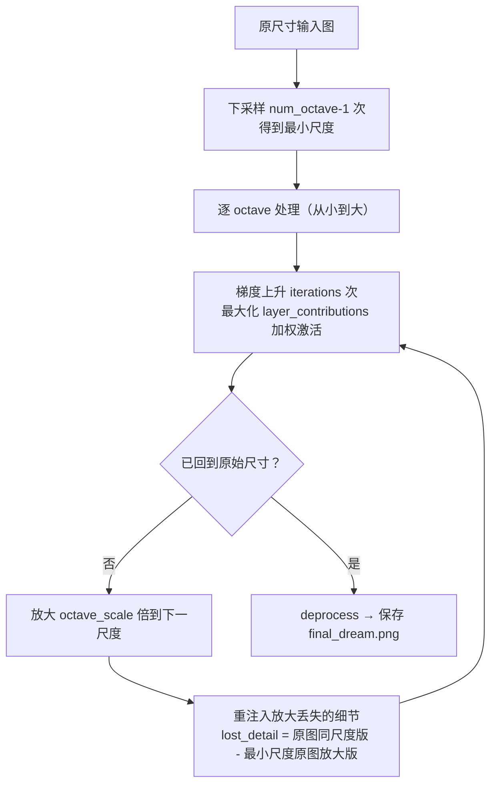

# 第 9 章 DeepDream 与神经风格迁移

> **本章解决**：CNN 内部到底"看"到了什么？能不能把网络学到的特征"印"回图像上？答案是两个创作型技术：**DeepDream**（把某层特征图案画到输入图上，造出迷幻梦境）和**神经风格迁移**（把一幅画的风格搬到另一张图的内容上）。
> **与前后章的关系**：第 3 章建立 CNN、第 6 章给了预训练网络——本章把训练好的网络**反着跑**：不对权重求梯度更新，而是**对输入图像求梯度**。9.1 的可视化技术是理解 9.2、9.3 的地基。

## 9.0 本章导图

<div class="brtree">
  <div class="brrow">
    <span class="brlabel root">生成式视觉</span>
    <span class="brace"></span>
    <div class="brkids">
      <div class="brrow">
        <span class="brlabel">可视化 CNN 特征</span>
        <span class="brace"></span>
        <div class="brkids">
          <span class="brleaf">梯度上升于输入空间</span>
          <span class="brleaf">block1 方向颜色 → block3 网格斑点 → block5 图案中的图案</span>
          <span class="brleaf">诊断网络依赖什么特征（鸟眼案例）</span>
        </div>
      </div>
      <div class="brrow">
        <span class="brlabel">反向运行网络</span>
        <span class="brace"></span>
        <div class="brkids">
          <span class="brleaf">权重冻结，只对输入求导</span>
          <span class="brleaf">梯度上升（max），不是梯度下降（min）</span>
          <span class="brleaf">让某层激活最大的输入 = 该层"梦中图案"</span>
        </div>
      </div>
      <div class="brrow">
        <span class="brlabel">DeepDream</span>
        <span class="brace"></span>
        <div class="brkids">
          <span class="brleaf">最大化整层激活（非单个滤波器）</span>
          <span class="brleaf">layer_contributions 层加权字典</span>
          <span class="brleaf">octave 多尺度 + 细节重注入</span>
          <span class="brleaf">Inception v3，狗脸/鸟羽来自 ImageNet</span>
        </div>
      </div>
      <div class="brrow">
        <span class="brlabel">神经风格迁移</span>
        <span class="brace"></span>
        <div class="brkids">
          <span class="brleaf">内容损失：深层特征 MSE</span>
          <span class="brleaf">风格损失：多层 Gram 矩阵</span>
          <span class="brleaf">总变差损失：空间平滑</span>
          <span class="brleaf">三损失加权求和</span>
        </div>
      </div>
      <div class="brrow">
        <span class="brlabel">优化循环</span>
        <span class="brace"></span>
        <div class="brkids">
          <span class="brleaf">L-BFGS（书）+ Evaluator 缓存</span>
          <span class="brleaf">PyTorch LBFGS closure / Adam</span>
          <span class="brleaf">用内容图初始化组合图</span>
        </div>
      </div>
      <div class="brrow">
        <span class="brlabel">PyTorch 实现要点</span>
        <span class="brace"></span>
        <div class="brkids">
          <span class="brleaf">输入张量 requires_grad_(True)</span>
          <span class="brleaf">forward hook 抓中间层激活</span>
          <span class="brleaf">参数冻结 eval()，只前向 + 反传到输入</span>
        </div>
      </div>
    </div>
  </div>
</div>

## 9.1 CNN 如何看世界

深度学习的好消息讲了很多，但一个根本问题始终悬着：**神经网络如何看和解释世界仍是个黑盒**。训练过程、反向传播更新权重我们都讲过，直觉上、数学上都说得通——但 CNN 到底怎么看世界？层与层之间提取的特征长什么样？

把这个黑盒打开，有两层回报：

1. **算法侧**：理解网络为什么能识别特定模式、为什么工作得这么好，才能进一步改进性能。
2. **业务侧**：解决 **AI Explainability（AI 可解释性）** 问题——很多业务领导不敢基于模型预测做决策，因为没人说得清黑盒里发生了什么。逐层可视化能让神经网络的决策被人类解读。

在 CV 问题里，做法是可视化卷积网络内部的**特征图（feature maps）**：看网络眼中的世界，看它认为什么特征是把类与类区分开的关键。可视化卷积层的思想由 **Erhan 等人在 2009 年**提出。

### 9.1.1 重温神经网络的工作方式

先回顾一遍：训练深度网络 = 给它看百万级样本，网络逐步更新参数直到给出想要的分类。网络通常由 **10~30 层**人工神经元堆叠：图像进输入层，层与层之间传递，最终输出层给出预测。

每层到底在干什么？训练完成后，**每层逐级提取越来越高级的图像特征**，直到最后几层做决策：

| 网络位置 | 学到的特征 |
| --- | --- |
| 第一层 | 边缘（edges）、角点（corners） |
| 中间层 | 把基本特征拼成整体形状（shapes）、部件（components） |
| 最后几层 | 组装成完整解释——对"汽车""自行车"这类复杂图像响应的神经元 |

想看网络学到了什么，思路是：**把网络倒过来，让它增强输入图像，直到引发某个特定解释**。比如你想知道什么样的图像会让网络输出"鸟（Bird）"——从一张纯随机噪声图出发，逐步向"网络认为鸟的重要特征"的方向调整这张图，最终就能看到网络的"鸟的想象"（图 9.1）。

<figure>
  
  <figcaption>图 9.1 从随机噪声出发，逐步调整，直到显现网络认为重要的鸟特征（截自原书）</figcaption>
</figure>

本节要点一句话：神经网络足够聪明，能判断**哪些重要特征沿层传递**给全连接层做分类，**不重要的特征沿途丢弃**——网络学习的是训练集中物体的特征。只要能在深层可视化这些特征图，就能看到**网络把注意力放在哪、用什么特征做预测**。

!!! note "侧栏：信息蒸馏比喻（Chollet）"
    François Chollet 在《Deep Learning with Python》中的描述："你可以把深度网络看成一个**多级信息蒸馏（information distillation）**操作——信息经过一道道过滤器，出来时越来越纯净。"低层保留原始像素细节，越往后剩下的越是"有用的语义"，这正是蒸馏的含义。

!!! note "拓展：为什么对输入求梯度就能'做梦'？"
    训练时我们对**权重**求梯度、更新权重；这一章反过来——**冻结权重，对输入图像求梯度**。把某层的激活值定义为损失，算出"这张图怎么改能让该层激活更大"，然后照着改。反复迭代后，图上就会浮现让该层神经元最兴奋的图案。
    注意：这不是"无中生有"，而是**放大网络在训练中学到的模式**——梯度方向完全由冻结的权重决定，所以梦里出现的永远是它认识的东西（猫、狗、羽毛、桥），网络没学过的类别就梦不出来。DeepDream 与神经风格迁移的全部数学基础，就是这个"对输入的梯度上升"。

### 9.1.2 可视化 CNN 特征

最简单的可视化方法：**显示每个滤波器"想响应"的视觉模式**。实现手段是**输入空间的梯度上升（gradient ascent in input space）**：从一张空白（或带噪）输入图像出发，对输入图像的值做梯度上升，最大化某个特定滤波器的响应——最终得到的输入图像，就是该滤波器响应最强的图案。

!!! note "侧栏：梯度上升 vs 梯度下降"
    梯度（gradient）= 函数在某点的切线斜率、变化率（书配图给出了曲线上 a~f 各点的斜率示意）。往哪个方向走取决于目标：
    - **梯度下降（GD）**：沿梯度的**负**方向走，找局部最小——第 2 章用它最小化损失函数。
    - **梯度上升**：沿梯度的**正**方向走，找局部最大。可视化特征图时我们想让特征"尽量明显"，所以要**最大化**——把 GD 的过程反过来即可。
    （拓展：二者是同一算法乘一个符号。工程上常不写"上升"，而是把损失取负再最小化，优化器代码就能复用。）

下面看效果：对 VGG16 取**开头、中间、结尾**三层的滤波器做可视化——`block1_conv1`、`block3_conv2`、`block5_conv3`，观察特征如何逐层演化。

<figure>
  
  <figcaption>图 9.2 block1_conv1 滤波器的特征图：低层的方向与颜色（截自原书）</figcaption>
</figure>

早期层基本只编码**低级、通用**的特征——方向和颜色。

<figure>
  
  <figcaption>图 9.3 block3_conv2 滤波器的特征图：网格与斑点纹理（截自原书）</figcaption>
</figure>

方向、颜色滤波器在后续层中**组合**成基本的网格与斑点纹理；这些纹理再逐步组合成更复杂的图案——网络开始"看到"构成基本形状的图案。还认不出具体物体，但比早期的清晰多了。

<figure>
  
  <figcaption>图 9.4 block5_conv3 滤波器的特征图：图案中的图案，已含可辨识形状（截自原书）</figcaption>
</figure>

最激动的一张。深层特征包含**可辨识的形状**——图案中的图案。虽然预测靠的是多个特征图的组合，但肉眼已经能猜个八九不离十：左图能看到**眼睛和喙**，猜是鸟或鱼类；中图的图案像**链条**；右图像**食物或水果**。即使猜错，也能轻松排除绝大多数类别——车、船、建筑、自行车都没有眼睛。

**这对分类/检测问题有什么用？** 以图 9.4 左图为例：既然网络靠"眼睛 + 喙"这两个特征识别鸟，那么：

- 图 9.5（鸟眼、喙可见）→ 网络大概率检测成功；
- 图 9.6（鸟的身体可见，但眼和喙被叶子挡住）→ 网络对眼、喙权重很高，**很可能漏检**——而人类一眼就能看到鸟。

<table>
<tr>
<td></td>
<td></td>
</tr>
</table>
*图 9.5 眼与喙可见，网络能识别 · 图 9.6 眼与喙被叶子遮挡，网络可能漏检（截自原书）*

解决方案：用**数据增强**技术、并在训练集中**收集更多这类对抗案例**，逼网络给鸟的其他特征（形状、颜色）分配更高权重。这就是"看见网络所见"的实际价值——它直接告诉你**训练集缺什么**。

### 9.1.3 实现特征可视化器

看完效果，自己动手写。本节走一遍 Keras 官方文档的可视化代码（作者做了少量改动；完整可执行代码见 Keras 仓库）。

!!! note "NOTE"
    直接运行本节书内代码片段会报错——片段只用于讲解思路（例如 `input_img`、`step` 在片段中未定义）。建议用随书下载的完整代码；下面的 PyTorch 版本可直接运行。

**第一步：加载不带分类头的 VGG16。** 书内 Keras 写法：

```python
from keras.applications.vgg16 import VGG16
model = VGG16(weights='imagenet', include_top=False)   # 只要卷积基，不要全连接分类头
```

打印所有卷积层的名字与输出形状，挑出想可视化的层（图 9.7）：从 `block1_conv1` 的 64 通道到 `block5_conv3` 的 512 通道。

<figure>
  
  <figcaption>图 9.7 VGG16 的 13 个卷积层与各自的输出形状（截自原书）</figcaption>
</figure>

**第二步：搭梯度上升的舞台。** 以 `block1_conv1`（64 个滤波器，索引 0~63）的 0 号滤波器为例：定义损失 = 该滤波器激活图的**均值**；计算损失对输入图像的梯度并**归一化**（除以梯度的标准差附近量级），保证上升过程平稳；再用 Keras 后端把"输入图 → (损失, 梯度)"封装成一个可反复调用的函数，循环 20 步做梯度上升。

**第三步：把张量转回合法图像**（`deprocess_image`）：标准化（中心 0、标准差 0.1）、截断到 [0,1]、放大到 0~255、转 uint8 存盘。结果如图 9.8——一块流动的横向纹理。

<figure>
  
  <figcaption>图 9.8 VGG16 block1_conv1 的 0 号滤波器可视化结果（截自原书）</figcaption>
</figure>

换成更深的层（block2、block3）能看到更明确的"图案中的图案"；到了最高层（`block5_conv2`、`block5_conv3`），出现的纹理已经接近网络训练过的物体局部——**羽毛、眼睛**。

**PyTorch 等价实现**（可直接运行）：

```python
# ===== 书 9.1.3 节：滤波器可视化（PyTorch 等价实现）=====
# 书用 Keras：K.gradients(loss, input_img) + K.function([input_img], [loss, grads])
# 要先搭符号图再喂数据。PyTorch 是动态图：对输入 requires_grad_(True) 后
# 直接 loss.backward()，梯度就挂在输入上——"对输入求导"这类任务用 PyTorch 更自然。
import torch
import torchvision.models as models

device = 'cuda' if torch.cuda.is_available() else 'cpu'

# 书：VGG16(weights='imagenet', include_top=False)
# torchvision 无 include_top 参数：取 .features 卷积基即可，等价
vgg16 = models.vgg16(weights=models.VGG16_Weights.IMAGENET1K_V1).features
vgg16 = vgg16.to(device).eval()            # eval()：关掉 BN/Dropout 的训练行为
for p in vgg16.parameters():               # 冻结权重：本任务永不更新网络参数
    p.requires_grad_(False)

# torchvision 按索引取层：block1_conv1=features[0]，block3_conv2=features[12]，
# block5_conv3=features[28]（conv-ReLU 交替，索引对应书中的 block 命名）
layer_name, filter_index = 0, 0            # 书：block1_conv1 的 0 号滤波器（共 64 个）

# 书：loss = K.mean(layer_output[:, :, :, filter_index])——该滤波器响应图的均值
def filter_loss(x, layer_idx, fidx):
    act = vgg16[layer_idx](x)              # 前向到该层，取激活 (1, C, H, W)
    return act[:, fidx, :, :].mean()

# 书：grads /= (K.sqrt(K.mean(K.square(grads))) + 1e-5)——梯度归一化，上升才平稳
def gradient_ascent(x, layer_idx, fidx, steps=20, step_size=1.0):
    for i in range(steps):
        x = x.detach().requires_grad_(True)  # 每轮重新打开输入的梯度
        loss = filter_loss(x, layer_idx, fidx)
        loss.backward()                      # 对输入图像求导
        g = x.grad[0]
        g = g / (g.pow(2).mean().sqrt() + 1e-5)   # 归一化梯度
        with torch.no_grad():
            x.data[0] += step_size * g       # 上升 = 加号！梯度下降这里是减
    return x

# 书：从灰图加噪声出发 np.random.random((1,3,w,h))*20+128
input_img = torch.rand(1, 3, 150, 150, device=device) * 0.15 + 0.45
img = gradient_ascent(input_img, layer_name, filter_index)

# 书：deprocess_image——标准化到 std≈0.1、clip、映射回 0~255
def deprocess_image(x):
    x = x - x.mean()
    x = x / (x.std() + 1e-5)
    x = x * 0.1 + 0.5
    x = x.clamp(0, 1)
    return (x.squeeze(0) * 255).to(torch.uint8).permute(1, 2, 0).cpu().numpy()

from PIL import Image
Image.fromarray(deprocess_image(img)).save('block1_conv1_filter_0.png')
```

## 9.2 DeepDream

**DeepDream** 由 Google 研究员 **Alexander Mordvintsev 等人于 2015 年**开发，是一种艺术图像修改技术：用 CNN 把输入图改成梦幻、迷幻（hallucinogenic）的样子。

<figure>
  
  <figcaption>图 9.9 DeepDream 输出：算法伪影密布的迷幻图像（截自原书）</figcaption>
</figure>

对照原图（图 9.10）：一张海洋风景照，本来有**两只海豚**和其他生物。DeepDream 之后：两只海豚被合并成一个物体，其中一张脸被替换成**狗脸**；其他物体艺术化变形；海面背景多出一层边缘状纹理。

<figure>
  
  <figcaption>图 9.10 DeepDream 的输入图：海景里的两只海豚（截自原书）</figcaption>
</figure>

DeepDream 一夜爆红（internet sensation）——那些图片充满算法伪影、鸟羽、狗脸和眼睛。伪影的来源很直白：**DeepDream 的 ConvNet 在 ImageNet 上预训练，而狗的品种和鸟的物种在 ImageNet 里严重过表示（over-represented）**。换一个以汽车为主的数据集预训练的网络，你的梦里就会长出汽车。

**与 9.1 滤波器可视化的三点差异**——DeepDream 用的是同一套"反向运行 ConvNet、对输入做梯度上升"的思想，只做了几处改动：

| 维度 | 滤波器可视化（9.1） | DeepDream（9.2） |
| --- | --- | --- |
| 输入图像 | 不用输入图，从空白/噪声出发 | **要输入图**——目标就是把可视化特征"印"到图上 |
| 最大化对象 | 层内的**特定滤波器** | **整个层**——一次混合大量特征 |
| 多尺度处理 | 无 | **octave** 多尺度，提高特征质量 |

### 9.2.1 DeepDream 算法原理

与滤波器可视化一样，DeepDream 需要一个在大数据集上预训练的网络。Keras 提供 VGG16、VGG19、Inception、ResNet 等现成模型，也可以用自己的数据集训练后拿来做梦——**网络架构和预训练数据决定梦的样子**：不同架构学到的特征不同，不同数据集生成的特征也不同。原作者用的是 **Inception**（实践中生成的梦最好看），本章跟随使用 **Inception v3**。

总体思路：把输入图像送过预训练网络，在某一层计算梯度——它告诉我们**怎么改这张图能让该层的值最大化**——照着改。迭代 10、20 或 40 次后，图案开始在输入图中浮现（图 9.11）。

<figure>
  
  <figcaption>图 9.11 DeepDream 算法：用某层梯度更新输入图，迭代若干轮（截自原书）</figcaption>
</figure>

**为什么需要 octave？** 预训练网络通常在小尺寸图上训练（ImageNet 输入很小）。如果输入图很大（比如 1000×1000），所有提取出的特征都是**小块**，DeepDream 会印出一堆细碎的、看起来嘈杂的图案，毫无艺术感。解决办法：把输入图按**不同尺度（octave）**分别处理。

Octave（八度）是"区间（interval）"的花哨叫法：先把图像多次下采样成若干尺度（尺度数可配置），然后逐个区间处理。每个区间做三件事：

1. **注入细节（Inject details）**：每次放大都会丢细节、图像变模糊——放大后把丢失的细节从原图"重注入"回去，得到混合图；
2. **跑 DeepDream**：把混合图送过梯度上升；
3. **放大到下一个区间**。

<figure>
  
  <figcaption>图 9.12 octave 流程：下采样 → 从最小尺度逐级做 DeepDream → 放大 → 重注入细节（截自原书）</figcaption>
</figure>

图 9.12 的走法：大图先下采样两次到 octave 3 的最小图。第一个区间不需要注入细节（源图没被放大过）；跑完 DeepDream 后放大输出，细节丢失、图像模糊——此时把 octave 2 原图的细节重注入，混合后再跑 DeepDream；如此"放大 → 注入 → 做梦"递归进行，直到回到原始尺寸。



三个超参数（书内默认配置）：

```python
num_octave = 3      # 尺度（octave）个数
octave_scale = 1.4  # 相邻尺度大小比：每一级比上一级大 40%
iterations = 20     # 每个 octave 内的迭代次数
```

### 9.2.2 DeepDream 实现（PyTorch）

书内实现基于 François Chollet 的 Keras 官方示例与《Deep Learning with Python》。先走一遍书内 Keras 逻辑，再给 PyTorch 等价实现。

**加载模型。** 书内先禁用训练相关操作（我们不做任何训练），再下载不含顶层的 Inception v3；`model.summary()` 查看层名（图 9.13）：

<figure>
  
  <figcaption>图 9.13 Inception v3 summary 片段：activation 层汇入 mixed2 拼接层（截自原书）</figcaption>
</figure>

**选择做梦的层：`layer_contributions` 字典。** 层名 → 权重，**权重越大，该层对梦的贡献越大**：

```python
layer_contributions = {
    'mixed2': 0.4,
    'mixed3': 2.,
    'mixed4': 1.5,
    'mixed5': 2.3,
}
```

这个配置相当随意，改层或改权重都会生成**完全不同的梦**，值得多实验。选择的经验法则（呼应 9.1 的观察）：**低层**生成边缘和几何图案，**高层**注入迷幻视觉图案——猫狗鸟的"幻觉"都来自高层。

**定义损失：各层激活 L2 范数的加权和。** 滤波器可视化最大化"某一个滤波器"，这里**同时最大化若干层的所有滤波器**：

```python
layer_dict = dict([(layer.name, layer) for layer in model.layers])
loss = K.variable(0.)
for layer_name in layer_contributions:
    coeff = layer_contributions[layer_name]
    activation = layer_dict[layer_name].output
    scaling = K.prod(K.cast(K.shape(activation), 'float32'))
    # 只统计非边界像素：避免边界伪影（图像四角的边缘效应会干扰梯度）
    loss = loss + coeff * K.sum(K.square(activation[:, 2:-2, 2:-2, :])) / scaling
```

**梯度与上升函数。** 计算损失对 dream 图的梯度并按绝对值均值归一化；`gradient_ascent` 循环执行"算损失 → 算梯度 → `x += step * grad`"，超过 `max_loss` 就提前刹车（防止图像过曝成噪声）。

**主流程五步**：① 加载输入图；② 定义尺度序列（从小到大）；③ 把输入图缩到最小尺度；④ 逐尺度执行：梯度上升 → 放大到下一尺度 → 重注入放大时丢失的细节；⑤ 回到原始尺寸即停止。

```python
step = 0.01        # 梯度上升步长
num_octave = 3     # 尺度数
octave_scale = 1.4 # 尺度间大小比
iterations = 20    # 每个 octave 的迭代数
max_loss = 10.     # 提前停止阈值——调这些超参会出现新效果
```

作者用的是一张金门大桥照片（图 9.14），输出如图 9.15：天空与水面长满旋涡状"眼睛"，桥体轮廓保持不变。

<table>
<tr>
<td></td>
<td></td>
</tr>
</table>
*图 9.14 输入：金门大桥 · 图 9.15 输出：DeepDream 梦境版金门大桥（截自原书）*

**PyTorch 等价实现**（可直接运行；PyTorch 对"对输入求导"的支持是原生的，不需要 Keras 那套 `K.function` 符号图）：

```python
# ===== 书 9.2.2 节：DeepDream（PyTorch 等价实现）=====
import torch, torch.nn.functional as F
import torchvision.models as models
from PIL import Image

device = 'cuda' if torch.cuda.is_available() else 'cpu'

# 书：InceptionV3(weights='imagenet', include_top=False)
# torchvision 的 inception_v3 没有 include_top 概念，直接整网前向 + hook 抓中间层
inception = models.inception_v3(weights=models.Inception_V3_Weights.IMAGENET1K_V1,
                                transform_input=False).to(device).eval()
for p in inception.parameters():
    p.requires_grad_(False)

# 书：layer_contributions——Keras 的 mixed2~5 在 torchvision 里叫 Mixed_5b/5c/5d/Mixed_6a
# （命名不同、位置相当；权重越大该层对梦贡献越大，照书数值配置）
layer_contributions = {'Mixed_5b': 0.4, 'Mixed_5c': 2., 'Mixed_5d': 1.5, 'Mixed_6a': 2.3}

# forward hook 抓取指定层激活（等价书内 layer_dict[name].output）
activations = {}
def make_hook(name):
    def hook(_m, _inp, out):
        activations[name] = out
    return hook
modules = dict(inception.named_modules())
for name in layer_contributions:
    modules[name].register_forward_hook(make_hook(name))

# 书：loss = Σ coeff·sum(square(act[:, 2:-2, 2:-2, :]))/scaling
# NCHW 布局下空间维是最后两维；scaling=激活元素总数，作用是按规模归一 L2 范数
def dream_loss():
    loss = 0.0
    for name, coeff in layer_contributions.items():
        act = activations[name]
        loss = loss + coeff * act[:, :, 2:-2, 2:-2].square().sum() / act.numel()
    return loss

# 书：grads /= K.maximum(K.mean(K.abs(grads)), 1e-7)；loss>max_loss 提前 break
def gradient_ascent(img, iterations=20, step=0.01, max_loss=10.):
    for i in range(iterations):
        img = img.detach().requires_grad_(True)   # 每轮重新打开输入梯度
        inception(img)                            # 前向，hook 顺带收集激活
        loss = dream_loss()
        loss.backward()                           # 梯度挂在 img.grad 上
        g = img.grad
        g = g / g.abs().mean().clamp_min(1e-7)    # 归一化梯度
        if max_loss is not None and loss.item() > max_loss:
            break
        with torch.no_grad():
            img += step * g                       # 梯度上升：加号
        print(f'...Loss value at {i}: {loss.item():.2f}')
    return img

# 工具：缩放与编解码（Inception 标准归一化 mean/std，等价书内 preprocess/deprocess）
MEAN, STD = torch.tensor([0.485, 0.456, 0.406]), torch.tensor([0.229, 0.224, 0.225])
def load_img(path, size=None):
    import numpy as np
    im = Image.open(path).convert('RGB')
    if size: im = im.resize(size)
    x = torch.from_numpy(np.array(im)).float().permute(2, 0, 1) / 255.
    x = (x - MEAN[:, None, None]) / STD[:, None, None]
    return x[None].to(device)
def save_img(x, path):
    x = x.detach()[0] * STD[:, None, None] + MEAN[:, None, None]
    Image.fromarray((x.clamp(0, 1) * 255).byte().permute(1, 2, 0).cpu().numpy()).save(path)
def resize(x, shape):
    return F.interpolate(x, size=shape, mode='bilinear', align_corners=False)

# ---- 主流程：octave 循环（对应书内五步）----
step, num_octave, octave_scale = 0.01, 3, 1.4
iterations, max_loss = 20, 10.

img = load_img('input.jpg')
original_img = img.clone()
original_shape = img.shape[-2:]                     # (H, W)

# 书：successive_shapes——原尺寸逐级除以 1.4，再反转成"从小到大"
successive_shapes = [original_shape]
for i in range(1, num_octave):
    successive_shapes.append(tuple(int(d / octave_scale ** i) for d in original_shape))
successive_shapes = successive_shapes[::-1]

shrunk_original = resize(original_img, successive_shapes[0])  # 最小尺度原图
for shape in successive_shapes:
    print('Processing image shape', shape)
    img = resize(img, shape)                                  # 升到当前尺度
    img = gradient_ascent(img, iterations, step, max_loss)    # 做梦
    # 细节重注入：原图同尺寸版 减去 "最小尺度原图放大回来" 的版本 = 放大丢掉的高频细节
    upscaled_shrunk = resize(shrunk_original, shape)
    same_size_original = resize(original_img, shape)
    lost_detail = same_size_original - upscaled_shrunk
    img = img + lost_detail
    shrunk_original = resize(original_img, shape)
    save_img(img, f'dream_at_scale_{shape}.png')              # 每个 octave 存一版
save_img(img, 'final_dream.png')                              # 最终结果存盘
```

!!! note "拓展：'细节重注入'到底注入了什么？"
    `lost_detail = same_size_original - upscaled_shrunk` 算的是**放大操作弄丢的高频成分**：原图直接缩放到当前尺度，与"先缩到最小再放大回来"的版本相减，差值就是插值抹平掉的纹理。把它加回 dream 图，等于每放大一级就给图像补一次"原图的锐利细节"，再让下一轮梯度上升在这些细节上继续长出图案——这就是图 9.15 里小图案套大图案、层层不糊的原因。这个技巧后来也被广泛用于各类基于梯度的图像生成。

## 9.3 神经风格迁移

**神经风格迁移（Neural Style Transfer, NST）**：把一张图的**风格**应用到另一张图的**内容**上。这里的定义要钉死：

- **风格（style）** = 纹理、颜色和其他视觉图案；
- **内容（content）** = 图像更高层的宏观结构（macrostructure）。

结果是组合图：保留内容图的布局，披上风格图的笔触（图 9.16，海豚、鱼、植物都在，但整幅图变成蓝黄笔触的画）。

<figure>
  
  <figcaption>图 9.16 内容图 + 风格图 = 组合图（截自原书）</figcaption>
</figure>

该技术由 **Leon A. Gatys 等人于 2015 年**引入（"A Neural Algorithm of Artistic Style"）。风格迁移与纹理生成紧密相关，在图像处理社区早有历史；但 DL 实现的效果**远超以往传统 CV 技术**，触发了创造性 CV 应用的文艺复兴。

作者的偏爱：DeepDream 的幻觉有时令人不安，而且工程师很难"有意"生成心中所想的作品；风格迁移则可以**指定内容图 + 指定喜欢的画**，产出你想象中的作品——只要艺术家工程师愿意，它能画出与专业画家比肩的作品。

**实现思想与所有 DL 算法同源（第 2 章）**：先定义损失函数来描述目标，再优化它。目标已知——保留原图内容、采纳参考图风格。剩下的是把"内容"和"风格"变成数学表示，然后定义损失。三个损失各管一摊：

| 损失 | 比较对象 | 最小化的效果 |
| --- | --- | --- |
| **Content loss** 内容损失 | 内容图 vs 组合图 | 组合图保留更多原内容 |
| **Style loss** 风格损失 | 风格图 vs 组合图 | 组合图风格贴近风格图 |
| **Noise loss**（即 **Total variation loss** 总变差损失） | 组合图自身 | 空间更平滑、噪声更少 |

\[ \text{total\_loss} = [\,\text{style}(style\_image) - \text{style}(combined\_image)\,] + [\,\text{content}(original\_image) - \text{content}(combined\_image)\,] + \text{total\_variation\_loss} \]

!!! note "NOTE"
    Gatys 等人的原始算法**不含**总变差损失。实验发现，鼓励输出图像整体空间平滑后，风格迁移的结果更好、更美观，所以本书的实现加了这一项。

### 9.3.1 内容损失（Content Loss）

内容损失衡量两图在**主题内容与整体布局**上的差异：两张图场景相似 → 损失小；场景完全不同 → 损失大。度量手段：按 ConvNet 的**高层特征表示**给图像打分（海豚、植物、水这类语义概念）。识别这些高级特征正是深度网络的存在意义——网络通过在前层简单特征中找模式，在深层学到高级特征。所以需要一个**预训练**网络，并从**深层**取特征。

具体计算：取内容图与组合图在某一深层的输出，算**均方误差（MSE）**：

\[ \text{Content loss} = \sum \big[\,\text{content}(original\_image) - \text{content}(combined\_image)\,\]^2 \]

最小化它，网络就会不断往组合图里"补内容"，让它越来越像原内容图。

**实现**（书内 Keras 思路）：内容图、风格图、组合图拼成一个 batch 张量喂给 VGG19（`include_top=False`，只要特征提取部分），然后用"第几张 = 哪张图"的索引直接取特征。**选层是关键**：必须选**深层**（书例选 `block5_conv2`）——如果选 block1、block2 这类浅层，网络只能看见线、边缘、斑块这些低级特征，迁移不出完整内容。

!!! warning "原书笔误"
    书内 `content_loss` 片段写的是 `return K.sum(K.square(combined - base))`——`combined` 与 `base` 都是**未定义变量**（应为参数名 `combined_image` 与 `content_image`）。按参数名正确实现见下面代码。

```python
# ===== 书 9.3.1 节：内容损失（PyTorch 等价实现）=====
import torch
import torchvision.models as models

device = 'cuda' if torch.cuda.is_available() else 'cpu'

# 书：vgg19.VGG19(input_tensor=三图拼接, weights='imagenet', include_top=False)
# Keras 把三图 concat 成一个 batch 一次前向；PyTorch 直接对每张图前向取层，更直白
vgg = models.vgg19(weights=models.VGG19_Weights.IMAGENET1K_V1).features.to(device).eval()
for p in vgg.parameters():
    p.requires_grad_(False)

# Keras VGG19 块名 → torchvision vgg19.features 层索引（conv1_1=0, conv2_1=5,
# conv3_1=10, conv4_1=19, conv5_1=28, conv5_2=30）
LAYER_IDX = {'block1_conv1': 0, 'block2_conv1': 5, 'block3_conv1': 10,
             'block4_conv1': 19, 'block5_conv1': 28, 'block5_conv2': 30}

def extract(x, layer):                 # 等价书内 outputs_dict[layer_name]
    for m in list(vgg)[:LAYER_IDX[layer] + 1]:
        x = m(x)
    return x

# 勘误后正确的内容损失：内容图特征与组合图特征的平方和（MSE 思想）
def content_loss(content_features, combined_features):
    return torch.square(combined_features - content_features).sum()
```

**权重参数。** 书内说明有三个缩放参数 `content_weight`、`style_weight`、`total_variation_weight`，由我们作为输入设定，描述内容、风格、噪声在输出中的**相对重要性**。例如 `style_weight = 100`、`content_weight = 1`，意味着愿意**牺牲一点内容保真，换取更浓的艺术风格**；`total_variation_weight` 越高，输出越平滑。

!!! warning "原书未给三权重的具体数值"
    书内只给了语义说明（还留了 `content_weight = content_weight` 这样的占位伪代码），没有数值。本笔记的 PyTorch 实现采用 **Keras 官方示例的经典配置：`content_weight = 0.025`、`style_weight = 1.0`、`total_variation_weight = 1.0`**，可在此基础上实验调整。

### 9.3.2 风格损失（Style Loss）

风格 = 纹理、颜色和其他视觉图案。它比内容损失难定义：**要用多层而不是一层**。

!!! note "侧栏：用多层表示风格特征"
    内容损失只关心深层高级特征，选一层就够。风格不同：我们要的是**多尺度**的风格表示——低层、中层、高层各取一层。这样才能抓住风格图从细碎笔触到大块色彩结构的多尺度纹理，同时**排除**内容图中物体的全局排列。

!!! note "侧栏：Gram 矩阵——度量联合激活的特征图"
    **Gram 矩阵（Gram Matrix）** 是数值化衡量"两个特征图被**联合激活（jointly activated）**程度"的方法。要构建跨层捕捉风格与纹理的损失，就得计算 CNN 各激活通道之间的**相关性（correlation）**——这个相关性正好由激活的 Gram 矩阵（特征间外积）捕获。
    数学写法：把某层激活 \(a\)（形状 \(C \times H \times W\)）展平成矩阵 \(F \in \mathbb{R}^{C \times (H \cdot W)}\)，则
    \[ G = F F^{\mathsf T}, \qquad G_{ij} = \sum_{k=1}^{H \cdot W} F_{ik}\, F_{jk} \]
    \(G\) 是 \(C \times C\) 矩阵：对角线 \(G_{ii}\) 是第 \(i\) 个通道的"总激活量"，非对角线 \(G_{ij}\) 是通道 \(i\) 与通道 \(j\) 的**共现强度**。

```python
# ===== 书 9.3.2 节：Gram 矩阵（PyTorch 等价实现）=====
# 书：K.batch_flatten(K.permute_dimensions(x, (2,0,1)))——把 (C,H,W) 展平成 (C, H*W)
#     再 K.dot(features, K.transpose(features))——F @ F.T
def gram_matrix(act):                      # act: (C, H, W)
    c, h, w = act.shape
    F = act.reshape(c, h * w)              # 展平空间维：只留"哪些特征出现"，抹掉在哪出现
    return F @ F.T                         # 特征两两内积 = 通道共现矩阵
```

有了 Gram 矩阵，`style_loss` 对**一组层**分别算风格图与组合图的 Gram，用平方误差和比较：

```python
# ===== 书 9.3.2 节：风格损失 =====
def style_loss(style_act, combined_act):
    S = gram_matrix(style_act)             # 风格图的 Gram
    C = gram_matrix(combined_act)          # 组合图的 Gram
    channels = style_act.shape[0]          # 勘误：应为特征图通道数（见下）
    size = style_act.shape[1] * style_act.shape[2]
    return torch.square(S - C).sum() / (4.0 * (channels ** 2) * (size ** 2))
```

!!! warning "原书笔误（两处）"
    1. 书内 `channels = 3` 是硬编码的 RGB 通道数；但这里的 `channels` 指的是**该层特征图的通道数**（如 `block4_conv1` 是 512 个通道），Keras 官方示例取 `style.shape[-1]`。按 \(4C^2(H \cdot W)^2\) 归一化的本意，C 必须随层变化，硬编码 3 会让不同层的损失量级失衡。
    2. 书内 `feature_layers` 列表把最后一层写成了 **`'Block5_conv1'`（B 大写）**——Keras 层名全部小写，运行会 `KeyError`，应为 **`'block5_conv1'`**。

本例在 VGG19 的**五个 block 各取第一个卷积层**计算风格损失（换特征层组合，保留的风格就不同）：

```python
feature_layers = ['block1_conv1', 'block2_conv1',
                  'block3_conv1', 'block4_conv1',
                  'block5_conv1']          # 勘误：原书 'Block5_conv1' 大小写笔误
```

最后逐层累加风格损失（每层分摊 `style_weight / 层数` 的权重；Keras 版张量索引里 1 号是风格图、2 号是组合图）：

```python
# 书：for layer_name in feature_layers: ...
#     sl = style_loss(style_reference_features, combination_features)
#     style_loss += (style_weight / len(feature_layers)) * sl
# 勘误：书内 style_loss += 会让变量与函数同名且未初始化（照抄官方示例时引入的笔误），
#       Keras 官方示例是累加进 total loss。PyTorch 版在训练循环里一次性组装（见 9.3.4）。
style_l = 0.0
for name in feature_layers:
    style_l += style_loss(extract(style_img, name),      # 风格图在该层特征
                          extract(combined, name))       # 组合图在该层特征
style_l *= style_weight / len(feature_layers)            # 五层平摊 style_weight
```

训练时网络最小化组合图与风格图之间的上述差异，迫使组合图的风格与风格图相关。

!!! note "拓展：Gram 矩阵为什么能表达'纹理'？"
    关键动作是**展平空间维**：\(F\) 把 \(H \times W\) 个位置压扁成一个池子，Gram 矩阵 \(G_{ij}\) 统计的是"通道 \(i\) 的响应与通道 \(j\) 的响应**同时出现在图里**的程度"——**完全丢弃了空间位置信息，只保留特征共现统计**。
    而纹理的本质恰恰是"与位置无关的统计规律"：梵高《星月夜》的卷曲短笔触无论出现在天空还是海面，都是同一种画法。用 Gram 匹配风格，组合图就不会复制风格图的内容布局，只继承它的"笔触配方"。多取几层（低中高），就同时匹配了细碎纹理与粗大色块——这就是"多层风格表示"与 Gram 矩阵的配合逻辑。

### 9.3.3 总变差损失（Total Variation Loss）

**总变差损失**度量组合图中的噪声，网络通过最小化它来让输出更平滑。做法非常朴素：

1. 把图像**下移一个像素**，与原图做差、平方、求和；
2. 再**右移一个像素**做一遍；
3. 两项之和就是总变差损失。

```python
# ===== 书 9.3.3 节：总变差损失 =====
def total_variation_loss(img):             # img: (1, 3, H, W)
    # a：与"下移 1 像素"的自己比较（行方向相邻像素差）
    a = torch.square(img[:, :, :-1, :-1] - img[:, :, 1:, :-1])
    # b：与"右移 1 像素"的自己比较（列方向相邻像素差）
    b = torch.square(img[:, :, :-1, :-1] - img[:, :, :-1, 1:])
    return torch.pow(a + b, 1.25).sum()    # 书内用 1.25 次幂

tv_l = total_variation_weight * total_variation_loss(combined)
```

\[ \text{TV}(x) = \sum_{i,j} \big[\,(x_{i,j} - x_{i+1,j})^2 + (x_{i,j} - x_{i,j+1})^2\,\big]^{1.25} \]

三项损失相加，得到总损失：

```python
total_loss = content_l * content_weight + style_l + tv_l
```

!!! note "拓展：总变差损失为什么能让图像平滑？"
    相邻像素差平方和，正是"梯度能量"的度量：**噪声 = 大量孤立的剧烈跳变**，把"相邻像素差"压小，斑点与椒盐噪声自然被抹平。这个思想来自经典的 TV 图像去噪（Rudin-Osher-Fatemi, 1992），是老牌正则项在新场景的复用。
    为什么不直接用一次方？纯 \(L_1\) 会把边缘也一起压平；书用的 1.25 次幂介于 \(L_1\) 与 \(L_2\) 之间——**平缓区域强平滑、大边缘保留**。它只在组合图自身上求值，不与任何参考图比较，所以是三者中唯一的"无参考正则"。

### 9.3.4 网络训练（优化循环）

损失定义完毕，接下来用梯度下降最小化它。**被优化的不是权重，而是组合图的像素**——初始化用内容图（书：训练过程用 `content_image` 作为组合图的第一次迭代）。

书内先定义 **Evaluator 类**：把"算总损失"与"算损失对输入的梯度"封装成两个方法，内部**缓存**上一次算出的梯度——因为 SciPy 的 `fmin_l_bfgs_b` 会把 loss 与 grads 当作两个独立回调分别调用，同一输入算一次就够，缓存省掉一半前向：

```python
class Evaluator(object):
    def __init__(self):
        self.loss_value = None
        self.grads_values = None
    def loss(self, x):                       # L-BFGS 每步先调它
        assert self.loss_value is None       # 防止重复计算
        loss_value, grad_values = eval_loss_and_grads(x)
        self.loss_value, self.grad_values = loss_value, grad_values
        return self.loss_value
    def grads(self, x):                      # 再调它时直接取缓存
        assert self.loss_value is not None
        grad_values = np.copy(self.grad_values)
        self.loss_value = self.grad_values = None
        return grad_values

evaluator = Evaluator()
```

然后用 SciPy 的 **L-BFGS** 优化像素，共 1000 轮、每轮最多 20 次函数求值，每轮把当前结果反解成图像存盘：

```python
from scipy.optimize import fmin_l_bfgs_b
iterations = 1000
x = preprocess_image(content_image_path)     # 用内容图初始化组合图
for i in range(iterations):
    x, min_val, info = fmin_l_bfgs_b(evaluator.loss, x.flatten(),
                                     fprime=evaluator.grads, maxfun=20)
    img = deprocess_image(x.copy())
    save_img(result_prefix + '_at_iteration_%d.png' % i, img)
```

```python
# ===== 书 9.3.4 节：完整优化循环（PyTorch 等价实现，替代 Evaluator + scipy）=====
# 书用 scipy.optimize.fmin_l_bfgs_b，需要 Evaluator 缓存 loss/grads。
# PyTorch 的 torch.optim.LBFGS 原生支持 closure——一次闭包里同时算损失和梯度，
# 不需要缓存类。经典三权重（Keras 官方示例配置；原书未给数值）：
content_weight, style_weight, tv_weight = 0.025, 1.0, 1.0

content_img = load_img('content.jpg')        # load_img 同 9.2.2
style_img   = load_img('style.jpg')
combined = content_img.clone().requires_grad_(True)   # 用内容图初始化（书 9.3.4）

optimizer = torch.optim.LBFGS([combined], max_iter=20)   # 对应书 maxfun=20

feature_layers = ['block1_conv1', 'block2_conv1', 'block3_conv1',
                  'block4_conv1', 'block5_conv1']        # 书 9.3.2 的五层
run = [0]

def closure():
    optimizer.zero_grad()
    # 内容损失：block5_conv2（书 9.3.1）
    c_l = content_loss(extract(content_img, 'block5_conv2'),
                       extract(combined, 'block5_conv2')) * content_weight
    # 风格损失：五层 Gram（书 9.3.2，每层平摊 style_weight/5）
    s_l = 0.0
    for name in feature_layers:
        s_l += style_loss(extract(style_img, name), extract(combined, name))
    s_l *= style_weight / len(feature_layers)
    # 总变差损失（书 9.3.3）
    t_l = total_variation_loss(combined) * tv_weight
    loss = c_l + s_l + t_l                 # total_loss = content + style + tv
    loss.backward()                        # 梯度对"组合图像素"求
    run[0] += 1
    if run[0] % 50 == 0:
        save_img(combined.detach(), f'style_at_iteration_{run[0]}.png')
    return loss

for _ in range(50):                        # 书：iterations=1000 轮，demo 可酌减
    optimizer.step(closure)
save_img(combined.detach(), 'final_style.png')
```

!!! tip "TIP：选图的经验法则"
    训练自己的风格迁移网络时记住两点：**内容图**选不需要高等级细节的，效果更好、更出片；**风格图**要选纹理丰富的——平坦的风格图（比如白背景）几乎没有纹理可迁移，结果不会好看。

## 坑与陷阱

!!! danger "8 个容易踩的坑"
    1. **书内代码片段不能直接跑**：9.1.3 缺 `input_img`/`step` 定义、9.3.1 `content_loss` 用了未定义变量、9.3.2 变量与函数同名——按本笔记勘误后的版本写。
    2. **`'Block5_conv1'` 大小写**：Keras 层名全小写，大小写笔误直接 `KeyError`；改层名前先 `model.summary()` 确认。
    3. **忘了梯度归一化**：不管 DeepDream 还是可视化，梯度不除以量级（`mean(|g|)` 或 `sqrt(mean(g²))`），几十步后图像就会过曝成纯噪声。
    4. **大图不做 octave**：预训练网络在小图上训练，直接喂 1000×1000 只会长出细碎噪点——必须多尺度 + 细节重注入。
    5. **忘了去掉边界像素**：DeepDream 损失里不切 `2:-2`，图像四角的边界伪影会主导梯度。
    6. **风格损失里 `channels=3` 硬编码**：`channels` 是特征图通道数、随层变化，固定成 3 会让各层损失量级失衡。
    7. **选浅层做内容损失**：block1/block2 只有线与斑块，内容保不住——内容层要用 `block5_conv2` 这样的深层。
    8. **风格图太平坦**：白背景、纯色块没有纹理可迁移；纹理丰富的画才能出效果。

## 速览

1. 本章把训练好的网络**反着跑**：权重冻结，对**输入图像**求梯度做**梯度上升**（最大化激活），与训练的梯度下降方向相反。
2. 可视化滤波器 = 从噪声图出发最大化某滤波器激活；`block1_conv1` 是方向与颜色，`block3_conv2` 是网格斑点纹理，`block5_conv3` 是"图案中的图案"，肉眼已能猜出物体类别。
3. 可视化的实际价值：看清网络依赖的特征（鸟的眼、喙），发现遮挡场景会漏检 → 用数据增强补对抗样本。
4. DeepDream 与滤波器可视化的三点差异：**要输入图、最大化整层、多尺度 octave**。
5. octave 流程：下采样到最小尺度 → 逐级"放大 → 重注入细节 → 做梦"，`lost_detail` 补回插值丢失的高频成分。
6. DeepDream 的狗脸/鸟羽来自 ImageNet 的类别分布——换数据集，梦就换主角。
7. 风格迁移三损失：**内容损失**（深层特征 MSE）、**风格损失**（多层 **Gram 矩阵**平方差）、**总变差损失**（相邻像素差）。
8. Gram 矩阵 \(G = FF^{\mathsf T}\)：抹掉空间位置、只留通道共现——所以匹配的是"纹理配方"而不是内容布局。
9. 书内经典三权重：内容 0.025 / 风格 1.0 / 总变差 1.0（Keras 官方示例配置，原书未给数值）；style_weight 越大风格越浓，tv_weight 越大越平滑。
10. 优化器：书用 SciPy L-BFGS（配 Evaluator 缓存梯度）；PyTorch 用 `torch.optim.LBFGS` + closure；被优化的对象自始至终是**组合图的像素**。

## 术语速查

| 英文 | 中文 | 一句话 |
| --- | --- | --- |
| Feature Visualization | 特征可视化 | 梯度上升找出让滤波器响应最强的图案 |
| Gradient Ascent | 梯度上升 | 沿梯度正方向迭代，最大化目标函数 |
| Information Distillation | 信息蒸馏 | Chollet 比喻：信息逐层过滤，越来越纯净 |
| AI Explainability | AI 可解释性 | 让黑盒决策可被人理解 |
| DeepDream | —— | Google 2015，最大化整层激活生成迷幻图像 |
| Octave | 八度/尺度区间 | 按不同尺度分别处理输入图 |
| Detail Re-injection | 细节重注入 | 放大后把丢失的高频细节补回图像 |
| layer_contributions | 层贡献字典 | 层名→权重，控制各层对梦的贡献 |
| Inception v3 | —— | DeepDream 原作者选用的网络 |
| Neural Style Transfer | 神经风格迁移 | 把风格图的纹理画到内容图的结构上 |
| Style Image / Content Image | 风格图 / 内容图 | 提供"画法" / 提供"布局" |
| Combined Image | 组合图 | 被优化出来的输出图 |
| Content Loss | 内容损失 | 深层特征的均方误差，保内容 |
| Style Loss | 风格损失 | 多层 Gram 矩阵平方差，保风格 |
| Total Variation Loss | 总变差损失 | 相邻像素差惩罚，保平滑去噪 |
| Gram Matrix | 格拉姆矩阵 | \(G=FF^{\mathsf T}\)，通道共现统计 |
| Jointly Activated | 联合激活 | 两个特征图同时被点亮 |
| Multi-scale Representation | 多尺度表示 | 风格取低中高多层一起匹配 |
| L-BFGS | —— | 拟牛顿优化器，适合全批确定性目标 |
| Evaluator | 评估器 | 缓存 loss/grads，避免重复前向 |
| Feature Map / Activation | 特征图 / 激活 | 卷积层输出的通道响应 |
| Adversarial Case | 对抗案例 | 关键特征被遮挡导致漏检的样本 |
| ImageNet Over-representation | 类别过表示 | 狗鸟类过多 → 梦里全是狗脸鸟羽 |

## 覆盖自查

??? note "原书小节 → 笔记位置"
    | 原书 | 笔记 |
    | --- | --- |
    | 章首引言（艺术系统、本章路线、为什么重要） | 导语 + 9.0 导图 |
    | 9.1 引言（黑盒、可解释性、Erhan 2009） | §9.1 |
    | 9.1.1（重温网络 + 鸟例子 + 蒸馏 NOTE） | §9.1.1（含拓展"为什么对输入求梯度能做梦"） |
    | 9.1.2（梯度上升侧栏 + 三层可视化 + 图 9.5/9.6 对抗案例） | §9.1.2 |
    | 9.1.3（Keras 实现四段 + 图 9.7/9.8 + NOTE 片段不可运行） | §9.1.3（PyTorch 完整实现） |
    | 9.2 引言（Mordvintsev、海豚例、三点差异） | §9.2 |
    | 9.2.1（Inception 选择 + octave + 图 9.11/9.12 + 三参数） | §9.2.1（含 mermaid 流程） |
    | 9.2.2（layer_contributions、损失、梯度上升、octave 循环、图 9.13–9.15） | §9.2.2（含拓展"细节重注入注入了什么"） |
    | 9.3 引言（Gatys、三损失、total_loss 公式、无 TV 的 NOTE） | §9.3 |
    | 9.3.1（内容损失 + 权重参数说明） | §9.3.1（勘误：未定义变量；补 0.025/1.0/1.0） |
    | 9.3.2（多层侧栏 + Gram 侧栏 + style_loss + 五层列表） | §9.3.2（勘误：channels=3、Block5_conv1；含 Gram 拓展） |
    | 9.3.3（TV 损失推导与代码） | §9.3.3（含 TV 拓展） |
    | 9.3.4（Evaluator + L-BFGS + TIP） | §9.3.4（PyTorch LBFGS closure 等价） |
    | 章末 Summary（9 条） | §速览（无重复摘抄） |
