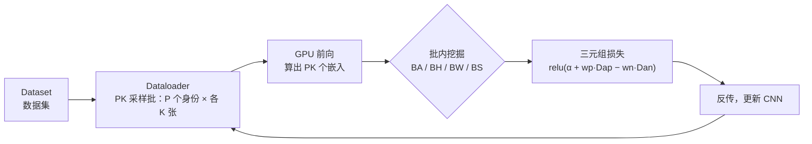
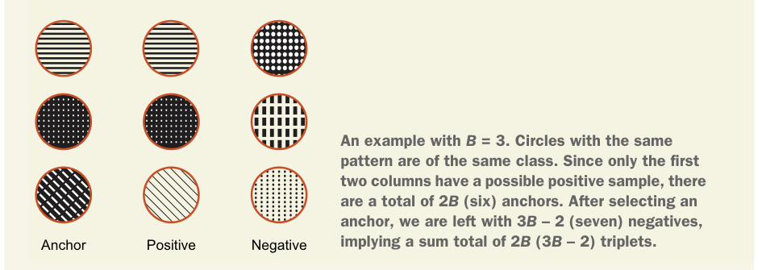

# 第 10 章 视觉嵌入

> **本章解决**：机器怎么"比较"两张图——把图像映射到一个保持相似度的低维向量空间（嵌入空间），再用距离做检索。三大落地场景：人脸识别、以图搜图、目标重识别。
> **与前后章的关系**：前面九章把 CNN 训练成"分类器"，本章换个用法——CNN 变成"特征比较器"，第 1 章埋下的"人脸识别、图像推荐"两个应用在此兑现。这是全书正文的最后一章，交叉熵（第 2 章）、top-k（第 4 章）、mAP（第 7 章）都会在这里收线。
> 本章作者 Ratnesh Kumar（Inria STARS 组博士，研究方向即跨摄像头目标重识别）。学习路径：应用 → 损失函数 → 挖掘策略 → 完整项目 → 提升手段。

## 10.0 本章导图

<div class="brtree">
  <div class="brrow">
    <span class="brlabel root">视觉嵌入</span>
    <span class="brace"></span>
    <div class="brkids">
      <div class="brrow">
        <span class="brlabel">三大应用</span>
        <span class="brace"></span>
        <div class="brkids">
          <span class="brleaf">人脸辨识 1:N</span>
          <span class="brleaf">人脸验证 1:1</span>
          <span class="brleaf">图像推荐（颜色/语义）</span>
          <span class="brleaf">目标重识别（跨摄像头）</span>
        </div>
      </div>
      <div class="brrow">
        <span class="brlabel">嵌入学习</span>
        <span class="brace"></span>
        <div class="brkids">
          <span class="brleaf">定义：低维、保相似度</span>
          <span class="brleaf">四步：选CNN→选损失→选挖掘→测试</span>
          <span class="brleaf">形式化 f(x;θ)、D_ij、y_ij</span>
        </div>
      </div>
      <div class="brrow">
        <span class="brlabel">损失函数</span>
        <span class="brace"></span>
        <div class="brkids">
          <span class="brleaf">交叉熵（训练/推理脱节）</span>
          <span class="brleaf">对比损失 O(N²)</span>
          <span class="brleaf">三元组损失 O(N³)</span>
          <span class="brleaf">朴素实现运行时分析</span>
        </div>
      </div>
      <div class="brrow">
        <span class="brlabel">挖掘策略</span>
        <span class="brace"></span>
        <div class="brkids">
          <span class="brleaf">PK 采样批（18×4）</span>
          <span class="brleaf">BA 全部</span>
          <span class="brleaf">BH 最难</span>
          <span class="brleaf">BW 距离加权</span>
          <span class="brleaf">BS 分布抽样</span>
        </div>
      </div>
      <div class="brrow">
        <span class="brlabel">项目检索</span>
        <span class="brace"></span>
        <div class="brkids">
          <span class="brleaf">DeepFashion / VeRi</span>
          <span class="brleaf">Mobilenet + 128 维嵌入</span>
          <span class="brleaf">query vs gallery 最近邻</span>
          <span class="brleaf">top-k + mAP 评估</span>
        </div>
      </div>
      <div class="brrow">
        <span class="brlabel">提升手段</span>
        <span class="brace"></span>
        <div class="brkids">
          <span class="brleaf">re-ranking（k-reciprocal）</span>
          <span class="brleaf">bag of tricks（warm-up 等）</span>
          <span class="brleaf">注意力</span>
          <span class="brleaf">MTL 多源信息</span>
        </div>
      </div>
    </div>
  </div>
</div>

## 10.1 视觉嵌入的应用

两张图怎么比？答案是先各自过一遍 CNN，得到一个向量，再在向量空间里量距离。这个向量就叫**视觉嵌入（Visual Embedding）**：指接在 CNN 后面、损失层之前的最后一个全连接层；"联合训练（joint training）"指嵌入层与 CNN 参数一起训练。大规模以图搜图系统的流程：把图库全部投影（嵌入）到向量空间，图像比较 = 空间里量成对距离（图 10.1）——"比较两幅图"本身是个非平凡任务，是所有有意义图像搜索的关键。

!!! info "定义：嵌入（Embedding）"
    一个向量空间，通常比输入空间维度更低，并（在输入空间中）**保持相对不相似性（relative dissimilarity）**。"向量空间"与"嵌入空间"两个词混用。本章语境下：训练好的 CNN 的最后一个全连接层就是这个嵌入空间——128 个神经元的全连接层，对应 128 维向量空间。

<figure>
  
  <figcaption>图 10.1 日常应用：机器比较两幅图（左）；在库中检索与输入相似的图像（右）（截自原书）</figcaption>
</figure>

嵌入函数怎么学？流行做法就是深度 CNN：图 10.2 一图流——输入图 → CNN → 嵌入向量。

<figure>
  
  <figcaption>图 10.2 用 CNN 从输入图得到嵌入（截自原书）</figcaption>
</figure>

### 10.1.1 人脸识别

**人脸识别（Face Recognition, FR）**：自动识别或标记图像中人物的精确身份。日常应用：网上搜名人、给亲友照片自动打标签。识别是**细粒度分类（fine-grained classification）**的一种。《Handbook of Face Recognition》（Li & Jain, 2011）把 FR 系统分成两种模式（图 10.3）：

| 模式 | 匹配方式 | 回答的问题 | 例子 |
| --- | --- | --- | --- |
| **Face Identification** 人脸辨识 | **1 : N**：查询脸 vs 库中全部模板 | "她是谁？" | 城市监控查 watchlist（1:few 变体）；社交平台自动 tagging |
| **Face Verification** 人脸验证 | **1 : 1**：查询脸 vs 声称身份的那张模板 | "你是不是这个人？" | 手机人脸解锁 |

<figure>
  
  <figcaption>图 10.3 验证是一对一，辨识是一对多（截自原书）</figcaption>
</figure>

作者点题：不论辨识还是验证，都依赖一个能捕获人脸间有意义差异的好嵌入函数——应用层的目标差异，到了嵌入层是同一件事。

### 10.1.2 图像推荐系统

用户想找与查询图相似的商品图：电商网站根据用户选中的商品推荐相似款（比如同类鞋）。图 10.4 是服装检索：每行最左是查询图，右边是相似服装。

<figure>
  
  <figcaption>图 10.4 服装检索：左列查询，右列返回相似款（截自原书）</figcaption>
</figure>

关键认知：**"相似"取决于任务上下文**，所选相似度不同，图像的嵌入就不同。两种典型度量：

- **颜色相似度（Color similarity）**：检索结果颜色相近——找色调相似的画、相似颜色的鞋（不管款式）。图 10.5：红车、白车、黑车在二维嵌入空间里各自聚成一簇。
- **语义相似度（Semantic similarity）**：检索结果语义属性相同——搜高跟鞋就返回高跟鞋。图 10.6：卡车、跑车、SUV 各自聚类。

还可以发挥创意，把颜色相似度叠加到语义上，做更有意义的推荐。

<table>
<tr>
<td></td>
<td></td>
</tr>
</table>
*图 10.5 颜色相似度分簇 · 图 10.6 语义相似度分簇（截自原书）*

### 10.1.3 目标重识别

**目标重识别（Object Re-identification）**的典型场景是安防摄像头网络（图 10.7）：运营者想查某个人的行踪——他在所有摄像头里出现在哪。系统要在一台相机上识别运动目标，再跨相机**重新确认同一身份（re-identify）**，即所谓 **person re-identification（行人重识别）**。

注意它和验证的相似之处：只关心"不同相机里的两个人是不是同一个"，不需要知道这个人到底是谁。

<figure>
  
  <figcaption>图 10.7 多摄像头数据集：被查询的人出现在 query 与各 gallery 相机中（截自原书）</figcaption>
</figure>

三大应用的公共核心：一个**捕获并保持输入相似性（与不相似性）的嵌入函数**。后面几节就是设计合适的损失函数 + 挖掘有信息量的数据点来训练它。

### 为什么必须嵌入？直接用原图像素不行吗

作者的自我设问，四个瓶颈：

1. **维度爆炸**：高清图 1920×1080 个像素当嵌入，双精度存——存储和检索的计算量都不可行。
2. **语义未知**：比较所需的语义先验是拿不到的，必须监督学习（这正是 CNN 派上用场的地方：自动提取有意义、相关的语义）。
3. **维数灾难（curse of dimensionality）**：维度增加时空间体积暴涨，可用数据变得稀疏，任何在这么高维嵌入空间上跑的学习算法都要遭殃。
4. **数据本身低维**：自然数据的几何与分布非均匀，围绕低维结构聚集——拿图像尺寸当数据维度是杀鸡用牛刀（还有高昂的计算冗余）。

所以学嵌入的目标是双重的：**学到比较所需的语义；把嵌入空间压到更低维度**。

!!! note "拓展：维数灾难为什么专毁"距离"这个概念"
    高维空间不只是"数据稀疏"：维度升高时，随机点对之间的欧氏距离会向均值集中——最近邻与最远邻的距离比值趋近 1，"远近"失去区分度，最近邻检索随之失效。所以把嵌入压到 128 维这种量级，不只是省算力，更是让"距离"重新变得有意义。这也是第 1 章说的"特征向量是紧凑表示"在检索场景的回响。

## 10.2 学习嵌入

学嵌入函数 = 先定义一个衡量相似性的准则（基于颜色、基于图像中物体的语义、或纯数据驱动的监督形式）。因为"正确的语义"很难先验知道，**监督学习更流行**。本章聚焦监督、数据驱动的嵌入学习：给定训练集。图 10.8 是用深度 CNN 学嵌入的高层架构。

<figure>
  
  <figcaption>图 10.8 学习机器（上）与测试流程（下）：损失可以是分类/对比/三元组等（截自原书）</figcaption>
</figure>

流程四步：

1. **选 CNN 架构**：任意合适的架构都行；实践中用最后一个全连接层输出嵌入——它的尺寸决定嵌入向量空间的维度。训练集不大时，用 ImageNet 预训练是明智的（第 6 章）。
2. **选损失函数**：流行的是对比损失和三元组损失（10.3 节）。
3. **选数据采样（挖掘）方法**：把所有样本无脑喂进去既浪费又不可行，必须挖掘有信息量的数据点（10.4 节）。
4. **测试时**：最后一个全连接层的输出就是该图像的嵌入。

## 10.3 损失函数

第 2 章的老规矩：优化问题要先定义要最小化的损失。学嵌入没有例外——定义损失，训练网络选出让误差最小的参数。本节把三大嵌入损失讲透：**交叉熵、对比（contrastive）、三元组（triplet）**。先形式化问题，再逐个上公式。

### 10.3.1 问题设定与形式化

数据集：

\[
\chi = \{(x_i, y_i)\}_{i=1}^{N}
\]

\(N\) 是训练图数量，\(x_i\) 是输入图像，\(y_i\) 是对应标签。目标是学一个嵌入函数

\[
f(x;\theta): \mathbb{R}^D \to \mathbb{R}^F
\]

把 \(\mathbb{R}^D\) 中的图像映到 \(\mathbb{R}^F\) 特征（嵌入）空间，使得**同身份的图像在空间中度量上接近**（异身份反之）：

\[
\theta^* = \arg\min_\theta \; \mathcal{L}(f(\theta;\chi))
\]

其中 \(\theta\) 是学习函数的参数集。再定义嵌入空间里的距离度量：

\[
D(x_i, x_j): \mathbb{R}^F \times \mathbb{R}^F \to \mathbb{R}
\]

为书写简洁，丢掉输入标签，记 \(D(x_i, x_j)\) 为 \(D_{ij}\)；并约定 \(y_{ij} = 1\) 表示样本 (i)、(j) 同类，\(y_{ij} = 0\) 表示不同类。

训练出最优参数后，我们希望学到的函数有两点性质：

- **不变性**：嵌入对视角、光照、物体形状变化保持不变。
- **高效**：从部署角度，嵌入计算与排序要快——这要求低维向量空间。空间越大，比较两幅图的计算越多，时间复杂度直接被拖累。

流行的嵌入损失：交叉熵、对比、三元组。下面逐个形式化。

### 10.3.2 交叉熵损失

学嵌入也可以表述成一个**细粒度分类**问题，用大家最熟悉的交叉熵损失训练（第 2 章详解过）：

\[
\mathcal{L}(\chi) = -\sum_{i=1}^{N} \sum_{k=1}^{C} y_{ik} \log p(y_{ik} \mid f(x;\theta))
\]

\(p(y_{ik}\mid f(x;\theta))\) 是后验类概率（\(y_{ik}\) 取 one-hot，\(C\) 是类别数）。CNN 文献里说的 **softmax loss**，就是"用交叉熵损失、以判别方式训练的 softmax 层"。

训练时的安排：在损失层前加一个全连接（嵌入）层；**每个身份算一个独立类别，类别数 = 训练集的身份数**。训练完**把最后的分类层撕掉**，从新的最后一层取嵌入（图 10.9）。

<figure>
  
  <figcaption>图 10.9 交叉熵训练嵌入层：左为图像分类，右为 person re-ID——测试时走"特征→距离矩阵"，softmax loss 只活在训练模式（灰色虚线）（截自原书）</figcaption>
</figure>

最小化交叉熵的效果：让正确类的估计概率趋近 1、其余趋近 0。但交叉熵的目标只是"把特征分进预定义的类"，与那些**直接在嵌入空间里加入相似性（不相似性）约束**的损失相比，性能通常较差。另一个硬伤：数据集大到一百万身份时，损失层就要一百万个神经元（想象一下！）——计算上不可行。

尽管如此，用交叉熵在**可行子集**上预训练（比如 1000 个身份的子集）是流行策略：预训练过的 CNN 能让嵌入损失收敛更快（10.4 节讲挖掘时再回来看）。

!!! info "书内 NOTE：训练与推理的脱节（disconnect）"
    交叉熵损失的缺点是**训练目标与推理目标脱节**：训练优化的是"分类概率"，推理用的却是"嵌入距离"。因此它一般打不过对比/三元组这类嵌入损失——后者显式地把"输入图像空间到嵌入空间的相对距离保持"纳入了优化目标。

### 10.3.3 对比损失（Contrastive Loss）

对比损失的优化目标：**鼓励所有同类实例彼此无限接近，同时把不同类的实例在输出嵌入空间里推远**。（说"无限接近"是因为 CNN 不可能训练到精确零损失。）套用 10.3.1 的形式化：

\[
l_{\text{contrastive}}(i, j) = y_{ij} D_{ij}^2 + (1 - y_{ij})\, [\alpha - D_{ij}^2]_+
\]

逐项人话解读：

- \([.]_+ = \max(0, \cdot)\) 是 **hinge（铰链）**：负数一律截成 0。
- \(\alpha\) 是预先设定的阈值，即 **margin（间隔）**，决定两个不同类样本对的最大损失。
- 几何含义：**不同类的两个样本，只有当它们在嵌入空间的距离小于 margin 时才贡献损失**——推到 margin 之外就"免责"了。
- 同类项 \(y_{ij} D_{ij}^2\)：距离越大罚越重，把同类对往一起拉。

它又叫 **Siamese loss（孪生损失）**：可以想象成一对共享参数的孪生网络，两幅图各进一个 CNN。Chopra、Hadsell、LeCun 2005 年的开创性工作 [6] 用它做人脸验证——判断两张脸是否同一人。图 10.10 是人脸识别语境下的示意图。

<figure>
  
  <figcaption>图 10.10 对比损失需要两张图：同类优化拉近，异类推远（截自原书）</figcaption>
</figure>

注意：所有不同类共享**同一个** margin \(\alpha\)。Manmatha 等 [7] 分析了其影响：这意味着对异类而言，视觉差异巨大的类与视觉相近的类被推进**同一个特征空间、推到同样远**——比三元组损失（下一节）更严格，限制了嵌入流形（manifold）的结构，让学习更难。每个 epoch 的训练复杂度是 \(O(N^2)\)：要遍历一对对样本才能算损失。

### 10.3.4 三元组损失（Triplet Loss）

灵感来自 Weinberger 等的大间隔最近邻度量学习 [8]；**FaceNet**（Schroff 等 [9]）把它改造成适合 query 检索任务的三元组损失：**强迫同类的数据点彼此靠近，且比它们到异类点的距离更近**。与对比损失不同，三元组损失通过同时考虑同一点出发的正对与负对距离，给损失函数加入了"上下文"：

\[
l_{\text{triplet}}(a, p, n) = [D_{ap} - D_{an} + \alpha]_+
\]

\(D_{ap}\) 是 anchor 到正样本的距离，\(D_{an}\) 是 anchor 到负样本的距离。图 10.11 是三个样本一起参与计算的示意。成功训练后，期望所有同类对比异类对更近。

<figure>
  
  <figcaption>图 10.11 三元组损失需要三个样本：学习目标是同类的嵌入比异类更近（截自原书）</figcaption>
</figure>

把公式翻译成人话——三个角色一个间隔：

| 角色 | 含义 |
| --- | --- |
| **Anchor（锚点 a）** | 参照样本 |
| **Positive（正样本 p）** | 与 anchor 同身份的样本 |
| **Negative（负样本 n）** | 与 anchor 异身份的样本 |
| **\(\alpha\)（margin）** | 安全间距：负样本至少要比正样本远出 \(\alpha\) 才算合格 |

损失 \([D_{ap} - D_{an} + \alpha]_+\) 的三种状态：

| 状态 | 距离关系 | 损失 |
| --- | --- | --- |
| 合格（轻松） | \(D_{an} \ge D_{ap} + \alpha\) | 0，不产生梯度 |
| 踩 margin | \(D_{ap} \le D_{an} < D_{ap} + \alpha\) | \(D_{ap} - D_{an} + \alpha\)，越接近违规罚越多 |
| 最糟 | \(D_{an} < D_{ap}\) | 同上，取到最大 |

对比损失要两个样本，三元组要三个——每 epoch 的训练复杂度随之升到 \(O(N^3)\)，在实用规模的数据集上不可行。三元组与对比损失的高计算复杂度，直接催生了一大票采样（sampling）方法来提高优化与收敛效率——10.4 节的主角。

!!! note "拓展：对比损失 vs 三元组损失，收敛行为差在哪"
    - **对比损失**管的是"绝对距离"：任何异类对只要距离小于统一 margin \(\alpha\) 就持续产生推力。"猫 vs 狗"（视觉相近）和"猫 vs 卡车"（视觉迥异）被要求推到一样远——梯度大量浪费在早已推够远的类对上，还把嵌入流形压得比较扁（书引 [7] 的分析）。
    - **三元组损失**管的是"相对距离"：比较的是 \(D_{ap}\) 与 \(D_{an}\)，正对拉近与负对推远在同一项里相互制衡；只要负样本远出 margin 就停止发力——不同类簇允许拥有自己的半径，流形结构更松。
    - 实践结论（书引多篇工作 [10][11][13]）：配上合适的 hard mining 后，**三元组损失普遍优于对比损失**；但两者都贵（\(O(N^2)\) vs \(O(N^3)\)），这正是 10.4 批内挖掘的动机。

### 10.3.5 朴素实现与运行时间分析

拿个玩具例子算账：

- 身份数（\(N\)）：100
- 每身份样本数（\(S\)）：10

如果按最朴素的方式实现（图 10.12 的算法 1：对数据集所有样本，在所有可能的数据样本组合上算损失），每个 epoch（图 10.12 的内层 for）的训练复杂度：

| 损失 | 朴素做法 | 复杂度 |
| --- | --- | --- |
| 交叉熵 | 一个 epoch 只需遍历全部样本一次 | \(O(N \times S) = O(10^3)\) |
| 对比损失 | 要访问所有样本对的距离 | \(O(100{\times}10 \times 100{\times}10) = O(10^6)\) |
| 三元组损失 | 每次损失计算要访问三个样本 | 最坏立方：\(O(10^9)\) |

（书内脚注：实践中因为主机内存限制，这一步还会再展开成两层 for。）

<figure>
  
  <figcaption>图 10.12 算法 1：朴素实现——外层扫 epoch，内层扫全数据集（截自原书）</figcaption>
</figure>

交叉熵最好算但性能垫底；近期学术工作 [10][11][13] 表明：**配上合适的 hard data mining，三元组损失普遍优于对比损失**——后面小节都以三元组损失为主角。

还有一个关键观察：\(O(10^9)\) 个三元组里，**大多数根本不值钱**。训练中大部分三元组是**平凡（trivial）**的——当前网络在它们身上已经低损失（anchor-正样本对早已比 anchor-负样本对近得多），产生不了有效梯度，反而拖慢收敛；而有信息量的三元组远少于平凡三元组，贡献还会被冲淡。

改进方向就两步：

1. 三元组集合**只在 dataloader 构造的当前 batch 内**构建；
2. 从这个集合里**挖出有信息量的子集**喂给 CNN。

挑有信息量三元组的过程就叫 **mining（挖掘）**——本章的精华，下一节展开。

三大损失的 PyTorch 等价实现（书内只给了算法伪代码，这里按 10.3 节公式落地）：

```python
# ===== 书 10.3 节 =====
import torch
import torch.nn.functional as F

def contrastive_loss(d, y, margin=0.2):
    """成对对比损失（书 10.3.3）：d = D_ij 欧氏距离，y = 1 同类 / 0 异类
    公式 l = y*D_ij^2 + (1-y)*[alpha - D_ij^2]_+；F.relu 即 [.]+"""
    d_sq = d ** 2
    return (y * d_sq + (1 - y) * F.relu(margin - d_sq)).mean()

def triplet_loss(a, p, n, margin=0.2):
    """三元组损失（书 10.3.4）：l = [D_ap - D_an + alpha]_+"""
    d_ap = F.pairwise_distance(a, p)   # anchor → positive 距离
    d_an = F.pairwise_distance(a, n)   # anchor → negative 距离
    return F.relu(d_ap - d_an + margin).mean()

# --- 快速自检 ---
emb = F.normalize(torch.randn(4, 8), dim=1)   # 4 条 8 维嵌入（L2 归一化）
d = torch.cdist(emb, emb)                      # 两两欧氏距离矩阵
pairs = torch.tensor([[0, 1], [0, 2], [1, 3]]) # 三对样本
y = torch.tensor([1.0, 0.0, 1.0])              # 同类 / 异类 / 同类
print(contrastive_loss(d[pairs[:, 0], pairs[:, 1]], y))
print(triplet_loss(emb[0:2], emb[2:4], emb[[3, 1]]))
```

## 10.4 挖掘有信息量的数据

前面看清楚了：三元组、对比损失在实用数据集规模上朴素计算不可行。本节深挖用三元组损失训练 CNN 的关键步骤，搞明白怎么改善收敛速度和计算复杂度。

图 10.12 那种朴素实现属于**离线训练（offline training）**：选三元组必须看全数据集，没法在训练过程中 on-the-fly 完成——低效且对深度学习数据集不可行。

**FaceNet [9] 提出在线批内三元组挖掘（online batch-based triplet mining）**：现场构造一个 batch，只在这个 batch 内挖三元组，无视 batch 之外的所有数据。这个策略被证明有效，拿下了当时人脸识别的 SOTA。

<figure>
  
  <figcaption>图 10.13 在线训练的信息流：dataloader 采子集上 GPU，批内算三元组、更新损失（截自原书）</figcaption>
</figure>

一个 epoch 的信息流（图 10.13）：从数据集构造 mini-batch → 为批内每个样本找出 valid 三元组 → 用三元组更新损失 → 循环直到批用尽，一个 epoch 结束。OpenFace [37] 的方案类似：dataloader 构造具有预定义统计特性的 batch，GPU 上算嵌入，CPU 上生成 valid 三元组再算损失。



### 10.4.1 Dataloader：为挖掘而设计的 PK 批

dataloader 从数据集里选子集，是挖到好三元组的第一道关卡。用最平凡的随机采样，批内可能**类别多样性不足**：比如整批只采到一个类别——批内凑不出任何 valid 三元组，这一轮迭代直接白跑。

!!! info "书内 NOTE"
    dataloader 层面保障收敛的要求：**构造类别多样性足够的 batch**，让批内挖掘有料可挖。

一般的做法：先挖出 B 个三元组（B 项损失贡献），把这 B 个三元组的图堆成一个 3B 张图的 batch（B 个 anchor + B 个 positive + B 个 negative），算出 3B 个嵌入去更新损失。

Hermans 等 [11]（In Defense of the Triplet Loss，重访三元组损失的名作）指出这浪费了：**3B 张图里其实藏着 \(6B^2 - 4B\) 个 valid 三元组**，只用 B 个是严重欠利用。他们对 dataloader 做了一个关键的组织性修改：

> **每个 batch 随机采样 P 个身份，再为每个身份随机采样 K 张图，批大小 = P × K。**

配合合适的挖掘，他们在 person re-ID 上拿下 SOTA；Kumar 等 [10][12] 用同款 dataloader 在多个车辆重识别数据集上也拿下 SOTA。这套批构造如今已是识别文献的标准配置 [11]。

!!! info "侧栏：3B 堆里能数出多少 valid 三元组"
    假设 3B 张图（B anchor、B positive、B negative）里恰好只有一对同类（anchor 列与 positive 列两两配对）：anchor 可以从 anchor 列和 positive 列选，共 \(2B\) 个；每个 anchor 配 \(3B-2\) 个负样本，合计 \(2B(3B-2) = 6B^2-4B\) 个。图 10-s1 的 \(B=3\) 例子：6 个 anchor × 7 个负样本 = 42 个三元组。

{ .lq-img }
*图 10-s1 B=3 时 2B(3B−2)=42 个三元组的示例：同花纹圆圈同类（截自原书）*

!!! info "侧栏：PK 批算例（P=10，K=4）"
    - anchor 总数 = \(PK\) = 40
    - 每个 anchor 的正样本数 = \(K-1\) = 3
    - 每个 anchor 的负样本数 = \(K(P-1)\) = 9×4 = 36
    - valid 三元组总数 = 40 × 3 × 36 = **4320**

默认推荐 **P = 18，K = 4**，批大小 \(18 \times 4 = 72\) 张。

!!! warning "原书笔误"
    原书 10.4.1 写 "P = 18, K = 4, leading to **42** samples"，10.4.2 又以 "the default batch size (42 images) in [11]" 重提——\(18 \times 4 = 72\)，42 不成立。42 恰好是上面 \(B=3\) 侧栏算出的三元组数（\(2B(3B-2) = 42\)），疑似两处数字串写。本笔记按 **72** 修正，后文引用处一并改正。

PK 采样批的 PyTorch 实现（`Sampler` 形式，可直接挂进 `DataLoader` 的 `batch_sampler`）：

```python
# ===== 书 10.4.1 节 =====
import random
from torch.utils.data import Sampler

class PKSampler(Sampler):
    """Hermans et al. [11] 的批构造：每批随机 P 个身份 × 各 K 张 = PK 张。
    前提：dataset.targets 给出每张图的身份标签，且每个身份至少有 K 张图。"""
    def __init__(self, targets, P=18, K=4):
        self.P, self.K = P, K
        ids = {}
        for idx, t in enumerate(targets):          # 按身份建索引
            ids.setdefault(int(t), []).append(idx)
        self.ids = {t: v for t, v in ids.items() if len(v) >= K}
        self.batches = len(self.ids) // P          # 一个 epoch 能出几个完整 PK 批

    def __iter__(self):
        for _ in range(self.batches):
            picked = random.sample(list(self.ids), self.P)   # 无放回采 P 个身份
            batch = []
            for t in picked:
                batch += random.sample(self.ids[t], self.K)  # 每身份采 K 张
            yield batch

    def __len__(self):
        return self.batches
```

!!! note "拓展：三元组损失为什么必须要 PK 批？"
    在线挖掘的全部前提是"批内凑得出 (anchor, positive, negative)"：
    - 随机批里很可能一个身份只出现 1 张——这个 anchor 没有 positive 可配，直接报废；极端时整批 64 张图 64 个身份，**一个 valid 三元组都挖不出来**。
    - PK 批从结构上保证每个 anchor 都有 \(K-1\) 个正样本、\(K(P-1)\) 个负样本：P=18、K=4 时批内 valid 三元组 = \(18{\times}4{\times}3{\times}36 = 7776\) 个，挖掘永远有料。
    - P 还不能太小：候选负样本太少，"最近的负样本"依然很容易，梯度依然 trivial。P 大则负样本池深、难负样本概率高；K 大则正样本对更稳——P 与 K 是一组权衡，18×4 是实践检验过的甜点位。

### 10.4.2 有信息量的数据挖掘：找有用的三元组

挖掘有信息量的样本是 ML 训练的老大难，学术文献里方案不少，快速过一遍。

**Hard data mining（难例挖掘）**是很多 CV 应用（目标检测、动作定位）常用的采样思路：它是一种 **bootstrapping（自助式）** 技术——迭代训练中，每一轮把**当前模型**放到验证集上，挖出它表现差的难样本，**只把这些难样本喂给优化器**，模型学得更有效、更快收敛。反面：如果只喂难样本，而难样本里混着**离群点（outlier，来自错标或低质量图）**，模型区分离群点与正常数据的能力会受损，训练停滞。

落到三元组损失的语境（图 10.14、10.15）：

- **hard negative（难负样本）**：离 anchor **更近**的负样本（产生高损失）。
- **hard positive（难正样本）**：在嵌入空间里离 anchor **远**的正样本。

<figure>
  
  <figcaption>图 10.14 用 margin 给负样本分级：离 anchor 近的是 hard，margin 圈内比正样本远的是 semi-hard，圈外是 easy（截自原书）</figcaption>
</figure>

为了对抗离群点，FaceNet [9] 提出 **semi-hard（半难）采样**：只挖"中等难度"的三元组——既不太难也不平凡，保证训练里有意义的梯度。做法是用 margin 参数划界：**只考虑落在 margin 之内、且比所选正样本离 anchor 更远的负样本**（图 10.14 的中间环带），太容易和太难的都不要。代价：多出一个要调的超参。FaceNet 把这套策略放在 1800 张图的大 batch 上实践，三元组枚举在 CPU 上做；而 [11] 的默认 72 张批，GPU 上就能高效枚举全部 valid 三元组。

<figure>
  
  <figcaption>图 10.15 难正/难负样本：两张图都按"从易到难"自左向右排列——正样本距离随之增大（越远越难），负样本距离随之减小（越近越难）（截自原书）</figcaption>
</figure>

批（大小 PK）构造好之后，有 PK 个候选 anchor。**给这些 anchor 找什么样的正、负样本，就是各种挖掘技术的分水岭**。先看两个简单有效的在线策略：batch all（BA）和 batch hard（BH）。

### 10.4.3 Batch all（BA）：全都要

BA 指使用批内**所有可能且 valid 的三元组**，不做任何排序或选择。实现上：对每个 anchor，跨所有 valid 三元组求和。批大小 PK 时，参与更新损失的项数 = \(PK(K-1)(K(P-1))\)。

- 优点：所有三元组同等重要，实现直接。
- 缺点：**信息被平均掉**。大量 valid 三元组是平凡的（低损失、无信息），有信息量的只占少数；等权求和会把少数 informative 三元组的贡献冲淡。Hermans 等 [11] 在 person re-ID 的实验里就报告了这种"平均化"现象。

### 10.4.4 Batch hard（BH）：只要最难的

BH 反其道行之：对批内每个 anchor，**恰好取一个最难的正样本 + 一个最难负样本**来算损失（难度都是相对于这个 anchor 而言）。每个 anchor 只贡献一项，损失项数 = \(PK\)。

- 优点：对"信息平均化"鲁棒——平凡样本根本不参与。
- 缺点：**对离群点敏感**。错标产生的离群点会一直被当成"最难"，模型拼命向它收敛，训练质量被带偏。另外，**未预训练的网络无法可靠判断难易**——"最难"约等于"随机一个"，训练停滞。这个现象在 FaceNet [9] 与车辆重识别从头训练 [10] 中都被报告过。

<figure>
  
  <figcaption>图 10.16 BA 用上全部样本，BH 只取最右端（最难）的那根（截自原书）</figcaption>
</figure>

图 10.17 是 BA/BH 的算法框架：批内 PK 个 anchor 无放回逐个处理，BA 对该 anchor 的全部 valid 三元组算损失，BH 只算最难的。

<figure>
  
  <figcaption>图 10.17 算法 2：BA 与 BH 的计算框架（截自原书）</figcaption>
</figure>

!!! info "侧栏：三元组损失的统一形式（Ristani & Tomasi [13]）"
    设 \(a\) 为批内一个 anchor，\(P(a)\)、\(N(a)\) 是它的正、负样本子集，则各种批采样技术可以统一写成：

\[
l_{\text{triplet}}(a) = \sum_{p \in P(a)} \sum_{n \in N(a)} [\alpha + w_p D_{ap} - w_n D_{an}]_+
\]

    \(w_p\)、\(w_n\) 是正、负样本的权重（重要性）。整个 epoch 的总损失：

\[
\mathcal{L}(\theta; \chi) = \sum_{\text{all batches}} \sum_{a \in B} l_{\text{triplet}}(a)
\]

    **BA、BH、BW、BS 四种策略，本质上只是 \(w_p\)、\(w_n\) 的选法不同**——对比表见 10.4.6 之后的表 10.1。

### 10.4.5 Batch weighted（BW）：按距离加权

BW 出自 Ristani 等 [13]，修的正是 BA"均匀加权忽略难样本"的毛病：**按样本到 anchor 的距离赋权**，让更有信息量（更难）的样本比平凡样本权重大——正样本按 \(e^{D}\) 加权（越远越重要），负样本按 \(e^{-D}\) 加权（越近越重要）。图 10.18：全部五个正样本都参与（和 BA 一样），但每个样本的权重正比于它到 anchor 的距离——离 anchor 越远的正样本（越难、越有信息量）权重越大；负样本同理、方向相反。

<figure>
  
  <figcaption>图 10.18 BW：样本全用，但权重随距离变化——左为到 anchor 的正样本距离，右为对应的选择权重（截自原书）</figcaption>
</figure>

### 10.4.6 Batch sample（BS）：按分布抽一个

BS 在 Hermans 等 [11] 的实现页（GitHub issue）被积极讨论过，Kumar 等 [10] 用它拿下车辆重识别的 SOTA。思路：**把 anchor 到各样本的距离当成一个分布，从这个分布里做类别式（categorical）采样**，各抽一个正、负样本（图 10.19）——与 BH 相比能避开离群点，因为采样按"到 anchor 的距离分布"进行，选中的是"有信息量且大概率不是离群点"的样本。

<figure>
  
  <figcaption>图 10.19 BS：按距离分布做类别采样——图中抽中了第 3 个样本（随机演示；BH 则会固定取第 5 个）（截自原书）</figcaption>
</figure>

!!! warning "原书笔误 / 实现注意"
    表 10.1 中 BS 的负样本权重写作 \(\mathrm{multinomial}\{-D_{ax}\}\)：距离取负后**权重非正，不满足分类分布（multinomial）对非负权重的要求，不能直接采样**。实现时要用 softmax 形式归一化：\(P(x_n = x) \propto e^{-D_{ax}}\)——恰好就是表中 BW 负样本权重的公式。正样本权重 \(\{D_{ax}\}\) 本身非负，可直接使用（书内脚注给了一个分类分布采样的示例链接 mng.bz/zjvQ）。

### 四种策略同框对比（书表 10.1，本章精华）

把四种策略放回 Ristani 的统一公式 \(l_{\text{triplet}}(a) = \sum_{p}\sum_{n}[\alpha + w_p D_{ap} - w_n D_{an}]_+\)，区别只在权重：

| 挖掘策略 | 正样本权重 \(w_p\) | 负样本权重 \(w_n\) | 一句话人话 |
| --- | --- | --- | --- |
| **All（BA）** | \(1\) | \(1\) | 全部等权，不挑不选 |
| **Hard（BH）** | \([x_p = \arg\max_{x \in P(a)} D_{ax}]\) | \([x_n = \arg\min_{x \in N(a)} D_{ax}]\) | 每个 anchor 只取最远正样本 + 最近负样本 |
| **Sample（BS）** | \([x_p = \mathrm{multinomial}_{x \in P(a)}\{D_{ax}\}]\) | \([x_n = \mathrm{multinomial}_{x \in N(a)}\{-D_{ax}\}]\)（按 softmax 实现） | 按难度分布随机抽一对，抗离群点 |
| **Weighted（BW）** | \(e^{D_{ap}} / \sum_{x \in P(a)} e^{D_{ax}}\) | \(e^{-D_{an}} / \sum_{x \in N(a)} e^{-D_{ax}}\) | 全都参与，但按距离加权 |

注：\([\,\cdot\,]\) 在这里是**指示函数**——条件成立取 1，否则取 0（BH/BS 每个 anchor 恰好选中一个正、一个负）。越靠下的策略越"精"，也越依赖距离本身的质量（BH 依赖预训练，BS/BW 更平滑）。

四种策略的 PyTorch 统一实现（书内只给了算法框图与表格，这里按书 10.4.3–10.4.6 的定义落地，含 BS 的 softmax 勘误处理）：

```python
# ===== 书 10.4.3–10.4.6 节 =====
import torch
import torch.nn.functional as F

def batch_triplet_loss(emb, labels, mode="BA", margin=0.2):
    """PK 批上的四种在线挖掘策略（书表 10.1 的 PyTorch 实现）。
    emb: (PK, d) 嵌入；labels: (PK,) 身份标签；mode ∈ {BA, BH, BW, BS}
    批内约定：每个 anchor 的同身份其余样本 = 正样本集，异身份 = 负样本集。"""
    D = torch.cdist(emb, emb)                        # 两两欧氏距离 (PK, PK)
    same = labels[:, None] == labels[None, :]
    pos = same & ~torch.eye(len(emb), dtype=torch.bool)  # 正样本掩码（去掉自身）
    neg = ~same                                          # 负样本掩码
    ar = torch.arange(len(emb))

    if mode == "BH":   # 每个 anchor：最远正样本 + 最近负样本，共 PK 项
        hp = D.masked_fill(~pos, -1e9).argmax(1)         # 最难正样本
        hn = D.masked_fill(~neg,  1e9).argmin(1)         # 最难负样本
        return F.relu(D[ar, hp] - D[ar, hn] + margin).mean()

    if mode == "BS":   # 按难度分布各抽一个正/负样本（比 BH 抗离群点）
        wp = pos.float() * D                             # 权重 ∝ D：越远越可能被抽中
        wn = (-D).masked_fill(~neg, -1e9).softmax(1)     # softmax(−D)：越近越可能
        hp = torch.multinomial(wp.clamp_min(1e-12), 1).squeeze(1)   # 勘误：−D 为负不能直接采样
        hn = torch.multinomial(wn, 1).squeeze(1)
        return F.relu(D[ar, hp] - D[ar, hn] + margin).mean()

    wp, wn = pos.float(), neg.float()                    # BA：全部置 1
    if mode == "BW":   # BW：书表 10.1 的距离归一化加权
        wp = pos.float() * D.exp();   wp = wp / wp.sum(1, keepdim=True)
        wn = neg.float() * (-D).exp(); wn = wn / wn.sum(1, keepdim=True)
    # BA / BW：对批内全部 (anchor, 正, 负) 组合套统一公式
    # 工程上用 mean 代替书中的 sum，避免批间损失尺度漂移
    L = F.relu(margin + wp[:, :, None] * D[:, :, None]
                       - wn[:, None, :] * D[:, None, :])   # (a, p, n)
    valid = pos[:, :, None] & neg[:, None, :]
    return (L * valid).sum() / valid.sum()

# --- 自检：P=4 个身份 × K=4 张 = 16 张的批 ---
labels = torch.repeat_interleave(torch.arange(4), 4)
emb = F.normalize(torch.randn(16, 8), dim=1)
for m in ["BA", "BH", "BW", "BS"]:
    print(m, batch_triplet_loss(emb, labels, m).item())
```

## 10.5 项目：训练一个嵌入网络

把概念落地：搭建一个基于图像的查询检索系统。选了视觉嵌入文献里最热门的两个问题：

- **购物难题（shopping dilemma）**：给我找和查询单品相似的服装。
- **重识别（re-identification）**：在图库里找相似的车——即从不同视角（相机）识别同一辆车。

两个任务的训练、推理、评估流程完全一样。训练一个嵌入网络需要的原料：

- **训练集**：监督学习路线，标注体现相似性度量。数据集按文件夹组织，一个文件夹一个身份/类别；目标是同类图像在嵌入空间里互相靠近，异类互相远离。
- **测试集**：通常拆成 **query（查询）** 与 **gallery（底库）** 两部分（论文里常把 gallery 称作 test set）。gallery 里的每张图都对每个 query 做检索排名；如果嵌入学得完美，query 的 top 检索结果应全部同类。
- **距离度量**：嵌入空间里用**欧氏（L2）距离**表达两图的相似性。
- **评估**：用 top-k 准确率（第 4 章）和 mAP（第 7 章）定量评估。对查询图 \(q\)：

\[
AP(q) = \frac{\sum_k P(k) \times \delta_k}{N_{gt}(q)}, \qquad mAP = \frac{\sum_{q=1}^{Q} AP(q)}{Q}
\]

\(P(k)\) 是 rank \(k\) 处的精确率，\(N_{gt}(q)\) 是 \(q\) 的真值检索总数，\(\delta_k\) 是指示函数——检索结果与 \(q\) 的 ground-truth 标签一致时记正确；\(Q\) 是查询图总数。

!!! note "拓展：mAP 在检索任务里到底衡量什么"
    AP(q) 是单张 query 的"平均精度"：每命中一个真值就记下**当时排名位置的精确率**，再对全部真值数取平均。它同时惩罚两类失败——"漏检"（真值被排到很后面才命中）和"误检"（真值前面压了一堆错误结果）。mAP 再对所有 query 取平均。与 top-k 的区别：top-k 只关心头部 k 个位置（前 k 名里出现真值即算对），k 之后的排名再烂也不管；mAP 要求**整条排名列表都好**。所以两种指标可能"分裂"：表 10.3 里 GSTE 的 top-1 高达 96.24 却只有 59.47 的 mAP——头部极准，但同一辆车的其余照片被埋在列表深处。（另注：书中 \(\delta_k\) 的表述"correct at rank ≤ k"偏松，按标准 AP 定义应理解为"恰在第 k 位命中"。）

### 10.5.1 Fashion：给我找相似的单品

任务：判断店里拍的两张图是否同一件衣服。时尚商品（衣服、鞋）是图像搜索的产业重镇——推荐引擎要推荐与购物者目标相似的商品。Liu 等 [3] 发布了该任务最大的数据集之一 **DeepFashion**：来自 Forever 21 目录的 **54,642 张图、11,735 件服装**；**25,000 张训练图 + 约 26,000 张测试图**（拆成 query 与 gallery）。图 10.20 是样例：每行一个类别，学得完美的嵌入应让行内图像比跨列图像更近。

<figure>
  
  <figcaption>图 10.20 DeepFashion 样例：每行一个服装类别（截自原书）</figcaption>
</figure>

### 10.5.2 车辆重识别（VeRi）

重识别 = 在摄像头网络内、跨摄像头匹配目标外观。典型流程：用户查找查询目标在全网所有相机中的出现——比如交管在全市相机网里找一辆特定的车。行人和人脸重识别是安防与生物识别的常青任务。

本章用 Liu 等的 **VeRi 数据集** [14][36]：**40,000 个边界框标注、776 辆车（身份）、20 个摄像头**，交通监控场景。每辆车被 **2~18 个相机**拍到，视角与光照各异；视角不限于前/后，还包含**侧面视角**——这让数据集相当有挑战。标注还包含厂牌型号、颜色、跨相机关系与轨迹信息。

本书只用**身份（类别）级标注**，不用厂牌/型号、时空位置等属性——加进去能涨点，但超出本章范围（10.6 节会提多源信息的最新进展）。

<figure>
  
  <figcaption>图 10.21 VeRi 样例：每行一辆车，目标是把同车嵌入推得比异车更近（截自原书）</figcaption>
</figure>

### 10.5.3 实现：超参与网络

项目基于 Hermans 等 [11] 的 GitHub 代码库 triplet-reid（sampling 分支）；数据预处理与步骤总结随书的可下载代码提供，配套 Jupyter notebook 是逐步教程。也推荐 Olivier Moindrot 的博客《Triplet Loss and Online Triplet Mining》作为入门读物。本书的超参清单：

| 超参 | 取值 | 说明 |
| --- | --- | --- |
| 预训练 | ImageNet [15] | 主干初始化 |
| 输入尺寸 | 224 × 224 | 标准输入 |
| 主干架构 | **Mobilenet-v1** [16] | 5.69 亿 **MACs**、424 万参数、ImageNet top-1 70.9% |
| 优化器 | Adam [17] | 默认超参（\(\varepsilon = 10^{-3}\)，\(\beta_1 = 0.9\)，\(\beta_2 = 0.999\)）；初始学习率 0.0003 |
| 数据增强 | 在线水平翻转 | 标准图像翻转操作 |
| 批大小 | **P=18 × K=4** | 即 72 张的 PK 批 |
| margin | **softplus**：\(\ln(1 + \cdot)\) | 用平滑变体替换 hinge \([.]_+\) |
| 嵌入维度 | **128** | 最后全连接层的维度；更低维利于计算效率 |

!!! info "定义：MAC（乘加操作）"
    计算中的 multiply–accumulate（乘累加）操作：算出两数乘积并累加到累加器。执行该操作的硬件单元叫 **multiplier–accumulator（MAC 单元）**；这个操作本身也常被叫做 MAC / MAC 操作——衡量网络算力开销的常用单位。

嵌入网络实现：主干用 torchvision 的 mobilenet_v2 预训练权重，后接 128 维全连接，结构对齐“主干 + 128 维特征”的设定：

```python
# ===== 书 10.5.3 节 =====
import torch
import torch.nn as nn
import torch.nn.functional as F
from torchvision.models import mobilenet_v2, MobileNet_V2_Weights

class EmbeddingNet(nn.Module):
    """CNN 主干 + 128 维嵌入层。测试时最后一个全连接层直接当嵌入用（书 10.2 第 4 步）。"""
    def __init__(self, emb_dim=128, pretrained=True):
        super().__init__()
        weights = MobileNet_V2_Weights.IMAGENET1K_V1 if pretrained else None
        tv = mobilenet_v2(weights=weights)          # ImageNet 预训练主干（书为 Mobilenet-v1）
        self.backbone = tv.features                 # 卷积特征提取部分
        self.pool = nn.AdaptiveAvgPool2d(1)         # 空间池化成 1280 维向量
        self.emb = nn.Linear(1280, emb_dim)         # 最后全连接层 = 嵌入层（书：128 维）

    def forward(self, x):
        x = self.pool(self.backbone(x)).flatten(1)
        return self.emb(x)                          # 输出 128 维嵌入

# 训练循环骨架：PK 批 + 批内挖掘（书 10.4）+ softplus 平滑 margin（书 10.5.3）
def softplus_triplet_loss(emb, labels, margin=0.2):
    D = torch.cdist(emb, emb)
    same = labels[:, None] == labels[None, :]
    pos = same & ~torch.eye(len(emb), dtype=torch.bool)
    neg = ~same
    hp = D.masked_fill(~pos, -1e9).argmax(1)        # 以 BH 为例
    hn = D.masked_fill(~neg,  1e9).argmin(1)
    ar = torch.arange(len(emb))
    raw = D[ar, hp] - D[ar, hn] + margin
    return F.softplus(raw).mean()                   # ln(1+·) 替换 hinge [·]+

# net = EmbeddingNet().cuda()
# opt = torch.optim.Adam(net.parameters(), lr=3e-4)          # 书：初始学习率 0.0003
# loader = DataLoader(train_ds, batch_sampler=PKSampler(train_ds.targets, P=18, K=4))
# for x, y in loader:                                        # x: (72, 3, 224, 224) 的 PK 批
#     emb = F.normalize(net(x.cuda()), dim=1)                # L2 归一化后的嵌入
#     loss = softplus_triplet_loss(emb, y.cuda())
#     opt.zero_grad(); loss.backward(); opt.step()
```

!!! note "拓展：为什么嵌入要 L2 归一化？归一化后内积 = 余弦相似度"
    对单位向量（\(\|x\| = \|y\| = 1\)）：\(x^\top y = \cos\theta\)——内积就是夹角余弦；同时

\[
\|x - y\|^2 = \|x\|^2 + \|y\|^2 - 2x^\top y = 2 - 2\cos\theta
\]

    即 L2 距离与余弦相似度**一一对应（单调等价）**：按欧氏距离排序 = 按余弦相似度排序，检索用哪个都一样。归一化还把所有嵌入拉到同一半径的球面上，距离尺度不再被"向量长短"（常与图像对比度等无关因素挂钩）污染，检索只比方向。

!!! note "拓展：为什么用 softplus 换掉 hinge"
    hinge \([x]_+ = \max(0, x)\) 在 0 点导数不存在（梯度跳变），且一旦越过 margin 梯度瞬间归零。softplus \(\ln(1+e^x)\) 是它的平滑近似：处处可导、没有突变，训练更稳；对"恰好压线"的三元组仍保留小梯度。代价是它对已经很合格的三元组仍有极小的非零损失——工程上通常可以接受。

### 10.5.4 测试训练好的模型

测试时每个数据集给两个文件：query 集与 gallery 集，用来算 mAP 与 top-k。指标之外还要**看图**：随机抽 query，画出它在 gallery 里的 top-k 检索结果。

检索评估的 PyTorch 实现（书 10.5.4 的 query→gallery 最近邻 + top-k/mAP）：

```python
# ===== 书 10.5.4 节 =====
@torch.no_grad()
def embed_all(net, loader, device="cuda"):
    """对整个集合（query 或 gallery）批量算 L2 归一化嵌入"""
    net.eval()
    embs, ys = [], []
    for x, y in loader:
        embs.append(F.normalize(net(x.to(device)), dim=1).cpu())
        ys.append(y)
    return torch.cat(embs), torch.cat(ys)

def evaluate_retrieval(q_emb, q_y, g_emb, g_y, ks=(1, 5)):
    """query→gallery 最近邻检索评估，距离度量 = L2（书 10.5）。
    返回 top-k 准确率字典与 mAP。"""
    dist = torch.cdist(q_emb, g_emb)          # (Q, G) 距离矩阵
    order = dist.argsort(1)                   # 每行：gallery 按距离升序的排名
    hits = (g_y[order] == q_y[:, None])       # (Q, G) 排名后的命中矩阵
    topk = {k: hits[:, :k].any(1).float().mean().item() for k in ks}
    ap = []
    for h in hits:                            # 单个 query 的 AP = 命中位置精确率的均值
        if h.sum() == 0:
            continue
        rank = torch.arange(1, len(h) + 1).float()[h]      # 命中的排名位置
        prec = torch.arange(1, len(rank) + 1).float() / rank
        ap.append(prec.mean().item())
    return topk, sum(ap) / len(ap)

# 用法：
# q_emb, q_y = embed_all(net, query_loader)
# g_emb, g_y = embed_all(net, gallery_loader)
# print(evaluate_retrieval(q_emb, q_y, g_emb, g_y, ks=(1, 5)))
```

#### 任务 1：服装店内的同款检索（In-Shop Retrieval）

图 10.22 是学到的嵌入给出的检索样例：视觉上相当舒服——top 检索与 query 同类，前几名就能召回同一商品的不同视角（标 X 的是错误检索）。

<figure>
  
  <figcaption>图 10.22 服装检索样例：每行 = 一个 query 与它的 top-5 检索，X 表示错误（截自原书）</figcaption>
</figure>

表 10.2：三元组损失在各种采样策略下的表现——**BW 全面领先**，top-1 就有 87.70%（第一次检索就命中同类）；top-k 随 \(k\) 增大单调升高（评估设定的自然性质）。

| 方法 | top-1 | top-2 | top-5 | top-10 | top-20 |
| --- | --- | --- | --- | --- | --- |
| Batch all | 83.79 | 89.81 | 94.40 | 96.38 | 97.55 |
| Batch hard | 86.40 | 91.22 | 95.43 | 96.85 | 97.83 |
| Batch sample | 86.62 | 91.36 | 95.36 | 96.72 | 97.84 |
| **Batch weighted** | **87.70** | **92.26** | **95.77** | **97.22** | **98.09** |
| Capsule embeddings | 33.90 | – | – | 75.20 | 84.60 |
| ABE [18] | 87.30 | – | – | 96.70 | 97.90 |
| BIER [19] | 76.90 | – | – | 92.80 | 95.20 |

与 SOTA 的对比亮点：ABE（attention-based ensemble）训练一组关注图像不同部位的集成；BIER（boosting independent embeddings robustly）把一组共享特征的度量 CNN 当作在线梯度提升问题训练——它**不引入任何额外参数**，且兼容任意可微损失。书里的简单 BW 方案与它们打得有来有回。

!!! info "书内提醒：跟 SOTA 比较要看超参账本"
    训练深度网络要调一堆超参，跨论文比较有坑：底层 CNN 在相同预训练数据上更强，整体指标就可能更好；优化器选择（朴素 SGD vs 更复杂的 Adam）等也会左右结果。**要深入算法的机器细节才能看到全貌**，别只盯表格数字。

#### 任务 2：车辆重识别（VeRi）

Kumar 等 [12] 对三元组损失的各采样变体做了穷举评估，结果汇总在表 10.3（带星号 \(*\) 的方法使用了时空信息）。值得注意的是：他们**不使用任何额外信息源**（时空距离、属性标注）也打出了有竞争力的成绩。

| 方法 | mAP | top-1 | top-5 |
| --- | --- | --- | --- |
| **Batch sample** | **67.55** | 90.23 | 96.42 |
| Batch hard | 65.10 | 87.25 | 94.76 |
| Batch all | 66.91 | 90.11 | 96.01 |
| Batch weighted | 67.02 | 89.99 | 96.54 |
| GSTE [20] | 59.47 | 96.24 | 98.97 |
| VAMI [21] | 50.13 | 77.03 | 90.82 |
| VAMI+ST \(*\) [21] | 61.32 | 85.92 | 91.84 |
| Path-LSTM \(*\) [22] | 58.27 | 83.49 | 90.04 |
| PAMTRI (RS) [23] | 63.76 | 90.70 | 94.40 |
| **PAMTRI (All)** [23] | **71.88** | **92.86** | 96.97 |
| MSVR [24] | 49.30 | 88.56 | – |
| AAVER [25] | 61.18 | 88.97 | 94.70 |

定性结果（图 10.23）：检索对**视角鲁棒**——同一辆车不同视角的照片都被召回进 top-5，正是 10.3.1 要求的"视角不变性"落到了实处。

<figure>
  
  <figcaption>图 10.23 VeRi 检索样例：每行 = 一个 query 与 top-5 检索（截自原书）</figcaption>
</figure>

概念层面过一遍 competing approaches，各家的切入点：

- **CLVR**（Kanaci 等 [26]）：用分类损失 + 车型标签训练细粒度车辆分类网络——与 10.3.2 / 图 10.9 的思路同款；未在 VeRi 上评估（图 10.24）。
- **GSTE**（Bai 等 [20]）：用 K-Means 聚类类内变化，训练更有引导性——代价是多一个 K-Means 聚类部件。
- **PAMTRI**（Zheng 等 [23]）：关键点标注 + 合成数据的多任务嵌入训练（顺带解决关键点标注量的问题）。PAMTRI (RS) 混用真实+合成数据；PAMTRI (All) 额外用车辆关键点与属性，拿下本表最佳。
- **AAVER**（Khorramshahi 等 [25]）：双路径网络分别提取全局与局部特征再拼接；损失用身份与关键点朝向标注监督。
- **VAMI**（Zhou 等 [21]）：GAN + 多视角注意力——设想"能合成多视角视图，就能学到更好的最终嵌入"。
- **Path-LSTM**（Shen 等 [22]）：生成多条路径提案做时空正则，再用额外的 LSTM 给提案排序。
- **MSVR**（Kanaci 等 [24]）：图像金字塔 + 多分支网络并发优化，学多尺度车辆特征。

<figure>
  
  <figcaption>图 10.24 CLVR：分类损失训练车辆重识别，训练/测试两阶段（截自原书）</figcaption>
</figure>

表 10.4 汇总了各方法的嵌入维度与所用标注——**嵌入维度不决定一切**：128 维的朴素方案 mAP 仅次于用了关键点+属性的 PAMTRI (All)。

| 方法 | 嵌入维度 (ED) | 标注 |
| --- | --- | --- |
| Ours（本章） | 128 | ID |
| GSTE [20] | 1024 | ID |
| VAMI [21] | 2048 | ID + A |
| PAMTRI (All) [23] | 1024 | ID + K + A |
| MSVR [24] | 2048 | ID |
| AAVER [25] | 2048 | ID + K |

注：K = 关键点（keypoints），A = 属性（attributes）。

一个现实问题收尾：**车牌**本该是全局唯一标识，但标准交通摄像头的安装方式让车牌很难提取，所以车辆重识别还得靠视觉特征。麻烦在于：两辆车如果厂牌、型号、颜色全同，视觉特征无法区分（除非有文字、划痕这类独特标记）——这种极端场景只有**时空信息**（如 GPS）能救场，可参考 Tang 等的 CityFlow 数据集 [27]。

## 10.6 突破当前精度

深度学习日新月异，本节给几条提升嵌入质量的新思路与训练技巧：

- **Re-ranking（重排序）**：拿到 gallery 的初始排名后，做一步后处理改善相关图像的排名——re-ID 与信息检索系统里强大且广泛使用的招式。re-ID 里的流行方案是 Zhong 等 [28]（图 10.25）：对 probe（查询人）与 gallery 每人提取**外观特征（嵌入）**与 **k-reciprocal 特征**；对每一对计算原始距离 \(d\) 与 **Jaccard 距离** \(J_d\)；最终距离由 \(d\) 与 \(J_d\) 组合而成，用它出新的排名列表。效果立竿见影：AAVER [25] 仅靠 re-ranking 后处理就把 mAP 提了 5%。

  !!! info "定义：Jaccard 距离"
      在两个集合之间计算，表达**交并比（intersection over union）**——交集越大、并集越小，距离越近。

<figure>
  
  <figcaption>图 10.25 Zhong 等的 re-ranking：初始排名 AP=9.05%，重排后 AP=51.98%（截自原书）</figcaption>
</figure>

- **训练技巧（tips and tricks）**：Luo 等 [29] 在 person re-ID 上用一组技巧打出强 baseline：沿用本章学的 Hermans 批构造 [11]，加上数据增强、**warm-up 学习率**、**label smoothing** 等——效果胜过许多 SOTA 方法。作者建议：这些通用技巧适用于任何识别类任务的 CNN 训练。

  !!! info "定义：warm-up 学习率与 label smoothing"
      **Warm-up 学习率**：学习率调度器在预先设定的初始若干 epoch 内**线性调节（升温）**学习率，避免训练一开始就用大步长破坏预训练权重。
      **Label smoothing（标签平滑）**：调制交叉熵损失，让模型在训练集上**不那么过度自信**——帮助泛化、防过拟合，小规模数据集上尤其有用。

- **注意力（attention）**：本章的嵌入是"全局"学的——没有显式引导网络关注物体的判别性部位。代表作：Liu 等 [30]、Chen 等 [31]；注意力还能改善 re-ID 网络的**跨域**表现 [32]。
- **用更多信息引导训练**：表 10.3 已见多源信息的威力——身份、属性（厂牌型号）、时空信息（每张 query/gallery 图的 GPS）。信息越多精度越高，但标注成本也越高。多属性训练的合理框架是**多任务学习（MTL）**；多个任务的损失经常互相冲突，解决办法是对任务适当加权（用交叉验证选权重）；Sener 等 [33] 用多目标优化处理冲突损失。人脸、行人、车辆方向的 MTL 代表：Ranjan 等 [34]、Ling 等 [35]、Tang [23]。

## 坑与陷阱

!!! danger "8 个容易踩的坑"
    1. **朴素三元组 = 灾难**：每 epoch \(O(N^3)\)（10 万张图就是 \(10^{15}\) 量级）。训练前先想清楚挖掘策略，别上来就全枚举。
    2. **随机批凑不齐三元组**：批内可能一个身份只出现 1 张（没 positive 可挖），甚至整批一个类（0 个 valid 三元组），白跑迭代。必须 PK 采样。
    3. **BA 的"信息平均化"**：绝大多数三元组是 trivial 的，等权求和会把少数 informative 三元组的贡献冲淡——Hermans 在 person re-ID 上实测过。
    4. **BH 会被离群点绑架**：错标/低质量图恒为"最难样本"，模型越训越歪；且网络未预训练时"难"根本不可靠，训练停滞。
    5. **BS 的 multinomial(−D) 不能直接采样**：负权重不满足分类分布要求，要用 softmax 形式（\(P \propto e^{-D}\)）实现。
    6. **交叉熵头别带进推理**：训练完撕掉分类层取嵌入；百万身份级别的 CE 损失层也不可行——CE 适合在子集上做预训练加速。
    7. **只看 top-k 会误判**：GSTE top-1=96.24 但 mAP 只有 59.47——头部准不等于整条排名好，top-k 与 mAP 要一起看。
    8. **跨论文比数字先查超参账本**：预训练数据、优化器、输入尺寸、批构造都可能是胜负手。

## 速览

1. **嵌入** = 低维、保持相对不相似性的向量空间；本章的实现就是 CNN 最后一个全连接层，测试时直接取它的输出。
2. 三大应用：人脸识别（1:N 辨识 / 1:1 验证）、图像推荐（颜色/语义相似度决定嵌入）、目标重识别（跨摄像头一致身份）。
3. 学嵌入四步：选 CNN（末层定维度）→ 选损失 → 选挖掘 → 测试。直接用原图当嵌入会撞上维数灾难。
4. 交叉熵：把嵌入当细粒度分类训练，训练/推理脱节、百万身份不可行；适合在子集上预训练加速后续收敛。
5. 对比损失 \(yD_{ij}^2 + (1-y)[\alpha - D_{ij}^2]_+\)：成对、\(O(N^2)\)、统一 margin 偏严；三元组 \([D_{ap} - D_{an} + \alpha]_+\)：三枚举、\(O(N^3)\)、带上下文。
6. 朴素三元组大多 trivial → 只在批内挖：**BA / BH / BW / BS** 统一为 \([\alpha + w_p D_{ap} - w_n D_{an}]_+\) 的不同权重选法。
7. 批构造标准：**P=18 × K=4 = 72 张**的 PK 批（原书误作 42）；批内 valid 三元组 = \(PK(K-1)(K(P-1))\)。
8. 项目配方：ImageNet 预训练 + Mobilenet + Adam(3e-4) + softplus margin + 128 维嵌入 + 在线翻转。
9. 评估：query vs gallery 最近邻（L2）检索；top-k 看头部、mAP 看整条排名，两者互补。
10. 提升：re-ranking（k-reciprocal + Jaccard 距离，AAVER 借它 +5% mAP）、bag of tricks（warm-up、label smoothing）、注意力、MTL 多源信息。

## 术语速查

| 英文 | 中文 | 一句话 |
| --- | --- | --- |
| Visual Embedding | 视觉嵌入 | CNN 末层输出的、保持相似度的向量 |
| Embedding Space | 嵌入空间 | 比输入低维、保相对不相似性的向量空间 |
| Face Identification / Verification | 人脸辨识 / 验证 | 1:N "你是谁" vs 1:1 "你是不是你" |
| Object Re-identification | 目标重识别 | 跨摄像头建立同一目标的一致身份 |
| Query / Gallery | 查询集 / 底库 | 检索的"问题"与"候选库" |
| Curse of Dimensionality | 维数灾难 | 维度升、体积涨、数据稀疏、距离失效 |
| Softmax / Cross-entropy Loss | 交叉熵损失 | 把嵌入当细粒度分类训练，训练推理脱节 |
| Contrastive Loss（Siamese Loss） | 对比损失 | 成对：同类拉近、异类推出 margin |
| Triplet Loss | 三元组损失 | \([D_{ap} - D_{an} + \alpha]_+\)，FaceNet 带火 |
| Anchor / Positive / Negative | 锚点 / 正 / 负 | 三元组的参照 / 同身份 / 异身份样本 |
| Margin（\(\alpha\)） | 间隔 | 异类至少要比同类远出的安全距离 |
| Hinge \([.]_+\) | 铰链 | \(\max(0, \cdot)\)，负值截零 |
| Mining | 挖掘 | 挑有信息量的样本参与训练 |
| Trivial Triplet | 平凡三元组 | 已满足约束、无有效梯度的三元组 |
| Hard Positive / Hard Negative | 难正 / 难负 | 离 anchor 远的正样本 / 近的负样本 |
| Semi-hard Negative | 半难负样本 | 在 margin 内但比正样本远的负样本（FaceNet） |
| Offline / Online Mining | 离线 / 在线挖掘 | 全数据集选三元组 / 批内现场挖 |
| PK Sampling | PK 采样批 | 每批 P 个身份 × 各 K 张（标准 18×4） |
| Batch All（BA） | 批内全部 | 所有 valid 三元组等权参与 |
| Batch Hard（BH） | 批内最难 | 每 anchor 取最难正负各一 |
| Batch Weighted（BW） | 批内加权 | 全都参与，按距离加权 |
| Batch Sample（BS） | 批内抽样 | 按距离分布各抽一个，抗离群点 |
| Top-k Accuracy | Top-k 准确率 | 前 k 名里出现真值即算对 |
| mAP（mean Average Precision） | 平均精度均值 | 惩罚漏检与误检的整条排名质量指标 |
| Re-ranking | 重排序 | 检索后处理，改善初始排名 |
| k-reciprocal Feature | k 倒数特征 | re-ranking 用的互近邻编码特征 |
| Jaccard Distance | 杰卡德距离 | 两集合的交并比 |
| Warm-up Learning Rate | 预热学习率 | 初始若干 epoch 线性升温 |
| Label Smoothing | 标签平滑 | 让交叉熵不过度自信的正则 |
| MAC | 乘加操作 | 乘法 + 累加，网络算力的计量单位 |

## 覆盖自查

??? note "原书小节 → 笔记位置"
    | 原书 | 笔记 |
    | --- | --- |
    | 章首（本章覆盖清单 + 作者介绍 + Embedding 定义） | 导语 + §10.1 开头 info 框 |
    | 图 10.1、10.2（比较图像 / CNN 生成嵌入） | §10.1 |
    | 10.1.1 人脸识别（辨识/验证 + watchlist） | §10.1.1 |
    | 10.1.2 图像推荐（颜色/语义相似度） | §10.1.2 |
    | 10.1.3 目标重识别 + "为什么嵌入"四瓶颈 | §10.1.3 + 拓展 |
    | 10.2（四步流程 + 图 10.8） | §10.2 |
    | 10.3.1 形式化（χ、f、θ*、D_ij、y_ij + 两点期望性质） | §10.3.1 |
    | 10.3.2 交叉熵 + softmax loss + NOTE（脱节） + 预训练策略 | §10.3.2 |
    | 10.3.3 对比损失 + Siamese + margin 分析 [7] + O(N²) | §10.3.3 |
    | 10.3.4 三元组损失 + FaceNet [9] + O(N³) | §10.3.4 |
    | 10.3.5 朴素实现 + 复杂度算例 + trivial 三元组 + 算法 1 | §10.3.5 |
    | 10.4 开篇（offline vs online、FaceNet/OpenFace 方案 + 图 10.13） | §10.4 |
    | 10.4.1 dataloader + 3B 侧栏 + PK 侧栏 + 默认批（勘误 42→72） | §10.4.1 |
    | 10.4.2 hard mining + 离群点 + semi-hard [9] + 图 10.14/10.15 | §10.4.2 |
    | 10.4.3 BA + 平均化问题 | §10.4.3 |
    | 10.4.4 BH + 离群点/预训练依赖 + 图 10.16/10.17 + Ristani 侧栏 | §10.4.4 |
    | 10.4.5 BW + 图 10.18 | §10.4.5 |
    | 10.4.6 BS + 图 10.19 + multinomial 勘误 | §10.4.6 |
    | 表 10.1（四种挖掘策略权重） | §10.4 对比表（重排） |
    | 10.5 开篇（训练/测试集、L2、AP/mAP 公式） | §10.5 开头 + 拓展 |
    | 10.5.1 DeepFashion | §10.5.1 |
    | 10.5.2 VeRi（含只用 ID 标注的说明） | §10.5.2 |
    | 10.5.3 实现（超参表 + MAC 定义 + 代码库/博客指引） | §10.5.3 |
    | 10.5.4 测试（图 10.22/10.23 + 表 10.2/10.3/10.4 + SOTA 对比提醒 + CLVR/GSTE/PAMTRI/AAVER/VAMI/Path-LSTM/MSVR + 车牌讨论） | §10.5.4 |
    | 10.6 re-ranking（[28] + Jaccard 定义 + AAVER +5%） | §10.6 |
    | 10.6 tips（[29] + warm-up/label smoothing 定义） | §10.6 |
    | 10.6 attention + 多信息/MTL（[30]–[35]） | §10.6 |
    | 章末 Summary（3 条） | §速览（无重复摘抄） |
