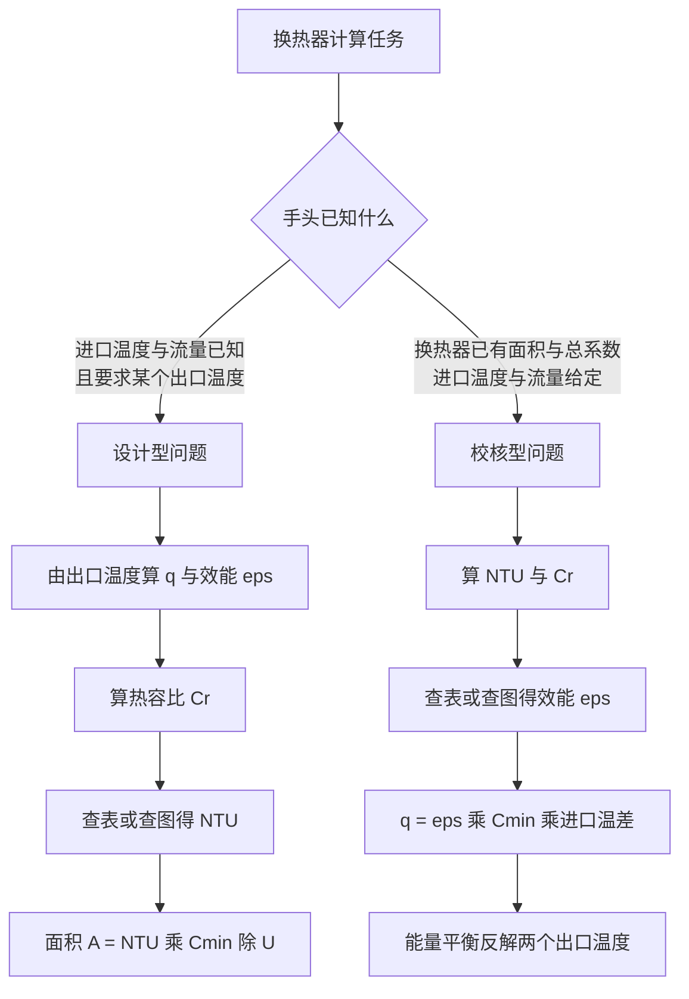

# 第 11 章 换热器

> **本章解决**：两股温度不同的流体被一层固体壁隔开、互不掺混地交换热量——实现这件事的装置叫换热器（heat exchanger），供暖空调、电站、废热回收、化工过程里到处都是。工程上的换热器先按流动方式与构造分类：套管式的顺流与逆流、叉流的混合与不混合、带折流板的壳管式、还有单位体积换热面积特别大的紧凑式。要把传热量算出来，关键是把壁面导热、两侧对流和污垢热阻合并成一个总传热系数，再把沿程不断变化的流体温差用合适的方式取平均——这就引出两套并行的分析工具：进出口温度都已知的场合用对数平均温差（LMTD）法，只知道进口温度的校核场合用效能–传热单元数（ε-NTU）法；两类方法互为反函数，对应"设计新换热器"与"考核旧换热器"两类工程任务。最后讨论污垢为什么是运行的头号敌人、气体侧为什么要加肋，以及这两套方法如何从换热器推广到热沉、瞬态冷却这类"长得不一样"的热系统。

## 11.0 本章导图

  

    换热器
    
    

      

        型式分类
        
        

          套管式：顺流与逆流
          叉流：混合与不混合
          壳管式：壳程数与管程数
          折流板的双重职责
          紧凑式：单位体积大换热面积
        

      

      

        总传热系数
        
        

          总热阻 = 两侧对流加壁面导热
          污垢热阻随运行时间增长
          肋化与总表面效率加权
          必须指明面积基准
        

      

      

        LMTD 法
        
        

          整体能量平衡定出口温度
          微元能量平衡加积分
          对数平均温差公式
          顺流逆流端差配对不同
          冷凝蒸发与等热容流率特例
        

      

      

        效能-NTU 法
        
        

          最大可能传热量与效能定义
          传热单元数与热容比
          各流型效能公式全表
          逆流效能最高
          查图读取 NTU 或效能
        

      

      

        设计型与校核型
        
        

          设计型：定换热面积
          校核型：定传热量与出口温度
          两法互为反解
          污垢与停机清洗的经济账
        

      

      

        方法推广
        
        

          单股流换热器与管内流动统一
          肋片热沉的效能计算
          瞬态冷却问题的 LMTD 类比
          回热器与直接接触式
        

      

    

  

## 11.1 换热器类型

换热器按**流动布置**（flow arrangement）与**构造类型**（type of construction）分类。

最简单的是**同心套管式**（concentric tube，又称 double-pipe，套管式）：冷热流体在一根同心管的两层通道里流动。**顺流**（parallel flow）布置下，两流体从同一端进入、同向流动、从同一端离开（图 11.1a）；**逆流**（counterflow）布置下，两流体从相反端进入、反向流动、从相反端离开（图 11.1b）。

<figure>
  
  <figcaption>图 11.1 套管式换热器：(a) 顺流；(b) 逆流（截自原书）</figcaption>
</figure>

两股流体也可以互相垂直地流动，即**叉流**（crossflow，又称错流），如图 11.2 的带肋与不带肋管束换热器。两种配置的区别在于一个理想化假设：横向掠过管束的流体是"不混合"还是"混合"。

- 图 11.2a：叉流侧流体**不混合**（unmixed）——肋片阻碍了流体在横向（\(y\)）的运动，所以它的温度是 \(T = f(x, y)\)，横竖两个方向都变；
- 图 11.2b：不带肋的光管管束允许流体在横向掺混，温度主要沿主流方向变化，\(T \approx f(x)\)——叉流侧流体是**混合**的（mixed）。

管内流体在两种换热器里都被管壁约束、属于不混合。于是带肋换热器两侧均不混合；不带肋换热器一侧混合、一侧不混合。混合条件直接影响换热器性能。

<figure>
  
  <figcaption>图 11.2 叉流式换热器：(a) 带肋，两侧流体均不混合；(b) 不带肋，一侧混合一侧不混合（截自原书）</figcaption>
</figure>

另一类常见构型是**壳管式换热器**（shell-and-tube heat exchanger，又称管壳式、列管式）：一股流体走管程（tube side），另一股走壳程（shell side）。具体形式按壳程数与管程数区分。最简单的形式是单壳程单管程（图 11.3）。壳程通常装有**折流板**（baffles），它同时干两件事：

1. 迫使壳程流体产生湍动并相对管束形成横掠速度分量，提高壳程对流换热系数；
2. 从物理上支撑管束，抑制流动诱发的管束振动。

带折流板、1 壳程 2 管程的换热器见图 11.4a；2 壳程 4 管程的见图 11.4b。

<figure>
  
  <figcaption>图 11.3 单壳程单管程壳管式换热器（横掠-逆流方式运行）（截自原书）</figcaption>
</figure>

<figure>
  
  <figcaption>图 11.4 壳管式换热器：(a) 1 壳程 2 管程；(b) 2 壳程 4 管程（截自原书）</figcaption>
</figure>

!!! note "拓展：1-2 型里的"逆流"其实不纯"
    图 11.4a 的 1 壳程 2 管程换热器里，壳程流体与其中一半管程流体同向、与另一半逆向，整体介于逆流与顺流之间，所以图 11.3 标注"横掠-逆流方式"（cross-counterflow mode）。这种不纯性正是后面 LMTD 要乘修正因子 F、ε-NTU 公式要单列"1 壳程"公式的根本原因。管程数总取偶数（2、4、…），因为管束要在同一端封头里折返，进出同侧才好制造。

特殊而重要的一类换热器追求极大的单位体积换热面积——液体侧可达 \(400\ \mathrm{m^2/m^3}\)、气体侧可达 \(700\ \mathrm{m^2/m^3}\) 以上——称为**紧凑式换热器**（compact heat exchanger）。它用密集排列的肋管或板束实现大面积，典型用途是至少一侧流体为气体（气体侧对流换热系数天然很小）。管子可以是扁管或圆管，肋可以是板肋或圆肋（图 11.5a、b、c）；平行板式换热器可以带肋或压制成波纹，可单程运行（图 11.5d）也可多程运行（图 11.5e）。紧凑式换热器的流道通常很小（水力直径 \(D_h \lesssim 5\ \mathrm{mm}\)），流动一般处于层流区。

<figure>
  
  <figcaption>图 11.5 紧凑式换热器芯体：(a) 肋管（扁管+连续板肋）；(b) 肋管（圆管+连续板肋）；(c) 肋管（圆管+圆肋）；(d) 板肋（单程）；(e) 板肋（多程）（截自原书）</figcaption>
</figure>

## 11.2 总传热系数

任何换热器分析中最基本、也往往最不确定的一步，是确定**总传热系数**（overall heat transfer coefficient）。回顾第 3 章的定义：它以两流体之间的总热阻来定义。对被一层壁隔开的两股流体，有

\[
\frac{1}{UA} = \frac{1}{(hA)_c} + R_w^* + \frac{1}{(hA)_h}
\tag{11.1a}
\]

其中 \(c\)、\(h\) 分别指冷、热流体，\(R_w^*\) 是壁面导热热阻（平壁用式 3.6，圆筒壁用式 3.33）。注意：计算 \(UA\) 乘积不需要指明哪一侧是热侧哪一侧是冷侧；但要单独给出"一个"总系数 \(U\) 时必须指明面积基准——以冷侧面积或热侧面积为基准得到的 \(U_c\)、\(U_h\) 一般不等，只是恒有 \(U_c A_c = U_h A_h\)。

式 (11.1a) 只适用于**洁净、无肋**的表面。实际运行中，换热面常因流体中的杂质、锈蚀或流体与壁材的反应而**结垢**（fouling），表面沉积出的膜层或锈垢会大幅增加传热热阻。处理办法是在式 (11.1a) 中追加一项**污垢热阻**（fouling factor，又称污垢系数）\(R_f''\)，单位 \(\mathrm{m^2 \cdot K/W}\)，其数值取决于运行温度、流体流速与换热器已运行的时长。

此外，与任一侧或两侧流体接触的表面常加**肋片**（fins），靠增大面积来降低总热阻。把污垢与肋化都计入后，总传热系数修正为

\[
\frac{1}{UA} = \frac{1}{(\eta_o h A)_c} + \frac{R_{f,c}''}{(\eta_o A)_c} + R_w^* + \frac{R_{f,h}''}{(\eta_o A)_h} + \frac{1}{(\eta_o h A)_h}
\tag{11.1b}
\]

这里 \(\eta_o\) 叫**总表面效率**（overall surface efficiency，又称温度效能 temperature effectiveness）：对无污垢的热（或冷）侧肋化表面，它定义的传热速率式为

\[
q = \eta_o h A\,(T_b - T_\infty)
\tag{11.2}
\]

其中 \(T_b\) 是肋基温度，\(A\) 是总面积（肋面 + 裸露的基面）。第 3.6.5 节导出的表达式为

\[
\eta_o = 1 - \frac{A_f}{A}\,(1 - \eta_f)
\tag{11.3}
\]

\(A_f\) 是全部肋面面积，\(\eta_f\) 是单根肋的肋效率。为与换热器分析惯用记号一致，这里把"肋面积/总面积"写成 \(A_f/A\)（第 3.6.5 节写的是 \(NA_f/A_t\)，\(A_f\) 指单根肋）。若采用绝热尖端近似的直肋或针肋（长 \(L\)、厚 \(t\)），由式 (3.81)、(3.91) 得

\[
\eta_f = \frac{\tanh(mL)}{mL}, \qquad m = \left(\frac{2h}{kt}\right)^{1/2}
\tag{11.4}
\]

几种常见肋形的效率可直接查表 3.5。

!!! note "拓展：污垢项为什么写成 R″f/A"
    \(R_f''\) 是**单位面积**的污垢热阻（\(\mathrm{m^2 \cdot K/W}\)，是物性表里查得到的量），而串进热阻网络的是"这个面的总污垢热阻"（K/W），必须除以该侧的（有效）面积：\(R_f''/A\)。这也是为什么式 (11.1b) 里污垢项的分母带着 \(\eta_o A\)——肋化侧的污垢沉积同样被总表面效率"打折"。记住一个对照：对流项 \(1/(\eta_o h A)\) 与污垢项 \(R_f''/(\eta_o A)\) 形式完全平行，\(1/h\) 的单位也是 \(\mathrm{m^2 \cdot K/W}\)。污垢是随时间从零逐渐长起来的变量，设计时取代表性值留裕量，运行时定期清洗——例 11.5 会算一笔"结垢逼你加 165 km 管子"的经济账。

式 (11.2) 默认无污垢。若污垢显著，式中的 \(h\) 要换成**部分总传热系数**（partial overall heat transfer coefficient）

\[
U_p = \frac{h}{1 + h R_f''}
\]

它只包含"一股流体 + 自己那侧表面"的对流与污垢，不跨壁：\(U_{p,h} = h_h/(1 + h_h R_{f,h}'')\)、\(U_{p,c} = h_c/(1 + h_c R_{f,c}'')\)。用 \(U_p\) 代替 \(h\) 去评肋效率之后，可以证明：把式 (11.1b) 右端的对流项换成 \(1/(U_{p} A)\) 的形式后，两个独立的污垢项即可删去——两种写法等价。

壁面导热项 \(R_w^*\) 常可忽略——壁薄且导热系数大。两侧对流系数也常相差悬殊，小者主导总系数：一側是气体、另一侧是液体或沸腾/凝结的液汽混合物时，气体侧 \(h\) 小得多，这正是要在气体侧加肋的场合。总系数的代表性数值见表 11.2。

**表 11.1 代表性污垢热阻**

| 流体 | \(R_f''\)（m²·K/W） |
| --- | --- |
| 海水、处理过的锅炉给水（50°C 以下） | 0.0001 |
| 海水、处理过的锅炉给水（50°C 以上） | 0.0002 |
| 河水（50°C 以下） | 0.0002–0.001 |
| 燃料油 | 0.0009 |
| 制冷剂液体 | 0.0002 |
| 蒸汽（不含油） | 0.0001 |

**表 11.2 总传热系数的代表性数值**

| 流体组合 | \(U\)（W/m²·K） |
| --- | --- |
| 水–水 | 850–1700 |
| 水–油 | 110–350 |
| 蒸汽凝汽器（水在管内） | 1000–6000 |
| 氨凝汽器（水在管内） | 800–1400 |
| 酒精凝汽器（水在管内） | 250–700 |
| 肋管换热器（管内水、空气叉流掠过） | 25–50 |

对图 11.1–11.4 那种不带肋的管式换热器，式 (11.1b) 化为

\[
\frac{1}{UA} = \frac{1}{h_i A_i} + \frac{R_{f,i}''}{A_i} + \frac{\ln (D_o/D_i)}{2 \pi k L} + \frac{R_{f,o}''}{A_o} + \frac{1}{h_o A_o}
\tag{11.5}
\]

下标 \(i\)、\(o\) 指管的内、外表面（\(A_i = \pi D_i L\)，\(A_o = \pi D_o L\)），它们可能接触热流体也可能接触冷流体。

!!! note "拓展：一张表看出"加肋加在谁身上""
    表 11.2 的数值跨度有几十倍：水–水 850–1700，凝汽器 1000–6000（凝结侧 \(h\) 极大），而"管内水、管外空气叉流"只有 25–50——空气侧把总系数拖死了。所以工程师的直觉应该是：**总系数几乎总被最小的一侧 \(h\) 绑架**；空气–水组合想提高 \(U\)，唯一有效的办法是在空气侧加肋把 \(\eta_o h A\) 抬上去（紧凑式、肋管换热器都是这个思路的产物），而在水侧做任何强化都白费。\(h_c\)、\(h_h\) 与几何参数定了之后，\(U\) 就能由式 (11.5) 算出；不带肋表面的 \(h\) 用第 7、8 章关联式估计，标准肋形的 \(h\) 可查 Kays 与 London 编纂的结果。

## 11.3 换热器分析：LMTD 法

设计或预测一台换热器，本质是把总传热速率 \(q\) 与进出口温度、总传热系数、总换热面积关联起来。第一个关系来自对冷、热流体做**整体能量平衡**（图 11.6）：设换热器与外界换热可忽略、动势能变化可忽略，对两股稳流流体分别应用稳流能量方程（式 1.12d）：

\[
q = \dot m_h (i_{h,i} - i_{h,o})
\tag{11.6a}
\]

\[
q = \dot m_c (i_{c,o} - i_{c,i})
\tag{11.7a}
\]

\(i\) 是流体焓。若流体不发生相变且比热容为常数，退化为

\[
q = \dot m_h c_{p,h} (T_{h,i} - T_{h,o}) = C_h (T_{h,i} - T_{h,o})
\tag{11.6b}
\]

\[
q = \dot m_c c_{p,c} (T_{c,o} - T_{c,i}) = C_c (T_{c,o} - T_{c,i})
\tag{11.7b}
\]

这里的 \(C \equiv \dot m c_p\) 叫**热容流率**（heat capacity rate），单位 W/K；温度均指所在位置的**平均**流体温度。式 (11.6)、(11.7) 与流动布置、换热器类型完全无关——不管顺流逆流都成立。

<figure>
  
  <figcaption>图 11.6 对两流体换热器做的整体能量平衡（截自原书）</figcaption>
</figure>

第二个关系要把 \(q\) 与冷热流体温差 \(\Delta T\) 挂钩：

\[
\Delta T \equiv T_h - T_c
\tag{11.8}
\]

这像是牛顿冷却公式的推广：单个对流系数 \(h\) 换成总系数 \(U\)。但 \(\Delta T\) 沿换热器位置变化，只能写成

\[
q = UA\,\Delta T_m
\tag{11.9}
\]

\(\Delta T_m\) 是某个合适的**平均温差**。配上式 (11.6)、(11.7)，式 (11.9) 就能做换热器分析——前提是先把 \(\Delta T_m\) 的具体形式定下来。

### 11.3.1 顺流换热器

顺流换热器中冷热流体的平均温度分布见图 11.7：温差 \(\Delta T\) 入口处最大，随 \(x\) 增大不断衰减，渐近趋于零。一个重要推论：顺流换热器的冷流体出口温度**永远不会超过**热流体出口温度。下标 1、2 指换热器的两端，这个约定对所有型式通用；对顺流即 \(T_{h,i} = T_{h,1}\)、\(T_{h,o} = T_{h,2}\)、\(T_{c,i} = T_{c,1}\)、\(T_{c,o} = T_{c,2}\)。

<figure>
  
  <figcaption>图 11.7 顺流换热器的温度分布与微元能量平衡（截自原书）</figcaption>
</figure>

\(\Delta T_m\) 的形式由对微元（长 \(dx\)、面积 \(dA\)）做能量平衡得到，分析基于五条假设：

1. 换热器对外界绝热，只有冷热流体之间交换热量；
2. 沿管轴方向的导热可忽略；
3. 势能与动能变化可忽略；
4. 流体比热容为常数；
5. 总传热系数为常数。

（比热容当然会随温度变，\(U\) 也会随物性与流动状况变；但多数场合变化不大，取换热器内的平均值 \(c_{p,c}\)、\(c_{p,h}\)、\(U\) 即可。）

对图 11.7 的每个微元列能量平衡：

\[
dq = -\dot m_h c_{p,h}\, dT_h = -C_h\, dT_h
\tag{11.10}
\]

\[
dq = \dot m_c c_{p,c}\, dT_c = C_c\, dT_c
\tag{11.11}
\]

把式 (11.10)、(11.11) 沿整个换热器积分，就回到整体平衡式 (11.6b)、(11.7b)。穿过面积 \(dA\) 的传热速率还可写成

\[
dq = U\,\Delta T\, dA
\tag{11.12}
\]

\(\Delta T = T_h - T_c\) 是**局部**温差。要积分式 (11.12)，先把式 (11.10)、(11.11) 代入 \(\Delta T\) 的微分：

\[
d(\Delta T) = dT_h - dT_c = -dq\left(\frac{1}{C_h} + \frac{1}{C_c}\right)
\]

再把式 (11.12) 的 \(dq\) 代入、分离变量并从入口端积到出口端：

\[
\int_1^2 \frac{d(\Delta T)}{\Delta T} = -U\left(\frac{1}{C_h} + \frac{1}{C_c}\right)\int_0^A dA
\]

\[
\ln \frac{\Delta T_2}{\Delta T_1} = -UA\left(\frac{1}{C_h} + \frac{1}{C_c}\right)
\tag{11.13}
\]

用整体平衡把 \(1/C_h = (T_{h,i} - T_{h,o})/q\)、\(1/C_c = (T_{c,o} - T_{c,i})/q\) 代入，并注意顺流时 \(\Delta T_1 = T_{h,i} - T_{c,i}\)、\(\Delta T_2 = T_{h,o} - T_{c,o}\)，整理即得

\[
q = UA\,\frac{\Delta T_2 - \Delta T_1}{\ln (\Delta T_2 / \Delta T_1)} = UA\,\frac{\Delta T_1 - \Delta T_2}{\ln (\Delta T_1 / \Delta T_2)}
\]

对照式 (11.9)，合适的平均温差原来是**对数平均温差**（log mean temperature difference，LMTD）：

\[
q = UA\,\Delta T_{lm}
\tag{11.14}
\]

\[
\Delta T_{lm} = \frac{\Delta T_2 - \Delta T_1}{\ln (\Delta T_2 / \Delta T_1)} = \frac{\Delta T_1 - \Delta T_2}{\ln (\Delta T_1 / \Delta T_2)}
\tag{11.15}
\]

顺流换热器的端点温差为

\[
\begin{cases}
\Delta T_1 = T_{h,1} - T_{c,1} = T_{h,i} - T_{c,i} \\[4pt]
\Delta T_2 = T_{h,2} - T_{c,2} = T_{h,o} - T_{c,o}
\end{cases}
\tag{11.16}
\]

回到 8.3.3 节可以发现：上面的推导与"管内流动被恒温表面或恒温外部流体加热/冷却"的分析（式 8.43–8.46）高度相似——所以管内单股流体换热情形也叫**单股流换热器**（single stream heat exchanger），式 (8.43)、(8.44)（或 8.45a、8.46a）与式 (11.14)、(11.15) 一一对应。

### 11.3.2 逆流换热器

逆流布置的温度分布见图 11.8。与顺流的关键差别：换热器一端是两股流体**最热**的部分在换热，另一端是**最冷**的部分在换热，所以温差 \(\Delta T = T_h - T_c\) 沿 \(x\) 的变化处处都不像顺流入口段那样剧烈；而且冷流体出口温度**可以超过**热流体出口温度。

<figure>
  
  <figcaption>图 11.8 逆流换热器的温度分布（截自原书）</figcaption>
</figure>

整体平衡式 (11.6b)、(11.7b) 照用；按 11.3.1 节同样的分析可证式 (11.14)、(11.15) 也成立——只是端点温差必须按"交叉配对"定义：

\[
\begin{cases}
\Delta T_1 = T_{h,1} - T_{c,1} = T_{h,i} - T_{c,o} \\[4pt]
\Delta T_2 = T_{h,2} - T_{c,2} = T_{h,o} - T_{c,i}
\end{cases}
\tag{11.17}
\]

注意：同样的进出口温度下，逆流的对数平均温差大于顺流，\(\Delta T_{lm,CF} > \Delta T_{lm,PF}\)。\(U\) 相同时，完成同样的 \(q\) 逆流所需面积更小。这也是工程上偏爱逆流的第一条理由（第二条是 \(T_{c,o}\) 可以越过 \(T_{h,o}\)）。

### 11.3.3 特殊运行工况

几种特殊工况值得单独认识（图 11.9）。

- **图 11.9a**：热流体热容流率远大于冷流体（\(C_h \gg C_c\)），热流体温度沿程几乎不变，冷流体升温。若热侧是**凝结蒸气**（condensing vapor），凝结在恒温下进行，效果等同于 \(C_h \to \infty\)。
- **图 11.9b**：反过来，冷侧是**蒸发器/锅炉**（evaporator/boiler），冷流体相变、温度近乎均匀（\(C_c \to \infty\)）；不用相变、只要 \(C_h \ll C_c\) 也能得到同样效果。有相变时传热量按式 (11.6a) 或 (11.7a) 用焓差计算。
- **图 11.9c**：逆流换热器两侧热容流率相等（\(C_h = C_c\)）时，温差 \(\Delta T\) 沿程不变，\(\Delta T_1 = \Delta T_2 = \Delta T_{lm}\)。

图 11.9a 或 11.9b 的情形也正好描述管内单股流换热器（与恒温表面或恒温外部流体换热）。多程与叉流换热器的流动更复杂，但对能量平衡式与速率式 (11.6)、(11.7)、(11.14)、(11.15) 稍作修正（对 \(\Delta T_{lm}\) 的定义做修正）后仍然可用。

<figure>
  
  <figcaption>图 11.9 特殊运行工况：(a) 热侧热容流率极大或为凝结蒸气；(b) 冷侧为蒸发液体；(c) 两侧热容流率相等的逆流（截自原书）</figcaption>
</figure>

!!! note "拓展：多程与叉流的 LMTD 修正因子 F"
    对 1-2 型壳管式、多程叉流这类流型，把真实平均温差写成 \(q = UAF\,\Delta T_{lm,CF}\)：\(F\) 是对"纯逆流 LMTD"的修正因子，只依赖流型几何与两个无量纲温度比 \(P = (T_{c,o}-T_{c,i})/(T_{h,i}-T_{c,i})\)、\(R = (T_{h,i}-T_{h,o})/(T_{c,o}-T_{c,i})\)，从原书 11S.1 补充节的图上查取。\(F \to 1\) 表示该流型的温差行为逼近纯逆流（设计上一般要求 \(F \gtrsim 0.75\)，否则宁可改流型或加大面积）。其实 F 图与 ε-NTU 图携带同一套信息——是同一物理的两种打包方式，工程手册里叫 P-NTU 法。

**【例 11.1】冷却燃气轮机润滑油：套管逆流换热器要多长**

**已知（Known）**：一台逆流套管换热器用于冷却某大型工业燃气轮机的润滑油。冷却水流经内管（\(D_i = 25\ \mathrm{mm}\)），流量 \(0.2\ \mathrm{kg/s}\)；油走外环隙（\(D_o = 45\ \mathrm{mm}\)），流量 \(0.1\ \mathrm{kg/s}\)。油、水进口温度分别为 \(100^\circ\mathrm{C}\) 与 \(30^\circ\mathrm{C}\)。要求油出口温度 \(60^\circ\mathrm{C}\)，求管长。

**求（Find）**：达到指定油出口温度所需的管长。

**示意图（Schematic）**：

<figure>
  
  <figcaption>例 11.1 示意图：逆流套管换热器与温度分布（截自原书）</figcaption>
</figure>

**假设（Assumptions）**：1. 对环境的散热可忽略；2. 动能、势能变化可忽略；3. 物性为常数；4. 管壁导热热阻与污垢可忽略；5. 水与油均处于充分发展状态（\(U\) 与 \(x\) 无关）。

**物性（Properties）**：表 A.5，未用过的发动机油（\(T_h = 80^\circ\mathrm{C} = 353\ \mathrm{K}\)）：\(c_p = 2131\ \mathrm{J/(kg \cdot K)}\)，\(\mu = 3.25 \times 10^{-2}\ \mathrm{N \cdot s/m^2}\)，\(k = 0.138\ \mathrm{W/(m \cdot K)}\)。表 A.6，水（\(T_c = 35^\circ\mathrm{C}\)）：\(c_p = 4178\ \mathrm{J/(kg \cdot K)}\)，\(\mu = 725 \times 10^{-6}\ \mathrm{N \cdot s/m^2}\)，\(k = 0.625\ \mathrm{W/(m \cdot K)}\)，\(Pr = 4.85\)。

**分析（Analysis）**：所需传热速率由热流体整体能量平衡（式 11.6b）给出：

\[
q = \dot m_h c_{p,h} (T_{h,i} - T_{h,o}) = 0.1\ \mathrm{kg/s} \times 2131\ \mathrm{J/(kg \cdot K)} \times (100 - 60)^\circ\mathrm{C} = 8524\ \mathrm{W}
\]

再由冷流体能量平衡（式 11.7b）求水的出口温度：

\[
T_{c,o} = T_{c,i} + \frac{q}{\dot m_c c_{p,c}} = 30^\circ\mathrm{C} + \frac{8524\ \mathrm{W}}{0.2\ \mathrm{kg/s} \times 4178\ \mathrm{J/(kg \cdot K)}} = 40.2^\circ\mathrm{C}
\]

按 \(35^\circ\mathrm{C}\) 评水的物性是个好选择。所需管长由式 (11.14) 得出，其中 \(A = \pi D_i L\)；由式 (11.15)、(11.17)（逆流端差交叉配对）：

\[
\Delta T_{lm} = \frac{(T_{h,i} - T_{c,o}) - (T_{h,o} - T_{c,i})}{\ln [(T_{h,i} - T_{c,o})/(T_{h,o} - T_{c,i})]} = \frac{59.8 - 30}{\ln (59.8/30)} = 43.2^\circ\mathrm{C}
\]

总系数由式 (11.5)（忽略壁与污垢）：

\[
U = \frac{1}{(1/h_i) + (1/h_o)}
\]

管内水的雷诺数：

\[
Re_D = \frac{4 \dot m_c}{\pi D_i \mu} = \frac{4 \times 0.2\ \mathrm{kg/s}}{\pi \times (0.025\ \mathrm{m}) \times 725 \times 10^{-6}\ \mathrm{N \cdot s/m^2}} = 14\,050
\]

为湍流，用式 (8.60)（Dittus–Boelter，流体被加热取 \(n = 0.4\)）：

\[
Nu_D = 0.023\, Re_D^{4/5} Pr^{0.4} = 0.023 \times (14\,050)^{4/5} \times (4.85)^{0.4} = 90
\]

\[
h_i = \frac{Nu_D\, k}{D_i} = \frac{90 \times 0.625\ \mathrm{W/(m \cdot K)}}{0.025\ \mathrm{m}} = 2250\ \mathrm{W/(m^2 \cdot K)}
\]

油在环隙内流动，由式 (8.71) 水力直径 \(D_h = D_o - D_i = 0.02\ \mathrm{m}\)，雷诺数

\[
Re_D = \frac{4 \dot m_h}{\pi (D_o + D_i)\mu} = \frac{4 \times 0.1\ \mathrm{kg/s}}{\pi \times (0.045 + 0.025)\ \mathrm{m} \times 3.25 \times 10^{-2}\ \mathrm{N \cdot s/m^2}} = 56.0
\]

环隙流动为层流。设环隙内表面温度均匀、外表面绝热，内表面换热系数查表 8.2：\((D_i/D_o) = 0.56\)，线性插值得 \(Nu_i = 5.63\)，故

\[
h_o = \frac{Nu_i\, k}{D_h} = \frac{5.63 \times 0.138\ \mathrm{W/(m \cdot K)}}{0.020\ \mathrm{m}} = 38.8\ \mathrm{W/(m^2 \cdot K)}
\]

总对流系数：

\[
U = \frac{1}{(1/2250\ \mathrm{W/(m^2 \cdot K)}) + (1/38.8\ \mathrm{W/(m^2 \cdot K)})} = 38.1\ \mathrm{W/(m^2 \cdot K)}
\]

由速率方程（\(A = \pi D_i L\)）解出管长：

\[
L = \frac{q}{U \pi D_i\, \Delta T_{lm}} = \frac{8524\ \mathrm{W}}{38.1\ \mathrm{W/(m^2 \cdot K)} \times \pi \times (0.025\ \mathrm{m}) \times (43.2^\circ\mathrm{C})} = 65.9\ \mathrm{m}
\]

**点评（Comments）**：

1. 热侧（油侧）对流系数控制着两流体间的传热速率——\(h_o\) 只有 38.8，是管长高达 65.9 m 的罪魁祸首。用 8.7 节的传热强化手段（内插扰流子等）可以显著缩短换热器。
2. 因为 \(h_i \gg h_o\)，管壁温度紧随冷却水温。这正是用表 8.2 求 \(h_o\) 时"内表面等温"假设合理的原因。

**【例 11.2】换成紧凑板式换热器：能小多少、省多少泵功**

**已知（Known）**：把例 11.1 的逆流套管换热器换成紧凑板式换热器：一叠薄金属板，板间是 \(N\) 个宽为 \(a\) 的间隙；油与水的流量各自被分成 \(N/2\) 股，在相邻间隙中反向流动（逆流）。希望换热器叠体是边长 \(L\) 的立方体。若流量、进口温度与要求的油出口温度与例 11.1 相同，求外形尺寸随间隙数 \(N\) 的变化；并对比 \(N = 60\) 时板式换热器与例 11.1 套管式内两股流体的压降。

**求（Find）**：1. 换热器外形尺寸；2. \(N = 60\) 时板式换热器内水、油的压降，以及例 11.1 套管式的对应压降。

**示意图（Schematic）**：

<figure>
  
  <figcaption>例 11.2 示意图：板式换热器板叠与温度分布（截自原书）</figcaption>
</figure>

**假设（Assumptions）**：1. 对环境散热可忽略；2. 动能、势能变化可忽略；3. 物性为常数；4. 板壁导热热阻与污垢可忽略；5. 水与油均充分发展；6. 各间隙的换热系数相同；7. 换热器外形尺寸远大于间隙宽度。

**物性（Properties）**：同例 11.1。另查表 A.5，发动机油（\(T_h = 353\ \mathrm{K}\)）：\(\rho = 852.1\ \mathrm{kg/m^3}\)；表 A.6，水（\(T_c = 35^\circ\mathrm{C}\)）：\(\rho = 994\ \mathrm{kg/m^3}\)。

**分析（Analysis）**：

1. 间隙宽度与外形尺寸的关系为 \(a = L/N\)，总换热面积 \(A = L^2 (N - 1)\)。设 \(a \ll L\) 且流动为层流，每个内部间隙的努塞尔数查表 8.1（等温平板通道）：

\[
Nu_D = \frac{h D_h}{k} = 7.54
\]

由式 (8.66)，水力直径 \(D_h = 2a\)。合并得水侧：

\[
h_c = \frac{7.54\, k}{2a} = \frac{7.54\, k N}{2L} = 7.54 \times 0.625\ \mathrm{W/(m \cdot K)} \times \frac{N}{2L} = (2.36\ \mathrm{W/(m \cdot K)})\,\frac{N}{L}
\]

同理油侧：

\[
h_h = 7.54 \times 0.138\ \mathrm{W/(m \cdot K)} \times \frac{N}{2L} = (0.520\ \mathrm{W/(m \cdot K)})\,\frac{N}{L}
\]

总系数与传热速率方程：

\[
U = \frac{1}{(1/h_c) + (1/h_h)}, \qquad UA = L^2 (N-1)\, U = \frac{q}{\Delta T_{lm}}
\]

代入 \(h_c\)、\(h_h\)（都正比于 \(N/L\)，故 \(1/h_c + 1/h_h = \frac{L}{N}\left[\frac{1}{2.36} + \frac{1}{0.520}\right]\ \mathrm{(m \cdot K)/W}\)）并整理：

\[
L = \frac{q}{\Delta T_{lm}\,(N-1)\,N} \left[\frac{1}{2.36\ \mathrm{W/(m \cdot K)}} + \frac{1}{0.520\ \mathrm{W/(m \cdot K)}}\right] = \frac{463\ \mathrm{m}}{N(N-1)}
\]

紧凑换热器的尺寸随间隙数增大而减小（\(N = 20\) 时约 \(1.2\ \mathrm{m}\)，\(N = 80\) 时约 \(0.073\ \mathrm{m}\)，见原书曲线）。

2. \(N = 60\) 时：\(L = 463/3540 = 0.131\ \mathrm{m}\)，\(a = L/N = 0.00218\ \mathrm{m}\)，\(D_h = 0.00436\ \mathrm{m}\)。每股水流速（水走 \(N/2 = 30\) 个间隙，总面积 \(L^2/2\)）：

\[
u_m = \frac{\dot m}{\rho L^2/2} = \frac{2 \times 0.2\ \mathrm{kg/s}}{994\ \mathrm{kg/m^3} \times (0.131\ \mathrm{m})^2} = 0.0235\ \mathrm{m/s}
\]

\[
Re_D = \frac{\rho u_m D_h}{\mu} = \frac{994\ \mathrm{kg/m^3} \times 0.0235\ \mathrm{m/s} \times 0.00436\ \mathrm{m}}{725 \times 10^{-6}\ \mathrm{N \cdot s/m^2}} = 141
\]

油侧：

\[
u_m = \frac{2 \times 0.1\ \mathrm{kg/s}}{852.1\ \mathrm{kg/m^3} \times (0.131\ \mathrm{m})^2} = 0.0137\ \mathrm{m/s}, \qquad Re_D = 1.57
\]

两股流动均为层流，与第 1 问假设一致。水的压降用式 (8.19)、(8.22a)（层流 \(f = 64/Re\)）：

\[
\Delta p = \frac{64}{Re_D}\, \frac{\rho u_m^2}{2 D_h}\, L = \frac{64}{141} \times \frac{994\ \mathrm{kg/m^3} \times (0.0235\ \mathrm{m/s})^2}{2 \times 0.00436\ \mathrm{m}} \times 0.131\ \mathrm{m} = 3.76\ \mathrm{N/m^2}
\]

油：

\[
\Delta p = \frac{64}{1.57} \times \frac{852.1\ \mathrm{kg/m^3} \times (0.0137\ \mathrm{m/s})^2}{2 \times 0.00436\ \mathrm{m}} \times 0.131\ \mathrm{m} = 98.2\ \mathrm{N/m^2}
\]

例 11.1 的对比值：水（湍流，光滑管，式 8.21 摩擦因子 \(f = (0.790 \ln 14\,050 - 1.64)^{-2} = 0.0287\)，\(u_m = 4 \dot m/(\rho \pi D_i^2) = 0.410\ \mathrm{m/s}\)）：

\[
\Delta p = f\, \frac{\rho u_m^2}{2 D_h}\, L = 0.0287 \times \frac{994\ \mathrm{kg/m^3} \times (0.410\ \mathrm{m/s})^2}{2 \times 0.025\ \mathrm{m}} \times 65.9\ \mathrm{m} = 6310\ \mathrm{N/m^2}
\]

油（层流，\(u_m = 0.107\ \mathrm{m/s}\)，以 \(D_h = 0.02\ \mathrm{m}\) 计）：

\[
\Delta p = \frac{64}{56} \times \frac{852.1\ \mathrm{kg/m^3} \times (0.107\ \mathrm{m/s})^2}{2 \times 0.020\ \mathrm{m}} \times 65.9\ \mathrm{m} = 18\,300\ \mathrm{N/m^2}
\]

**点评（Comments）**：

1. 增加间隙数从两头同时提高 \(UA\)：面积 \(L^2(N-1)\) 变大，同时更小通道里的换热系数 \(h \propto N/L\) 也变大。
2. \(N = 60\) 换热器的面积/体积比 \(L^2(N-1)/L^3 = (N-1)/L = 451\ \mathrm{m^2/m^3}\)——已经接近紧凑式的门槛。
3. 体积对比惊人：套管式 \(V = \pi D_o^2 L/4 = \pi \times (0.045\ \mathrm{m})^2 \times 65.9\ \mathrm{m}/4 = 0.10\ \mathrm{m^3}\)，板式 \(V = L^3 = (0.131\ \mathrm{m})^3 = 0.0022\ \mathrm{m^3}\)，缩小 97.8%。
4. 压降对比同样惊人：水、油分别下降 99.9% 与 99.5%——又小又省泵功，这就是板式换热器统治空调制冷行业的原因。
5. 结垢会减小间隙宽度，传热量下降、压降上升——板式换热器对污垢更敏感，对水质要求更高。
6. 因为 \(h_c \gg h_h\)，薄板温度紧随水温，取等温板条件求 \(h_c\)、\(h_h\) 合理。
7. 这种换热器的一种制造方法见 McDonald（2000, Appl. Thermal Eng.)。

## 11.4 换热器分析：效能–NTU 法

进出口温度已知、出口温度可以直接由能量平衡求出时，LMTD 法非常好用。但若**只**知道进口温度（校核工况），LMTD 法就得对出口温度反复迭代，相当笨重。更合适的工具是**效能–传热单元数法**（effectiveness–NTU method，简称 NTU 法）。

### 11.4.1 定义

定义效能之前，先要问：这台换热器**最大可能传热量** \(q_{max}\) 是多少？设想一台无限长的逆流换热器（图 11.8）：其中必有一股流体经历最大可能温差 \(T_{h,i} - T_{c,i}\)。设 \(C_c < C_h\)：由式 (11.10)、(11.11)，\(|dT_c| > |dT_h|\)，冷流体温升更大，\(L \to \infty\) 时它被加热到热流体进口温度（\(T_{c,o} = T_{h,i}\)），由式 (11.7b)：

\[
q_{max} = C_c (T_{h,i} - T_{c,i})
\]

同理若 \(C_h < C_c\)，热流体被冷到 \(T_{c,i}\)：

\[
q_{max} = C_h (T_{h,i} - T_{c,i})
\]

统一写成

\[
q_{max} = C_{min} (T_{h,i} - T_{c,i})
\tag{11.18}
\]

\(C_{min}\) 是 \(C_c\)、\(C_h\) 中较小者。做个思想实验可以确认 \(q_{max} \neq C_{max}(T_{h,i} - T_{c,i})\)：若热容流率大的那股流体经历最大温差，能量守恒 \(C_c (T_{c,o} - T_{c,i}) = C_h (T_{h,i} - T_{h,o})\) 会要求另一股流体经历**更大**的温差——例如 \(C_{max} = C_c\) 时会有 \((T_{h,i} - T_{h,o}) = (C_c/C_h)(T_{h,i} - T_{c,i}) > (T_{h,i} - T_{c,i})\)，物理上不可能。小热容流率的流体温度"跑"得快，才是被推向极限的那一个。

**效能**（effectiveness）定义为实际传热量与最大可能传热量之比：

\[
\varepsilon \equiv \frac{q}{q_{max}}
\tag{11.19}
\]

由式 (11.6b)、(11.7b)、(11.18)：

\[
\varepsilon = \frac{C_h (T_{h,i} - T_{h,o})}{C_{min} (T_{h,i} - T_{c,i})}
\tag{11.20}
\]

\[
\varepsilon = \frac{C_c (T_{c,o} - T_{c,i})}{C_{min} (T_{h,i} - T_{c,i})}
\tag{11.21}
\]

效能无量纲，取值范围 \(0 \le \varepsilon \le 1\)。它的用处立竿见影：知道 \(\varepsilon\) 与两个进口温度，实际传热量立即写出

\[
q = \varepsilon\, C_{min} (T_{h,i} - T_{c,i})
\tag{11.22}
\]

对任何换热器都可以证明

\[
\varepsilon = f\left(NTU,\ \frac{C_{min}}{C_{max}}\right)
\tag{11.23}
\]

\(C_{min}/C_{max}\) 取 \(C_c/C_h\) 或 \(C_h/C_c\)，取决于谁小。**传热单元数**（number of transfer units，NTU）定义为

\[
NTU \equiv \frac{UA}{C_{min}}
\tag{11.24}
\]

!!! note "拓展：NTU 的物理读法"
    \(NTU = UA/C_{min} = C_{min}/(1/UA)\)：分子是"小热容流率的流体每开尔文能带多少瓦"，分母倒数是"两流体间的总热阻"。所以 NTU 衡量的是**换热器的换热本领与流体搬运本领之比**——NTU 大说明换热器相对流体而言"很有能力"，效能逼近上限；NTU 小说明面积或 \(U\) 太寒酸，流体还没怎么换就流过去了。粗略记法：NTU = 1 → ε 大约 0.5–0.6 量级，NTU = 3 → 逆流已达 0.85 以上。

### 11.4.2 效能–NTU 关系

以顺流、\(C_{min} = C_h\) 为例推一个。此时由式 (11.20)，\(\varepsilon = (T_{h,i} - T_{h,o})/(T_{h,i} - T_{c,i})\)，且由整体平衡 \(C_h/C_c = (T_{c,o} - T_{c,i})/(T_{h,i} - T_{h,o})\)。把式 (11.13) 改写（代入 \(C_h = q/(T_{h,i}-T_{h,o})\) 等并利用 \(C_{min}/C_{max} = C_h/C_c\)）：

\[
\ln \frac{T_{h,o} - T_{c,o}}{T_{h,i} - T_{c,i}} = -\frac{UA}{C_{min}}\left(1 + \frac{C_{min}}{C_{max}}\right) = -NTU\,(1 + C_r)
\tag{11.27}
\]

而左端可整理成（把 \(T_{h,o}\)、\(T_{c,o}\) 都用 \(\varepsilon\) 表示后合并）：

\[
\frac{T_{h,o} - T_{c,o}}{T_{h,i} - T_{c,i}} = 1 - \varepsilon\,(1 + C_r)
\]

两式相等，解出 \(\varepsilon\)：

\[
\varepsilon = \frac{1 - \exp[-NTU(1 + C_r)]}{1 + C_r}
\tag{11.28a}
\]

\(C_{min} = C_c\) 时推得完全相同的结果，所以式 (11.28a) 对任何顺流换热器通用。各种流型的类似关系已由 Kays 与 London 等人整理，代表性结果汇总于表 11.3（其中 \(C_r = C_{min}/C_{max}\) 为**热容比**，heat capacity ratio）。多壳程公式 (11.31a) 假设总 NTU 平均分配到各壳程：\(NTU = n(NTU)_1\)——先用一个壳程的面积算 \((NTU)_1\)，由式 (11.30a) 得 \(\varepsilon_1\)，再代入式 (11.31a)。

**表 11.3 换热器效能关系式（按流型）**

| 流型 | 效能 \(\varepsilon\) |
| --- | --- |
| 顺流 | \(\varepsilon = \dfrac{1 - \exp[-NTU(1 + C_r)]}{1 + C_r}\) |
| 逆流（\(C_r < 1\)） | \(\varepsilon = \dfrac{1 - \exp[-NTU(1 - C_r)]}{1 - C_r \exp[-NTU(1 - C_r)]}\) |
| 逆流（\(C_r = 1\)） | \(\varepsilon = \dfrac{NTU}{1 + NTU}\) |
| 壳管式，1 壳程（2、4、…管程） | 见式 (11.30a) |
| 壳管式，\(n\) 壳程（\(2n\)、\(4n\)、…管程） | 见式 (11.31a) |
| 叉流（单程），两侧均不混合 | \(\varepsilon = 1 - \exp\left\{-\dfrac{1}{C_r} (NTU)^{0.22} \left[\exp(-C_r\, (NTU)^{0.78}) - 1\right]\right\}\) |
| 叉流，\(C_{max}\) 混合、\(C_{min}\) 不混合 | \(\varepsilon = \dfrac{1}{C_r}\left(1 - \exp\left\{-C_r [1 - \exp(-NTU)]\right\}\right)\) |
| 叉流，\(C_{min}\) 混合、\(C_{max}\) 不混合 | \(\varepsilon = 1 - \exp\left\{-\dfrac{1}{C_r} [1 - \exp(-C_r\, NTU)]\right\}\) |
| 一切流型（\(C_r = 0\)：冷凝器、蒸发器、单股流） | \(\varepsilon = 1 - \exp(-NTU)\) |

其中 1 壳程壳管式（2、4、…管程）的完整式为

\[
\varepsilon_1 = 2\left\{1 + C_r + (1 + C_r^2)^{1/2}\,
\frac{1 + \exp[-NTU_1 (1 + C_r^2)^{1/2}]}{1 - \exp[-NTU_1 (1 + C_r^2)^{1/2}]}\right\}^{-1}
\tag{11.30a}
\]

\(n\) 壳程（\(2n\)、\(4n\)、…管程）：

\[
\varepsilon = \frac{\left[\dfrac{1 - \varepsilon_1 C_r}{1 - \varepsilon_1}\right]^n - 1}
{\left[\dfrac{1 - \varepsilon_1 C_r}{1 - \varepsilon_1}\right]^n - C_r}
\tag{11.31a}
\]

叉流"两侧均不混合"的式 (11.32) 只在 \(C_r = 1\) 时严格成立，但对一切 \(0 < C_r \le 1\) 都是很好的近似；\(C_r = 0\) 时必须改用 \(1 - \exp(-NTU)\)。

设计计算（11.5 节）中更方便用的是反解形式 \(NTU = f(\varepsilon, C_r)\)，即表 11.4。注意：式 (11.32)（叉流两侧均不混合）无法反解出 NTU 的显式关系，只能迭代。多壳程反算 NTU 的次序：先由整机 \(\varepsilon\) 算 \(F\)（式 11.31c）、再算 \(\varepsilon_1\)（式 11.31b）、代入式 (11.30c) 得 \(E\)、由式 (11.30b) 得 \((NTU)_1\)、最后乘 \(n\)（式 11.31d）。

**表 11.4 传热单元数关系式（反解形式）**

| 流型 | \(NTU\) |
| --- | --- |
| 顺流 | \(NTU = -\dfrac{\ln[1 - \varepsilon (1 + C_r)]}{1 + C_r}\) |
| 逆流（\(C_r < 1\)） | \(NTU = \dfrac{1}{C_r - 1} \ln\!\left(\dfrac{\varepsilon - 1}{\varepsilon C_r - 1}\right)\) |
| 逆流（\(C_r = 1\)） | \(NTU = \dfrac{\varepsilon}{1 - \varepsilon}\) |
| 壳管式，1 壳程 | \(\varepsilon_1 = \dfrac{F - 1}{F - C_r}\)，\(F = \left[\dfrac{\varepsilon C_r - 1}{\varepsilon - 1}\right]^{1/n}\)（单壳程取 \(n=1\)）；\(E = \dfrac{2/\varepsilon_1 - (1 + C_r)}{(1 + C_r^2)^{1/2}}\)；\((NTU)_1 = -(1 + C_r^2)^{-1/2} \ln\!\left(\dfrac{E - 1}{E + 1}\right)\) |
| 壳管式，\(n\) 壳程 | \(NTU = n (NTU)_1\) |
| 叉流，\(C_{max}\) 混合、\(C_{min}\) 不混合 | \(NTU = -\ln\!\left[1 + \dfrac{1}{C_r} \ln(1 - \varepsilon C_r)\right]\) |
| 叉流，\(C_{min}\) 混合、\(C_{max}\) 不混合 | \(NTU = -\dfrac{1}{C_r} \ln[C_r \ln(1 - \varepsilon) + 1]\) |
| 一切流型（\(C_r = 0\)） | \(NTU = -\ln(1 - \varepsilon)\) |

上述表达式都画成了曲线族，见图 11.10–11.15。用图 11.13 时横轴是**总**传热单元数 \(NTU = n(NTU)_1\)；图 11.15 中实线对应 \(C_{min}\) 混合、虚线对应 \(C_{min}\) 不混合。

<figure>
  
  <figcaption>图 11.10 顺流换热器的效能（式 11.28）（截自原书）</figcaption>
</figure>

<figure>
  
  <figcaption>图 11.11 逆流换热器的效能（式 11.29）（截自原书）</figcaption>
</figure>

<figure>
  
  <figcaption>图 11.12 1 壳程、任意偶数管程壳管式换热器的效能（式 11.30）（截自原书）</figcaption>
</figure>

<figure>
  
  <figcaption>图 11.13 2 壳程、任意 4 的倍数管程壳管式换热器的效能（式 11.31，n = 2）（截自原书）</figcaption>
</figure>

<figure>
  
  <figcaption>图 11.14 单程叉流（两侧均不混合）换热器的效能（式 11.32）（截自原书）</figcaption>
</figure>

<figure>
  
  <figcaption>图 11.15 单程叉流（一侧混合一侧不混合）换热器的效能（式 11.33、11.34）（截自原书）</figcaption>
</figure>

读图能读出四条规律：

1. \(C_r = 0\)（锅炉、凝汽器、单股流）时，一切流型的效能相同，都由 \(1 - \exp(-NTU)\) 给出——**流型无关**。
2. \(NTU \lesssim 0.25\) 时各流型效能几乎重合，也都可以按 \(1 - \exp(-NTU)\) 算。
3. \(C_r > 0\) 且 NTU 较大时，逆流换热器效能最高；顺流存在明显的效能天花板（\(C_r \to 1\) 时最多只有一半左右——两股流体温度越来越接近，平均温差塌掉）。
4. 对任何流型，效能的最大值与最小值分别出现在 \(C_r = 0\) 与 \(C_r = 1\)。

还要记得：混合/不混合只是真实流动的两个极限理想化——多数流动介于两者之间（部分混合），DiGiovanni 与 Webb 给出了任意部分混合程度的代数关系。另外，LMTD 法与 ε-NTU 法都是**全局**方法，不给换热器内部任何信息；要看内部的流动与温度分布，得上商业 CFD 或更简单的数值方法（如 Ribando 等对套管与壳管式温度分布的计算）。

**【例 11.3】用 NTU 法给叉流换热器定面积**

**已知（Known）**：热废气以 \(300^\circ\mathrm{C}\) 进入一台肋管叉流换热器，\(100^\circ\mathrm{C}\) 离开，用于把 \(1\ \mathrm{kg/s}\) 的加压水从 \(35^\circ\mathrm{C}\) 加热到 \(125^\circ\mathrm{C}\)。以气侧面积为基准的总传热系数 \(U_h = 100\ \mathrm{W/(m^2 \cdot K)}\)。两侧流体均不混合。用 NTU 法求所需气侧表面积 \(A_h\)。

**求（Find）**：所需气侧表面积。

**示意图（Schematic）**：

<figure>
  
  <figcaption>例 11.3 示意图：两侧均不混合的肋管叉流换热器（截自原书）</figcaption>
</figure>

**假设（Assumptions）**：1. 对环境散热与动势能变化可忽略；2. 物性为常数。

**物性（Properties）**：表 A.6，水（\(T_c = 80^\circ\mathrm{C}\)）：\(c_{p,c} = 4197\ \mathrm{J/(kg \cdot K)}\)。

**分析（Analysis）**：面积要从 NTU 来，NTU 要从热容比与效能来。先算冷侧热容流率：

\[
C_c = \dot m_c c_{p,c} = 1\ \mathrm{kg/s} \times 4197\ \mathrm{J/(kg \cdot K)} = 4197\ \mathrm{W/K}
\]

\(C_h\) 未给出，用两个整体能量平衡（式 11.6b、11.7b）联立：

\[
C_h = \dot m_h c_{p,h} = C_c\, \frac{T_{c,o} - T_{c,i}}{T_{h,i} - T_{h,o}} = 4197 \times \frac{125 - 35}{300 - 100} = 1889\ \mathrm{W/K} = C_{min}
\]

由式 (11.18)：

\[
q_{max} = C_{min} (T_{h,i} - T_{c,i}) = 1889\ \mathrm{W/K} \times (300 - 35)^\circ\mathrm{C} = 5.00 \times 10^5\ \mathrm{W}
\]

实际传热量由式 (11.7b)：

\[
q = C_c (T_{c,o} - T_{c,i}) = 4197\ \mathrm{W/K} \times (125 - 35)^\circ\mathrm{C} = 3.78 \times 10^5\ \mathrm{W}
\]

效能：

\[
\varepsilon = \frac{q}{q_{max}} = \frac{3.78 \times 10^5\ \mathrm{W}}{5.00 \times 10^5\ \mathrm{W}} = 0.755
\]

热容比：

\[
\frac{C_{min}}{C_{max}} = \frac{1889}{4197} = 0.45
\]

两侧均不混合的叉流，查图 11.14：\(\varepsilon = 0.755\)、\(C_{min}/C_{max} = 0.45\) 对应

\[
NTU \approx 2.0
\]

由式 (11.24)：

\[
A_h = \frac{NTU \times C_{min}}{U_h} = \frac{2.0 \times 1889\ \mathrm{W/K}}{100\ \mathrm{W/(m^2 \cdot K)}} = 37.8\ \mathrm{m^2}
\]

**点评（Comments）**：

1. 式 (11.32) 迭代或试差解出 \(NTU = 2.0\)，与查图值一致——图的读数精度完全够用。
2. 换热器装好后（\(A_h = 37.8\ \mathrm{m^2}\)），实际运行中的废气进口温度会在 \(200 \le T_{h,i} \le 400^\circ\mathrm{C}\) 间波动，表面还会因结垢退化（\(U_h\) 从 100 降到 \(60\ \mathrm{W/(m^2 \cdot K)}\)）。固定 \(C_{min} = C_h = 1889\ \mathrm{W/K}\)，\(U_h\) 下降即 NTU 下降（约至 1.2）、效能随之下降（按式 11.32 计算），原书给出了水温出口 \(T_{c,o}\) 随 \(T_{h,i}\) 与 \(U_h\) 变化的曲线族：\(T_{c,o}\) 在约 \(80 \sim 160^\circ\mathrm{C}\) 之间大幅漂移。若要求 \(T_{c,o}\) 恒为 \(125^\circ\mathrm{C}\)，就要靠调节两股流量来补偿——上述模型方程正是设计控制器的依据。

## 11.5 换热器设计与性能计算

工程师常见的换热器任务分两类。

**设计问题**（design problem）：给定流体进口温度与流量，以及要求的某个出口温度——要选定换热器型式并确定其尺寸（换热面积 \(A\)）。典型场景是为特定应用定制一台换热器。

**性能计算**（performance calculation）：换热器已经存在（型式、面积已知），给定流量与进口温度，求传热量与两股流体的出口温度。典型场景是选用厂商货架产品。

两条路都能用 NTU 法走通，流程如下：

**【例 11.4】运行条件变了：这台叉流换热器还能出多少热水**

**已知（Known）**：仍是例 11.3 那台肋管叉流换热器：\(U_h = 100\ \mathrm{W/(m^2 \cdot K)}\)，但面积改为 \(A_h = 40\ \mathrm{m^2}\)。水侧流量 \(1\ \mathrm{kg/s}\)、进口 \(35^\circ\mathrm{C}\) 不变；热气发生器工况改变后，废气以 \(1.5\ \mathrm{kg/s}\)、\(250^\circ\mathrm{C}\) 进入。求传热速率与气、水出口温度。

**求（Find）**：传热速率与两股流体的出口温度。

**示意图（Schematic）**：

<figure>
  
  <figcaption>例 11.4 示意图：已知面积与进口条件求出口状态（截自原书）</figcaption>
</figure>

**假设（Assumptions）**：1. 对环境散热与动势能变化可忽略；2. 物性为常数（与例 11.3 相同）。

**分析（Analysis）**：这是典型的**性能计算**。热容流率：

\[
C_h = \dot m_h c_{p,h} = 1.5\ \mathrm{kg/s} \times 1000\ \mathrm{J/(kg \cdot K)} = 1500\ \mathrm{W/K} = C_{min}
\]

\[
C_c = \dot m_c c_{p,c} = 1\ \mathrm{kg/s} \times 4197\ \mathrm{J/(kg \cdot K)} = 4197\ \mathrm{W/K}
\]

\[
\frac{C_{min}}{C_{max}} = \frac{1500}{4197} = 0.357
\]

传热单元数：

\[
NTU = \frac{U_h A_h}{C_{min}} = \frac{100\ \mathrm{W/(m^2 \cdot K)} \times 40\ \mathrm{m^2}}{1500\ \mathrm{W/K}} = 2.67
\]

两侧均不混合叉流，查图 11.14 得效能

\[
\varepsilon \approx 0.82
\]

最大可能传热量：

\[
q_{max} = C_{min} (T_{h,i} - T_{c,i}) = 1500\ \mathrm{W/K} \times (250 - 35)^\circ\mathrm{C} = 3.23 \times 10^5\ \mathrm{W}
\]

实际传热量：

\[
q = \varepsilon\, q_{max} = 0.82 \times 3.23 \times 10^5\ \mathrm{W} = 2.65 \times 10^5\ \mathrm{W}
\]

出口温度由整体能量平衡。热流体（式 11.6b）：

\[
T_{h,o} = T_{h,i} - \frac{q}{\dot m_h c_{p,h}} = 250^\circ\mathrm{C} - \frac{2.65 \times 10^5\ \mathrm{W}}{1500\ \mathrm{W/K}} = 73.3^\circ\mathrm{C}
\]

冷流体（式 11.7b）：

\[
T_{c,o} = T_{c,i} + \frac{q}{\dot m_c c_{p,c}} = 35^\circ\mathrm{C} + \frac{2.65 \times 10^5\ \mathrm{W}}{4197\ \mathrm{W/K}} = 98.1^\circ\mathrm{C}
\]

**点评（Comments）**：

1. 用式 (11.32) 精确算得 \(\varepsilon = 0.845\)，与查图值 0.82 吻合良好。
2. 计算默认 \(U_h\) 不随流量变化。实际上 \(\dot m_h\) 下降约 20%，\(U_h\) 也会有明显（但幅度更小的）下降。
3. 与例 11.3 一样，若要锁定 \(T_{c,o} = 125^\circ\mathrm{C}\)，可按式 (11.7b) 把水流量调小：

\[
\dot m_c = \frac{q}{c_{p,c} (T_{c,o} - T_{c,i})} = \frac{2.65 \times 10^5\ \mathrm{W}}{4197\ \mathrm{J/(kg \cdot K)} \times (125 - 35)^\circ\mathrm{C}} = 0.702\ \mathrm{kg/s}
\]

这里又默认 \(U_h\) 不变——这次假设很好，因为 \(U_h\) 由气侧而不是水侧主导。

**【例 11.5】大型电站凝汽器：三万根管子怎么定长度**

**已知（Known）**：某大型蒸汽电站的凝汽器是把蒸汽凝成水的换热器，设为壳管式：单壳程、30 000 根管、每根管走 2 管程。薄壁管 \(D = 25\ \mathrm{mm}\)，蒸汽在管外凝结，\(h_o = 11\,000\ \mathrm{W/(m^2 \cdot K)}\)。换热器必须完成的传热速率 \(q = 2 \times 10^9\ \mathrm{W}\)，冷却水总流量 \(3 \times 10^4\ \mathrm{kg/s}\)（每管 \(1\ \mathrm{kg/s}\)），进口 \(20^\circ\mathrm{C}\)；蒸汽在 \(50^\circ\mathrm{C}\) 凝结。求冷却水出口温度与每管程所需管长 \(L\)。

**求（Find）**：1. 冷却水出口温度；2. 达到要求传热量所需的每管程管长。

**示意图（Schematic）**：

<figure>
  
  <figcaption>例 11.5 示意图：单壳程凝汽器的管束布置与温度分布（截自原书）</figcaption>
</figure>

**假设（Assumptions）**：1. 换热器与环境之间换热、动势能变化可忽略；2. 管内流动与热工况充分发展；3. 管壁材料与污垢的热阻可忽略；4. 物性为常数。

**物性（Properties）**：表 A.6，水（设 \(T_c \approx 27^\circ\mathrm{C} = 300\ \mathrm{K}\)）：\(\rho = 997\ \mathrm{kg/m^3}\)，\(c_p = 4179\ \mathrm{J/(kg \cdot K)}\)，\(\mu = 855 \times 10^{-6}\ \mathrm{N \cdot s/m^2}\)，\(k = 0.613\ \mathrm{W/(m \cdot K)}\)，\(Pr = 5.83\)。

**分析（Analysis）**：

1. 冷却水出口温度由整体能量平衡（式 11.7b）：

\[
T_{c,o} = T_{c,i} + \frac{q}{\dot m_c c_{p,c}} = 20^\circ\mathrm{C} + \frac{2 \times 10^9\ \mathrm{W}}{3 \times 10^4\ \mathrm{kg/s} \times 4179\ \mathrm{J/(kg \cdot K)}} = 36.0^\circ\mathrm{C}
\]

2. 这是**设计计算**。先用 NTU 法，因此先求总系数。由式 (11.5)（忽略壁与污垢）：

\[
U = \frac{1}{(1/h_i) + (1/h_o)}
\]

管内 \(h_i\) 用内流关联式估计。雷诺数（每管 \(1\ \mathrm{kg/s}\)）：

\[
Re_D = \frac{4 \dot m}{\pi D \mu} = \frac{4 \times 1\ \mathrm{kg/s}}{\pi \times (0.025\ \mathrm{m}) \times 855 \times 10^{-6}\ \mathrm{N \cdot s/m^2}} = 59\,567
\]

湍流，用式 (8.60)：

\[
Nu_D = 0.023\, Re_D^{4/5} Pr^{0.4} = 0.023 \times (59\,567)^{0.8} \times (5.83)^{0.4} = 308
\]

\[
h_i = \frac{Nu_D\, k}{D} = \frac{308 \times 0.613\ \mathrm{W/(m \cdot K)}}{0.025\ \mathrm{m}} = 7543\ \mathrm{W/(m^2 \cdot K)}
\]

\[
U = \frac{1}{(1/7543\ \mathrm{W/(m^2 \cdot K)}) + (1/11\,000\ \mathrm{W/(m^2 \cdot K)})} = 4474\ \mathrm{W/(m^2 \cdot K)}
\]

按设计流程：

\[
C_{min} = \dot m_c c_{p,c} = 3 \times 10^4\ \mathrm{kg/s} \times 4179\ \mathrm{J/(kg \cdot K)} = 1.25 \times 10^8\ \mathrm{W/K}
\]

蒸汽在恒温下凝结，\(C_h = C_{max} = \infty\)，故

\[
\frac{C_{min}}{C_{max}} = C_r = 0
\]

\[
q_{max} = C_{min} (T_{h,i} - T_{c,i}) = 1.25 \times 10^8\ \mathrm{W/K} \times (50 - 20)\ \mathrm{K} = 3.76 \times 10^9\ \mathrm{W}
\]

\[
\varepsilon = \frac{q}{q_{max}} = \frac{2 \times 10^9\ \mathrm{W}}{3.76 \times 10^9\ \mathrm{W}} = 0.532
\]

由式 (11.35b)（或查图 11.12）：

\[
NTU = -\ln (1 - \varepsilon) = 0.759
\]

总换热面积 \(A = NTU\, C_{min}/U\)；它由 \(N\) 根管、每根 2 个管程、每程长 \(L\) 提供：\(A = N \times 2 \times \pi D L\)，于是每程管长

\[
L = \frac{NTU\, C_{min}}{U (N \times 2 \pi D)} = \frac{0.759 \times 1.25 \times 10^8\ \mathrm{W/K}}{4474\ \mathrm{W/(m^2 \cdot K)} \times (30\,000 \times 2 \times \pi \times 0.025\ \mathrm{m})} = 4.51\ \mathrm{m}
\]

**点评（Comments）**：

1. \(L\) 是**每程**管长，每根管总长 \(2L = 9.0\ \mathrm{m}\)；凝汽器内管子总长 \(N \times 2L = 30\,000 \times 9.0\ \mathrm{m} = 271\,000\ \mathrm{m} = 271\ \mathrm{km}\)。
2. 运行中内外表面都会结垢。代表性维护策略：当污垢热阻达到 \(R_{f,i}'' = R_{f,o}'' = 10^{-4}\ \mathrm{m^2 \cdot K/W}\) 时停机清洗。用 ε-NTU 法算出 \(q\) 随污垢热阻（取 \(R_{f,o}'' = R_{f,i}''\)）的退化曲线：污垢热阻涨到 \(10^{-4}\) 时 \(q\) 从 \(2 \times 10^9\) 掉到约 \(1.4 \times 10^9\ \mathrm{W}\)。要在最大允许污垢与每管 \(1\ \mathrm{kg/s}\) 的约束下仍保住 \(q = 2 \times 10^9\ \mathrm{W}\)，管长不变就得把管数加到 \(N = 48\,300\) 根；总流量随之升到 \(48\,300\ \mathrm{kg/s}\)，附带的好处是水出口温度降到 \(T_{c,o} = 29.9^\circ\mathrm{C}\)，减轻了对环境水体的热冲击。代价是再加 165 km 管子——凝汽器造价显著上升。
3. 停机也烧钱：电站发电 1250 MW，批发电价 \$0.05/kW·h，清洗管子停机 48 小时损失 \(48\ \mathrm{h} \times 1250 \times 10^6\ \mathrm{W} \times \$0.05/(10^3\ \mathrm{W \cdot h}) = \$300\) 万。
4. 泵功也要钱：光滑管摩擦因子 \(f = (0.790 \ln 59\,567 - 1.64)^{-2} = 0.020\)，单管（长 \(2L = 9\ \mathrm{m}\)，\(u_m = 2.04\ \mathrm{m/s}\)）压降 \(\Delta p = f (\rho u_m^2/2D)(2L) = 15\,300\ \mathrm{N/m^2}\)。48 300 根管的总泵功 \(P = (\Delta p \dot m_c)/\rho = 15\,300 \times 48\,300/997 = 0.742\ \mathrm{MW}\)；泵与电机综合效率 87%，每年克服摩擦的电费约 \$374 000。
5. 最优凝汽器设计要在热性能、环境约束与造价、运行费、维护费之间综合权衡。

**【例 11.6】地热有机朗肯循环的蒸发器：相变要分段算**

**已知（Known）**：某地热电站用 \(T_G = 147^\circ\mathrm{C}\) 的加压深层地下水作有机朗肯循环（organic Rankine cycle）热源。蒸发器为竖直放置的壳管式换热器（1 壳程 1 管程），管内走地下水、壳侧走逆流的有机工质。有机工质以过冷液态（\(T_{c,i} = 27^\circ\mathrm{C}\)）进入壳侧，以干度 \(X_{R,o} = 1\)、\(T_{c,o} = T_{sat} = 122^\circ\mathrm{C}\) 的饱和蒸气离开。蒸发器分两段：下段 A 为液态地下水与液态有机工质间的换热（\(U_A = 900\ \mathrm{W/(m^2 \cdot K)}\)），上段 B 为液态地下水与沸腾有机工质间的换热（\(U_B = 1200\ \mathrm{W/(m^2 \cdot K)}\)）。地下水流量 \(\dot m_G = 10\ \mathrm{kg/s}\)，有机工质流量 \(\dot m_R = 5.2\ \mathrm{kg/s}\)，工质液体比热 \(c_{p,R} = 1300\ \mathrm{J/(kg \cdot K)}\)，汽化潜热 \(h_{fg} = 110\ \mathrm{kJ/kg}\)。求所需换热面积。

**求（Find）**：蒸发器所需换热面积。

**示意图（Schematic）**：

<figure>
  
  <figcaption>例 11.6 示意图：地热有机朗肯循环电站与蒸发器的 A、B 两段（截自原书）</figcaption>
</figure>

**假设（Assumptions）**：1. 稳态；2. 物性为常数；3. 对环境散热与动势能变化可忽略。

**物性（Properties）**：表 A.6，水（设 \(T \approx 405\ \mathrm{K}\)）：\(c_{p,G} = 4267\ \mathrm{J/(kg \cdot K)}\)。

**分析（Analysis）**：对有机工质（A、B 两段）应用能量守恒：

\[
q = q_A + q_B = \dot m_R [c_{p,R} (T_{sat} - T_{c,i}) + h_{fg}]
\]

\[
q = 5.2\ \mathrm{kg/s} \times [1300\ \mathrm{J/(kg \cdot K)} \times (122 - 27)^\circ\mathrm{C} + 110 \times 10^3\ \mathrm{J/kg}] = 642 \times 10^3\ \mathrm{W} + 572 \times 10^3\ \mathrm{W} = 1.214 \times 10^6\ \mathrm{W}
\]

地下水出口温度由热侧能量平衡：

\[
T_{h,o} = T_{h,i} - \frac{q}{\dot m_G c_{p,G}} = 147^\circ\mathrm{C} - \frac{1.214 \times 10^6\ \mathrm{W}}{10\ \mathrm{kg/s} \times 4267\ \mathrm{J/(kg \cdot K)}} = 118.5^\circ\mathrm{C}
\]

把蒸发器拆成 A、B 两个子换热器，各自的进出口温度：

- 冷侧（有机工质）：A 段从 \(T_{c,i,A} = 27^\circ\mathrm{C}\) 液体加热到 \(T_{c,o,A} = 122^\circ\mathrm{C}\)；B 段在 \(T_{c,i,B} = T_{c,o,B} = 122^\circ\mathrm{C}\) 恒温沸腾；
- 热侧（地下水）：B 段从 \(T_{h,i,B} = 147^\circ\mathrm{C}\) 降到 \(T_{h,o,B} = T_{h,i,A} = 133.6^\circ\mathrm{C}\)；A 段从 \(133.6^\circ\mathrm{C}\) 降到 \(T_{h,o,A} = 118.5^\circ\mathrm{C}\)。

其中 B、A 交界面处的地下水温度由 B 段能量平衡确定：

\[
T_{h,o,B} = T_{h,i,B} - \frac{q_B}{\dot m_G c_{p,G}} = 147^\circ\mathrm{C} - \frac{572 \times 10^3\ \mathrm{W}}{10\ \mathrm{kg/s} \times 4267\ \mathrm{J/(kg \cdot K)}} = 133.6^\circ\mathrm{C}
\]

A 段的热容流率：

\[
C_h = \dot m_G c_{p,G} = 10 \times 4267 = 42\,670\ \mathrm{W/K}, \qquad C_c = \dot m_R c_{p,R} = 5.2 \times 1300 = 6760\ \mathrm{W/K}
\]

\[
C_{r,A} = \frac{C_{min,A}}{C_{max,A}} = \frac{6760}{42\,670} = 0.158
\]

A 段效能：

\[
\varepsilon_A = \frac{q_A}{C_{min,A} (T_{h,i,A} - T_{c,i,A})} = \frac{642 \times 10^3\ \mathrm{W}}{6760\ \mathrm{W/K} \times (133.6 - 27)^\circ\mathrm{C}} = 0.891
\]

蒸发器是 1-1 型逆流布置，A 段 NTU 用逆流关系式 (11.29b)：

\[
NTU_A = \frac{1}{C_{r,A} - 1} \ln \frac{\varepsilon_A - 1}{\varepsilon_A C_{r,A} - 1} = \frac{1}{0.158 - 1} \ln \frac{0.891 - 1}{0.891 \times 0.158 - 1} = 2.45
\]

\[
A_A = \frac{NTU_A\, C_{min,A}}{U_A} = \frac{2.45 \times 6760\ \mathrm{W/K}}{900\ \mathrm{W/(m^2 \cdot K)}} = 18.4\ \mathrm{m^2}
\]

B 段发生相变，\(C_{r,B} = 0\)、\(C_{min,B} = 42\,670\ \mathrm{W/K}\)（此时是地下水被"推"到极限）。B 段效能：

\[
\varepsilon_B = \frac{q_B}{C_{min,B} (T_{h,i,B} - T_{c,i,B})} = \frac{572 \times 10^3\ \mathrm{W}}{42\,670\ \mathrm{W/K} \times (147 - 122)^\circ\mathrm{C}} = 0.536
\]

由式 (11.35b)：

\[
NTU_B = -\ln (1 - \varepsilon_B) = -\ln (1 - 0.536) = 0.768
\]

\[
A_B = \frac{NTU_B\, C_{min,B}}{U_B} = \frac{0.768 \times 42\,670\ \mathrm{W/K}}{1200\ \mathrm{W/(m^2 \cdot K)}} = 27.3\ \mathrm{m^2}
\]

总换热面积：

\[
A = A_A + A_B = 18.4\ \mathrm{m^2} + 27.3\ \mathrm{m^2} = 45.7\ \mathrm{m^2}
\]

**点评（Comments）**：

1. 虽然用了带折流板的壳管式，但管程只有一程，按逆流处理是合适的。
2. 从温-熵图（T–s 图）看热力循环更有意思。水工质的朗肯循环：汽轮机内出现液滴（干度 \(X_t < 0\)？应为 \(X_t < 1\)），液滴撞击叶片会导致故障，所以水循环必须配昂贵的过热器防止汽轮机内凝结。许多有机工质的饱和蒸气线是"干"的（右弯的蒸气穹顶）：膨胀全程不进两相区，**不需要过热器**——这就是有机朗肯循环在地热发电、大型燃气轮机与柴油机余热发电、聚光太阳能热发电等场合有吸引力的原因。
3. 本例的温度与流量对应 250 kW 电功率输出的机组，有机工质为五氟丙烷（高、低压分别 20 bar 与 1.2 bar）。

!!! warning "原书笔误：制冷剂牌号"
    原书点评 3 把工质印成 "pentafluorpropane (R2345fa)"。该工质应为 **R245fa**（1,1,1,3,3-五氟丙烷，pentafluoropropane），有机朗肯循环的常用工质；"R2345fa" 不是任何存在的制冷剂牌号，"pentafluorpropane" 拼写漏了一个 o。另外点评 2 中"汽轮机内干度 \(X_t < 0\)"应为 \(X_t < 1\)（干度小于 1 即有液滴）。

## 11.6 拓展议题：强化、单股流与瞬态类比

换热器研究历史悠久且远未完结——节能压力还在不断推高研究热度。一个焦点是**传热强化**（heat transfer enhancement）：寻找能提高传热速率的特殊换热表面。正如 11.1 节与例 11.2 所示，要在"至少一侧是气体"的场合强化换热，紧凑式换热器是首选武器；管式与板式的各种构型差异主要来自肋的设计与排布。（紧凑式换热器的专门分析方法在原书 11S.2 补充节。）

LMTD 法与 NTU 法的价值远不止换热器本身——凡是"两个各自温度均匀的热对象互相换热"的系统，这两套方法都能直接套用。下面两个例子一个把换热器思想用到**热沉**，一个用到**瞬态冷却**。

**【例 11.7】铜热沉：一台"单股流换热器"**

**已知（Known）**：一个小铜热沉：\(W_1 = W_2 = 40\ \mathrm{mm}\)，底板厚 \(L_b = 1.0\ \mathrm{mm}\)，通道节距 \(S = 1.6\ \mathrm{mm}\)，肋厚 \(t = 0.8\ \mathrm{mm}\)，肋高 \(L_f = 5\ \mathrm{mm}\)。底面温度均匀且最大，为 \(T_h = 50^\circ\mathrm{C}\)；顶部盖绝热盖板，两侧与前后表面绝热。水从进口以 \(T_{m,i} = 30^\circ\mathrm{C}\)、\(u_m = 1.75\ \mathrm{m/s}\) 流过通道，平均换热系数 \(h = 7590\ \mathrm{W/(m^2 \cdot K)}\)。求热沉向水的传热速率。

**求（Find）**：传热速率。

**示意图（Schematic）**：

<figure>
  
  <figcaption>例 11.7 示意图：带绝热盖板与绝热侧板的铜热沉（截自原书）</figcaption>
</figure>

**假设（Assumptions）**：1. 稳态；2. 肋尖绝热；3. 热沉侧面与前后表面绝热；4. 底面温度均匀为 \(T_h\)；5. 物性为常数；6. 热沉内轴向导热可忽略。

**物性（Properties）**：表 A.1，铜（\(T = 300\ \mathrm{K}\)）：\(k_{Cu} = 401\ \mathrm{W/(m \cdot K)}\)。表 A.6，水（设 \(T \approx 310\ \mathrm{K}\)）：\(\rho = 993\ \mathrm{kg/m^3}\)，\(c_p = 4178\ \mathrm{J/(kg \cdot K)}\)。

**分析（Analysis）**：底面温度空间均匀、轴向导热可忽略，所以热沉的行为正是一个**单股流换热器**（对应图 11.9a）：底面温度相当于 \(C_h \to \infty\) 的"热流体"，水温沿程升高。用式 (11.22)：

\[
q = \varepsilon\, C_{min} (T_{h,i} - T_{c,i})
\tag{1}
\]

其中 \(C_{min} = C_c = \dot m_c c_{p,c}\)、\(C_r \to 0\)。NTU 定义中的 \(1/UA\) 就是两流体间的总热阻——本例中 \(UA = 1/R_{tot}\)，\(R_{tot}\) 是热沉底面到流体的总热阻。于是 \(C_r = 0\) 的效能式 (11.35a) 写成

\[
\varepsilon = 1 - \exp(-NTU) = 1 - \exp\left(-\frac{UA}{C_{min}}\right) = 1 - \exp\left(-\frac{1}{R_{tot} C_{min}}\right)
\tag{2}
\]

肋数等于通道数：\(N = W_1/S = 40\ \mathrm{mm}/1.6\ \mathrm{mm} = 25\)。最小热容流率：

\[
C_{min} = \dot m_c c_{p,c} = N \rho u_m L_f (S - t) c_p = 25 \times 993\ \mathrm{kg/m^3} \times 1.75\ \mathrm{m/s} \times 0.005\ \mathrm{m} \times (0.0016 - 0.0008)\ \mathrm{m} \times 4178\ \mathrm{J/(kg \cdot K)} = 726\ \mathrm{W/K}
\]

总热阻在点评 4 中算出：\(R_{tot} = 17.8 \times 10^{-3}\ \mathrm{K/W}\)。由式 (2)：

\[
\varepsilon = 1 - \exp\left(-\frac{1}{17.8 \times 10^{-3}\ \mathrm{K/W} \times 726\ \mathrm{W/K}}\right) = 0.0745
\]

由式 (1)：

\[
q = \varepsilon\, C_{min} (T_h - T_{m,i}) = 0.0745 \times 726\ \mathrm{W/K} \times (50 - 30)^\circ\mathrm{C} = 1080\ \mathrm{W}
\]

**点评（Comments）**：

1. 若假设水温流过热沉时不变（相当于无穷大 \(C_c\)），得 \(q = (T_h - T_{m,i})/R_{tot} = 20/0.0178 = 1120\ \mathrm{W}\)——比真实值大，因为该假设高估了全程温差。
2. 水的出口温度 \(T_{m,o} = T_{m,i} + q/C_{min} = 30 + 1080/726 = 31.5^\circ\mathrm{C}\)——只升了 1.5 度，效能 0.0745 正对应这一点。
3. 用式 (11.15)、(11.16) 求对数平均温差（热侧"流体"恒温 \(T_b = T_h\)）：

\[
\Delta T_{lm} = \frac{(T_b - T_{c,i}) - (T_b - T_{c,o})}{\ln [(T_b - T_{c,i})/(T_b - T_{c,o})]} = \frac{1.5^\circ\mathrm{C}}{\ln [(50 - 30)/(50 - 31.5)]} = 19.2^\circ\mathrm{C}
\]

则 \(q = \Delta T_{lm}/R_{tot} = 19.2/0.0178 = 1080\ \mathrm{W}\)，与 NTU 法一致。热路图中该用的平均温差 \(\Delta T_m\) 就是对数平均温差——本题也能用 LMTD 法做，但出口温度未知时要迭代，NTU 法一步到位。

4. 总热阻对应的热路：底板导热与肋阵换热串联。底板导热热阻：

\[
R_{t,base} = \frac{L_b}{k_{Cu} W_1 W_2} = \frac{0.001\ \mathrm{m}}{401\ \mathrm{W/(m \cdot K)} \times 0.040\ \mathrm{m} \times 0.040\ \mathrm{m}} = 1.56 \times 10^{-3}\ \mathrm{K/W}
\]

肋阵（肋 + 裸露基面并联）按式 (3.108) 配式 (11.3)：

\[
R_{t,o} = \frac{1}{\eta_o h A} = \frac{1}{h [A - A_f (1 - \eta_f)]}
\]

其中全部肋面 \(A_f = 2 L_f W_2 N = 2 \times 0.005 \times 0.040 \times 25 = 0.01\ \mathrm{m^2}\)，总面积 \(A = A_f + (W_1 - N t) W_2 = 0.01 + (0.040 - 25 \times 0.0008) \times 0.040 = 0.0108\ \mathrm{m^2}\)。单肋效率用式 (11.4)：

\[
m L_f = \left(\frac{2h}{k_{Cu} t}\right)^{1/2} L_f = \left(\frac{2 \times 7590}{401 \times 0.0008}\right)^{1/2} \times 0.005 = 1.09, \qquad \eta_f = \frac{\tanh(1.09)}{1.09} = 0.732
\]

\[
R_{t,o} = \frac{1}{7590\ \mathrm{W/(m^2 \cdot K)} \times [0.0108 - 0.01 \times (1 - 0.732)]\ \mathrm{m^2}} = 0.0162\ \mathrm{K/W}
\]

\[
R_{tot} = R_{t,base} + R_{t,o} = 1.56 \times 10^{-3} + 0.0162 = 17.8 \times 10^{-3}\ \mathrm{K/W}
\]

**【例 11.8】钢球浸油池：LMTD 思想搬进瞬态问题**

**已知（Known）**：直径 \(D = 10\ \mathrm{mm}\) 的钢球初温 \(T_{h,i} = 1000\ \mathrm{K}\)，浸入绝热油池（初温 \(T_{c,i} = 300\ \mathrm{K}\)）中冷却。钢球总质量 \(m_h = 200\ \mathrm{kg}\)，油质量 \(m_c = 500\ \mathrm{kg}\)；球与油之间的换热系数 \(h = 40\ \mathrm{W/(m^2 \cdot K)}\)；钢的物性 \(k_h = 40\ \mathrm{W/(m \cdot K)}\)、\(\rho_h = 7800\ \mathrm{kg/m^3}\)、\(c_h = 600\ \mathrm{J/(kg \cdot K)}\)。求稳态时钢球与油的温度，以及球温降到 \(T_{h,f} = 500\ \mathrm{K}\) 所需时间。

**求（Find）**：稳态球温与油温；球温降到 \(500\ \mathrm{K}\) 所需时间。

**示意图（Schematic）**：

<figure>
  
  <figcaption>例 11.8 示意图：绝热油池中的钢球（截自原书）</figcaption>
</figure>

**假设（Assumptions）**：1. 物性为常数；2. 油池对外无热损失。

**物性（Properties）**：表 A.5，发动机油（设 \(T \approx 350\ \mathrm{K}\)）：\(c_c = 2118\ \mathrm{J/(kg \cdot K)}\)。

**分析（Analysis）**：先确认第 5 章的集总参数分析能否用于钢球。特征长度 \(L_c = r_o/3\)，由式 (5.10)：

\[
Bi = \frac{h (r_o/3)}{k_h} = \frac{40\ \mathrm{W/(m^2 \cdot K)} \times (0.005/3)\ \mathrm{m}}{40\ \mathrm{W/(m \cdot K)}} = 0.0017 \ll 0.1
\]

满足，任一时刻球内近似等温。把所有钢球看作一个整体，球温 \(T_h\) 与油的平均温度 \(T_c\) 由能量平衡联系：

\[
\Delta E_c = -\Delta E_h \equiv \Delta E, \qquad \Delta E = C_{t,c} (T_c - T_{c,i}) = C_{t,h} (T_{h,i} - T_h)
\tag{1}
\]

其中热容（式 5.7 意义下的总热容）：

\[
C_{t,c} = m_c c_c = 500\ \mathrm{kg} \times 2118\ \mathrm{J/(kg \cdot K)} = 1.06 \times 10^6\ \mathrm{J/K}, \qquad C_{t,h} = m_h c_h = 200\ \mathrm{kg} \times 600\ \mathrm{J/(kg \cdot K)} = 1.2 \times 10^5\ \mathrm{J/K}
\]

稳态即 \(T_c = T_h = T_{ss}\)，由式 (1)：

\[
T_{ss} = \frac{C_{t,h} T_{h,i} + C_{t,c} T_{c,i}}{C_{t,h} + C_{t,c}} = \frac{1.2 \times 10^5\ \mathrm{J/K} \times 1000\ \mathrm{K} + 1.06 \times 10^6\ \mathrm{J/K} \times 300\ \mathrm{K}}{1.2 \times 10^5\ \mathrm{J/K} + 1.06 \times 10^6\ \mathrm{J/K}} = 371\ \mathrm{K}
\]

油温随时间上升，第 5 章"环境温度恒定"的集总分析不再适用。实际的换热过程画在温度–时间图上（见原书示意）：球温从 1000 K 衰减、油温从 300 K 上升，两者渐近靠拢到 371 K——这与图 11.7 的顺流换热器温度分布**完全同构**，只不过横轴从空间 \(x\) 换成了时间 \(t\)。全部钢球的换热面积：

\[
A = N \times 4 \pi r_o^2 = \frac{m_h}{\rho_h (4/3) \pi r_o^3} \times 4 \pi r_o^2 = \frac{3 m_h}{\rho_h r_o} = \frac{3 \times 200\ \mathrm{kg}}{7800\ \mathrm{kg/m^3} \times 0.005\ \mathrm{m}} = 15.5\ \mathrm{m^2}
\]

对图中每个"微元时刻"列能量平衡：

\[
dE = q\, dt = -C_{t,h}\, dT_h, \qquad dE = q\, dt = C_{t,c}\, dT_c
\tag{2a, b}
\]

传热速率：

\[
q = h A (T_h - T_c) = UA\, \Delta T
\tag{3}
\]

把式 (2a, b) 代入 \(d(\Delta T) = dT_h - dT_c\)：

\[
d(\Delta T) = -\frac{UA\, \Delta T}{C_{t,h}}\, dt - \frac{UA\, \Delta T}{C_{t,c}}\, dt
\tag{4}
\]

合并式 (3)、(4)，分离变量并从 \(t = 0\) 积分到 \(t\)：

\[
\ln \frac{\Delta T_2}{\Delta T_1} = -UA \left(\frac{1}{C_{t,h}} + \frac{1}{C_{t,c}}\right) t
\tag{5}
\]

整理成显式：

\[
\frac{T_{h,f} - T_{c,f}}{T_{h,i} - T_{c,i}} = \exp\left[-UA\left(\frac{1}{C_{t,h}} + \frac{1}{C_{t,c}}\right) t\right]
\tag{6}
\]

由式 (1)，油温终态：

\[
T_{c,f} = T_{c,i} + \frac{C_{t,h}}{C_{t,c}} (T_{h,i} - T_{h,f}) = 300\ \mathrm{K} + \frac{1.2 \times 10^5\ \mathrm{J/K}}{1.06 \times 10^6\ \mathrm{J/K}} \times (1000 - 500)\ \mathrm{K} = 357\ \mathrm{K}
\]

代入式 (6) 解出时间：

\[
t = \frac{-\ln\left[\dfrac{T_{h,f} - T_{c,f}}{T_{h,i} - T_{c,i}}\right]}{UA\left(\dfrac{1}{C_{t,h}} + \dfrac{1}{C_{t,c}}\right)} = \frac{-\ln\left[\dfrac{500 - 357}{1000 - 300}\right]}{40\ \mathrm{W/(m^2 \cdot K)} \times 15.5\ \mathrm{m^2} \times \left(\dfrac{1}{1.2 \times 10^5\ \mathrm{J/K}} + \dfrac{1}{1.06 \times 10^6\ \mathrm{J/K}}\right)} = 278\ \mathrm{s}
\]

**点评（Comments）**：

1. 球温与油温随时间渐近趋于 \(T_{ss} = 371\ \mathrm{K}\)（原书给出了完整曲线）。
2. 式 (5) 可改写：若油池无限大（\(C_{t,c} \to \infty\)、\(T_{c,f} = T_{c,i} = T_\infty\)），退化为

\[
\frac{T_{h,f} - T_\infty}{T_{h,i} - T_\infty} = \exp\left(-\frac{UA}{\rho_h m_h}\, t\right)
\]

这正是集总参数分析的式 (5.6)。同一个题在无限大油池里算出 \(t = 244\ \mathrm{s}\)——油温恒为 300 K、温差更大，球冷得更快，符合直觉。
3. 把式 (5) 重排，会看到一个对数平均温差：

\[
\Delta E = UA\, \Delta t\, \frac{\Delta T_2 - \Delta T_1}{\ln (\Delta T_2 / \Delta T_1)} = UA\, \Delta t\, \Delta T_{lm}
\]

其中 \(\Delta E = C_{t,c} (T_{c,f} - T_{c,i}) = C_{t,h} (T_{h,i} - T_{h,f}) = 1.06 \times 10^6 \times 57 = 1.2 \times 10^5 \times 500 = 60\ \mathrm{MJ}\)，验证一致。瞬态问题的"平均温差"也是对数平均。
4. 完全平行地，可以定义此问题的最大可能能量变化与修正效能：

\[
\Delta E_{max} = C_{t,min} (T_{h,i} - T_{c,i}), \qquad \varepsilon^* = \frac{\Delta E}{\Delta E_{max}}, \qquad NTU^* = \frac{UA\, \Delta t}{C_{t,min}}
\]

可证（与式 11.28a、11.28b 同形）：

\[
\varepsilon^* = \frac{1 - \exp[-NTU^* (1 + C_{t,r})]}{1 + C_{t,r}}, \qquad NTU^* = -\frac{\ln[1 - \varepsilon^* (1 + C_{t,r})]}{1 + C_{t,r}}
\]

其中 \(C_{t,r} = C_{t,min}/C_{t,max}\)。本例 \(C_{t,r} = 1.2 \times 10^5/1.06 \times 10^6 = 0.113\)，\(\varepsilon^* = 60 \times 10^6/[1.2 \times 10^5 \times 700] = 0.714\)，故 \(NTU^* = 1.42\)，\(\Delta t = NTU^* C_{t,min}/UA = 1.42 \times 1.2 \times 10^5/620 = 278\ \mathrm{s}\)，与正文解一致。瞬态冷却问题映射到了**顺流**换热器——两温度在时间轴上互相靠拢，正如顺流两温度在空间轴上互相靠拢。
5. 这个例子展示的是**类比的力量**：只要两个热对象各自能用单一温度刻画，LMTD 与 ε-NTU 分析就能用来确定它们之间换热过程的瞬态响应。

## 11.7 小结

本章建立了一套能做近似工程计算的换热器工具。书末还提醒了两类本章未展开的换热器：

- **蒸发式换热器**（evaporative heat exchanger）：液体与气体直接接触、无隔壁，靠潜热效应实现极大的单位体积传热量；
- **回热器**（regenerator）：气–气换热时让同一空间轮流被热、冷气体占据。固定式回热器（如填充床）中冷热气体交替穿过固定的多孔固体；回转式回热器中多孔固体做成旋转的轮子，轮面交替暴露于连续流动的冷、热气流。

用下面的复习问题自查理解程度：

??? note "原书章末复习问题（11.7 节自测用）"
    1. 套管式换热器有哪两种布置？各自的出口温度受什么限制？
    2. 对叉流换热器，混合与不混合是什么意思？它们在什么意义上是真实工况的理想化？
    3. 壳管式换热器为什么要装折流板？
    4. 紧凑式换热器最主要的特征是什么？
    5. 污垢对总传热系数与换热器性能有什么影响？
    6. 肋化表面对总传热系数与性能有什么影响？什么场合最该用肋？
    7. 什么条件下总传热系数可写成 \(U = (1/h_i + 1/h_o)^{-1}\)？（两侧面积相同且无壁阻、无污垢）
    8. 顺流或逆流换热器的两流体，合适的平均温差是什么形式？
    9. 在换热器内蒸发或凝结的饱和流体，其温度变化有什么特点？
    10. 在换热器中经历最大温度变化的，是热容流率最小还是最大的流体？
    11. 为什么换热器的最大可能传热量不等于 \(C_{max}(T_{h,i} - T_{c,i})\)？冷流体出口温度能超过热流体进口温度吗？（不能）
    12. 换热器的效能是什么？取值范围？传热单元数是什么？取值范围？（0 到无穷）
    13. 增大换热面积、增大总传热系数、减小热容比，效能各怎么变？这些趋势有没有上限？增大面积与增大 \(U\) 各要付出什么代价？
    14. LMTD 法与 ε-NTU 法各适合哪类任务？

!!! warning "原书笔误：例 11.8 的"求"一行"
    例 11.8 的 Find 行印成 "Steady-state ball and **sphere** temperatures"（球和球的温度）——第二个应为 **oil**（球和油的温度），与本例分析对象（钢球 + 油池）一致。

## 坑与陷阱

!!! danger "8 个容易踩的坑"
    1. **\(U\) 必须挂面积基准**：\(U_i \neq U_o\) 但恒有 \(U_i A_i = U_o A_o\)。题目给"以气侧面积为基准的 \(U_h = 100\)"（例 11.3）时，算 \(A\) 就必须用 \(UA/C_{min}\) 配同一侧面积；拿错基准，面积差出一倍都不奇怪（管内外面积比就是 \(D_o/D_i\)）。
    2. **端差配对因流型而异**：顺流的 \(\Delta T_1\)、\(\Delta T_2\) 是入口差与出口差（式 11.16）；逆流是交叉配对 \(T_{h,i} - T_{c,o}\) 与 \(T_{h,o} - T_{c,i}\)（式 11.17）。把逆流端差按顺流配，LMTD 全盘皆错——这是本章最高频的错误。
    3. **\(\Delta T_1 = \Delta T_2\) 别直接代公式**：两侧热容流率相等的逆流（\(C_r = 1\)）里 \(\Delta T\) 沿程不变，LMTD 公式分子分母同时为零；此时 LMTD 就等于 \(\Delta T_1\)。同理，\(\varepsilon\)–NTU 里 \(C_r = 1\) 的逆流要用 \(\varepsilon = NTU/(1 + NTU)\)，代 \(C_r < 1\) 公式会除零。
    4. **校核问题别用 LMTD 硬试**：只知道进口温度时，LMTD 法的 \(\Delta T_{lm}\) 依赖未知的出口温度，只能迭代；直接换 ε-NTU 法，例 11.4 一遍就算完。两法的分水岭不是"谁更准"，是"已知量在入口还是出口"。
    5. **效能公式与流型、混合条件绑定**：叉流的四个公式（两侧均不混合 / 谁混合谁不混合）不能互换；"两侧均不混合"的式 (11.32) 在 \(C_r = 0\) 时也不适用（须换 \(1 - e^{-NTU}\)）。查表时先确认 \(C_r = C_{min}/C_{max}\) 的方向，再确认哪侧混合。
    6. **污垢热阻是面积热阻**：\(R_f''\) 单位 \(\mathrm{m^2 \cdot K/W}\)，进热阻网络必须除以所在侧面积；且它是从零开始随运行时间增长的变量，不是常数——例 11.5 里它把 271 km 的凝汽器逼成 436 km，还附带 \$300 万的停机损失。
    7. **NTU 用 \(C_{min}\)、面积跟 \(U\) 走**：\(NTU = UA/C_{min}\)，分母永远是最小热容流率；多壳程壳管式的 \(\varepsilon_1\) 公式里代入的是**单壳程**的 \((NTU)_1\)（= 总 NTU/n），而查图 11.13 横轴却是总 NTU——公式与图的口径不同，别串。
    8. **相变换热器要分段**：一侧流体相变（\(C \to \infty\)）时可以整体按 \(C_r = 0\) 处理；但像例 11.6 那样"先预热再沸腾"的两段过程，两段的 \(U\)、\(C\)、端差全都不同，必须像例 11.6 那样拆成 A、B 两个子换热器分别套 ε-NTU 再把面积相加——把整台当一个 \(C_r = 0\) 换热器算会严重算错面积。

## 速览

1. 型式四大家族：套管（顺流/逆流）、叉流（混合/不混合由肋决定）、壳管式（折流板 = 提高壳程 \(h\) + 支撑防振，1-2、2-4 型）、紧凑式（\(\ge 400/700\ \mathrm{m^2/m^3}\)，\(D_h \lesssim 5\ \mathrm{mm}\)，层流，专治气体侧小 \(h\)）。
2. 总系数 = 总热阻倒数：\(1/UA = 1/(\eta_o h A)_c + R_{f,c}''/(\eta_o A)_c + R_w^* + R_{f,h}''/(\eta_o A)_h + 1/(\eta_o h A)_h\)；管式简化式 (11.5)；\(U_c A_c = U_h A_h\)，报 \(U\) 必须报基准面积。
3. 肋化侧用总表面效率打包：\(q = \eta_o h A (T_b - T_\infty)\)，\(\eta_o = 1 - (A_f/A)(1 - \eta_f)\)，绝热尖直肋 \(\eta_f = \tanh(mL)/(mL)\)。
4. 能量平衡与流型无关：\(q = C_h (T_{h,i} - T_{h,o}) = C_c (T_{c,o} - T_{c,i})\)，\(C = \dot m c_p\)（W/K）。
5. LMTD：\(q = UA\,\Delta T_{lm}\)，\(\Delta T_{lm} = (\Delta T_1 - \Delta T_2)/\ln(\Delta T_1/\Delta T_2)\)；端差顺流入出口配对、逆流交叉配对；\(\Delta T_{lm,CF} > \Delta T_{lm,PF}\)；\(T_{c,o} > T_{h,o}\) 只在逆流可能。
6. 特殊工况：一侧相变（\(C \to \infty\)）温度恒温；\(C_h = C_c\) 逆流的 \(\Delta T\) 沿程不变；这些都退化成"单股流换热器"，与第 8 章管内流动式 (8.43)–(8.46) 同构。
7. ε-NTU：\(q_{max} = C_{min}(T_{h,i} - T_{c,i})\)，\(\varepsilon = q/q_{max} = f(NTU, C_r)\)，\(NTU = UA/C_{min}\)，\(C_r = C_{min}/C_{max}\)；\(q = \varepsilon C_{min} (T_{h,i} - T_{c,i})\)。
8. 关键公式：逆流 \(\varepsilon = \frac{1 - e^{-NTU(1-C_r)}}{1 - C_r e^{-NTU(1-C_r)}}\)，\(C_r = 1\) 时 \(\varepsilon = NTU/(1+NTU)\)；顺流 \(\varepsilon = \frac{1 - e^{-NTU(1+C_r)}}{1 + C_r}\)；\(C_r = 0\) 一切流型 \(\varepsilon = 1 - e^{-NTU}\)；叉流与多壳程查表 11.3/11.4 或图 11.10–11.15。
9. 两类任务：设计型（已知进出口 → 求 \(A\)）走 \(\varepsilon \to NTU \to A\)；校核型（已知 \(A\)、\(U\)、进口 → 求出口）走 \(NTU \to \varepsilon \to q \to\) 能量平衡反解出口。只知道进口温度时别用 LMTD 硬迭代。
10. 方法可迁移：热沉（例 11.7，\(C_r \to 0\)，\(\varepsilon = 1 - e^{-1/(R_{tot} C_{min})}\)）、瞬态冷却（例 11.8，映射到顺流型 \(\varepsilon^*\)、\(NTU^*\)），还有回热器与直接接触式换热器。

## 术语速查

| 英文 | 中文 | 一句话 |
| --- | --- | --- |
| heat exchanger | 换热器 | 两股流体隔着壁面交换热量的装置 |
| concentric tube / double-pipe | 同心套管式 | 内外管两层通道的最简单换热器 |
| parallel flow | 顺流 | 两流体同向流动，冷流体出口温度不超热流体出口 |
| counterflow | 逆流 | 两流体反向流动，LMTD 更大、效能最高 |
| crossflow | 叉流（错流） | 两流体互相垂直地流动 |
| mixed / unmixed | 混合 / 不混合 | 流体能否在横向掺混的理想化；由有无肋片决定 |
| shell-and-tube heat exchanger | 壳管式换热器（管壳式、列管式） | 一股走管程、一股走壳程的工业主力构型 |
| shell pass / tube pass | 壳程 / 管程 | 流体在壳体内/管内的一个流程；1-2 型即 1 壳程 2 管程 |
| baffle | 折流板 | 壳程内横置的挡板：造湍流提 \(h\)，兼支撑管束防振 |
| compact heat exchanger | 紧凑式换热器 | 单位体积换热面积特大（数百 m²/m³）的密集肋/板结构 |
| overall heat transfer coefficient | 总传热系数 | 以两流体间总热阻定义的系数，\(q = UA\Delta T_m\) |
| fouling / fouling factor | 结垢 / 污垢热阻（污垢系数） | 表面沉积层附加的面积热阻 \(R_f''\)，随运行时间增长 |
| overall surface efficiency | 总表面效率 | 肋化表面整体加权 \(\eta_o = 1 - (A_f/A)(1 - \eta_f)\) |
| fin efficiency | 肋效率（翅片效率） | 单根肋实际散热量与理想等温肋之比 |
| log mean temperature difference (LMTD) | 对数平均温差 | 端点温差的对数平均 \(\Delta T_{lm}\)，匀 \(U\) 假设下的精确平均 |
| heat capacity rate | 热容流率 | \(C = \dot m c_p\)（W/K）：流体每开尔文携带的热流 |
| heat capacity ratio | 热容比 | \(C_r = C_{min}/C_{max}\)，与 NTU 一起决定效能 |
| effectiveness | 效能（有效度） | 实际传热量与最大可能传热量之比 \(\varepsilon \in [0,1]\) |
| number of transfer units (NTU) | 传热单元数 | \(UA/C_{min}\)：换热器换热本领与流体搬运本领之比 |
| maximum possible heat transfer rate | 最大可能传热量 | \(q_{max} = C_{min}(T_{h,i} - T_{c,i})\)，无限长逆流的极限 |
| single stream heat exchanger | 单股流换热器 | 一侧恒温（或相变）的换热情形，即管内流动加热/冷却 |
| design problem | 设计（设计型）计算 | 定型式并求换热面积，服务于定制设备 |
| performance calculation | 性能（校核型）计算 | 给已有换热器算传热量与出口温度，服务于选型 |
| regenerator | 回热器（蓄热器） | 冷热气体交替占据同一蓄热空间的气–气换热器 |
| evaporative heat exchanger | 蒸发式（直接接触）换热器 | 液气直接接触、无隔壁，靠潜热实现大传热量 |
