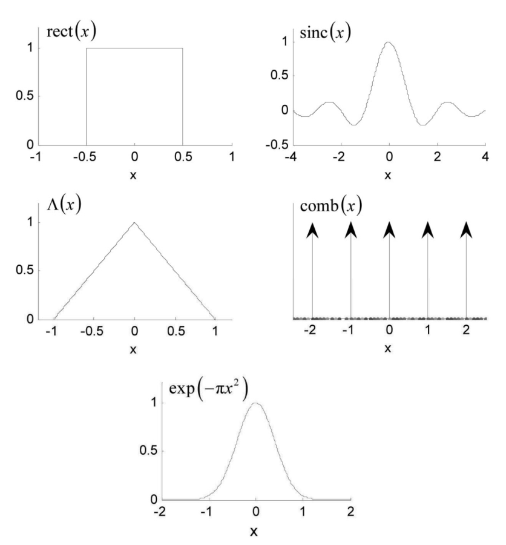
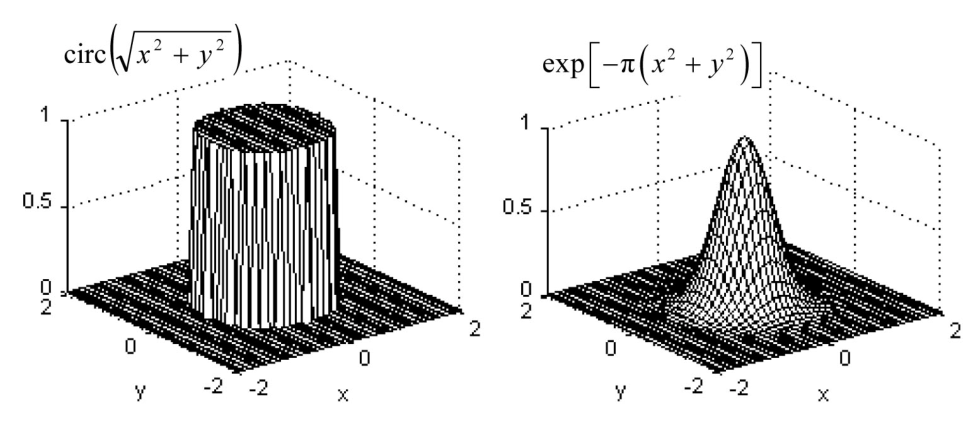
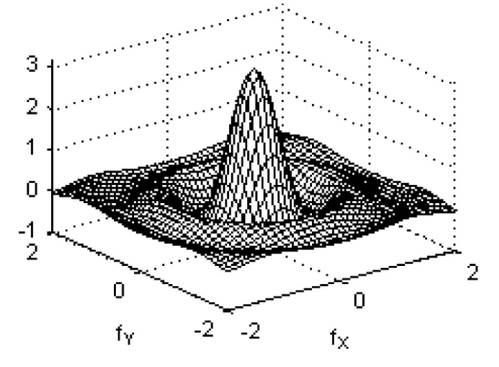
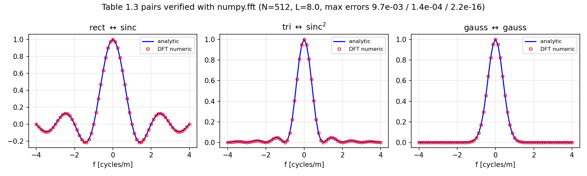
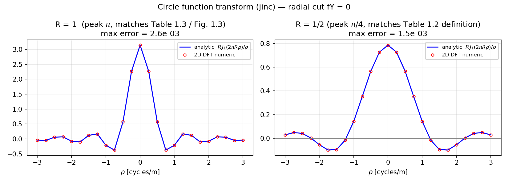
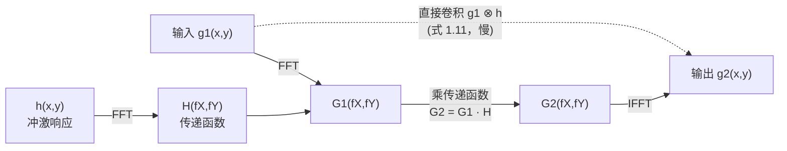
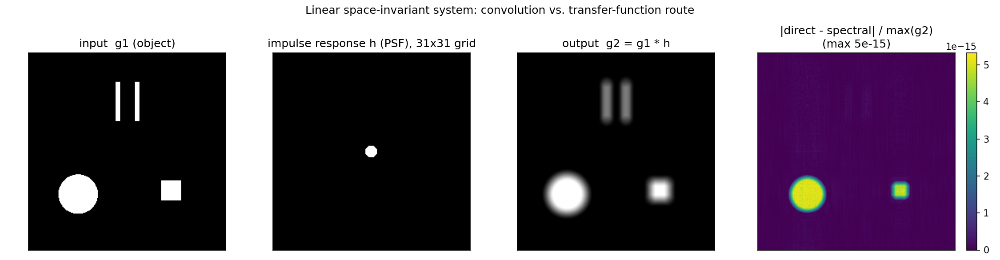

# 第 1 章 解析傅里叶理论复习

> **本章解决**：把全书要用的解析数学工具一次清点完毕——傅里叶变换的定义与约定、九条定理、六个基本函数及其变换对、线性空间不变系统框架。第 2 章立刻把这些工具搬进计算机，看采样和有限阵列带来什么新麻烦。
> 本章是纯理论复习，**原书没有 MATLAB 代码**（第 3 章才 "Open MATLAB"）。笔记里的代码是我补充的数值验证脚本（MATLAB / Python 双实现），专门用来检验书上两张变换对表到底对不对——还真查出了两处问题，见 1.5 节的勘误。

本章覆盖（原书 1.2 节末尾的安排）：

- 傅里叶变换的基本定义、定理、基本函数与变换对
- 线性系统理论复习

## 1.0 本章导图

<div class="brtree">
  <div class="brrow">
    <span class="brlabel root">解析傅里叶光学工具箱</span>
    <span class="brace"></span>
    <div class="brkids">
      <div class="brrow">
        <span class="brlabel">定位（1.1–1.2）</span>
        <span class="brace"></span>
        <div class="brkids">
          <span class="brleaf">1940s–60s 起源，Goodman 1968 立派</span>
          <span class="brleaf">上机理由：积分难解 + FFT 快</span>
          <span class="brleaf">FFT 也是数值伪影"帮凶"</span>
          <span class="brleaf">有限阵列 → 只能仿真"近完美"光学</span>
        </div>
      </div>
      <div class="brrow">
        <span class="brlabel">变换定义（1.3）</span>
        <span class="brace"></span>
        <div class="brkids">
          <span class="brleaf">正变换：2π 在指数里</span>
          <span class="brleaf">逆变换：指数变 +j</span>
          <span class="brleaf">存在条件三条（可放宽）</span>
          <span class="brleaf">广义变换：1→δ，cos→双 δ</span>
        </div>
      </div>
      <div class="brrow">
        <span class="brlabel">定理（1.4）</span>
        <span class="brace"></span>
        <div class="brkids">
          <span class="brleaf">线性 / 相似 / 位移</span>
          <span class="brleaf">Parseval 能量守恒</span>
          <span class="brleaf">卷积 ↔ 乘积（全书引擎）</span>
          <span class="brleaf">自相关 / 互相关 ↔ |G|²</span>
          <span class="brleaf">逐次变换 / 中心纵坐标</span>
          <span class="brleaf">可分离：2D → 两个 1D</span>
        </div>
      </div>
      <div class="brrow">
        <span class="brlabel">基本函数（1.5）</span>
        <span class="brace"></span>
        <div class="brkids">
          <span class="brleaf">rect ↔ sinc</span>
          <span class="brleaf">Λ ↔ sinc²，sinc ↔ rect</span>
          <span class="brleaf">高斯 ↔ 高斯（自映射）</span>
          <span class="brleaf">circ ↔ jinc（勘误：半径约定）</span>
          <span class="brleaf">chirp 对（勘误：符号）</span>
        </div>
      </div>
      <div class="brrow">
        <span class="brlabel">线性系统（1.6）</span>
        <span class="brace"></span>
        <div class="brkids">
          <span class="brleaf">线性 → 叠加积分</span>
          <span class="brleaf">空不变 → 卷积 g₂ = g₁⊗h</span>
          <span class="brleaf">h = 冲激响应 = PSF</span>
          <span class="brleaf">H = 传递函数</span>
          <span class="brleaf">频域法：FFT → 乘 H → IFFT</span>
        </div>
      </div>
    </div>
  </div>
</div>

## 1.1 一点历史与本书目的

今天叫**傅里叶光学（Fourier optics）**的这门光学分支，诞生于 1940 到 1960 年代：电信和电路设计的一套分析技术被搬进了光衍射理论。1968 年，Joseph W. Goodman 的《Introduction to Fourier Optics》出版，这门"暴发户学科"从此站稳脚跟——这本教科书把基本概念解释并统一起来，后续版本持续推动傅里叶光学的应用。如今傅里叶光学是衍射、相干、成像分析的基石，也是波前控制、随机介质传播、全息这类专题的基础。

今天学傅里叶光学，自然要走向计算机，原因至少有两条：

1. 衍射积分除了几个最简单的孔径函数，**解析上根本积不出来**；
2. **FFT 算法 + 傅里叶光学的线性系统框架** = 求解波动光学问题的高效计算路线。

计算机当然也能直接上数值积分，把衍射问题解得非常精确。但本书讲的是 FFT 以及怎么把它用到各种傅里叶光学问题上去：**编码步骤与解析概念一一对应**，FFT 的速度让"reasonable 时间内做几千次光学传播或成像仿真"成为可能。本书探索的这套方法，正是工业界波动（物理）光学仿真工具的基础。

不过没有免费午餐（原书原话：要是有免费午餐，我们就能边吃边学傅里叶光学了）。**FFT 是各种数值伪影的"帮凶"**——本书会尽力把这些坑暴露出来，并给出约束条件帮你减少损害。

这是一本教程式教材，逐步指导你既写傅里叶光学的代码、也上手 MATLAB。没用过 MATLAB 也不用慌：第 3 章从 "Open MATLAB" 开始带你过一遍基础，到本书结尾，你应该能自己编部分相干光的衍射程序。各章末尾的习题给你折腾代码的空间。

!!! note "拓展：解析派 vs 数值派，这本书站哪边？"
    解衍射问题有三条路：**解析**（只有理想孔径能积出来）、**数值积分**（精确但慢，一次仿真动辄数小时）、**FFT + 线性系统**（近似但快几个数量级，能做参数扫描和大量仿真）。本书选第三条，代价是你要同时面对两类误差——解析模型本身的近似（标量场、傍轴等）和离散化的数值伪影（采样、窗截断、循环卷积）。本书的写法是：先把解析理论（本章）立好，第 2 章专讲"搬进计算机后发生了什么"。

原书假设你已经学过一点傅里叶光学——从零讲起内容太多，会喧宾夺主。解析理论在全书以摘要形式给出，记号和形式紧随 Goodman 的《Introduction to Fourier Optics》。要补推导细节，看 Goodman 以及章末列的其他参考书。

## 1.2 计算傅里叶光学的适用范围

本书代码里的变量、向量、数组**尽量用物理量定义**：建模空间平面的采样阵列，坐标就用"米"做单位；整数下标只在绕不开时才出现。这样做的目的是让物理世界和计算机代码之间的连线保持清晰，MATLAB 的向量化结构恰好适合这种写法。所以书里的编程例子都带着具体的孔径尺寸、波长、传播距离——有些例子纯学术，有些就是你现实中会碰到的。

但你很快会看到一个反复出现的主题：**计算机里样本阵列的有限尺寸，限制了你能考虑的参数范围**。

可以借"光学设计者的困境"来理解这个限制：什么时候该用几何光学预测系统性能，什么时候该切换到波动光学？两者的区别在于，几何光学假设光线走直线，**忽略光的波动性带来的衍射扩展**。常规答案是：偏离完美很小（接近"衍射极限"）时，需要波动光学描述；偏离很大时，几何光线光学就够用了，而且它的实现选项更灵活。

解析傅里叶光学理论本身相当一般化，但**有限阵列尺寸会把计算机建模圈在"近完美"的情形里**：典型地，小发散角的光束传播、小面积的仿真像区等等。对实际应用来说，这恰好与光学设计中波动光学性能预测所覆盖的领域相同。

本章余下部分就是一份摘要：傅里叶变换的基本定义、定理、基本函数与变换对，外加线性系统理论复习。

!!! note "拓展：'近衍射极限'是个什么量级？"
    圆孔衍射斑的角半径约 \(1.22\lambda/D\)（\(D\) 是孔径直径）。比如 \(D=10\) cm、\(\lambda=500\) nm 的望远镜，衍射极限角约 \(6\times10^{-6}\) rad = 6 μrad。如果系统像差折算的波前误差远小于一个波长（Rayleigh 判据 \(\lambda/4\)），像斑尺寸由衍射决定——这就是"近衍射极限"，必须用波动光学算。反之，像差斑比衍射斑大得多时，几何光线追踪就足够了。计算机仿真受阵列尺寸限制，能高效仿真的正是前者这种"小角度、小范围"的世界。

## 1.3 傅里叶变换的定义与存在条件

光学问题经常涉及两个空间维度。函数 \(g(x,y)\) 的解析傅里叶变换定义为：

\[
G(f_X, f_Y) = \int_{-\infty}^{\infty}\int_{-\infty}^{\infty} g(x,y)\,
\exp\!\left[-j2\pi(f_X x + f_Y y)\right] dx\,dy ,
\tag{1.1}
\]

其中 \(G(f_X, f_Y)\) 是变换结果，\(f_X\)、\(f_Y\) 是分别与 \(x\)、\(y\) 关联的独立频率变量。人话版：把空间信号 \(g\) 分解成无数个不同方向、不同疏密（空间频率）的余弦条纹，\(G\) 记录每个条纹成分的"权重"。常用简写记号：

\[
\mathcal{F}\{g(x,y)\} = G(f_X, f_Y),
\]

原书用一个花体字母表示这个算子（本笔记统一写作 \(\mathcal{F}\)）。逆变换只把指数里的负号换成正号：

\[
g(x,y) = \int_{-\infty}^{\infty}\int_{-\infty}^{\infty} G(f_X, f_Y)\,
\exp\!\left[j2\pi(f_X x + f_Y y)\right] df_X\,df_Y ,
\tag{1.2}
\]

简写为 \(\mathcal{F}^{-1}\{G(f_X, f_Y)\} = g(x,y)\)。

要在数学意义上严格实现傅里叶变换，\(g(x,y)\) 需要满足一组充分条件，通常列为：

- (a) \(g\) 在无限的 \(x, y\) 范围上**绝对可积**；
- (b) \(g\) 只有**有限个不连续点**；
- (c) \(g\) **没有无穷型间断**（函数值不发散）。

Goodman 演示了：在许多重要情形下，这些条件可以放宽，用"广义变换"处理理想化的数学函数（比如 \(\delta\) 函数），照样得到有用的变换表示。两个有代表性的广义变换结果：

\[
\mathcal{F}\{1\} = \delta(f_X, f_Y),
\]

\[
\mathcal{F}\{\cos(2\pi f_0 x)\} = \tfrac{1}{2}\,\delta(f_X - f_0,\, f_Y) + \tfrac{1}{2}\,\delta(f_X + f_0,\, f_Y),
\]

其中 \(\delta\) 是狄拉克 \(\delta\) 函数（**Dirac delta function**）。

!!! note "拓展：2π 放在指数里，是本书（和 Goodman）的约定"
    式 (1.1) 把 \(2\pi\) 写进指数、频率变量 \(f_X\) 用"周期数每米"（cycles/m）计。另一派书（尤其信号处理教材）用 \(\exp(-j\omega t)\)、角频率 \(\omega\)（rad/s），\(\omega = 2\pi f\)。两套约定下定理的系数会差一点（比如 \(\mathcal{F}\{\delta\}=1\) 不变，但 \(\mathcal{F}^{-1}\{1\}\) 前会出现 \(1/2\pi\) 因子）。读别的书对照公式时，第一步先查它的变换定义里 \(2\pi\) 放哪边。光学里 \(f_X\) 叫空间频率（**spatial frequency**），对应的角空间频率是 \(k_X = 2\pi f_X\)（rad/m）——第 4 章角谱法里它会以 \(k\) 的身份回来。

!!! note "拓展：δ 函数为什么能'变换'"
    \(\delta\) 不是普通函数，是**广义函数（分布）**：它只在单点"有值"，定义为 \(\int \delta(x-a)\,\varphi(x)\,dx = \varphi(a)\)。\(\mathcal{F}\{1\}=\delta(f_X,f_Y)\) 的含义：常数场没有任何空间振荡成分，全部权重集中在零频。\(\cos\) 的结果来自欧拉公式 \(\cos(2\pi f_0 x) = \frac{1}{2}(e^{j2\pi f_0 x} + e^{-j2\pi f_0 x})\)：每个复指数是单一空间频率的成分，变换后就是一个平移到 \(\pm f_0\) 的 \(\delta\)。这类"理想函数"的变换在孔径建模里天天用到——例如 \(\delta\) 代表点光源，\(\mathrm{comb}\) 代表周期结构。

## 1.4 定理与可分离性

表 1.1 的定理在傅里叶分析里出场率极高，值得全部背下来。表中 \(A, B, a, b\) 是标量常数。

**表 1.1 傅里叶变换定理**（按原书重排；\(\mathcal{F}\{g\}=G\)，\(\mathcal{F}\{h\}=H\)）：

| 定理 | 表达式 |
| --- | --- |
| 线性 Linearity | \(\mathcal{F}\{Ag(x,y)+Bh(x,y)\} = A\,\mathcal{F}\{g(x,y)\} + B\,\mathcal{F}\{h(x,y)\}\) |
| 相似性 Similarity | \(\mathcal{F}\{g(x/a,\, y/b)\} = \lvert ab\rvert\, G(af_X,\, bf_Y)\) |
| 位移 Shift | \(\mathcal{F}\{g(x-a,\, y-b)\} = G(f_X,f_Y)\,\exp[-j2\pi(f_X a + f_Y b)]\) |
| Parseval（Rayleigh） | \(\iint \lvert g(x,y)\rvert^2\,dx\,dy = \iint \lvert G(f_X,f_Y)\rvert^2\,df_X\,df_Y\) |
| 卷积 Convolution | \(\mathcal{F}\{\iint g(\xi,\eta)\,h(x-\xi,\,y-\eta)\,d\xi\,d\eta\} = G(f_X,f_Y)\,H(f_X,f_Y)\) |
| 自相关 Autocorrelation | \(\mathcal{F}\{\iint g(\xi,\eta)\,g^*(\xi-x,\,\eta-y)\,d\xi\,d\eta\} = \lvert G(f_X,f_Y)\rvert^2\)；\(\mathcal{F}\{\lvert g(x,y)\rvert^2\} = \iint G(\xi,\eta)\,G^*(\xi-f_X,\,\eta-f_Y)\,d\xi\,d\eta\) |
| 互相关 Cross-correlation | \(\mathcal{F}\{\iint g(\xi,\eta)\,h^*(\xi-x,\,\eta-y)\,d\xi\,d\eta\} = G(f_X,f_Y)\,H^*(f_X,f_Y)\)；\(\mathcal{F}\{g(x,y)\,h^*(x,y)\} = \iint G(\xi,\eta)\,H^*(\xi-f_X,\,\eta-f_Y)\,d\xi\,d\eta\) |
| 傅里叶积分 Fourier integral | \(\mathcal{F}\mathcal{F}^{-1}\{g(x,y)\} = \mathcal{F}^{-1}\mathcal{F}\{g(x,y)\} = g(x,y)\) |
| 逐次变换 Successive transform | \(\mathcal{F}\mathcal{F}\{g(x,y)\} = g(-x,-y)\) |
| 中心纵坐标 Central ordinate | \(\mathcal{F}\{g(x,y)\}\big\rvert_{f_X=0,\,f_Y=0} = G(0,0) = \iint g(x,y)\,dx\,dy\)；\(\mathcal{F}^{-1}\{G(f_X,f_Y)\}\big\rvert_{x=0,\,y=0} = g(0,0) = \iint G(f_X,f_Y)\,df_X\,df_Y\) |

每条定理一句人话：

- **线性**：分别变换、再加权求和即可。
- **相似性**：空域拉伸 \(a\) 倍 ↔ 频域压缩 \(a\) 倍，幅度乘 \(\lvert ab\rvert\)（面积补偿，保证 Parseval 能量守恒）。"越小的孔径衍射角越大"就是它的物理版。
- **位移**：平移不改变频谱幅度，只叠加一个线性相位。
- **Parseval**：能量在两个域里算出来一样——变换只是换了个记账方式。
- **卷积**：空域卷积 ↔ 频域乘积。**全书最重要的一条**，1.6 节整节都在用它。
- **自相关**：函数与自身错位相关的变换是 \(\lvert G\rvert^2\)（Wiener–Khinchin 思路的雏形，部分相干章节会回来）。
- **互相关**：两个不同函数的版本，变换给出 \(G H^*\)。
- **傅里叶积分**：正逆变换互相抵消。
- **逐次变换**：连做两次正变换 = 坐标反转。全息再现里的"共轭像"就和这种镜像操作有关。
- **中心纵坐标**：频谱原点的值 = 空域函数的总积分（面积）。反着用也成立：空间原点的值 = 频谱总面积。数值验证时它是检查定标对不对的"免费仪器"，下面代码马上用到。

一个重要的函数性质是**可分离性（separability）**：二维函数能写成两个一元函数的乘积，

\[
g_S(x,y) = g_x(x)\,g_y(y) ,
\tag{1.3}
\]

则它的二维傅里叶变换退化为两个一维变换的乘积：

\[
\mathcal{F}\{g_S(x,y)\} = \mathcal{F}\{g_x(x)\}\,\mathcal{F}\{g_y(y)\} .
\tag{1.4}
\]

比如矩形孔径 \(\mathrm{rect}(x/2w)\,\mathrm{rect}(y/2w)\) 的频谱就是 \(\mathrm{sinc}\) 在两个方向上的乘积（见 1.5 节表 1.3 第一行）。

!!! note "拓展：可分离性到底省多少计算？"
    在 \(N\times N\) 网格上硬算二维变换：\(N^2\) 个输出点、每点求和 \(N^2\) 项，共 \(O(N^4)\) 次运算——\(N=1000\) 就是 \(10^{12}\) 次。可分离函数拆成两个一维变换各 \(O(N^2)\)，总共 \(O(N^3)\)。而 FFT 把一维变换降到 \(O(N\log N)\)，二维降到 \(O(N^2\log N)\)——\(N=1000\) 时约 \(10^7\)，比硬算快十万倍。这就是为什么全书所有二维问题最终都落到"行 FFT + 列 FFT"或者可分离的解析配对上。

## 1.5 基本函数与变换

如果光学结构和孔径能用基本函数建模，对应的傅里叶变换就能直接给出衍射解或成像结果。原书采纳表 1.2 的定义。

**表 1.2 基本函数**（按原书重排）：

| 函数 | 定义 |
| --- | --- |
| 矩形 Rectangle | \(\mathrm{rect}(x) = \begin{cases} 1, & \lvert x\rvert < 1/2 \\ 1/2, & \lvert x\rvert = 1/2 \\ 0, & \text{其他} \end{cases}\) |
| Sinc | \(\mathrm{sinc}(x) = \dfrac{\sin(\pi x)}{\pi x}\) |
| 三角形 Triangle | \(\Lambda(x) = \begin{cases} 1-\lvert x\rvert, & \lvert x\rvert \le 1 \\ 0, & \text{其他} \end{cases}\) |
| 梳状 Comb | \(\mathrm{comb}(x) = \displaystyle\sum_{n=-\infty}^{\infty} \delta(x-n)\) |
| 高斯 Gaussian | \(\exp(-\pi x^2)\) |
| 圆 Circle | \(\mathrm{circ}\!\left(\sqrt{x^2+y^2}\right) = \begin{cases} 1, & \sqrt{x^2+y^2} < 1/2 \\ 1/2, & \sqrt{x^2+y^2} = 1/2 \\ 0, & \text{其他} \end{cases}\) |

一维函数的图像如下（注意 \(\mathrm{rect}\) 和 \(\mathrm{circ}\) 在边界点取半值 \(1/2\)——这是解析约定，数值网格很少恰好落在边界上）：

<figure>
  
  <figcaption>图 1.1 基本一维函数：rect、sinc、Λ、comb、高斯（截自原书）</figcaption>
</figure>

这些一维函数可以相乘组成**可分离的二维函数**。圆函数（**circle function**）是圆对称二维函数，常用径向变量 \(r=(x^2+y^2)^{1/2}\) 表示。高斯没有简写名，但出场率极高；这里选 \(\exp(-\pi x^2)\) 这种形式是因为它对傅里叶分析最方便（见下面的拓展框）。圆函数和二维高斯的曲面图：

<figure>
  
  <figcaption>图 1.2 二维函数示例：circ（圆柱）与 exp[−π(x²+y²)]（高斯包络）（截自原书）</figcaption>
</figure>

下面这段代码把六个基本函数定义出来，并复现图 1.1 / 图 1.2。它们的定义在后面所有章节反复出现，值得存成自己的小工具库。

=== "MATLAB"

    ```matlab
    % ===== 书 1.5 节：基本函数（复现原书图 1.1 / 图 1.2） =====
    % 这些函数是全书建模"孔径 / 光场"的积木，定义必须与原书表 1.2 一致。
    % MATLAB/Python 差异：MATLAB 索引从 1 开始（numpy 从 0 开始）；
    % MATLAB meshgrid 与 np.meshgrid 默认 'xy' 索引行为一致，圆对称函数下无区别。
    % 注：脚本内含局部函数，需要 R2016b 及以上版本。
    clear; clc; close all;

    % ---------- 自检：定义是否与表 1.2 一致 ----------
    fprintf('rect(0)   = %.1f (应为 1.0)\n', rect(0));
    fprintf('rect(0.5) = %.1f (应为 0.5)\n', rect(0.5));
    fprintf('tri(0.5)  = %.1f (应为 0.5)\n', tri(0.5));
    fprintf('sinc(0)   = %.1f (应为 1.0)\n', sincn(0));
    fprintf('sinc(0.5) = %.10f (应为 2/pi = %.10f)\n', sincn(0.5), 2/pi);

    % ---------- 复现原书图 1.1：一维基本函数 ----------
    x  = linspace(-1, 1, 801);
    xw = linspace(-4, 4, 1201);
    xg = linspace(-2, 2, 801);
    figure('Position', [100 100 800 850]);
    subplot(3,2,1); plot(x, rect(x));   title('rect(x)');   grid on;
    subplot(3,2,2); plot(xw, sincn(xw)); title('sinc(x)');  grid on;
    subplot(3,2,3); plot(x, tri(x));    title('\Lambda(x)'); grid on;
    subplot(3,2,4);
    xn = -2:2;                          % comb 是 delta 周期阵列，画成箭头示意
    stem(xn, ones(size(xn)), 'fill');   title('comb(x)'); axis([-2.5 2.5 0 1.2]);
    subplot(3,2,5); plot(xg, gauss(xg)); title('exp(-\pix^2)'); grid on;
    sgtitle('Basic 1D functions (reproduction of book Fig. 1.1)');
    saveas(gcf, 'out_1d_functions.png');

    % ---------- 复现原书图 1.2：二维 circ 与高斯 ----------
    N  = 80;
    xs = ((0:N-1) - N/2) * (4/N);
    [X, Y] = meshgrid(xs, xs);          % 'xy' 行为，与 np.meshgrid 默认一致
    C  = circle(X, Y, 0.5);             % 表 1.2：半径 1/2
    G2 = exp(-pi*(X.^2 + Y.^2));        % 二维高斯（表 1.3 倒数第二行取 a=b=1）
    figure;
    subplot(1,2,1); mesh(X, Y, C);  title('circ(\surd(x^2+y^2))');
    subplot(1,2,2); mesh(X, Y, G2); title('exp[-\pi(x^2+y^2)]');
    sgtitle('Examples of 2D functions (reproduction of book Fig. 1.2)');
    saveas(gcf, 'out_2d_functions.png');
    fprintf('已保存 out_1d_functions.png / out_2d_functions.png\n');

    % ---------- 局部函数定义（表 1.2） ----------
    function r = rect(t)
        % rect：|t|<1/2 为 1，|t|=1/2 为 1/2，其余 0
        r = zeros(size(t));
        r(abs(t) < 0.5)  = 1;
        r(abs(t) == 0.5) = 0.5;         % 均匀网格很少恰好命中边界
    end

    function t = tri(u)
        % 三角形函数 Λ：|u|<=1 为 1-|u|，其余 0
        t = zeros(size(u));
        m  = abs(u) <= 1;
        t(m) = 1 - abs(u(m));
    end

    function s = sincn(u)
        % 归一化 sinc：sin(pi*u)/(pi*u)，u=0 处极限 1
        % （与 Signal Processing Toolbox 的 sinc、numpy.sinc 定义一致）
        s = ones(size(u));
        nz = u ~= 0;
        s(nz) = sin(pi*u(nz)) ./ (pi*u(nz));
    end

    function g = gauss(u)
        % 高斯 exp(-pi*u^2)：Fourier 变换恰好是自己
        g = exp(-pi*u.^2);
    end

    function c = circle(X, Y, R)
        % 圆盘：sqrt(X^2+Y^2) < R 内取 1（表 1.2 取 R=1/2）
        % 注意：表 1.3 的变换对对应半径 a 的圆盘，与表 1.2 的定义差 2 倍半径，
        % 详见 ch1_verify_circ_jinc.m 的数值验证
        c = double(sqrt(X.^2 + Y.^2) < R);
    end
    ```

=== "Python"

    ```python
    # ===== 书 1.5 节：基本函数（复现原书图 1.1 / 图 1.2） =====
    # 这些函数是全书建模"孔径 / 光场"的积木，定义必须与原书表 1.2 一致。
    # MATLAB/Python 差异：numpy 索引从 0 开始（MATLAB 从 1 开始）；
    # np.meshgrid 默认 indexing='xy' 与 MATLAB meshgrid 行为一致，
    # 对圆对称函数（circ、高斯）两种索引结果相同。
    import numpy as np
    import matplotlib.pyplot as plt


    # ---------- 一维基本函数（表 1.2） ----------
    def rect(x):
        """rect(x)：|x| < 1/2 取 1，|x| = 1/2 取 1/2，其余取 0。"""
        x = np.asarray(x, dtype=float)
        r = np.where(np.abs(x) < 0.5, 1.0, 0.0)
        r = np.where(np.abs(x) == 0.5, 0.5, r)   # 边界点取半值；均匀网格很少恰好命中
        return r


    def tri(x):
        """Λ(x)：|x| <= 1 取 1-|x|，其余取 0。"""
        x = np.asarray(x, dtype=float)
        return np.where(np.abs(x) <= 1.0, 1.0 - np.abs(x), 0.0)


    def sinc(x):
        """sinc(x) = sin(pi*x)/(pi*x)；x=0 处极限为 1。
        注意 numpy 自带的 np.sinc 就是这个归一化定义，等价于本函数。"""
        x = np.asarray(x, dtype=float)
        out = np.ones_like(x)
        mask = x != 0
        out[mask] = np.sin(np.pi * x[mask]) / (np.pi * x[mask])
        return out


    def gauss(x):
        """高斯 exp(-pi*x^2)： Fourier 变换恰好是自己（表 1.3）。"""
        return np.exp(-np.pi * np.asarray(x, dtype=float) ** 2)


    def circle(X, Y, R=0.5):
        """circ(sqrt(X^2+Y^2))：半径 R 的圆盘（表 1.2 中 R = 1/2）。
        注意：原书表 1.2 定义半径为 1/2，而表 1.3 的变换对对应半径 a 的圆盘，
        两者相差 2 倍半径——见 ch1_verify_circ_jinc.py 的数值验证。"""
        return np.where(np.hypot(X, Y) < R, 1.0, 0.0)


    # ---------- 自检：定义是否与表 1.2 一致 ----------
    print("rect(0)  =", rect(0.0), "(应为 1.0)")
    print("rect(0.5)=", rect(0.5), "(应为 0.5)")
    print("tri(0.5) =", tri(0.5), "(应为 0.5)")
    print("sinc(0)  =", sinc(0.0), "(应为 1.0)")
    print("sinc(0.5)=", sinc(0.5), "(应为 2/pi =", 2 / np.pi, ")")

    # ---------- 复现原书图 1.1：一维基本函数 ----------
    x = np.linspace(-1, 1, 801)
    xw = np.linspace(-4, 4, 1201)

    fig = plt.figure(figsize=(8, 9))
    ax = fig.add_subplot(3, 2, 1)
    ax.plot(x, rect(x)); ax.set_title("rect(x)"); ax.grid(True, alpha=0.3)
    ax = fig.add_subplot(3, 2, 2)
    ax.plot(xw, sinc(xw)); ax.set_title("sinc(x)"); ax.grid(True, alpha=0.3)
    ax = fig.add_subplot(3, 2, 3)
    ax.plot(x, tri(x)); ax.set_title(r"$\Lambda(x)$"); ax.grid(True, alpha=0.3)
    ax = fig.add_subplot(3, 2, 4)
    # comb 是 delta 周期阵列，网格上无法直接画，用 stem 箭头示意
    xn = np.arange(-2, 3)
    ax.stem(xn, np.ones_like(xn), basefmt="none")
    ax.set_title("comb(x)"); ax.set_xlim(-2.5, 2.5); ax.set_ylim(0, 1.2)
    ax = fig.add_subplot(3, 2, 5)
    xg = np.linspace(-2, 2, 801)
    ax.plot(xg, gauss(xg)); ax.set_title(r"$\exp(-\pi x^2)$"); ax.grid(True, alpha=0.3)
    fig.suptitle("Basic 1D functions (reproduction of book Fig. 1.1)")
    fig.tight_layout()
    fig.savefig(__file__.replace("ch1_basic_functions.py", "out_1d_functions.png"), dpi=150)

    # ---------- 复现原书图 1.2：二维 circ 与高斯 ----------
    N = 80
    xs = (np.arange(N) - N / 2) * (4.0 / N)
    X, Y = np.meshgrid(xs, xs)               # 'xy' 索引，与 MATLAB meshgrid 一致
    C = circle(X, Y, R=0.5)                  # 表 1.2：半径 1/2
    G2 = np.exp(-np.pi * (X**2 + Y**2))      # 表 1.3 最后一类二维高斯（a=b=1）

    fig = plt.figure(figsize=(10, 4.2))
    ax = fig.add_subplot(1, 2, 1, projection="3d")
    ax.plot_wireframe(X, Y, C, rstride=2, cstride=2, color="k", linewidth=0.4)
    ax.set_title(r"$\mathrm{circ}(\sqrt{x^2+y^2})$")
    ax = fig.add_subplot(1, 2, 2, projection="3d")
    ax.plot_wireframe(X, Y, G2, rstride=2, cstride=2, color="k", linewidth=0.4)
    ax.set_title(r"$\exp[-\pi(x^2+y^2)]$")
    fig.suptitle("Examples of 2D functions (reproduction of book Fig. 1.2)")
    fig.tight_layout()
    fig.savefig(__file__.replace("ch1_basic_functions.py", "out_2d_functions.png"), dpi=150)
    print("已保存 out_1d_functions.png / out_2d_functions.png")
    ```

有了基本函数，就能列出它们的变换对。表 1.3 是全书最常用的"查表区"，\(J_1\) 是第一类贝塞尔函数（**Bessel function of the first kind**），阶数 1，出现在圆函数的变换里；最后一行的"啁啾（**chirp**）"函数在后面章节会非常眼熟。

**表 1.3 基本函数及其变换**（按原书重排，\(f_X, f_Y\) 为频率变量）：

| 函数 | 变换 |
| --- | --- |
| \(\mathrm{rect}(x/a)\) | \(\lvert a\rvert\,\mathrm{sinc}(a f_X)\) |
| \(\mathrm{sinc}(x/a)\) | \(\lvert a\rvert\,\mathrm{rect}(a f_X)\) |
| \(\Lambda(x/a)\) | \(\lvert a\rvert\,\mathrm{sinc}^2(a f_X)\) |
| \(\mathrm{comb}(x/a)\) | \(\lvert a\rvert\,\mathrm{comb}(a f_X)\) |
| \(\exp(-\pi x^2/a^2)\) | \(\lvert a\rvert\,\exp(-\pi a^2 f_X^2)\) |
| \(\mathrm{circ}\!\left(\sqrt{x^2+y^2}\middle/a\right)\) | \(a^2\,\dfrac{J_1\!\left(2\pi a\sqrt{f_X^2+f_Y^2}\right)}{a\sqrt{f_X^2+f_Y^2}}\) |
| \(\exp\!\left[-\pi\!\left(\dfrac{x^2}{a^2}+\dfrac{y^2}{b^2}\right)\right]\) | \(\lvert ab\rvert\,\exp\!\left[-\pi\!\left(a^2 f_X^2 + b^2 f_Y^2\right)\right]\) |
| \(\exp\!\left[-j\pi\!\left(\dfrac{x^2}{a^2}+\dfrac{y^2}{b^2}\right)\right]\) | \(j\lvert ab\rvert\,\exp\!\left[-j\pi\!\left(a^2 f_X^2 + b^2 f_Y^2\right)\right]\) |

!!! warning "原书笔误 1：circ 变换对与表 1.2 的定义不匹配"
    表 1.2 定义 \(\mathrm{circ}\) 在半径 \(1/2\) 内取 1，那 \(\mathrm{circ}(r/a)\) 就是半径 \(a/2\) 的圆盘，面积 \(\pi a^2/4\)。但中心纵坐标定理说**频谱峰值 = 空域面积**，而表 1.3 给出的式子 \(a^2 J_1(2\pi a\rho)/(a\rho)\)（\(\rho=\sqrt{f_X^2+f_Y^2}\)）在 \(\rho\to0\) 的极限是 \(\pi a^2\)——这是**半径 \(a\) 的圆盘**（Goodman 书里的 \(\mathrm{circ}\) 约定）的频谱，峰值大了 4 倍，且 \(J_1\) 的宗量也不同（\(2\pi a\rho\) 对 \(\pi a\rho\)）。图 1.3 标注"峰值 \(\pi\)"（\(a=1\)），同样印证表 1.3 用的是半径 \(a\) 的圆盘。
    **两个约定打架时怎么用**：记住最可靠的形式是"半径 \(R\) 的圆盘 ↔ \(R\,J_1(2\pi R\rho)/\rho\)，峰值 \(=\pi R^2=\) 圆盘面积"。数值验证（图 1-P2）：2D DFT 算出的半径 1 圆盘频谱与 \(J_1(2\pi\rho)/\rho\) 吻合到 \(2.6\times10^{-3}\)（网格精度），半径 1/2 圆盘与 \(\tfrac{1}{2}J_1(\pi\rho)/\rho\)（峰值 \(\pi/4\approx0.785\)）同样吻合——表 1.2 和表 1.3 确实各说各话。

!!! warning "原书笔误 2：chirp 变换对的符号"
    表 1.3 最后一行印的是 \(\exp[-j\pi(x^2/a^2+y^2/b^2)] \leftrightarrow j\lvert ab\rvert\exp[-j\pi(a^2f_X^2+b^2f_Y^2)]\)，两侧的 chirp 符号不匹配。按式 (1.1) 的定义直接积分（配方 + Fresnel 积分 \(\int e^{-j\pi u^2}du = e^{-j\pi/4}\)）：

\[
\mathcal{F}\{e^{-j\pi x^2/a^2}\} = a\,e^{-j\pi/4}\,e^{+j\pi a^2 f_X^2} \quad\Rightarrow\quad \mathcal{F}\{e^{-j\pi(x^2/a^2+y^2/b^2)}\} = -j\,\lvert ab\rvert\,e^{+j\pi(a^2f_X^2+b^2f_Y^2)} .
\]

    检验一个点即可分辨：\(a=b=1\)、\(f_X=0.5\) 时，修正式给 \(e^{-j\pi/4}e^{j\pi/4}=1\)（阻尼数值积分结果 \(0.99997+0.0050j\)），原书式给 \(j\,e^{-j\pi/4}=0.707+0.707j\)——数值积分站修正式。等价的正确写法是 \(e^{+j\pi(x^2/a^2+y^2/b^2)} \leftrightarrow j\lvert ab\rvert e^{-j\pi(a^2f_X^2+b^2f_Y^2)}\)（把正负号整体翻过来）。菲涅耳传播（第 4、5 章）里两个符号的 chirp 都会出现，到时候别把这笔账算错。

圆函数的变换曲面如下——这就是著名的"jinc"形频谱，中心尖峰周围一圈圈衰减的环：

<figure>
  
  <figcaption>图 1.3 圆函数的变换：原点处峰值 π（截自原书）</figcaption>
</figure>

!!! note "拓展：jinc 就是圆孔衍射的振幅图样"
    半径 \(R\) 的圆孔在夫琅禾费衍射（远场）里的振幅分布正是 \(R\,J_1(2\pi R\rho)/\rho\)，其强度 \(\lvert\cdot\rvert^2\) 叫 **Airy 图样**。\(J_1\) 的第一个零点在 \(2\pi R\rho = 3.8317\)，即 \(\rho \approx 0.61/R\)——换算成角度就是 \(1.22\lambda/D\)（\(D=2R\)），"瑞利判据"分辨率的来源。当成像系统的光瞳用 \(\mathrm{circ}\) 建模时，频域里的传递函数也由这个形状主导：第 6、7 章讲成像系统时会反复遇到。

!!! note "拓展：高斯为什么写成这么怪的 exp(−πx²)？"
    把系数吸收成 \(\pi\) 是故意的：这让傅里叶变换**严格等于自己**——\(\mathcal{F}\{\exp(-\pi x^2)\} = \exp(-\pi f^2)\)，不需要记任何 \(1/\sqrt{2\pi}\) 之类的补丁系数。一般宽度的高斯 \(\exp(-\pi x^2/a^2) \leftrightarrow \lvert a\rvert\exp(-\pi a^2 f^2)\)（表 1.3 第 5 行）：空域拉宽 \(a\) 倍，频域压窄 \(a\) 倍、幅值乘 \(a\)（面积守恒）。高斯是唯一"变换后形状不变"的经典函数族，也是数值上最好验证变换对的一个——下面你会看到它的 DFT 误差达到机器精度。

现在用 `numpy.fft` 把表 1.3 的一维变换对逐个数值验证一遍。核心思想：连续傅里叶变换用离散求和近似——\(G(f)\approx dx\sum_n g(x_n)\,e^{-j2\pi f x_n}\)。`numpy.fft` 的正变换不做归一化（归一化放在逆变换里），所以乘上 \(dx\) 就回到连续变换的量纲；信号定义在 \(x\in[-L/2, L/2)\) 上，走一遍 `ifftshift → fft → fftshift` 得到按频率排序的"居中"频谱（这套定标是第 2、3 章的正餐，这里先尝一口）。

=== "MATLAB"

    ```matlab
    % ===== 书 1.5 节：用 FFT 数值验证表 1.3 的一维变换对 =====
    % 连续傅里叶变换的 DFT 近似（矩形求和）：
    %     G(f) ≈ dx * Σ_n g(x_n) exp(-j2*pi*f*x_n)
    % MATLAB fft 与 numpy.fft 一样不对正变换归一化（归一化在逆变换里），
    % 因此乘 dx 就回到连续 FT 的量纲。
    % 信号定义在 x ∈ [-L/2, L/2)：ifftshift -> fft -> fftshift 得"居中"频谱。
    % （偶数 N 时 ifftshift 与 fftshift 相同，这里仍写全流程以对应 Python 代码。）
    % 定标与居中的系统讲解见本书第 2、3 章。
    clear; clc; close all;
    N  = 512;             % 采样点数（偶数）
    L  = 8.0;             % 空间窗口宽度 [m]
    dx = L / N;           % 采样间隔 [m]
    n  = (0:N-1) - N/2;   % MATLAB 1-based 索引下构造居中坐标的常用写法
    x  = n * dx;          % x ∈ [-L/2, L/2)
    f  = n / (N * dx);    % 频率轴 [cycles/m]，与 x 同序（居中）

    % ---------- 对 1：rect(x) <-> sinc(f)（表 1.3 第 1 行，a=1） ----------
    G1 = ft_centered(rect(x), dx);
    e1 = max(abs(G1 - sincn(f)));
    fprintf('[1] rect(x) <-> sinc(f)           最大绝对误差 = %.3e\n', e1);

    % ---------- 对 2：Λ(x) <-> sinc^2(f)（表 1.3 第 3 行，a=1） ----------
    G2 = ft_centered(tri(x), dx);
    e2 = max(abs(G2 - sincn(f).^2));
    fprintf('[2] tri(x) <-> sinc^2(f)          最大绝对误差 = %.3e\n', e2);

    % ---------- 对 3：exp(-pi x^2) <-> exp(-pi f^2)（表 1.3 第 5 行，a=1） ----------
    g3 = exp(-pi*x.^2);
    G3 = ft_centered(g3, dx);
    e3 = max(abs(G3 - exp(-pi*f.^2)));
    fprintf('[3] exp(-pi x^2) <-> exp(-pi f^2)  最大绝对误差 = %.3e\n', e3);

    % ---------- 定理 1：相似性 rect(x/2) <-> 2 sinc(2f)（表 1.1，a=2） ----------
    G4 = ft_centered(rect(x/2), dx);
    e4 = max(abs(G4 - 2*sincn(2*f)));
    fprintf('[4] 相似性 rect(x/2) <-> 2sinc(2f) 最大绝对误差 = %.3e\n', e4);

    % ---------- 定理 2：位移 rect(x-0.7) <-> sinc(f) exp(-j2*pi*f*0.7) ----------
    x0 = 0.7;
    G5 = ft_centered(rect(x - x0), dx);
    e5 = max(abs(G5 - sincn(f) .* exp(-2j*pi*f*x0)));
    fprintf('[5] 位移 rect(x-0.7) 复数最大误差 = %.3e\n', e5);

    % ---------- 定理 3：中心纵坐标 G(0) = ∫ g dx（表 1.1 最后一行） ----------
    fprintf(['[6] 中心纵坐标 G(0): 数值 = %.6f, 求和*dx = %.6f, 解析 = 1.0\n'], ...
            real(G1(N/2+1)), sum(rect(x))*dx);

    % ---------- 勘误验证：表 1.3 最后一行 chirp 变换对（符号有误） ----------
    % 原书：exp(-j*pi*x^2) <-> j*exp(-j*pi*f^2)（2D 版本 j*|ab|*exp[-j*pi(...)]）
    % 正确：exp(-j*pi*x^2) <-> exp(-j*pi/4)*exp(+j*pi*f^2)
    %       （2D 版本 -j*|ab|*exp[+j*pi(a^2 fX^2 + b^2 fY^2)]）
    % chirp 不衰减，截断积分误差 ~ 1/(窗口半宽)，用宽窗口就能清晰区分两种公式。
    Nc = 4096; Lc = 40.0; dxc = Lc/Nc;
    nc = (0:Nc-1) - Nc/2;
    xc = nc*dxc; fc = nc/(Nc*dxc);
    gc = exp(-1j*pi*xc.^2);
    Gc = fftshift(fft(ifftshift(gc)))*dxc;
    m  = abs(fc) <= 1;
    mine = exp(-1j*pi/4)*exp(1j*pi*fc.^2);
    book = 1j*exp(-1j*pi*fc.^2);
    fprintf(['[7] chirp 修正式误差 = %.3e, 原书式误差 = %.3e（应前者 << 后者）\n'], ...
            max(abs(Gc(m) - mine(m))), max(abs(Gc(m) - book(m))));

    % ---------- 画对比图：数值（圆点） vs 解析（实线） ----------
    pairs = {G1, sincn(f), 'rect <-> sinc'; ...
             G2, sincn(f).^2, 'tri <-> sinc^2'; ...
             G3, exp(-pi*f.^2), 'gauss <-> gauss'};
    figure('Position', [100 100 1200 380]);
    for k = 1:3
        subplot(1, 3, k);
        A = pairs{k, 2}; Gr = real(pairs{k, 1});
        m = abs(f) <= 4;
        plot(f(m), A(m), 'b-', 'LineWidth', 1.5); hold on;
        plot(f(m), Gr(m), 'ro', 'MarkerSize', 4, 'MarkerFaceColor', 'none');
        grid on; xlabel('f [cycles/m]'); title(pairs{k, 3});
        legend('analytic', 'DFT numeric');
    end
    sgtitle(sprintf('Table 1.3 pairs verified with FFT (N=%d, L=%.0f)', N, L));
    saveas(gcf, 'out_1d_pairs.png');
    fprintf('已保存 out_1d_pairs.png\n');

    % ---------- 局部函数 ----------
    function G = ft_centered(g, dx)
        % 一维连续 FT 的 DFT 近似（居中输出）；dx 需显式传入
        % （MATLAB 局部函数不像 Python 函数那样能闭包捕获脚本变量）
        G = fftshift(fft(ifftshift(g))) * dx;
    end

    function r = rect(t)
        r = zeros(size(t));
        r(abs(t) < 0.5)  = 1;
        r(abs(t) == 0.5) = 0.5;
    end

    function t = tri(u)
        t = zeros(size(u));
        m = abs(u) <= 1;
        t(m) = 1 - abs(u(m));
    end

    function s = sincn(u)
        s = ones(size(u));
        nz = u ~= 0;
        s(nz) = sin(pi*u(nz)) ./ (pi*u(nz));
    end
    ```

=== "Python"

    ```python
    # ===== 书 1.5 节：用 numpy.fft 数值验证表 1.3 的一维变换对 =====
    # 连续傅里叶变换的 DFT 近似（矩形求和）：
    #     G(f) ≈ dx * Σ_n g(x_n) exp(-j2π f x_n)
    # numpy.fft 的正变换不除 N（归一化在逆变换里），因此乘 dx 就回到连续 FT 的量纲。
    # 信号定义在 x ∈ [-L/2, L/2) 上（0-based 索引），标准"居中"流程：
    #     ifftshift -> fft -> fftshift
    # 得到按频率从负到正排列的频谱（本书第 2、3 章系统讲这套定标）。
    # MATLAB 注意：对偶数 N，fftshift 与 ifftshift 等价；MATLAB fft 同样不除 N。
    import numpy as np
    import matplotlib.pyplot as plt

    N = 512            # 采样点数（偶数）
    L = 8.0            # 空间窗口宽度 [m]
    dx = L / N         # 采样间隔 [m]
    n = np.arange(N) - N // 2
    x = n * dx                       # x ∈ [-L/2, L/2)
    f = n / (N * dx)                 # 频率轴 [cycles/m]，与 x 同序（居中）


    def rect(t):
        """rect：|t|<1/2 为 1，|t|=1/2 为 1/2，其余 0（表 1.2）。"""
        t = np.asarray(t, dtype=float)
        r = np.where(np.abs(t) < 0.5, 1.0, 0.0)
        return np.where(np.abs(t) == 0.5, 0.5, r)


    def tri(t):
        """Λ：|t|<=1 为 1-|t|，其余 0（表 1.2）。"""
        t = np.asarray(t, dtype=float)
        return np.where(np.abs(t) <= 1.0, 1.0 - np.abs(t), 0.0)


    def ft_centered(g):
        """一维连续 FT 的 DFT 近似（居中输出）。"""
        return np.fft.fftshift(np.fft.fft(np.fft.ifftshift(g))) * dx


    def sincn(t):
        """归一化 sinc：sin(pi t)/(pi t)，与 numpy.sinc / MATLAB sinc 一致。"""
        return np.sinc(t)


    # ---------- 对 1：rect(x) <-> sinc(f)（表 1.3 第 1 行，a=1） ----------
    G1 = ft_centered(rect(x))
    e1 = np.max(np.abs(G1 - sincn(f)))
    print(f"[1] rect(x) <-> sinc(f)          最大绝对误差 = {e1:.3e}")

    # ---------- 对 2：Λ(x) <-> sinc^2(f)（表 1.3 第 3 行，a=1） ----------
    G2 = ft_centered(tri(x))
    e2 = np.max(np.abs(G2 - sincn(f) ** 2))
    print(f"[2] tri(x)  <-> sinc^2(f)        最大绝对误差 = {e2:.3e}")

    # ---------- 对 3：exp(-pi x^2) <-> exp(-pi f^2)（表 1.3 第 5 行，a=1） ----------
    g3 = np.exp(-np.pi * x**2)
    G3 = ft_centered(g3)
    e3 = np.max(np.abs(G3 - np.exp(-np.pi * f**2)))
    print(f"[3] exp(-pi x^2) <-> exp(-pi f^2) 最大绝对误差 = {e3:.3e}")

    # ---------- 定理 1：相似性 rect(x/2) <-> 2 sinc(2f)（表 1.1，a=2） ----------
    G4 = ft_centered(rect(x / 2))
    e4 = np.max(np.abs(G4 - 2 * sincn(2 * f)))
    print(f"[4] 相似性 rect(x/2) <-> 2sinc(2f) 最大绝对误差 = {e4:.3e}")

    # ---------- 定理 2：位移 rect(x-0.7) <-> sinc(f) exp(-j2*pi*f*0.7)（表 1.1） ----------
    x0 = 0.7
    G5 = ft_centered(rect(x - x0))
    e5 = np.max(np.abs(G5 - sincn(f) * np.exp(-2j * np.pi * f * x0)))
    print(f"[5] 位移   rect(x-0.7) 复数最大误差 = {e5:.3e}")

    # ---------- 定理 3：中心纵坐标 G(0) = ∫g dx（表 1.1 最后一行） ----------
    sums = np.sum(rect(x)) * dx
    print(f"[6] 中心纵坐标  G(0): 数值 = {G1[N//2].real:.6f}, "
          f"求和*dx = {sums:.6f}, 解析 = 1.0")

    # ---------- 勘误验证：表 1.3 最后一行 chirp 变换对（符号有误） ----------
    # 原书：exp(-j*pi*x^2) <-> j*exp(-j*pi*f^2)（2D 版本 j*|ab|*exp[-j*pi(...)]）
    # 正确：exp(-j*pi*x^2) <-> exp(-j*pi/4)*exp(+j*pi*f^2)
    #       （2D 版本 -j*|ab|*exp[+j*pi(a^2 fX^2 + b^2 fY^2)]）
    # chirp 不衰减，截断积分误差 ~ 1/(窗口半宽)，用宽窗口就能清晰区分两种公式。
    Nc = 4096
    Lc = 40.0
    dxc = Lc / Nc
    nc = np.arange(Nc) - Nc // 2
    xc = nc * dxc
    fc = nc / (Nc * dxc)
    gc = np.exp(-1j * np.pi * xc**2)
    Gc = np.fft.fftshift(np.fft.fft(np.fft.ifftshift(gc))) * dxc
    m = np.abs(fc) <= 1.0
    mine = np.exp(-1j * np.pi / 4) * np.exp(1j * np.pi * fc**2)
    book = 1j * np.exp(-1j * np.pi * fc**2)
    print(f"[7] chirp 修正式误差 = {np.max(np.abs(Gc[m] - mine[m])):.3e}, "
          f"原书式误差 = {np.max(np.abs(Gc[m] - book[m])):.3e}  （应前者 << 后者）")

    # ---------- 画对比图：数值（圆点） vs 解析（实线） ----------
    fig, axes = plt.subplots(1, 3, figsize=(12, 3.6))
    for ax, G, A, ttl in [
        (axes[0], G1, sincn(f), r"rect $\leftrightarrow$ sinc"),
        (axes[1], G2, sincn(f) ** 2, r"tri $\leftrightarrow$ sinc$^2$"),
        (axes[2], G3, np.exp(-np.pi * f**2), r"gauss $\leftrightarrow$ gauss"),
    ]:
        m = np.abs(f) <= 4
        ax.plot(f[m], A[m], "b-", lw=1.5, label="analytic")
        ax.plot(f[m], G[m].real, "ro", ms=4, mfc="none", label="DFT numeric")
        ax.set_title(ttl); ax.grid(True, alpha=0.3); ax.legend(fontsize=8)
        ax.set_xlabel("f [cycles/m]")
    fig.suptitle(f"Table 1.3 pairs verified with numpy.fft (N={N}, L={L}, "
                 f"max errors {e1:.1e} / {e2:.1e} / {e3:.1e})")
    fig.tight_layout()
    fig.savefig(__file__.replace("ch1_verify_pairs_1d.py", "out_1d_pairs.png"), dpi=150)
    print("已保存 out_1d_pairs.png")
    ```

数值验证结论（Python 实测）：

- \(\mathrm{rect} \leftrightarrow \mathrm{sinc}\)：最大误差 \(9.7\times10^{-3}\)——量级正好是 \(dx/2\)（\(dx=8/512\approx0.0156\)）。跳变函数的矩形求和在跳变两侧各差半个样本，这是离散近似的固有误差，加密网格就按比例缩小；
- \(\Lambda \leftrightarrow \mathrm{sinc}^2\)：\(1.4\times10^{-4}\)（函数连续，误差降一个多数量级）；
- 高斯 \(\leftrightarrow\) 高斯：\(2.2\times10^{-16}\)，**机器精度**——光滑函数的 DFT 近似好到离谱；
- 相似性（\(\mathrm{rect}(x/2)\leftrightarrow2\,\mathrm{sinc}(2f)\)）与位移定理：误差与第 1 条同量级，定理成立；
- 中心纵坐标：\(G(0)\) 数值 \(=1.000000\)，与 \(\sum g\cdot dx\)、解析值一致；
- chirp 勘误验证：修正式误差 \(1.4\times10^{-2}\)（截断水平），原书式误差 \(2.0\)——第 2 处笔误实锤。

<figure>
  
  <figcaption>图 1-P1 表 1.3 三个一维变换对的数值验证：DFT（圆点）与解析式（实线）重合（笔记自制）</figcaption>
</figure>

圆函数的验证要上二维 DFT。下面脚本同时算半径 1 和半径 1/2 两种圆盘的频谱，与解析 jinc 曲线做径向剖面对比，直接呈现上面 warning 里说的约定冲突。

=== "MATLAB"

    ```matlab
    % ===== 书 1.5 节：circ 的二维傅里叶变换对验证（原书图 1.3 的 "jinc" 曲面） =====
    % 表 1.2 定义 circ(sqrt(x^2+y^2)) 在半径 1/2 内取 1；
    % 表 1.3 却给出 circ(r/a) <-> a^2*J1(2*pi*a*rho)/(a*rho)，峰值 pi*a^2（a=1 时为
    % pi，正是图 1.3 标注的峰值）。半径 a/2 的圆盘面积是 pi*a^2/4，而频谱峰值应等于
    % 面积（中心纵坐标定理），所以表 1.3 这一对应的是"半径 a 的圆盘"（Goodman 约定）。
    % 下面用二维 DFT 同时验证两种半径，看解析式到底匹配哪一个。
    clear; clc; close all;
    N  = 512;           % 每边采样点数
    L  = 4.0;           % 空间窗口宽度 [m]
    dx = L / N;
    n  = (0:N-1) - N/2;
    x  = n * dx;
    f  = n / (N * dx);  % 频率轴 [cycles/m]
    [X, Y] = meshgrid(x, x);   % 圆对称函数下与 numpy 'xy'/'ij' 索引结果一致

    Rlist = [1.0 0.5];
    results = cell(size(Rlist));       % {f, row, A, err}
    for k = 1:numel(Rlist)
        R = Rlist(k);
        C = double(sqrt(X.^2 + Y.^2) < R);          % 半径 R 圆盘（边界取值不影响积分）
        G = fftshift(fft2(ifftshift(C))) * dx^2;    % 二维连续 FT 的 DFT 近似
        row = real(G(N/2+1, :));                    % fY=0 的径向剖面（DC 在 N/2+1）
        A   = jinc(f, R);
        err = max(abs(row - A));
        area = sum(C(:)) * dx^2;                    % 中心纵坐标定理：G(0,0) = 面积
        results{k} = struct('f', f, 'row', row, 'A', A, 'err', err, 'R', R);
        fprintf(['R = %4.2f: 频谱峰值(数值) = %.6f, 解析极限 = %.6f, ' ...
                 '圆盘面积(数值) = %.6f, 径向剖面最大误差 = %.3e\n'], ...
                R, row(N/2+1), pi*R^2, area, err);
    end

    fprintf('\n结论：解析式 R*J1(2*pi*R*rho)/rho 精确匹配"半径 R 的圆盘"。\n');
    fprintf('表 1.3（a=1，峰值 pi）对应半径 1 的圆盘；若坚持表 1.2 的半径 1/2 定义，\n');
    fprintf('变换应为 0.5*J1(pi*rho)/rho（峰值 pi/4）——两处约定不一致，使用时务必小心。\n');

    % ---------- 画径向剖面对比图 ----------
    figure('Position', [100 100 1100 400]);
    for k = 1:2
        subplot(1, 2, k);
        S = results{k};
        m = abs(S.f) <= 3;
        plot(S.f(m), S.A(m), 'b-', 'LineWidth', 1.5); hold on;
        plot(S.f(m), S.row(m), 'ro', 'MarkerSize', 4, 'MarkerFaceColor', 'none');
        yl = ylim; plot(xlim, [0 0], 'Color', [0.6 0.6 0.6], 'LineWidth', 0.5);
        ylim(yl); grid on; xlabel('\rho [cycles/m]');
        if S.R == 1
            title(sprintf('R = 1 (peak \\pi, matches Table 1.3 / Fig. 1.3)\nmax error = %.1e', S.err));
        else
            title(sprintf('R = 1/2 (peak \\pi/4, matches Table 1.2 definition)\nmax error = %.1e', S.err));
        end
        legend('analytic R J_1(2\pi \rho)/\rho', '2D DFT numeric', 'Location', 'northwest');
    end
    sgtitle('Circle function transform (jinc) — radial cut fY = 0');
    saveas(gcf, 'out_circ_jinc.png');
    fprintf('已保存 out_circ_jinc.png\n');

    % ---------- 局部函数 ----------
    function A = jinc(rho, R)
        % 半径 R 圆盘的解析频谱：R*J1(2*pi*R*rho)/rho；rho=0 处极限 = 圆盘面积
        A = zeros(size(rho));
        nz = rho ~= 0;
        A(nz)  = R * besselj(1, 2*pi*R*rho(nz)) ./ rho(nz);   % besselj: 第一类贝塞尔
        A(~nz) = pi * R^2;
    end
    ```

=== "Python"

    ```python
    # ===== 书 1.5 节：circ 的二维傅里叶变换对验证（原书图 1.3 的 "jinc" 曲面） =====
    # 表 1.2 定义 circ(sqrt(x^2+y^2)) 在半径 1/2 内取 1；
    # 表 1.3 却给出 circ(r/a) <-> a^2*J1(2*pi*a*rho)/(a*rho)，峰值 pi*a^2（a=1 时为 pi，
    # 正是图 1.3 标注的峰值）。半径 a/2 的圆盘面积是 pi*a^2/4，变换峰值应等于面积
    # （中心纵坐标定理），所以表 1.3 这一对应的是"半径 a 的圆盘"（Goodman 约定）。
    # 下面用二维 DFT 同时验证两种半径，看解析式到底匹配哪一个。
    import numpy as np
    import matplotlib.pyplot as plt
    from scipy.special import j1

    N = 512            # 每边采样点数
    L = 4.0            # 空间窗口宽度 [m]
    dx = L / N
    n = np.arange(N) - N // 2
    x = n * dx
    f = n / (N * dx)                 # 频率轴 [cycles/m]
    X, Y = np.meshgrid(x, x)         # 'xy' 索引（与 MATLAB meshgrid 一致）；圆对称下无所谓


    def disk(R):
        """半径 R 的圆盘（边界测度为零，取值不影响数值积分）。"""
        return np.where(np.hypot(X, Y) < R, 1.0, 0.0)


    def ft2_centered(g):
        """二维连续 FT 的 DFT 近似（居中输出）：G ≈ dx^2 * Σ g exp(-j2π(f·r))。"""
        return np.fft.fftshift(np.fft.fft2(np.fft.ifftshift(g))) * dx**2


    def jinc(rho, R):
        """半径 R 圆盘的解析频谱：R*J1(2*pi*R*rho)/rho，rho=0 处极限 = 圆盘面积。"""
        out = np.empty_like(rho)
        nz = rho != 0
        out[nz] = R * j1(2 * np.pi * R * rho[nz]) / rho[nz]
        out[~nz] = np.pi * R**2
        return out


    results = {}
    for R in (1.0, 0.5):
        G = ft2_centered(disk(R))
        row = G[N // 2, :].real       # fY = 0 的径向剖面（圆对称，行/列等价）
        A = jinc(f, R)
        err = np.max(np.abs(row - A))
        area = np.sum(disk(R)) * dx**2          # 中心纵坐标定理：G(0,0) = 面积
        results[R] = (f, row, A, err)
        print(f"R = {R:>4}: 频谱峰值(数值) = {row[N//2]:.6f}, 解析极限 = {np.pi*R**2:.6f}, "
              f"圆盘面积(数值) = {area:.6f}, 径向剖面最大误差 = {err:.3e}")

    print("\n结论：解析式 R*J1(2*pi*R*rho)/rho 精确匹配'半径 R 的圆盘'。")
    print("表 1.3（a=1，峰值 pi）对应半径 1 的圆盘；若坚持表 1.2 的半径 1/2 定义，")
    print("变换应为 0.5*J1(pi*rho)/rho（峰值 pi/4）——两处约定不一致，使用时务必小心。")

    # ---------- 画径向剖面对比图 ----------
    fig, axes = plt.subplots(1, 2, figsize=(11, 4))
    for ax, R, ttl in [
        (axes[0], 1.0, "R = 1  (peak $\\pi$, matches Table 1.3 / Fig. 1.3)"),
        (axes[1], 0.5, "R = 1/2 (peak $\\pi/4$, matches Table 1.2 definition)"),
    ]:
        f_, row, A, err = results[R]
        m = np.abs(f_) <= 3.0
        ax.plot(f_[m], A[m], "b-", lw=1.5, label="analytic  $R\\,J_1(2\\pi R\\rho)/\\rho$")
        ax.plot(f_[m], row[m], "ro", ms=4, mfc="none", label="2D DFT numeric")
        ax.axhline(0, color="gray", lw=0.5)
        ax.set_title(f"{ttl}\nmax error = {err:.1e}")
        ax.set_xlabel(r"$\rho$ [cycles/m]"); ax.grid(True, alpha=0.3)
        ax.legend(fontsize=8)
    fig.suptitle("Circle function transform (jinc) — radial cut fY = 0")
    fig.tight_layout()
    fig.savefig(__file__.replace("ch1_verify_circ_jinc.py", "out_circ_jinc.png"), dpi=150)
    print("已保存 out_circ_jinc.png")
    ```

<figure>
  
  <figcaption>图 1-P2 circ 变换对径向剖面（fY=0）：左为半径 1 圆盘（峰值 π，匹配表 1.3/图 1.3），右为半径 1/2（峰值 π/4，匹配表 1.2 定义）（笔记自制）</figcaption>
</figure>

## 1.6 线性与空间不变系统

如果系统对输入的作用能用"线性 + 空间不变"建模，傅里叶方法的威力会成倍放大——光学系统的很多方面恰好都能这么建模。

**系统与线性**。系统 \(S\) 把输入 \(g_1\) 变成输出 \(g_2\)：

\[
g_2(x_2,y_2) = S\{g_1(x_1,y_1)\} ,
\tag{1.5}
\]

**线性（linearity）**的检验是：

\[
S\{A\,g_A(x_1,y_1) + B\,g_B(x_1,y_1)\} = A\,S\{g_A(x_1,y_1)\} + B\,S\{g_B(x_1,y_1)\} ,
\tag{1.6}
\]

\(A, B\) 是标量常数。加权输入之和的输出 = 各自响应的加权和。于是只要输入能"分解"成基本函数之和，且每个基本函数的响应已知，输出就完全确定。线性直接导出**叠加积分（superposition integral）**：

\[
g_2(x_2,y_2) = \int_{-\infty}^{\infty}\int_{-\infty}^{\infty} g_1(\xi,\eta)\,
h(x_2,y_2;\xi,\eta)\,d\xi\,d\eta ,
\tag{1.7}
\]

函数 \(h\) 叫**冲激响应（impulse response）**——它就是系统对输入平面 \((\xi,\eta)\) 处一个 \(\delta\) 脉冲的响应：

\[
h(x_2,y_2;\xi,\eta) = S\{\delta(x_1-\xi,\, y_1-\eta)\} .
\tag{1.8}
\]

人话：把输入打成无数个点，每个点的响应乘上该点的输入值再全部加起来，就是输出。**线性系统完全由它对各处脉冲的响应刻画**——问题是实用中你需要知道输入平面上所有位置的响应，这太苛刻了。

**空间不变**。再加一层简化——**空间不变性（space invariance）**，最基本的形式是：

\[
g_2(x_2-\xi,\, y_2-\eta) = S\{g_1(x_1-\xi,\, y_1-\eta)\} ,
\tag{1.9}
\]

即"输入平移，输出跟着同样平移"。冲激响应随之简化：

\[
h(x_2,y_2;\xi,\eta) = h(x_2-\xi,\, y_2-\eta) .
\tag{1.10}
\]

此时 \(h\) 不再依赖输入/输出平面的绝对位置，只依赖两点的相对间隔，就像它们处在同一个 \(x\)–\(y\) 平面里。直观解读：**一个脉冲不管打在输入平面哪里，输出平面上都会出现一个形状完全相同、只是跟着挪位置的响应**。叠加积分于是退化成**卷积积分**：

\[
g_2(x_2,y_2) = \int_{-\infty}^{\infty}\int_{-\infty}^{\infty} g_1(\xi,\eta)\,
h(x_2-\xi,\, y_2-\eta)\,d\xi\,d\eta ,
\tag{1.11}
\]

用卷积算子 \(\otimes\)（原书的记号）写成简写：

\[
g_2(x,y) = g_1(x,y)\otimes h(x,y) ,
\tag{1.12}
\]

对式 (1.12) 两边做傅里叶变换、套上卷积定理：

\[
G_2(f_X,f_Y) = G_1(f_X,f_Y)\,H(f_X,f_Y) ,
\tag{1.13}
\]

其中 \(H(f_X,f_Y)=\mathcal{F}\{h(x,y)\}\) 叫**传递函数（transfer function）**。从式 (1.13) 一眼看出线性空间不变系统的两大价值：

1. 不必硬啃卷积积分：**变换到频域 → 乘传递函数 → 逆变换回来**，三步搞定；
2. 传递函数模型和电路理论、数字信号处理里的**频率滤波**完全同构——那些领域攒了几十年的洞见可以直接搬进光学。



下面这个演示把两条路线都跑一遍：一个简单"物体"（圆盘 + 方块 + 双缝）经过小圆盘状的冲激响应 \(h\)（光学里就是**点扩散函数 PSF**）被模糊。频域法用"零填充 + FFT"实现线性卷积，与直接二维卷积对比。

=== "MATLAB"

    ```matlab
    % ===== 书 1.6 节：线性空间不变系统 —— 卷积定理数值演示（式 1.11-1.13） =====
    % 线性空间不变系统的输出是卷积：  g2(x,y) = (g1 * h)(x,y)
    % 两条等价路线：
    %   A. 直接卷积 conv2（对应式 1.11 的积分求和，物理直观）
    %   B. 频域法（式 1.13）：FFT(g1) .* H -> IFFT，H 是传递函数
    % 本脚本用"零填充 + FFT"实现线性卷积，与 conv2 的直接结果对比，
    % 两者应只差浮点舍入（~1e-15）。
    % 注意：不填充直接 fft2 相乘得到的是"循环卷积"，边界会互相缠绕——
    % 这是第 2 章"计算以外的世界"和第 5 章角谱法的核心话题，这里先埋个伏笔。
    % 显示差异：Python 的 imshow 用 origin='lower' 让 y 轴向上；
    % MATLAB 的 imagesc 默认 y 轴向下，需 axis xy 达到同样的显示方向。
    clear; clc; close all;
    N  = 256;           % 物面网格每边点数
    L  = 1.0;           % 物面视场 [m]
    dx = L / N;
    x  = ((0:N-1) - N/2) * dx;
    [X, Y] = meshgrid(x, x);

    % ---------- 输入物 g1：圆盘 + 小方块 + 双缝（简单"物体"） ----------
    g1 = double(sqrt((X+0.25).^2 + (Y+0.22).^2) < 0.10);            % 圆盘
    g1 = g1 + double((abs(X-0.22) < 0.05) & (abs(Y+0.20) < 0.05));  % 方块
    g1 = g1 + double((abs(X-0.05) < 0.012) & (abs(Y-0.25) < 0.10)); % 细棒 1
    g1 = g1 + double((abs(X+0.05) < 0.012) & (abs(Y-0.25) < 0.10)); % 细棒 2
    g1 = min(g1, 1);

    % ---------- 冲激响应 h：小圆盘（"模糊斑"，即光学里的点扩散函数 PSF） ----------
    rh = 0.03;
    Kh = 31;                              % h 网格边长（奇数，中心对齐）
    xh = ((0:Kh-1) - floor(Kh/2)) * dx;
    [Xh, Yh] = meshgrid(xh, xh);
    h = double(sqrt(Xh.^2 + Yh.^2) < rh);
    h = h / sum(h(:));                    % 归一化能量：直流增益 H(0,0)=1，像不整体变亮

    % ---------- 路线 B：频域法（零填充到 N+Kh-1，做线性卷积） ----------
    P = N + Kh - 1;
    G2full = real(ifft2(fft2(g1, P, P) .* fft2(h, P, P)));
    o = floor(Kh/2);
    g2_freq = G2full(o+1 : o+N, o+1 : o+N);
    % 裁切说明：h 中心在 (0,0)，其样本在填充数组中平移了 floor(Kh/2)；
    % 线性卷积结果里 g1 的第 u 个样本对应整体输出的第 u + floor(Kh/2) 个。

    % ---------- 路线 A：直接二维卷积（conv2 的 'same' 与 scipy 对齐） ----------
    g2_direct = conv2(g1, h, 'same');

    diffval = max(abs(g2_direct(:) - g2_freq(:)));
    rel = abs(g2_direct - g2_freq) / max(g2_freq(:));   % 相对误差（显示用）
    fprintf('两种路线结果最大差异 = %.3e（相对量 %.1e，浮点舍入量级）\n', ...
            diffval, max(rel(:)));

    % ---------- 画图 ----------
    h_full = zeros(N);                   % 把 h 镶进全画面，统一显示比例
    oh = floor((N-Kh)/2);
    h_full(oh+1:oh+Kh, oh+1:oh+Kh) = h;
    figure('Position', [80 80 1500 380]);
    subplot(1,4,1); imagesc(x, x, g1);      axis xy off; title('input g1 (object)');
    colormap(gca, gray);
    subplot(1,4,2); imagesc(x, x, h_full);  axis xy off;
    title(sprintf('impulse response h (PSF), %dx%d grid', Kh, Kh));
    colormap(gca, gray);
    subplot(1,4,3); imagesc(x, x, g2_freq); axis xy off; title('output g2 = g1 * h');
    colormap(gca, gray);
    subplot(1,4,4); imagesc(x, x, rel);     axis xy off; colorbar;
    title(sprintf('|direct - spectral| / max(g2)\n(max %.0e)', max(rel(:))));
    sgtitle('Linear space-invariant system: convolution vs. transfer-function route');
    saveas(gcf, 'out_lsi_demo.png');
    fprintf('已保存 out_lsi_demo.png\n');
    ```

=== "Python"

    ```python
    # ===== 书 1.6 节：线性空间不变系统 —— 卷积定理数值演示（式 1.11-1.13） =====
    # 线性空间不变系统的输出是卷积：  g2(x,y) = (g1 * h)(x,y)
    # 两条等价路线：
    #   A. 直接卷积（对应式 1.11 的积分，物理直观）
    #   B. 频域法（式 1.13）：FFT(g1) * H -> IFFT，H 是传递函数
    # 本脚本用"零填充 + FFT"实现线性卷积，与 convolve2d 的直接结果对比，
    # 两者应只差浮点舍入（~1e-16）。
    # 注意：不填充直接用 fft2 相乘得到的是"循环卷积"，边界会互相缠绕——
    # 这是第 2 章"计算以外的世界"和第 5 章角谱法的核心话题，这里先埋个伏笔。
    import numpy as np
    import matplotlib.pyplot as plt
    from scipy.signal import convolve2d

    N = 256            # 物面网格每边点数
    L = 1.0            # 物面视场 [m]
    dx = L / N
    x = (np.arange(N) - N // 2) * dx
    X, Y = np.meshgrid(x, x)

    # ---------- 输入物 g1：圆盘 + 小方块 + 双缝（简单"物体"） ----------
    g1 = np.where(np.hypot(X + 0.25, Y + 0.22) < 0.10, 1.0, 0.0)      # 圆盘
    g1 += np.where((np.abs(X - 0.22) < 0.05) & (np.abs(Y + 0.20) < 0.05), 1.0, 0.0)  # 方块
    g1 += np.where((np.abs(X - 0.05) < 0.012) & (np.abs(Y - 0.25) < 0.10), 1.0, 0.0)  # 细棒 1
    g1 += np.where((np.abs(X + 0.05) < 0.012) & (np.abs(Y - 0.25) < 0.10), 1.0, 0.0)  # 细棒 2
    g1 = np.clip(g1, 0, 1)

    # ---------- 冲激响应 h：小圆盘（"模糊斑"，即光学里的点扩散函数 PSF） ----------
    rh = 0.03
    Kh = 31                       # h 网格边长（奇数，中心对齐）
    xh = (np.arange(Kh) - Kh // 2) * dx
    Xh, Yh = np.meshgrid(xh, xh)
    h = np.where(np.hypot(Xh, Yh) < rh, 1.0, 0.0)
    h /= h.sum()                  # 归一化能量：直流增益 H(0,0)=1，像不整体变亮

    # ---------- 路线 B：频域法（零填充到 N+Kh-1，做线性卷积） ----------
    P = N + Kh - 1
    G2freq = np.fft.ifft2(np.fft.fft2(g1, s=(P, P)) * np.fft.fft2(h, s=(P, P)))
    g2_freq = G2freq[(Kh // 2):(Kh // 2) + N, (Kh // 2):(Kh // 2) + N].real
    # 裁切说明：h 中心在 (0,0)，其样本平移了 Kh//2；线性卷积结果里
    # g1 的第 u 个样本对应整体输出的第 u + Kh//2 个。

    # ---------- 路线 A：直接二维卷积（scipy 实现式 1.11 的求和） ----------
    g2_direct = convolve2d(g1, h, mode="same", boundary="fill")

    diff = np.max(np.abs(g2_direct - g2_freq))
    rel = np.abs(g2_direct - g2_freq) / g2_freq.max()   # 相对误差（显示用）
    print(f"两种路线结果最大差异 = {diff:.3e}（相对量 {rel.max():.1e}，浮点舍入量级）")
    print(f"g2 峰值 = {g2_freq.max():.4f}（模糊后仍 > 单点峰值，因为物有连通结构）")

    # ---------- 画图 ----------
    fig, axes = plt.subplots(1, 4, figsize=(15, 3.9))
    extent = [x[0], x[-1], x[0], x[-1]]
    h_full = np.zeros_like(g1)               # 把 h 镶进全画面，统一显示比例
    o = (N - Kh) // 2
    h_full[o:o + Kh, o:o + Kh] = h
    axes[0].imshow(g1, cmap="gray", extent=extent, origin="lower")
    axes[0].set_title("input  g1 (object)")
    axes[1].imshow(h_full, cmap="gray", extent=extent, origin="lower")
    axes[1].set_title(f"impulse response h (PSF), {Kh}x{Kh} grid")
    axes[2].imshow(g2_freq, cmap="gray", extent=extent, origin="lower")
    axes[2].set_title("output  g2 = g1 * h")
    im = axes[3].imshow(rel, extent=extent, origin="lower")
    axes[3].set_title(f"|direct - spectral| / max(g2)\n(max {rel.max():.0e})")
    plt.colorbar(im, ax=axes[3], fraction=0.046)
    for ax in axes:
        ax.set_xticks([]); ax.set_yticks([])
    fig.suptitle("Linear space-invariant system: convolution vs. transfer-function route")
    fig.tight_layout(rect=(0, 0, 1, 0.92))
    fig.savefig(__file__.replace("ch1_lsi_demo.py", "out_lsi_demo.png"), dpi=150)
    print("已保存 out_lsi_demo.png")
    ```

数值验证结论：两条路线的最大差异 \(5.3\times10^{-15}\)（相对量同阶），纯粹是浮点舍入——式 (1.13) 成立。\(h\) 归一化后 \(\sum h=1\)，即 \(H(0,0)=1\)：模糊不改变图像的平均亮度（直流分量）。

<figure>
  
  <figcaption>图 1-P3 线性空间不变系统演示：物 g1、点扩散函数 h、像 g2=g1⊗h；直接卷积与频域法之差在 1e-15 量级（笔记自制）</figcaption>
</figure>

!!! note "拓展：冲激响应在光学里的名字——PSF 与传递函数家族"
    把 \(\delta\) 脉冲喂给光学系统，出来的像 \(h\) 就是**点扩散函数（point spread function, PSF）**——一个点光源经系统成的模糊斑。它的变换 \(H\) 对应振幅传递函数；对非相干成像，真正好用的是 OTF（\(h\) 的归一化自相关，正好接到表 1.1 的自相关定理）。"频域乘 \(H\)" 的图像：光学系统是一台空间频率滤波器，高频细节（精细结构）被孔径衍射卡掉——这就是"截止频率"。第 6 章成像、第 7 章衍射受限成像系统展开。

!!! note "拓展：FFT 路线的隐藏陷阱——循环卷积"
    频域法在计算机里靠 FFT 实现，而 FFT 隐含假设信号**周期延拓**：不填充直接把两个阵列的 FFT 相乘再 IFFT，得到的是**循环卷积**——尾巴会从边界"绕回来"污染另一侧（wrap-around error）。想要式 (1.11) 的线性卷积，得先把两个阵列零填充到 \(N_1+N_2-1\) 再做 FFT。上面演示脚本里 `fft2(g1, s=(P, P))` 那个 \(P=N+K_h-1\) 就是在干这件事。第 2 章会把它和采样问题一起讲透，第 5 章角谱法则是"故意利用循环卷积"的例子。

## 1.7 习题（原书）

原书 6 道题。每题给题目和提示，答案要点放在折叠框里——先自己动手。

**1.1 画出下列函数草图：**

- (a) \(\mathrm{rect}(x/2)\)
- (b) \(\mathrm{rect}(x-2)\)
- (c) \(\Lambda\!\left((x+2)/2\right)\)
- (d) \(\exp(-3\pi x^2)\)
- (e) \(\left[\mathrm{comb}(x/4)\otimes\Lambda(x)\right]\,\mathrm{rect}(x/12)\)
- (f) \(\mathrm{circ}\!\left(\sqrt{(x-2)^2+y^2}\right)+\mathrm{circ}\!\left(\sqrt{(x+2)^2+y^2}\right)\)

??? note "1.1 提示"
    (a) 底宽 2 的矩形；(b) 中心挪到 \(x=2\)；(c) 底宽 4、中心 \(-2\) 的三角形；(d) 比标准高斯窄（\(\sigma^2=1/(6\pi)\)，\(\sigma\approx0.23\)）；(e) \(\mathrm{comb}(x/4)=4\sum_n\delta(x-4n)\)，卷 \(\Lambda\) 得周期 4、峰值 4 的三角串，再乘 \(\mathrm{rect}(x/12)\) 只留 \(\lvert x\rvert<6\)——最后是 \(x=-4,0,4\) 三个高 4 的三角形；(f) 两个圆盘并排在 \(x=\pm2\)（半径按表 1.2 约定是 1/2，见表 1.3 勘误 1 的提醒）。

**1.2 用已知变换对和定理求傅里叶变换：**

- (a) \(\mathrm{rect}(x/2w)\,\mathrm{rect}(y/2w)\)
- (b) \(\mathrm{rect}\!\left((x-x_0)/2w\right)\mathrm{rect}(y/2w)\)
- (c) \(\exp\!\left(-(x^2+y^2)/w^2\right)\)
- (d) \(\mathrm{circ}\!\left(\sqrt{x^2+y^2}/w_1\right)-\mathrm{circ}\!\left(\sqrt{x^2+y^2}/w_2\right)\)
- (e) \(\mathrm{circ}\!\left(\sqrt{(x-d/2)^2+y^2}/w\right)+\mathrm{circ}\!\left(\sqrt{(x+d/2)^2+y^2}/w\right)\)

??? note "1.2 答案要点"
    记"半径 \(R\) 圆盘 ↔ \(R J_1(2\pi R\rho)/\rho\)"（勘误 1 的可靠形式）。
    (a) 可分离：\(4w^2\,\mathrm{sinc}(2wf_X)\,\mathrm{sinc}(2wf_Y)\)；
    (b) 在 (a) 上乘位移相位 \(\exp(-j2\pi f_X x_0)\)；
    (c) 改写成 \(\exp[-\pi(x^2+y^2)/(w\sqrt{\pi})^2]\)，用表 1.3 二维高斯行（\(a=b=w\sqrt{\pi}\)）：\(\pi w^2\exp[-\pi^2 w^2(f_X^2+f_Y^2)]\)；
    (d) 环形孔径：两个圆盘频谱相减；
    (e) 双孔干涉：两个平移圆盘的频谱相加，\(2\,R J_1(2\pi R\rho)\cos(\pi f_X d)/\rho\)——余弦因子正是杨氏双缝条纹的频域版本。

**1.3 用卷积定理求下列卷积：**

- (a) \(\mathrm{rect}(x/2w)\mathrm{rect}(y/2w)\otimes\mathrm{rect}(x/2w)\mathrm{rect}(y/2w)\)
- (b) \(\exp\!\left(-\pi\dfrac{x^2+y^2}{3^2}\right)\otimes\exp\!\left(-\pi\dfrac{x^2+y^2}{4^2}\right)\)
- (c) \(\mathrm{sinc}(x/2)\,\mathrm{sinc}(y)\otimes\mathrm{sinc}(x/4)\,\mathrm{sinc}(y)\)

??? note "1.3 答案要点"
    路线全是三步：各自变换 → 频域相乘 → 逆变换。
    (a) \(\left[4w^2\,\mathrm{sinc}(2wf_X)\mathrm{sinc}(2wf_Y)\right]^2\) 逆变换得 \(4w^2\,\Lambda(x/2w)\Lambda(y/2w)\)（自相关形状，峰值 = 面积 \(4w^2\)，对得上）；
    (b) \(9e^{-9\pi f^2}\cdot16e^{-16\pi f^2}=144e^{-25\pi f^2}\) 逆变换得 \(\dfrac{144}{25}\exp\!\left(-\pi\dfrac{x^2+y^2}{25}\right)\)——两个高斯卷积还是高斯，方差相加；
    (c) 频域 \(2\,\mathrm{rect}(2f_X)\cdot4\,\mathrm{rect}(4f_X)=8\,\mathrm{rect}(4f_X)\)（窄的那个赢），\(y\) 向 \(\mathrm{rect}^2(f_Y)=\mathrm{rect}(f_Y)\)，逆变换得 \(2\,\mathrm{sinc}(x/4)\,\mathrm{sinc}(y)\)。

**1.4 求下列函数的自相关：**

- (a) \(\mathrm{rect}(x/2w)\,\mathrm{rect}(y/2w)\)
- (b) \(\exp\!\left(-\pi\dfrac{x^2+y^2}{w^2}\right)\)

??? note "1.4 答案要点"
    用自相关定理 \(\mathcal{F}\{g\star g\}=\lvert G\rvert^2\)。
    (a) \(\lvert G\rvert^2=16w^4\,\mathrm{sinc}^2(2wf_X)\mathrm{sinc}^2(2wf_Y)\)，逆变换得 \(4w^2\,\Lambda(x/2w)\Lambda(y/2w)\)（和 1.3(a) 一样——实偶函数的卷积就是自相关）；
    (b) 高斯自相关还是高斯：\(\lvert G\rvert^2=w^4e^{-2\pi w^2 f^2}\) 逆变换得 \(\dfrac{w^2}{2}\exp\!\left(-\pi\dfrac{x^2+y^2}{2w^2}\right)\)——宽度乘 \(\sqrt2\)，峰值减半（\(=\iint g^2\)，可自行核对）。

**1.5 用中心纵坐标定理求 \(\iint g(x,y)\,dx\,dy\)，并与直接算面积对比：**

- (a) \(g(x,y)=\mathrm{rect}(x/2w)\,\mathrm{rect}(y/4w)\)
- (b) \(g(x,y)=\mathrm{circ}\!\left(\sqrt{x^2+y^2}/3\right)\)

??? note "1.5 答案要点"
    (a) 底 \(2w\) × 高 \(4w\) 的矩形，面积 \(8w^2\)——所以 \(G(0,0)=8w^2\)；
    (b) 按表 1.2 的定义（\(\mathrm{circ}(r/3)\) 是半径 \(3/2\) 的圆盘），面积 \(\pi(3/2)^2 = 9\pi/4\)。若按表 1.3 隐含的"半径 = 3"约定则是 \(9\pi\)。一道练习题正好踩中勘误 1 的两套约定——这大概不是作者本意。

**1.6 判断下列操作哪些线性、哪些空间不变（\(A, B, a, b\) 为标量常数）：**

- (a) \(S\{g(x,y)\}=A\,g(x,y)\)
- (b) \(S\{g(x,y)\}=A\,g(x,y)+B\)
- (c) \(S\{g(x,y)\}=A\,[g(x,y)]^2\)
- (d) \(S\{g(x,y)\}=x\,g(x,y)\)
- (e) \(\mathrm{Ave}\{g(x,y)\}\equiv\dfrac{1}{ab}\displaystyle\int_{x-a/2}^{x+a/2}\int_{y-b/2}^{y+b/2}g(\xi,\eta)\,d\xi\,d\eta\)

??? note "1.6 答案与理由"
    | 操作 | 线性 | 空不变 | 一句话理由 |
    | --- | --- | --- | --- |
    | (a) 乘常数 | 是 | 是 | \(S\{Ag_A+Bg_B\}=A\cdot Ag_A+B\cdot Ag_B\)，与位置无关 |
    | (b) 乘常数再加常数 | 否 | 是 | \(S\{Ag_A+Bg_B\}=A(Ag_A{+}B)+B(Ag_B{+}B)\ne A\,S\{g_A\}+B\,S\{g_B\}\)；但加常数不挑位置 |
    | (c) 平方 | 否 | 是 | \((Ag_A+Bg_B)^2\ne A g_A^2+B g_B^2\)，交叉项捣乱；平方规则处处一样 |
    | (d) 乘坐标 \(x\) | 是 | 否 | \(x(Ag_A+Bg_B)=A\cdot xg_A+B\cdot xg_B\) 线性；但乘的系数随位置变——平移输入后规则变了 |
    | (e) 局部平均 | 是 | 是 | 积分对 \(g\) 线性；窗口形状固定、跟着 \((x,y)\) 走，只看相对位置 |
    重点体会 (d)：**线性与空间不变是两个独立维度**——它线性却不空不变，所以不能用式 (1.13) 的传递函数方法。

## 1.8 参考文献（原书）

1. W. T. Rhodes, "History and evolution of the teaching of Fourier optics," *Proc. SPIE* 3572, 50–56 (1999).
2. J. W. Goodman, *Introduction to Fourier Optics*, 3rd Ed., Roberts & Company (2005).——本章记号与公式的蓝本
3. R. Barakat, "The calculation of integrals encountered in optical diffraction theory," in *The Computer in Optical Research*, B. R. Frieden (ed.), Springer (1980).——数值积分路线
4. J. D. Gaskill, *Linear Systems, Fourier Transforms, and Optics*, Wiley-Interscience (1978).
5. O. K. Ersoy, *Diffraction, Fourier Optics and Imaging*, Wiley-Interscience (2006).
6. C. A. Bennett, *Principles of Physical Optics*, Wiley (2008).
7. E. G. Steward, *Fourier Optics: An Introduction*, 2nd Ed., Dover (2004).
8. W. J. Smith, *Modern Optical Engineering*, 4th Ed., McGraw-Hill (2007).
9. J. M. Geary, *Introduction to Lens Design with Practical ZEMAX Examples*, Willmann-Bell (2002).

## 坑与陷阱

!!! danger "2π 约定错位"
    本书（Goodman 系）把 \(2\pi\) 放进指数、频率用 cycles/m。对照信号处理教材（\(\exp(-j\omega t)\)、rad/s）时，\(\delta\)、chirp、卷积定理的系数形式都会不同。抄公式前先确认对方的 \(2\pi\) 在哪。

!!! danger "circ 的半径约定冲突（原书内部）"
    表 1.2 说半径 \(1/2\)，表 1.3 和图 1.3 实际按"半径 \(a\)"算（峰值 \(\pi a^2\) 而非 \(\pi a^2/4\)）。跨书对表更要小心：Goodman 的 \(\mathrm{circ}\) 半径是 1，Gaskill 是 1/2，Voelz 表 1.2 跟 Gaskill、表 1.3 跟 Goodman。统一用"半径 \(R\) 圆盘 ↔ \(R J_1(2\pi R\rho)/\rho\)"最保险。

!!! danger "chirp 变换对符号（原书笔误）"
    表 1.3 最后一行两侧 chirp 符号不匹配，正确关系见 1.5 节勘误 2。菲涅耳传播一章里两类 chirp（\(e^{+j\pi r^2/\lambda z}\) 核与 \(e^{-j\pi\lambda z f^2}\) 传递函数）都会登场，符号错一个全场的相位就错了。

!!! danger "sinc 的两种定义"
    本书的 \(\mathrm{sinc}(x)=\sin(\pi x)/\pi x\)（"归一化"定义，numpy 的 `np.sinc` 和 MATLAB 的 `sinc` 与此一致）。数学手册里的 \(\mathrm{sinc}(x)=\sin(x)/x\) 差一个 \(\pi\)。查表对答案时先对定义。

!!! danger "DFT 不等于连续 FT：量纲要自己补"
    `numpy.fft.fft` 和 MATLAB `fft` 的正变换都不除 \(N\)。要近似连续变换必须乘 \(dx\)（一维）或 \(dx^2\)（二维），否则数值差 \(N\) 倍（二维差 \(N^2\) 倍）。中心纵坐标定理 \(G(0,0)=\iint g\) 是检查定标的免费仪器。

!!! danger "fft 输出不是按频率排序的"
    FFT 输出第 0 个元素是零频，负频率排在数组后半段。信号定义在 \([-L/2, L/2)\) 时走 `ifftshift → fft → fftshift`（偶数 \(N\) 时 `fftshift` 与 `ifftshift` 相同，奇数 \(N\) 不相同，别混用）。

!!! danger "meshgrid 的索引方向"
    MATLAB `meshgrid` 与 `np.meshgrid` 默认 `'xy'` 一致：数组按 (y, x) 排。若在 Python 里用 `indexing='ij'`，两个维度就换了位置——圆对称函数无所谓，非对称函数（如离轴孔径、位移定理验证）会翻车。

!!! danger "频域相乘 = 循环卷积"
    零填充前直接 `FFT(g1)*FFT(h)` 再 IFFT，边界会卷绕污染（wrap-around）。要线性卷积，先补零到 \(N_1+N_2-1\)。第 5 章角谱法反过来故意用循环卷积——先分清再动手。

## 速览

1. 正变换 (1.1)：\(G(f_X,f_Y)=\iint g\,e^{-j2\pi(f_Xx+f_Yy)}dxdy\)；逆变换指数取 \(+j2\pi\)。频率单位 cycles/m。
2. 存在条件三条（绝对可积、有限个间断、无无穷间断）是充分不必要，Goodman 的广义变换覆盖 \(\delta\)、\(\mathrm{comb}\) 这类理想函数。
3. 表 1.1 九条定理；用得最多的是卷积定理（空域卷积 ↔ 频域乘积）和中心纵坐标定理（频谱原点值 = 空域面积）。
4. 相似性定理：空域拉伸 ↔ 频域压缩，幅值乘 \(\lvert ab\rvert\)；位移只加线性相位、不改幅度。
5. 可分离函数 (1.3)：二维变换 = 两个一维变换之积 (1.4)。
6. 六个基本函数：rect、sinc、\(\Lambda\)、comb、\(\exp(-\pi x^2)\)、circ。核心变换对：rect↔sinc、\(\Lambda\)↔sinc²、sinc↔rect、高斯↔高斯、circ↔jinc（半径 \(R\) 圆盘 ↔ \(R J_1(2\pi R\rho)/\rho\)）。
7. 原书两处勘误：circ 半径约定（表 1.2 vs 表 1.3/图 1.3）、chirp 变换对符号（表 1.3 末行）。
8. 线性系统：线性 → 叠加积分 (1.7)；再加空间不变 → 卷积 (1.11)(1.12)。
9. 传递函数 \(H=\mathcal{F}\{h\}\)：\(G_2=G_1H\) (1.13)。\(h\) 在光学里就是点扩散函数 PSF。
10. 频域法三步：FFT → 乘 \(H\) → IFFT；与电路/DSP 的频率滤波同构。数值实现要零填充防循环卷积。

## 术语速查

| 英文 | 中文 | 一句话 |
| --- | --- | --- |
| Fourier optics | 傅里叶光学 | 用傅里叶分析研究衍射、成像、相干的学科 |
| spatial frequency | 空间频率 | 单位长度内的周期条纹数（cycles/m），记 \(f_X, f_Y\) |
| Dirac delta function | 狄拉克 \(\delta\) 函数 | 点脉冲的广义函数，抽样性质 \(\int\delta(x-a)\varphi=\varphi(a)\) |
| transform pair | 变换对 | 一对互为傅里叶变换的函数，如 rect↔sinc |
| separability | 可分离性 | \(g(x,y)=g_x(x)g_y(y)\)，二维变换拆成两个一维 |
| similarity theorem | 相似性定理 | 空域缩放 ↔ 频域反向缩放，幅值乘 \(\lvert ab\rvert\) |
| shift theorem | 位移定理 | 平移只改频谱相位 |
| Parseval's theorem | 帕塞瓦尔定理 | 两域能量（模方积分）相等 |
| convolution theorem | 卷积定理 | 空域卷积 ↔ 频域乘积，全书计算引擎 |
| autocorrelation | 自相关 | \(g\star g\)，其变换是 \(\lvert G\rvert^2\) |
| cross-correlation | 互相关 | 两个函数的错位匹配，变换为 \(GH^*\) |
| central ordinate theorem | 中心纵坐标定理 | 频谱原点值 = 空域总面积 |
| successive transform | 逐次变换 | 连做两次正变换 = 坐标反转 \(g(-x,-y)\) |
| circle function | 圆函数 circ | 圆盘指示函数（注意半径约定！） |
| jinc | jinc 函数 | \(RJ_1(2\pi R\rho)/\rho\)，圆盘频谱，Airy 图样的振幅版 |
| chirp | 啁啾函数 | 二次相位函数 \(e^{\pm j\pi x^2/a^2}\)，菲涅耳传播的主角 |
| superposition integral | 叠加积分 | 线性系统输出 = 输入与位置相关响应的积分 |
| impulse response | 冲激响应 | 系统对 \(\delta\) 脉冲的响应；光学里即 PSF |
| space invariance | 空间不变性 | 输入平移 → 输出同样平移，响应形状不变 |
| transfer function | 传递函数 | 冲激响应的傅里叶变换 \(H\)，频域滤波器 |
| point spread function (PSF) | 点扩散函数 | 点光源经系统成的模糊斑 |
| FFT | 快速傅里叶变换 | 离散傅里叶变换的 \(O(N\log N)\) 算法 |

## 覆盖自查

| 原书小节 | 内容 | 笔记位置 |
| --- | --- | --- |
| 1.1 A Little History and Purpose | 历史、上机理由、FFT 伪影预警 | 1.1 |
| 1.2 The Realm of Computational Fourier Optics | 物理量约定、设计者困境、适用范围 | 1.2 |
| 1.3 Fourier Transform Definitions and Existence | 式 (1.1)(1.2)、存在条件、广义变换 | 1.3 |
| 1.4 Theorems and Separability | 表 1.1 九条定理、式 (1.3)(1.4) | 1.4 |
| 1.5 Basic Functions and Transforms | 表 1.2、图 1.1/1.2、表 1.3、图 1.3 | 1.5 |
| 1.6 Linear and Space-Invariant Systems | 式 (1.5)–(1.13)、传递函数 | 1.6 |
| 1.7 Exercises | 习题 1.1–1.6 | 1.7（含答案要点） |
| 1.8 References | 参考文献 9 条 | 1.8 |

代码文件：`matlab/fourier/ch1/`（ch1_basic_functions.m、ch1_verify_pairs_1d.m、ch1_verify_circ_jinc.m、ch1_lsi_demo.m）、`python/fourier/ch1/`（同名 .py），与页面内 tab 一致。
