# 第 2 章 采样函数与离散傅里叶变换

> **本章解决**：把连续函数搬进计算机，要过四道关——"采多密"（采样定理与有效带宽）、"变换结果怎么定标"（从连续 FT 推出 DFT）、"数组怎么摆"（居中/移位排列与 fftshift）、"FFT 结果和解析世界差在哪"（周期延拓与周期卷积）。第 1 章的解析定理在这里逐条落成代码约定，第 3 章开始在 MATLAB 里把这些约定写成函数。
> 这一章是**全书代码的地基**：\(L_X = M\Delta x\)、\(\Delta f_X = 1/L_X\)、`ifftshift → fft → fftshift` 这套动作在第 3 章以后的每一页都会出现。MATLAB / Python 双实现与数值验证照旧；本章没有发现原书笔误，但表 2.1 的 circ 行再次踩中第 1 章勘误 1 的半径约定坑（2.2 节有数值实锤）。

本章覆盖（原书 2.1–2.8 节）：采样与 Shannon–Nyquist 定理、有效带宽、从连续变换推导 DFT、坐标/索引/居中/移位、周期延拓、周期卷积、习题。

## 2.0 本章导图

<div class="brtree">
  <div class="brrow">
    <span class="brlabel root">离散世界的游戏规则</span>
    <span class="brace"></span>
    <div class="brkids">
      <div class="brrow">
        <span class="brlabel">采样（2.1）</span>
        <span class="brace"></span>
        <div class="brkids">
          <span class="brleaf">g(x,y) → g(mΔx, nΔy)</span>
          <span class="brleaf">L = MΔx，支撑 D ≤ L</span>
          <span class="brleaf">Shannon–Nyquist：Δx ≤ 1/(2B)</span>
          <span class="brleaf">奈奎斯特频率 1/(2Δx)</span>
        </div>
      </div>
      <div class="brrow">
        <span class="brlabel">有效带宽（2.2）</span>
        <span class="brace"></span>
        <div class="brkids">
          <span class="brleaf">有限支撑 ⇒ 必带限外泄</span>
          <span class="brleaf">98% 功率半径 = B</span>
          <span class="brleaf">rect/circ：B ≈ 5/w</span>
          <span class="brleaf">高斯：B ≈ 0.79/w</span>
          <span class="brleaf">Δx ≤ w/10：半宽 10 样本</span>
        </div>
      </div>
      <div class="brrow">
        <span class="brlabel">DFT 推导（2.3）</span>
        <span class="brace"></span>
        <div class="brkids">
          <span class="brleaf">黎曼和：∫∫ → ΣΣ·ΔxΔy</span>
          <span class="brleaf">频率样本间隔 Δf = 1/L</span>
          <span class="brleaf">核 exp[−j2π(pm/M+qn/N)]</span>
          <span class="brleaf">1/MN = ΔxΔyΔf_XΔf_Y</span>
          <span class="brleaf">FFT：N 为 2 的幂最快</span>
        </div>
      </div>
      <div class="brrow">
        <span class="brlabel">排列约定（2.4）</span>
        <span class="brace"></span>
        <div class="brkids">
          <span class="brleaf">x：−L/2 : Δx : L/2−Δx</span>
          <span class="brleaf">居中：零坐标在 N/2+1</span>
          <span class="brleaf">FFT 前转移位排列</span>
          <span class="brleaf">fftshift ↔ ifftshift</span>
          <span class="brleaf">行列 (i,j) ↔ 笛卡尔 (y,x)</span>
        </div>
      </div>
      <div class="brrow">
        <span class="brlabel">离散 ≠ 解析（2.5–2.6）</span>
        <span class="brace"></span>
        <div class="brkids">
          <span class="brleaf">周期延拓：FFT 假设循环</span>
          <span class="brleaf">FFT 样本跟随周期谱</span>
          <span class="brleaf">混叠抬起高频瓣</span>
          <span class="brleaf">周期卷积：D1+D2 &lt; L</span>
          <span class="brleaf">不满足就卷绕污染</span>
        </div>
      </div>
    </div>
  </div>
</div>

## 2.1 采样与 Shannon–Nyquist 采样定理

计算机做傅里叶光学仿真，函数必须表示成**离散采样阵列**。理想主义方案是用"天文数字个样本"逼近连续空间，但内存和运行时间都不答应——所以实际建模是一门**平衡术**：在可接受的采样伪影和可接受的计算资源之间找平衡点。本章先讨论连续函数的采样、Shannon–Nyquist 采样定理与有效带宽，然后进入离散傅里叶变换（DFT，以它的高效后代 FFT 的形态出场）。

二维解析函数 \(g(x,y)\) 沿 \(x, y\) 方向均匀采样（图 2.1）记为：

\[
g(x,y) \;\rightarrow\; g(m\Delta x,\, n\Delta y),
\tag{2.1}
\]

采样间隔（**sample interval**）为 \(\Delta x\)、\(\Delta y\)，采样率（每米样本数）为 \(1/\Delta x\)、\(1/\Delta y\)。采样空间是有限的：沿 \(x\) 方向 \(M\) 个样本、沿 \(y\) 方向 \(N\) 个样本，整数指标取

\[
m = -\tfrac{M}{2},\,\cdots,\,\tfrac{M}{2}-1, \qquad
n = -\tfrac{N}{2},\,\cdots,\,\tfrac{N}{2}-1 .
\tag{2.2}
\]

这是全书的**标准指标约定，且 \(M, N\) 默认为偶数**——偶数样本数对 DFT 效率和样本排布都有好处（2.4 节展开）。

<figure>
  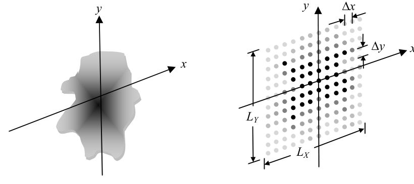
  <figcaption>图 2.1 二维函数的 (a) 解析版本与 (b) 采样版本（截自原书）</figcaption>
</figure>

采样空间张成的物理面积是 \(L_X \times L_Y\)，其中边长（**side length**）与采样参数的关系是全书第一对命脉公式：

\[
L_X = M\Delta x, \qquad L_Y = N\Delta y .
\tag{2.3}
\]

接下来有两件必须操心的事。

**其一，函数"装得下"吗？** \(g(x,y)\) 的有效值张成的范围叫**支撑（support）**。沿 \(x\) 方向支撑记 \(D_X\)，沿 \(y\) 方向记 \(D_Y\)。有效值要全部落进阵列，要求

\[
D_X \le L_X, \qquad D_Y \le L_Y .
\tag{2.4}
\]

**其二，采得够密吗？** 对**带限（bandlimited）**函数——频谱只占有限频率范围——只要采样间隔小于某个定值，连续函数可以**从样本中无损恢复**。Shannon–Nyquist 采样定理的二维版本：

\[
\Delta x \le \frac{1}{2B_X}, \qquad \Delta y \le \frac{1}{2B_Y},
\tag{2.5}
\]

\(B_X, B_Y\) 是连续函数频谱沿 \(x, y\) 方向的**带宽（bandwidth）**（图 2.2）。违反式 (2.5) 就发生**混叠（aliasing）**：欠采样的高频成分被错当成低频成分混进结果里（2.5 节会亲眼看到）。

<figure>
  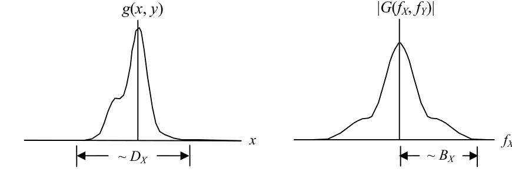
  <figcaption>图 2.2 g(x,y) 沿 x 轴的 (a) 支撑 D_X 与 (b) 带宽 B_X；带宽按"半宽"计量（截自原书）</figcaption>
</figure>

与采样间隔配套的参数是**奈奎斯特频率（Nyquist frequency）**：

\[
f_{NX} = \frac{1}{2\Delta x}, \qquad f_{NY} = \frac{1}{2\Delta y},
\tag{2.6}
\]

即采样率的一半，也是给定 \(\Delta x\)（或 \(\Delta y\)）后能充分表示的最高空间频率。

!!! note "拓展：采样为什么等价于'乘 comb'——频谱周期复制的直觉"
    把采样翻译成第 1 章的语言：\(g(m\Delta x, n\Delta y)\) 就是 \(g(x,y)\,\mathrm{comb}(x/\Delta x)\,\mathrm{comb}(y/\Delta y)\)——乘上梳状函数把样本"挑"出来。空域乘 comb ↔ 频域卷 \(\Delta x\,\mathrm{comb}(\Delta x f)\)：**频谱被复制出无穷多个副本，间隔 \(1/\Delta x\) 排开**。Nyquist 判据说的正是"相邻副本恰好不重叠"：一旦重叠，叠上去的部分就再也分不回去——这就是混叠。2.5 节的式 (2.24) 会把这个图像写成公式。

!!! note "拓展：带限与有限支撑互斥"
    一对不舒服的事实：**支撑有限（空域有边界）的函数必然不带限**——rect、circ 都不例外。这是相似性定理的极端版：空域越"陡"（跳变），频域拖尾越长；反过来，带限函数必然在空域无限延伸。所以实际建模永远在跟"有效"二字打交道：支撑用函数值降到峰值的 1% 定义（见习题 2.3），带宽用 98% 功率定义——2.2 节就是把这种工程化做实。

## 2.2 有效带宽

第 1 章定义的实用函数**没有一个是带限的**——任何有限支撑的函数（rect、circ）都不可能带限。好消息是这些函数往往有**有效带宽（effective bandwidth）**：一个把频谱主要功率都包进来的范围。就算 Shannon–Nyquist 判据没有严格满足，只要 \(\Delta x\) 足够小，就能得到一个混叠影响很小的"够用"表示。

以二维方形信号（半宽 \(w\)）为例：

\[
g(x,y) = \mathrm{rect}\!\left(\frac{x}{2w}\right)\mathrm{rect}\!\left(\frac{y}{2w}\right),
\tag{2.7}
\]

解析频谱（表 1.3 第一行的二维版）：

\[
F(f_X, f_Y) = 4w^2\,\mathrm{sinc}(2wf_X)\,\mathrm{sinc}(2wf_Y).
\tag{2.8}
\]

**有效带宽的一种定义**：找一个频谱宽度（半径），把总功率的绝大部分包进来——本书取 98%。先用 Parseval 定理算总频谱功率：

\[
P_T = \int_{-\infty}^{\infty}\!\!\int (4w^2)^2 \mathrm{sinc}^2(2wf_X)\mathrm{sinc}^2(2wf_Y)\,df_X df_Y
= \int_{-\infty}^{\infty}\!\!\int \mathrm{rect}^2\!\left(\frac{x}{2w}\right)\mathrm{rect}^2\!\left(\frac{y}{2w}\right)dx\,dy = 4w^2 .
\tag{2.9}
\]

把判据转成**极坐标**，以便得到一个径向带宽值 \(B\)：

\[
\frac{1}{P_T}\int_0^{2\pi}\!\!\int_0^{B} (4w^2)^2\,
\mathrm{sinc}^2\!\big[2w(\rho\cos\theta)\big]\,
\mathrm{sinc}^2\!\big[2w(\rho\sin\theta)\big]\,\rho\, d\rho\, d\theta = 0.98 ,
\tag{2.10}
\]

其中 \(f_X = \rho\cos\theta\)，\(f_Y = \rho\sin\theta\)。左边对不同的 \(B\) 数值积分，直到凑够 98%，得到

\[
B \approx \frac{5}{w}.
\tag{2.11}
\]

<figure>
  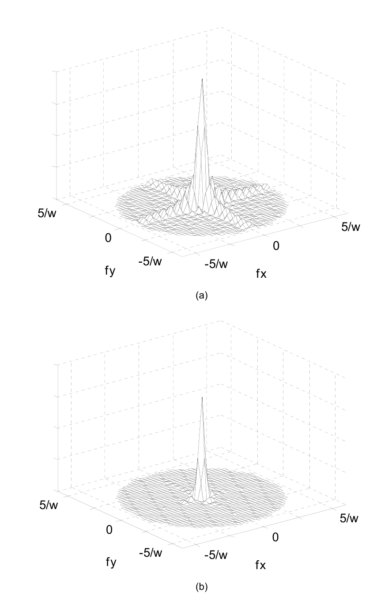
  <figcaption>图 2.3 rect(x/2w)rect(y/2w) 频谱的 98% 功率范围：(a) 幅度谱 |F|，(b) 功率谱 |F|²（截自原书）</figcaption>
</figure>

把式 (2.11) 代回采样定理 (2.5)：

\[
\Delta x \le \frac{w}{10},
\tag{2.12}
\]

人话：**rect 的半宽里至少要放 10 个样本**（全宽 20 个），才能保住 98% 的有效带宽。还有一句重要的警告：落在奈奎斯特频率之外的解析频谱**并不会消失**——功率虽小，但它引入的混叠成分是真实存在的误差（2.5 节用图 2.6 演示）。

表 2.1 用同样的方法算了三种函数的有效带宽（需要更多频谱功率时，取更大的有效带宽即可）。

**表 2.1 98% 功率对应的有效带宽**（按原书重排）：

| 函数 | 有效带宽 \(B\) |
| --- | --- |
| \(\mathrm{rect}(x/2w)\,\mathrm{rect}(y/2w)\) | \(\dfrac{5}{w}\) |
| \(\mathrm{circ}\!\left(\sqrt{x^2+y^2}\middle/w\right)\) | \(\dfrac{5}{w}\) |
| \(\exp\!\left[-\pi\,\dfrac{x^2+y^2}{w^2}\right]\) | \(\dfrac{0.79}{w}\) |

!!! warning "约定冲突延续：表 2.1 的 circ 行站在表 1.3 一边（衔接第 1 章勘误 1）"
    第 1 章勘误 1 说过：表 1.2 定义 \(\mathrm{circ}(r)\) 在半径 \(1/2\) 内为 1，而表 1.3 的 circ 变换对实际按"半径 = 分母"的 Goodman 约定。表 2.1 提供了**第三份证据**：若按表 1.2 约定，\(\mathrm{circ}(\sqrt{x^2+y^2}/w)\) 是半径 \(w/2\) 的圆盘，数值求出的 98% 半径是 \(B \approx 9.98/w\)；若按"半径 = \(w\)"的 Goodman 约定，则 \(\approx 4.99/w\)——**与表 2.1 印的 \(5/w\) 吻合**。结论：用 circ 时先确认半径约定，最可靠的锚点是"半径 \(R\) 的圆盘 ↔ \(R J_1(2\pi R\rho)/\rho\)"。下面脚本当场复现这三个数。

下面的脚本把式 (2.9)–(2.11) 和表 2.1 全部数值验证（rect 用完整极坐标积分，circ/gauss 圆对称走径向一维积分），顺带复现图 2.3。

=== "MATLAB"

    ```matlab
    % ===== 书 2.2 节：有效带宽（式 2.9-2.11 + 表 2.1） =====
    % 有效带宽：包含 98% 总频谱功率的（径向）频谱宽度：
    %   P(B)/P_T = 0.98,  P(B) = ∫∫_{ρ<B} |F|^2 ρ dρ dθ          （式 2.10）
    % 总功率 P_T 用 Parseval 在空域算（式 2.9），数值累积除以解析 P_T，
    % 避免 98% 附近的平坦曲线被截断归一化带偏。
    % 书表 2.1：rect(x/2w)rect(y/2w) → 5/w；circ(sqrt(x^2+y^2)/w) → 5/w；
    %           exp[-π(x^2+y^2)/w^2] → 0.79/w。
    % 圆函数半径约定（承接 ch1 勘误 1）：表 2.1 的 circ 行对应"半径 = w"的圆盘
    % （Goodman/表 1.3 约定），B·w ≈ 4.99；若按表 1.2 的"半径 = w/2"则是 ≈ 9.98。
    % MATLAB/Python 差异：besselj 内置（Python 用 scipy.special.j1）；
    % 索引 1-based；cumtrapz/interp1 为基础函数（Python 需自己拼）。
    clear; clc; close all;
    w   = 1.0;                      % 特征半宽（结果按 B·w 报告）
    NR  = 8001;                     % ρ 网格密度
    rho = linspace(0, 60/w, NR);

    % ---------- rect：|F|^2 非圆对称，做完整 θ 积分（式 2.10） ----------
    % 正方形对称性：θ∈[0,π/4] 积分后乘 8
    NT = 4096;
    th = linspace(0, pi/4, NT);
    F2rect = @(fX, fY) (4*w^2 .* sincn(2*w*fX) .* sincn(2*w*fY)).^2;
    ring = zeros(size(rho));
    for s = 1:128:NR
        e = min(s+127, NR);
        r  = rho(s:e).';                 % 列向量
        fX = r .* cos(th);               % 行 = θ
        fY = r .* sin(th);
        v  = F2rect(fX, fY);
        ring(s:e) = sum((v(:,1:end-1) + v(:,2:end)) / 2, 2) * (th(2)-th(1));
    end
    ring = ring * 8;
    P_rect = [0, cumtrapz(ring .* rho)];        % P(B)

    % ---------- circ / gauss：圆对称，径向 1D 即可 ----------
    P_circ  = [0, cumtrapz(2*pi .* (jinc(rho, w)).^2        .* rho)];  % 半径 w 圆盘
    P_gauss = [0, cumtrapz(2*pi .* (w^2*exp(-pi*w^2*rho.^2)).^2 .* rho)];

    P_T = struct('rect', 4*w^2, 'circW', pi*w^2, 'gauss', w^2/2);
    B_rect  = interp1(P_rect,  rho, 0.98*P_T.rect)  * w;
    B_circ  = interp1(P_circ,   rho, 0.98*P_T.circW) * w;
    B_gauss = interp1(P_gauss,  rho, 0.98*P_T.gauss) * w;

    fprintf('98%% 有效带宽（数值，径向判据）\n');
    fprintf('  rect(x/2w)rect(y/2w) : B·w = %.3f   （书表 2.1：5/w）\n', B_rect);
    fprintf('  circ 半径 w (Goodman/表1.3 约定): B·w = %.3f（书表 2.1：5/w ✓）\n', B_circ);
    fprintf('  circ 半径 w/2 (表 1.2 定义)     : B·w = %.3f\n', 2*B_circ);
    fprintf('  exp(-pi r^2/w^2)     : B·w = %.4f（书表 2.1：0.79/w；解析 %.4f）\n', ...
            B_gauss, sqrt(log(50)/(2*pi)));

    % ---------- 画图：左两幅 = rect 频谱 98% 范围（复现图 2.3），右 = 累积功率曲线 ----------
    fmax = 6/w; n = 601;
    fx1 = linspace(-fmax, fmax, n);
    [FX, FY] = meshgrid(fx1, fx1);      % 'xy' 行为，行 ↔ y，列 ↔ x
    Fmag = 4*w^2 .* sincn(2*w*FX) .* sincn(2*w*FY);

    figure('Position', [80 80 1350 420]);
    subplot(1,3,1);
    imagesc(fx1, fx1, abs(Fmag)); axis xy; colorbar; hold on;
    th_ = linspace(0, 2*pi, 200); plot(B_rect/w*cos(th_), B_rect/w*sin(th_), 'c--', 'LineWidth', 1.5);
    xlabel('f_X/w'); ylabel('f_Y/w'); title('|F(f_X,f_Y)|, rect, circle = 98% power');
    subplot(1,3,2);
    imagesc(fx1, fx1, abs(Fmag).^2); axis xy; colorbar; hold on;
    plot(B_rect/w*cos(th_), B_rect/w*sin(th_), 'c--', 'LineWidth', 1.5);
    xlabel('f_X/w'); ylabel('f_Y/w'); title('|F|^2 (power spectrum), rect');
    subplot(1,3,3);
    plot(rho*w, P_rect/P_T.rect, 'LineWidth', 1.2); hold on;
    plot(rho*w, P_circ/P_T.circW, 'LineWidth', 1.2);
    plot(rho*w, P_gauss/P_T.gauss, 'LineWidth', 1.2);
    yline(0.98, 'k:'); plot(B_rect, 0.98, 'o', B_circ, 0.98, 'o', B_gauss, 0.98, 'o', 'MarkerSize', 5);
    xlim([0 12]); ylim([0.9 1.001]); grid on;
    xlabel('B·w'); ylabel('cumulative power fraction');
    title('98% effective bandwidth (Table 2.1)');
    legend('rect(x/2w)rect(y/2w)', 'circ, disk R=w (Table 2.1)', 'exp(-\pir^2/w^2)', 'FontSize', 8);
    saveas(gcf, 'out_eff_bw.png');
    fprintf('已保存 out_eff_bw.png\n');

    % ---------- 局部函数（定义同书表 1.2 / ch1 勘误 1 的可靠形式） ----------
    function r = sincn(u)
        % 归一化 sinc：sin(pi*u)/(pi*u)，u=0 处极限 1
        r = ones(size(u));
        nz = u ~= 0;
        r(nz) = sin(pi*u(nz)) ./ (pi*u(nz));
    end

    function A = jinc(rho, R)
        % 半径 R 圆盘的解析频谱：R*J1(2*pi*R*rho)/rho，rho=0 极限 = 面积
        A = zeros(size(rho));
        nz = rho ~= 0;
        A(nz)  = R .* besselj(1, 2*pi*R*rho(nz)) ./ rho(nz);
        A(~nz) = pi * R^2;
    end
    ```

=== "Python"

    ```python
    # ===== 书 2.2 节：有效带宽（式 2.9-2.11 + 表 2.1） =====
    # 有效带宽定义：包含 98% 总频谱功率的（径向）频谱宽度。
    #   P(B)/P_T = 0.98,  P(B) = ∫_0^{2π}∫_0^B |F(ρcosθ, ρsinθ)|^2 ρ dρ dθ   （式 2.10）
    # 总功率 P_T 用 Parseval 定理在空域算（式 2.9），数值累积一律除以解析 P_T，
    # 避免频域截断把 98% 交点带偏（|F|^2 在 98% 附近非常平坦，0.3% 的归一化偏差
    # 就能把 B 推移百分之几十）。
    # 书中结果（表 2.1）：rect(x/2w)rect(y/2w) → B≈5/w；circ(sqrt(x^2+y^2)/w) → B≈5/w；
    #                     exp[-π(x^2+y^2)/w^2] → B≈0.79/w。
    # 圆函数的两种半径约定（承接 ch1 勘误 1）：
    #   表 1.2 定义 circ(r/w) 是半径 w/2 的圆盘 → 径向 98% 半径 B·w ≈ 9.97；
    #   Goodman/表 1.3 约定（半径 = w 的圆盘）→ B·w ≈ 4.99，与表 2.1 的 5/w 一致。
    #   即表 2.1 的 circ 行再次站在"半径 = 分母"的 Goodman 约定一边。
    import os
    import sys

    import numpy as np
    import matplotlib.pyplot as plt

    sys.path.insert(0, os.path.join(os.path.dirname(os.path.abspath(__file__)), "..", "common"))
    from base import sinc, jinc   # 公共模块：rect/sinc/jinc 等，ch1 起的积木

    w = 1.0                        # 特征半宽（结果按 B·w 报告，与 w 无关）
    NR = 16001                     # ρ 网格密度
    rho = np.linspace(0.0, 60.0 / w, NR)           # 频域半径 [1/m]


    def cumtrapz(y, x):
        """0 起头的累积梯形积分（numpy 2.x 无内建 cumtrapz）。"""
        return np.concatenate(([0.0], np.cumsum((y[1:] + y[:-1]) / 2 * np.diff(x))))


    # ---------- rect：|F|^2 非圆对称，须做完整 θ 积分（式 2.10） ----------
    # 利用正方形对称性：积分 θ∈[0, π/4] 再乘 8（被积函数在 π/4 镜像 + π/2 周期）。
    NT = 16384
    th = np.linspace(0.0, np.pi / 4, NT)
    ring_rect = np.empty(NR)
    step = 128
    for s in range(0, NR, step):
        r = rho[s:s + step, None]
        fX = r * np.cos(th)[None, :]
        fY = r * np.sin(th)[None, :]
        v = (4.0 * w ** 2 * sinc(2 * w * fX) * sinc(2 * w * fY)) ** 2
        ring_rect[s:s + step] = (v[:, 1:] + v[:, :-1]).sum(axis=1) * (th[1] - th[0]) / 2
    ring_rect *= 8.0
    P_rect = cumtrapz(ring_rect * rho, rho)        # P(B)，除以解析 P_T=4w² 得占比

    # ---------- circ 与 gauss：圆对称，θ 积分 trivially = 2π，直接径向 1D ----------
    F2_circ = jinc(rho, w) ** 2                    # 半径 w 圆盘（Goodman/表 1.3 约定）
    P_circ = cumtrapz(2 * np.pi * F2_circ * rho, rho)
    F2_gauss = (w ** 2 * np.exp(-np.pi * w ** 2 * rho ** 2)) ** 2
    P_gauss = cumtrapz(2 * np.pi * F2_gauss * rho, rho)

    P_T = {"rect": 4.0 * w ** 2,                   # 式 2.9
           "circ(R=w)": np.pi * w ** 2,            # 圆盘面积
           "circ(R=w/2)": np.pi * (w / 2.0) ** 2,
           "gauss": w ** 2 / 2.0}                  # ∫∫exp(-2πr²/w²)

    B_rect = np.interp(0.98 * P_T["rect"], P_rect, rho) * w
    B_circ_w = np.interp(0.98 * P_T["circ(R=w)"], P_circ, rho) * w
    B_circ_half = B_circ_w * 2                     # 半径减半 → B 加倍（尺度反比）
    B_gauss = np.interp(0.98 * P_T["gauss"], P_gauss, rho) * w

    # rect 交叉验证：直角网格 + 解析归一化（98% 附近的累积曲线极平坦，
    # 极坐标的 θ/ρ 离散误差会放大成 B 的百分之几偏移；直角网格求和更稳）。
    half, nc = 40.0, 4001
    fc = np.linspace(-half, half, nc)
    dfc = fc[1] - fc[0]
    acc5 = acc55 = s_tot = 0.0
    for s in range(0, nc, 250):
        FYc, FXc = np.meshgrid(fc[s:s + 250], fc, indexing="ij")
        Pc = 16.0 * sinc(2 * FXc) ** 2 * sinc(2 * FYc) ** 2
        Rc = np.hypot(FXc, FYc)
        s_tot += Pc.sum() * dfc ** 2
        acc5 += Pc[Rc <= 5.0].sum() * dfc ** 2
        acc55 += Pc[Rc <= 5.5].sum() * dfc ** 2
    fr5, fr55 = acc5 / P_T["rect"], acc55 / P_T["rect"]
    B_rect_cart = 5.0 + 0.5 * (0.98 - fr5) / (fr55 - fr5)   # 线性插值出 98% 交点

    print("98% 有效带宽（数值，径向判据）")
    print(f"  rect(x/2w)rect(y/2w) : B·w = {B_rect:.3f}（极坐标）；"
          f"直角网格参照 {B_rect_cart:.3f}  （书表 2.1：5/w ✓）")
    print(f"  circ 半径 w   (Goodman/表 1.3 约定): B·w = {B_circ_w:.3f}（书表 2.1：5/w ✓）")
    print(f"  circ 半径 w/2 (表 1.2 定义)        : B·w = {B_circ_half:.3f}")
    print(f"  exp(-pi r^2/w^2)     : B·w = {B_gauss:.4f}  （书表 2.1：0.79/w；"
          f"解析 sqrt(ln50/2pi) = {np.sqrt(np.log(50) / (2 * np.pi)):.4f}）")

    # circ 用 u=2πRρ 空间交叉验证：P/(πR²) = 2∫_0^{2πRρ} J1²(u)/u du（已知总积分 = 1/2），
    # 一维精细梯形即可做到近机器精度（免二维截断误差）。
    from scipy.special import j1 as _j1
    u = np.linspace(0.0, 400.0, 400001)
    vu = np.where(u > 1e-12, _j1(u) ** 2 / np.where(u > 1e-12, u, 1.0), 0.0)
    cum_u = np.concatenate(([0.0], np.cumsum((vu[1:] + vu[:-1]) / 2 * np.diff(u))))
    u98 = np.interp(0.98 * 0.5, cum_u, u)
    print(f"  [交叉验证] u 空间精确解：98% 处 2πRρ = {u98:.2f} → B·R = {u98 / (2 * np.pi):.3f}"
          f"（半径 w 约定 B·w = {u98 / (2 * np.pi):.3f}；半径 w/2 约定 B·w = {u98 / np.pi:.3f}）")

    # ---------- 画图：左两幅 = rect 频谱 98% 范围（复现图 2.3），右 = 累积功率曲线 ----------
    fmax = 6.0 / w
    n = 601
    fx1 = np.linspace(-fmax, fmax, n)
    FX, FY = np.meshgrid(fx1, fx1)                 # 'xy' 索引，与 MATLAB 一致
    Fmag = 4.0 * w ** 2 * sinc(2 * w * FX) * sinc(2 * w * FY)

    fig, axes = plt.subplots(1, 3, figsize=(13.5, 4.2))
    im = axes[0].imshow(np.abs(Fmag), extent=[-fmax, fmax, -fmax, fmax], origin="lower",
                        cmap="magma")
    axes[0].add_patch(plt.Circle((0, 0), B_rect / w, fill=False, color="cyan", ls="--", lw=1.5))
    axes[0].set_title(r"$|F(f_X,f_Y)|$, rect, circle = 98% power")
    axes[0].set_xlabel(r"$f_X/w$"); axes[0].set_ylabel(r"$f_Y/w$")
    plt.colorbar(im, ax=axes[0], fraction=0.046)

    im = axes[1].imshow(np.abs(Fmag) ** 2, extent=[-fmax, fmax, -fmax, fmax], origin="lower",
                        cmap="magma")
    axes[1].add_patch(plt.Circle((0, 0), B_rect / w, fill=False, color="cyan", ls="--", lw=1.5))
    axes[1].set_title(r"$|F|^2$ (power spectrum), rect")
    axes[1].set_xlabel(r"$f_X/w$"); axes[1].set_ylabel(r"$f_Y/w$")
    plt.colorbar(im, ax=axes[1], fraction=0.046)

    axes[2].plot(rho * w, P_rect / P_T["rect"], label="rect(x/2w)rect(y/2w)")
    axes[2].plot(rho * w, P_circ / P_T["circ(R=w)"], label="circ, disk R=w (Table 2.1)")
    axes[2].plot(rho * w, P_gauss / P_T["gauss"], label=r"$\exp(-\pi r^2/w^2)$")
    axes[2].axhline(0.98, color="k", ls=":", lw=1)
    axes[2].plot(B_rect, 0.98, "o", ms=5)
    axes[2].plot(B_circ_w, 0.98, "o", ms=5)
    axes[2].plot(B_gauss, 0.98, "o", ms=5)
    axes[2].annotate(f"{B_rect:.2f}", (B_rect, 0.98), textcoords="offset points", xytext=(-6, 8), fontsize=8)
    axes[2].annotate(f"{B_circ_w:.2f}", (B_circ_w, 0.98), textcoords="offset points", xytext=(8, -14), fontsize=8)
    axes[2].annotate(f"{B_gauss:.2f}", (B_gauss, 0.98), textcoords="offset points", xytext=(4, -12), fontsize=8)
    axes[2].set_xlim(0, 12); axes[2].set_ylim(0.9, 1.001)
    axes[2].set_xlabel(r"$B\cdot w$"); axes[2].set_ylabel("cumulative power fraction")
    axes[2].set_title("98% effective bandwidth (Table 2.1)")
    axes[2].legend(fontsize=8); axes[2].grid(True, alpha=0.3)
    fig.tight_layout()
    fig.savefig(os.path.join(os.path.dirname(os.path.abspath(__file__)),
                             "out_eff_bw.png"), dpi=150)
    print("已保存 out_eff_bw.png")
    ```

Python 实测（\(w=1\)）：

- rect：极坐标积分 \(B\cdot w = 5.15\)，直角网格参照 \(5.06\)（98% 附近曲线极平坦，末位小数对网格分辨率敏感）——书值 \(5/w\) 成立；
- circ（半径 \(w\)，Goodman 约定）：\(B\cdot w = 4.99\)，与书值 \(5/w\) 吻合；换成表 1.2 的半径 \(w/2\) 约定则给出 \(9.98\)——坐实上面 warning 的判断（u 空间精确解：98% 处 \(2\pi R\rho = 31.33\)，即 \(B\cdot R = 4.987\)）；
- 高斯：\(B\cdot w = 0.7892\)，解析值 \(\sqrt{\ln 50/(2\pi)} = 0.7891\)——表 2.1 的 \(0.79/w\) 就是方程 \(1-e^{-2\pi w^2 B^2} = 0.98\) 的精确解。

<figure>
  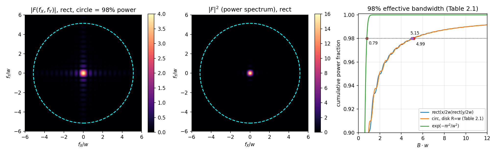
  <figcaption>图 2-P1 有效带宽数值验证：左两幅为 rect 频谱与 98% 功率圆（复现图 2.3），右为三种函数的累积功率曲线与 98% 交点（笔记自制）</figcaption>
</figure>

!!! note "拓展：'98% 判据'只是众多工程判据之一"
    为什么是 98%？没有神圣的理由——它是"混叠小到看不见"和"采样别太密"之间的折中。常见替代：按频谱旁瓣绝对电平（如低于峰值 40 dB）定带宽；按成像质量指标（Strehl 比，第 7 章）的退化程度定采样。判据不同，B 的数值不同，但"rect 紧、高斯松"的相对关系不变。记住式 (2.12) 这个数量级（**特征半宽 ≥ 10 样本**），其余场合按需收紧。

## 2.3 从连续变换推导 DFT

DFT（通常以高速后代 **FFT** 的形态出场）是计算机傅里叶光学的基本工具。本节目的：从连续傅里叶变换出发推导 DFT——推导值得亲手走一遍，因为它给出三样建模必需品：**空间采样坐标的定标、频率坐标的定标、变换结果前的常数因子**。物理光学建模的成败一半在定标上。本节只突出对本书仿真路线关键的部分，更多细节可查章末参考文献。

连续变换 (1.1) 重抄一遍：

\[
G(f_X, f_Y) = \int_{-\infty}^{\infty}\!\!\int g(x,y)\,\exp[-j2\pi(f_X x + f_Y y)]\,dx\,dy .
\tag{2.13}
\]

**第一步，采样**：按式 (2.1)(2.2) 离散化，并简写 \(g(m\Delta x, n\Delta y) \rightarrow \tilde g(m,n)\)（\(\tilde g\) 就是数组）：

\[
g(m\Delta x, n\Delta y) \rightarrow \tilde g(m,n).
\tag{2.14}
\]

**第二步，黎曼和**：把积分换成求和：

\[
\int_{-\infty}^{\infty}\!\!\int \cdots\,dx\,dy
\;\rightarrow\; \sum_{n=-N/2}^{N/2-1}\sum_{m=-M/2}^{M/2-1} \cdots\,\Delta x\Delta y .
\tag{2.15}
\]

关键决定：DFT 作为通用数组操作，**不知道 \(\Delta x\Delta y\) 的存在**——这两个乘子不进 DFT 定义，之后做物理定标时再手动补上。

**第三步，频率坐标离散化**：频率域同样切成 \(M \times N\) 个等间隔点：

\[
f_X \rightarrow \frac{p}{M\Delta x}, \quad p = -\frac{M}{2},\cdots,\frac{M}{2}-1; \qquad
f_Y \rightarrow \frac{q}{N\Delta y}, \quad q = -\frac{N}{2},\cdots,\frac{N}{2}-1;
\tag{2.16}
\]

频率采样间隔（**frequency sample interval**）是第二对命脉公式：

\[
\Delta f_X = \frac{1}{M\Delta x} = \frac{1}{L_X}, \qquad
\Delta f_Y = \frac{1}{N\Delta y} = \frac{1}{L_Y}.
\tag{2.17}
\]

整数 \(p, q\) 与 \(m, n\) 取值范围完全相同（空间阵列和频率阵列元素数一样多）。频率坐标的最大绝对值正是奈奎斯特频率 \(1/(2\Delta x) = f_{NX}\)、\(1/(2\Delta y) = f_{NY}\)。

**第四步，化简指数核**：把式 (2.16) 代进式 (2.13) 的核：

\[
\exp[-j2\pi(f_X x + f_Y y)] \rightarrow
\exp\!\left[-j2\pi\!\left(\frac{p}{M\Delta x}\,m\Delta x + \frac{q}{N\Delta y}\,n\Delta y\right)\right]
= \exp\!\left[-j2\pi\!\left(\frac{pm}{M} + \frac{qn}{N}\right)\right].
\tag{2.18}
\]

物理量 \(\Delta x, \Delta y\) 全部从核里消掉了——这就是 DFT 可以写成"纯数组操作"的原因。

**合起来，DFT 登场**：

\[
\tilde G(p,q) = \sum_{m=-M/2}^{M/2-1}\sum_{n=-N/2}^{N/2-1}
\tilde g(m,n)\,\exp\!\left[-j2\pi\!\left(\frac{pm}{M} + \frac{qn}{N}\right)\right],
\tag{2.19}
\]

逆变换（DFT\(^{-1}\)）同法推导：

\[
\tilde g(m,n) = \frac{1}{MN}\sum_{p=-M/2}^{M/2-1}\sum_{q=-N/2}^{N/2-1}
\tilde G(p,q)\,\exp\!\left[+j2\pi\!\left(\frac{pm}{M} + \frac{qn}{N}\right)\right].
\tag{2.20}
\]

**\(1/MN\) 因子值得单独说**。它恰好等于 \(\Delta x\,\Delta y\,\Delta f_X\,\Delta f_Y\)（用式 (2.17) 验证），正是"先积一次正变换、再积一次逆变换"时黎曼和冒出来的乘子组合——有了它，DFT 接 DFT\(^{-1}\) 才能原样返回输入（傅里叶积分定理的离散版）。各软件对它的处理不同：MATLAB 的 `fft`/`ifft` 按式 (2.19)(2.20) 实现（正变换不除、逆变换除 \(MN\)）；有些工具把 \((MN)^{-1/2}\) 平摊到正逆两边。做物理定标时这笔账必须对上。

实际上式 (2.19)(2.20) 从不按定义硬算，而是用 FFT/FFT\(^{-1}\) 算法——结果与两式一致，且 \(M, N\) 为 2 的幂时效率最高（其它值只略慢）。剩下的问题是**数据在数组里怎么摆**——2.4 节。

!!! note "拓展：FFT 到底快多少？"
    按式 (2.19) 硬算：\(N^2\) 个输出、每个输出 \(N\) 项求和，共 \(O(N^2)\) 次运算；FFT 用分治把复杂度降到 \(O(N\log N)\)。数量级：\(N=1024\) 时 \(N^2 \approx 10^6\)、\(N\log_2 N \approx 10^4\)——快 100 倍；\(N=4096\) 时快 340 倍。二维从 \(O(N^4)\) 降到 \(O(N^2\log N)\)（第 1 章算过账：\(N=1000\) 差十万倍）。这就是"reasonable 时间内做几千次光学传播仿真"（第 1 章的原话）在工程上成立的全部原因。代价是 FFT 隐含"数据按周期处理"的脾气——2.5 节见识它的第一张账单。

## 2.4 坐标、索引、居中与移位

全书例子统一用均匀采样 + 方形网格：\(\Delta y = \Delta x\)、\(N = M\)、\(L_X = L_Y = L\)，所以下面只写一套变量。沿一个维度，样本坐标（沿用 MATLAB 的区间记法）：

\[
x \;\rightarrow\; \left[-\frac{L}{2} \;:\; \Delta x \;:\; \frac{L}{2} - \Delta x\right],
\tag{2.21}
\]

即从 \(-L/2\) 到 \(L/2-\Delta x\)、步长 \(\Delta x\)——注意**右端点 \(+L/2\) 取不到**：\(M\) 个样本从 \(-L/2\) 起数，数到 \(L/2-\Delta x\) 正好 \(M\) 个。假定空域与频域之间是 FFT 关系，由式 (2.16)(2.17) 得频率坐标：

\[
f_X \;\rightarrow\; \left[-\frac{1}{2\Delta x} \;:\; \frac{1}{L} \;:\; \frac{1}{2\Delta x} - \frac{1}{L}\right].
\tag{2.22}
\]

**三种排列**。式 (2.2) 的指标 \(m, n\)（以及 \(p, q\)）横跨正负值，但软件的数组索引只用正整数——MATLAB 一维向量从 `(1)` 开始。于是有三种摆法（图 2.4）：

- **解析（analytic）**：纸面上的排列，指标带正负号（\(-M/2,\cdots,M/2-1\)）；
- **居中（centered）**：放进计算机后的排列——把感兴趣的函数"居中"摆放，**零坐标对应第 \((M/2+1)\) 个索引**（1-based）；
- **移位（shifted）**：FFT 算法的约定是"第 1 个索引位置 = 零坐标"。所以做 FFT **之前**，要把居中排列换位成移位排列。

居中 → 移位的换位由 `fftshift` 完成，反方向用 `ifftshift`。图 2.4 用一维 rect 和它的频谱把三种排列全部摆了出来——左列空域、右列频域，Index 行是数组索引、coords 行是物理坐标。

<figure>
  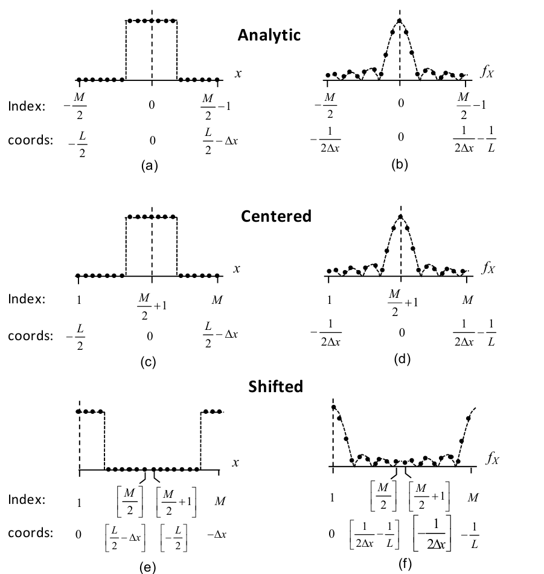
  <figcaption>图 2.4 一维空域（左列）与频域（右列）向量的三种采样排列：(a)(b) 解析；(c)(d) 居中；(e)(f) FFT 前的移位排列（截自原书）</figcaption>
</figure>

二维数组同理：MATLAB 索引从 `(1,1)` 开始。居中排列中零坐标 \([x,y]=[0,0]\) 位于索引 `(N/2+1, M/2+1)`；2D FFT 之前要把它移到索引 `(1,1)`。所需的"移位"实际上就是**数组的四象限对调**（图 2.5）：`fftshift` 和 `ifftshift` 都能完成。

<figure>
  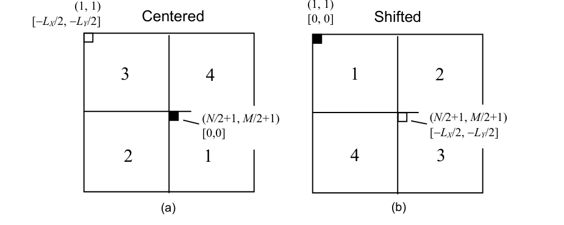
  <figcaption>图 2.5 二维空间阵列的采样排列：(a) 居中（[0,0] 在 (N/2+1, M/2+1)，象限序 3-4/2-1）与 (b) FFT 前的移位排列（[0,0] 在 (1,1)，象限序 1-2/4-3）（截自原书）</figcaption>
</figure>

还有一个容易绊倒的细节：**MATLAB 用"行–列"索引**，`(i, j)` 表示第 \(i\) 行第 \(j\) 列——顺序恰好与笛卡尔坐标 \((x, y)\)（先横轴后纵轴）相反：**\(j\) 索引对应 \(x\) 坐标，\(i\) 索引对应 \(y\) 坐标**。所以图 2.5 里 \([x,y]\) 值和 `(j, i)` 索引成对出现。好在 MATLAB 的向量运算记号本来就按笛卡尔系设计，只有直接操作整数索引时才需要想起这件事。

把"如何从物理问题走到一个能 FFT 的网格"整理成流程图——这一套动作在全书每一章开头都会重演：

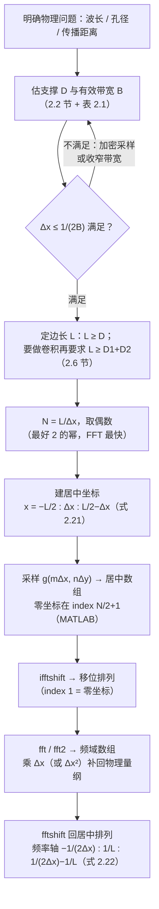

下面的脚本用 \(N=8\) 的迷你网格把三种排列打印出来（复现图 2.4 的数值），并把图 2.5 的象限对调画出来。

=== "MATLAB"

    ```matlab
    % ===== 书 2.4 节：坐标、索引、居中与移位（式 2.21/2.22，复现图 2.4 / 2.5） =====
    % 三种排列（书图 2.4）：
    %   analytic ：指标带正负（m = -M/2..M/2-1），纸面公式用；
    %   centered ：零坐标在 index M/2+1（MATLAB 1-based）；
    %   shifted  ：index 1 = 零坐标，FFT 前必须转成它。
    % centered <-> shifted 用 fftshift / ifftshift（偶数 N 两者相同，奇数 N 不同！）。
    % MATLAB/Python 对照：居中零坐标 MATLAB (N/2+1, M/2+1) <-> Python (N//2, M//2)；
    % MATLAB (i,j) = 行,列：j ↔ x 坐标、i ↔ y 坐标（与笛卡尔 (x,y) 顺序相反）。
    clear; clc; close all;

    % ---------- 1D：N=8 小网格，rect 半宽 1.5（3 个样本为 1） ----------
    N = 8; L = 8.0; dx = L/N;
    n = (0:N-1) - N/2;
    x = n * dx;                       % 式 (2.21)：-L/2 : Δx : L/2-Δx
    f = n / (N*dx);                   % 式 (2.22)：-1/(2Δx) : 1/L : 1/(2Δx)-1/L
    g_centered = rectn(x/3);          % 居中排列：|x|<1.5 → x=-1,0,1
    g_shifted  = ifftshift(g_centered);

    fprintf('N=8, L=8, dx=1 的排列（对应书图 2.4）\n');
    fprintf('MATLAB 1-based index : %s\n', mat2str(1:N));
    fprintf('coords x (式 2.21)   : %s\n', mat2str(x));
    fprintf('g 居中 centered      : %s\n', mat2str(g_centered));
    fprintf('g 移位 shifted(FFT用): %s\n', mat2str(g_shifted));
    fprintf('freq 坐标 f (式 2.22): %s\n', mat2str(f, 4));
    fprintf('roundtrip fftshift(ifftshift(g)) == g : %d\n', ...
            isequal(fftshift(g_shifted), g_centered));
    fprintf(['注意：偶数 N 时 fftshift 与 ifftshift 等价；奇数 N 不等价' ...
             '（见笔记坑与陷阱）\n\n']);

    % ---------- 2D：象限交换（书图 2.5） ----------
    N2 = 8;
    [X, Y] = meshgrid(x, x);          % 行 ↔ y，列 ↔ x（与 Python 'xy' 一致）
    A_centered = double(sqrt(X.^2 + Y.^2) < 1.5);   % 居中圆盘
    A_shifted  = ifftshift(A_centered);
    [iz, jz] = find(A_centered > 0 & abs(X) < 1e-12 & abs(Y) < 1e-12);
    fprintf('2D 居中排列零坐标位置 (行,列) = (%d, %d)；即 (N/2+1, M/2+1)\n', iz, jz);
    fprintf('2D 移位排列零坐标位置 (行,列) = (1, 1)\n\n');

    % ---------- 画图：上排复现图 2.4 三种 1D 排列，下排复现图 2.5 象限交换 ----------
    figure('Position', [60 60 1150 760]);

    subplot(2,3,1);
    plot(x, g_centered, 'o-', 'MarkerSize', 5, 'Color', 'crimson'); grid on;
    xlim([-4.5 3.5]); ylim([-0.2 1.25]);
    title('centered: zero coord at index N/2+1');
    xlabel('x');

    subplot(2,3,2);
    plot(0:N-1, g_shifted, 's-', 'MarkerSize', 5, 'Color', [0 .55 .55]); grid on;
    ylim([-0.2 1.25]);
    title('shifted for FFT: zero coord at index 1');
    xlabel('array index (1-based)');

    subplot(2,3,3);
    G = fft(g_shifted) * dx;
    plot(f, abs(fftshift(G)), 'o-', 'MarkerSize', 5, 'Color', 'slateblue'); grid on;
    title('|FFT \times \Deltax| back on centered freq axis');
    xlabel('f_X');

    subplot(2,3,4);
    imagesc(qmap(N2)); axis image off;   % 居中：3,4 / 2,1
    title('2D centered (quadrant No.), [0,0] at (N/2+1, M/2+1)');
    subplot(2,3,5);
    imagesc(ifftshift(qmap(N2))); axis image off;  % 移位：1,2 / 4,3
    title('2D shifted for FFT (quadrant No.), [0,0] at (1,1)');

    subplot(2,3,6);
    plot(abs(G), 's-', 'MarkerSize', 5, 'Color', [1 .55 0]); grid on;
    xline(N2/2 + 0.5, ':');
    title('why fftshift exists: raw fft ordering');
    xlabel('array index (1-based)');

    saveas(gcf, 'out_arrangements.png');
    fprintf('已保存 out_arrangements.png\n');

    % ---------- 局部函数 ----------
    function r = rectn(t)
        r = zeros(size(t));
        r(abs(t) < 0.5) = 1;
        r(abs(t) == 0.5) = 0.5;
    end

    function q = qmap(N)
        % 象限编号（书图 2.5 的居中排列：左上 3、右上 4、左下 2、右下 1）
        q = zeros(N);
        q(1:N/2, 1:N/2)         = 3;
        q(1:N/2, N/2+1:end)     = 4;
        q(N/2+1:end, 1:N/2)     = 2;
        q(N/2+1:end, N/2+1:end) = 1;
    end
    ```

=== "Python"

    ```python
    # ===== 书 2.4 节：坐标、索引、居中与移位（式 2.21/2.22，复现图 2.4 / 2.5） =====
    # 三种排列（书图 2.4）：
    #   analytic ：指标带正负（m = -M/2 .. M/2-1），纸面公式用；
    #   centered ：放进计算机后的排列，零坐标在 index M/2+1（MATLAB 1-based）
    #              ↔ Python 0-based 的 index N//2；
    #   shifted  ：FFT 约定 index 1（MATLAB）/ 0（Python）= 零坐标，FFT 前必须转成它。
    # centered ↔ shifted 用 fftshift / ifftshift 互换（偶数 N 两者相同，奇数 N 不同！）。
    # 本脚本用 N=8 小网格把三种排列打印出来，并复现图 2.4（1D）与图 2.5（2D 象限交换）。
    import os
    import sys

    import numpy as np
    import matplotlib.pyplot as plt

    sys.path.insert(0, os.path.join(os.path.dirname(os.path.abspath(__file__)), "..", "common"))
    from base import rect, coords

    # ---------- 1D：N=8 小网格，rect 半宽 1.5（3 个样本为 1） ----------
    N, L = 8, 8.0
    dx = L / N
    x, f = coords(L, N)                        # 式 (2.21)/(2.22)：居中升序坐标
    g_centered = rect(x / 3.0)                 # 居中排列：|x|<1.5 → x=-1,0,1
    g_shifted = np.fft.ifftshift(g_centered)   # 居中 → 移位（FFT 约定）

    print("N=8, L=8, dx=1 的三种排列（数值对应书图 2.4）")
    print("MATLAB 1-based index:", np.arange(1, N + 1))
    print("Python 0-based index:", np.arange(N))
    print("coords x (式 2.21)   :", x)
    print("g 居中 centered      :", g_centered.astype(int))
    print("g 移位 shifted(FFT用):", g_shifted.astype(int))
    print("freq 坐标 f (式 2.22):", f)
    print("roundtrip fftshift(ifftshift(g)) == g :",
          np.allclose(np.fft.fftshift(g_shifted), g_centered))
    print("注意：偶数 N 时 fftshift 与 ifftshift 等价；奇数 N 不等价（见笔记坑与陷阱）")

    # ---------- 2D：象限交换（书图 2.5） ----------
    N2 = 8
    x2, _ = coords(L, N2)
    X, Y = np.meshgrid(x2, x2)                # 'xy'：行 ↔ y，列 ↔ x（与 MATLAB 一致）
    A_centered = (np.hypot(X, Y) < 1.5).astype(float)   # 居中圆盘，[0,0] 在 (N/2, M/2)
    A_shifted = np.fft.ifftshift(A_centered)            # [0,0] 挪到 (0, 0)
    print("\n2D 居中排列零坐标位置 (Python 行,列) =",
          tuple(np.argwhere(A_centered > 0).mean(axis=0).round(1)),
          "；MATLAB (i,j) 记法 = (N/2+1, M/2+1) = (5, 5)")
    print("2D 移位排列零坐标位置 (Python 行,列) =", tuple(np.argwhere(A_shifted > 0)[0]))

    # ---------- 画图：上排复现图 2.4 三种 1D 排列，下排复现图 2.5 象限交换 ----------
    fig = plt.figure(figsize=(11.5, 7.6))
    gs = fig.add_gridspec(2, 3)

    ax = fig.add_subplot(gs[0, 0])
    ax.plot(x, g_centered, "o-", ms=5, color="crimson", mfc="none")
    ax.set_title("centered: zero coord at index N//2\n(apply ifftshift before fft)")
    ax.set_xticks(x); ax.grid(True, alpha=0.3); ax.set_ylim(-0.2, 1.25)

    ax = fig.add_subplot(gs[0, 1])
    ax.plot(np.arange(N), g_shifted, "s-", ms=5, color="teal", mfc="none")
    ax.set_title("shifted for FFT: zero coord at index 0")
    ax.set_xticks(np.arange(N)); ax.grid(True, alpha=0.3); ax.set_ylim(-0.2, 1.25)

    ax = fig.add_subplot(gs[0, 2])
    G = np.fft.fft(g_shifted) * dx
    ax.plot(f, np.abs(np.fft.fftshift(G)), "o-", ms=5, color="slateblue", mfc="none")
    ax.set_title("|FFT x dx| back on centered freq axis")
    ax.grid(True, alpha=0.3)

    # 象限编号（书图 2.5：居中 = 3,4/2,1；移位 = 1,2/4,3）
    q = np.zeros((N2, N2), int)
    q[:N2 // 2, :N2 // 2] = 3; q[:N2 // 2, N2 // 2:] = 4
    q[N2 // 2:, :N2 // 2] = 2; q[N2 // 2:, N2 // 2:] = 1
    q_shift = np.fft.ifftshift(q)
    for k, (A, ttl) in enumerate([(q, "2D centered (quadrant No.)\n[0,0] at MATLAB (N/2+1, M/2+1)"),
                                  (q_shift, "2D shifted for FFT (quadrant No.)\n[0,0] at index (1,1)/(0,0)")]):
        ax = fig.add_subplot(gs[1, k])
        ax.imshow(A, cmap="Pastel1", origin="upper")
        for i in range(N2):
            for j in range(N2):
                ax.text(j, i, str(A[i, j]), ha="center", va="center", fontsize=9)
        ax.set_title(ttl); ax.tick_params(labelbottom=False, labelleft=False)

    ax = fig.add_subplot(gs[1, 2])
    ax.plot(np.abs(G), "s-", ms=5, color="darkorange", mfc="none")
    ax.axvline(N2 // 2 - 0.5, color="gray", ls=":", lw=1)
    ax.text(N2 // 2 - 0.2, 4.6, "raw FFT output:\nleft half = zero & positive freq,\nright half = negative freq", fontsize=8)
    ax.set_title("why fftshift exists: raw fft\nordering vs. centered axis")
    ax.set_xticks(np.arange(N2)); ax.grid(True, alpha=0.3)
    fig.tight_layout()
    fig.savefig(os.path.join(os.path.dirname(os.path.abspath(__file__)),
                             "out_arrangements.png"), dpi=150)
    print("已保存 out_arrangements.png")
    ```

Python 实测输出（\(N=8\)，rect 半宽 1.5）：

```text
Python 0-based index: [0 1 2 3 4 5 6 7]
coords x (式 2.21)   : [-4. -3. -2. -1.  0.  1.  2.  3.]
g 居中 centered      : [0 0 0 1 1 1 0 0]     # 零坐标在 index 4 = N//2（MATLAB 5 = N/2+1）
g 移位 shifted(FFT用): [1 1 0 0 0 0 0 1]     # index 0 = 坐标 0
freq 坐标 f (式 2.22): [-0.5 -0.375 -0.25 -0.125 0. 0.125 0.25 0.375]
roundtrip fftshift(ifftshift(g)) == g : True
2D 居中排列零坐标位置 (行,列) = (4.0, 4.0)；MATLAB (i,j) 记法 = (N/2+1, M/2+1) = (5, 5)
```

<figure>
  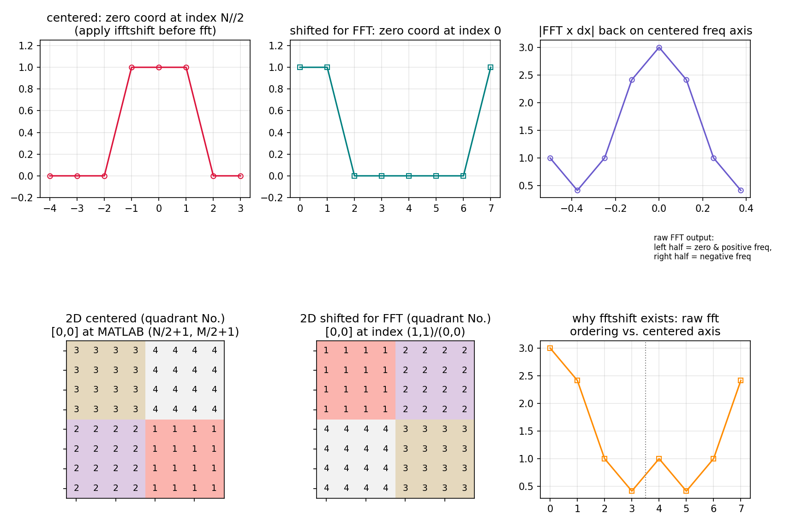
  <figcaption>图 2-P2 排列演示：上排为居中 / 移位 / FFT 定标三种 1D 排列（复现图 2.4），下排为 2D 象限编号对调（复现图 2.5）与 FFT 原始输出顺序（笔记自制）</figcaption>
</figure>

**MATLAB ↔ Python 索引对照**（本章所有代码都遵守，全书通用）：

| 事项 | MATLAB | Python（numpy） |
| --- | --- | --- |
| 首个索引 | 1 | 0 |
| 居中排列零坐标（1D） | index `M/2+1` | index `M//2` |
| 居中排列零坐标（2D，行,列） | `(N/2+1, M/2+1)` | `(N//2, M//2)` |
| `(i, j)` 顺序 | 行,列：`j` ↔ x、`i` ↔ y | 相同：`a[i, j]` 行,列 |
| meshgrid | 默认 `'xy'`（行 ↔ y） | `np.meshgrid` 默认 `'xy'`；`'ij'` 会交换两维 |
| fftshift / ifftshift | 同语义 | 同语义（偶数 N 两者等价，奇数 N 不等价） |
| fft 归一化 | 正变换不除 N（1/MN 在 ifft） | 相同 |
| imshow 坐标原点 | 默认左上（y 向下），`axis xy` 翻转 | 默认左上，`origin='lower'` 翻转 |
| 广播 | R2016b 起隐式扩展 | 原生广播（注意 `(N,1)` 与 `(N,)` 形状差异） |

!!! note "拓展：为什么全书坚持偶数 N？"
    偶数 \(N\) 下，居中排列的零坐标样本正好压在索引 \(N/2+1\)（MATLAB）上，fftshift 与 ifftshift 互为镜像（都是"两半对调"）；奇数 \(N\) 时两者不再相同——配对用错就错位一个样本。加上 radix-2 FFT 对 2 的幂最快，"偶数、最好 2 的幂"就成了全书默认。奇数网格并非不能用（零填充到 \(N_1+N_2-1\) 时就会遇到奇数，见 2.6 节脚本），但要自己承担所有移位配对的细节。

## 2.5 周期延拓

粗略地说，表 1.1 的全部定理在离散域都能用——比如卷积可以"两个 FFT、逐点相乘、一个逆 FFT"地完成。但**离散变换结果与解析结果有系统性差异**，刻画这个差异的概念叫**周期延拓（periodic extension）**。

考虑一维解析函数 \(f(x)\) 及其采样版本：

\[
f_s(x) = \Big[f(x)\cdot \mathrm{comb}\!\left(\frac{x}{\Delta x}\right)\Big]\,\mathrm{rect}\!\left(\frac{x}{L}\right),
\tag{2.23}
\]

comb 把间隔 \(\Delta x\) 处的样本"挑"出来，rect 把采样空间总宽限定为 \(L\)。对式 (2.23) 做解析傅里叶变换（空域两次相乘 ↔ 频域两次卷积，用表 1.1/1.3）：

\[
F_s(f_X) = \Big[F(f_X) \ast \Delta x\,\mathrm{comb}(\Delta x f_X)\Big] \ast L\,\mathrm{sinc}(L f_X),
\tag{2.24}
\]

\(\ast\) 表示一维卷积。第一层卷积把解析谱 \(F(f_X)\) 以 \(1/\Delta x\) 为间隔**复制**成连续的周期函数；第二层与 \(L\,\mathrm{sinc}\) 的卷积是"平滑"（空域 rect 窗的代价）。然而 FFT 实际产出的是**采样后的**结果——在式 (2.24) 上再乘一个频域采样项来建模：

\[
F_P(f_X) = \Big\{\Big[F(f_X) \ast \Delta x\,\mathrm{comb}(\Delta x f_X)\Big] \ast L\,\mathrm{sinc}(L f_X)\Big\}\cdot L\,\mathrm{comb}(L f_X).
\tag{2.25}
\]

新的 comb 项把频域样本间隔定为 \(1/L\)（与式 (2.17) 一致）。对式 (2.25) 做逆变换，得到周期谱 \(F_P(f_X)\) 对应的空域函数：

\[
f_P(x) = \Big\{\Big[f(x)\cdot \mathrm{comb}\!\left(\frac{x}{\Delta x}\right)\Big]\mathrm{rect}\!\left(\frac{x}{L}\right)\Big\} \ast \mathrm{comb}\!\left(\frac{x}{L}\right).
\tag{2.26}
\]

于是**周期延拓概念**一句话说清：我们从 \(f(x)\) 的采样版本出发，但 FFT 算完之后，**一切就像我们从周期函数 \(f_P(x)\)（样本数组首尾相接、无限复制）出发、得到周期谱 \(F_P(f_X)\) 一样**。

书上的例子（图 2.6）：解析矩形（实线）与采样版本（点），向量长度 20（\(L = 20\)，\(\Delta x = 1\)）；虚线是周期延拓——样本向量"虚拟地"向两边无限复制。图 2.6(b)：解析谱幅度（实线）、FFT 结果（点）、周期谱（虚线）——**FFT 样本跟随周期谱**。与解析谱最明显的差别是高频瓣处样本值略大：矩形谱中欠采样频率成分混叠的结果。实践中，按有效带宽（如 98% 水平）采样，只会引入少量混叠。

<figure>
  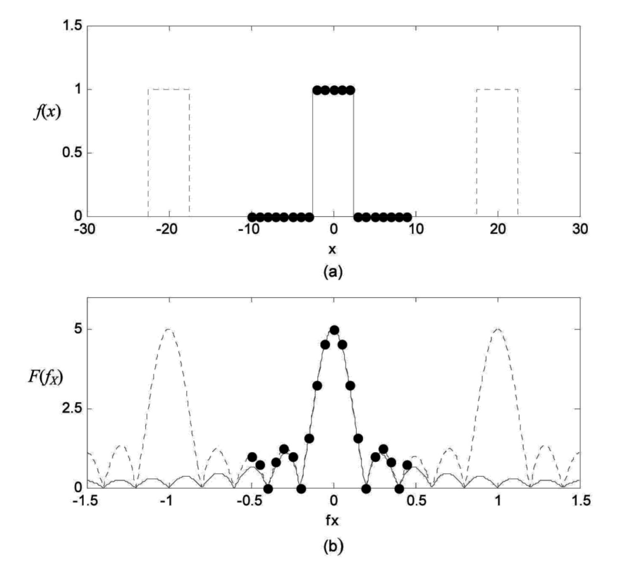
  <figcaption>图 2.6 周期延拓演示：(a) rect 函数——解析（实线）、周期延拓（虚线）、采样（点）；(b) rect 频谱幅度——解析（实线）、周期延拓（虚线）、FFT 样本（点）（截自原书）</figcaption>
</figure>

下面的脚本按书图 2.6 的参数（\(L=20\)，\(\Delta x=1\)，rect 半宽 2.5）复现这张图，并验证 2.3 节的三条定标约定。

=== "MATLAB"

    ```matlab
    % ===== 书 2.3 / 2.5 节：DFT 定标与周期延拓（式 2.19-2.26，复现图 2.6） =====
    % 书图 2.6 参数：L = 20, Δx = 1, N = 20 个样本，f(x) = rect(x/5)（半宽 2.5）。
    % 验证三件事：
    %   (1) 式 (2.19) 的 DFT 定义（核 exp[-j2π(pm/M+qn/N)]）与 MATLAB fft 一致
    %       （前提：数据先排成"移位排列"——index 1 对应坐标 0，见 2.4 节）；
    %   (2) 乘上 Δx 后，FFT 样本"跟随"周期延拓谱 F_P（Poisson 求和 + 窗平滑），
    %       与解析谱 F 的偏差 = 混叠（书 2.5 节：瓣高处样本略大）；
    %   (3) 式 (2.19)+(2.20) 连用（1/MN 因子在 ifft 内置）恢复原数组。
    % MATLAB/Python 差异：fft/fftshift/ifftshift 语义一致；坐标构造用
    % n = (0:N-1) - N/2（1-based 下的居中写法，零坐标在 N/2+1 号）。
    clear; clc; close all;
    L  = 20.0;        % 采样空间边长 [m]
    dx = 1.0;         % 采样间隔 [m]
    N  = round(L/dx);
    n  = (0:N-1) - N/2;           % 居中整数指标（MATLAB 1-based：坐标 0 在 n=N/2+1 号）
    x  = n * dx;                  % x ∈ [-10, 9]，式 (2.21)
    f  = n / (N*dx);              % f ∈ [-0.5, 0.4]，式 (2.22)
    g  = rectn(x/5);              % rect 半宽 2.5 → 样本 x=-2..2 共 5 个为 1

    % ---------- (1) 式 (2.19) 矩阵 DFT vs fft（都在移位排列下） ----------
    g_shift = ifftshift(g);                 % 居中 → 移位（index 1 = 坐标 0）
    m = 0:N-1;                              % 式 (2.19) 的 m = 0..N-1（移位排列）
    p = m.';
    W = exp(-2j*pi * p .* m / N);           % DFT 核 exp[-j2π pm/M]
    G_matrix = W * g_shift;                 % 式 (2.19)（无 Δx 因子）
    G_fft    = fft(g_shift);
    err_fft  = max(abs(G_matrix - G_fft));
    fprintf('[1] 式(2.19)矩阵 DFT 与 fft 最大差异 = %.2e\n', err_fft);

    % ---------- (2) FFT×Δx 样本 = 周期延拓谱 F_P 的样本（近似重合） ----------
    G = fftshift(G_fft) * dx;               % 乘 Δx 回连续量纲，再居中排列
    F_analytic = 5 .* sincn(5 .* f);        % 解析谱：rect(x/5) <-> 5 sinc(5f)
    kk = -3:3;                              % 周期延拓：F_P(f) = Σ_k F(f - k/Δx)
    F_periodic = zeros(size(f));
    for k = kk
        F_periodic = F_periodic + 5 .* sincn(5 .* (f - k/dx));
    end
    err_per   = max(abs(G - F_periodic));
    err_alias = max(abs(G - F_analytic));
    fprintf(['[2] FFT×Δx 与周期谱 F_P 最大差异 = %.2e（空域矩形窗的 sinc 平滑 + ' ...
             '样本化效应，FFT 样本只是"跟随"周期谱）\n'], err_per);
    fprintf('    FFT×Δx 与解析谱 F   最大差异 = %.3e（这就是混叠主项）\n', err_alias);
    fprintf('    DC 样本 G(0) = %.6f（= 中心纵坐标 ∫g dx = 5）\n', real(G(N/2+1)));

    % ---------- (3) 逆变换恢复原数组（式 2.20 的 1/MN 因子在 ifft 内置） ----------
    g_back = fftshift(ifft(ifftshift(G / dx)));
    err_inv = max(abs(g_back - g));
    fprintf('[3] DFT -> DFT^-1 往返恢复原数组最大差异 = %.2e\n', err_inv);

    % ---------- 画图（复现书图 2.6） ----------
    figure('Position', [80 80 860 720]);
    subplot(2,1,1);
    plot(x, rectn(x/5), 'k-', 'LineWidth', 1); hold on;
    plot(x - L, rectn((x - L)/5), 'k--', 'LineWidth', 0.8);
    plot(x + L, rectn((x + L)/5), 'k--', 'LineWidth', 0.8);
    plot(x, g, 'o', 'MarkerSize', 6, 'Color', 'crimson');
    xlim([-30 30]); ylim([-0.05 1.3]); grid on;
    xlabel('x'); ylabel('f(x)');
    title('Periodic extension: rect, L = 20, \Deltax = 1');
    legend('analytic', 'periodic copies', 'Location', 'northwest');
    subplot(2,1,2);
    plot(f, abs(F_analytic), 'k-', 'LineWidth', 1.2); hold on;
    plot(f, abs(F_periodic), 'k--', 'LineWidth', 0.9);
    plot(f, abs(G), 'o', 'MarkerSize', 6, 'Color', 'crimson');
    xlim([-1.5 1.5]); ylim([0 5.6]); grid on;
    xlabel('f_X'); ylabel('|F(f_X)|');
    title('Spectrum: FFT samples follow the periodic spectrum (aliasing lifts the sidelobes)');
    legend('analytic F', 'periodic F_P', 'FFT \times \Deltax (N=20)');
    saveas(gcf, 'out_periodic_ext.png');
    fprintf('已保存 out_periodic_ext.png\n');

    % ---------- 局部函数 ----------
    function r = rectn(t)
        % rect：|t|<1/2 为 1，|t|=1/2 为 1/2，其余 0（书表 1.2）
        r = zeros(size(t));
        r(abs(t) < 0.5) = 1;
        r(abs(t) == 0.5) = 0.5;
    end

    function s = sincn(u)
        % 归一化 sinc：sin(pi*u)/(pi*u)（与 MATLAB Signal Processing Toolbox 一致）
        s = ones(size(u));
        nz = u ~= 0;
        s(nz) = sin(pi*u(nz)) ./ (pi*u(nz));
    end
    ```

=== "Python"

    ```python
    # ===== 书 2.3 / 2.5 节：DFT 定标与周期延拓（式 2.19-2.26，复现图 2.6） =====
    # 书图 2.6 参数：L = 20, Δx = 1, N = 20 个样本，f(x) = rect(x/5)（半宽 2.5）。
    # 验证三件事：
    #   (1) 式 (2.19) 的 DFT 定义（含 exp[-j2π(pm/M+qn/N)] 核）与 np.fft.fft 逐元素一致
    #       （前提：数据先排成"移位排列"——index 0 对应坐标 0，见 2.4 节）；
    #   (2) 乘上 Δx 后，FFT 样本"跟随"周期延拓谱 F_P（Poisson 求和），
    #       而与解析谱 F 的偏差 = 混叠（书 2.5 节图 2.6(b) 的高频瓣略大）；
    #   (3) 式 (2.19)+(2.20) 连用（1/MN 因子）恢复原数组（傅里叶积分定理的离散版）。
    import os
    import sys

    import numpy as np
    import matplotlib.pyplot as plt

    sys.path.insert(0, os.path.join(os.path.dirname(os.path.abspath(__file__)), "..", "common"))
    from base import rect, coords

    L = 20.0          # 采样空间边长 [m]（书图 2.6：L=20）
    dx = 1.0          # 采样间隔 [m]
    N = int(round(L / dx))
    x, f = coords(L, N)          # 居中坐标：x ∈ [-10, 9]，f ∈ [-0.5, 0.4]
    g = rect(x / 5.0)            # rect 半宽 2.5 → 样本 x=-2..2 共 5 个为 1，面积 5

    # ---------- (1) 式 (2.19) 矩阵 DFT vs np.fft.fft（都在移位排列下） ----------
    g_shift = np.fft.ifftshift(g)                     # 居中 → 移位（index 0 = 坐标 0）
    m = np.arange(N)                                  # 式 (2.19) 的 m = 0..N-1（移位排列）
    p = np.arange(N)[:, None]
    W = np.exp(-2j * np.pi * p * m / N)               # DFT 核 exp[-j2π pm/M]
    G_matrix = W @ g_shift                            # 式 (2.19)（无 Δx 因子）
    G_fft = np.fft.fft(g_shift)
    err_fft = np.max(np.abs(G_matrix - G_fft))
    print(f"[1] 式(2.19)矩阵 DFT 与 np.fft.fft 最大差异 = {err_fft:.2e}")

    # ---------- (2) FFT×Δx 样本 = 周期延拓谱 F_P 的样本 ----------
    G = np.fft.fftshift(G_fft) * dx                   # 乘 Δx 回连续量纲，再居中排列
    F_analytic = 5.0 * np.sinc(5.0 * f)               # 解析谱：rect(x/5) ↔ 5 sinc(5f)
    k = np.arange(-3, 4)                              # 周期延拓：F_P(f) = Σ_k F(f - k/Δx)
    F_periodic = np.sum([5.0 * np.sinc(5.0 * (f - kk / dx)) for kk in k], axis=0)
    err_per = np.max(np.abs(G - F_periodic))
    err_alias = np.max(np.abs(G - F_analytic))
    print(f"[2] FFT×Δx 与周期谱 F_P 最大差异 = {err_per:.2e}")
    print("    （FFT 样本只是'跟随'周期谱：空域矩形窗把 F_s 平滑了一层（式 2.24 的 sinc 卷积），")
    print("      加上样本化效应，残差 ~1e-2；书图 2.6(b) 的点与虚线同样只差一点点）")
    print(f"    FFT×Δx 与解析谱 F  最大差异 = {err_alias:.3e}（这就是混叠主项，瓣高处偏大）")
    print(f"    DC 样本 G(0) = {G[N // 2].real:.6f}（= 中心纵坐标 ∫g dx = 5）")

    # ---------- (3) 逆变换恢复原数组（式 2.20 的 1/MN 因子在 ifft 内置） ----------
    g_back = np.fft.fftshift(np.fft.ifft(np.fft.ifftshift(G / dx)))
    err_inv = np.max(np.abs(g_back - g))
    print(f"[3] DFT → DFT^-1 往返恢复原数组最大差异 = {err_inv:.2e}")

    # ---------- 画图（复现书图 2.6） ----------
    fig, axes = plt.subplots(2, 1, figsize=(8.6, 7.2))
    axes[0].plot(x, rect(x / 5.0), "k-", lw=1, label="analytic")
    axes[0].plot(x - L, rect((x - L) / 5.0), "k--", lw=0.8, alpha=0.6)
    axes[0].plot(x + L, rect((x + L) / 5.0), "k--", lw=0.8, alpha=0.6)
    axes[0].plot(x, g, "o", ms=6, color="crimson", mfc="none", label="sampled (N=20)")
    axes[0].set_xlim(-30, 30); axes[0].set_ylim(-0.05, 1.3)
    axes[0].set_xlabel("x"); axes[0].set_ylabel("f(x)")
    axes[0].set_title("Periodic extension: rect, L = 20, dx = 1")
    axes[0].legend(fontsize=8); axes[0].grid(True, alpha=0.3)

    axes[1].plot(f, np.abs(F_analytic), "k-", lw=1.2, label="analytic F")
    axes[1].plot(f, np.abs(F_periodic), "k--", lw=0.9, alpha=0.7, label="periodic F_P")
    axes[1].plot(f, np.abs(G), "o", ms=6, color="crimson", mfc="none", label="FFT x dx (N=20)")
    axes[1].set_xlim(-1.5, 1.5); axes[1].set_ylim(0, 5.6)
    axes[1].set_xlabel(r"$f_X$"); axes[1].set_ylabel(r"$|F(f_X)|$")
    axes[1].set_title("Spectrum: FFT samples follow the periodic spectrum (aliasing lifts the sidelobes)")
    axes[1].legend(fontsize=8); axes[1].grid(True, alpha=0.3)
    fig.tight_layout()
    fig.savefig(os.path.join(os.path.dirname(os.path.abspath(__file__)),
                             "out_periodic_ext.png"), dpi=150)
    print("已保存 out_periodic_ext.png")
    ```

Python 实测：

- \([1]\) 式 (2.19) 矩阵 DFT 与 `np.fft.fft` 最大差异 \(1.4\times10^{-14}\)——机器精度，**"FFT 结果与式 (2.19) 一致"当场坐实**（前提：数据已排成移位排列）；
- \([2]\) FFT\(\times\Delta x\) 与周期谱 \(F_P\) 的样本差 \(1.3\times10^{-2}\)（式 (2.24) 的 sinc 平滑 + 样本化效应——FFT 样本是"跟随"周期谱，不是逐点相等）；与解析谱 \(F\) 差 \(3.6\times10^{-1}\)——**这就是混叠的量级**；
- \([3]\) DFT \(\rightarrow\) DFT\(^{-1}\) 往返最大差异 \(2.4\times10^{-17}\)——\(1/MN\) 因子让式 (2.19)+(2.20) 严格互逆；
- DC 样本 \(G(0) = 5.000000\)，等于中心纵坐标定理给出的 \(\int f\,dx = 5\)——第 1 章的"免费仪器"继续可用。

<figure>
  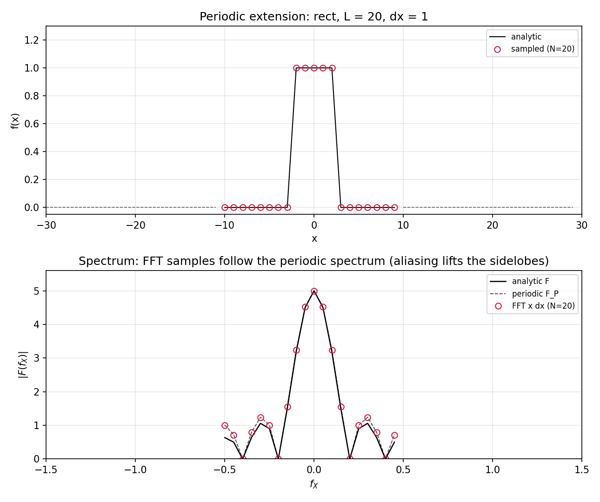
  <figcaption>图 2-P3 周期延拓数值复现（书图 2.6 参数）：上为空域 rect 及其周期副本，下为解析谱（实线）、周期谱（虚线）与 FFT 样本（点）——高频瓣处样本被混叠抬起（笔记自制）</figcaption>
</figure>

## 2.6 周期卷积

周期延拓的另一张账单出现在卷积上。如果用 FFT 做卷积 \(f(x)\ast h(x)\)，实际得到的是**缩放版的 \(f_P(x)\ast h_P(x)\)**——两个周期延拓之间的循环卷积。图 2.7 用矩形与直角三角形演示：两个函数各占 20 个样本的向量（(a) rect 支撑 \(D_1=9\)；(b) 右三角形支撑 \(D_2=15\)，值从 0 线性升到 1）。卷积在概念上是"翻转—平移—记录重叠面积"：图 2.7(c) 把翻转后的三角形平移到某个位置，解析卷积的重叠面积只是那个小灰三角形——但由于周期延拓，三角形左侧还有一条带子压在了**另一个矩形副本**上，这块面积也被算进了离散卷积结果。随着三角形继续右移，错误面积会退场，但卷积结果的边缘（图 2.7(d) 的点）始终跟着周期结果走。

<figure>
  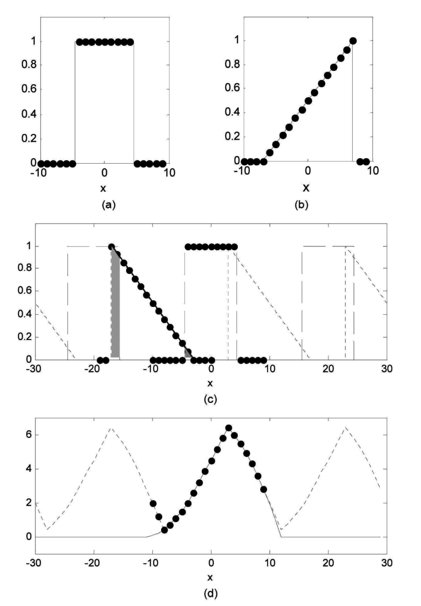
  <figcaption>图 2.7 周期卷积演示：(a) 采样 rect；(b) 采样右三角形；(c) 平移重叠示意——周期函数（虚线）与采样函数（点）；(d) 卷积结果——解析（实线）、周期（虚线）与 FFT（点）（截自原书）</figcaption>
</figure>

要让周期卷积与解析卷积一致，两个函数**支撑之和必须小于阵列边长**：

\[
D_1 + D_2 < L .
\tag{2.27}
\]

图 2.7 的例子 \(D_1 = 9\)、\(D_2 = 15\)、\(L = 20\)：\(9 + 15 = 24 > 20\)，违反式 (2.27)——FFT 结果与解析结果对不上，正是图 2.7(d) 边缘那些"飘起来"的点。

下面的脚本复现图 2.7(d)，并给出两条修复路线：换更大的 \(L\) 重新采样，或者同一组样本**零填充**后做 FFT（第 1 章 1.6 节埋的伏笔在这里兑现）。

=== "MATLAB"

    ```matlab
    % ===== 书 2.6 节：周期卷积（式 2.27，复现图 2.7） =====
    % 书图 2.7 参数：L = 20, Δx = 1, N = 20 个样本；
    %   f = rect，支撑 D1 = 9（样本 x = -4..4 为 1）；h = 右三角形（上升斜坡），
    %   支撑 D2 = 15（x ∈ [-7.5, 7.5]，h(x) = (x+7.5)/15）。
    % D1 + D2 = 24 > L = 20 → 违反式 (2.27)：FFT 卷积 ≠ 解析卷积（卷绕污染）。
    % 演示两条修复路线：(a) 换更大的 L = 40 重新采样；(b) 同一组样本零填充再 FFT。
    % MATLAB/Python 差异：conv2/conv 的 'full' 对应 np.convolve 默认；
    % 居中坐标写法 n = (0:N-1) - N/2（1-based，零坐标在 N/2+1 号）。
    clear; clc; close all;

    % ---------- 解析参照：细网格直接卷积 ----------
    xa = -30:0.005:30;                          % 中心元素恰为 x=0
    dd = xa(2) - xa(1);
    conv_full = conv(rectn(xa/9), rampt(xa, 15)) * dd;   % 支撑 [-24, 24]
    c0 = (length(conv_full) + 1) / 2;           % conv_full(c0) ↔ t = 0
    off = (length(xa) + 1) / 2;                 % xa(off) = 0
    conv_ref = conv_full(c0 - off + 1 : c0 + off - 1);   % 对齐到 xa

    % ---------- L = 20：违反式 (2.27) ----------
    L = 20; N = 20; dx = 1;
    n = (0:N-1) - N/2;
    x = n * dx;
    g = rectn(x/9);                             % D1 = 9
    h = rampt(x, 15);                           % D2 = 15
    conv_fft = real(fftconv_c(g, h, dx));

    err20 = max(abs(conv_ref - conv_fft));
    [pkv, ~] = max(conv_ref);
    fprintf('L=20（D1+D2=24 > L=20，违反式 2.27）：FFT 卷积与解析最大差异 = %.3f\n', err20);
    fprintf('  解析峰值 = %.3f @ x = %.2f；FFT 峰值 = %.3f\n', ...
            conv_ref(pkv), xa(pkv), max(conv_fft));

    % ---------- 修复 1：L = 40 重新采样 ----------
    L2 = 40; N2 = 40;
    n2 = (0:N2-1) - N2/2;
    x2 = n2 * dx;
    conv_fft2 = real(fftconv_c(rectn(x2/9), rampt(x2, 15), dx));
    err40 = max(abs(conv_ref - conv_fft2));
    fprintf('L=40（满足式 2.27）：FFT 卷积与解析最大差异 = %.3e\n', err40);

    % ---------- 修复 2：零填充（同一组 N=20 样本，填到 N1+N2-1 再 FFT） ----------
    P = N + N - 1;                              % 39
    g_pad = zeros(1, P); h_pad = zeros(1, P);
    o = floor((P - N)/2);
    g_pad(o+1:o+N) = g; h_pad(o+1:o+N) = h;
    Gp = fft(ifftshift(g_pad)) .* fft(ifftshift(h_pad)) * dx;
    conv_pad = real(fftshift(ifft(Gp)));
    xp = ((0:P-1) - floor(P/2)) * dx;           % 填充网格的居中坐标
    err_pad = max(abs(interp1(xa, conv_ref, xp) - conv_pad));
    fprintf('零填充 N1+N2-1=%d：FFT 卷积与解析最大差异 = %.3e\n', P, err_pad);

    % ---------- 画图：复现图 2.7(d) + 两种修复 ----------
    figure('Position', [60 60 1450 400]);
    subplot(1,3,1);
    plot(xa, conv_ref, 'k-', 'LineWidth', 1.4); hold on;
    plot(x, conv_fft, 'o', 'MarkerSize', 6, 'Color', 'crimson');
    grid on; xlim([-30 30]); ylim([-0.3 7]);
    xlabel('x'); ylabel('(f*h)(x)');
    title(sprintf('L = 20: D1+D2 = 24 > L\nperiodic wrap-around, max err %.2f', err20));
    legend('analytic', 'FFT (L=20)', 'FontSize', 8, 'Location', 'northwest');
    subplot(1,3,2);
    plot(xa, conv_ref, 'k-', 'LineWidth', 1.4); hold on;
    plot(x2, conv_fft2, 'o', 'MarkerSize', 5, 'Color', [0 .6 .6]);
    grid on; xlim([-30 30]); ylim([-0.3 7]);
    xlabel('x'); ylabel('(f*h)(x)');
    title(sprintf('L = 40: D1+D2 < L satisfied\nmax err %.1e', err40));
    legend('analytic', 'FFT (L=40)', 'FontSize', 8, 'Location', 'northwest');
    subplot(1,3,3);
    plot(xa, conv_ref, 'k-', 'LineWidth', 1.4); hold on;
    plot(xp, conv_pad, 'o', 'MarkerSize', 5, 'Color', [1 .55 0]);
    grid on; xlim([-30 30]); ylim([-0.3 7]);
    xlabel('x'); ylabel('(f*h)(x)');
    title(sprintf('zero-padded to N1+N2-1 = %d\nmax err %.1e', P, err_pad));
    legend('analytic', 'zero-padded FFT', 'FontSize', 8, 'Location', 'northwest');
    sgtitle('Periodic convolution (book Fig. 2.7): rect D1=9 * right-triangle D2=15');
    saveas(gcf, 'out_periodic_conv.png');
    fprintf('已保存 out_periodic_conv.png\n');

    % ---------- 局部函数 ----------
    function r = rectn(t)
        % rect：|t|<1/2 为 1，|t|=1/2 为 1/2，其余 0
        r = zeros(size(t));
        r(abs(t) < 0.5)  = 1;
        r(abs(t) == 0.5) = 0.5;
    end

    function y = rampt(x, D)
        % 支撑宽度 D 的右三角形（上升斜坡，峰值 1 在右边缘）
        y = zeros(size(x));
        m = abs(x) <= D/2;
        y(m) = (x(m) + D/2) / D;
    end

    function out = fftconv_c(g, h, dx)
        % FFT 卷积（循环卷积，不填充）：输入居中排列，输出居中排列
        G = fft(ifftshift(g)) .* fft(ifftshift(h)) * dx;
        out = fftshift(ifft(G));
    end
    ```

=== "Python"

    ```python
    # ===== 书 2.6 节：周期卷积（式 2.27，复现图 2.7） =====
    # 书图 2.7 参数：L = 20, Δx = 1, N = 20 个样本；
    #   f = rect，支撑 D1 = 9（样本 x = -4..4 为 1）；h = 右三角形（上升斜坡），
    #   支撑 D2 = 15（x ∈ [-7.5, 7.5]，h(x) = (x+7.5)/15）。
    # D1 + D2 = 24 > L = 20 → 违反式 (2.27)：FFT 卷积 ≠ 解析卷积（边缘卷绕污染）。
    # 演示两条修复路线：(a) 换更大的 L = 40 重新采样；(b) 同一组样本零填充后再 FFT。
    import os
    import sys

    import numpy as np
    import matplotlib.pyplot as plt

    sys.path.insert(0, os.path.join(os.path.dirname(os.path.abspath(__file__)), "..", "common"))
    from base import rect, coords


    def ramp(x, D):
        """支撑宽度 D 的右三角形（上升斜坡，峰值 1 在右边缘）。"""
        return np.where(np.abs(x) <= D / 2, (x + D / 2) / D, 0.0)


    def fft_conv(g, h, dx):
        """FFT 卷积（循环卷积，不填充）：输入居中排列，输出居中排列。"""
        G = np.fft.fft(np.fft.ifftshift(g)) * np.fft.fft(np.fft.ifftshift(h)) * dx
        return np.fft.fftshift(np.fft.ifft(G))


    # ---------- 解析参照：细网格直接卷积，再对齐到 xa 坐标 ----------
    xa = np.arange(-30.0, 30.0 + 1e-9, 0.005)       # 中心 index 恰为 len//2 ↔ x=0
    dd = xa[1] - xa[0]
    conv_full = np.convolve(rect(xa / 9.0), ramp(xa, 15.0)) * dd   # 支撑 [-24, 24]
    c0 = len(conv_full) // 2                         # conv_full[c0] ↔ t = 0
    conv_ref = conv_full[c0 - len(xa) // 2: c0 + len(xa) // 2 + 1]  # 对齐到 xa

    # ---------- L = 20：违反式 (2.27) ----------
    L, N = 20.0, 20
    x, _ = coords(L, N)
    g = rect(x / 9.0)            # D1 = 9
    h = ramp(x, 15.0)            # D2 = 15
    conv_fft = fft_conv(g, h, dx=1.0).real

    err20 = np.max(np.abs(np.interp(x, xa, conv_ref) - conv_fft))
    pk = np.argmax(conv_ref)
    print(f"L=20（D1+D2=24 > L=20，违反式 2.27）：FFT 卷积与解析最大差异 = {err20:.3f}")
    print(f"  解析峰值 = {conv_ref[pk]:.3f} @ x = {xa[pk]:.2f}；FFT 峰值 = {conv_fft.max():.3f}")
    print("  （书图 2.7(d)：FFT 样本在高频端/边缘跟着周期卷积走，卷绕区多出一块错误面积）")

    # ---------- 修复 1：L = 40 重新采样（D1+D2=24 < 40，满足式 2.27） ----------
    L2, N2 = 40.0, 40
    x2, _ = coords(L2, N2)
    conv_fft2 = fft_conv(rect(x2 / 9.0), ramp(x2, 15.0), dx=1.0).real
    err40 = np.max(np.abs(np.interp(x2, xa, conv_ref) - conv_fft2))
    print(f"L=40（满足式 2.27）：FFT 卷积与解析最大差异 = {err40:.3e}（矩形求和近似误差量级）")

    # ---------- 修复 2：零填充（同一组 N=20 样本，填到 N1+N2-1 再 FFT） ----------
    P = N + N - 1                                 # 20+20-1 = 39（奇数：中心样本唯一）
    g_pad = np.zeros(P); h_pad = np.zeros(P)
    o = (P - N) // 2
    g_pad[o:o + N] = g; h_pad[o:o + N] = h
    Gp = np.fft.fft(np.fft.ifftshift(g_pad)) * np.fft.fft(np.fft.ifftshift(h_pad)) * 1.0
    conv_pad = np.fft.fftshift(np.fft.ifft(Gp)).real
    xp = (np.arange(P) - P // 2) * 1.0            # 填充网格的居中坐标
    err_pad = np.max(np.abs(np.interp(xp, xa, conv_ref) - conv_pad))
    print(f"零填充 N1+N2-1={P}：FFT 卷积与解析最大差异 = {err_pad:.3e}")

    # ---------- 画图：复现图 2.7(d) + 两种修复 ----------
    fig, axes = plt.subplots(1, 3, figsize=(14.5, 4.0))
    axes[0].plot(xa, conv_ref, "k-", lw=1.4, label="analytic")
    axes[0].plot(x, conv_fft, "o", ms=6, color="crimson", mfc="none", label="FFT (L=20)")
    axes[0].set_title(f"L = 20: D1+D2 = 24 > L\nperiodic wrap-around, max err {err20:.2f}")
    axes[1].plot(xa, conv_ref, "k-", lw=1.4, label="analytic")
    axes[1].plot(x2, conv_fft2, "o", ms=5, color="teal", mfc="none", label="FFT (L=40)")
    axes[1].set_title(f"L = 40: D1+D2 < L satisfied\nmax err {err40:.1e}")
    axes[2].plot(xa, conv_ref, "k-", lw=1.4, label="analytic")
    axes[2].plot(xp, conv_pad, "o", ms=5, color="darkorange", mfc="none",
                 label="zero-padded FFT")
    axes[2].set_title(f"zero-padded to N1+N2-1 = {P}\nmax err {err_pad:.1e}")
    for ax in axes:
        ax.set_xlim(-30, 30); ax.set_ylim(-0.3, 7); ax.grid(True, alpha=0.3)
        ax.set_xlabel("x"); ax.set_ylabel("(f*h)(x)"); ax.legend(fontsize=8, loc="upper left")
    fig.suptitle("Periodic convolution (book Fig. 2.7): rect D1=9 * right-triangle D2=15")
    fig.tight_layout(rect=(0, 0, 1, 0.92))
    fig.savefig(os.path.join(os.path.dirname(os.path.abspath(__file__)),
                             "out_periodic_conv.png"), dpi=150)
    print("已保存 out_periodic_conv.png")
    ```

Python 实测：

- \(L=20\)（违反式 2.27）：FFT 卷积与解析最大差异 \(1.87\)——卷绕污染实锤；解析峰值 \(6.301\) 出现在 \(x=3\)（rect 面积 9 与斜坡"最重叠加"的位置），FFT 峰值 \(6.300\) 本身没错，错在边缘；
- \(L=40\)（\(D_1+D_2 = 24 < 40\)，满足式 2.27）：最大差异 \(5.0\times10^{-3}\)——矩形求和近似的正常水平；
- 零填充到 \(N_1+N_2-1 = 39\)：同样 \(5.0\times10^{-3}\)——**不改网格、用旧样本就能修好**。

<figure>
  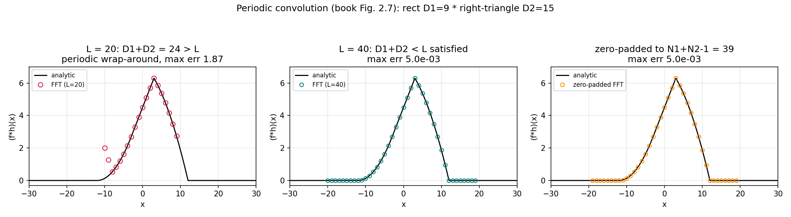
  <figcaption>图 2-P4 周期卷积数值复现（书图 2.7(d)）：左为违反式 (2.27) 的卷绕污染，中/右为两种修复——加大 L 或零填充（笔记自制）</figcaption>
</figure>

!!! note "拓展：零填充修复卷积，但不'增加分辨率'"
    零填充后 FFT 卷积给出的是**同一解析卷积在更密频率网格上的样本**——它插值了结果，却没有注入新信息。两条修复路线的等价性也好理解：加大 \(L\) 重新采样（信息重采一遍）与零填充（用补零宣告"外面没有内容"）都在做同一件事——**把周期副本推开，让式 (2.27) 成立**。工程口诀：做线性卷积前，先算 \(D_1+D_2\)，再把网格撑到比它大。第 5 章角谱法会反过来故意利用循环卷积，届时先分清这两种意图。

## 2.7 习题（原书）

原书 5 道题。每题给题目与提示，答案要点放折叠框——先自己动手。

**2.1** 采样间隔 \(\Delta x = 10\,\mu\text{m}\)、边长 \(L = 5\) mm：样本数 \(M\)？奈奎斯特频率？频率采样间隔？空域坐标范围？频域坐标范围？

??? note "2.1 答案要点"
    \(M = L/\Delta x = 5\,\text{mm}/10\,\mu\text{m} = 500\)（不是 2 的幂，FFT 稍慢但能用）；奈奎斯特频率 \(f_N = 1/(2\Delta x) = 50\,\text{mm}^{-1}\)；频率采样间隔 \(\Delta f = 1/L = 0.2\,\text{mm}^{-1}\)；空域坐标 \([-2.5,\ 2.49]\) mm（右端点取不到）；频域坐标 \([-50,\ 49.8]\,\text{mm}^{-1}\)。对照式 (2.21)(2.22) 与图 2.4 逐项核对。

**2.2** 对下列函数求：(1) 有效带宽；(2) 满足采样定理的最大 \(\Delta x\)；(3) 256 样本（线维度）下可建模的最大边长。

- (a) \(g(x,y) = \mathrm{circ}\!\left(\sqrt{x^2+y^2}\middle/w\right)\)，\(w = 1\) mm
- (b) \(g(x,y) = \exp\!\left(-\dfrac{x^2+y^2}{w^2}\right)\)，\(w = 1\) mm

??? note "2.2 答案要点"
    查表 2.1：(a) \(B = 5/w = 5\,\text{mm}^{-1}\) → \(\Delta x \le 1/(2B) = 0.1\) mm → \(L_{\max} = 256\times 0.1 = 25.6\) mm；(b) \(B = 0.79/w = 0.79\,\text{mm}^{-1}\) → \(\Delta x \le 0.633\) mm → \(L_{\max} \approx 162\) mm。体会：越"陡"的函数（circ 有硬边）越费样本，同样的阵列能仿真的视场越小。（注意 (a) 的 \(B\) 用的是"半径 = \(w\)"的约定——见 2.2 节 warning；若按表 1.2 约定 \(B \approx 10/w\)，\(\Delta x\) 还要减半。）

**2.3** 一维上，下面函数的支撑（值降到峰值 1% 处）是多大？

\[
g(x,y) = \exp\!\left[-\pi\,\frac{x^2+y^2}{w^2}\right]
\]

??? note "2.3 答案要点"
    令 \(e^{-\pi r^2/w^2} = 0.01\)：\(r = w\sqrt{\ln 100/\pi} \approx 1.21\,w\)。一维支撑是直径 \(D = 2r \approx 2.4\,w\)。顺带体会：1% 判据下高斯的支撑很"紧凑"，这是它在仿真里受欢迎的原因之一。

**2.4** 求下列函数沿一个坐标轴的带宽：

- (a) \(\mathrm{sinc}(x/w)\,\mathrm{sinc}(y/w)\)
- (b) \(\mathrm{sinc}(x/2w)\,\mathrm{sinc}(y/2w)\)

??? note "2.4 答案要点"
    用表 1.3 的 \(\mathrm{sinc}(x/a) \leftrightarrow |a|\,\mathrm{rect}(a f_X)\)：(a) \(x\) 向频谱为 \(\mathrm{rect}(w f_X)\)，非零范围 \(|f_X| < 1/(2w)\)，带宽 \(B = 1/(2w)\)；(b) \(\mathrm{rect}(2w f_X)\)，\(B = 1/(4w)\)。sinc 越宽、谱越窄——又是相似性定理。

**2.5** 考虑：

\[
g_1(x,y) = \mathrm{rect}\!\left(\frac{x}{2d},\,\frac{y}{2d}\right), \qquad
g_2(x,y) = \mathrm{circ}\!\left(\sqrt{x^2+y^2}\middle/2d\right).
\]

(a) 容纳这两个函数卷积的最小边长？(b) 容纳 \(g_2\) 自相关的最小边长？

??? note "2.5 答案要点"
    \(g_1\) 支撑 \(D_1 = 2d\)；\(g_2\) 按表 1.2 约定是半径 \(d\) 的圆盘，直径 \(D_2 = 2d\)。
    (a) 式 (2.27)：\(D_1 + D_2 = 4d < L\) → 最小边长略大于 \(4d\)（工程上报 \(4d\)，留点余量更稳）；
    (b) 自相关的支撑 = 直径的两倍 = \(4d\) → 同样 \(4d\)。想起第 1 章"实偶函数的卷积 = 自相关"，(b) 与 (a) 同答案就不奇怪了。

## 2.8 参考文献（原书）

1. J. W. Goodman, *Introduction to Fourier Optics*, 3rd Ed., Roberts & Company, Greenwood Village, CO (2005).——约定蓝本
2. R. M. Gray and J. W. Goodman, *Fourier Transforms: An Introduction for Engineers*, Kluwer Academic, Boston (1995).
3. A. V. Oppenheim and R. W. Schafer, *Discrete-Time Signal Processing*, 3rd Ed., Prentice-Hall, Upper Saddle River, NJ (2009).
4. E. Brigham, *The Fast Fourier Transform and its Applications*, Prentice-Hall, Upper Saddle River, NJ (1988).——周期延拓的深入参考

## 坑与陷阱

!!! danger "FFT 前必须 ifftshift，忘了就整体错位"
    fft 约定 index 0（MATLAB 1）= 零坐标。居中排列的数据直接喂 fft，等于把坐标原点搬到 \(-L/2\)，频谱上多出一线性相位斜坡——幅度看不出来，干涉/全息类问题里相位全错。标准动作：`ifftshift → fft → fftshift`（数据移位，坐标轴只是标注、不移位）。

!!! danger "fftshift 与 ifftshift 只在偶数 N 时等价"
    偶数 \(N\)：两者都是"两半对调"，混用不出错——这也是初学者发现不了问题的原因。奇数 \(N\)：两者不同，配对用错就错位一个样本。全书默认偶数 \(N\)，但零填充到 \(N_1+N_2-1\) 时就会遇到奇数（2.6 节脚本里是 39），那时务必严格配对。

!!! danger "DFT 是纯数组操作，物理量纲自己补"
    `fft`/`np.fft.fft` 不知道 \(\Delta x\)。要近似连续变换：正变换乘 \(\Delta x\)（二维 \(\Delta x^2\)），逆变换除回去；\(1/MN\) 因子内置于 `ifft`。忘乘 \(\Delta x^2\) 的二维频谱整体小 \(N^2\) 倍——用中心纵坐标定理（\(G(0,0) = \) 空域面积）当场验出来。

!!! danger "MATLAB 1-based vs Python 0-based，中心差一号"
    居中排列的零坐标：MATLAB index `N/2+1`（2D：`(N/2+1, M/2+1)`），Python index `N//2`（2D：`(N//2, M//2)`）。另外 MATLAB 的 `(i,j)` 是（行,列）——\(j\) 对应 \(x\)、\(i\) 对应 \(y\)，与笛卡尔 \((x,y)\) 顺序相反。直接数索引时最容易在这两处翻车。

!!! danger "meshgrid 的 'xy' 与 'ij'"
    MATLAB `meshgrid` 与 `np.meshgrid` 默认 `'xy'` 一致（返回数组按（行=y，列=x）排）。Python 里一旦写了 `indexing='ij'`，两个维度互换——圆对称函数看不出差别，非对称问题（离轴孔径、位移定理验证）直接出错。

!!! danger "周期卷积：D1+D2 ≥ L 就会卷绕"
    不填充直接 `fft(g)*fft(h)` 得到周期卷积——支撑之和超过 \(L\) 的部分从边界绕回来污染另一侧。修复：换更大的 \(L\) 重采，或零填充到 \(N_1+N_2-1\)。第 5 章角谱法反过来故意利用循环卷积，届时先分清意图再动手。

!!! danger "带外频谱不会消失——98% 不是免死金牌"
    按有效带宽采样后仍有小功率混叠（图 2.6(b) 瓣高的抬升）。它对强度图通常无害，但对相位敏感的应用（干涉、全息）要留意。需要更高保真时换更严的判据（99.9%、−40 dB 旁瓣），相应加大 \(N\)。

!!! danger "显示方向：imshow 默认 y 向下"
    MATLAB `imagesc` 与 `plt.imshow` 默认都把数组第 0 行画在最上面——\(y\) 轴朝下，与笛卡尔直觉相反。MATLAB 用 `axis xy`、Python 用 `origin='lower'` 翻转。不翻转的话，你建模的"上方"光束会画在下面。

## 速览

1. 采样约定：\(g(x,y)\to g(m\Delta x,n\Delta y)\)，\(m,n = -M/2,\cdots,M/2-1\)（\(M,N\) 偶数）；边长 \(L_X = M\Delta x\) (2.3)；支撑要装得下 (2.4)。
2. 采样定理 \(\Delta x \le 1/(2B_X)\) (2.5)；奈奎斯特频率 \(f_N = 1/(2\Delta x)\) (2.6)。
3. 有限支撑函数必不带限；用 98% 功率定义有效带宽 (2.10)：rect、circ 给 \(B \approx 5/w\)、高斯 \(0.79/w\)（表 2.1；circ 行按"半径 = \(w\)"的 Goodman 约定，数值验证 \(4.99/w\)）。
4. rect 采样经验法则：\(\Delta x \le w/10\) (2.12)——半宽 10 样本。
5. DFT (2.19) 从黎曼和推出：\(\Delta x\Delta y\) 因子在 DFT 之外手动补；频率间隔 \(\Delta f_X = 1/L_X\) (2.17)；\(1/MN\) 因子使 DFT∘DFT\(^{-1}\) 恒等 (2.20)。
6. 坐标：\(x: -L/2:\Delta x:L/2-\Delta x\) (2.21)；\(f_X: -1/(2\Delta x):1/L:1/(2\Delta x)-1/L\) (2.22)。
7. 三种排列：解析（带符号指标）→ 居中（零坐标在 MATLAB `N/2+1` / Python `N//2`）→ 移位（零坐标在 index 0/1，FFT 前必须 `ifftshift`）；MATLAB 行列 \((i,j)\) 中 \(j\leftrightarrow x\)、\(i\leftrightarrow y\)。
8. 周期延拓 (2.23)–(2.26)：FFT 样本跟随周期谱 \(F_P\)，混叠把高频瓣抬起一点。
9. 周期卷积 (2.27)：\(D_1 + D_2 < L\) 才与解析卷积一致；不满足就加大 \(L\) 或零填充到 \(N_1+N_2-1\)。
10. 本章 Python 积木进公共模块 `python/fourier/common/base.py`（rect/tri/sinc/gauss/circle/jinc/coords/ft1/ft2_centered），第 3 章起复用；MATLAB 侧各脚本自带局部函数。

## 术语速查

| 英文 | 中文 | 一句话 |
| --- | --- | --- |
| sample interval | 采样间隔 | 相邻样本的物理间距 \(\Delta x\)，采样率 \(1/\Delta x\) |
| side length | 边长 | 采样空间物理宽度 \(L = M\Delta x\) |
| support | 支撑 | 函数有效值张成的空域范围 \(D\) |
| bandlimited | 带限 | 频谱限于有限频率范围；与有限支撑互斥 |
| Shannon–Nyquist sampling theorem | 采样定理 | \(\Delta x \le 1/(2B)\) 才能从样本无损恢复 |
| Nyquist frequency | 奈奎斯特频率 | \(1/(2\Delta x)\)，给定采样间隔可表示的最高频率 |
| aliasing | 混叠 | 欠采样的高频被错读成低频 |
| effective bandwidth | 有效带宽 | 包含 98% 频谱功率的（径向）宽度 |
| Riemann sum | 黎曼和 | 积分的离散近似，带来 \(\Delta x\Delta y\) 因子 |
| frequency sample interval | 频率采样间隔 | \(\Delta f = 1/L\)，频域相邻样本间距 |
| DFT / FFT | 离散傅里叶变换 / 快速算法 | 式 (2.19)(2.20)；\(N\) 为 2 的幂最快 |
| centered arrangement | 居中排列 | 零坐标在数组中部（MATLAB `N/2+1`） |
| shifted arrangement | 移位排列 | 零坐标在 index 0/1，FFT 的约定 |
| fftshift / ifftshift | 移位命令 | 居中↔移位互换；偶数 N 等价，奇数 N 不是 |
| row–column indexing | 行列索引 | MATLAB `(i,j)`：i 行（y）、j 列（x） |
| periodic extension | 周期延拓 | FFT 隐含把样本数组首尾相接无限复制 |
| periodic convolution | 周期卷积 | 两个周期延拓的循环卷积，要求 \(D_1+D_2<L\) |
| zero padding | 零填充 | 补零拉开周期副本，修复线性卷积 |

## 覆盖自查

| 原书小节 | 内容 | 笔记位置 |
| --- | --- | --- |
| 2.1 Sampling and the Shannon–Nyquist Sampling Theorem | 式 (2.1)–(2.6)、支撑/带宽/奈奎斯特、图 2.1/2.2 | 2.1 |
| 2.2 Effective Bandwidth | 式 (2.7)–(2.12)、表 2.1、图 2.3、98% 判据 | 2.2（含数值验证 + circ 约定 warning） |
| 2.3 Discrete Fourier Transform from the Continuous Transform | 式 (2.13)–(2.20)、1/MN 讨论、FFT 效率 | 2.3 |
| 2.4 Coordinates, Indexing, Centering, and Shifting | 式 (2.21)(2.22)、三种排列、图 2.4/2.5、行列索引 | 2.4（含 mermaid 建网格流程 + MATLAB/Python 对照表） |
| 2.5 Periodic Extension | 式 (2.23)–(2.26)、图 2.6 | 2.5（含数值复现） |
| 2.6 Periodic Convolution | 式 (2.27)、图 2.7 | 2.6（含两种修复路线验证） |
| 2.7 Exercises | 习题 2.1–2.5 | 2.7（含答案要点） |
| 2.8 References | 参考文献 4 条 | 2.8 |

代码文件：`matlab/fourier/ch2/`（ch2_eff_bandwidth.m、ch2_dft_scaling.m、ch2_grid_shift_demo.m、ch2_periodic_conv.m）、`python/fourier/ch2/`（同名 .py）与页面内 tab 一致；公共积木在 `python/fourier/common/base.py`（rect/tri/sinc/gauss/circle/jinc、coords、ft1/ft2_centered），自 ch1 验证脚本上移，第 3 章起复用。
