# 第 3 章 MATLAB 编程：函数、向量、数组与傅里叶变换

> **本章解决**：把第 2 章的"约定"变成"动作"——如何写函数 M 文件（rect、circ）、如何建坐标向量、如何做 FFT 并定标显示、如何用 FFT 做卷积、如何扩展到二维，外加一袋编程提示。第 2 章的三条命脉公式（\(L=M\Delta x\)、\(\Delta f=1/L\)、`移位 → FFT → 移位`）在这一章第一次落到代码里，第 4 章起的所有仿真都建立在这套动作上。
> MATLAB / Python 双实现与数值验证照旧。本章发现原书 1 处笔误（习题 3.1 的变量名 ask/mask 混用）；另有一处原书没点破的现象值得单独讲：书图 3.11(b) 的峰值 0.023 不是 0.02——它是"奇数样本"约定的离散面积，3.7 节有数值实锤。

本章覆盖（原书 3.1–3.9 节）：定义函数、创建向量、FFT 前移位、计算与显示 FFT、与解析结果对比、FFT 卷积、二维、编程提示、习题。原书用 MATLAB 7.1 截图讲解界面，界面细节今日已不同，但语言机制全部未变。

## 3.0 本章导图

<div class="brtree">
  <div class="brrow">
    <span class="brlabel root">把约定写成代码</span>
    <span class="brace"></span>
    <div class="brkids">
      <div class="brrow">
        <span class="brlabel">函数 M 文件（3.1）</span>
        <span class="brace"></span>
        <div class="brkids">
          <span class="brleaf">script vs function</span>
          <span class="brleaf">rect：abs(x)&lt;=1/2 向量化逻辑</span>
          <span class="brleaf">边界不取半值 → 奇数样本</span>
          <span class="brleaf">文件名 = 函数名</span>
        </div>
      </div>
      <div class="brrow">
        <span class="brlabel">建向量（3.2）</span>
        <span class="brace"></span>
        <div class="brkids">
          <span class="brleaf">参数四件套 w/L/M/dx</span>
          <span class="brleaf">x = −L/2 : dx : L/2−dx（式 2.21）</span>
          <span class="brleaf">f = rect(x/(2w))，11 个样本</span>
          <span class="brleaf">plot 选项写在 plot 之后</span>
        </div>
      </div>
      <div class="brrow">
        <span class="brlabel">FFT 前移位（3.3）</span>
        <span class="brace"></span>
        <div class="brkids">
          <span class="brleaf">居中：零坐标在 index M/2+1</span>
          <span class="brleaf">fftshift 换半边 → index 1</span>
          <span class="brleaf">奇数 M 用 ifftshift 撤销</span>
          <span class="brleaf">不移位 = 凭空多线性相位</span>
        </div>
      </div>
      <div class="brrow">
        <span class="brlabel">FFT 与定标（3.4–3.5）</span>
        <span class="brace"></span>
        <div class="brkids">
          <span class="brleaf">fft × dx 回连续量纲</span>
          <span class="brleaf">abs + angle 两张图</span>
          <span class="brleaf">相位只有 0 与 ±π</span>
          <span class="brleaf">fx = −1/(2dx) : 1/L : …（式 2.22）</span>
          <span class="brleaf">对解析谱：边缘略高=混叠</span>
        </div>
      </div>
      <div class="brrow">
        <span class="brlabel">卷积与二维（3.6–3.7）</span>
        <span class="brace"></span>
        <div class="brkids">
          <span class="brleaf">fft → .* → ifft × dx</span>
          <span class="brleaf">D1+D2 &lt; L 支撑判据</span>
          <span class="brleaf">meshgrid 建 X/Y 网格</span>
          <span class="brleaf">fft2 × dx²（不是 fft！）</span>
          <span class="brleaf">imagesc + axis xy</span>
        </div>
      </div>
      <div class="brrow">
        <span class="brlabel">提示与忠告（3.8）</span>
        <span class="brace"></span>
        <div class="brkids">
          <span class="brleaf">clear all / close all</span>
          <span class="brleaf">复数残渣 → real/abs</span>
          <span class="brleaf">nthroot 拉伸对比度</span>
          <span class="brleaf">忘点号：最常见错误</span>
        </div>
      </div>
    </div>
  </div>
</div>

## 3.1 定义函数

打开 MATLAB，常用窗口有：**Current Directory**（当前文件夹，你的文件存这里）、**Command Window**（命令窗口，逐行执行、显示数值输出）、**Command History**（历史命令），它们通常组成了 MATLAB **桌面（Desktop）**；另一个重要窗口是 **Editor Window**（编辑器），代码在这里输入并保存成文件——**M 文件**（扩展名 `.m`）。

<figure>
  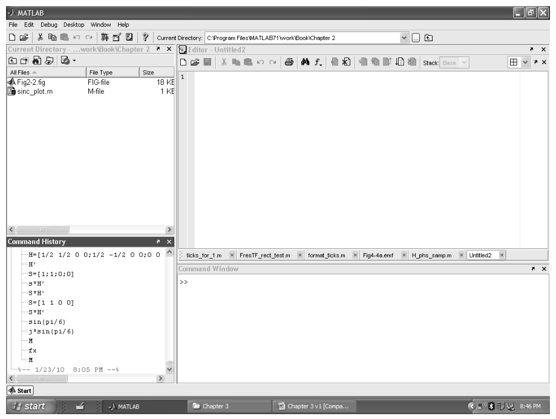
  <figcaption>图 3.1 MATLAB 7.1 桌面：Current Directory（左上）、Command History（左下）、停靠的编辑器（右上）、Command Window（右下）（截自原书）</figcaption>
</figure>

M 文件分两种：**脚本（script）**是一组按顺序执行的代码行；**函数（function）** M 文件可以被命令窗口或其他脚本调用，完成特定任务并返回结果。原书的建议工作流：先在 Current Directory 工具栏点"New Folder"建一个工作文件夹（比如 `Fourier Optics`），双击进入，之后所有 M 文件都存这里、互相可见。

第一个程序：写一个矩形（rect）函数。在编辑器里逐行输入（原书逐行讲了这个文件的每个细节）：

```matlab
function[out]=rect(x);
% rectangle function

out=abs(x)<=1/2;
end
```

逐行拆解：

- `%` 后面是**注释**（编辑器显示绿色），不参与执行；也可以写在代码行尾。蓝色文字表示内置函数。
- `function` 命令把这个 M 文件声明为名为 `rect` 的函数，输入向量 `x`、输出向量 `out`。保存时文件名要与函数名一致（`rect.m`），之后同文件夹里的任何脚本都能调用它。
- 第 4 行是**向量化逻辑测试（vectorized logical test）**：`abs` 对每个元素取绝对值，`<=` 对每个元素做比较——真返回 1、假返回 0，输出 `out` 与 `x` 等长。MATLAB 的强项就是向量/矩阵运算，所以代码天然以数组为变量，而不是逐个元素循环。
- 行尾分号抑制该行结果在命令窗口的回显。

**关键约定：边界样本不取半值**。解析的 rect 定义（表 1.2）在 \(|x|=1/2\) 处取 \(1/2\)；这里编码成 `abs(x)<=1/2`，边界样本取 1。作者的理由：把半值样本想象成边缘上的"斜坡"，不如干脆的单点跳变干净。这个选择带来一个全书通用的特性：

> **rect 的全宽总由奇数个样本组成**。如果某天请求"偶数个样本宽"的矩形，返回值会比预期**多一个样本**。所以原书例子常故意用 0.055 这种"非整"半宽——全宽 0.11 m 在 \(\Delta x=0.01\) m 下正好 11 个样本。

!!! warning "约定差异（非笔误，但要记住）：书的 rect 编码 vs 表 1.2 解析定义"
    表 1.2 的解析定义在边界取半值 \(1/2\)（第 1、2 章笔记代码里的 `rectn`/`base.rect` 都照此实现）；本章起**书内所有 MATLAB 代码**的 rect 都是 `abs(x)<=1/2`（边界取 1）。两者只在"恰好命中边界的样本"上不同——均匀网格很少命中，所以大多数时候你察觉不到；但 3.7 节会看到它把二维频谱的峰值顶高 15%（这是"奇数样本"特性的直接后果）。本笔记 Python 侧约定：表 1.2 语义用公共模块的 `base.rect`，书编码语义用本章脚本里的 `rect_book`。

!!! note "拓展：logical/bool 数组为什么能当函数值用"
    `abs(x)<=1/2` 的返回值不是数值数组而是 **logical 数组**（numpy 里是 bool 数组）——但在算术里它就是 0/1：乘法、求和都会自动按数值处理。这一个事实顶三行循环代码：C 语言式的 `for` 循环加 `if` 判断，在这里一行搞定，而且对任意形状的数组（二维 `X`、`Y` 网格）同样成立。第 3.7 节的二维圆盘、第 5 章起的光瞳函数全都靠这一招生成。顺带一个坑：MATLAB 旧版本里 `find` 是把 logical 变索引的常用工具；numpy 里对应的写法是布尔掩码直接索引 `x[mask]`。

存盘、关编辑器，`rect` 就可以在 `Fourier Optics` 文件夹里的任何脚本中调用了。

=== "MATLAB"

    ```matlab
    function out = rect(x)
    % ===== 书 3.1 节：矩形函数 M 文件（逐行忠实 + 中文注释） =====
    % 书 3.1 节在 Editor Window 里建立的第一个函数 M 文件（原书第 1-5 行）：
    %   1  function[out]=rect(x);
    %   2  % rectangle function
    %   3
    %   4  out=abs(x)<=1/2;
    %   5  end
    % 要点（书 3.1 节原话）：
    %   - "%" 后面是注释（编辑器显示绿色）；行尾分号抑制命令行回显；
    %   - 第 4 行是"向量化逻辑测试"：abs 对每个元素取绝对值，"<=" 对每个元素
    %     做比较，真 -> 1、假 -> 0，输出 out 与输入 x 等长；
    %   - 边界样本【不】取表 1.2 解析定义的半值 1/2：作者认为半值像"斜坡"，
    %     不如单点跳变干净，所以编码成 abs(x)<=1/2（边界取 1）；
    %   - 由此带来的特性：矩形全宽总是由【奇数】个样本组成；若请求"偶数个
    %     样本宽"，会多返回一个样本——全书例子故意用 0.055 这类非整半宽配合。
    % MATLAB/Python 差异：abs(x)<=1/2 返回 logical 数组，算术运算时按 0/1 处理；
    % numpy 比较返回 bool 数组，行为相同（乘法/求和时同样当 0/1）。
    out = abs(x) <= 1/2;
    end
    ```

=== "Python"

    ```python
    # python/fourier/ch3/ch3_fft_example.py 内的定义（书 3.1 节语义）
    def rect_book(x):
        """书 3.1 节的 rect 编码：abs(x) <= 1/2 -> 1（边界取 1，不取半值）。

        表 1.2 的解析定义（base.rect）在边界取半值 1/2；两者只在恰好命中
        边界的样本上不同。书 3.1 节原话：半值会被解读成"斜坡"，不如单点
        跳变；代价是矩形全宽总由奇数个样本组成（请求偶数宽会多给一个样本），
        所以全书例子故意用 0.055 这类非整半宽。
        """
        return (np.abs(x) <= 0.5).astype(float)
    ```

## 3.2 创建向量

任务：采样一个一维矩形函数——半宽 \(w = 0.055\) m（全宽 0.11 m），放进边长 \(L = 2\) m、样本数 \(M = 200\) 的向量里，采样间隔 \(\Delta x = L/M = 0.01\) m。新建一个编辑器窗口，输入参数四件套：

```matlab
% fft_example - Chapter 3 fft example

w=0.055;        %rectangle half-width (m)
L=2;            %vector side length (m)
M=200;          %number of samples
dx=L/M;         %sample interval (m)
```

再加坐标向量与信号向量：

```matlab
x=-L/2:dx:L/2-dx;   %coordinate vector
f=rect(x/(2*w));    %signal vector
```

`-L/2:dx:L/2-dx` 就是式 (2.21)：从 \(-1\) 到 \(0.99\)、步长 0.01，**右端点 \(+L/2\) 取不到**，正好 200 个样本。`x/(2*w)` 里 `2*w` 是标量，逐元素相除后整根向量喂给 `rect`——代码长得跟解析式一样。

画图看一眼：

```matlab
figure(1)
plot(x,f);       %plot f vs x
```

`figure(1)` 打开（或切到）1 号图窗，`plot` 画 \(f\) 对 \(x\)。脚本要先存盘（别用带空格的文件名）再点 Run 运行；代码有错时命令窗口会报信息。

<figure>
  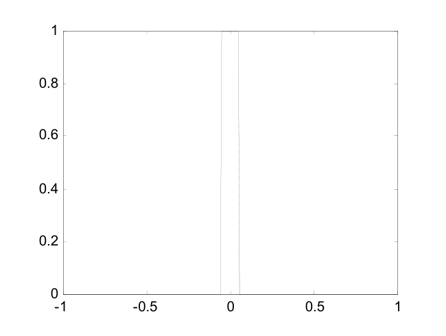
  <figcaption>图 3.2 第一个 rect 函数绘图（截自原书）</figcaption>
</figure>

图形窗口顶部的"Edit Plot"箭头可以交互式改外观，但**改动不写回代码**——下次运行就打回原形。要持久生效，把修饰命令写进脚本、放在 `plot` 之后：

```matlab
figure(2)
plot(x,f,'-o');  %plot f vs x
axis([-0.2 0.2 0 1.5]);
xlabel('x(m)');
```

`'-o'` 在每个样本处画圆圈标记；`axis([...])` 设定横纵轴范围；`xlabel` 给横轴加标签。`figure(2)` 开新窗口——没有它，新图会覆盖 1 号窗里的旧图。

<figure>
  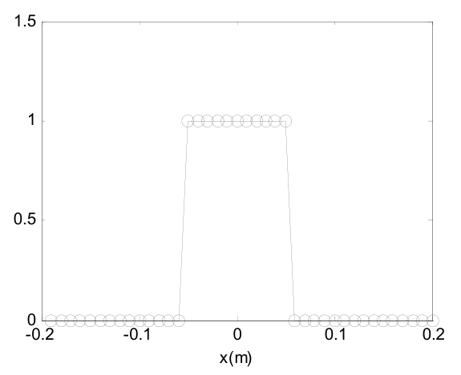
  <figcaption>图 3.3 采样矩形的放大视图：矩形"顶"宽 0.1 m（11 个样本），"底"宽 0.12 m（13 个样本）（截自原书）</figcaption>
</figure>

读图 3.3 有一道数样本的小题：矩形平台（值为 1 的样本）从 \(x=-0.05\) 到 \(+0.05\) 共 **11 个样本**，但 11 个样本之间只有 **10 个间隔**，所以"顶宽"是 0.1 m；把两侧斜线算到底则是 13 个样本、0.12 m。**这份数字表示的正确宽度是 0.11 m**，介于两个量测之间。又因为 rect 编码总给出奇数个样本：若把半宽改成 0.05 m，得到的信号向量**一模一样**——设计宽度与数字表示之间会有小偏差，这是原书用非整半宽（0.055）的原因。

## 3.3 为 FFT 移位

暂时忘掉坐标向量 \(x\)，只看 200 个样本：这是宽 11 个样本、居中摆放的矩形。把 `plot` 的 \(x\) 参数去掉、对**索引**画图就能看到：

```matlab
figure(3)
plot(f,'-o');
axis([80 120 0 1.5]);
xlabel('index');
```

<figure>
  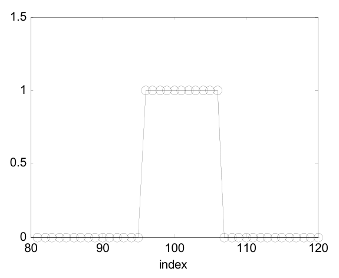
  <figcaption>图 3.4 采样矩形对索引：中心样本在 index 101 = M/2+1（截自原书）</figcaption>
</figure>

中心样本在 **index 101 = \(M/2+1\)**（1-based）——这正是第 2 章"居中排列"的位置。居中方便观看，但 FFT 算法要求零坐标样本在**第一个索引**位置（2.4 节的"移位排列"）。`fftshift` 把向量前一半与后一半对调，完成这件事：

```matlab
f0=fftshift(f);   %shift f
figure(4)
plot(f0);
axis([0 200 0 1.5]);
xlabel('index');
```

<figure>
  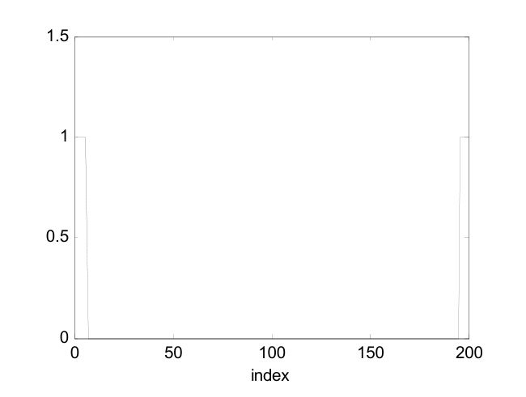
  <figcaption>图 3.5 移位后的矩形：中心样本到了 index 1，5 个样本在"右"、5 个挂到向量末尾（截自原书）</figcaption>
</figure>

细看图 3.5：中心样本在 index 1，5 个样本在"右"（index 2–6），其余 5 个在"左"——挂到了向量**末尾**（index 197–200）。

原书给了两条关于移位的评论：

1. **偶数个样本最省心**：把目标函数居中在 \(M/2+1\)，`fftshift` 一次就把它送到 index 1。奇数个样本要小心——用了 `fftshift` 之后就该用 `ifftshift` 来撤销；偶数时 `fftshift` 正反两用都行（这正是第 2 章坑与陷阱的第 2 条：偶数 \(N\) 下两者等价，奇数 \(N\) 下不同）。
2. **不移位的代价**：FFT 会对一个"平移了零位置"的函数做变换，结果里多出一项**线性相位**（位移定理！）——幅度看不出来，相位全错。

!!! note "细节：书里用 fftshift 做 FFT 前移位"
    严格的配对是"居中 → `ifftshift` → fft → `fftshift`"（第 2 章的口诀）。书里预移位写的是 `fftshift`——在全书默认的偶数 \(M\) 下两者是同一个操作，没有错；但把书代码改成奇数网格时要记得换成 `ifftshift`。本章 Python 脚本按严格配对书写，MATLAB 脚本保留书写的 `fftshift` 并加注释。

## 3.4 计算 FFT 并显示结果

对移位后的向量做 FFT，并乘 \(\Delta x\) 定标回连续量纲：

```matlab
F0=fft(f0)*dx;    %FFT and scale
figure(5)
plot(abs(F0));    %plot magnitude
title('magnitude');
xlabel('index');

figure(6)
plot(angle(F0));  %plot phase
title('phase');
xlabel('index');
```

约定：频域向量用大写字母。**乘 \(\Delta x\) 是近似连续傅里叶变换积分的必要步骤**（式 (2.19) 的黎曼和因子；忘了它，整个频谱就小 \(M\) 倍）。每个复数样本装着两份信息——实部/虚部，或等价地幅度/相位——所以 customary 用两张图展示：`abs` 取幅度，`angle` 取相位（输出范围 \(-\pi\) 到 \(\pi\)）。

<figure>
  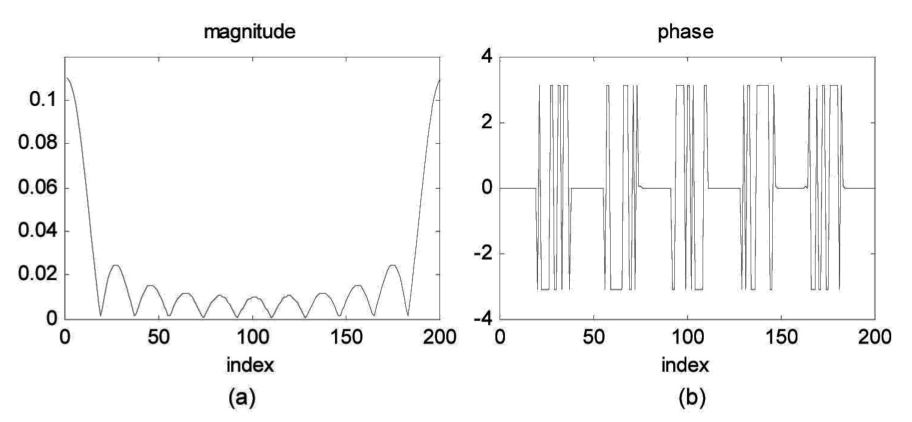
  <figcaption>图 3.6 FFT 结果对索引：(a) 幅度；(b) 相位（截自原书）</figcaption>
</figure>

怎么读这两张图（原书讲得很细，值得复述）：

- **幅度**：sinc 形一目了然，峰在 index 1（移位排列下 index 1 = 零频率）。注意**样本没有正好落在 sinc 的"零点"上**，所以图里的谷底并不真的到零（为什么，见下面的拓展框）。
- **相位**：看起来花，其实只有三个值：0、\(-\pi\)、\(\pi\)。而 \(-\pi\) 与 \(\pi\) 在 mod \(2\pi\) 意义下是**同一个值**——图里 ±π 之间的陡峭跳变只是样本间微小数值差异造成的显示伪影，跳变两侧的相位实际上是常数。**真正重要的跳变是 0 与 ±π 之间**，大约每 18 个点发生一次；对照幅度图，它恰好发生在幅度零点处。
- 相位 \(\pi\) 等价于给幅度加一个负号。把这些信息合起来：图 3.6 表示的是一个**实值 sinc 函数**——主瓣为正、第一瓣为负、第二瓣为正，依此类推。这个例子本可以只画一张图；但一般而言傅里叶变换结果是复数，幅度+相位的两张图是通用做法。

为了显示，再把结果居中，并建立频率坐标：

```matlab
F=fftshift(F0);   %center F
fx=-1/(2*dx):1/L:1/(2*dx)-(1/L); %freq cords

figure(7)
plot(fx,abs(F));  %plot magnitude
title('magnitude');

figure(8)
plot(fx,angle(F));  %plot phase
title('phase');
xlabel('fx (cyc/m)');
```

频率坐标 `fx` 按式 (2.22) 建立：\(-50 : 0.5 : 49.5\) cyc/m。运行后得到居中的幅度与相位图（图 3.7）。

<figure>
  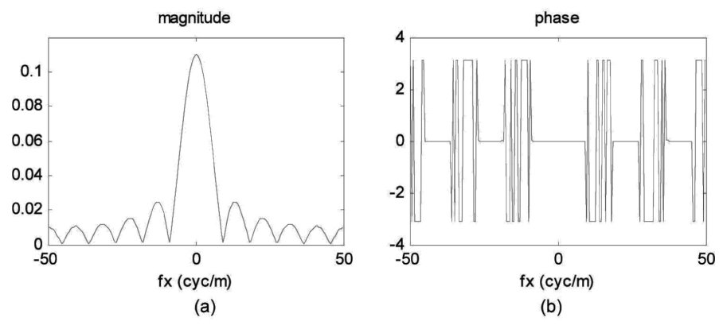
  <figcaption>图 3.7 居中后的 FFT 结果：(a) 幅度；(b) 相位，频率轴已定标（截自原书）</figcaption>
</figure>

!!! note "拓展：'约每 18 个点'和'谷底不为零'是同一件事"
    sinc 的零点在 \(f_X = k/(2w) = k/0.11 \approx 9.09k\) cyc/m；而频率网格的样本间隔是 \(\Delta f = 1/L = 0.5\) cyc/m。两套刻度不可公度：\(9.09/0.5 = 18.18\) 不是整数——所以**相邻零点间隔"约每 18 个样本"**（原话），且**样本永远不会正好踩在零点上**，谷底自然不为零。想让样本踩准零点，需要 \(L/(2w)\) 恰为整数（比如 \(w = 0.05\)、\(L = 2\) 时正好 20）。这也是第 2 章"周期延拓/采样对不上解析世界"的一个小切口：离散网格只是解析曲线的一组不重合的探针。

## 3.5 与解析结果比较

好习惯：**新代码先用解析可查的简单输入试刀**——既帮诊断问题，也让你带着信心往上垒代码。本例的解析结果现成：

\[
f(x) = \mathrm{rect}\!\left(\frac{x}{2w}\right) \quad\Longleftrightarrow\quad F(f_X) = 2w\,\mathrm{sinc}(2w f_X). \tag{3.1}
\]

（表 1.3 第一行取 \(a = 2w\)；矩形面积 \(2w\) 就是频谱峰值——中心纵坐标定理。）把解析谱在同样的频率网格上采样，与 FFT 结果同图对比：

```matlab
F_an=2*w*sinc(2*w*fx);  %analytic result

figure(9)
plot(fx,abs(F),fx,abs(F_an),':'); %plot magnitude
title('magnitude')
legend('discrete','analytic')
xlabel('fx (cyc/m)')

figure(10)
plot(fx,angle(F),fx,angle(F_an),':'); %plot phase
title('phase')
legend('discrete','analytic')
xlabel('fx (cyc/m)')
```

原书用 MATLAB 内置 `sinc`——它与表 1.2 的定义一致（`sin(pi*u)/(pi*u)`；numpy 的 `np.sinc` 同定义，但它是基础 MATLAB 没有的信号处理工具箱函数，本笔记脚本自带 `sincn` 局部函数以免依赖）。

<figure>
  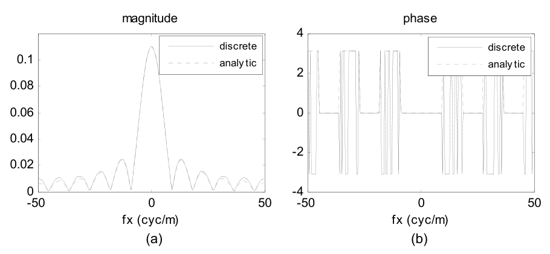
  <figcaption>图 3.8 FFT 与解析结果对比：(a) 幅度——几乎重合，FFT 边缘略高；(b) 相位——只差 ±π 跳变，无实质差别（截自原书）</figcaption>
</figure>

结论（图 3.8）：幅度几乎重合，**FFT 在边缘处略高于解析曲线**——这是 FFT 的周期延拓性质（2.5 节）带来的混叠；相位只差一些 ±π 之间的跳变，无关紧要。

到这里，书中的 `fft_example` 脚本就完工了。下面把 3.2–3.5 节的代码合并成完整脚本（与仓库文件一致），附数值检查：

=== "MATLAB"

    ```matlab
    % ===== 书 3.2-3.5 节：fft_example 脚本（建向量 -> 移位 -> FFT 定标 -> 解析对比） =====
    % 书把这几节写成一个逐步加长的脚本 fft_example.m（原书第 1-58 行），本文件
    % 按同样的参数与步骤合并复现书图 3.2-3.8，并附数值检查。
    % 参数（书 3.2 节）：矩形半宽 w = 0.055 m（全宽 0.11 m）、边长 L = 2 m、
    % 样本数 M = 200 -> 采样间隔 dx = 0.01 m。
    % MATLAB/Python 差异：
    %   - MATLAB 索引 1-based：居中排列的零坐标在 index M/2+1（本例 101）；
    %     Python 0-based 在 index M//2（本例 100）；
    %   - 书用 fftshift 做 FFT 前移位：偶数 M 时与 ifftshift 等价；奇数 M 必须
    %     用 ifftshift 配对（书 3.3 节原话也这么提醒）；
    %   - plot 的 '-o'、axis([xmin xmax ymin ymax]) 对应 Python 的
    %     plt.plot(..., 'o-') 与 plt.xlim/plt.ylim。
    clear; clc; close all;

    % ---------- 3.2 创建向量 ----------
    w  = 0.055;                 % 矩形半宽 (m)。故意不取 0.05：见 3.1 节"奇数样本"特性
    L  = 2;                     % 向量边长 (m)
    M  = 200;                   % 样本数
    dx = L/M;                   % 采样间隔 (m)
    x  = -L/2:dx:L/2-dx;        % 坐标向量（式 2.21）：-1 : 0.01 : 0.99，共 200 个
    f  = rect(x/(2*w));         % 采样矩形：|x| <= 0.055 的样本为 1（11 个）
                                % rect.m 是 3.1 节建的函数（同文件夹即可调用）

    fprintf('x 范围: [%.2f, %.2f]，共 %d 个样本\n', x(1), x(end), numel(x));
    fprintf('f==1 的样本数 = %d（全宽 0.11 m / dx 0.01 m = 11，奇数）\n', sum(f == 1));
    fprintf('坐标 x=0 的 index = %d（居中排列 M/2+1 = %d）\n', ...
            find(abs(x) < 1e-12), M/2 + 1);

    % ---------- 3.3 为 FFT 移位 ----------
    f0 = fftshift(f);           % 居中 -> 移位排列（零坐标样本挪到 index 1）
    % 书图 3.5：移位后中心样本在 index 1，5 个样本在"右"（index 2..6），
    % 其余 5 个在"左"——挂在向量末尾（index 197..200）。
    % 不移位直接 fft 的后果：相当于对平移了 -L/2 的函数做变换，频域多出一线性
    % 相位因子 exp(+j*2*pi*f*L/2)（位移定理）——幅度不变、相位全错。

    % ---------- 3.4 计算 FFT 并定标 ----------
    F0 = fft(f0) * dx;          % FFT 并乘 dx 回连续量纲（式 2.19 + 黎曼和因子）
    F  = fftshift(F0);          % 居中排列
    fx = -1/(2*dx) : 1/L : 1/(2*dx) - 1/L;    % 频率坐标（式 2.22）：-50 : 0.5 : 49.5

    % ---------- 3.5 与解析结果对比 ----------
    % rect(x/(2w)) 的解析频谱（表 1.3 第一行，a = 2w）：F(fx) = 2w sinc(2w fx)。
    % 书用 MATLAB 内置 sinc（信号处理工具箱函数，定义与表 1.2 一致、等于
    % np.sinc）；这里自带局部函数 sincn，免依赖工具箱。
    F_an = 2*w*sincn(2*w*fx);

    % ---------- 数值检查 ----------
    [~, ic] = max(abs(F));      % 峰值（DC）位置
    fprintf('DC 样本 |F(fx=0)| = %.6f（= 矩形面积 2w = %.2f，中心纵坐标定理）\n', ...
            abs(F(ic)), 2*w);
    in_main = abs(fx) <= 25;
    fprintf(['|FFT|-|解析| 最大差异：全频带 %.4f；|fx|<=25 内 %.2e\n'], ...
            max(abs(abs(F) - abs(F_an))), ...
            max(abs(abs(F(in_main)) - abs(F_an(in_main)))));
    fprintf('  （边缘差异 = 周期延拓带来的混叠，书 3.5 节原话"FFT 边缘略高"）\n');
    fprintf('sinc 零点间隔 1/(2w) 折合样本数：L/(2w) = %.2f（书说"约每 18 个点"）\n', L/(2*w));
    fprintf('峰值处相位 = %.2e（实偶函数 -> 相位只有 0 与 ±pi，±pi 同一相位 mod 2pi）\n', ...
            angle(F(ic)));

    % ---------- 画图：复现书图 3.3-3.8 ----------
    figure('Position', [60 60 1250 680]);
    subplot(2,3,1);                              % 书图 3.3（放大看采样矩形）
    plot(x, f, '-o', 'MarkerSize', 4); axis([-0.2 0.2 0 1.5]); grid on;
    xlabel('x (m)'); title('f = rect(x/(2w)) samples (Fig. 3.3)');
    subplot(2,3,2);                              % 书图 3.4
    plot(f, '-o', 'MarkerSize', 4); axis([80 120 0 1.5]); grid on;
    xlabel('index'); title('vs index: center at 101 = M/2+1 (Fig. 3.4)');
    subplot(2,3,3);                              % 书图 3.5
    plot(f0, '-o', 'MarkerSize', 4); axis([0 200 0 1.5]); grid on;
    xlabel('index'); title('after fftshift: center at index 1 (Fig. 3.5)');
    subplot(2,3,4);                              % 书图 3.6(a)
    plot(abs(F0)); grid on; xlabel('index');
    title('|F_0| vs index (Fig. 3.6a)');
    subplot(2,3,5);                              % 书图 3.6(b)
    plot(angle(F0)); grid on; xlabel('index');
    title('phase vs index: only 0 and ±\pi (Fig. 3.6b)');
    subplot(2,3,6);                              % 书图 3.8(a)
    plot(fx, abs(F), fx, abs(F_an), ':'); grid on;
    xlabel('fx (cyc/m)'); title('centered |F| vs analytic (Fig. 3.8a)');
    legend('discrete', 'analytic', 'FontSize', 8);
    saveas(gcf, 'out_fft_example.png');
    fprintf('已保存 out_fft_example.png\n');

    % ---------- 局部函数 ----------
    function s = sincn(u)
        % 归一化 sinc：sin(pi*u)/(pi*u)，u=0 处极限 1（表 1.2；np.sinc 同定义）
        s = ones(size(u));
        nz = u ~= 0;
        s(nz) = sin(pi*u(nz)) ./ (pi*u(nz));
    end
    ```

=== "Python"

    ```python
    # ===== 书 3.2-3.5 节：fft_example 脚本（建向量 -> 移位 -> FFT 定标 -> 解析对比） =====
    # 书把这几节写成一个逐步加长的脚本 fft_example.m（原书第 1-58 行），本文件
    # 按同样的参数与步骤复现书图 3.2-3.8，并附数值检查。
    # 参数（书 3.2 节）：矩形半宽 w = 0.055 m（全宽 0.11 m）、边长 L = 2 m、
    # 样本数 M = 200 -> 采样间隔 dx = 0.01 m。
    # MATLAB/Python 差异：
    #   - numpy 索引 0-based：居中排列的零坐标在 index M//2（本例 100），
    #     MATLAB 是 index M/2+1（本例 101）；
    #   - 书用 fftshift 做 FFT 前移位（偶数 M 下与 ifftshift 等价）；本文件按
    #     第 2 章的严谨配对写 ifftshift -> fft -> fftshift，奇数 M 也不出错；
    #   - MATLAB 的 plot '-o'、axis([...]) 对应 plt.plot(..., 'o-') 与
    #     plt.xlim/plt.ylim。
    import os
    import sys

    import numpy as np
    import matplotlib.pyplot as plt

    sys.path.insert(0, os.path.join(os.path.dirname(os.path.abspath(__file__)), "..", "common"))
    from base import rect, coords, sinc   # 公共积木：表 1.2 函数与网格约定（ch2 起）


    def rect_book(x):
        """书 3.1 节的 rect 编码：abs(x) <= 1/2 -> 1（边界取 1，不取半值）。

        表 1.2 的解析定义（base.rect）在边界取半值 1/2；两者只在恰好命中
        边界的样本上不同。书 3.1 节原话：半值会被解读成"斜坡"，不如单点
        跳变；代价是矩形全宽总由奇数个样本组成（请求偶数宽会多给一个样本），
        所以全书例子故意用 0.055 这类非整半宽。
        """
        return (np.abs(x) <= 0.5).astype(float)


    # ---------- 3.2 创建向量 ----------
    w = 0.055          # 矩形半宽 (m)。故意不取 0.05：见"奇数样本"特性
    L = 2.0            # 向量边长 (m)
    M = 200            # 样本数
    dx = L / M         # 采样间隔 (m)
    x, fx = coords(L, M)           # 式 (2.21)/(2.22)：x ∈ [-1, 0.99]，fx ∈ [-50, 49.5]
    f = rect_book(x / (2 * w))     # 采样矩形：|x| <= 0.055 的样本为 1（11 个）

    print(f"x 范围: [{x[0]:.2f}, {x[-1]:.2f}]，共 {len(x)} 个样本")
    print(f"f==1 的样本数 = {int(f.sum())}（全宽 0.11 m / dx 0.01 m = 11，奇数）")
    print(f"坐标 x=0 的 index = {int(np.argmin(np.abs(x)))}"
          f"（Python 0-based；MATLAB 是 {M // 2 + 1} = M/2+1）")

    # 两种 rect 约定对照：本例网格上完全相同（边界 x=±0.055 不在网格上）
    diff = np.max(np.abs(f - rect(x / (2 * w))))
    print(f"rect_book 与表 1.2 的 base.rect 在本网格最大差异 = {diff:.1f}"
          f"（边界样本不在网格 -> 相同；若请求偶数全宽就会多出一个样本）")

    # ---------- 3.3 为 FFT 移位 ----------
    f0 = np.fft.ifftshift(f)   # 居中 -> 移位排列（零坐标样本挪到 index 0）
    # 移位后中心样本在 index 0，5 个样本在"右"（index 1..5），其余 5 个在
    # "左"——挂在向量末尾（index 195..199），对应书图 3.5。
    # 不移位直接 fft 的后果：相当于对平移了 -L/2 的函数做变换，频域多出一线性
    # 相位因子 exp(+j*2*pi*f*L/2)（位移定理）——幅度不变、相位全错。

    # ---------- 3.4 计算 FFT 并定标 ----------
    F0 = np.fft.fft(f0) * dx   # FFT 并乘 dx 回连续量纲（式 2.19 + 黎曼和因子）
    F = np.fft.fftshift(F0)    # 居中排列
    # fx 已由 coords 给出（式 2.22）：-50 : 0.5 : 49.5

    # ---------- 3.5 与解析结果对比 ----------
    F_an = 2 * w * sinc(2 * w * fx)   # rect(x/2w) <-> 2w sinc(2w fx)（表 1.3，a = 2w）
    # np.sinc 与书用的 MATLAB 内置 sinc（信号处理工具箱）同定义：sin(pi u)/(pi u)

    # ---------- 数值检查 ----------
    ic = int(np.argmax(np.abs(F)))
    print(f"DC 样本 |F(fx=0)| = {abs(F[ic]):.6f}（= 矩形面积 2w = {2 * w:.2f}，中心纵坐标定理）")
    in_main = np.abs(fx) <= 25
    err_all = np.max(np.abs(np.abs(F) - np.abs(F_an)))
    err_main = np.max(np.abs(np.abs(F[in_main]) - np.abs(F_an[in_main])))
    print(f"|FFT|-|解析| 最大差异：全频带 {err_all:.4f}；|fx|<=25 内 {err_main:.2e}")
    print("  （边缘差异 = 周期延拓带来的混叠，书 3.5 节原话'FFT 边缘略高'）")
    print(f"sinc 零点间隔 1/(2w) 折合样本数：L/(2w) = {L / (2 * w):.2f}（书说'约每 18 个点'）")
    print(f"峰值处相位 = {np.angle(F[ic]):.2e}（实偶函数 -> 相位只有 0 与 ±π，±π 同一相位 mod 2π）")

    # ---------- 画图：复现书图 3.3-3.8 ----------
    fig, axes = plt.subplots(2, 3, figsize=(12.5, 6.8))

    axes[0, 0].plot(x, f, "o-", ms=4, color="crimson", mfc="none")     # 书图 3.3
    axes[0, 0].set_xlim(-0.2, 0.2); axes[0, 0].set_ylim(0, 1.5)
    axes[0, 0].set_xlabel("x (m)")
    axes[0, 0].set_title("f = rect(x/(2w)) samples (Fig. 3.3)")

    axes[0, 1].plot(np.arange(1, M + 1), f, "o-", ms=4, mfc="none")    # 书图 3.4（1-based 展示）
    axes[0, 1].set_xlim(80, 120); axes[0, 1].set_ylim(0, 1.5)
    axes[0, 1].set_xlabel("index (MATLAB 1-based)")
    axes[0, 1].set_title("vs index: center at 101 = M/2+1 (Fig. 3.4)")

    axes[0, 2].plot(np.arange(1, M + 1), f0, "o-", ms=4, mfc="none")   # 书图 3.5
    axes[0, 2].set_xlim(0, 200); axes[0, 2].set_ylim(0, 1.5)
    axes[0, 2].set_xlabel("index (MATLAB 1-based)")
    axes[0, 2].set_title("after shift: center at index 1 (Fig. 3.5)")

    axes[1, 0].plot(np.abs(F0))                                        # 书图 3.6(a)
    axes[1, 0].set_xlabel("index")
    axes[1, 0].set_title(r"$|F_0|$ vs index (Fig. 3.6a)")

    axes[1, 1].plot(np.angle(F0))                                      # 书图 3.6(b)
    axes[1, 1].set_xlabel("index")
    axes[1, 1].set_title("phase vs index: only 0 and $\\pm\\pi$ (Fig. 3.6b)")

    axes[1, 2].plot(fx, np.abs(F), fx, np.abs(F_an), ":")              # 书图 3.8(a)
    axes[1, 2].set_xlabel("fx (cyc/m)")
    axes[1, 2].set_title("centered |F| vs analytic (Fig. 3.8a)")
    axes[1, 2].legend(["discrete", "analytic"], fontsize=8)

    for ax in axes.flat:
        ax.grid(True, alpha=0.3)
    fig.tight_layout()
    fig.savefig(os.path.join(os.path.dirname(os.path.abspath(__file__)),
                             "out_fft_example.png"), dpi=150)
    print("已保存 out_fft_example.png")
    ```

Python 实测（\(w=0.055\)、\(L=2\)、\(M=200\)）：

- \(f=1\) 的样本 11 个（奇数 ✓），坐标 \(x=0\) 在 Python index 100（MATLAB 101 = \(M/2+1\)）；`rect_book` 与表 1.2 的 `base.rect` 在本网格最大差异 \(0.0\)——边界样本不落在网格上；
- DC 样本 \(|F(0)| = 0.110000\)，与矩形面积 \(2w = 0.11\) 严格相等——中心纵坐标定理当场过关（书选 \(w=0.055\) 使全宽恰为 11 个样本，离散面积与解析面积完全一致）；
- \(|FFT|-|解析|\)：全频带最大 \(3.6\times10^{-3}\)、\(|f_X|\le 25\) 内 \(1.3\times10^{-3}\)——边缘的偏差就是书说的"FFT 边缘略高"（混叠）；
- \(L/(2w) = 18.18\)——"相位跳变约每 18 个点"的来历；峰值处相位 \(0.00\)。

<figure>
  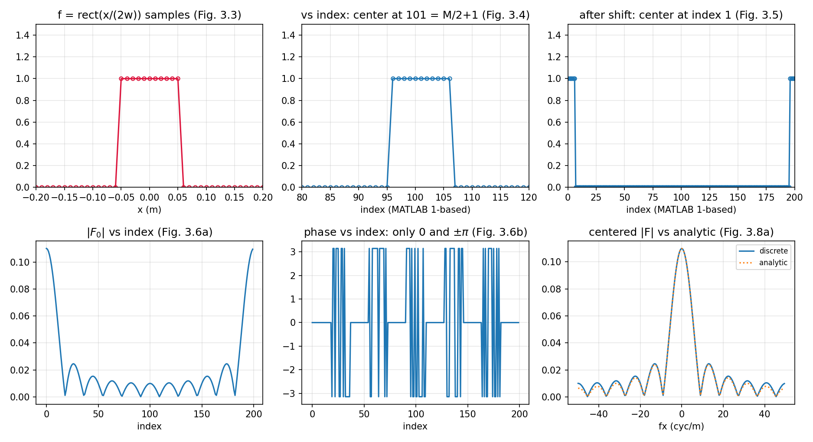
  <figcaption>图 3-P1 一维 fft_example 全流程数值复现：采样矩形（对坐标/对索引/移位后）与 FFT 幅度、相位（对索引）及居中幅度与解析对比（笔记自制）</figcaption>
</figure>

## 3.6 卷积例子

用 FFT + 傅里叶卷积定理（表 1.1）做卷积。例子：两个不同宽度的高斯函数。新建 M 文件 `conv_example`：

```matlab
% conv_example - Convolution: two Gaussian functions

wa=0.3;   %Gaussian 1 width [exp(-pi) radius](m)
wb=0.2;   %Gaussian 2 width [exp(-pi) radius](m)
L=2;      %side length (meters)
M=200;    %number of samples
dx=L/M;   %sample interval (m)

x=[-L/2:dx:L/2-dx];       %x coordinates
fa=exp(-pi*(x.^2)/wa^2);  %Gaussian a
fb=exp(-pi*(x.^2)/wb^2);  %Gaussian b

figure(1)
plot(x,fa,x,fb,'--'); title ('functions');
xlabel('x (m)');
```

两个细节：注释里的 `[exp(-pi) radius]` 意思是 \(f_a(w_a) = e^{-\pi} \approx 0.043\) 的半径——**不是** \(1/e\) 半径；`x.^2` 的点号不能少——没有点号 MATLAB 会试图做向量/矩阵的幂运算而不是逐元素平方。

```matlab
Fa=fft(fa);        %transform fa
Fb=fft(fb);        %transform fb
F0=Fa.*Fb;         %multiply pointwise
f0=ifft(F0)*dx;    %inverse transform and scale
f=fftshift(f0);    %center result

figure(2)
plot(x,f); title('convolution')
xlabel('x (m)')
```

<figure>
  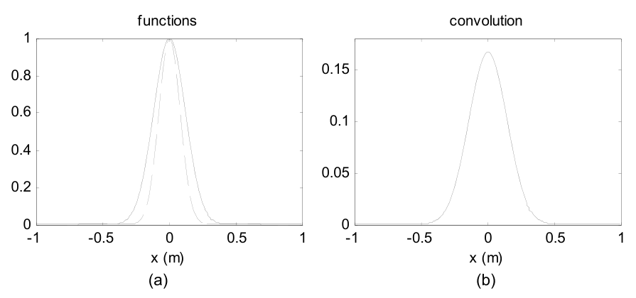
  <figcaption>图 3.9 (a) 两个高斯函数 <span class="arithmatex">\(f_a\)</span>（<span class="arithmatex">\(w_a=0.3\)</span>）与 <span class="arithmatex">\(f_b\)</span>（<span class="arithmatex">\(w_b=0.2\)</span>）；(b) FFT 卷积结果（截自原书）</figcaption>
</figure>

FFT 卷积五行代码的要点：

- **`fa`、`fb` 不必预移位**：卷积只依赖两个函数的**相对位置**，两者都居中、相对位移为零就行（为什么线性相位不捣乱，见下面的拓展框）。但注意：逆变换结果 `f0` 停在**移位排列**（峰值在 index 1），所以最后一行 `fftshift` 把它居中。
- **`.*` 是逐点相乘**（element-wise），点号不能丢——丢了就变成向量/矩阵乘法。numpy 方向恰好相反：`*` 天然逐元素，矩阵乘法才要另写 `@`。
- **定标只乘一次 `dx`**（不是 \(\mathrm{d}x^2\)）：`ifft(fft(a)*fft(b))*dx ≈ ∫f(τ)h(x-τ)dτ`。

与 2.6 节呼应的关键检查——**支撑判据**：周期延拓要求两函数支撑之和小于向量边长。从图 3.9(a) 估读：\(D_a \approx 0.9\) m、\(D_b \approx 0.6\) m，和 \(1.5 < L = 2\) ✓——图 3.9(b) 是解析卷积的好表示（习题 3.2 就是让你亲手验这个）。

书里补了一句工程现状：本书的卷积都直接按卷积定理写，但 MATLAB 有内置 `conv`/`conv2`——它们通过**零填充到双倍尺寸**严格避免周期卷积的伪影；本书为了计算速度与固定阵列尺寸，选择自己留心支撑。

!!! note "拓展：'不移位'卷积的相位账"
    居中排列的 `fa` 直接喂 `fft`，等于对 \(f_a(x + L/2)\)——平移过的函数——做变换，多出因子 \(e^{+j2\pi f_X L/2}\)（位移定理）；`fb` 同理，多出**同样的**因子。相乘后 \(e^{+j2\pi f_X L}\)：对应空域平移一整个周期 \(L\)——在 FFT 的周期世界里，平移一整圈等于没动（模 \(L\) 不可见）。所以两个因子的存在完全不影响卷积**形状**；唯一后果是结果落在"移位排列"（峰值在 index 1），需要 `fftshift` 找回中心。**反例**：只预移位其中一个函数，两个因子不再成对，卷积整体错位半周期——下面脚本实测峰值跑到了 \(x = -1.0\) m（\(= -L/2\)）。

!!! note "拓展：为什么这个高斯卷积精确到机器精度"
    实测 FFT 卷积与解析式的最大差异只有 \(5.3\times10^{-12}\)——比"矩形求和近似"的正常水平（第 2 章是 \(10^{-3}\) 量级）好得多。原因是 Poisson 求和的一个漂亮推论：对高斯这种衰减极快的函数，离散求和与连续积分之差约为 \(e^{-\pi/\Delta x^2}\)（周期副本的尾部贡献），\(\Delta x = 0.01\) 时是 \(e^{-31414}\)——天文数字般地小于浮点精度。所以剩余误差纯粹是 FFT 本身的舍入。**别把这份"免费午餐"推广到 rect 这类硬边函数**——第 2 章的卷积例子（rect ∗ 三角形）误差就在 \(10^{-3}\) 量级。

解析卷积（习题 3.2 的答案）顺手推出来：用表 1.3 的高斯对 \(\exp(-\pi x^2/w^2) \leftrightarrow w\exp(-\pi w^2 f_X^2)\)，频域相乘得 \(w_a w_b \exp[-\pi(w_a^2+w_b^2)f_X^2]\)，再逆变换：

\[
(f_a * f_b)(x) = \frac{w_a w_b}{\sqrt{w_a^2 + w_b^2}}\; \exp\!\left[-\pi\,\frac{x^2}{w_a^2 + w_b^2}\right]. \tag{3.2}
\]

峰值 \(= 0.06/\sqrt{0.13} = 0.16641\)，与图 3.9(b) 的峰一致。

=== "MATLAB"

    ```matlab
    % ===== 书 3.6 节 + 习题 3.2：两个高斯函数的 FFT 卷积与解析对比 =====
    % 参数（书 3.6 节）：wa = 0.3 m、wb = 0.2 m——注释原文 "[exp(-pi) radius]"，
    % 意思是 fa(wa) = exp(-pi) ≈ 0.043 的半径（不是 1/e 半径！）；L = 2、M = 200。
    % 支撑判据（式 2.27）：Da ≈ 0.9、Db ≈ 0.6，和 1.5 < L = 2 -> 卷绕可忽略。
    % 书的技巧：fa、fb 都居中排列，FFT 前【不移位】——两个函数携带同一线性
    % 相位，乘积相位对应"整周期平移"，模 L 不可见；但逆变换结果停在"移位
    % 排列"（峰值在 index 1），所以要 fftshift 居中。只移位其中一个函数，
    % 卷积结果就会整体错位 L/2（本脚本有反例演示）。
    % MATLAB/Python 差异：.* 与 .^ 的点号在 numpy 里不需要——Python 的 * 与
    % ** 天然逐元素，矩阵乘法反而要另写 @ / np.matmul，方向恰好相反。
    clear; clc; close all;

    wa = 0.3;                   % 高斯 a 宽度 [exp(-pi) 半径] (m)
    wb = 0.2;                   % 高斯 b 宽度 [exp(-pi) 半径] (m)
    L  = 2;                     % 边长 (m)
    M  = 200;                   % 样本数
    dx = L/M;                   % 采样间隔 (m)

    x  = -L/2:dx:L/2-dx;        % x 坐标（式 2.21）
    fa = exp(-pi*(x.^2)/wa^2);  % 高斯 a（注意 .^ 是逐元素平方）
    fb = exp(-pi*(x.^2)/wb^2);  % 高斯 b

    % ---------- FFT 卷积（书 3.6 节，输入不移位） ----------
    Fa = fft(fa);               % 变换 fa
    Fb = fft(fb);               % 变换 fb
    F0 = Fa.*Fb;                % 逐点相乘（.* 不是 *，忘点号是最常见错误！）
    f0 = ifft(F0)*dx;           % 逆变换；卷积定标只乘一次 dx（不是 dx^2）
    f  = fftshift(f0);          % 居中（书图 3.9(b)）

    % ---------- 解析卷积（习题 3.2） ----------
    % exp(-pi*x^2/w^2) <-> w*exp(-pi*w^2*fx^2)（表 1.3 高斯对）。频域相乘：
    % wa*wb*exp(-pi*(wa^2+wb^2)*fx^2)，逆变换回去：
    %   c(x) = wa*wb/sqrt(wa^2+wb^2) * exp(-pi*x^2/(wa^2+wb^2))
    c_an = wa*wb/sqrt(wa^2+wb^2) * exp(-pi*x.^2/(wa^2+wb^2));

    fprintf('解析卷积峰值 = %.6f；FFT 卷积峰值 = %.6f\n', max(c_an), max(f));
    fprintf('FFT 卷积与解析最大差异 = %.2e（高斯衰减极快：离散求和与连续积分之差达机器精度）\n', ...
            max(abs(f - c_an)));

    % ---------- 反例：只移位一个函数 -> 卷积整体错位 ----------
    fa_s    = ifftshift(fa);                        % 只把 fa 挪到移位排列
    f_wrong = fftshift(real(ifft(fft(fa_s).*fft(fb))*dx));
    [~, iw] = max(f_wrong);
    fprintf('只移位 fa：卷积峰出现在 x = %.2f m（应为 0 -> 整体错位 L/2）\n', x(iw));

    % ---------- 画图：复现书图 3.9 + 解析对比 ----------
    figure('Position', [80 80 950 380]);
    subplot(1,2,1);
    plot(x, fa, x, fb, '--'); grid on;
    xlabel('x (m)'); title('functions (Fig. 3.9a)');
    legend('f_a (w_a=0.3)', 'f_b (w_b=0.2)', 'FontSize', 8);
    subplot(1,2,2);
    plot(x, f, x, c_an, ':'); grid on;
    xlabel('x (m)'); title('convolution: FFT vs analytic (Fig. 3.9b + Ex. 3.2)');
    legend('FFT', 'analytic', 'FontSize', 8);
    saveas(gcf, 'out_conv_example.png');
    fprintf('已保存 out_conv_example.png\n');
    ```

=== "Python"

    ```python
    # ===== 书 3.6 节 + 习题 3.2：两个高斯函数的 FFT 卷积与解析对比 =====
    # 参数（书 3.6 节）：wa = 0.3 m、wb = 0.2 m——注释原文 "[exp(-pi) radius]"，
    # 意思是 fa(wa) = exp(-pi) ≈ 0.043 的半径（不是 1/e 半径！）；L = 2、M = 200。
    # 支撑判据（式 2.27）：Da ≈ 0.9、Db ≈ 0.6，和 1.5 < L = 2 -> 卷绕可忽略。
    # 书的技巧：fa、fb 都居中排列，FFT 前【不移位】——两个函数携带同一线性
    # 相位，乘积相位对应"整周期平移"，模 L 不可见；但逆变换结果停在"移位
    # 排列"（峰值在 index 0），所以要 fftshift 居中。只移位其中一个函数，
    # 卷积结果就会整体错位 L/2（本脚本有反例演示）。
    # MATLAB/Python 差异：MATLAB 要 .* 与 .^ 表示逐元素，忘点号不报错但结果
    # 离谱；numpy 的 * 与 ** 天然逐元素，矩阵乘法反而要另写 @ / np.matmul
    # ——两边的"默认值"方向恰好相反。
    import os
    import sys

    import numpy as np
    import matplotlib.pyplot as plt

    sys.path.insert(0, os.path.join(os.path.dirname(os.path.abspath(__file__)), "..", "common"))
    from base import coords   # 公共积木：式 (2.21)/(2.22) 的网格坐标（ch2 起）

    wa, wb = 0.3, 0.2         # 高斯宽度 [exp(-pi) 半径] (m)
    L, M = 2.0, 200           # 边长 (m)、样本数
    dx = L / M                # 采样间隔 (m)
    x, _ = coords(L, M)       # x 坐标（式 2.21）
    fa = np.exp(-np.pi * x ** 2 / wa ** 2)   # 高斯 a
    fb = np.exp(-np.pi * x ** 2 / wb ** 2)   # 高斯 b

    # ---------- FFT 卷积（书 3.6 节，输入不移位） ----------
    Fa = np.fft.fft(fa)                       # 变换 fa
    Fb = np.fft.fft(fb)                       # 变换 fb
    F0 = Fa * Fb                              # 逐点相乘（numpy 的 * 就是 MATLAB 的 .*）
    f0 = np.fft.ifft(F0) * dx                 # 逆变换；卷积定标只乘一次 dx（不是 dx^2）
    f = np.fft.fftshift(f0.real)              # 居中（书图 3.9b；虚部是机器精度残渣）

    # ---------- 解析卷积（习题 3.2） ----------
    # exp(-pi*x^2/w^2) <-> w*exp(-pi*w^2*fx^2)（表 1.3 高斯对）。频域相乘：
    # wa*wb*exp(-pi*(wa^2+wb^2)*fx^2)，逆变换回去：
    #   c(x) = wa*wb/sqrt(wa^2+wb^2) * exp(-pi*x^2/(wa^2+wb^2))
    c_an = wa * wb / np.sqrt(wa ** 2 + wb ** 2) * np.exp(-np.pi * x ** 2 / (wa ** 2 + wb ** 2))

    print(f"解析卷积峰值 = {c_an.max():.6f}；FFT 卷积峰值 = {f.max():.6f}")
    print(f"FFT 卷积与解析最大差异 = {np.max(np.abs(f - c_an)):.2e}"
          "（高斯衰减极快：离散求和与连续积分之差达机器精度）")

    # ---------- 反例：只移位一个函数 -> 卷积整体错位 ----------
    fa_s = np.fft.ifftshift(fa)               # 只把 fa 挪到移位排列
    f_wrong = np.fft.fftshift((np.fft.ifft(np.fft.fft(fa_s) * np.fft.fft(fb)) * dx).real)
    iw = int(np.argmax(f_wrong))
    print(f"只移位 fa：卷积峰出现在 x = {x[iw]:.2f} m（应为 0 -> 整体错位 L/2）")

    # ---------- 画图：复现书图 3.9 + 解析对比 ----------
    fig, axes = plt.subplots(1, 2, figsize=(9.5, 3.8))
    axes[0].plot(x, fa, label=r"$f_a$ ($w_a$=0.3)")
    axes[0].plot(x, fb, "--", label=r"$f_b$ ($w_b$=0.2)")
    axes[0].set_xlabel("x (m)"); axes[0].set_title("functions (Fig. 3.9a)")
    axes[0].legend(fontsize=8)
    axes[1].plot(x, f, label="FFT")
    axes[1].plot(x, c_an, ":", label="analytic")
    axes[1].set_xlabel("x (m)")
    axes[1].set_title("convolution: FFT vs analytic (Fig. 3.9b + Ex. 3.2)")
    axes[1].legend(fontsize=8)
    for ax in axes:
        ax.grid(True, alpha=0.3)
    fig.tight_layout()
    fig.savefig(os.path.join(os.path.dirname(os.path.abspath(__file__)),
                             "out_conv_example.png"), dpi=150)
    print("已保存 out_conv_example.png")
    ```

Python 实测：

- 解析卷积峰值 \(0.166410\)，FFT 卷积峰值 \(0.166410\)，最大差异 \(5.32\times10^{-12}\)——机器精度（原因见上面的拓展框）；
- 反例：只 `ifftshift` 其中一个函数，卷积峰跑到 \(x = -1.00\) m——整体错位 \(L/2\)，坐实"要么都别移、要么严格按相对位置移"。

<figure>
  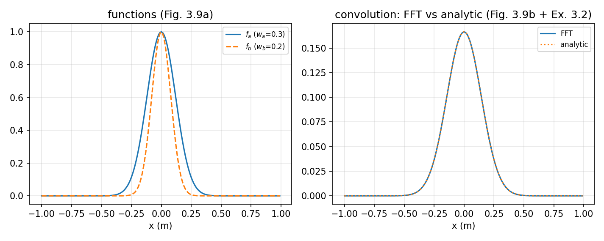
  <figcaption>图 3-P2 两高斯 FFT 卷积与解析式 (3.2) 对比：两条曲线在图上不可区分（差异 5×10⁻¹²）（笔记自制）</figcaption>
</figure>

## 3.7 二维

物理光学问题至少两个空间维度。新建 M 文件 `fft2_example`，生成二维采样矩形：

```matlab
% fft2_example - 2D FFT example

wx=0.1;          %rect x half-width (m)
wy=0.05;         %rect y half-width (m)
L=2;             %side length x&y (m)
M=200;           %samples/side length
dx=L/M;          %sample interval (m)
x=-L/2:dx:L/2-dx;  %x coordinates
y=x;               %y coordinates
[X,Y]=meshgrid(x,y);   %X and Y grid coords
g=rect(X/(2*wx)).*rect(Y/(2*wy)); %signal
```

即 0.2 × 0.1 m 的矩形放进 200 × 200 阵列（对应 2 × 2 m）。`meshgrid` 生成坐标阵列 `X`、`Y`（大写）：**`X` 的行是 `x` 的副本，`Y` 的列是 `y` 的副本**。有了 `X`、`Y`，二维信号的代码长得和解析式一样（可分离乘积）。

把 `g` 显示成图像：

```matlab
figure(1)
imagesc(x,y,g);    %image display
colormap('gray');  %linear gray display map
axis square;       %square figure
axis xy            %y positive up
xlabel('x (m)'); ylabel('y (m)');
```

`imagesc` 把阵列数据缩放到全显示范围；`colormap` 提供伪彩色（这里用灰度）；`axis square` 把图窗边框变成正方形（\(x\)、\(y\) 边长相同的时候有用）。**方向注意**：常规图像文件的第 1 行对应画面**顶部**，MATLAB 图像显示因此默认 \(y\) 值自上而下增；`axis xy` 把 \(y\) 轴翻回自下而上增的笛卡尔习惯。

<figure>
  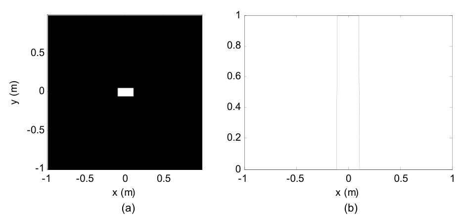
  <figcaption>图 3.10 二维矩形：(a) imagesc 图像；(b) 过阵列中心的 x 方向切片 g(M/2+1,:)（截自原书）</figcaption>
</figure>

二维结果也常用一维**切片（slice/profile）**检查。`g(M/2+1,:)` 选第 \(M/2+1\) **行**——行对应 \(y\)，所以这是 \(y=0\) 的横向剖面（图 3.10(b)）。

做二维 FFT：

```matlab
g0=fftshift(g);     %shift
G0=fft2(g0)*dx^2;   %2D fft and dxdy scaling
G=fftshift(G0);     %center

fx=-1/(2*dx):1/L:1/(2*dx)-(1/L);%x freq coords
fy=fx;              %y freq coords
```

`fftshift` 对二维阵列按 2.4 节的"象限对调"方式工作；二维变换必须用 `fft2`（定标因子相应是 \(\mathrm{d}x^2\)）。

用曲面图加中心剖面显示变换幅度：

```matlab
figure(3)
surf(fx,fy,abs(G))  %display transform magnitude
camlight left; lighting phong
colormap('gray')
shading interp
ylabel('fy (cyc/m)'); xlabel('fx (cyc/m)');

figure(4)
plot(fx,abs(G(M/2+1,:))); %fx slice profile
title('magnitude');
xlabel('fx (cyc/m)');
```

<figure>
  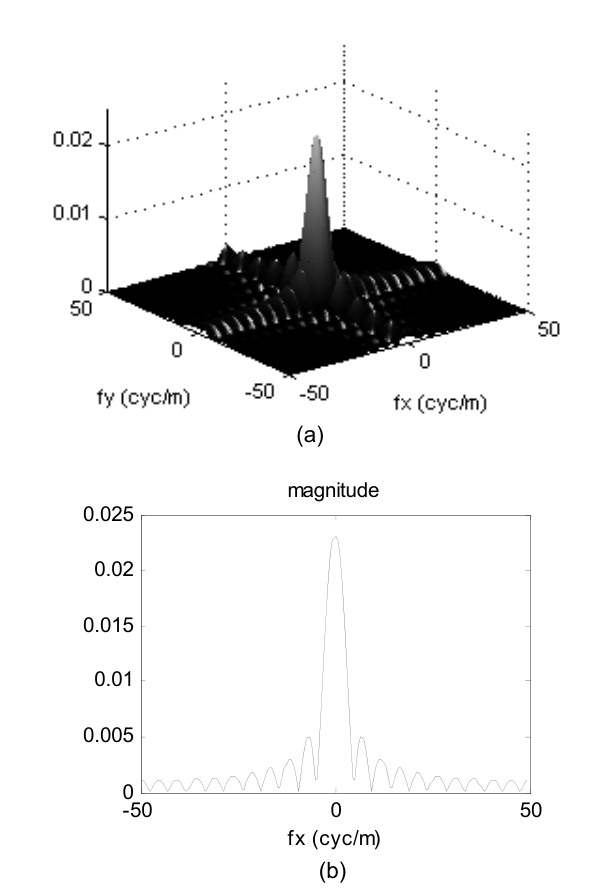
  <figcaption>图 3.11 二维 FFT 幅度：(a) surf 曲面显示；(b) fy=0 剖面——峰值约 0.023（截自原书）</figcaption>
</figure>

!!! warning "书图 3.11(b) 的峰值为什么是 0.023 而不是 0.02（数值实锤）"
    连续矩形的面积是 \(4w_xw_y = 0.02\)，按中心纵坐标定理频谱峰值应为 0.020。但书图 3.11(b) 的峰约 0.023——这不是画错，也不是混叠，而是 3.1 节"奇数样本"约定的直接后果：\(w_x = 0.1\)、\(w_y = 0.05\) 都是**偶数样本宽**（0.2 m = 20 个间隔、0.1 m = 10 个间隔），rect 按"边界取 1、多给一个样本"的约定各多含一圈边界样本——\(x\) 向 21 个、\(y\) 向 11 个样本。离散面积 \(= 21\times11\times\mathrm{d}x^2 = 0.0231\)，FFT 的 DC 样本精确等于它（离散版的中心纵坐标定理）。验证：FFT 剖面与离散精确谱（Dirichlet 核）之差 \(4\times10^{-18}\)（机器精度），与连续解析谱 \(4w_xw_y\,\mathrm{sinc}(2w_x f_X)\) 之差 \(3.1\times10^{-3}\)（集中在 DC）。**教训**：矩形这类"边界敏感"函数的离散面积对半宽的奇偶极敏感；要面积准，要么选奇数样本宽（如 \(w=0.055\)），要么在解读频谱峰值时心里有数。

完整脚本（与仓库文件一致）：

=== "MATLAB"

    ```matlab
    % ===== 书 3.7 节：二维矩形函数、meshgrid、imagesc 与二维 FFT =====
    % 参数：wx = 0.1 m、wy = 0.05 m 的矩形（0.2 × 0.1 m），L = 2 m、M = 200/边
    % -> dx = 0.01 m，200×200 阵列对应 2 × 2 m。
    % MATLAB/Python 差异：
    %   - meshgrid 两边行为一致（'xy'：X 的行是 x 的副本、Y 的列是 y 的副本；
    %     Python 若写 indexing='ij' 两维会互换）；
    %   - (M/2+1,:) 选第 M/2+1 行 = y=0 的行（行 <-> y！），Python 是 g[M//2, :]；
    %   - imagesc 默认 y 向下，axis xy 翻转；Python imshow 用 origin='lower'；
    %   - 二维必须 fft2/ifft2（Python np.fft.fft2）：一维 fft 作用于二维阵列
    %     只变换行向量，得到"条纹"状错误结果（书 3.8 节原话）。
    clear; clc; close all;

    wx = 0.1;                   % 矩形 x 半宽 (m)
    wy = 0.05;                  % 矩形 y 半宽 (m)
    L  = 2;                     % 边长 x&y (m)
    M  = 200;                   % 每边样本数
    dx = L/M;                   % 采样间隔 (m)
    x  = -L/2:dx:L/2-dx;        % x 坐标
    y  = x;                     % y 坐标
    [X, Y] = meshgrid(x, y);    % X 的行 = x 的副本；Y 的列 = y 的副本
    g = rect(X/(2*wx)).*rect(Y/(2*wy));   % 二维矩形（可分离乘积，调 rect.m）

    % ---------- 图像显示（书图 3.10a）与中心切片（书图 3.10b） ----------
    % imagesc 把数组缩放到全显示范围；colormap('gray') 灰度；axis square 方形
    % 边框；axis xy 让 y 自下而上——常规图像文件第 1 行在顶部，MATLAB 图像
    % 显示默认 y 向下增，axis xy 把它翻回笛卡尔习惯。
    figure('Position', [60 60 1000 420]);
    subplot(1,2,1);
    imagesc(x, y, g); colormap('gray'); axis square; axis xy;
    xlabel('x (m)'); ylabel('y (m)'); title('g(x,y): 2D rect (Fig. 3.10a)');
    subplot(1,2,2);
    plot(x, g(M/2+1,:), '-o', 'MarkerSize', 4); grid on;   % 第 M/2+1 行 = y=0
    axis([-1 1 0 1.2]); xlabel('x (m)');
    title('x-slice through g(M/2+1,:) (Fig. 3.10b)');

    % ---------- 二维 FFT ----------
    g0 = fftshift(g);           % 预移位（偶数 M：fftshift = ifftshift）
    G0 = fft2(g0) * dx^2;       % 二维 FFT 并乘 dx^2 定标（式 2.19 的二维版）
    G  = fftshift(G0);          % 居中
    fx = -1/(2*dx) : 1/L : 1/(2*dx) - 1/L;   % 频率坐标（式 2.22）
    fy = fx;

    % ---------- 变换幅度显示：曲面 + 中心剖面（书图 3.11） ----------
    % surf 曲面显示；camlight/lighting/shading 只是化妆。fy=0 剖面有两条参照：
    %   (1) 连续矩形解析谱 4*wx*wy*|sinc(2*wx*fx)|，峰值 = 面积 0.020；
    %   (2) 离散精确谱（Dirichlet 核）：|G(fx,0)| = dx^2*ny*|sin(nx*pi*fx*dx)|
    %       ./|sin(pi*fx*dx)|，nx/ny 是 x/y 向值为 1 的样本数（21、11）——
    %       FFT 剖面应与它逐点重合，峰值 = 离散面积 21*11*dx^2 = 0.0231。
    %       书图 3.11(b) 的峰 ~0.023 正是这个离散面积：wx=0.1、wy=0.05 都是
    %       "偶数样本宽"，书 rect 的奇数样本约定各多给一圈边界样本（3.1 节），
    %       不是混叠。
    nx = sum(rect(X/(2*wx))(:));          % x 向值为 1 的样本数（21）
    ny = sum(rect(Y/(2*wy))(:));          % y 向值为 1 的样本数（11）
    D  = abs(sin(nx*pi*fx*dx) ./ sin(pi*fx*dx));
    D(fx == 0) = nx;                      % 0/0 极限
    slice_exact = dx^2 * ny * D;
    figure('Position', [80 80 1150 420]);
    subplot(1,2,1);
    surf(fx, fy, abs(G), 'EdgeColor', 'none'); colormap('gray');
    xlabel('fx (cyc/m)'); ylabel('fy (cyc/m)');
    title('|G(f_x,f_y)| surface (Fig. 3.11a)');
    subplot(1,2,2);
    plot(fx, abs(G(M/2+1,:)), fx, slice_exact, ':', ...
         fx, 4*wx*wy*abs(sincn(2*wx*fx)), '--'); grid on;
    xlabel('fx (cyc/m)'); xlim([-50 50]);
    title('fx slice: FFT vs two references (Fig. 3.11b)');
    legend('FFT', 'discrete exact (Dirichlet)', '4w_xw_y sinc(2w_x f_x)', 'FontSize', 8);

    fprintf('x/y 向值为 1 的样本数 = %d x %d（边界取 1 的奇数样本约定）\n', nx, ny);
    fprintf('DC 样本 |G(0,0)| = %.6f = 离散面积 %d*%d*dx^2 = %.4f\n', ...
            abs(G(M/2+1, M/2+1)), nx, ny, nx*ny*dx^2);
    fprintf('  （连续矩形面积 4*wx*wy = %.3f；书图 3.11(b) 的峰 ~0.023 就是离散面积）\n', ...
            4*wx*wy);
    in_main = abs(fx) <= 25;
    fprintf('fy=0 剖面 vs 离散精确谱（Dirichlet）最大差异 = %.2e（机器精度）\n', ...
            max(abs(abs(G(M/2+1,in_main)) - slice_exact(in_main))));
    fprintf('fy=0 剖面 vs 连续解析谱最大差异 = %.4f（DC 处 0.0231 vs 0.020 + 零点错位）\n', ...
            max(abs(abs(G(M/2+1,in_main)) - 4*wx*wy*abs(sincn(2*wx*fx(in_main))))));
    saveas(gcf, 'out_fft2_example.png');
    fprintf('已保存 out_fft2_example.png\n');

    % ---------- 局部函数 ----------
    function s = sincn(u)
        % 归一化 sinc：sin(pi*u)/(pi*u)，u=0 处极限 1（表 1.2；np.sinc 同定义）
        s = ones(size(u));
        nz = u ~= 0;
        s(nz) = sin(pi*u(nz)) ./ (pi*u(nz));
    end
    ```

=== "Python"

    ```python
    # ===== 书 3.7 节：二维矩形函数、meshgrid、图像显示与二维 FFT =====
    # 参数：wx = 0.1 m、wy = 0.05 m 的矩形（0.2 × 0.1 m），L = 2 m、M = 200/边
    # -> dx = 0.01 m，200×200 阵列对应 2 × 2 m。
    # MATLAB/Python 差异：
    #   - np.meshgrid 默认 indexing='xy' 与 MATLAB meshgrid 一致（X 的行是 x
    #     的副本、Y 的列是 y 的副本）；写 'ij' 两维会互换；
    #   - MATLAB g(M/2+1,:) 选第 M/2+1 行 = y=0 的行（行 <-> y！）；Python
    #     0-based 是 g[M//2, :]；
    #   - plt.imshow 默认 y 向下，origin='lower' 翻转（MATLAB 用 axis xy）；
    #   - 二维必须 fft2（np.fft.fft2）：一维 fft 作用于二维阵列只变换一行行
    #     向量，得到"条纹"状错误结果（书 3.8 节原话）。
    import os
    import sys

    import numpy as np
    import matplotlib.pyplot as plt
    from mpl_toolkits.mplot3d import Axes3D  # noqa: F401  （注册 3D 投影，新版本可省）

    sys.path.insert(0, os.path.join(os.path.dirname(os.path.abspath(__file__)), "..", "common"))
    from base import coords, sinc   # 公共积木（ch2 起）


    def rect_book(x):
        """书 3.1 节的 rect 编码：abs(x) <= 1/2 -> 1（见 ch3_fft_example.py 注释）。"""
        return (np.abs(x) <= 0.5).astype(float)


    wx, wy = 0.1, 0.05        # 矩形 x/y 半宽 (m)
    L, M = 2.0, 200           # 边长 (m)、每边样本数
    dx = L / M                # 采样间隔 (m)
    x, _ = coords(L, M)       # x 坐标
    y = x                     # y 坐标
    X, Y = np.meshgrid(x, y)  # X 的行 = x 的副本；Y 的列 = y 的副本
    g = rect_book(X / (2 * wx)) * rect_book(Y / (2 * wy))   # 二维矩形（可分离乘积）

    # ---------- 二维 FFT ----------
    # 书：g0=fftshift(g); G0=fft2(g0)*dx^2; G=fftshift(G0)——偶数 M 下
    # fftshift 与 ifftshift 等价；本文件按第 2 章的严谨配对写 ifftshift。
    G0 = np.fft.fft2(np.fft.ifftshift(g)) * dx ** 2   # 二维 FFT × dx^2 定标
    G = np.fft.fftshift(G0)                           # 居中
    _, fx = coords(L, M)                              # 频率坐标（式 2.22；coords 首个返回值是空域 x！）
    fy = fx                                           # 两维相同

    # ---------- 数值检查 ----------
    row = M // 2                       # y=0 的行（MATLAB g(M/2+1,:)）
    # 书 rect 编码（边界取 1）下，x 向 |X|<=0.1 命中 21 个样本、y 向 11 个：
    # wx=0.1、wy=0.05 都是"偶数样本宽"，按 3.1 节的约定各多给一个边界样本。
    nx = int(rect_book(x / (2 * wx)).sum())   # 21
    ny = int(rect_book(y / (2 * wy)).sum())   # 11
    # 离散精确谱（Dirichlet 核）：FFT 剖面应与它机器精度重合
    with np.errstate(invalid="ignore", divide="ignore"):
        D = np.sin(nx * np.pi * fx * dx) / np.sin(np.pi * fx * dx)
    D[fx == 0] = nx                                   # 0/0 极限
    slice_exact = dx ** 2 * ny * np.abs(D)
    slice_an = 4 * wx * wy * np.abs(sinc(2 * wx * fx))  # 连续矩形解析谱
    in_main = np.abs(fx) <= 25
    err_exact = np.max(np.abs(np.abs(G[row, :][in_main]) - slice_exact[in_main]))
    err_an = np.max(np.abs(np.abs(G[row, :][in_main]) - slice_an[in_main]))
    print(f"x/y 向值为 1 的样本数 = {nx} x {ny}（边界取 1 的奇数样本约定）")
    print(f"DC 样本 |G(0,0)| = {abs(G[row, row]):.6f} = 离散面积 "
          f"{nx}·{ny}·dx² = {nx * ny * dx ** 2:.4f}")
    print(f"  （连续矩形面积 4wx·wy = {4 * wx * wy:.3f}；书图 3.11(b) 峰值 ~0.023 "
          "就是离散面积，")
    print("    不是混叠——wx、wy 恰好都是偶数样本宽，rect 各多给一个边界样本）")
    print(f"fy=0 剖面 vs 离散精确谱（Dirichlet）最大差异 = {err_exact:.2e}（机器精度）")
    print(f"fy=0 剖面 vs 连续解析谱最大差异 = {err_an:.4f}"
          "（DC 处 0.0231 vs 0.020 + 零点错位）")

    # ---------- 显示：图像 + 切片 + 曲面 + 频域剖面（书图 3.10/3.11） ----------
    fig = plt.figure(figsize=(12.5, 8.4))

    ax1 = fig.add_subplot(2, 2, 1)
    ax1.imshow(g, extent=[x[0], x[-1], y[0], y[-1]],
               origin="lower", cmap="gray")          # origin='lower' = MATLAB axis xy
    ax1.set_xlabel("x (m)"); ax1.set_ylabel("y (m)")
    ax1.set_title("g(x,y): 2D rect (Fig. 3.10a)")

    ax2 = fig.add_subplot(2, 2, 2)
    ax2.plot(x, g[row, :], "o-", ms=3, color="crimson", mfc="none")  # y=0 行切片
    ax2.set_xlim(-1, 1); ax2.set_ylim(0, 1.2)
    ax2.set_xlabel("x (m)")
    ax2.set_title("x-slice through g[M//2,:] (Fig. 3.10b)")

    ax3 = fig.add_subplot(2, 2, 3, projection="3d")
    FXf, FYf = np.meshgrid(fx, fy)                     # 曲面用频率网格
    ax3.plot_surface(FXf, FYf, np.abs(G), cmap="gray",
                     rstride=2, cstride=2, linewidth=0)
    ax3.set_xlabel("fx (cyc/m)"); ax3.set_ylabel("fy (cyc/m)")
    ax3.set_title(r"$|G(f_X,f_Y)|$ surface (Fig. 3.11a)")

    ax4 = fig.add_subplot(2, 2, 4)
    ax4.plot(fx, np.abs(G[row, :]), label="FFT")
    ax4.plot(fx, slice_exact, ":", lw=1, label="discrete exact (Dirichlet)")
    ax4.plot(fx, slice_an, "--", lw=1, label=r"$4w_xw_y\,\mathrm{sinc}(2w_x f_x)$")
    ax4.set_xlim(-50, 50); ax4.set_xlabel("fx (cyc/m)")
    ax4.set_title("fx slice: FFT vs two references (Fig. 3.11b)")
    ax4.legend(fontsize=8)

    for ax in (ax1, ax2, ax4):
        ax.grid(True, alpha=0.3)
    fig.tight_layout()
    fig.savefig(os.path.join(os.path.dirname(os.path.abspath(__file__)),
                             "out_fft2_example.png"), dpi=150)
    print("已保存 out_fft2_example.png")
    ```

Python 实测：

- \(x\) 向 21 个、\(y\) 向 11 个样本为 1（奇数样本约定各多一圈边界）；DC 样本 \(|G(0,0)| = 0.023100 = 21\cdot11\cdot\mathrm{d}x^2\)；
- \(f_Y=0\) 剖面 vs 离散精确谱（Dirichlet 核）：最大差异 \(4.1\times10^{-18}\)——机器精度，二维 `ifftshift → fft2 → fftshift × dx²` 全链条定标无误；
- 同一剖面 vs 连续解析谱 \(4w_xw_y\,\mathrm{sinc}\)：最大差异 \(3.1\times10^{-3}\)——DC 处 0.0231 vs 0.020，加上样本错过 sinc 零点。

<figure>
  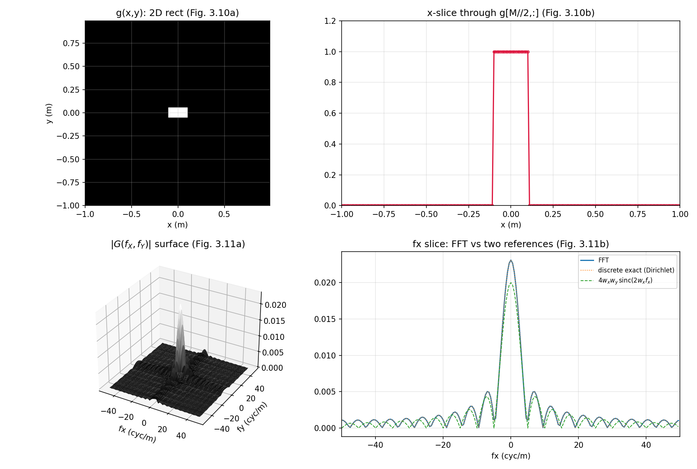
  <figcaption>图 3-P3 二维 fft2_example 数值复现：2D 矩形图像与 y=0 切片（上排）、|G| 曲面与 fy=0 剖面（下排）——FFT 曲线与 Dirichlet 离散精确谱重合、峰值 0.0231 高于连续解析谱 0.020（笔记自制）</figcaption>
</figure>

!!! note "拓展：surf 与 imagesc 的 Python 对应"
    `surf(fx,fy,abs(G))` 对应 `ax.plot_surface(FXf, FYf, np.abs(G), cmap='gray')`（注意先给频率坐标 `meshgrid` 出二维网格）；`camlight`/`lighting`/`shading interp` 是光照化妆，matplotlib 里没有严格对应，`linewidth=0` + 平滑 cmap 是最接近的观感。`imagesc(x,y,g)` 对应 `plt.imshow(g, extent=[x0,x1,y0,y1], origin='lower')`——`extent` 给物理坐标，`origin='lower'` 行使 `axis xy` 的职责，`vmin`/`vmax` 对应 `imagesc` 的自动缩放范围控制。

## 3.8 其他提示

原书的一袋 MATLAB 提示，逐条配 Python 对应：

- **clear all / close all**：MATLAB 变量与图窗跨运行保留，脚本开头清场。Python 对应：IPython 里 `%reset`（清变量）/ `plt.close('all')`（清图窗）；脚本化以后影响不大，但调试时有用。
- **显示复数结果**：运算后机器精度可能留下残余虚部，`plot`/`imagesc` 会拒绝画并警告 complex。用 `real` 或 `abs` 处理后再画。numpy 同理：取 `.real` 或 `np.abs`（本笔记脚本普遍用 `.real`，虚部本就只是残渣）。
- **图像对比度**：本书印刷用灰度 `imagesc`，但看低值特征时换彩色映射更清楚。灰度图看暗部的快速技巧：显示图像的 **n 次方根**，如 `nthroot(g,3)`——根越高对比度拉得越开。别忘了你看的是**峰值归一 + 对比度拉伸**的图。Python：`g**(1/3)`，或 matplotlib 的 `PowerNorm(gamma=1/3)`。
- **向量化运算**：盯紧点号——`A.*B` 是逐元素乘。**最常见的编程错误就是该点点号而忘了**：通常不报错，只是结果不对。排查问题时先查向量运算。（numpy 方向相反：`*` 就是逐元素，要矩阵乘法才写 `@`——从 MATLAB 转过来的人在这里翻车的最多。）
- **二维变换**：二维务必用 `fft2`/`ifft2`——不是 `fft`/`ifft`。一维函数作用在二维阵列上往往给出"重复的一维结果"（图看起来**带条纹**）——不好！numpy 的 `np.fft.fft` 沿**最后一个轴**变换，二维阵列会得到每行各自的一维谱，同样是条纹。

## 3.9 习题（原书）

原书 3 道题。每题给题目与提示，参考答案放折叠框——先自己动手。

**3.1 三角函数 M 文件**：(a) 建一个三角函数 M 文件，书给的提示代码：

```matlab
T=1-abs(x);
ask=abs(x)<=1;
out=T.*mask;
```

(b) 用以下参数生成采样三角函数：底半宽 0.1 m、向量长 2 m、样本数 \(M=200\)。(c) 画图。(d) 求 FFT。(e) 推导解析傅里叶变换。(f) 幅度与相位都画在一起对比。

!!! warning "原书笔误：提示代码变量名不一致"
    提示第 2 行定义的变量叫 `ask`，第 3 行用的却是 `mask`——两个名字指同一个东西，照抄会报"未定义变量 mask"。正确意图显然是同一个逻辑掩码变量（本笔记统一写成 `mask`）。

??? note "3.1 参考答案要点"
    (a) 按习题尺度缩放：`T = 1 - abs(x)/w; mask = abs(x) <= w; tri = T.*mask;`（\(w=0.1\)）。边界 \(|x|=w\) 处 \(T=0\)，与表 1.2 的 tri 定义天然一致，没有 rect 那样的半值歧义（实测与 `base.tri(x/w)` 最大差异 0.0）。(e) 解析谱：表 1.3 的 \(\mathrm{tri}(x/w) \leftrightarrow w\,\mathrm{sinc}^2(w f_X)\)，\(w=0.1\) 即 \(0.1\,\mathrm{sinc}^2(0.1 f_X)\)，峰值 = 三角形面积 \(w = 0.1\)。(f) 数值：FFT 峰值 \(0.100000\)（严格 = 面积），\(|f_X|\le 30\) 内与解析最大差异 \(3.8\times10^{-4}\)。相位：tri 是实偶函数 → 相位仍只有 0 与 ±π。

**3.2 高斯卷积的解析对比**：把 3.6 节的两高斯卷积例子编成代码，求解析卷积并同图对比离散结果。

??? note "3.2 参考答案要点"
    解析卷积即式 (3.2)：\(c(x) = \dfrac{w_a w_b}{\sqrt{w_a^2+w_b^2}}\exp\!\big[-\pi x^2/(w_a^2+w_b^2)\big]\)。代入 \(w_a=0.3\)、\(w_b=0.2\)：峰值 \(0.06/\sqrt{0.13} = 0.16641\)、等效高斯宽度 \(\sqrt{w_a^2+w_b^2}=0.36\)。数值对比见 3.6 节脚本（`ch3_conv_example`）：最大差异 \(5.3\times10^{-12}\)。

**3.3 圆函数 M 文件**：(a) 建一个圆函数 M 文件。(b) 生成采样圆盘：半径 0.015 m、阵列边长 0.2 m、单维样本数 \(M=200\)。(c) 图像显示。(d) 做 FFT 并用曲面图与剖面图显示幅度。

!!! note "提醒：圆函数的半径约定（衔接第 1 章勘误 1）"
    写 `circ` 时把半径写进**调用式**（如 `circ(sqrt(X.^2+Y.^2)/R)`，半径 = \(R\)），别依赖表 1.2/1.3 那套有歧义的约定。可靠的锚点：**半径 \(R\) 圆盘 \(\leftrightarrow R\,J_1(2\pi R\rho)/\rho\)**，峰值 = 圆盘面积 \(\pi R^2\)。

??? note "3.3 参考答案要点"
    (a) `circ.m`：`out = (r <= 1);`（与书 rect 同款"单点跳变"风格；文件全文如下）。(b) \(R = 0.015\) m、\(L=0.2\)、\(\mathrm{d}x = 0.001\) m——半径恰 15 个样本。(d) 频谱就是 jinc：数值峰值 \(7.010\times10^{-4}\) vs 解析 \(\pi R^2 = 7.069\times10^{-4}\)（差 0.8%——圆盘阶梯离散的正常水平）；\(f_Y=0\) 剖面与解析 jinc 最大差异 \(5.9\times10^{-6}\)（相对峰值约 1%）。边界细节：`<=` 与 `<` 两种编码相差 4 个恰好落在圆周上的样本（\((\pm0.015,0),(0,\pm0.015)\)），剖面差异 \(5.9\) vs \(9.9\times10^{-6}\)——无所谓，但要知道自己在用哪种。这套验证同时复核了第 1 章勘误 1 的锚点公式。

    ```matlab
    function out = circ(r)
    % ===== 书习题 3.3：圆函数 M 文件（仿书 3.1 节 rect 的编码风格） =====
    % 习题 3.3(a) 要求自建 circle function M 文件。书没给标准答案，这里按
    % rect.m 的同一风格编写：输入径向坐标数组 r，输出 0/1。
    % 调用方式：circ(sqrt(X.^2+Y.^2)/R) -> 半径 R 的圆盘。
    % 半径约定警告（承接第 1 章勘误 1）：表 1.2 的 circ(r) 是"半径 1/2"圆盘，
    % 表 1.3 的变换对却按"半径 = 分母"（Goodman 约定）计算。本函数用调用式
    % circ(r/R) 把半径明确为 R，频谱就是可靠的锚点 R*J1(2*pi*R*rho)/rho
    % （jinc 形），峰值 = 圆盘面积 pi*R^2（中心纵坐标定理）。
    % 边界 r==1 取 1（与书 rect 的"单点跳变"风格一致）；Python 参考实现
    % python/fourier/common/base.py 的 circle() 用严格小于——两者只差恰好
    % 落在圆周上的少数样本，对频谱的影响可忽略（ch3_exercises 有数值验证）。
    out = (r <= 1);
    end
    ```

=== "MATLAB"

    ```matlab
    % ===== 书 3.9 节习题 3.1（三角函数）与 3.3（圆函数）参考解答 =====
    % 3.1：底半宽 0.1 m 的三角函数，L = 2、M = 200。书提示的编码：
    %       T=1-abs(x); ask=abs(x)<=1; out=T.*mask;
    %     其中 ask 与 mask 是同一个变量（原书笔误，两个名字混用，本文件统一
    %     写成 mask）。按 3.1(b) 的尺度（底半宽 w = 0.1）缩放后，
    %     解析频谱：tri(x/w) <-> w sinc^2(w fx)，w = 0.1 -> 0.1 sinc^2(0.1 fx)。
    % 3.3：半径 0.015 m 的圆盘，L = 0.2、M = 200（dx = 0.001，半径恰 15 个样本）。
    %     频谱 = jinc 形：R*J1(2*pi*R*rho)/rho，峰值 = 面积 pi*R^2 ≈ 7.07e-4。
    %     （半径约定见第 1 章勘误 1：本解按"半径 = R"的 Goodman 约定，
    %      与表 1.3 的 circ 变换对一致。）
    clear; clc; close all;

    % ---------- 习题 3.1：三角函数 ----------
    L  = 2; M = 200; dx = L/M;
    x  = -L/2:dx:L/2-dx;
    w    = 0.1;                     % 底半宽 (m)
    T    = 1 - abs(x)/w;            % 书提示第 1 行（按习题尺度缩放）
    mask = abs(x) <= w;             % 书提示第 2 行（原书写成 ask——笔误）
    tri1 = T.*mask;                 % 书提示第 3 行：边界 |x|=w 处 T=0，无半值歧义

    TRI = fftshift(fft(ifftshift(tri1)))*dx;   % 居中 FFT × dx（ifftshift 配对更稳）
    fx  = -1/(2*dx) : 1/L : 1/(2*dx) - 1/L;
    TRI_an = w*sincn(w*fx).^2;                 % tri(x/w) <-> w sinc^2(w fx)

    fprintf('[3.1] 三角函数 FFT 峰值 = %.6f（解析 w = 0.1 = 三角形面积）\n', max(abs(TRI)));
    fprintf('[3.1] FFT 与解析最大差异（|fx|<=30 内）= %.2e\n', ...
            max(abs(abs(TRI(abs(fx) <= 30)) - TRI_an(abs(fx) <= 30))));

    % ---------- 习题 3.3：圆函数 ----------
    L2 = 0.2; M2 = 200; dx2 = L2/M2;
    x2 = -L2/2:dx2:L2/2-dx2; y2 = x2;
    [X, Y] = meshgrid(x2, y2);
    R = 0.015;                       % 圆半径 (m) = 15 个样本
    circ2 = circ(sqrt(X.^2+Y.^2)/R); % 调用习题 3.3(a) 建的 circ.m（同文件夹）

    C = fftshift(fft2(fftshift(circ2)))*dx2^2; % 二维 FFT × dx^2（偶数 M 下 fftshift 配对成立）
    fx2 = -1/(2*dx2) : 1/L2 : 1/(2*dx2) - 1/L2;

    CC   = C(M2/2+1, :);                       % fy=0 剖面
    J_an = zeros(size(fx2));
    nz   = fx2 ~= 0;
    J_an(nz)  = R.*besselj(1, 2*pi*R*fx2(nz)) ./ fx2(nz);   % R J1(2 pi R rho)/rho
    J_an(~nz) = pi*R^2;                                     % rho=0 极限 = 面积

    fprintf('[3.3] 圆盘 FFT 峰值 = %.6e（解析面积 pi*R^2 = %.6e）\n', ...
            max(abs(C(:))), pi*R^2);
    fprintf('[3.3] fy=0 剖面与 jinc 最大差异（|fx|<=30 内）= %.2e\n', ...
            max(abs(abs(CC(abs(fx2) <= 30)) - abs(J_an(abs(fx2) <= 30)))));

    % ---------- 画图 ----------
    figure('Position', [60 60 1150 700]);
    subplot(2,2,1);
    plot(x, tri1, '-o', 'MarkerSize', 4); grid on; axis([-0.3 0.3 0 1.2]);
    xlabel('x (m)'); title('Ex 3.1: triangle, half-base 0.1 m');
    subplot(2,2,2);
    plot(fx, abs(TRI), fx, TRI_an, ':'); grid on; xlim([-60 60]);
    xlabel('fx (cyc/m)'); title('Ex 3.1: |FFT| vs w sinc^2(w f_x)');
    legend('discrete', 'analytic', 'FontSize', 8);
    subplot(2,2,3);
    imagesc(x2, y2, circ2); colormap('gray'); axis square; axis xy;
    xlabel('x (m)'); ylabel('y (m)'); title('Ex 3.3: circle, R = 0.015 m');
    subplot(2,2,4);
    plot(fx2, abs(CC), 'o', 'MarkerSize', 4, fx2, abs(J_an), ':'); grid on;
    xlim([-60 60]); xlabel('fx (cyc/m)');
    title('Ex 3.3: slice vs jinc R J_1(2\pi R\rho)/\rho');
    legend('discrete', 'analytic', 'FontSize', 8);
    saveas(gcf, 'out_exercises.png');
    fprintf('已保存 out_exercises.png\n');

    % ---------- 局部函数 ----------
    function s = sincn(u)
        % 归一化 sinc：sin(pi*u)/(pi*u)，u=0 处极限 1（表 1.2；np.sinc 同定义）
        s = ones(size(u));
        nz = u ~= 0;
        s(nz) = sin(pi*u(nz)) ./ (pi*u(nz));
    end
    ```

=== "Python"

    ```python
    # ===== 书 3.9 节习题 3.1（三角函数）与 3.3（圆函数）参考解答 =====
    # 3.1：底半宽 0.1 m 的三角函数，L = 2、M = 200。书提示的编码：
    #       T=1-abs(x); ask=abs(x)<=1; out=T.*mask;
    #     其中 ask 与 mask 是同一个变量（原书笔误，两个名字混用，本文件统一
    #     写成 mask）。按 3.1(b) 的尺度（底半宽 w = 0.1）缩放后，
    #     解析频谱：tri(x/w) <-> w sinc^2(w fx)，w = 0.1 -> 0.1 sinc^2(0.1 fx)。
    # 3.3：半径 0.015 m 的圆盘，L = 0.2、M = 200（dx = 0.001，半径恰 15 个样本）。
    #     频谱 = jinc 形：R*J1(2*pi*R*rho)/rho，峰值 = 面积 pi*R^2 ≈ 7.07e-4。
    #     （半径约定见第 1 章勘误 1：本解按"半径 = R"的 Goodman 约定，
    #      与表 1.3 的 circ 变换对一致。）
    import os
    import sys

    import numpy as np
    import matplotlib.pyplot as plt

    sys.path.insert(0, os.path.join(os.path.dirname(os.path.abspath(__file__)), "..", "common"))
    from base import coords, sinc, tri, circle, jinc   # 公共积木（ch2 起）

    # ---------- 习题 3.1：三角函数 ----------
    L, M = 2.0, 200
    dx = L / M
    x, fx = coords(L, M)
    w = 0.1                                # 底半宽 (m)
    T = 1 - np.abs(x) / w                  # 书提示第 1 行（按习题尺度缩放）
    mask = np.abs(x) <= w                  # 书提示第 2 行（原书写成 ask——笔误）
    tri1 = T * mask                        # 第 3 行：边界 |x|=w 处 T=0，无半值歧义
    print(f"[3.1] 与 base.tri(x/w) 最大差异 = "
          f"{np.max(np.abs(tri1 - tri(x / w))):.1f}（同一函数的两种写法）")

    TRI = np.fft.fftshift(np.fft.fft(np.fft.ifftshift(tri1))) * dx   # 居中 FFT × dx
    TRI_an = w * sinc(w * fx) ** 2         # tri(x/w) <-> w sinc^2(w fx)

    print(f"[3.1] 三角函数 FFT 峰值 = {np.abs(TRI).max():.6f}"
          f"（解析 w = 0.1 = 三角形面积）")
    in_main = np.abs(fx) <= 30
    err_tri = np.max(np.abs(np.abs(TRI[in_main]) - TRI_an[in_main]))
    print(f"[3.1] FFT 与解析最大差异（|fx|<=30 内）= {err_tri:.2e}")

    # ---------- 习题 3.3：圆函数 ----------
    L2, M2 = 0.2, 200
    dx2 = L2 / M2
    x2, fx2 = coords(L2, M2)
    y2 = x2
    X, Y = np.meshgrid(x2, y2)             # 'xy'：行 <-> y
    R = 0.015                              # 圆半径 (m) = 15 个样本

    # 两种编码只差"圆周上的样本"：书风格（<=，边界取 1）vs base.circle（<）
    circ_le = (np.hypot(X, Y) <= R).astype(float)   # 习题 3.3(a) 的书风格编码
    circ_lt = circle(X, Y, R)                       # base 参考实现（严格小于）
    n_bd = int(np.sum((np.hypot(X, Y) <= R).astype(int)) - np.sum((np.hypot(X, Y) < R).astype(int)))
    print(f"[3.3] 半径 R = {R} m，两编码相差的圆周样本数 = {n_bd}"
          f"（对本例网格：{n_bd} 个）")

    G_le = np.fft.fftshift(np.fft.fft2(np.fft.ifftshift(circ_le))) * dx2 ** 2
    G_lt = np.fft.fftshift(np.fft.fft2(np.fft.ifftshift(circ_lt))) * dx2 ** 2
    row = M2 // 2                          # fy=0 剖面所在行
    J_an = jinc(fx2, R)                    # 半径 R 圆盘的解析频谱（Goodman 约定锚点）
    print(f"[3.3] 圆盘 FFT 峰值 = {np.abs(G_le).max():.6e}"
          f"（解析面积 πR² = {np.pi * R ** 2:.6e}）")
    in_main2 = np.abs(fx2) <= 30
    err_le = np.max(np.abs(np.abs(G_le[row, :][in_main2]) - np.abs(J_an[in_main2])))
    err_lt = np.max(np.abs(np.abs(G_lt[row, :][in_main2]) - np.abs(J_an[in_main2])))
    print(f"[3.3] fy=0 剖面与 jinc 最大差异（|fx|<=30 内）："
          f"边界含圆周 {err_le:.2e}；不含 {err_lt:.2e}（相对峰值 ~1%，圆盘阶梯离散的正常水平）")

    # ---------- 画图 ----------
    fig, axes = plt.subplots(2, 2, figsize=(11.5, 7.0))

    axes[0, 0].plot(x, tri1, "o-", ms=4, mfc="none")
    axes[0, 0].set_xlim(-0.3, 0.3); axes[0, 0].set_ylim(0, 1.2)
    axes[0, 0].set_xlabel("x (m)")
    axes[0, 0].set_title("Ex 3.1: triangle, half-base 0.1 m")

    axes[0, 1].plot(fx, np.abs(TRI), label="discrete")
    axes[0, 1].plot(fx, TRI_an, ":", label="analytic")
    axes[0, 1].set_xlim(-60, 60); axes[0, 1].set_xlabel("fx (cyc/m)")
    axes[0, 1].set_title(r"Ex 3.1: $|FFT|$ vs $w\,\mathrm{sinc}^2(w f_x)$")
    axes[0, 1].legend(fontsize=8)

    axes[1, 0].imshow(circ_le, extent=[x2[0], x2[-1], y2[0], y2[-1]],
                      origin="lower", cmap="gray")
    axes[1, 0].set_xlabel("x (m)"); axes[1, 0].set_ylabel("y (m)")
    axes[1, 0].set_title("Ex 3.3: circle, R = 0.015 m")

    axes[1, 1].plot(fx2, np.abs(G_le[row, :]), "o", ms=4, mfc="none", label="discrete")
    axes[1, 1].plot(fx2, np.abs(J_an), ":", label="analytic")
    axes[1, 1].set_xlim(-60, 60); axes[1, 1].set_xlabel("fx (cyc/m)")
    axes[1, 1].set_title(r"Ex 3.3: slice vs jinc $R J_1(2\pi R\rho)/\rho$")
    axes[1, 1].legend(fontsize=8)

    for ax in axes.flat:
        ax.grid(True, alpha=0.3)
    fig.tight_layout()
    fig.savefig(os.path.join(os.path.dirname(os.path.abspath(__file__)),
                             "out_exercises.png"), dpi=150)
    print("已保存 out_exercises.png")
    ```

<figure>
  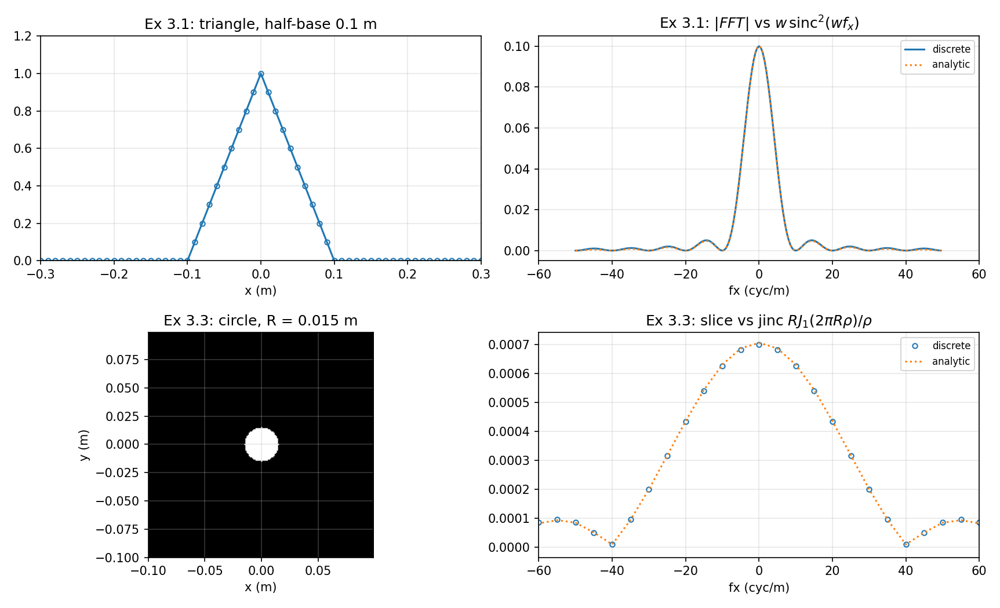
  <figcaption>图 3-P4 习题数值解答：三角函数采样与 |FFT| vs <span class="arithmatex">\(w\,\mathrm{sinc}^2(w f_X)\)</span>（上排）、圆盘图像与 <span class="arithmatex">\(f_Y=0\)</span> 剖面 vs jinc（下排）（笔记自制）</figcaption>
</figure>

## 坑与陷阱

!!! danger "rect 的'奇数样本'约定：偶数宽多给一个样本，面积会虚高"
    书内 rect 编码是 `abs(x)<=1/2`（边界取 1），全宽总是奇数个样本；请求偶数样本宽会多返回一个。后果可量化：3.7 节 \(w_x=0.1\)、\(w_y=0.05\)（都是偶数间隔数）使离散面积变成 \(21\times11\,\mathrm{d}x^2 = 0.0231\)，比真实面积 0.020 高 15%——书图 3.11(b) 的峰就是它。要面积准：选奇数样本宽（如 0.055），或改用表 1.2 半值约定并接受边界斜坡。

!!! danger "MATLAB 与 numpy 的'默认乘法'方向相反"
    MATLAB：`*` 是矩阵乘、`.*` 才是逐元素——忘点号通常**不报错**但结果离谱，是书 3.8 节点名的头号错误。numpy：`*` 天然逐元素、`@` 才是矩阵乘。两边互译代码时，这对符号必须整体翻转；`^` vs `**` 同理。

!!! danger "fftshift / ifftshift 配对：书用 fftshift 预移位是钻了偶数 M 的空子"
    书 3.3/3.7 节预移位都写 `fftshift`——偶数 \(M\) 下与 `ifftshift` 等价，不出错；奇数 \(M\)（或零填充到 \(N_1+N_2-1\)）时两者不同，配对用错就错位一个样本。稳妥口诀不变：`ifftshift → fft → fftshift`。

!!! danger "定标因子跟维度与运算类型走：dx、dx²、卷积一次 dx"
    一维 FFT 乘 \(\Delta x\)；二维乘 \(\Delta x^2\)；FFT 卷积（ifft 后）只乘一次 \(\Delta x\)。忘乘则频谱整体小 \(M\) 或 \(M^2\) 倍——用中心纵坐标定理（频谱峰值 = 空域离散面积）当场验尸。注意"离散面积"按书约定含边界样本（上一条）。

!!! danger "一维 fft 用在二维阵列上会得到'条纹'"
    二维必须 `fft2`/`ifft2`（numpy `fft2`）。一维 `fft` 只沿一个方向变换，结果"看起来像重复的一维谱"（书 3.8 节原话：striped）。反过来 numpy 的 `np.fft.fft` 沿最后一轴变换——想沿特定轴变换时要显式传 `axis` 参数。

!!! danger "行列索引 vs 笛卡尔坐标：g(M/2+1,:) 是 y=0 的行"
    MATLAB `(i,j)` =（行, 列），行对应 \(y\)、列对应 \(x\)。取 \(y=0\) 的横向剖面写 `g(M/2+1,:)`（Python `g[M//2, :]`）；`meshgrid` 的 `X` 行是 \(x\) 副本、`Y` 列是 \(y\) 副本。Python 里一旦写了 `indexing='ij'` 两维互换——圆对称函数看不出来，非对称问题直接错。

!!! danger "图像显示默认 y 向下：axis xy / origin='lower'"
    常规图像文件第 1 行在顶部，`imagesc`/`imshow` 因此默认 \(y\) 轴向下增——建模的"上方"会画在下面。MATLAB 加 `axis xy`，Python 用 `origin='lower'`。

!!! danger "相位图的 ±π 跳变是显示伪影，不是物理"
    `angle` 输出在 \(-\pi\) 到 \(\pi\) 之间卷绕，±π 是同一个相位；图上陡峭的跳变多半来自机器精度的微小数值差。真正要看的是 0 ↔ ±π 之间的跳变位置（实偶函数它落在幅度零点上，相位 π ≡ 给幅度加负号）。

## 速览

1. 函数 M 文件：文件名 = 函数名；脚本 vs 函数两种；`%` 注释、分号抑回显。
2. 书的 rect 编码 `abs(x)<=1/2`：边界取 1（与表 1.2 的半值约定不同）；全宽总是奇数个样本，偶数请求多给一个。
3. 建网格四件套：\(w, L, M, \mathrm{d}x = L/M\)；坐标 \(x = -L/2:\Delta x:L/2-\Delta x\)（式 2.21）。
4. FFT 前移位：居中（零坐标在 \(M/2+1\)）→ `fftshift` → index 1；奇数 \(M\) 用 `ifftshift` 配对；不移位 = 凭空多线性相位。
5. 一维 FFT 乘 \(\Delta x\)、二维乘 \(\Delta x^2\)；频率坐标 \(-1/(2\Delta x):1/L:1/(2\Delta x)-1/L\)（式 2.22）。
6. 读 FFT：`abs` + `angle` 两张图；相位只有 0 与 ±π（±π 同值），0→π 跳变在幅度零点处（本例约每 18 样本 \(= L/(2w)\)）；样本不踩 sinc 零点 → 谷底不为零。
7. FFT 边缘略高于解析谱 = 周期延拓混叠（2.5 节）。
8. FFT 卷积：`fft → .* → ifft × dx → fftshift`；两函数都居中时**不必预移位**（相位账模 \(L\) 不可见），但只移位一个就整体错位 \(L/2\)；支撑判据 \(D_1+D_2 < L\)。
9. 二维：`meshgrid`（X 行 = x 副本）、`imagesc + axis xy`、切片 `g(M/2+1,:)`、`fft2 × dx²`、`surf` 显示；一维 `fft` 用在二维阵列 → 条纹。
10. 本章 Python 复用公共模块 `python/fourier/common/base.py`（rect/sinc/tri/circle/jinc、coords、ft1/ft2_centered）；书编码语义的 `rect_book` 在 ch3 脚本内定义。

## 术语速查

| 英文 | 中文 | 一句话 |
| --- | --- | --- |
| M-file | M 文件 | 扩展名 `.m` 的 MATLAB 代码文件；脚本或函数 |
| script / function | 脚本 / 函数 | 顺序执行的代码行 / 可调用并返回结果的任务单元 |
| vectorized logical test | 向量化逻辑测试 | `abs(x)<=1/2` 对每个元素比较，返回 0/1 数组 |
| Current Directory | 当前文件夹 | 工作文件存放处，同文件夹函数互相可见 |
| element-wise operation | 逐元素运算 | MATLAB 的 `.*` `.^`；numpy 的 `*` `**`（默认！） |
| fftshift | 移位命令 | 换半边/象限对调；居中 ↔ 移位排列 |
| magnitude / phase | 幅度 / 相位 | 复数样本的两份信息；`abs` / `angle` |
| slice (profile) | 切片 | 二维结果的一维剖面，如 `g(M/2+1,:)` |
| Dirichlet kernel | Dirichlet 核 | 有限样本截断的离散精确谱 \(\sin(N\pi f\Delta x)/\sin(\pi f\Delta x)\) |
| meshgrid | 网格生成 | X 行 = x 副本、Y 列 = y 副本；'xy' 约定 |
| imagesc / colormap | 图像显示 / 伪彩色 | 数组缩放到全显示范围 / 灰度或彩色映射 |
| axis xy / square | 轴方向 / 方形边框 | y 自下而上 / 图窗边框正方形 |
| surf | 曲面图 | 二维阵列的 3D 展示（Python `plot_surface`） |
| nthroot(g,n) | n 次方根 | 对比度拉伸技巧，看暗部特征 |

## 覆盖自查

| 原书小节 | 内容 | 笔记位置 |
| --- | --- | --- |
| 3.1 Defining Functions | MATLAB 桌面、M 文件两种、rect 逐行、奇数样本约定、图 3.1 | 3.1（含 rect 编码约定 warning） |
| 3.2 Creating Vectors | 参数四件套、坐标向量、plot 选项、宽度解读、图 3.2/3.3 | 3.2 |
| 3.3 Shift for FFT | 索引视图、fftshift、奇偶评论、线性相位、图 3.4/3.5 | 3.3（含 fftshift/ifftshift 细节 note） |
| 3.4 Computing the FFT and Displaying Results | fft×dx、abs/angle、相位解读、居中与频率坐标、图 3.6/3.7 | 3.4（含"每 18 个点"拓展） |
| 3.5 Comparison with Analytic Results | 解析对 (3.1)、sinc 内置函数、图 3.8、完整 fft_example 脚本 | 3.5（含数值验证） |
| 3.6 Convolution Example | 两高斯 FFT 卷积、不移位技巧、支撑判据、conv/conv2、图 3.9、式 (3.2) | 3.6（含相位账与机器精度两个拓展 + 数值验证） |
| 3.7 Two Dimensions | meshgrid、imagesc、切片、fft2×dx²、surf、图 3.10/3.11、完整 fft2_example 脚本 | 3.7（含 0.023 离散面积实锤 warning） |
| 3.8 Miscellaneous Hints | clear/close、复数显示、对比度、点号、fft2 | 3.8（每条配 Python 对应） |
| 3.9 Exercises | 习题 3.1–3.3（含 ask/mask 笔误） | 3.9（含参考答案与完整习题脚本） |

代码文件：`matlab/fourier/ch3/`（rect.m、circ.m、ch3_fft_example.m、ch3_conv_example.m、ch3_fft2_example.m、ch3_exercises.m）、`python/fourier/ch3/`（同名 .py，去 rect/circ——其语义由脚本内 `rect_book` 与公共模块 `base.circle` 承担）与页面内 tab 一致；公共积木在 `python/fourier/common/base.py`，本章起新增使用 `tri`/`circle`/`jinc`。
