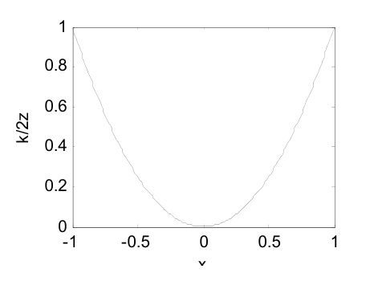
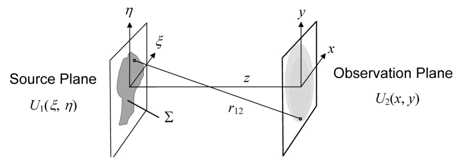
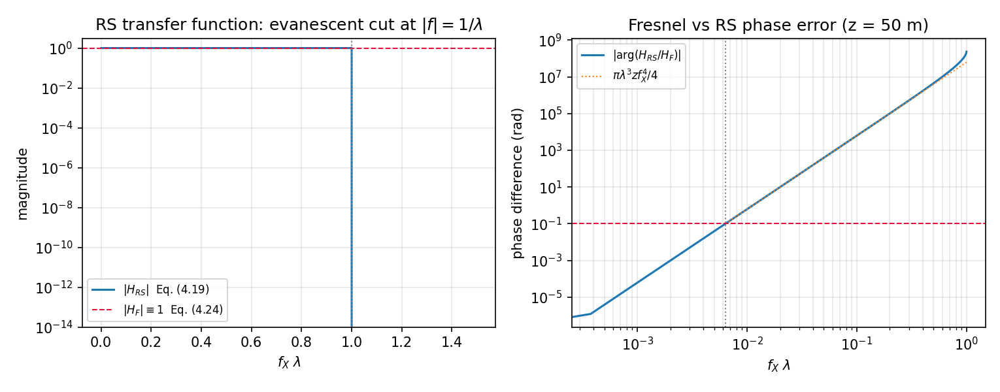
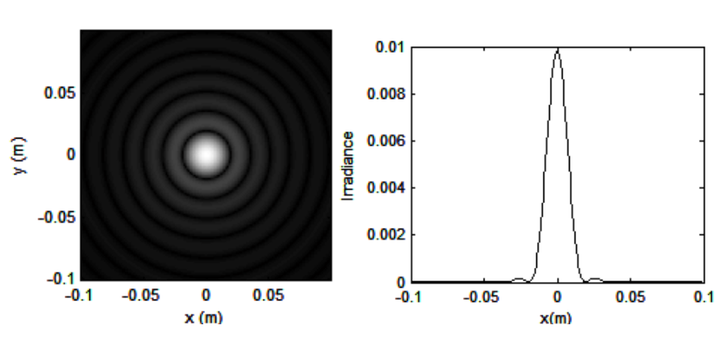
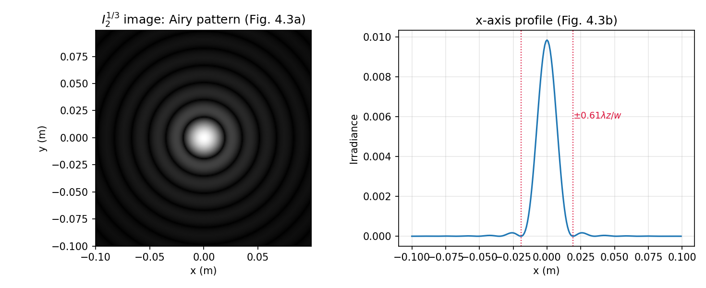
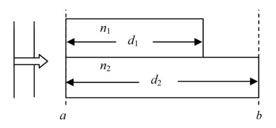
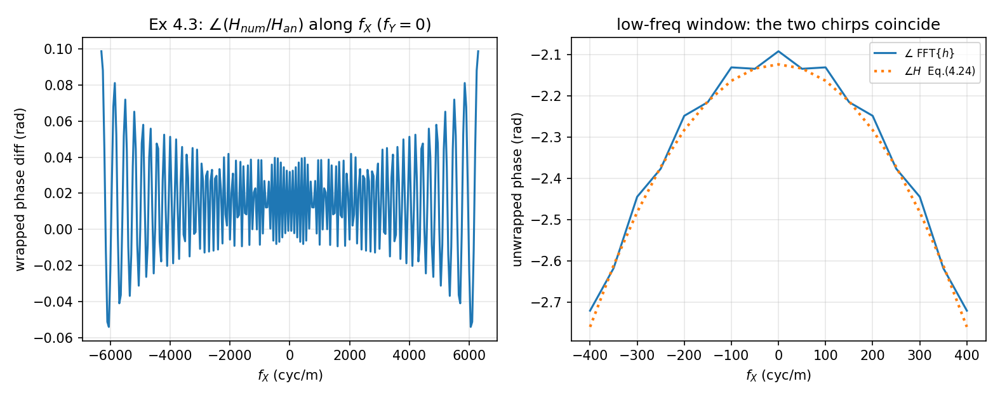
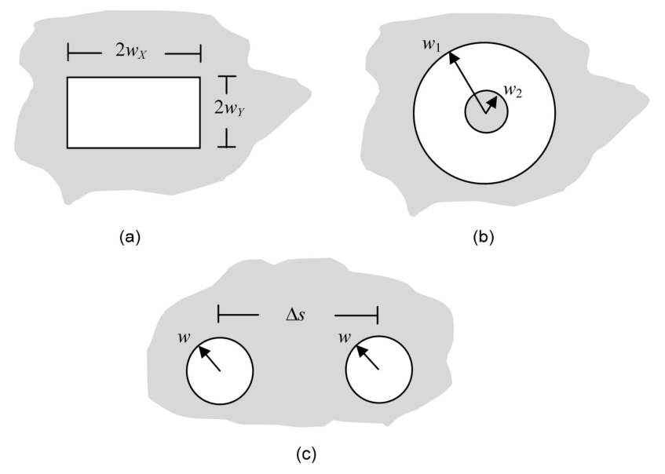
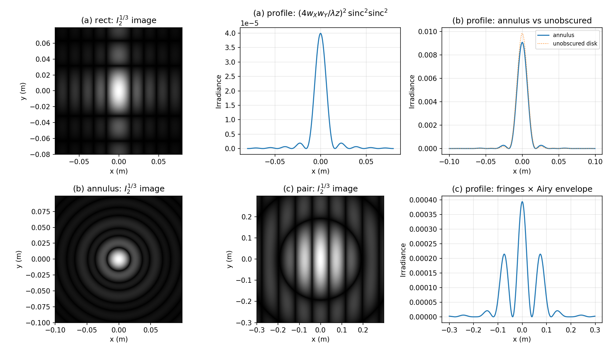
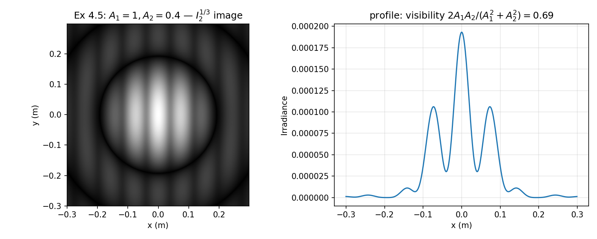

# 第 4 章 标量衍射与传播解

> **本章解决**：光场经自由空间传播后的复振幅分布——标量衍射理论的基本假设，Rayleigh–Sommerfeld、Fresnel 与 Fraunhofer 三级近似的解析形式与适用条件，以及圆孔衍射的 Airy 图样。学完能根据波长、孔径尺度与传播距离判断应采用哪一级近似，并写出对应的场分布与辐照度。

## 4.0 本章导图

<div class="brtree">
  <div class="brrow">
    <span class="brlabel root">光的传播</span>
    <span class="brace"></span>
    <div class="brkids">
      <div class="brrow">
        <span class="brlabel">物理设定（4.1–4.3）</span>
        <span class="brace"></span>
        <div class="brkids">
          <span class="brleaf">5 条介质假设 → 解耦 → 标量</span>
          <span class="brleaf">复相量 U = A·exp(jφ)（式 4.4）</span>
          <span class="brleaf">辐照度 I = |U|²（式 4.8）</span>
          <span class="brleaf">OPL = nd；玻璃里 λ/n（式 4.9/4.10）</span>
          <span class="brleaf">chirp：e^{jk(x²+y²)/2z}（式 4.11）</span>
        </div>
      </div>
      <div class="brrow">
        <span class="brlabel">三级解析解（4.4）</span>
        <span class="brace"></span>
        <div class="brkids">
          <span class="brleaf">RS I：球面波 + 倾斜因子，最准</span>
          <span class="brleaf">h 与 H（式 4.15/4.19）卷积 ↔ 传递函数</span>
          <span class="brleaf">Fresnel：抛物面波（式 4.22–4.24）</span>
          <span class="brleaf">NF = w²/λz 判据（式 4.28）</span>
          <span class="brleaf">Fraunhofer：纯 FT，无 H（式 4.30）</span>
        </div>
      </div>
      <div class="brrow">
        <span class="brlabel">动手实验（4.5）</span>
        <span class="brace"></span>
        <div class="brkids">
          <span class="brleaf">jinc = J1(2πx)/x，jinc(0)=π</span>
          <span class="brleaf">Airy 图样 = jinc²（式 4.35）</span>
          <span class="brleaf">D_lobe = 1.22λz/w（式 4.37）</span>
          <span class="brleaf">nthroot 三次方根拉圆环</span>
        </div>
      </div>
      <div class="brrow">
        <span class="brlabel">习题（4.6）</span>
        <span class="brace"></span>
        <div class="brkids">
          <span class="brleaf">OPD 记账（4.1）</span>
          <span class="brleaf">三个适用区的距离（4.2）</span>
          <span class="brleaf">H = FT{h} 数值验证（4.3）</span>
          <span class="brleaf">矩形/环形/双孔解析式（4.4/4.5）</span>
        </div>
      </div>
    </div>
  </div>
</div>

## 4.1 标量衍射

**衍射（diffraction）**指的是光波在横向受到限制时的行为——比如被一个孔径拦住。它说明光线的路径并非严格的直线：当波在边界上被"扰动"时，传播方向会拐弯。日常生活里你很少注意到衍射：反射（镜子）和折射（透镜）明显得多。衍射最显眼的条件是**受限尺寸与波长同一量级**；但它始终在起作用，三类场合必须认真对待：高分辨率应用（天文成像）、长传播距离应用（激光雷达）、小结构应用（光刻工艺）。

光波传播的底层规律是麦克斯韦方程组。电场 \(\vec E\) 的三个分量 \((E_x, E_y, E_z)\) 与磁场 \(\vec H\) 的三个分量 \((H_x, H_y, H_z)\) 之间、以及各电场分量之间、各磁场分量之间，普遍存在耦合。但如果介质满足下面五条假设——

| 假设 | 英文 | 含义 |
| --- | --- | --- |
| 线性 | **linear** | 不同源产生的场量可以直接相加 |
| 各向同性 | **isotropic** | 与波的偏振方向无关 |
| 均匀 | **homogeneous** | 介电常数不随位置变化 |
| 非色散 | **nondispersive** | 介电常数不随波长变化 |
| 非磁性 | **nonmagnetic** | 磁导率等于真空磁导率 |

——麦克斯韦的矢量方程就**解耦**了：电场（或磁场）的每个分量可以独立于其他分量传播。**标量衍射（scalar diffraction）**研究的就是这种理想情况下光的传播行为——只跟踪一个标量场 \(U\)，不管偏振。

!!! warning "原书笔误"
    原书第 47 页把各向同性拼成了 "isotroptic"，正确拼写是 **isotropic**（第 48 页正文用的就是正确形式）。属于排版笔误，不影响内容。

这串假设看起来把适用范围限得很窄，其实不然：**自由空间光学（free-space optical, FSO）**传播——透过空间或大气传输——涵盖激光雷达、成像、激光通信等大量应用，标量衍射直接适用。对更恶劣的传播介质，标量解也能给出主要效应的合理近似，并与完整矢量结果互为对照。本书所有推导与仿真都假设标量衍射。

!!! note "拓展：标量近似什么时候会失灵"
    五条假设里最容易被打破的是"各向同性 + 均匀"：亚波长光栅、超表面、金属纳米结构附近，场的偏振各分量强烈耦合，标量模型定量失效；大数值孔径强聚焦（焦斑接近波长）时矢量效应也会显形。这些场合需要矢量衍射或全波仿真。但对"孔径尺寸 ≫ λ 的横向受限传播"，标量理论的误差通常在百分之几量级——这也是它成为傅里叶光学默认语言的原因。

## 4.2 单色场与辐照度

先立术语。在各向同性介质中传播的**单色（monochromatic，单一频率）**标量场可以写成

\[
u(P,t) = A(P)\cos\big[2\pi\nu t - \phi(P)\big], \tag{4.1}
\]

其中 \(A(P)\) 是空间位置 \(P=(x,y,z)\) 处的**振幅（amplitude）**，\(\phi(P)\) 是**相位（phase）**，\(\nu\) 是时间频率。这个表达式建模的是单一偏振的横向光场。单色光是全书解析推导与计算机仿真的基础。严格说，真单色光源必然**相干（coherent）**——相干指场在时间/空间上分开的两点之间相位有相关性，它使干涉在时间平均意义下得以形成。激光也只能产生"近单色"辐射，真单色光不可实现；不过第 7、9 章会看到，把单色结果推广到多色、部分相干、非相干辐射，在许多有用场合是直接的（"……幸好！"）。

一个具体例子：沿 \(z\) 方向传播的**平面波（plane wave）**对应式 (4.1) 取

\[
u(z,t) = A\cos\big[2\pi\nu t - kz\big], \tag{4.2}
\]

其中**波数（wavenumber）**定义为

\[
k = \frac{2\pi}{\lambda}, \tag{4.3}
\]

\(\lambda\) 是真空波长，且 \(\nu = c/\lambda\)（\(c\) 为真空光速）。这个波对 \(x,y\) 没有任何依赖——解读为在横向无限延伸。

如果式 (4.1) 的场在（标量衍射假设的）线性介质中传播，时间频率保持不变，所以时间项不必显式带着；再把余弦换成**复相量（complex phasor）**形式——传播结果依然正确，而且数学操作方便得多。于是得到只描述场的空间分布的函数

\[
U(P) = A(P)\exp\big[j\phi(P)\big]. \tag{4.4}
\]

这个复相量形式的场是全书解析与仿真推导的主角。平面波式 (4.2) 的相量形式是

\[
U(z) = A\exp(jkz). \tag{4.5}
\]

式 (4.1) 与 (4.4) 的关系是

\[
u(P,t) = \mathrm{Re}\big\{U(P)\exp(-j2\pi\nu t)\big\}, \tag{4.6}
\]

\(\mathrm{Re}\) 取实部，时间因子 \(\exp(-j2\pi\nu t)\) 单独拎出来。再进一步，把 \(z\) 的显式依赖也拿掉（\(z\) 是基本传播方向），记

\[
U_1(x,y) = A_1(x,y)\exp\big[j\phi_1(x,y)\big], \tag{4.7}
\]

下标 "1" 表示这是 \(z\) 轴上某个位置 "1" 处 \(x\text{–}y\) 平面内的场。

探测器跟不上光频振荡（\(>10^{14}\) Hz），只能响应场的时间平均平方幅度。所以真正感兴趣的量是**辐照度（irradiance）**，本书定义为

\[
I_1(x,y) = U_1(x,y)U_1^*(x,y) = |U_1(x,y)|^2. \tag{4.8}
\]

irradiance 是辐射度量学术语：落在观察平面上的单位面积功率通量（W/m²），是功率密度量——别的激光与傅里叶光学书里常叫它"**intensity**（强度）"。

!!! note "拓展：式 (4.8) 为什么是"时间平均"的捷径"
    直接按定义算时间平均：\(\langle u^2\rangle = \langle A^2\cos^2(2\pi\nu t-\phi)\rangle = A^2/2\)。而用相量：\(|U|^2 = A^2\)。两者差一个常数因子 \(1/2\)——这正是原书"记账注"的内容：\(A_1\) 是电场振幅（V/m），要得到 W/m² 量纲的辐照度，右端应乘 \(1/(2\eta)\)，\(\eta\) 是介质特性阻抗（真空 \(\eta = 377\ \Omega\)）。因为我们几乎只关心场的**相对**空间分布，这个常数全书默认丢弃。所以读文献时注意：\(I = |U|^2\) 是"相对辐照度"，绝对定标要补 \(1/(2\eta)\)。

## 4.3 光程与场相位表示

介质的**折射率（refractive index）**\(n\) 是真空光速与介质中光速之比——可见光波段的典型玻璃约 1.6。光在折射率 \(n\) 的介质中走过几何距离 \(d\)，**光程（optical path length, OPL）**定义为

\[
\mathrm{OPL} = nd. \tag{4.9}
\]

OPL 乘以波数 \(k\) 出现在场的相位里。把 \(k\) 想成"换算器"：一个波长的距离 ↔ \(2\pi\) rad 相位。平面波式 (4.2) 里 \(z\) 就是 OPL（真空 \(n=1\)），\(kz\) 给出正弦相位在这段距离上行进了多少弧度。正弦与复指数都是模 \(2\pi\) 的量——**只有 0 到 \(2\pi\) 之间的相对相位有意义**。平面波穿过厚 \(d\)、折射率 \(n\) 的玻璃后，场的相量表示是

\[
U(d) = A\exp(jknd). \tag{4.10}
\]

效果上，玻璃里波长缩短为 \(\lambda/n\)。这个主题还有别的变体，比如 \(\exp(jkr)\)，\(r\) 是真空中的径向距离（球面波）。

相量也可以是横向位置的函数，例如

\[
\exp\left[j\frac{k}{2z}\left(x^2 + y^2\right)\right]. \tag{4.11}
\]

这叫 **chirp（啁啾）项**（见原书附录 A），相位随横向位置的**平方**变化，用来建模收缩或会聚、扩张或发散的光场。式 (4.11) 相位的一维剖面见图 4.1。

<figure>
  
  <figcaption>图 4.1 式 (4.11) chirp 函数沿 x 轴的相位剖面（纵轴以 k/2z 为单位）（截自原书）</figcaption>
</figure>

一个重要概念是**相位超前与滞后（leading / lagging phase）**。式 (4.6) 的时间相量 \(\exp(-j2\pi\nu t)\) 表明：场的相位随时间推移变得越来越**负**。所以图 4.1 剖面**中心处的相位"超前"其余部分**——它取"最负"的值；离中心越远，相位滞后越多。把相位解读成波前形状：波峰的中心领先边缘，可以想象波在图 4.1 里"向下"传播。光相位的更多物理解读在 5.3 节。

!!! note "拓展：符号约定是成套的，换书要整体翻转"
    本书（与 Goodman）的配套约定：时间因子 \(\exp(-j2\pi\nu t)\) + 球面波 \(\exp(+jkr)\)。许多物理教材用 \(\exp(+j\omega t)\)，那时球面波就得写 \(\exp(-jkr)\)——两套约定下"相位超前"的方向、共轭出现的位置全部对调。读其他书时先查时间因子，再决定是否把所有复数量换成共轭。本笔记全程只用本书约定。

## 4.4 解析衍射解

### 4.4.1 Rayleigh–Sommerfeld 解 I

考虑单色光从一个 2D 平面（源平面）传播，平面坐标记 \(\xi\) 与 \(\eta\)（图 4.2）。源平面上的区域 \(\Sigma\) 是光源或被照亮孔径的范围；源平面场分布 \(U_1(\xi,\eta)\)，远处观察平面上的场 \(U_2(x,y)\) 由**第一瑞利–索末菲衍射解（Rayleigh–Sommerfeld solution I）**预测：

\[
U_2(x,y) = \frac{z}{j\lambda}\iint_\Sigma U_1(\xi,\eta)\,\frac{\exp(jkr_{12})}{r_{12}^2}\,d\xi d\eta, \tag{4.12}
\]

\[
r_{12} = \sqrt{z^2 + (x-\xi)^2 + (y-\eta)^2}. \tag{4.13}
\]

这里 \(\lambda\) 是光波长，\(k = 2\pi/\lambda\)（自由空间），\(z\) 是源与观察坐标系中心之间的距离，\(r_{12}\) 是源平面上一点到观察平面上一点的距离，积分限即源区域 \(\Sigma\)。

<figure>
  
  <figcaption>图 4.2 平行源平面与观察平面的传播几何（截自原书）</figcaption>
</figure>

式 (4.12) 是**惠更斯–菲涅耳原理（Huygens–Fresnel principle）**的表述：假设源等价于无穷多个虚构点源，每个点源在 \((\xi,\eta)\) 处按实际源场发出一个球面波；这些球面波在观察点 \((x,y)\) 处相干叠加。把式 (4.12)、(4.13) 推广到非平面几何是直接的（无非换更复杂的 \(r\) 表达式），但平面几何最常见，也是本书的焦点。

一般说式 (4.12) 是一个叠加积分；源与观察面平行时，它恰好是**卷积**：

\[
U_2(x,y) = \iint U_1(\xi,\eta)\,h(x-\xi, y-\eta)\,d\xi d\eta, \tag{4.14}
\]

其中 Rayleigh–Sommerfeld **脉冲响应（impulse response）**的一般形式为

\[
h(x,y) = \frac{z}{j\lambda}\,\frac{\exp(jkr)}{r^2}, \tag{4.15}
\]

\[
r = \sqrt{z^2 + x^2 + y^2}. \tag{4.16}
\]

用傅里叶卷积定理把式 (4.14) 写成

\[
U_2(x,y) = \mathfrak{F}^{-1}\big\{\mathfrak{F}\{U_1(x,y)\}\mathfrak{F}\{h(x,y)\}\big\}, \tag{4.17}
\]

（对卷积解释，源与观察面变量统一重标为 \(x,y\)。）等价地

\[
U_2(x,y) = \mathfrak{F}^{-1}\big\{\mathfrak{F}\{U_1(x,y)\}H(f_X,f_Y)\big\}, \tag{4.18}
\]

其中 \(H\) 是 Rayleigh–Sommerfeld **传递函数（transfer function）**：

\[
H(f_X,f_Y) = \exp\left\{jkz\sqrt{1 - (\lambda f_X)^2 - (\lambda f_Y)^2}\right\}. \tag{4.19}
\]

严格说，\(\sqrt{f_X^2+f_Y^2} < 1/\lambda\) 必须满足，对应的才是**传播波（propagating）**分量。式 (4.19) 也常用**角谱（angular spectrum）**分析导出。

!!! note "拓展：式 (4.12) 里的 z/r 就是倾斜因子"
    Goodman 书里 RS I 的标准形式是 \(U_2 = \frac{1}{j\lambda}\iint U_1\,\frac{e^{jkr_{12}}}{r_{12}}\cos\theta\,d\xi d\eta\)，其中倾斜因子 \(\cos\theta = z/r_{12}\)（源点与观察点连线相对平面法线的夹角余弦）。代入 \(\cos\theta/r_{12} = z/r_{12}^2\) 就得到本书式 (4.12) 的紧凑形式——书的写法把倾斜因子直接并进了分母的 \(r_{12}^2\)，式 (4.15) 同理。顺带一提式 (4.19) 的另一半故事：当 \(\sqrt{f_X^2+f_Y^2} > 1/\lambda\) 时根号内变负，\(kz\sqrt{\cdot}\) 成为纯虚数，\(H\) 变成指数**衰减**——这些是倏逝波（evanescent）分量，只在近场/亚波长尺度起作用，常规传播问题里可以忽略。

Rayleigh–Sommerfeld 表达式是本书考虑的**最精确**衍射解。除标量衍射假设外，它只要求 \(r \gg \lambda\)——源到观察位置的距离远大于一个波长。

### 4.4.2 Fresnel 近似

式 (4.13) 或 (4.16) 里的平方根让 RS 解的解析操作变难、也给仿真增加执行时间。对距离项引入近似，就得到更方便的形式。考虑二项式展开

\[
\sqrt{1+b} = 1 + \frac{1}{2}b - \frac{1}{8}b^2 + \dots \tag{4.20}
\]

（\(b<1\)）。把式 (4.13) 改写成 \(\sqrt{1+b}\) 的形状并保留前两项：

\[
r_{12} \approx z\left[1 + \frac{1}{2}\left(\frac{x-\xi}{z}\right)^2 + \frac{1}{2}\left(\frac{y-\eta}{z}\right)^2\right]. \tag{4.21}
\]

这个近似用在式 (4.12) 指数的相位距离项上——相当于假设虚构点源发出的是**抛物面波（parabolic wave）**而非球面波；再把式 (4.12) 分母里的 \(r_{12}\) 用 \(z\) 近似，得到**菲涅耳衍射表达式（Fresnel diffraction expression）**：

\[
U_2(x,y) = \frac{e^{jkz}}{j\lambda z}\iint U_1(\xi,\eta)\exp\left\{j\frac{k}{2z}\left[(x-\xi)^2 + (y-\eta)^2\right]\right\}d\xi d\eta. \tag{4.22}
\]

它同样是式 (4.14) 形状的卷积，脉冲响应为

\[
h(x,y) = \frac{e^{jkz}}{j\lambda z}\exp\left[j\frac{k}{2z}\left(x^2+y^2\right)\right], \tag{4.23}
\]

传递函数为

\[
H(f_X,f_Y) = e^{jkz}\exp\left[-j\pi\lambda z\left(f_X^2+f_Y^2\right)\right]. \tag{4.24}
\]

式 (4.17)、(4.18) 在此照常适用。菲涅耳表达式还有一个常用变形：把含 \(x,y\) 的二次相位因子提到积分号外：

\[
U_2(x,y) = \frac{\exp(jkz)}{j\lambda z}\exp\left[j\frac{k}{2z}(x^2+y^2)\right] \times \iint U_1(\xi,\eta)\exp\left[j\frac{k}{2z}(\xi^2+\eta^2)\right]\exp\left[-j\frac{2\pi}{\lambda z}(x\xi+y\eta)\right]d\xi d\eta. \tag{4.25}
\]

除了前面的振幅与 chirp 乘法因子，这就是"源场 × chirp 函数"的傅里叶变换，变换中使用了频率替换

\[
f_X \to \frac{x}{\lambda z}, \qquad f_Y \to \frac{y}{\lambda z}. \tag{4.26}
\]

菲涅耳表达式在**近距离**建模标量衍射时会因近似而失准。允许（丢掉式 (4.20) 中 \(b^2/8\) 及以上项造成的）最大 1 rad 相位偏差，可以导出条件

\[
z^3 \gg \left(\frac{\pi}{4\lambda}\left[(x-\xi)^2 + (y-\eta)^2\right]^2\right)_{\max}, \tag{4.27}
\]

"max" 指给定源与观察几何下感兴趣区域内的最大值。式 (4.27) 给了一个明确的"菲涅耳近似几乎无损失"的适用条件。但对源平面上空间变化平缓的场——比如平面波背照明的简单孔径——即使违反式 (4.27)，菲涅耳近似也能给出高精度。更宽松的判据用**菲涅耳数（Fresnel number）**：

\[
N_F = \frac{w^2}{\lambda z}, \tag{4.28}
\]

\(w\) 是源平面方形孔径的半宽或圆孔半径，\(z\) 是到观察面的距离。通常认为 \(N_F \lesssim 1\) 时观察面处于**菲涅耳区（Fresnel region）**，菲涅耳近似"典型地"给出有用结果；而对源孔径上比较"平滑"的场，菲涅耳表达式在 \(N_F\) 高达 20–30 时仍然适用。在几何光学语境下，菲涅耳表达式描述**傍轴（paraxial）**假设下的衍射——只考虑与光轴夹角小于约 0.1 rad 的光线。

原书没画这两张传递函数的对比图，但它是理解"菲涅耳近似精度"最直观的一张图——把它补上（数值脚本见下方代码块）：

<figure>
  
  <figcaption>图 4-P1 RS 传递函数 (4.19) vs 菲涅耳传递函数 (4.24)：|H_RS| 在 |f|=1/λ 处倏逝截止而 |H_F|≡1；相位差按 πλ³zf⁴/4 增长，0.1 rad 容差只到 f ≈ 0.006/λ（z = 50 m，λ = 0.633 μm）（笔记自制）</figcaption>
</figure>

!!! note "拓展：|H_F| 为什么恒等于 1，以及 0.1 rad 意味着多小的频率"
    式 (4.24) 是纯相位滤波器——菲涅耳传播不改变任何频率分量的幅度，只移相；幅度畸变全部来自式 (4.19) 与 (4.24) 的差别。把式 (4.19) 的根号展开：\(\sqrt{1-u} \approx 1 - u/2 - u^2/8\)（\(u = (\lambda f)^2\)），一次项 \(-kz\lambda^2f^2/2 = -\pi\lambda zf^2\) 恰好与式 (4.24) 的相位抵消——这就是"二阶精度"的含义；残余相位差 \(\approx \pi\lambda^3zf^4/4\)，随 \(f^4\) 增长。数值上（\(\lambda = 0.633\ \mu\text{m}\)、\(z = 50\) m）：相位差 0.1 rad 只到 \(f \approx 1.0\times10^4\) cyc/m，即 \(0.006/\lambda\)；在 \(f = 0.01/\lambda\) 处已是 0.62 rad。看着很苛刻，但别忘了孔径衍射的角谱集中在 \(f \sim \theta/\lambda\)（\(\theta\) 为衍射角，通常远小于 1 rad）——恰好落在这个可信带里。

=== "MATLAB"

    ```matlab
    % ===== 书 4.4.1/4.4.2 节：RS 传递函数 (4.19) vs 菲涅耳传递函数 (4.24) =====
    % 对比两张传递函数：菲涅耳近似的可信频率范围 + |f|>1/lambda 的倏逝波截止。
    % 相位差推导：
    %   arg(H_RS/H_F) = kz(sqrt(1-(lam f)^2) - 1) + pi*lam*z*f^2
    %     ≈ -pi*lam^3*z*f^4/4 （式 (4.19) 根号展开到 (lam f)^4 阶时，二阶项与
    %       式 (4.24) 的 -pi*lam*z*f^2 正好抵消——"二阶精度"近似的含义）
    % MATLAB/Python 差异：MATLAB 的 sqrt 对负实数自动返回复数，Python 的
    %   np.sqrt 给 nan、需输入复数 (a+0j)；画图均只取幅度/相位。
    clear; clc; close all;

    lam = 0.633e-6;          % 波长 (m)，He-Ne
    z   = 50;                % 传播距离 (m)（书 4.5 节例子的距离）
    k   = 2*pi/lam;

    f    = linspace(0, 1.5/lam, 4000);   % 频率轴：以 1/lambda 为单位标定
    prop = f < 1/lam;                    % 传播波分量（式 4.19 下方的条件）

    % ---------- |H_RS|：传播区幅度 1，倏逝区指数衰减 ----------
    mag_RS = zeros(size(f));
    mag_RS(prop)  = 1;                                   % |exp(j 相位)| = 1
    mag_RS(~prop) = exp(-k*z*sqrt((lam*f(~prop)).^2 - 1));   % 倏逝衰减

    % ---------- 相位差（只定义在传播区） ----------
    fp    = f(prop);
    dphi  = abs(k*z*(sqrt(1-(lam*fp).^2) - 1) + pi*lam*z*fp.^2);
    fa    = fp(fp > 1e4);                        % 渐近线只在大 f 画
    asym  = pi*lam^3*z*fa.^4/4;
    f_01  = (0.4/(pi*lam^3*z))^0.25;             % |dphi| = 0.1 rad 的频率

    fprintf('1/lambda（传播波截止）= %.3e cyc/m\n', 1/lam);
    fprintf('|dphi|=0.1 rad 的频率 = %.3e cyc/m = %.4f /lambda\n', f_01, f_01*lam);
    fprintf(['例：f = 0.01/lambda 处相位差 = %.3f rad' ...
             '（f^4 增长：f 每大 10 倍，误差大 1 万倍）\n'], ...
             pi*lam^3*z*(0.01/lam)^4/4);

    figure('Position', [80 80 1050 420]);
    subplot(1,2,1);
    h1 = semilogy(f*lam, mag_RS); hold on;
    yline(1, '--', 'Color', 'crimson');
    xline(1, ':', 'Color', [0.5 0.5 0.5]);
    ylim([1e-14 3]); xlabel('f_X \lambda'); ylabel('magnitude');
    title('RS transfer function: evanescent cut at |f| = 1/\lambda');
    legend([h1], {'|H_{RS}|  Eq. (4.19)  (|H_F| = 1 flat)'}, 'FontSize', 8);
    grid on;

    subplot(1,2,2);
    h2 = loglog(fp*lam, dphi); hold on;
    h3 = loglog(fa*lam, asym, ':');
    yline(0.1, '--', 'Color', 'crimson');
    xline(f_01*lam, ':', 'Color', [0.5 0.5 0.5]);
    xlabel('f_X \lambda'); ylabel('phase difference (rad)');
    title('Fresnel vs RS phase error (z = 50 m)');
    legend([h2 h3], {'|arg(H_{RS}/H_F)|', '\pi\lambda^3 z f_X^4/4'}, 'FontSize', 8);
    grid on;
    saveas(gcf, 'out_transfer_compare.png');
    fprintf('已保存 out_transfer_compare.png\n');
    ```

=== "Python"

    ```python
    # ===== 书 4.4.1/4.4.2 节：RS 传递函数 (4.19) vs 菲涅耳传递函数 (4.24) =====
    # 对比两张"传递函数":看菲涅耳近似在哪个频率范围内可信、以及 |f|>1/lambda 的
    # 倏逝波截止。相位差推导：
    #   arg(H_RS/H_F) = kz(sqrt(1-(lam f)^2) - 1) + pi*lam*z*f^2
    #     ≈ -pi*lam^3*z*f^4/4  （把式 (4.19) 的根号展开到 (lam f)^4 阶，二阶项与
    #       式 (4.24) 的 -pi*lam*z*f^2 正好抵消——这是"二阶精度"近似的含义）
    # MATLAB/Python 差异：np.sqrt 对负实数给出 nan 并 warning，要用复数输入
    # (a + 0j) 才能"延拓"到倏逝区；MATLAB 的 sqrt(real) 同样只给实部/复数需 complex()。
    import os

    import numpy as np
    import matplotlib.pyplot as plt

    lam = 0.633e-6        # 波长 (m)，He-Ne
    z = 50.0              # 传播距离 (m)（书 4.5 节例子的距离）
    k = 2 * np.pi / lam

    f = np.linspace(0, 1.5 / lam, 4000)      # 频率轴：以 1/lambda 为单位标定
    prop = f < 1 / lam                        # 传播波分量（式 4.19 下方的条件）

    # ---------- |H_RS|：传播区幅度 1，倏逝区指数衰减 ----------
    H_RS = np.zeros_like(f, dtype=complex)
    H_RS[prop] = np.exp(1j * k * z * np.sqrt(1 - (lam * f[prop]) ** 2 + 0j))
    H_RS[~prop] = np.exp(-k * z * np.sqrt((lam * f[~prop]) ** 2 - 1))
    mag_RS = np.abs(H_RS)

    # ---------- 相位差（只定义在传播区） ----------
    dphi = np.abs(k * z * (np.sqrt(1 - (lam * f[prop]) ** 2) - 1) + np.pi * lam * z * f[prop] ** 2)
    f_asym = f[prop][f[prop] > 1e4]           # 渐近线 -pi*lam^3*z*f^4/4 只在大 f 画
    asym = np.pi * lam ** 3 * z * f_asym ** 4 / 4
    f_01 = (0.4 / (np.pi * lam ** 3 * z)) ** 0.25   # |dphi| = 0.1 rad 的频率

    print(f"1/lambda（传播波截止）= {1 / lam:.3e} cyc/m")
    print(f"|dphi|=0.1 rad 的频率 = {f_01:.3e} cyc/m = {f_01 * lam:.4f} /lambda")
    print(f"例：f = 0.01/lambda 处相位差 = "
          f"{np.pi * lam ** 3 * z * (0.01 / lam) ** 4 / 4:.3f} rad"
          f"（f^4 增长：f 每大 10 倍，误差大 1 万倍）")

    fig, axes = plt.subplots(1, 2, figsize=(10.2, 4.0))

    axes[0].semilogy(f * lam, mag_RS, label=r"$|H_{RS}|$  Eq. (4.19)")
    axes[0].axhline(1.0, ls="--", lw=1, color="crimson", label=r"$|H_F| \equiv 1$  Eq. (4.24)")
    axes[0].axvline(1.0, ls=":", lw=1, color="gray")
    axes[0].set_ylim(1e-14, 3)
    axes[0].set_xlabel(r"$f_X\ \lambda$"); axes[0].set_ylabel("magnitude")
    axes[0].set_title(r"RS transfer function: evanescent cut at $|f|=1/\lambda$")
    axes[0].legend(fontsize=8)
    axes[0].grid(True, alpha=0.3)

    axes[1].loglog(f[prop] * lam, dphi, label=r"$|\arg(H_{RS}/H_F)|$")
    axes[1].loglog(f_asym * lam, asym, ":", lw=1, label=r"$\pi\lambda^3 z f_X^4/4$")
    axes[1].axhline(0.1, ls="--", lw=1, color="crimson")
    axes[1].axvline(f_01 * lam, ls=":", lw=1, color="gray")
    axes[1].set_xlabel(r"$f_X\ \lambda$"); axes[1].set_ylabel("phase difference (rad)")
    axes[1].set_title("Fresnel vs RS phase error (z = 50 m)")
    axes[1].legend(fontsize=8)
    axes[1].grid(True, alpha=0.3, which="both")

    fig.tight_layout()
    fp = os.path.join(os.path.dirname(os.path.abspath(__file__)), "out_transfer_compare.png")
    fig.savefig(fp, dpi=150)
    print("已保存 out_transfer_compare.png")
    ```

### 4.4.3 Fraunhofer 近似

**夫琅禾费衍射（Fraunhofer diffraction）**指的是俗称"**远场（far field）**"区域的衍射图样。数学上，把式 (4.25) 积分号内乘在初始场上的 chirp 项近似为 1，假设是

\[
z \gg \left(\frac{k(\xi^2+\eta^2)}{2}\right)_{\max}, \tag{4.29}
\]

得到**夫琅禾费衍射表达式**：

\[
U_2(x,y) = \frac{\exp(jkz)}{j\lambda z}\exp\left[j\frac{k}{2z}(x^2+y^2)\right] \times \iint U_1(\xi,\eta)\exp\left[-j\frac{2\pi}{\lambda z}(x\xi+y\eta)\right]d\xi d\eta. \tag{4.30}
\]

式 (4.29) 通常要求传播距离远大于源支撑尺寸——但涉及透镜的传播分析里也会出现夫琅禾费图样。夫琅禾费表达式是有力工具：激光光束传播、图像分析、光谱学都用它。

除了前面的乘法因子，夫琅禾费表达式就是源场的傅里叶变换，变量替换为

\[
f_X \to \frac{x}{\lambda z}, \qquad f_Y \to \frac{y}{\lambda z}. \tag{4.31}
\]

夫琅禾费表达式**写不成卷积积分**——因此没有脉冲响应，也没有传递函数。但它是初始场傅里叶变换的缩放版本，计算相对容易；而且与菲涅耳表达式一样，即使式 (4.29) 没满足也常被成功地使用：对平面波照明的简单孔径，违反超过 10 倍时夫琅禾费结果仍可能有用——特别是当主要兴趣只是接收面上的辐照度图样时。用菲涅耳数说：夫琅禾费区的公认要求是 \(N_F \ll 1\)。

!!! note "拓展：透镜把远场搬到眼前"
    式 (4.29) 的距离要求对裸传播很苛刻（4.6 节习题 4.2 里一个 1 mm 孔径就要 \(z \gg\) 几米），但正透镜能把夫琅禾费图样成像在自己的**后焦面**上——等效传播距离换成焦距 \(f\)。原书说"涉及透镜的传播分析中也会出现夫琅禾费图样"就是这个意思：后焦面的复场正比于透镜前焦面场的傅里叶变换。这是第 5 章之后透镜仿真的入口，也是光学信息处理（4f 系统）的根基。

## 4.5 Fraunhofer 衍射例子

对大多数孔径，用 RS 表达式找闭式解极其困难（近乎不可能）；菲涅耳表达式好一些，但即使"平面波照明的矩形孔"这种简单场景，解仍然复杂（原书引 Goodman、Gaskill）。菲涅耳与 RS 的计算留给下一章的计算机；**解析的夫琅禾费分析更容易，而且正好用来给计算机结果做校验**。

考虑单位振幅平面波照明的圆孔。紧贴孔径平面之后的复场为

\[
U_1(\xi,\eta) = \mathrm{circ}\left(\frac{\sqrt{\xi^2+\eta^2}}{w}\right). \tag{4.32}
\]

!!! warning "约定差异（衔接第 1 章勘误 1）：这个 circ 是"半径 = 分母"的 Goodman 约定"
    表 1.2 的 \(\mathrm{circ}(r)\) 是半径 \(1/2\) 的圆盘——照那个定义，式 (4.32) 的孔径半径会是 \(w/2\)，与式 (4.33) 的 \(2\pi w\) 及后文" \(w\) 是圆孔半径"的说法（4.4.2 节：\(w\) 是方形孔径半宽**或圆孔半径**）对不上。式 (4.32) 必须按表 1.3 变换对所用的 Goodman 约定读：\(\mathrm{circ}(\rho/w)\) = **半径 \(w\)** 的单位圆盘。这就是第 1 章勘误 1 的 circ 约定冲突——表 1.2 定义与表 1.3/正文用法不一致——在第 4 章的直接再现。写代码时用"半径 = 分母"的锚点最稳：半径 \(R\) 圆盘 \(\leftrightarrow R\,J_1(2\pi R\rho)/\rho\)，峰值 = 面积 \(\pi R^2\)。

对它做傅里叶变换：

\[
\mathfrak{F}\{U_1(\xi,\eta)\} = w^2\,\frac{J_1\!\left(2\pi w\sqrt{f_X^2+f_Y^2}\right)}{w\sqrt{f_X^2+f_Y^2}}, \tag{4.33}
\]

再代入替换 (4.31)、乘上式 (4.30) 的前导振幅与相位因子，得到场

\[
U_2(x,y) = \frac{\exp(jkz)}{j\lambda z}\exp\left[j\frac{k}{2z}(x^2+y^2)\right] \times w^2\,\frac{J_1\!\left(2\pi\frac{w}{\lambda z}\sqrt{x^2+y^2}\right)}{\frac{w}{\lambda z}\sqrt{x^2+y^2}}. \tag{4.34}
\]

用式 (4.8) 得辐照度：

\[
I_2(x,y) = \left(\frac{w^2}{\lambda z}\right)^2 \left[\frac{J_1\!\left(2\pi\frac{w}{\lambda z}\sqrt{x^2+y^2}\right)}{\frac{w}{\lambda z}\sqrt{x^2+y^2}}\right]^2. \tag{4.35}
\]

原书特意留了一句：式 (4.35) 里的一些 \(w/\lambda z\) 项其实可以约掉，但**保留这种对称形式对编程更友好**——它就是 \( \left(\frac{w^2}{\lambda z}\right)^2 \mathrm{jinc}^2\!\left(\frac{w\rho}{\lambda z}\right) \)，与下面 jinc.m 的代码形状一字不差。

现在用 MATLAB 画这个辐照度图样。参数：\(w = 1\) mm，\(\lambda = 0.633\ \mu\text{m}\)（He–Ne 激光）。菲涅耳数判据要求 \(w^2/\lambda z < 0.1\)，即 \(z > 10w^2/\lambda = 15.8\) m——取 \(z = 50\) m。网格怎么选：好的显示尺寸是阵列边长约为图样中心瓣宽的 5 倍。贝塞尔函数 \(J_1\) 的第一个零点在自变量等于 \(1.22\pi\) 处。令 \(y=0\)，图样第一零点满足

\[
2\pi\frac{w}{\lambda z}x = 1.22\pi, \tag{4.36}
\]

解出 \(x\) 得到中心瓣的**半宽**，翻倍得到全宽：

\[
D_{lobe} = 1.22\,\frac{\lambda z}{w}. \tag{4.37}
\]

据此取 \(L = 5\times 1.22\lambda z/w \approx 0.2\) m。

先建一个处理贝塞尔比值的函数。新建 M 文件（命名为 "jinc"）：

=== "MATLAB"

    ```matlab
    function[out]=jinc(x);
    % ===== 书 4.5 节：jinc 函数 M 文件（逐行忠实 + 中文注释） =====
    % 书 4.5 节在 New M-file（命名为 "jinc"）里建立的函数（原书第 1-14 行）：
    %   1  function[out]=jinc(x);
    %   5  % J1(2*pi*x)/x
    %   9  mask=(x~=0);
    %   11 out=pi*ones(size(x));
    %   13 out(mask)=besselj(1,2*pi*x(mask))./(x(mask));
    %   14 end
    % 要点（书 4.5 节原话与讲解）：
    %   - 本函数计算 J1(2*pi*x)/x；用掩码（mask）办法避开 x=0 的除零：
    %     第 9 行 mask 取 x 非零元素（~= 即 ≠），第 11 行 out 先全部初始化为
    %     pi——它是 x=0 处的函数值（J1(u)≈u/2 -> J1(2*pi*x)/x -> pi），
    %     第 13 行用逻辑索引 out(mask)、x(mask) 只对非零元素求值。
    %   - 掩码写法看似绕远，但允许输入 x 是向量或数组（全书一贯的向量化风格）。
    %   - besselj(1,...) 是第一类 1 阶贝塞尔函数；Python 对应 scipy.special.j1。
    %   - 书特意提醒："not all jinc functions are the same"——本书的 jinc(x)=
    %     J1(2*pi*x)/x，jinc(0)=pi，第一个零点在 x=0.61（J1 零点 1.22*pi）。
    %     与公共模块 python/fourier/common/base.py 的 jinc(rho, R=1.0) 完全一致。
    % MATLAB/Python 差异：logical 索引 out(mask) 对应 numpy 的布尔掩码 x[mask]；
    %   MATLAB 的 pi 是常量，numpy 用 np.pi。
    %
    % ------------- 以下为书原代码（第 1-14 行） -------------
    %
    % jinc function
    %
    % J1(2*pi*x)/x
    % divide by zero fix
    %
    % locate non-zero elements of x
    mask=(x~=0);
    % initialize output with pi (value for x=0)
    out=pi*ones(size(x));
    % compute output values for all other x
    out(mask)=besselj(1,2*pi*x(mask))./(x(mask));
    end
    ```

=== "Python"

    ```python
    # python/fourier/ch4/ch4_fraun_circ.py 内的定义（书 4.5 节 jinc 的语义）
    def jinc_book(u):
        """书 4.5 节的 jinc：J1(2*pi*u)/u，u=0 处极限 pi（= base.jinc(u, R=1.0)）。

        书原话："not all jinc functions are the same"——本定义的 jinc(0) = pi，
        是"半径 1 圆盘频谱"约定；base.jinc(rho, R) 的峰值为圆盘面积 pi*R^2，
        R=1 时两者重合（jinc 第一个零点都在 u = 0.61，对应 J1 零点 1.22*pi）。
        """
        return jinc(u, R=1.0)   # jinc 从 python/fourier/common/base.py 导入（ch1 起）
    ```

这个函数计算 \(J_1(2\pi x)/x\)。掩码办法避开 \(x=0\) 的除零；掩码代码看似绕远，但输入可以是向量或数组。第 9 行 `mask` 拿到 `x` 的维度、在 `x` 非零处取 1（`~=` 即 ≠）；第 11 行 `out` 用 `ones` 按同样维度初始化为 \(\pi\)——\(\pi\) 就是 \(x=0\) 处的函数值；第 13 行**逻辑索引**只对 mask 为 1 的元素求值。`besselj(1,…)` 是第一类 1 阶贝塞尔函数。

书里紧接着提醒（值得背下来）：文献里 "jinc" 有好几种定义，本书可能是唯一用这种变体的——**不是所有 jinc 都一样**。

接着是夫琅禾费图样脚本，命名为 "fraun_circ"：

=== "MATLAB"

    ```matlab
    % ===== 书 4.5 节：fraun_circ —— 圆孔夫琅禾费衍射（Airy 图样） =====
    % 书 4.5 节的主脚本（原书第 1-27 行），本文件忠实复现书图 4.3 并附数值检查。
    % 参数（书 4.5 节）：w = 1 mm（圆孔半径，书注释写 "x half-width"）、
    % lambda = 0.633 um（He-Ne 激光）、z = 50 m、L = 5 x 1.22*lambda*z/w ≈ 0.2 m、
    % M = 250。辐照度用式 (4.35)：I2 = (w^2/(lambda z))^2 * jinc(w*rho/(lambda z))^2。
    % 依赖：同文件夹的 jinc.m（书 4.5 节建的函数，J1(2*pi*x)/x）。
    % MATLAB/Python 差异：
    %   - e-3 与 10^-3 等价（书特意提醒：e 记号里不要用 ^ 符号！）；
    %   - nthroot(I2,3) 是 3 次方根（拉出圆环），Python 写 I2**(1/3)；
    %   - imagesc 默认 y 向下增，axis xy 翻回笛卡尔方向（Python 用 origin='lower'）。
    clear; clc; close all;

    % ---------- 书原代码（第 1-27 行） ----------
    L=0.2;          %side length (m)
    M=250;          %# samples
    dx=L/M;         %sample interval
    x=-L/2:dx:L/2-dx; y=x;  %coords
    [X,Y]=meshgrid(x,y);

    w=1e-3;         %x half-width
    lambda=0.633e-6;%wavelength
    z=50;           %prop distance
    k=2*pi/lambda;  %wavenumber
    lz=lambda*z;

    %irradiance
    I2=(w^2/lz)^2.*(jinc(w/lz*sqrt(X.^2+Y.^2))).^2;

    figure(1)   %irradiance image
    imagesc(x,y,nthroot(I2,3));
    xlabel('x (m)'); ylabel('y (m)');
    colormap('gray');
    axis square;
    axis xy;

    figure(2)   %x-axis profile
    plot(x,I2(M/2+1,:));
    xlabel('x(m)'); ylabel('Irradiance');

    % ---------- 数值检查（对照式 4.36/4.37 与菲涅耳数判据） ----------
    fprintf('峰值 I2(0,0) = %.6e；解析 (w^2/(lam z))^2*pi^2 = %.6e\n', ...
            I2(M/2+1,M/2+1), (w^2/lz)^2*pi^2);
    fprintf('第一零点解析 0.61*lam*z/w = %.5f m（式 4.36：2*pi*(w/lz)x = 1.22*pi）\n', ...
            0.61*lz/w);
    fprintf('D_lobe = 1.22*lam*z/w = %.5f m；L = 5*D_lobe = %.4f m（书据此取 0.2 m）\n', ...
            1.22*lz/w, 5*1.22*lz/w);
    fprintf('NF = w^2/(lam z) = %.4f << 1（判据 NF<0.1 -> z > 10*w^2/lam = %.2f m）\n', ...
            w^2/lz, 10*w^2/lam);
    ```

=== "Python"

    ```python
    # ===== 书 4.5 节：fraun_circ —— 圆孔夫琅禾费衍射（Airy 图样） =====
    # 书 4.5 节建了两个 M 文件：jinc.m 与 fraun_circ.m。Python 侧不需要单独的
    # jinc 文件——公共模块 base.jinc(rho, R=1.0) = J1(2*pi*rho)/rho 与书的 jinc
    # 定义完全一致，本章用它包一层 jinc_book 并说明等价性。
    # 参数（书 4.5 节）：w = 1 mm（圆孔半径）、lambda = 0.633 um（He-Ne 激光）、
    # z = 50 m、观察窗 L = 5 x 1.22*lambda*z/w ≈ 0.193 m（书取 0.2 m）、M = 250。
    # 式 (4.35)：I2(x,y) = (w^2/(lambda*z))^2 * jinc(w*rho/(lambda*z))^2。
    # MATLAB/Python 差异：
    #   - 书的 nthroot(I2,3) 对应 Python 的 I2**(1/3)（3 次方根拉出圆环）；
    #   - MATLAB besselj(1,u) 对应 scipy.special.j1(u)（第一类 1 阶贝塞尔）；
    #   - imagesc 默认 y 向下 + axis xy 翻回，对应 imshow(origin='lower')。
    import os
    import sys

    import numpy as np
    import matplotlib.pyplot as plt

    sys.path.insert(0, os.path.join(os.path.dirname(os.path.abspath(__file__)), "..", "common"))
    from base import coords, jinc   # 公共积木（ch1 起）：jinc(rho, R=1) = 书 ch4 的 jinc


    def jinc_book(u):
        """书 4.5 节的 jinc：J1(2*pi*u)/u，u=0 处极限 pi（= base.jinc(u, R=1.0)）。

        书原话："not all jinc functions are the same"——本定义的 jinc(0) = pi，
        是"半径 1 圆盘频谱"约定；base.jinc(rho, R) 的峰值为圆盘面积 pi*R^2，
        R=1 时两者重合（jinc 第一个零点都在 u = 0.61，对应 J1 零点 1.22*pi）。
        """
        return jinc(u, R=1.0)


    # ---------- 参数与网格（书 fraun_circ.m） ----------
    L, M = 0.2, 250            # 观察窗边长 (m)、样本数
    dx = L / M                 # 采样间隔
    x, _ = coords(L, M)        # 式 (2.21)：-0.1 : dx : 0.1-dx（coords 的第二个返回值是频率轴！）
    y = x                      # y 与 x 同网格（书代码 y=x）
    X, Y = np.meshgrid(x, y)   # 'xy' 约定：X 的行 = x 的副本（与 MATLAB 一致）

    w = 1e-3          # 圆孔半径 (m)（书注释写 "x half-width"：圆孔的半宽 = 半径）
    lam = 0.633e-6    # 波长 (m)，He-Ne
    z = 50.0          # 传播距离 (m)
    lz = lam * z      # 组合量 lambda*z（书代码变量 lz）

    # ---------- 夫琅禾费辐照度（式 4.35，直接用解析 jinc 形式） ----------
    I2 = (w ** 2 / lz) ** 2 * jinc_book(w / lz * np.sqrt(X ** 2 + Y ** 2)) ** 2

    # ---------- 数值检查 ----------
    peak_an = (w ** 2 / lz) ** 2 * np.pi ** 2     # jinc(0) = pi
    row = M // 2                                  # y=0 剖面（MATLAB 的 I2(M/2+1,:)）
    prof = I2[row, :]
    x0_an = 0.61 * lz / w                         # 式 (4.36)：2pi*(w/lz)x = 1.22pi
    i0 = int(np.argmin(np.abs(x - x0_an)))
    print(f"峰值 I2(0,0) = {I2[row, row]:.6e}；解析 (w^2/(lam*z))^2 * pi^2 = {peak_an:.6e}")
    print(f"第一零点解析 0.61*lam*z/w = {x0_an:.5f} m；"
          f"最近网格样本 x = {x[i0]:.5f} m，I2 = {prof[i0]:.2e}（≈0）")
    print(f"D_lobe = 1.22*lam*z/w = {1.22 * lz / w:.5f} m；"
          f"L = 5*D_lobe = {5 * 1.22 * lz / w:.4f} m（书据此取 0.2 m）")
    print(f"NF = w^2/(lam*z) = {w ** 2 / lz:.4f} << 1"
          f"（书判据 NF<0.1 -> z > 10*w^2/lam = {10 * w ** 2 / lam:.2f} m，取 z=50 m）")
    print(f"J1 第一个零点 = 1.22*pi（精确 1.2197*pi）；jinc 第一个零点 u = 0.61")

    # ---------- 画图：复现书图 4.3 ----------
    fig, axes = plt.subplots(1, 2, figsize=(9.8, 4.0))

    axes[0].imshow(I2 ** (1 / 3), extent=[x[0], x[-1], y[0], y[-1]],
                   origin="lower", cmap="gray")               # 书：nthroot(I2,3)
    axes[0].set_xlabel("x (m)"); axes[0].set_ylabel("y (m)")
    axes[0].set_title(r"$I_2^{1/3}$ image: Airy pattern (Fig. 4.3a)")

    axes[1].plot(x, prof)                                     # 书：plot(x, I2(M/2+1,:))
    axes[1].set_xlabel("x (m)"); axes[1].set_ylabel("Irradiance")
    axes[1].set_title("x-axis profile (Fig. 4.3b)")
    axes[1].grid(True, alpha=0.3)
    # 第一零点参考线（式 4.36/4.37：半宽 0.61*lam*z/w）
    for sgn in (-1, 1):
        axes[1].axvline(sgn * x0_an, ls=":", lw=1, color="crimson")
    axes[1].annotate(r"$\pm 0.61\lambda z/w$", (x0_an, prof.max() * 0.6),
                     color="crimson", fontsize=9, ha="left")

    fig.tight_layout()
    fig.savefig(os.path.join(os.path.dirname(os.path.abspath(__file__)),
                             "out_fraun_circ.png"), dpi=150)
    print("已保存 out_fraun_circ.png")
    ```

书里对脚本逐条给了注释（对应行号）：(a) 第 6 行：坐标变量为了简洁没写下标 2；(b) 第 9 行：科学记数有几种写法，`e-3` 与 `10^-3` 等价——**别在 e 记号里用 ^ 符号**；(c) 第 16 行：调用 jinc 函数；(d) 第 19 行：3 次方根把图样里的"圆环"从暗部拉出来（第 3 章的对比度拉伸技巧）。

<figure>
  
  <figcaption>图 4.3 圆孔的夫琅禾费辐照度：(a) 图样；(b) x 轴剖面。这就是 Airy 图样（截自原书）</figcaption>
</figure>

运行脚本得到图 4.3。圆孔的夫琅禾费图样通称 **Airy 图样（Airy pattern）**；图样中心的亮核（宽度由式 (4.37) 给出）叫 **Airy disk（艾里斑）**。

Python 实测（\(w=1\) mm、\(\lambda=0.633\ \mu\text{m}\)、\(z=50\) m、\(L=0.2\)、\(M=250\)）：

- 峰值 \(I_2(0,0) = 9.852633\times10^{-3}\)，与解析 \((w^2/\lambda z)^2\pi^2 = 9.852633\times10^{-3}\) 严格相等（网格中心样本正好落在 \(\rho=0\)；jinc(0) = \(\pi\)）；
- 第一零点解析值 \(0.61\lambda z/w = 0.01931\) m；最近网格样本 \(x = 0.01920\) m 处 \(I_2 = 1.79\times10^{-7} \approx 0\)；
- \(D_{lobe} = 1.22\lambda z/w = 0.03861\) m，\(5D_{lobe} = 0.193\) m——书取 \(L = 0.2\) m 的来历；
- \(N_F = 0.0316 \ll 1\)（判据 \(N_F<0.1\) 要求 \(z > 15.8\) m，\(z=50\) m 留有 3 倍裕量）。

顺手再核对两个书里没算的判据数字：式 (4.27)（观察区取 \(L+w\) 邻域）要求 \(z^3 \gg 516\ \text{m}^3\)，\(z^3 = 125000\)——裕量 242 倍；式 (4.29) 要求 \(z \gg 9.93\) m，\(z=50\) m 是 5 倍——夫琅禾费区成立但不算"极远"，与书选 \(z=50\) m 的口径一致。

<figure>
  
  <figcaption>图 4-P2 Airy 图样数值复现：<span class="arithmatex">\(I_2^{1/3}\)</span> 图像（1/3 次根拉出圆环）与 <span class="arithmatex">\(y=0\)</span> 剖面（红线为式 (4.36) 的 <span class="arithmatex">\(\pm0.61\lambda z/w\)</span> 零点参考位）（笔记自制）</figcaption>
</figure>

!!! note "拓展：1.22 从哪来，Airy disk 为什么决定望远镜分辨率"
    1.22 = \(J_1\) 第一个零点的位置 \(3.8317/\pi\)（精确 1.2197）。Airy disk 的角半径（第一零点对孔径中心的张角）是 \(\theta = 0.61\lambda/w = 1.22\lambda/D\)，\(D = 2w\) 是孔径**直径**。瑞利判据由此而来：两个等亮星点刚好可分辨的条件是其中一颗的第一零点落在另一颗的峰值上，即角间距 \(1.22\lambda/D\)——"口径决定分辨率"的定量版本。注意书里式 (4.37) 用的是半宽 \(w\)，与常见文献用直径 \(D\) 差一个因子 2。

## 4.6 习题（原书）

原书 5 道题。每题给题目与提示，参考答案放折叠框——先自己动手。

**4.1 光程差**：波长 \(\lambda\) 的平面波入射到两块厚度、折射率都不同的玻璃上（图 4.4），求平面 \(a\)、\(b\) 之间光束两部分的光程差（OPD）表达式。

<figure>
  
  <figcaption>图 4.4 平面波穿过两块不同的玻璃（截自原书）</figcaption>
</figure>

??? note "4.1 参考答案要点"
    从平面 \(a\) 到平面 \(b\)（间距 \(d_2\)，即厚玻璃的右端面）：穿玻璃 \(n_1\)（厚 \(d_1\)）的那一路，剩余 \(d_2-d_1\) 走空气。两路的 OPL 分别为 \(\mathrm{OPL}_1 = n_1 d_1 + 1\cdot(d_2-d_1)\)、\(\mathrm{OPL}_2 = n_2 d_2\)。光程差

\[
\mathrm{OPD} = \mathrm{OPL}_1 - \mathrm{OPL}_2 = (n_1-1)d_1 - (n_2-1)d_2.
\]

    记账口诀：玻璃那一截每毫米"多攒" \((n-1)\) 毫米光程（相对空气）。相位差 = \(k\cdot\mathrm{OPD} = \frac{2\pi}{\lambda}\mathrm{OPD}\)（模 \(2\pi\)）。哪一路超前取决于符号——用式 (4.10) 逐段乘 \(e^{jknd}\) 加起来最不容易错。

**4.2 三种衍射解的适用距离**：平面波照明（\(\lambda = 0.5\ \mu\text{m}\)）直径 1 mm 的孔径，确定 Rayleigh–Sommerfeld、Fresnel、Fraunhofer 三种衍射区各自适用的传播距离范围。

??? note "4.2 参考答案要点"
    孔径半径 \(w = 0.5\) mm。

    - **RS**：只要求 \(r \gg \lambda\)。任何宏观距离（\(z \gtrsim 1\) mm，即 \(r/\lambda \gtrsim 2000\)）都满足——RS 解 practically 无距离下限。
    - **Fresnel**：式 (4.27)（观察区取孔径的几何影区，\((x-\xi)^2+(y-\eta)^2\big|_{\max} \approx 2\times(1\ \text{mm})^2\)）给 \(z^3 \gg 6.3\times10^{-6}\ \text{m}^3\)，即 \(z \gg 1.8\) cm；菲涅耳数视角 \(N_F \lesssim 1\) 对应 \(z \gtrsim w^2/\lambda = 0.5\) m，而"平滑孔径可到 \(N_F \sim 20\text{–}30\)"对应 \(z \sim 2\) cm——与式 (4.27) 的下限吻合。上限没有：距离越远近似越好。
    - **Fraunhofer**：式 (4.29) 要求 \(z \gg k(\xi^2+\eta^2)_{\max}/2 = \pi(w^2+w^2)/\lambda = 3.1\) m；工程口径 \(N_F < 0.1\)（书 4.5 节判据）给 \(z > 5\) m。对辐照度图样、简单孔径，再放宽 10 倍也可用（4.4.3 节原话）。

    一句话：RS 从毫米级起全程可用；Fresnel 从约 2 cm（保守 0.5 m）起可用；Fraunhofer 要 \(z \gg 3\) m（实用 > 5 m）。

**4.3 验证菲涅耳传递函数是菲涅耳脉冲响应的傅里叶变换**。

??? note "4.3 参考答案要点（解析推导）"
    对 \(h(x,y) = \frac{e^{jkz}}{j\lambda z}\exp\left[j\frac{k}{2z}(x^2+y^2)\right]\) 做变换，逐维用配方积分

\[
\int_{-\infty}^{\infty} e^{j\alpha x^2} e^{-j2\pi f x}dx = \sqrt{\frac{\pi}{\alpha}}\,e^{j\pi/4}\,e^{-j\pi^2 f^2/\alpha}, \qquad \alpha = \frac{\pi}{\lambda z}.
\]

    （配方：\(j\alpha x^2 - j2\pi fx = j\alpha(x - \pi f/\alpha)^2 - j\pi^2 f^2/\alpha\)；剩余的是菲涅耳积分 \(\int e^{j\alpha u^2}du = \sqrt{\pi/\alpha}e^{j\pi/4}\)。）二维乘起来，\(\sqrt{\pi/\alpha}^2 = \pi/\alpha = \lambda z\)，且 \(e^{j\pi/4}\cdot e^{j\pi/4} = j\)：

\[
\mathfrak{F}\{h\} = \frac{e^{jkz}}{j\lambda z}\cdot j\lambda z\, e^{-j\pi\lambda z(f_X^2+f_Y^2)} = e^{jkz}\exp\left[-j\pi\lambda z(f_X^2+f_Y^2)\right] = H.
\]

    正是式 (4.24)——两处 \(j\) 与 \(\lambda z\) 精确对消，没有任何近似。

    **数值验证**（`ch4_exercises`，\(L=0.02\) m、\(M=512\)、\(z=2\) m）：采样 chirp 的瞬时频率是 \(x/(\lambda z)\)，所以 DFT 只能在"驻点带" \(|f| \le L/(2\lambda z) = 7900\) cyc/m 内与解析 \(H\) 比较（它要低于 Nyquist \(1.28\times10^4\)——这就是第 5 章采样判据的预告）。实测：0.8 频带内最大缠绕相位差 **0.165 rad**，0.5 频带内 **0.069 rad**；残差来自常数幅度 chirp 被窗口硬截断的边缘贡献，不是公式错。

<figure>
  
  <figcaption>图 4-P3 习题 4.3 数值验证：左——<span class="arithmatex">\(\angle(H_{num}/H_{an})\)</span> 沿 <span class="arithmatex">\(f_X\)</span>（<span class="arithmatex">\(f_Y=0\)</span>）在 0.8 驻点带内全部缠绕在 ±0.1 rad 内；右——低频窗（|f|≤400）内两个解卷绕相位完全重合（笔记自制）</figcaption>
</figure>

**4.4 三个孔径的解析夫琅禾费场与辐照度**（图 4.5，单位振幅平面波照明）：推导解析表达式，并在计算机上画解析辐照度图样与剖面；自选合适的传播距离 \(z\) 与观察面边长 \(L\)；\(\lambda = 0.633\ \mu\text{m}\)，参数：(a) \(w_X = 0.1\) mm、\(w_Y = 0.05\) mm；(b) \(w_1 = 1\) mm、\(w_2 = 0.2\) mm；(c) \(w = 1\) mm、\(s = 4\) mm。

<figure>
  
  <figcaption>图 4.5 孔径：(a) 矩形；(b) 带遮拦圆孔；(c) 一对圆孔（截自原书）</figcaption>
</figure>

??? note "4.4 参考答案要点"
    都从式 (4.30) 出发：\(U_2 = \frac{e^{jkz}}{j\lambda z}e^{jk(x^2+y^2)/(2z)}\,\mathfrak{F}\{U_1\}\big|_{f_X = x/\lambda z,\ f_Y = y/\lambda z}\)，再用表 1.3 的变换对。

    **(a) 矩形孔** \(U_1 = \mathrm{rect}(\xi/2w_X)\mathrm{rect}(\eta/2w_Y)\)：变换 \(4w_Xw_Y\,\mathrm{sinc}(2w_Xf_X)\mathrm{sinc}(2w_Yf_Y)\)，代入得

\[
I_2(x,y) = \left(\frac{4w_Xw_Y}{\lambda z}\right)^2 \mathrm{sinc}^2\!\left(\frac{2w_X x}{\lambda z}\right)\mathrm{sinc}^2\!\left(\frac{2w_Y y}{\lambda z}\right).
\]

    取 \(z = 5\) m（式 (4.29) 要求 \(z \gg 0.062\) m，裕量 81 倍）、\(L = 0.16\) m。零点在 \(x = \lambda z/(2w_X) = 15.8\) mm、\(y = 31.6\) mm；峰值 \(= 3.993\times10^{-5}\)，数值逐点等于解析。

    **(b) 带遮拦圆孔（环）** \(U_1 = \mathrm{circ}(\rho_\xi/w_1) - \mathrm{circ}(\rho_\xi/w_2)\)：变换相减，得

\[
I_2(x,y) = \left(\frac{w_1^2}{\lambda z}\right)^2\left[\mathrm{jinc}\!\left(\frac{w_1\rho}{\lambda z}\right) - \left(\frac{w_2}{w_1}\right)^2 \mathrm{jinc}\!\left(\frac{w_2\rho}{\lambda z}\right)\right]^2, \quad \rho = \sqrt{x^2+y^2}.
\]

    取 \(z = 50\) m（要求 \(z \gg 5.2\) m）、\(L = 0.2\) m、\(M = 512\)。峰值 \(\left(\pi(w_1^2-w_2^2)/\lambda z\right)^2 = 9.080\times10^{-3}\)——等于无遮拦值 \(9.853\times10^{-3}\) 乘 \(\big(1-(w_2/w_1)^2\big)^2 = 0.922\)；外环第一零点仍在 \(0.61\lambda z/w_1 = 19.3\) mm 附近（谷值实测 \(2.2\times10^{-7}\)）。中央峰变窄、环变亮是环形孔径的经典特征。

    **(c) 一对圆孔** \(U_1 = \mathrm{circ}(\sqrt{(\xi-s/2)^2+\eta^2}/w) + \mathrm{circ}(\sqrt{(\xi+s/2)^2+\eta^2}/w)\)：位移定理把两个圆盘谱各乘一个线性相位再相加：

\[
I_2(x,y) = \left(\frac{2w^2}{\lambda z}\right)^2 \cos^2\!\left(\frac{\pi s x}{\lambda z}\right)\,\mathrm{jinc}^2\!\left(\frac{w\rho}{\lambda z}\right).
\]

    取 \(z = 500\) m（要求 \(z \gg 49.6\) m——孔径外缘离中心远，远场更苛刻）、\(L = 0.6\) m。这是"Airy 包络 × 余弦条纹"的双缝升级版：条纹周期 \(\lambda z/s = 79.1\) mm，包络（单孔 Airy）第一零点 \(0.61\lambda z/w = 193\) mm，包络内约 5 条亮纹。峰值 \((2\pi w^2/\lambda z)^2 = 3.94\times10^{-4}\)，数值逐点吻合。

<figure>
  
  <figcaption>图 4-P4 习题 4.4 解析夫琅禾费图样：上排——(a) 矩形孔图像与 sinc²×sinc² 剖面、(b) 环形孔剖面（实线）与无遮拦圆孔（虚线）对比；下排——(b) 环形孔图像、(c) 双孔图像与"条纹 × Airy 包络"剖面（显示一律 <span class="arithmatex">\(I_2^{1/3}\)</span> 拉伸）（笔记自制）</figcaption>
</figure>

**4.5 两路振幅不同的双孔**：图 4.5(c) 的孔径上，平面波穿过两孔时被衰减得不一样——一孔出射场幅度 \(A_1\)，另一孔 \(A_2\)。求该孔径夫琅禾费辐照度的解析表达式；画 \(A_1 = 1\)、\(A_2 = 0.4\) 的辐照度图样与 \(x\) 轴剖面。（提示：先把模方算出来，再把复指数合并成余弦项。）

??? note "4.5 参考答案要点"
    场是 4.4(c) 的加权版：

\[
\mathfrak{F}\{U_1\} = \frac{w\,J_1(2\pi w\rho_f)}{\rho_f}\left(A_1 e^{-j\pi s f_X} + A_2 e^{+j\pi s f_X}\right).
\]

    按书提示先取模方（交叉项配对共轭）：

\[
\left|A_1 e^{-j\alpha} + A_2 e^{j\alpha}\right|^2 = A_1^2 + A_2^2 + 2A_1A_2\cos(2\alpha), \quad \alpha = \pi s f_X \to \frac{\pi s x}{\lambda z}.
\]

    所以

\[
I_2(x,y) = \left(\frac{w^2}{\lambda z}\right)^2 \mathrm{jinc}^2\!\left(\frac{w\rho}{\lambda z}\right)\left[A_1^2 + A_2^2 + 2A_1A_2\cos\!\left(\frac{2\pi s x}{\lambda z}\right)\right].
\]

    \(A_1 = A_2\) 时退化为 4.4(c) 的 \(\cos^2\)（此时 \(A_1^2+A_2^2+2A_1A_2\cos 2\alpha = 2A^2(1+\cos 2\alpha) = 4A^2\cos^2\alpha\)）；\(A_2 \to 0\) 时条纹消失只剩单孔 Airy。条纹**可见度（visibility）** \(V = 2A_1A_2/(A_1^2+A_2^2)\)：\(A_1=1, A_2=0.4\) 时 \(V = 0.69\)，中心区 \(I_{\max}/I_{\min} = \big((A_1+A_2)/(A_1-A_2)\big)^2 = 5.44\)。数值验证（\(z=500\) m）：峰值 \((w^2/\lambda z)^2\pi^2(A_1+A_2)^2 = 1.931\times10^{-4}\) 与实测一致，条纹周期 79.1 mm。

<figure>
  
  <figcaption>图 4-P5 习题 4.5（<span class="arithmatex">\(A_1=1, A_2=0.4\)</span>）：Airy 包络内可见度 0.69 的余弦条纹；与图 4-P4(c) 对比，暗纹不再到零（笔记自制）</figcaption>
</figure>

把习题 4.2–4.5 的数值部分合并成完整脚本（与仓库文件一致）：

=== "MATLAB"

    ```matlab
    % ===== 书 4.6 节习题 4.2-4.5 参考解答（数值部分，与 ch4_exercises.py 同构） =====
    % 4.2 三种衍射解的适用距离（解析估算 + 打印）；
    % 4.3 验证菲涅耳传递函数 (4.24) = 菲涅耳脉冲响应 (4.23) 的傅里叶变换；
    % 4.4 三个孔径的解析夫琅禾费辐照度：(a) 矩形孔 (b) 环形孔 (c) 双圆孔；
    % 4.5 双圆孔两路振幅不同（A1=1, A2=0.4）。
    % 解析式统一用书 4.4.3 节写法：场 = e^{jkz}/(j lam z) * e^{jk(x^2+y^2)/(2z)}
    %   * FT{U1}(fX = x/(lam z), fY = y/(lam z))；辐照度按式 (4.8) 取模方。
    % 依赖：同文件夹 jinc.m（书 4.5 节建）；sinc 用文件末尾的局部函数 sincn
    % （基础 MATLAB 没有 sinc——它是信号处理工具箱函数，定义与 np.sinc 相同）。
    % MATLAB/Python 差异：MATLAB 索引 1-based，y=0 的剖面在 I2(M/2+1,:)；
    %   Python 0-based 在 I2[M//2]。
    clear; clc; close all;

    lam = 0.633e-6;    % 习题 4.4 起统一用 He-Ne 波长（习题 4.2 另用 0.5 um）

    % ================= 习题 4.2：三种衍射解的适用距离 =================
    w42   = 0.5e-3;      % 孔径半径（直径 1 mm）
    lam42 = 0.5e-6;      % 习题指定波长
    % 式 (4.27)：z^3 >> (pi/(4 lam)) * [(x-xi)^2+(y-eta)^2]^2_max
    % 观察区取孔径的几何影区（直径 1 mm）-> x-xi、y-eta 各可达 1 mm
    Dmax2  = (2*w42)^2 + (2*w42)^2;
    z_eq27 = (pi/(4*lam42) * Dmax2^2)^(1/3);
    z_nf1  = w42^2/lam42;                       % NF = 1
    z_nf01 = 10*w42^2/lam42;                    % NF = 0.1（书 4.5 节工程判据）
    z_fh   = pi*(w42^2 + w42^2)/lam42;          % 式 (4.29)：z >> k(xi^2+eta^2)_max/2
    fprintf('========== 习题 4.2（直径 1 mm 孔径，lam = 0.5 um） ==========\n');
    fprintf('RS：只需 r >> lam -> 任何宏观距离都满足（z > ~1 mm 即可）\n');
    fprintf('Fresnel：式(4.27)（观察区取几何影区）z >> %.1f cm；NF 视角：NF<1 对应 z > %.2f m，平滑孔径可到 NF~20-30（z ~ %.3f m）\n', ...
            z_eq27*1e2, z_nf1, z_nf1/25);
    fprintf('Fraunhofer：式(4.29) z >> %.2f m；工程口径 NF<0.1 -> z > %.1f m\n', z_fh, z_nf01);

    % ================= 习题 4.3：H = FT{h} 的数值验证 =================
    % h(x,y) = e^{jkz}/(j lam z) * exp[j k (x^2+y^2)/(2z)]   （式 4.23）
    % H(fX,fY) = e^{jkz} * exp[-j pi lam z (fX^2+fY^2)]      （式 4.24）
    % 比较频带 |f| <= L/(2 lam z)（驻点带），且要低于 Nyquist（第 5 章判据预览）。
    L3 = 0.02; M3 = 512; z3 = 2;
    dx3 = L3/M3;
    x3 = -L3/2 : dx3 : L3/2-dx3;
    f3 = -1/(2*dx3) : 1/L3 : 1/(2*dx3)-1/L3;    % 式 (2.22)
    [X3, Y3] = meshgrid(x3, x3);
    [FX3, FY3] = meshgrid(f3, f3);
    k3 = 2*pi/lam;
    h = exp(1j*k3*z3)/(1j*lam*z3) * exp(1j*k3*(X3.^2+Y3.^2)/(2*z3));
    H_num = fftshift(fft2(ifftshift(h)))*dx3^2;   % FT ≈ dx^2 · FFT
    H_an  = exp(1j*k3*z3) * exp(-1j*pi*lam*z3*(FX3.^2+FY3.^2));

    band = L3/(2*lam*z3);
    inb8 = (abs(FX3) <= 0.8*band) & (abs(FY3) <= 0.8*band);
    inb5 = (abs(FX3) <= 0.5*band) & (abs(FY3) <= 0.5*band);
    dphi8 = angle(H_num(inb8).*conj(H_an(inb8)));
    dphi5 = angle(H_num(inb5).*conj(H_an(inb5)));
    fprintf('\n========== 习题 4.3（L=0.02 m, M=512, z=2 m） ==========\n');
    fprintf('驻点带 |f| <= L/(2 lam z) = %.3e cyc/m（Nyquist = %.3e）\n', band, 1/(2*dx3));
    fprintf('0.8 频带内最大缠绕相位差 = %.3f rad\n', max(abs(dphi8)));
    fprintf('0.5 频带内最大缠绕相位差 = %.3f rad（残差来自常数幅度 chirp 的窗口截断）\n', ...
            max(abs(dphi5)));

    figure('Position', [60 60 1050 420]);
    subplot(1,2,1);
    sel = abs(f3) <= 0.8*band;
    dphi_line = angle(H_num(M3/2+1,:).*conj(H_an(M3/2+1,:)));
    plot(f3(sel), dphi_line(sel));
    xlabel('f_X (cyc/m)'); ylabel('wrapped phase diff (rad)');
    title('Ex 4.3: \angle(H_{num}/H_{an}) along f_X (f_Y=0)');
    grid on;
    subplot(1,2,2);
    sel2 = abs(f3) <= 400;
    plot(f3(sel2), unwrap(angle(H_num(M3/2+1,sel2)))); hold on;
    plot(f3(sel2), unwrap(angle(H_an(M3/2+1,sel2))), ':');
    xlabel('f_X (cyc/m)'); ylabel('unwrapped phase (rad)');
    title('low-freq window: the two chirps coincide');
    legend('FFT\{h\}', 'H Eq.(4.24)', 'FontSize', 8); grid on;
    saveas(gcf, 'out_ex43.png');

    % ================= 习题 4.4：三个孔径的解析夫琅禾费图样 =================
    % (a) 矩形孔 wX=0.1 mm, wY=0.05 mm, z=5 m,  L=0.16 m
    % (b) 环形孔 w1=1 mm, w2=0.2 mm,             z=50 m,  L=0.2 m
    % (c) 双圆孔 w=1 mm, 中心距 s=4 mm,          z=500 m, L=0.6 m
    % z 都按式 (4.29) 取 ~10 倍以上裕量；L ≈ 5 倍中心特征宽度。
    fprintf('\n========== 习题 4.4 ==========\n');

    % (a) 矩形孔：I2 = (4wXwY/(lam z))^2 sinc^2(2wX x/(lam z)) sinc^2(2wY y/(lam z))
    wX = 0.1e-3; wY = 0.05e-3; za = 5; La = 0.16; Ma = 512;
    dxa = La/Ma; xa = -La/2 : dxa : La/2-dxa;
    [Xa, Ya] = meshgrid(xa, xa);
    lza = lam*za;
    Ia = (4*wX*wY/lza)^2 .* sincn(2*wX*Xa/lza).^2 .* sincn(2*wY*Ya/lza).^2;
    fprintf('(a) z=5 m：式(4.29)要求 z >> %.3f m（裕量 %.0f 倍）；峰 = %.3e，实测 %.3e\n', ...
            pi*(wX^2+wY^2)/lam, 5/(pi*(wX^2+wY^2)/lam), (4*wX*wY/lza)^2, ...
            Ia(Ma/2+1, Ma/2+1));
    fprintf('    sinc 第一零点 x = lam z/(2wX) = %.4f m（y 向 %.4f m）\n', ...
            lza/(2*wX), lza/(2*wY));

    % (b) 环形孔：amp = (w1^2/(lam z)) [jinc(w1 rho/(lam z)) - (w2/w1)^2 jinc(w2 rho/(lam z))]
    w1 = 1e-3; w2 = 0.2e-3; zb = 50; Lb = 0.2; Mb = 512;
    dxb = Lb/Mb; xb = -Lb/2 : dxb : Lb/2-dxb;
    [Xb, Yb] = meshgrid(xb, xb);
    lzb = lam*zb;
    rho_b = sqrt(Xb.^2+Yb.^2);
    amp_b = w1^2/lzb * (jinc(w1*rho_b/lzb) - (w2/w1)^2 * jinc(w2*rho_b/lzb));
    Ib = amp_b.^2;
    fprintf('(b) z=50 m：式(4.29)要求 z >> %.2f m（裕量 %.0f 倍）；NF = %.4f\n', ...
            pi*(w1^2+w2^2)/lam, 50/(pi*(w1^2+w2^2)/lam), w1^2/lzb);
    fprintf('    峰 = (pi(w1^2-w2^2)/(lam z))^2 = %.3e，实测 %.3e（无遮拦 %.3e）\n', ...
            (pi*(w1^2-w2^2)/lzb)^2, Ib(Mb/2+1,Mb/2+1), (pi*w1^2/lzb)^2);
    fprintf('    外环第一零点 ≈ 0.61*lam*z/w1 = %.5f m\n', 0.61*lzb/w1);

    % (c) 双圆孔：I2 = (2 w^2/(lam z))^2 cos^2(pi s x/(lam z)) jinc^2(w rho/(lam z))
    wc = 1e-3; sc = 4e-3; zc = 500; Lc = 0.6; Mc = 512;
    dxc = Lc/Mc; xc = -Lc/2 : dxc : Lc/2-dxc;
    [Xc, Yc] = meshgrid(xc, xc);
    lzc = lam*zc;
    rho_c = sqrt(Xc.^2+Yc.^2);
    env_c = wc^2/lzc * jinc(wc*rho_c/lzc);        % 单孔包络（含 1/(lam z) 前置）
    Ic = (2*env_c).^2 .* cos(pi*sc*Xc/lzc).^2;
    fprintf('(c) z=500 m：式(4.29)要求 z >> %.1f m（裕量 %.0f 倍）；NF = %.4f\n', ...
            pi*((sc/2+wc)^2+wc^2)/lam, 500/(pi*((sc/2+wc)^2+wc^2)/lam), wc^2/lzc);
    fprintf('    峰 = (2 pi w^2/(lam z))^2 = %.3e，实测 %.3e\n', ...
            (2*pi*wc^2/lzc)^2, Ic(Mc/2+1,Mc/2+1));
    fprintf('    包络第一零点 0.61*lam*z/w = %.4f m；条纹周期 lam*z/s = %.5f m\n', ...
            0.61*lzc/wc, lzc/sc);

    figure('Position', [60 60 1250 720]);
    subplot(2,3,1);
    imagesc(xa, xa, nthroot(Ia,3)); colormap('gray'); axis square; axis xy;
    xlabel('x (m)'); ylabel('y (m)'); title('(a) rect: I_2^{1/3} image');
    subplot(2,3,2);
    plot(xa, Ia(Ma/2+1,:)); grid on;
    xlabel('x (m)'); ylabel('Irradiance');
    title('(a) profile: sinc^2 \times sinc^2');
    subplot(2,3,3);
    plot(xb, Ib(Mb/2+1,:)); hold on;
    plot(xb, (w1^2/lzb)^2 * jinc(w1*xb/lzb).^2, ':'); grid on;
    xlabel('x (m)'); ylabel('Irradiance'); title('(b) profile: annulus vs unobscured');
    legend('annulus', 'unobscured disk', 'FontSize', 8);
    subplot(2,3,4);
    imagesc(xb, xb, nthroot(Ib,3)); colormap('gray'); axis square; axis xy;
    xlabel('x (m)'); ylabel('y (m)'); title('(b) annulus: I_2^{1/3} image');
    subplot(2,3,5);
    imagesc(xc, xc, nthroot(Ic,3)); colormap('gray'); axis square; axis xy;
    xlabel('x (m)'); ylabel('y (m)'); title('(c) pair: I_2^{1/3} image');
    subplot(2,3,6);
    plot(xc, Ic(Mc/2+1,:)); grid on;
    xlabel('x (m)'); ylabel('Irradiance');
    title('(c) profile: fringes \times Airy envelope');
    saveas(gcf, 'out_ex44.png');

    % ================= 习题 4.5：两路振幅不同（A1=1, A2=0.4） =================
    % I2 = (w^2/(lam z))^2 jinc^2(...) * (A1^2 + A2^2 + 2 A1 A2 cos(2 pi s x/(lam z)))
    % （书提示：先取模方，再把两个复指数合并成余弦）
    A1 = 1; A2 = 0.4;
    Ie = (wc^2/lzc)^2 .* jinc(wc*rho_c/lzc).^2 .* ...
         (A1^2 + A2^2 + 2*A1*A2*cos(2*pi*sc*Xc/lzc));
    fprintf('\n========== 习题 4.5（A1=1, A2=0.4, z=500 m） ==========\n');
    fprintf('峰值 = (w^2/(lam z))^2 pi^2 (A1+A2)^2 = %.3e，实测 %.3e\n', ...
            (wc^2/lzc)^2*pi^2*(A1+A2)^2, max(Ie(Mc/2+1,:)));
    fprintf('条纹可见度 V = 2A1A2/(A1^2+A2^2) = %.4f；Imax/Imin = ((A1+A2)/(A1-A2))^2 = %.2f\n', ...
            2*A1*A2/(A1^2+A2^2), ((A1+A2)/(A1-A2))^2);

    figure('Position', [80 80 1050 420]);
    subplot(1,2,1);
    imagesc(xc, xc, nthroot(Ie,3)); colormap('gray'); axis square; axis xy;
    xlabel('x (m)'); ylabel('y (m)');
    title('Ex 4.5: A_1=1, A_2=0.4 — I_2^{1/3} image');
    subplot(1,2,2);
    plot(xc, Ie(Mc/2+1,:)); grid on;
    xlabel('x (m)'); ylabel('Irradiance');
    title('profile: visibility 2A_1A_2/(A_1^2+A_2^2) = 0.69');
    saveas(gcf, 'out_ex45.png');
    fprintf('\n已保存 out_ex43.png, out_ex44.png, out_ex45.png\n');

    % ---------- 局部函数 ----------
    function s = sincn(u)
        % 归一化 sinc：sin(pi*u)/(pi*u)，u=0 处极限 1（表 1.2；np.sinc 同定义）
        s = ones(size(u));
        nz = u ~= 0;
        s(nz) = sin(pi*u(nz)) ./ (pi*u(nz));
    end
    ```

=== "Python"

    ```python
    # ===== 书 4.6 节习题 4.2-4.5 参考解答（数值部分） =====
    # 4.2 三种衍射解的适用距离范围（解析估算 + 打印）；
    # 4.3 验证菲涅耳传递函数 (4.24) = 菲涅耳脉冲响应 (4.23) 的傅里叶变换；
    # 4.4 三个孔径的解析夫琅禾费场/辐照度：(a) 矩形孔 (b) 环形孔 (c) 双圆孔；
    # 4.5 双圆孔两路振幅不同（A1=1, A2=0.4）的夫琅禾费辐照度。
    # 解析式统一用书 4.4.3 节的写法：场 = e^{jkz}/(j lam z) * e^{jk(x^2+y^2)/(2z)}
    #   * FT{U1}(fX=x/(lam z), fY=y/(lam z))；辐照度按式 (4.8) 取模方。
    # MATLAB/Python 差异：MATLAB sinc 是工具箱函数（本目录脚本用 base.sinc 对应
    # np.sinc 同定义）；besselj(1,u) 对应 scipy.special.j1(u)。
    import os
    import sys

    import numpy as np
    import matplotlib.pyplot as plt
    from scipy.special import j1

    sys.path.insert(0, os.path.join(os.path.dirname(os.path.abspath(__file__)), "..", "common"))
    from base import coords, sinc, jinc   # 公共积木（ch1 起）


    def jinc_book(u):
        """书 ch4 的 jinc：J1(2*pi*u)/u，u=0 -> pi（= base.jinc(u, R=1.0)）。"""
        return jinc(u, R=1.0)


    lam = 0.633e-6   # 全部习题统一用 He-Ne 波长（习题 4.4 的指定值）

    # ================= 习题 4.2：三种衍射解的适用距离 =================
    # 孔径直径 1 mm -> 半径 w = 0.5 mm；习题 4.2 用 lam = 0.5 um。
    w42 = 0.5e-3
    lam42 = 0.5e-6
    # 式 (4.27)：z^3 >> (pi/(4 lam)) * [(x-xi)^2+(y-eta)^2]^2_max
    # 观察区取孔径的几何影区（直径 1 mm）-> x-xi、y-eta 各可达 1 mm
    Dmax2 = (2 * w42) ** 2 + (2 * w42) ** 2
    z_eq27 = (np.pi / (4 * lam42) * Dmax2 ** 2) ** (1 / 3)
    z_nf1 = w42 ** 2 / lam42                    # NF = 1 的距离（Fresnel 区上界口径）
    z_nf01 = 10 * w42 ** 2 / lam42              # NF = 0.1（书 4.5 节的工程判据）
    z_fh = np.pi * (w42 ** 2 + w42 ** 2) / lam42   # 式 (4.29)：z >> k(xi^2+eta^2)_max/2
    print("========== 习题 4.2（直径 1 mm 孔径，lam = 0.5 um） ==========")
    print(f"RS：只需 r >> lam -> 任何宏观距离都满足（z > ~1 mm 即可）")
    print(f"Fresnel：式(4.27)（观察区取几何影区）z >> {z_eq27 * 1e2:.1f} cm；"
          f"NF 视角：NF<1 对应 z > {z_nf1:.2f} m，平滑孔径可到 NF~20-30（z ~ {z_nf1 / 25:.3f} m）")
    print(f"Fraunhofer：式(4.29) z >> {z_fh:.2f} m；工程口径 NF<0.1 -> z > {z_nf01:.1f} m")

    # ================= 习题 4.3：H = FT{h} 的数值验证 =================
    # h(x,y) = e^{jkz}/(j lam z) * exp[j k (x^2+y^2)/(2z)]   （式 4.23）
    # H(fX,fY) = e^{jkz} * exp[-j pi lam z (fX^2+fY^2)]      （式 4.24）
    # 采样要点：chirp 的瞬时频率 x/(lam z) 必须落在网格 Nyquist 内——这要求
    # 比较频带 |f| <= L/(2 lam z)（驻点带），且它要低于 1/(2dx)（第 5 章判据预览）。
    L3, M3, z3 = 0.02, 512, 2.0
    dx3 = L3 / M3
    x3, f3 = coords(L3, M3)                      # 空域/频域坐标（式 2.21/2.22）
    X3, Y3 = np.meshgrid(x3, x3)
    FX3, FY3 = np.meshgrid(f3, f3)
    k3 = 2 * np.pi / lam
    h = np.exp(1j * k3 * z3) / (1j * lam * z3) * np.exp(1j * k3 * (X3 ** 2 + Y3 ** 2) / (2 * z3))
    H_num = np.fft.fftshift(np.fft.fft2(np.fft.ifftshift(h))) * dx3 ** 2   # FT ≈ dx^2 · DFT
    H_an = np.exp(1j * k3 * z3) * np.exp(-1j * np.pi * lam * z3 * (FX3 ** 2 + FY3 ** 2))

    band = L3 / (2 * lam * z3)                   # 驻点带 |f| <= L/(2 lam z)
    inb8 = (np.abs(FX3) <= 0.8 * band) & (np.abs(FY3) <= 0.8 * band)
    inb5 = (np.abs(FX3) <= 0.5 * band) & (np.abs(FY3) <= 0.5 * band)
    dphi8 = np.angle(H_num[inb8] * np.conj(H_an[inb8]))
    dphi5 = np.angle(H_num[inb5] * np.conj(H_an[inb5]))
    print("\n========== 习题 4.3（L=0.02 m, M=512, z=2 m） ==========")
    print(f"驻点带 |f| <= L/(2 lam z) = {band:.3e} cyc/m（Nyquist = {1 / (2 * dx3):.3e}）")
    print(f"0.8 频带内最大缠绕相位差 = {np.abs(dphi8).max():.3f} rad")
    print(f"0.5 频带内最大缠绕相位差 = {np.abs(dphi5).max():.3f} rad"
          f"（残差来自常数幅度 chirp 的窗口截断，第 5 章判据的预告）")

    # ================= 习题 4.4：三个孔径的解析夫琅禾费图样 =================
    # 各孔径参数与 z 的选取（式 4.29 的 ~10 倍裕量；L ≈ 5 倍中心特征宽度）：
    #   (a) 矩形孔 wX=0.1 mm, wY=0.05 mm：I2 = (4wXwY/(lam z))^2 sinc^2 sinc^2
    #   (b) 环形孔 w1=1 mm（外径）, w2=0.2 mm（遮拦）：
    #         I2 = (w1^2/(lam z))^2 [jinc(w1 rho/(lam z)) - (w2/w1)^2 jinc(w2 rho/(lam z))]^2
    #   (c) 双圆孔 w=1 mm, 中心距 Delta s=4 mm：
    #         I2 = (2 w^2/(lam z))^2 cos^2(pi s x/(lam z)) jinc^2(w rho/(lam z))
    cases = {
        "a": dict(wX=0.1e-3, wY=0.05e-3, z=5.0, L=0.16, M=512),
        "b": dict(w1=1e-3, w2=0.2e-3, z=50.0, L=0.2, M=512),
        "c": dict(w=1e-3, s=4e-3, z=500.0, L=0.6, M=512),
    }

    def grid(cs):
        x, _ = coords(cs["L"], cs["M"])
        X, Y = np.meshgrid(x, x)
        return x, X, Y

    print("\n========== 习题 4.4 ==========")
    # (a) 矩形孔
    ca = cases["a"]
    xa, Xa, Ya = grid(ca)
    za, lza = ca["z"], lam * ca["z"]
    Ia = (4 * ca["wX"] * ca["wY"] / lza) ** 2 * \
         sinc(2 * ca["wX"] * Xa / lza) ** 2 * sinc(2 * ca["wY"] * Ya / lza) ** 2
    za_need = np.pi * (ca["wX"] ** 2 + ca["wY"] ** 2) / lam
    row_a = ca["M"] // 2
    zx = lza / (2 * ca["wX"])
    print(f"(a) z=5 m：式(4.29)要求 z >> {za_need:.3f} m（裕量 {5 / za_need:.0f} 倍）；"
          f"峰 = (4wXwY/(lam z))^2 = {(4 * ca['wX'] * ca['wY'] / lza) ** 2:.3e}，"
          f"实测 {Ia[row_a, row_a]:.3e}")
    print(f"    sinc 第一零点 x = lam z/(2wX) = {zx:.4f} m（y 向 {zx * ca['wX'] / ca['wY']:.4f} m）")

    # (b) 环形孔
    cb = cases["b"]
    xb, Xb, Yb = grid(cb)
    zb, lzb = cb["z"], lam * cb["z"]
    rho_b = np.sqrt(Xb ** 2 + Yb ** 2)
    amp_b = cb["w1"] ** 2 / lzb * (jinc_book(cb["w1"] * rho_b / lzb)
                                  - (cb["w2"] / cb["w1"]) ** 2 * jinc_book(cb["w2"] * rho_b / lzb))
    Ib = amp_b ** 2
    zb_need = np.pi * (cb["w1"] ** 2 + cb["w2"] ** 2) / lam
    row_b = cb["M"] // 2
    prof_b = Ib[row_b, :]
    peak_b_an = (np.pi * (cb["w1"] ** 2 - cb["w2"] ** 2) / lzb) ** 2
    # 第一零点：解析 jinc 零点 0.61 lam z / w1 附近数值寻谷
    i_b = int(np.argmin(np.abs(xb - 0.61 * lzb / cb["w1"])))
    seg = prof_b[i_b - 8: i_b + 8]
    print(f"(b) z=50 m：式(4.29)要求 z >> {zb_need:.2f} m（裕量 {50 / zb_need:.0f} 倍）；"
          f"NF = {cb['w1'] ** 2 / lzb:.4f}")
    print(f"    峰 = (pi(w1^2-w2^2)/(lam z))^2 = {peak_b_an:.3e}，实测 {Ib[row_b, row_b]:.3e}"
          f"（无遮拦圆孔为 {(np.pi * cb['w1'] ** 2 / lzb) ** 2:.3e}，乘 (1-(w2/w1)^2)^2 = "
          f"{(1 - (cb['w2'] / cb['w1']) ** 2) ** 2:.3f}）")
    print(f"    外环第一零点 ≈ 0.61*lam*z/w1 = {0.61 * lzb / cb['w1']:.5f} m，"
          f"谷值实测 {seg.min():.2e}")

    # (c) 双圆孔
    cc = cases["c"]
    xc, Xc, Yc = grid(cc)
    zc, lzc = cc["z"], lam * cc["z"]
    rho_c = np.sqrt(Xc ** 2 + Yc ** 2)
    env_c = cc["w"] ** 2 / lzc * jinc_book(cc["w"] * rho_c / lzc)   # 单孔包络（含 1/(lam z) 前置在下面）
    Ic = (2 * env_c) ** 2 * np.cos(np.pi * cc["s"] * Xc / lzc) ** 2
    zc_need = np.pi * ((cc["s"] / 2 + cc["w"]) ** 2 + cc["w"] ** 2) / lam
    row_c = cc["M"] // 2
    prof_c = Ic[row_c, :]
    peak_c_an = (2 * np.pi * cc["w"] ** 2 / lzc) ** 2
    print(f"(c) z=500 m：式(4.29)要求 z >> {zc_need:.1f} m（裕量 {500 / zc_need:.0f} 倍）；"
          f"NF = {cc['w'] ** 2 / lzc:.4f}")
    print(f"    峰 = (2 pi w^2/(lam z))^2 = {peak_c_an:.3e}，实测 {Ic[row_c, row_c]:.3e}")
    print(f"    包络（单孔 Airy）第一零点 0.61*lam*z/w = {0.61 * lzc / cc['w']:.4f} m；"
          f"条纹周期 lam*z/Delta s = {lzc / cc['s']:.5f} m")

    # ================= 习题 4.5：两路振幅不同（A1=1, A2=0.4） =================
    # U2 = (e^{jkz}/(j lam z)) e^{chirp} * (w^2/(lam z)) jinc(w rho/(lam z))
    #      * (A1 e^{-j pi s x/(lam z)} + A2 e^{+j pi s x/(lam z)})
    # 提示（书原话）：先取模方，再把两个复指数合并成余弦：
    #   I2 = (w^2/(lam z))^2 jinc^2(...) * (A1^2 + A2^2 + 2 A1 A2 cos(2 pi s x/(lam z)))
    A1, A2 = 1.0, 0.4
    Ie = (cc["w"] ** 2 / lzc) ** 2 * jinc_book(cc["w"] * rho_c / lzc) ** 2 * \
         (A1 ** 2 + A2 ** 2 + 2 * A1 * A2 * np.cos(2 * np.pi * cc["s"] * Xc / lzc))
    prof_e = Ie[row_c, :]
    vis = 2 * A1 * A2 / (A1 ** 2 + A2 ** 2)
    print(f"\n========== 习题 4.5（A1=1, A2=0.4, z=500 m） ==========")
    print(f"峰值 = (w^2/(lam z))^2 pi^2 (A1+A2)^2 = "
          f"{(cc['w'] ** 2 / lzc) ** 2 * np.pi ** 2 * (A1 + A2) ** 2:.3e}，实测 {Ic[row_c, row_c] * 0 + prof_e.max():.3e}")
    print(f"条纹可见度 V = 2A1A2/(A1^2+A2^2) = {vis:.4f}；"
          f"中心区 Imax/Imin = ((A1+A2)/(A1-A2))^2 = {((A1 + A2) / (A1 - A2)) ** 2:.2f}")
    print(f"条纹周期 lam*z/Delta s = {lzc / cc['s']:.5f} m")

    # ================= 画图 =================
    fig1, axes1 = plt.subplots(1, 2, figsize=(10.5, 4.2))
    # 4.3：缠绕相位差剖面 + 低频区两相位叠加
    row3 = M3 // 2
    dphi_line = np.angle(H_num[row3, :] * np.conj(H_an[row3, :]))
    sel = np.abs(f3) <= 0.8 * band
    axes1[0].plot(f3[sel], dphi_line[sel])
    axes1[0].set_xlabel(r"$f_X$ (cyc/m)"); axes1[0].set_ylabel("wrapped phase diff (rad)")
    axes1[0].set_title(r"Ex 4.3: $\angle(H_{num}/H_{an})$ along $f_X$ ($f_Y=0$)")
    axes1[0].grid(True, alpha=0.3)
    sel2 = np.abs(f3) <= 400
    axes1[1].plot(f3[sel2], np.unwrap(np.angle(H_num[row3, sel2])), label=r"$\angle$ FFT$\{h\}$")
    axes1[1].plot(f3[sel2], np.unwrap(np.angle(H_an[row3, sel2])), ":", lw=2,
                  label=r"$\angle H$  Eq.(4.24)")
    axes1[1].set_xlabel(r"$f_X$ (cyc/m)"); axes1[1].set_ylabel("unwrapped phase (rad)")
    axes1[1].set_title("low-freq window: the two chirps coincide")
    axes1[1].legend(fontsize=8)
    axes1[1].grid(True, alpha=0.3)
    fig1.tight_layout()
    fig1.savefig(os.path.join(os.path.dirname(os.path.abspath(__file__)), "out_ex43.png"), dpi=150)

    fig2, axes2 = plt.subplots(2, 3, figsize=(12.5, 7.2))
    for ax, I, cs, ttl in [
            (axes2[0, 0], Ia, ca, "(a) rect: $I_2^{1/3}$ image"),
            (axes2[1, 0], Ib, cb, "(b) annulus: $I_2^{1/3}$ image"),
            (axes2[1, 1], Ic, cc, "(c) pair: $I_2^{1/3}$ image")]:
        xg, _ = coords(cs["L"], cs["M"])
        ax.imshow(I ** (1 / 3), extent=[xg[0], xg[-1], xg[0], xg[-1]],
                  origin="lower", cmap="gray")
        ax.set_xlabel("x (m)"); ax.set_ylabel("y (m)"); ax.set_title(ttl)

    axes2[0, 1].plot(xa, Ia[row_a, :])
    axes2[0, 1].set_xlabel("x (m)"); axes2[0, 1].set_ylabel("Irradiance")
    axes2[0, 1].set_title("(a) profile: $(4w_Xw_Y/\\lambda z)^2\\,\\mathrm{sinc}^2\\mathrm{sinc}^2$")
    axes2[0, 1].grid(True, alpha=0.3)

    axes2[0, 2].plot(xb, prof_b)
    axes2[0, 2].set_xlabel("x (m)"); axes2[0, 2].set_ylabel("Irradiance")
    axes2[0, 2].set_title("(b) profile: annulus vs unobscured")
    env1 = (cb["w1"] ** 2 / lzb) ** 2 * jinc_book(cb["w1"] * xb / lzb) ** 2
    axes2[0, 2].plot(xb, env1, ":", lw=1)
    axes2[0, 2].legend(["annulus", "unobscured disk"], fontsize=8)
    axes2[0, 2].grid(True, alpha=0.3)

    axes2[1, 2].plot(xc, prof_c)
    axes2[1, 2].set_xlabel("x (m)"); axes2[1, 2].set_ylabel("Irradiance")
    axes2[1, 2].set_title(r"(c) profile: fringes $\times$ Airy envelope")
    axes2[1, 2].grid(True, alpha=0.3)
    fig2.tight_layout()
    fig2.savefig(os.path.join(os.path.dirname(os.path.abspath(__file__)), "out_ex44.png"), dpi=150)

    fig3, axes3 = plt.subplots(1, 2, figsize=(10.5, 4.2))
    xg, _ = coords(cc["L"], cc["M"])
    axes3[0].imshow(Ie ** (1 / 3), extent=[xg[0], xg[-1], xg[0], xg[-1]],
                    origin="lower", cmap="gray")
    axes3[0].set_xlabel("x (m)"); axes3[0].set_ylabel("y (m)")
    axes3[0].set_title(r"Ex 4.5: $A_1=1, A_2=0.4$ — $I_2^{1/3}$ image")
    axes3[1].plot(xc, prof_e)
    axes3[1].set_xlabel("x (m)"); axes3[1].set_ylabel("Irradiance")
    axes3[1].set_title(r"profile: visibility $2A_1A_2/(A_1^2+A_2^2)=0.69$")
    axes3[1].grid(True, alpha=0.3)
    fig3.tight_layout()
    fig3.savefig(os.path.join(os.path.dirname(os.path.abspath(__file__)), "out_ex45.png"), dpi=150)

    print("\n已保存 out_ex43.png, out_ex44.png, out_ex45.png")
    ```

## 坑与陷阱

!!! danger "式 (4.32) 的 circ 又是 Goodman 约定：半径 = 分母"
    \(\mathrm{circ}(\sqrt{\xi^2+\eta^2}/w)\) 按表 1.2 字面读会得到半径 \(w/2\) 的圆盘，但式 (4.33) 与正文都按"半径 = \(w\)"（Goodman 约定）计算。这是第 1 章勘误 1 的再现：表 1.2 的定义与表 1.3/正文用法差 2 倍半径。锚点公式：半径 \(R\) 圆盘 \(\leftrightarrow R J_1(2\pi R\rho)/\rho\)，峰值 \(= \pi R^2\)。凡遇 circ 先问"半径到底是分母还是分母的一半"。

!!! danger "jinc 不是通用函数名：书的 jinc(0) = π"
    本书 \(\mathrm{jinc}(x) = J_1(2\pi x)/x\)，第一个零点 \(x = 0.61\)（\(J_1\) 零点 3.8317 = 1.22π）。文献里另有 \(\pi J_1(x)/x\)（零点在 3.83）等定义，直接套别家公式会差 \(\pi\) 倍自变量。本书的变体与公共模块 `base.jinc(rho, R=1.0)` 完全一致；半径 \(w\) 圆盘的谱写 \((w^2/\lambda z)\,\mathrm{jinc}(w\rho/\lambda z)\) 时峰值自动回到面积 \(\pi w^2\)——用峰值对面积做单位检查能当场抓住约定错位。

!!! danger "相位符号是成套约定：exp(−j2πνt) 配 exp(+jkz)"
    "相位超前 = 更负"（4.3 节）只在 \(\exp(-j2\pi\nu t)\) 约定下成立；换用 \(\exp(+j\omega t)\) 的书，球面波、chirp、传递函数 (4.19)/(4.24) 的相位符号全部翻转，超前/滞后说法对调。跨书对公式时第一步对时间因子，否则"验证了半天差一个共轭"。

!!! danger "菲涅耳近似的精度是 f⁴ 级的：0.1 rad 只到 0.006/λ"
    \(H_F\) 与 \(H_{RS}\) 的相位差 \(\approx \pi\lambda^3 z f^4/4\)（图 4-P1）。f 每大 10 倍误差大 1 万倍——大角度衍射（高频分量）是菲涅耳传递函数先失真的地方。近距传播（小 z）与高频角谱同时出现时要回头用 RS 或检查式 (4.27)。

!!! danger "Fraunhofer 没有传递函数：别硬凑 H"
    夫琅禾费表达式写不成卷积（书原话），所以不存在 \(h\)、不存在 \(H\)——想把"远场"塞进"FFT × 传递函数"的框架是结构性的错误。它就是一个缩放的傅里叶变换：\(\mathfrak{F}\{U_1\}\) 在 \(f_X = x/\lambda z\) 处取样再乘前导因子。需要线性系统形式时退回 Fresnel（或 RS）。

!!! danger "MATLAB 与 numpy 的平方根/贝塞尔/记号差异"
    三个本章高频差异：MATLAB `sqrt(-1)` 自动返回复数、`np.sqrt(-1)` 给 nan（要 `np.sqrt(-1+0j)`）；MATLAB `besselj(1,x)` 对应 `scipy.special.j1(x)`（j1 不带阶数参数）；科学记数 `1e-3` 两边通用，但 MATLAB 的 `10^-3` 在 Python 里是**按位异或** `10 ^ -3`——完全不是幂！书 4.5 节提醒"e 记号里别用 ^"，跨到 Python 这条升级成铁律。

!!! danger "coords 的第二个返回值是频率轴，不是 y"
    `python/fourier/common/base.py` 的 `coords(L, N)` 返回 `(x, f)`。想当然写 `x, y = coords(L, M)` 会让"y 坐标"变成 ±1/(2dx) 的频率——圆对称函数的数值看不出来（\(\sqrt{X^2+Y^2}\) 照样算），但 imshow 的 extent 会缩放错几千倍。本次写作就踩了这个坑，靠 y 轴刻度检查当场抓住。

!!! danger "采集 chirp 前先问瞬时频率"
    式 (4.23) 的 chirp 在 \(|x|\) 处的瞬时频率是 \(|x|/(\lambda z)\)；采样前核对 \(\max|x|/(\lambda z) < 1/(2\mathrm{d}x)\)（习题 4.3 数值验证的驻点带条件）。 chirp 的幅度不衰减，窗口截断的边缘振荡是它数值误差的主源——这也是第 5 章判据 T1/T2 的动机。

## 速览

1. 标量衍射 = 5 条介质假设（线性、各向同性、均匀、非色散、非磁性）下解耦的单场传播；FSO 是主战场。
2. 相量 \(U = A e^{j\phi}\)（式 4.4）；实场 \(u = \mathrm{Re}\{U e^{-j2\pi\nu t}\}\)（式 4.6）；辐照度 \(I = |U|^2\)（式 4.8，绝对定标差 \(1/(2\eta)\)，\(\eta = 377\ \Omega\)）。
3. \(\mathrm{OPL} = nd\)（式 4.9）；玻璃里波长 \(\lambda/n\)；chirp \(\exp[j\frac{k}{2z}(x^2+y^2)]\)（式 4.11）建模会聚/发散。
4. RS I：\(U_2 = \frac{z}{j\lambda}\iint U_1 \frac{e^{jkr_{12}}}{r_{12}^2}\)（式 4.12）= 卷积（h，式 4.15）= 传递函数滤波（H，式 4.19）；只要求 \(r \gg \lambda\)，且 \(|f| < 1/\lambda\) 为传播波。
5. Fresnel：二项式近似 \(\to\) 抛物面波（式 4.21–4.24）；FT 形式 (4.25) 用替换 \(f_X = x/(\lambda z)\)（式 4.26）。
6. 精度判据：式 (4.27)（1 rad 容差，\(z^3\) 判据）与菲涅耳数 \(N_F = w^2/\lambda z\)（式 4.28，\(\lesssim 1\) 为 Fresnel 区，平滑场可用到 20–30）。
7. Fraunhofer（远场）：\(z \gg \big(k(\xi^2+\eta^2)/2\big)_{\max}\)（式 4.29）时 \(U_2 \propto \mathfrak{F}\{U_1\}\)（式 4.30/4.31）；无脉冲响应/传递函数；\(N_F \ll 1\)。
8. 圆孔夫琅禾费 = Airy 图样：\(I_2 = (w^2/\lambda z)^2\,\mathrm{jinc}^2(w\rho/\lambda z)\)（式 4.35）；中心瓣全宽 \(D_{lobe} = 1.22\lambda z/w\)（式 4.37）；书 jinc \(= J_1(2\pi x)/x\)，jinc(0) = π。
9. 代码三件套：掩码防除零（jinc）、`nthroot(I2,3)` 拉圆环、`imagesc + axis xy`（Python `origin='lower'`）。
10. 本章 Python 复用公共模块 `base.py`（coords/jinc/sinc）；jinc_book = `base.jinc(u, R=1.0)`；习题脚本验证了 \(H=\) FT\(\{h\}\)（0.8 驻点带内缠绕相位差 ≤ 0.165 rad）与三个孔径的解析峰值（逐点吻合）。

## 术语速查

| 英文 | 中文 | 一句话 |
| --- | --- | --- |
| scalar diffraction | 标量衍射 | 忽略偏振耦合、只跟踪一个复标量场的衍射理论 |
| monochromatic / coherent | 单色 / 相干 | 单一频率 / 相位在时空两点间相关（可干涉） |
| complex phasor | 复相量 | \(U = Ae^{j\phi}\)，场去掉时间项后的空间表示 |
| irradiance | 辐照度 | \(I=|U|^2\)，W/m² 的功率密度（别处叫 intensity） |
| optical path length (OPL) | 光程 | \(nd\)：几何距离按折射率折算的"等效真空距离" |
| OPD | 光程差 | 两路光程之差；乘 k 得相位差（习题 4.1） |
| chirp | 啁啾项 | 相位随横向坐标平方变化的因子（式 4.11） |
| Huygens–Fresnel principle | 惠更斯–菲涅耳原理 | 源 = 无穷虚构点源的球面波相干叠加 |
| Rayleigh–Sommerfeld solution I | 第一瑞利–索末菲解 | 最精确的标量衍射解（式 4.12），只要求 r ≫ λ |
| impulse response / transfer function | 脉冲响应 / 传递函数 | h（空域）/ H（频域）线性系统对；式 4.15/4.19、4.23/4.24 |
| angular spectrum | 角谱 | 场按平面波方向（频率）的分解；导出式 4.19 的路子 |
| evanescent wave | 倏逝波 | \(|f| > 1/\lambda\) 的指数衰减分量（近场才显著） |
| Fresnel number | 菲涅耳数 | \(N_F = w^2/\lambda z\)；≲1 为 Fresnel 区，≪1 为 Fraunhofer 区 |
| Fraunhofer (far field) | 夫琅禾费（远场） | 源场的缩放傅里叶变换（式 4.30）；无传递函数 |
| paraxial | 傍轴 | 只考虑与光轴小角（≲0.1 rad）光线的近似 |
| Airy pattern / Airy disk | Airy 图样 / 艾里斑 | 圆孔夫琅禾费图样 jinc² / 其中心亮核 |
| jinc | jinc 函数 | 本书记法 \(J_1(2\pi x)/x\)，jinc(0)=π，第一零点 0.61 |
| leading / lagging phase | 相位超前 / 滞后 | 在 \(\exp(-j2\pi\nu t)\) 约定下，更负 = 超前 |
| visibility | 可见度 | 条纹对比度 \(2A_1A_2/(A_1^2+A_2^2)\)（习题 4.5） |
