# 第 5 章 传播仿真

> **本章解决**:把第 4 章的衍射公式变成能跑的 MATLAB/Python 程序。第 4 章给了三套解析解(RS / Fresnel / Fraunhofer),本章把它们落成三个 FFT 传播器函数(propTF、propIR、propFF),再直面一个绕不开的问题——**离散采样什么时候会让仿真出错**:chirp 函数不带宽限,采样不当会产生尖刺、台阶、周期副本和假旁瓣。全章的核心资产是表 5.1 的采样判据(Δx 与 λz/L 的三种关系)和表 5.3 的仿真设计流程;第 6 章之后的透镜、PSF、成像仿真全部建立在这三个传播器上。
> MATLAB / Python 双实现与数值验证照旧。本章书内代码 4 个文件(propTF、propIR、sqr_beam、propFF)+ 1 个改动版(sqr_beam_FF)。本章发现原书 2 处笔误("irradaince"、"negligable"),另有 1 处省略(sqr_beam_FF 改动清单缺 I2 重算行),见正文标注。

本章覆盖(原书 5.1–5.8 节):Fresnel TF 传播器、Fresnel IR 传播器、方形光束例子、Fresnel 传播采样(regime 与判据、精度、设计步骤、split-step)、Fraunhofer 传播、编码效率、习题、参考文献。原书的参考文献 4 条列在 5.8 节,正文引用记号 1–4 对应 Voelz & Roggemann(2009)/ Schmidt(2010)/ Goodman / Roggemann & Welsh。

## 5.0 本章导图

<div class="brtree">
  <div class="brrow">
    <span class="brlabel root">传播仿真</span>
    <span class="brace"></span>
    <div class="brkids">
      <div class="brrow">
        <span class="brlabel">三个传播器(5.1/5.2/5.5)</span>
        <span class="brace"></span>
        <div class="brkids">
          <span class="brleaf">propTF:H = e^{-jπλz(fX²+fY²)}(式 5.2)</span>
          <span class="brleaf">propIR:h 的 FFT × dx² 当 H(式 5.4)</span>
          <span class="brleaf">propFF:缩放 FT,L2 = λz/Δx1(式 5.18)</span>
          <span class="brleaf">fftshift ↔ ifftshift 成对进出</span>
        </div>
      </div>
      <div class="brrow">
        <span class="brlabel">实例演练（5.3）</span>
        <span class="brace"></span>
        <div class="brkids">
          <span class="brleaf">sqr_beam:0.5 m 窗、250 样本、2 mm</span>
          <span class="brleaf">方孔半宽 51 mm = 51 样本</span>
          <span class="brleaf">NF = 2.6,相长干涉峰 > 1</span>
          <span class="brleaf">unwrap 恢复波前形状</span>
        </div>
      </div>
      <div class="brrow">
        <span class="brlabel">采样判据(5.4)</span>
        <span class="brace"></span>
        <div class="brkids">
          <span class="brleaf">D1 &lt; L(留 guard,式 5.5)</span>
          <span class="brleaf">Δx ≥ λz/L:TF 好 / IR 副本(式 5.6)</span>
          <span class="brleaf">Δx ≤ λz/L:IR 好 / TF 混叠(式 5.7)</span>
          <span class="brleaf">Δx = λz/L:临界,两者全同(式 5.8)</span>
          <span class="brleaf">解析对拍:主体区 ≤ 0.4 rad</span>
        </div>
      </div>
      <div class="brrow">
        <span class="brlabel">设计准则（5.4.5/5.4.6）</span>
        <span class="brace"></span>
        <div class="brkids">
          <span class="brleaf">表 5.3 四步流程</span>
          <span class="brleaf">split-step 不救欠采样(式 5.15)</span>
          <span class="brleaf">窗函数 / 两步法(Appendix B)</span>
          <span class="brleaf">M-Lint + Profiler 提效(5.6)</span>
        </div>
      </div>
    </div>
  </div>
</div>

## 5.1 菲涅耳传递函数(TF)传播器

第 4 章说过:菲涅耳表达式是仿真里最常用的选择——适用场景广、计算直接。最常见的传播套路基于式 (4.18),这里重抄一遍作为起点:

\[ U_2(x,y) = \mathfrak{F}^{-1}\big\{\mathfrak{F}\{U_1(x,y)\}\,H(f_X,f_Y)\big\}, \tag{5.1} \]

其中的传递函数 \(H\) 就是第 4 章的式 (4.24):

\[ H(f_X,f_Y) = \exp(jkz)\exp\left[-j\pi\lambda z\left(f_X^2+f_Y^2\right)\right]. \tag{5.2} \]

新建 M 文件,存成 **propTF**,输入以下函数:

=== "MATLAB"

    ```matlab
    function[u2]=propTF(u1,L,lambda,z);
    % ===== 书 5.1 节:菲涅耳传递函数(TF)传播器(逐行忠实 + 中文注释) =====
    % 书 5.1 节 New M-file(命名为 "propTF")建立的函数(原书第 1-23 行):
    %   1  function[u2]=propTF(u1,L,lambda,z);
    %   11 [M,N]=size(u1);           %get input field array size
    %   12 dx=L/M;                   %sample interval
    %   13 k=2*pi/lambda;            %wavenumber
    %   15 fx=-1/(2*dx):1/L:1/(2*dx)-1/L; %freq coords
    %   16 [FX,FY]=meshgrid(fx,fx);
    %   18 H=exp(-j*pi*lambda*z*(FX.^2+FY.^2));  %trans func
    %   19 H=fftshift(H);            %shift trans func
    %   20 U1=fft2(fftshift(u1));    %shift, fft src field
    %   21 U2=H.*U1;                 %multiply
    %   22 u2=ifftshift(ifft2(U2));  %inv fft, center obs field
    %   23 end
    % 要点(书 5.1 节注 a-g):
    %   - (a) 第 11 行:size 只用 M,少传一个参数;
    %   - (b) 第 16 行:fy 与 fx 相同,meshgrid 里 fx 用两次省一行;
    %   - (c) 第 18 行:式 (5.2) 的 H 丢掉了 exp(jkz) 整体相位——它不影响
    %     观察面的横向结构;
    %   - (d)(e) 第 19/20 行:H 与 u1 都按"居中排列"存放,喂给 FFT 前先
    %     fftshift 移位;
    %   - (f)(g) 第 21/22 行:逐点相乘完成频域滤波,ifftshift 把 u2 移回居中
    %     供显示。
    % 记号提醒(书原话):小写 u 表示空域场、大写 U 表示傅里叶域量——与解析
    %   式里大写表示空域场(如式 (5.1) 的 U1)不一致,"But what can you do?"
    % MATLAB/Python 差异:Python 版在 python/fourier/ch5/ch5_prop.py,逐行对应;
    %   numpy 索引 0-based,"零坐标样本"在 (M/2+1,M/2+1) 对应 (M//2,M//2)。
    % ------------- 以下为书原代码(第 1-23 行) -------------
    % propagation - transfer function approach
    % assumes same x and y side lengths and
    % uniform sampling
    % u1 - source plane field
    % L - source and observation plane side length
    % lambda - wavelength
    % z - propagation distance
    % u2 - observation plane field

    [M,N]=size(u1);           %get input field array size
    dx=L/M;                   %sample interval
    k=2*pi/lambda;            %wavenumber

    fx=-1/(2*dx):1/L:1/(2*dx)-1/L; %freq coords
    [FX,FY]=meshgrid(fx,fx);

    H=exp(-j*pi*lambda*z*(FX.^2+FY.^2));  %trans func
    H=fftshift(H);            %shift trans func
    U1=fft2(fftshift(u1));    %shift, fft src field
    U2=H.*U1;                 %multiply
    u2=ifftshift(ifft2(U2));  %inv fft, center obs field
    end
    ```

=== "Python"

    ```python
    # ===== 书 5.1 节:propTF(与 matlab/fourier/ch5/propTF.m 逐行对应) =====
    def propTF(u1, L, lam, z):
        """propagation - transfer function approach(书 5.1 节,式 5.1/5.2)。

        假设源面与观察面边长相同(L1 = L2 = L)、均匀采样。
        H = exp[jkz]·exp[-j pi lam z (fX^2+fY^2)] 中的整体相位 exp(jkz)
        不影响横向结构,按书第 18 行的做法直接丢掉。
        """
        M, N = u1.shape                                   # 书 11 行:取阵列尺寸(只用 M)
        dx = L / M                                        # 书 12 行:采样间隔
        k = 2 * np.pi / lam                               # 书 13 行:波数
        _, fx = coords(L, M)                              # 书 15 行:频率坐标(居中)
        FX, FY = np.meshgrid(fx, fx)                      # 书 16 行(fy 与 fx 相同,省一行)
        H = np.exp(-1j * np.pi * lam * z * (FX ** 2 + FY ** 2))   # 书 18 行:传递函数(丢 e^{jkz})
        H = np.fft.fftshift(H)                            # 书 19 行:移位到 FFT 排列
        U1 = np.fft.fft2(np.fft.fftshift(u1))             # 书 20 行:源场移位 + FFT
        U2 = H * U1                                       # 书 21 行:逐点相乘
        u2 = np.fft.ifftshift(np.fft.ifft2(U2))           # 书 22 行:逆 FFT + 移回居中
        return u2
    ```

这个函数吃进源面场 `u1`,吐出观察面场 `u2`,源面与观察面的边长、采样坐标完全相同。对照行号过一遍书里的备注:

- **(a) 第 11 行**:`size` 找出输入场矩阵 `u1` 的采样维数(只用到 M)——省一个传参。
- **(b) 第 16 行**:`fy` 本来就与 `fx` 相同,`meshgrid` 里把 `fx` 用两次,省一行。
- **(c) 第 18 行**:编程式 (5.2) 的 \(H\),但 **丢掉了 \(\exp(jkz)\) 项**——它只是整体相位,不影响观察面结果的横向结构。
- **(d) 第 19 行**:\(H\) 在阵列中心生成,FFT 之前先 `fftshift` 移位。
- **(e) 第 20 行**:同样,源场 `u1` 按"居中排列"存放,2D FFT 前先 `fftshift`。
- **(f) 第 21 行**:\(U_1\) 与传递函数 \(H\) **逐点相乘**,再做逆 FFT 完成卷积。
- **(g) 第 22 行**:最后 `ifftshift` 把 `u2` 移回居中,供显示。

书里顺带自嘲了一句记号问题:小写 \(u\) 表示空域场、大写 \(U\) 表示傅里叶域量——这和解析式里大写表示空域场(比如式 (5.1) 的 \(U_1\))不一致。两套记号都有人用,只能忍了("But what can you do?")。

Python 侧把三个传播器统一放在 `python/fourier/ch5/ch5_prop.py` 里供本章各脚本导入;频率轴直接复用公共模块 `base.coords(L, M)`(与书第 15 行的 `fx=-1/(2*dx):1/L:1/(2*dx)-1/L` 逐点一致)。

## 5.2 菲涅耳脉冲响应(IR)传播器

另一条路基于式 (4.17),重抄:

\[ U_2(x,y) = \mathfrak{F}^{-1}\big\{\mathfrak{F}\{U_1(x,y)\}\,\mathfrak{F}\{h(x,y)\}\big\}, \tag{5.3} \]

脉冲响应 \(h\) 即第 4 章的式 (4.23):

\[ h(x,y) = \frac{\exp(jkz)}{j\lambda z}\exp\left[j\frac{k}{2z}\left(x^2+y^2\right)\right]. \tag{5.4} \]

式 (5.1) 与 (5.3) 在解析上是**同一个运算**——但一旦经过离散采样和变换,TF 与 IR 两条路可以给出**不同的结果**(5.4 节的全部内容就是讲什么时候差、差多少)。

做 IR 传播器有个偷懒办法:在编辑器里打开 propTF,File → Save As,改名 **propIR**,然后照下面仔细改:

=== "MATLAB"

    ```matlab
    function[u2]=propIR(u1,L,lambda,z);
    % ===== 书 5.2 节:菲涅耳脉冲响应(IR)传播器(逐行忠实 + 中文注释) =====
    % 书 5.2 节从 propTF 复制修改(New M-file 命名为 "propIR",原书第 1-23 行):
    %   15 x=-L/2:dx:L/2-dx;         %spatial coords
    %   16 [X,Y]=meshgrid(x,x);
    %   18 h=1/(j*lambda*z)*exp(j*k/(2*z)*(X.^2+Y.^2)); %impulse
    %   19 H=fft2(fftshift(h))*dx^2; %create trans func
    % 其余与 propTF 相同。
    % 要点(书 5.2 节注 a/b):
    %   - (a) 第 18 行:实现式 (5.4) 的脉冲响应 h,再用 FFT 得到 H;
    %   - (b) 第 19 行:乘 dx^2 是关键——U1 的 FFT 与 U2 的 IFFT 定标互相
    %     抵消,唯有 FFT{h} 这一步需要自己的定标因子 dx^2 才能回到连续量纲。
    % 解析上与 propTF 等价(式 (5.1) 与 (5.3) 是同一运算),但离散采样后
    % 两个传播器的行为可以不同(书 5.4 节的主题):
    %   - Δx > λz/L 时 h 的 chirp 相位欠采样 -> 观察面出现周期副本;
    %   - Δx < λz/L 时 h 过采样,FFT 兼做"窗口滤波",压掉 L/(2λz) 以外的
    %     源频谱 -> 长距离下更平滑但不总准确。
    % MATLAB/Python 差异:Python 版在 python/fourier/ch5/ch5_prop.py;
    %   MATLAB 偶数阵列 fftshift 与 ifftshift 相同(书全用偶数 M)。
    % ------------- 以下为书原代码(第 1-23 行) -------------
    % propagation - impulse response approach
    % assumes same x and y side lengths and
    % uniform sampling
    % u1 - source plane field
    % L - source and observation plane side length
    % lambda - wavelength
    % z - propagation distance
    % u2 - observation plane field

    [M,N]=size(u1);           %get input field array size
    dx=L/M;                   %sample interval
    k=2*pi/lambda;            %wavenumber

    x=-L/2:dx:L/2-dx;         %spatial coords
    [X,Y]=meshgrid(x,x);

    h=1/(j*lambda*z)*exp(j*k/(2*z)*(X.^2+Y.^2)); %impulse
    H=fft2(fftshift(h))*dx^2; %create trans func
    U1=fft2(fftshift(u1));    %shift, fft src field
    U2=H.*U1;                 %multiply
    u2=ifftshift(ifft2(U2));  %inv fft, center obs field
    end
    ```

=== "Python"

    ```python
    # ===== 书 5.2 节:propIR(与 matlab/fourier/ch5/propIR.m 逐行对应) =====
    def propIR(u1, L, lam, z):
        """propagation - impulse response approach(书 5.2 节,式 5.3/5.4)。

        与 propTF 解析上等价,但离散采样后行为不同(书 5.4 节的主题):
          - h 的 chirp 相位欠采样时,FFT 的周期延拓会在观察面产生周期副本;
          - h 过采样(Δx < λz/L)时,FFT 本身起到"窗口滤波"作用,
            压掉 L/(2 lam z) 以外的源频谱——长距离下反而更平滑。
        """
        M, N = u1.shape                                   # 书 11 行
        dx = L / M                                        # 书 12 行
        k = 2 * np.pi / lam                               # 书 13 行
        x, _ = coords(L, M)                               # 书 15 行:空间坐标(居中)
        X, Y = np.meshgrid(x, x)                          # 书 16 行
        h = 1 / (1j * lam * z) * np.exp(1j * k / (2 * z) * (X ** 2 + Y ** 2))  # 书 18 行:脉冲响应
        H = np.fft.fft2(np.fft.fftshift(h)) * dx ** 2     # 书 19 行:FFT 得传递函数,
        #                                                #   乘 dx^2 回到连续量纲——
        #                                                #   U1 与 U2 的 FFT/IFFT 定标互相抵消,
        #                                                #   只有 FFT{h} 这一步需要自己的定标(书 5.2 节注 b)
        U1 = np.fft.fft2(np.fft.fftshift(u1))             # 书 20 行
        U2 = H * U1                                       # 书 21 行
        u2 = np.fft.ifftshift(np.fft.ifft2(U2))           # 书 22 行
        return u2
    ```

代码与 propTF 非常像,源面与观察面同样共边长。两条行号备注:

- **(a) 第 18 行**:实现 \(h\),并对它做 FFT 得到 \(H\)。
- **(b) 第 19 行**:注意乘数 **\(\mathrm{d}x^2\)**。\(u_1\) 的 FFT 与 \(U_2\) 的 FFT\(^{-1}\) 的定标互相抵消,但 \(h\) 的 FFT 需要自己的定标(第 2 章 2.3 节的 \(\mathfrak{F}\approx \mathrm{d}x^2\cdot\mathrm{FFT}\))。

书里提醒:由于计算上的 artifacts,IR 方法**适用的场景比 TF 更受限**;但它能仿真更长的传播距离,而且是讨论仿真局限与 artifacts 的好教材。

## 5.3 方形光束例子

现在让两个传播器跑起来。源面尺寸 0.5 m × 0.5 m(\(L_1 = 0.5\) m),新建 M 文件 **sqr_beam**:

=== "MATLAB"

    ```matlab
    % ===== 书 5.3 节:sqr_beam 方形光束传播例子(逐行忠实 + 中文注释) =====
    % 参数:L1 = 0.5 m、M = 250、dx1 = 2 mm、w = 0.051 m(跨孔径 51 样本)、
    %   lambda = 0.5 um、z = 2000 m、NF = w^2/(lambda z) = 2.6(书:"reasonable")。
    % 依赖:同文件夹 propTF.m(书 5.1 节)/ propIR.m(书 5.2 节)。
    % MATLAB/Python 差异:Python 版 ch5_sqr_beam.py;imagesc + axis xy 对应
    %   imshow(origin='lower');y=0 剖面在 I2(M/2+1,:),numpy 在 I2[M//2,:]。
    % 注意:rect 在基础 MATLAB 里不是内置函数(信号处理工具箱才有),
    % 若无工具箱,书第 14 行可用逻辑掩码等价实现:
    %   u1 = (abs(X1) < w) .* (abs(Y1) < w);
    % ------------- 以下为书原代码(第 1-47 行) -------------
    % sqr_beam propagation example
    %
    L1=0.5;               %side length
    M=250;                %number of samples
    dx1=L1/M;             %src sample interval
    x1=-L1/2:dx1:L1/2-dx1; %src coords
    y1=x1;

    lambda=0.5*10^-6;     %wavelength
    k=2*pi/lambda;        %wavenumber
    w=0.051;              %source half width (m)
    z=2000;               %propagation dist (m)

    [X1,Y1]=meshgrid(x1,y1);
    u1=rect(X1/(2*w)).*rect(Y1/(2*w)); %src field
    I1=abs(u1.^2);        %src irradiance
    %
    figure(1)
    imagesc(x1,y1,I1);
    axis square; axis xy;
    colormap('gray'); xlabel('x (m)'); ylabel('y (m)');
    title('z= 0 m');

    u2=propTF(u1,L1,lambda,z); %propagation

    x2=x1;                %obs coords
    y2=y1;
    I2=abs(u2.^2);        %obs irrad

    figure(2)             %display obs irrad
    imagesc(x2,y2,I2);
    axis square; axis xy;
    colormap('gray'); xlabel('x (m)'); ylabel('y (m)');
    title(['z= ',num2str(z),' m']);
    %
    figure(3)             %irradiance profile
    plot(x2,I2(M/2+1,:));
    xlabel('x (m)'); ylabel('Irradiance');
    title(['z= ',num2str(z),' m']);
    %
    figure(4)             %plot obs field mag
    plot(x2,abs(u2(M/2+1,:)));
    xlabel('x (m)'); ylabel('Magnitude');
    title(['z= ',num2str(z),' m']);
    %
    figure(5)             %plot obs field phase
    plot(x2,unwrap(angle(u2(M/2+1,:))));
    xlabel('x (m)'); ylabel('Phase (rad)');
    title(['z= ',num2str(z),' m']);
    ```

=== "Python"

    ```python
    # ===== 书 5.3 节:sqr_beam(完整脚本见 python/fourier/ch5/ch5_sqr_beam.py) =====
    import os
    import sys

    import numpy as np
    import matplotlib.pyplot as plt

    sys.path.insert(0, os.path.join(os.path.dirname(os.path.abspath(__file__)),
                                    "..", "common"))
    from base import coords                              # 公共积木(ch1 起)
    from ch5_prop import propTF, propIR                  # 本章三个传播器(ch5_prop.py)

    # ---------- 书 sqr_beam 第 1-7 行:源面网格 ----------
    L1 = 0.5                                             # 边长 (m)
    M = 250                                              # 样本数
    dx1 = L1 / M                                         # 源面采样间隔 = 2 mm
    x1, _ = coords(L1, M)                                # 书第 6 行:-L1/2 : dx1 : L1/2-dx1
    y1 = x1                                              # 书第 7 行

    # ---------- 书第 8-14 行:方孔源场 ----------
    lam = 0.5e-6                                         # 波长 (m)
    k = 2 * np.pi / lam                                  # 波数
    w = 0.051                                            # 源方孔半宽 (m)
    z = 2000.0                                           # 传播距离 (m)

    X1, Y1 = np.meshgrid(x1, y1)                         # 书第 13 行
    u1 = np.where((np.abs(X1) < w) & (np.abs(Y1) < w), 1.0, 0.0)   # 书第 14 行
    #     rect(X1/(2w))*rect(Y1/(2w));矩形的边界值歧义对均匀网格无影响
    I1 = np.abs(u1) ** 2                                 # 书第 15 行:源面辐照度

    # ---------- 书第 22 行:传播(TF 与 IR 各一次) ----------
    u2_tf = propTF(u1, L1, lam, z)
    u2_ir = propIR(u1, L1, lam, z)
    I2_tf = np.abs(u2_tf) ** 2                           # 书第 26 行:观察面辐照度
    row = M // 2                                         # y = 0 的行(numpy 0-based)
    prof_tf = I2_tf[row, :]                              # 书第 35 行:I2(M/2+1, :)
    ```

带下标 "1" 的变量都是源面量。TF 与 IR 传播器里源面、观察面边长相同(\(L_1 = L_2 = L\)),但其他传播器未必如此,所以这里保留 \(L_1\) 记号。代码在源面边长上布 250 个样本,采样间隔 \(\Delta x_1 = 2\times10^{-3}\) m(2 mm)。

假设方孔半宽 0.051 m(51 mm),单位振幅平面波从背面照明,\(\lambda = 0.5\ \mu\text{m}\)。这样孔径上跨了 **51 个样本**,对方孔是很好的表示(2.2 节)。传播距离 \(z = 2000\) m,菲涅耳数 \(N_F = w^2/\lambda z = 2.6\)——书原话"reasonable for applying the Fresnel expression"(用菲涅耳表达式合理)。运行脚本生成图 5.1,先验证源面布置无误:

<figure>
  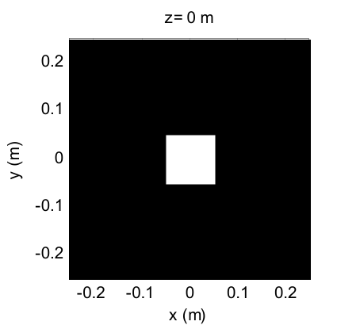
  <figcaption>图 5.1 sqr_beam 的源面辐照度(0.5 m 窗内 51 mm 方孔)(截自原书)</figcaption>
</figure>

接下来是真正传播的部分(上面代码的 `u2=propTF(...)` 起的 26 行)。观察面参数带下标 "2";第 24、25 行把观察面坐标设成与源面相同——这与 propTF 的工作方式一致。第 28–47 行显示观察面辐照度图像、辐照度剖面、场幅度与相位剖面。两个新函数:`num2str` 把传播距离写进标题;相位剖面用的 `unwrap` 见下面几段。

运行 sqr_beam,辐照度结果如图 5.2——相干光的相长/相消干涉(衍射所致)让某些峰的辐照度**超过源面初值 1**,峰之间夹着更低的谷;剖面图上还能看到光"展宽出翅膀",超出源矩形的初始宽度:

<figure>
  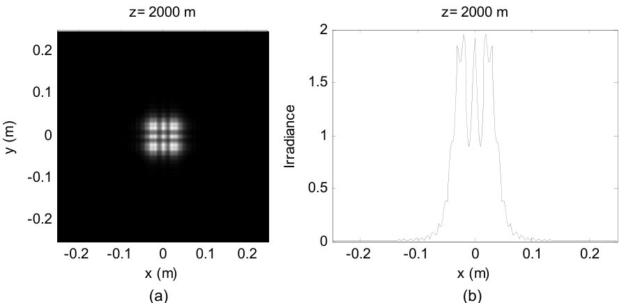
  <figcaption>图 5.2 观察面辐照度:(a) 图样;(b) x 轴剖面(中央峰 1.92、±0.02 侧峰 1.96、±0.01 谷 0.89)(截自原书)</figcaption>
</figure>

场的幅度与相位见图 5.3。相位单位是弧度。`unwrap` 的作用:相邻样本跳变超过 \(\pi\) 时加/减 \(2\pi\) 的整数倍,把模 \(2\pi\) 格式里"断崖式"的跳变接回去,让相位的底层形状显形——把 `unwrap` 去掉跑一遍就能看到模 \(2\pi\) 跳变的样子。

<figure>
  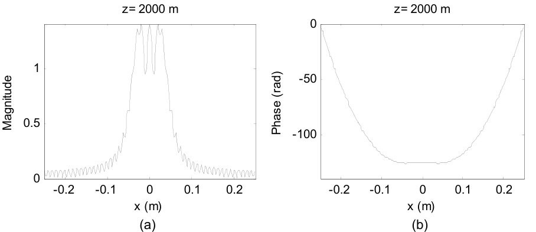
  <figcaption>图 5.3 观察面 (a) 幅度剖面与 (b) unwrap 相位剖面(截自原书)</figcaption>
</figure>

图 5.3(b) 的物理解读值得说透:它相当于观察面上**等相位面**的一个切片——即观察面上光波**波前(wavefront)**的形状。回忆第 4 章式 (4.6) 的时间相量 \(\exp(-j2\pi\nu t)\):随时间推移,相位变得越来越负。所以图 5.3(b) 这个"中心压平的碗形"波前,可以想象成随时间"向下"推进;再想象从波前表面沿法线投出光线,就能看出波前上能量往哪走。图 5.3(a) 显示场幅度集中在压平的中心附近,而相位说明这部分能量大部分仍沿垂直于观察面的方向前进。

最后把第 22 行换成 `u2=propIR(u1,L1,lambda,z)` 再跑一遍——结果应与图 5.2、5.3 **完全相同**(此时是临界采样,5.4 节解释为什么)。

Python 实测数值检查(\(L_1=0.5\) m、\(M=250\)、\(\Delta x_1=2\) mm、\(w=0.051\) m、\(z=2000\) m):

- 跨孔径样本数 \(2w/\Delta x_1 = 51\) ✓(书 5.3 节口算一致);
- \(N_F = w^2/(\lambda z) = 2.60\) ✓;
- TF 与 IR 的辐照度最大相对差 **\(3.2\times10^{-15}\)**——浮点误差级,临界采样下两传播器逐位相同(表 5.2 预告);
- 剖面结构:中央峰 \(I_2(0,0) = 1.916\)、\(\pm0.02\) m 处侧峰 1.958、\(\pm0.01\) m 处谷 0.889——图 5.2(b) 的"峰超过 1、谷夹在中间";
- 总功率源面 = 观察面 = 0.010404(功率守恒,习题 5.3 的诊断)。

## 5.4 菲涅耳传播采样

### 5.4.1 方形光束结果与 artifacts

现在说坏消息。源场的离散采样、传递函数/脉冲响应的采样、FFT 的周期性,都会在传播结果里制造各种 **artifacts(伪影)**。麻烦的根源:式 (5.2) 与 (5.4) 右边的 **chirp 函数不是带宽限定的(bandlimited),无法被完美采样**。

图 5.4 给出 sqr_beam 在 \(z = 1000\) 到 20,000 m 的 propTF 与 propIR 剖面对比:

- **z = 1000 m**:TF 结果合理,有相长/相消干涉特征、略超出孔径宽度的展宽;IR 结果出现**图案的周期副本**;
- **z = 2000 m**:TF 与 IR 本质相同;
- **z = 4000 m**:TF 剖面上出现 IR 没有的小"ticks"(尖刺);
- **z = 20,000 m**:TF 剖面呈"stair-step"(台阶状)——明显的 artifact;IR 光滑。长距离下夫琅禾费理论预言辐照度趋于 \(\mathrm{sinc}^2\) 形,图 5.4(h) 大体如此。

<figure>
  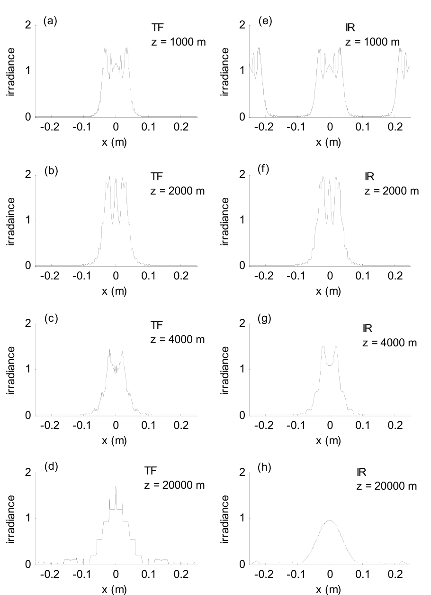
  <figcaption>图 5.4 TF 与 IR 传播的 x 轴辐照度剖面(z = 1000–20,000 m):(c)(d) 出现尖刺与台阶,(e) 出现周期副本,(h) 出现假旁瓣(截自原书)</figcaption>
</figure>

!!! warning "原书笔误"
    图 5.4 个别子图的 y 轴标签在原书 PDF 文本层里拼作 "irradaince",应为 **irradiance**。排版笔误,不影响内容。

对应的辐照度图样见图 5.5:

<figure>
  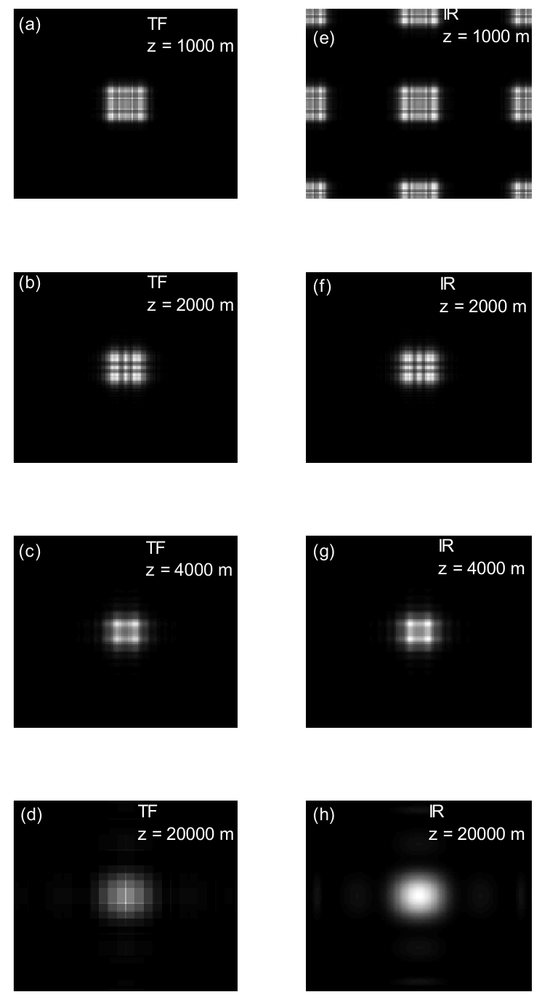
  <figcaption>图 5.5 与图 5.4 对应的辐照度图样(TF/IR × 四个距离)(截自原书)</figcaption>
</figure>

用本章 Python 复现同一组剖面(与图 5.4 对照,四类 artifacts 全部重现):

<figure>
  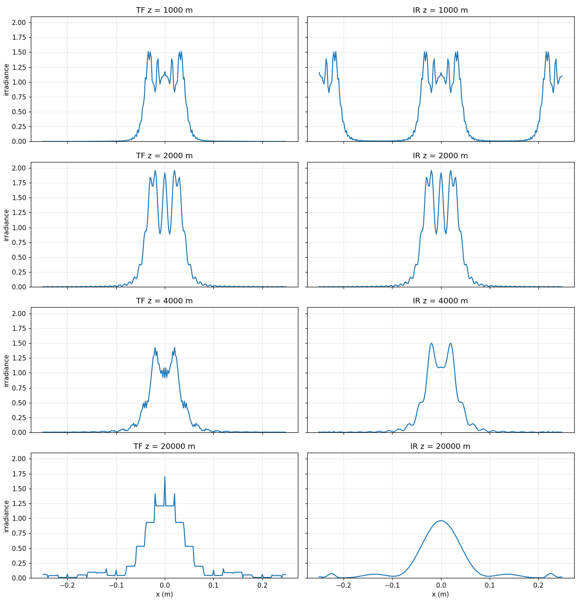
  <figcaption>图 5-P1 sqr_beam 的 TF/IR 剖面数值复现(参数同图 5.4):TF@4000 的 ticks、TF@20000 的 stair-step、IR@1000 的周期副本、IR@20000 的假旁瓣全部出现(笔记自制)</figcaption>
</figure>

### 5.4.2 采样 regime 与判据

图 5.4(c)–(e) 与 5.5(c)–(e) 的 artifacts 都是离散采样问题。本节给出**预测什么时候出问题**的判据(细节见原书附录 A 与本章参考文献 1、2)。

第一条最显然:源场的支撑(support)要"装得进"数值阵列。设 \(D_1\) 是源场的有效支撑(最大线宽),\(L\) 是阵列边长,通常要求

\[ D_1 < L. \tag{5.5} \]

实践中最好给源函数周围留"警戒区(guard area)",比如 \(L = 2D_1\) 或 \(3D_1\)——FFT 的周期延拓性质会让传播后的能量绕回阵列边缘,警戒区能减轻这种边缘 artifact。

再考虑对 \(H\) 与 \(h\) 里 chirp 函数采样(附录 A)的效果。\(H\) 的 chirp 是 \(\exp[-j\pi\lambda z(f_X^2+f_Y^2)]\),**充分采样(过采样)**的条件是

\[ \Delta x \geq \frac{\lambda z}{L}. \tag{5.6} \]

\(h\) 的 chirp 是 \(\exp\left[j\frac{k}{2z}(x^2+y^2)\right]\),过采样条件是

\[ \Delta x \leq \frac{\lambda z}{L}. \tag{5.7} \]

!!! note "拓展:两个判据为什么方向相反——一页纸推导"
    同一对傅里叶变换 \(H \leftrightarrow h\),过采样判据却一个"\(\geq\)"一个"\(\leq\)",初看很别扭。关键在于**两个 chirp 活在两个不同的网格上**:
    - \(H\) 的 chirp \(\exp(-j\pi\lambda z f^2)\) 定义在**频率网格**(间距 \(1/L\))上。相邻频率样本间的相位增量 \(\pi\lambda z[(f+1/L)^2-f^2] = \pi\lambda z(2f/L + 1/L^2)\) 随 \(f\) 增大,最坏在 Nyquist \(f = 1/(2\Delta x)\) 处。要它小于 \(\pi\)(每步相位不翻圈):\(\lambda z/\Delta x \lesssim L\)(附录 A 的严格推导补上端点修正后即 \(\Delta x \geq \lambda z/L\))。
    - \(h\) 的 chirp \(\exp(j\pi r^2/(\lambda z))\) 定义在**空间网格**(间距 \(\Delta x\))上。它的瞬时频率是 \(r/(\lambda z)\),在阵列边缘 \(r = L/2\) 处最大。局部采样定理要求最大瞬时频率不超过 Nyquist \(1/(2\Delta x)\):\(L/(2\lambda z) \leq 1/(2\Delta x)\),即 \(\Delta x \leq \lambda z/L\)。
    一句话:\(H\) 的判据是"频率网格上相位不翻圈",\(h\) 的判据是"空间网格上跟得上瞬时频率"——网格不同,不等号自然反向。判据违反时,相应 chirp 的**相位**出现混叠表示,进而产生仿真 artifacts。

式 (5.6) 与 (5.7) **同时**满足的条件是

\[ \Delta x = \frac{\lambda z}{L}, \tag{5.8} \]

书里称之为**临界采样(critical sampling)**条件。表 5.1 汇总了由 \(H\) 或 \(h\) 相位项的过/欠/临界采样定义的三种 regime,每种 regime 配一条涉及源场带宽 \(B_1\) 的判据:

| Regime | chirp 相位采样 | 源带宽判据 | 方案 | 说明 |
| --- | --- | --- | --- | --- |
| \(\Delta x > \lambda z/L\) | TF:过 / IR:欠 | \(B_1 < \frac{1}{2\Delta x}\) | TF 更优;IR 产生周期副本 | 相对"短"的 z 或小 λ;观察面受限:TF 可准确表示的观察面全宽约 \(D_1 + \lambda z/\Delta x\) |
| \(\Delta x = \lambda z/L\) | TF:临界 / IR:临界 | \(B_1 < \frac{1}{2\Delta x}\) 或 \(B_1 < \frac{L}{2\lambda z}\) | TF 与 IR 全同 | 阵列空间与带宽的分配都吃满 |
| \(\Delta x < \lambda z/L\) | TF:欠 / IR:过 | \(B_1 < \frac{L}{2\lambda z}\) | TF:带宽判据基本满足时可用;IR:带宽判据被违反时反而可能更好 | 相对"长"的 z 或大 λ;源带宽受限 |

表:表 5.1 传播器采样 regime 与判据(注:Δx 采样间隔;B1 源带宽;λ 波长;D1 源面场支撑;z 传播距离)

实际中表 5.1 的源带宽判据**永远不会严格满足**——2.2 节说过,有限支撑的场必然带宽无限。所以判据里的 \(B_1\) 要理解成**有效带宽**。三条 regime 的补充说明:

- **(a) \(\Delta x > \lambda z/L\):"短距离" regime。** 观察面的可用尺寸受限:TF 方法能准确表示的观察面场全宽约 \(D_1 + \lambda z/\Delta x\)(附录 A)。这通常不碍事——观察面场在这个宽度之外往往可以忽略——所以 TF 方法在此 regime 一般给出好结果。欠采样的 IR 相位函数是混叠的周期相位表示,用它会产生场的周期副本。源带宽 \(B_1\) 只受源平面常规采样定理的限制。
- **(b) \(\Delta x = \lambda z/L\):临界采样。** 神奇的是,此时采样的 \(H\) 与 \(h\) 作为一对 FFT,其数值**恰好等于解析的 \(H\) 与 \(h\)**(附录 A)。这个条件下,阵列的全带宽(\(1/2\Delta x\))都可用来建模源,观察面也可用全部阵列面积。
- **(c) \(\Delta x < \lambda z/L\):"长距离" regime。** 源场可用的带宽受限。\(H\) 的 chirp 相位混叠,源带宽只要明显超出 \(L/(2\lambda z)\),TF 方法就会出 artifacts。IR 方法实际上相当于对 \(L/(2\lambda z)\) 以外的源频率内容做**窗口化(滤波)**——结果更"平滑",但不总准确。

### 5.4.3 判据用于 square beam 例子

5.3 节的源场是

\[ U_1(x,y) = \mathrm{rect}\left(\frac{x}{2w}\right)\mathrm{rect}\left(\frac{y}{2w}\right), \tag{5.9} \]

\(w = 0.051\) m。源支撑 \(D_1 = 2w = 0.102\) m,轻松装进 \(L = 0.5\) m(图 5.1)。按 2.2 节的思路,有效带宽的合理估计是

\[ B_1 = \frac{5.98}{w} = 117.3\ \text{cycles/m}. \tag{5.10} \]

!!! note "拓展:B1 = 5.98/w 的数值复核"
    式 (5.10) 沿用 2.2 节式 (2.10) 的方法:谱功率 \(|F|^2 = (4w^2)^2\mathrm{sinc}^2(2wf_X)\mathrm{sinc}^2(2wf_Y)\) 在**半径 B 的圆盘**内占全功率的比例达到 98%(2D 极坐标径向积分)。数值积分(本章脚本 `ch5_sampling.py`)给出:精确 98% 半径对应 \(2wB = 8.19\),即 \(B_{98\%} \approx 4.1/w \approx 80\) cyc/m;而 \(5.98/w = 117.3\) cyc/m 对应径向占比约 **98.8%**。也就是说书的系数取得偏保守(多收约 0.8% 的谱功率),方向上更安全;这也解释了 2.2 节的圆整值 \(B \approx 5/w\) 与本章 \(5.98/w\) 的出入——\(B_1\) 本来就是个估计量,书 5.4.5 节干脆承认调参是"something of an art form"。

表 5.2 列出 sqr_beam 四个传播距离的采样信息:

| z (m) | \(\lambda z/(L\Delta x)\) | TF(\(H\))采样 | IR(\(h\))采样 | 可用观察面尺寸 (m) | 源带宽限制 (cyc/m) |
| --- | --- | --- | --- | --- | --- |
| 1000 | 0.5 | 过 | 欠 | \(D_1+\lambda z/\Delta x = 0.352\) | \(1/2\Delta x = 250\) |
| 2000 | 1 | 临界 | 临界 | \(L = 0.5\) | \(1/2\Delta x = 250\) |
| 4000 | 2 | 欠 | 过 | \(L = 0.5\) | \(L/2\lambda z = 125\) |
| 20,000 | 10 | 欠 | 过 | \(L = 0.5\) | \(L/2\lambda z = 25\) |

表:表 5.2 sqr_beam 例子的采样 regime(注:Δx = 2 mm;L = 0.5 m;λ = 0.5 μm;N = 250;D1 = 0.102 m)

对照表 5.2 与图 5.4,可以逐条解释观察到的一切:

- **(a) z = 1000 m**:\(H\) 相对临界过采样 2 倍。观察面尺寸限制对 TF 结果影响可忽略[图 5.4(a)],因为场最重要的部分落在 \(D_1+\lambda z/\Delta x = 0.352\) m 内。IR 方法引入相隔 \(\lambda z/\Delta x\) 的周期副本[图 5.4(e)]。
- **(b) z = 2000 m**:临界采样,TF 与 IR 结果相同[图 5.4(b)(f)]。
- **(c) z = 4000 m**:\(H\) 欠采样 2 倍。传播可用的源带宽限制 125 cyc/m,略大于源有效带宽 \(B_1\)——大部分重要源谱都满足判据,但小 ticks 还是爬进了 TF 结果[图 5.4(c)];IR 结果[图 5.4(g)]看不到明显 artifacts。
- **(d) z = 20,000 m**:\(H\) 欠采样 10 倍。可用带宽 25 cyc/m 只有 \(B_1\) 的四分之一,TF 出现严重 stair-step[图 5.4(d)];IR 压掉可用带宽之外的源频率分量,结果更平滑,但阵列边缘出现小的假旁瓣[图 5.4(h)]。

!!! warning "原书笔误"
    5.4.3(a) 段原书把 negligible 拼作 "negligable"。拼写笔误,不影响内容。

### 5.4.4 传播器精度

sqr_beam 的传播器结果离解析菲涅耳解有多近?书挑了三个"看起来合理"的案例:TF @ 1000 m、TF @ 2000 m、IR @ 20,000 m。方孔有解析结果可用(引 Goodman):

\[ U_2(x,y) = \frac{e^{jkz}}{2j}\Big\{\big[C(\xi_1)-C(\xi_2)\big] + j\big[S(\xi_1)-S(\xi_2)\big]\Big\}\Big\{\big[C(\eta_1)-C(\eta_2)\big] + j\big[S(\eta_1)-S(\eta_2)\big]\Big\}, \tag{5.11} \]

其中 \(C\) 与 \(S\) 是**菲涅耳积分(Fresnel integrals)**:

\[ C(\chi) = \int_0^\chi \cos\left(\frac{\pi t^2}{2}\right)dt, \qquad S(\chi) = \int_0^\chi \sin\left(\frac{\pi t^2}{2}\right)dt, \tag{5.12} \]

且

\[ \xi_1(x) = \sqrt{\frac{2}{\lambda z}}\,(-w-x), \quad \xi_2(x) = \sqrt{\frac{2}{\lambda z}}\,(w-x), \quad \eta_1(y) = \sqrt{\frac{2}{\lambda z}}\,(-w-y), \quad \eta_2(y) = \sqrt{\frac{2}{\lambda z}}\,(w-y). \tag{5.13} \]

!!! note "拓展:式 (5.11) 的来历与常数因子"
    从式 (4.25) 的 FT 形式出发:对 \(\mathrm{rect}(\xi/2w)\) 一维配方 \(\frac{\pi\xi^2}{\lambda z} - \frac{2\pi x\xi}{\lambda z} = \frac{\pi(\xi-x)^2}{\lambda z} - \frac{\pi x^2}{\lambda z}\),换元 \(t = \sqrt{2/(\lambda z)}(\xi - x)\) 后积分变成菲涅耳积分的差;二维两个一维因子相乘,前导 \(e^{jkz}/(j\lambda z)\) 的 \(e^{j\pi(x^2+y^2)/(\lambda z)}\) 恰好与配方产生的 \(e^{-j\pi(x^2+y^2)/(\lambda z)}\) 相消,剩下 \(\frac{e^{jkz}}{j\lambda z}\cdot\frac{\lambda z}{2} = \frac{e^{jkz}}{2j}\)——这就是式 (5.11) 的常数。中心值验证:\(I_2(0,0) = 4\big[C^2(T)+S^2(T)\big]^2\),\(T = \sqrt{2/(\lambda z)}\,w = 2.281\),解析值 1.895,数值传播给 1.916(差 1%,方孔边缘混叠所致)。**本式已与 propTF/propIR 数值结果逐点对拍**(见下),包括相位。

书在三个参数组合下评估式 (5.11),只看 x 轴剖面(\(y=0\)),并且用 **2500 个点**评估(仿真是 250 点)——采样率更高,能看出传播器是否丢了空间细节。\(C\)、\(S\) 用菲涅耳积分程序计算:MATLAB 符号数学工具箱(Symbolic Math Toolbox,学生版自带)有 `mfun('FresnelC',x)` 与 `mfun('FresnelS',x)`,网上也有共享的菲涅耳积分程序。

对比结果见图 5.6:传播器剖面画实线,解析结果画虚线,总体一致性很好。幅度用 **log 尺度**画,以放大剖面两翼的小差异。三条评注:

- **(a) TF,z = 1000 m**:幅度剖面的主要特征吻合[图 5.6(a)],但传播器结果的两翼被"磨平"(高频振荡的翅膀是解析结果);相位剖面[图 5.6(b)]几乎全同,只有阵列边缘处传播器相位略微滞后。\(D_1+\lambda z/\Delta x = 0.352\) m 约等于幅度曲线在传播器翅膀骤然跌破解析曲线之前的表观宽度。总体相当准确,主要偏差在两翼,无关紧要。
- **(b) TF,z = 2000 m**:传播器幅度曲线与解析几乎全同[图 5.6(c)],周期延拓强迫阵列边缘略有抬升(图上很难看出来);相位剖面[图 5.6(d)]本质相同。临界采样带来与解析结果的极度吻合。
- **(c) IR,z = 20,000 m**:长距案例,IR 幅度[图 5.6(e)]跟随解析结果,但阵列边缘附近出现假旁瓣;相位[图 5.6(f)]两翼也有误差。重新调整采样参数可以更好,但这个辐照度图样凑合能用。

<figure>
  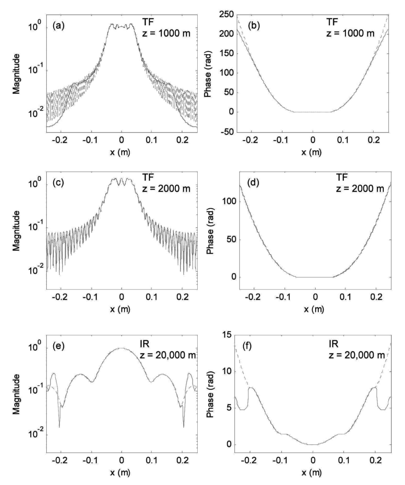
  <figcaption>图 5.6 TF 与 IR(z = 1000、2000、20,000 m)的幅度与相位剖面(实线),虚线为对应解析结果(截自原书)</figcaption>
</figure>

本章 Python 复现同一组对比(解析式 (5.11) 用 2500 点细网格评估,scipy 的 `fresnel` 函数计算 \(C,S\)),并给出主体区(\(|x| \le L/4\))的定量偏差:

<figure>
  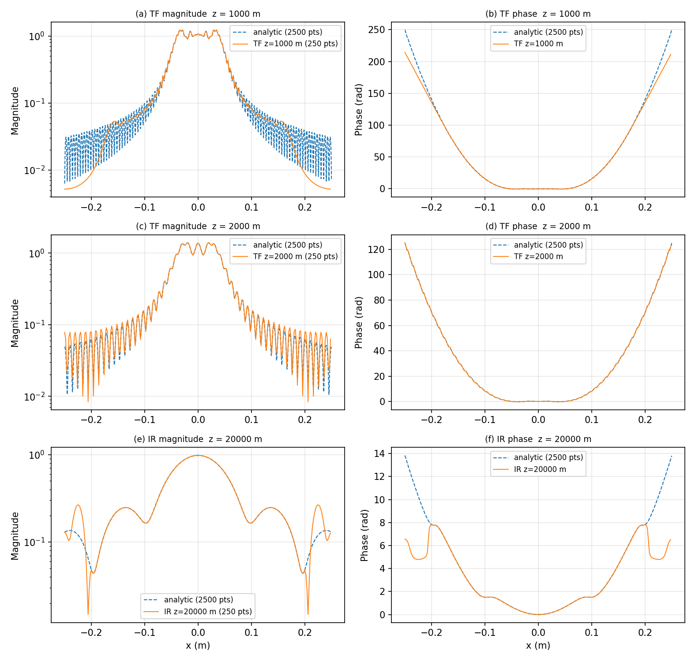
  <figcaption>图 5-P2 式 (5.11) 解析(2500 点,虚线)vs 数值传播(250 点,实线):左列 log 幅度、右列 unwrap 相位。TF@2000 临界采样几乎逐点重合;TF@1000 两翼被磨平;IR@20000 边缘假旁瓣与相位误差清晰可见(笔记自制,复现原书图 5.6 布局)</figcaption>
</figure>

| 案例 | 主体区 max 相位差 | 主体区 max 幅度相对差 |
| --- | --- | --- |
| TF @ z = 1000 m | 0.40 rad | 2.7% |
| TF @ z = 2000 m | 0.082 rad | 0.8% |
| IR @ z = 20,000 m | 0.0006 rad | 0.02% |

结论与书一致:**临界采样(TF@2000)极度吻合;"可用"案例(TF@1000、IR@20000)的主体区也准,偏差集中在两翼/边缘**——那里正是采样判据管不到的地方。

### 5.4.5 采样决策

表 5.3 汇总设计一个传播仿真的建议步骤:

| 步骤 | 内容 |
| --- | --- |
| (1) | 考虑源支撑:\(D_1 < L\) 有 2–3 倍裕量吗? |
| (2) | 确定采样 regime(表 5.1):\(\Delta x > \lambda z/L\) → TF 通常够用,牺牲一点观察面支撑;\(\Delta x = \lambda z/L\) → 临界采样,TF,带宽与空间支撑都吃满;\(\Delta x < \lambda z/L\) → IR,牺牲源带宽,小心 artifacts |
| (3) | 对照表 5.1 检查源带宽判据 |
| (4) | 按带宽判据与 artifacts 重新考虑源采样 |

表:表 5.3 传播仿真设计步骤

有限支撑的场不可能带宽限,所以表 5.1 的带宽判据永远无法严格满足——但它们仍能帮你找到合理的仿真参数。只是实际操作往往变成"某种艺术":来回调采样与场的参数,直到结果满意。

临界采样能让阵列边长与带宽的利用都最大化,尽量用它是对的。但维持这个条件可能不方便:把 \(\Delta x = \lambda z/L\) 改写成样本数的形式

\[ z = \frac{L^2}{M\lambda}, \qquad M = \frac{L^2}{\lambda z}, \tag{5.14} \]

它用"跨阵列边长的样本数"定义了临界判据。给定场景下,临界条件可能要求太多样本(FFT 算不动),也可能太少(源面或观察面采不够)。别的需求还会跟临界判据打架——比如模拟大气湍流传播用的相位屏,有自己的一套采样间隔与阵列尺寸要求(参考文献 2、4)。判据总可以靠**插值或抽取**维持,但额外步骤增加复杂度和运行时间,而且未必解决样本太多/太少的实际问题。

实践中表 5.3 的第 3 步常常不那么直接——源的有效带宽未必好估。最省事的办法:对采样参数做"有根据的猜测",跑几个试验仿真看结果。出现 stair-step 或假旁瓣之类的 artifact 迹象(图 5.4、5.5 那样),就得回头细查采样参数。

### 5.4.6 分步仿真、加窗与扩展网格

有人会想:"嘿,等等!把长距离传播拆成一连串更短的、每步都满足 \(\Delta x \geq \lambda z/L\) 的 TF 传播,不就行了?"——可惜,**结果与单次 TF 传播完全一样**。因为一连串 TF 传播等价于把各段传递函数**相乘**后作用到初始场:比如把 \(z_N\) 拆成若干短距离,容易证明

\[ H(f_X,f_Y; z_1)\,H(f_X,f_Y; z_2)\cdots H(f_X,f_Y; z_{N-1}) = H(f_X,f_Y; z_1+z_2+\cdots+z_N), \tag{5.15} \]

其中各 \(z\) 参数按式 (5.2) 理解。所以即使每段短传播都是临界采样,最终结果仍与一次传播相同!**起作用的是总传播距离。**不过 split-step(分步)仿真在很多场景依然必用——比如要在传播路径中穿插一系列大气湍流相位屏。

!!! note "拓展:功率守恒给"拆步无用"提供一个漂亮的旁证"
    习题 5.3 的功率诊断(本章 Python 实测,sqr_beam 参数):TF 在 z = 1000/2000/4000/20,000 m 的观察面/源面功率比全部为 **1.00000**(能量只在阵列内重新分布);IR@2000(临界)也是 1.00000;而 **IR@1000 = 4.00000**——欠采样 chirp 的周期副本把图案复制了 \(2\times2 = 4\) 份进观察窗,功率也正好 ×4;IR@20,000 = 0.94992——窗口滤波压掉了 5% 的源频谱功率。功率比是采样 regime 的"免费体检表":比值明显偏离 1,先查采样,再查代码。

前面说过,IR 方法在长距离例子中表现更好,是因为它有效压制了 chirp 变坏处的源频率内容。IR 主要就是给"快速粗略地够到更长传播距离"准备的。但也有别的办法:激光传播仿真领域的研究者还会用**窗函数(window)**——要么压制源谱,要么削掉源场两翼的能量——与多步传播结合,能得到好结果。这个主题 Schmidt(参考文献 2)讲得更细。

如果仿真在源面或观察面有固定参数,单一边长与采样间隔无法同时伺候两个平面,那就需要独立选择源面与观察面的物理边长——**两步法(two-step method)**允许源面与观察面边长不同(描述与分析见附录 B)。它仍受 TF 方法那些采样限制,但给仿真设计提供了灵活性。

## 5.5 夫琅禾费传播

夫琅禾费图样的表达式重抄一遍(源面变量换下标 1、观察面下标 2,方便编程):

\[ U_2(x,y) = \frac{\exp(jkz)}{j\lambda z}\exp\left[j\frac{k}{2z}(x^2+y^2)\right]\iint U_1(x_1,y_1)\exp\left[-j\frac{2\pi}{\lambda z}(x x_1 + y y_1)\right]dx_1\,dy_1, \tag{5.16} \]

用 FFT 计算夫琅禾费场时,源面与观察面的边长**一般不同**。由式 (4.31),

\[ x_2 = \lambda z f_{X1}, \tag{5.17} \]

再用式 (2.17),观察面边长与采样间隔可用源面参数表示:

\[ L_2 = \frac{\lambda z}{\Delta x_1}, \qquad \Delta x_2 = \frac{\lambda z}{L_1}. \tag{5.18} \]

于是观察面坐标为

\[ x_2 = -\frac{L_2}{2}:\Delta x_2:\frac{L_2}{2}-\Delta x_2 = -\frac{\lambda z}{2\Delta x_1}:\frac{\lambda z}{L_1}:\frac{\lambda z}{2\Delta x_1}-\frac{\lambda z}{L_1}. \tag{5.19} \]

如果用临界采样(\(\Delta x_1 = \lambda z/L_1\)),式 (5.18) 表明两边长相等(\(L_2 = L_1\));否则不同。计算夫琅禾费图样的函数 **propFF** 如下:

=== "MATLAB"

    ```matlab
    function[u2,L2]=propFF(u1,L1,lambda,z);
    % ===== 书 5.5 节:夫琅禾费传播器(逐行忠实 + 中文注释) =====
    % 书 5.5 节 New M-file(命名为 "propFF")建立的函数(原书第 1-22 行):
    %   11 [M,N]=size(u1);           %get input field array size
    %   12 dx1=L1/M;                 %source sample interval
    %   13 k=2*pi/lambda;            %wavenumber
    %   15 L2=lambda*z/dx1;          %obs sidelength
    %   16 dx2=lambda*z/L1;          %obs sample interval
    %   17 x2=-L2/2:dx2:L2/2-dx2;    %obs coords
    %   18 [X2,Y2]=meshgrid(x2,x2);
    %   20 c=1/(j*lambda*z)*exp(j*k/(2*z)*(X2.^2+Y2.^2));
    %   21 u2=c.*ifftshift(fft2(fftshift(u1)))*dx1^2;
    %   22 end
    % 要点:
    %   - 观察面参数由式 (5.18) 决定:L2 = lambda*z/dx1、dx2 = lambda*z/L1
    %     ——源面与观察面边长一般不同!函数额外输出 L2,省得主脚本重算
    %     (书原话)。
    %   - 若临界采样(dx1 = lambda*z/L1),则 L2 = L1;否则两边长不同。
    %   - 第 21 行:fftshift(u1) 移位 -> fft2 -> ifftshift 移回居中,
    %     再乘前导因子 c 与定标 dx1^2(连续 FT 的 DFT 近似,书 2.3 节)。
    %   - 只关心辐照度时前导相位因子 e^{jkz} 与 chirp c 都可以丢(书 5.5 节
    %     末尾);但要注意 chirp 的采样条件(式 (5.23))。
    % MATLAB/Python 差异:Python 版在 python/fourier/ch5/ch5_prop.py 的
    %   propFF(返回 (u2, L2) 元组)。
    % ------------- 以下为书原代码(第 1-22 行) -------------
    % propagation - Fraunhofer pattern
    % assumes uniform sampling
    % u1 - source plane field
    % L1 - source plane side length
    % lambda - wavelength
    % z - propagation distance
    % L2 - observation plane side length
    % u2 - observation plane field

    [M,N]=size(u1);           %get input field array size
    dx1=L1/M;                 %source sample interval
    k=2*pi/lambda;            %wavenumber

    L2=lambda*z/dx1;          %obs sidelength
    dx2=lambda*z/L1;          %obs sample interval
    x2=-L2/2:dx2:L2/2-dx2;    %obs coords
    [X2,Y2]=meshgrid(x2,x2);

    c=1/(j*lambda*z)*exp(j*k/(2*z)*(X2.^2+Y2.^2));
    u2=c.*ifftshift(fft2(fftshift(u1)))*dx1^2;
    end
    ```

=== "Python"

    ```python
    # ===== 书 5.5 节:propFF(与 matlab/fourier/ch5/propFF.m 逐行对应) =====
    def propFF(u1, L1, lam, z):
        """propagation - Fraunhofer pattern(书 5.5 节,式 5.16-5.19)。

        观察面边长与采样间隔由源面参数决定(式 5.18):
            L2  = lam*z/dx1,   dx2 = lam*z/L1
        所以函数额外返回 L2,省得主脚本再算一遍(书原话)。
        """
        M, N = u1.shape                                   # 书 11 行
        dx1 = L1 / M                                      # 书 12 行:源面采样间隔
        k = 2 * np.pi / lam                               # 书 13 行
        L2 = lam * z / dx1                                # 书 15 行:观察面边长
        dx2 = lam * z / L1                                # 书 16 行:观察面采样间隔
        x2, _ = coords(L2, M)                             # 书 17 行:观察面坐标(居中,与书式 5.19 一致)
        X2, Y2 = np.meshgrid(x2, x2)                      # 书 18 行
        c = 1 / (1j * lam * z) * np.exp(1j * k / (2 * z) * (X2 ** 2 + Y2 ** 2))  # 书 20 行:前导因子
        u2 = c * np.fft.ifftshift(np.fft.fft2(np.fft.fftshift(u1))) * dx1 ** 2   # 书 21 行
        return u2, L2
    ```

函数把观察面边长 \(L_2\) 也作为输出,主脚本就不用再算一遍。试验方法:在 sqr_beam 里做如下改动,Save As 成 **sqr_beam_FF**:

```matlab
w=0.011;              %source half width (m)

[u2,L2]=propFF(u1,L1,lambda,z);

dx2=L2/M;
x2=-L2/2:dx2:L2/2-dx2; %obs coords
y2=x2;

imagesc(x2,y2,nthroot(I2,3)); %stretch image contrast
```

!!! warning "原书省略"
    书的改动清单里 `imagesc` 直接用了 `I2`,但没有列出 `I2=abs(u2.^2);` 这一行——运行前需要自己补上(完整脚本见 `matlab/fourier/ch5/sqr_beam_FF.m`)。另外该处注释 "obs ords" 应为 "obs coords",属排版小疵。

源半宽 \(w = 0.011\) m、\(z = 2000\) m,给出菲涅耳数 0.12——夫琅禾费近似合理。运行 sqr_beam_FF 得到图 5.7 的辐照度结果;用 `nthroot` 拉伸对比度把旁瓣显出来:

<figure>
  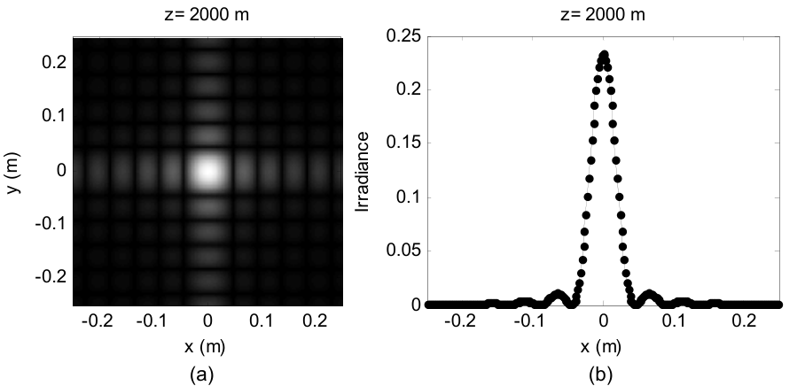
  <figcaption>图 5.7 夫琅禾费辐照度:(a) 图样(\(I_2^{1/3}\) 拉伸);(b) x 剖面,散点为解析值(截自原书)</figcaption>
</figure>

仿真结果可以对照解析夫琅禾费结果检查。先取源分布的傅里叶变换(表 1.3):

\[ \mathfrak{F}\left\{\mathrm{rect}\left(\frac{x_1}{2w}\right)\mathrm{rect}\left(\frac{y_1}{2w}\right)\right\} = 4w^2\,\mathrm{sinc}(2wf_{X1})\,\mathrm{sinc}(2wf_{Y1}). \tag{5.20} \]

代入 \(f_{X1} = x_2/\lambda z\)、\(f_{Y1} = y_2/\lambda z\),再乘上各前导因子,得到夫琅禾费场:

\[ U_2(x_2,y_2) = \frac{\exp(jkz)}{j\lambda z}\exp\left[j\frac{k}{2z}(x_2^2+y_2^2)\right]\times 4w^2\,\mathrm{sinc}\left(\frac{2wx_2}{\lambda z}\right)\mathrm{sinc}\left(\frac{2wy_2}{\lambda z}\right). \tag{5.21} \]

辐照度 \(I_2(x_2,y_2) = U_2(x_2,y_2)U_2^*(x_2,y_2)\):

\[ I_2(x_2,y_2) = \left(\frac{4w^2}{\lambda z}\right)^2\mathrm{sinc}^2\left(\frac{2wx_2}{\lambda z}\right)\mathrm{sinc}^2\left(\frac{2wy_2}{\lambda z}\right). \tag{5.22} \]

解析函数的点也画在图 5.7(b) 里。现在轮到你:把式 (5.22) 插进脚本,看能不能复现图 5.7(b)。

通常算夫琅禾费图样关心的是辐照度,前面的复指数都消失了——这种情况下唯一要操心的是常规源面采样条件 \(B_1 < 1/2\Delta x_1\)。但假如你需要**带 chirp 项的夫琅禾费场**:按式 (5.7) 的逻辑,观察面 chirp \(\exp\left[j\frac{k}{2z}(x_2^2+y_2^2)\right]\) 充分采样的条件是 \(\Delta x_2 \leq \lambda z/L_2\),用式 (5.18) 换算回源面就是

\[ \Delta x_1 \geq \frac{\lambda z}{L_1}. \tag{5.23} \]

若式 (5.23) 不满足,接到变换前面的 chirp 相位会混叠。再结合菲涅耳数(夫琅禾费 regime 要求 \(N_F = w^2/\lambda z \ll 1\))与式 (5.23),可得

\[ \Delta x_1 \gg \frac{w^2}{L_1}, \qquad\text{或}\qquad M \gg \left(\frac{w}{\Delta x_1}\right)^2, \tag{5.24} \]

即网格样本数 M 要远大于"跨源孔径半径的样本数(\(w/\Delta x_1\))"的**平方**——意味着很大的 M。幸运的是,夫琅禾费相位通常不需要。

Python 实测(\(w=0.011\) m、\(z=2000\) m、\(L_2 = 0.5\) m、\(\Delta x_2 = 2\) mm,本例恰为临界采样):

- \(N_F = 0.121\)(书 0.12);
- \(I_2\) 峰值:解析 \((4w^2/\lambda z)^2 = 0.2343\),实测 **0.2343**(逐位一致);
- \(\mathrm{sinc}\) 第一零点 \(x = \lambda z/(2w) = 0.0455\) m,实测最近样本 0.0460 m;
- 第一旁瓣解析 \(0.045\times I_{2\max} = 0.0105\),实测 0.0117(网格粗采样下的旁瓣峰);
- 总功率源面 = 观察面 = \(4.84\times10^{-4}\)(FFT 定标 \(\mathrm{d}x_1^2\) 与 \(\mathrm{d}x_2^2\) 各自正确)。

## 5.6 编码效率

本章(以及全书)的函数和脚本在某些方面是**为了易用和展示而牺牲效率**的。比如 sqr_beam 用 meshgrid 定义采样坐标,传播函数里又重新定义一遍——函数好用,但冗余。

本书例子里速度和效率不是大问题,但如果要跑传播代码的多次迭代,就得注意了。MATLAB 提供两个调码工具:

- **M-Lint**:检查编辑器里代码的潜在问题。MATLAB Desktop 工具栏 Tools → Check Code with M-Lint,会列出发现的潜在问题。
- **Profiler**:跟踪代码里各语句与函数调用的执行时间,帮助定位问题、提升效率。Desktop 工具栏 Tools → Open Profiler,把要分析的文件填进 "Run this code:" 旁的菜单框,点 Start Profiling;运行结束后 Profile Summary 窗口给出执行时间分解。

Python 侧的对应物:`python -m cProfile -s cumulative 脚本.py` 看各函数耗时,`timeit` 做微基准;numpy 向量化本身就是最大的提效手段(避免逐元素 Python 循环)。

## 5.7 习题(原书)

原书 9 道题。每题给题目与提示,本章做过数值的题附 Python 实测结果——先自己动手。

**5.1 圆孔 + 临界采样**:半径 \(w = 0.05\) m 的圆孔,平面波照明,\(\lambda = 0.5\ \mu\text{m}\),传播距离 1000 m,仿真阵列 500 × 500 样本,按菲涅耳传播的临界采样设计。(a) 求 \(L_1\)、\(\Delta x\) 与 Nyquist 频率 \(F_N\)。(b) 确定源有效带宽 \(B_1\)。\(B_1 < F_N\) 吗?跨圆函数直径有多少样本?(c) 求菲涅耳数。传播距离在菲涅耳区内吗?(d) 用 (a) 的 \(L_1\),对 z = 500、1000、2000 m 做菲涅耳传播,TF 与 IR 都试。

??? note "5.1 参考答案要点(Python 实测)"
    临界采样要求 \(\Delta x = L_1/M = \lambda z/L_1\),解出 \(L_1 = \sqrt{M\lambda z} = \sqrt{500\times0.5\times10^{-6}\times1000} = 0.5\) m,\(\Delta x = 1\) mm,\(F_N = 1/(2\Delta x) = 500\) cyc/m。\(B_1 = 5.98/w = 119.6 < 500\) ✓;跨直径 \(2w/\Delta x = 100\) 样本。\(N_F = w^2/\lambda z = 5\)(\(N_F = 1\) 对应 \(z = 5000\) m)——z = 1000 m 处 \(N_F > 1\),处于菲涅耳区(圆孔是平滑孔径,式 (4.28) 的 \(N_F \gtrsim 1\) 口径即可用)。离散圆盘功率 0.007825 vs 解析 \(\pi w^2 = 0.007854\)(100 样本跨直径的圆盘近似)。z = 500/1000/2000 m 对应 \(\lambda z/(L\Delta x) = 0.5/1/2\):TF 过采样、临界、欠采样——只有 1000 m 时 TF 与 IR 一致。

<figure>
  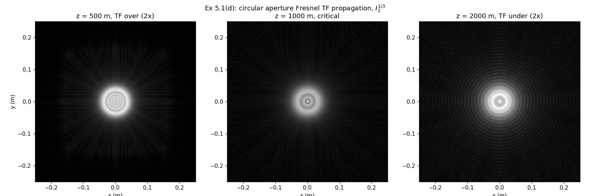
  <figcaption>图 5-P3 习题 5.1(d):圆孔菲涅耳 TF 传播(\(I_2^{1/3}\)),z = 500/1000/2000 m 对应 TF 过/临界/欠采样(笔记自制)</figcaption>
</figure>

**5.2 三个孔径的菲涅耳传播**:回到习题 4.4 的三个孔径,用 500 × 500 阵列仿真菲涅耳传播:孔径 (a) \(L_1 = 2\) mm,z = 0.5、1、5 cm;孔径 (b) \(L_1 = 2.5\) cm,z = 0.5、2、5 m;孔径 (c) \(L_1 = 2.5\) cm,z = 0.5、2、5 m。哪些 z 给出临界采样?

??? note "5.2 提示"
    临界采样距离一律用式 (5.14):\(z = L_1^2/(M\lambda)\)。代入 \(M = 500\)、\(\lambda = 0.633\ \mu\text{m}\):(a) \(L_1 = 2\) mm → \(z_{crit} \approx 1.26\) cm(三档 0.5/1/5 cm 都不是,最接近 1 cm);(b)(c) \(L_1 = 2.5\) cm → \(z_{crit} \approx 0.20\) m(三档 0.5/2/5 m 全都超过临界 → TF 欠采样/IR 过采样 regime)。注意 \(\lambda\) 取值:习题 4.4 用 0.633 μm;若沿用本章例子的 0.5 μm 需重算。

**5.3 功率守恒诊断**:传播仿真的一个有用诊断是计算源面与观察面的功率。假设没有吸收或散射(本书仿真都成立),功率(正比于瓦特)应当守恒——源面与观察面应含相同光功率,否则可能有代码错误或采样问题。功率是积分辐照度:

\[ P = \iint I(x,y)\,dx\,dy. \tag{5.25} \]

对本章 sqr_beam 例子:(a) 加代码用 `sum` 计算源面与观察面功率(各传播案例)。要不要套两层 sum?dx 与 dy 怎么办?可以把功率计算行末的分号去掉,让数值在执行时显示到命令窗口。(b) 某些案例的源/观察面功率有出入吗?

??? note "5.3 参考答案要点(Python 实测)"
    两层 `sum(sum(I))*dx^2`(dx = dy)。实测(源面功率 0.010404):

    | z (m) | \(P_{TF}/P_1\) | \(P_{IR}/P_1\) |
    | --- | --- | --- |
    | 1000 | 1.00000 | **4.00000** |
    | 2000 | 1.00000 | 1.00000 |
    | 4000 | 1.00000 | 0.99101 |
    | 20,000 | 1.00000 | 0.94992 |

    TF 各距离功率守恒(幅度 \(|H|=1\),只有混叠级别的误差);IR@1000 的周期副本把图案复制 \(2\times2\) 份进观察窗,功率恰好 ×4;IR@20,000 的窗口滤波压掉约 5% 功率。所以答案是:**有出入,出入全部来自 IR 的非临界采样案例,而且大小正好能被采样判据解释**——这正是书把这题放在本章的用意。

**5.4 Rayleigh–Sommerfeld 衍射**:菲涅耳衍射带傍轴(小光线角)假设,限制最小传播距离;Rayleigh–Sommerfeld 衍射则在所有距离上基本精确。(a) 基于菲涅耳传播例程,写出 RS 衍射的传递函数与脉冲响应传播器。(b) 用 sqr_beam 例子在 z = 1000、2000、4000、20,000 m 检验。菲涅耳与 RS 结果有差别吗?(c) 计算 sqr_beam 例子的菲涅耳数。关于菲涅耳 vs RS 的取舍能说什么?

??? note "5.4 提示"
    RS 传递函数把式 (4.19) 直接搬进 propTF 的框架:\(H_{RS}(f_X,f_Y) = \exp\{jkz\sqrt{1-(\lambda f_X)^2-(\lambda f_Y)^2}\}\)(传播波区);RS 脉冲响应用式 (4.15):\(h = \frac{z}{j\lambda}\frac{e^{jkr}}{r^2}\),\(r = \sqrt{z^2+x^2+y^2}\),照 propIR 的骨架实现(注意 h 在阵列边缘处 \(r\) 大、振幅小,采样压力比菲涅耳 chirp 小)。sqr_beam 的 \(N_F\) = 1.3(1000 m)、2.6(2000 m)、5.2(4000 m)、26(20,000 m)——衍射角 ~ λ/w ~ 10 μrad,全程极傍轴,菲涅耳与 RS 的差别应在数值噪声级;真正会拉开差距的是大 NA 孔径或极近距传播。

**5.5 高斯光束**:傅里叶方法非常适合仿真激光光束传播。激光束通常满足傍轴光线角近似(菲涅耳表达式适用);而且高斯函数比同支撑的方孔/圆孔光束**在采样 artifacts 方面宽容得多**。激光教科书定义沿 z 传播的高斯激光束(TEM\(_{0,0}\) 模)辐照度:

\[ I(x,y,z) = I_0\left(\frac{w_0}{w(z)}\right)^2\exp\left[-\frac{2(x^2+y^2)}{w(z)^2}\right], \tag{5.26} \]

其中 \(w_0\) 是源光束 \(e^{-2}\) 半径(z = 0),\(w(z)\) 是距离 z 处的光束半径:

\[ w(z) = w_0\sqrt{1+\left(\frac{z}{z_R}\right)^2}, \tag{5.27} \]

其中

\[ z_R = \frac{\pi w_0^2}{\lambda} \tag{5.28} \]

为**瑞利距离(Rayleigh range)**。以下问题取源光场(z = 0):

\[ U(x,y) = A_0\exp\left[-\frac{x^2+y^2}{w_0^2}\right], \tag{5.29} \]

\(w_0 = 1\) mm、\(\lambda = 0.633\ \mu\text{m}\)、\(A_0 = 1\) V/m。(严格说 \(I_0 = |A_0|^2/(2\eta)\) W/m²,\(\eta = 377\ \Omega\) 为自由空间阻抗。)(a) 取边长 15 mm、250 × 250 阵列,在源阵列里生成式 (5.29) 的高斯束,对 z = 1、5、10 m 做菲涅耳传播,与式 (5.26) 的解析结果比较辐照度。(b) 临界采样的传播距离是多少?对 10 m 传播检验源带宽判据。(c) 推导 \(U_0\) 束的夫琅禾费辐照度表达式,证明与式 (5.26) 一致。

??? note "5.5 参考答案要点(Python 实测)"
    \(z_R = \pi w_0^2/\lambda = 4.963\) m;临界采样距离(式 5.14)\(z = L^2/(M\lambda) = 0.015^2/(250\times0.633\times10^{-6}) = 1.42\) m。(a) 数值 vs 解析剖面最大相对偏差:z = 1 m → \(6.9\times10^{-16}\)、z = 5 m → \(3.4\times10^{-16}\)、z = 10 m → \(6.6\times10^{-10}\)——高斯 + TF 传播达到**机器精度/近机器精度**,印证"高斯对采样宽容"(高斯谱指数衰减,天然近带宽限)。\(w(z)\) 解析:1.020/1.419/2.249 mm。(b) z = 10 m 可用带宽 \(L/(2\lambda z) = 1185\) cyc/m;高斯谱 \(\exp(-\pi^2 w_0^2 f^2)\) 的 99% 功率带宽 \(\approx \mathrm{erfinv}(0.99)/(\sqrt{2}\pi w_0) = 410\) cyc/m < 1185 ✓。(c) \(\mathfrak{F}\{U_0\} = \pi w_0^2 A_0\exp[-\pi^2 w_0^2(f_X^2+f_Y^2)]\),代入 \(f = r_2/(\lambda z)\):\(I_2 = \left(\frac{\pi w_0^2}{\lambda z}\right)^2\exp\left[-\frac{2\pi^2 w_0^2 r_2^2}{(\lambda z)^2}\right]\)。与式 (5.26) 对比:令 \(w(z) = \lambda z/(\pi w_0)\)(即 \(z \gg z_R\) 时式 (5.27) 的渐近),两式完全一致——远场高斯束半径 \(w(z) \to \lambda z/(\pi w_0)\),发散角 \(\theta = \lambda/(\pi w_0)\)。

<figure>
  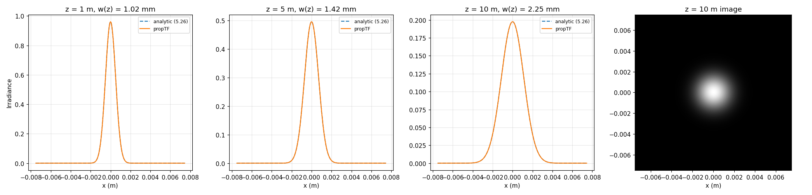
  <figcaption>图 5-P4 习题 5.5(a):高斯束 propTF 剖面(实线)与式 (5.26) 解析(虚线)在 z = 1/5/10 m 重合到机器精度级;右为 z = 10 m 图像(笔记自制)</figcaption>
</figure>

**5.6 检验式 (5.15) 的概念**:用 TF 传播器对 sqr_beam 例子仿真总距离 z = 20,000 m,但做成 split-step:传播器连续调用 10 次,每步 \(\Delta z = 2000\) m(临界采样)。与单次 TF 传播 20,000 m 比较。结果相同吗?

??? note "5.6 参考答案要点(Python 实测)"
    相同:单次 vs 拆步的辐照度最大差 **\(2.0\times10^{-14}\)**(浮点误差级)。这正是式 (5.15):\(H(z_1)\cdots H(z_N) = H(\sum z_i)\),每步临界采样救不了总距离欠采样(TF@20,000 的 stair-step 在拆步后原样出现)。

**5.7 三个孔径的夫琅禾费传播**:回到习题 4.4 的三个孔径,用 500 × 500 阵列仿真夫琅禾费传播:孔径 (a) \(L_1 = 2\) mm,z = 5 m;孔径 (b) \(L_1 = 2.5\) cm,z = 50 m;孔径 (c) \(L_1 = 2.5\) cm,z = 50 m。在 x 轴辐照度剖面上比较离散与解析结果。(注意:本题不要求夫琅禾费场的相位被充分采样。)

??? note "5.7 提示"
    解析式就是习题 4.4 的三个夫琅禾费辐照度(sinc²×sinc²、环形 jinc 差、双孔条纹×Airy 包络),现在用 propFF 算离散版:它自动给出 \(L_2 = \lambda z/\Delta x_1\) 的观察面网格。核对三件事:峰值(面积定标)、第一零点位置、条纹周期;解析点每隔 10 个样本画一次,与图 5.7(b) 同款。propFF 只保证辐照度可信,前导 chirp 相位可能欠采样(式 5.23/5.24)。

**5.8 方孔的 98% 谱功率判据**:平面波照明的方孔,假设方函数采样后至少 98% 的谱功率可用[见式 (2.11)]。找出仿真阵列所需线性样本数 M 的判据,使夫琅禾费场相位被充分采样。结果应不含变量——只是一个数。

??? note "5.8 提示"
    串三根线:98% 谱功率 → 源有效带宽 \(B_1 \approx 5.98/w\)(式 5.10);夫琅禾费相位充分采样 → 式 (5.23) \(\Delta x_1 \geq \lambda z/L_1\);夫琅禾费 regime → \(N_F = w^2/(\lambda z) \ll 1\),即 \(\lambda z \gg w^2\)。判据 \(B_1 < 1/(2\Delta x_1)\) 给 \(\Delta x_1 < 1/(2B_1) = w/11.96\),故跨孔径半径样本数 \(w/\Delta x_1 > 11.96\);代入式 (5.24) \(M \gg (w/\Delta x_1)^2\) 得 \(M \gg 143\)——取整到 \(M \gtrsim 200\)(2 的幂网格取 256)。这就是"只含一个数"的答案:约 200(或 256)。注意答案随 98% 带宽的精确定义浮动,重点是把三根线串起来的逻辑。

**5.9 两步传播器**:把附录 B 描述的两步传播器函数写出来。用 sqr_beam 例子测试:(a) \(L_1 = 0.5\) m,z = 2000 m(临界采样距离):检查 \(L_2 = 0.2, 0.4, 0.5, 0.6, 1\) m 的场幅度剖面。0.5 m 的情形应与 TF 传播结果相同;其他距离有什么明显 artifacts?(b) \(L_1 = 0.5\) m,z = 20,000 m:调整 \(L_2\) 能减少观察面结果的 artifacts 吗?

??? note "5.9 提示"
    两步法(附录 B):先用球面波因子把场"折算"到中间面(距离 \(z_a\),边长按几何缩放),再做标准 TF 传播 \(z_b = z - z_a\),两段各自满足各自的采样判据;中间面边长与 \(\lambda z_a/\Delta x_1\) 同构(式 5.18)。检验点:临界情形 \(L_2 = 0.5\) m 时两步退化为一步(propTF 的 \(H(z)\) 分解精确);\(L_2\) 偏离时注意中间面 chirp 采样与观察面支撑的权衡——这正是附录 B 分析的内容。

## 5.8 参考文献(原书)

1. D. G. Voelz and M. C. Roggemann, "Digital simulation of scalar optical diffraction: Revisiting chirp function sampling criteria and consequences," Appl. Opt. 48, 6132–6142 (2009).
2. J. D. Schmidt, *Numerical Simulation of Optical Wave Propagation with Examples in MATLAB*, SPIE Press, Bellingham, WA (2010). doi:10.1117/3.866274
3. J. W. Goodman, *Introduction to Fourier Optics*, 3rd ed., Roberts & Company, Greenwood Village, CO (2005).
4. M. C. Roggemann and B. M. Welsh, *Imaging Through Turbulence*, CRC, Boca Raton, FL (1996).

## 坑与陷阱

!!! danger "TF 与 IR 的采样判据方向相反:记反全盘错"
    \(\Delta x \geq \lambda z/L\) 让 **TF** 的 H chirp 过采样(此时 **IR** 的 h 欠采样、出周期副本);\(\Delta x \leq \lambda z/L\) 让 **IR** 的 h 过采样(此时 **TF** 的 H 欠采样、出 ticks/stair-step)。两个不等号来自两个不同的网格:判 H 看频率网格(间距 1/L)上的相位增量,判 h 看空间网格(间距 Δx)上的瞬时频率。想不起方向时用 h 的瞬时频率 \(r/(\lambda z)\) 推一遍,30 秒的事。

!!! danger "split-step 不改变采样 regime(式 5.15)"
    把长距离拆成多段 TF,等价于把传递函数连乘:\(H(z_1)\cdots H(z_N) = H(z_1+\cdots+z_N)\)——数值验证最大差 \(2\times10^{-14}\)。每段都临界采样也没用,**总距离才决定判据**。split-step 的正当用途是中途插入相位屏/元件(大气湍流仿真),不是绕过采样限制。

!!! danger "propIR 的 dx² 定标不能丢"
    propIR 第 19 行 `H=fft2(fftshift(h))*dx^2`:u1 的 FFT 与 U2 的 IFFT 定标互相抵消,唯独 FFT{h} 需要 \(\mathrm{d}x^2\) 回到连续量纲。丢了它,IR 结果幅度差 \((M\,\mathrm{d}x)^2/L^2\) 量级——直接表现为功率比严重偏离 1(习题 5.3 的诊断正好抓这个)。

!!! danger "fftshift/ifftshift 的配对与奇数阵列"
    本章代码的固定舞步:**居中排列 \(\leftrightarrow\) FFT 排列**之间靠 fftshift 进、ifftshift 回。偶数 M 时 MATLAB 与 numpy 的 fftshift == ifftshift,书全用偶数所以安全;奇数阵列两者不同,混用会把场平移一个样本。另外记住 FFT 数组的"零坐标样本":MATLAB 在 (M/2+1, M/2+1),numpy 在 (M//2, M//2)——剖面对照时先对齐这一点。

!!! danger "unwrap 的整体常数任意,欠采样区会漂移"
    比较两条相位曲线(数值 vs 解析)前,先各自减去中心样本的值对齐——unwrap 的 \(2\pi N\) 分支是任意的,本次实测两条只差 8 圈(50.3 rad)常数的曲线,不对齐会读成"形状不同"。同理,相位振荡快过网格的区域(剖面两翼)unwrap 会累积分支错误,画出来的"漂移"不是物理误差;定量比较限定在主体区。

!!! danger "propFF 的观察面网格 ≠ 源面网格"
    propFF 返回的 \(L_2 = \lambda z/\Delta x_1\)、\(\Delta x_2 = \lambda z/L_1\),与源面的 \(L_1\)、\(\Delta x_1\) 一般不同。画图必须用观察面自己的坐标(书改动清单里专门重算 `dx2`、`x2`),顺手拿源面坐标标轴会把图样横向缩放错。只有临界采样时两者才恰好相等。

!!! danger "有效带宽 B1 是估计,书值偏保守"
    \(B_1 = 5.98/w\)(式 5.10)按 ch2 的径向 98% 谱功率方法数值复核:精确 98% 半径对应 \(B \approx 4.1/w\),5.98/w 对应约 98.8% 占比。书取保守值(多收 0.8% 谱功率),做判据时安全方向;但别把它当精确常数,2.2 节的圆整值 5/w 与它同宗。\(B_1\) 的选取本来就是书 5.4.5 节承认的"艺术"。

!!! danger "scipy 的 fresnel 返回 (S, C),S 在前"
    Python 对拍式 (5.11) 时最容易踩:`scipy.special.fresnel(x)` 返回 `(S(x), C(x))`——**S 在前**,与函数名直觉相反。MATLAB 侧 Symbolic Toolbox 的 `mfun('FresnelC',x)`/`mfun('FresnelS',x)` 各返回一个。搞反了会把式 (5.11) 的实部虚部对调,幅度对称看不出来,相位对拍当场露馅。另外基础 MATLAB 没有 Fresnel 积分,也没有通用 rect(信号处理工具箱才有);Python 的 `np.sinc` 与书表 1.2 的 sinc 同定义。

## 速览

1. 三个传播器:propTF(式 5.1/5.2,频域乘 \(H\))、propIR(式 5.3/5.4,FFT{h}×dx² 当 H)、propFF(式 5.16–5.19,缩放 FT,返回 \(L_2 = \lambda z/\Delta x_1\))。
2. propTF/propIR 的固定舞步:fftshift 进 → FFT → 乘 H → IFFT → ifftshift 回;\(e^{jkz}\) 整体相位直接丢。
3. sqr_beam 基准:\(L=0.5\) m、M=250、Δx=2 mm、w=0.051 m(51 样本跨孔径)、z=2000 m、\(N_F=2.6\);观察面峰值 1.96 > 1(相长干涉),波前 = 压平的碗形。
4. 采样判据:\(D_1 < L\)(留 2–3 倍 guard);\(\Delta x \geq \lambda z/L\) → TF 好/IR 副本;\(\Delta x \leq \lambda z/L\) → IR 好/TF 混叠;\(\Delta x = \lambda z/L\) 临界,TF≡IR 且采样 H、h 精确等于解析值。
5. 判据的物理:\(H\) 的 chirp 活在频率网格(判相位增量),\(h\) 的 chirp 活在空间网格(判瞬时频率 \(r/\lambda z\))——不等号方向相反。
6. sqr_beam 四距离对照表 5.2:z=1000(TF 过 2×,观察面限 \(D_1+\lambda z/\Delta x=0.352\) m)、2000(临界)、4000(H 欠 2×,带宽 125)、20000(欠 10×,带宽 25)。
7. 精度对拍(式 5.11,Fresnel 积分):TF@2000 主体区 0.08 rad/0.8%;TF@1000 0.40 rad/2.7%(两翼磨平);IR@20000 0.0006 rad/0.02%(边缘假旁瓣)。
8. 设计流程(表 5.3):源支撑 → 定 regime → 查带宽判据(\(B_1 = 5.98/w\))→ 有 artifacts 回头调参;临界距离 \(z = L^2/(M\lambda)\)(式 5.14)。
9. split-step 无用论(式 5.15):\(H(z_1)\cdots = H(\sum z)\),数值差 \(2\times10^{-14}\);功率守恒诊断(习题 5.3):TF 全程 1.00000,IR@1000 = 4.00000(周期副本 ×4),IR@20000 = 0.95(窗口滤波)。
10. 夫琅禾费(5.5):\(L_2 = \lambda z/\Delta x_1\);方孔解析 \(I_2 = (4w^2/\lambda z)^2\mathrm{sinc}^2(2wx_2/\lambda z)\mathrm{sinc}^2(2wy_2/\lambda z)\)(式 5.22),峰值 0.2343 逐位对上;要相位充分采样需 \(M \gg (w/\Delta x_1)^2\)(式 5.24)。

## 术语速查

| 英文 | 中文 | 一句话 |
| --- | --- | --- |
| propagator | 传播器 | 把源面场变到观察面场的函数(propTF/propIR/propFF) |
| transfer function (TF) approach | 传递函数法 | 频域:FFT{u1} × H,式 5.1/5.2 |
| impulse response (IR) approach | 脉冲响应法 | 空域卷积的 FFT 实现,FFT{h}×dx² 当 H,式 5.3/5.4 |
| Fraunhofer propagation | 夫琅禾费传播 | 缩放 FT;观察面边长 \(L_2=\lambda z/\Delta x_1\) 由源面决定 |
| critical sampling | 临界采样 | \(\Delta x=\lambda z/L\);TF≡IR,采样 H/h 恰等于解析值 |
| oversampled / undersampled chirp | 过/欠采样 chirp | 相位网格跟得上/跟不上;欠采样 → 混叠 artifacts |
| guard area | 警戒区 | 源支撑外留白(\(L=2\sim3D_1\)),防 FFT 周期回绕 |
| source effective bandwidth \(B_1\) | 源有效带宽 | \(5.98/w\)(98% 径向谱功率,式 5.10);估计量 |
| aliasing | 混叠 | 超过 Nyquist 的谱折返;本章 artifacts 的总根源 |
| periodic copies | 周期副本 | IR 欠采样时观察面出现的复制图案(间距 \(\lambda z/\Delta x\)) |
| stair-step / ticks | 台阶 / 尖刺 | TF 欠采样的两类剖面 artifact |
| spurious sidelobes | 假旁瓣 | IR 长距离时阵列边缘的伪旁瓣 |
| windowing | 加窗 | 压源谱或削两翼能量,配合多步传播(Schmidt) |
| split-step | 分步传播 | 多段 TF 连乘 = 单次(式 5.15);用途是插相位屏 |
| two-step method | 两步法 | 中间面折算,源/观察面边长可不同(附录 B) |
| Fresnel integrals C, S | 菲涅耳积分 | 式 5.12;方孔解析解(式 5.11)的积木 |
| wavefront | 波前 | 等相位面;unwrap 相位剖面即其形状 |
| M-Lint / Profiler | MATLAB 静态检查 / 剖析器 | 找代码隐患 / 找耗时热点(5.6 节) |
| power conservation | 功率守恒 | \(P=\iint I\,dxdy\) 源=观察(习题 5.3);采样体检表 |

## 覆盖自查

| 原书小节 | 内容 | 笔记位置 |
| --- | --- | --- |
| 5.1 Fresnel Transfer Function (TF) Propagator | 式 (5.1)/(5.2)、propTF 全码与注 a–g、记号混用 | 5.1 |
| 5.2 Fresnel Impulse Response (IR) Propagator | 式 (5.3)/(5.4)、propIR 全码、dx² 定标 | 5.2 |
| 5.3 Square Beam Example | sqr_beam 全码、图 5.1–5.3、unwrap 与波前解读、NF=2.6 | 5.3(含数值检查) |
| 5.4.1 Square beam example results and artifacts | 图 5.4/5.5、四类 artifacts、sinc² 远场 | 5.4.1(含图 5-P1 复现) |
| 5.4.2 Sampling regimes and criteria | 式 (5.5)–(5.8)、表 5.1、三 regime 详述 | 5.4.2(含判据推导拓展) |
| 5.4.3 Criteria applied to square beam example | 式 (5.9)/(5.10)、表 5.2、四条观察 | 5.4.3(含 B1 数值复核拓展) |
| 5.4.4 Propagator accuracy | 式 (5.11)–(5.13)、2500 点、mfun、图 5.6、三评注 | 5.4.4(含常数来历拓展 + 对拍表) |
| 5.4.5 Sampling decisions | 表 5.3、式 (5.14)、相位屏冲突、试错艺术 | 5.4.5 |
| 5.4.6 Split-step simulation, windowing, and expanding grids | 式 (5.15)、窗函数、两步法 | 5.4.6(含功率守恒拓展) |
| 5.5 Fraunhofer Propagation | 式 (5.16)–(5.24)、propFF、sqr_beam_FF、图 5.7 | 5.5(含省略 warning 与实测) |
| 5.6 Coding Efficiency | M-Lint、Profiler | 5.6(含 Python 对应) |
| 5.7 Exercises | 习题 5.1–5.9 | 5.7(5.1/5.3/5.5/5.6 数值实跑) |
| 5.8 References | Voelz & Roggemann / Schmidt / Goodman / Roggemann & Welsh | 5.8 |

代码文件:`matlab/fourier/ch5/`(propTF.m、propIR.m、propFF.m、sqr_beam.m、sqr_beam_FF.m、ch5_exercises.m)、`python/fourier/ch5/`(ch5_prop.py、ch5_sqr_beam.py、ch5_sampling.py、ch5_fraunhofer.py、ch5_exercises.py)与页面内 tab 一致;公共积木复用 `python/fourier/common/base.py`(coords——propTF/propIR/propFF 的坐标轴全部由它生成)。
