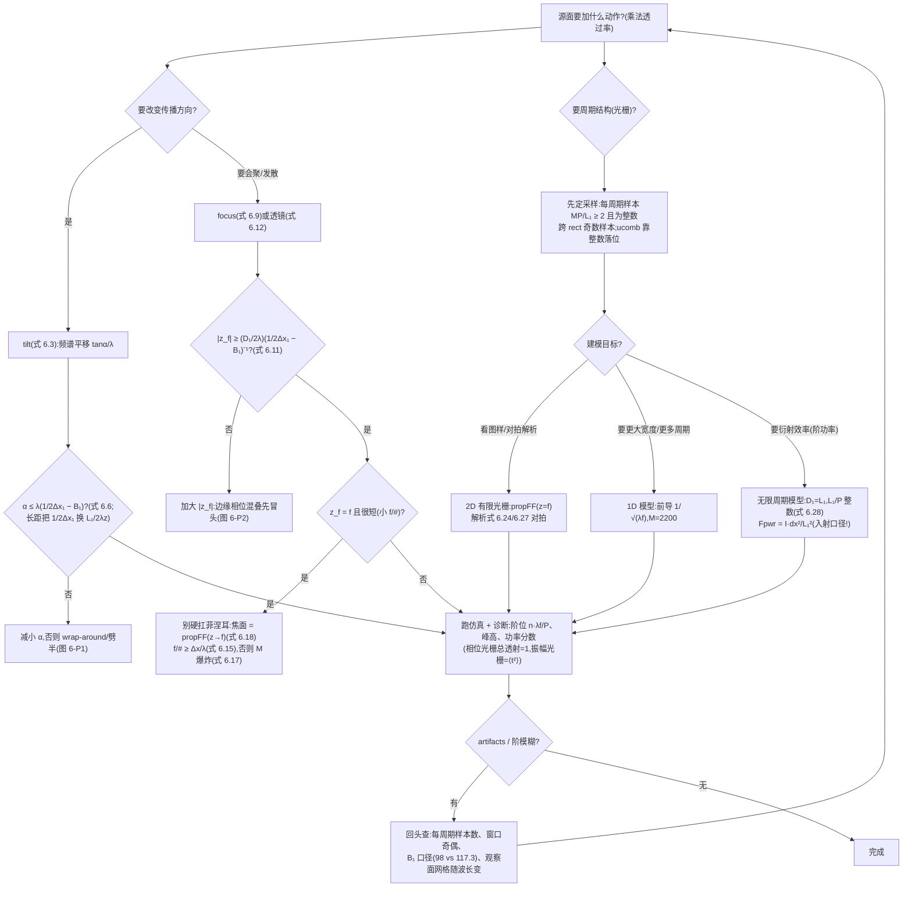

# 第 6 章 透过率函数、透镜与光栅

> **本章解决**：常用光学元件如何以复振幅透过率进入传播模型——波前倾斜、二次相位聚焦、薄透镜以及振幅与相位光栅的数学表示，以及它们各自引入的频谱搬移与带宽变化。学完能把元件写成乘性相位或振幅因子，并依据其局部空间频率确定必要的采样密度。

## 6.0 本章导图

<div class="brtree">
  <div class="brrow">
    <span class="brlabel root">透过率函数</span>
    <span class="brace"></span>
    <div class="brkids">
      <div class="brrow">
        <span class="brlabel">纯相位操作(6.1/6.2)</span>
        <span class="brace"></span>
        <div class="brkids">
          <span class="brleaf">tilt:线性相位,式 6.3</span>
          <span class="brleaf">频谱平移 tanα/λ(式 6.4/6.5)</span>
          <span class="brleaf">判据 α ≤ λ(1/2Δx₁−B₁)(式 6.6)</span>
          <span class="brleaf">focus:负 chirp,式 6.9</span>
          <span class="brleaf">判据 |z_f| ≥ 671 m(式 6.11)</span>
        </div>
      </div>
      <div class="brrow">
        <span class="brlabel">透镜(6.3)</span>
        <span class="brace"></span>
        <div class="brkids">
          <span class="brleaf">t_A = P·exp[−jk r²/2f](式 6.12)</span>
          <span class="brleaf">瞳 P = circ(r/w_L),circ 约定!</span>
          <span class="brleaf">f/# ≥ Δx/λ(式 6.15)→ f/10 要 5000 样本</span>
          <span class="brleaf">焦面 = 夫琅禾费(z→f,式 6.18)= Airy</span>
          <span class="brleaf">前焦面 = 纯缩放 FT(式 6.19)</span>
        </div>
      </div>
      <div class="brrow">
        <span class="brlabel">光栅(6.4)</span>
        <span class="brace"></span>
        <div class="brkids">
          <span class="brleaf">余弦 ½[1−cos(2πx/P)](式 6.20)</span>
          <span class="brleaf">方波 rect⊛comb,注意 1/P(式 6.25)</span>
          <span class="brleaf">每周期样本数 M·P/L₁(式 6.21/6.28)</span>
          <span class="brleaf">ucomb:六位舍入落位(附录 C.5)</span>
          <span class="brleaf">一维模型 M=2200 / 无限周期 Fpwr</span>
        </div>
      </div>
      <div class="brrow">
        <span class="brlabel">实战演练</span>
        <span class="brace"></span>
        <div class="brkids">
          <span class="brleaf">sqr_beam_tilt / sqr_beam_focus</span>
          <span class="brleaf">wrap-around 与劈半实验</span>
          <span class="brleaf">Airy 对拍:0.76%</span>
          <span class="brleaf">波带片 vs 透镜(习题 6.5)</span>
        </div>
      </div>
    </div>
  </div>
</div>

## 6.1 倾斜(Tilt)

仿真里想让光束"指向"某个方向,不用改传播器——给波前乘一个**线性相位**就行。设波前在 \(y\)–\(z\) 面内相对 \(z\) 轴倾斜 \(\alpha\)(图 6.1,虚线是倾斜后的波前,箭头是传播方向):虚线的几何表达式是 \(z = -y\tan\alpha\)。把它变成 \(z=0\) 面上的相位:波随时间沿 \(+z\) 推进时相位变得越来越负(4.3 节),所以符号要反号;波长 \(\lambda\) 对应 \(2\pi\) rad,用波数 \(k = 2\pi/\lambda\),倾斜的相位函数就是

\[
\phi_Y(x,y) = ky\tan\alpha\,. \tag{6.1}
\]

更一般地,倾斜角 \(\alpha\) 相对 \(z\) 轴、方向由 \(x\)–\(y\) 面内的角 \(\theta\) 给定(图 6.2),用

\[
\phi(x,y) = k(x\cos\theta + y\sin\theta)\tan\alpha\,, \tag{6.2}
\]

其中 \(\theta = \tan^{-1}(y/x)\)。透过率函数因此是

\[
t_a(x,y) = \exp\left[jk(x\cos\theta + y\sin\theta)\tan\alpha\right]. \tag{6.3}
\]

注意 \(\alpha = \tan^{-1}(r/z)\),\(r\) 是观察面上从原点到**光束瞄准点(beam aiming point)**的径向距离——瞄准点在 \(r = z\tan\alpha\)(图 6.2)。

<figure>
  
  <figcaption>图 6.1 y–z 面内的波前倾斜(截自原书)</figcaption>
</figure>

<figure>
  
  <figcaption>图 6.2 观察面上的光束瞄准点:r = z tanα(截自原书)</figcaption>
</figure>

!!! note "拓展:倾斜就是频谱平移——一行移位定理"
    式 (6.3) 的指数是 \(jk\hat{s}\cdot\vec{r}\)(\(\hat{s}\) 为倾斜方向单位矢量),即 \(e^{j2\pi f_0 x}\) 型的**线性相位**,其中 \(f_0 = \tan\alpha/\lambda\)(沿 \(x\) 分量)。由移位定理 \(\mathfrak{F}\{U_1\,e^{j2\pi f_0 x}\}(f_X) = G(f_X - f_0)\):倾斜不改变谱的形状,只把整幅频谱**平移** \(\tan\alpha/\lambda\)。所以"倾角受限"的本质是"平移后的总带宽不能超出网格的 Nyquist 窗"——下面式 (6.5)/(6.6) 全是这一句话的代数化。

tilt 函数如下:

=== "MATLAB"

    ```matlab
    function[uout]=tilt(uin,L,lambda,alpha,theta)
    % ===== 书 6.1 节:tilt 倾斜透过率函数(逐行忠实 + 中文注释) =====
    % 书 6.1 节列出的函数(原书第 1-20 行),实现式 (6.3):
    %   t_a(x,y) = exp[jk(x cos(theta) + y sin(theta)) tan(alpha)]
    % 即给波前加一个线性相位斜面,使光束朝 (cos(theta), sin(theta)) 方向
    % 偏转 alpha 角(瞄准点 r = z tan alpha,图 6.2)。
    % 要点:
    %   - theta 从 x 轴量起(书注释 "x axis 0");式 (6.2) 中 theta = atan(y/x)
    %     只是"径向方向"的定义,函数里 theta 是自由参数;
    %   - 第 18-19 行用三个连续的句点(...)续行,一条表达式拆成两行;
    %   - 倾斜角受采样限制(式 6.6):alpha <= lambda*(1/(2*dx) - B1),
    %     倾斜本质是把源频谱平移 tan(alpha)/lambda(式 6.4/6.5)。
    % MATLAB/Python 差异:Python 版在 python/fourier/ch6/ch6_transmittance.py
    %   的 tilt();坐标轴生成见公共模块 base.coords(Python 侧)。
    % ------------- 以下为书原代码(第 1-20 行) -------------
    % tilt phasefront
    % uniform sampling assumed
    % uin - input field
    % L - side length
    % lambda - wavelength
    % alpha - tilt angle
    % theta - rotation angle (x axis 0)
    % uout - output field

    [M,N]=size(uin);        %get input field array size
    dx=L/M;                 %sample interval
    k=2*pi/lambda;          %wavenumber

    x=-L/2:dx:L/2-dx;       %coords
    [X,Y]=meshgrid(x,x);

    uout=uin.*exp(j*k*(X*cos(theta)+Y*sin(theta))...
       *tan(alpha));       %apply tilt
    end
    ```

=== "Python"

    ```python
    # ===== 书 6.1 节:tilt(与 matlab/fourier/ch6/tilt.m 逐行对应) =====
    def tilt(uin, L, lam, alpha, theta):
        """倾斜透过率(式 6.3):t = exp[jk(x cosθ + y sinθ) tanα]。

        给波前加线性相位斜面,光束朝 (cosθ, sinθ) 方向偏转 α,
        瞄准点 r = z tanα(图 6.2)。倾斜把源频谱平移 tanα/λ(式 6.4/6.5),
        因此受带宽判据 α ≤ λ(1/(2Δx1) − B1)(式 6.6)限制。
        """
        M, N = uin.shape                                    # 书 11 行
        dx = L / M                                          # 书 12 行
        k = 2 * np.pi / lam                                 # 书 13 行
        x, _ = coords_local(L, M)                           # 书 15 行:空间坐标(居中)
        X, Y = np.meshgrid(x, x)                            # 书 16 行
        uout = uin * np.exp(1j * k * (X * np.cos(theta) + Y * np.sin(theta))
                            * np.tan(alpha))                # 书 18-19 行:apply tilt
        return uout
    ```

测试方法:回到 5.3 节的 sqr_beam,Save As 成 **sqr_beam_tilt**,在传播调用之前插入:

=== "MATLAB"

    ```matlab
    % ===== 书 6.1 节新增(传播调用前插入;完整脚本 matlab/fourier/ch6/sqr_beam_tilt.m) =====
    deg=pi/180;
    alpha=5.0e-5; %rad
    theta=45*deg;
    [u1]=tilt(u1,L1,lambda,alpha,theta);
    ```

=== "Python"

    ```python
    # ===== 书 6.1 节新增(见 python/fourier/ch6/ch6_sqr_beam_tilt.py) =====
    deg = np.pi / 180
    alpha = 5.0e-5                                 # rad
    theta = 45 * deg
    u1t = tilt(u1, L1, lam, alpha, theta)
    ```

其余与 sqr_beam 相同(仍用 propTF 传到 \(z=2000\) m)。运行后观察面辐照度如图 6.3——光斑沿 45° 方向平移到了 \(r = z\tan\alpha = 0.1\) m 处。

<figure>
  
  <figcaption>图 6.3 倾斜例子的观察面辐照度:α = 5.0×10⁻⁵ rad、θ = 45°(截自原书)</figcaption>
</figure>

本章 Python 复现(同参数)还做了两个定量检查(\(L_1=0.5\) m、\(M=250\)、\(\Delta x_1=2\) mm):

- **频谱平移**(式 6.5):对源场做居中 2D FT,谱峰从 \((0,0)\) 移到 \((70.0, 70.0)\) cyc/m,理论 \((\tan\alpha/\lambda)(\cos\theta,\sin\theta) = (70.7, 70.7)\) cyc/m——差在网格分辨率 \(1/L = 2\) cyc/m 内;
- **质心平移**:观察面辐照度质心 \((69.8, 69.8)\) mm,理论 \(z\tan\alpha/\sqrt{2} = 70.7\) mm。

采样限制同样存在。倾斜够大、把观察面上的光斑平移出网格边界,就要出事(习题 6.1)。分析方法:tilt 是作用在源场 \(U_1\) 上的线性相位指数;设单轴倾斜,对源场变换用移位定理:

\[
\mathfrak{F}\{U_1(x_1,y_1)\exp(jkx_1\tan\alpha)\} = G_1\left(f_{X1} - \frac{\tan\alpha}{\lambda},\,f_{Y1}\right), \tag{6.4}
\]

其中 \(G_1 = \mathfrak{F}\{U_1\}\)。若源带宽为 \(B_1\),谱整体平移之后,离开源面的场的组合有效带宽是

\[
B_1^{+T} = B_1 + \frac{\tan\alpha}{\lambda}\,. \tag{6.5}
\]

把 \(B_1^{+T}\) 代进表 5.3 的传播判据里 \(B_1\) 的位置。比如 \(\Delta x \leq \lambda z/L\) 时传播判据是 \(B_1^{+T} \leq 1/(2\Delta x)\)。代入式 (6.5)、整理,得

\[
\alpha \leq \lambda\left(\frac{1}{2\Delta x_1} - B_1\right), \tag{6.6}
\]

其中假定 \(\alpha\) 是小角。关于这个判据的三条评注:

- **(a)** 结果是**近似**的:式 (6.5)/(6.6) 没有计入源与传播器相位的具体相互作用——两者的影响可能部分抵消。
- **(b)** \(\Delta x > \lambda z/L\)("较短距离"):在倾角 \(\alpha\) 还没逼近界限之前,观察面就可能出现"fringing"(条纹)与不对称等各种 artifacts。
- **(c)** \(\Delta x < \lambda z/L\)("较长距离"):把式 (6.6) 里的 \(1/2\Delta x_1\) 换成 \(L_1/(2\lambda z)\)。

sqr_beam_tilt 例子:\(\lambda = 0.5\times10^{-6}\) m、\(\Delta x_1 = 2\times10^{-3}\) m,书取 \(B_1 \approx 98\) cycles/m(称"由式 (5.10) 算出"),倾角判据给出 \(\alpha \leq 7.6\times10^{-5}\) rad。

!!! warning "原书前后不一致:B₁ ≈ 98 从哪来?"
    5.4.3 节式 (5.10) 算出的 \(B_1 = 5.98/w = 5.98/0.051 = 117.3\) cycles/m;而 \(5/w = 98.0\) cycles/m 是 2.2 节的圆整口径。本节说"B₁ ≈ 98 由式 (5.10) 算出",两处口径对不上——98 对应的是 5/w。按 117.3 重算:式 (6.6) 给 \(\alpha \leq 6.6\times10^{-5}\) rad,6.2 节的 \(|z_f| \geq 768\) m(书值 671 m)。书沿用 98,笔记的数值验证两条都给。

试验:取 `theta=0`、`alpha=7.6e-5`,光束应贴近阵列边缘;看幅度剖面,"wrap-around"效果明显——能量从网格对面一侧进来(**周期延拓**!)。要让图样跨网格边界劈开,取 \(\alpha = \lambda/2\Delta x_1 = 1.25\times10^{-4}\)。再试一些更短/更长的传播距离,观察倾角增大时光束怎么变。一般来说,倾角应远在式 (6.6) 界内;典型仿真里最大可用倾角相当小——这与菲涅耳传播器的傍轴本性一致。

本章 Python 复现同一组试验(\(\theta = 0\)):

<figure>
  
  <figcaption>图 6-P1 倾角判据试验:无倾斜 / α = 7.6×10⁻⁵(式 6.6 边界,光束贴边 + 对侧 wrap-around)/ α = λ/2Δx₁(劈半)(笔记自制)</figcaption>
</figure>

- \(\alpha = 7.6\times10^{-5}\):光束中心移到 \(z\tan\alpha = 152\) mm(半网格 250 mm 的 61%),强度剖面在 \(-x\) 对侧边缘出现周期回绕能量(对侧边缘能量占比 5.7%);
- \(\alpha = 1.25\times10^{-4}\):光束中心 \(z\tan\alpha = 250\) mm 恰在边界上,图样被劈成两半。

## 6.2 聚焦(Focus)

另一个有用操作:让光束会聚("focusing")或发散("defocusing")。球面波前(图 6.4)会在 \(z\) 轴上 \(z_f\) 处会聚。照 tilt 的路子,找 \(z=0\) 面上的会聚相位前:

\[
\phi_S(x,y) = -k\sqrt{{z_f}^2 + x^2 + y^2}\,. \tag{6.7}
\]

\(x\) 或 \(y\) 增大时相位更负——说明离轴波前在时间上**超前**于轴上波前(4.3 节)。所以式 (6.7) 的负号对应**会聚**波前(图 6.4),正号对应**发散**波前。借 4.4.2 节菲涅耳衍射的二项式近似,抛物面相位前近似球面:

\[
\phi(x,y) = -\frac{k}{2z_f}\left(x^2 + y^2\right). \tag{6.8}
\]

focus 的透过率函数因此是

\[
t_A(x,y) = \exp\left[-j\frac{k}{2z_f}\left(x^2 + y^2\right)\right]. \tag{6.9}
\]

这与式 (4.23) 菲涅耳脉冲响应 \(h\) 里的相位 chirp 同形,只是指数符号为负——\(h\) 把波"散开",focus 把波"收拢"。

<figure>
  
  <figcaption>图 6.4 会聚波前(截自原书)</figcaption>
</figure>

!!! note "原书记号"
    透过率记号在原书里前后不统一:式 (6.3) 写 \(t_a\),式 (6.9) 起写 \(t_A\)。笔记统一用 \(t_A\),含义相同(下标指 amplitude transmittance)。

focus 的 MATLAB 函数:

=== "MATLAB"

    ```matlab
    function[uout]=focus(uin,L,lambda,zf)
    % ===== 书 6.2 节:focus 聚焦/发散透过率函数(逐行忠实 + 中文注释) =====
    % 书 6.2 节列出的函数(原书第 1-18 行),实现式 (6.9):
    %   t_A(x,y) = exp[-j (k/(2*zf)) (x^2 + y^2)]
    % zf > 0 会聚(焦点在源面前方 z = zf 处);zf < 0 发散(虚焦点)。
    % 这是与菲涅耳脉冲响应 h(式 4.23)同形的相位 chirp,只是指数符号为负
    % ——h 让波前发散开去,focus 把波前向焦点收拢。
    % 采样限制(式 6.11):|zf| >= (D1/2/lambda) * (1/(2*dx) - B1)^(-1),
    % 即聚焦 chirp 会加宽带宽,大约增加 D1/(2*lambda*|zf|)(式 6.10)。
    % MATLAB/Python 差异:Python 版在 python/fourier/ch6/ch6_transmittance.py
    %   的 focus();X.^2 在 numpy 里写作 X**2。
    % ------------- 以下为书原代码(第 1-18 行) -------------
    % converging or diverging phase-front
    % uniform sampling assumed
    % uin - input field
    % L - side length
    % lambda - wavelength
    % zf - focal distance (+ converge, - diverge)
    % uout - output field

    [M,N]=size(uin);        %get input field array size
    dx=L/M;                 %sample interval
    k=2*pi/lambda;          %wavenumber
    %
    x=-L/2:dx:L/2-dx;       %coords
    [X,Y]=meshgrid(x,x);

    uout=uin.*exp(-j*k/(2*zf)*(X.^2+Y.^2)); %apply focus
    end
    ```

=== "Python"

    ```python
    # ===== 书 6.2 节:focus(与 matlab/fourier/ch6/focus.m 逐行对应) =====
    def focus(uin, L, lam, zf):
        """聚焦/发散透过率(式 6.9):t = exp[-j(k/2zf)(x²+y²)]。

        zf > 0 会聚(实焦点),zf < 0 发散(虚焦点)。
        与菲涅耳脉冲响应 h(式 4.23)同形的 chirp,指数符号为负。
        聚焦加宽源带宽约 D1/(2λ|zf|)(式 6.10),故有式 (6.11) 的 |zf| 下界。
        """
        M, N = uin.shape                                    # 书 10 行
        dx = L / M                                          # 书 11 行
        k = 2 * np.pi / lam                                 # 书 12 行
        x, _ = coords_local(L, M)                           # 书 14 行
        X, Y = np.meshgrid(x, x)                            # 书 15 行
        uout = uin * np.exp(-1j * k / (2 * zf) * (X ** 2 + Y ** 2))   # 书 17 行
        return uout
    ```

在 sqr_beam 上试(新文件 **sqr_beam_focus**),传播调用前插入并运行:

```matlab
zf=2000;
[u1]=focus(u1,L1,lambda,zf);
```

结果见图 6.5——相当前的一个焦点!本例焦距与传播距离相同(\(z_f = z = 2000\) m),所以预期小光斑。这个图样其实是**一幅缩放了的夫琅禾费图样**(见 6.3 节)。试别的焦距——能不能让图样扩展到铺满观察面网格?负的 focus 值把焦点放到平面背后的虚位置,产生发散波(图 6.6),也试试。

<figure>
  
  <figcaption>图 6.5 聚焦例子:(a) 辐照度图样;(b) 剖面(截自原书)</figcaption>
</figure>

<figure>
  
  <figcaption>图 6.6 源面上会聚 (a) / 发散 (b) 波前的几何光线图(截自原书)</figcaption>
</figure>

!!! warning "原书图 6.6 子图标号"
    图 6.6 的两个子图在原书里都印着 "(b)"——左图(会聚,焦点 \(z_f\))应为 (a)。排版笔误。

"缩放夫琅禾费"不是一句虚话——本章 Python 实测把它钉死:对同一源场,`focus(zf=z) + propTF(z)` 与 `propFF(u1, z=f)` 的辐照度**逐点相等**(最大相对差 \(5.3\times10^{-16}\),机器精度;propFF 观察面边长 \(L_2 = \lambda z/\Delta x_1 = 0.5\) m,恰与源面同网格)。原因:焦距等于传播距离时,观察面上传播自带的二次相位 \(e^{jk r^2/2z}\) 恰好被 focus chirp 消掉,剩下的正是夫琅禾费场(式 6.18 取 \(f=z\))。实测焦斑峰值 \(I_2 = 108.2\)(书图 6.5(b) 约 108),半高全宽约 8 mm。

给源场乘式 (6.9) 会**加宽源带宽**:带宽增量约为"源支撑半径 \(D_1/2\) 除以 \(\lambda|z_f|\)",组合有效带宽近似

\[
B_1^{+F} = B_1 + \frac{D_1}{2\lambda|z_f|}\,. \tag{6.10}
\]

令 \(B_1^{+F} \leq 1/(2\Delta x)\) 并整理,得焦距下界:

\[
|z_f| \geq \frac{D_1/2}{\lambda}\left(\frac{1}{2\Delta x_1} - B_1\right)^{-1}. \tag{6.11}
\]

与倾角判据一样,式 (6.11) 是近似的——源与传播器相位的精确相互作用没有计入。

sqr_beam_focus 例子:\(\lambda = 0.5\times10^{-6}\) m、\(\Delta x_1 = 2\times10^{-3}\) m、\(B_1 \approx 98\) cycles/m、\(D_1 = 0.102\) m,给出 \(|z_f| \geq 671\) m(用 \(B_1 = 117.3\) 则为 768 m)。用代码检验这个条件:\(z_f = -671\) m 时波发散,观察面上明显推过阵列边界;\(z_f = +671\) m 时图样更小——光束在到达观察面前先过了焦点(图 6.6)。图样看似合理,但相位混叠误差刚好开始在阵列边缘冒头——看观察面场的 unwrap 相位剖面就能发现。

<figure>
  
  <figcaption>图 6-P2 式 (6.11) 边界试验(z = 2000 m):z_f = +671 m(先聚焦,图样变小)/ z_f = −671 m(发散,推过阵列)(笔记自制)</figcaption>
</figure>

## 6.3 透镜(Lens)

透镜是利用折射来会聚或发散光的元件。理想简单透镜的透过率函数为(引 Goodman):

\[
t_A(x,y) = P(x,y)\exp\left[-j\frac{k}{2f}\left(x^2 + y^2\right)\right], \tag{6.12}
\]

其中 \(f\) 是**焦距(focal length)**,\(P(x,y)\) 是**瞳函数(pupil function)**。这就是 focus 的复指数把 \(z_f\) 换成 \(f\):正焦距把平面波输入变成会聚波前,负焦距变发散。瞳函数管透镜的物理尺寸——可用来收集光的开口。最常见的瞳函数是圆:

\[
P(x,y) = \mathrm{circ}\left(\frac{\sqrt{x^2+y^2}}{w_L}\right), \tag{6.13}
\]

\(w_L\) 是透镜孔径半径(别与出透镜波前的曲率半径混淆)。

!!! warning "circ 的两种约定(全书坑,这里落地)"
    式 (6.13) 按 **Goodman 约定**书写:circ 的宗量是"半径归半径",即 \(P=\mathrm{circ}(r/w_L)\) 表示半径 \(w_L\) 的圆孔。书的附录 C.1 代码 `out=abs(r)<=1` 也是这个约定。但表 1.2 的 circ 印刷定义对应"宗量 = r/(2×半径)"(ch1 勘误,两种约定差 2 倍半径)——同一本书里两套并存。**实现时**:本笔记公共模块 `base.circle(X, Y, R)` 画半径 R 圆盘,所以透镜瞳写 `circle(X, Y, wL)`、波带片写 `circle(X, Y, w)`(式 6.29 同理);若照抄表 1.2 的定义实现式 (6.13),孔径会大出一倍。

并不是所有场景都能像 focus 例子那样,把式 (6.12) 直接放进菲涅耳传播。因为焦距 \(f\) 服从与 \(z_f\) 相同的判据(式 6.11),而 \(f\) 往往很短,需要巨量样本。设平面波入射(\(B_1 \to 0\)),对式 (6.11) 做代数变换:

\[
\frac{|f|}{D_L} \geq \frac{\Delta x}{\lambda}\,, \tag{6.14}
\]

其中 \(D_L = 2w_L\)。比值 \(|f|/D_L\) 叫**焦比(focal ratio)**,或 **f 数(f-number)**,记 \(f/\#\)。代入后:

\[
f/\# \geq \frac{\Delta x}{\lambda}\,. \tag{6.15}
\]

实用透镜的 \(f/\#\) 大约从 2 到 50,直径 \(2w_L\) 从几毫米到 100 mm 上下。取典型值 \(f/\#=10\)(常写 f/10)、直径 25 mm、可见光 \(\lambda = 0.5\times10^{-6}\) m,式 (6.15) 给出

\[
\Delta x \leq 5\times10^{-6}\ \text{m}. \tag{6.16}
\]

而且做菲涅耳传播时,阵列边长 \(L\) 至少要跨透镜直径。于是建模这枚透镜所需的线性样本数

\[
M \geq \frac{L}{\Delta x} = \frac{25\times10^{-3}}{5\times10^{-6}} = 5000, \tag{6.17}
\]

相当大的阵列。所以用菲涅耳传播器直接建模透镜,通常只对大 \(f/\#\) 才实际可行。

小 \(f/\#\) 也不是没救。设入射透镜的场是 \(U_1(x_1,y_1)\),出透镜的场是 \(U_1(x_1,y_1)t_A(x_1,y_1)\)。把它作为 \(U_1(x_1,y_1)\) 代入式 (4.25),令 \(z = f\),积分里的 chirp 函数相消,结果是

\[
U_2(x_2,y_2) = \frac{\exp(jkf)}{j\lambda f}\exp\left[j\frac{k}{2f}\left(x_2^2+y_2^2\right)\right]\iint U_1(x_1,y_1)P(x_1,y_1)\exp\left[-j\frac{2\pi}{\lambda f}\left(x_2x_1+y_2y_1\right)\right]dx_1dy_1. \tag{6.18}
\]

式 (6.18) 表明:**理想正透镜焦面上的场,就是入射场取 \(z = f\) 的夫琅禾费图样**。所以想求正透镜焦面的场或辐照度——包括小 \(f/\#\) 的透镜——用上一章的 propFF、把 \(z\) 换成 \(f\) 即可。

取 f/10 透镜的参数,设 \(U_1\) 是单位振幅平面波,选 \(M = 250\)、\(L = 250\) mm,用 propFF 生成焦面辐照度(习题 6.4),结果见图 6.7。理想圆形透镜形成的聚焦辐照度图样就是著名的 **Airy 图样(Airy pattern)**。

<figure>
  
  <figcaption>图 6.7 透镜夫琅禾费图样:(a) 辐照度(四次方根拉伸);(b) x 剖面——单位振幅入射场的全部功率被聚进极小面积,峰值 ~1.5×10⁷(截自原书)</figcaption>
</figure>

本章 Python 数值验证(习题 6.4 的解析推导一并给出):单位振幅平面波照满半径 \(w_L\) 的圆瞳,焦面场即 \(D_1\) 面积定标的 jinc,\(I_2(r) = I_0\,[2J_1(v)/v]^2\),\(v = \pi D r/(\lambda f)\),\(D = 2w_L\),峰值 \(I_0 = (\pi w_L^2/\lambda f)^2\):

| 量 | 解析 | 数值(propFF) |
| --- | --- | --- |
| 峰值 \(I_0\) | \(1.542\times10^7\) | \(1.530\times10^7\)(差 0.76%) |
| 第一零点 \(1.22\lambda f/D\) | 6.10 μm | 6.0 μm(0.5 μm 网格的最近样本) |
| 瞳直径减半(习题 6.4b) | 零点 ×2 = 12.2 μm | 13.0 μm;峰值降为 1/16 = 0.0612 |

<figure>
  
  <figcaption>图 6-P3 f/10 理想透镜焦面:数值(实线)vs 解析 Airy(虚线);瞳减半时零点翻倍、峰值降为 1/16(笔记自制)</figcaption>
</figure>

!!! note "拓展:衍射限斑大小只看 f/#"
    Airy 第一零点 \(1.22\lambda f/D = 1.22\,\lambda\,(f/\#)\)——与焦距、口径各自无关,只由 \(f/\#\) 决定。f/10、\(\lambda=0.5\ \mu\text{m}\) 永远给 6.1 μm 的衍射限斑。这也是"缩小瞳径让斑变大"(习题 6.4b,零点翻倍)和"大口径长焦与大口径短焦同斑"两件事的统一出处。

一个特例值得单独记:源场放在正透镜的**前焦面**上(距透镜 \(f\),图 6.8)。此时焦面上的场为(引 Goodman):

\[
U_2(x_2,y_2) = \frac{\exp(jkf)}{j\lambda f}\iint U_1(x_1,y_1)\,P\left(x_1+x_2,\,y_1+y_2\right)\exp\left[-j\frac{2\pi}{\lambda f}\left(x_2x_1+y_2y_1\right)\right]dx_1dy_1. \tag{6.19}
\]

前导的 chirp 相位因子**没有了**——焦面场是输入场的**缩放傅里叶变换**。瞳函数的宗量 \((x_1+x_2,\,y_1+y_2)\) 计入了**渐晕(vignetting)**:输入场里离轴点因瞳径有限而丢光。透镜瞳相对输入场支撑越大,渐晕越弱。

<figure>
  
  <figcaption>图 6.8 "傅里叶变换"透镜安排:U₁ 在前焦面,U₂ 在后焦面(截自原书)</figcaption>
</figure>

!!! note "拓展:式 (6.19) 的两个细节"
    - **前导相位**:把"传播 f → 透镜 → 传播 f"严格走一遍(两次菲涅耳传播各带 \(e^{jkf}\),透镜消掉面内 chirp),得到的整体相位是 \(e^{j2kf}/(j\lambda f)\),而书从式 (6.18) 改写过来只写了 \(e^{jkf}\)。整体相位不影响辐照度,两种写法算出的 \(I_2\) 完全一样。
    - **渐晕宗量为什么是 \(x_1+x_2\)**:来自前焦面上 \((x_1,y_1)\) 点、沿频率分量 \(f_{X1}\) 方向的那根光线,打到透镜面上的高度是 \(x_1 + \lambda f f_{X1}\);而 \(f_{X1}\) 分量最终落到焦面 \(x_2 = \lambda f f_{X1}\) 处,所以透镜面上这根光线的高度正是 \(x_1 + x_2\)——瞳在这一点截不截得住,决定这个 (源点, 频率) 组合能不能贡献光。

## 6.4 光栅与周期函数(Gratings and Periodic Functions)

**光栅(grating)**是具有空间周期结构的元件。入射光在结构的透射或反射中发生衍射,光的颜色(波长分量)在离光栅一定距离处被空间上分开。光栅常用于光谱仪(看光信号的波长谱)或分光光度计(测元件的光谱特性)。光栅的衍射图样通常在夫琅禾费区观察。

### 6.4.1 余弦振幅例子

传统光栅在表面刻槽,对入射波施加振幅和/或相位扰动。为了演示周期函数建模,先看一个振幅透过率函数:

\[
t_A(x,y) = \frac{1}{2}\left[1-\cos\left(2\pi\frac{x_1}{P}\right)\right]\mathrm{rect}\left(\frac{x_1}{D_1}\right)\mathrm{rect}\left(\frac{y_1}{D_1}\right). \tag{6.20}
\]

图 6.9 是它的一维剖面。光栅定义在 \(D_1\times D_1\) 的二维面内,余弦图案只随 \(x\) 变化、周期为 \(P\),通常 \(P \ll D_1\)。单位振幅平面波照明时源场 \(U_1(x_1,y_1) = t_A(x_1,y_1)\),夫琅禾费图样用焦距 \(f\) 的透镜(或反射镜)产生。

<figure>
  
  <figcaption>图 6.9 余弦光栅剖面(截自原书)</figcaption>
</figure>

光栅在脚本 **grating_cos** 里仿真,前半部分:

=== "MATLAB"

    ```matlab
    % ===== 书 6.4.1 节:grating_cos 余弦振幅光栅例子(逐行忠实 + 中文注释) =====
    % 参数:lambda=0.5 um、f=0.5 m、P=1e-4 m(光栅周期)、D1=1.02e-3(光栅边长,
    %   跨 rect 函数 D1/dx1=51 个样本——奇数,与 rect 定义一致)、
    %   L1=1e-2 m、M=500。跨每个余弦周期的样本数 M*P/L1=5(式 6.21,"okay")。
    % 图 6.10:(a) 源面辐照度(显示分辨率看不出周期结构);(b) 夫琅禾费图样
    %   (三次方根拉伸);(c) x 剖面——中央零阶 + ±1 一阶峰(位置 ±lambda*f/P=±2.5 mm)。
    % 解析对照:式 (6.22)/(6.23) 的 FT 与式 (6.24) 的夫琅禾费场(丢掉前导复指数,
    %   只算辐照度,"but don't forget 1/lambda*z",这里 z 就是 f)。
    % 波长分离试验(图 6.11):换 lambda=0.6e-6 重跑,一阶峰移到 ±3.0 mm;
    %   两条曲线的 x2 网格不同,不能用同一组 x2 画图(书特别提醒)!
    % MATLAB/Python 差异:Python 版 ch6_gratings.py 的 grating_cos 部分;
    %   sinc 为信号处理工具箱函数,无工具箱可自定义 sinc_v=@(x) sin(pi*x)./(pi*x)。
    % ------------- 以下为书原代码(第 1-21 行 + 书给的分析代码) -------------
    % grating_cos diffraction grating example

    lambda=0.5e-6;  %wavelength
    f=0.5;          %focal distance
    P=1e-4;         %grating period
    D1=1.02e-3;     %grating side length

    L1=1e-2;        %array side length
    M=500;          %# samples
    dx1=L1/M;
    x1=-L1/2:dx1:L1/2-dx1; %source coords
    [X1,Y1]=meshgrid(x1,x1);

    % Grating field and irradiance
    u1=1/2*(1-cos(2*pi*X1/P)).*rect(X1/D1).*rect(Y1/D1);

    % Fraunhofer pattern
    [u2,L2]=propFF(u1,L1,lambda,f);
    dx2=L2/M;
    x2=-L2/2:dx2:L2/2-dx2; y2=x2;%obs coords
    I2=abs(u2).^2;
    ```

=== "Python"

    ```python
    # ===== 书 6.4.1 节:grating_cos(完整脚本见 python/fourier/ch6/ch6_gratings.py) =====
    def run_grating_cos(lam=0.5e-6, M=500, D1=1.02e-3, P=1e-4, f=0.5, L1=1e-2):
        """书 6.4.1 节 grating_cos(式 6.20 + propFF + 式 6.24 解析)。"""
        dx1 = L1 / M
        x1, _ = coords(L1, M)
        X1, Y1 = np.meshgrid(x1, x1)
        u1 = 0.5 * (1 - np.cos(2 * np.pi * X1 / P)) * \
            np.where(np.abs(X1) <= D1 / 2, 1.0, 0.0) * \
            np.where(np.abs(Y1) <= D1 / 2, 1.0, 0.0)       # 式 (6.20)
        u2, L2 = propFF(u1, L1, lam, f)
        dx2 = L2 / M
        x2, _ = coords(L2, M)
        I2 = np.abs(u2) ** 2
        # 式 (6.24)(丢前导复指数,只算辐照度;书代码逐行对应)
        lf = lam * f
        X2, Y2 = np.meshgrid(x2, x2)
        u2a = (1 / lf) * D1 ** 2 / 2 * sinc(D1 / lf * Y2) * \
            (sinc(D1 / lf * X2) - 0.5 * sinc(D1 / lf * (X2 + lf / P))
             - 0.5 * sinc(D1 / lf * (X2 - lf / P)))
        I2a = np.abs(u2a) ** 2
        return x1, u1, x2, I2, I2a, lf, P, f, D1
    ```

关键前提:**周期函数必须采够**。跨一个周期(长度 \(P\))的样本数是

\[
\#\,\text{samples across } P = M\frac{P}{L_1}. \tag{6.21}
\]

grating_cos 里 \(MP/L_1 = 5\)——每个余弦周期 5 个样本,"okay"(满足采样定理至少要 2 个)。\(L_1\)、\(D_1\)、\(P\)、\(M\) 的取值同时照顾了夫琅禾费图样的显示;\(D_1 = 1.02\times10^{-3}\) 让跨 rect 的样本数 \(D_1/dx_1 = 51\) 为**奇数**,与 rect 函数的定义一致。透镜焦距 \(f = 0.5\) m 是任选的。图 6.10 给出源面辐照度 \(I_1\)、观察面辐照度 \(I_2\) 与观察面 x 剖面:中央特征叫**零阶(zero order)**,两侧是 \(-1\) 与 \(+1\) **一阶(first-order)**峰。

<figure>
  
  <figcaption>图 6.10 grating_cos 结果:(a) 源面辐照度(显示分辨率看不出周期结构);(b) 夫琅禾费辐照度(三次方根拉伸);(c) x 剖面(截自原书)</figcaption>
</figure>

仿真对不对,拿解析夫琅禾费图样对一下。先求源场的傅里叶变换:

\[
\mathfrak{F}\{U_1(x_1,y_1)\} = \frac{1}{2}\left[\delta(f_{X1},f_{Y1}) - \frac{1}{2}\,\delta\left(f_{X1}-\frac{1}{P},f_{Y1}\right) - \frac{1}{2}\,\delta\left(f_{X1}+\frac{1}{P},f_{Y1}\right)\right]\otimes D_1^2\,\mathrm{sinc}(D_1f_{X1})\,\mathrm{sinc}(D_1f_{Y1}), \tag{6.22}
\]

再做卷积:

\[
\mathfrak{F}\{U_1(x_1,y_1)\} = \frac{D_1^2}{2}\,\mathrm{sinc}(D_1f_{Y1})\left\{\mathrm{sinc}(D_1f_{X1}) - \frac{1}{2}\,\mathrm{sinc}\left[D_1\left(f_{X1}+\frac{1}{P}\right)\right] - \frac{1}{2}\,\mathrm{sinc}\left[D_1\left(f_{X1}-\frac{1}{P}\right)\right]\right\}. \tag{6.23}
\]

代入 \(x_2/\lambda f \to f_{X1}\)、\(y_2/\lambda f \to f_{Y1}\) 并乘上各前导因子,得夫琅禾费场:

\[
U_2(x_2,y_2) = \frac{\exp(jkf)}{j\lambda f}\exp\left[j\frac{k}{2f}\left(x_2^2+y_2^2\right)\right]\frac{D_1^2}{2}\,\mathrm{sinc}\left(\frac{D_1}{\lambda f}y_2\right)\cdot\left\{\mathrm{sinc}\left(\frac{D_1}{\lambda f}x_2\right) - \frac{1}{2}\,\mathrm{sinc}\left[\frac{D_1}{\lambda f}\left(x_2+\frac{\lambda f}{P}\right)\right] - \frac{1}{2}\,\mathrm{sinc}\left[\frac{D_1}{\lambda f}\left(x_2-\frac{\lambda f}{P}\right)\right]\right\}. \tag{6.24}
\]

辐照度是式 (6.24) 的模平方。书给的解析评估代码:

```matlab
%analytic
[X2,Y2]=meshgrid(x2,y2);
lf=lambda*f;
u2a=(1/lf)*D1^2/2*sinc(D1/lf*Y2)...
    .*(sinc(D1/lf*X2)-1/2*sinc(D1/lf*(X2+lf/P))...
    -1/2*sinc(D1/lf*(X2-lf/P)));
I2a=abs(u2a).^2;
```

夫琅禾费图样的前导复指数没有写进代码——只看辐照度,但**别忘了 1/λz**(这里 \(z = f\))。跑一下,离散与解析曲线应当重合。本章 Python 实测:最大相对差 **0.258%**;一阶峰位置 \(\pm\lambda f/P = \pm 2.50\) mm,峰高约 1.04 vs 零阶 4.16(书图 6.10(c) 同为 ~1 / ~4.2 / ~1)。

<figure>
  
  <figcaption>图 6-P4 grating_cos 复现:源面 / 夫琅禾费(1/3 次拉伸)/ 剖面(数值实线 vs 式 6.24 解析虚线,最大相对差 0.26%)(笔记自制)</figcaption>
</figure>

光栅的主要应用是**分光**。图 6.11 把 \(\lambda = 0.5\ \mu\text{m}\) 与 \(0.6\ \mu\text{m}\) 的剖面叠在一起:一阶峰明显分开(\(\pm2.5\) mm vs \(\pm3.0\) mm)。做法:先跑一个波长,把 \(I_2\)、\(x_2\) 存进临时数组(如 `I2p5=I2; x2p5=x2;`),换波长重跑,再在命令窗口对两条曲线执行 plot。**两个波长的 x2 网格不同**(\(L_2 = \lambda f/\Delta x_1\) 分别 12.5 mm 与 15.0 mm)——别共用同一组 x2 向量!"照亮"更大的光栅面积会收窄各阶、提高光谱分辨率——把 \(D_1\) 加大就能验证。

<figure>
  
  <figcaption>图 6.11 grating_cos 在 λ = 0.5 μm 与 0.6 μm 下的辐照度剖面(截自原书)</figcaption>
</figure>

### 6.4.2 方波振幅例子

另一种光栅见图 6.12,透过率函数:

\[
t_A(x,y) = \left[\mathrm{rect}\left(\frac{x}{P/2}\right) * \frac{1}{P}\,\mathrm{comb}\left(\frac{x}{P}\right)\right]\mathrm{rect}\left(\frac{x_1}{D_1}\right)\mathrm{rect}\left(\frac{y_1}{D_1}\right), \tag{6.25}
\]

\(P\) 是 x 方向延展的方波振幅图案的周期,限于 \(D_1\times D_1\) 面内。注意卷积里的 **1/P 归一**:它让每个 comb delta 的权重是"占空比意义上的平均值",这样各阶权重直接是 \(\frac{1}{2}\mathrm{sinc}(n/2)\)、零阶权重 \(\frac{1}{2} = 50\%\) 占空比的均值。

<figure>
  
  <figcaption>图 6.12 方波光栅剖面(截自原书)</figcaption>
</figure>

脚本 **grating_sqr**(只示一部分):

=== "MATLAB"

    ```matlab
    % ===== 书 6.4.2 节:grating_sqr 方波振幅光栅例子(逐行忠实 + 中文注释) =====
    % 透过率(式 6.25):t_A = [rect(x1/(P/2)) * (1/P)comb(x1/P)] rect(x1/D1) rect(y1/D1)
    %   ——方波 = 宽 P/2 的 rect 与周期 P 的梳做一维卷积,再乘 D1 x D1 窗。
    % 参数:lambda=0.5 um、f=0.5 m、P=1e-4 m、D1=1e-3 m、L1=1e-2 m、M=1000。
    %   dx1=1e-5 m,P/dx1=10(整数!ucomb 落位的前提),P/2=5(奇数个样本跨
    %   每个 rect,与 rect 定义一致)。
    % 卷积定标(书原话):结果不需要再乘定标因子——(a) ifft 已为一次 fft 正确
    %   定标(例如 fr);(b) 每个单位样本 delta 表现得像面积 1/dx1,恰好抵消
    %   第二个 fft 带来的 dx1。repmat 把一维 ux 快速铺满二维 u1 的每一行。
    % 图 6.13:与余弦光栅类似但多出高阶峰(奇数阶 n=±1,±3,±5;偶数阶被
    %   sinc(n/2) 的零点压掉)。解析对照:式 (6.27),n=-5:5 共 11 项足够。
    % MATLAB/Python 差异:Python 版 ch6_gratings.py 的 grating_sqr 部分;
    %   ucomb 来自附录 C.5(本目录提供 ucomb.m);书末尾"Implement this code
    %   at the end of sqr_grating"中的 sqr_grating 是 grating_sqr 之笔误。
    % ------------- 以下为书原代码(第 1-19 行 + 书给的解析代码) -------------
    % grating_sqr diffraction grating example

    lambda=0.5e-6;  %wavelength
    f=0.5;          %focal distance
    P=1e-4;         %grating period
    D1=1e-3;        %grating side length

    L1=1e-2;        %array side length
    M=1000;         %# samples
    dx1=L1/M;
    x1=-L1/2:dx1:L1/2-dx1; %source coords
    [X1,Y1]=meshgrid(x1,x1);

    % construct grating field
    fc=fft(fftshift(ucomb(x1/P)));
    fr=fft(fftshift(rect(x1/(P/2))));
    ux=ifftshift(ifft(fc.*fr)); %1D conv rect & comb
    u1=repmat(ux,M,1);          %replicate to 2D
    u1=u1.*rect(X1/D1).*rect(Y1/D1); %set size

    ... (then apply the Fraunhofer propagator)   %书原文此处省略——实际脚本:
    [u2,L2]=propFF(u1,L1,lambda,f);
    dx2=L2/M;
    x2=-L2/2:dx2:L2/2-dx2; y2=x2;%obs coords
    I2=abs(u2).^2;
    %
    figure(1)                    %图 6.13:x 剖面
    plot(x2,I2(M/2+1,:));
    xlabel('x (m)'); ylabel('Irradiance');

    % analytic(书 6.4.2 节代码,式 (6.27) 的 y=0 切片,n=-5:5)
    lf=lambda*f;
    u2a=zeros(1,M);
    for n=-5:5
        ut=sinc(n/2)*sinc(D1/lf*(x2-n*lf/P));
        u2a=u2a+ut;
    end
    u2a=D1^2/(2*lf)*u2a;
    I2a=abs(u2a).^2;
    ```

=== "Python"

    ```python
    # ===== 书 6.4.2 节:grating_sqr(完整脚本见 python/fourier/ch6/ch6_gratings.py) =====
    # 一维方波:rect(x/(P/2)) ⊛ (1/P)comb(x/P),与书脚本第 15-17 行同款 FFT 卷积
    ux = square_wave_1d(x1, P)                     # 见 ch6_transmittance.py
    u1s = np.repeat(ux[None, :], M, axis=0)        # repmat(ux, M, 1)
    u1s = u1s * (np.abs(X1) <= D1 / 2) * (np.abs(Y1) <= D1 / 2)
    u2s, L2s = propFF(u1s, L1, lam, f)
    I2s = np.abs(u2s) ** 2
    # 式 (6.27) 的 y=0 切片(n=-5..5,书代码逐行对应)
    lfs = lam * f
    u2a = np.zeros(M)
    for n in range(-5, 6):
        u2a = u2a + sinc(n / 2) * sinc(D1 / lfs * (x2s - n * lfs / P))
    u2a = D1 ** 2 / (2 * lfs) * u2a                # (D1²/2λf)·Σ sinc(n/2)·sinc(...)
    ```

!!! warning "原书笔误"
    6.4.2 节末尾"Implement this code at the end of **sqr_grating**"——脚本名是 **grating_sqr**,书把两截名字拼反了。

这里的 **ucomb** 是附录 C.5 的单位样本"梳"函数——在坐标为整数的位置放 1;它把输入值截断到第六位小数,小舍入误差不会影响单位样本的落位。要让 ucomb 正确工作,向量坐标必须保证每个 delta 需要的位置上都有样本,即 \(P/dx_1\) 必须是整数。本例 \(dx_1 = 1\times10^{-5}\) m,单位值每 10 个样本出现一次(\(P/dx_1 = 10\));每个周期 rect 跨奇数个样本(\(P/2 = 5\)),与 rect 定义一致。

=== "MATLAB"

    ```matlab
    function[out]=ucomb(x)
    % ===== 附录 C.5:ucomb 单位样本"梳"函数(逐行忠实 + 中文注释) =====
    % 书附录 C.5 列出的函数(原书第 1-12 行):在 x 为整数值的位置放 1。
    % 先把输入四舍五入到 10^-6(第六位小数),再用 rem(x,1)==0 判整数,
    % 这样小的舍入误差不会影响 delta 的落位(书 6.4.2 节原话)。
    % 使用前提:坐标必须让每个需要的 delta 位置上都有样本——
    %   例如 grating_sqr 里 x1/P 的步距 P/dx1 必须是整数(习题 6.6)。
    % 注意:输出是 logical(0/1),乘法时 MATLAB 会自动当 0/1 双精度用;
    %   Python 版在 python/fourier/ch6/ch6_transmittance.py 的 ucomb()。
    % ------------- 以下为书原代码(附录 C.5 第 1-12 行) -------------
    % unit sample "comb" function
    %
    % sequence of unit values for x=integer value
    % round is used to truncate roundoff error
    %
    x=round(x*10^6)/10^6;   %round to 10^6ths place
    out=rem(x,1)==0;        %place 1 in out where rem = 0
    end
    ```

=== "Python"

    ```python
    # ===== 附录 C.5:ucomb(与 matlab/fourier/ch6/ucomb.m 逐行对应) =====
    def ucomb(x):
        """单位样本"梳":x 为整数处取 1,先四舍五入到 10^-6 截断舍入误差。"""
        x = np.round(np.asarray(x, dtype=float) * 1e6) / 1e6   # 书:round to 10^6ths
        return np.where(np.remainder(x, 1) == 0, 1.0, 0.0)     # 书:rem(x,1)==0
    ```

grating_sqr 的思路:用 FFT(而不是 fft2)对 ucomb 与 rect 序列做一维卷积。卷积结果**不需要**再乘定标因子,因为 (a) ifft 已对一次 fft(比如 fr)正确定标;(b) 每个单位样本 delta 表现得像面积 \(1/dx_1\),恰好抵消第二个 fft 产生的 \(dx_1\)。repmat 是把向量 ux 快速铺满二维数组 u1 各行的办法。

光栅场用 propFF 传播,\(I_2\) 剖面见图 6.13:与余弦光栅类似,但多出一些高阶峰(方波的傅里叶级数只有奇次谐波:\(\mathrm{sinc}(n/2)\) 在偶数 \(n\geq2\) 处为零,阶出现在 \(n = 0,\pm1,\pm3,\pm5\))。解析上照样可以验证:对场做傅里叶变换并化简:

\[
\mathfrak{F}\{U_1(x_1,y_1)\} = \left[\frac{P}{2}\,\mathrm{sinc}\left(\frac{P}{2}f_{X1}\right)\mathrm{comb}(Pf_{X1})\,\delta(f_{Y1})\right]\otimes\left[D_1\,\mathrm{sinc}(D_1f_{X1})\,D_1\,\mathrm{sinc}(D_1f_{Y1})\right] = \frac{D_1^2}{2}\,\mathrm{sinc}(D_1f_{Y1})\sum_{n=-\infty}^{\infty}\mathrm{sinc}\left(\frac{n}{2}\right)\mathrm{sinc}\left[D_1\left(f_{X1}-\frac{n}{P}\right)\right], \tag{6.26}
\]

夫琅禾费场为

\[
U_2(x_2,y_2) = \frac{\exp(jkf)}{j\lambda f}\exp\left[j\frac{k}{2f}\left(x_2^2+y_2^2\right)\right]\frac{D_1^2}{2}\,\mathrm{sinc}\left(\frac{D_1}{\lambda f}y_2\right)\cdot\sum_{n=-\infty}^{\infty}\mathrm{sinc}\left(\frac{n}{2}\right)\mathrm{sinc}\left[\frac{D_1}{\lambda f}\left(x_2-n\frac{\lambda f}{P}\right)\right]. \tag{6.27}
\]

下面是生成式 (6.27) 一维辐照度切片的部分代码:for 循环做求和,算 11 项(\(n = -5\) 到 5);再多算几项结果也没有可见变化:

```matlab
lf=lambda*f;
u2a=zeros(1,M);
for n=-5:5
    ut=sinc(n/2)*sinc(D1/lf*(x2-n*lf/P));
    u2a=u2a+ut;
end
u2a=D1^2/(2*lf)*u2a;
```

把这段代码加到 grating_sqr 末尾,与数值仿真对比——能让它们匹配吗?本章 Python 实测:最大相对差 **6.1%**(出现在窗口边缘的 Gibbs 起伏区;三个主阶峰值本身符合得更好),阶位 \(\pm2.50\) mm(\(\pm1\) 阶)、\(\pm7.50\) mm(\(\pm3\) 阶)。书把这题留给读者("Can you get them to match?")正是因为窗口采样与截断都要花点功夫。

<figure>
  
  <figcaption>图 6.13 grating_sqr 的夫琅禾费辐照度剖面(截自原书)</figcaption>
</figure>

<figure>
  
  <figcaption>图 6-P5 grating_sqr 复现:数值(实线)vs 式 (6.27) 解析(n=−5..5,虚线),最大相对差 6.1%(笔记自制)</figcaption>
</figure>

### 6.4.3 一维模型

到这里为止的光栅都没有 y 方向的周期依赖。这种情况下,一维模型(\(y=0\))就能分析光栅响应最关键的 x 轴部分:删掉 y 相关项、不再需要 meshgrid、不再需要 repmat,夫琅禾费计算换成一维。一维建模的好处:**能用更长的向量**——更大的总宽度、跨光栅更多周期。

回到 grating_sqr,照上面改出一维版,新脚本叫 **grating_sqr1D**。取 \(M=2200\),物理参数定义全部不变(务必删掉第 19 行的 `rect(Y1/D1)`)。二维 propFF 换成一维夫琅禾费:

```matlab
lf=lambda*f;
u2=sqrt(1/lf)*ifftshift(fft(fftshift(u1)))*dx1;
L2=lf/dx1;
```

注意一维前导因子是 \(1/\sqrt{\lambda f}\)——二维是 \(1/(\lambda f)\),维度减半开平方根。

<figure>
  
  <figcaption>图 6.14 grating_sqr 一维夫琅禾费辐照度剖面:(a) 全向量;(b) 局部放大(截自原书)</figcaption>
</figure>

图 6.14:样本数增多让夫琅禾费图样的边长变大(\(L_2 = \lambda f/dx_1 = 0.055\) m,\(M=1000\) 时是 0.025 m);图 6.14(b) 的放大视图里,各阶的相对大小与位置和原结果(图 6.10)一致。整体幅度量级不同——一维模型不计第二维的功率。周期特征上样本更多,一维结果的 artifacts(小波纹)也比二维少。

!!! warning "原书笔误"
    6.4.3 节正文"The expanded view in **Fig. 6.11(b)** shows the relative size and position of the orders..."——放大视图是**图 6.14(b)**,不是 6.11(b)(那是双波长剖面图)。

### 6.4.4 无限周期模型

能不能仿真一个"无限大"的光栅?虽然不是实际器件,但光束照到光栅上覆盖成百上千个周期是常态——比前面仿真的都多。更重要的是:对无限支撑的光栅,(解析)衍射阶是 **delta 函数**,这些 delta 的乘子(权重)给出**分到每一阶的相对光功率**。做光谱分析时,通常希望一阶的衍射效率尽量高。

设光栅结构铺满阵列(\(D_1 = L_1\)),且整数个周期 \(P\) 恰好跨满阵列:

\[
\frac{L_1}{P} = \text{integer}\,. \tag{6.28}
\]

这个情形见图 6.15:求夫琅禾费图样的 DFT,其结果对应输入阵列的重复副本(周期延拓);既然源在阵列边界处完美连续,结果就是**无限周期结构的变换**——衍射阶位置上出现样本 delta 函数。

<figure>
  
  <figcaption>图 6.15 整数个周期占满向量的余弦光栅剖面(截自原书)</figcaption>
</figure>

回到 6.4.1 的 grating_cos:设 `D1=1e-2`(即 \(L_1\))。\(L_1/P = 100\),阵列上恰好 100 个余弦周期。运行脚本,衍射阶位置上得到样本 delta 函数。要求**每一阶的光功率分数**:算观察面上每个样本的光功率(辐照度乘样本间隔面积),除以光栅透射的总功率(源场幅度平方在光栅面积上的积分)。grating_cos 的写法:

```matlab
Fpwr=I2*dx2*dx2/(L1^2);
```

其中假定单位源场幅度。Fpwr 的显示见图 6.16:**25% 的功率在零阶,±1 一阶各 6.25%**。

<figure>
  
  <figcaption>图 6.16 grating_cos 无限周期模型的分数功率(截自原书)</figcaption>
</figure>

!!! warning "原书正文与代码口径不符(分数功率)"
    正文说"除以光栅**透射**的总功率(源场幅度平方在光栅面积上的积分)",但代码除以的是 \(L_1^2\)——单位入射场在光栅面积上的功率,即**入射功率**。振幅光栅 \(\frac{1}{2}(1-\cos)\) 的透过率平方均值只有 \(3/8\):数值实测总透射 = 0.3750(单位入射)。所以 25%/6.25% 是**入射功率**分数(合占 37.5%,其余 62.5% 被振幅光栅吸收);若按正文口径除以真实透射功率,零阶应占 66.7%、±1 阶各 16.7%。用哪个口径取决于问题,但书两处说法必须选一个。

无限周期模型对**采样极其敏感**,正好拿习题 6.6 数字化一下:每周期样本数 \(= M P/L_1\)(式 6.21 的倒数视角),必须是整数。grating_sqr 参数下即 \(M/100\):\(M=1002\) 时每周期 10.02 个样本,ucomb 落位漂移、各阶被打散——实测最强阶样本的功率分数从 \(M=1000\) 的 \(2.65\times10^{-5}\) 跌到 \(2.5\times10^{-7}\)(两个量级);\(M=1000\) 之上第一个可用的值是 **1100**(每周期 11 个样本,恢复到 \(2.19\times10^{-5}\))。

三种光栅模型放在一起对照:

| | **2D 有限光栅**(6.4.1/6.4.2) | **1D 模型**(6.4.3) | **无限周期模型**(6.4.4) |
| --- | --- | --- | --- |
| 源场 | \(t_A\cdot\mathrm{rect}(x_1/D_1)\mathrm{rect}(y_1/D_1)\) | 去掉 y 向、无 meshgrid/repmat | \(D_1 = L_1\),\(L_1/P\) 为整数(式 6.28) |
| 传播 | propFF(\(z=f\)) | 一维夫琅禾费:前导 \(1/\sqrt{\lambda f}\) | propFF 同 2D |
| 衍射阶 | 宽度 \(\lambda f/D_1\) 的 sinc 瓣 | 同左,向量更长(更多周期) | 样本 delta(权重 = 阶幅度) |
| 功率口径 | 阶瓣内积分 | 同左 | 样本功率分数 Fpwr(= 入射口径) |
| 典型参数 | M=500(余弦)/1000(方波) | M=2200(\(P/dx_1=22\)) | M=500,100 个周期 |
| 用途 | 一般演示与验证 | 更大宽度/更多周期、少 artifacts | 衍射效率分析 |

把全章四类操作的"选哪个、查哪条判据"画成一张决策流程图(数值依据见各节实测):



## 6.5 习题(原书)

原书 8 道题。每题给题目与提示,本章做过数值的题附 Python 实测结果——先自己动手。

**6.1 倾斜判据的几何推导**:图 6.17 画出场相对光轴以 \(\alpha\) 角传播的情形。场支撑 \(D_2\) 恰好伸到观察面边长的一半(\(L/2\))。用这个布局推导与式 (6.6) 相同的倾斜判据。假定临界采样与夫琅禾费传播;夫琅禾费传播下 \(D_2 = 2B_1\lambda z\)。

<figure>
  
  <figcaption>图 6.17 以 α 角传播的示意图(截自原书)</figcaption>
</figure>

??? note "6.1 参考答案要点"
    倾斜把观察面上的支撑中心平移 \(z\tan\alpha\);支撑半径 \(D_2/2 = B_1\lambda z\)。"恰好伸到边缘"即 \(z\tan\alpha + B_1\lambda z = L/2\),整理 \(\tan\alpha \leq L/(2z) - \lambda B_1\)。临界采样 \(\Delta x_1 = \lambda z/L\) 给 \(1/(2\Delta x_1) = L/(2\lambda z)\),代入右边:。\(\lambda(1/(2\Delta x_1) - B_1)\)——与式 (6.6) 全同(小角下 \(\tan\alpha \approx \alpha\))。几何与频谱两条路殊途同归。

**6.2 tilt + focus 同时演示**:对 sqr_beam 例子同时加倾斜与聚焦,TF 方法,\(z = 2000\) m;\(\alpha = 5.0\times10^{-5}\) rad、\(\theta = 45°\)、\(z_f = 4000\) m。

??? note "6.2 参考答案要点(Python 实测)"
    两个透过率都是乘法,依次乘上即可(可交换):`u1=tilt(u1,...); u1=focus(u1,...); u2=propTF(u1,...)`。实测观察面质心 \((69.9, 69.9)\) mm——纯倾斜的平移量(\(70.7\) mm 分量)几乎不变,聚焦只改变斑的大小;峰值 8.1(仅聚焦、\(z_f=4000\) 时为 8.2)——\(z_f > z\),观察面在焦点前 2 km,斑比 \(z_f=z\) 时大。图 6-P6 右图。

**6.3 柱面透镜**:柱面透镜常用于把激光二极管的长椭圆形光束变得更圆。(a) 写一个**柱面聚焦(cylindrical focus)**函数(只在一个横向轴聚焦)。(b) 用 sqr_beam 演示,\(z_f = 2000\) m。(c) 柱面透镜焦面的辐照度一般能否像球面透镜的式 (6.18)/(6.19) 那样写成夫琅禾费图样?

??? note "6.3 参考答案要点(Python 实测)"
    (a) 把 focus 的 chirp 只作用在一个轴:`uout=uin.*exp(-j*k/(2*zf)*(X.^2))`(MATLAB 取 `[X,~]=meshgrid(x,x)`,numpy 取 `X,_`——取错输出轴就聚焦到另一个方向了)。(b) 实测:观察面上 x 方向收到焦线(半高宽 8 mm),y 方向仍是衍射展宽(72 mm),见图 6-P6 左图。(c) **不能**:柱面透镜只在一个轴上做傅里叶变换,另一个轴仍是菲涅耳传播行为,焦面场不是二维夫琅禾费图样(也不可分离成一个 FT 乘一个 FT——耦合在孔径上)。

<figure>
  
  <figcaption>图 6-P6 习题 6.3(左:柱面聚焦的焦线)与习题 6.2(右:tilt+focus 同加)(笔记自制)</figcaption>
</figure>

**6.4 Airy 图样**:(a) 生成图 6.7 那样的理想 f/10 透镜(\(f = 250\) mm、直径 \(2w_l = 25\) mm)Airy 图样;用 \(M = 250\)、\(L = 250\) mm、\(\lambda = 0.5\ \mu\text{m}\);推导解析结果并在剖面图上与仿真对比。(b) 演示缩小透镜瞳直径对焦面的影响。

??? note "6.4 参考答案要点(Python 实测)"
    解析:焦面场 = 圆瞳夫琅禾费图样,\(I_2(r) = (\pi w_L^2/\lambda f)^2\,[2J_1(v)/v]^2\),\(v = \pi D r/(\lambda f)\)。对拍:峰值 \(1.530\times10^7\) vs 解析 \(1.542\times10^7\)(0.76%),第一零点 6.0 vs 6.10 μm(见图 6-P3)。(b) 瞳减半:零点 12.2→13.0 μm(翻倍),峰值降为 1/16(面积比 1/4、主瓣宽 2 倍,功率摊薄)。

**6.5 波带片(zone plate)**:波带片可用在玻璃等材料不透明的电磁波段;但为了什么?来看。考虑透过率函数

\[
t_A(r) = \frac{1}{2}\left[1+\cos\left(\frac{k}{2f}r^2\right)\right]\mathrm{circ}\left(\frac{r}{w}\right), \tag{6.29}
\]

其中 \(r = \sqrt{x^2+y^2}\)。透过率图样见图 6.18。

<figure>
  
  <figcaption>图 6.18 波带片透过率示意(截自原书)</figcaption>
</figure>

(a) 用复相量记号重写式 (6.29)。平面波照明这块板,透射场会怎么表现?(b) 推导把这块板画进离散阵列的采样判据(参考附录 A),并做菲涅耳传播仿真:单位振幅平面波照明、\(L_1 = 50\) mm、\(M = 500\)、\(\lambda = 0.5\ \mu\text{m}\)、\(w = 6.25\) mm、\(f = 10\) m(f 相对板半径取极大,是采样需要,也让观察面图样放大)。(c) 检验板的采样判据是否满足。(d) 检查 \(z = 10\) m 的传播采样:该用传递函数还是脉冲响应方法?(e) 仿真 \(z = 5, 8, 10, 12\) m 的辐照度图样,显示图样与剖面。另一种波带片:

\[
t_A(r) = \frac{1}{2}\left\{1+\mathrm{sign}\left[\cos\left(\frac{k}{2f}r^2\right)\right]\right\}\mathrm{circ}\left(\frac{r}{w}\right), \tag{6.30}
\]

其中符号函数

\[
\mathrm{sign}(x) = \begin{cases}-1, & x<0\\ 0, & x=0\\ 1, & x>0\end{cases}. \tag{6.31}
\]

这块板的透过率是二值的(1 或 0),可以用悬浮不透明材料环带做成。(f) 仿真这块板并用同样参数重复 (e)(提示:MATLAB 自带 sign 函数)。(g) 比较两块板在焦面(\(z = 10\) m)的辐照度剖面,哪个效率更高?(h) 把波带片剖面与同样参数正透镜的焦面辐照度剖面比较。

<figure>
  
  <figcaption>图 6-P7 习题 6.5:余弦型(上排)与二值型(下排)波带片在 z = 5/8/10/12 m 的辐照度(1/4 次拉伸);z = 10 m 处聚焦(笔记自制)</figcaption>
</figure>

??? note "6.5 参考答案要点(Python 实测)"
    (a) \(\frac{1}{2}[1+\cos(\pi r^2/\lambda f)] = \frac{1}{2} + \frac{1}{4}e^{jkr^2/2f} + \frac{1}{4}e^{-jkr^2/2f}\)——平面波入射后:一半直通(零阶平面波)+ 四分之一发散(虚焦点 \(z=-f\))+ 四分之一**会聚,聚焦在 \(z=f\)**(还有高阶焦点,数值上可见)。(b) 板边缘 \(r=w\) 处 chirp 局部频率 \(w/(\lambda f) = 1250\) cyc/m,要低于 \(1/2\Delta x\)(附录 A 的 chirp 判据)。(c) \(1/(2\Delta x) = 5000\) cyc/m,满足且有 4 倍裕量。(d) \(z=10\) m:\(\lambda z/(L\Delta x) = 1\),临界采样,TF 与 IR 等价,选 TF。(e) 见图 6-P7:z=10 m 聚焦,两侧离焦。(g) 焦点峰值:余弦型 33.1、二值型 55.6——比值 1.68,接近理论 \((1/\pi^2)/(1/16) = 1.62\)(二值方波的 ±1 阶幅度 \(1/\pi\),余弦板 \(1/4\));**二值型效率更高**。(h) 同参数理想透镜(同 \(f\)、同口径)焦斑:峰值 603.3(理论 \((\pi w^2/\lambda f)^2 = 602\)),主瓣半高宽 0.400 mm 与波带片几乎相同——一级焦点 NA 相同;但波带片峰值低一个多量级,且残留零阶与高阶焦点背景。

**6.6 周期函数的采样有多要命?**:动手测!把 grating_sqr 例子的样本数改一下,比如 +2。发生什么?再试几个值(保证 M 仍是偶数,免得别的数值问题掺和)。\(M=1000\) 之上,周期函数再次被恰当采样的下一个值是多少?

??? note "6.6 参考答案要点(Python 实测)"
    每周期样本数 \(MP/L_1 = M/100\) 必须是整数。\(M=1002\):每周期 10.02 个样本,ucomb 落位漂移,各阶被抹开——最强阶样本功率分数从 \(2.65\times10^{-5}\)(M=1000)跌到 \(2.5\times10^{-7}\)。下一个可用值 **1100**(每周期 11 个样本,恢复到 \(2.19\times10^{-5}\);与 1000 不完全同值,因为 \(D_1/dx_1\) 的窗口采样也变了)。

**6.7 相位光栅**:与振幅光栅不同,理想**相位光栅(phase grating)**不衰减入射光,衍射来自跨光栅的周期性光程变化。反射光栅在电脑里就可以建模成相位光栅。改 grating_cos 或 grating_sqr 代码,计算下列透过率函数的夫琅禾费图样;调因子 \(m\)(例如 \(\pi\)、\(\pi/2\)、\(\pi/4\)),观察夫琅禾费图样的变化。

(a) \(t_A(x,y) = \exp\left[jm\cos\left(2\pi\dfrac{x}{P}\right)\right]\mathrm{rect}\left(\dfrac{x}{D_1}\right)\mathrm{rect}\left(\dfrac{y}{D_1}\right)\);

(b) \(t_A(x,y) = \exp\left\{jm\left[\mathrm{rect}\left(\dfrac{x}{P/2}\right) * \dfrac{1}{P}\,\mathrm{comb}\left(\dfrac{x}{P}\right)\right]\right\}\mathrm{rect}\left(\dfrac{x}{D_1}\right)\mathrm{rect}\left(\dfrac{y}{D_1}\right)\);

(c) \(t_A(x,y) = \exp\left\{jm\left[\Lambda\left(\dfrac{x}{P/2}\right) * \dfrac{1}{P}\,\mathrm{comb}\left(\dfrac{x}{P}\right)\right]\right\}\mathrm{rect}\left(\dfrac{x}{D_1}\right)\mathrm{rect}\left(\dfrac{y}{D_1}\right)\).

??? note "6.7 参考答案要点(Python 实测)"
    以 (a) 为例:\(e^{jm\cos\phi} = \sum_n j^n J_n(m)e^{jn\phi}\)(Jacobi–Anger),所以第 \(n\) 阶幅度是 \(j^nJ_n(m)\),零阶功率分数 \(J_0(m)^2\)。无限周期模型(\(D_1=L_1\)、\(L_1/P=100\))实测:总透射恒为 **1.0000**(相位光栅无吸收,与振幅光栅的 37.5% 对照鲜明);零阶分数 \(m=\pi\):0.1035(理论 \(J_0(\pi)^2 = 0.0926\),5 样本/周期的离散误差)、\(m=\pi/2\):**0.2228(理论 0.2228,逐位)**、\(m=\pi/4\):**0.7253(理论 0.7253,逐位)**。\(m\) 越小,能量越集中在零阶;\(J_0\) 的第一个零点 \(m \approx 2.405\) 时零阶完全消失。(b)(c) 把余弦相位换成方波/三角波相位,阶结构与 6.4.2 的方波权重 \(\mathrm{sinc}(n/2)\) 对应,调 \(m\) 观察零阶—高阶之间的搬移。

**6.8 三角波光栅**:考虑如下光栅透过率函数:

\[
t_A(x,y) = \left[\Lambda\left(\frac{x}{P/2}\right) * \frac{1}{P}\,\mathrm{comb}\left(\frac{x}{P}\right)\right]\mathrm{rect}\left(\frac{x}{D_1}\right). \tag{6.32}
\]

(a) 在一维仿真里实现这块光栅,计算夫琅禾费图样。光栅频率 500 lines/mm【\(P = (1/500)\times10^{-3}\) m】、\(D_1 = 0.1\) mm、\(\lambda = 0.5\ \mu\text{m}\)、\(f = 0.5\) m;向量长度与其他采样参数自选。【提示:每个三角函数上跨偶数个样本——比如 8——效果很好。】(b) 推导该光栅一维夫琅禾费图样的理论结果,与 (a) 的数值对比。(c) 用无限周期模型实现该光栅。画夫琅禾费图样剖面,画功率百分比结果。

??? note "6.8 参考答案要点(Python 实测)"
    (a) \(dx = P/8 = 250\) nm(每三角 8 样本)、\(M = 4096\)、\(L_1 = 1.024\) mm。(b) \(\mathfrak{F}\{\Lambda(x/(P/2))\} = (P/2)\mathrm{sinc}^2(Pf_X/2)\),阶权重 \(\propto \mathrm{sinc}^2(n/2) \geq 0\)(方波是 \(\mathrm{sinc}(n/2)\),可负——三角波各阶无 \(\pi\) 相位翻转,这就是"闪耀"结构的好处);解析 \(U_2 \propto \frac{D_1}{2\sqrt{\lambda f}}\sum_n \mathrm{sinc}^2(n/2)\,\mathrm{sinc}\left[\frac{D_1}{\lambda f}(x_2 - n\lambda f/P)\right]\),阶位 \(\pm\lambda f/P = \pm125\) mm(\(\pm1\) 阶)、\(\pm375\) mm(\(\pm3\) 阶);数值 vs 解析最大相对差 **2.2%**(图 6-P8)。(c) 无限周期模型(\(L_1/P = 512\) 整数):阶退化为样本 delta,分数功率实测零阶 **0.2500**(理论 \(|c_0|^2 = 0.25\))、±1 阶 0.0455(理论 \(|c_{\pm1}|^2 = 0.0411\)),总透射 0.3438 = \(\langle t^2\rangle\)(振幅光栅,其余被"吸收")。

<figure>
  
  <figcaption>图 6-P8 习题 6.8:三角波光栅(500 lines/mm)一维夫琅禾费图样,数值(实线)vs sinc²(n/2) 解析(虚线),阶位 0、±125、±375 mm(笔记自制)</figcaption>
</figure>

## 坑与陷阱

!!! danger "circ 的两套约定:式 (6.13)/(6.29) 按 Goodman,表 1.2 按半角"
    书正文式 (6.13) \(P=\mathrm{circ}(r/w_L)\) 与式 (6.29) \(\mathrm{circ}(r/w)\) 里,宗量分母**就是半径**(Goodman 约定,附录 C.1 代码 `out=abs(r)<=1` 印证);表 1.2 的印刷定义却对应"分母 = 2×半径"(ch1 勘误)。照表 1.2 抄实现,孔径直接大一倍。本笔记统一:`base.circle(X, Y, R)` 传**半径**——透镜瞳 `circle(X,Y,wL)`,波带片 `circle(X,Y,w)`。

!!! danger "B₁ 口径:98 还是 117.3?"
    6.1/6.2 节的判据代入了 \(B_1 \approx 98\) cycles/m 并称其来自式 (5.10),但式 (5.10) 是 \(5.98/w = 117.3\);98 = 5/w(2.2 节口径)。影响具体数值:倾角上界 7.6e-5(书)vs 6.6e-5(按 117.3),焦距下界 671 m(书)vs 768 m。做仿真时先声明自己用哪个口径,再谈"贴近边界"。

!!! danger "tilt/focus 的带宽判据是近似的,方向别记反"
    式 (6.5)/(6.10) 把透过率与传播器的相位作用当成"带宽直接相加",忽略了两者可能互相抵消(书评注 a)。短距 regime(\(\Delta x > \lambda z/L\))用 \(1/2\Delta x_1\),长距 regime(\(\Delta x < \lambda z/L\))要换成 \(L_1/(2\lambda z)\)(评注 c)——与第 5 章表 5.1 的两套带宽限制一脉相承。

!!! danger "周期函数采样:P/dx₁ 必须是整数"
    ucomb 靠"坐标是整数"落 delta(六位舍入只是防噪声),所以每周期样本数 \(MP/L_1\) 必须是整数,否则 comb 落位漂移、衍射阶被打散(实测 M=1002 使最强阶功率分数掉两个量级)。此外:跨 rect 的样本数取奇数(与 rect 的 ½ 边界值约定一致)、跨周期至少 2 个样本。改 M 之后这三条都要重查(习题 6.6)。

!!! danger "无限周期模型的分数功率是入射口径"
    `Fpwr=I2*dx2*dx2/(L1^2)` 的分母是单位入射场的功率;书正文却写"除以光栅透射的总功率"。振幅光栅 \(½(1-\cos)\) 的真实透射只有 37.5%:25%/6.25% 是入射分数,按透射口径应为 66.7%/16.7%。读衍射效率文献时先问一句:"效率相对什么归一?"

!!! danger "propFF 算透镜焦面:z 换成 f,且各波长网格不同"
    焦面场 = 入射场取 \(z=f\) 的夫琅禾费图样(式 6.18),用 propFF 时把传播距离参数填 \(f\),别再套一层 focus。propFF 返回的观察面边长 \(L_2 = \lambda f/\Delta x_1\) 随波长变(0.5 μm → 12.5 mm,0.6 μm → 15.0 mm):双波长剖面必须各用各的 x2 轴(书特别提醒),像本章 Python 里那样分开存 `I2p5/x2p5`。

!!! danger "式 (6.25) 的 1/P 与卷积定标"
    方波 = \(\mathrm{rect}(x/(P/2)) * \frac{1}{P}\mathrm{comb}(x/P)\):漏掉 \(1/P\),各阶权重整体错 \(P\) 倍。书代码的 FFT 卷积不再乘任何定标:ifft 已为一次 fft 定标,单位样本 delta 的"面积 \(1/dx_1\)"恰好抵消第二个 fft 的 \(dx_1\)——两句话合起来才是"不用定标"的完整理由,只记一句会在别的卷积里翻车。

!!! danger "meshgrid 取错输出,柱面聚焦换方向"
    柱面聚焦(习题 6.3)chirp 只作用在 x 上:numpy 要 `X, _ = np.meshgrid(x, x)`(第一输出沿列变),MATLAB 要 `[X,~]=meshgrid(x,x)`;取成第二输出,y 方向就被聚焦了(实测:X 取错时焦线从"竖"变"横")。2D 的 focus/tilt 因为 \(x,y\) 对称或参数自由,取错不容易发现——柱面是最容易暴露这个坑的探针。

## 速览

1. 三种透过率全是"乘进入场":tilt \(e^{jk\hat{s}\cdot\vec{r}}\)(式 6.3)、focus \(e^{-jkr^2/2z_f}\)(式 6.9)、透镜 \(P\cdot e^{-jkr^2/2f}\)(式 6.12);光栅是周期化的振幅/相位结构(式 6.20/6.25/6.29)。
2. tilt = 频谱平移 \(\tan\alpha/\lambda\)(式 6.4/6.5);判据 \(\alpha \leq \lambda(1/2\Delta x_1 - B_1)\)(式 6.6),sqr_beam 例子约 \(7.6\times10^{-5}\) rad——典型仿真的可用倾角极小,与菲涅耳传播的傍轴本性一致。
3. focus 的球面→抛物面近似(式 6.7→6.8);判据 \(|z_f| \geq (D_1/2\lambda)(1/2\Delta x_1 - B_1)^{-1} = 671\) m(sqr_beam,\(B_1=98\));\(z_f=-671\) 发散推过边界、\(+671\) 先聚焦。
4. \(z_f = z\) 时 focus+propTF 与 propFF 逐点相等(实测 \(5\times10^{-16}\))——"缩放夫琅禾费"是精确陈述。
5. 透镜焦面 = 夫琅禾费图样(\(z\to f\),式 6.18):小 \(f/\#\) 用 propFF,别硬扛菲涅耳(f/10 要 \(M\geq5000\),式 6.16/6.17);圆瞳焦面 = Airy 图样,峰值 \((\pi w_L^2/\lambda f)^2 = 1.54\times10^7\),零点 \(1.22\lambda(f/\#) = 6.1\ \mu\text{m}\)。
6. 前焦面安排(式 6.19)= 纯缩放 FT(chirp 消失),瞳宗量 \((x_1+x_2, y_1+y_2)\) 计入渐晕。
7. 光栅三档模型:2D 有限(propFF + 式 6.24/6.27 解析)、1D(前导 \(1/\sqrt{\lambda f}\),M=2200)、无限周期(\(L_1/P\) 整数,阶 = delta,分数功率 Fpwr);余弦光栅零阶 25%、±1 阶各 6.25%(入射口径)。
8. 周期采样铁律:每周期样本数 \(MP/L_1\) 为整数(ucomb 落位)、跨 rect 奇数个样本;M=1002 实测阶功率掉两个量级,下一个可用 M=1100。
9. 相位光栅不吸收(总透射 1):零阶 \(J_0(m)^2\)(π/2、π/4 档逐位吻合);振幅光栅吸收(\(\langle t^2\rangle = 3/8\))。二值波带片一阶效率 \((1/\pi)^2\),比余弦型 \((1/4)^2\) 高 1.62 倍,但都远低于理想透镜(同 NA 主瓣同宽,峰值差一个量级)。
10. 勘误六处:B₁=98 与式 5.10 矛盾、图 6.6 双 (b)、sqr_grating→grating_sqr、Fig.6.11(b)→6.14(b)、习题 6.5(a) 式号、分数功率口径。

## 术语速查

| 英文 | 中文 | 一句话 |
| --- | --- | --- |
| transmittance function \(t_A\) | 透过率函数 | 乘进入场制造倾斜/聚焦/周期结构的复函数 |
| tilt | 倾斜 | 线性相位;频谱平移 \(\tan\alpha/\lambda\);瞄准点 \(r=z\tan\alpha\) |
| beam aiming point | 光束瞄准点 | 观察面上光束被 tilt 指到的地方(图 6.2) |
| focus / defocus | 聚焦 / 发散 | 负/正 chirp(式 6.9);\(z_f<0\) 为虚焦点 |
| pupil function \(P(x,y)\) | 瞳函数 | 透镜开口;最常见圆瞳 circ(r/w_L)(式 6.13) |
| focal length / f-number | 焦距 / f 数 | \(f/\# = |f|/D_L\);Airy 零点 \(1.22\lambda(f/\#)\) |
| Airy pattern | Airy 图样 | 圆瞳夫琅禾费图样;\([2J_1(v)/v]^2\) |
| front focal plane | 前焦面 | 物在前焦面 → 焦面为纯缩放 FT(式 6.19) |
| vignetting | 渐晕 | 离轴点被有限瞳截光;瞳宗量 \((x_1+x_2, y_1+y_2)\) |
| diffraction grating | 衍射光栅 | 周期结构分光;阶位置 \(n\lambda f/P\) |
| zero / first order | 零阶 / 一阶 | 中央未偏折分量 / ±1 一阶峰(分光用) |
| grating period \(P\) | 光栅周期 | 每周期样本数 \(MP/L_1\)(式 6.21)须 ≥2 且落位整 |
| ucomb | 单位样本梳 | 整数坐标置 1,六位舍入(附录 C.5);\(P/dx_1\) 须整数 |
| infinite periodic model | 无限周期模型 | \(D_1=L_1\)、\(L_1/P\) 整数;阶 = delta,权重=阶幅度 |
| fractional power | 分数功率 | Fpwr = I·dx²/L₁²(入射口径!);零阶 25%、±1 阶 6.25% |
| zone plate | 波带片 | 啁啾环带 \(½[1+\cos(\pi r^2/\lambda f)]\)(式 6.29);X 射线等波段代透镜 |
| phase grating | 相位光栅 | 只改相位不吸收:总透射 1,零阶 \(J_0(m)^2\) |
| diffraction efficiency | 衍射效率 | 分到某阶的功率分数;先问归一到入射还是透射 |
| shift theorem | 移位定理 | 线性相位 ↔ 频谱平移(式 6.4);tilt 的全部原理 |
