# 第 7 章 成像与衍射限成像仿真

> **本章解决**:第 6 章会算"透镜焦面上的夫琅禾费图样"了,这一章把镜头装成**成像系统**——物面到像面,复现的不是斑,是一幅图。核心只有两条卷积:相干成像对**场**线性(\(U_i = h\circledast U_g\),式 7.4),非相干成像对**辐照度**线性(\(I_i = |h|^2 \circledast I_g\),式 7.23);两条传递函数 \(H\) 与 OTF 都是**出瞳函数的缩放反转/自相关**。采样判据 \(2f_0 \leq f_N\)(式 7.17)决定了"衍射限仿真"只能覆盖很小的像面。第 8 章的像差与 MTF 就在 \(P(x,y)\) 里加东西,本章的瞳是一块干净的"饼干模"。
> MATLAB / Python 双实现与数值验证照旧。本章书内代码 2 个脚本(coh_image、incoh_image)+ 1 行改动(粗糙物体)。笔记用程序生成的 USAF 式分辨率板替代已失效的原书下载 PNG(锚定组-2/单元6 = 1e5 cyc/m,与书判读一致);发现原书 2 处代码标注不一致(surf 的 fu/fv 轴标签互换、MATLAB 7.1 的 \(*0.99\) 显示补丁)、1 处依赖下载的图表口径问题,见正文标注。

本章覆盖(原书 7.1–7.5 节):几何成像概念、相干成像(理论、传递函数例子、衍射限仿真、粗糙物体)、非相干成像(理论、OTF 例子、衍射限仿真)、习题 10 道、参考文献 7 条。正文上标引文:式 (7.4)/(7.7)、式 (7.23) 等处都指向 Goodman[4]。

## 7.0 本章导图

<div class="brtree">
  <div class="brrow">
    <span class="brlabel root">成像仿真</span>
    <span class="brace"></span>
    <div class="brkids">
      <div class="brrow">
        <span class="brlabel">几何骨架(7.1)</span>
        <span class="brace"></span>
        <div class="brkids">
          <span class="brleaf">透镜定律 1/f = 1/z₁+1/z₂(式 7.1)</span>
          <span class="brleaf">横向放大率 Mt = −z₂/z₁(式 7.2)</span>
          <span class="brleaf">入瞳 EP / 出瞳 XP / 孔径光阑</span>
          <span class="brleaf">工作 f/# = zXP/DXP(式 7.3)</span>
        </div>
      </div>
      <div class="brrow">
        <span class="brlabel">相干成像(7.2)</span>
        <span class="brace"></span>
        <div class="brkids">
          <span class="brleaf">Ui = h⊛Ug,H = P(−λzXP f)(式 7.4/7.7)</span>
          <span class="brleaf">截止 f₀ = wXP/(λzXP)(式 7.10)</span>
          <span class="brleaf">辐照度倍频 2f₀ = 1/(λ f/#)(式 7.14/7.15)</span>
          <span class="brleaf">判据 2f₀ ≤ f_N(式 7.17)</span>
          <span class="brleaf">coh_image + 振铃;粗糙面 → speckle</span>
        </div>
      </div>
      <div class="brrow">
        <span class="brlabel">非相干成像(7.3)</span>
        <span class="brace"></span>
        <div class="brkids">
          <span class="brleaf">Ii = PSF⊛Ig;OTF = H⋆H 归一(式 7.23/7.25)</span>
          <span class="brleaf">方瞳 OTF = ΛΛ(式 7.29)</span>
          <span class="brleaf">圆瞳 OTF = 圆冠式(式 7.31)</span>
          <span class="brleaf">incoh_image:无振铃、截止 2f₀</span>
        </div>
      </div>
      <div class="brrow">
        <span class="brlabel">实战演练(7.4)</span>
        <span class="brace"></span>
        <div class="brkids">
          <span class="brleaf">矩形瞳各向异性 / 环瞳边缘增强</span>
          <span class="brleaf">Rayleigh 双点 0.735;PSF 全宽 2.44λ(f/#)</span>
          <span class="brleaf">相衬 1±2θ;傅里叶全息 = 自相关定理</span>
        </div>
      </div>
    </div>
  </div>
</div>

## 7.1 几何成像概念(Geometrical Imaging Concepts)

成像(imaging)就是把物体或场景的场——更常见的是辐照度图样——在**像面(image plane)**上复现出来。几何光学假设光线沿直线传播、不考虑衍射,是镜头与光学系统设计的常用工具,给出物像位置与大小之间的关系;但好的成像建模要**几何光学 + 衍射理论**两条腿走路:几何定位置与大小,衍射定清晰度的极限。

不是所有光学系统都成像——扩束镜把激光变大但不成像。要成**实像(real image)**,必须把任意物点发出的光收集并会聚到像面上。图 7.1 的成像情形下,傍轴条件(光线与光轴夹角小)下"最佳聚焦"成像满足**透镜定律的高斯形式(Gaussian lens law)**:

\[
\frac{1}{f} = \frac{1}{z_1} + \frac{1}{z_2}\,, \tag{7.1}
\]

其中 \(f\) 是透镜(或透镜组)焦距,\(z_1\) 是物到**前主平面(front principal plane)**的距离,\(z_2\) 是**后主平面(back principal plane)**到像的距离。主平面是几何透镜分析里的**虚拟**概念,垂直于光轴:入射到前主平面上某高度的光线,从后主平面**同一高度**射出——主平面是"单位放大率"的平面。薄透镜的前后主平面与透镜平面重合;真实(厚)透镜的主平面一般在透镜附近但不重合。

<figure>
  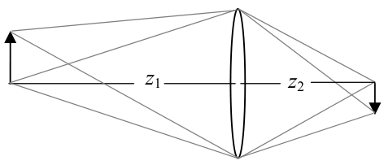
  <figcaption>图 7.1 焦距 f 的正薄透镜几何成像:物点(箭头端)发出的锥形光束被透镜收集,会聚到对应像点(截自原书)</figcaption>
</figure>

要成实像,\(z_1, z_2 > 0\) 且 \(f > 0\)。**正透镜(positive lens)**(\(f>0\))会聚光线,**负透镜**发散光线。实用系统常用多片透镜组控制像差或方便排布,但组合焦距仍必须是正的才能成像。

像高 \(y_2\) 与物高 \(y_1\) 之比叫**横向放大率(transverse magnification)**\(M_t\),单透镜系统:

\[
M_t = \frac{y_2}{y_1} = -\frac{z_2}{z_1}\,. \tag{7.2}
\]

负号表示**倒像**(\(y_2\) 取负值,图 7.1 里箭头朝下)。

成像系统还用**瞳(pupil)**刻画。瞳是虚拟孔径:**入瞳(entrance pupil, EP)**表示系统从物体方向看到的"收集开口",**出瞳(exit pupil, XP)**表示光离开系统去成像时的"出口开口"。瞳是**孔径光阑(aperture stop)**——限制收光的那个真实元件——经它前/后的光学元件所成的像。图 7.1 里透镜本身就是光阑;换个系统也可能是别的孔径。这里最关心光阑的一点:**它把入射场"切成饼干",是像里基本衍射效应的来源**——像差等别的因素会进一步破坏图像,但光阑造成的衍射是成像系统的**根本性能极限**。光阑与系统其他效应都可以折进瞳里,所以衍射分析统一用瞳这个概念。

<figure>
  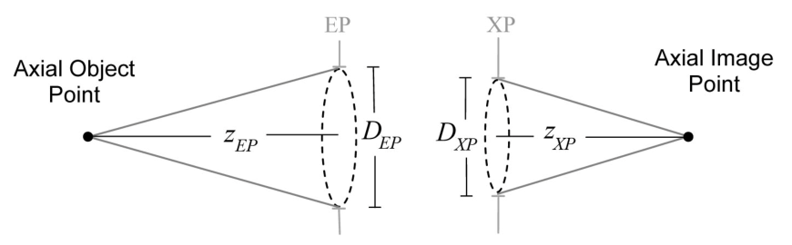
  <figcaption>图 7.2 成像系统的入瞳(EP)/出瞳(XP)模型:轴上物点到 EP 距离 zEP,XP 到轴上像点距离 zXP,直径 DEP/DXP(截自原书)</figcaption>
</figure>

图 7.2 的模型里,EP/XP 的先后次序与位置取决于具体系统。单薄透镜系统(图 7.1)最简单:主平面、瞳、透镜全在同一平面,\(z_1 = z_{EP}\)、\(z_2 = z_{XP}\)、\(D_{EP} = D_{XP} =\) 透镜直径——想本章例子时退回这个情形即可。但要想远一点:图 7.3 里光阑是**透镜后面的光圈(iris)**,XP 与光圈重合同径,EP 是把光圈"反着穿过"透镜成像得到的虚拟孔径——这时瞳距与主面距就不同了。

<figure>
  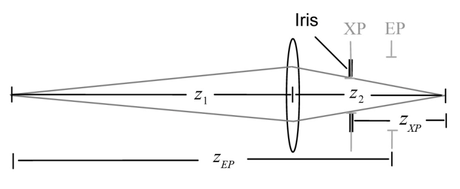
  <figcaption>图 7.3 光圈作光阑的单透镜系统:EP 是光圈经透镜成的(虚)像(截自原书)</figcaption>
</figure>

收集光量、像差系数、图像空间频谱含量等表达式里反复出现的参数是 **f 数(f-number,\(f/\#\))**——第 6 章介绍过。本章最有用的形式是**傍轴工作 f 数(paraxial working f-number)**:

\[
f/\# = \frac{z_{XP}}{D_{XP}}\,. \tag{7.3}
\]

它是"XP 到轴上像点那束光锥"的参数化(图 7.2)。

几何光学讨论的要点小结:

- **(a)** 主面距离 \((z_1, z_2)\) 决定像的横向放大率。
- **(b)** 系统孔径光阑带来像里**基本的衍射效应**。
- **(c)** 瞳的大小 \((D_{EP}, D_{XP})\) 与距离 \((z_{EP}, z_{XP})\) 进入系统的衍射分析。
- **(d)** 薄透镜成像系统:\(z_1 = z_{EP}\)、\(z_2 = z_{XP}\)、\(D_{EP} = D_{XP} =\) 透镜直径。

主面、瞳与几何成像的更多讨论见原书参考文献 1-3(Dereniak 几何光学、Smith 现代光学工程、Geary 镜头设计)。

!!! note "拓展:工作 f/# 与第 6 章的 f/# 什么关系?"
    第 6 章的 \(f/\# = |f|/D_L\) 是"平行光聚焦"情形:物在无穷远,像距 \(z_2 = f\),所以工作 \(f/\# = z_{XP}/D_{XP} = f/D_L\),两者一致。差别的适用范围:有限共轭成像(物在有限远,\(z_2 \neq f\))时,\(f/D_L\) 不再描述聚焦光锥,必须用式 (7.3) 的**工作 f 数**。习题 7.1 就是例子:同一枚 f/2.5 的透镜(\(f=50\) mm、\(D=20\) mm),物距 200 mm 时工作 \(f/\# = 66.7/20 = 3.33\)。遥感卫星那类"物方"问题(习题 7.8)则干脆用物方 \(f/\#_{OBJ} = z_{EP}/D_{EP}\)。

## 7.2 相干成像(Coherent Imaging)

### 7.2.1 相干成像理论

现在上傅里叶光学。一般成像布置见图 7.4:物面坐标 \((x,y)\)、像面坐标 \((u,v)\)、出瞳函数 \(P(x,y)\)。相干照明(比如激光)下的成像,最简形式是场经过**卷积**:

\[
U_i(u,v) = h(u,v) \circledast U_g(u,v)\,, \tag{7.4}
\]

\(u, v\) 是像面空间坐标,\(U_i\) 是像面场,\(h\) 是系统的**相干冲激响应(coherent impulse response)**。\(U_g\) 是几何光学预言的**理想几何像场(ideal geometrical-optics predicted image field)**——物场 \(U_o(x,y)\) 的缩放副本:

\[
U_g(u,v) = \frac{1}{|M_t|}\,U_o\!\left(\frac{u}{M_t},\,\frac{v}{M_t}\right). \tag{7.5}
\]

\(M_t\) 为负(式 7.2)时,\(U_g\) 相对物体是倒的。式 (7.4) 的意思:理想几何像被冲激响应"模糊"一次。变换到频域:

\[
G_i(f_U,f_V) = H(f_U,f_V)\,G_g(f_U,f_V)\,, \tag{7.6}
\]

<figure>
  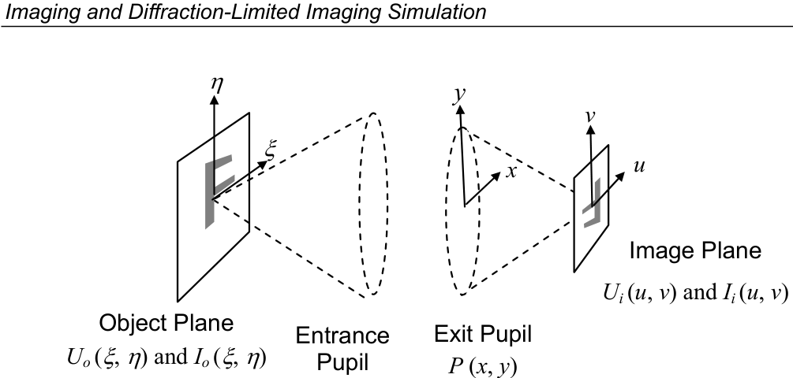
  <figcaption>图 7.4 成像仿真坐标定义:物面 Uo(ξ,η)、入瞳、出瞳 P(x,y)、像面 Ui(u,v) 与 Ii(u,v)(截自原书)</figcaption>
</figure>

其中 \(H\) 叫**相干传递函数(coherent transfer function)**,或**振幅传递函数(amplitude transfer function)**[4]:

\[
H(f_U,f_V) = P\!\left(-\lambda z_{XP} f_U,\,-\lambda z_{XP} f_V\right). \tag{7.7}
\]

一句话:**相干传递函数就是出瞳函数,按 \(-\lambda z_{XP}\) 缩放并反转**。为什么能这么简单?三条评注:

- **(a)** 瞳宗量里的负号给出一个缩放且反转的瞳——与式 (7.5) 里 \(M_t\) 的倒像相对应。
- **(b)** 假定对任何物点发出的波,XP 都理想地产生会聚到像点的球面波;瞳函数是**相对理想球面波前**定义的。偏离球面的波前误差用瞳里的复指数项描述——第 8 章的内容。
- **(c)** **衍射限(diffraction limited)**指瞳函数完美、只有瞳的**边界**参与衍射效应的系统。本章全是衍射限系统。

!!! note "拓展:式 (7.7) 为什么是"瞳的缩放反转"?"
    第 5 章夫琅禾费传播(式 5.16)已经算过一次:出瞳后,像点近旁的场是出瞳场的夫琅禾费图样,频率坐标与瞳面坐标差一个尺度 \(\lambda z_{XP}\),方向倒置(倒像)。所以"频率平面里的瞳"就是 \(P(-\lambda z_{XP} f_U, -\lambda z_{XP} f_V)\):频率 \(f_U\) 越高,对应瞳面上离轴越远的点——瞳半径 \(w_{XP}\) 卡住的最大频率自然是 \(f_0 = w_{XP}/(\lambda z_{XP})\),见式 (7.10)。这一句话在第 6 章也出现过一次:焦面(无穷远物的像面)= 夫琅禾费图样,当时瞳面就是透镜面。

### 7.2.2 相干传递函数例子

**方瞳**。定义

\[
P(x,y) = \mathrm{rect}\!\left(\frac{x}{2w_{XP}}\right)\mathrm{rect}\!\left(\frac{y}{2w_{XP}}\right), \tag{7.8}
\]

代入式 (7.7):

\[
H(f_U,f_V) = \mathrm{rect}\!\left(\frac{-\lambda z_{XP} f_U}{2w_{XP}}\right)\mathrm{rect}\!\left(\frac{-\lambda z_{XP} f_V}{2w_{XP}}\right). \tag{7.9}
\]

rect 是偶函数,负号可忽略。沿 \(u\) 或 \(v\) 方向的**相干截止频率(coherent cutoff frequency)**:

\[
f_0 = \frac{w_{XP}}{\lambda z_{XP}}\,. \tag{7.10}
\]

\(|f| > f_0\) 的空间频率不会保留在像面场里。

**圆瞳**。

\[
P(x,y) = \mathrm{circ}\!\left(\frac{\sqrt{x^2+y^2}}{w_{XP}}\right), \tag{7.11}
\]

\(w_{XP} = D_{XP}/2\)。相干传递函数

\[
H(f_U,f_V) = \mathrm{circ}\!\left(\frac{\sqrt{(-\lambda z_{XP} f_U)^2 + (-\lambda z_{XP} f_V)^2}}{w_{XP}}\right), \tag{7.12}
\]

即

\[
H(f_U,f_V) = \mathrm{circ}\!\left(\frac{\sqrt{f_U^2+f_V^2}}{f_0}\right), \tag{7.13}
\]

\(f_0\) 仍是式 (7.10) 的相干截止。与方瞳不同,圆瞳的截止在频率平面**各径向方向一致**。

!!! warning "circ 的两套约定(全书坑,这里再落地一次)"
    式 (7.11) 按 **Goodman 约定**书写:宗量分母 \(w_{XP}\) 就是**半径**;书附录 C.1 代码 `out=abs(r)<=1` 同样约定(宗量预先除好半径)。表 1.2 的 circ 印刷定义对应"分母 = 2×半径"(ch1 勘误,差 2 倍半径)。本笔记 Python 统一用公共模块 `base.circle(X, Y, R)`(**直接传半径**),MATLAB 侧用本目录 `circ.m`(附录 C.1 原样):`H=circ(sqrt(Fu.^2+Fv.^2)/f0)` 里的 `f0` 就是"半径"。照表 1.2 抄实现,瞳会大一倍。

**辐照度的频率翻倍**。观测或记录相干像时,实际测量的是辐照度 \(I_i = |U_i|^2\)。平方操作让辐照度图像理论上获得至多**两倍**于场的频率内容——想想恒等式 \(\cos^2(2\pi bx) = \frac{1}{2}[1+\cos(2\pi \cdot 2b\,x)]\):频率 \(b\) 的条纹平方后出现 \(2b\) 的分量。所以辐照度图像要考虑的截止是

\[
2f_0 = \frac{2w_{XP}}{\lambda z_{XP}}\,. \tag{7.14}
\]

用 \(2w_{XP} = D_{XP}\) 与式 (7.3):

\[
2f_0 = \frac{1}{\lambda\,(f/\#)}\,. \tag{7.15}
\]

### 7.2.3 衍射限相干成像仿真

基于式 (7.4) 的计算机仿真实现:

\[
U_i(u,v) = \mathfrak{F}^{-1}\left\{H(f_U,f_V)\,\mathfrak{F}\left\{U_g(u,v)\right\}\right\}. \tag{7.16}
\]

仿真从一幅采样的"理想"图像开始(通常是一个图像文件),设采样间隔 \(\Delta u\)、边长 \(L\)。理想图像里最高的空间频率是奈奎斯特频率 \(f_N = 1/(2\Delta u)\),衍射限仿真要求

\[
2f_0 \leq f_N\,. \tag{7.17}
\]

原因:理想图像里没有的频率,仿真也造不出来。代入式 (7.15)、解出采样间隔与边长约束:

\[
\Delta u \leq \frac{\lambda\,(f/\#)}{2}\,, \tag{7.18}
\]

\[
L \leq M\,\frac{\lambda\,(f/\#)}{2}\,. \tag{7.19}
\]

式 (7.17) 相当苛刻。算个例子:薄透镜直径 12.5 mm、焦距 125 mm、\(\lambda = 0.5\ \mu\text{m}\)、\(250\times250\) 阵列。f 数:

\[
f/\# = \frac{125}{12.5} = 10. \tag{7.20}
\]

代入式 (7.18):

\[
\Delta u \leq \frac{0.5\ \mu\text{m}\cdot 10}{2} = 2.5\ \mu\text{m}\,, \tag{7.21}
\]

边长约束:

\[
L \leq 250\times 2.5\ \mu\text{m} = 0.625\ \text{mm}\,. \tag{7.22}
\]

像面尺寸被限制在 \(0.625\times0.625\) mm——很小。换 \(2048\times2048\) 阵列也不过 \(5.12\times5.12\) mm。这说明:傅里叶光学成像仿真考察的是像面上"近衍射限性能"的一小块;想覆盖 10-20 mm 量级的视场,阵列要非常大。

!!! note "拓展:式 (7.17) 的第二张面孔——FFT 自相关的免缠绕条件"
    式 (7.17) 除了"辐照度频率要能表示",还有一层离散傅里叶的隐藏身份:7.3 节的 OTF 要用 FFT 算自相关,FFT 卷积/自相关是**循环**的——真自相关(支撑 \(2f_0\))加周期延拓(副本间距 \(1/\Delta u = 2f_N\))无重叠的条件是 \(2f_0 \leq 2f_N - 2f_0\),整理正是 \(2f_0 \leq f_N\)。违反会怎样?本章 Python 把系统改到 f/4(\(2f_0 = 5\times10^5 > f_N\)):FFT-OTF 与式 (7.31) 解析值的最大差从 f/10 的 \(3.3\times10^{-3}\) 恶化到 \(7.9\times10^{-2}\),高频区被"从对面绕回来"的副本污染(图 7-P9 右)。所以式 (7.17) 是仿真**同时保住图像采样与 OTF 计算**的双重条件。

先解决理想图像。原书用一幅 \(250\times250\) 像素的 USAF 1951 分辨率测试板 `.png`(实物的测试板印在玻璃基板上,至今仍用于镜头测试),下载地址已失效;网上可以找到类似图,或自己造一幅特征尺寸丰富的图。书脚本读入后的理想图像(书图 7.5):

<figure>
  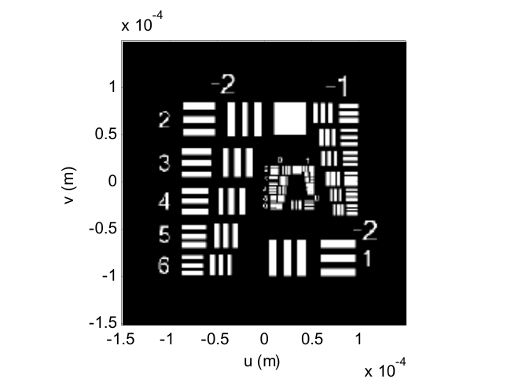
  <figcaption>图 7.5 USAF 测试板理想图像:250×250 像素映射到 L = 0.3 mm(截自原书)</figcaption>
</figure>

本章笔记用脚本生成同规格的 USAF 式分辨率板(下节代码直接读它):

<figure>
  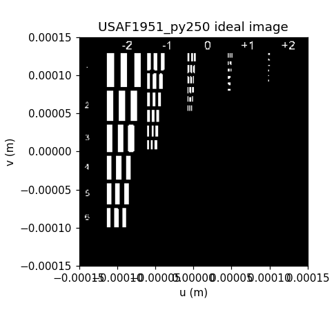
  <figcaption>图 7-P1 笔记自制的 USAF 式分辨率板(250×250,映射 L = 0.3 mm、Δu = 1.2 μm;对应原书图 7.5 的角色):组 g、单元 n 的条纹频率 2e5·2^(g+n/6) cyc/m,组-2/单元6 = 1e5 cyc/m(笔记自制)</figcaption>
</figure>

!!! note "原书图表口径:USAF 板的实际缩放"
    书判读"组-2/单元6 条纹周期约 \(1\times10^{-5}\) m(即 1e5 cyc/m)"——这依赖他用的 PNG 映射到 0.3 mm 后的实际缩放,并不是 USAF 1951 的标称频率(标称组-2 只有零点几 lp/mm)。书 7.3.3 节又判读组-1/单元3 约 \(1.7\times10^5\) cyc/m。笔记的自制板按 USAF **相对**标尺(相邻单元 ×\(2^{1/6}\)、相邻组 ×2)锚定组-2/单元6 = 1e5 cyc/m,与书的判读一拍即合;组-1/单元3 在自制板上为 \(1.41\times10^5\) cyc/m(书板 1.7e5,同一量级),所有定性结论一致。另外原书说"归一化后该图只含 0 和 1,sqrt 不起作用"——笔记的板也二值化,保持同一条讨论成立。

MATLAB 新建脚本 **coh_image**:

=== "MATLAB"

    ```matlab
    % ===== 书 7.2.3 节:coh_image 相干成像例子(逐行忠实 + 中文注释) =====
    % 完整脚本见 matlab/fourier/ch7/coh_image.m;先跑 make_usaf_chart.m
    % 生成 USAF1951_py250.png(替代已失效的原书下载文件)。
    % 实现式 (7.16):Ui = F^-1{H * F{Ug}},H = circ(sqrt(Fu^2+Fv^2)/f0)
    % (式 7.13)。参数:f/10、L=0.3 mm、M=250 -> du=1.2 um(满足式 7.18);
    % 频率盘点:fN=4.17e5、2f0=2e5、f0=1e5 cyc/m(式 7.17 满足,裕量 2.08)。
    % 图 7.5/7.6/7.7/7.8 对应 figure(1)/(2)/(3)/(4)。
    % MATLAB/Python 差异:
    %   - 第 30 行 H.*.99 是 MATLAB 7.1 画不动单位高圆面的显示补丁;
    %   - 书第 34 行 xlabel('fv')/ylabel('fu') 与 surf(fu,fv,...) 的轴映射
    %     相反(圆瞳下无影响;矩形瞳习题 7.3 必须改正,本文件已改对);
    %   - vindex=round(vvalue/du+(M/2+1)):1-based;numpy 是 M//2+round(...);
    %   - circ 是附录 C.1 函数(out=abs(r)<=1,Goodman 半径约定,本目录提供)。
    % ------------- 以下为书原代码(节选,第 1-51 行) -------------
    %  coh_image Coherent Imaging Example

    A=imread('USAF1951_py250','png'); %read image file
    [M,N]=size(A);         %get image sample size
    A=flipud(A);           %reverse row order
    Ig=single(A);          %integer to floating
    Ig=Ig/max(max(Ig));    %normalize ideal image

    ug=sqrt(Ig);           %ideal image field
    L=0.3e-3;              %image plane side length (m)
    du=L/M;                %sample interval (m)
    u=-L/2:du:L/2-du; v=u;

    lambda=0.5*10^-6;      %wavelength
    wxp=6.25e-3;           %exit pupil radius
    zxp=125e-3;            %exit pupil distance
    f0=wxp/(lambda*zxp);   %cutoff frequency

    fu=-1/(2*du):1/L:1/(2*du)-(1/L); %freq coords
    fv=fu;
    [Fu,Fv]=meshgrid(fu,fv);
    H=circ(sqrt(Fu.^2+Fv.^2)/f0);

    H=fftshift(H);
    Gg=fft2(fftshift(ug));
    Gi=Gg.*H;
    ui=ifftshift(ifft2(Gi));
    Ii=(abs(ui)).^2;

    vvalue=-0.8e-4;       %select row (y value)
    vindex=round(vvalue/du+(M/2+1)); %convert row index
    plot(u,Ii(vindex,:),u,Ig(vindex,:),':');
    ```

=== "Python"

    ```python
    # ===== 书 7.2.3 节:coh_image(完整脚本见 python/fourier/ch7/ch7_coh_image.py) =====
    # 公共积木:coords(坐标)、circle(圆盘)来自 python/fourier/common/base.py;
    # 相干传递函数与成像管线在 ch7_imaging.py(H_circ / coh_image)。
    from base import coords
    from ch7_imaging import freq_coords, H_circ, coh_image
    from ch7_usaf_chart import ensure_chart, L_IMG, N_PX

    A = ensure_chart() * 255.0          # 书第 3 行 imread(0..255)
    A = np.flipud(A)                    # 书第 5 行:底行 -> 负 v(图像顶行在前的存储约定)
    Ig = A / A.max()                    # 书第 6-7 行:归一化
    ug = np.sqrt(Ig)                    # 书第 9 行:辐照度 -> 场幅度(二值图无差别)

    L, M = L_IMG, N_PX                  # 0.3 mm、250
    du = L / M                          # 1.2 um
    u, _ = coords(L, M)                 # 书第 12 行

    lam, wxp, zxp = 0.5e-6, 6.25e-3, 125e-3
    f0 = wxp / (lam * zxp)              # 书第 22 行:1e5 cyc/m
    fu = freq_coords(L, M)              # 书第 24 行:-1/(2du) : 1/L : 1/(2du)-1/L
    H = H_circ(fu, f0)                  # = circle(FU,FV,f0) = circ(sqrt(Fu^2+Fv^2)/f0)

    ui, Gi = coh_image(ug, H)           # 书第 35-38 行:fftshift -> fft2 -> 乘 H -> ifft2
    Ii = np.abs(ui) ** 2                # 书第 39 行

    row = M // 2 + int(round(-0.8e-4 / du))   # 书第 48-49 行(v=-0.8e-4 m;0-based)
    ```

仿真结果:图 7.5 是理想图像(书图 7.5,笔记版见图 7-P1);图 7.6 是相干传递函数——半径 \(f_0\) 的频率圆盘。数值盘点:\(f_N = 1/(2\times1.2\ \mu\text{m}) = 4.17\times10^5\) cyc/m,\(2f_0 = 1/(0.5\ \mu\text{m}\cdot10) = 2\times10^5\)、\(f_0 = 1\times10^5\) cyc/m,式 (7.17) 满足。若式 (7.17) 被违反,图 7.6 的瞳圆会超过阵列一半。书代码里 `surf` + 光照的组合是为了把 \(H\) 显示得更立体;MATLAB 7.1 的 surf 画不动单位高度的圆面,所以乘 0.99——新版 MATLAB 不需要。

!!! warning "原书代码标注不一致:surf 的轴标签与 0.99 补丁"
    两处:(1) 书第 30 行 `surf(fu,fv,H)` 之后第 34 行写 `ylabel('fu (cyc/m)'); xlabel('fv (cyc/m)')`——`surf` 的第一参数 \(f_u\) 应配 x 轴,标签写反了。圆瞳下 \(H\) 各向同性,显示无恙;矩形瞳(习题 7.3)照抄的话曲面和像的 x/y 就整个标反。本笔记 MATLAB 文件已按正确映射写。(2) 书第 30 行 `H.*.99`:MATLAB 7.1 的 surf 画不动单位高度的圆面,乘 0.99 是当年显示权宜之计,新版 MATLAB 直接删掉即可。

<figure>
  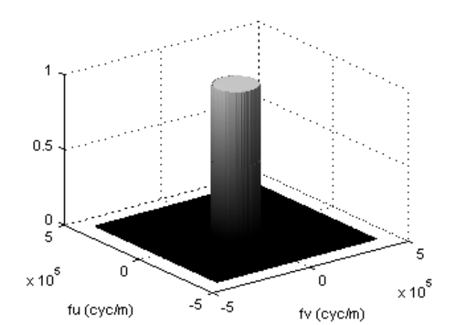
  <figcaption>图 7.6 相干传递函数:f/10 圆瞳,半径 f0 = 1e5 cyc/m(截自原书)</figcaption>
</figure>

<figure>
  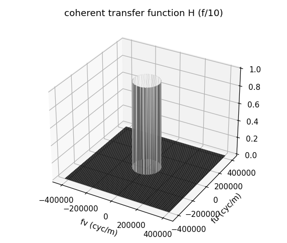
  <figcaption>图 7-P2 coh_image 复现:相干传递函数 H(笔记自制,对应原书图 7.6)</figcaption>
</figure>

仿真出的像见图 7.7(显示时对辐照度开平方 `nthroot(Ii,2)` 提亮对比度):特征被模糊,一些三条组分辨不开;相长/相消干涉造成"振铃(ringing)"。

<figure>
  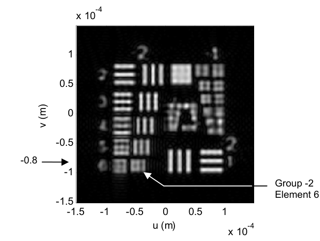
  <figcaption>图 7.7 模拟衍射限相干像(对比度增强)(截自原书)</figcaption>
</figure>

<figure>
  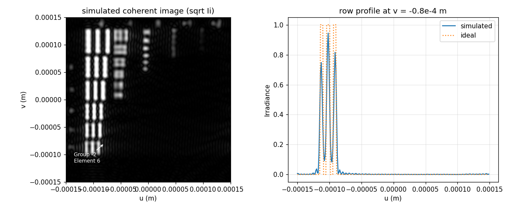
  <figcaption>图 7-P3 coh_image 复现:模拟相干像(sqrt 拉伸)+ v = −0.8×10⁻⁴ m 行剖面(笔记自制,对应原书图 7.7/7.8)</figcaption>
</figure>

最后一段代码画剖面:先选一个物理 \(v\) 坐标(`vvalue`),用 `round` 找最近的阵列行号,把理想与模拟剖面叠画。图 7.8 里组-2/单元6 是"能分辨"的最小组:放大剖面看,它的三条竖纹周期约 \(1\times10^{-5}\) m,对应 \(1\times10^5\) cyc/m——正好是相干截止 \(f_0\)。虽然辐照度取了平方(频率可以到 \(2f_0\)),这种模拟相干**辐照度**图像的表观分辨率通常仍贴近相干截止。

<figure>
  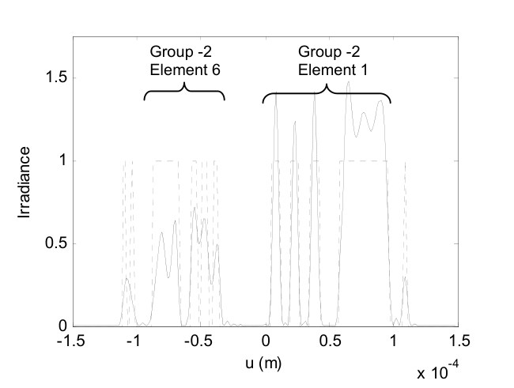
  <figcaption>图 7.8 v = −0.8×10⁻⁴ m 行剖面:组-2/单元6 与组-2/单元1(截自原书)</figcaption>
</figure>

<figure>
  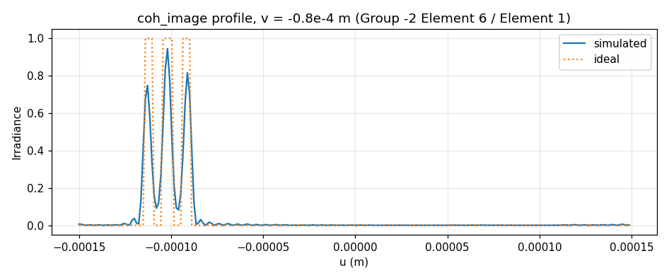
  <figcaption>图 7-P4 coh_image 复现:剖面(数值实线 vs 理想点线),组-2/单元6 条纹周期实测 10.8 μm → 9.3e4 cyc/m ≈ f0;单元1 边缘过冲 1.50(相干振铃)(笔记自制)</figcaption>
</figure>

本章 Python 复现的定量检查(\(L=0.3\) mm、\(M=250\),其余参数同书):

- **场谱支撑**:像面场的频谱 \(|G_i|\) 的最大半径 = **1.000e5 cyc/m,与 \(f_0\) 逐位一致**——瞳圆盘把谱拦得干干净净;
- **辐照度谱支撑**:\(|\mathfrak{F}\{I_i\}|\) 的最大半径 = **2.000e5 cyc/m,与 \(2f_0\) 逐位一致**——"平方使频率翻倍"不只是一句恒等式;
- 组-2/单元6 条纹周期实测 10.8 μm(9.26e4 cyc/m ≈ \(f_0\),书判读 1e5);
- 相干振铃:组-2/单元1 大条边缘过冲峰值 **1.50**(理想 1.0)。

图 7.9 给出不同瞳径/f 数的谱(对数显示)与像:f/5(\(f_0 = 2\times10^5\))接近理想、f/20(\(f_0 = 0.5\times10^5\))几乎全糊——注意理想图像的 \(f_N = 4.17\times10^5\) 不变,变的是瞳。

<figure>
  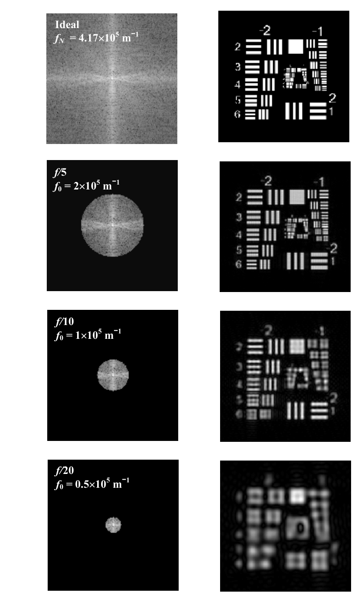
  <figcaption>图 7.9 相干像谱幅度(左列,log)与对应辐照度像(右列):Ideal/f5/f10/f20(截自原书)</figcaption>
</figure>

<figure>
  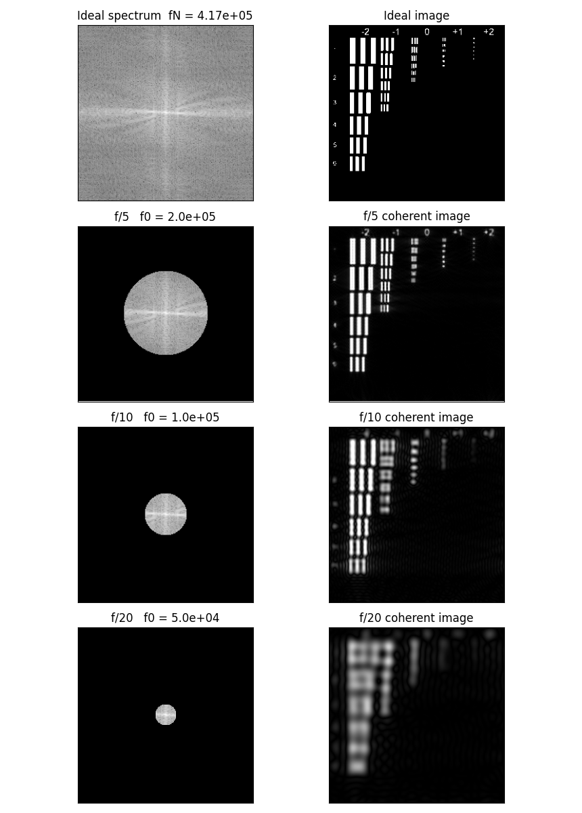
  <figcaption>图 7-P5 f/# 系列复现(相干):通带圆盘随 f/# 缩小,像逐步模糊(笔记自制,对应原书图 7.9)</figcaption>
</figure>

### 7.2.4 粗糙物体(Rough Object)

前面的测试板是"二值"物体:场幅度非 0 即 1,相位处处为 0。但真实物体被相干光照明时,**微观表面**对衍射场影响巨大:多数表面相对光波长是"粗糙"的——凹坑与凸起反射的波相位差显著。最简单的建模:给物体(理想图像)场乘一个随机复指数相位:

=== "MATLAB"

    ```matlab
    % ===== 书 7.2.4 节:coh_image 的改动行(完整脚本 coh_image_rough.m) =====
    ug=sqrt(Ig).*exp(j*2*pi*rand(M)); %ideal image
    ```

=== "Python"

    ```python
    # ===== 书 7.2.4 节(完整脚本见 python/fourier/ch7/ch7_rough_speckle.py) =====
    rng = np.random.default_rng(7)                      # 固定种子,数值可复现
    ug = np.sqrt(Ig) * np.exp(1j * 2 * np.pi * rng.random((M, M)))
    ```

`rand` 产生 \([0,1)\) 均匀分布的 \(M\times M\) 随机数,乘 \(2\pi\) 后覆盖所有相位值 \([0,2\pi]\)——每个样本点的相位独立且互不相关,代表相对光波长"极粗糙"的随机表面。跑出的辐照度图像见图 7.10:各点发出的子波相干干涉,形成 **speckle(相干斑)**——随机的一堆斑点、点与小曲线。相干斑是著名现象[5]:拿激光笔照墙、轻轻移动光斑或歪一下头,看到的闪烁就是 speckle。图 7.10 说明:speckle 会严重妨碍从图像里解读信息。

<figure>
  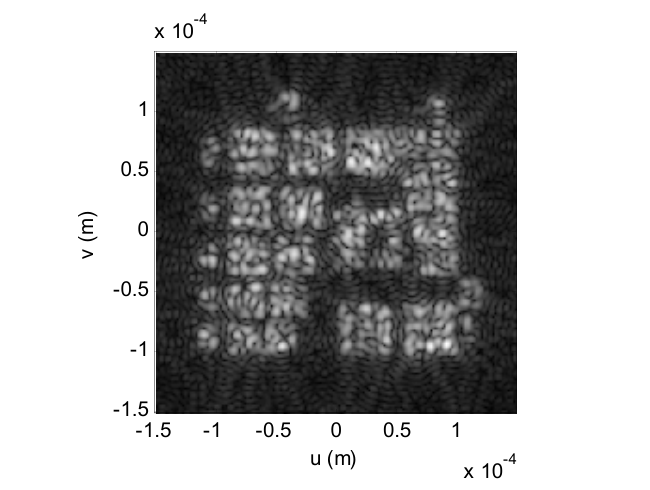
  <figcaption>图 7.10 粗糙表面的模拟相干像(speckle)(截自原书)</figcaption>
</figure>

<figure>
  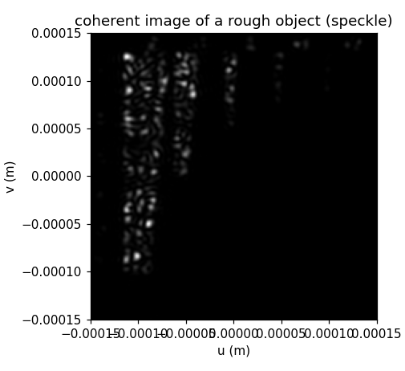
  <figcaption>图 7-P6 粗糙物体复现(2π 随机相位,f/10;笔记自制,对应原书图 7.10)</figcaption>
</figure>

本章 Python 复现还把 speckle 定量化(固定随机种子):

- **对比度** \(C = \mathrm{std}(I_i)/\langle I_i\rangle\):均匀照明的极粗糙物体实测 **0.998**——充分发展 speckle 的理论值 1(辐照度服从指数分布),逐位吻合;
- 习题 7.5 会看到:粗糙度调小,\(C\) 断崖下跌(\(\pi\) → 0.20、\(0.4\pi\) → 0.03);孔径变小,\(C\) 不变但**颗粒变大**(约 \(1.22\lambda(f/\#)\))。

## 7.3 非相干成像(Incoherent Imaging)

### 7.3.1 非相干成像理论

把物体想象成一堆**随机辐射的点源**。物体可能被太阳之类的光源照亮,但最终离开物体表面的场包含一段波长谱、相位随时间随机变化——这种源产生的干涉条纹不稳定、变化极快,被响应"时间平均场模平方"的传感器**平均掉**。**完全非相干光(perfectly incoherent light)**指各辐射点源的复场相量**随机独立**:不同点、不同时刻之间没有关联。直观图像:图 7.10 里的 speckle 在时间上随机快速变化,平均够久,图像纹理趋于平滑。

非相干照明的线性空间不变成像模型[4]:

\[
I_i(u,v) = \left|h(u,v)\right|^2 \circledast I_g(u,v)\,, \tag{7.23}
\]

\(h\) 与式 (7.4) 里的相干冲激响应相同,\(I_g\) 是理想几何**辐照度**像。对比:相干成像对**场**线性,非相干成像对**辐照度**线性。冲激响应 \(|h(u,v)|^2\) 通称**点扩散函数(point spread function,PSF)**。这里的讨论限于波长分布在中心波长 \(\lambda\) 附近很窄的光。

对应式 (7.23) 的谱关系:

\[
G_i(f_U,f_V) = \mathcal{H}(f_U,f_V)\,G_g(f_U,f_V)\,, \tag{7.24}
\]

\(\mathcal{H}\) 叫**光学传递函数(optical transfer function,OTF)**。按惯例 OTF 归一为

\[
\mathcal{H}(f_U,f_V) = \frac{\mathfrak{F}\left\{|h(u,v)|^2\right\}}{\displaystyle\iint_{-\infty}^{\infty}|h(u,v)|^2\,du\,dv}\,. \tag{7.25}
\]

对分子用傅里叶自相关定理:OTF 是相干传递函数 \(\mathcal{H}\cdots\)准确说是 \(H(f_U,f_V)\)——的**归一化自相关**。归一化把 OTF 在零频 \((f_U,f_V)=(0,0)\) 处定标为 1:OTF 不再承担"改变理想几何像总光功率"的职责。简写记号(★ 表示相关):

\[
\mathcal{H}(f_U,f_V) = H(f_U,f_V)\star H(f_U,f_V)\big|_{norm}\,. \tag{7.26}
\]

!!! note "拓展:为什么"平方 → 自相关"?"
    相干路径:谱上乘 \(H\)(式 7.6);非相干路径:辐照度 \(I_i = |U_i|^2\),两个共轭场相乘 → 谱上等于 \(G_i\) 与 \(G_i^*\) 的卷积 → 域上就是 \(H(f)\) 与 \(H^*(f'-f)\) 的**自相关**(式 7.25/7.26)。直接后果:非相干截止是相干的两倍(\(H\) 的支撑半径 \(f_0\),自相关的支撑半径 \(2f_0\)),OTF 在零频恒为 1,衍射限 OTF 还**处处非负**(\(|\text{自相关}| \geq 0\))——像差系统(第 8 章)的 OTF 才会出现负值。

### 7.3.2 光学传递函数例子

**方瞳**。从式 (7.9) 出发,先求傅里叶变换再取模平方:

\[
\left|\mathfrak{F}\left\{H(f_U,f_V)\right\}\right|^2 = \left(\frac{4w_{XP}^2}{\lambda^2 z_{XP}^2}\right)^2 \mathrm{sinc}^2\!\left(\frac{2w_{XP}}{\lambda z_{XP}}\,u\right)\mathrm{sinc}^2\!\left(\frac{2w_{XP}}{\lambda z_{XP}}\,v\right). \tag{7.27}
\]

对式 (7.27) 做逆变换(自相关定理),得自相关函数:

\[
H(f_U,f_V)\star H(f_U,f_V) = \frac{4w_{XP}^2}{\lambda^2 z_{XP}^2}\,\Lambda\!\left(\frac{\lambda z_{XP}}{2w_{XP}}\,f_U\right)\Lambda\!\left(\frac{\lambda z_{XP}}{2w_{XP}}\,f_V\right). \tag{7.28}
\]

去掉前导乘子(零频归一),OTF 就是

\[
\mathcal{H}(f_U,f_V) = \Lambda\!\left(\frac{\lambda z_{XP}}{2w_{XP}}\,f_U\right)\Lambda\!\left(\frac{\lambda z_{XP}}{2w_{XP}}\,f_V\right), \tag{7.29}
\]

这个 OTF 的**非相干截止频率(incoherent cutoff frequency)**

\[
2f_0 = \frac{2w_{XP}}{\lambda z_{XP}}\,, \tag{7.30}
\]

是该孔径相干截止的两倍——与式 (7.14) 的口径一致。

!!! note "拓展:式 (7.27) 里的 (u,v) 是谁?"
    这一步把 \(H(f_U,f_V)\) 当作 \((f_U,f_V)\) 的函数做 FT,共轭变量记成了 \((u,v)\)——冲激响应空间的坐标,不是像面辐照度 \(I_i\) 的坐标。链条是:\(H\) 的逆变换是 \(h\)(相干冲激响应),所以 \(|\mathfrak{F}\{H\}|^2 = |h|^2 = \mathrm{PSF}\),再对 PSF 做逆变换回到频率域就是自相关(式 7.28)。两次变换方向相反、量纲互逆,中间那步的 \((u,v)\) 只在推导里露一面,别把它当成像面坐标。

**圆瞳**。式 (7.13) 的归一化自相关没有闭式初等表达,书用**图解相关**的办法[4]:两个半径 \(f_0\) 的圆盘错开 \(\rho\) 时的重叠面积(两个圆冠)除以圆盘面积:

\[
\mathcal{H}(f_U,f_V) = \begin{cases}\dfrac{2}{\pi}\left[\arccos\!\left(\dfrac{\rho}{2\rho_0}\right)-\left(\dfrac{\rho}{2\rho_0}\right)\sqrt{1-\left(\dfrac{\rho}{2\rho_0}\right)^2}\right], & \rho \leq 2\rho_0\\[2.2ex] 0, & \text{otherwise}\end{cases} \tag{7.31}
\]

其中 \(\rho = \sqrt{f_U^2+f_V^2}\),非相干截止

\[
2\rho_0 = \frac{2w_{XP}}{\lambda z_{XP}} = \frac{1}{\lambda\,f/\#}\,. \tag{7.32}
\]

与方瞳的硬边三角形不同,圆瞳 OTF 是各向同性的平滑"圆冠",在截止 \(2\rho_0\) 处以**零斜率**触地。

!!! note "拓展:式 (7.31) 的几何推导(两圆重叠面积)"
    半径 \(f_0\) 的圆盘与自身错开 \(\rho\):重叠区 = 两个圆冠。单个圆冠面积 = \(f_0^2\arccos(\rho/2f_0) - (\rho/2)\sqrt{f_0^2-(\rho/2)^2}\),两冠合计 = \(2f_0^2\arccos(\rho/2f_0) - \frac{\rho}{2}\sqrt{4f_0^2-\rho^2}\)。除以圆盘面积 \(\pi f_0^2\),整理: \(\frac{2}{\pi}[\arccos(\rho/2f_0) - (\rho/2f_0)\sqrt{1-(\rho/2f_0)^2}]\)——式 (7.31)。自相关在零移位处 = 总面积 → 归一化后 OTF(0) = 1;支撑到 \(\rho = 2f_0\)(错开两个半径就完全不重叠)。

### 7.3.3 衍射限非相干成像仿真

基于式 (7.23) 的实现:

\[
I_i(u,v) = \mathfrak{F}^{-1}\left\{\mathcal{H}(f_U,f_V)\,\mathfrak{F}\left\{I_g(u,v)\right\}\right\}. \tag{7.33}
\]

形式与相干情形相同(OTF 本来就来自相干传递函数),判据式 (7.17) 依然适用。脚本 **incoh_image** 用与 7.2.3 节相同的参数:

=== "MATLAB"

    ```matlab
    % ===== 书 7.3.3 节:incoh_image 非相干成像例子(逐行忠实 + 中文注释) =====
    % 完整脚本见 matlab/fourier/ch7/incoh_image.m。
    % 关键行(第 22-23 行):OTF = ifft2(abs(fft2(fftshift(H))).^2) 再除零频值
    %   ——FFT 自相关定理(式 7.25/7.26),OTF 故意留在 FFT 排列(不 fftshift),
    %   与第 32 行 fft2(fftshift(Ig)) 同排列,直接逐点相乘(书评注 c)。
    % 第 36 行:real + 负值清零(数值噪声,书评注 d)。
    % 图 7.11/7.12/7.13 对应 figure(2)/(3)/(4)。
    % MATLAB/Python 差异:OTF(1,1) 是 1-based 零频样本;numpy 写 OTF[0,0]。
    % ------------- 以下为书原代码(节选,第 1-48 行) -------------
    %  incoh_image Incoherent Imaging Example

    A=imread('USAF1951_py250','png'); %read image file
    [M,N]=size(A);         %get image sample size
    A=flipud(A);           %reverse row order
    Ig=single(A);          %integer to floating
    Ig=Ig/max(max(Ig));    %normalize ideal image

    L=0.3e-3;              %image plane side length (m)
    du=L/M;                %sample interval (m)
    u=-L/2:du:L/2-du; v=u;

    lambda=0.5*10^-6;      %wavelength
    wxp=6.25e-3;           %exit pupil radius
    zxp=125e-3;            %exit pupil distance
    f0=wxp/(lambda*zxp);   %coherent cutoff

    fu=-1/(2*du):1/L:1/(2*du)-(1/L); %freq coords
    fv=fu;
    [Fu,Fv]=meshgrid(fu,fv);
    H=circ(sqrt(Fu.^2+Fv.^2)/f0);
    OTF=ifft2(abs(fft2(fftshift(H))).^2);
    OTF=OTF/OTF(1,1);

    Gg=fft2(fftshift(Ig)); %convolution
    Gi=Gg.*OTF;
    Ii=ifftshift(ifft2(Gi));
    %remove residual imag parts, values <  0
    Ii=real(Ii); mask=Ii>=0; Ii=mask.*Ii;

    vvalue=0.2e-4;         %select row (y value)
    vindex=round(vvalue/du+(M/2+1)); %convert row index
    plot(u,Ii(vindex,:),u,Ig(vindex,:),':');
    ```

=== "Python"

    ```python
    # ===== 书 7.3.3 节:incoh_image(完整脚本见 python/fourier/ch7/ch7_incoh_image.py) =====
    from ch7_imaging import H_circ, otf_from_H, incoh_image   # 逐行对应书 21-23/32-36 行

    Ig = ensure_chart(); Ig = np.flipud(Ig); Ig = Ig / Ig.max()
    L, M = L_IMG, N_PX
    du = L / M
    lam, wxp, zxp = 0.5e-6, 6.25e-3, 125e-3
    f0 = wxp / (lam * zxp)              # 书第 16 行:相干截止
    fu = freq_coords(L, M)
    H = H_circ(fu, f0)                  # 书第 21 行
    OTF = otf_from_H(H)                 # 书第 22-23 行(ifft2(|fft2(fftshift(H))|^2)/OTF[0,0])
    Ii = incoh_image(Ig, OTF)           # 书第 32-36 行(real + 负值清零)
    row = M // 2 + int(round(+0.2e-4 / du))   # 书第 45-46 行(v=+0.2e-4 m)
    ```

书代码的四条评注:(a) 第 7 行要用 \(I_g\) 而不是 \(U_g\);(b) 第 22 行 OTF 用自相关定理算;(c) 第 23 行除以自相关的零频值归一,且 OTF **留在移位排列**;(d) 第 36 行算出的 \(I_i\) 本应为正实数,数值精度会带来小的虚部/负值——imagesc 和 plot 不认,置零即可。

衍射限 OTF 见图 7.11,像见图 7.12。与相干像(图 7.7)相比:**分辨率更好**(看组-1/单元3 的三条),而且**没有振铃**。图 7.13 的剖面(v = 0.2×10⁻⁴ m)里组-1/单元3 刚可分辨:这些条纹的空间频率约 \(1.7\times10^5\) cyc/m,略小于但同量级于非相干截止 \(2f_0 = 2\times10^5\) cyc/m。

<figure>
  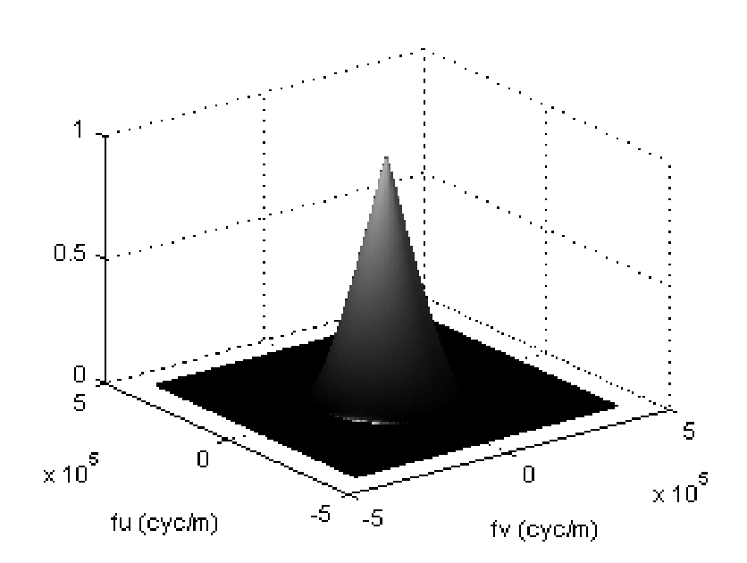
  <figcaption>图 7.11 非相干(光学)传递函数:圆瞳 OTF,支撑半径 2f0(截自原书)</figcaption>
</figure>

<figure>
  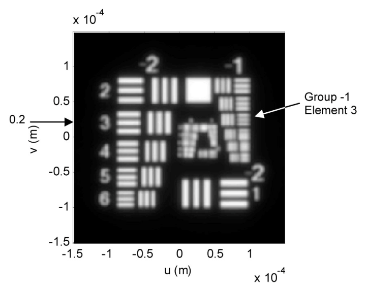
  <figcaption>图 7.12 模拟衍射限非相干像(对比度增强)(截自原书)</figcaption>
</figure>

<figure>
  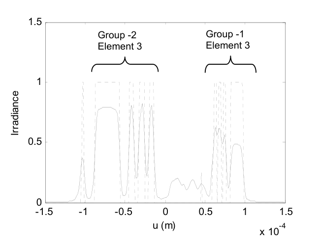
  <figcaption>图 7.13 v = +0.2×10⁻⁴ m 行剖面:组-1/单元3 刚可分辨(截自原书)</figcaption>
</figure>

<figure>
  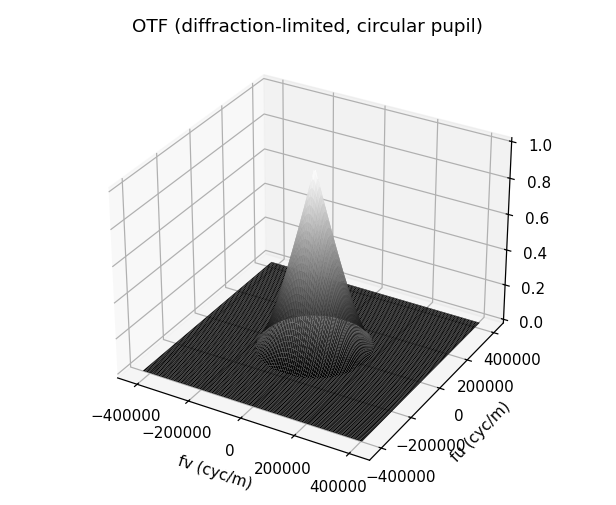
  <figcaption>图 7-P7 incoh_image 复现:OTF 曲面(笔记自制,对应原书图 7.11)</figcaption>
</figure>

<figure>
  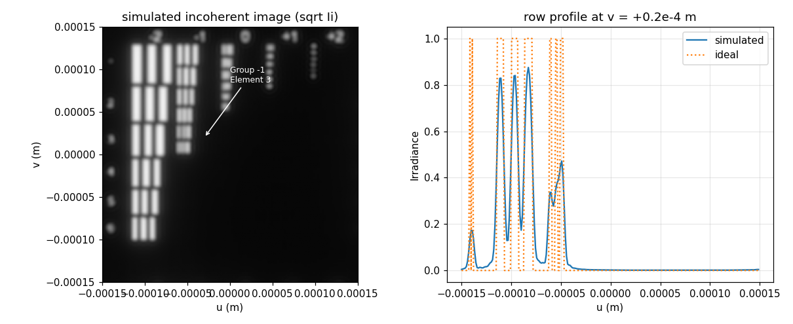
  <figcaption>图 7-P8 incoh_image 复现:模拟非相干像 + v = +0.2×10⁻⁴ m 剖面(笔记自制,对应原书图 7.12/7.13)</figcaption>
</figure>

本章 Python 复现的定量检查(参数同书):

- **OTF(0,0) = 1.000000**(归一化);OTF 最小值 \(-2.5\times10^{-16}\)——衍射限 OTF 实且非负,数值上"踩零";
- **OTF 支撑半径 = 2.000e5 cyc/m,与 \(2f_0\) 逐位一致**;
- **解析对拍**:FFT 自相关 OTF vs 式 (7.31) 圆瞳解析式最大差 **3.25e-3**;方瞳(式 7.29)最大差 **1.63e-2**(rect 边缘的 Gibbs,量级合理);
- **免缠绕演示**(拓展):系统改 f/4(\(2f_0 = 5\times10^5 > f_N\)),FFT-OTF 与解析的最大差恶化到 **7.87e-2**——高频被周期副本污染(图 7-P9 右);
- 剖面里组-1/单元3(自制板 1.41e5 cyc/m)调制度 0.74(OTF 在该频率传函 0.18,条纹可辨认);同剖面组-2/单元3 调制度 0.96;**无振铃**:组-2/单元1 处最大值 0.883(相干像同处 1.50)。

<figure>
  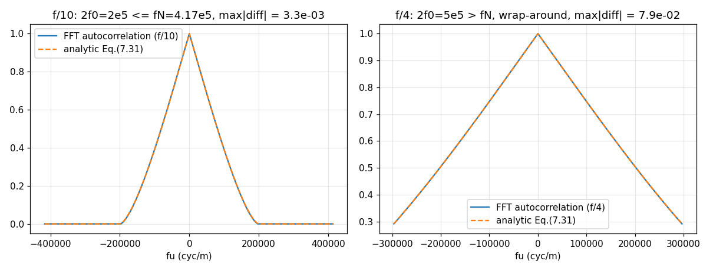
  <figcaption>图 7-P9 OTF 验证:左——f/10 时 FFT 自相关与式 (7.31) 解析重合(最大差 3.3e-3);右——f/4 违反式 (7.17) 时高频环绕污染(最大差 7.9e-2)(笔记自制)</figcaption>
</figure>

图 7.14 是与图 7.9 同系列的非相干像(f/5、f/10、f/20,谱按五次方根拉伸):这一组里非相干光明显改善图像质量。

<figure>
  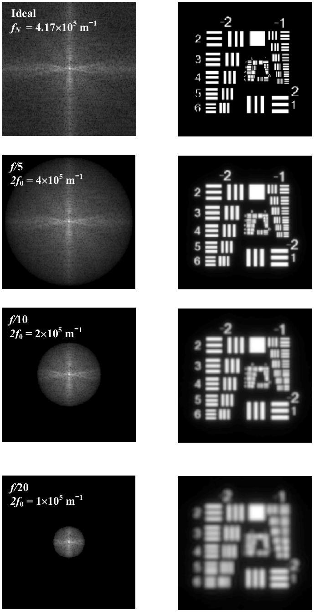
  <figcaption>图 7.14 非相干像谱幅度(左列,五次方根)与对应辐照度像(右列)(截自原书)</figcaption>
</figure>

<figure>
  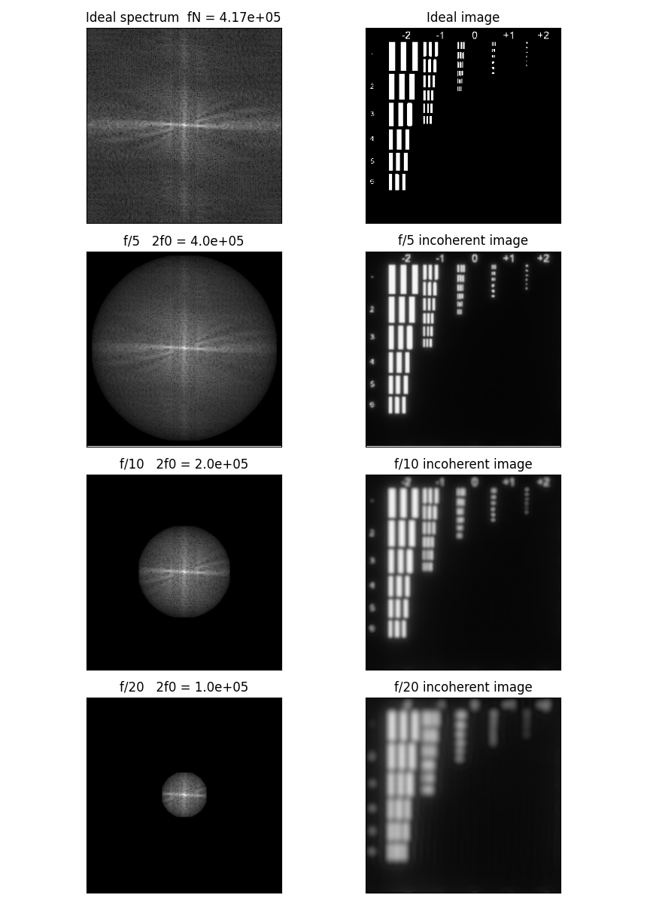
  <figcaption>图 7-P10 f/# 系列复现(非相干):OTF 圆冠随 f/# 缩小,像逐步模糊但无振铃(笔记自制,对应原书图 7.14)</figcaption>
</figure>

两条路径放在一起对照:

| | **相干成像**(7.2) | **非相干成像**(7.3) |
| --- | --- | --- |
| 线性对象 | 场 \(U_i\)(式 7.4) | 辐照度 \(I_i\)(式 7.23) |
| 传递函数 | \(H = P(-\lambda z_{XP}f_U,\cdot)\)(式 7.7) | OTF = \(H\) 的零频归一自相关(式 7.25/7.26) |
| 圆瞳形状 | 硬边圆盘(式 7.13) | 平滑圆冠(式 7.31) |
| 截止频率 | \(f_0 = w_{XP}/(\lambda z_{XP})\)(式 7.10) | \(2f_0 = 1/(\lambda(f/\#))\)(式 7.15/7.32) |
| 振铃 | 有(边缘过冲实测 1.50) | 无(实测 0.88) |
| 粗糙表面 | speckle(7.2.4,实测 C≈1) | 平均掉(无) |
| 采样判据 | \(2f_0 \leq f_N\)(式 7.17),两场合用 | 同左 |

把"选哪条路、查哪条判据"画成决策流程图:

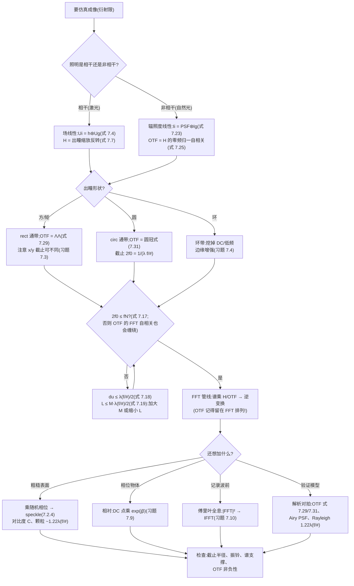

## 7.4 习题(原书)

原书 10 道题。每题给题目与提示,本章做过数值的题附 Python 实测结果——先自己动手。

**7.1 薄透镜成像**:半径 10 mm、\(f = 50\) mm 的薄透镜,物在透镜前 200 mm。(a) 像距(后主面到像)多少?横向放大率?(b) \(D_{XP}\)、\(z_{XP}\)、\(f/\#\)?(c) 物距增大到 \(z_1 \gg f\),像距约多少?

??? note "7.1 参考答案要点"
    (a) \(1/z_2 = 1/50 - 1/200 = 3/200 \to z_2 = 66.7\) mm;\(M_t = -z_2/z_1 = -1/3\)(倒立缩小)。(b) 薄透镜瞳=透镜:\(D_{XP} = 20\) mm、\(z_{XP} = z_2 = 66.7\) mm、\(f/\# = 66.7/20 = 3.33\)。(c) \(1/z_2 = 1/f - 1/z_1 \to z_2 \to f = 50\) mm——物体移远,像收到焦面(这就是"无穷远聚焦在焦面"的极限,也解释了第 6 章 \(z_2 = f\) 时焦面 = 夫琅禾费图样)。

**7.2 截止与采样**:\(D_{XP} = 1/2\) in、\(z_{XP} = 4\) in、\(\lambda = 0.587\ \mu\text{m}\)。(a) \(f/\#\)?相干/非相干截止?(b) 衍射限仿真中理想图像的采样间隔要求?(c) 理想图像边长 1 mm 需要多少样本?

??? note "7.2 参考答案要点"
    (a) \(f/\# = 4/0.5 = 8\);\(f_0 = w_{XP}/(\lambda z_{XP}) = 1.06\times10^5\) cyc/m,\(2f_0 = 1/(\lambda(f/\#)) = 2.13\times10^5\) cyc/m。(b) \(\Delta u \leq \lambda(f/\#)/2 = 2.348\ \mu\text{m}\)。(c) \(M \geq L/\Delta u = 1\,\text{mm}/2.348\ \mu\text{m} = 425.9\)——至少 426 个样本(实用取 512)。

**7.3 矩形出瞳**:\(z_{XP} = 50\) mm、\(\lambda = 0.5\ \mu\text{m}\)、矩形 XP 半宽 \(w_x = 1\) mm、\(w_y = 0.5\) mm,\(L = 1\) mm、\(M = 250\)。(a) x/y 方向的相干与非相干截止?(b) 做相干成像仿真,给出相干传递函数曲面与像。(c) 做非相干成像仿真,给出 OTF 曲面与像。(d) x 与 y 方向的分辨率差异明显吗?

??? note "7.3 参考答案要点(Python 实测)"
    (a) \(f_{0x} = w_x/(\lambda z_{XP}) = 4\times10^4\)、\(f_{0y} = 2\times10^4\) cyc/m;非相干 \(2f_{0x} = 8\times10^4\)、\(2f_{0y} = 4\times10^4\)。(b) \(H = \mathrm{rect}(f_U/2f_{0x})\mathrm{rect}(f_V/2f_{0y})\) 方通带(曲面是"方柱");\(\Delta u = 4\ \mu\text{m}\) 对 u 方向判据 \(\leq 6.2\ \mu\text{m}\)、v 方向 \(\leq 12.5\ \mu\text{m}\),均满足。(c) OTF = 两个梯形之积(式 7.29 的 x/y 各异版本);实测像谱支撑 **u 方向 8.000e4 = 2f0x、v 方向 4.000e4 = 2f0y,逐位一致**。(d) 明显:本板条纹(映射到 L=1 mm)组-1/单元2 = 3.8e4 cyc/m < \(f_{0x}\)——u 向可分辨;组-2/单元3 = 2.1e4 > \(f_{0y}\)——v 向只到组-2/单元2(1.9e4)。**竖条清晰、横向细节被抹掉**(图 7-P7)。注意:书 coh_image 的 surf 轴标签互换在矩形瞳下必须改正,否则曲面和像的 x/y 标注就是反的。

<figure>
  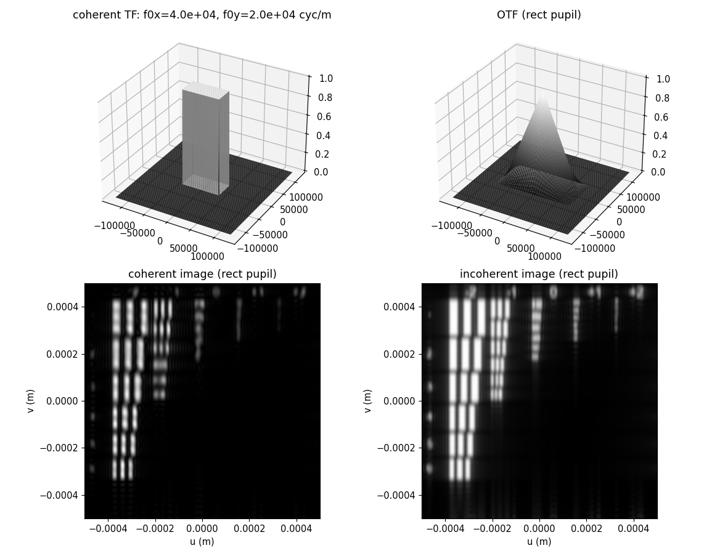
  <figcaption>图 7-P11 习题 7.3:矩形瞳的相干传递函数(方柱)、OTF(双梯形)与相干/非相干像——竖直条纹可辨、v 向细节被抹掉(笔记自制)</figcaption>
</figure>

**7.4 环形出瞳**:\(z_{XP} = 50\) mm、\(\lambda = 0.5\ \mu\text{m}\)、环形 XP 外半径 \(w_o = 1\) mm、内半径 \(w_i = 0.5\) mm,\(L = 1\) mm、\(M = 250\)。(a) 相干/非相干截止?(b) 相干仿真(传递函数曲面 + 像)。(c) 非相干仿真(OTF 曲面 + 像)。(d) 相干传递函数丢掉 DC 与低频分量有什么影响?

??? note "7.4 参考答案要点(Python 实测)"
    (a) 相干截止由**外**半径决定:\(f_0 = w_o/(\lambda z_{XP}) = 4\times10^4\)(\(2f_0 = 8\times10^4\));内半径把 \(|f| < w_i/(\lambda z_{XP}) = 2\times10^4\) 的 DC 与低频整个挖掉。(b) 相干传递函数是"圆管";像呈**边缘增强**("伪相衬"外观):大条内部平均场从全孔径的 0.528 掉到 0.101——平坦区域的场被抽掉,只剩边缘贡献。(c) 环孔 OTF:零频处仍为 1,低频下陷、中高频相对占优——与全孔径之比实测低频(\(|f|\sim3\times10^4\) 处)**0.48**、中频(\(|f|\sim6\times10^4\) 处)**1.29**(图 7-P8)。(d) 丢 DC/低频 = 丢大尺度亮度信息:均匀区域成暗场、物体只剩"描边";这也是环孔望远镜"对比度换分辨率"的经典代价。

<figure>
  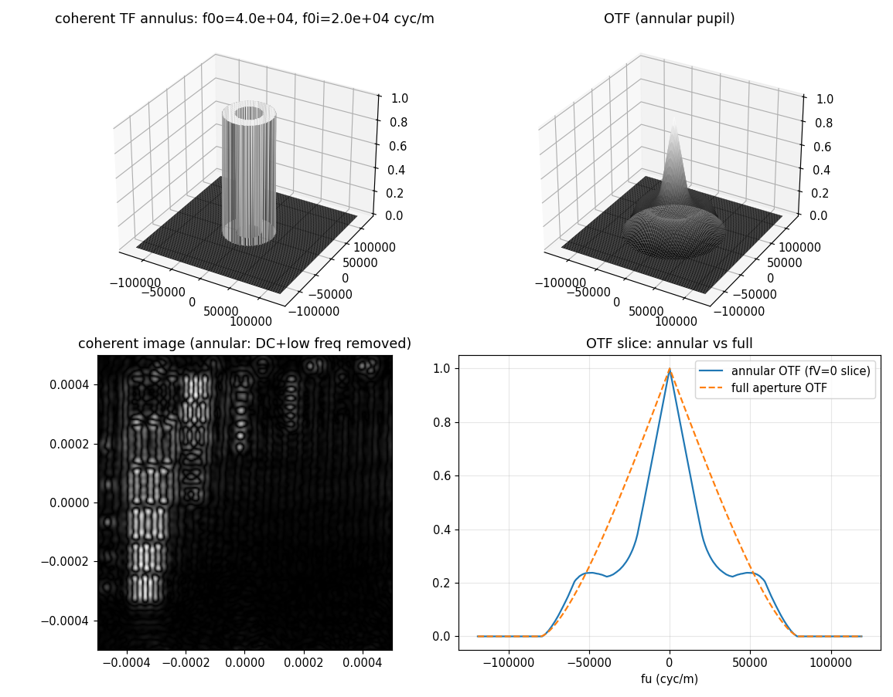
  <figcaption>图 7-P12 习题 7.4:环形瞳的相干传递函数(圆管)、OTF(中心凹陷)与边缘增强的相干像;OTF 切片:低频受损、中高频反超全孔径(笔记自制)</figcaption>
</figure>

**7.5 粗糙物体仿真**(7.2.4 节):(a) 物体"没那么粗糙"时,把随机数函数的 \(2\pi\) 乘子调小,辐照度图像有什么变化?解释。(b) 改孔径大小对辐照度图像有什么影响?解释。

??? note "7.5 参考答案要点(Python 实测)"
    (a) 相位尺度 \(2\pi \to \pi \to 0.4\pi\):图像上的 speckle 变弱、测试板图案重新可辨(图 7-P13 上排)。定量:均匀物体实测对比度 \(C = \mathrm{std}/\langle I\rangle\) 从 **0.998**(充分发展 speckle,理论 1)**断崖跌至 0.20**(π)、**0.03**(0.4π)。解释:各点波前相位差变小,干涉起伏变弱——speckle 来自"随机相位差的相干叠加",相位差不随机了就没有斑。(b) 孔径变小(f/5 → f/20,图 7-P13 下排):对比度不变(C≈1),但**颗粒变大**——实测自相关过零 3.6/6.0/9.6 μm(±1 网格),与 \(1.22\lambda(f/\#) = 3.0/6.1/12.2\ \mu\text{m}\) 同级:颗粒线度就是 PSF 的宽度。

<figure>
  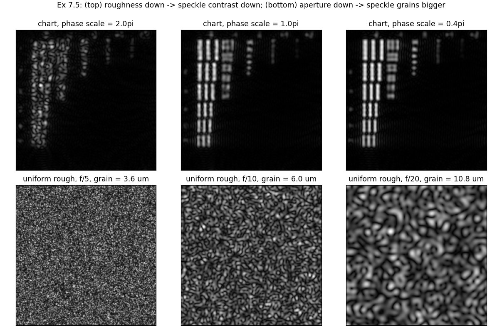
  <figcaption>图 7-P13 习题 7.5:上排——相位尺度 2π/π/0.4π,斑纹变弱、图案重现;下排——均匀粗糙物体 f/5/f/10/f/20,颗粒变粗(笔记自制)</figcaption>
</figure>

**7.6 衍射限 PSF(Airy 图样)**:对式 (7.13) 的圆瞳相干传递函数:(a) 推导冲激响应 \(h(u,v)\);(b) 求非相干 PSF,证明它与式 (4.35) 的 Airy 图样同形;(c) 证明 Airy PSF 中央瓣全宽等于 \(2.44\lambda(f/\#)\)。

??? note "7.6 参考答案要点(Python 实测)"
    (a) \(h = \mathfrak{F}^{-1}\{\mathrm{circ}(\rho/f_0)\} = \pi f_0^2\,\dfrac{2J_1(2\pi f_0 u)}{2\pi f_0 u}\)(\(u = \sqrt{u^2+v^2}\);jinc 型,利用 \(H\) 实偶时 FT = IFT,数值上用居中 FT 配 \(\Delta f = 1/L\) 定标即可)。(b) \(\mathrm{PSF} = |h|^2 = (\pi f_0^2)^2[2J_1(v)/v]^2\),\(v = 2\pi f_0 u = \pi D u/(\lambda z_{XP})\)——与式 (4.35) 的 Airy 图样完全同形(第 6 章焦面图样的亲戚:无穷远物时 \(z_{XP} = f\))。(c) \(J_1\) 第一零点 \(v = 3.8317 \to u_0 = 0.61/f_0 = 1.22\lambda(f/\#)\),全宽 \(2u_0 = 2.44\lambda(f/\#)\)。实测(f/10):\(h(0)\) 差 0.65%(DFT 定标),第一零点(插值)**6.14 μm**(理论 6.10),PSF 与解析最大差 **2.2e-3**(图 7-P14 左、中)。

**7.7 Rayleigh 分辨判据**:截止频率意味着衍射限分辨能力,但度量分辨有多个指标(PSF、第 8 章的 MTF 等)。**Rayleigh 判据**:圆瞳衍射限系统对两个非相干点源"刚好分辨"——两点像间隔等于 Airy 中央瓣半宽。全宽 \(2.44\lambda(f/\#)\),取一半得 Rayleigh 距离

\[
\delta = 1.22\,\lambda\,(f/\#)\,.
\]

用 7.3.3 节的非相干系统做经验检验:选 \(w_{XP}\) 使 \(f/\# = 20\)。(a) 算 \(\delta\)。(b) 用例子的 \(\Delta u\),跨 \(\delta\) 需要几个样本 \(S\)?(c) 造一幅两个点源的理想图像,间隔 \(\delta\)(用数组下标操作更方便,如 `Ig=zeros(M); Ig(M/2+1,M/2+1-S/2)=1; Ig(M/2+1,M/2+1+S/2)=1;`)。(d) 跑成像仿真(\(f/\#=20\)),两点分辨开了吗?画剖面。

??? note "7.7 参考答案要点(Python 实测)"
    (a) \(\delta = 1.22\times0.5\ \mu\text{m}\times20 = 12.2\ \mu\text{m}\)。(b) \(S = 12.2/1.2 = 10.17 \to 10\) 个样本(间隔 12 μm,略小于 \(\delta\))。(c)(d) \(w_{XP} = z_{XP}/40 = 3.125\) mm(\(f_0 = 5\times10^4\)、\(2f_0 = 10^5\))。剖面两点峰之间有清晰凹陷:凹陷/峰 = **0.760**——Airy 理论值 0.735(间隔 = 第一零点时中点强度/峰 = \(2[2J_1(1.916)/1.916]^2\)),"刚好分辨"(图 7-P14 右)。

<figure>
  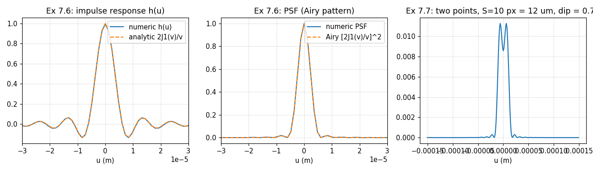
  <figcaption>图 7-P14 习题 7.6/7.7:左——冲激响应 h(u) 数值 vs 2J1(v)/v 解析;中——PSF vs Airy(第一零点 6.14 vs 6.10 μm);右——双点源(f/#=20,间隔 10 样本)剖面,凹陷比 0.760(笔记自制)</figcaption>
</figure>

**7.8 物空间**:有时用**物坐标**讨论截止频率与分辨率更方便——比如地球成像卫星的分辨率按地面尺度说。把像面参考的公式换成物面参考,只需把像方 \(f/\#\) 换成**物方 f 数**

\[
f/\#_{OBJ} = \frac{z_{EP}}{D_{EP}}\,.
\]

轨道高度 700 km 的卫星望远镜指向地面,主镜直径 1 m(主镜 = 入瞳),\(\lambda = 0.5\ \mu\text{m}\)。(a) \(f/\#_{OBJ}\)?(b) 非相干截止频率与 Rayleigh 分辨距离 \(\delta\)?(c) 物面仿真的最大采样间隔?对应 \(1024\times1024\) 阵列的物面边长?

??? note "7.8 参考答案要点"
    (a) \(f/\#_{OBJ} = z_{EP}/D_{EP} = 700\times10^3/1 = 7\times10^5\)。(b) 非相干截止 \(2f_0 = 1/(\lambda(f/\#_{OBJ})) = 2.86\) cyc/m;Rayleigh \(\delta = 1.22\lambda(f/\#_{OBJ}) = 0.427\) m——星载相机"半米级分辨率"就是这么来的。(c) \(\Delta u \leq \lambda(f/\#_{OBJ})/2 = 0.175\) m;\(1024^2\) 阵列 → \(L \leq 179\) m。注意 0.175 m 的采样间隔只覆盖 179 m 的地面条带——与 7.2.3 节"衍射限仿真只看小块"同一件事在物方的重演。

**7.9 相衬成像(Phase Contrast Imaging)**:活细胞、微生物、光刻图形这类物体基本透明,只是各处折射率不同——普通(辐照度)成像看不见它们。**相衬成像(phase contrast)**把物体产生的小相位变化(光程差)转成可探测的辐照度变化,常用于显微。参见 Ersoy 或 Hecht[6,7]。装置见图 7.15:透镜 1(焦距 \(f\))对相位物体做光学傅里叶变换[见式 (6.19)],用相位"点"板改变变换场的 DC 部分,透镜 2 再做一次变换成像。思路:用相位板把物场**平均部分**相移一小段波长(通常 \(\pi/2\) 或 \(3\pi/2\)),平均场与相位调制场在像面干涉,把相位变化翻译成辐照度变化。按以下步骤写代码:

<figure>
  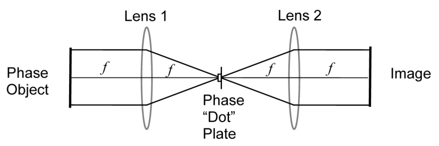
  <figcaption>图 7.15 相衬成像布置:透镜 1 做傅里叶变换,相位"点"板移 DC,透镜 2 成像(截自原书)</figcaption>
</figure>

(a) 按 coh_image 读入测试板,转成单位幅度相位物体:\(\theta=\sqrt{I_g}\cdot\pi/100\);\(u_g=\exp(j\theta)\)。(b) 直接算这个物体的辐照度(模平方)并用 imagesc 观察,再看剖面——应该是常数 1。不过 imagesc 会把全图数值范围拉伸到 256 灰阶,数值误差的痕迹可能隐约可见,但绝对变化极小。(c) 设物体被单位振幅波背照明,模拟透镜 1(对相位物体做 FFT;坐标与幅度定标忽略)。把 **DC 点**乘 \(\exp(j\beta)\),\(\beta = \pi/2\),再做逆 FFT 模拟透镜 2(透镜 2 实际做正变换、像相对物旋转 180°,仿真里用逆 FFT 保持方向与物一致)。看像的辐照度与剖面:结果应近似 \(I_i(x,y) \approx 1+2\theta(x,y)\)。\(\beta = \pi/2\) 叫**正相衬模式**。(d) 换 \(\beta = 3\pi/2\)(**负相衬模式**),验证 \(I_i \approx 1-2\theta\)。(e) 试其他 \(\beta\) 值,改变 \(\beta\) 有什么效果?

??? note "7.9 参考答案要点(Python 实测)"
    (b) 直接辐照度 = 1(最大偏离 \(4.4\times10^{-16}\),浮点级)——相位物体"隐形"。(c) \(\beta=\pi/2\) 正相衬:条纹上 **1.0592**、条纹外 **0.9955**,差 \(+0.0637 \approx 2\theta = 0.0628\)——公式 \(I_i \approx 1+2\theta\) 说的正是"条纹-背景之差"。(d) \(\beta=3\pi/2\):条纹上 0.9424、条纹外 1.0043,差 \(-0.0620\)——负相衬,衬度反转(图 7-P11)。(e) \(\beta=\pi\):DC 反相,线性衬度消失,只剩二阶小量(\(\max|I_i-1| = 1.6\times10^{-3} \sim \theta^2\));\(\beta=0\):\(I_i\) 恒为 1。物理解释:\(\exp(j\theta) \approx 1 + j\theta\),DC 是"平均场";给 DC 乘 \(j\) 后它与相位散射场同相,相长干涉 → \(1+2\theta\);乘 \(-j\) 则相消 → \(1-2\theta\);乘 \(-1\) 就既不同相也不反相,翻译不出线性衬度。

!!! note "拓展:相衬的"平均场修正""
    严格算一笔账:\(u_i = u_g + (e^{j\beta}-1)\langle u_g\rangle\)(DC 项被替换成 \(e^{j\beta}\langle u_g\rangle\))。对二值板,\(\langle u_g\rangle \approx 1 + j f̄ \theta_0\)(\(f̄\) 是条形占空比)——平均场自带一点相位。所以条纹上的实测值是 1.059 而不是理想线的 1.063、背景是 0.996 而不是 1.000:**"差 = 2θ"精确成立,"绝对值骑在 ⟨ug⟩ 上"**。教科书公式都默认 ⟨θ⟩≈0,真实图案要留这个余量。

<figure>
  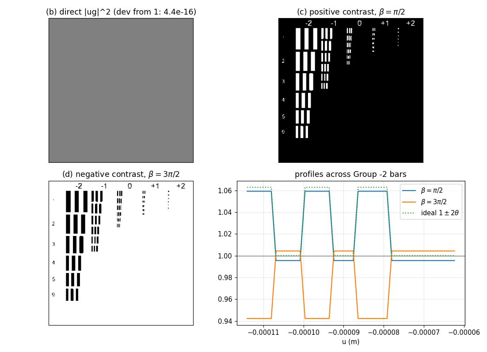
  <figcaption>图 7-P15 习题 7.9:(b) 相位物体直接辐照度恒为 1(不可见);(c) 正相衬条纹变亮;(d) 负相衬条纹变暗;右下——剖面 vs 理想 1±2θ(笔记自制)</figcaption>
</figure>

**7.10 全息术(Holography)**:全息指一种辐照度记录(传统上在胶片上),"回放"时能重建物体的光场——重建场让观察者看到真物体的部分特性,比如 3D 深度。这里考虑一种**傅里叶全息图(Fourier hologram)**(图 7.16)。记录:物体被相干光(通常是平面波)照明;物体旁边一个小球面镜截获部分照明光,把球面波送回透镜——镜子实际上扮演**参考点源**。照明物体 + 点源的夫琅禾费图样由透镜产生在胶片面上;胶片记录辐照度并处理成透过率与辐照度成正比。回放:胶片被相干平面波照明,透镜对透射波前做傅里叶变换形成像。按以下步骤仿真:

<figure>
  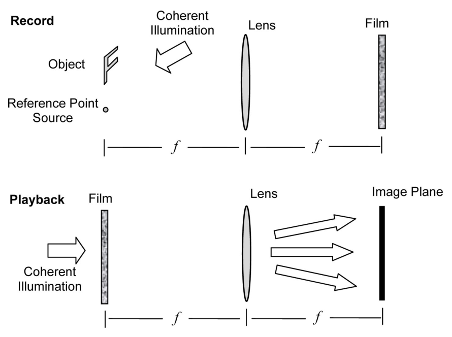
  <figcaption>图 7.16 傅里叶全息方案:记录(物体+参考点源 → 透镜 → 胶片)与回放(胶片 → 透镜 → 像面)(截自原书)</figcaption>
</figure>

(a) 用 \(M = 500\)、\(L = 10\) mm 定义物体阵列坐标;用移位的 rect 函数和 `udelta` 函数按图 7.17 造物体与点源,显示检查布局。(b) 点源乘 1000——亮参考有利于造全息图。(c) 模拟记录透镜:直接对物体阵列做 FFT(坐标与幅度定标忽略);取模平方模拟胶片的辐照度记录。(d) 回放设胶片被单位振幅平面波照明(无需操作);对 (c) 的结果做**逆 FFT** 得像面(可能还要考虑 fftshift;回放透镜实际做正变换、像旋转 180°,用逆 FFT 保持方向与物一致)。(e) (d) 的结果里有一个"光轴上"的亮点——回放光束里穿过胶片后仍是平面波的那部分能量,显示干扰大,置零。(f) 显示最终图像。

傅里叶全息图产生:物体的像、"共轭"像、以及中间一个自相关相关的结果。几个思考题:如果撤掉回放透镜、把眼睛放到合适位置,你能只看到物体的像吗?你认出这个傅里叶全息过程就是傅里叶自相关定理的实现了吗?

<figure>
  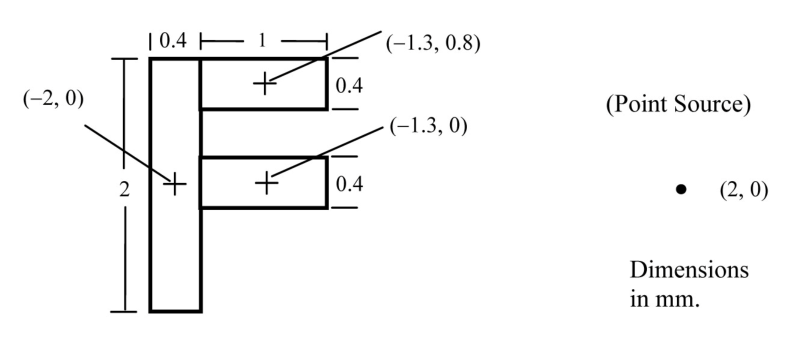
  <figcaption>图 7.17 全息例子的物体(F 形:竖梁 0.4×2 mm,两条 1×0.4 mm 臂,中心 (-2,0)/(-1.3,0.8)/(-1.3,0) mm)与参考点源 (2,0) mm(截自原书)</figcaption>
</figure>

=== "MATLAB"

    ```matlab
    % ===== 书习题 7.10:傅里叶全息(骨架 + 关键行;udelta 见本目录) =====
    % Python 实跑:python/fourier/ch7/ch7_exercises.py(图 7-P12)
    M=500; L=10e-3; dx=L/M;
    x=-L/2:dx:L/2-dx; [X,Y]=meshgrid(x,x);
    mm=1e-3;
    % (a) F 形物体(尺寸见书图 7.17)+ (b) 参考点源(2,0) mm x1000
    u1=rect((X+2.0*mm)/(0.4*mm)).*rect(Y/(2.0*mm))...          %竖梁
      +rect((X+1.3*mm)/(1.0*mm)).*rect((Y-0.8*mm)/(0.4*mm))... %上臂
      +rect((X+1.3*mm)/(1.0*mm)).*rect(Y/(0.4*mm));            %中臂
    u1=u1+1000*udelta((X-2.0*mm)/dx).*udelta(Y/dx);            %点源 x1000
    % (c) 记录:透镜 = FFT;胶片 = |.|^2
    G=fft2(u1); T=abs(G).^2;
    % (d)(e) 回放:逆 FFT(保方向);轴上亮点(DC)置零
    P=ifft2(T); P(1,1)=0;
    % (f) 显示:imagesc(x*1e3,x*1e3,fftshift(abs(P)))
    ```

=== "Python"

    ```python
    # ===== 书习题 7.10(完整脚本见 python/fourier/ch7/ch7_exercises.py) =====
    from ch7_imaging import udelta          # 附录 C.6(公共积木)
    M0, L0 = 500, 10e-3
    dx0 = L0 / M0                           # 0.02 mm
    x0v, _ = coords(L0, M0)
    X0, Y0 = np.meshgrid(x0v, x0v)
    mm = 1e-3
    object10 = (rect((X0 + 2.0*mm) / (0.4*mm)) * rect(Y0 / (2.0*mm))          # 竖梁
                + rect((X0 + 1.3*mm) / (1.0*mm)) * rect((Y0 - 0.8*mm) / (0.4*mm))
                + rect((X0 + 1.3*mm) / (1.0*mm)) * rect(Y0 / (0.4*mm)))
    point10 = 1000.0 * udelta((X0 - 2.0*mm) / dx0) * udelta(Y0 / dx0)
    u1_10 = object10 + point10              # (a)(b)
    G10 = np.fft.fft2(u1_10)                # (c) 记录透镜 = FFT
    T10 = np.abs(G10) ** 2                  # 胶片辐照度
    P10 = np.fft.ifft2(T10)                 # (d) 回放(逆 FFT 保方向)
    P10[0, 0] = 0.0                         # (e) 轴上亮点 = DC,清零(MATLAB 是 P(1,1))
    ```

实测结果(图 7-P16):回放场由四部分组成——**真像**(F 形,中心 \(-1.5-2 = -3.5\) mm;与物体窗口的归一化互相关 **+1.000**)、**共轭像**(180° 翻转的 F,中心 \(+3.5\) mm;与翻转物体的互相关 **+0.929**)、中间的**物体自相关**宽包络、以及已清零的轴上亮点(\(R^2\delta\),回放中仍是平面波的那部分)。思考题的答案也在这个分解里:回放场 \(= \mathrm{IFT}\{|\mathcal{F}\{u_1\}|^2\} = u_1 \circledast u_1\)(傅里叶自相关定理),而 \((O + R\delta)\circledast(O + R\delta) = O\circledast O + R\,O(x+x_0) + R\,O^*(x_0-x) + R^2\delta\)——全息记录/回放就是自相关定理的物理实现;撤掉回放透镜,衍射阶不分开,各个分量叠在一起,眼睛放哪都只能看到混合像。

<figure>
  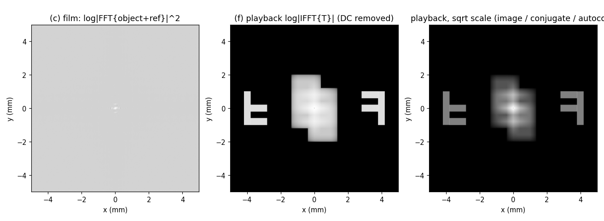
  <figcaption>图 7-P16 习题 7.10:胶片 log|FFT|²(左)、回放场 log 显示(中)与 sqrt 显示(右)——真像(-3.5 mm)、自相关包络(中央)、共轭像(+3.5 mm,翻转)(笔记自制)</figcaption>
</figure>

## 7.5 参考文献(原书)

1. E. Dereniak and T. D. Dereniak, *Geometrical and Trigonometric Optics*, Cambridge University Press, Cambridge, U.K. (2008).
2. W. J. Smith, *Modern Optical Engineering*, 4th Ed., McGraw-Hill Professional, New York (2007).
3. J. M. Geary, *Introduction to Lens Design with Practical ZEMAX® Examples*, Willmann-Bell, Richmond, VA (2002).
4. J. W. Goodman, *Introduction to Fourier Optics*, 3rd Ed., Roberts & Company, Greenwood Village, CO (2005).
5. J. W. Goodman, *Speckle Phenomena in Optics*, Roberts & Company, Greenwood Village, CO (2007).
6. O. K. Ersoy, *Diffraction, Fourier Optics, and Imaging*, Wiley-Interscience, New York (2006).
7. E. Hecht, *Optics*, 4th Ed., Addison-Wesley, Reading, MA (2002).

## 坑与陷阱

!!! danger "circ 的两套约定:式 (7.11) 按 Goodman,表 1.2 差 2 倍"
    式 (7.11) \(P=\mathrm{circ}(r/w_{XP})\) 与代码 `H=circ(sqrt(Fu.^2+Fv.^2)/f0)` 里,宗量分母就是**半径**(附录 C.1 `out=abs(r)<=1` 印证);表 1.2 的印刷定义对应"分母 = 2×半径"(ch1 勘误)。照表 1.2 实现,瞳大一倍、\(f_0\) 变 \(2f_0\)、整幅像的模糊程度全错。本笔记统一:Python `base.circle(X, Y, R)` 传半径,MATLAB `circ.m` 按附录 C.1 原样(宗量预除半径)。

!!! danger "surf 的轴标签与数据映射相反(书代码)"
    书 coh_image 第 30/34 行:`surf(fu,fv,H)` 后接 `ylabel('fu'); xlabel('fv')`——`surf` 的第一参数 \(f_u\) 落在 x 轴,标签却是 fv。圆瞳下 \(H\) 各向同性,看不出来;**矩形瞳(习题 7.3)曲面和像的 x/y 就会标反**。本笔记的 MATLAB 文件已按正确映射写;Python 侧 matplotlib `plot_surface(FU, FV, ...)` 的 x 轴对应 FU,同样要注意。

!!! danger "OTF 的排列:书故意不 fftshift"
    `OTF=ifft2(abs(fft2(fftshift(H))).^2); OTF=OTF/OTF(1,1);` 的输出留在 **FFT 排列**(\(f=0\) 在角上),正好与 `fft2(fftshift(Ig))` 的排列一致,可以直接逐点相乘。手痒给 OTF 加一个 fftshift 再去乘,或者用 `OTF(1,1)` 之外的样本归一,像就会错乱/变暗。MATLAB 的 `OTF(1,1)` 是 1-based 零频样本,numpy 写 `OTF[0,0]`。

!!! danger "判据 7.17 是两件事合一只:2f₀ ≤ f_N"
    它既保证辐照度的频率(到 \(2f_0\))能被网格表示(平方会翻倍频谱),又保证 7.3.3 节用 FFT 算 OTF 自相关时**不缠绕**(循环自相关的副本间距 \(1/\Delta u\),免重叠条件整理后正是 \(2f_0 \leq f_N\))。实测违反它(f/4)时 FFT-OTF 与解析差 25 倍(3.3e-3 → 7.9e-2)。另一个方向也别忘了:理想图像里没有的频率仿真造不出来,所以 \(L \leq M\lambda(f/\#)/2\) 限制的是"能仿真的像面大小"——f/10、250 阵列只有 0.625 mm。

!!! danger "相干像的"表观分辨率"≈ f₀,不是 2f₀"
    辐照度平方让频谱翻倍没错(实测支撑逐位 = 2f₀),但二值测试板的相干**辐照度**像里,可辨认条纹的周期贴近相干截止 \(f_0\)(书判读、笔记实测都是 1e5 cyc/m 一档)。判断"能不能分辨"时用哪个截止,先问自己看的是**场**(相干,到 \(f_0\))还是**强度条纹的对比**(干涉项在两个谱分量的差频,典型也在 \(f_0\) 附近)——以及理想图像里到底有没有那个频率。

!!! danger "非相干仿真要"洗"数值噪声"
    `Ii=real(Ii); mask=Ii>=0; Ii=mask.*Ii;` 不是可有可无的洁癖:OTF 卷积输出的 \(I_i\) 理论上正实,但浮点误差会留 \(10^{-16}\) 量级的虚部/负值,imagesc/plot 直接报错或出怪图。相干仿真(\(|u_i|^2\))天然实、非负,没有这一步。

!!! danger "speckle 仿真的随机数:统计一致,像素不同"
    `rand`/`default_rng` 的序列与原书不同,复现的 speckle 图样逐像素对不上原书图 7.10——这是随机相位仿真的固有性质,别当成 bug。要报告数字(对比度、颗粒宽度)时固定种子。另外定量对比度要用**均匀照明**物体测:在测试板上直接算 std/mean,条形结构和边缘会把它污染到 1.5+ 而与粗糙度无关(笔记实测踩过)。

!!! danger "习题 7.9 的 DC 点与单位制"
    相衬里"DC 点"是 `fft2(ug)` 的 \([0,0]\) 号样本(MATLAB `(1,1)`、numpy `[0,0]`),与数据是不是居中排列无关——DFT 的零频永远在 0 号 bin。习题 7.10 同理:`P(1,1)=0` 清的是回放场的轴上亮点。还有 mm/m 混用:7.10 的坐标以 mm 画图、以 m 计算,窗口切片里写 `round(2.2/dx0)` 而不是 `round(2.2e-3/dx0)`,切片直接变空数组(notes 里这条是实测踩出来的)。

## 速览

1. 成像仿真三件套:理想几何像 \(U_g = \frac{1}{|M_t|}U_o(u/M_t, v/M_t)\)(式 7.5)、相干冲激响应卷积(式 7.4)、传递函数 \(H = P(-\lambda z_{XP}f_U, -\lambda z_{XP}f_V)\)(式 7.7)——瞳的缩放反转。
2. 几何骨架:透镜定律(式 7.1)、\(M_t = -z_2/z_1\)(式 7.2)、工作 \(f/\# = z_{XP}/D_{XP}\)(式 7.3);孔径光阑决定像的基本衍射极限。
3. 相干截止 \(f_0 = w_{XP}/(\lambda z_{XP})\)(式 7.10);辐照度平方使频率翻倍:非相干截止 \(2f_0 = 1/(\lambda(f/\#))\)(式 7.14/7.15/7.32)——实测谱支撑逐位等于 \(f_0\) 与 \(2f_0\)。
4. 采样判据 \(2f_0 \leq f_N\)(式 7.17)→ \(\Delta u \leq \lambda(f/\#)/2\)、\(L \leq M\lambda(f/\#)/2\)(式 7.18/7.19):f/10、250² 阵列只能仿 0.625 mm 的像面;它同时是 FFT 自相关免缠绕条件(违反时 OTF 误差 ×25)。
5. 相干像:模糊 + **振铃**(边缘过冲实测 1.50)+ 粗糙表面 **speckle**(充分发展 \(C=\mathrm{std}/\langle I\rangle = 0.998 \approx 1\))。
6. 非相干像:对辐照度线性,OTF = \(H\) 的零频归一自相关(式 7.25/7.26);方瞳 = ΛΛ(式 7.29),圆瞳 = 平滑圆冠(式 7.31);无振铃(0.88 vs 1.50)、无 speckle。
7. OTF 数值:FFT 自相关留在 FFT 排列直接乘(书第 22-23 行),除 OTF(1,1) 归一;负值/虚部清零(第 36 行)。
8. 习题全家桶:矩形瞳各向异性(谱支撑 8e4/4e4 逐位)、环瞳边缘增强(条内场 0.53→0.10,OTF 低频 0.48/中频 1.29)、PSF = Airy(第一零点 6.14 vs 6.10 μm)、Rayleigh 双点凹陷 0.760(理论 0.735)、相衬 ±2θ(+0.064/−0.062)、傅里叶全息 = 自相关定理(真像 NCC +1.000、共轭 +0.929)。
9. 物方口径(习题 7.8):\(f/\#_{OBJ} = z_{EP}/D_{EP}\),700 km + 1 m 镜 → δ = 0.427 m、\(L \leq 179\) m(1024²)。
10. 工程提示:USAF 板原书下载已失效,笔记用锚定版自制 PNG;MATLAB 7.1 的 `H.*.99` 显示补丁新版可删;surf 轴标签书代码标反(圆瞳无害、矩形瞳致错)。

## 术语速查

| 英文 | 中文 | 一句话 |
| --- | --- | --- |
| image plane / object plane | 像面 / 物面 | 坐标 \((u,v)\) / \((x,y)\)(图 7.4) |
| Gaussian lens law | 透镜定律(高斯形式) | \(1/f = 1/z_1 + 1/z_2\)(式 7.1) |
| principal plane | 主平面 | 单位放大率的虚拟平面(式 7.1) |
| transverse magnification \(M_t\) | 横向放大率 | \(y_2/y_1 = -z_2/z_1\),负 = 倒像(式 7.2) |
| aperture stop | 孔径光阑 | 限制收光的真实元件;"饼干模",衍射极限来源 |
| entrance / exit pupil (EP/XP) | 入瞳 / 出瞳 | 光阑经前/后元件成的像;衍射分析用它(图 7.2) |
| working f-number | 傍轴工作 f 数 | \(z_{XP}/D_{XP}\)(式 7.3);有限共轭下别用 \(f/D\) |
| coherent impulse response \(h\) | 相干冲激响应 | 式 (7.4) 的卷积核 |
| ideal geometrical image \(U_g\) | 理想几何像场 | 物场的缩放倒像(式 7.5) |
| coherent transfer function \(H\) | 相干传递函数 | \(P(-\lambda z_{XP}f_U,\cdot)\)(式 7.7);又名振幅传递函数 |
| coherent cutoff \(f_0\) | 相干截止频率 | \(w_{XP}/(\lambda z_{XP})\)(式 7.10) |
| diffraction limited | 衍射限 | 瞳函数完美,只有边界参与衍射 |
| point spread function (PSF) | 点扩散函数 | \(|h(u,v)|^2\);圆瞳 = Airy(式 7.23) |
| optical transfer function (OTF) | 光学传递函数 | \(H\) 的零频归一自相关(式 7.25/7.26);DC=1 |
| incoherent cutoff \(2f_0\) | 非相干截止频率 | \(1/(\lambda(f/\#))\)(式 7.30/7.32),相干的两倍 |
| speckle | 相干斑 | 随机粗糙面的相干干涉;充分发展 C=1(图 7.10) |
| USAF 1951 test chart | USAF 1951 分辨率板 | 三条组靶;组/单元 ×2^(1/6) 标尺(图 7.5) |
| Rayleigh criterion | Rayleigh 判据 | 双点刚可分辨:间隔 \(1.22\lambda(f/\#)\)(习题 7.7) |
| object-space f/# | 物方 f 数 | \(z_{EP}/D_{EP}\)(习题 7.8);卫星分辨率按地面说 |
| phase contrast | 相衬成像 | 相位板移 DC,把相位变辐照度 \(1\pm2\theta\)(习题 7.9) |
| Fourier hologram | 傅里叶全息图 | 记录 \|FFT(物+参考点)\|²,回放 IFFT;= 自相关定理(习题 7.10) |
| conjugate image | 共轭像 | 全息回放里 180° 翻转的复共轭像(±x₀ 两阶) |
| udelta | 单位样本 delta | 坐标整值处置 1(附录 C.6);点源用 |

## 覆盖自查

| 原书小节 | 内容 | 笔记位置 |
| --- | --- | --- |
| 7.1 Geometrical Imaging Concepts | 式 (7.1)-(7.3)、主面/瞳/光阑、图 7.1-7.3 | 7.1(含工作 f/# 拓展) |
| 7.2.1 Coherent imaging theory | 式 (7.4)-(7.7)、图 7.4、评注 a-c | 7.2.1(含"瞳的缩放反转"拓展) |
| 7.2.2 Coherent transfer function examples | 式 (7.8)-(7.15)、方/圆瞳、辐照度倍频 | 7.2.2(含 circ 约定勘误) |
| 7.2.3 Diffraction-limited coherent imaging simulation | 式 (7.16)-(7.22)、coh_image、图 7.5-7.9 | 7.2.3(含图 7-P1-P5 与谱支撑/振铃实测、7.17 免缠绕拓展) |
| 7.2.4 Rough object | rand 相位、speckle、图 7.10 | 7.2.4(含对比度 C 实测) |
| 7.3.1 Incoherent imaging theory | 式 (7.23)-(7.26)、PSF/OTF | 7.3.1(含"平方→自相关"拓展) |
| 7.3.2 Optical transfer function examples | 式 (7.27)-(7.32)、方瞳 ΛΛ/圆瞳圆冠 | 7.3.2(含 (u,v) 记号注与圆冠几何推导) |
| 7.3.3 Diffraction-limited incoherent imaging simulation | 式 (7.33)、incoh_image、图 7.11-7.14 | 7.3.3(含图 7-P7-P10 与 OTF 解析对拍 + 相干/非相干对比表 + 决策流程图) |
| 7.4 Exercises | 习题 7.1-7.10 | 7.4(7.3/7.4/7.5/7.6/7.7/7.9/7.10 数值实跑,图 7-P11-P16) |
| 7.5 References | 7 条文献 | 7.5 |

代码文件:`matlab/fourier/ch7/`(circ.m、udelta.m、make_usaf_chart.m、coh_image.m、incoh_image.m、coh_image_rough.m、image_fseries.m、otf_check.m、ch7_exercises.m)与页面内 tab 一致;`python/fourier/ch7/`(ch7_usaf_chart.py、ch7_imaging.py、ch7_coh_image.py、ch7_incoh_image.py、ch7_fseries.py、ch7_rough_speckle.py、ch7_exercises.py)。公共积木复用 `python/fourier/common/base.py`(coords 频率/空间坐标、circle 圆瞳、rect 方/矩瞳、ft2_centered——习题 7.6 的 PSF 数值变换由它定标),传播与成像管线在 `ch7_imaging.py`(H_circ/H_square/H_rect/H_annulus、coh_image、otf_from_H、incoh_image、otf 解析式、udelta)。
