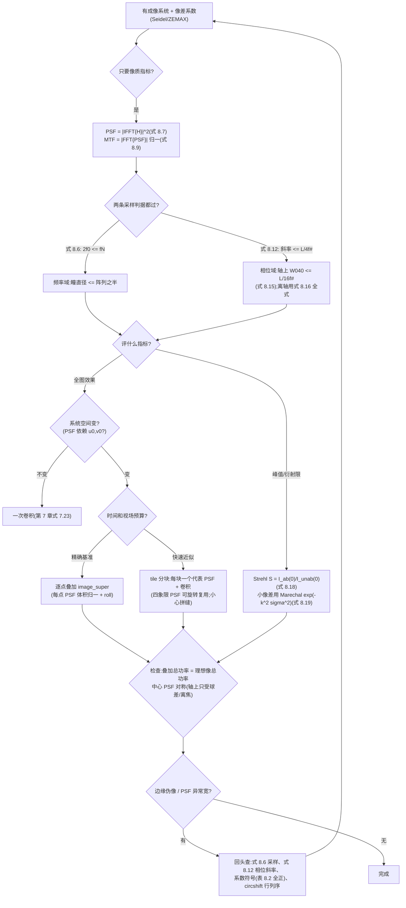

# 第 8 章 波前像差(Wavefront Aberrations)

> **本章解决**：波前像差如何进入成像链——用 Seidel 多项式与 Zernike 多项式描述波前光程差，以相位因子 \(e^{-jkW}\) 修改出瞳函数，再由此计算点扩散函数、调制传递函数与 Strehl 比等像质指标；并处理点扩散函数随像点位置变化的空间变化成像。学完能对给定像差给出成像质量评估与全图仿真。

## 8.0 本章导图

<div class="brtree">
  <div class="brrow">
    <span class="brlabel root">波前像差</span>
    <span class="brace"></span>
    <div class="brkids">
      <div class="brrow">
        <span class="brlabel">描述(8.1/8.2)</span>
        <span class="brace"></span>
        <div class="brkids">
          <span class="brleaf">OPD:W = W_ab − W_sp(图 8.1)</span>
          <span class="brleaf">Seidel 式 8.1:下标 (k,l,m) = 场/径向/余弦幂</span>
          <span class="brleaf">5 项初级:k+l=4(表 8.1)</span>
          <span class="brleaf">+ 离焦 Wd(移像面产生)</span>
          <span class="brleaf">系数单位:米,惯用"λ 数"</span>
        </div>
      </div>
      <div class="brrow">
        <span class="brlabel">进模型(8.3)</span>
        <span class="brace"></span>
        <div class="brkids">
          <span class="brleaf">瞳函数 P = circ·exp[−jkW](式 8.3)</span>
          <span class="brleaf">H = P(−λz f)(式 8.4)</span>
          <span class="brleaf">OTF = H⋆H 归一(式 8.5)</span>
          <span class="brleaf">判据 2f₀ ≤ f_N(式 8.6)</span>
          <span class="brleaf">截止 2f₀ 与像差无关</span>
        </div>
      </div>
      <div class="brrow">
        <span class="brlabel">评像质(8.4/8.5)</span>
        <span class="brace"></span>
        <div class="brkids">
          <span class="brleaf">PSF = |𝔉⁻¹{H}|²(式 8.7)</span>
          <span class="brleaf">MTF = |𝔉{PSF}| 归一(式 8.9)</span>
          <span class="brleaf">f/5 平凸镜:ZEMAX 系数(表 8.2)</span>
          <span class="brleaf">轴上:MTF 死于 ~120-130 cyc/mm</span>
          <span class="brleaf">最大像高:PSF 沿 v 拉长</span>
          <span class="brleaf">Strehl(习题 8.8)≈ exp(−k²σ²)</span>
        </div>
      </div>
      <div class="brrow">
        <span class="brlabel">采样与全图(8.6/8.7)</span>
        <span class="brace"></span>
        <div class="brkids">
          <span class="brleaf">相位斜率判据(式 8.10-8.12)</span>
          <span class="brleaf">轴上球差:W040 ≤ L/16f#(式 8.15)</span>
          <span class="brleaf">空间变 → 卷积失效</span>
          <span class="brleaf">psf_map:PSF 摆放图(8.7.1)</span>
          <span class="brleaf">image_super:叠加成像(8.7.2)</span>
          <span class="brleaf">tile 分块 + 卷积(8.7.3)</span>
        </div>
      </div>
    </div>
  </div>
</div>

## 8.1 波前光程差(Wavefront Optical Path Difference)

第 7 章成像模型的瞳函数相对**理想会聚球面波前**定义。有像差的系统,其波前相位面偏离理想球面——偏离量用 **W(x,y)** 描述,它是**光程差(Optical Path Difference,OPD)**:理想球面 \(W_{sp}\) 与像差波前 \(W_{ab}\) 两个曲面之差(图 8.1),

\[
W(x,y) = W_{ab}(x,y) - W_{sp}(x,y),
\]

\(x,y\) 是瞳面坐标。图 8.1 还标了符号约定:像差波前在理想波前的**像侧**(更靠近像)时 W 取正——这个约定在 8.3.1 节变成指数里的负号。

<figure>
  
  <figcaption>图 8.1 球面波前(sp)与像差波前(ab):W(x,y) = W_ab − W_sp(截自原书)</figcaption>
</figure>

像差波前从哪来?三类来源:

- **元件缺陷**:光学件加工/装配不完美。最直观的例子。
- **物理本性**:即使元件完全按图纸做好,像差也在。比如**色差(chromatic aberration)**——玻璃折射率随波长变,不同波长聚焦位置不同;再比如扩展物场景中,离轴点的光必须斜着穿过系统,同样产生非球面波前。
- **传播介质**:穿过大气的系统,湍流造成的波前扰动也可用像差波前刻画(本栏目 Book2 的主题)。

波前 OPD 常用多项式级数描述,两大体系:

| | **Seidel 级数** | **Zernike 多项式** |
| --- | --- | --- |
| 使用者 | 光学设计(ZEMAX 等给出 Seidel 系数) | 光学检测 / 干涉仪拟合 / 大气湍流 |
| 优势 | 各项与透镜类型、像面位置关系直接 | 各项**正交**(改一项不影响其他);不要求旋转对称 |
| 像点依赖 | 显式含像高 û₀(要旋转坐标) | 不显式含像点(不用旋转) |
| 共同假设 | 圆形瞳 | 圆形瞳 |

本章把波前 OPD 放进成像系统的瞳函数里,只考虑**单色像差(monochromatic aberrations)**——不涉及颜色(色差出局),从初级 Seidel 像差入手。

## 8.2 Seidel 多项式(Seidel Polynomials)

### 8.2.1 定义与初级像差

Seidel 多项式描述**旋转对称**光学系统(绝大多数透镜和反射镜)的单色像差。常规成像系统常用形式为

\[
W(\hat{u}_0;\,\rho,\theta) = \sum_{j,m,n} W_{klm}\,\hat{u}_0^{\,k}\,\rho^{\,l}\cos^m\theta\,,
\qquad k = 2j+m,\;\; l = 2n+m\,, \tag{8.1}
\]

其中(图 8.2):

- \(\rho\)、\(\theta\):**归一化出瞳(exit pupil,XP)**里的极径与极角。本书为计算方便,把 \(\theta\) 定义成**相对 x 轴逆时针**——注意传统像差处理常相对 y 轴定义,对文献时要留神;
- \((\hat{x},\hat{y})\):物理坐标 \((x,y)\) 除以出瞳半径 \(w_{XP}\),归一化瞳半径为 1;
- \(\hat{u}_0\):**分数像高(fractional image height)**——像面上所考虑点的物理高度除以最大像半径,沿图 8.2(b) 的 \(\hat{u}\) 轴定义。

<figure>
  
  <figcaption>图 8.2 Seidel 像差坐标定义:归一化出瞳 (a) 与像面 (b)(截自原书)</figcaption>
</figure>

系统旋转对称,所以对偏离 \(\hat{u}\) 轴的像点,只要把瞳和像面坐标系一起旋转就能对上——这正是后面 seidel_5 里那个旋转矩阵的来由。

式 (8.1) 的下标是一套编号规则:\(W_{klm}\) 是波前像差系数,下标三位 \((k,l,m)\) 分别对应**像高幂、径向幂、余弦幂**;五个**初级像差(primary aberrations)**对应 \(k+l=4\)。系数单位是长度(米),但习惯按光波长讨论("几个波")。本章关心的是仿真这些像差的效果;想深挖每种像差的几何成因,看书末参考文献 1–4。

仿真要在直角坐标里算,由图 8.2 做极坐标→直角坐标转换:

\[
\rho = \sqrt{\hat{x}^2 + \hat{y}^2}\,, \qquad \rho\cos\theta = \hat{x}\,,
\]

五个初级像差 + 离焦就写成:

\[
\begin{aligned}
W(\hat{u}_0;\,\hat{x},\hat{y}) ={}& W_d\left(\hat{x}^2+\hat{y}^2\right) + W_{040}\left(\hat{x}^2+\hat{y}^2\right)^2 \\
&+ W_{131}\,\hat{u}_0\left(\hat{x}^2+\hat{y}^2\right)\hat{x} + W_{222}\,\hat{u}_0^{\,2}\,\hat{x}^2 \\
&+ W_{220}\,\hat{u}_0^{\,2}\left(\hat{x}^2+\hat{y}^2\right) + W_{311}\,\hat{u}_0^{\,3}\,\hat{x}\,.
\end{aligned} \tag{8.2}
\]

重排成干净表格(原书表 8.1):

| 像差 | 系数 | \(W(\hat{x},\hat{y})\) 项 |
| --- | --- | --- |
| 离焦(Defocus) | \(W_d\) | \(W_d(\hat{x}^2+\hat{y}^2)\) |
| 球差(Spherical) | \(W_{040}\) | \(W_{040}(\hat{x}^2+\hat{y}^2)^2\) |
| 彗差(Coma) | \(W_{131}\) | \(W_{131}\,\hat{u}_0(\hat{x}^2+\hat{y}^2)\hat{x}\) |
| 像散(Astigmatism) | \(W_{222}\) | \(W_{222}\,\hat{u}_0^{\,2}\hat{x}^2\) |
| 场曲(Field curvature) | \(W_{220}\) | \(W_{220}\,\hat{u}_0^{\,2}(\hat{x}^2+\hat{y}^2)\) |
| 畸变(Distortion) | \(W_{311}\) | \(W_{311}\,\hat{u}_0^{\,3}\hat{x}\) |

!!! note "拓展:表 8.1 里藏着的三个结构信息"
    - **第一项(离焦)不是五种初级像差之一**:它是把像面沿光轴从近轴焦点移开时"产生"的 OPD——所以球差 + 离焦可以互相部分抵消(习题 8.2/8.3 的主题)。
    - **球差是唯一不含 \(\hat{u}_0\) 的初级像差**:它源于"用球面会聚光",球面不是等光程面,轴上点也逃不掉;其他四项都随分数像高增长,离轴才出现。
    - **每个系数 = 瞳边缘的 OPD**:令 \(\sqrt{\hat{x}^2+\hat{y}^2}=1\) 和/或 \(\hat{x}=1\),每项的系数就是射向**最大像高点**(\(\hat{u}_0=1\))的波前在瞳边缘的光程差。所以"这个镜头有 5 波球差"= 边缘光线比近轴光线落后/超前 5 个波长。

### 8.2.2 MATLAB 函数

函数 **seidel_5** 计算 \(W(\hat{u}_0,v̂_0;\hat{x},\hat{y})\):

=== "MATLAB"

    ```matlab
    function[w]=seidel_5(u0,v0,X,Y,...
                wd,w040,w131,w222,w220,w311)
    % ===== 书 8.2.2 节:seidel_5 前 5 项 Seidel 像差 + 离焦的波前 OPD =====
    % 书 8.2.2 节列出的函数(原书第 1-30 行),实现式 (8.2):
    %   W(u0; x,y) = wd*(x^2+y^2) + w040*(x^2+y^2)^2 + w131*u0*(x^2+y^2)*x
    %              + w222*u0^2*x^2 + w220*u0^2*(x^2+y^2) + w311*u0^3*x
    % 输入:
    %   u0,v0 - 归一化像面坐标(标量;像点方向用 beta = atan2(v0,u0))
    %   X,Y   - 归一化出瞳坐标网格(meshgrid 生成;物理坐标除以出瞳半径 wXP)
    %   wd    - 离焦;w040 - 球差;w131 - 彗差;
    %   w222  - 像散;w220 - 场曲;w311 - 畸变(单位:米,习惯用"波长数"x lambda)
    % 要点:
    %   - 旋转对称系统只需在子午面内写多项式:第 19-20 行把瞳坐标旋转 beta,
    %     使 x' 轴指向像点方向(书 8.2.1 节);
    %   - 五个初级像差满足 k+l = 4(下标 = 余弦幂/径向幂/场幂,式 8.1);
    %   - 网格半径 >1 的"多余"值照常计算,后续用瞳函数乘 circ 时自然清零
    %     (书原话:These extraneous values can be removed later)。
    % MATLAB/Python 差异:Python 版在 python/fourier/ch8/ch8_aberrations.py
    %   的 seidel_5();逐行对应,无索引差异(全为逐元素运算)。
    % ------------- 以下为书原代码(第 1-30 行) -------------
    % seidel_5
    % Compute wavefront OPD for first 5 Seidel wavefront
    % aberration coefficients + defocus
    %
    % u0,v0 - normalized image plane coordinate
    % X,Y - normalized pupil coordinate arrays
    %         (like from meshgrid)
    % wd-defocus; w040-spherical; w131-coma;
    % w222-astigmatism; w220-field curvature;
    % w311-distortion

    beta=atan2(v0,u0);     % image rotation angle
    u0r=sqrt(u0^2+v0^2);   % image height

    % rotate grid
    Xr=X*cos(beta)+Y*sin(beta);
    Yr=-X*sin(beta)+Y*cos(beta);

    % Seidel polynomials
    rho2=Xr.^2+Yr.^2;
    w=wd*rho2+...
        w040*rho2.^2+...
        w131*u0r*rho2.*Xr+...
        w222*u0r^2*Xr.^2+...
        w220*u0r^2*rho2+...
        w311*u0r^3*Xr;
    end
    ```

=== "Python"

    ```python
    # ===== 书 8.2.2 节:seidel_5(与 matlab/fourier/ch8/seidel_5.m 逐行对应) =====
    # 完整模块见 python/fourier/ch8/ch8_aberrations.py
    def seidel_5(u0, v0, X, Y, wd, w040, w131, w222, w220, w311):
        """前 5 项 Seidel 像差 + 离焦的波前 OPD(书式 (8.2))。

        u0, v0:归一化像面坐标(标量);X, Y:归一化出瞳坐标网格(meshgrid)。
        系数单位为长度(米);书习惯用"波长数"乘 lambda 传入。
        先把瞳坐标旋转 beta = atan2(v0, u0),使 x' 轴指向像点方向
        (旋转对称系统只需在子午面内写多项式,书 8.2.1 节)。
        """
        beta = np.arctan2(v0, u0)                           # 书 15 行
        u0r = np.sqrt(u0 ** 2 + v0 ** 2)                    # 书 16 行
        Xr = X * np.cos(beta) + Y * np.sin(beta)            # 书 19-20 行:rotate grid
        Yr = -X * np.sin(beta) + Y * np.cos(beta)
        rho2 = Xr ** 2 + Yr ** 2                            # 书 23-29 行:式 (8.2)
        w = (wd * rho2
             + w040 * rho2 ** 2
             + w131 * u0r * rho2 * Xr
             + w222 * u0r ** 2 * Xr ** 2
             + w220 * u0r ** 2 * rho2
             + w311 * u0r ** 3 * Xr)
        return w
    ```

输入是像面上关心的点 \((\hat{u}_0,\hat{v}_0)\)、meshgrid 式的归一化瞳坐标阵列 X、Y,以及六个像差系数(书为简单起见逐个列出,塞进向量也行)。第 19–20 行做**旋转变换**(旋转角 \(\beta = \tan^{-1}(\hat{v}_0/\hat{u}_0)\)),把瞳坐标系对准像点方向。函数对**整个网格**求值,半径超过 1 的"多余"值也算——之后乘瞳函数时自然清零。

用下面的代码画波前曲面(几个例子见图 8.3)。注意用 **NaN** + 逻辑索引把单位圆外的值挖掉:

```matlab
u0=1; v0=0;
wd=0; w040=1; w131=0; w222=0; w220=0; w311=0;
w=seidel_5(u0,v0,X,Y,wd,w040,w131,w222,w220,w311);
P=circ(sqrt(X.^2+Y.^2));
mask=(P==0);
w(mask)=NaN;

figure(1)
surfc(x,y,w)
camlight left; lighting phong;
colormap('gray'); shading interp;
xlabel('x'); ylabel('y');
```

取合适的样本数、边长 2 的归一化瞳,试几个系数组合。图 8.3 能看出:球差 \(W_{040}\) 和场曲 \(W_{220}\) 是"曲率型"的——对瞳坐标**球对称**;彗差 \(W_{131}\) 和像散 \(W_{222}\) 不对称,依赖像点位置。

<figure>
  
  <figcaption>图 8.3 seidel_5 生成的波前 OPD 曲面/等高线例:左上 w040=1(轴上);右上 u0=1, w040=w131=w222=1;左下 u0=0, v0=1 同系数(方向随像点转);右下 u0=1, w220=1(截自原书)</figcaption>
</figure>

关于初级 Seidel 波前 OPD 的三条评注:

- **(a)** 轴上像点(\(\hat{u}_0=0,\hat{v}_0=0\) )只受球差和离焦影响——其他四项全带 \(\hat{u}_0\) 幂;
- **(b)** 实际系统通常不止一项像差——这是像差由球面产生的方式决定的;
- **(c)** 初级像差描述常规透镜系统的大部分波前 OPD,但**高阶项**在某些场合不可忽略(8.5 节与 ZEMAX 对比时会见到)。

## 8.3 瞳函数与传递函数(Pupil and Transfer Functions)

### 8.3.1 瞳函数

用复相量方法,把像差写进出瞳函数:

\[
P(\hat{u}_0,\hat{v}_0;x,y) = \mathrm{circ}\left(\frac{\sqrt{x^2+y^2}}{w_{XP}}\right)\exp\left[-jk\,W\!\left(\hat{u}_0,\hat{v}_0;\frac{x}{w_{XP}},\frac{y}{w_{XP}}\right)\right], \tag{8.3}
\]

circ 部分就是第 7 章那个衍射限出瞳(半径 \(w_{XP}\);Goodman 约定,分母即半径——全书 circ 约定冲突见 ch1 勘误,实现统一用 `circle(X,Y,R)`)。Seidel 多项式 W 需要一个像面坐标,瞳坐标则除以 \(w_{XP}\) 归一化。

!!! note "拓展:为什么指数里是 −jkW(符号约定)"
    图 8.1 的约定:像差波前 \(W_{ab}\) 在理想波前 \(W_{sp}\) 的**像侧**时,W 记正——此时像差波前比理想波前"超前"(相位更领先)。但第 4 章以来的相量约定是"传播越远、前导相位越负"(4.3 节),超前对应**更负**的相位。所以瞳函数的相位要取 \(-kW\)(式 8.3 的指数带负号)。两条约定一条在几何(OPD 正负),一条在相量(相位正负),中间差一个负号——自己推一遍,以后读 ZEMAX 文档不会懵。

### 8.3.2 成像传递函数

第 7 章的相干/光学传递函数定义(原书式 7.8、7.22)对像差系统**原样适用**,只要带上归一化像坐标。相干传递函数:

\[
H(\hat{u}_0,\hat{v}_0;f_U,f_V) = P\!\left(\hat{u}_0,\hat{v}_0;-\lambda z_{XP}f_U,\,-\lambda z_{XP}f_V\right), \tag{8.4}
\]

光学传递函数(OTF):

\[
\mathcal{H}(\hat{u}_0,\hat{v}_0;f_U,f_V) = \left.H(\hat{u}_0,\hat{v}_0;f_U,f_V)\bigstar H(\hat{u}_0,\hat{v}_0;f_U,f_V)\right|_{\text{norm}}\,, \tag{8.5}
\]

\(\bigstar\) 是相关(自相关),norm 表示归一化:DC 处 OTF = 1(7.3.1 节)。本章聚焦**非相干成像**:像差让 OTF 显著不同于衍射限 OTF,但**非相干截止频率不变,仍是 \(2f_0\)**(证明见下)。

!!! note "拓展:为什么像差动不了截止频率(自相关支撑论证)"
    非相干 OTF 是相干传递函数 H 的归一化自相关。H 的支撑是半径 \(f_0 = w_{XP}/(\lambda z_{XP})\) 的圆盘(式 8.4 瞳函数);两个这样的圆盘错开 \(|f|\) 后仍有重叠,当且仅当 \(|f| \le 2f_0\)。像差只改变 H **圆盘内部**的相位/幅值,不改变圆盘的大小,所以自相关的支撑(OTF 的截止)纹丝不动——像差压低通带内的调制值,但"能透过最高多少频率"这件事由孔径几何唯一决定。

计算机仿真像差系统,基本采样限制还是那条:

\[
2f_0 \le f_N\,, \tag{8.6}
\]

其中

\[
2f_0 = \frac{2w_{XP}}{\lambda z_{XP}} = \frac{1}{\lambda(f/\#)}\,, \qquad f_N = \frac{1}{2\Delta u}\,,
\]

像面采样间隔是 \(\Delta u\)。直觉:像差再大,频谱也出不了 \(2f_0\) 这个窗——但 8.6 节会看到,**瞳内相位**还有一条独立的采样判据。

## 8.4 像质指标(Image Quality)

研究成像系统性能时,通常不做全图仿真,而是用**像质指标**预测性能。全图仿真放在 8.7 节演示;先讨论两个最常用的指标:PSF 和 MTF。

### 8.4.1 点扩散函数(Point Spread Function)

PSF 就是**非相干脉冲响应** \(|h|^2\):点源的像长什么样。粗略地说,PSF 越宽、成像分辨率越差。计算机里最直接的算法:

\[
\left|h(\hat{u}_0,\hat{v}_0;u,v)\right|^2 = \left|\mathfrak{F}^{-1}\!\left\{H(\hat{u}_0,\hat{v}_0;f_U,f_V)\right\}\right|^2. \tag{8.7}
\]

式 (8.7) 明明白白写着:PSF **依赖像点坐标 \((\hat{u}_0,\hat{v}_0)\)**。这就是**空间变(space variant)**:像面上每个位置需要自己的脉冲响应。第 7 章"一个 PSF 卷积全图"的奢侈,到本章为止。

### 8.4.2 调制传递函数(Modulation Transfer Function)

衍射限系统的 OTF H 是实函数;瞳函数是复数时,OTF 可以是复数。OTF 描述系统对理想非相干图像各空间频率施加的**衰减 + 相位**;某个频率上的相位变化,相当于把图像里对应的正弦分量**平移**。OTF 的模 \(|H|\) 就是**调制传递函数(MTF)**:只描述正弦辐照度分量随频率的衰减。"对比度(contrast)"和"调制深度(modulation depth)"说的是同一个值。单频正弦辐照度图样的调制值可以直接从测量算:

\[
\text{Modulation} = \frac{I_{MAX} - I_{MIN}}{I_{MAX} + I_{MIN}}\,, \tag{8.8}
\]

\(I_{MAX}\)、\(I_{MIN}\) 是图样峰值/谷值的辐照度。调制值 = 1:该频率分量无退化;= 0:该频率系统根本成不了像。MTF 比OTF 好测(实函数),实际系统都报 MTF。拿到 PSF 后:

\[
\text{MTF}(\hat{u}_0,\hat{v}_0;f_U,f_V) = \left|\mathfrak{F}\!\left\{\left|h(\hat{u}_0,\hat{v}_0;u,v)\right|^2\right\}\right|\Big|_{\text{norm}}. \tag{8.9}
\]

## 8.5 透镜实例——PSF 与 MTF(Lens Example—PSF and MTF)

图 8.4 是商业光学设计软件 **ZEMAX** 画的一枚真实平凸透镜光线追迹布局。用 ZEMAX 提取实际像差系数来仿真:有效焦距 100 mm、瞳直径 20 mm → 像方 **f/5**。假设立远物成像,故 \(z_{XP} \approx f\)。透镜结构参数:前表面曲率半径 51.68 mm、后表面无限(平凸)、玻璃 BK7、中心厚度 4.585 mm。

<figure>
  
  <figcaption>图 8.4 f/5 平凸透镜的 ZEMAX 光线追迹布局:有效焦距 100 mm、瞳直径 20 mm;图中给出 0 与 10 mm 两个像高(截自原书)</figcaption>
</figure>

最大像高任取 10 mm——图 8.4 里像面上部的那个点,离轴光束向它会聚,归一化像坐标 \((\hat{u}_0,\hat{v}_0)=(0,1)\);对应**视场角(field angle)**(光束中心光线与光轴的夹角)5.72°。最大像高对应系统的最大视场。

ZEMAX 对这枚镜头算出的初级 Seidel 系数(表 8.2,波长 0.55 μm;数值按"波长数"给,乘 \(\lambda\) 得光程):

| 系数 | 数值 | | 系数 | 数值 |
| --- | --- | --- | --- | --- |
| \(W_d\) | 0 | | \(W_{222}\) | 9.025\(\lambda\) |
| \(W_{040}\) | 4.963\(\lambda\) | | \(W_{220}\)(弧矢场曲) | 7.536\(\lambda\) |
| \(W_{131}\) | 2.637\(\lambda\) | | \(W_{311}\) | 0.157\(\lambda\) |

像差量级相当可观:**5 波球差**明显摊开轴上 PSF;**9 波像散 + 7 波场曲**让离轴像点退化得更厉害。

脚本 **lens_psfmtf** 计算并显示 f/5 透镜的 PSF 与 MTF:

=== "MATLAB"

    ```matlab
    % lens_psfmtt
    % ===== 书 8.5 节:lens_psfmtf f/5 平凸透镜(Newport KPX094)的 PSF 与 MTF =====
    % 书 8.5 节列出的脚本(原书第 1-68 行)。f/5 平凸透镜,ZEMAX 给出的 Seidel
    % 系数(书表 8.2,单位:波长数 x 0.55 um)——注意书评注 (b) 写
    % "coefficients taken from Table 8.1",应为表 8.2(勘误,见笔记)。
    % 流程:式 (8.3)/(8.4) 相干传递函数 H = circ(f_r/f0)*exp(-jkW)
    %       -> 式 (8.7) PSF = |IFFT{H}|^2 -> 式 (8.9) MTF = |FFT{PSF}| 归一化 DC
    %       -> 与一维衍射限解析 MTF(式 7.31)对比。
    % 采样判据(式 8.6):2f0 = 1/(lambda*fnum) = 3.6e5 1/m <= fN = 1/(2*du) = 5.1e5 1/m;
    % 瞳直径占阵列 0.355(< 0.5 满足,书评注 c)。
    % 轴上像点(u0=0,v0=0)改 (0,1) 即最大像高点:PSF 沿 v 拉长、MTF 分两个方向。
    % MATLAB/Python 差异:Python 版 python/fourier/ch8/ch8_lens_psfmtf.py;
    %   剖面用 h2(M/2+1,:)/( :,M/2+1)(1-based),numpy 为 h2[M//2,:]/h2[:,M//2];
    %   nthroot(h2,2) 即 sqrt,imshow 对应 imagesc(...)+axis xy。
    % ------------- 以下为书原代码(第 1-68 行) -------------
    % lens_psfmtf
    % f/5 plano-convex lens (Newport lens KPX094)
    % 10 mm image height
    % psf and mtf with Seidel aberrations
    % aberration coefficients from ZEMAX
    M=1024;             %sample #
    L=1e-3;             %image plane side length
    du=L/M;             %sample interval
    u=-L/2:du:L/2-du; v=u; %coordinates

    lambda=0.55e-6;     %wavelength
    k=2*pi/lambda;      %wavenumber
    Dxp=20e-3; wxp=Dxp/2; %exit pupil size
    zxp=100e-3;         %exit pupil distance
    fnum=zxp/(2*wxp);   %exit pupil f-number
    lz=lambda*zxp;
    twof0=1/(lambda*fnum);%incoh cutoff freq

    u0=0; v0=0;         %normalized image coordinate

    % aberration coefficients
    wd=0*lambda;
    w040=4.963*lambda;
    w131=2.637*lambda;
    w222=9.025*lambda;
    w220=7.536*lambda;
    w311=0.157*lambda;

    fu=-1/(2*du):1/L:1/(2*du)-(1/L); %image freq coords
    [Fu,Fv]=meshgrid(fu,fu);

    % wavefront
    W=seidel_5(u0,v0,-lz*Fu/wxp,-lz*Fv/wxp,...
        wd,w040,w131,w222,w220,w311);

    % coherent transfer function
    H=circ(sqrt(Fu.^2+Fv.^2)*lz/wxp).*exp(-j*k*W);
    figure(1);
    imagesc(u,v,angle(H)); axis xy; axis square
    xlabel('u (m)'); ylabel('v (m)'); colormap('gray')

    % point spread function
    h2=abs(ifftshift(ifft2(fftshift(H)))).^2;

    figure(2)       % psf image and profiles
    imagesc(u,v,nthroot(h2,2)); axis xy; axis square
    xlabel('u (m)'); ylabel('v (m)'); colormap('gray')
    figure(3);
    plot(u,h2(M/2+1,:)); xlabel('u (m)'); ylabel('PSF');
    figure(4);
    plot(u,h2(:,M/2+1)); xlabel('v (m)'); ylabel('PSF');

    % MTF
    MTF=fft2(fftshift(h2));
    MTF=abs(MTF/MTF(1,1));  %normalize DC to 1
    MTF=ifftshift(MTF);

    % analytic MTF
    MTF_an=(2/pi)*(acos(fu/twof0)-(fu/twof0)...
        .*sqrt(1-(fu/twof0).^2));
    MTF_an=MTF_an.*rect(fu/(2*twof0)); %zero after cutoff

    figure(5)       % MTF profiles
    plot(fu,MTF(M/2+1,:),fu,MTF(:,M/2+1),':',...
        fu,MTF_an,'--');
    axis([0 150000 0 1]);
    legend('u MTF','v MTF','diff limit');
    xlabel('f (cyc/m)'); ylabel('Modulation');
    ```

=== "Python"

    ```python
    # ===== 书 8.5 节:lens_psfmtf(完整脚本见 python/fourier/ch8/ch8_lens_psfmtf.py) =====
    M = 1024                # sample #
    L = 1e-3                # image plane side length
    du = L / M              # sample interval
    u, _ = coords(L, M)     # coordinates(-L/2 .. L/2-du,居中)

    lam = 0.55e-6           # wavelength
    k = 2 * np.pi / lam     # wavenumber
    Dxp = 20e-3
    wxp = Dxp / 2           # exit pupil radius
    zxp = 100e-3            # exit pupil distance
    fnum = zxp / (2 * wxp)  # exit pupil f-number (= 5)
    lz = lam * zxp
    twof0 = 1 / (lam * fnum)    # incoh cutoff freq

    # ZEMAX Seidel 系数(书表 8.2;"波长数" x lambda)
    wd = 0 * lam
    w040 = 4.963 * lam
    w131 = 2.637 * lam
    w222 = 9.025 * lam
    w220 = 7.536 * lam
    w311 = 0.157 * lam
    coeffs = (wd, w040, w131, w222, w220, w311)

    # 频率坐标(居中排列):注意 base.coords 返回 (空间坐标 x, 频率坐标 f),
    # 频率轴是第二个输出(用反了会得到全零波前——本章实测踩过的坑)!
    _, fu = coords(L, M)        # -1/(2du) .. 1/(2du)-1/L,步距 1/L
    FU, FV = np.meshgrid(fu, fu)


    def run_point(u0, v0):
        """对归一化像点 (u0,v0) 返回 H, h2, MTF(书第 33-56 行)。"""
        W = seidel_5(u0, v0, -lz * FU / wxp, -lz * FV / wxp, *coeffs)   # 书 33-34 行
        H = circle(FU, FV, wxp / lz) * np.exp(-1j * k * W)              # 书 37 行
        h2 = psf_from_H(H, pre_shifted=False)                           # 书 43 行
        MTF = mtf_from_psf(h2)                                          # 书 54-56 行
        return H, h2, MTF
    ```

脚本注释:

- **(a)** 第 19 行:要考察的归一化像点位置输入行;
- **(b)** 第 21 行:像差系数取自表 8.2(原书误写"Table 8.1"——那是定义表,数值来自 ZEMAX 的表 8.2,见勘误标注);
- **(c)** 第 39 行:检查相干传递函数是好习惯:若其直径不超过阵列之半,式 (8.6) 满足;
- **(d)** 第 55 行:MTF 在 DC 归一到 1;
- **(e)** 第 58 行:一维衍射限解析 MTF(式 7.31)用于对比。

!!! warning "原书笔误:评注 (b) 的表号"
    8.5 节评注 (b) 写"Aberration coefficients taken from **Table 8.1**"——表 8.1 是 Seidel 像差的**定义**(六种像差的数学形式),脚本第 22–27 行的 ZEMAX 数值来自**表 8.2**。

先取轴上像点(第 19 行 \(u_0=0, v_0=0\)),结果见图 8.5:相干传递函数相位 (a) 用等值图显示,黑 = 0、白 = \(2\pi\) rad——相位其实采样充分,图里的纹样一部分是**显示伪像**;看它的目的是确认传递函数直径 ≤ 阵列之半(式 8.6)。PSF (b)–(d) 看着较窄——不错,但相对衍射限 PSF 其实已经摊宽不少(习题 8.8)。MTF 只画一半(负频率侧对称),图 8.5(e) 里它比衍射限曲线掉得快得多:实用截止频率从曲线估约 **120–130 cyc/mm**。轴上像点 PSF 与 MTF 都对称,u、v 两轴结果无差别。

<figure>
  
  <figcaption>图 8.5 平凸透镜轴上像点结果:(a) 相干传递函数相位;(b) PSF 图样;(c) u 轴剖面;(d) v 轴剖面;(e) MTF(衍射限虚线)。(a) 的部分纹样是显示伪像(截自原书)</figcaption>
</figure>

本章 Python 复现(同参数)的定量结果:

- 采样判据:\(2f_0 = 363.6\) cyc/mm \(\le f_N = 512\) cyc/mm,瞳直径占阵列频率宽度的 35.5% < 50%,式 (8.6) 满足;
- **PSF 峰值**:轴上 \(2.08\times10^{-4}\)(书图 8.5(c) 约 \(2.05\times10^{-4}\));最大像高点 \(2.46\times10^{-6}\)(书图 8.6(c)(d) 约 \(2.4\times10^{-6}\));
- **MTF 电平读数**:轴上 0.05/0.02 电平截止 79/102 cyc/mm,\(f = 120\) cyc/mm 处 MTF ≈ 0.006——与书"实用截止 ~120–130 cyc/mm"的目测口径一致(目测含噪尾,电平取得低些);最大像高点 u/v 轴 0.05 电平截止 9.0/4.0 cyc/mm,\(f = 10\) cyc/mm 处 ≈ 0.011、20 cyc/mm 处 0.009/0.004——书目测"u ~20、v ~10 cyc/mm"对应曲线尾部消没位置;
- 衍射限 MTF vs 式 (7.31) 解析:最大偏差 \(1.2\times10^{-4}\)(网格分辨率量级);
- 轴上 Strehl 比(习题 8.8(e)):0.0212(见下)。

<figure>
  
  <figcaption>图 8-P1 lens_psfmtf 复现:上排左/中 PSF(平方根拉伸,左轴上、右最大像高),上右相干 TF 相位;下排 MTF(实线 u、虚线 v、点线衍射限)与最大像高点 PSF 剖面(笔记自制)</figcaption>
</figure>

把最大像高点改到 v 轴(\(\hat{u}_0=0,\hat{v}_0=1\)),结果见图 8.6:PSF 不再对称,沿 v 方向**特征性拉长** (b)–(d);峰值比轴上小得多(PSF 大幅摊开);MTF (e) 两个方向不一样,v 轴最差,实用截止约 **u ≈ 20、v ≈ 10 cyc/mm**。注意:PSF 都显示在 1 mm × 1 mm 的阵列里,但就整个像面而言,轴上 PSF 位于光轴上,最大像高 PSF 在离轴 10 mm 处——两幅图是不同像点各自的"局部"。

<figure>
  
  <figcaption>图 8.6 平凸透镜最大像高点结果:(a) 相干传递函数相位;(b) PSF 图样(v 方向拉长);(c) u 轴剖面;(d) v 轴剖面;(e) MTF(u 轴实线、v 轴虚线、衍射限点线)(截自原书)</figcaption>
</figure>

验证/合理性检查:与 ZEMAX 对同一例子的分析对比。图 8.7 的**光线点列图(ray spot diagrams)**:在瞳内撒一组光线,按直线追迹到像面,标出落点——点云形状与 lens_psfmtf 的 PSF 形状相似,好兆头。更定量的对比是 MTF(图 8.8):"T"指**子午面(tangential)**,与本章 v 轴一致;"S"指**弧矢面(sagittal)**,含 u 轴。10 mm 像点的 T、S 曲线难分辨,T(v 轴)在下。ZEMAX 曲线与 lens_psfmtf 相当接近;差异在预料之中——lens_psfmtf 只用五个初级 Seidel 像差,而 ZEMAX 的瞳面波前含**高阶项**。

<figure>
  
  <figcaption>图 8.7 f/5 平凸透镜的 ZEMAX 点列图:(a) 轴上像点;(b) 最大像高(10 mm)像点(截自原书)</figcaption>
</figure>

<figure>
  
  <figcaption>图 8.8 f/5 平凸透镜的 ZEMAX MTF 曲线:深色为轴上像点,浅色为最大像高点的子午(T)与弧矢(S)面(截自原书)</figcaption>
</figure>

## 8.6 波前采样(Wavefront Sampling)

式 (8.6) 管的是**非相干截止频率**;但还有一种情况也能让仿真出错:**瞳内波前 OPD 的相位被欠采样**。若 OPD 的斜率大到一个采样间隔内相位量 \(kW\) 变化超过 \(\pi\) rad,瞳相位就会混叠:

\[
\left|\frac{\partial W(\hat{x},\hat{y})}{\partial \hat{x}}\right|_{max} \leq \frac{\pi}{k\,\Delta\hat{x}}\,, \qquad
\left|\frac{\partial W(\hat{x},\hat{y})}{\partial \hat{y}}\right|_{max} \leq \frac{\pi}{k\,\Delta\hat{y}}\,. \tag{8.10}
\]

\(W\) 一般不对称,两个轴都要查。归一化瞳采样间隔与出瞳/像面参数的关系:

\[
\Delta\hat{x} = \frac{\lambda z_{XP}/L}{w_{XP}} = \frac{2\lambda(f/\#)}{L}\,. \tag{8.11}
\]

!!! note "拓展:式 (8.11) 一行推完"
    像面频率采样间隔 \(\Delta f = 1/L\)(L 是像面边长)。瞳的物理坐标是频率的"放大":\(x_p = -\lambda z_{XP} f_U\)(式 8.4),所以相邻频率样本对应的瞳坐标间隔是 \(\Delta x_p = \lambda z_{XP}\Delta f = \lambda z_{XP}/L\);除以 \(w_{XP}\) 归一化,并用 \(w_{XP} = z_{XP}/(2f/\#)\) 消元,即得 \(\Delta\hat{x} = \lambda z_{XP}/(L\,w_{XP}) = 2\lambda(f/\#)/L\)。**像面网格越密(L 固定时 M 越大),瞳采样反而越细**——两条判据在同一个旋钮上,改 M 时要两头都查。

把式 (8.11) 代入式 (8.10) 并整理(\(\pi/(k\Delta\hat{x}) = \lambda/(2\Delta\hat{x})\)):

\[
\left|\frac{\partial W(\hat{x},\hat{y})}{\partial\hat{x}}\right|_{max} \leq \frac{L}{4(f/\#)}\,. \tag{8.12}
\]

拿初级 Seidel 多项式代入试试(\(x\) 轴通常斜率最大):

\[
\begin{aligned}
\frac{\partial W(\hat{x},\hat{y})}{\partial\hat{x}} ={}& 2W_d\hat{x} + 4W_{040}\left(\hat{x}^2+\hat{y}^2\right)\hat{x} \\
&+ W_{131}\hat{u}_0\left(3\hat{x}^2+\hat{y}^2\right) + 2W_{222}\hat{u}_0^{\,2}\hat{x} \\
&+ 2W_{220}\hat{u}_0^{\,2}\hat{x} + W_{311}\hat{u}_0^{\,3}\,.
\end{aligned} \tag{8.13}
\]

最大值依赖系数与坐标的正负大小,几个特例:轴上像点、无离焦时,最大出现在 \((\hat{x}^2+\hat{y}^2)\hat{x} = 1\)(即 \(\hat{x}=1,\hat{y}=0\)),得

\[
\left|\frac{\partial W}{\partial\hat{x}}\right|_{max} = 4W_{040}\,. \tag{8.14}
\]

代回式 (8.12),得轴上球差的采样上界:

\[
W_{040} \leq \frac{L}{16(f/\#)}\,. \tag{8.15}
\]

用 8.5 节平凸透镜的数:\(L = 1\times10^{-3}\) m、\(f/\# = 5\),判据给 \(W_{040} \le 12.5\times10^{-6}\) m,按波长算 \(W_{040} \le 22.73\lambda\)。镜头的球差 4.963\(\lambda\)(表 8.2)远在界内。

另一个特例:所有系数为正(例镜正是如此),最大斜率要求 \(\hat{x}=1\)(即 \(\hat{y}=0\),见习题 8.5):

\[
\left|\frac{\partial W}{\partial\hat{x}}\right|_{max} = 2W_d + 4W_{040} + 3W_{131}\hat{u}_0 + 2W_{222}\hat{u}_0^{\,2} + 2W_{220}\hat{u}_0^{\,2} + W_{311}\hat{u}_0^{\,3}\,. \tag{8.16}
\]

## 8.7 叠加成像实例(Superposition Imaging Example)

lens_psfmtf 用 \(1024\times1024\) 阵列检查 \(1\times1\) mm 的像面。要按同样采样仿真整个像面(半径 10 mm)大约要 \(20{,}000\times20{,}000\) 样本——不现实。而且像差系统**空间变**,简单卷积不能用;叠加运算的计算时间又很长。就是说:直接仿真实际系统的全图场往往不现实。但练习一下"脉冲响应怎样在像框里分布、叠加问题怎么搭"仍是好事——为此要凑一个样本数不多就能算的问题。

### 8.7.1 像面 PSF 图(Image Plane PSF Map)

设 **f/20** 出瞳、\(\lambda = 0.5\ \mu\text{m}\):\(2f_0 = 10^5\ \text{m}^{-1}\)。取 \(M = 250\)、像面边长 \(L = 1\) mm,得 \(f_N = 1.25\times10^5\ \text{m}^{-1}\),式 (8.6) 满足。f/20 系统的 PSF 在 \(1\times1\) mm 帧内本该几乎不随位置变——但为了演示 PSF 会怎么变,把像差**夸大**:½ 波球差、1 波彗差、1.5 波像散。

脚本 **psf_map** 生成像面上不同位置的 PSF 分布图,思路:循环各像面坐标,逐个生成 PSF,再把 PSF **平移**到像面阵列中的对应位置(记住:PSF 都先在阵列中心生成)。

=== "MATLAB"

    ```matlab
    % psf_map generate psf map
    % ===== 书 8.7.1 节:psf_map 像面 PSF 分布图 =====
    % 书 8.7.1 节列出的脚本(原书第 1-53 行)。f/20 出瞳,M=250、L=1 mm,
    % 2f0 = 1e5 1/m <= fN = 1.25e5 1/m,式 (8.6) 满足(书评注:分号故意不写,
    % 便于改参数时核对两个频率)。像差夸大:0.5λ 球差 + 1λ 彗差 + 1.5λ 像散。
    % 思路:对 7x7 个归一化像点 (u0,v0) 各生成 PSF(式 8.7),circshift 平移到
    % 像面对应位置后叠加显示。注意书 8.7.1 节评注 (f):这只是"摆放",不是卷积
    % 或叠加运算(叠加见 8.7.2 的 image_super)。
    % 省时技巧(评注 b):第 26 行先把频率坐标 fu=fftshift(fu) 预移位,循环内
    % H 天然处于 FFT 序,第 41 行 ifft2 前不再需要 fftshift。
    % circshift 评注 (e):第一个变量是行(= y/v 方向),round 取整;移出边界的
    % 元素从对侧回来(周期延拓概念)。
    % MATLAB/Python 差异:Python 版 python/fourier/ch8/ch8_psf_map.py 用
    %   np.roll(h2, (r, c), axis=(0,1)),轴含义与 circshift 的 [行,列] 相同;
    %   numpy 的 round 是银行家舍入,本题 ±87.5 恰好也舍入到 ±88,结果一致。
    % ------------- 以下为书原代码(第 1-53 行) -------------
    % psf_map generate psf map

    M=250;
    L=1e-3;                %image plane side length
    du=L/M;                %sample interval
    u=-L/2:du:L/2-du; v=u; %coordinates

    lambda=0.5*10^-6;      %wavelength
    k=2*pi/lambda;         %wavenumber
    wxp=2.5e-3;            %exit pupil radius
    zxp=100e-3;            %exit pupil distance
    fnum=zxp/(2*wxp)       %exit pupil f-number

    twof0=1/(lambda*fnum)  %inc cutoff freq
    fN=1/(2*du)            %Nyquist frequency

    % aberration coefficients
    wd=0*lambda;
    w040=0.5*lambda;
    w131=1*lambda;
    w222=1.5*lambda;
    w220=0*lambda;
    w311=0*lambda;

    fu=-1/(2*du):1/L:1/(2*du)-(1/L); %image freq coords
    fu=fftshift(fu); %shift cords, avoid shift H in loop
    [Fu,Fv]=meshgrid(fu,fu);

    I=zeros(M);
    % loop through image plane positions
    for u0=[-.7:.7/3:.7]
        for v0=[-.7:.7/3:.7]
            % wavefront
            W=seidel_5(u0,v0,-2*lambda*fnum*Fu...
                ,-2*lambda*fnum*Fv,...
                wd,w040,w131,w222,w220,w311);
            % coherent transfer function
            H=circ(sqrt(Fu.^2+Fv.^2)*2*lambda*fnum)...
                .*exp(-j*k*W);
            % PSF
            h2=abs(ifftshift(ifft2(H))).^2;
            % shift PSF to image plane position
            h2=circshift(h2,[round(v0*M/2)...
                ,round(u0*M/2)]);
            % add into combined frame
            I=I+h2;
        end
    end

    figure(1)
    imagesc(u,v,nthroot(I,4));
    xlabel('u (m)'); ylabel('v (m)');
    colormap('gray'); axis square; axis xy
    ```

=== "Python"

    ```python
    # ===== 书 8.7.1 节:psf_map(完整脚本见 python/fourier/ch8/ch8_psf_map.py) =====
    M, L = 250, 1e-3
    lam, k = 0.5e-6, 2 * np.pi / 0.5e-6
    wxp, zxp = 2.5e-3, 0.1                 # fnum = 20
    coeffs = (0 * lam, 0.5 * lam, 1 * lam, 1.5 * lam, 0 * lam, 0 * lam)
    _, fu = coords(L, M)
    fu = np.fft.fftshift(fu)               # 预移位:循环内 H 已是 FFT 序(书评注 b)
    FU, FV = np.meshgrid(fu, fu)

    I = np.zeros((M, M))
    for u0 in np.arange(-0.7, 0.7001, 0.7 / 3):        # 7 个 u0
        for v0 in np.arange(-0.7, 0.7001, 0.7 / 3):    # 7 个 v0
            W = seidel_5(u0, v0, -2 * lam * fnum * FU, -2 * lam * fnum * FV, *coeffs)
            H = circle(FU, FV, wxp / (lam * zxp)) * np.exp(-1j * k * W)
            h2 = psf_from_H(H, pre_shifted=True)       # ifft2 后 ifftshift 回中
            h2 = np.roll(h2, (int(np.round(v0 * M / 2)),      # 行 = v(书评注 e)
                              int(np.round(u0 * M / 2))), axis=(0, 1))
            I = I + h2                                 # 摆放,不是卷积(书评注 f)
    ```

脚本注释:

- **(a)** 第 14 行:截止频率与 Nyquist 频率两行故意不写分号——改参数时在命令窗口直接核对采样;
- **(b)** 第 26 行:**省时技巧**。频率坐标先 fftshift,循环里的 H 天生处于移位排列,第 41 行 ifft2 前就不用再 fftshift H;
- **(c)** 第 29 行:输出辐照度数组 I 预先定维;
- **(d)** 第 31、32 行:u0、v0 各取 7 个位置(\(-0.7\) 到 \(0.7\),步长 \(0.7/3\));
- **(e)** 第 43 行:算好某像点的 PSF 后,用 **circshift** 平移到像面阵列的对应位置。circshift 按行/列移动数组元素,移出一侧的元素从另一侧回来(周期延拓概念)。这是索引操作,MATLAB 按行/列组织数组,所以 circshift 的第一个变量对应 **y 轴(v0)**;round 把行/列移位量取整。像面宽度假定恰好容得下 \(\hat{u}_0=\pm1\) 的像点;
- **(f)** 第 46 行:PSF 只是**加在一起**方便观看比较——**别把这当成卷积或叠加运算**,它只是摆放。

<figure>
  
  <figcaption>图 8.9 psf_map 例子的像面 PSF 分布图:中心对称,向边缘因彗差 + 像散逐渐拉长(截自原书)</figcaption>
</figure>

!!! warning "原书笔误:残留旧脚本名"
    8.7.1 节正文"The PSF image plane map result from **psf_pt_array** is shown in Fig. 8.9"——脚本叫 **psf_map**,psf_pt_array 是旧版名字没改干净。

本章 Python 复现(\(2f_0 = 1\times10^5 \le f_N = 1.25\times10^5\ \text{m}^{-1}\),判据满足):中心 PSF 对称(轴上只受球差影响,评注 (a) 的直接体现:中心 13×13 邻域左右镜像差 \(2.9\times10^{-5}\) 相对量),边缘 PSF 沿 v 拉长、拖尾方向随像点符号翻转——与图 8.9 一致。

<figure>
  
  <figcaption>图 8-P2 psf_map 复现(f/20,0.5λ 球差 + 1λ 彗差 + 1.5λ 像散,四次方根拉伸)(笔记自制)</figcaption>
</figure>

### 8.7.2 图像仿真(Image Simulation)

空间变非相干成像不能用第 7 章的卷积(式 7.23),要用**叠加积分(superposition integral)**:

\[
I_i(\hat{u}_0,\hat{v}_0) = \int_{-\infty}^{\infty}\!\!\int I_g(u,v)\left|h(\hat{u}_0,\hat{v}_0;u,v)\right|^2\,du\,dv\,, \tag{8.17}
\]

图像定义在归一化坐标 \(\hat{u}_0,\hat{v}_0\) 里,PSF \(|h|^2\) 由式 (8.7) 定义。图像仿真流程:

1. 在像面选一点 \((\hat{u}_0,\hat{v}_0)\);
2. 生成该像点的 PSF,并把 PSF **体积归一到 1**(等价 OTF/MTF 归一化);
3. 把 PSF 平移到阵列中的 \((\hat{u}_0,\hat{v}_0)\) 位置,乘以该点的理想像值 \(I_g(\hat{u}_0,\hat{v}_0)\);
4. 加进图像阵列;
5. 回到第 1 步,处理下一个像面坐标。

!!! warning "式 (8.17) 与代码的口径:PSF 必须带位移"
    式 (8.17) 印刷版里 PSF 的宗量是 \((u,v)\),看不出平移;但步骤 (3) 明说"把 PSF 平移到 \((\hat{u}_0,\hat{v}_0)\) 位置",image_super 第 51 行也真的做了 circshift。原因:式 (8.7) 的 \(h = \mathfrak{F}^{-1}\{H\}\) 中 H 的瞳放在频率原点,逆变换出的 PSF **中心在坐标原点**,不在像点上。严格写法应是

    \[
    I_i(\hat{u}_0,\hat{v}_0) = \iint I_g(u,v)\,\left|h(\hat{u}_0,\hat{v}_0;\,u-\hat{u}_0,\,v-\hat{v}_0)\right|^2\,du\,dv\,.
    \]

    按位移版理解,代码就是它的离散实现。

脚本 **image_super**:把 psf_map 例子的像差参数用到测试靶理想像上:

=== "MATLAB"

    ```matlab
    % image_super superposition image
    % ===== 书 8.7.2 节:image_super 空间变叠加成像仿真 =====
    % 书 8.7.2 节列出的脚本(原书第 1-60 行)。对理想像 Ig 的每个样本 (u0,v0):
    % 生成该像点的 PSF(式 8.7)-> 体积归一到 1(评注 e:等价式 7.25 的 OTF
    % 归一化)-> circshift 平移到像点位置(评注 f)-> 乘 Ig 后累加(式 8.17 的
    % 离散实现,评注 g)。
    % 注意:原书读入随书代码分发的 USAF1951B250.png;Python 侧笔记用合成
    % USAF 风格靶替代(ch8_aberrations.make_usaf_target)。
    % 评注 (c)/(d):外层循环索引 n 是行(= y/v 方向),内层 m 是列(u 方向)
    % ——本书少有的"用索引推物理参数"的场合,因为第 53 行要逐元素寻址 Ig。
    % 评注 (h):M=250 共 62,500 个 PSF,书作者笔记本约 1 小时!对比:卷积
    % 只要一个 PSF + 几次 FFT,瞬间完成——空间变系统没有这个奢侈。
    % MATLAB/Python 差异:Python 版 python/fourier/ch8/ch8_image_super.py
    %   (可传 M 参数快速验证;M=100 时式 8.6 不再满足,见笔记)。
    % ------------- 以下为书原代码(第 1-60 行) -------------
    % image_super superposition image

    A=imread('USAF1951B250','png');

    [M,N]=size(A); A=flipud(A);
    Ig=single(A); Ig=Ig/max(max(Ig));

    L=1e-3;                %image plane side length
    du=L/M;                %sample interval
    u=-L/2:du:L/2-du; v=u; %coordinates
    fN=1/(2*du)            %Nyquist frequency

    lambda=0.5*10^-6;      %wavelength
    k=2*pi/lambda;         %wavenumber
    wxp=2.5e-3;            %exit pupil radius
    zxp=100e-3;            %exit pupil distance
    fnum=zxp/(2*wxp)       %exit pupil f-number

    twof0=1/(lambda*fnum)  %inc cutoff freq
    fN=1/(2*du)            %Nyquist frequency

    % aberration coefficients
    wd=0*lambda;
    w040=0.5*lambda;
    w131=1*lambda;
    w222=1.5*lambda;
    w220=0*lambda;
    w311=0*lambda;

    % frequency coordinates
    fu=-1/(2*du):1/L:1/(2*du)-(1/L);
    fu=fftshift(fu); %shift cords, avoid shift H in loop
    [Fu,Fv]=meshgrid(fu,fu);

    I=zeros(M);
    % loop through image plane positions
    for n=1:M
       v0=(n-(M/2+1))/(M/2) %norm v image coord
       for m=1:M
           u0=(m-(M/2+1))/(M/2); %norm u image coord
           % wavefront
           W=seidel_5(u0,v0,-2*lambda*fnum*Fu,...
               -2*lambda*fnum*Fv,...
               wd,w040,w131,w222,w220,w311);
           % coherent transfer function
           H=circ(sqrt(Fu.^2+Fv.^2)*2*lambda*fnum)...
               .*exp(-j*k*W);
           % create PSF - normalize volume to 1
           h2=abs(ifftshift(ifft2(H))).^2;
           h2=h2/(sum(sum(h2)));
           % shift h2 to image plane position
           h2=circshift(h2,[n-(M/2+1),m-(M/2+1)]);
           % superposition
           I=Ig(n,m)*h2+I;
       end
    end

    figure(1)
    imagesc(u,v,nthroot(I,3));
    colormap('gray'); axis square; axis xy
    xlabel('x (m)'); ylabel('y (m)');
    ```

=== "Python"

    ```python
    # ===== 书 8.7.2 节:image_super(完整脚本见 python/fourier/ch8/ch8_image_super.py) =====
    # 原书 USAF1951B250.png 随书代码分发;Python 用合成 USAF 风格靶替代:
    Ig = make_usaf_target(M)               # ch8_aberrations.py(行 0 = 底,免 flipud)
    Ig = Ig / Ig.max()                     # 书 5 行:归一化

    _, fu = coords(L, M)
    fu = np.fft.fftshift(fu)               # 书 30-31 行:预移位
    FU, FV = np.meshgrid(fu, fu)

    I = np.zeros((M, M))                   # 书 34 行
    h2 = np.empty((M, M))                  # 复用缓冲,少一次分配
    for nj in range(M):                    # 书 36 行:行 = v 方向
        v0 = (nj - M // 2) / (M // 2)      # 书 37 行(0-based 改写)
        for mi in range(M):                # 书 38 行:列 = u 方向
            u0 = (mi - M // 2) / (M // 2)  # 书 39 行
            # wavefront + coherent TF + PSF(书 41-48 行)
            W = seidel_5(u0, v0, -2 * lam * fnum * FU, -2 * lam * fnum * FV, *coeffs)
            H = circle(FU, FV, wxp / (lam * zxp)) * np.exp(-1j * k * W)
            np.abs(np.fft.ifft2(H), out=h2)            # h = |IFFT{H}|(FFT 序)
            h2 *= h2                                   # 书 48 行:h2 = |h|^2
            h2 /= h2.sum()                             # 书 49 行:体积归一到 1
            h2c = np.fft.ifftshift(h2)                 # 回中(自然序 -> 居中)
            # shift 到像点位置(书 51 行;roll 量 = 索引差)
            h2c = np.roll(h2c, (nj - M // 2, mi - M // 2), axis=(0, 1))
            I += Ig[nj, mi] * h2c                      # 书 53 行:叠加
    ```

脚本注释:

- **(a)** 第 32 行:fu 预移位,免掉第 48 行对 H 的 fftshift(省时);
- **(b)** 第 35 行:for 循环遍历像面上所有 \((\hat{u}_0,\hat{v}_0)\) 坐标对;
- **(c)** 第 36、37 行:第一个循环用**行索引 n**——MATLAB 行/列序,这个索引对应 **y 轴变量 v0**。本书少有的场合:第 53 行要逐元素寻址理想像,被迫用索引推物理参数;
- **(d)** 第 38、39 行:第二个循环用**列索引 m**,对应 x 轴变量 u0;
- **(e)** 第 49 行:PSF 体积归一到 1,等价式 (7.25) 的 OTF 归一化;
- **(f)** 第 51 行:circshift 用索引变量,效果与 psf_map 的做法相同;
- **(g)** 第 53 行:执行叠加(式 8.17);
- **(h)** 最后一条:**这段代码跑起来相当慢**!(书作者笔记本约 1 小时。)62,500 个 \(250\times250\) 的 PSF 被生成并叠加。对比:卷积只需一个 PSF、几次 FFT、不到一秒——空间变系统没有卷积这个奢侈。

<figure>
  
  <figcaption>图 8.10 image_super 例子的测试靶图像:中心清晰,边缘因离轴像差明显退化(截自原书)</figcaption>
</figure>

试跑这个例子——你可以去吃个饭、看场电影、多做几道作业……等它出结果。

本章 Python 实跑(合成 USAF 风格靶替代书分发的 png):

- **M = 250(书参数)**:62,500 个 PSF,**320 s** 跑完(NumPy 比书当年的笔记本快一个量级,但量级感受一致);理想像总功率 6423,叠加像总功率 6423,**比值 1.000000**(PSF 体积归一的正确性检查:叠加像总功率 = 理想像总功率);
- **M = 100(快速验证,4.3 s)**:能量同样守恒,但注意 \(f_N = 5\times10^4 < 2f_0 = 10^5\ \text{m}^{-1}\),**式 (8.6) 不再满足**——书选 M=250 不是随便定的:再省样本,PSF 本身就欠采样了。

<figure>
  
  <figcaption>图 8-P3 image_super 复现(M=250,三次方根拉伸):左理想靶,右叠加像——中心保持,边缘(尤其左列竖条与上缘)模糊拖尾(笔记自制)</figcaption>
</figure>

### 8.7.3 实用图像仿真(Practical Image Simulation)

8.7.2 的路子有两大痛点:跑得慢、像面面积小。怎么办?换个更快的机器、加内存是一条;更聪明的办法也有:

- **省时间**:每个象限的 PSF 都一样——只是**旋转**了。复用而不是重算,省下约 4 倍;
- **牺牲采样**:把图像明显欠采样(样本铺开),生成同样欠采样的近似 PSF——视理想像内容,可能给出有用的全图近似;
- **分块(tiles)**:把像面切成小块,**每块假设一个代表性 PSF**,对每块做卷积处理,再把结果拼回全图。同时解决面积和时间。近似性:PSF 在块内不连续变化;"缝合"处容易出现伪像。但在"时间要短 + 视场适中"的场合,这是有效的一招。

三种全图路线放在一起:

| | **逐点叠加**(8.7.2) | **分块 tile + 卷积**(8.7.3) | **单 PSF 卷积**(第 7 章) |
| --- | --- | --- | --- |
| 前提 | 无(空间变通用) | PSF 块内缓变 | 空间不变(衍射限/小像差) |
| PSF 数量 | 每像点一个(62,500) | 每块一个(几十) | 1 个 |
| 代价 | ~1 小时(M=250) | 秒-分钟级 | 亚秒级 |
| 误差来源 | 循环边界/采样 | 块间 PSF 跳变、拼缝 | 模型本身 |
| 用途 | 精确基准、教学 | 快速全图近似 | 衍射限系统 |

把本章"拿到一个成像系统怎么仿"的选择路径画成决策图:



## 8.8 习题(原书)

原书 8 道题。每题给题目与提示,本章做过数值的题附 Python 实测结果——先自己动手。

**8.1 f/5 平凸透镜例子的基本量**:(a) 非相干截止频率是多少?Nyquist 频率是多少?式 (8.6) 满足吗?(b) 生成轴上像点 \((\hat{u}_0,\hat{v}_0)=(0,0)\) 与最大分数像高点 \((\hat{u}_0,\hat{v}_0)=(0,1)\) 的波前 OPD 曲面图。

??? note "8.1 参考答案要点"
    (a) \(2f_0 = 1/[\lambda(f/\#)] = 1/(0.55\times10^{-6}\times5) = 3.64\times10^5\ \text{cyc/m} = 364\ \text{cyc/mm}\);\(f_N = 1/(2\Delta u) = 5.12\times10^5\ \text{cyc/m} = 512\ \text{cyc/mm}\);\(2f_0 \le f_N\) 成立(瞳直径占阵列 35.5% < 50%)。(b) 轴上只有球差曲面 \(W_{040}\rho^4\)(边缘 4.96λ);(0,1) 点要按 seidel_5 的旋转逻辑合成全部五项,像散沿 \(\hat{v}\) 轴——曲面见图 8-3 风格,本章图 8-P1 中的 PSF/MTF 就是这两组系数算出来的。

**8.2 离焦补偿球差**:球差源于用球面聚光,而球面对大多数入射波前并不给出球面会聚波。焦点(准确说是**离焦**)可以用来对冲球差。(a) 取轴上像点、\(W_{040}=1\)(任取)、其余系数为零,画 W 曲面。(b) 加入离焦 \(W_d\),调 \(W_d\) 去补偿 \(W_{040}\)(理想情况 W 应当**平**),粗判最佳补偿量。

<figure>
  
  <figcaption>图 8-P4 习题 8.2:纯球差(rms = 0.298λ)与离焦平衡后 W = W040(ρ⁴−ρ²)(rms = 0.0745λ)的瞳内 OPD(笔记自制)</figcaption>
</figure>

??? note "8.2 参考答案要点(Python 实测)"
    在单位圆瞳内对 \(W_d\) 扫描求 rms 最小:数值最优 \(W_d = -1.0000\,W_{040}\),最小 \(\sigma = 0.0745\lambda\)。理论:归一化方差 \(\mathrm{var}(c) = c^2/12 + c/6 + 4/45\)(\(c = W_d/W_{040}\);用到 \(\langle\rho^2\rangle=1/2\)、\(\langle\rho^4\rangle=1/3\)、\(\langle\rho^6\rangle=1/4\)、\(\langle\rho^8\rangle=1/5\)),对 \(c\) 求导得 \(c=-1\)——即经典平衡形式 \(W_{040}(\rho^4-\rho^2)\)(恰是 Zernike 第 11 项 \(\sqrt5(6\rho^4-6\rho^2+1)\) 的核心),\(\sigma^2 = W_{040}^2/180\)。补偿后瞳内 OPD 从 0–1λ 的"碗"变成 ±0.75λ 的"环形波纹",rms 降 4 倍。

**8.3 通过焦 PSF(PSF through focus)**:检查 PSF 随焦点位置的变化是很有用的设计手段。离焦波前参考球面的曲率中心,相对原像点移动 \(\delta d = 8(f/\#)^2 W_d\)。例如 f/10 系统、\(W_d=-1.0\lambda\)、\(\lambda=0.5\ \mu\text{m}\):\(\delta d = -0.4\) mm——把像面向镜头方向移 0.4 mm,效果等价于瞳里造出 \(W_d=-1.0\lambda\) 的像差。对 8.5 节 f/5 透镜的轴上像点,考察 \(\delta d = -1, -0.5, 0, +0.5, +1\) mm 的 PSF:哪个 \(\delta d\) 的 PSF 最"窄"(峰值最高)?对应的 \(W_d\) 是多少?

<figure>
  
  <figcaption>图 8-P5 习题 8.3:f/5 透镜轴上 PSF 通过焦剖面(δd = −1…+1 mm;横轴像面 u)(笔记自制)</figcaption>
</figure>

??? note "8.3 参考答案要点(Python 实测)"
    \(W_d = \delta d/[8(f/\#)^2] = \delta d/200\)(f/5):五档对应 \(W_d = -9.09, -4.55, 0, +4.55, +9.09\lambda\)。PSF 峰值/半高全宽:

    | \(\delta d\) (mm) | \(W_d\) (λ) | PSF 峰值 | FWHM (μm) |
    | --- | --- | --- | --- |
    | −1.0 | −9.09 | \(5.5\times10^{-4}\) | 2.9 |
    | −0.5 | −4.55 | \(1.03\times10^{-3}\) | 2.9 |
    | 0 | 0 | \(2.1\times10^{-4}\) | 8.8 |
    | +0.5 | +4.55 | \(2.0\times10^{-5}\) | 10.7 |
    | +1.0 | +9.09 | \(4.0\times10^{-6}\) | 70.3 |

    **最窄/最高的是 \(\delta d = -0.5\) mm,不是 0!**物理:离焦平衡球差要求 \(W_d = -W_{040} = -4.963\lambda\)(习题 8.2 的结论),对应 \(\delta d = 8\times25\times(-4.963\times0.55\ \mu\text{m}) = -0.55\) mm——−0.5 mm 档最接近。这就是"最佳焦点随球差内移"的定量版:5 波球差把最佳焦面拉向镜头约 0.55 mm。

**8.4 抛物面镜**:抛物面镜对零视场角(沿光轴)的平面波入射是**衍射限**的。图 8.11 是 f/5 抛物面镜的 ZEMAX 追迹布局。实际中会聚光通常用第二块镜(如 45° 小平面镜)引出入射光路,这里忽略。镜参数:\(f = 200\) mm、直径 40 mm、最大像高 3.5 mm;Seidel 系数见表 8.3(He-Ne 激光波长 0.633 μm,元件检测常用)。改 lens_psfmtf 建模此镜:用 \(M=1024\)、\(L=0.1\times10^{-3}\) m,对像点 \((\hat{u}_0,\hat{v}_0)\): (0, 0)、(0, 1)、(0.707, 0.707) 生成 PSF 与 MTF。

<figure>
  
  <figcaption>图 8.11 f/5 抛物面镜的 ZEMAX 追迹布局:有效焦距 200 mm、瞳直径 40 mm;入射视场角 0 与 1°,对应像高 0 与 3.5 mm(截自原书;原书编号重复印作"Figure 8.10",笔记按 8.11 处理)</figcaption>
</figure>

!!! warning "原书笔误:图号重复"
    习题 8.4 的插图(抛物面镜布局)在原书里编号又是"**Figure 8.10**"——与 8.7.2 节测试图的 Figure 8.10 撞号,正文"Figure 8.10 shows a ray trace diagram from ZEMAX of an f/5 parabolic mirror"指的也是这张图。应编为 Figure 8.11,笔记照此处理。

原书表 8.3(f/5 抛物面镜,ZEMAX;\(\lambda = 0.633\ \mu\text{m}\)):

| 系数 | 数值 | | 系数 | 数值 |
| --- | --- | --- | --- | --- |
| \(W_d\) | 0 | | \(W_{222}\) | 0.4815\(\lambda\) |
| \(W_{040}\) | 0 | | \(W_{220}\)(弧矢) | 0 |
| \(W_{131}\) | −1.3792\(\lambda\) | | \(W_{311}\) | 0 |

??? note "8.4 参考答案要点(Python 实测)"
    参数换掉即可(\(w_{XP}=20\) mm、\(z_{XP}=200\) mm、\(L=0.1\) mm、\(\lambda=0.633\ \mu\text{m}\);注意 \(W_{131}\) 是**负**系数,符号别丢)。三个像点的 PSF 峰值与 Strehl(对轴上衍射限峰值):

    | \((\hat{u}_0,\hat{v}_0)\) | PSF 峰值 | Strehl |
    | --- | --- | --- |
    | (0, 0) | \(5.49\times10^{-7}\) | **1.0000**(衍射限,题面预言) |
    | (0, 1) | \(1.96\times10^{-7}\) | 0.357 |
    | (0.707, 0.707) | \(1.99\times10^{-7}\) | 0.363 |

    轴上无球差、无场曲 → 完美 Airy;离轴由彗差(1.38λ)+ 像散(0.48λ)主导,峰值掉到约 1/3;两个离轴点因镜的旋转对称而峰值几乎相同(PSF 取向不同:沿径向)。MTF 同理:轴上是衍射限三角形状,离轴低频掉得快。

**8.5 临界采样离焦**:对 8.5 节 f/5 透镜的最大像高点(分数像高 1),求可以加入瞳中的**正离焦** \(W_d\) 的量,使式 (8.12) 取等号(临界满足)。在 lens_psfmtf 里加这个离焦,考察临界值上、下的 PSF:波前 OPD 欠采样时 PSF 会怎样?

<figure>
  
  <figcaption>图 8-P6 习题 8.5:临界离焦试验(最大像高点):Wd/2(欠)/临界(+14.9λ)/1.5·Wd(过,相位混叠)(笔记自制)</figcaption>
</figure>

??? note "8.5 参考答案要点(Python 实测)"
    全正系数下用式 (8.16)(\(\hat{u}_0=1\),最大在 \(\hat{x}=1,\hat{y}=0\)):现有斜率 \(4W_{040}+3W_{131}+2W_{222}+2W_{220}+W_{311} = 61.04\lambda\);式 (8.12) 界 \(L/[4(f/\#)] = 50\ \mu\text{m} = 90.91\lambda\)。临界 \(W_d = (90.91-61.04)/2 = \mathbf{+14.93\lambda}\)。实测三档 PSF 峰值:Wd/2(\(+7.5\lambda\))9.87e-7、临界(\(+14.9\lambda\))5.30e-7、1.5·Wd(\(+22.4\lambda\))4.33e-7。超过临界后瞳相位混叠:PSF 结构里出现与真实像差无关的镜对称纹样、能量错位——而且**没有任何报错**,这就是 8.6 节判据要单列的原因:两条判据(式 8.6 频率域、式 8.12 相位域)都得过。

**8.6 Zernike 多项式**:Zernike 多项式是描述瞳面波前 OPD 的另一常用方法:圆形瞳上的一组**正交**项(改一项不影响其他);与 Seidel 不同,**不假设旋转对称**,像点位置不显式出现在多项式里,不同像点无需旋转坐标。用干涉仪测未知波前时,常规做法是用 Zernike 项**拟合**测量(找最接近的系数组合);大气湍流造成的波前畸变也用它刻画。表 8.4 是 ZEMAX 输出的 f/5 平凸透镜例子的 Zernike 系数("standard 系数",最大像高点)。多项式形式一并列出(文献里 Zernike 有多个版本):p 是瞳内归一化极径,A 是相对 x 轴的极角;第 1 项是"piston"项,不影响 PSF/MTF;本例第 11 项之后系数都很小。

| 编号 | 系数(\(\lambda\)) | 多项式 |
| --- | --- | --- |
| 1 | 7.70185740 | 1(piston) |
| 2 | 0 | \(\sqrt4\,\rho\cos A\) |
| 3 | 1.04836665 | \(\sqrt4\,\rho\sin A\) |
| 4 | 4.95277338 | \(\sqrt3\,(2\rho^2-1)\)(离焦) |
| 5 | 0 | \(\sqrt6\,\rho^2\sin 2A\) |
| 6 | −1.83668298 | \(\sqrt6\,\rho^2\cos 2A\)(像散) |
| 7 | 0.38477648 | \(\sqrt8\,(3\rho^3-2\rho)\sin A\) |
| 8 | 0 | \(\sqrt8\,(3\rho^3-2\rho)\cos A\) |
| 9 | −0.00829929 | \(\sqrt8\,\rho^3\sin 3A\) |
| 10 | 0 | \(\sqrt8\,\rho^3\cos 3A\) |
| 11 | 0.39476169 | \(\sqrt5\,(6\rho^4-6\rho^2+1)\)(球差) |

(a) 写一个类似 seidel_5 的函数求 Zernike 多项式,至少到第 11 项;瞳坐标 `p=sqrt(X.^2+Y.^2)`,`A=atan2(Y,X)`。(b) 改 lens_psfmtf 用 Zernike 函数,系数取表 8.4(单位"波长",乘 λ),生成 PSF 与 MTF,与 Seidel 版比较。

<figure>
  
  <figcaption>图 8-P7 习题 8.6:Zernike 前 11 项 vs Seidel 5 项(最大像高点):PSF 图样几乎一致,MTF u 轴曲线重合(笔记自制)</figcaption>
</figure>

??? note "8.6 参考答案要点(Python 实测)"
    按表 8.4 的多项式逐项列表实现(zernike_11,见 ch8_aberrations.py),与 seidel_5 同风格。结果:PSF 峰值 Zernike \(2.59\times10^{-6}\) vs Seidel \(2.45\times10^{-6}\)(比值 1.057),图样与 MTF u 轴曲线几乎重合——两套描述对同一波前的"净效果"一致。两处细节:(1) Zernike 拟合把**补偿离焦**并进第 4 项(本例 4.95λ),而 Seidel 组按 \(W_d=0\) 给——所以两版 OPD 逐点并不相同,是"平衡后等效";(2) Seidel 组的像散符号(表 8.2 全正)与 Zernike 第 6 项(−1.84)符号相反——不同软件的符号/序号约定不同,**用哪套系数就按哪套的约定实现**,别混搭。

**8.7 单项像差的 PSF**:用 psf_map 代码考察单项 Seidel 像差对 PSF 的影响。出瞳参数同例子,分别看:(a) 1λ 离焦;(b) 1λ 球差;(c) 2λ 彗差;(d) 1λ 像散;(e) 1λ 场曲;(f) ±3λ 畸变。

<figure>
  
  <figcaption>图 8-P8 习题 8.7:单项像差的像面 PSF 图(f/20,7×7 像点,四次方根拉伸):离焦 = 环;球差 = 均匀软斑;彗差 = 拖尾随视场翻转;像散 = X 形随位置旋转;场曲 = 均匀离焦斑;畸变 = 只移位不展宽(笔记自制)</figcaption>
</figure>

??? note "8.7 参考答案要点(Python 实测)"
    六张 PSF 图(图 8-P8)把每种像差的"指纹"钉死:**离焦**(1λ)——中心吃进光强的环形斑,全场相同;**球差**(1λ)——球对称软斑,全场相同(轴上也有);**彗差**(2λ)——彗尾斑,**拖尾方向随像点位置翻转**(项里显含 \(\hat{u}_0\));**像散**(1λ)——十字/椭圆随方位**旋转**(坐标旋转 \(\beta\) 的直接可视化);**场曲**(1λ)——等价离焦的均匀模糊;**畸变**(3λ)——PSF 本身不展宽,**位置被推离格点**(向内/向外的枕形-桶形布局)——畸变是"几何"像差,不损分辨率只损位置。

**8.8 Strehl 比值(Strehl Ratio)**:Strehl 比是另一个常用的系统性能指标:像差系统 PSF 的**中心辐照度**与无像差(衍射限)PSF 中心辐照度之比。轴上 PSF 可写为

\[
S = \frac{I(0,0)_{ab}}{I(0,0)_{unab}}\,. \tag{8.18}
\]

(a) 从 lens_psfmtf 代码出发,全部像差系数置零,取 PSF 峰值(如 `max(max(h2))`)作为 \(I_{unab}\)。(b) 对 \(W_{040} = 0, 0.1\lambda, 0.25\lambda, 0.5\lambda, 0.75\lambda, 1\lambda\) 各求 PSF 峰值(\(\lambda=0.55\ \mu\text{m}\),其余系数为零)。(c) 用 (a)(b) 结果作 S vs \(W_{040}\) 曲线。(d) 一个好用的解析近似(Marechal 公式):

\[
S \approx \exp\left(-k^2\sigma^2\right), \tag{8.19}
\]

\(k\) 是波数,\(\sigma^2\) 是波前方差。只有球差时,波前方差为 \(\sigma^2 = (1/12+1/180)W_{040}\)。把解析与数值 Strehl 画在同一张图上,结果一致吗?(e) 计算 f/5 例镜在轴上像点的 S。

!!! warning "原书笔误:方差公式漏平方"
    习题 8.8(d) 印刷版 \(\sigma^2 = (1/12+1/180)W_{040}\) 量纲不对(方差是长度²,右边是长度)。应为

    \[
    \sigma^2 = \left(\frac{1}{12}+\frac{1}{180}\right)W_{040}^2 = \frac{4}{45}W_{040}^2\,.
    \]

    数值验证见下:实测纯球差方差 = 0.0889\(\lambda^2\) = 4/45(单位:\(W_{040}=1\lambda\)),与修正式逐位吻合。

<figure>
  
  <figcaption>图 8-P9 习题 8.8:Strehl 比 vs W040——数值(点)与 Marechal 近似(线);W040 ≤ 0.5λ 内吻合,大像差区 Marechal 只给趋势(笔记自制)</figcaption>
</figure>

??? note "8.8 参考答案要点(Python 实测)"
    先补方差的推导(单位圆瞳上均匀平均):\(\langle W\rangle = W_{040}\langle\rho^4\rangle = W_{040}/3\),\(\langle W^2\rangle = W_{040}^2\langle\rho^8\rangle = W_{040}^2/5\),方差 \(= W_{040}^2(1/5-1/9) = 4W_{040}^2/45\)。数值 Strehl vs Marechal(式 8.19,修正平方后):

    | \(W_{040}\) (λ) | S 数值 | S Marechal |
    | --- | --- | --- |
    | 0.1 | 0.968 | 0.966 |
    | 0.25 | 0.811 | 0.803 |
    | 0.5 | 0.405 | 0.416 |
    | 0.75 | 0.090 | 0.139 |
    | 1.0 | 0.049 | 0.030 |

    **结果一致性**:\(W_{040} \lesssim 0.5\lambda\)(rms \(\lesssim 0.15\lambda\))两者几乎重合;再大,Marechal 只能跟趋势(0.75λ/1λ 处因子 1.5~3 内)。这就是 Marechal 判据"rms 波前误差 \(\le \lambda/14\) → S ≥ 0.8"的适用域来源。(e) f/5 例镜轴上(\(W_{040}=4.963\lambda\) 等 5 项,只有球差进轴上波前):数值 **S = 0.0212**;Marechal 给 \(\exp(-86)\approx4\times10^{-38}\)——5 波远超适用域,Marechal 完全失效,只能数值算。(小像差渐近可自查:轴上纯球差的 PSF 峰是菲涅尔积分 \(\left|\int_0^1 e^{j\alpha u^2}du\right|^2\),大 \(\alpha\) 时趋于 \(\pi/(4\alpha)\),对 4.963λ 给 ≈0.025,与实测 0.021 同量级——峰值落点还依赖 \(\alpha\) 的振荡相位,这就是为什么系数差 0.1 波、S 可能差几倍。)

## 坑与陷阱

!!! danger "两条采样判据,缺一不可"
    式 (8.6)(频率域:\(2f_0 \le f_N\),瞳直径 ≤ 阵列之半)管频谱;式 (8.12)(相位域:OPD 斜率 \(\le L/4f/\#\),轴上球差即式 8.15 的 \(W_{040}\le L/16f/\#\))管瞳内相位。第二个超了**不会报错**:PSF 出现镜对称伪像、能量错位(习题 8.5 实测),不懂的人还以为是"物理"。注意两个判据共用 M 这一个旋钮(式 8.11:\(\Delta\hat x = 2\lambda f/\#/L\)),改 M 两头都查;image_super 的 M=100 快速版就是式 8.6 先破的例子(f_N = 5e4 < 2f0 = 1e5)。

!!! danger "像差系数的符号与约定:表 8.2 全正 ≠ 真实符号"
    ZEMAX 报的 Seidel 系数(表 8.2)全为正,脚本照抄即可复现书图;但同一镜头的 Zernike 表 8.4 里像散是 **−1.84λ**——两套描述的符号/序号约定不同,且 Zernike 拟合把补偿离焦并入第 4 项(4.95λ vs Seidel 的 Wd=0)。习题 8.4 的抛物面镜更是直接给负的 \(W_{131}\)。规则:**用哪套系数就按哪套的约定实现,别混搭**;PSF 峰值对系数符号极敏感(实测把 W222 翻负,轴上 PSF 峰值变 30 倍)。

!!! danger "瞳外相位 = 带符号零的显示伪像"
    H = circ × exp(−jkW) 在瞳外是"精确 0",但 0 × 复指数会留下 **−0.0−0.0j** 这类带符号零;angle() 对它返回 ±π 而不是 0,画相位图满屏噪斑——书图 8.5(a)/8.6(a) 说的"display artifact"就是它。画相位前把 \(|H|=0\) 处的相位置零(数值上无影响,只影响显示)。

!!! danger "circshift/roll 的行列序与半整数舍入"
    MATLAB `circshift(h2,[r,c])` 第一个变量是**行 = v 方向**;numpy `np.roll(h2, (r,c), axis=(0,1))` 同构,但索引 0-based:(n−(M/2+1)) 要写成 (nj − M//2)。移位量含半整数时,MATLAB round 是"半数远离零",numpy round 是"半数到偶":本例 ±87.5 → 两边都 ±88 碰巧一致,别的取值可能差 1——稳妥写法 `int(np.floor(x+0.5))`。

!!! danger "FFT 排布两套口径,别混"
    lens_psfmtf:频率坐标居中排列 → ifft2 前要 fftshift(H);psf_map/image_super:fu 先 fftshift 预移位 → 循环内 ifft2 直接吃 H。混用(预移位坐标 + 再 fftshift)会把 PSF 移到数组角落或共轭翻转。判断口诀:**ifft2 的输入必须"DC 在 [0,0] 索引"**;看 fu[0] 是不是 0 就知道处在哪套口径。

!!! danger "空间变系统:卷积失效,叠加要体积归一"
    PSF 依赖 \((\hat u_0,\hat v_0)\)(式 8.7 明写),全图只能叠加(式 8.17)。三件事:(1) psf_map 的"PSF 加在一起"只是摆放,不是仿真;(2) 叠加前 PSF **体积归一到 1**(等价 OTF 归一),否则像的亮度随 PSF 宽度漂移;(3) 位移必须做(式 8.17 印刷版漏了位移宗量,见正文 warning)——自检:叠加像总功率应严格等于理想像总功率(实测 1.000000)。

!!! danger "σ² 公式与 Marechal 适用域"
    式 (8.19) 的 \(\sigma^2 = (1/12+1/180)W_{040}\) 印刷漏了平方,应为 \(\frac{4}{45}W_{040}^2\)(实测 0.0889λ² 逐位吻合);而且 Marechal 只在 rms \(\lesssim 0.15\lambda\)(S ≳ 0.4)内可靠——f/5 例镜 5 波球差处它给 \(10^{-38}\),实测 0.021,差 36 个量级。报 Strehl:小像差用 Marechal,大像差老老实实数值算。

!!! danger "离焦是免费旋钮,先拧它再谈别的"
    轴上 PSF 差,先查离焦方向:球差 + 离焦可部分抵消(习题 8.2/8.3:最佳 \(W_d=-W_{040}\),即 \(\delta d = 8(f/\#)^2(-W_{040})\),f/5 例镜 = −0.55 mm,PSF 峰值提高 5 倍)。"聚焦没对好"与"设计有像差"在 PSF 里长得像,判据是 rms 最小化后的残差。

## 速览

1. 波前 OPD \(W = W_{ab}-W_{sp}\):像差波前在像侧记正;进瞳函数时相位取 \(-kW\)(式 8.3)——几何约定与相量约定差一个负号。
2. Seidel 式 (8.1):\(W_{klm}\) 下标 = (像高幂 k,径向幂 l,余弦幂 m);五个初级像差 k+l=4:球差 \(W_{040}\rho^4\)(轴上也有)、彗差 \(W_{131}\hat u_0\rho^3\cos\theta\)、像散 \(W_{222}\hat u_0^2\rho^2\cos^2\theta\)、场曲 \(W_{220}\hat u_0^2\rho^2\)、畸变 \(W_{311}\hat u_0^3\rho\cos\theta\);离焦 \(W_d\rho^2\) 是移像面产生的"免费"项。
3. seidel_5 的旋转(\(\beta=\tan^{-1}(\hat{v}_0/\hat{u}_0)\))把瞳坐标对准像点——旋转对称系统只在子午面写多项式。
4. 像差瞳函数 \(P = \mathrm{circ}(r/w_{XP})e^{-jkW}\) → \(H = P(-\lambda z_{XP}f)\)(式 8.4)→ OTF = H 自相关归一(式 8.5)→ **截止 2f₀ 不变**(自相关支撑 = 瞳的两倍大),判据 \(2f_0 = 1/[\lambda(f/\#)] \le f_N\)(式 8.6)。
5. PSF \(=|\mathfrak{F}^{-1}\{H\}|^2\)(式 8.7)**依赖像点**(空间变);MTF \(=|\mathfrak{F}\{\text{PSF}\}|\) 归一(式 8.9);调制值 \((I_{MAX}-I_{MIN})/(I_{MAX}+I_{MIN})\)(式 8.8)。
6. f/5 平凸镜实例(表 8.2 全正系数):轴上 PSF 峰 2.1e-4、MTF 实用截止 ~120-130 cyc/mm;最大像高点 PSF 沿 v 拉长、峰值掉 85 倍、v 轴 MTF 最差(~10 cyc/mm);ZEMAX 点列图/MTF 形状吻合,差异来自高阶项。
7. 第二条采样判据(相位域):\(|\partial W/\partial\hat x|\le L/4(f/\#)\)(式 8.12);轴上球差 \(W_{040}\le L/16(f/\#) = 22.73\lambda\)(式 8.15);离轴全正系数用式 (8.16)。超界的 PSF 混叠伪像无报错(实测 Wd 临界 +14.93λ)。
8. 空间变成像:psf_map 只是摆放 PSF;image_super 才是叠加(每点 PSF 体积归一 + 平移 + 乘 Ig);M=250 共 62,500 个 PSF(Python 320 s;书 ~1 h);能量守恒是自检。实用替代:四象限旋转复用、欠采样、tile 分块 + 卷积(拼缝伪像)。
9. Strehl(式 8.18)= 像差峰值/衍射限峰值;Marechal \(\exp(-k^2\sigma^2)\)(式 8.19)只在小像差(rms ≲ 0.15λ)可靠;\(\sigma^2 = \frac{4}{45}W_{040}^2\)(书漏平方);离焦平衡球差 \(W_d=-W_{040}\) 把 rms 压到 \(W_{040}/\sqrt{180}\),对应 \(\delta d = 8(f/\#)^2 W_d\)(习题 8.3:最锐焦点在 −0.55 mm 而非 0)。
10. 勘误五处:lens_psfmtf 评注 (b) 表号 8.1→8.2、psf_pt_array→psf_map、习题 8.4 图号重复(笔记按 8.11)、习题 8.8(d) σ² 漏平方、式 (8.17) 印刷缺位移宗量。

## 术语速查

| 英文 | 中文 | 一句话 |
| --- | --- | --- |
| wavefront OPD \(W(x,y)\) | 波前光程差 | 像差波前与理想球面之差;正 = 像侧 = 相位超前 |
| exit pupil (XP) | 出瞳 | 成像系统最后一个"有效孔径";半径 \(w_{XP}\),距离 \(z_{XP}\) |
| fractional image height \(\hat u_0\) | 分数像高 | 像点物理高度 / 最大像半径;离轴像差的"开关" |
| Seidel polynomials | Seidel 多项式 | 旋转对称系统的单色像差级数;下标 (k,l,m) = 场/径向/余弦幂 |
| primary aberrations | 初级像差 | k+l=4 的五项:球差、彗差、像散、场曲、畸变 |
| spherical aberration \(W_{040}\) | 球差 | 球面聚光的代价;轴上唯一幸存的初级像差 |
| coma \(W_{131}\) | 彗差 | 离轴彗尾;拖尾方向随像点翻转 |
| astigmatism \(W_{222}\) | 像散 | 子午/弧矢焦点分离;PSF 呈 X 形随方位旋转 |
| field curvature \(W_{220}\) | 场曲 | 焦面是曲面;等价于离轴点的离焦 |
| distortion \(W_{311}\) | 畸变 | 只移位不模糊;枕形/桶形 |
| defocus \(W_d\) | 离焦 | 移像面产生的 OPD;球差的免费补偿旋钮 |
| Zernike polynomials | Zernike 多项式 | 圆瞳正交基;检测/拟合/湍流;无需旋转坐标 |
| piston term | 活塞项 | 常数相位;不影响 PSF/MTF |
| coherent transfer function | 相干传递函数 | \(H = P(-\lambda z_{XP}f)\):瞳函数搬到频率域 |
| OTF / MTF | 光学/调制传递函数 | H 的归一自相关 / 它的模;MTF = 对比度传递 |
| PSF | 点扩散函数 | 点源的像 \(\|h\|^2\);依赖像点 → 空间变 |
| space variant | 空间变 | 每个像点自己的 PSF;卷积失效 |
| Strehl ratio | Strehl 比 | 像差峰值 / 衍射限峰值(式 8.18);Marechal \(\exp(-k^2\sigma^2)\) |
| Marechal criterion | Marechal 判据 | rms ≤ λ/14 → S ≥ 0.8;仅小像差域有效 |
| ray spot diagram | 光线点列图 | 几何光线落点云;与 PSF 形状互查 |
| tangential / sagittal | 子午 / 弧矢 | 含 v 轴的面 / 含 u 轴的面;MTF 分开报 |
| superposition integral | 叠加积分 | 空间变成像的通用式(式 8.17);PSF 需平移 + 体积归一 |
| PSF map | PSF 分布图 | 像面上按位置摆放 PSF(8.7.1);非仿真 |
| tiles | 分块 | 每块一个代表 PSF 做卷积再拼图(8.7.3) |
