# 第 9 章 部分相干仿真

> **本章解决**：部分相干光的数值建模——时间相干用有限谱线叠加并按谱密度加权求和辐照度，空间相干用随机相位屏的系综平均，两者分别对应复时间相干度与互相干函数的统计描述。学完能估算相干长度、设置谱分量或相位屏数目，并判断仿真结果在何种参数范围内反映真实的相干退化。

## 9.0 本章导图

<div class="brtree">
  <div class="brrow">
    <span class="brlabel root">部分相干仿真</span>
    <span class="brace"></span>
    <div class="brkids">
      <div class="brrow">
        <span class="brlabel">时间相干(9.1)</span>
        <span class="brace"></span>
        <div class="brkids">
          <span class="brleaf">谱线型 S 与 FWHM 线宽</span>
          <span class="brleaf">复时间度和 gamma 随延迟衰减</span>
          <span class="brleaf">相干时间 0.664/线宽、相干长度</span>
          <span class="brleaf">离散谱线加权求和辐照度</span>
          <span class="brleaf">双光束延迟例:条纹对比度下降</span>
        </div>
      </div>
      <div class="brrow">
        <span class="brlabel">空间相干(9.2)</span>
        <span class="brace"></span>
        <div class="brkids">
          <span class="brleaf">随机透过屏模型与相关函数</span>
          <span class="brleaf">相位屏 = 随机信号卷平滑核</span>
          <span class="brleaf">Fourier 滤波法造屏(频域)</span>
          <span class="brleaf">一次 FFT 出两块独立屏</span>
          <span class="brleaf">系综平均:N 个实现取平均</span>
        </div>
      </div>
      <div class="brrow">
        <span class="brlabel">理论背景(9.3)</span>
        <span class="brace"></span>
        <div class="brkids">
          <span class="brleaf">可约:时间项与空间项可以分解</span>
          <span class="brleaf">交叉谱纯:相干性与位置无关</span>
          <span class="brleaf">谱线数与屏数都靠实验定</span>
        </div>
      </div>
      <div class="brrow">
        <span class="brlabel">习题(9.4)</span>
        <span class="brace"></span>
        <div class="brkids">
          <span class="brleaf">矩形线型:相干时间变 1/线宽</span>
          <span class="brleaf">条纹位移测光程差的局限</span>
          <span class="brleaf">不等幅双束的可见度公式</span>
          <span class="brleaf">相干长度扫描与矩形孔</span>
          <span class="brleaf">高斯谢尔模型光束传播 1 km</span>
        </div>
      </div>
    </div>
  </div>
</div>

先给一张"选哪条路"的决策图(依据见各节数值验证):

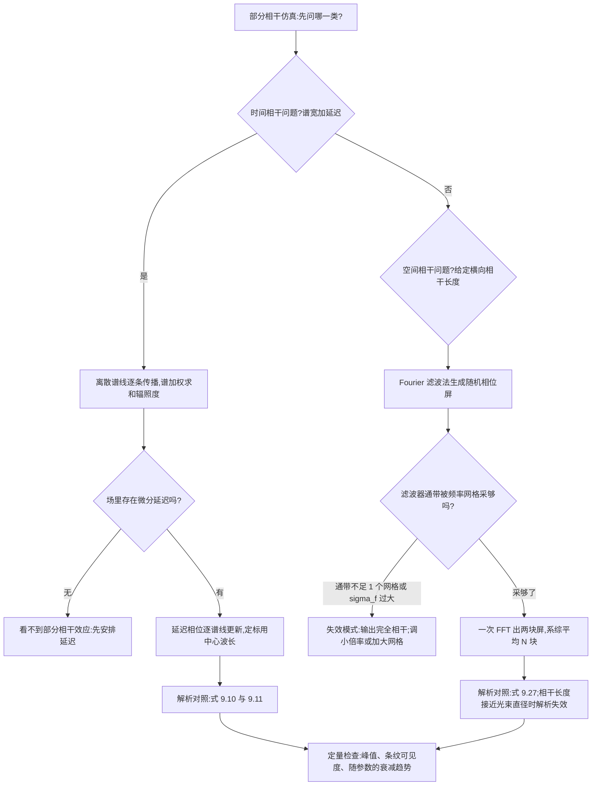

## 9.1 部分时间相干（Partial Temporal Coherence）

**相干性（coherence）**指光场在不同时间或不同空间点之间的相关程度。高相干产生稳定的干涉效应——前几章单色光仿真里那些"fringing""ringing"结构(以及 7.3.4 节的散斑)都来自它;非相干成像(第 7 章)里没有这些特征。相干性在不同应用里角色不同:全息需要高相干,光学相干层析（OCT）反而利用低相干,有时它是噪声源(散斑)。应用清单:全息、干涉测量、OCT、相干激光雷达、傅里叶变换光谱、量子通信。

图 9.1 把两类相干画在一张图里:**时间相干（temporal coherence）**= 同一点 \(P\) 的场在时间差 \(\tau\) 前后的相关(时间平均的场乘积);部分时间相干源的这个"相干度"随 \(\tau\) 增大典型地下降。**空间相干（spatial coherence）**= 同一时刻、不同横向点 \(P_1\)、\(P_2\) 的场相关;随间隔增大典型地下降。

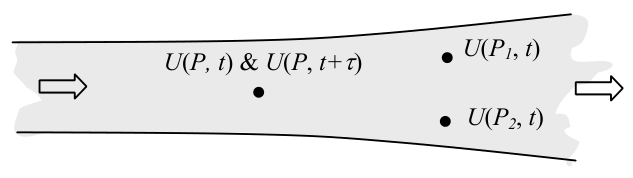

*图 9.1 时间相干:P 点的场 U(P,t) 与 U(P,t+τ) 的相关;空间相干:同一时刻 P1、P2 两点的场相关（截自原书）*

光学相干理论本身是一个庞大的统计学科,本章只取与计算直接相关的少数结论(书给出一串参考书 1–5)。部分相干的传播有广义解析解(Goodman《Introduction to Fourier Optics》3.8 节),仿真路线也不止一种(书引 Rydberg 和 Bengtsson 的综述性 remarks)。本章的做法**不是**从解析解推出来的,而是一套实用策略:把部分相干光当成"互不相干的相干波的辐照度叠加"。时间相干与空间相干分开处理,但共同主题是——用已有的相干方法做一系列传播/成像仿真,再把各次的**辐照度**相加。

### 9.1.1 准单色光（Quasi-monochromatic Light）

单色光只有一个时间频率 \(\nu\);多色光有多个频率或一个时间带宽 \(\Delta\nu\)。有限带宽对应时间相干的损失。白炽灯这类光源波长范围很大;本节聚焦**准单色光（quasi-monochromatic light）**:\(\Delta\nu \ll \nu_0\)(带宽远小于中心频率)。激光器一般是准单色源,其部分时间相干效应在实际应用里可被察觉甚至被利用。

准单色光用**功率谱密度（power spectral density, PSD）**刻画——各光学频率的相对辐照度贡献,也叫**线型（lineshape）**。常见线型有矩形、高斯、洛伦兹。书取归一化高斯线型:

\[
\hat{S}(\nu) = \frac{1}{\sqrt{\pi}\,b}\exp\left[-\frac{(\nu-\nu_0)^2}{b^2}\right], \tag{9.1}
\]

\(b\) 是宽度参数,\(\nu_0\) 是中心频率(Hz),全频率积分等于 1。用单个数字刻画谱密度时,常用**线宽（linewidth）**\(\Delta\nu\)——谱密度的半高全宽(FWHM)。把半高值代入式 (9.1) 可解出:

\[
b = \frac{\Delta\nu}{2\sqrt{\ln 2}}\,. \tag{9.2}
\]

光场时间相干的度量是**复时间相干度（complex degree of temporal coherence）**\(\gamma(\tau)\)——场的归一化相关,\(\tau\) 是两次采样间的时间延迟。归一化谱密度与 \(\gamma(\tau)\) 由傅里叶变换联系:

\[
\gamma(\tau) = \int_0^{\infty}\hat{S}(\nu)\exp(-j2\pi\nu\tau)\,d\nu\,, \tag{9.3}
\]

注意 \(\hat{S}(\nu)\) 只定义在正频率上。对式 (9.1) 做这个变换:

\[
\gamma(\tau) = \exp\left[-\left(\frac{\pi\Delta\nu\tau}{2\sqrt{\ln 2}}\right)^2\right]\exp(-j2\pi\nu_0\tau)\,. \tag{9.4}
\]

我们关心的是模长 \(|\gamma(\tau)|\),可以证明

\[
0 \leq \left|\gamma(\tau)\right| \leq 1\,. \tag{9.5}
\]

\(|\gamma| = 1\) 是完全相干,\(|\gamma| = 0\) 是完全不相干。图 9.2 显示 \(|\tau|\) 越大 \(|\gamma(\tau)|\) 越小——时间上离得越远,相干越差。

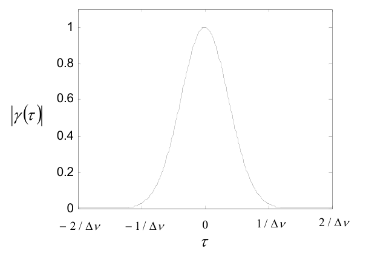

*图 9.2 式 (9.4) 的复时间相干度模长;τ 的正负号取决于哪个采样点被延迟（截自原书）*

时间相干的单值刻画是**相干时间（coherence time）**\(\tau_c\)。高斯线型下定义为

\[
\tau_c = \frac{0.664}{\Delta\nu}\,. \tag{9.6}
\]

光束传播一个相干时间走过的距离叫**相干长度（coherence length）**:

\[
\ell_c = c\,\tau_c\,. \tag{9.7}
\]

例:\(\lambda_0 = 650\) nm、\(\Delta\nu = 2\) GHz(激光二极管的典型波长和线宽),则 \(\tau_c = 3.32\times10^{-10}\) s、\(\ell_c = 10\) cm。把光束等分成两份,让其中一份多走 10 cm 再合束,干涉条纹的对比度会很低。

!!! note "拓展:0.664 这个系数是线型给的"
    \(\tau_c = 0.664/\Delta\nu\) 只对高斯线型成立;习题 9.1 的矩形线型给出 \(\tau_c = 1/\Delta\nu\)(式 9.30),洛伦兹线型又是别的系数。"相干时间"没有普适定义,只有"指定线型下的约定"。工程上更常用的换算是 \(\ell_c \approx 0.66\,\lambda_0^2/\Delta\lambda\):由 \(\Delta\nu/\nu_0 = \Delta\lambda/\lambda_0\) 与式 (9.6)/(9.7) 直接推出——650 nm、2 GHz 的激光二极管对应 \(\Delta\lambda \approx 2.8\) pm、\(\ell_c \approx 10\) cm,与书一致。反过来,宽带 LED(\(\Delta\lambda \approx 30\) nm)的相干长度只有十几微米,这就是 OCT 用低相干光做层析定位的原因。

### 9.1.2 部分时间相干的仿真方案

仿真时,x–y 面上的总辐照度可以写成谱积分:

\[
I(x,y) = \int_{-\infty}^{\infty}\hat{S}(\nu)\,I(x,y;\nu)\,d\nu\,, \tag{9.8}
\]

其中 \(I(x,y;\nu)\) 是**谱辐照度（spectral irradiance）**(W/m²·Hz)。计算机上把谱内容离散成有限条谱线:

\[
I(x,y) \approx \sum_{n=1}^{N}\hat{S}(\nu_n)\,I(x,y;\nu_n)\,\delta\nu\,, \tag{9.9}
\]

\(n\) 是谱线编号、\(N\) 是谱线条数、\(\delta\nu\) 是相邻谱线的频率间隔。图 9.3 是一个采样后的归一化 PSD。

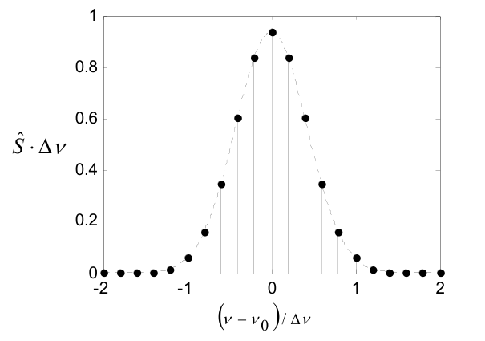

*图 9.3 离散采样后的归一化功率谱密度(pc_temp 取 51 条线、跨 4Δν)（截自原书）*

于是仿真方案就是:对一系列不同频率的场逐条传播(或成像),各自形成辐照度,按 PSD 加权,再求和得到部分相干结果。

这个方案**忽略了频率分量之间的交叉相关**——也就是不同频率分量之间的干涉。交叉相关会在辐照度里产生时间上的拍(beating)而非稳定图样;拍频等于分量频率之差,但受限于探测器的时间响应可能测不到,而且这些相关项通常很弱。虽然不完全严格,这是实践中的常用假设,结果可信(书引 ref 7、9;与 9.3 节的讨论呼应)。

!!! note "拓展:为什么忽略交叉相关通常没事"
    两束频率差 \(\delta\nu\) 的光干涉,条纹以拍频 \(\delta\nu\) 闪烁。检测器(眼睛、CCD、光电管后接的积分电路)的响应时间 \(\gg 1/\delta\nu\) 时,记录到的是时间平均——拍动项平均为零,只剩各自辐照度之和。GHz 量级的谱宽对应纳秒量级的拍周期,而相机的积分时间是毫秒级:差 6 个数量级。所以"先各自算辐照度再相加"在检测器积分的意义下就是正确的时平均。真正能看到拍的是快速探测器(拍频探测、外差接收),那已经超出本章的成像范畴。

要观察到部分时间相干效应,场的不同部分从源到观察面必须经历**不同的延迟**。延迟可以自然产生:介质里的多径散射、有深度起伏的表面反射;也可以人为安排(下一节的光路)。

### 9.1.3 部分时间相干例子

光路见图 9.4:两束平行圆光束(半径 \(w\))从左侧进入,中心间距 \(\Delta s\)。它们来自同一光源、彼此无延迟。下臂用反射镜绕行,多走 \(\Delta d\)——相当于相对时间延迟 \(\tau = \Delta d/c\)。两束经焦距 \(f\) 的透镜聚焦形成夫琅禾费图样。这本质上就是杨氏双缝实验,只是缝换成了孔、加了透镜。透镜左侧的衍射效应忽略,所以到达透镜的两束就是圆盘函数。

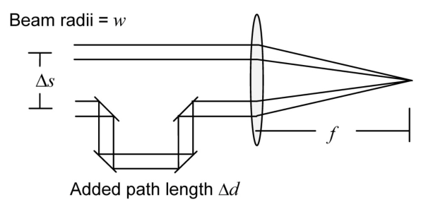

*图 9.4 双光束时间相干光路:下臂绕行增加光程 Δd,透镜后形成夫琅禾费图样（截自原书）*

仿真参数:\(\lambda_0 = 650\) nm、\(\Delta\nu = 2\) GHz、\(w = 1\) mm、\(\Delta s = 5\) mm、\(f = 0.25\) m、\(\Delta d = 5\) cm。脚本 **pc_temp**:

=== "MATLAB"

    ```matlab
    % ===== 书 9.1.3 节:pc_temp 部分时间相干例子(逐行忠实 + 中文注释) =====
    % 完整脚本 = matlab/fourier/ch9/pc_temp.m。流程:
    %   对 N=51 条谱线(跨 4*dnu)各生成"带延迟相位的双圆孔"场 ->
    %   Fraunhofer 图样(中心波长定标)-> 按 S(nu)*dnu 加权累加(式 9.9)。
    % 评注 (e):延迟效应完全装在 exp(j*k*deld) 里,k 逐谱线更新——
    %   时间相干的全部来源就是这个相位;若统一用 k0 会得到完全相干结果。
    % 评注 (f):1/lf 与 x2 用中心波长 lambda0 定标,谱宽对这些定标项的
    %   影响可忽略(与光程差项不同)。
    % MATLAB/Python 差异:Python 版在 python/fourier/ch9/ch9_temporal.py
    %   的 pc_temp();circ 对应 base.circle(X,Y,w)(Goodman 半径约定)。
    % ------------- 以下为书原代码(第 1-57 行) -------------
    % pc_temp partial temporal coherence example

    lambda0=650e-9;     %center wavelength (m)
    c=3e8;              %speed of light
    k0=2*pi/lambda0;    %center wavenumber
    nu0=c/lambda0;      %center frequency

    % Gaussian lineshape parameters
    N=51;               %number of components (odd)
    delnu=2e9;          %spectral density FWHM (Hz)
    b=delnu/(2*sqrt(log(2))); %FWHM scaling
    dnu=4*delnu/N;      %freq interval

    % source plane parameters
    L1=50e-3;           %source plane side length
    M=250;              %# samples (even)
    dx1=L1/M;           %sample interval
    x1=-L1/2:dx1:L1/2-dx1; %source coords
    x1=fftshift(x1);     %shift x coord
    [X1,Y1]=meshgrid(x1,x1);

    % beam parameters
    w=1e-3;             %radius
    dels=5e-3;          %transverse separation
    deld=5e-2;          %delay distance
    f=0.25;             %focal dist for Fraunhofer
    lf=lambda0*f;

    % loop through lines
    I2=zeros(M);
    for n=1:N
       % spectral density function
       nu=(n-(N+1)/2)*dnu+nu0;
       S=1/(sqrt(pi)*b)*exp(-(nu-nu0)^2/b^2);
       k=2*pi*nu/c;
       % source
       u=circ(sqrt((X1-dels/2).^2+Y1.^2)/w)...
           +circ(sqrt((X1+dels/2).^2+Y1.^2)/w)...
           *exp(j*k*deld);
       % Fraunhofer pattern
       u2=1/lf*(fft2(u))*dx1^2;
       % weighted irradiance and sum
       I2=I2+S*(abs(u2).^2)*dnu;
    end

    I2=ifftshift(I2); %normalize/center irradiance
    x2=(-1/(2*dx1):1/L1:1/(2*dx1)-1/L1)*lf; %obs coords
    y2=x2;

    figure(1)              %irradiance image
    imagesc(x2,y2,I2);
    xlabel('x (m)'); ylabel('y (m)');
    axis square; axis xy; colormap('gray');

    figure(2)              %irradiance profile
    plot(x2,I2(M/2+1,:));
    xlabel('x (m)'); ylabel('Irradiance');
    ```

=== "Python"

    ```python
    # ===== 书 9.1.3 节:pc_temp(完整脚本见 python/fourier/ch9/ch9_temporal.py) =====
    def pc_temp(deld=5e-2, delnu=2e9, lineshape="gauss", amps=(1.0, 1.0), N=None):
        """书 pc_temp 主体(第 3-48 行,逐行对应)。

        lineshape="rect" 供习题 9.1 复用(式 9.29);amps=(A1,A2) 供习题 9.3。
        返回 I2(居中排列)、x2(观察面坐标)与 (nu, S, dnu) 谱线数组。
        """
        lam0 = 650e-9                               # 书 3 行
        c = 3e8                                     # 书 4 行
        nu0 = c / lam0                              # 书 6 行
        N = 51 if N is None else N                  # 书 9 行(奇数)
        b = delnu / (2 * np.sqrt(np.log(2)))        # 书 11 行(式 9.2)
        dnu = 4 * delnu / N                         # 书 12 行
        L1 = 50e-3; M = 250                         # 书 15/16 行
        dx1 = L1 / M                                # 书 17 行
        x1, _ = coords(L1, M)                       # 书 18 行:居中升序
        x1 = np.fft.fftshift(x1)                    # 书 19 行:坐标移位 -> 场天生 FFT 排列
        X1, Y1 = np.meshgrid(x1, x1)                # 书 20 行
        w = 1e-3; dels = 5e-3; f = 0.25             # 书 23/24/26 行
        lf = lam0 * f                               # 书 27 行

        I2 = np.zeros((M, M))                       # 书 30 行
        for n in range(1, N + 1):                   # 书 31 行
            nu = (n - (N + 1) / 2) * dnu + nu0      # 书 33 行
            S = gaussian_lineshape(nu, nu0, b)      # 书 34 行(式 9.1)
            k = 2 * np.pi * nu / c                  # 书 35 行:逐谱线更新 k!
            u = amps[0] * circle(X1 - dels / 2, Y1, w) \
                + amps[1] * circle(X1 + dels / 2, Y1, w) * np.exp(1j * k * deld)
            # 书 41 行:Fraunhofer 图样(忽略前端相位;中心波长定标)
            u2 = 1 / lf * np.fft.fft2(u) * dx1 ** 2
            I2 = I2 + S * np.abs(u2) ** 2 * dnu     # 书 43 行:式 (9.9)
        I2 = np.fft.ifftshift(I2)                   # 书 46 行:居中
        _, fx2 = coords(L1, M)                      # 书 47 行:频率网格
        x2 = fx2 * lf                               # 观察面坐标
        return I2, x2, (nu_arr, S_arr, dnu, lam0, f, w, dels)
        # (循环里另有 nu_arr[n-1], S_arr[n-1] = nu, S 的记录语句,供
        #  离散度和/谱线图使用;完整脚本见 ch9_temporal.py)
    ```

书对代码的评注逐条过:

- **(a) 谱线建模精度**(第 8–12 行):取决于谱线条数 \(N\) 与频率间隔 \(\delta\nu\)。书试验后取 \(N=51\)、\(\delta\nu = 4\Delta\nu/N\):51 条线跨 \(4\Delta\nu\),即 4 倍 FWHM(图 9.3 显示的跨度)。这组值给出的结果与理论一致;谱线更多、跨度更大,离散谱模型就越贴解析模型,但运行时间会成问题。

!!! warning "原书笔误:评注 (a) 的图号"
    评注 (a) 写"This is the span displayed in **Fig. 9.2**"——\(4\Delta\nu\) 的采样谱线跨度画在**图 9.3**(采样 PSD,横轴 \((\nu-\nu_0)/\Delta\nu\));图 9.2 是 \(|\gamma(\tau)|\) 曲线,横轴是 \(\tau\)。图号笔误。

- **(b) 第 15 行**:\(L_1 = 50\) mm 选来充分采样圆盘光束、并给出合理的观察面图样尺寸;夫琅禾费相位的采样与混叠在这里不用担心。
- **(c) 第 19 行**:对 \(x_1\) 这个**坐标数组本身**做 `fftshift`,场 \(u\) 直接在移位排列下计算——省掉 for 循环里的 fftshift(省时;与第 8 章 psf_map 同一招)。注意 `x1=fftshift(x1)` 之后坐标"数组"不再是升序,它只是让场数组的 DC 落在索引 1,配合 `fft2` 直接用。
- **(d) 第 31 行**:for 循环计算并累加 \(N\) 个夫琅禾费辐照度图样,各按离散谱密度 \(S\) 加权。
- **(e) 第 39 行**:两个孔沿 x 轴摆放;延迟距离 \(\Delta d\) 由变量 `deld` 控制。对入透镜前的场 \(u\),延迟的建模就是含光程差的复指数 \(\exp(jk\Delta d)\)。
- **(f) 第 41 行**:夫琅禾费图样的前端相位项被丢掉。定标(乘性项 \(1/lf\) 与观察面坐标 \(x_2\))都用中心波长 \(\lambda_0\);准单色光的波长展宽对这些定标项的影响可忽略——与光程差项不同(那里的 \(k\) 必须逐线更新)。
- **(g) 第 43 行**:这一行完成式 (9.9) 的积分近似。

结果见图 9.5。若两束完全相干,条纹的"零点"会到 0;这里干涉明显不完全——对 \(\ell_c = 10\) cm 的相干长度和 \(\Delta d = 5\) cm 的光程差,这正是预期。\(\tau = \Delta d/c = 1.67\times10^{-10}\) s,复时间相干度的模长算得

\[
\left|\gamma(\tau)\right| = \exp\left[-\left(\frac{\pi\Delta\nu\tau}{2\sqrt{\ln 2}}\right)^2\right] = 0.6733\,.
\]

解析解(引 ref 1)为

\[
I_2(x_2,y_2) = \frac{2}{(\lambda_0 f)^2}\left\{w^4\left[\frac{J_1\!\left(2\pi\dfrac{w}{\lambda_0 f}\sqrt{x_2^2+y_2^2}\right)}{\dfrac{w}{\lambda_0 f}\sqrt{x_2^2+y_2^2}}\right]^2\right\}\times\left[1+\left|\gamma\!\left(\frac{\Delta d}{c}\right)\right|\cos\!\left(2\pi\frac{\Delta s}{\lambda_0 f}x_2 + k_0\Delta d\right)\right], \tag{9.10}
\]

以及由式 (9.4):

\[
\left|\gamma\!\left(\frac{\Delta d}{c}\right)\right| = \exp\left[-\left(\frac{\pi\Delta\nu\,\Delta d/c}{2\sqrt{\ln 2}}\right)^2\right]. \tag{9.11}
\]

!!! warning "原书笔误:式 (9.10) 花括号内的 w² 应为 w⁴"
    印刷版花括号内是 \(w^2\)。数值反证:按 \(w^2\) 计算,式 (9.10) 在中心的值是 \(2\pi^2w^2/(\lambda_0 f)^2 \approx 7.5\times10^8\),比仿真的条纹峰值(约 1200)大 6 个量级;按 \(w^4\) 算,中心包络 \(2\pi^2w^4/(\lambda_0 f)^2 = 748\),乘条纹因子 \((1+0.67\cos k_0\Delta d)\) 得约 1250——与书图 9.5(b) 的峰值 ~1200 吻合。等价写法是 \(2(\pi w^2/\lambda_0 f)^2\,[2J_1(v)/v]^2\)。图 9.5(b) 里"由式 (9.10) 生成"的散点与仿真贴合,说明作者实际算的就是 \(w^4\) 版本。式 (9.27) 有同一处笔误,见 9.2.3 节。

图 9.5(b) 的散点由式 (9.10) 生成,与仿真曲线贴合得很好。

!!! warning "原书笔误:图 9.5 题注的脚本名"
    题注写"Partial temporal coherence results for **pb_temp**"——脚本是 pc_temp,排版把名字拼坏了。

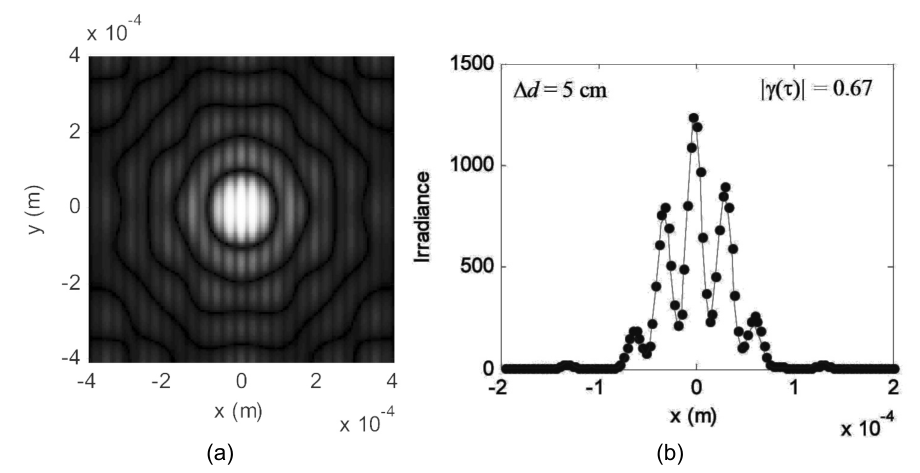

*图 9.5 pc_temp 结果(Δd = 5 cm、|γ(τ)| = 0.67):(a) 辐照度图样;(b) x 剖面,x 轴已放大以便看清中央;散点为式 (9.10) 解析值（截自原书）*

本章 Python 复现(同参数)的定量检查:

- 谱线权重和 \(\sum S\,\delta\nu = 0.999998\)(归一化线型);离散度和 \(|\sum S\,e^{-j2\pi\nu\tau}\delta\nu| = 0.6733\),与解析 \(0.6733\) 相对差 \(1.2\times10^{-6}\)——式 (9.3) 的 DFT 近似在这组参数下几乎精确;
- 剖面峰值:仿真 1223、解析 1241(书图 9.5(b) ~1200),最大相对偏差 3.8%(出现在像元化圆盘的边缘采样上,即书评注的 lumpiness 量级);
- 条纹可见度(中央 \(\pm1\) 周期的插值极值)= 0.71,目标 \(|\gamma| = 0.673\)(包络在一个周期内略衰减,极值法略偏高);
- 反证勘误:若按书印的 \(w^2\) 计算,解析中心值 \(7.5\times10^8\),比仿真大 6 个量级。

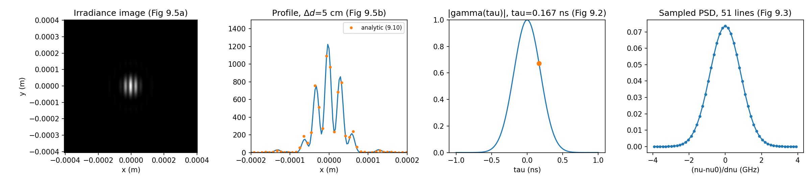

*图 9-P1 pc_temp 复现:辐照度图样 / x 剖面(数值实线 vs 式 9.10 勘误版散点)/ |γ(τ)| 曲线(标出 τ = 0.167 ns 的取值点)/ 51 条采样谱线(笔记自制)*

图 9.6 的系列面板(同一脚本改 \(\Delta d\))展示从高对比到低对比条纹的过渡:\(\Delta d = 0\to 50\) cm,\(|\gamma| = 1.0 \to 0.67 \to 0.21 \to 0\)。\(\Delta d = 50\) cm 时两束之间的相干干涉几乎全部丢失,图样退化成单束的 Airy 图样——只是辐照度翻倍(两束都在)。\(\Delta d = 50\) cm 面板里 Airy 环上的"疙瘩"(lumpiness)来自初始圆盘函数的离散边缘采样。

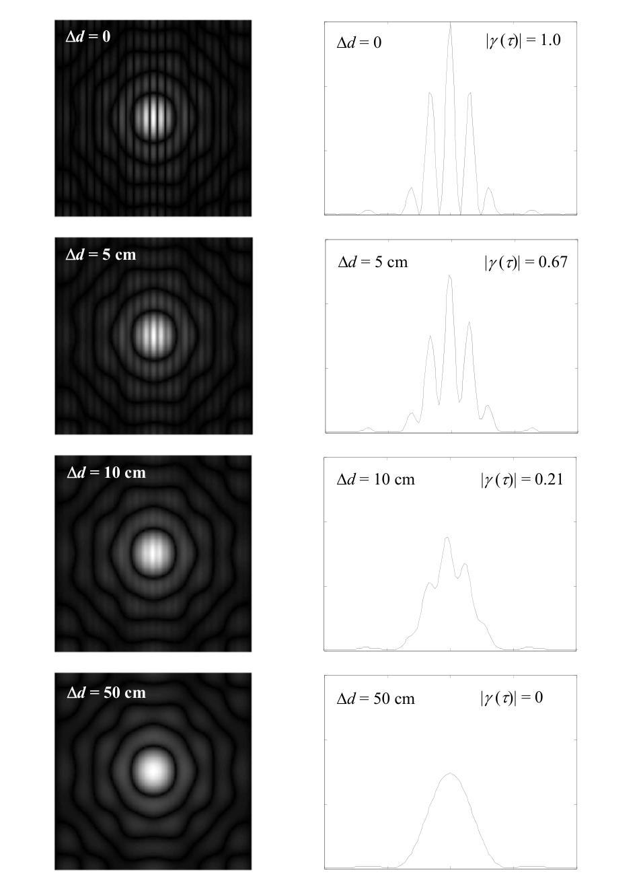

*图 9.6 Δd = 0/5/10/50 cm 的辐照度图样(左列)与对应 x 剖面(右列):|γ| = 1.0/0.67/0.21/0;Δd = 50 cm 时只剩单束 Airy(功率翻倍)（截自原书）*

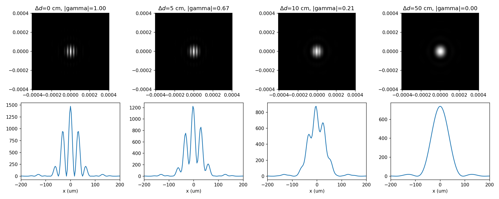

*图 9-P2 Δd 系列复现(0/5/10/50 cm):条纹对比度随延迟单调下降,50 cm 处条纹消失(笔记自制)*

## 9.2 部分空间相干（Partial Spatial Coherence）

### 9.2.1 随机透过屏（Stochastic Transmission Screen）

理想点源的场是**完全空间相干**的:在空间两点观察,幅度完全相关。但如果源是许多独立辐射点的扩展集合(频率、幅度各异),两点间的相关就下降。同样,若场在传播路径上被随机扰动,空间相干也下降。反过来,光走很远之后波前趋于平面,空间相干**升高**——遥远星光的空间相干性很高。

空间相干的度量是**复相干因子（complex coherence factor）**\(\mu_{12}\):场在两点 1、2 上的归一化相关。我们关心 \(|\mu_{12}|\),可以证明

\[
0 \leq \left|\mu_{12}\right| \leq 1\,. \tag{9.12}
\]

场样本之间的相关要按时间平均来做。设两点在 x–y 面内间隔 \(x'\) 与 \(y'\)(图 9.7)。仿真用的简单模型:场有一个确定性部分 \(U_0(x,y)\),随机的时间性分量通过一个复透过率屏 \(t_A(x,y;t)\) 引入:

\[
U(x,y;t) = U_0(x,y)\,t_A(x,y;t)\,. \tag{9.13}
\]

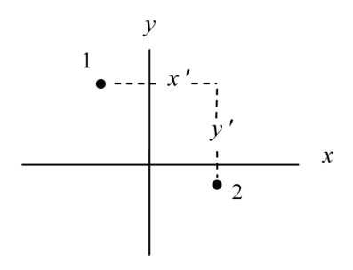

*图 9.7 空间相干相关的场采样位置:两点间隔 x′、y′（截自原书）*

关心的量是透过率屏的时间平均空间自相关函数:

\[
R(x',y') = \left\langle t_A(x+x',y+y';t)\,t_A^*(x,y;t)\right\rangle\,, \tag{9.14}
\]

尖括号表示平均,\(*\) 是复共轭。复相干因子等价于屏的归一化自相关函数:

\[
\mu_{12} = \frac{R(x',y')}{R(0,0)}\,. \tag{9.15}
\]

常用的空间相关函数形式是高斯:

\[
R(x',y') = \exp\left[-\frac{x'^2+y'^2}{\ell_{cr}^2}\right], \tag{9.16}
\]

其中 \(\ell_{cr}\) 度量空间(横向)相干长度。

!!! note "拓展:相干因子与条纹可见度是一回事"
    9.1 节的 \(\gamma(\tau)\) 和这里的 \(\mu_{12}\) 是同一个数学对象(归一化互相关)在不同变量下的样子:一个按时间延迟 \(\tau\) 扫,一个按空间间隔 \((x',y')\) 扫。两者都能用条纹可见度实验测出:等幅双束干涉时 \(V = (I_{max}-I_{min})/(I_{max}+I_{min}) = |\mu|\)。这就是 Michelson 测星干涉仪的原理——用双孔条纹的可见度量星星的角尺寸(呼应 9.2.1 开头"星光空间相干高":恒星角径极小,在地面两点的 \(\mu_{12}\) 仍接近 1,但可测的微小下降直接换算出角径)。

### 9.2.2 部分空间相干的仿真方案

仿真流程(图 9.8):对一个确定性光束场施加空间随机透过率屏 → 传播 → 形成辐照度;换一个屏的新实现重复多次;把这些辐照度图样**平均**得到部分空间相干结果。

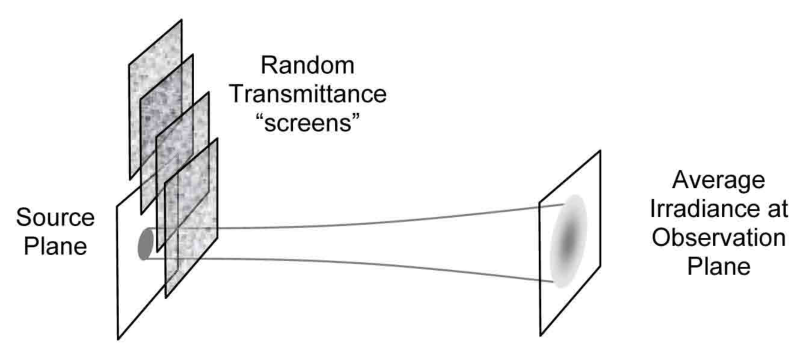

*图 9.8 部分空间相干仿真流程:随机透过屏逐个作用,观察面辐照度做平均（截自原书）*

透过率函数取复相量形式:

\[
t_A(x,y) = \exp\left[j\phi(x,y)\right], \tag{9.17}
\]

\(\phi(x,y)\) 是空间相关的随机相位函数,常称**相位屏（phase screen）**。式 (9.17) 保持确定性场幅度的模不变(纯相位扰动)。相位建模为

\[
\phi(x,y) = r(x,y)\otimes f(x,y)\,, \tag{9.18}
\]

\(r(x,y)\) 是空间不相关("delta 相关")的随机信号,方差 \(\sigma_r^2\);\(f(x,y)\) 是高斯响应函数,把随机信号"抹平滑"从而给相位制造空间相关。高斯核取

\[
f(x,y) = \frac{1}{\pi\sigma_f^2}\exp\left[-\frac{x^2+y^2}{\sigma_f^2}\right], \tag{9.19}
\]

\(\sigma_f\) 是宽度参数。可以证明(引 ref 10)式 (9.17) 的自相关为

\[
R(x',y') = \exp\left\{-\frac{\sigma_r^2}{2\pi\sigma_f^2}\left[1-\exp\left(-\frac{x'^2+y'^2}{2\sigma_f^2}\right)\right]\right\}. \tag{9.20}
\]

!!! note "拓展:式 (9.20) 怎么来、高斯近似何时成立"
    对高斯统计的相位,\(\langle e^{j(\phi_1-\phi_2)}\rangle = e^{-\frac{1}{2}\mathrm{Var}(\phi_1-\phi_2)} = e^{-[R_\phi(0)-R_\phi(x')]}\)。卷积模型的相位相关是 \(R_\phi = \sigma_r^2\,(f\otimes f) = \frac{\sigma_r^2}{2\pi\sigma_f^2}e^{-x'^2/(2\sigma_f^2)}\),代入即得式 (9.20)。它有个"天花板":当 \(x'\to\infty\),\(R\to\exp(-\sigma_r^2/2\pi\sigma_f^2)\neq 0\)——屏的随机相位相差太多时 \(t_A\) 的平均不为零。只有当指数里的前置因子很大(式 9.21)时,这个"底"被压到 0,中段行为才是高斯(式 9.22)。数值上:书参数 \(\sigma_r^2/(2\pi\sigma_f^2) = 12.5\),间隔 5 mm 处的精确值 0.6807 vs 高斯近似 0.6766,差别不大;而习题 9.4 的 \(\ell_{cr}=4\) mm 档,精确值 0.2302 vs 高斯 0.2096,偏差开始可见。

进一步,若

\[
\frac{\sigma_r^2}{2\pi\sigma_f^2} \gg 1\,, \tag{9.21}
\]

就得到高斯相关函数

\[
R(x',y') \approx \exp\left[-\frac{x'^2+y'^2}{\ell_{cr}^2}\right], \tag{9.22}
\]

其中横向相干长度为

\[
\ell_{cr}^2 = \frac{4\pi\sigma_f^4}{\sigma_r^2}\,. \tag{9.23}
\]

要在计算机里生成 \(t_A(x,y)\),先按式 (9.18) 构造 \(\phi(x,y)\)——用频域的**傅里叶滤波法（Fourier filtering method）**。若 \(|\Phi|^2\) 是 \(\phi\) 的功率谱、\(\sigma_r^2\) 是 \(r\) 的方差、\(F = \mathfrak{F}\{f\}\),利用"线性滤波器 + 随机输入"的性质(引 ref 11):

\[
\left|\Phi(f_X,f_Y)\right|^2 = \sigma_r^2\left|F(f_X,f_Y)\right|^2\,. \tag{9.24}
\]

频域操作要满足式 (9.24)。计算机里用离散数组与下标 \(p,q\)(引 ref 10、12):

\[
\Phi(p\Delta f_X, q\Delta f_Y) = \tilde{r}(p,q)\,\frac{\sigma_r}{(\Delta f_X\Delta f_Y)^{1/2}}\,F(p\Delta f_X, q\Delta f_Y)\,, \tag{9.25}
\]

\(\tilde{r}(p,q)\) 是零均值、单位方差的随机数组。因子 \((\Delta f_X\Delta f_Y)^{1/2}\) 来自"样本间隔的'面积'要随方差归一";均匀采样时 \((\Delta f_X\Delta f_Y)^{1/2} = \Delta f_X\)。对高斯相关情形,式 (9.19) 的变换给出滤波器:

\[
F(f_X,f_Y) = \exp\left[-\pi^2\sigma_f^2\left(f_X^2+f_Y^2\right)\right]\,. \tag{9.26}
\]

所以生成一个 \(\phi\) 随机实现的计算流程:数组填满随机值 \(\tilde{r}(p,q)\) → 乘 \(\sigma_r/\Delta f_X\) → 乘滤波器响应 \(F\) → 逆 FFT。

最后一个技巧:把 \(\tilde{r}(p,q)\) 做成**复随机数组**(实部虚部是相互独立的高斯随机值)。这样经式 (9.25) 生成的 \(\Phi\) 是复的,逆 FFT 得到的 \(\phi\) 的实部与虚部是两个相互独立、各自满足式 (9.22) 相关性的随机数组——一次 FFT 白送两块相位屏!把两块屏分别装进复相量,就得到 \(t_A\) 的两个离散实现。

!!! note "拓展:一次 FFT 两块屏的原理"
    复高斯随机数 \(\tilde r = a + jb\)(\(a,b\) 独立同分布)乘实滤波器 \(F\) 后仍是复高斯,且实部谱 \(F a\) 与虚部谱 \(F b\) 相互独立、方差结构相同。逆变换是线性算子,所以 \(\mathrm{Re}[\phi]\) 与 \(\mathrm{Im}[\phi]\) 是两个独立的高斯相关随机场——相关性都由 \(|F|^2\) 决定。任何"要生成 N 个等价随机场"的场合都可以用这招(相干噪声、粗糙表面、湍流),不止省一半时间。

### 9.2.3 部分空间相干例子

为了演示部分空间相干效应,沿用时间相干例子的同一套光路,但**去掉路径延迟**(图 9.9)。这次是有限的空间相干承担"降低条纹对比度"的任务。参数同时间相干例:\(\lambda = 650\) nm、\(w = 1\) mm、\(\Delta s = 5\) mm、\(f = 0.25\) m。横向相干长度取 \(\ell_{cr} = 8\) mm——与 \(\Delta s\) 同量级,因此应产生明显的两束相干下降。此情形下,

\[
\left|\mu_{12}\right| = \exp\left[-\Delta s^2/\ell_{cr}^2\right] = 0.677\,.
\]

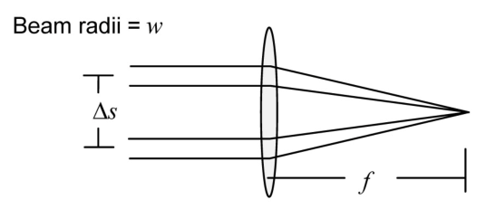

*图 9.9 双光束空间相干光路:与图 9.4 相同但无路径延迟（截自原书）*

脚本 **pc_spatial**:

=== "MATLAB"

    ```matlab
    % ===== 书 9.2.3 节:pc_spatial 部分空间相干例子(逐行忠实 + 中文注释) =====
    % 完整脚本 = matlab/fourier/ch9/pc_spatial.m。与 pc_temp 同布局、无延迟:
    %   N=100 块随机相位屏(实部/虚部各算一次,一次 FFT 两块屏),
    %   逐个作用 -> Fraunhofer -> 累加辐照度,最后除 N 做系综平均。
    % 参数链(21-22 行):sigma_f = 2.5*Lcr = 20mm;
    %   sigma_r = sqrt(4*pi*sigma_f^4/Lcr^2) = 177.2mm(式 9.23 反解)。
    % 评注 (e):39-40 行的定标因子——sigma_r/dfx1 来自式 (9.25)(书印刷版
    %   漏印 sigma_r);M^2 抵消 ifft2 内置的 1/M^2;dfx1^2 补逆变换面积元。
    % MATLAB/Python 差异:Python 版在 python/fourier/ch9/ch9_spatial.py
    %   的 pc_spatial();randn(M)+j*randn(M) 对应 default_rng 复高斯数组。
    % ------------- 以下为书原代码(第 1-61 行) -------------
    % pc_spatial partial spatial coherence example

    lambda=650e-9;      %center wavelength (m)

    L1=50e-3;           %source plane side length
    M=250;              %# samples (even)
    dx1=L1/M;           %sample interval
    x1=-L1/2:dx1:L1/2-dx1; %source coords
    x1=fftshift(x1);    %shift x coord
    [X1,Y1]=meshgrid(x1,x1);

    % beam parameters
    w=1e-3;             %radius
    dels=5e-3;          %transverse separation
    f=0.25;             %Fraunhofer focal distance
    lf=lambda*f;

    % partial spatial coherence screen parameters
    N=100;              %number of screens (even)
    Lcr=8e-3;           %spatial correlation length
    sigma_f=2.5*Lcr;    %Gaussian filter parameter
    sigma_r=sqrt(4*pi*sigma_f^4/Lcr^2); %random std

    dfx1=1/L1;
    fx1=-1/(2*dx1):dfx1:1/(2*dx1)-dfx1;
    fx1=fftshift(fx1);
    [FX1,FY1]=meshgrid(fx1,fx1);

    % source field
    u1=circ(sqrt((X1-dels/2).^2+Y1.^2)/w)...
        +circ(sqrt((X1+dels/2).^2+Y1.^2)/w);
    % filter spectrum
    F=exp(-pi^2*sigma_f^2*(FX1.^2+FY1.^2));

    % loop through screens
    I2=zeros(M);
    for n=1:N/2
       % make 2 random screens
       fie=(ifft2(F.*(randn(M)+j*randn(M)))...
           *sigma_r/dfx1)*M^2*dfx1^2;
       % Fraunhofer pattern applying screen 1
       u2=1/lf*(fft2(u1.*exp(j*real(fie))))*dx1^2;
       I2=I2+abs(u2).^2;
       % Fraunhofer pattern applying screen 2
       u2=1/lf*(fft2(u1.*exp(j*imag(fie))))*dx1^2;
       I2=I2+abs(u2).^2;
    end

    I2=ifftshift(I2)/N;    %normalize & center irradiance
    x2=(-1/(2*dx1):1/L1:1/(2*dx1)-1/L1)*lf; %obs coords
    y2=x2;

    figure(1)              %irradiance image
    imagesc(x2,y2,I2);
    xlabel('x (m)'); ylabel('y (m)');
    axis square; axis xy;
    colormap('gray');

    figure(2)              %irradiance slice
    plot(x2,I2(M/2+1,:));
    xlabel('x (m)'); ylabel('Irradiance');
    ```

=== "Python"

    ```python
    # ===== 书 9.2.3 节:pc_spatial(完整脚本见 python/fourier/ch9/ch9_spatial.py) =====
    def pc_spatial(N=100, Lcr=8e-3, mult=2.5, aperture="two_beams", seed=9):
        """书 pc_spatial 主体(第 3-51 行,逐行对应)。

        mult 是书 21 行的 2.5 系数(习题 9.4 让试更小的值);aperture 可换
        "rect5x2"(习题 9.5 的 5mm x 2mm 矩形孔)。
        """
        lam = 650e-9; L1 = 50e-3; M = 250           # 书 3/5/6 行
        dx1 = L1 / M                                # 书 7 行
        x1, _ = coords(L1, M)
        x1 = np.fft.fftshift(x1)                    # 书 9 行
        X1, Y1 = np.meshgrid(x1, x1)
        w = 1e-3; dels = 5e-3; f = 0.25             # 书 13/14/15 行
        lf = lam * f                                # 书 16 行

        sigma_f = mult * Lcr                        # 书 21 行(默认 2.5*Lcr)
        sigma_r = np.sqrt(4 * np.pi * sigma_f ** 4 / Lcr ** 2)   # 书 22 行(式 9.23)
        dfx1 = 1 / L1                               # 书 24 行
        _, fx1 = coords(L1, M)
        fx1 = np.fft.fftshift(fx1)                  # 书 26 行
        FX1, FY1 = np.meshgrid(fx1, fx1)

        u1 = circle(X1 - dels / 2, Y1, w) + circle(X1 + dels / 2, Y1, w)  # 书 30-31 行
        F = np.exp(-np.pi ** 2 * sigma_f ** 2 * (FX1 ** 2 + FY1 ** 2))    # 书 33 行(式 9.26)

        I2 = np.zeros((M, M))                       # 书 36 行
        rng = np.random.default_rng(seed)
        for n in range(N // 2):                     # 书 37 行:每次生成 2 块屏
            fie = (np.fft.ifft2(F * (rng.standard_normal((M, M))
                                     + 1j * rng.standard_normal((M, M))))
                   * sigma_r / dfx1) * M ** 2 * dfx1 ** 2    # 书 39-40 行(式 9.25)
            u2 = 1 / lf * np.fft.fft2(u1 * np.exp(1j * fie.real)) * dx1 ** 2
            I2 = I2 + np.abs(u2) ** 2               # 书 42-43 行:屏 1
            u2 = 1 / lf * np.fft.fft2(u1 * np.exp(1j * fie.imag)) * dx1 ** 2
            I2 = I2 + np.abs(u2) ** 2               # 书 45-46 行:屏 2

        I2 = np.fft.ifftshift(I2) / N               # 书 49 行:归一 + 居中
        _, fx2 = coords(L1, M)
        x2 = fx2 * lf                               # 书 50 行
        return I2, x2, (sigma_f, sigma_r)
    ```

书对代码的评注:

- **(a) 第 9 行**:对 \(x_1\) 坐标数组做 fftshift,场在移位排列下直接计算,循环内不用再移位(同 pc_temp)。
- **(b) 第 19 行**:相位屏实现个数 \(N\) 的角色与时间相干仿真里的谱线条数相同——结果随 \(N\) 收敛到解析值,但 \(N\) 大了运行时间长。这里实验选定 \(N=100\):结果"光滑"且跟随解析值。
- **(c) 第 26 行**:对 \(fx_1\) 同评注 (a)。
- **(d) 第 37 行**:循环遍历各块屏。
- **(e) 第 39 行**:`randn` 生成零均值正态随机数组。给相位函数 \(\phi(x,y)\) 定标需要几个因子:\(\sigma_r/dfx1\) 来自式 (9.25);`M^2` 抵消 ifft2 自带的 \(1/M^2\) 因子(书原文写 \(1/MN\));`dfx1^2` 用于正确近似逆傅里叶变换积分。

!!! warning "原书笔误:评注 (e) 漏印 σr"
    书印刷版写"requires several factors: /dfx1 comes from Eq. (9.25)"——分子上的 \(\sigma_r\) 漏印了,代码第 39 行实际是 `*sigma_r/dfx1`(式 9.25 的 \(\sigma_r/(\Delta f_X\Delta f_Y)^{1/2}\),均匀采样下即 \(\sigma_r/\Delta f_X\))。

关于 21–23 行的参数选择:\(\sigma_r\) 与 \(\sigma_f\) 对给定的 \(\ell_{cr}\) 有一定自由度。书的选法:先把式 (9.21) 反过来写成 \(2\pi\sigma_f^2/\sigma_r^2 \ll 1\),再与式 (9.23) 联立得 \(\sigma_f^2 \gg \ell_{cr}^2/2\),最后取 \(\sigma_f = 2.5\,\ell_{cr}\)——大致是能让式 (9.21) 成立的最小 \(\sigma_f\)。本例 \(\ell_{cr} = 8\) mm,于是 \(\sigma_f = 20\) mm,由式 (9.23) 得 \(\sigma_r = 177.2\) mm。\(\sigma_f\) 太大(约 \(> L/2\))时,滤波器 \(F\) 的通带在频域只被很少几个样本定义,生成的屏会失准;大 \(\ell_{cr}\) 会导致这个问题,失效模式是**输出完全相干的结果**。有时把 \(\sigma_f\) 取小一点(如 \(2\ell_{cr}\) 或更小)反而能救——即便式 (9.21) 被违反,结果仍可以不错。

看结果之前,先看几块实际加到源面上的随机相位屏(图 9.10,pc_spatial 参数下的两个实现)。相位值与起伏对 \(\sigma_f = 20\) mm 来说合理。pc_spatial 共施加 100 次屏实现。注意:若屏的相位激励变得太大,相位可能欠采样、产生混叠(与 8.6 节像差波前的讨论同理)。

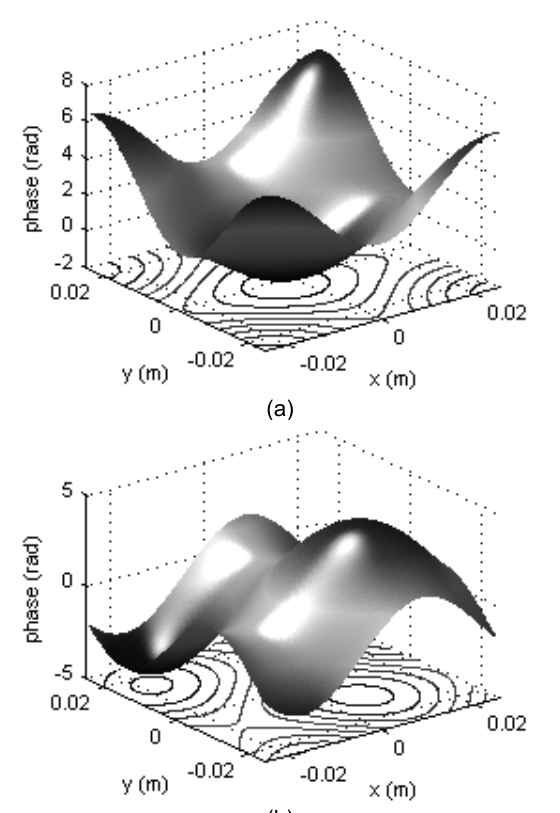

*图 9.10 pc_spatial 参数下的两个随机相位屏实现 φ(x,y):σf = 20 mm,相位起伏约 ±8 rad（截自原书）*

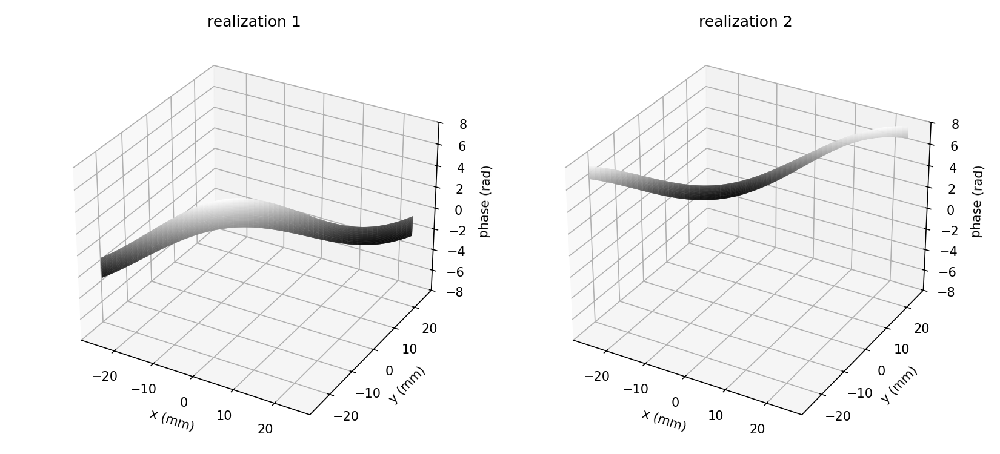

*图 9-P3 相位屏生成复现(书参数):两块独立实现,实部各满足高斯相关;与书图 9.10 同量级(笔记自制)*

运行 pc_spatial 生成图 9.11 的辐照度结果:部分空间相干造成的条纹对比度下降与时间相干情形(图 9.5)类似。解析解为

\[
I_2(x_2,y_2) \approx \frac{2}{(\lambda f)^2}\left\{w^4\left[\frac{J_1\!\left(2\pi\dfrac{w}{\lambda f}\sqrt{x_2^2+y_2^2}\right)}{\dfrac{w}{\lambda f}\sqrt{x_2^2+y_2^2}}\right]^2\right\}\times\left[1+\left|\mu_{12}\right|\cos\!\left(2\pi\frac{\Delta s}{\lambda f}x_2\right)\right]. \tag{9.27}
\]

!!! warning "原书笔误:式 (9.27) 花括号内的 w² 应为 w⁴"
    与式 (9.10) 同款笔误。按 \(w^2\) 计算,中心值 \(2\pi^2w^2/(\lambda f)^2 \approx 7.5\times10^8\),比书图 9.11(b) 峰值(~1250)大 6 个量级;按 \(w^4\) 得 \(2\pi^2w^4/(\lambda f)^2 \times (1+0.677) = 1253\)——与图完全吻合。

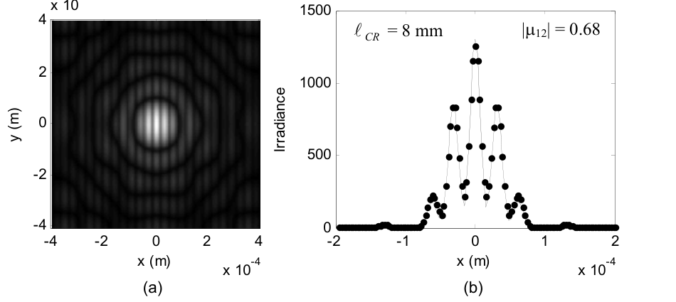

*图 9.11 pc_spatial 结果(ℓcr = 8 mm、|μ12| = 0.68):(a) 辐照度图样;(b) x 剖面(放大),散点为式 (9.27) 解析值（截自原书）*

式 (9.27) 在横向相干长度与光束直径同量级或更小时**失效**。

本章 Python 复现(书参数,\(N=100\))的定量检查:

- 剖面 vs 式 (9.27)(勘误版):相对 RMS 偏差 1.6%(\(N=100\) 屏的系综噪声量级);峰值:仿真 1306、解析 1253(书图 ~1250);
- 条纹可见度(中央条纹直接极值)= **0.81**,而解析目标 \(|\mu_{12}| = 0.677\)——**偏高**,这不是 bug,是书自己预警过的失效模式提前发作,见下;

!!! note "拓展:书参数下条纹对比度偏高的定量诊断"
    式 (9.26) 滤波器的通带宽度约 \(1/(\pi\sigma_f) = 15.9\) 1/m,而频率网格间距 \(\Delta f_X = 1/L_1 = 20\) 1/m——通带不足一个网格!屏的相关结构实际由 DC 与 \(\pm20\) cyc/m 的两三个样本决定,相关长度被拉长,可见度偏向相干。数值扫描(21 行的 2.5 倍率):2.5 → 可见度 0.83、2.0 → 0.76、1.5 → 0.74、1.2 → 0.74(目标 0.677);把网格加大到 \(L_1=200\) mm、\(M=1000\)(\(\Delta f_X=5\) 1/m,通带占 3.2 个网格)后直接测屏的相位结构函数 \(D(5\text{ mm}) = 0.751\) vs 式 (9.20) 预测 0.769、透过率相关 0.686 vs 预测 0.681——屏生成链本身是精确的,偏差全在通带采样。补救:调小 \(\sigma_f\) 倍率或加大 \(L_1\)、\(M\)。这与书 9.2.3 节"\(\sigma_f > L/2\) 时输出完全相干"是同一机理的温和版本。

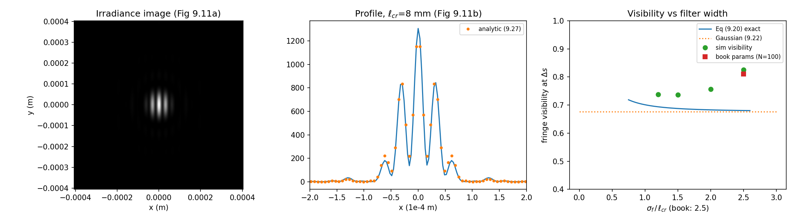

*图 9-P4 pc_spatial 复现:辐照度图样 / x 剖面(数值实线 vs 式 9.27 勘误版散点)/ 实测可见度随 σf 倍率的扫描(书参数 0.81 vs 目标 0.677,倍率调小后回落)(笔记自制)*

## 9.3 可约性、谱分量数与相位屏数量

时间相干与空间相干在前两节是分开处理的。但一般形式的复相干度 \(\gamma_{12}(\tau)\) 同时包含时间与空间场相关,还可以包含频率分量之间的交叉相关。"相干分离"(coherence separation)意味着 \(\gamma_{12}(\tau)\) 可以分解成时间因子与空间因子的乘积:

\[
\gamma_{12}(\tau) = \mu_{12}\,\gamma(\tau)\,. \tag{9.28}
\]

这个分解只在光是**交叉谱纯（cross-spectrally pure）**时可行——粗略地说,光的相干性质与位置无关。实践中这对许多光学源(如激光)是合理假设;但也有例外,比如谱密度随角度变化的源。可分解的相干函数称为**可约的（reducible）**。本章所有例子都假定源相干函数可约。

时间相干建模里谱分量个数没怎么讨论——纯粹实验选定。相关议题别的作者研究得更细:Rydberg 与 Bengtsson 讨论谱采样并把方法扩展到脉冲光源。同样,空间相干仿真的参数值与相位屏个数也是实验选的,没有提出最少屏数判据。空间相干建模是较新的活动,这些问题尚待充分研究——留下 plenty of room for more study and development。

## 9.4 习题（原书）

原书 6 道题。每题给题目与提示,本章做过数值的题附 Python 实测结果——先自己动手。

**9.1 矩形线型**:线型为

\[
\hat{S}(\nu) = \frac{1}{\Delta\nu}\,\mathrm{rect}\!\left(\frac{\nu-\nu_0}{\Delta\nu}\right), \tag{9.29}
\]

该线型的相干时间为

\[
\tau_c = \frac{1}{\Delta\nu}\,. \tag{9.30}
\]

(a) 改 pc_temp 用这个线型;仿真参数不变(\(\lambda_0 = 650\) nm、\(\Delta\nu = 2\) GHz、\(w = 1\) mm、\(\Delta s = 5\) mm、\(f = 0.25\) m、\(\Delta d = 5\) cm);生成仿真辐照度图样与剖面。(b) 推导 \(|\gamma(\tau)|\) 表达式,并按 (a) 的参数求值。(c) 仿真与解析对比。

??? note "9.1 参考答案要点(Python 实测)"
    (b) 矩形的傅里叶变换:\(|\gamma(\tau)| = |\mathrm{sinc}(\Delta\nu\,\tau)|\);代入 \(\Delta\nu\,\tau = 2\times10^9 \times 1.667\times10^{-10} = 0.333\):\(|\gamma| = 0.8270\);\(\tau_c = 1/\Delta\nu = 0.5\) ns(高斯线型是 0.664/\(\Delta\nu\) = 0.332 ns——矩形谱更"宽平",相干时间反而更长)。(a) 谱线间隔 \(\delta\nu = 4\Delta\nu/51\),矩形内有 13 条线;谱线权重和 \(\sum S\,\delta\nu = 1.0196 \neq 1\)(矩形边界落在样本之间,矩形规则超计)。(c) 离散度和 \(0.8376\),仿真的条纹可见度 = 度和/权重和 = **0.8215** vs 连续理论 0.827(−0.7%)——注意别拿度和 0.8376 直接比 0.827 而误读成"+1.3%",先除权重和。剖面 vs 式 (9.10)(\(|\gamma|\) 换 0.827)最大相对偏差 3.5%(像元化圆盘边缘,同主例)。图 9-P5。

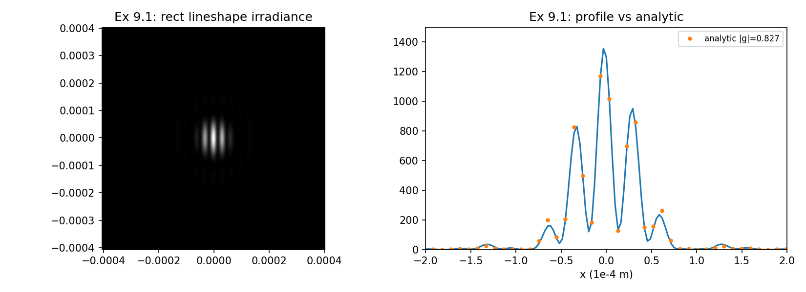

*图 9-P5 习题 9.1:矩形线型的辐照度图样与剖面(实线)vs 式 (9.10) 解析(|γ| = 0.827,散点)(笔记自制)*

**9.2 条纹位移(fringe shift)**:测两束**相干**光程差的灵敏方法是看夫琅禾费图样里条纹的"平移"。从 pc_temp 例子出发。(a) 改脚本生成相干光束(\(\lambda_0 = 650\) nm)的夫琅禾费图样——基本就是去掉循环。(b) 生成 \(\Delta d = 0,\ \lambda_0/4,\ \lambda_0/2,\ 3\lambda_0/4\) 的辐照度剖面。这个技术可测的光程差有没有限制?

??? note "9.2 参考答案要点(Python 实测)"
    剖面按 \(I(x) = |A|^2\,[2+2\cos(2\pi\Delta s\,x_2/\lambda_0 f + k_0\Delta d)]\):\(\Delta d\) 每增 \(\lambda_0\),条纹平移整整一个周期 \( \lambda_0 f/\Delta s = 32.5\ \mu\text{m}\)。对四个剖面做"包络 + cos + sin"三参数最小二乘,拟合相位(以周期计,wrap 到 \([-0.5,0.5)\))= [0, 0.25, −0.5, −0.25],理论 \(k_0\Delta d/2\pi \bmod 1\) = [0, 0.25, 0.5(≡−0.5), −0.25]——逐个吻合(半周期翻转处平移 ±0.5 等价)。局限:图样以 \(\lambda_0\) 为周期,\(\Delta d\) 与 \(\Delta d + \lambda_0\)(整数倍波长)不可区分——单次测量的无模糊范围是 \(\lambda_0\)(650 nm);要往大里测,得靠多波长/外差的办法。图 9-P6。

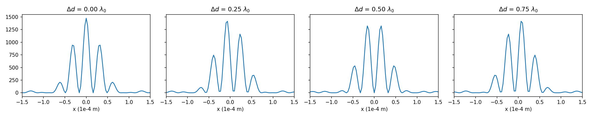

*图 9-P6 习题 9.2:相干双束在 Δd = 0、λ0/4、λ0/2、3λ0/4 下的条纹平移(每格横轴 ±1.5×10⁻⁴ m)(笔记自制)*

**9.3 可见度**:若图 9.4 的两束幅度不同(\(A_1\)、\(A_2\)),定义**可见度（visibility）**:

\[
V = \frac{2A_1A_2}{A_1^2 + A_2^2}\,\gamma\!\left(\frac{\Delta d}{c}\right). \tag{9.31}
\]

取 pc_temp 例子(\(\Delta d = 5\) cm)、\(A_1 = 0.75\)、\(A_2 = 0.20\)。(a) 可见度是多少?(b) 改 pc_temp 生成辐照度剖面。(c) 借助习题 4.5 的思路、联立式 (9.31) 与 (9.10),"提议"一个夫琅禾费图样的解析表达式,并对照仿真验证。

??? note "9.3 参考答案要点(Python 实测)"
    (a) \(V = \frac{2\times0.75\times0.20}{0.75^2+0.20^2}\times0.6733 = 0.4979\times0.6733 = \mathbf{0.3353}\)。(c) 提议式:把式 (9.10) 的 \([1+|\gamma|\cos]\) 换成 \([A_1^2+A_2^2+2A_1A_2|\gamma|\cos(\,2\pi\Delta s\,x_2/\lambda_0 f + k_0\Delta d)]\),包络去掉双束因子 2,改为单束夫琅禾费 \(w^4/(\lambda_0 f)^2[J_1(v)/(w r/\lambda_0 f)]^2\)。自洽检查:\(A_1=A_2=1\) 时括号 \(= 2[1+|\gamma|\cos]\),精确退回勘误后的式 (9.10)。剖面 vs 提议式最大相对偏差 3.8%(同主例的圆盘边缘量级)。图 9-P7。

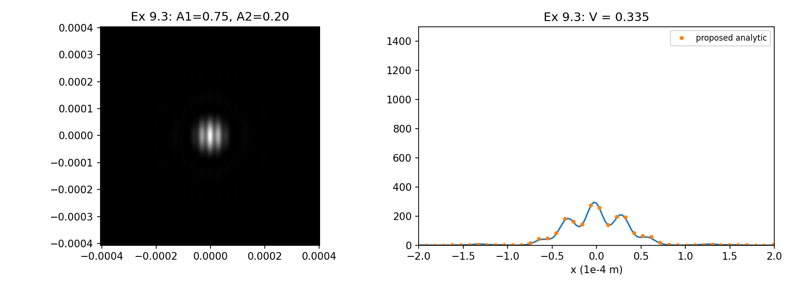

*图 9-P7 习题 9.3:A1 = 0.75、A2 = 0.20 的辐照度与剖面;提议解析式(散点)贴合仿真,V = 0.335(笔记自制)*

**9.4 相干长度扫描**:实现 pc_spatial 仿真与解析解 [式 (9.27)] 的剖面对比。生成 \(\ell_{cr} = 15, 8, 4, 1\) mm 的辐照度结果;对应的 \(|\mu_{12}|\) 是多少?记得 \(\sigma_f > L/2\) 时仿真会失准——15 mm 档试着把 21 行的 2.5 倍率调小;1 mm 档可能需要更多屏。能解释 1 mm 的结果吗?

??? note "9.4 参考答案要点(Python 实测)"
    \(|\mu_{12}| = \exp[-(5/\ell_{cr})^2]\):15 mm → 0.8948、8 mm → 0.6766、4 mm → 0.2096、1 mm → \(\exp(-25) \approx 0\)(式 9.20 精确值 0.8953/0.6807/0.2302/0.0000)。实测可见度(N=100 屏):15 mm + 倍率 2.5(\(\sigma_f = 37.5 > L/2 = 25\) mm)→ **1.000,完全相干输出**——书描述的失效模式;倍率降到 1.5(\(\sigma_f = 22.5 < 25\))→ 0.956,恢复部分相干;8 mm(书参数)→ 0.794;4 mm → 0.284;1 mm → **无条纹**(N=100 与 N=400 都一样)。1 mm 的解释:\(\ell_{cr} \ll \Delta s = 5\) mm,两束完全不相干(\(|\mu_{12}|\approx 0\)),图样是两幅单束 Airy 的**非相干相加**(辐照度翻倍、零条纹);增加屏数只让平均更光滑,不恢复条纹——这是物理,不是收敛问题。图 9-P8。

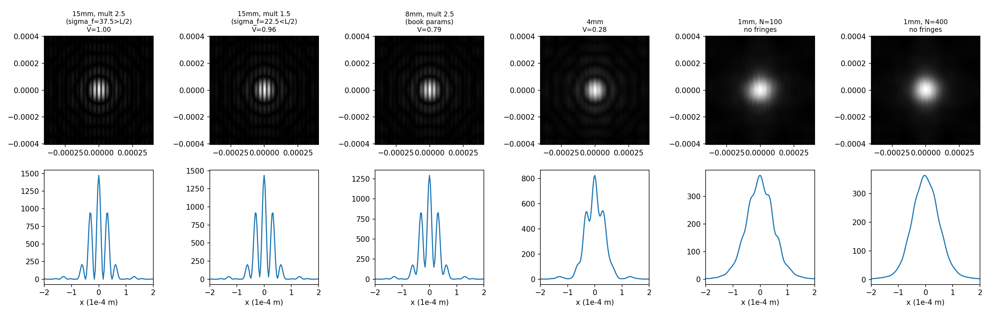

*图 9-P8 习题 9.4:ℓcr = 15/8/4/1 mm 的辐照度(√拉伸)与剖面;15 mm 档对比倍率 2.5(失效)与 1.5(恢复)(笔记自制)*

**9.5 矩形孔**:把 pc_spatial 的两束换成单个 \(5\ \text{mm}\times2\ \text{mm}\) 矩形孔(单位振幅平面波照明)。看 \(\ell_{cr}\) 从 20 mm 到 1 mm 的夫琅禾费图样。能解释结果吗?

??? note "9.5 参考答案要点(Python 实测)"
    \(\ell_{cr} = 20\) mm(\(\gg\) 孔径 5 mm):接近完全相干,图样是 \(\mathrm{sinc}^2\times\mathrm{sinc}^2\) 带清晰的旁瓣(5 mm 长轴方向的旁瓣更密)。\(\ell_{cr}\) 减小,孔径内远距离点对的条纹贡献按 \(\exp[-(x'/\ell_{cr})^2]\) 加权,高频衍射结构(旁瓣)先死;\(\ell_{cr} = 1\) mm(\(\ll\) 孔径)时几乎非相干,图样趋于**横向相干函数的傅里叶变换**(光滑宽包络,宽度 ~\(\lambda f/\ell_{cr} = 162\ \mu\text{m}\)),孔径自己的衍射旁瓣完全消失。物理:互强度 \(\Gamma(x_1,x_2) = A(x_1)A^*(x_2)\mu(x_1-x_2)\),远场辐照度是它对 \((x_1-x_2)\) 的变换;\(\mu\) 的宽度从"比孔径宽"(相干极限,变换给出孔径衍射)缩到"比孔径窄"(变换给出 \(\mu\) 自己的宽斑)。图 9-P9。

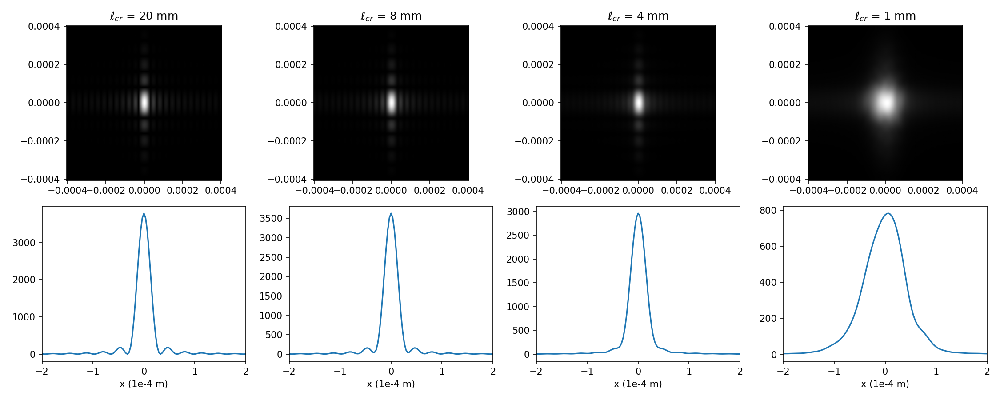

*图 9-P9 习题 9.5:5 mm × 2 mm 矩形孔在 ℓcr = 20/8/4/1 mm 下的夫琅禾费图样(√拉伸)与剖面:旁瓣随相干长度减小先消失(笔记自制)*

**9.6 高斯谢尔模型光束**:GSM 光束有高斯幅度包络与高斯空间相关函数,在激光通信应用里被充分研究过(引 ref 13)。其辐照度(引 ref 2、10)为

\[
I_2(x,y) = \frac{I_0}{\Delta^2}\exp\left[-\frac{2(x^2+y^2)}{w_0^2\Delta^2}\right], \tag{9.32}
\]

其中

\[
\Delta = \left[1+\left(\frac{2z}{kw_0^2}\right)^2\left(1+2\frac{w_0^2}{\ell_{cr}^2}\right)\right]^{1/2}, \tag{9.33}
\]

\(w_0\) 是初始光束尺寸参数。源光束场为

\[
U_1 = \exp\left[-\frac{x^2+y^2}{w_0^2}\right]. \tag{9.34}
\]

开发 GSM 光束的传播仿真。参数:\(w_0 = 2\) cm、\(\lambda = 1.06\ \mu\text{m}\)、\(z = 1\) km、\(\ell_{cr} = 1\) cm;阵列 \(M = 256\);其余参数自选。试验屏实现个数——越多结果越准,但运行时间会很长。(a) 画源面初始光束、完全相干光束与 GSM 光束在观察面的辐照度剖面。(b) GSM 剖面与解析理论对比。

??? note "9.6 参考答案要点(Python 实测)"
    网格:TF 判据(书 5.4 节)\(\Delta x \geq \lambda z/L\),取 \(L_1 = 0.55\) m(\(\Delta x = 2.148\) mm \(\geq 1.927\) mm,同时 \(\sigma_f = 2.5\,\ell_{cr} = 2.5\) cm \(< L/2\))。理论:式 (9.33) 的 \(\Delta = 2.7210\)(完全相干 \(\ell_{cr}\to\infty\) 时 \(\Delta = 1.3083\));GSM 峰值 \(I_0/\Delta^2 = 0.1351\),相干峰值 0.5843。实测(N=200 屏,源面相位屏 + propTF 传播):剖面高斯拟合 \(\Delta_{sim} = 2.761\)(差 1.5%,屏数与系综噪声量级);峰值 GSM 0.1374 vs 0.1351、相干 0.5843(逐位一致);总功率 \(6.2832\times10^{-4}\) m² = \(\pi w_0^2/2\) 精确守恒(相位屏只调相不调幅)。注意 propTF 要求源场**居中排列**,而相位屏是 ifft2 输出的 FFT 排列——相乘前要 ifftshift(见坑与陷阱)。图 9-P10。

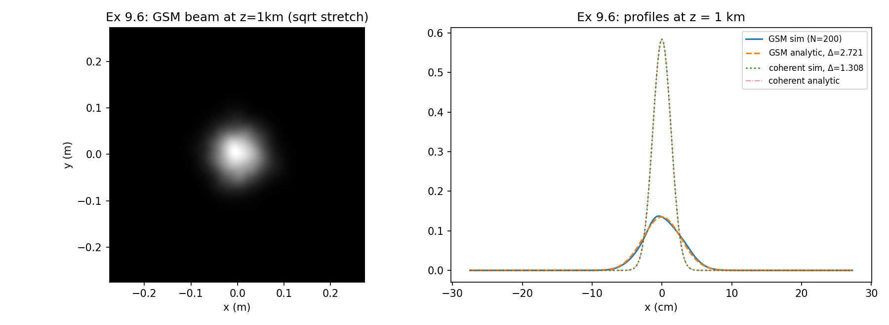

*图 9-P10 习题 9.6:GSM 光束在 z = 1 km 的辐照度(√拉伸)与剖面:GSM 仿真、式 (9.32) 解析(Δ = 2.721)、完全相干仿真与解析(Δ = 1.308)(笔记自制)*

!!! note "拓展:式 (9.33) 的 Δ 在说什么"
    \(\Delta\) 是"高斯光束展宽因子":\(z = 0\) 时 \(\Delta = 1\),GSM 光束回到源面尺寸。\(\ell_{cr}\to\infty\)(完全相干)时式 (9.33) 退化为普通高斯光束的衍射展宽 \(\sqrt{1+(2z/kw_0^2)^2}\),这正是高斯光束的 \(1/e^2\) 半径随 \(z\) 的增长因子(瑞利距离 \(z_R = kw_0^2/2\) 的归一化形式);空间相干越差(\(\ell_{cr}\) 越小),括号里的 \(2w_0^2/\ell_{cr}^2\) 越大,光束发散越快——本例 \(\ell_{cr} = 1\) cm 让 \(z = 1\) km 处的束宽比完全相干情形大 2.08 倍、峰值低 4.3 倍。部分相干光束"抗散斑、填充目标均匀",代价就是发散更快,这是激光通信选 GSM 光束时的基本权衡。

两套方案放在一起对照:

| | **时间相干**(9.1) | **空间相干**(9.2) |
| --- | --- | --- |
| 物理量 | 谱宽 \(\Delta\nu\) 决定 \(\gamma(\tau)\)、\(\ell_c\) | 相关函数 \(\mu_{12}\)、横向相干长度 \(\ell_{cr}\) |
| 仿真内核 | \(N=51\) 条谱线,逐线传播,按 \(S\,\delta\nu\) 加权求和辐照度 | \(N=100\) 块随机相位屏,逐屏传播,辐照度系综平均 |
| 随机性来源 | 谱离散(无随机数,确定性求和) | 相位屏(Fourier 滤波法,复随机数组) |
| 一次算多个 | 一条谱线一个图样 | 一次 FFT 出两块屏(实部/虚部) |
| 延迟/相关装在哪 | 场的相位 \(\exp(jk\Delta d)\),\(k\) 逐线更新 | 屏的相位 \(\phi = r\otimes f\),相关由 \(\lvert F\rvert^2\) 定 |
| 解析对照 | 式 (9.10)(\(w^4\) 勘误)+ 式 (9.11) | 式 (9.27)(\(w^4\) 勘误)+ 式 (9.16) |
| 典型失效 | 谱线太少/跨度不足 → \(\lvert\gamma\rvert\) 偏差 | 通带欠采样或 \(\sigma_f>L/2\) → 输出完全相干 |
| 参数取舍 | \(N\)、\(\delta\nu\) 实验定(9.3 节) | \(N\)、\(\sigma_f\) 倍率实验定(9.3 节) |

## 坑与陷阱

!!! danger "k 逐谱线更新,中心波长只管定标"
    时间相干效应的全部来源是 \(\exp(jk\Delta d)\) 里的 \(k = 2\pi\nu/c\):每条谱线的 \(k\) 不同,求和后干涉项自动缩到 \(|\gamma|\)。\(1/lf\) 与 \(x_2\) 的定标用 \(\lambda_0\) 没问题(谱宽对它们的影响可忽略),但若把光程差相位也统一用 \(k_0\),所有谱线的图样完全相同,求和后你得到的是**完全相干**结果——错得无声无息。

!!! danger "式 (9.10)/(9.27) 的 w² 是印刷错误,应为 w⁴"
    按书印的 \(w^2\),解析中心值 \(2\pi^2w^2/(\lambda f)^2 \approx 7.5\times10^8\),比仿真大 6 个量级;按 \(w^4\)(等价于 \(2(\pi w^2/\lambda f)^2[2J_1(v)/v]^2\))与两幅图都吻合。对拍时先用"中心值 = 2π²w⁴/(λf)² ×(1+|γ|)"校一下量纲再调图。

!!! danger "相位屏滤波器的通带必须被频率网格采够"
    两个失败台阶:(a) \(\sigma_f > L/2\):通带只被几个样本定义,屏失准,输出完全相干(书 15 mm 档实测可见度 1.000);(b) 更隐蔽的:通带 \(1/(\pi\sigma_f) < \Delta f_X = 1/L_1\) 时(书主例 15.9 < 20 1/m),屏结构由两三个样本决定,可见度系统性偏高(0.81 vs 0.677)。补救:调小 21 行的 2.5 倍率(书自己建议 \(2\ell_{cr}\) 或更小)或加大 \(L_1\)、\(M\);要验证屏本身,直接测相位结构函数对照式 (9.20)。

!!! danger "两套 FFT 排列别混:坐标移位技巧与 propTF 的约定"
    pc_temp/pc_spatial 对**坐标数组本身**做 fftshift(场天生在 FFT 排列,循环内不再移位,收尾 ifftshift 回居中)。但习题 9.6 里相位屏从 ifft2 出来也是 FFT 排列,而 propTF(书 5.1 节)要求源场**居中排列**(它内部自己做 fftshift)——屏乘场之前必须再 ifftshift 一次。同一段代码里混用两种约定,错一次全场皆错。

!!! danger "相位激励过大 → 相位欠采样混叠"
    \(\sigma_r = 177\) mm 的定标让屏相位起伏达 ±8 rad(图 9.10)。若把 \(\ell_{cr}\) 或倍率继续往上加,相位起伏更大,屏的高频内容超过 \(1/2\Delta x\) 就会混叠(与 8.6 节像差波前同一判据)。看到图样出现不该有的高频纹理,先查屏的相位剖面。

!!! danger "式 (9.27) 的适用边界:ℓcr ≲ 光束直径"
    解析式假设屏相关比光束尺寸宽。\(\ell_{cr} = 1\) mm 例子里没有条纹——那不是仿真没收敛,是 \(|\mu_{12}| = \exp(-25) \approx 0\) 的真实物理(习题 9.4);再堆屏数也只会更平滑。反过来,若仿真在 \(\ell_{cr}\) 接近光束直径时还"看起来有条纹",要怀疑失效模式 (a) 而不是庆幸。

!!! danger "可见度有两套口径,等幅才等于 |μ|"
    \(V = (I_{max}-I_{min})/(I_{max}+I_{min})\) 只有在两束等幅时才等于 \(|\gamma|\) 或 \(|\mu_{12}|\);不等幅要乘 \(2A_1A_2/(A_1^2+A_2^2)\)(式 9.31,习题 9.3 的 \(A_1=0.75, A_2=0.20\) 给 0.498 的折扣)。另外离散谱线求和时,对比度要按"度和/权重和"算——习题 9.1 的权重和 1.0196 会把直接对比误导成 "+1.3%",归一后其实是 −0.7%。

## 速览

1. 相干 = 场在不同时间/空间点的相关;时间相干按延迟 \(\tau\) 扫(\(\gamma(\tau)\)),空间相干按间隔 \((x',y')\) 扫(\(\mu_{12}\)),两者都用条纹可见度可测(等幅时 \(V = |\mu|\))。
2. 高斯线型:式 (9.1)、\(b = \Delta\nu/2\sqrt{\ln 2}\)(式 9.2);\(|\gamma(\tau)| = \exp[-(\pi\Delta\nu\tau/2\sqrt{\ln 2})^2]\)(式 9.4);\(\tau_c = 0.664/\Delta\nu\)(式 9.6,线型相关;矩形线型是 \(1/\Delta\nu\));\(\ell_c = c\tau_c\)。650 nm + 2 GHz → \(\ell_c \approx 10\) cm。
3. 时间相干仿真(式 9.8/9.9):\(N\) 条离散谱线逐条传播,按 \(S\,\delta\nu\) 加权**求和辐照度**;忽略频率间交叉相关(拍频超出探测器响应,常用假设)。延迟相位 \(\exp(jk\Delta d)\) 必须逐线更新。
4. pc_temp 例子:\(|\gamma(5\text{ cm}/c)| = 0.6733\);图样条纹零点不到 0;式 (9.10) 解析对照(\(w^4\) 勘误版);\(\Delta d = 0\to50\) cm 时 \(|\gamma| = 1.0\to0.67\to0.21\to0\),50 cm 处退化为功率翻倍的单束 Airy。
5. 空间相干建模:随机透过屏 \(t_A = e^{j\phi}\) 乘确定性场(式 9.13/9.17);\(\phi = r\otimes f\)(式 9.18);Fourier 滤波法(式 9.25/9.26)生成屏;\(\ell_{cr}^2 = 4\pi\sigma_f^4/\sigma_r^2\)(式 9.23);一次 FFT 出两块独立屏(复高斯实虚部)。
6. pc_spatial 例子:\(\ell_{cr} = 8\) mm \(\approx \Delta s\) → \(|\mu_{12}| = 0.677\);条纹对比度下降与时间相干情形同貌;式 (9.27) 解析对照(同款 \(w^4\) 勘误);参数选法 \(\sigma_f = 2.5\ell_{cr}\)。
7. 滤波器通带欠采样是隐形坑:通带 \(1/(\pi\sigma_f) < 1/L_1\) 时可见度偏高(实测 0.81 vs 0.677);\(\sigma_f > L/2\) 时输出完全相干;调小倍率或加大网格可救;屏生成链本身可用相位结构函数精确验证。
8. 可约性(式 9.28):\(\gamma_{12}(\tau) = \mu_{12}\gamma(\tau)\) 需要交叉谱纯(相干性与位置无关;激光通常成立);谱分量数与屏数都靠实验定,无最少判据(9.3 节)。
9. 习题要点:矩形线型 \(\tau_c = 1/\Delta\nu\)、\(|\gamma| = |\mathrm{sinc}(\Delta\nu\tau)|\);条纹位移测 OPD 的无模糊范围是 \(\lambda_0\);不等幅可见度折扣 \(2A_1A_2/(A_1^2+A_2^2)\);\(\ell_{cr}\ll\) 束间距时无条纹是物理;矩形孔的旁瓣随 \(\ell_{cr}\) 减小先消失;GSM 光束 \(\Delta = 2.72\),实测拟合 2.76、功率精确守恒。
10. 勘误五处:式 (9.10) 与 (9.27) 的 \(w^2\to w^4\)(数值反证 6 个量级)、图 9.5 题注 pb_temp→pc_temp、评注 (a) Fig. 9.2→9.3、评注 (e) 漏印 \(\sigma_r\)。

## 术语速查

| 英文 | 中文 | 一句话 |
| --- | --- | --- |
| coherence | 相干性 | 光场在不同时间/空间点上的相关程度 |
| temporal / spatial coherence | 时间 / 空间相干 | 同点异时 / 同时异点的场相关(图 9.1) |
| quasi-monochromatic light | 准单色光 | \(\Delta\nu \ll \nu_0\);激光器的常态 |
| power spectral density / lineshape | 功率谱密度 / 线型 | 各频率的相对辐照度贡献(式 9.1) |
| linewidth \(\Delta\nu\) | 线宽 | PSD 的 FWHM;决定 \(\tau_c\) |
| complex degree of temporal coherence \(\gamma(\tau)\) | 复时间相干度 | 谱密度的傅里叶变换(式 9.3);\(\lvert\gamma\rvert\in[0,1]\) |
| coherence time \(\tau_c\) | 相干时间 | 高斯线型 \(0.664/\Delta\nu\)(式 9.6;矩形是 \(1/\Delta\nu\)) |
| coherence length \(\ell_c\) | 相干长度 | \(c\tau_c\);光程差超过它条纹就淡(式 9.7) |
| complex coherence factor \(\mu_{12}\) | 复相干因子 | 两点场的归一化相关 = 屏自相关归一(式 9.15) |
| transverse coherence length \(\ell_{cr}\) | 横向相干长度 | \(R = \exp[-(x'^2+y'^2)/\ell_{cr}^2]\)(式 9.16) |
| stochastic transmission screen | 随机透过屏 | \(U = U_0\,t_A\):确定性场乘随机屏(式 9.13) |
| phase screen | 相位屏 | \(t_A = e^{j\phi}\),纯相位扰动,保幅(式 9.17) |
| Fourier filtering method | 傅里叶滤波法 | 频域乘 \(\sigma_r/\Delta f_X\) 与 \(F\) 再逆 FFT(式 9.25) |
| delta-correlated random signal | delta 相关随机信号 | \(r\):逐点独立、方差 \(\sigma_r^2\),卷 \(f\) 后变得相关 |
| ensemble average | 系综平均 | N 块屏的辐照度取平均;N 实验定(图 9.8) |
| two screens per FFT | 一次 FFT 两块屏 | 复高斯随机数实虚部独立同分布的技巧 |
| cross-spectrally pure | 交叉谱纯 | 相干性与位置无关;可约的前提 |
| reducible | 可约 | \(\gamma_{12}(\tau) = \mu_{12}\gamma(\tau)\) 可分解(式 9.28) |
| visibility \(V\) | 可见度 | \((I_{max}-I_{min})/(I_{max}+I_{min})\);等幅时 = \(\lvert\mu\rvert\)(式 9.31) |
| fringe shift | 条纹位移 | 相干双束的 OPD 测量;无模糊范围 \(\lambda_0\)(习题 9.2) |
| spectral irradiance | 谱辐照度 | \(I(x,y;\nu)\),单位 W/m²·Hz(式 9.8) |
| Gaussian Schell-model beam | 高斯谢尔模型光束 | 高斯包络 + 高斯相关的典型部分相干光束(式 9.32) |
| beam expander factor \(\Delta\) | 展宽因子 | 式 (9.33);\(\ell_{cr}\) 越小发散越快 |
| spectral components | 谱分量 | 离散谱线条数 \(N\);与屏数一样实验选定(9.3 节) |
