# 第 1 章 数学背景与线性系统

> **本章解决**：全息与光学信息处理所需的数学语言——二维傅里叶变换的定义、性质与基本变换对，δ 函数与卷积、相关运算，以及线性空间不变系统的冲激响应与传递函数描述。学完能把光场分解为平面波谱，并把传播与成像表示为线性滤波。
> 本栏目依据 Ting-Chung Poon《Optical Scanning Holography with MATLAB》（Springer, 2007）编写。

## 1.0 本章导图

<div class="brtree">
  <div class="brrow">
    <span class="brlabel root">全息问题的数学语言</span>
    <span class="brace"></span>
    <div class="brkids">
      <div class="brrow">
        <span class="brlabel">傅里叶变换 1.1</span>
        <span class="brace"></span>
        <div class="brkids">
          <span class="brleaf">时间 FT：f(t) ↔ F(ω)</span>
          <span class="brleaf">2-D 空间 FT（+j 约定）</span>
          <span class="brleaf">性质表 10 条</span>
          <span class="brleaf">rect ↔ ab·sinc，第一零点 2π/a</span>
          <span class="brleaf">δ 函数三性质，δ ↔ 1</span>
        </div>
      </div>
      <div class="brrow">
        <span class="brlabel">线性系统 1.2.1</span>
        <span class="brace"></span>
        <div class="brkids">
          <span class="brleaf">叠加原理 = 线性</span>
          <span class="brleaf">时不变 / 空间不变</span>
          <span class="brleaf">LTI / LSI 系统</span>
          <span class="brleaf">卷积 g = f*h</span>
          <span class="brleaf">PSF h ↔ 传递函数 H</span>
          <span class="brleaf">G = F·H（卷积定理）</span>
        </div>
      </div>
      <div class="brrow">
        <span class="brlabel">卷积 vs 相关 1.2.2</span>
        <span class="brace"></span>
        <div class="brkids">
          <span class="brleaf">卷积：翻转 + 平移 + 乘积面积</span>
          <span class="brleaf">相关：只平移不翻转</span>
          <span class="brleaf">f⊗h = f*(−x,−y)*h</span>
          <span class="brleaf">自相关中心最大 (1.2-6)</span>
          <span class="brleaf">频域：F⁻¹{F*H} 做识别</span>
        </div>
      </div>
      <div class="brrow">
        <span class="brlabel">MATLAB 实操</span>
        <span class="brace"></span>
        <div class="brkids">
          <span class="brleaf">plot_sinc.m 画 sinc</span>
          <span class="brleaf">fft2Drect.m 验 rect↔sinc</span>
          <span class="brleaf">fft2Dbitmap_image.m 图像频谱</span>
          <span class="brleaf">correlation.m 图案识别</span>
          <span class="brleaf">fresnel_lsi（拓展）</span>
        </div>
      </div>
    </div>
  </div>
</div>

## 1.1 傅里叶变换

### 1.1.1 从时间信号到空间信号

电工电子里最关心的是时间信号 \(f(t)\)——比如电压或电流。它的**前向时间傅里叶变换**（forward temporal Fourier transform）是"把信号按频率拆开"：

这句话在说什么人话：把 \(f(t)\) 与不同频率的转轮 \(e^{-j\omega t}\) 做比对（乘起来再积加），转得多快、对得多准，\(F(\omega)\) 就有多大——这就是信号里含该频率成分的多少。

\[
\mathcal{F}\{f(t)\}=F(\omega)=\int_{-\infty}^{\infty} f(t)\exp(-j\omega t)\,dt,
\tag{1.1-1a}
\]

其中变换变量是时间 \(t\)［秒］和**时间弧度频率**（temporal radian frequency）\(\omega\)［弧度/秒］，且 \(j=\sqrt{-1}\)。**逆变换**（inverse Fourier transform）把频谱拼回信号：

\[
\mathcal{F}^{-1}\{F(\omega)\}=f(t)=\frac{1}{2\pi}\int_{-\infty}^{\infty} F(\omega)\exp(j\omega t)\,d\omega.
\tag{1.1-1b}
\]

光学里我们更关心**二维信号**：图像、或电磁波/光波在某个 \(x\text{-}y\) 平面上的横向场分布。于是把 (1.1-1) 抬升一维，得到**二维空间傅里叶变换**（2-D spatial Fourier transform）［Banerjee and Poon (1991)，Poon and Banerjee (2001)］：

\[
\mathcal{F}_{xy}\{f(x,y)\}=F(k_x,k_y)=\int_{-\infty}^{\infty}\int_{-\infty}^{\infty} f(x,y)\exp(jk_x x+jk_y y)\,dx\,dy,
\tag{1.1-2a}
\]

\[
\mathcal{F}_{xy}^{-1}\{F(k_x,k_y)\}=f(x,y)=\frac{1}{4\pi^2}\int_{-\infty}^{\infty}\int_{-\infty}^{\infty} F(k_x,k_y)\exp(-jk_x x-jk_y y)\,dk_x\,dk_y,
\tag{1.1-2b}
\]

变换变量是空间变量 \(x,y\)［米］和**空间弧度频率**（spatial radian frequencies）\(k_x,k_y\)［弧度/米］。\(f(x,y)\) 与 \(F(k_x,k_y)\) 构成一个**傅里叶变换对**（Fourier transform pair），符号化写成：

\[
f(x,y) \Leftrightarrow F(k_x,k_y).
\]

!!! note "拓展：符号约定为什么是"前向 +j""
    注意 (1.1-2a) 的指数是 \(+jk_xx+jk_yy\)——很多信号处理教材的前向变换用 \(-j\)，本书正好相反。书中说明这与**工程行波约定**（engineering convention for a traveling wave）一致（见 Principles of Applied Optics）：随时间振动的波写成 \(e^{j\omega t}e^{-j\mathbf{k}\cdot\mathbf{r}}\)，沿 \(+x\) 传播的平面波其空间部分是 \(e^{-jk_0x}\)。用本书约定验算一下：\(\mathcal{F}\{e^{-jk_0x}\}=\int e^{-jk_0x}e^{+jk_xx}\,dx=2\pi\delta(k_x-k_0)\)——频谱尖峰落在 \(k_x=+k_0>0\) 处，"往哪传、峰就在正频率哪边"，物理直觉顺了。MATLAB 的 `fft2` 恰恰对应 \(-j\) 指数，所以"书公式"和"机器 FFT"之间差一个方向翻转，这是全章代码最要命的坑，见文末"坑与陷阱"第 1 条。

### 1.1.2 二维傅里叶变换的性质与常用变换对（Table 1.1 重排）

原书 Table 1.1 给了 10 条最常用的性质和变换对，按原义重排如下（\(\mathcal{F}_{xy}\) 均指本书约定的前向变换）：

| # | 空间域 \(f(x,y)\) | 频域 \(F(k_x,k_y)\) | 一句话解读 |
| --- | --- | --- | --- |
| 1 | \(f(x,y)\) | \(F(k_x,k_y)\) | 变换对本体 |
| 2 | \(f(x-x_0,\,y-y_0)\) | \(F(k_x,k_y)\exp(jk_xx_0+jk_yy_0)\) | 空域平移 = 频域乘线性相位 |
| 3 | \(f(ax,\,by)\)（\(a,b\) 为复常数） | \(\dfrac{1}{\lvert ab\rvert}F\!\left(\dfrac{k_x}{a},\dfrac{k_y}{b}\right)\) | 域越窄频谱越宽（缩放反比） |
| 4 | \(f^{*}(x,y)\) | \(F^{*}(-k_x,-k_y)\) | 共轭 = 翻转再共轭 |
| 5 | \(\partial f/\partial x\) | \(-jk_xF(k_x,k_y)\) | 求导 = 乘 \(-jk_x\) |
| 6 | \(\partial^2 f/\partial x\,\partial y\) | \(-k_xk_yF(k_x,k_y)\) | 混合二阶导同理 |
| 7 | \(\delta(x,y)=\dfrac{1}{4\pi^2}\displaystyle\int_{-\infty}^{\infty}\int_{-\infty}^{\infty} e^{\pm jk_xx\pm jk_yy}\,dk_x\,dk_y\) | \(1\) | 点源的频谱是平坦的 |
| 8 | \(1\) | \(4\pi^2\delta(k_x,k_y)\) | 常数场 = 纯零频 |
| 9 | **rect 函数** \(\mathrm{rect}(x,y)=\mathrm{rect}(x)\mathrm{rect}(y)\)，其中 \(\mathrm{rect}(x)=\begin{cases}1,&\lvert x\rvert<1/2\\0,&\text{otherwise}\end{cases}\) | **sinc 函数** \(\mathrm{sinc}\!\left(\frac{k_x}{2\pi},\frac{k_y}{2\pi}\right)=\mathrm{sinc}\!\left(\frac{k_x}{2\pi}\right)\mathrm{sinc}\!\left(\frac{k_y}{2\pi}\right)\)，其中 \(\mathrm{sinc}(x)=\frac{\sin(\pi x)}{\pi x}\) | 矩形窗 ↔ sinc，衍射的门面 |
| 10 | **高斯函数** \(\exp[-\alpha(x^2+y^2)]\) | \(\dfrac{\pi}{\alpha}\exp\!\left[-\dfrac{k_x^2+k_y^2}{4\alpha}\right]\) | 高斯 ↔ 高斯 |

其中 #2（平移性质）是例 1.4 证明卷积定理的钥匙，#7/#8 是 δ 函数与常数的互逆对。

### 1.1.3 例 1.1：rect 函数的傅里叶变换 + MATLAB

一维**矩形函数**（rectangular function，简称 **rect function**）\(\mathrm{rect}(x/a)\) 定义为

\[
\mathrm{rect}(x/a)=
\begin{cases}1,&\lvert x\rvert<a/2\\0,&\text{otherwise}\end{cases},
\tag{1.1-3a}
\]

\(a\) 是函数的宽度（图 1.1a）。二维版本是两个一维 rect 的乘积（**可分离**）：

\[
\mathrm{rect}(x/a,\,y/b)=\mathrm{rect}(x/a)\,\mathrm{rect}(y/b).
\tag{1.1-3b}
\]

<figure>
  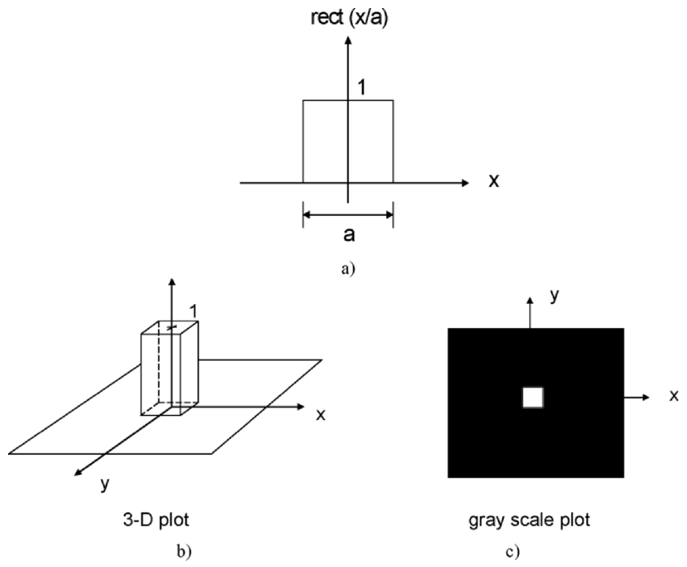
  <figcaption>图 1.1 rect 函数：a) 一维剖面（宽 a、高 1）；b) 三维图；c) 灰度图——幅度 1 显示为"白"、幅度 0 显示为"黑"，所以白色区域面积是 a×b（截自原书）</figcaption>
</figure>

求它的傅里叶变换，就是把 \(f(x,y)=\mathrm{rect}(x/a,y/b)\) 代进定义 (1.1-2a)：

\[
\mathcal{F}_{xy}\{f(x,y)\}=\mathcal{F}_{xy}\{\mathrm{rect}(x/a,y/b)\}
=\int_{-\infty}^{\infty}\int_{-\infty}^{\infty}\mathrm{rect}(x/a,y/b)\exp(jk_xx+jk_yy)\,dx\,dy.
\tag{1.1-4}
\]

因为 \(\mathrm{rect}(x/a,y/b)\) 是**可分离函数**（separable function），积分拆成两个一维积分的乘积：

\[
\mathcal{F}_{xy}\{\mathrm{rect}(x/a,y/b)\}
=\int_{-\infty}^{\infty}\mathrm{rect}(x/a)\exp(jk_xx)\,dx\times\int_{-\infty}^{\infty}\mathrm{rect}(y/b)\exp(jk_yy)\,dy
=\int_{-a/2}^{a/2}\exp(jk_xx)\,dx\times\int_{-b/2}^{b/2}\exp(jk_yy)\,dy.
\tag{1.1-5}
\]

用基本积分公式

\[
\int\exp(cx)\,dx=\frac{1}{c}\exp(cx)
\tag{1.1-6}
\]

逐个算出：

\[
\int_{-a/2}^{a/2}\exp(jk_xx)\,dx=a\,\mathrm{sinc}\!\left(\frac{ak_x}{2\pi}\right),
\tag{1.1-7}
\]

其中 \(\mathrm{sinc}(x)=\dfrac{\sin(\pi x)}{\pi x}\) 就是 **sinc 函数**。它在 \(x=\pm1,\pm2,\pm3,\dots\) 处过零。原书 Table 1.2 的 m 文件画的正是这条曲线（输出见图 1.2）：

=== "MATLAB"

    ```matlab
    % ===== 书 1.1 例 1.1 · Table 1.2 Plot_sinc.m =====
    %Plot_sinc.m  Plotting of sinc(x) function
    % 绘制 sinc(x)=sin(pi*x)/(pi*x)，零点在 x=±1,±2,±3,...
    % 注：x=0 处是 0/0，MATLAB 会得到 NaN，plot 只是在峰值处漏画一个点；
    %     如需平滑峰值，可把上一行改为 sinc=sin(pi*x+eps)./(pi*x+eps) 或对 x==0 补 1。
    x=-5.5:0.01:5.5;
    sinc=sin(pi*x)./(pi*x);
    plot(x,sinc)
    axis([-5.5 5.5 -0.3 1.1])
    grid on
    xlabel('x')
    ylabel('sinc (x)')
    ```

=== "Python"

    ```python
    # ===== 书 1.1 例 1.1 · Table 1.2 Plot_sinc.m 的 Python 版 =====
    # 绘制 sinc(x) = sin(pi*x)/(pi*x) 曲线，验证其零点在 x = ±1, ±2, ±3, ...
    #
    # MATLAB / Python 差异提示：
    # 1) MATLAB 的 x=-5.5:0.01:5.5 是闭区间等差序列；numpy.arange 不含终点，
    #    这里用 np.linspace 精确复刻同样的 1101 个采样点。
    # 2) MATLAB 中 0/0 得到 NaN 并在 plot 里留下一个针孔；numpy 中是 nan + RuntimeWarning。
    #    原书代码没处理 x=0，本版在 x=0 处显式补上极限值 1（sinc 的定义值）。

    import numpy as np
    import matplotlib.pyplot as plt

    x = np.linspace(-5.5, 5.5, 1101)          # 与书中 x=-5.5:0.01:5.5 相同的 1101 点
    sinc = np.sin(np.pi * x) / (np.pi * x)    # 原书写法：sinc=sin(pi*x)./(pi*x)
    sinc[x == 0] = 1.0                        # 修补 x=0 处的 0/0（原书未处理，见笔记"坑与陷阱"）

    plt.plot(x, sinc)
    plt.axis([-5.5, 5.5, -0.3, 1.1])
    plt.grid(True)
    plt.xlabel('x')
    plt.ylabel('sinc (x)')
    plt.title('sinc function')
    plt.show()
    ```

<figure>
  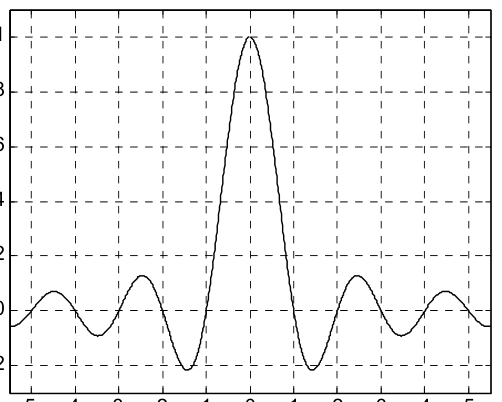
  <figcaption>图 1.2 sinc 函数：主瓣高 1，过零点在 ±1, ±2, ±3,…，旁瓣逐级衰减（截自原书）</figcaption>
</figure>

把两个一维结果 (1.1-7) 拼起来，就完成 rect 的傅里叶变换：

\[
\mathcal{F}_{xy}\{\mathrm{rect}(x/a,y/b)\}=ab\,\mathrm{sinc}\!\left(\frac{ak_x}{2\pi}\right)\mathrm{sinc}\!\left(\frac{bk_y}{2\pi}\right)
=ab\,\mathrm{sinc}\!\left(\frac{ak_x}{2\pi},\,\frac{bk_y}{2\pi}\right),
\tag{1.1-8a}
\]

\[
\boxed{\;\mathrm{rect}(x/a,y/b)\Leftrightarrow ab\,\mathrm{sinc}\!\left(\frac{ak_x}{2\pi},\,\frac{bk_y}{2\pi}\right).\;}
\tag{1.1-8b}
\]

人话版：**孔越小（a 越小），频谱越宽**——rect 沿 \(x\) 的宽度是 \(a\) 时，频谱沿 \(k_x\) 的第一零点在

\[
k_{x,0}=\frac{2\pi}{a}.
\]

图 1.3 是这对变换对的"照片"：上面是二维灰度图，下面是过中心的横向剖面（沿 \(k_x\) 的 sinc）。

<figure>
  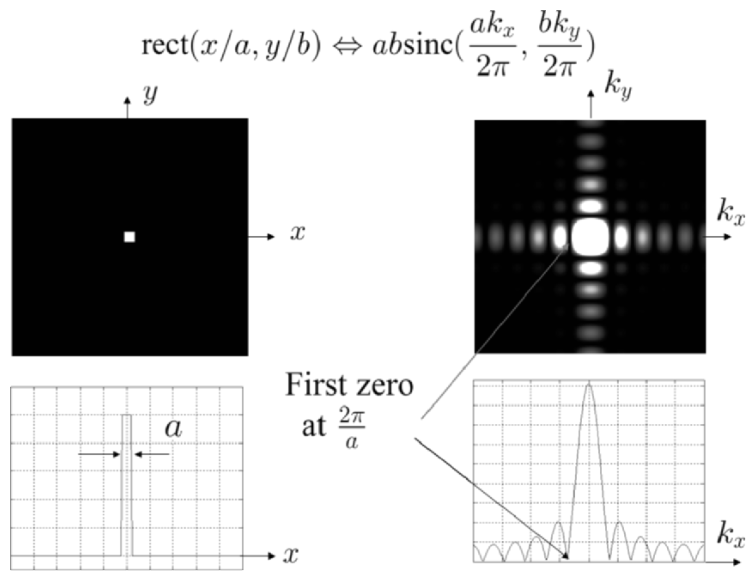
  <figcaption>图 1.3 rect 函数及其傅里叶变换：左列是空域（灰度图 + 剖面，宽 a），右列是频域（灰度图 + sinc 剖面，第一零点 2π/a）。图中用 M=11 生成（截自原书）</figcaption>
</figure>

原书 Table 1.3 的 m 文件生成了图 1.3。运行时它会让你输入方孔边长 M（奇数，3~33）；书中取 M=11，对应 \(a=11/256\approx0.0429\)（单位长度），第一零点 \(k_{x,0}=2\pi/a=146.23\) 弧度/（单位长度），显示区域按 \(1\times1\) 单位长度标定。

=== "MATLAB"

    ```matlab
    % ===== 书 1.1 例 1.1 · Table 1.3 fft2Drect.m =====
    %fft2Drect.m %Simulation of Fourier transformation of a 2-D rect function
    % 二维 rect 函数（M x M 正方形）傅里叶变换仿真，验证
    %   rect(x/a, y/b) <=> ab*sinc(a*kx/2pi, b*ky/2pi)
    % 运行后按提示输入奇数 M（3~33）；书中示例 M=11：
    %   a = 11/256 = 0.0429，第一零点 kx0 = 2*pi/a = 146.23 rad/(unit of length)
    clear
    L=1; %display area is L by L, L has unit of length   % 显示区域 L x L
    N=256; % number of sampling points                   % 采样点数
    dx=L/(N-1); % dx : step size                         % 采样步长

    % Create square image, M by M square, rect(x/a,y/a), M=odd number
    M=input('M (size of rect(x/a,y/a), enter odd numbers from 3-33-)=');
    a=M/256;
    kx0=2*pi/a;
    sprintf('a= %0.5g[unit of length]',a)
    sprintf('kx0 (first zero)= %0.5g[radian/unit of length]',kx0)
    R=zeros(256); %assign a matrix (256x256) of zeros    % 背景全 0
    r=ones(M); % assign a matrix (MxM) of ones           % 中间全 1 的 M x M 方块
    n=(M-1)/2;
    R(128-n:128+n,128-n:128+n)=r;                        % 把方块嵌进 256 网格正中
    %End of creating square input image M by M

    %Axis Scaling                                        % 坐标轴标定（零频移到中央）
    for k=1:256
        X(k)=1/255*(k-1)-L/2;                            % 空间坐标，范围 [-0.5, 0.5]
        Y(k)=1/255*(k-1)-L/2;
         %Kx=(2*pi*k)/((N-1)*dx)
        %in our case, N=256, dx=1/255
        Kx(k)=(2*pi*(k-1))/((N-1)*dx)-((2*pi*(256-1))/((N-1)*dx))/2;  % 角频率轴
        Ky(k)=(2*pi*(k-1))/((N-1)*dx)-((2*pi*(256-1))/((N-1)*dx))/2;
    end

    %Image of the rect function                          % 图 1：rect 灰度图
    figure(1)
    image(X+dx/2,Y+dx/2,255*R);
    title('rect function: gray-scale plot')
    xlabel('x')
    ylabel('y')
    colormap(gray(256));
    axis square

    %Computing Fourier transform                         % 二维 FFT + fftshift 中心化
    % 说明：书的前向变换约定是"正指数"，严格写法是 ifft2(R)*256^2；
    % rect 是实偶函数，fft2(R)/256^2 与之完全相等，故书里直接用 fft2。
    FR=(1/256)^2*fft2(R);
    FR=fftshift(FR);

    % plot of cross-section of rect function             % 图 2：rect 的中心横截面
    figure(2)
    plot(X+dx/2,R(:,127))
    title('rect function: cross-section plot')
    xlabel('x')
    ylabel('rect(x/a)')
    grid
    axis([-0.5 0.5 -0.1 1.2])

    %Centering the axis and plot of cross-section of transform along kx
    % 图 3：|F| 沿 kx 的横截面（幅度 x10 显示；横轴再平移半个频格对准零频）
    figure(3)
    plot(Kx-pi/(dx*(N-1)),10*abs(FR(:,127)))
    title('Square-absolute value of Fourier transform of rect function: cross-section plot')
    xlabel('kx')
    ylabel('|a*b*sinc(a*kx/2pi)|')
    axis([-800 800 0 max(max(abs(FR)))*10.1])
    grid

    %Mesh the Fourier transformation                     % 图 4：|F|^2 三维网格图
    figure(4);
    mesh(Kx,Ky,(abs(FR)).^2)
    title('Square-absolute value of Fourier transform of rect function: 3-D plot,scale arbitrary')
    xlabel('kx')
    ylabel('ky')
    axis square

    %Image of the Fourier transformation of rectangular function
    % 图 5：|F|^2 灰度图（gain=10000 压动态范围，暗背景上才看得清亮斑）
    figure(5)
    gain=10000;
    image(Kx,Ky,gain*(abs(FR)).^2/max(max(abs(FR))).^2)
    title('Square-absolute value of Fourier transform of the rect function: gray-scale plot')
    xlabel('kx')
    ylabel('ky')
    axis square
    colormap(gray(256))
    ```

=== "Python"

    ```python
    # ===== 书 1.1 例 1.1 · Table 1.3 fft2Drect.m 的 Python 版 =====
    # 二维 rect 函数（M x M 正方形）的傅里叶变换仿真，验证变换对
    #     rect(x/a, y/b)  <=>  ab sinc(a*kx/2pi, b*ky/2pi)
    # 书中运行时用 input 让你输 M（奇数 3~33），书中示例 M=11：
    #     a = M/256 = 0.0429，第一零点 kx0 = 2*pi/a = 146.23 rad/(unit of length)
    # 本版固定 M=11（想换值改这一个数即可）。
    #
    # MATLAB / Python 差异提示：
    # 1) MATLAB 矩阵 1-based、Python 0-based：MATLAB 的第 128 行 = Python 下标 127。
    # 2) 书中前向变换按约定是"正指数"，严格实现应为 ifft2(R)*N^2；
    #    但 rect 是实偶函数，fft2(R)/N^2 与之完全相等，所以书里直接用 fft2。
    #    numpy.fft.fft2 与 MATLAB fft2 指数约定一致（负指数），这里照抄书里写法。
    # 3) MATLAB image() 的行号方向与 plt.imshow 不同，用 origin='lower' 对齐数学坐标。

    import numpy as np
    import matplotlib.pyplot as plt

    # ----- 显示区域与采样 -----
    L = 1.0                    # display area is L by L, L has unit of length
    N = 256                    # number of sampling points
    dx = L / (N - 1)           # dx : step size

    # ----- 生成 M x M 正方形 rect(x/a, y/a)，M=奇数 -----
    M = 11                     # 书中示例值：input('M (size of rect(x/a,y/a), enter odd numbers from 3-33-)=')
    a = M / 256
    kx0 = 2 * np.pi / a
    print(f'a= {a:0.5g} [unit of length]')                    # 对应书中 sprintf
    print(f'kx0 (first zero)= {kx0:0.5g} [radian/unit of length]')

    R = np.zeros((256, 256))   # assign a matrix (256x256) of zeros
    n = (M - 1) // 2
    c = 128 - 1                # MATLAB 的第 128 个元素（1-based）= Python 下标 127
    R[c - n:c + n + 1, c - n:c + n + 1] = 1.0   # 背景置 0、中心置 1 的正方形孔

    # ----- 坐标轴标定（书中的写法：零频移到中央） -----
    k = np.arange(256)
    X = (k / 255) * 1.0 - L / 2        # X(k)=1/255*(k-1)-L/2，即 (k-1)*dx-L/2
    Y = X.copy()
    # Kx(k)=2*pi*(k-1)/((N-1)*dx) - pi/dx；本例 (N-1)*dx=1
    Kx = 2 * np.pi * k / ((N - 1) * dx) - (2 * np.pi * (256 - 1)) / ((N - 1) * dx) / 2
    Ky = Kx.copy()

    fig, ax = plt.subplots(2, 3, figsize=(13, 8))

    # ----- 书 figure(1)：rect 函数灰度图 -----
    im0 = ax[0, 0].imshow(R, extent=[X[0] + dx / 2, X[-1] + dx / 2, Y[0] + dx / 2, Y[-1] + dx / 2],
                          cmap='gray', origin='lower')
    ax[0, 0].set_title('rect function: gray-scale plot')
    ax[0, 0].set_xlabel('x'); ax[0, 0].set_ylabel('y')

    # ----- 书 figure(2)：rect 的中心横截面 -----
    ax[0, 1].plot(X + dx / 2, R[:, 126])       # MATLAB R(:,127) -> Python 第 126 列
    ax[0, 1].set_title('rect function: cross-section plot')
    ax[0, 1].set_xlabel('x'); ax[0, 1].set_ylabel('rect(x/a)')
    ax[0, 1].grid(True)
    ax[0, 1].axis([-0.5, 0.5, -0.1, 1.2])

    # ----- 计算傅里叶变换（书：FR=(1/256)^2*fft2(R) 后 fftshift） -----
    FR = np.fft.fft2(R) / 256**2
    FR = np.fft.fftshift(FR)

    # ----- 书 figure(3)：|F| 沿 kx 的横截面（幅度 x10 显示） -----
    ax[0, 2].plot(Kx - np.pi / (dx * (N - 1)), 10 * np.abs(FR[:, 126]))
    ax[0, 2].set_title('Square-absolute value of Fourier transform\nof rect function: cross-section plot')
    ax[0, 2].set_xlabel('kx'); ax[0, 2].set_ylabel('|a*b*sinc(a*kx/2pi)|')
    ax[0, 2].axis([-800, 800, 0, np.abs(FR).max() * 10.1])
    ax[0, 2].grid(True)

    # ----- 书 figure(4)：|F|^2 三维网格图（matplotlib 用等高线图代替 mesh） -----
    ax[1, 0].contourf(Kx, Ky, np.abs(FR)**2, levels=50, cmap='viridis')
    ax[1, 0].set_title('Square-absolute value of FT: 3-D plot (contour), scale arbitrary')
    ax[1, 0].set_xlabel('kx'); ax[1, 0].set_ylabel('ky')
    ax[1, 0].set_aspect('equal')

    # ----- 书 figure(5)：|F|^2 灰度图（gain=10000 强压动态范围） -----
    gain = 10000
    im1 = ax[1, 1].imshow(np.abs(FR)**2 / np.abs(FR).max()**2,
                          extent=[Kx[0], Kx[-1], Ky[0], Ky[-1]],
                          cmap='gray', origin='lower', vmax=255.0 / gain)
    ax[1, 1].set_title('Square-absolute value of FT of the rect\nfunction: gray-scale plot')
    ax[1, 1].set_xlabel('kx'); ax[1, 1].set_ylabel('ky')

    ax[1, 2].axis('off')       # 占位空面板
    plt.tight_layout()
    plt.show()
    ```

!!! note "拓展：这对变换对本笔记已数值验证"
    用 Python 严格按书的"正指数"约定（`ifft2*256²`）算 11×11 方孔的谱，与解析式 \(ab\,\mathrm{sinc}(ak_x/2\pi,bk_y/2\pi)\) 逐点比较：最大相对偏差约 3.4%（偏差来自显示窗口有限造成的频谱周期延拓混叠，以及书中 \(a=M/256\) 与实际采样宽度 \(M\cdot dx=M/255\) 的半像素差）；沿 \(k_x\) 实测第一零点 143.95，与理论值 146.23 相差不到一个频格（6.26）。完整脚本见 `python/scanholo/ch1/verify_ch1.py`。

!!! warning "原书笔误：input 提示串里的变量名"
    原书 Table 1.3 的提示字符串写的是 `'M (size of rect(x,a,y/a), enter odd numbers from 3-33-)='`，其中 `rect(x,a,y/a)` 应为 `rect(x/a,y/a)`（逗号应为斜杠，且 (1.1-3b) 的写法就是 `rect(x/a,y/b)`）。只是提示文字的笔误，不影响计算；上面代码按原书原样保留。

### 1.1.4 例 1.2：位图图像的傅里叶变换

当二维函数/图像以**位图**（bitmap）文件给出时，直接对像素矩阵做二维 FFT 即可。原书用画图板做了一幅 256×256 的三角形位图（图 1.4a），表 1.4 的 m 文件算出其频谱（图 1.4b）：能量集中在中心（零频），亮"星芒"沿三角形的边缘方向展开——图像里越"直、长"的结构，频谱里越亮、越窄。

=== "MATLAB"

    ```matlab
    % ===== 书 1.1 例 1.2 · Table 1.4 fft2Dbitmap_image.m =====
    %fft2Dbitmap_image.m
    %Simulation of Fourier transformation of bitmap images
    % 对一幅 256x256 位图做二维傅里叶变换并显示幅度谱。
    % 需要事先用画图板做一幅 256x256 的 triangle.bmp（黑色背景、白色三角形）放在同目录。
    clear

    I=imread('triangle.bmp','bmp'); %Input bitmap image   % 读入位图
    I=I(:,:,1);                                            % 取一个通道（灰度图）
    figure(1) %displaying input                            % 显示输入图像
    colormap(gray(255));
    image(I)
    axis off
    FI=fft2(I);                                            % 二维 FFT
    FI=fftshift(FI);                                       % 零频搬到中心
    max1=max(FI);
    max2=max(max1);
    scale=1.0/max2;                                        % 归一化到峰值 1
    FI=FI.*scale;
    figure(2) %Gray scale image of the absolute value of transform
    colormap(gray(255));
    image(10*(abs(256*FI)));                               % 幅度放大后按灰度显示（星芒状频谱）
    axis off
    ```

=== "Python"

    ```python
    # ===== 书 1.1 例 1.2 · Table 1.4 fft2Dbitmap_image.m 的 Python 版 =====
    # 对一幅 256x256 位图做二维傅里叶变换并显示幅度谱。
    # 原书读 triangle.bmp（画图板随手画的三角形）；为了让你零依赖跑通，
    # 这里用 numpy 现场画一个同样的三角形代替 imread。
    #
    # MATLAB / Python 差异提示：
    # 1) np.fft.fft2 与 MATLAB fft2 同为"负指数"约定，可直接照抄；
    #    fftshift 也同名同义（零频搬到中心）。
    # 2) 原书 image(10*(abs(256*FI))) 是把幅度放大后按 0~255 灰度显示；
    #    matplotlib 中等价写法是 imshow 归一化后的幅度谱。

    import numpy as np
    import matplotlib.pyplot as plt

    # ----- 生成 256x256 三角形位图（替代 I=imread('triangle.bmp','bmp')） -----
    N = 256
    I = np.zeros((N, N))
    yy, xx = np.mgrid[0:N, 0:N]
    inside = (yy > 160) & (yy < 160 + (xx - 128) * 0.9) & (xx > 48) & (xx < 208)
    I[inside] = 1.0                      # 白色三角形，黑色背景（幅度 1 = 白）

    # ----- 书 figure(1)：显示输入图像 -----
    fig, ax = plt.subplots(1, 2, figsize=(10, 5))
    ax[0].imshow(I, cmap='gray', origin='lower')
    ax[0].set_title('a) Bitmap image of a triangle')
    ax[0].axis('off')

    # ----- 计算傅里叶变换并中心化 -----
    FI = np.fft.fft2(I)                  # I=I(:,:,1)：取一个通道（这里本来就是单通道）
    FI = np.fft.fftshift(FI)
    scale = 1.0 / np.abs(FI).max()       # max2=max(max1); scale=1.0/max2
    FI = FI * scale

    # ----- 书 figure(2)：显示变换的绝对值（对数拉伸便于观看星芒） -----
    ax[1].imshow(20 * np.log10(np.abs(FI) + 1e-6), cmap='gray', origin='lower')
    ax[1].set_title('b) |Transform| of a) (dB display)')
    ax[1].axis('off')

    plt.tight_layout()
    plt.show()
    ```

<figure>
  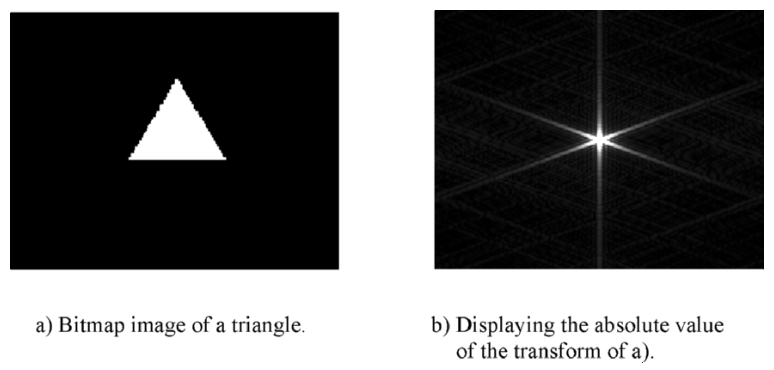
  <figcaption>图 1.4 a) 三角形位图；b) 其傅里叶变换的绝对值——中心亮（零频），星芒方向对应直边方向（截自原书）</figcaption>
</figure>

### 1.1.5 例 1.3：δ 函数及其变换

**δ 函数**（delta function）\(\delta(x)\) 是系统研究里最重要的函数。可以把定义成"宽度趋于零、面积保持 1 的矩形"：

\[
\delta(x)=\lim_{a\to0}\Big\{\frac{1}{a}\,\mathrm{rect}\Big(\frac{x}{a}\Big)\Big\}.
\tag{1.1-9}
\]

<figure>
  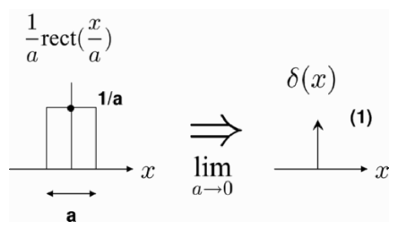
  <figcaption>图 1.5 δ 函数的定义：矩形越压越窄、越竖越高，面积恒为 1；极限下用带 "(1)" 的箭头表示（截自原书）</figcaption>
</figure>

箭头旁边的 "(1)" 表示 δ 函数有**单位面积**（unit area，也叫强度 strength）。δ 函数有三条重要性质：

**性质 #1：单位面积（Unit Area）**

\[
\int_{-\infty}^{\infty}\delta(x-x_0)\,dx=1.
\tag{1.1-10a}
\]

无论 \(a\) 多小，图 1.5 左边矩形的面积始终是 1。

**性质 #2：乘积性质（Product Property）**

\[
f(x)\,\delta(x-x_0)=f(x_0)\,\delta(x-x_0).
\tag{1.1-10b}
\]

人话版：δ 只在 \(x_0\) 处"活着"，所以拿 \(f(x)\) 乘它，等于拿 \(f(x_0)\) 乘它——图 1.6 里任意函数 \(f(x)\) 与位于 \(x_0\) 的 δ 相乘，结果就是强度变成 \(f(x_0)\) 的偏置 δ 函数。

<figure>
  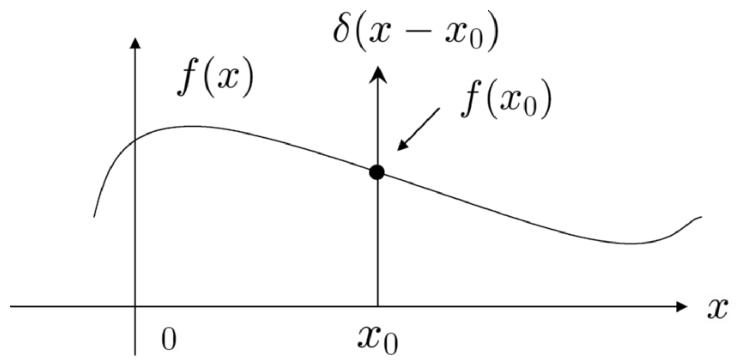
  <figcaption>图 1.6 乘积性质：f(x) 与 δ(x−x₀) 相乘 = 强度为 f(x₀) 的 δ(x−x₀)（截自原书）</figcaption>
</figure>

**性质 #3：采样性质（Sampling Property）**

\[
\int_{-\infty}^{\infty}f(x)\,\delta(x-x_0)\,dx=f(x_0).
\tag{1.1-10c}
\]

证明只需连用性质 #1、#2：先按 #2 把 \(f(x)\delta(x-x_0)=f(x_0)\delta(x-x_0)\) 换掉，再用 #1 积分：

\[
\int_{-\infty}^{\infty}f(x)\delta(x-x_0)\,dx
=\int_{-\infty}^{\infty}f(x_0)\delta(x-x_0)\,dx
=f(x_0)\int_{-\infty}^{\infty}\delta(x-x_0)\,dx=f(x_0).
\]

之所以叫**采样性质**：积分过程中 δ 函数把 \(f(x)\) 在 \(x_0\) 处的那一个值"选"了出来。

一维 δ 函数在电工里叫**冲激函数**（impulse function）；二维版本

\[
\delta(x,y)=\delta(x)\,\delta(y)
\]

在光学里代表**理想点光源**。按定义 (1.1-2a) 算它的傅里叶变换（用采样性质）：

\[
\mathcal{F}_{xy}\{\delta(x,y)\}
=\int_{-\infty}^{\infty}\int_{-\infty}^{\infty}\delta(x,y)\exp(jk_xx+jk_yy)\,dx\,dy
=\int_{-\infty}^{\infty}\delta(x)\exp(jk_xx)\,dx\int_{-\infty}^{\infty}\delta(y)\exp(jk_yy)\,dy=1,
\]

即

\[
\delta(x,y)\Leftrightarrow 1,
\]

与性质表 #7 一致。图 1.7 画出这对关系。

<figure>
  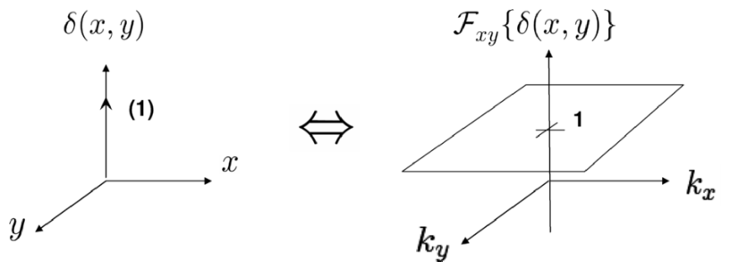
  <figcaption>图 1.7 二维 δ 函数（左，空间中的单位强度点）及其傅里叶变换（右，幅度恒为 1 的平坦平面）（截自原书）</figcaption>
</figure>

!!! note "拓展：采样性质是采样定理的根，点源是全息的"原子""
    把采样性质 (1.1-10c) 排成梳状就得到采样定理的骨架：用间隔 \(\Delta x\) 的 δ 梳 \(\sum_n\delta(x-n\Delta x)\) 乘 \(f(x)\)，频域就变成 \(F(k_x)\) 以 \(2\pi/\Delta x\) 为周期复制——只要 \(F\) 的带宽小于复制间隔的一半，复制片就不重叠，能从样本无失真恢复原信号。这正是"奈奎斯特采样"的全部数学，第 2 章讨论数字全息的记录分辨率时会反复用到。另一个直觉：\(\delta\Leftrightarrow1\) 说明"一个点源包含所有空间频率方向的等幅平面波"——点源是全息的"原子"，任何物体都可以当成点的集合；第 2 章点源全息图（point-source hologram）就是从这里长出来的。

## 1.2 线性不变系统

### 1.2.1 线性与空间不变

**系统**（system）定义为把输入（或一组输入）映射成输出（或一组输出）的"黑盒"。若**叠加原理**（superposition）成立，系统就是**线性的**（linear）：单输入-单输出系统里，输入 \(f_1(t)\) 出 \(g_1(t)\)、输入 \(f_2(t)\) 出 \(g_2(t)\)，那么输入 \(af_1(t)+bf_2(t)\) 时输出必是 \(ag_1(t)+bg_2(t)\)（\(a,b\) 为常数）。

<figure>
  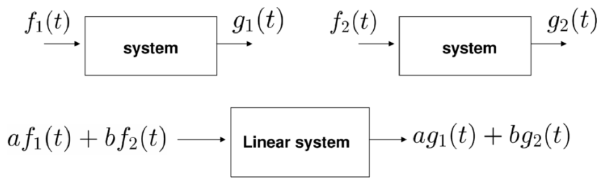
  <figcaption>图 1.8 线性系统：两个输入各自过系统，再线性叠加 = 叠加后的输入一起过系统（截自原书）</figcaption>
</figure>

参数不随时间改变的系统叫**时不变系统**（time-invariant systems）：输入延迟 \(t_0\)，输出跟着延迟同一个 \(t_0\)，波形形状不变（图 1.9）。

<figure>
  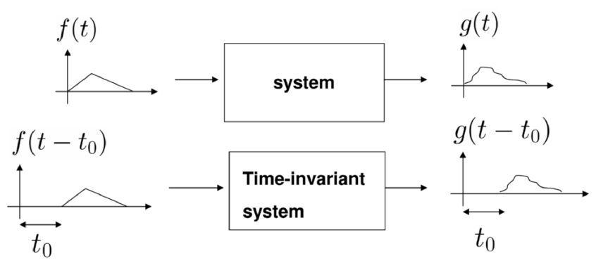
  <figcaption>图 1.9 时不变系统：f(t)→g(t)，则 f(t−t₀)→g(t−t₀)（截自原书）</figcaption>
</figure>

一个**线性且时不变**（LTI, linear time-invariant）的系统（初始条件全为零）有一个铁律：输入输出之间由**卷积积分**（convolution integral）锁定：

\[
g(t)=\int_{-\infty}^{\infty}f(t')\,h(t-t')\,dt'=f(t)*h(t),
\tag{1.2-1}
\]

其中 \(h(t)\) 叫系统的**冲激响应**（impulse response），\(*\) 是卷积符号，\(f*g\) 读作"f 与 g 卷积"。为什么 \(h(t)\) 配得上这个名字？把输入换成 \(\delta(t)\) 代入 (1.2-1)：

\[
g(t)=\delta(t)*h(t)=\int_{-\infty}^{\infty}\delta(t')\,h(t-t')\,dt'=h(t),
\]

（用了 δ 的采样性质）——**冲激进、冲激响应出**。所以只要实验上给系统打个冲激测出 \(h(t)\)，任意输入 \(f(t)\) 的响应都能用 (1.2-1) 算出来。

光学里信号是空间坐标的函数，把 LTI 换成**线性空间不变系统**（linear space-invariant (LSI) system）：输入平移，输出跟着平移。一维卷积积分 (1.2-1) 抬升为二维：

\[
g(x,y)=\int_{-\infty}^{\infty}\int_{-\infty}^{\infty}f(x',y')\,h(x-x',\,y-y')\,dx'\,dy'=f(x,y)*h(x,y),
\tag{1.2-2}
\]

\(f(x,y)\) 是 LSI 系统的二维输入，\(h(x,y)\)、\(g(x,y)\) 分别是对应的冲激响应和输出。

时不变在电工里很直观（图 1.9 的延迟），光学里的**空间不变**（space-invariance）用图 1.10 说清：输入图像 \(f(x,y)\)（笑脸）平移到新原点 \((x_0,y_0)\)，输出 \(g(x,y)\) 就在 \(x\text{-}y\) 平面上跟着平移——电系统里的"延迟"对应光学里的"图像平移"。

<figure>
  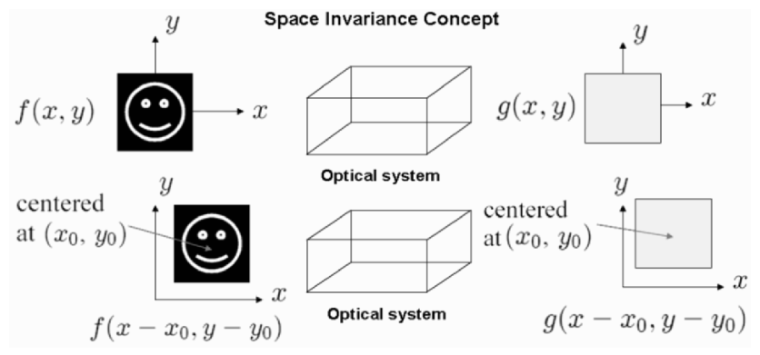
  <figcaption>图 1.10 空间不变概念：输入笑脸移到哪里，输出光斑就移到哪里（截自原书）</figcaption>
</figure>

对 (1.2-2) 两边做二维傅里叶变换，就进入频域：

\[
\mathcal{F}_{xy}\{g(x,y)\}=\mathcal{F}_{xy}\{f(x,y)*h(x,y)\},
\tag{1.2-3a}
\]

\[
G(k_x,k_y)=F(k_x,k_y)\,H(k_x,k_y),
\tag{1.2-3b}
\]

其中 \(G\)、\(F\)、\(H\) 分别是 \(g\)、\(f\)、\(h\) 的傅里叶变换。证明在例 1.4。这一步是全章最重要的一行——**空域卷积 = 频域乘法**：

<figure>
  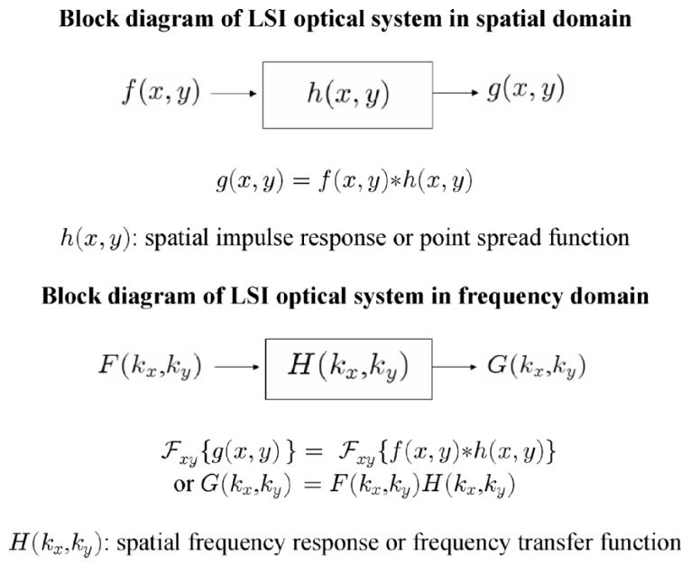
  <figcaption>图 1.11 LSI 系统框图：空间域 g = f*h（h 称空间冲激响应/点扩散函数）；频域 G = F·H（H 称空间频率响应/频率传递函数）（截自原书）</figcaption>
</figure>

- \(h(x,y)\)：**空间冲激响应**（spatial impulse response），光学里叫**点扩散函数**（**PSF, point spread function**）——一个点光源经过系统后"糊"成什么样；
- \(H(k_x,k_y)\)：**空间频率响应**（spatial frequency response）或**频率传递函数**（frequency transfer function）——系统对每个空间频率成分"乘多大的系数、转多少相位"。

人话版：卷积是把 h 翻过来、滑过去、逐点相乘再求和，一次积分要做无穷多乘加；改到频域只剩一次乘法。这也是为什么全书所有衍射/成像仿真都抢着用 FFT。

!!! note "拓展：例 1.4 的证明思路（卷积的傅里叶变换 = F·H）"
    按定义把 (1.2-2) 塞进 (1.1-2a)：

\[
\mathcal{F}_{xy}\{f*h\}=\int_{-\infty}^{\infty}\int_{-\infty}^{\infty}\Big[\int_{-\infty}^{\infty}\int_{-\infty}^{\infty} f(x',y')\,h(x-x',y-y')\,dx'dy'\Big]\exp(jk_xx+jk_yy)\,dx\,dy.
\]

    把 x、y 归到内层，交换积分次序后，内层正是 \(h(x-x',y-y')\) 的傅里叶变换——由性质表 #2，它等于 \(H(k_x,k_y)\exp(jk_xx'+jk_yy')\)。代回外层：

\[
\mathcal{F}_{xy}\{f*h\}=H(k_x,k_y)\int_{-\infty}^{\infty}\int_{-\infty}^{\infty} f(x',y')\exp(jk_xx'+jk_yy')\,dx'dy'=H(k_x,k_y)\,F(k_x,k_y).
\]

    得 (1.2-3b)。全程只用了"平移 = 乘线性相位"这一条性质。

### 1.2.2 卷积与相关概念

上一节说明 LSI 系统必然牵出卷积积分。本节先讲清**卷积**（convolution）到底怎么算，再引入它的孪生兄弟**相关**（correlation），最后把两者区分开。

**卷积：翻转 + 平移 + 乘积面积。** 图 1.12 用两张图像 \(f(x,y)\)、\(h(x,y)\) 演示 (1.2-2)：对每个平移量 \((x,y)\)，卷积值 = 乘积 \(f(x',y')\,h(x-x',y-y')\) 在 \(x'\text{-}y'\) 平面上的总面积。操作步骤：先把 \(h(x,y)\) 绕两个轴**翻转**（变成 \(h(-x',-y')\)），再把翻转后的图像**平移**、使其中心落在 \((x,y)\)（得到 \(h(x-x',y-y')\)），与 \(f(x',y')\) 叠起来算乘积面积；扫遍所有 \((x,y)\) 就得到二维灰度图 \(g(x,y)\)。

<figure>
  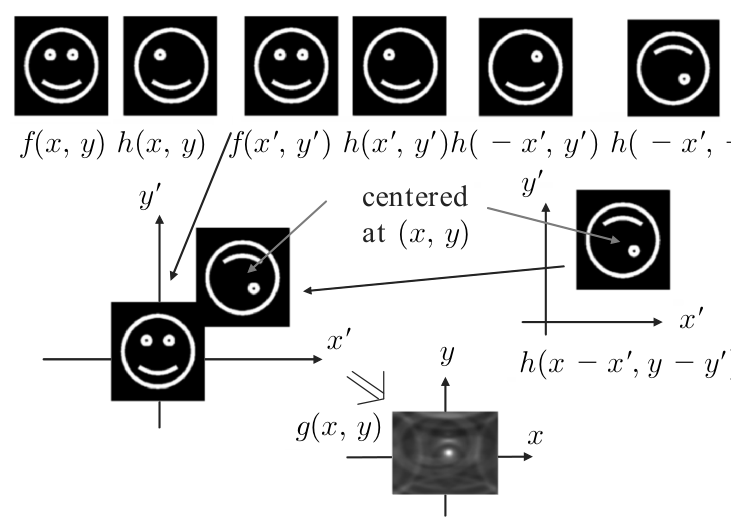
  <figcaption>图 1.12 二维卷积的概念：f 不动，h 翻转后中心滑到 (x,y)，逐点乘、求面积；结果 g(x,y) 是一张模糊化的图像（截自原书）</figcaption>
</figure>

**相关：不翻转。** 另一个重要积分叫**相关积分**（correlation integral）。两个函数 \(f(x,y)\)、\(h(x,y)\) 的**相关**（correlation）\(C_{fh}(x,y)\) 定义为

\[
C_{fh}(x,y)=\int_{-\infty}^{\infty}\int_{-\infty}^{\infty}f^{*}(x',y')\,h(x+x',\,y+y')\,dx'\,dy'=f(x,y)\,\otimes\,h(x,y),
\tag{1.2-4}
\]

其中 \(\otimes\) 是相关符号（\(f\) 取共轭）。它专门用来**比较两个函数有多像**，是**图案识别**（pattern recognition）的数学发动机。图 1.13 假设 \(f\) 为实函数：与卷积不同，算乘积 \(f(x',y')\,h(x+x',y+y')\) 时 \(h\) **不需要**绕 \(x'\)、\(y'\) 轴翻转，只要平移。

<figure>
  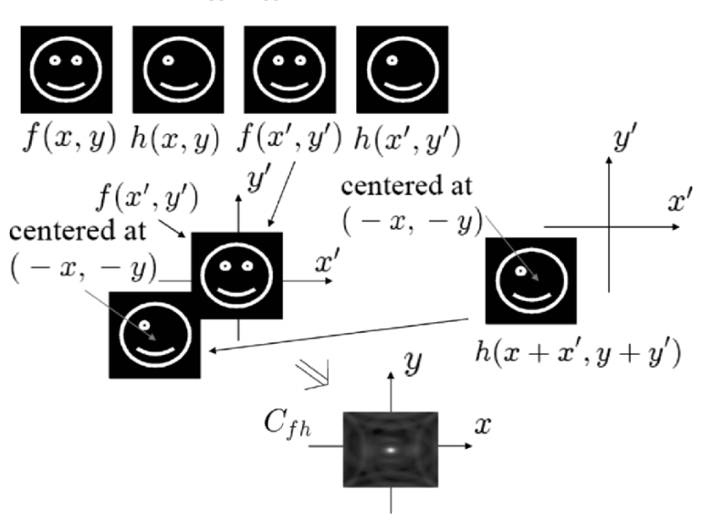
  <figcaption>图 1.13 二维相关的概念（设 f 为实函数）：h 不翻转、中心滑到 (−x,−y)，逐点乘、求面积，得到 C_fh（截自原书）</figcaption>
</figure>

**例 1.5：相关可以写成卷积。** 两者通过

\[
f(x,y)\otimes h(x,y)=f^{*}(-x,-y)*h(x,y)
\tag{1.2-5}
\]

联系起来。按卷积定义展开右边：

\[
f^{*}(-x,-y)*h(x,y)=\int_{-\infty}^{\infty}\int_{-\infty}^{\infty} f^{*}(-x',-y')\,h(x-x',\,y-y')\,dx'dy',
\]

做代换 \(x-x'=x''\)、\(y-y'=y''\)，整理并令 \(\widetilde{x}=x''-x\)、\(\widetilde{y}=y''-y\)：

\[
f^{*}(-x,-y)*h(x,y)
=\int_{-\infty}^{\infty}\int_{-\infty}^{\infty}f^{*}(\widetilde{x},\widetilde{y})\,h(\widetilde{x}+x,\,\widetilde{y}+y)\,d\widetilde{x}\,d\widetilde{y}
=f(x,y)\otimes h(x,y),
\]

正是相关定义 (1.2-4)。（直观版：把 \(f^*\) 先翻转 \((-x,-y)\) 再卷，等效于相关里"不翻转 + 反向平移"。）

按 (1.2-4)，\(f\neq h\) 时结果叫**互相关**（cross-correlation）\(C_{fh}\)；\(f=h\) 时叫**自相关**（auto-correlation）\(C_{ff}\)。可以证明

\[
\lvert C_{ff}(0,0)\rvert\ \ge\ \lvert C_{ff}(x,y)\rvert,
\tag{1.2-6}
\]

即**自相关在中心永远最大**——一个图案跟自己最像的地方就是它自己。这条性质被图案识别广泛使用：先驱性的光学图案识别方案分别由 Vander Lugt [1964] 与 Weaver 和 Goodman [1966] 提出；综述见专著 Optical Pattern Recognition［Yu 和 Jutamulia 主编 (1998)］；更新的方法见 Poon 和 Qi [2003]。

**例 1.6：MATLAB 图案识别。** 实现相关的频域路线。与例 1.4 同样的推导给出

\[
\mathcal{F}_{xy}\{f(x,y)\otimes h(x,y)\}=F^{*}(k_x,k_y)\,H(k_x,k_y),
\tag{1.2-7}
\]

于是相关可以在频域一步完成：

\[
f(x,y)\otimes h(x,y)=\mathcal{F}_{xy}^{-1}\{F^{*}(k_x,k_y)\,H(k_x,k_y)\}.
\tag{1.2-8}
\]

对给定的两幅图像 \(f\)、\(h\)：先各自做二维 FFT，频域相乘（一个取共轭），再逆变换回来。图 1.14 是两幅相同 256×256 smiley.bmp 的**自相关**：中心出现明亮光斑——按 (1.2-6)，亮斑 = 两图"匹配"；图 1.15 是笑脸与另一幅图像的**互相关**：中心没有可辨认的亮斑——不匹配。

<figure>
  
  <figcaption>图 1.14 自相关：笑脸 ⊗ 笑脸 = 中心亮斑（匹配成功）（截自原书）</figcaption>
</figure>

<figure>
  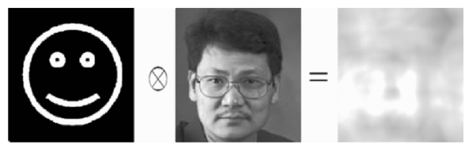
  <figcaption>图 1.15 互相关：笑脸 ⊗ 人像 = 中心无亮斑（不匹配）（截自原书）</figcaption>
</figure>

=== "MATLAB"

    ```matlab
    % ===== 书 1.2 例 1.6 · Table 1.5 correlation.m =====
    %correlation.m
    % 频域实现二维相关（图案识别）：
    %   f(x,y) (+) h(x,y) = IFFT{ F*(kx,ky) H(kx,ky) }      [书式 (1.2-7)(1.2-8)]
    % 原书用两幅相同的 smiley.bmp（自相关，图 1.14 中心亮斑 = 匹配成功）；
    % 把 I2 换成别的图案即复现图 1.15 的互相关（中心无亮斑）。
    % smiley.bmp 可用画图板自制：256x256 黑底白色笑脸。
    clear

    I1=imread('smiley.bmp','bmp'); %Input image 1 (reference image)   % 参考图像
    I1=I1(:,:,1);
    figure(1) %displaying input image 1
    colormap(gray(255));
    image(I1)
    axis off

    FI1=fft2(I1);
    max1=max(FI1);
    max2=max(max1);
    scale=1.0/max2;
    FI1=FI1.*scale;                                                   % 归一化

    I2=imread('smiley.bmp','bmp'); %Input image 2 (image to be recognized)
    I2=I2(:,:,1);                                                     % 待识别图像
    figure(2) %displaying input image 2
    colormap(gray(255));
    image(I2)
    axis off

    FI2=fft2(I2);
    max1=max(FI2);
    max2=max(max1);
    scale=1.0/max2;
    FI2=FI2.*scale;

    % 说明：共轭放在哪个谱上只决定输出是否镜像翻转；实图像取 abs 显示后无差别。
    FPR=FI1.*conj(FI2);%calculating correlation             % 频域相乘算相关
    PR=ifft2(FPR);
    PR=fftshift(PR);                                        % 相关峰搬到图像中心

    max1=max(PR);
    max2=max(max1);
    scale=1.0/max2;
    PR=PR.*scale;

    figure(3)%display of correlation in spatial domain      % 相关结果灰度显示
    colormap(gray(255));
    image(abs(256*PR));
    axis off
    ```

=== "Python"

    ```python
    # ===== 书 1.2 例 1.6 · Table 1.5 correlation.m 的 Python 版 =====
    # 频域实现二维相关（图案识别）：
    #     f(x,y) (+) h(x,y) = IFFT{ F*(kx,ky) H(kx,ky) }        [书式 (1.2-7)(1.2-8)]
    # 原书读两幅 smiley.bmp 做自相关（图 1.14 中心亮斑 = 两图"匹配"）。
    # 这里用 numpy 现场画笑脸替代 imread；把 I2 换成别的图案即可复现图 1.15
    # 的互相关（中心无亮斑）。
    #
    # MATLAB / Python 差异提示：
    # 1) np.fft.fft2 / ifft2 / fftshift 与 MATLAB 同名函数约定一致，可逐行照抄。
    # 2) 共轭放在哪个谱上（FI1.*conj(FI2) 还是 conj(FI1).*FI2）只决定输出是否
    #    镜像翻转；对实图像取 abs 显示后看不出差别。数值验证见 verify_ch1.py。

    import numpy as np
    import matplotlib.pyplot as plt

    # ----- 现场生成 256x256 笑脸位图（替代 I=imread('smiley.bmp','bmp')） -----
    def make_smiley():
        N = 256
        yy, xx = np.mgrid[0:N, 0:N]                # 行 yy、列 xx（0..255）
        r = np.sqrt((xx - 128.0)**2 + (yy - 128.0)**2)
        img = np.zeros((N, N))
        img[np.abs(r - 90) < 4] = 1.0                                  # 外圈脸廓
        for ex in (93, 163):                                           # 两只眼睛
            img[(xx - ex)**2 + (yy - 88)**2 < 9**2] = 1.0
        ang = np.arctan2(yy - 118.0, xx - 128.0)                       # 嘴巴（下方圆弧）
        rm = np.sqrt((xx - 128.0)**2 + (yy - 118.0)**2)
        img[(np.abs(rm - 55) < 4) & (ang < -0.35) & (ang > -2.8)] = 1.0
        return img

    # ----- 输入图像 1（参考图像）与输入图像 2（待识别图像） -----
    I1 = make_smiley()        # I1=imread('smiley.bmp','bmp'); I1=I1(:,:,1)
    I2 = make_smiley()        # 原书两幅同名文件 => 自相关；换成别的图案 => 互相关

    fig, ax = plt.subplots(1, 3, figsize=(13, 4.6))
    ax[0].imshow(I1, cmap='gray', origin='lower'); ax[0].set_title('Input image 1 (reference)'); ax[0].axis('off')
    ax[1].imshow(I2, cmap='gray', origin='lower'); ax[1].set_title('Input image 2 (to recognize)'); ax[1].axis('off')

    # ----- 频域计算相关 -----
    FI1 = np.fft.fft2(I1)
    FI1 = FI1 / np.abs(FI1).max()          # max2=max(max1); scale=1.0/max2; FI1=FI1.*scale
    FI2 = np.fft.fft2(I2)
    FI2 = FI2 / np.abs(FI2).max()

    FPR = FI1 * np.conj(FI2)               # calculating correlation（书中 FPR=FI1.*conj(FI2)）
    PR = np.fft.ifft2(FPR)
    PR = np.fft.fftshift(PR)
    PR = np.abs(PR) / np.abs(PR).max()     # 归一化后取模显示

    ax[2].imshow(PR, cmap='gray', origin='lower')
    ax[2].set_title('Correlation result (bright spot = match)')
    ax[2].axis('off')

    pk = np.unravel_index(np.argmax(PR), PR.shape)
    print(f'相关峰位置 (row, col) = {pk}，应落在图像中心 (128, 128)')
    plt.tight_layout()
    plt.show()
    ```

Python 版用 numpy 现场画笑脸代替 `imread('smiley.bmp')`，其余逐行对应；已验证相关峰精确落在图像中心 (128,128)，即 (1.2-6) 的离散版本。

### 1.2.3 拓展实战：自由空间就是一个 LSI 系统（编者拓展，原书无此小节）

!!! note "拓展：把本章工具装到光传播上（原书第 2 章正式推导）"
    本章所有抽象概念——冲激响应、传递函数、卷积——在光学里最现成的实例就是**自由空间传播**。把 \(z=0\) 平面的场 \(f(x,y)\) 看成输入、\(z\) 处的场 \(g(x,y)\) 看成输出，自由空间就是 LSI 系统（平移输入，衍射图样跟着平移）：

\[
h(x,y;\,z)=\frac{j\,k_0}{2\pi z}\exp\!\Big[-j\frac{k_0}{2z}(x^2+y^2)\Big],\qquad H(k_x,k_y;\,z)=\exp\!\Big[-j\frac{z}{2k_0}(k_x^2+k_y^2)\Big],
\]

    （全局相位因子 \(e^{\mp jk_0z}\) 略去；\(k_0=2\pi/\lambda\)。）\(h\) 是"一个点在 \(z\) 处激起的多大响应"——球面波的二次相位；\(H\) 是对应的**频率传递函数**。两条路线按 (1.2-2)/(1.2-3b) 给出同一个答案：

    1. **卷积路线**：\(g=f*h\)——把 \(f\) 与二次相位的 \(h\) 卷起来；
    2. **传递函数路线**：\(G=F\cdot H\)——频域乘一下。角谱法（ASM）走的就是这条，你已有的 `ASM.m/ASM.py` 里的 \(H=\exp(-jk_0z\sqrt{1-k_x^2/k_0^2-k_y^2/k_0^2})\) 是它的精确版（第 2 章式 (2.3-5)）。

    下面的脚本把你的 `Fresnel Diffraction.m` 规范化重写：矩形孔（M=111 像素）经 \(z=5\) cm 传播，\(h\) 带高斯窗防混叠，卷积用 FFT 实现。数值已验证：光强图样关于两轴严格镜像对称（相对偏差 \(10^{-15}\) 量级），亮条纹成对出现在孔边缘（Fresnel 数 \(a^2/\lambda z\approx150\) 的深近场，孔边缘出现菲涅耳条纹——运行结果见下图）。

=== "MATLAB"

    ```matlab
    function fresnel_lsi
    % ===== 拓展 1.2.3 · 自由空间当作 LSI 系统：菲涅耳衍射的频域实现 =====
    % 改编自你已有的 Fresnel Diffraction.m（规范化重写，物理参数与结果一致）：
    % 矩形孔 f(x,y) 放在 z=0，求 z=5 cm 处的衍射光强。
    % 本章视角（1.2 节）：自由空间是一个 LSI 系统，
    %   空间域：g = f * h，h 为菲涅耳脉冲响应（二次相位 + 高斯窗）；
    %   频域：  G = F*H（卷积定理）——本脚本按原书流程用 FFT 实现。
    % MATLAB / Python 差异提示：本脚本与 fresnel_lsi.py 逐行对应；
    %   meshgrid 后 h(r,c) 里用 X(r),Y(c)（与原书一致），Python 侧用广播实现。

    L=1; % 显示区域 L x L（单位 cm）
    N=256; % 采样点数
    dx=L/(N-1); % 采样步长 1/255 cm
    M=111; % 正方形孔的像素宽度（111*dx 约为 0.43 cm）
    lambda0=0.00006328; % He-Ne 红光波长（cm），即 632.8 nm
    z=5; % 传播距离（cm）

    % ---- 输入：中心 M x M 正方形孔（与书中 fft2Drect.m 同样的做法） ----
    R=zeros(256);
    r=ones(M);
    n=(M-1)/2;
    R(128-n:128+n,128-n:128+n)=r;

    % ---- 坐标轴标定 ----
    for k=1:256
        X(k)=1/255*(k-1)-L/2;   % 空间坐标 [-0.5, 0.5] cm
        Y(k)=1/255*(k-1)-L/2;
    end

    % ---- 菲涅耳脉冲响应 h(x,y;z)：二次相位 + 高斯窗 ----
    sigma=pi/(lambda0*z);       % sigma = pi/(lambda*z)，二次相位系数
    for rr=1:256
        for cc=1:256
            % j*(sigma/pi) = j/(lambda*z) 振幅因子；
            % exp(-4*200*(x^2+y^2)) 是高斯低通窗（原书写法），把脉冲响应截断在
            % 显示窗口内，抑制离散卷积的卷绕误差。
            h(rr,cc)=j*(sigma/pi)*exp(-4*200*(X(rr).^2+Y(cc).^2))* ...
                     exp(-j*sigma*(X(rr).^2+Y(cc).^2));
        end
    end

    % ---- 频域实现卷积（原书流程：FR.*H 后 ifft2 再 fftshift） ----
    FR=(1/256)^2*fft2(R);
    H=(1/256)^2*fft2(h);
    HR=FR.*H;
    g=ifft2(HR);
    g=(256^2)*g;
    g=fftshift(g);
    I=abs(g).^2;                % 光强

    % ---- 可视化（对应原书 figure(1)(2)(3) 与 CCD 视图） ----
    figure(1)
    image(X,Y,255*R);
    colormap(gray(256)); axis square; axis image
    xlabel('cm'); ylabel('cm')
    title('Input square aperture rect(x/a, y/a)')

    figure(2)
    plot(X+dx/2,R(:,127))
    grid; axis([-0.5 0.5 -0.1 1.2])
    xlabel('cm')
    title('rect function: cross-section plot')

    figure(3)
    plot(X+dx/2,abs(g(:,127)))
    grid
    xlabel('cm')
    title('|g(x,y)| cross-section at z = 5 cm')

    figure(4)
    imagesc(X,Y,I); axis image
    colormap(gray(256)); colorbar
    xlabel('x (cm)'); ylabel('y (cm)')
    title('2-D diffraction pattern (CCD view) at z = 5 cm')

    end
    ```

=== "Python"

    ```python
    # ===== 拓展 1.2.3 · 自由空间当作 LSI 系统：菲涅耳衍射的频域实现 =====
    # 改编自你已有的 Fresnel Diffraction.m（规范化重写，物理参数与结果一致）：
    # 矩形孔 f(x,y) 放在 z=0，求 z=5 cm 处的衍射光强。
    # 本章视角（1.2 节）：自由空间是一个 LSI 系统，
    #     路线 A（空间域卷积）：g = f * h，h 为菲涅耳脉冲响应；
    #     路线 B（频域乘传递函数）：G = F*H —— 本脚本用的就是卷积定理的频域实现。
    #
    # MATLAB / Python 差异提示：
    # 1) 离散卷积定理实现里，FFT 归一化因子 (1/N^2) 配 (N^2) 成对出现，互相抵消；
    #    MATLAB 与 numpy 的 fft2/ifft2 约定一致，可逐行照抄。
    # 2) meshgrid 默认 indexing='xy'：h(r,c) 中 MATLAB 的 X(r),Y(c) 对应
    #    Python 里先对 X、Y 各取一列/一行组合，这里直接用广播 X[:,None]**2+Y[None,:]**2。

    import numpy as np
    import matplotlib.pyplot as plt

    # ----- 1. 参数（与 Fresnel Diffraction.m 完全一致） -----
    L = 1.0                    # 显示区域 L x L（单位 cm）
    N = 256                    # 采样点数
    dx = L / (N - 1)           # 采样步长 1/255 cm
    M = 111                    # 正方形孔的像素宽度（111*dx ≈ 0.43 cm）
    lam = 6.328e-5             # He-Ne 红光波长（cm），即 632.8 nm
    z = 5.0                    # 传播距离（cm）

    # ----- 2. 输入：中心 M x M 正方形孔 -----
    R = np.zeros((N, N))
    n = (M - 1) // 2
    c = 128 - 1                # MATLAB 第 128 个元素 = Python 下标 127
    R[c - n:c + n + 1, c - n:c + n + 1] = 1.0

    # ----- 3. 坐标轴（与书中 fft2Drect.m 相同的标定方式） -----
    k = np.arange(N)
    X = k / (N - 1) - L / 2            # 单位 cm
    Y = X.copy()

    # ----- 4. 菲涅耳脉冲响应 h(x,y;z)（二次相位 + 高斯窗防混叠） -----
    sigma = np.pi / (lam * z)                  # σ = pi/(lambda*z)，二次相位系数
    r2 = X[:, None]**2 + Y[None, :]**2         # x^2+y^2 网格
    h = 1j * (sigma / np.pi) * np.exp(-1j * sigma * r2) * np.exp(-800.0 * r2)
    #   ↑ j*(σ/π)=j/(λz) 振幅因子；exp(-800*r2) 是高斯低通窗（原书 4*200=800），
    #     用来把脉冲响应截断在显示窗口内，防止离散卷积的卷绕误差。

    # ----- 5. 频域实现卷积（卷积定理：F{f*h} = F*H，照抄原书 MATLAB 流程） -----
    FR = np.fft.fft2(R) / N**2          # 原书：FR=(1/256)^2*fft2(R)
    H = np.fft.fft2(h) / N**2           # 原书：H=(1/256)^2*fft2(h)
    g = np.fft.fftshift(np.fft.ifft2(FR * H)) * N**2
    # 原书：hr=ifft2(HR); hr=(256^2)*hr; hr=fftshift(hr)
    # 说明 1：本书前向变换为"正指数"，严格写法是 ifft2*N^2；卷积定理下两条路线
    #         只差共轭/翻转，对本例的中心对称输入结果相同（数值验证见 verify_ch1.py）。
    # 说明 2：这是"自然顺序"的循环卷积，奇数宽孔径中心在 MATLAB 第 128 个元素，
    #         卷积峰会绕回后落在中心偏左约 2 像素处——原书代码同样如此，显示无碍。

    I = np.abs(g)**2                            # 光强

    # ----- 6. 可视化（对应原书 figure(1)(2)(3)(5)） -----
    fig, ax = plt.subplots(2, 2, figsize=(11, 8.5))
    ax[0, 0].imshow(R, extent=[X[0], X[-1], Y[0], Y[-1]], cmap='gray', origin='lower')
    ax[0, 0].set_title('Input square aperture rect(x/a, y/a)')
    ax[0, 0].set_xlabel('x (cm)'); ax[0, 0].set_ylabel('y (cm)')

    ax[0, 1].plot(X + dx / 2, R[:, 126], '-o', ms=2)
    ax[0, 1].set_title('rect function: cross-section plot')
    ax[0, 1].set_xlabel('x (cm)'); ax[0, 1].axis([-0.5, 0.5, -0.1, 1.2]); ax[0, 1].grid(True)

    ax[1, 0].plot(X + dx / 2, np.abs(g[:, 126]))
    ax[1, 0].set_title('|g(x,y)| cross-section at z = 5 cm')
    ax[1, 0].set_xlabel('x (cm)'); ax[1, 0].grid(True)

    ax[1, 1].imshow(I, extent=[X[0], X[-1], Y[0], Y[-1]], cmap='gray', origin='lower')
    ax[1, 1].set_title('2-D diffraction pattern (CCD view) at z = 5 cm')
    ax[1, 1].set_xlabel('x (cm)'); ax[1, 1].set_ylabel('y (cm)')

    plt.tight_layout()
    plt.show()
    ```

<figure>
  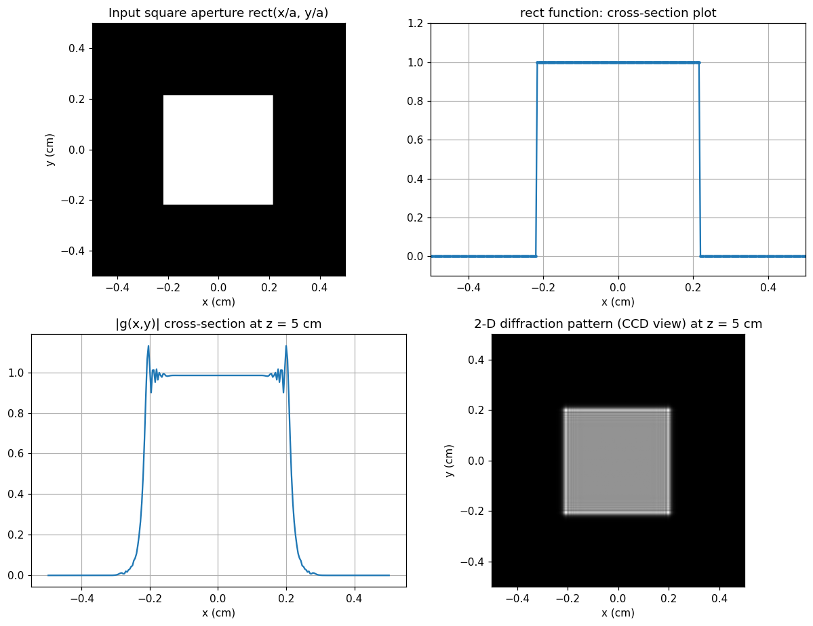
  <figcaption>图（本笔记运行结果）：左上 输入方孔；右上 空域剖面；左下 z=5 cm 处 |g| 剖面——孔边缘亮条纹；右下 2-D 衍射光斑（CCD 视角）——孔内近乎原像、边缘菲涅耳条纹（深近场特征）</figcaption>
</figure>

顺带一提：你在 `Ideal Lens.m/py` 里见过的透镜相位屏 \(t_l(x,y)=\exp\!\big[j\frac{k_0}{2f}(x^2+y^2)\big]\)，正是用本章语言描述"透镜做傅里叶变换"的第一块积木——第 2 章展开。

## 坑与陷阱

!!! danger "书公式 vs MATLAB FFT：指数约定相反"
    书的前向变换是 \(+j\) 指数（行波约定），MATLAB/numpy 的 `fft2` 是 \(-j\) 指数。严格按书公式做前向变换，代码里应写 `ifft2(U)*N^2`（你已有的 ASM.m 就是这么做的）；`fft2(U)/N^2` 算出来的是镜像约定下的谱。对实偶函数（如 rect）两者数值相同，所以书里的 `fft2Drect.m` 碰巧没错——但只要函数不再实偶（例如带相位的全息图），两种写法就不同。`correlation.m` 里共轭写在哪一边（`FI1.*conj(FI2)` vs `conj(FI1).*FI2`）也是同一个原因：MATLAB 约定下共轭位置与书式 (1.2-7) 正好对调，两种写法对实图像只差镜像，abs 后看不出差别。

!!! danger "sinc 不是 sin(x)/x"
    书和光学里的 \(\mathrm{sinc}(x)=\sin(\pi x)/(\pi x)\)，过零点在整数；MATLAB 的 `sinc`（Signal Processing Toolbox）和 `scipy.special.sinc` 也是这个归一化版本。但原书 `Plot_sinc.m` 手写 `sin(pi*x)./(pi*x)`，在 x=0 处是 0/0=NaN，plot 只是在峰值处悄悄漏画一个点（已数值确认：网格 `-5.5:0.01:5.5` 精确命中 x=0）。修复：对 `x==0` 补极限值 1，或用 `sin(pi*x+eps)./(pi*x+eps)`。

!!! danger "频轴标定：L/(N−1) 与 DFT 真实频格 1/(N·dx) 差一个 N/(N−1)"
    书里坐标轴按 \(dx=L/(N-1)\) 标定，频轴步长取 \(2\pi/((N-1)dx)=2\pi/L\)；但 DFT 真实的频格宽是 \(2\pi/(N\,dx)\)，比书里的小 \(N/(N-1)\) 倍（N=256 时差 0.4%）。另外书里把 M×M 方块放在第 128 个元素上，几何中心其实偏了半个像素（实际采样宽度是 \(M\cdot dx=M/255\) 而非 \(a=M/256\)）。画图看形状无碍，但要精确对零点位置（如 \(k_{x,0}=2\pi/a\)）时得知道这层近似——验证脚本实测第一零点 143.95 vs 理论 146.23，差距在半个频格量级。

!!! danger "卷积要翻转，相关不翻转"
    卷积 \(f*h\)：h 先绕两轴翻转 \(h(-x',-y')\)，再平移到 \((x,y)\)；相关 \(f\otimes h\)：h 不翻转，直接平移 \(h(x+x',y+y')\)，且 f 要取共轭。两者关系 (1.2-5)：\(f\otimes h=f^{*}(-x,-y)*h\)。写衍射/成像代码时把"翻转"漏掉，得到的是相关而不是卷积——图案识别里正好用后者，仿真物理传播时必须用前者。

!!! danger "频域相乘前后：fftshift 对齐与还原"
    MATLAB/numpy 的 FFT 把零频放在数组四角（index 0）。要做 \(G=F\cdot H\)，F 和 H 必须用同一种排布（要么都 `fftshift` 过、要么都没 shift 过）；显示幅度谱前再 `fftshift` 把零频搬到中心，否则你看到的是"四角亮、中心暗"的错位频谱。例 1.2 若不 shift，图 1.4b 的星芒会跑到画布四角。

!!! danger "相关峰 ≠ 图像峰：中心锐利亮斑才是匹配判据"
    (1.2-6) 只保证自相关 \(C_{ff}\) 在中心最大；互相关 \(C_{fh}\) 中心没有亮斑（图 1.15）。反过来，如果互相关图里出现了亮斑，说明两图有局部相似结构。判断"识别成功"看的是**中心锐利亮斑**，不是图里哪个位置最亮。

!!! danger "MATLAB 与 Python 的索引/显示差异"
    MATLAB 矩阵从 1 开始，Python 从 0 开始：MATLAB 的 `R(128-n:128+n)`（以第 128 个元素为中心）对应 Python 的 `R[127-n:127+n+1]`。显示时 MATLAB `image()` 与 `plt.imshow` 的行方向默认不同，Python 里用 `origin='lower'` 才与数学坐标（y 向上）一致。本书代码移植时这两处不改，图会上下颠倒、中心偏一格。

!!! danger "相关积分里共轭加在 f 上"
    (1.2-4) 里取共轭的是第一个函数 \(f^{*}(x',y')\)——"拿参考模板 f 去匹配 h"。如果模板和目标写反，得到的是 \(C_{hf}\)（翻转版本）。实图像 abs 显示下看不出，但做复振幅（全息）相关时共轭位置会直接改变结果。

## 速览

1. 时间 FT：(1.1-1a/1b)；二维空间 FT：(1.1-2a/2b)——**书约定前向 \(+j\)**，逆变换带 \(1/4\pi^2\)。
2. 变换对记号 \(f(x,y)\Leftrightarrow F(k_x,k_y)\)；10 条性质见 1.1.2 的重排表（原书 Table 1.1）。
3. \(\mathrm{rect}(x/a,y/b)\Leftrightarrow ab\,\mathrm{sinc}(ak_x/2\pi,\,bk_y/2\pi)\)（1.1-8b）；宽度 a 的孔第一零点 \(k_{x,0}=2\pi/a\)：孔越窄谱越宽。
4. \(\mathrm{sinc}(x)=\sin(\pi x)/(\pi x)\)，零点 ±1, ±2, …。
5. δ 函数三性质：单位面积、乘积、采样（1.1-10a/10b/10c）；\(\delta(x,y)\Leftrightarrow1\)——点源频谱平坦。
6. 线性 = 叠加；时不变/空间不变 = 平移输出跟平移；LTI/LSI 系统输出 = 输入卷积冲激响应：\(g=f*h\)（1.2-1/1.2-2）。
7. 卷积定理：\(G=F\cdot H\)（1.2-3b）——空域卷积 = 频域乘法；h 叫 PSF，H 叫频率传递函数。
8. 相关 \(f\otimes h=\mathcal{F}^{-1}\{F^{*}H\}\)（1.2-4/1.2-7/1.2-8），不翻转；\(f\otimes h=f^{*}(-x,-y)*h\)（1.2-5）。
9. 自相关中心最大（1.2-6）——两图相同时相关输出中心亮斑 = 匹配；Vander Lugt (1964)、Weaver & Goodman (1966) 的光学图案识别由此而来。
10. 书内代码：`plot_sinc.m`（Table 1.2）、`fft2Drect.m`（Table 1.3，M=11 → a≈0.0429、\(k_{x,0}=146.23\)）、`fft2Dbitmap_image.m`（Table 1.4）、`correlation.m`（Table 1.5）；本笔记全部配了逐行对应的 Python 版并跑通验证。

## 术语速查

| 英文 | 中文 | 一句话 |
| --- | --- | --- |
| Fourier transform (pair) | 傅里叶变换（对） | 信号与频谱的互相翻译，\(f\Leftrightarrow F\) |
| spatial radian frequency | 空间弧度频率 \(k_x,k_y\) | 每米多少弧度的空间振动，[rad/m] |
| rect function | 矩形函数 | 宽 \(a\)、高 1 的方波窗 |
| sinc function | sinc 函数 | \(\sin(\pi x)/(\pi x)\)，rect 的频谱 |
| separable function | 可分离函数 | \(f(x,y)=f_x(x)f_y(y)\)，二维积分拆乘积 |
| delta function / impulse | δ 函数 / 冲激函数 | 零宽单位面积的理想点；光学里 = 点光源 |
| sampling property | 采样性质 | \(\int f\,\delta(x-x_0)\,dx=f(x_0)\)，δ 挑出一个值 |
| superposition | 叠加原理 | \(af_1+bf_2\to ag_1+bg_2\)，线性的定义 |
| LTI / LSI system | 线性时不变 / 空间不变系统 | 平移输入 → 平移输出 |
| convolution | 卷积 | 翻转 + 平移 + 乘积面积，\(g=f*h\) |
| impulse response | 冲激响应 \(h(t)\) | δ 输入的输出；空域里即 PSF |
| point spread function (PSF) | 点扩散函数 \(h(x,y)\) | 点光源经系统后"糊"开的样子 |
| frequency transfer function | 频率传递函数 \(H(k_x,k_y)\) | PSF 的傅里叶变换；频域乘法因子 |
| correlation | 相关 | 不翻转的"匹配积分"，\(f\otimes h\) |
| cross-correlation / auto-correlation | 互相关 / 自相关 | 两图比相似 / 自己比自己 |
| pattern recognition | 图案识别 | 用相关峰（中心亮斑）判断匹配 |
| traveling-wave convention | 行波约定 | \(e^{j\omega t-j\mathbf{k}\cdot\mathbf{r}}\)，本书 +j 前向变换的来源 |
