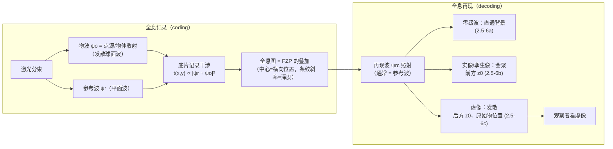
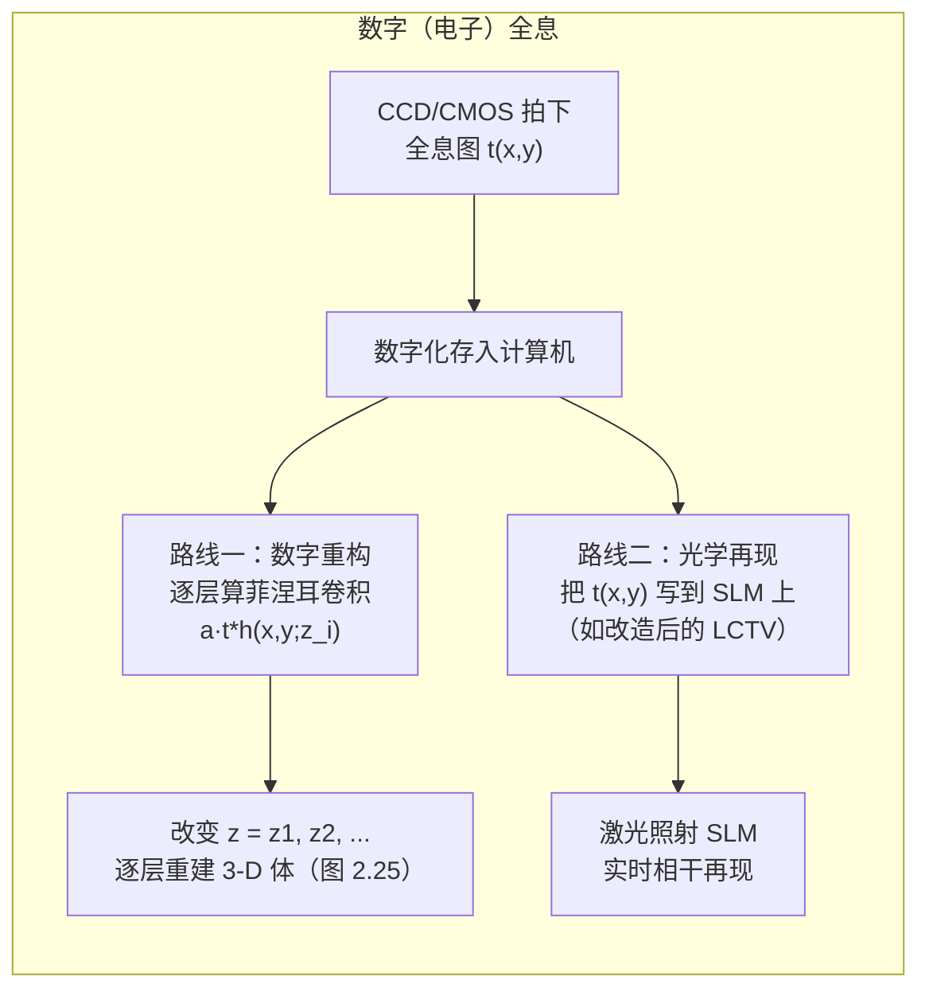

# 第 2 章 波动光学与全息

> **本章解决**：从波动方程到全息记录的物理链条——标量近似下的平面波与球面波、菲涅耳衍射、透镜的相位变换与成像系统的光瞳描述，以及全息图的形成：点源全息图即正弦菲涅耳波带片，三维物体的全息图是其各点全息图的叠加，离轴参考光可分离孪生像。学完能解释全息记录与重建的相位关系，并判断数字记录面临的分辨率与孪生像限制。

## 2.0 本章导图

<div class="brtree">
  <div class="brrow">
    <span class="brlabel root">从波动光学到全息</span>
    <span class="brace"></span>
    <div class="brkids">
      <div class="brrow">
        <span class="brlabel">波动方程 2.1~2.2</span>
        <span class="brace"></span>
        <div class="brkids">
          <span class="brleaf">麦克斯韦 → 矢量波动方程</span>
          <span class="brleaf">标量化：∇²ψ = (1/v²)ψ̈</span>
          <span class="brleaf">平面波 e^{j(ωt−k·r)}，色散 k0²=ω²/v²</span>
          <span class="brleaf">球面波 (1/R)e^{j(ωt−k0R)}</span>
        </div>
      </div>
      <div class="brrow">
        <span class="brlabel">标量衍射 2.3</span>
        <span class="brace"></span>
        <div class="brkids">
          <span class="brleaf">Helmholtz 方程</span>
          <span class="brleaf">传递函数 H(kx,ky;z)（式 2.3-5）</span>
          <span class="brleaf">冲激响应 G / h（式 2.3-10/11）</span>
          <span class="brleaf">菲涅耳衍射公式（卷积/频域双路线）</span>
          <span class="brleaf">点源→球面波；平面波→不衍射</span>
        </div>
      </div>
      <div class="brrow">
        <span class="brlabel">透镜与成像 2.4</span>
        <span class="brace"></span>
        <div class="brkids">
          <span class="brleaf">透镜相位屏 t_f（式 2.4-1）</span>
          <span class="brleaf">d0=f：焦面=严格 FT（式 2.4-6）</span>
          <span class="brleaf">CPSF=h_c=FT{光瞳}（式 2.4-8）</span>
          <span class="brleaf">OTF=H_c 自相关，中心最大</span>
          <span class="brleaf">相干带通 vs 非相干固有低通</span>
        </div>
      </div>
      <div class="brrow">
        <span class="brlabel">全息 2.5</span>
        <span class="brace"></span>
        <div class="brkids">
          <span class="brleaf">FZP = 点源全息图（式 2.5-3）</span>
          <span class="brleaf">中心记横向位置，条纹记深度</span>
          <span class="brleaf">再现：零级 + 实像(孪生) + 虚像</span>
          <span class="brleaf">离轴 θ：像分离 2z0·sinθ</span>
          <span class="brleaf">数字记录/重构（2.5.3）</span>
        </div>
      </div>
    </div>
  </div>
</div>

## 2.1 麦克斯韦方程组与齐次矢量波动方程

光学研究四个矢量场量（电磁场 electromagnetic (EM) fields）：电场强度 \(\mathcal{E}\)［V/m］、电通量密度 \(\mathcal{D}\)［C/m²］、磁场强度 \(\mathcal{H}\)［A/m］、磁通量密度 \(\mathcal{B}\)［Wb/m²］。它们的"宪法"是**麦克斯韦方程组**（Maxwell's equations），微分形式：

\[
\nabla\cdot\mathcal{D}=\rho_v,
\tag{2.1-1}
\]

\[
\nabla\cdot\mathcal{B}=0,
\tag{2.1-2}
\]

\[
\nabla\times\mathcal{E}=-\frac{\partial\mathcal{B}}{\partial t},
\tag{2.1-3}
\]

\[
\nabla\times\mathcal{H}=\mathcal{J}_c+\frac{\partial\mathcal{D}}{\partial t},
\tag{2.1-4}
\]

其中 \(\mathcal{J}_c\) 是电流密度［A/m²］、\(\rho_v\) 是电荷密度［C/m³］，二者是产生电磁场的**源**。人话版：(2.1-3) 和 (2.1-4) 说的是**变化的磁场激发变化的电场，变化的电场又激发变化的磁场**——正是这种相互激发让电磁波能在介质甚至真空中传播，这是全书一切"波"的源头。

四个方程并非互相独立：对 (2.1-3)(2.1-4) 两边取散度，再用**电荷守恒定律**（continuity equation）

\[
\nabla\cdot\mathcal{J}_c+\frac{\partial\rho_v}{\partial t}=0,
\tag{2.1-5}
\]

就能证出 \(\nabla\cdot\mathcal{B}=0\)、\(\nabla\cdot\mathcal{D}=\rho_v\)。所以 (2.1-1)~(2.1-4) 里真正独立的只有 6 个标量方程（每个旋度式 3 个分量），却要对付 \(\mathcal{E},\mathcal{H},\mathcal{D},\mathcal{B}\) 的 12 个分量——缺的 6 个方程由**本构关系**（constitutive relations）补齐：

\[
\mathcal{D}=\epsilon\mathcal{E},
\tag{2.1-6a}
\]

\[
\mathcal{B}=\mu\mathcal{H},
\tag{2.1-6b}
\]

\(\epsilon\)［F/m］是介电常数、\(\mu\)［H/m］是磁导率。本书设它们为标量常数——这只对**线性**（linear，性质不随场强变）、**均匀**（homogeneous，性质不随空间变）、**各向同性**（isotropic，性质不随方向变）的介质成立。真空里 \(\epsilon_0=(1/36\pi)\times10^{-9}\) F/m，\(\mu_0=4\pi\times10^{-7}\) H/m，这两个数值得背下来。

!!! note "拓展：例 2.1 —— 矢量波动方程的推导（三步走）"
    **第一步**：对 (2.1-3) 两边取旋度，代入 (2.1-6b)（设 \(\mu\) 不随时空变）：

\[
\nabla\times\nabla\times\mathcal{E}=-\nabla\times\frac{\partial\mathcal{B}}{\partial t}=-\frac{\partial}{\partial t}(\nabla\times\mathcal{B})=-\mu\frac{\partial}{\partial t}(\nabla\times\mathcal{H}).\tag{2.1-7}
\]

    **第二步**：代入 (2.1-4) 和 (2.1-6a)（设 \(\epsilon\) 不随时间变）：

\[
\nabla\times\nabla\times\mathcal{E}=-\mu\epsilon\frac{\partial^2\mathcal{E}}{\partial t^2}-\mu\frac{\partial\mathcal{J}_c}{\partial t}.\tag{2.1-8}
\]

    **第三步**：用矢量恒等式 \(\nabla\times\nabla\times\mathcal{A}=\nabla(\nabla\cdot\mathcal{A})-\nabla^2\mathcal{A}\)（式 2.1-9），得到

\[
\nabla^2\mathcal{E}-\mu\epsilon\frac{\partial^2\mathcal{E}}{\partial t^2}=\mu\frac{\partial\mathcal{J}_c}{\partial t}+\nabla(\nabla\cdot\mathcal{E}),\tag{2.1-10}
\]

    再把 \(\nabla\cdot\mathcal{E}=\rho_v/\epsilon\)（由 (2.1-1) 加 (2.1-6a)，式 2.1-11）代进去：

\[
\boxed{\;\nabla^2\mathcal{E}-\mu\epsilon\frac{\partial^2\mathcal{E}}{\partial t^2}=\mu\frac{\partial\mathcal{J}_c}{\partial t}+\frac{1}{\epsilon}\nabla\rho_v.\;}\tag{2.1-12}
\]

    这就是带源项的**矢量波动方程**（vector wave equation）：给定 \(\mathcal{J}_c,\rho_v\) 就能解出 \(\mathcal{E}\)。一旦场离开源区进入无源区域（\(\mathcal{J}_c=0,\rho_v=0\)），它必须满足**齐次矢量波动方程**（homogeneous vector wave equation）

\[
\nabla^2\mathcal{E}-\mu\epsilon\frac{\partial^2\mathcal{E}}{\partial t^2}=0.\tag{2.1-13}
\]

    图 2.1 画的就是这个局面：区域 V′ 里有源，无源区域 V 里场满足齐次方程。

<figure>
  
  <figcaption>图 2.1 有源区域 V′（激发场）与无源区域 V（场满足齐次矢量波动方程）（截自原书）</figcaption>
</figure>

注意 \(\mu\epsilon\) 的单位是 (1/速度)²。定义这个速度为 \(v\)：

\[
v^2=\frac{1}{\mu\epsilon}.
\tag{2.1-14}
\]

真空中 \(v=c\)，代进去算出 \(c\approx3\times10^8\) m/s。麦克斯韦算出这个理论值时，Fizeau 已经测得光速 315,300 km/s——两者惊人吻合。这直接把"光"和"电磁"焊在了一起：**光就是电磁场中以波形式传播的扰动**。

## 2.2 三维标量波动方程

(2.1-13) 是矢量方程，等价于每个分量各满足一个标量方程。把场写成

\[
\mathcal{E}=\mathcal{E}_x\mathbf{a}_x+\mathcal{E}_y\mathbf{a}_y+\mathcal{E}_z\mathbf{a}_z,
\tag{2.2-1}
\]

笛卡尔坐标下的拉普拉斯算子

\[
\nabla^2=\frac{\partial^2}{\partial x^2}+\frac{\partial^2}{\partial y^2}+\frac{\partial^2}{\partial z^2},
\tag{2.2-2}
\]

代回 (2.1-13) 逐分量比较（式 2.2-3），三个分量给出同一类型的方程。用 \(\psi\) 代表任意一个分量（\(\mathcal{E}_x\)、\(\mathcal{E}_y\) 或 \(\mathcal{E}_z\)）：

\[
\boxed{\;\nabla^2\psi=\frac{1}{v^2}\frac{\partial^2\psi}{\partial t^2}.\;}
\tag{2.2-4}
\]

这就是**三维标量波动方程**（3-D scalar wave equation）——从这一步起，"光的振动方向"被扔掉了，光场变成一个复标量函数。对全息而言这是最关键的一次"降维"：后面所有公式里的 \(\psi\) 都是这个标量。

### 2.2.1 平面波解

对以**角频率**（angular frequency）\(\omega_0\)［rad/s］振动的波，(2.2-4) 最简单的解是

\[
\psi(x,y,z,t)=\exp[j(\omega_0 t-\boldsymbol{k}_0\cdot\boldsymbol{R})]
=\exp[j(\omega_0 t-k_{0x}x-k_{0y}y-k_{0z}z)],
\tag{2.2-5}
\]

其中 \(\boldsymbol{R}=x\mathbf{a}_x+y\mathbf{a}_y+z\mathbf{a}_z\) 是位置矢量，\(\boldsymbol{k}_0=k_{0x}\mathbf{a}_x+k_{0y}\mathbf{a}_y+k_{0z}\mathbf{a}_z\) 是**传播矢量**（propagation vector），\(|\boldsymbol{k}_0|=k_0\) 叫**传播常数**［rad/m］。代回方程可知各分量必须满足

\[
\frac{\omega_0^2}{k_{0x}^2+k_{0y}^2+k_{0z}^2}=\frac{\omega_0^2}{k_0^2}=v^2.
\tag{2.2-6}
\]

人话版：(2.2-5) 描述的波，其相位只取决于 \(\boldsymbol{k}_0\cdot\boldsymbol{R}\)——在垂直于 \(\boldsymbol{k}_0\) 的整个平面上相位相同，所以叫**平面波**（plane wave）。传播方向由三个分量 \(k_{0x},k_{0y},k_{0z}\) 共同决定（图 2.2）。

<figure>
  
  <figcaption>图 2.2 平面波沿 <span class="arithmatex">\(\boldsymbol{k}_0\)</span> 方向传播：三个分量决定方向（截自原书）</figcaption>
</figure>

电磁场本质上是实的，取实部还原物理场：

\[
\mathrm{Re}[\psi(x,y,z,t)]=\cos(\omega_0 t-k_{0x}x-k_{0y}y-k_{0z}z).
\tag{2.2-7}
\]

沿 \(z\) 方向传播的一维特例：波动方程化为 \(\partial^2\psi/\partial z^2=(1/v^2)\partial^2\psi/\partial t^2\)（式 2.2-8），平面波解变成

\[
\psi(z,t)=\exp[j(\omega_0 t-k_0 z)]=\exp(j\omega_0 t)\exp[-j\theta(z)],
\tag{2.2-9}
\]

其中 \(\theta(z)=k_0z=\frac{2\pi}{\lambda_0}z\) 叫波的**相位**（phase），\(\lambda_0\) 是波长。以坐标原点为零相位点，则 \(z=\lambda_0\) 处 \(\theta=2\pi\)——**每走一个波长，相位积累 \(2\pi\)**（图 2.3）。

<figure>
  
  <figcaption>图 2.3 沿 z 方向传播的平面波：等相位面是一叠平面（planar wavefronts）（截自原书）</figcaption>
</figure>

### 2.2.2 球面波解

另一类最简单的解在球坐标（图 2.4）下最自然。球坐标下拉普拉斯算子 \( \nabla^2 \) 的表达式（式 2.2-10）含 \(R,\theta,\phi\) 三个变量；最简单的情形是**球对称**（spherical symmetry）：\(\psi=\psi(R,t)\) 只到原点的距离有关。此时方程 (2.2-4) 化为

\[
\frac{1}{R}\Big(\frac{\partial^2\psi}{\partial R^2}+\frac{2}{R}\frac{\partial\psi}{\partial R}\Big)=\frac{1}{v^2}\frac{\partial^2\psi}{\partial t^2}
\quad\Longleftrightarrow\quad
R\Big(\frac{\partial^2\psi}{\partial R^2}+\frac{2}{R}\frac{\partial\psi}{\partial R}\Big)=\frac{\partial^2(R\psi)}{\partial R^2}.
\]

<figure>
  
  <figcaption>图 2.4 球坐标系（截自原书）</figcaption>
</figure>

于是有巧妙的换元：令 \(R\psi\) 整体作为未知量，方程变成

\[
\frac{\partial^2(R\psi)}{\partial R^2}=\frac{1}{v^2}\frac{\partial^2(R\psi)}{\partial t^2},
\tag{2.2-12}
\]

与一维方程 (2.2-8) **形式完全相同**！直接抄 (2.2-9) 的解，再把 \(1/R\) 除回来：

\[
\boxed{\;\psi(R,t)=\frac{1}{R}\exp[j(\omega_0 t-k_0 R)].\;}
\tag{2.2-13}
\]

这就是**球面波**（spherical wave）：相位 \(\theta(R)=k_0R\) 只依赖到点源的球面距离，等相位面是一层层同心球面（**球面波前**，spherical wavefronts，图 2.5）。同样每传播一个波长相位积累 \(2\pi\)。振幅 \(1/R\) 的来历：能量守恒——球面面积 \(4\pi R^2\) 越大，单位面积的能流越小，场强按 \(1/R\) 衰减（强度按 \(1/R^2\)）。

<figure>
  
  <figcaption>图 2.5 球面波前：同心球壳，每壳间距一个波长（截自原书）</figcaption>
</figure>

实验室里怎么批量产生这两种波？图 2.6 给出标准答案：激光出射的是平面波（平行光线），先打到一个凸透镜上聚焦成点——焦点就是"点源"，往后是球面波；再用第二片透镜（离第一片 \(f_1+f_2\)）把它重新准直成平面波。注意两透镜间的光束半径按**扩束因子**（expansion factor）\(M=f_2/f_1\) 放大。

<figure>
  
  <figcaption>图 2.6 球面波与平面波的实验室产生：透镜 1 聚焦成点源（球面波），透镜 2 准直（平面波），扩束因子 M=f₂/f₁（截自原书）</figcaption>
</figure>

## 2.3 标量衍射理论

现在解决核心问题：平面波打到 \(z=0\) 平面上的一个孔径（**衍射屏**，diffracting screen）后，\(z>0\) 处的光场怎么算（图 2.7）？这等价于解一个带初值的波动方程。

<figure>
  
  <figcaption>图 2.7 衍射几何：平面波 → 孔径 → 衍射光（截自原书）</figcaption>
</figure>

振幅 \(E\)、沿 \(z\) 传播的平面波 \(\psi=E\exp(j\omega_0t)\)（零相位点取在 \(z=0\)）。紧贴孔径前表面，场还是这个平面波；紧贴孔径后表面，场被孔径"裁剪"成

\[
\psi_i(x,y,z=0)=\psi_{i0}(x,y)\exp(j\omega_0 t),
\]

其中 \(\psi_{i0}(x,y)=E\,\mathrm{rect}(x/x_0,y/y_0)\)（方孔时）。**初始条件**（initial condition）就是 \(\psi_{i0}\)。在任意 \(z\) 处，把解写成"未知复振幅 × 载波"的形式：

\[
\psi(x,y,z,t)=\psi_p(x,y,z)\exp(j\omega_0 t),
\tag{2.3-1}
\]

\(\psi_p(x,y,z)\) 叫**复振幅**（complex amplitude）——电气工程里叫**相量**（phasor）。人话版：光以 \(\omega_0\) 高频振动，我们只关心"振到多大、偏到哪个相位"，把共同的 \(e^{j\omega_0 t}\) 抽掉不管。**从此全书的所有场 \(\psi\) 都默认指这个复振幅**。

!!! note "拓展：例 2.2 —— 亥姆霍兹方程的推导"
    把 (2.3-1) 代入标量波动方程 (2.2-4)：时间上只作用在 \(e^{j\omega_0 t}\) 上，\(\partial^2/\partial t^2\to(j\omega_0)^2=-\omega_0^2\)。于是

\[
\Big[\frac{\partial^2\psi_p}{\partial x^2}+\frac{\partial^2\psi_p}{\partial y^2}+\frac{\partial^2\psi_p}{\partial z^2}\Big]e^{j\omega_0 t}=\frac{-\omega_0^2}{v^2}\psi_p(x,y,z)e^{j\omega_0 t}=-k_0^2\psi_p e^{j\omega_0 t},
\]

    即**亥姆霍兹方程**（Helmholtz equation）：

\[
\frac{\partial^2\psi_p}{\partial x^2}+\frac{\partial^2\psi_p}{\partial y^2}+\frac{\partial^2\psi_p}{\partial z^2}+k_0^2\psi_p=0,\qquad k_0=\frac{\omega_0}{v}.\tag{2.3-2}
\]

    时间变量消失了——复振幅的世界里没有时间。

### 2.3.1 菲涅耳衍射

对 (2.3-2) 做二维傅里叶变换（用第 1 章性质表 #5：\(\partial/\partial x\leftrightarrow-jk_x\)，变换后 \(\partial^2/\partial x^2\to-k_x^2\)），并把 \(\partial^2/\partial z^2\) 留在空域：

\[
\frac{d^2\Psi_p}{dz^2}+k_0^2\Big(1-\frac{k_x^2}{k_0^2}-\frac{k_y^2}{k_0^2}\Big)\Psi_p=0,
\tag{2.3-3}
\]

其中 \(\Psi_p(k_x,k_y;z)\) 是 \(\psi_p(x,y,z)\) 的二维傅里叶变换。这是标准的常微分方程 \(d^2y/dz^2+\alpha^2 y=0\)（\(\alpha=k_0\sqrt{1-k_x^2/k_0^2-k_y^2/k_0^2}\)），解为 \(y(z)=y_0\exp(-j\alpha z)\)。代回：

\[
\Psi_p(k_x,k_y;z)=\Psi_{p0}(k_x,k_y)\exp\Big[-jk_0\sqrt{1-k_x^2/k_0^2-k_y^2/k_0^2}\,z\Big],
\tag{2.3-4}
\]

其中 \(\Psi_{p0}(k_x,k_y)=\mathcal{F}_{xy}\{\psi_{p0}(x,y)\}\) 是 \(z=0\) 处初始场的频谱。把它读成一个线性系统（图 2.8）：输入频谱 \(\Psi_{p0}\)、输出频谱 \(\Psi_p\)，则系统的**空间频率传递函数**（spatial frequency transfer function of propagation）是

\[
\boxed{\;\mathcal{H}(k_x,k_y;z)=\frac{\Psi_p(k_x,k_y;z)}{\Psi_{p0}(k_x,k_y)}
=\exp\Big[-jk_0\sqrt{1-k_x^2/k_0^2-k_y^2/k_0^2}\,z\Big].\;}
\tag{2.3-5}
\]

<figure>
  
  <figcaption>图 2.8 传播的传递函数把输入频谱变成输出频谱（截自原书）</figcaption>
</figure>

对 (2.3-5) 做逆傅里叶变换（书约定：\(\mathcal{F}_{xy}^{-1}\) 带 \(1/4\pi^2\)、核 \(e^{-jk_xx-jk_yy}\)）：

\[
\psi_p(x,y;z)=\frac{1}{4\pi^2}\iint\Psi_{p0}(k_x,k_y)\exp\Big[-jk_0\sqrt{1-\frac{k_x^2}{k_0^2}-\frac{k_y^2}{k_0^2}}\,z\Big]\exp(-jk_xx-jk_yy)\,dk_x\,dk_y.
\tag{2.3-8}
\]

把 \(\Psi_{p0}=\mathcal{F}_{xy}\{\psi_{p0}\}\) 塞进去并交换积分次序，就得到空域卷积形式：

\[
\psi_p(x,y;z)=\iint\psi_{p0}(x',y')\,G(x-x',y-y';z)\,dx'dy'
=\psi_{p0}(x,y)*G(x,y;z),
\tag{2.3-9}
\]

其中

\[
G(x,y;z)=\frac{1}{4\pi^2}\iint\exp\Big[-jk_0\sqrt{1-\frac{k_x^2}{k_0^2}-\frac{k_y^2}{k_0^2}}\,z\Big]\exp(-jk_xx-jk_yy)\,dk_x\,dk_y
\]

叫**传播的空间冲激响应**（spatial impulse response of propagation）。人话版：把初始场打成一群点，每个点经 \(G\) "糊"成一小片球面波，全部叠加就是衍射场。这个积分可以严格积出来［Poon and Banerjee (2001)］：

\[
G(x,y;z)=\frac{jk_0\exp(-jk_0\sqrt{x^2+y^2+z^2})}{2\pi\sqrt{x^2+y^2+z^2}}
\times\frac{z}{\sqrt{x^2+y^2+z^2}}\Big(1+\frac{1}{jk_0\sqrt{x^2+y^2+z^2}}\Big).
\tag{2.3-10}
\]

!!! note "拓展：(2.3-10) 就是瑞利-索末菲核——本笔记已数值验证"
    把 \(R=\sqrt{x^2+y^2+z^2}\) 认出来后，(2.3-10) 其实是瑞利-索末菲衍射核 \(\frac{jk_0}{2\pi}\frac{z}{R^2}e^{-jk_0R}(1+\frac{1}{jk_0R})\)。它和 (2.3-5) 是严格的一对傅里叶变换对（对任意 \(z\) 成立，无近似）。用 Python 离散验证过：取 \(\lambda_0=632.8\) nm、\(z=5\) cm，数值逆变换 (2.3-5) 得到的 \(G\) 与闭式 (2.3-10) 在原点附近逐点吻合（偏差来自频谱窗口截断）。你已有的 `ASM.m/ASM.py` 用的 \(H=e^{-jk_0z\sqrt{1-k_x^2/k_0^2-k_y^2/k_0^2}}\) 正是 (2.3-5)——本节末尾我们会把它跑起来。

(2.3-10) 不好用，做两个近似得到傅里叶光学里常用的**菲涅耳衍射**公式：

1. 观察 distance 远大于波长（\(z\gg\lambda_0=2\pi/k_0\)），则 \(\big(1+\frac{1}{jk_0\sqrt{x^2+y^2+z^2}}\big)\approx1\)——括号里那项是 \(1/(k_0R)\) 量级，直接扔掉；
2. **傍轴近似**（paraxial approximation）：\(x^2+y^2\ll z^2\) 时用二项式展开 \(\sqrt{x^2+y^2+z^2}\approx z+\frac{x^2+y^2}{2z}\)——敏感的相位项用两阶展开，不敏感的分母只保留 \(z\)。

于是 (2.3-10) 退化为**傅里叶光学的空间冲激响应**（spatial impulse response in Fourier optics）：

\[
\boxed{\;h(x,y;z)=\exp(-jk_0z)\,\frac{jk_0}{2\pi z}\exp\Big[\frac{-jk_0(x^2+y^2)}{2z}\Big].\;}
\tag{2.3-11}
\]

人话版：\(h\) 就是一个点源发出的**傍轴球面波**——常数因子 \(e^{-jk_0z}\) 是沿轴传播的相位，\(e^{-jk_0(x^2+y^2)/2z}\) 是球面弯曲的二次相位，\(jk_0/2\pi z\) 是 \(1/z\) 振幅衰减（乘了个 \(j\)，即球面波比平面波多转 \(90^\circ\) 相位）。把它代回 (2.3-9)：

\[
\psi_p(x,y;z)=\psi_{p0}(x,y)*h(x,y;z)
=\exp(-jk_0z)\frac{jk_0}{2\pi z}\iint\psi_{p0}(x',y')\exp\Big\{\frac{-jk_0}{2z}\big[(x-x')^2+(y-y')^2\big]\Big\}dx'dy'.
\tag{2.3-12}
\]

这就是**菲涅耳衍射公式**（Fresnel diffraction formula）：任意初始光场传播距离 \(z\)，等于把它与二次相位的 \(h\) 做卷积。对 \(h\) 再做一次二维傅里叶变换（利用第 1 章"高斯↔高斯"式的变换对，\(\exp[-jk_0r^2/2z]\) 的谱是 \(\frac{\lambda z}{j}\exp[+j(k_x^2+k_y^2)z/2k_0]\)），得到**傅里叶光学的空间频率传递函数**：

\[
H(k_x,k_y;z)=\mathcal{F}_{xy}\{h(x,y;z)\}=\exp(-jk_0z)\exp\Big[\frac{j(k_x^2+k_y^2)z}{2k_0}\Big].
\tag{2.3-13}
\]

!!! note "拓展：例 2.3 的另一条路——直接傍轴展开 (2.3-5)"
    假设 \(k_x^2+k_y^2\ll k_0^2\)（传播矢量的横向分量很小），对 (2.3-5) 的根式做泰勒展开 \(\sqrt{1-u}\simeq1-u/2\)（\(u=(k_x^2+k_y^2)/k_0^2\)）：

\[
\mathcal{H}(k_x,k_y;z)=\exp\Big[-jk_0\sqrt{1-(k_x^2+k_y^2)/k_0^2}\,z\Big]\simeq\exp(-jk_0z)\exp\Big[\frac{j(k_x^2+k_y^2)z}{2k_0}\Big]=H(k_x,k_y;z).
\]

    与 (2.3-13) 一致。所以菲涅耳衍射 = 精确角谱的"二次相位"近似：频域里把 \(\sqrt{1-k^2/k_0^2}\) 换成抛物线，空域里把 \(R\) 换成 \(z+r^2/2z\)。两条路线的框图总结见图 2.9，输出频谱满足

\[
\Psi_p(k_x,k_y;z)=\Psi_{p0}(k_x,k_y)\,H(k_x,k_y;z).\tag{2.3-14}
\]

<figure>
  
  <figcaption>图 2.9 菲涅耳衍射总结框图：空域卷积 ψ₀*h 与频域乘法 Ψ₀·H 是同一件事（截自原书）</figcaption>
</figure>

**例 2.4：点源的衍射。** 点源即 \(\psi_{p0}(x,y)=\delta(x,y)\)。卷积一个 δ 就是抄 \(h\) 本身：

\[
\psi_p(x,y,z)=\delta(x,y)*h(x,y;z)
=\exp(-jk_0z)\frac{jk_0}{2\pi z}\exp\Big[\frac{-jk_0(x^2+y^2)}{2z}\Big].
\tag{2.3-15}
\]

这正是**发散球面波的傍轴近似**：指数里的 \(z\) 叫球面波的**曲率半径**（radius of curvature）——\(z>0\) 时波前发散（远离点源），\(z<0\) 时会聚。用二项式展开倒回去，(2.3-15) 可以改写成精确球面波 (2.2-13) 的形式：

\[
\psi_p(x,y,z)\simeq\frac{jk_0}{2\pi R}\exp(-jk_0R),
\tag{2.3-16}
\]

（分母不敏感处用了 \(z\simeq R\)）——与 (2.2-13) 对上了。**数值上本笔记验证过**：取 \(\lambda_0=632.8\) nm、\(z=5\) cm，在 \(|r|\le0.85\) mm 内 (2.3-15) 与精确球面波的幅度+相位最大相对偏差 \(5.2\times10^{-3}\)，且偏差随 \(r^4\) 增长——正是傍轴近似截掉的二项式四阶项。

**例 2.5：平面波的衍射。** \(\psi_{p0}(x,y)=1\)，其频谱 \(\Psi_{p0}=4\pi^2\delta(k_x)\delta(k_y)\)（第 1 章性质表 #8）。代入 (2.3-14)：只有零频分量存活，乘上 \(H(0,0)=e^{-jk_0z}\)，逆变换回来：

\[
\psi_p(x,y,z)=\exp(-jk_0z).
\]

平面波传播只积累相位，**不衍射**——它自己就是传递函数的零频本征态。

### 2.3.2 方孔的菲涅耳衍射 + MATLAB

一般情形：光场 \(\psi_{i,p}(x,y)\) 打到透过率 \(t(x,y)\) 的透明片上（假设无穷薄），出射场就是乘积 \(\psi_{i,p}(x,y)\,t(x,y)\)。取单位振幅平面波垂直照明、\(t(x,y)=\mathrm{rect}(x/a,y/a)\)（边长 \(a\) 的方孔），则 \(\psi_{p0}=\mathrm{rect}(x/a,y/a)\)，传播 \(z\) 后的场就是 (2.3-12) 的一次卷积（图 2.10）。

<figure>
  
  <figcaption>图 2.10 任意光场 <span class="arithmatex">\(t(x,y)\)</span> 的菲涅耳衍射：空域卷积 <span class="arithmatex">\(t(x,y)*h(x,y)\)</span>（截自原书）</figcaption>
</figure>

原书 Table 2.1 的 `Fresnel_diffraction.m` 用"频域乘法"实现这个卷积（图 2.9 的频域路线）：参数 \(a=M/256=111/256=0.4336\) cm，\(\lambda_0=0.6328\times10^{-4}\) cm（红光），\(z=5\) cm。图 2.11 是输出：a) 方孔；b) 方孔中心横截面；c) \(z=5\) cm 处的衍射幅度 \(|\psi_p(x,0;z)|\)——孔内几乎保持原样，**孔边缘长出菲涅耳条纹**（这是菲涅耳数 \(a^2/\lambda_0 z\approx150\) 的深近场特征）。

=== "MATLAB"

    ```matlab
    % ===== 书 2.3.2 · Table 2.1 Fresnel_diffraction.m（规范化重写） =====
    % 正方形孔径的菲涅耳衍射仿真（卷积路线，式 (2.3-12)）：
    %     psi_p(x,y;z) = psi_p0(x,y) * h(x,y;z)
    % 输入：M x M 正方形孔 rect(x/a, y/a)，a = M/256 = 0.4336 cm
    % 光源：He-Ne 红光 632.8 nm，观察屏 z = 5 cm（复现原书图 2.11）
    %
    % 与第 1 章拓展 1.2.3 的 fresnel_lsi.m 是同一物理的"书中正式版"。
    %
    % 差异提示：本脚本用"显式构造 h 再频域相乘"的卷积路线——卷积定理只依赖同一对
    % 正/逆变换，与 +j/-j 指数约定无关，所以书中 fft2 写法的结果就是书的卷积
    % （h 本身已按式 (2.3-11) 用 -j 二次相位构造）。"约定坑"只在用解析传递函数
    % H(kx,ky;z)（式 2.3-13）时才咬人，见 asm_propagation.m。
    % exp(-4*200*r^2) 是高斯窗：把脉冲响应截断在显示窗口内，抑制卷绕误差（原书写法）。

    clear
    L = 1;                  % L : length of display area（显示区域 L x L，单位 cm）
    N = 256;                % N : number of sampling points（采样点数）
    dx = L/(N-1);           % dx : step size（采样步长 1/255 cm）
    M = 111;                % 正方形孔的像素宽度（a = M/256 = 0.4336 cm）
    lambda0 = 0.6328e-4;    % He-Ne 红光波长（cm）
    z = 5;                  % 观察距离（cm）

    % ---- 输入：中心 M x M 正方形孔 rect(x/a, y/a) ----
    R = zeros(256);                 % assign a matrix (256x256) of zeros
    r = ones(M);                    % assign a matrix (MxM) of ones
    n = (M-1)/2;
    R(128-n:128+n, 128-n:128+n) = r;% 背景置 0、中心置 1 的方孔

    % ---- 坐标轴标定（与书中 fft2Drect.m 相同的方式） ----
    for k = 1:256
        X(k) = 1/255*(k-1) - L/2;   % 空间坐标 [-0.5, 0.5] cm
        Y(k) = 1/255*(k-1) - L/2;
    end

    % ---- 菲涅耳脉冲响应 h(x,y;z)（式 2.3-11 + 高斯窗） ----
    sigma = pi/(lambda0*z);         % sigma = pi/(lambda*z)，二次相位系数
    for rr = 1:256
        for cc = 1:256
            % j*(sigma/pi) = j/(lambda*z) 振幅因子（全局相位 exp(-j k0 z) 未算）
            h(rr,cc) = j*(sigma/pi)*exp(-4*200*(X(rr)^2+Y(cc)^2)) ...
                                    *exp(-j*sigma*(X(rr)^2+Y(cc)^2));
        end
    end

    % ---- 频域实现卷积（照抄原书流程：FR.*H 后 ifft2 再 fftshift） ----
    FR = (1/256)^2*fft2(R);         % 原书：FR=(1/256)^2*fft2(R)
    H  = (1/256)^2*fft2(h);         % 原书：H=(1/256)^2*fft2(h)
    hr = ifft2(FR.*H);
    hr = (256^2)*hr;                % 原书：hr=(256^2)*hr
    hr = fftshift(hr);              % 把卷积中心搬回图像中央
    I  = abs(hr).^2;                % 光强

    % ---- 可视化（对应原书 figure(1)(2)(3) 与 CCD 视图） ----
    figure(1)
    image(X, Y, 255*R); colormap(gray(256)); axis square; axis image
    xlabel('cm'); ylabel('cm')
    title('Input square aperture rect(x/a, y/a)')

    figure(2)
    plot(X+dx/2, R(:,127), '-o', 'MarkerSize', 2)   % 方孔中心横截面
    grid; axis([-0.5 0.5 -0.1 1.2])
    xlabel('cm'); title('Square aperture: cross-section')

    figure(3)
    plot(X+dx/2, abs(hr(:,127)))    % 衍射幅度中心横截面（原图 2.11c）
    grid; xlabel('cm'); title('|psi_p(x,y;z=5cm)| cross-section')

    figure(4)
    imagesc(X, Y, I); axis image; colormap(gray(256)); colorbar
    xlabel('x (cm)'); ylabel('y (cm)')
    title('2-D diffraction pattern (CCD view) at z = 5 cm')
    ```

=== "Python"

    ```python
    # ===== 书 2.3.2 · Table 2.1 Fresnel_diffraction.m 的 Python 版 =====
    # 正方形孔径的菲涅耳衍射仿真（卷积路线，式 (2.3-12)）：
    #     psi_p(x,y;z) = psi_p0(x,y) * h(x,y;z)
    # 输入：M x M 正方形孔 rect(x/a, y/a)，a = M/256 = 0.4336 cm
    # 光源：He-Ne 红光 632.8 nm，观察屏 z = 5 cm（复现原书图 2.11）
    #
    # 与第 1 章拓展 1.2.3 的 fresnel_lsi.py 是同一物理的"书中正式版"：
    # 那里把它当"自由空间 LSI 系统"的练习，这里按书 Table 2.1 原流程实现。
    #
    # MATLAB / Python 差异提示：
    # 1) MATLAB 矩阵 1-based、Python 0-based：MATLAB 第 127/128 列 = Python 下标 126/127。
    # 2) 本脚本用"显式构造 h 再做频域乘法"的卷积路线——卷积定理只依赖同一对
    #    正/逆变换，与 +j/-j 指数约定无关，所以照抄书中 fft2 写法结果就是书的卷积
    #    （h 本身已按书的 (2.3-11) 用 -j 二次相位构造）。"约定坑"只在用解析
    #    传递函数 H(kx,ky;z)（式 2.3-13）时才咬人，见 asm_propagation.py。
    # 3) exp(-4*200*r^2) 是高斯窗：把脉冲响应截断在显示窗口内，抑制离散卷积的
    #    卷绕误差（原书写法，4*200=800）。

    import numpy as np
    import matplotlib.pyplot as plt

    # ----- 1. 参数（与原书 Table 2.1 完全一致） -----
    L = 1.0                    # L : length of display area（显示区域 L x L，单位 cm）
    N = 256                    # N : number of sampling points（采样点数）
    dx = L / (N - 1)           # dx : step size（采样步长 1/255 cm）
    M = 111                    # 正方形孔的像素宽度（a = M/256 = 0.4336 cm）
    lam = 0.6328e-4            # He-Ne 红光波长（cm）
    z = 5.0                    # 观察距离（cm）

    # ----- 2. 输入：中心 M x M 正方形孔 rect(x/a, y/a) -----
    R = np.zeros((N, N))       # assign a matrix (256x256) of zeros
    n = (M - 1) // 2
    c = 128 - 1                # MATLAB 的第 128 个元素（1-based）= Python 下标 127
    R[c - n:c + n + 1, c - n:c + n + 1] = 1.0   # 背景置 0、中心置 1 的方孔

    # ----- 3. 坐标轴标定（与书中 fft2Drect.m 相同的方式） -----
    k = np.arange(N)
    X = k / (N - 1) - L / 2    # 空间坐标 [-0.5, 0.5] cm
    Y = X.copy()

    # ----- 4. 菲涅耳脉冲响应 h(x,y;z)（式 2.3-11 + 高斯窗） -----
    sigma = np.pi / (lam * z)                  # sigma = pi/(lambda*z)，二次相位系数
    r2 = X[:, None]**2 + Y[None, :]**2         # x^2+y^2 网格（广播代替双层 for）
    h = 1j * (sigma / np.pi) * np.exp(-1j * sigma * r2) * np.exp(-800.0 * r2)
    #   j*(sigma/pi) = j/(lambda*z) 振幅因子（全局相位 exp(-j k0 z) 未算，只影响整体相位）

    # ----- 5. 频域实现卷积（照抄原书流程：FR.*H 后 ifft2 再 fftshift） -----
    FR = np.fft.fft2(R) / N**2                 # 原书：FR=(1/256)^2*fft2(R)
    H = np.fft.fft2(h) / N**2                  # 原书：H=(1/256)^2*fft2(h)
    hr = np.fft.ifft2(FR * H) * N**2           # 原书：hr=ifft2(HR); hr=(256^2)*hr
    hr = np.fft.fftshift(hr)                   # 把卷积中心搬回图像中央
    I = np.abs(hr)**2                          # 光强

    # ----- 6. 可视化（对应原书 figure(1)(2)(3) 与 CCD 视图） -----
    fig, ax = plt.subplots(2, 2, figsize=(11, 8.5))

    ax[0, 0].imshow(R, extent=[X[0], X[-1], Y[0], Y[-1]], cmap='gray', origin='lower')
    ax[0, 0].set_title('Input square aperture rect(x/a, y/a)')
    ax[0, 0].set_xlabel('x (cm)'); ax[0, 0].set_ylabel('y (cm)')

    ax[0, 1].plot(X + dx / 2, R[:, 126], '-o', ms=2)      # MATLAB R(:,127) -> Python 第 126 列
    ax[0, 1].set_title('Square aperture: cross-section')
    ax[0, 1].set_xlabel('x (cm)'); ax[0, 1].axis([-0.5, 0.5, -0.1, 1.2]); ax[0, 1].grid(True)

    ax[1, 0].plot(X + dx / 2, np.abs(hr[:, 126]))         # 衍射幅度中心横截面（原图 2.11c）
    ax[1, 0].set_title('|psi_p(x,y;z=5cm)| cross-section')
    ax[1, 0].set_xlabel('x (cm)'); ax[1, 0].grid(True)

    ax[1, 1].imshow(I, extent=[X[0], X[-1], Y[0], Y[-1]], cmap='gray', origin='lower')
    ax[1, 1].set_title('2-D diffraction pattern (CCD view) at z = 5 cm')
    ax[1, 1].set_xlabel('x (cm)'); ax[1, 1].set_ylabel('y (cm)')

    plt.tight_layout()
    plt.show()
    ```

<figure>
  
  <figcaption>图 2.11 a) 方孔（a=0.4336 cm）；b) 方孔中心横截面；c) z=5 cm 处衍射幅度 |ψp(x,0;z)|——孔边缘长出菲涅耳条纹（截自原书）</figcaption>
</figure>

<figure>
  
  <figcaption>图（本笔记运行结果）：左上 输入方孔；右上 方孔横截面；左下 z=5 cm 衍射幅度横截面（边缘条纹，对应图 2.11c）；右下 2-D 光强（CCD 视角）</figcaption>
</figure>

!!! note "拓展实战：角谱法（ASM）——精确传递函数 (2.3-5) 的严格实现（编者拓展，原书无）"
    (2.3-13) 的菲涅耳传递函数是 (2.3-5) 的傍轴版；**不傍轴**就得用 (2.3-5) 全式传播，这就是**角谱法**（Angular Spectrum Method, ASM）。你已有的 `ASM.m/ASM.py` 正是"严格对齐书本公式"的版本，下面是规范化重写：一个 50 µm 半径的"过冷水滴"（振幅 0.95、相位 1.2 rad）在 5 µm 像素的网格上传播 5 cm 生成同轴全息图，再用 \(H(k_x,k_y;-z)\) 反向传播重建。

    三个实现要点（都是坑）：

    1. **书约定**：书的前向变换是 \(+j\) 指数，MATLAB/numpy 的 `fft2` 是 \(-j\) 指数——严格实现必须 `ifft2(U)*N^2` 当正变换、`fft2(A)/N^2` 当逆变换；若用 `fft2` 当正变换，(2.3-5) 的指数符号要整体反号，否则传播方向颠倒。
    2. **消逝波**：根号内 \(1-k^2/k_0^2<0\) 的频率没有物理传播模式，置 0。
    3. **ifftshift/fftshift 对齐**：变换前把"中心在数组中央"的场搬回 DFT 原点排布，否则相位带 \((-1)^{i+j}\) 锯齿。

    与第 1 章 `fresnel_lsi` 的关系：那条是"把菲涅耳 h 显式离散后频域相乘"的卷积路线（约定安全）；这里直接乘解析的 \(\mathcal{H}(k_x,k_y;z)\)（约定敏感）——数值验证显示两路线对同一方孔的强度相关系数 0.994，差异来自 h 的高斯窗截断与傍轴近似本身。

=== "MATLAB"

    ```matlab
    % ===== 书 2.3 · 式 (2.3-5) 角谱传递函数 H(kx,ky;z) 的严格实现（ASM 法） =====
    % 改编自你已有的 ASM.m（"严格对齐书本公式版"，规范化重写）：
    % 一个振幅-相位物体（过冷水滴）经 z=5cm 传播生成同轴全息图，
    % 再用 H(kx,ky;-z) 反向传播重建，验证角谱法"记录-重建"闭环。
    %
    % 核心公式（书中约定，前向变换为 +j 指数）：
    %     H(kx,ky;z) = exp[ -j k0 z sqrt(1 - kx^2/k0^2 - ky^2/k0^2) ]   (2.3-5)
    %     Psi(kx,ky;z) = Psi_p0(kx,ky) * H(kx,ky;z)                     (2.3-14)
    %     psi_p(x,y;z) = IFT{ Psi(kx,ky;z) }                            (2.3-8)
    %
    % 差异提示：
    % 1) 全书最大的坑：书的前向变换是 +j 指数，而 MATLAB 的 fft2 是 -j 指数。
    %    严格按书公式实现前向变换必须写 ifft2(U)*N^2；逆变换写 fft2(A)/N^2。
    %    若直接用 fft2 当"前向"，H 的指数符号要整体反号，否则传播方向颠倒
    %    （强度图恰好看不出错，复振幅/相位全错）。
    % 2) ifftshift 先把"中心在数组中央"的场搬到 DFT 原点排布，变换后 fftshift 搬回；
    %    不做这一步相位会带 (-1)^(i+j) 锯齿。
    % 3) 频率格间距用 DFT 真实值 df = 1/(N*dx)（不是书中 (N-1) 标定习惯，见 ch1 坑 3）。

    clear
    N = 512;                % 矩阵大小
    lambda0 = 532e-9;       % 真空波长 lambda_0（m）
    dx = 5e-6;              % 像素尺寸（m）
    L = N*dx;               % 靶面尺寸（m）
    z_prop = 0.05;          % 传播距离 z = 5 cm
    k0 = 2*pi/lambda0;      % 波数 k_0

    x = (-N/2:N/2-1)*dx;
    y = (-N/2:N/2-1)*dx;
    [X, Y] = meshgrid(x, y);

    % ---- 虚拟构建"过冷水滴"物体（振幅 0.95 + 相位 1.2 rad 的圆盘） ----
    U_obj = ones(N, N);
    droplet_radius = 50e-6;
    mask = (X.^2 + Y.^2) <= droplet_radius^2;
    U_obj(mask) = 0.95*exp(1j*1.2);

    % ---- 书中傅里叶变换协议封装（前向 +j = ifft2*N^2，逆向 -j = fft2/N^2） ----
    % （函数体在文件末尾：ft2_book / ift2_book）

    % ---- 频域角频率网格 (kx, ky) [rad/m] 与传递函数 (2.3-5) ----
    df = 1/L;                       % DFT 频率格间距 [cycle/m]
    fx = (-N/2:N/2-1)*df;
    fy = (-N/2:N/2-1)*df;
    [Fx, Fy] = meshgrid(fx, fy);
    Kx = 2*pi*Fx;                   % 书中的 k_x
    Ky = 2*pi*Fy;                   % 书中的 k_y

    root_term = 1 - (Kx.^2 + Ky.^2)/k0^2;
    root_term(root_term < 0) = 0;   % 滤除消逝波（k^2 > k0^2 的倏逝分量）

    H_forward  = exp(-1j*k0*z_prop*sqrt(root_term));    % 式 (2.3-5)，z>0
    H_backward = exp(-1j*k0*(-z_prop)*sqrt(root_term)); % 反向传播：z 取负

    % ---- 正向传播：生成同轴（数字）全息图 ----
    A_obj_0 = ft2_book(U_obj, N);           % 初始角谱 Psi_p0(kx,ky)
    A_det   = A_obj_0 .* H_forward;         % 频域乘传递函数（式 2.3-14）
    U_det   = ift2_book(A_det, N);          % 逆变换回空域（式 2.3-8）
    I_hologram = abs(U_det).^2;             % 相机记录的强度（全息图）

    % ---- 数字重构：反向传播 -z（取 sqrt(I) 当复振幅估计） ----
    U_recon0 = sqrt(I_hologram);
    A_recon  = ft2_book(U_recon0, N).*H_backward;
    U_final  = ift2_book(A_recon, N);

    % ---- 可视化 ----
    figure(1)
    subplot(2,2,1); imagesc(x*1e3, y*1e3, abs(U_obj)); colormap gray; axis image
    title('Object amplitude (droplet, 0.95)'); xlabel('x (mm)'); ylabel('y (mm)')
    subplot(2,2,2); imagesc(x*1e3, y*1e3, angle(U_obj)); colormap jet; axis image
    title('Object phase (1.2 rad disc)'); xlabel('x (mm)'); ylabel('y (mm)')
    subplot(2,2,3); imagesc(x*1e3, y*1e3, I_hologram); colormap gray; axis image
    title('Inline hologram |U(z=5cm)|^2 (Fresnel rings)'); xlabel('x (mm)'); ylabel('y (mm)')
    subplot(2,2,4); imagesc(x*1e3, y*1e3, abs(U_final)); colormap gray; axis image
    title('Reconstructed amplitude (back-propagation)'); xlabel('x (mm)'); ylabel('y (mm)')

    % ---- 局部函数（脚本内定义，须置于文件末尾，R2016b+ 支持） ----
    function A = ft2_book(U, N)
    % 书式前向变换（+j 指数）：F(kx,ky) = 双重积分 U exp[j(kx x+ky y)] dx dy
    A = fftshift(ifft2(ifftshift(U)))*N^2;
    end

    function U = ift2_book(A, N)
    % 书式逆变换（-j 指数）：U(x,y) = (1/4pi^2) 双重积分 F exp[-j(kx x+ky y)] dkx dky
    U = fftshift(fft2(ifftshift(A)))/N^2;
    end
    ```

=== "Python"

    ```python
    # ===== 书 2.3 · 式 (2.3-5) 角谱传递函数 H(kx,ky;z) 的严格实现（ASM 法） =====
    # 改编自你已有的 ASM.m / ASM.py（"严格对齐书本公式版"，规范化重写）：
    # 一个振幅-相位物体（过冷水滴）经 z=5cm 传播生成同轴全息图，
    # 再用 H(kx,ky;-z) 反向传播重建，验证角谱法"记录-重建"闭环。
    #
    # 核心公式（书中约定，前向变换为 +j 指数）：
    #     H(kx,ky;z) = exp[ -j k0 z sqrt(1 - kx^2/k0^2 - ky^2/k0^2) ]   (2.3-5)
    #     Psi(kx,ky;z) = Psi_p0(kx,ky) * H(kx,ky;z)                     (2.3-14)
    #     psi_p(x,y;z) = IFT{ Psi(kx,ky;z) }                            (2.3-8)
    #
    # MATLAB / Python 差异提示：
    # 1) 全书最大的坑：书的前向变换是 +j 指数，而 MATLAB/numpy 的 fft2 是 -j 指数。
    #    严格按书公式实现前向变换必须写 ifft2(U)*N^2（你的 ASM.m 就是这么做的）；
    #    逆变换写 fft2(A)/N^2。若直接用 fft2 当"前向"，H 的指数符号要整体反号，
    #    否则传播方向颠倒（强度图恰好看不出错，复振幅/相位全错）。
    # 2) ifftshift 先把"中心在数组中央"的场搬到 DFT 的原点排布，变换后再 fftshift
    #    搬回中心——不做这一步相位会带 (−1)^(i+j) 锯齿。
    # 3) 频率格间距用 DFT 真实值 df = 1/(N*dx)（不是书中 (N-1) 标定习惯，见 ch1 坑 3）。

    import numpy as np
    import matplotlib.pyplot as plt

    # ----- 1. 物理参数 -----
    N = 512                     # 矩阵大小
    lam = 532e-9                # 真空波长 lambda_0（绿光，m）
    dx = 5e-6                   # 像素尺寸（m）
    L = N * dx                  # 靶面尺寸（m）
    z_prop = 0.05               # 传播距离 z = 5 cm
    k0 = 2 * np.pi / lam        # 波数 k_0

    x = (np.arange(N) - N // 2) * dx
    y = (np.arange(N) - N // 2) * dx
    X, Y = np.meshgrid(x, y)

    # ----- 2. 虚拟构建"过冷水滴"物体（振幅 0.95 + 相位 1.2 rad 的圆盘） -----
    U_obj = np.ones((N, N), dtype=complex)
    droplet_radius = 50e-6
    mask = (X**2 + Y**2) <= droplet_radius**2
    U_obj[mask] = 0.95 * np.exp(1j * 1.2)

    # ----- 3. 书中傅里叶变换协议封装（前向 +j = ifft2*N^2，逆向 -j = fft2/N^2） -----
    def ft2_book(U):
        """书式前向变换（+j 指数）：F(kx,ky) = 双重积分 U exp[j(kx x+ky y)] dx dy"""
        return np.fft.fftshift(np.fft.ifft2(np.fft.ifftshift(U))) * N**2

    def ift2_book(A):
        """书式逆变换（-j 指数）：U(x,y) = (1/4pi^2) 双重积分 F exp[-j(kx x+ky y)] dkx dky"""
        return np.fft.fftshift(np.fft.fft2(np.fft.ifftshift(A))) / N**2

    # ----- 4. 频域角频率网格 (kx, ky) [rad/m] 与传递函数 (2.3-5) -----
    df = 1 / L                                   # DFT 频率格间距 [cycle/m]
    fx = (np.arange(N) - N // 2) * df
    fy = (np.arange(N) - N // 2) * df
    FX, FY = np.meshgrid(fx, fy)
    Kx = 2 * np.pi * FX                          # 书中的 k_x
    Ky = 2 * np.pi * FY                          # 书中的 k_y

    root_term = 1 - (Kx**2 + Ky**2) / k0**2
    root_term[root_term < 0] = 0                 # 滤除消逝波（k^2 > k0^2 的倏逝分量）

    H_forward = np.exp(-1j * k0 * z_prop * np.sqrt(root_term))     # 式 (2.3-5)，z>0
    H_backward = np.exp(-1j * k0 * (-z_prop) * np.sqrt(root_term))  # 反向传播：z 取负

    # ----- 5. 正向传播：生成同轴（数字）全息图 -----
    A_obj_0 = ft2_book(U_obj)                    # 初始角谱 Psi_p0(kx,ky)
    A_det = A_obj_0 * H_forward                  # 频域乘传递函数（式 2.3-14）
    U_det = ift2_book(A_det)                     # 逆变换回空域（式 2.3-8）
    I_hologram = np.abs(U_det)**2                # 相机记录的强度（全息图）

    # ----- 6. 数字重构：反向传播 -z（取 sqrt(I) 当复振幅估计） -----
    U_recon0 = np.sqrt(I_hologram).astype(complex)
    A_recon = ft2_book(U_recon0) * H_backward
    U_final = ift2_book(A_recon)

    # ----- 7. 可视化 -----
    fig, ax = plt.subplots(2, 2, figsize=(11, 9))

    ax[0, 0].imshow(np.abs(U_obj), extent=[x[0]*1e3, x[-1]*1e3, y[0]*1e3, y[-1]*1e3], cmap='gray')
    ax[0, 0].set_title('Object amplitude (droplet, 0.95)')
    ax[0, 0].set_xlabel('x (mm)'); ax[0, 0].set_ylabel('y (mm)')

    ax[0, 1].imshow(np.angle(U_obj), extent=[x[0]*1e3, x[-1]*1e3, y[0]*1e3, y[-1]*1e3], cmap='jet')
    ax[0, 1].set_title('Object phase (1.2 rad disc)')
    ax[0, 1].set_xlabel('x (mm)'); ax[0, 1].set_ylabel('y (mm)')

    ax[1, 0].imshow(I_hologram, extent=[x[0]*1e3, x[-1]*1e3, y[0]*1e3, y[-1]*1e3], cmap='gray')
    ax[1, 0].set_title('Inline hologram |U(z=5cm)|^2 (Fresnel rings)')
    ax[1, 0].set_xlabel('x (mm)'); ax[1, 0].set_ylabel('y (mm)')

    ax[1, 1].imshow(np.abs(U_final), extent=[x[0]*1e3, x[-1]*1e3, y[0]*1e3, y[-1]*1e3], cmap='gray')
    ax[1, 1].set_title('Reconstructed amplitude (back-propagation)')
    ax[1, 1].set_xlabel('x (mm)'); ax[1, 1].set_ylabel('y (mm)')

    plt.tight_layout()
    plt.show()
    ```

<figure>
  
  <figcaption>图（本笔记运行结果）：上排 水滴物体的振幅/相位；左下 z=5 cm 同轴全息图（菲涅耳环）；右下 反向传播重建出的水滴</figcaption>
</figure>

## 2.4 理想透镜、成像系统、光瞳函数与传递函数

### 2.4.1 理想透镜与光学傅里叶变换

**理想透镜**（ideal lens）是一个**相位物体**（phase object）：只改相位、不改振幅。焦距为 \(f\) 的理想会聚（凸）透镜的相位变换函数：

\[
\boxed{\;t_f(x,y)=\exp\Big[j\frac{k_0}{2f}(x^2+y^2)\Big].\;}
\tag{2.4-1}
\]

人话版：透镜给入射场乘一个二次相位——越靠边，相位超前越多（\(f>0\) 时），把平面波的波前从"平的"掰成"会聚的球面"。单位振幅平面波穿过透镜后，恰好变成向透镜后 \(z=f\) 处的点会聚的球面波。验证只需把 (2.4-2)

\[
\psi_p(x,y,z=f)=\psi_{p0}(x,y)*h(x,y;z=f),\qquad \psi_{p0}(x,y)=1\times t_f(x,y),
\tag{2.4-2}
\]

展开：菲涅耳核自带的二次相位 \(\exp[-jk_0(x^2+y^2)/2f]\) 与透镜相位 \(\exp[+jk_0(x'^2+y'^2)/2f]\) **恰好相消**，剩下的积分

\[
\iint\exp\Big[\frac{jk_0}{f}(xx'+yy')\Big]dx'dy'\;\propto\;\delta(x,y),
\]

即二维傅里叶变换 of \(1\)——平面波聚焦成一个点。**透镜后焦面上的场 ∝ 输入的傅里叶变换**，这是傅里叶光学的第一块基石。

!!! warning "采样提醒：透镜啁啾比你想的陡"
    透镜二次相位的**局部**空间频率是 \(k_0x/f\)，随 \(x\) 线性增长；数值仿真时它必须小于网格 Nyquist 频率 \(\pi/\Delta x\)，即要求 \(|x|<f\lambda_0/(2\Delta x)\)。用旧参数 \(L=1\) cm、\(N=256\)（\(\Delta x\approx3.9\,\mu\)m）仿真 \(f=10\) cm 的透镜，只有 \(|x|<0.08\) cm 合法——窗外全部混叠。下面的重写版取 \(L=0.4\) cm、\(N=1024\)，留 4 倍余量。这跟 2.5.3 的"记录介质分辨率"是同一件事。

现在把透明片 \(t(x,y)\) **紧贴**透镜放置（图 2.12），单位平面波照明。紧贴组合之后的场是 \(1\times t(x,y)\exp[j\frac{k_0}{2f}(x^2+y^2)]\)，用 (2.3-12) 传播 \(f\) 后：

\[
\psi_p(x,y;z=f)=\exp(-jk_0f)\,\frac{jk_0}{2\pi f}\exp\Big[\frac{-jk_0}{2f}(x^2+y^2)\Big]\times
\mathcal{F}_{xy}\{t(x,y)\}\Big|_{\substack{k_x=k_0x/f\\ k_y=k_0y/f}}.
\tag{2.4-3}
\]

<figure>
  
  <figcaption>图 2.12 透明片紧贴理想透镜：出射场 = <span class="arithmatex">\(t\cdot t_f\)</span>（截自原书）</figcaption>
</figure>

人话版：后焦面上的场**正比于 \(t\) 的傅里叶变换**（频率坐标 \((k_0x/f,k_0y/f)\)），但前面多了一个二次相位因子 \(\exp[-jk_0(x^2+y^2)/2f]\)——**相位弯曲**（phase curvature）。它是"想做光学傅里叶变换时的相位误差"；特殊情形 \(t=1\)（全透明）时它单独存在，对应平面波聚焦成点。变记号 \(\mathcal{F}_{xy}\) 即第 1 章的 \(\mathcal{F}_{xy}\)（书约定前向 \(+j\)）。

**例 2.5：透明片放在透镜前 \(d_0\) 处。**（原书例题编号重复，此处第二个"Example 2.5"实为 Example 2.6，见文末勘误。）透明片距透镜 \(d_0\)、平面波照明（图 2.13），按框图顺序"先传播、再过透镜、再传播"：

\[
\psi_p(x,y;f)=\{[t(x,y)*h(x,y;d_0)]\,t_f(x,y)\}*h(x,y;f),
\tag{2.4-4}
\]

算出来是

\[
\psi_p(x,y;f)=\frac{jk_0}{2\pi f}\exp[-jk_0(d_0+f)]\exp\Big[-j\frac{k_0}{2f}\Big(1-\frac{d_0}{f}\Big)(x^2+y^2)\Big]\times\mathcal{F}_{xy}\{t(x,y)\}\Big|_{\substack{k_x=k_0x/f\\ k_y=k_0y/f}}.
\tag{2.4-5}
\]

<figure>
  
  <figcaption>图 2.13 平面波照明位于透镜前 <span class="arithmatex">\(d_0\)</span> 的透明片：a) 物理布置；b) 框图（截自原书）</figcaption>
</figure>

还是"FT × 相位弯曲"，但弯曲系数变成了 \((1-d_0/f)\)。**当 \(d_0=f\)（透明片放在前焦面）时相位弯曲彻底消失**：

\[
\boxed{\;\psi_p(x,y;f)=\mathcal{F}_{xy}\{t(x,y)\}\Big|_{\substack{k_x=k_0x/f\\ k_y=k_0y/f}}=T\!\Big(\frac{k_0x}{f},\frac{k_0y}{f}\Big).\;}
\tag{2.4-6}
\]

物在前焦面、后焦面得到**严格**的傅里叶变换——"傅里叶面处理"（Fourier-plane processing）由此成为可能：在后焦面放滤波片改频谱，就是相干图像处理的全部秘密。

下面的脚本复现"透镜聚焦过程"并对比 \(d_0=0\)（式 2.4-3，焦面场带弯曲）与 \(d_0=f\)（式 2.4-6，相位平坦的严格 FT）：

=== "MATLAB"

    ```matlab
    % ===== 书 2.4.1 · 理想透镜相位变换 + 角谱传播：动态聚焦仿真 =====
    % 改编自你已有的 Ideal Lens.m（规范化重写）：
    % 输入图案（同心圆靶盘+十字线）紧贴理想透镜（d0=0），用式 (2.3-13) 的
    % 菲涅耳传递函数传播到 z = 0.5f, f, 1.5f，观察聚焦过程；
    % 并对比 d0=0（透镜贴合物，焦面场带相位弯曲，式 2.4-3）与
    % d0=f（物放前焦面，焦面场相位平坦的严格傅里叶变换，式 2.4-6）。
    %
    % 核心公式：
    %     透镜相位变换  t_f(x,y) = exp[ +j k0 (x^2+y^2) / (2f) ]        (2.4-1)
    %     菲涅耳传递函数 H(kx,ky;z) = exp(-j k0 z) exp[ j (kx^2+ky^2) z / (2 k0) ]  (2.3-13)
    %
    % 采样警告（旧版踩过的坑）：透镜啁啾相位的局部空间频率为 k0*x/f，随 x 线性增长；
    % 它必须小于网格 Nyquist 频率 pi/dx，即要求 |x| < f*lambda/(2 dx)。旧参数 L=1cm、
    % N=256（dx≈3.9um）只允许 |x|<0.08cm，窗外全部混叠，焦面场被污染。
    % 本版取 L=0.4cm、N=1024（dx≈3.9e-4 cm），允许 |x|<0.81cm，图案半径 0.17cm，
    % 有 4 倍余量。这与 2.5.3 的"记录介质分辨率"是同一件事：相位越陡，采样要越密。
    %
    % 差异提示：书的前向变换是 +j 指数，严格实现用 ifft2*N^2（fft2 是 -j 指数）。
    % 你旧版 Ideal Lens.m 用 fft2 + 书式传播子 exp(+j k^2 z/2k0)：fft2 与书约定互为
    % 镜像，强度图仍然正确（相当于结果左右镜像），但复振幅/相位是镜像的——本版统一
    % 改成书协议，相位穹顶对比才是严格对的。局部函数在文件末尾（R2016b+）。

    clear
    L = 0.4;                % 空间尺寸：0.4 cm x 0.4 cm（保证透镜啁啾被充分采样，见上）
    N = 1024;               % 网格大小
    dx = L/(N-1);
    X = (0:N-1)*dx - L/2;
    Y = (0:N-1)*dx - L/2;
    [XX, YY] = meshgrid(X, Y);

    lambda0 = 0.6328e-4;    % 红光波长（cm）
    k0 = 2*pi/lambda0;      % 波数
    f = 10;                 % 透镜焦距：10 cm

    % ---- 频域网格标定（角谱算法，DFT 真实间距） ----
    dk = 2*pi/(N*dx);
    kx = (-N/2:N/2-1)*dk;
    ky = (-N/2:N/2-1)*dk;
    [KXX, KYY] = meshgrid(kx, ky);

    % ---- 制造输入图案（同心圆靶盘与十字线，单位 cm） ----
    rr = sqrt(XX.^2 + YY.^2);
    R = zeros(N);
    R(rr > 0.030 & rr < 0.050) = 1;
    R(rr > 0.085 & rr < 0.105) = 1;
    R(rr > 0.140 & rr < 0.160) = 1;
    R(abs(XX) < 1.5*dx) = 1;        % 十字线
    R(abs(YY) < 1.5*dx) = 1;
    R(rr > 0.170) = 0;              % 裁剪边缘

    % ---- 书式傅里叶协议 + 传播（函数在文件末尾） ----
    r2 = XX.^2 + YY.^2;
    tf = exp(1j*(k0/(2*f))*r2);             % 透镜相位变换 t_f（式 2.4-1）

    U_behind_lens = R .* tf;                % 紧贴透镜后的光场（d0=0）
    z_list = [0.5*f, f, 1.5*f];
    U_z = zeros(N, N, 3);
    for i = 1:3
        U_z(:,:,i) = prop_book(U_behind_lens, z_list(i), k0, KXX, KYY, N);
    end

    % d0=f 对照组：物放前焦面 {[t*h(x,y;d0=f)]*t_f}*h(x,y;f)（式 2.4-4，取 d0=f）
    U_df = prop_book(prop_book(R, f, k0, KXX, KYY, N).*tf, f, k0, KXX, KYY, N);

    % ---- 可视化 ----
    figure(1)
    subplot(2,3,1); imagesc(X, Y, R); colormap gray; axis image
    title('Input target pattern R(x,y)'); xlabel('x (cm)'); ylabel('y (cm)')
    subplot(2,3,2); imagesc(X, Y, log10(abs(U_z(:,:,1)).^2/max(abs(U_z(:,:,1)).^2(:))*100+1));
    colormap(hot(256)); axis image
    title('Intensity z = 0.5f (log)'); xlabel('x (cm)'); ylabel('y (cm)')
    subplot(2,3,3); imagesc(X, Y, log10(abs(U_z(:,:,2)).^2/max(abs(U_z(:,:,2)).^2(:))*100+1));
    axis image
    title('Intensity z = f (focus, log)'); xlabel('x (cm)'); ylabel('y (cm)')
    subplot(2,3,4); imagesc(X, Y, log10(abs(U_z(:,:,3)).^2/max(abs(U_z(:,:,3)).^2(:))*100+1));
    axis image
    title('Intensity z = 1.5f (log)'); xlabel('x (cm)'); ylabel('y (cm)')

    % 相位对比：d0=0 焦面场带相位弯曲（式 2.4-3）vs d0=f 相位平坦（式 2.4-6）
    I0 = abs(U_z(:,:,2)).^2; If = abs(U_df).^2;
    mask0 = I0 > 1e-4*max(I0(:));
    maskf = If > 1e-4*max(If(:));
    ph0 = angle(U_z(:,:,2)); ph0(~mask0) = NaN;
    phf = angle(U_df);       phf(~maskf) = NaN;
    subplot(2,3,5); imagesc(X, Y, ph0); colormap jet; axis image
    title('Phase at focus, d0 = 0 (curved, Eq.2.4-3)'); xlabel('x (cm)'); ylabel('y (cm)')
    subplot(2,3,6); imagesc(X, Y, phf); colormap jet; axis image
    title('Phase at focus, d0 = f (flat, Eq.2.4-6)'); xlabel('x (cm)'); ylabel('y (cm)')

    % ---- 局部函数（脚本内定义，须置于文件末尾，R2016b+ 支持） ----
    function A = ft2_book(U, N)
    % 书式前向变换（+j 指数）
    A = fftshift(ifft2(ifftshift(U)))*N^2;
    end

    function U = ift2_book(A, N)
    % 书式逆变换（-j 指数）
    U = fftshift(fft2(ifftshift(A)))/N^2;
    end

    function U = prop_book(U0, z, k0, KXX, KYY, N)
    % 精确角谱传播（式 2.3-5）：先 FT，频域乘 H，再 IFT
    root = 1 - (KXX.^2 + KYY.^2)/k0^2;
    root(root < 0) = 0;
    H = exp(-1j*k0*z*sqrt(root));
    U = ift2_book(ft2_book(U0, N).*H, N);
    end
    ```

=== "Python"

    ```python
    # ===== 书 2.4.1 · 理想透镜相位变换 + 角谱传播：动态聚焦仿真 =====
    # 改编自你已有的 Ideal Lens.m / Ideal Lens.py（规范化重写）：
    # 输入图案（同心圆靶盘+十字线）紧贴理想透镜（d0=0），用式 (2.3-13) 的
    # 菲涅耳传递函数传播到 z = 0.5f, f, 1.5f，观察聚焦过程；
    # 并对比 d0=0（透镜贴合物，焦面场带相位弯曲，式 2.4-3）与
    # d0=f（物放前焦面，焦面场相位平坦的严格傅里叶变换，式 2.4-6）。
    #
    # 核心公式：
    #     透镜相位变换  t_f(x,y) = exp[ +j k0 (x^2+y^2) / (2f) ]        (2.4-1)
    #     菲涅耳传递函数 H(kx,ky;z) = exp(-j k0 z) exp[ j (kx^2+ky^2) z / (2 k0) ]  (2.3-13)
    #
    # 采样警告（旧版踩过的坑）：透镜啁啾相位的局部空间频率为 k0*x/f，随 x 线性增长；
    # 它必须小于网格 Nyquist 频率 pi/dx，即 |x| < f*lambda/(2 dx)。旧参数 L=1cm、
    # N=256（dx≈3.9um）只允许 |x|<0.08cm，窗外全部混叠，焦面场被污染。
    # 本版取 L=0.4cm、N=1024（dx≈3.9e-4 cm），允许 |x|<0.81cm，图案半径 0.17cm，
    # 有 4 倍余量。这与 2.5.3 的"记录介质分辨率"是同一件事：相位越陡，采样要越密。
    #
    # MATLAB / Python 差异提示：
    # 1) 书的前向变换是 +j 指数，严格实现用 ifft2*N^2（fft2 是 -j 指数，见 asm_propagation.py
    #    注释 1）。你旧版 Ideal Lens.m 用 fft2 + 书式传播子 exp(+j k^2 z/2k0)：fft2 与书约定
    #    互为镜像，强度图仍然正确（相当于结果左右镜像），但复振幅/相位是镜像的——本版
    #    统一改成书协议，相位穹顶对比才是严格对的。
    # 2) meshgrid 默认 indexing='xy'，广播 r2 = X[:,None]**2 + Y[None,:]**2 等价双层 for。
    # 3) 频率格间距用 DFT 真实值 dk = 2*pi/(N*dx)。

    import numpy as np
    import matplotlib.pyplot as plt

    # ----- 1. 物理参数 -----
    L = 0.4                    # 空间尺寸：0.4 cm x 0.4 cm（保证透镜啁啾被充分采样，见上）
    N = 1024                   # 网格大小
    dx = L / (N - 1)
    X = (np.arange(N)) * dx - L / 2
    Y = (np.arange(N)) * dx - L / 2

    lam = 0.6328e-4            # 红光波长：0.6328 um（cm）
    k0 = 2 * np.pi / lam       # 波数
    f = 10.0                   # 透镜焦距：10 cm

    # ----- 2. 频域网格标定（角谱算法，DFT 真实间距） -----
    dk = 2 * np.pi / (N * dx)
    kx = (np.arange(N) - N // 2) * dk
    ky = (np.arange(N) - N // 2) * dk
    KX, KY = np.meshgrid(kx, ky)

    # ----- 3. 制造输入图案（同心圆靶盘与十字线，单位 cm） -----
    R = np.zeros((N, N))
    XX, YY = np.meshgrid(X, Y)
    rr = np.sqrt(XX**2 + YY**2)
    R[(rr > 0.030) & (rr < 0.050)] = 1
    R[(rr > 0.085) & (rr < 0.105)] = 1
    R[(rr > 0.140) & (rr < 0.160)] = 1
    R[np.abs(XX) < 1.5 * dx] = 1               # 十字线
    R[np.abs(YY) < 1.5 * dx] = 1
    R[rr > 0.170] = 0                          # 裁剪边缘

    # ----- 4. 书式傅里叶协议封装（前向 +j = ifft2*N^2，逆向 -j = fft2/N^2） -----
    def ft2_book(U):
        return np.fft.fftshift(np.fft.ifft2(np.fft.ifftshift(U))) * N**2

    def ift2_book(A):
        return np.fft.fftshift(np.fft.fft2(np.fft.ifftshift(A))) / N**2

    def prop_book(U0, z):
        """精确角谱传播（式 2.3-5）：先 FT，频域乘 H，再 IFT"""
        root = 1 - (KX**2 + KY**2) / k0**2
        root[root < 0] = 0
        H = np.exp(-1j * k0 * z * np.sqrt(root))
        return ift2_book(ft2_book(U0) * H)

    # ----- 5. 紧贴透镜后的光场 = 物体乘透镜相位 t_f（式 2.4-1） -----
    r2 = X[:, None]**2 + Y[None, :]**2
    U_behind_lens = R * np.exp(1j * (k0 / (2 * f)) * r2)

    # ----- 6. 传播到 z = 0.5f, f, 1.5f 观察聚焦 -----
    U_z = [prop_book(U_behind_lens, zc) for zc in (0.5 * f, f, 1.5 * f)]

    # ----- 7. d0=f 对照组：物放前焦面 {[t*h(x,y;d0=f)]*t_f}*h(x,y;f)（式 2.4-4，取 d0=f） -----
    U_df = prop_book(prop_book(R, f) * np.exp(1j * (k0 / (2 * f)) * r2), f)

    # ----- 8. 可视化 -----
    fig, ax = plt.subplots(2, 3, figsize=(13, 8))
    xms = [X[0], X[-1]]

    ax[0, 0].imshow(R, extent=[*xms, *xms], cmap='gray', origin='lower')
    ax[0, 0].set_title('Input target pattern R(x,y)')

    panels = [(0, 1, 'Intensity z = 0.5f (log)', U_z[0]),
              (0, 2, 'Intensity z = f (focus, log)', U_z[1]),
              (1, 0, 'Intensity z = 1.5f (log)', U_z[2])]
    for rr_, cc_, title, U in panels:
        I = np.abs(U)**2; I /= I.max()
        ax[rr_, cc_].imshow(np.log10(I * 100 + 1), extent=[*xms, *xms], cmap='hot', origin='lower')
        ax[rr_, cc_].set_title(title)

    # 相位对比：d0=0 焦面场带相位弯曲（式 2.4-3）vs d0=f 相位平坦（式 2.4-6）
    mask0 = np.abs(U_z[1])**2 > 1e-4 * np.abs(U_z[1]).max()**2
    maskf = np.abs(U_df)**2 > 1e-4 * np.abs(U_df).max()**2
    ph0 = np.where(mask0, np.angle(U_z[1]), np.nan)
    phf = np.where(maskf, np.angle(U_df), np.nan)
    ax[1, 1].imshow(ph0, extent=[*xms, *xms], cmap='jet', origin='lower')
    ax[1, 1].set_title('Phase at focus, d0 = 0 (curved, Eq.2.4-3)')
    ax[1, 2].imshow(phf, extent=[*xms, *xms], cmap='jet', origin='lower')
    ax[1, 2].set_title('Phase at focus, d0 = f (flat, Eq.2.4-6)')

    plt.tight_layout()
    plt.show()
    ```

<figure>
  
  <figcaption>图（本笔记运行结果）：上排 输入靶盘 → z=0.5f 收缩中 → z=f 聚成一点（对数显示）→ z=1.5f 重新发散；下排 焦面相位：d0=0 带二次弯曲（式 2.4-3）vs d0=f 平坦（式 2.4-6）。数值验证：焦点位置偏差 0.2 µm，焦斑 FWHM 15.6 µm ≈ λf/D=18.6 µm，|ψ(f)| 与 |FT{t}|(k0x/f,k0y/f) 相关系数 0.93</figcaption>
</figure>

### 2.4.2 相干图像处理

标准的**双透镜系统**（图 2.14）：物在 \(L_1\) 前焦面，两透镜共焦，像在 \(L_2\) 后焦面。按 (2.4-6)，共焦面（**傅里叶面**，Fourier plane）上是 \(T(k_0x/f_1,k_0y/f_1)\)。在傅里叶面放一张透明片——**空间滤波器**（spatial filter）\(p(x,y)\)——再经过 \(L_2\) 又做一次 FT（再用式 2.4-6），像面上的复场：

\[
\psi_{pi}(x,y)=\mathcal{F}_{xy}\Big\{T(k_0x/f_1,k_0y/f_1)\,p(x,y)\Big\}\Big|_{\substack{k_x=k_0x/f_2\\ k_y=k_0y/f_2}},
\]

写成卷积形式：

\[
\psi_{pi}(x,y)=t(x/M,y/M)*\mathcal{F}_{xy}\{p(x,y)\}\Big|_{\substack{k_x=k_0x/f_2\\ k_y=k_0y/f_2}}
=t(x/M,y/M)*P\Big(\frac{k_0x}{f_2},\frac{k_0y}{f_2}\Big),
\tag{2.4-7}
\]

其中 \(M=-f_2/f_1\) 是**放大率**（magnification factor），\(P\) 是 \(p\) 的 FT。对照第 1 章的 \(g=f*h\)（式 1.2-2），双透镜系统就是一个 LSI 系统，其冲激响应叫**相干点扩散函数**（coherent point spread function, CPSF）：

\[
h_c(x,y)=\mathcal{F}_{xy}\{p(x,y)\}\Big|_{\substack{k_x=k_0x/f_2\\ k_y=k_0y/f_2}}=P\Big(\frac{k_0x}{f_2},\frac{k_0y}{f_2}\Big).
\tag{2.4-8}
\]

<figure>
  
  <figcaption>图 2.14 标准双透镜成像处理系统：物面 t → [f1, L1, f1] → 傅里叶面 p（空间滤波器）→ [f2, L2, f2] → 像面（截自原书）</figcaption>
</figure>

\(p(x,y)\) 也叫系统的**光瞳函数**（pupil function）。对 \(h_c\) 再做 FT，得**相干传递函数**（coherent transfer function）：

\[
H_c(k_x,k_y)=\mathcal{F}_{xy}\{h_c(x,y)\}=\mathcal{F}_{xy}\Big\{P\Big(\frac{k_0x}{f_2},\frac{k_0y}{f_2}\Big)\Big\}=p\Big(-\frac{f_2k_x}{k_0},-\frac{f_2k_y}{k_0}\Big).
\tag{2.4-9}
\]

人话版（这是本章最漂亮的结论之一）：**相干传递函数就是光瞳函数本身**（缩放+翻转）——想在频域切掉高频，直接把光瞳挖个形状就行。像面复场与像强：

\[
\psi_{pi}(x,y)\propto t(x/M,y/M)*h_c(x,y),
\tag{2.4-10}
\]

\[
I_i(x,y)=|\psi_{pi}(x,y)|^2\propto|t(x/M,y/M)*h_c(x,y)|^2.
\tag{2.4-11}
\]

### 2.4.3 非相干图像处理

**空间相干**（spatially coherent）照明（如激光）：物体各点收到的光复振幅同涨同落、相位差固定——此时系统对**复场**线性，(2.4-10)(2.4-11) 成立。**空间非相干**（spatially incoherent）照明（如日光灯、扩展光源）：各点复振幅随机起伏——系统对**强度**线性：

\[
I_i(x,y)\propto|t(x/M,y/M)|^2*|h_c(x,y)|^2.
\tag{2.4-12}
\]

\(|h_c(x,y)|^2\) 叫**强度点扩散函数**（intensity point spread function, IPSF）。注意 IPSF 是实且非负的——这直接排除了非相干系统直接做高通、微分等需要**双极性 PSF**（bipolar PSF）的增强/复原算法［Lohmann and Rhodes (1978)］。对 IPSF 做 FT，得**光学传递函数**（optical transfer function, OTF）：

\[
OTF(k_x,k_y)=\mathcal{F}_{xy}\{|h_c(x,y)|^2\}=H_c(k_x,k_y)\otimes H_c(k_x,k_y),
\tag{2.4-13}
\]

\[
OTF(k_x,k_y)=\iint H_c^*(k_x',k_y')\,H_c(k_x'+k_x,k_y'+k_y)\,dk_x'\,dk_y',
\tag{2.4-14}
\]

即 OTF 是相干传递函数的**自相关**（呼应第 1 章式 1.2-6：自相关中心最大）。于是无论光瞳长什么样，

\[
|OTF(k_x,k_y)|\le|OTF(0,0)|,
\tag{2.4-15}
\]

**OTF 永远中心最大 → 非相干成像系统天生低通**［Lukosz (1962)］。

**例 2.6：相干传递函数与 OTF。** 取 \(f_1=f_2=f\)、\(p(x,y)=\mathrm{rect}(x/X)\)（沿 \(y\) 方向的缝宽 \(X\)）。由 (2.4-9)：

\[
H_c(k_x,k_y)=\mathrm{rect}\Big(\frac{k_x}{Xk_0/f}\Big),
\tag{2.4-16}
\]

即相干照明的通带是 \(|k_x|\le Xk_0/2f\)（图 2.15a）。OTF 是它的自相关——一个三角形，通带 \(|k_x|\le Xk_0/f\)（图 2.15b）。**非相干照明的截止频率是相干的两倍**，但通带内频谱被 OTF 的形状压低。再取双缝光瞳 \(p(x,y)=\mathrm{rect}\big(\frac{x-x_0}{X}\big)+\mathrm{rect}\big(\frac{x+x_0}{X}\big)\)（\(x_0>X/2\)，图 2.16）：\(H_c\) 变成中心距 \(\pm x_0k_0/f\)、宽 \(Xk_0/f\) 的两个矩形——**相干照明可以带通**；而 OTF = 中心三角 + 两个旁瓣三角，中心永远最大——非相干依旧天生低通。想在非相干系统里做带通，就得靠"双光瞳合成"等办法人为造出双极性甚至复数 PSF［Lohmann and Rhodes (1978), Stoner (1978), Poon and Korpel (1979), Mait (1987)］，综述见 Indebetouw and Poon [1992]——这条线正是第 3 章 OSH 双光瞳思想的伏笔。

<figure>
  
  <figcaption>图 2.15 单缝光瞳 <span class="arithmatex">\(p=\mathrm{rect}(x/X)\)</span>：a) 相干传递函数（通带 ±Xk₀/2f）；b) OTF（三角形，通带 ±Xk₀/f）——非相干截止是相干的两倍（截自原书）</figcaption>
</figure>

<figure>
  
  <figcaption>图 2.16 双缝光瞳：a) <span class="arithmatex">\(H_c\)</span> 两个通带（相干可以带通）；b) OTF 中心三角永远最大（非相干天生低通）（截自原书）</figcaption>
</figure>

## 2.5 全息

### 2.5.1 菲涅耳波带片：点源全息图

**照片为什么不是全息图？** 照相底片只对**强度**敏感：显影后底片的振幅透过率 \(t(x,y)\propto I(x,y)=|\psi_p|^2\)，相对相位信息全部丢失——所以照片没有视差（parallax），换个角度看不出新内容，也读不出景深。全息术（holography，希腊语 holos+graphein，"完整记录"）由 Gabor [1948] 发明：**底片记录的不是光强，而是干涉条纹**——干涉同时携带振幅和相位。

先看反例（图 2.17）：单独记录一个点源。点源在原点、距底片 \(z_0\)，按 (2.3-15) 底片上的复场是

\[
\psi_p(x,y;z_0)=\delta(x,y)*h(x,y;z_0)=\exp(-jk_0z_0)\frac{jk_0}{2\pi z_0}\exp\Big[\frac{-jk_0(x^2+y^2)}{2z_0}\Big],
\]

记录到的强度：

\[
t(x,y)\propto I(x,y)=|\psi_p(x,y;z_0)|^2=\Big(\frac{k_0}{2\pi z_0}\Big)^2.
\tag{2.5-1}
\]

**一个常数！** 点源挪到 \((x_0,y_0)\) 也一样（式 2.5-2）：\(|\psi_p|^2=(k_0/2\pi z_0)^2\)。傍轴球面波的振幅不随 \((x,y)\) 变，位置和深度信息全躲在**相位**里，而强度记录把相位全扔了——单"物波"记录必然一无所获。

<figure>
  
  <figcaption>图 2.17 点源的照相记录：a) 位于原点；b) 位于 (x₀,y₀)——两者记录到的都是一片均匀灰（式 2.5-1/2.5-2）（截自原书）</figcaption>
</figure>

**全息记录**（图 2.18）：激光分束成两路，一路照针孔（点物体）产生**物波**（object wave）\(\psi_o\)，另一路直接照底片——**参考波**（reference wave）\(\psi_r\)。底片记录两者的相干干涉：

\[
t(x,y)\propto|\psi_r+\psi_o|^2,
\]

（前提：两波在底片上相干——用激光且光程差小于相干长度即可保证。）取 \(\psi_r=a\exp(-jk_0z_0)\)（与点源同初始相位的平面波）、\(\psi_o=\delta(x-x_0,y-y_0)*h(x,y;z_0)\)，展开强度：

\[
\begin{aligned}
t(x,y)\propto|\psi_r+\psi_o|^2
&=\Big|a+\frac{jk_0}{2\pi z_0}\exp\{-jk_0[(x-x_0)^2+(y-y_0)^2]/2z_0\}\Big|^2\\
&=A+B\sin\Big\{\frac{k_0}{2z_0}\big[(x-x_0)^2+(y-y_0)^2\big]\Big\}\\
&=FZP(x-x_0,y-y_0;z_0),
\end{aligned}
\tag{2.5-3}
\]

其中 \(A=a^2+\big(\frac{k_0}{2\pi z_0}\big)^2\)、\(B=\frac{k_0}{\pi z_0}\)、\(k_0=2\pi/\lambda_0\)。（展开时注意 \(\frac{jk_0}{2\pi z_0}\) 里那个 \(j\)：它把交叉项变成正弦而不是余弦。）式 (2.5-3) 叫**正弦菲涅耳波带片**（sinusoidal Fresnel zone plate, FZP）——**它就是点源的全息图**。轴上点（\(x_0=y_0=0\)）的 FZP 更简单：

\[
t(x,y)\propto A+B\sin\Big[\frac{k_0}{2z_0}(x^2+y^2)\Big]=FZP(x,y;z_0).
\tag{2.5-4}
\]

<figure>
  
  <figcaption>图 2.18 全息记录光路：激光分束（BS）→ 一路照针孔产生物波，一路做参考波，在底片上干涉（截自原书）</figcaption>
</figure>

**FZP 编码了完整的 3-D 信息。** 沿 \(x\) 方向看条纹的局部疏密（局部条纹频率）：

\[
f_{local}=\frac{1}{2\pi}\frac{d}{dx}\Big(\frac{k_0}{2z_0}x^2\Big)=\frac{x}{\lambda_0 z_0}.
\tag{2.5-5}
\]

人话版：条纹频率随 \(x\) **线性增长**（啁啾光栅），斜率 \(1/\lambda_0z_0\) 反比于点源距离——**深度 \(z_0\) 编码在条纹的相位里**：点源越远，条纹越稀（图 2.19）；而 FZP 中心 \((x_0,y_0)\) 记录点源的横向位置（图 2.20）。一个点源的全息图 = 中心位置（横向）+ 条纹斜率（深度）= 完整 3-D 坐标。任意 3-D 物体 = 点的集合 = 一堆 FZP 的叠加——全息图因此被看成一种波带片［Rogers (1950), Siemens-Wapniarski and Parker Givens (1968)］。

<figure>
  
  <figcaption>图 2.19 轴上 FZP 随深度变化：z=z₀ 与 z=2z₀——越深条纹越粗；下排是过中心的 1-D 剖面（截自原书）</figcaption>
</figure>

<figure>
  
  <figcaption>图 2.20 同深度不同横向位置的点源：a) 轴上 δ(x,y)；b) 离轴 δ(x−x₀,y−y₀)——FZP 中心跟着平移（截自原书）</figcaption>
</figure>

原书 Table 2.2 的 `Fresnel_zone_plate.m` 画的就是这种 FZP（显示 \(1+\sin(\sigma r'^2)\)，\(\sigma=1/z_0\)，任意单位）：

=== "MATLAB"

    ```matlab
    % ===== 书 2.5.1 · Table 2.2 Fresnel_zone_plate.m（规范化重写） =====
    % 画正弦菲涅耳波带片（FZP，点源全息图，式 (2.5-3)/(2.5-4)）：
    %     FZP(x,y;z0) = A + B * sin( sigma * ((x-x0)^2 + (y-y0)^2) ),  sigma = 1/z0
    % 复现原书图 2.19（z0 与 2z0 的深度依赖）与图 2.20（横向位置 (x0,y0) 依赖）。
    % 所有尺度沿用原书"任意单位"（sigma=1/z0，x 步长 0.1，范围 ±12.8）；
    % 显示 127*(1+imag(fFZP)) 即 127*(1+sin(sigma*r'^2))，灰度 0~254。
    %
    % 差异提示：
    % 1) 原书用 input() 让你现场输入 z0（2~10）与 x0（-8~8），本版固定四组参数
    %    一次性复现图 2.19 与 2.20；想改值改 z1 / x0 即可。
    % 2) 原书 image(R) 的行方向与数学坐标相反，meshgrid 后注意 (row,col)=(y,x)。

    clear
    ROWS = 256; COLS = 256;
    s = (0:255)*0.1 - 12.8;                 % 原书 x=-12.8:0.1:12.7（步长 0.1，共 256 点）
    [X, Y] = meshgrid(s, s);                % X(row,col) 对应 y 方向，与原书 fFZP(r,c) 一致

    z1 = 4;                                 % 基准深度（原书 input z0，2~10 内取值）
    x0 = 5;                                 % 图 2.20 的横向偏移（原书 y0=-x0）

    % ---- 图 2.19 复现：同一点源（on-axis），深度 z0 与 2*z0 ----
    sigma1 = 1/z1;
    fFZP1 = exp(1j*sigma1*(X.^2 + Y.^2));           % 原书：exp(j*sigma*(x-x0)^2+j*sigma*(y-y0)^2)
    R1 = 127*(1 + imag(fFZP1));                     % 归一化后取虚部 -> 1+sin(phase)

    sigma2 = 1/(2*z1);
    fFZP2 = exp(1j*sigma2*(X.^2 + Y.^2));
    R2 = 127*(1 + imag(fFZP2));

    % ---- 图 2.20 复现：同深度，横向位置从 (0,0) 挪到 (x0,y0) ----
    sigma3 = 1/z1;
    fFZP3 = exp(1j*sigma3*((X-x0).^2 + (Y+x0).^2)); % 原书 y0=-x0
    R3 = 127*(1 + imag(fFZP3));

    % ---- 可视化 ----
    colormap(gray(255))
    figure(1)
    subplot(2,2,1); image(R1); axis square off
    title(sprintf('FZP, on-axis, z0 = %g (fringes coarser when deeper)', z1))
    subplot(2,2,2); image(R2); axis square off
    title(sprintf('FZP, on-axis, z0 = %g', 2*z1))
    subplot(2,2,3); plot(s, R1(:,128)/254, s, R2(:,128)/254); grid
    title('1-D plots of FZP through center'); xlabel('x (a.u.)')
    legend(sprintf('z0 = %g', z1), sprintf('z0 = %g', 2*z1), 'Location', 'northeast')
    subplot(2,2,4); image(R3); axis square off
    title(sprintf('FZP center moves to (x0,y0)=(%g,%g), same depth', x0, -x0))
    ```

=== "Python"

    ```python
    # ===== 书 2.5.1 · Table 2.2 Fresnel_zone_plate.m 的 Python 版 =====
    # 画正弦菲涅耳波带片（FZP，点源全息图，式 (2.5-3)/(2.5-4)）：
    #     FZP(x,y;z0) = A + B * sin( sigma * ((x-x0)^2 + (y-y0)^2) ),  sigma = 1/z0
    # 复现原书图 2.19（z0 与 2z0 的深度依赖）与图 2.20（横向位置 (x0,y0) 依赖）。
    # 所有尺度沿用原书"任意单位"（sigma=1/z0，x 步长 0.1，范围 ±12.8）；
    # 显示 127*(1+imag(fFZP)) 即 127*(1+sin(sigma*r'^2))，灰度 0~254。
    #
    # MATLAB / Python 差异提示：
    # 1) 原书用 input() 让你现场输入 z0（2~10）与 x0（-8~8），本版固定四组参数
    #    一次性复现图 2.19 与 2.20；想改值改 z_list / x_off 即可。
    # 2) 原书 image(R) 的行方向与 plt.imshow 默认相反，加 origin='lower' 对齐数学坐标。

    import numpy as np
    import matplotlib.pyplot as plt

    ROWS = COLS = 256
    s = np.arange(ROWS) * 0.1 - 12.8           # 原书 x=-12.8:0.1:12.7（步长 0.1，共 256 点）
    X, Y = np.meshgrid(s, s)

    def make_fzp(z0, x0, y0):
        """1+sin(sigma*((x-x0)^2+(y-y0)^2))，sigma=1/z0（原书任意单位）"""
        sigma = 1.0 / z0
        phase = sigma * ((X - x0)**2 + (Y - y0)**2)
        fFZP = np.exp(1j * phase)              # 原书：exp(j*sigma*(...)+j*sigma*(...))
        R = 127 * (1 + np.imag(fFZP))          # 归一化后取虚部 -> 1+sin(phase)
        return R

    z1 = 4.0                                    # 基准深度（原书 input z0，2~10 内取值）
    fig, ax = plt.subplots(2, 2, figsize=(10.5, 9.5))

    # ----- 图 2.19 复现：同一点源（on-axis），深度 z0 与 2*z0 -----
    im0 = ax[0, 0].imshow(make_fzp(z1, 0, 0), cmap='gray', origin='lower')
    ax[0, 0].set_title(f'FZP, on-axis, z0 = {z1:g}  (lower fringe freq. far away)')

    ax[0, 1].imshow(make_fzp(2 * z1, 0, 0), cmap='gray', origin='lower')
    ax[0, 1].set_title(f'FZP, on-axis, z0 = {2*z1:g}  (deeper -> coarser fringes)')

    # ----- 中心 1-D 剖面对比（原书图 2.19 下排 "1-D plots through center" -----
    r1 = make_fzp(z1, 0, 0)
    r2 = make_fzp(2 * z1, 0, 0)
    ax[1, 0].plot(s, r1[:, COLS // 2] / 254.0, label=f'z0 = {z1:g}')
    ax[1, 0].plot(s, r2[:, COLS // 2] / 254.0, label=f'z0 = {2*z1:g}')
    ax[1, 0].set_title('1-D plots of FZP through center')
    ax[1, 0].set_xlabel('x (a.u.)'); ax[1, 0].legend(loc='upper right')

    # ----- 图 2.20 复现：同深度，横向位置从 (0,0) 挪到 (x0,y0) -----
    x0 = 5.0
    ax[1, 1].imshow(make_fzp(z1, x0, -x0), cmap='gray', origin='lower')   # 原书 y0=-x0
    ax[1, 1].set_title(f'FZP center moves to (x0,y0)=({x0:g},{-x0:g}), same depth')

    plt.tight_layout()
    plt.show()
    ```

<figure>
  
  <figcaption>图（本笔记运行结果）：左上/右上 z0=4 vs z0=8 的轴上 FZP（越深条纹越粗）；左下 过中心 1-D 剖面（局部频率随 x 线性增长，验证式 2.5-5，物理单位下最大相对偏差 4.6e-4）；右下 FZP 中心随点源平移</figcaption>
</figure>

**全息再现**（reconstruction / decoding）。记录叫**编码**（coding），从全息图取回点源叫**解码**（decoding）：用**再现波**（reconstruction wave）照射全息图即可（图 2.21）。实际中再现波通常与参考波相同：\(\psi_{rc}(x,y)=a\)，紧贴全息图后场为 \(\psi_{rc}\,t(x,y)=a\,t(x,y)\)，传播任意 \(z\) 的场是菲涅耳卷积 \(a\,t(x,y)*h(x,y;z)\)。把 (2.5-4) 的正弦展开成两个指数：

\[
t(x,y)=A+\frac{B}{2j}\Big\{\exp\big[j\frac{k_0}{2z_0}(x^2+y^2)\big]-\exp\big[-j\frac{k_0}{2z_0}(x^2+y^2)\big]\Big\}.
\]

于是再现光里含**三个波**（对照卷积各项，图 2.21）：

**零级波**（zero-order beam）——直接透过的背景：

\[
aA*h(x,y;z=z_0)=aA.
\tag{2.5-6a}
\]

**实像**（real image，即孪生像 twin image）——正二次相位项是会聚球面波，传播 \(z_0\) 后聚焦：

\[
\frac{B}{2j}\exp\big[j\frac{k_0}{2z_0}(x^2+y^2)\big]*h(x,y;z=z_0)\propto\delta(x,y).
\tag{2.5-6b}
\]

**虚像**（virtual image）——负二次相位项是发散球面波，仿佛来自全息图后 \(z_0\) 处的点（反向传播 \(z_0\) 也聚焦成点）：

\[
-\frac{B}{2j}\exp\big[-j\frac{k_0}{2z_0}(x^2+y^2)\big]*h(x,y;z=-z_0)\propto\delta(x,y).
\tag{2.5-6c}
\]

<figure>
  
  <figcaption>图 2.21 点源 FZP 全息图的再现：零级波直通；会聚项成实像（前 z₀）；发散项成虚像（后 z₀）——观察者看虚像（截自原书）</figcaption>
</figure>

人话版：FZP 同时是一张"正透镜 + 负透镜 + 毛玻璃"：\(+\frac{B}{2j}e^{+jk_0r^2/2z_0}\) 项把再现波会聚到前方 \(z_0\) 成**实像**（这正是 2.4.1 透镜相位 (2.4-1) 的形状！），\(-\frac{B}{2j}e^{-jk_0r^2/2z_0}\) 项把再现波发散成仿佛来自后方 \(z_0\) 的**虚像**（原始点源位置），偏置 \(A\) 项沿原方向直通（**零级**）。图 2.22 画了三点物体的情形：虚像出现在原物的正确 3-D 位置，实像是关于全息图平面镜像的"孪生像"——**同轴全息的孪生像问题**：想看虚像，实像就挡在同一视线上。

<figure>
  
  <figcaption>图 2.22 三点物体的全息记录与再现：虚像在正确 3-D 位置，实像（孪生像）是全息图平面镜像（截自原书）</figcaption>
</figure>

用 mermaid 把"记录—再现"的两步流程画出来：



!!! note "拓展：FZP 的频域三峰——孪生像问题的"频率视图""
    把 (2.5-4) 按 (2.5-6) 的方式拆开后，\(t(x,y)\) 是"直流 \(A\) + 正啁啾 + 负啁啾"。啁啾 \(e^{\pm jk_0r^2/2z_0}\) 的**局部频率** \(\pm k_0r/2\pi z_0=\pm x/\lambda_0z_0\)（正是式 2.5-5 加正负号）：FZP 的频谱因此是"中心直流峰 + 两翼啁啾谱"的三瓣结构。再现时三个波对应三个传播方向——同轴全息下它们全挤在观察方向上，这就是孪生像的频域解释；下一小节离轴全息的本质就是给其中一瓣**搬个家**。

### 2.5.2 离轴全息

同轴（on-axis）全息里参考波与物波共轴，再现的零级、实像、虚像都挤在观察方向上——这就是臭名昭著的**孪生像问题**（twin-image problem）。**离轴全息**（off-axis holography）由 Leith 和 Upatnieks 提出以分离孪生像与零级：把参考平面波**斜着**入射。回到图 2.18 的光路，把针孔与底片之间的分束镜顺时针转一个角度即可。设参考波以**记录角**（recording angle）\(\theta\) 入射（图 2.23）：

\[
\psi_r=a\exp(jk_0x\sin\theta).
\]

<figure>
  
  <figcaption>图 2.23 离轴记录：参考平面波以角度 θ 入射，点物体距底片 z₀（截自原书）</figcaption>
</figure>

取轴上点源（\(x_0=y_0=0\)，距底片 \(z_0\)），物波 \(\psi_o=\frac{jk_0}{2\pi z_0}\exp[-jk_0(x^2+y^2)/2z_0]\)，记录强度：

\[
\begin{aligned}
t(x,y)&=\Big|a\exp(jk_0x\sin\theta)+\frac{jk_0}{2\pi z_0}\exp\big[-jk_0(x^2+y^2)/2z_0\big]\Big|^2\\
&=A+B\sin\Big[\frac{k_0}{2z_0}(x^2+y^2)+k_0x\sin\theta\Big],
\end{aligned}
\tag{2.5-7}
\]

其中 \(A=a^2+\big(\frac{k_0}{2\pi z_0}\big)^2\)、\(B=\frac{ak_0}{\pi z_0}\)。对比 (2.5-4)：FZP 的啁啾条纹上叠加了一个**线性载频** \(k_0x\sin\theta\)——这个式 (2.5-7) 叫**离轴全息图**（off-axis hologram）。展开成正负指数：

\[
t(x,y)=A+\frac{B}{2j}\Big\{\exp\Big[j\big(\frac{k_0}{2z_0}(x^2+y^2)+k_0x\sin\theta\big)\Big]-\exp\Big[-j\big(\frac{k_0}{2z_0}(x^2+y^2)+k_0x\sin\theta\big)\Big]\Big\}.
\]

用与参考波相同的再现波 \(\psi_{rc}=\psi_r=a\exp(jk_0x\sin\theta)\) 照射，紧贴全息图后的场 \(\psi_{rc}\,t(x,y)*h(x,y;z)\) 同样给出三个波：

**零级波**——沿 \(\theta\) 方向继续出射：

\[
Aa\exp(jk_0x\sin\theta)*h(x,y;z=z_0)\propto\exp(jk_0x\sin\theta).
\tag{2.5-8a}
\]

**实像（孪生像）**——正啁啾项带上了双倍载频，传播 \(z_0\) 后聚焦在横移位置：

\[
a\exp(jk_0x\sin\theta)\exp\Big[j\big(\frac{k_0}{2z_0}(x^2+y^2)+k_0x\sin\theta\big)\Big]*h(x,y;z=z_0)
\propto\delta(x+2z_0\sin\theta,\,y).
\tag{2.5-8b}
\]

**虚像**——负啁啾项的载频与再现波相消，回到原始点源位置：

\[
a\exp(jk_0x\sin\theta)\exp\Big[-j\big(\frac{k_0}{2z_0}(x^2+y^2)+k_0x\sin\theta\big)\Big]*h(x,y;z=-z_0)
\propto\delta(x,y).
\tag{2.5-8c}
\]

人话版：(2.5-8b) 里的 \(e^{j2k_0x\sin\theta}\) 是**双倍倾斜**的会聚波，配方差 \(e^{+jk_0r^2/2z_0}\) 后等价于 \(e^{+jk_0[(x+2z_0\sin\theta)^2+y^2]/2z_0}\)——会聚到 \(x=-2z_0\sin\theta\)（前方）；(2.5-8c) 里再现波的载频 \(e^{+jk_0x\sin\theta}\) 与记录载频 \(e^{-jk_0x\sin\theta}\) **恰好相消**，剩下纯发散球面波——虚像精确回到原始位置 \((0,0)\) 后方 \(z_0\) 处。三个波沿不同方向传播（图 2.24，虚像方向与实像方向夹角 \(2\theta\)），**只要 \(\theta\) 足够大，看虚像时零级和实像完全出视场**。

<figure>
  
  <figcaption>图 2.24 离轴全息图的再现：虚像（原位置）、零级、实像三者方向分离，夹角 2θ——θ 足够大就看不到孪生像（截自原书）</figcaption>
</figure>

下面的脚本把"记录 + 数字再现"整条链路跑通（改编自你已有的 `holography.m`，统一到书约定）：

=== "MATLAB"

    ```matlab
    % ===== 书 2.5.2 · 离轴点源全息：记录（式 2.5-7）与再现（式 2.5-8） =====
    % 改编自你已有的 holography.m（规范化重写 + 统一到书约定）：
    % 点源位于 (0,0,z0)（胶片在 z=0，点源在 z=-z0），离轴平面参考波以记录角 theta 入射。
    % 记录：t(x,y) = |psi_r + psi_o|^2 = A + B sin[ (k0/2z0)(x^2+y^2) + k0 x sin(theta) ]
    % 再现：用同一参考波照射全息图，菲涅耳传播：
    %     零级波沿 theta 方向继续出射                       (2.5-8a)
    %     实像（孪生像）在胶片前方 z=+z0，横向 x=-2 z0 sin(theta)   (2.5-8b)
    %     虚像（原始点源位置）在胶片后方 z=-z0，横向 (0,0)          (2.5-8c)
    %
    % 差异提示：
    % 1) 本脚本全程严格书约定：前向变换 ifft2*N^2、逆变换 fft2/N^2（函数在文件末尾）。
    %    你旧版 holography.m 用 fft2 配 exp(+j k^2 z/2k0)：fft2 与书约定互为镜像，两块
    %    强度图依然正确（相当于结果左右镜像），但复振幅是镜像的，且实/虚像标注要与镜像
    %    约定配套才对——本版用书协议后，实像严格落在 x=-2 z0 sin(theta)（式 2.5-8b）。
    % 2) 物波按书 (2.5-7) 取 psi_o = (j k0/2 pi z0) exp[-j k0 r^2/(2 z0)]（书同样省略
    %    全局相位 exp(-j k0 z0)）；参考波振幅 a 取 |psi_o| 最大值，使条纹对比度最大。
    % 3) 采样检查：载频 fc = sin(theta)/lambda0，本例约 158 cycle/cm，dx≈9.8 um，
    %    每条条纹约 6.5 个采样点，满足 Nyquist（呼应 2.5.3 的分辨率讨论）。

    clear
    L = 1;                  % 胶片/探测器尺寸：1 cm x 1 cm
    N = 1024;               % 采样点数（1024 便于解析载频条纹）
    dx = L/(N-1);
    X = (0:N-1)*dx - L/2;
    Y = (0:N-1)*dx - L/2;

    lambda0 = 0.6328e-4;    % He-Ne 红光波长（cm）
    k0 = 2*pi/lambda0;      % 波数
    z0 = 10;                % 点源到胶片的距离（cm）
    theta = 0.01;           % 记录角（rad）；2*z0*sin(theta)=0.2 cm 在窗口内

    % ---- 频域网格（DFT 真实间距） ----
    dk = 2*pi/(N*dx);
    kx = (-N/2:N/2-1)*dk;
    ky = (-N/2:N/2-1)*dk;
    [KXX, KYY] = meshgrid(kx, ky);

    % ---- 记录（Coding）：物波球面波 + 离轴参考平面波 ----
    [XX, YY] = meshgrid(X, Y);
    r2 = XX.^2 + YY.^2;
    psi_o = (1j*k0/(2*pi*z0))*exp(-1j*k0*r2/(2*z0));    % 物波（发散球面波，式 2.5-7）
    a = max(abs(psi_o(:)));                             % 参考波振幅（1:1 条纹对比度）
    psi_r = a*exp(1j*k0*XX*sin(theta));                 % 离轴参考波（书式 +j）

    Hologram = abs(psi_r + psi_o).^2;                   % 全息图 t(x,y)
    A0 = a^2 + (k0/(2*pi*z0))^2;                        % 式 (2.5-7) 的 A
    B0 = 2*a*(k0/(2*pi*z0));                            % 式 (2.5-7) 的 B = a k0/(pi z0)

    % ---- 再现（Decoding）：参考波照射 + 菲涅耳传播到 +z0 / -z0 ----
    U_trans   = Hologram .* psi_r;                      % psi_rc * t(x,y)
    U_real    = prop_book(U_trans, +z0, k0, KXX, KYY, N);   % 传播 +z0：实像（孪生像）平面
    U_virtual = prop_book(U_trans, -z0, k0, KXX, KYY, N);   % 反向传播 -z0：虚像平面
    I_real    = abs(U_real).^2;
    I_virtual = abs(U_virtual).^2;

    x_real_theory = -2*z0*sin(theta);                   % 式 (2.5-8b)：delta(x+2 z0 sinθ, y)
    [~, ir] = max(I_real(:));    [rr_, cr_] = ind2sub(size(I_real), ir);
    [~, iv] = max(I_virtual(:)); [rv_, cv_] = ind2sub(size(I_virtual), iv);
    fprintf('实像峰值位置  x = %+.4f cm （理论 %+.4f cm, y=0）\n', X(cr_), x_real_theory);
    fprintf('虚像峰值位置  x = %+.4f cm （理论 %+.4f cm, y=0）\n', X(cv_), 0);

    % ---- 可视化 ----
    cx = abs(X) < 0.06;                                 % 全息图中心 1.2mm 放大看载频条纹
    figure(1)
    subplot(2,2,1); imagesc(X(cx), Y(cx), Hologram(cx, cx)); colormap gray; axis image
    title('Off-axis hologram t(x,y), zoomed center'); xlabel('x (cm)'); ylabel('y (cm)')
    subplot(2,2,2); imagesc(X, Y, I_real.^0.35); colormap gray; axis image
    title(sprintf('Real image (twin) at z=+%g cm, x=%+.3f cm', z0, X(cr_)));
    xlabel('x (cm)'); ylabel('y (cm)')
    subplot(2,2,3); imagesc(X, Y, I_virtual.^0.35); colormap gray; axis image
    title(sprintf('Virtual image at z=-%g cm, x=%+.3f cm', z0, X(cv_)));
    xlabel('x (cm)'); ylabel('y (cm)')
    subplot(2,2,4); plot(X, I_real(round(N/2),:)/max(I_real(:)), 'r-'); hold on
    plot(X, I_virtual(round(N/2),:)/max(I_virtual(:)), 'b--');
    xline(x_real_theory, 'k:');
    xlim([-0.4 0.4]); grid; legend('real-image plane (z=+z0)', 'virtual-image plane (z=-z0)')
    title('1-D intensity slices (y=0)'); xlabel('x (cm)')

    % ---- 局部函数（脚本内定义，须置于文件末尾，R2016b+ 支持） ----
    function U = prop_book(U0, z, k0, KXX, KYY, N)
    % 角谱传播（式 2.3-5 精确形式，自动滤消逝波）：z 可正可负
    root = 1 - (KXX.^2 + KYY.^2)/k0^2;
    root(root < 0) = 0;
    H = exp(-1j*k0*z*sqrt(root));
    A = fftshift(ifft2(ifftshift(U0)))*N^2;   % 书式前向变换（+j）
    U = fftshift(fft2(ifftshift(A.*H)))/N^2;  % 书式逆变换（-j）
    end
    ```

=== "Python"

    ```python
    # ===== 书 2.5.2 · 离轴点源全息：记录（式 2.5-7）与再现（式 2.5-8） =====
    # 改编自你已有的 holography.m（规范化重写 + 统一到书约定）：
    # 点源位于 (0,0,z0)（胶片在 z=0，点源在 z=-z0），离轴平面参考波以记录角 theta 入射。
    # 记录：t(x,y) = |psi_r + psi_o|^2 = A + B sin[ (k0/2z0)(x^2+y^2) + k0 x sin(theta) ]
    # 再现：用同一参考波照射全息图，菲涅耳传播：
    #     零级波沿 theta 方向继续出射                       (2.5-8a)
    #     实像（孪生像）在胶片前方 z=+z0，横向 x=-2 z0 sin(theta)   (2.5-8b)
    #     虚像（原始点源位置）在胶片后方 z=-z0，横向 (0,0)          (2.5-8c)
    #
    # MATLAB / Python 差异提示：
    # 1) 本脚本全程严格书约定：前向变换 ifft2*N^2、逆变换 fft2/N^2，传播子用书式
    #    (2.3-13) 的 exp(-j k0 z) exp(+j k^2 z / 2k0)。你旧版 holography.m 用 fft2 配
    #    exp(+j k^2 z / 2k0)：fft2 与书约定互为镜像，两块强度图依然正确（相当于把
    #    结果左右镜像），但复振幅是镜像的，且实/虚像的标注要与镜像约定配套才对——
    #    本版用书协议后，实像严格落在 x = -2 z0 sin(theta)（式 2.5-8b），无歧义。
    # 2) 物波按书 (2.5-7) 取 psi_o = (j k0 / 2 pi z0) exp[-j k0 r^2/(2 z0)]（省略全局
    #    相位 exp(-j k0 z0)，书同样省略）；参考波振幅 a 取与 |psi_o| 最大值相同，
    #    使条纹对比度 B/A 最大。
    # 3) 采样检查：载频 fc = sin(theta)/lambda0，本例约 158 cycle/cm，dx≈9.8 um，
    #    每条条纹约 6.5 个采样点，满足 Nyquist（见 2.5.3 数字全息的分辨率讨论）。

    import numpy as np
    import matplotlib.pyplot as plt

    # ----- 1. 物理参数 -----
    L = 1.0                     # 胶片/探测器尺寸：1 cm x 1 cm
    N = 1024                    # 采样点数（1024 便于解析载频条纹）
    dx = L / (N - 1)
    X = (np.arange(N)) * dx - L / 2
    Y = (np.arange(N)) * dx - L / 2

    lam = 0.6328e-4             # He-Ne 红光波长（cm）
    k0 = 2 * np.pi / lam        # 波数
    z0 = 10.0                   # 点源到胶片的距离（cm）
    theta = 0.01                # 记录角（rad）；2*z0*sin(theta)=0.2 cm 在窗口内

    # ----- 2. 频域网格（DFT 真实间距）与书式变换协议 -----
    dk = 2 * np.pi / (N * dx)
    kx = (np.arange(N) - N // 2) * dk
    ky = (np.arange(N) - N // 2) * dk
    KX, KY = np.meshgrid(kx, ky)

    def ft2_book(U):
        """书式前向变换（+j 指数）= ifft2 * N^2"""
        return np.fft.fftshift(np.fft.ifft2(np.fft.ifftshift(U))) * N**2

    def ift2_book(A):
        """书式逆变换（-j 指数）= fft2 / N^2"""
        return np.fft.fftshift(np.fft.fft2(np.fft.ifftshift(A))) / N**2

    def prop_book(U0, z):
        """角谱传播（式 2.3-5 精确形式，自动滤消逝波）：z 可正可负"""
        root = 1 - (KX**2 + KY**2) / k0**2
        root[root < 0] = 0
        H = np.exp(-1j * k0 * z * np.sqrt(root))
        return ift2_book(ft2_book(U0) * H)

    # ----- 3. 记录（Coding）：物波球面波 + 离轴参考平面波 -----
    r2 = X[:, None]**2 + Y[None, :]**2
    psi_o = (1j * k0 / (2 * np.pi * z0)) * np.exp(-1j * k0 * r2 / (2 * z0))   # 物波（发散球面波）
    a = np.abs(psi_o).max()                                                  # 参考波振幅
    psi_r = a * np.exp(1j * k0 * X * np.sin(theta))                          # 离轴参考波（书式 +j）

    Hologram = np.abs(psi_r + psi_o)**2                                       # 全息图 t(x,y)
    A0 = a**2 + (k0 / (2 * np.pi * z0))**2                                    # 式 (2.5-7) 的 A
    B0 = 2 * a * k0 / (2 * np.pi * z0)                                        # 式 (2.5-7) 的 B = a k0/(pi z0)

    # ----- 4. 再现（Decoding）：参考波照射 + 菲涅耳传播到 +z0 / -z0 -----
    U_trans = Hologram * psi_r                       # psi_rc * t(x,y)
    U_real = prop_book(U_trans, +z0)                 # 传播 +z0：实像（孪生像）平面
    U_virtual = prop_book(U_trans, -z0)              # 反向传播 -z0：虚像平面
    I_real = np.abs(U_real)**2
    I_virtual = np.abs(U_virtual)**2

    x_real_theory = -2 * z0 * np.sin(theta)          # 式 (2.5-8b)：delta(x + 2 z0 sinθ, y)
    pk_r = np.unravel_index(np.argmax(I_real), I_real.shape)
    pk_v = np.unravel_index(np.argmax(I_virtual), I_virtual.shape)
    print(f'实像峰值位置  x = {X[pk_r[1]]:+.4f} cm （理论 {x_real_theory:+.4f} cm, y=0）')
    print(f'虚像峰值位置  x = {X[pk_v[1]]:+.4f} cm （理论 {0:+.4f} cm, y=0）')

    # ----- 5. 可视化 -----
    fig, ax = plt.subplots(2, 2, figsize=(11.5, 9))
    cx = np.abs(X) < 0.06                            # 全息图中心 1.2mm 放大看载频条纹

    ax[0, 0].imshow(Hologram[np.ix_(cx, cx)], extent=[X[cx][0], X[cx][-1], Y[cx][0], Y[cx][-1]],
                    cmap='gray', origin='lower')
    ax[0, 0].set_title('Off-axis hologram t(x,y), zoomed center')
    ax[0, 0].set_xlabel('x (cm)'); ax[0, 0].set_ylabel('y (cm)')

    ax[0, 1].imshow(I_real**0.35, extent=[X[0], X[-1], Y[0], Y[-1]], cmap='gray', origin='lower')
    ax[0, 1].set_title(f'Real image (twin) at z=+{z0:g} cm, x={X[pk_r[1]]:+.3f} cm')
    ax[0, 1].set_xlabel('x (cm)'); ax[0, 1].set_ylabel('y (cm)')

    ax[1, 0].imshow(I_virtual**0.35, extent=[X[0], X[-1], Y[0], Y[-1]], cmap='gray', origin='lower')
    ax[1, 0].set_title(f'Virtual image at z=-{z0:g} cm, x={X[pk_v[1]]:+.3f} cm')
    ax[1, 0].set_xlabel('x (cm)'); ax[1, 0].set_ylabel('y (cm)')

    prof_r = I_real[N // 2, :] / I_real.max()
    prof_v = I_virtual[N // 2, :] / I_virtual.max()
    ax[1, 1].plot(X, prof_r, 'r-', label='real-image plane (z=+z0)')
    ax[1, 1].plot(X, prof_v, 'b--', label='virtual-image plane (z=-z0)')
    ax[1, 1].axvline(x_real_theory, color='k', ls=':', lw=1)
    ax[1, 1].set_xlim(-0.4, 0.4); ax[1, 1].legend(); ax[1, 1].grid(True)
    ax[1, 1].set_title('1-D intensity slices (y=0)')

    plt.tight_layout()
    plt.show()
    ```

<figure>
  
  <figcaption>图（本笔记运行结果）：左上 离轴全息图中心放大（FZP 啁啾条纹 + 倾斜载频）；右上 z=+z0 平面的实像（x=−0.200 cm）；左下 z=−z0 平面的虚像（x=0.000）；右下 y=0 截线——实像/虚像位置与式 (2.5-8b)(2.5-8c) 吻合到半个像素以内（实测 −0.1999/−0.0005 vs 理论 −0.2000/0）</figcaption>
</figure>

### 2.5.3 数字全息

离轴技术又叫**载频全息术**（carrier-frequency holography）：把 (2.5-7) 重写成

\[
t(x,y)=A+B\sin\Big[\frac{k_0}{2z_0}(x^2+y^2)+2\pi f_cx\Big],
\tag{2.5-9}
\]

其中 \(f_c=\dfrac{k_0\sin\theta}{2\pi}=\dfrac{\sin\theta}{\lambda_0}\) 是**空间载频**（spatial carrier）。人话版：\(\theta\) 越大，条纹越密。数字算一算就明白离轴的代价：\(\theta=45^\circ\)、\(\lambda_0=0.6\,\mu\)m 时 \(f_c=\sin45^\circ/0.6\,\mu\text{m}\approx1\,000\,000\) cycle/mm——记录介质分辨率至少要 **1000 lp/mm**（线对/mm）。常见全息干版约 5000 lp/mm，绰绰有余；对比普通黑白胶卷只有 80~100 lp/mm、彩色胶卷 40~60 lp/mm。CCD 呢？市面上顶级的 Canon D60（3072×2048 像素，67.7 lp/mm，7.4 µm 像元）比全息干版差了两个数量级——**离轴记录对电子记录介质的要求苛刻到不现实**；把 \(\theta\) 调小可以放宽要求，但小角度常常不实用。所以**数字全息里同轴方案占主流**［Piestun, Shamir, Wekamp, and Bryngdahl (1997)］，代价是孪生像问题必须用别的办法处理——孪生像消除本身就是一个研究方向［Poon et al. (2000)］。

那数字化的全息图怎么"再现"？两条路：



**路线一（数字重构）**：全息信息一旦进了电子/数字域，就可以用计算机直接算菲涅耳卷积 \(a\,t(x,y)*h(x,y;z)\)（\(a\) 是再现光振幅、\(t\) 是记录的全息图、\(h\) 是傅里叶光学的空间冲激响应）。对 \(z=D_1,D_2,\dots\) 逐个距离算一遍，就把垂直于全息图的整个 3-D 体**逐层重建**出来（图 2.25）——本节 2.5.2 的离轴脚本、2.3.1 的 ASM 脚本干的就是这件事。先驱性工作是 Goodman 和 Lawrence [1967]；此后数字全息成为实用工具［Schnars and Juptner (2002)］，最新进展汇总见 Poon 主编 (2006)。

<figure>
  
  <figcaption>图 2.25 数字全息重构：对 z=z₁, z₂, … 逐层计算 t*h(x,y;z)，拼出整个 3-D 体（截自原书）</figcaption>
</figure>

**路线二（光学实时再现）**：把数字全息图写进**空间光调制器**（spatial light modulator, SLM）——一种"实时透明片"：激光穿过它（或从它反射），二维图案就被印到光束上。改造后的液晶电视（LCTV）就是一个典型 SLM；可以实时刷新全息图而无需洗底片。不过 SLM 的分辨率同样扛不住离轴载频的要求——第 4 章讨论 3-D 显示时会再回到这个问题。从下一章开始，我们讨论一种独特的电子全息记录技术：**光学扫描全息**（optical scanning holography, OSH）。

## 坑与陷阱

!!! danger "书公式 vs MATLAB FFT：+j 指数是全书头号坑"
    书的前向变换是 \(+j\) 指数（行波约定），MATLAB/numpy 的 `fft2` 是 \(-j\) 指数。严格按书公式做前向变换要写 `ifft2(U)*N^2`，逆变换写 `fft2(A)/N^2`（你的 ASM.m 就是这么做的）。**只在用解析传递函数时才咬人**：\(\mathcal{H}=e^{-jk_0z\sqrt{1-k^2/k_0^2}}\)（式 2.3-5）配错 FFT 约定，传播方向直接颠倒。强度图恰好永远"看不出错"（传播 \(\pm z\) 的强度互为镜像），但复振幅和相位是镜像的——做全息相位重建时这就是 bug。反过来，**显式构造 \(h\) 再频域相乘**的卷积路线（Table 2.1）是约定安全的：卷积定理只依赖同一对正/逆变换，与指数符号无关。

!!! danger "旧代码 fft2 + 书式传播子：强度对、复振幅镜像"
    你旧的 `Ideal Lens.m` 和 `holography.m` 用 `fft2` 当正变换、却配书约定的传播子 \(e^{+jk^2z/2k_0}\)。两者恰好互为镜像约定：算出的强度图等于"正确结果的左右镜像"，**强度演示完全正常**；但复振幅/相位是镜像的，而且实像/虚像的标注要按镜像约定读。ch2 重写版统一到书协议（`ifft2*N^2` + \(e^{-jk_0z}e^{+jk^2z/2k_0}\)）后，实像严格落在 \(x=-2z_0\sin\theta\)，与 (2.5-8b) 逐字对齐。

!!! danger "透镜啁啾的采样极限：|x| < fλ/(2dx)"
    透镜相位 \(e^{+jk_0r^2/2f}\) 的局部空间频率 \(k_0x/f\) 随 \(x\) 线性涨；一旦超过网格 Nyquist \(\pi/\Delta x\)，相位混叠、焦面场被污染。定量：合法范围 \(|x|<f\lambda_0/(2\Delta x)\)。\(L=1\) cm、\(N=256\)、\(f=10\) cm 时只有 0.08 cm——旧参数下大半个窗口都是混叠区。修法：缩小窗口（L=0.4 cm）加密采样（N=1024）。全息记录同理：载频 \(f_c=\sin\theta/\lambda_0\) 必须低于探测器 Nyquist（2.5.3 的 1000 lp/mm 论证）。

!!! danger "ifftshift/fftshift 不配对，相位全是 (-1)^(i+j) 锯齿"
    `fft2` 把零频放在数组四角（下标 0）。若你的场"中心在数组中央"（比如点源在 128,128），直接 `fft2` 的话每移动一个元素相位多转 π。标准做法：`ifftshift`（把中心搬到下标 0）→ 变换 → `fftshift`（搬回中心）。三个脚本里的 `ft2_book/ift2_book` 已经封装好；ASM.m 若去掉这两个 shift，重建相位图会出现棋盘状锯齿。

!!! danger "记录强度的交叉项里藏着 j：sin 还是 cos 取决于物波相位因子"
    \(|\psi_r+\psi_o|^2\) 展开时交叉项 \(2\mathrm{Re}\{\psi_r^*\psi_o\}\)：物波 \(=\frac{jk_0}{2\pi z_0}e^{-jk_0r^2/2z_0}\) 里那个 \(j=e^{j\pi/2}\) 把结果变成**正弦** \(\sin\)（式 2.5-3/2.5-7）。如果你的仿真里物波漏了 \(j\)（写成实系数），FZP 会变成 \(\cos\) 条纹——整体移相 \(90^\circ\)，再现实像/虚像的"正负号"对调，焦点位置不变但零级背景结构不同。写全息代码时把物波的复常数因子抄对。

!!! danger "h 里的高斯窗 exp(-800r²) 是数值技巧，不是物理"
    Table 2.1 的脉冲响应多乘了 \(\exp(-4\cdot200\,r^2)\)：把 \(h\) 截断在显示窗口内、抑制离散卷积的**卷绕误差**（circular wrap-around）。物理的 \(h\) 并无此窗。它同时轻微压低了远离孔径的衍射贡献——这就是 ASM 路线与卷积路线强度相关 0.994 而不是 1.000 的主要原因。想更严谨：加大显示窗、或用带限扩充（zero-padding）。

!!! danger "离轴全息数字记录：67.7 lp/mm 的 CCD 基本没戏"
    \(f_c=\sin\theta/\lambda_0\)：\(\theta=45°\) 时约 \(10^6\) cycle/mm，而顶级 CCD 才 67.7 lp/mm（7.4 µm 像元）。数字全息几乎必须用小角度甚至同轴记录；同轴就绕回孪生像问题。你在自己仿真里设 \(\theta\) 前先算一下：载频条纹每周期至少要 2 个采样点（本笔记取 θ=0.01 rad → 158 cycle/cm → 每条纹 6.5 个采样点）。

!!! danger "MATLAB 与 Python 的索引/显示差异（延续 ch1）"
    MATLAB 1-based、Python 0-based：`R(128-n:128+n)` ↔ `R[127-n:127+n+1]`，取中心列 `R(:,127)` ↔ `R[:,126]`。显示上 MATLAB `image()` 行方向向下、`plt.imshow` 默认同向，要跟数学坐标（y 向上）一致需 `origin='lower'`；MATLAB 侧 `imagesc` 配 `axis image`。不改这两处，图会上下颠倒/中心偏一格。

## 速览

1. 麦克斯韦 + 本构关系 → 矢量波动方程 (2.1-12)；无源区齐次式 (2.1-13)；\(v^2=1/\mu\epsilon\)（2.1-14）——光就是电磁波。
2. 标量化：(2.2-4) \(\nabla^2\psi=\frac{1}{v^2}\ddot\psi\)。平面波 (2.2-5) 满足色散 (2.2-6)；球面波 (2.2-13) \(\frac{1}{R}e^{j(\omega_0t-k_0R)}\)——\(1/R\) 来自能量守恒。
3. 复振幅 \(\psi_p\)：抽掉 \(e^{j\omega_0t}\) 的相量；亥姆霍兹方程 (2.3-2) 里没有时间。
4. 传播的传递函数 (2.3-5) \(\mathcal{H}=e^{-jk_0z\sqrt{1-k_x^2/k_0^2-k_y^2/k_0^2}}\)；其逆变换是精确冲激响应 (2.3-10)（瑞利-索末菲核）。
5. 傍轴化 → 菲涅耳衍射三件套：\(h=e^{-jk_0z}\frac{jk_0}{2\pi z}e^{-jk_0r^2/2z}\)（2.3-11）、卷积式 (2.3-12)、\(H=e^{-jk_0z}e^{+jk^2z/2k_0}\)（2.3-13）。点源衍射 = 球面波（例 2.4，式 2.3-15/16）；平面波不衍射（例 2.5）。
6. 理想透镜 \(t_f=e^{+jk_0r^2/2f}\)（2.4-1）；物贴透镜：焦面场 = FT{t} × 相位弯曲（2.4-3）；**物在前焦面（d0=f）弯曲消失**（2.4-6）——相干图像处理的根基。
7. 双透镜系统：CPSF \(h_c=P(k_0x/f_2,k_0y/f_2)\)（2.4-8）；相干传递函数 \(H_c=p(-f_2k_x/k_0,\cdot)\)（2.4-9）——**频域滤波 = 光瞳成形**。
8. 非相干成像对强度线性（2.4-12），OTF = \(H_c\) 自相关（2.4-13/14），中心最大（2.4-15）→ 天生低通；截止频率是相干的 2 倍（例 2.6）。
9. 全息 = 记录干涉 \(|\psi_r+\psi_o|^2\)：点源 → FZP（2.5-3/2.5-4），中心记横向位置、条纹斜率 \(x/\lambda_0z_0\) 记深度（2.5-5）。再现出零级 + 实像（孪生，前 \(z_0\)）+ 虚像（后 \(z_0\)）（2.5-6a/b/c）。
10. 离轴全息 (2.5-7)：载频 \(f_c=\sin\theta/\lambda_0\) 把三个波搬开——虚像回原位、实像横移 \(-2z_0\sin\theta\)（2.5-8a/b/c）；代价是 1000 lp/mm 的介质分辨率（2.5-9）→ 数字全息走同轴 + 孪生像消除。本笔记代码全部配 Python 版并跑通：ASM 与卷积路线强度相关 0.994；离轴再现实测 −0.1999/−0.0005 cm vs 理论 −0.2000/0。

## 术语速查

| 英文 | 中文 | 一句话 |
| --- | --- | --- |
| constitutive relations | 本构关系 | D=εE、B=μH，补齐麦克斯韦方程的 6 个标量 |
| homogeneous vector wave equation | 齐次矢量波动方程 | 无源区 ∇²E−μεË=0 |
| 3-D scalar wave equation | 三维标量波动方程 | ∇²ψ=(1/v²)ψ̈，丢掉偏振后的光场 |
| plane wave | 平面波 | e^{j(ωt−k·r)}，等相面是平面 |
| spherical wave | 球面波 | (1/R)e^{j(ωt−k₀R)}，点源发的波 |
| complex amplitude / phasor | 复振幅 / 相量 | 抽掉 e^{jω₀t} 后的场 ψp |
| Helmholtz equation | 亥姆霍兹方程 | (∇²+k₀²)ψp=0，频域形式的波动方程 |
| spatial frequency transfer function | 空间频率传递函数 | H(kx,ky;z)=Ψ(z)/Ψ(0)，式 2.3-5 |
| spatial impulse response | 空间冲激响应 | G（精确 2.3-10）/ h（菲涅耳 2.3-11） |
| Fresnel diffraction formula | 菲涅耳衍射公式 | ψp=ψp0∗h，傍轴衍射的主力公式 |
| paraxial approximation | 傍轴近似 | √(x²+y²+z²)≈z+(x²+y²)/2z，要求 x²+y²≪z² |
| evanescent wave | 消逝波 | k²>k₀² 的倏逝分量，ASM 里置 0 |
| phase object / phase transformation | 相位物体 / 相位变换 | 透镜只乘相位 tf=e^{jk₀r²/2f} |
| Fourier plane / spatial filter | 傅里叶面 / 空间滤波器 | 双透镜共焦面上的频谱面与滤波片 |
| pupil function | 光瞳函数 | p(x,y)；相干传递函数就是它（2.4-9） |
| CPSF / IPSF | 相干点扩散函数 / 强度点扩散函数 | hc=FT{p}（2.4-8）；IPSF=|hc|²（2.4-12） |
| OTF | 光学传递函数 | Hc 的自相关（2.4-13），中心最大 → 天生低通 |
| object wave / reference wave | 物波 / 参考波 | 全息记录的两路相干光 |
| hologram | 全息图 | 记录 |ψr+ψo|² 的底片/芯片 |
| Fresnel zone plate (FZP) | 菲涅耳波带片 | 点源全息图：A+B·sin(k₀r′²/2z₀) |
| local fringe frequency | 局部条纹频率 | x/λ₀z₀（2.5-5），编码深度 |
| twin image | 孪生像 | 与虚像共轭的实像，同轴全息的公害 |
| recording angle / spatial carrier | 记录角 / 空间载频 | θ 与 fc=sinθ/λ₀（2.5-9） |
| off-axis holography | 离轴全息 | 斜参考光把零级/实像/虚像分家 |
| digital (electronic) holography | 数字（电子）全息 | CCD 记录 + 数字菲涅耳重构，或 SLM 实时再现 |
| spatial light modulator (SLM) | 空间光调制器 | 可实时刷新的"电子透明片"（如 LCTV） |
