# 第 3 章 光学扫描全息：原理

> **本章解决**：第 2 章末尾留下的难题——数字全息要保相位，直接探测却只测强度，离轴载频又扛不住记录介质分辨率。本章给出 Poon 的答案：**光学扫描全息（OSH）**。用两束频差为 Ω 的激光（双瞳：一个点源 + 一个平面波）合成一张"会跑的 FZP"去光栅扫描 3-D 物体，光电探测器接收到的是**外差电流**——全息信息被编码成实电流的幅度与相位；电子学 lock-in 解调一次扫描同时得到 sin/cos 两张全息图，复数相加即得**无孪生像**的复 FZP 全息图。3.1 光学扫描、3.2 外差、3.3 声光频移是三块积木，3.4 双瞳处理器给出 OTF，3.5 装配成扫描全息，3.6 补物理直觉。应用（显微、识别、遥感、加密）在第 4 章，进展在第 5 章。

原书本章结构：3.1 光学扫描原理（Fig 3.1~3.4）；3.2 光学外差（Fig 3.5、3.6）；3.3 声光频移（Fig 3.7~3.9）；3.4 双瞳光学外差扫描图像处理器（式 3.4-1~3.4-15，Fig 3.10、3.11）；3.5 扫描全息（式 3.5-1~3.5-10，Fig 3.12~3.15，Example 3.1 + Table 3.1 OSH.m）；3.6 物理直觉：TDFZP（式 3.6-1~3.6-4，Fig 3.16，Table 3.2 TDFZP.m）。

OSH 的出身：Poon 和 Korpel 在声光外差图像处理器上做双极性非相干图像处理时首次提出雏形 [Poon and Korpel (1979)]，理论化后叫 scanning holography [Poon (1985)]；Duncan 和 Poon 用主动光学扫描做出第一个实验结果，从此定名 optical scanning holography [Duncan and Poon (1992)]。它是**电子（数字）、实时**的全息技术：一次 2-D 光学扫描获取 3-D 物体全息信息。应用清单：扫描全息显微 [Poon, Doh, Schilling, Wu, Shinoda, and Suzuki (1995)]（迄今最成熟，且能对**荧光样品**做 3-D 全息——别的全息显微做不到）、3-D 图像识别 [Poon and Kim (1999)]、3-D 光学遥感 [Kim and Poon (1999)]、3-D 电视 [Poon (2002a)]、3-D 加密 [Poon, Kim, and Doh (2003)]。荧光全息显微已做到亚微米分辨率 [Indebetouw and Zhong (2006)]。

## 3.0 本章导图

<div class="brtree">
  <div class="brrow">
    <span class="brlabel root">光学扫描全息原理</span>
    <span class="brace"></span>
    <div class="brkids">
      <div class="brrow">
        <span class="brlabel">积木 3.1~3.3</span>
        <span class="brace"></span>
        <div class="brkids">
          <span class="brleaf">光学扫描：电流 = 光束×物体强度的相关（3.1-3/4）</span>
          <span class="brleaf">直接探测丢相位 → 外差保幅度+相位（3.2-1）</span>
          <span class="brleaf">lock-in 解调：i_c+j·i_s = Ae^{jφ}（3.2-4）</span>
          <span class="brleaf">AOM 布拉格衍射：频移 Ω 造第二束光（3.3-5）</span>
        </div>
      </div>
      <div class="brrow">
        <span class="brlabel">双瞳处理器 3.4</span>
        <span class="brace"></span>
        <div class="brkids">
          <span class="brleaf">M-Z 干涉仪：p1@ω0 + p2@ω0+Ω（图 3.10）</span>
          <span class="brleaf">外差电流相量 i_{Ωp} = P1z*P2z ⊗ |Γ0|²（3.4-6/7）</span>
          <span class="brleaf">OTF_Ω：处理元 P1zP2z* 可双极/复数（3.4-10）</span>
          <span class="brleaf">复非相干图像处理（complex incoherent）</span>
        </div>
      </div>
      <div class="brrow">
        <span class="brlabel">扫描全息 3.5</span>
        <span class="brace"></span>
        <div class="brkids">
          <span class="brleaf">p1=1, p2=δ → OTF_osh = e^{−jσk²}（3.5-1a）</span>
          <span class="brleaf">h_osh = −j(k0/2πz)e^{+jk0r²/2z}：FZP 型冲激响应</span>
          <span class="brleaf">一次扫描得 sin/cos 两张全息图（3.5-3）</span>
          <span class="brleaf">H_cos+jH_sin：复 FZP 全息图，无孪生像（3.5-5）</span>
        </div>
      </div>
      <div class="brrow">
        <span class="brlabel">物理直觉 3.6</span>
        <span class="brace"></span>
        <div class="brkids">
          <span class="brleaf">TDFZP：sin[k0r²/2z0 + Ωt]（3.6-1）</span>
          <span class="brleaf">条纹向中心跑 / 换瞳向外跑</span>
          <span class="brleaf">Ω=0 → 零差 + 三步相移（Rosen 路线）</span>
        </div>
      </div>
    </div>
  </div>
</div>

## 3.1 光学扫描原理

光学扫描全息 = **主动光学扫描**（active optical scanning）+ **光学外差**（optical heterodyning）。先把"扫描"说清楚：一个光学扫描器/处理器用光束去扫一张透明片（透明片就是信息），靠**移动光束或移动透明片**完成相对运动；光电探测器（PD）接收**全部**透射光并输出电流——光信息从此变成电信息。

<figure>
  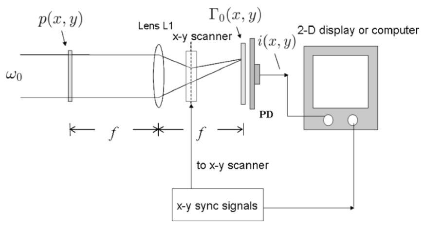
  <figcaption>图 3.1 主动光学扫描图像处理系统：平面波（频率 \(\omega_0\)）照明光瞳 \(p(x,y)\)，经透镜 L1、x-y 扫描器扫过透明片 \(\Gamma_0(x,y)\)，PD 收全光输出 \(i(x,y)\)，与 x-y 同步信号一起存入计算机/显示器（截自原书）</figcaption>
</figure>

图 3.1 的信息流：平面波照明光瞳 \(p(x,y)\) → 复场穿过 x-y 光学扫描器 → 扫过振幅透过率为 \(\Gamma_0(x,y)\) 的物体 → PD 输出电流。若电流与扫描机构的 2-D 驱动信号**同步数字化存储**，存下来的 2-D 记录就是物体的一幅（被处理过的）图像。

### 3.1.1 光电探测：直接探测

PD 只响应**强度**。设探测器表面在 \(x\)-\(y\) 平面，入射复场 \(\psi(x,y)\exp(j\omega_0t)\)，则输出电流是强度在活性区 \(D\) 上的空间积分：

\[
i(t)=\iint_D\big|\psi(x,y)\exp(j\omega_0t)\big|^2\,dx\,dy
=\iint_D|\psi(x,y)|^2\,dx\,dy.
\tag{3.1-1}
\]

人话版：PD 是个"平方律 + 面积积分"器件，时间项 \(e^{j\omega_0t}\) 在取模时被扔掉。两个极端例子：

- 入射是幅度 \(E\) 的平面波：\(i=E^2D\)（\(D\) 为活性区面积）——一个常数（式 3.1-2）。
- 光被强度调制（\(|\psi|^2=m(t)|\psi|^2\)，\(m(t)\) 为调制信号）：电流随调制变化——激光通信的原理 [Pratt (1969)]。

关键缺陷：\(i\propto|\psi|^2=\big||\psi|e^{j\phi}\big|^2\) 只含**幅度**，相位 \(\phi\) 全丢——这叫**光学直接探测**（optical direct detection，或 optical incoherent detection）。全息要相位，直接探测没戏。

<figure>
  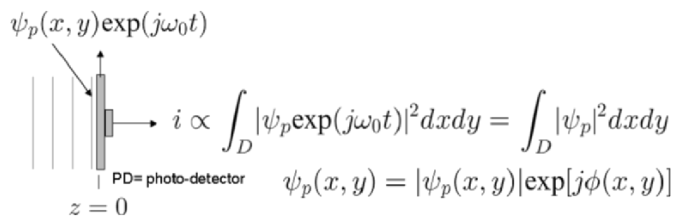
  <figcaption>图 3.2 光学直接探测：\(i\propto\int_D|\psi_p\exp(j\omega_0t)|^2dxdy=\int_D|\psi_p|^2dxdy\)，相位 \(\phi(x,y)\) 全部丢失（截自原书）</figcaption>
</figure>

### 3.1.2 扫描的数学建模

扫描 = 相对平移。把"透明片动、光束不动"当作标准建模（图 3.3）：扫描光束的复场 \(b(x',y')\) 静止在 \(x'\)-\(y'\) 平面原点，透明片 \(\Gamma_0\) 平移 \((x,y)=(x(t),y(t))\)。"扫描/采样"指透明片上的逐点 \((x,y)\) 依次与光束中心 \((x'=0,y'=0)\) 重合。

<figure>
  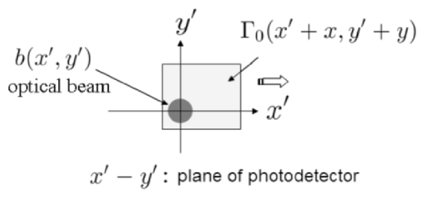
  <figcaption>图 3.3 扫描情形：光束 \(b(x',y')\) 静止在 PD 平面原点，透明片 \(\Gamma_0(x'+x,y'+y)\) 平移（截自原书）</figcaption>
</figure>

到达 PD 的总复场是 \(b(x',y')\,\Gamma_0(x'+x,y'+y)\)，按 (3.1-1) 积分得扫描电流：

\[
i(x,y)=\iint_D\big|b(x',y')\,\Gamma_0(x'+x,\,y'+y)\big|^2\,dx'dy',
\tag{3.1-3}
\]

其中 \((x(t),y(t))\) 是透明片的瞬时位置。另一种等价建模是"光束动、透明片不动"：\(i(x,y)=\iint_D|b(x'-x,y'-y)|^2|\Gamma_0(x',y')|^2dx'dy'\)。做变量替换后可整理成

\[
i(x,y)=\iint_D|\Gamma_0(x',y')|^2\,|b(x'+x,y'+y)|^2\,dx'dy',
\tag{3.1-4}
\]

即物体强度与光束强度的**相关**（利用第 1 章的相关运算写法：\(i=|\Gamma_0(x,y)|^2\otimes|b(x,y)|^2\)，自变量互换后与 (3.1-3) 等价）。

!!! note "拓展：(3.1-4) 的深层含义——扫描系统天生是非相干处理器"
    (3.1-4) 只含 \(|\Gamma_0|^2\) 与 \(|b|^2\)——**就算物体本来是复振幅透明片（有相位），能被处理的也只有它的强度**。所以普通主动扫描系统 = 非相干光学系统（对照第 2 章 2.4.3：非相干成像天生低通、OTF 中心最大）。要让"复数处理"成为可能，必须往里注入相位参考——这正是下一节外差的使命，也是"复非相干图像处理"（complex incoherent image processing）概念的起点。

光束场与光瞳的关系（图 3.1 中光瞳在 L1 前焦面、扫描器在后焦面）：由第 2 章式 (2.4-6)（物在前焦面、后焦面得严格傅里叶变换）：

\[
b(x,y)=\mathcal{F}_{xy}\{p(x,y)\}\Big|_{\substack{k_x=k_0x/f_0\\ k_y=k_0y/f_0}}.
\tag{3.1-5}
\]

人话版：**后焦面（扫描镜）上的光束形状 = 光瞳函数的傅里叶变换**。光瞳全开 \(p=1\) → \(b=\delta\)（点源）；光瞳是点 \(p=\delta\) → \(b=\) 常数（平面波）。这个"对偶"在 3.5 节装配扫描全息时是核心机关，先记住。

均匀扫描速度 \(v\) 时 \(x(t)=vt,\ y(t)=vt\)。市售 x-y 扫描器（图 3.4）用检流计（galvanometer）驱动两片正交振镜，分别负责 x 与 y 方向。

<figure>
  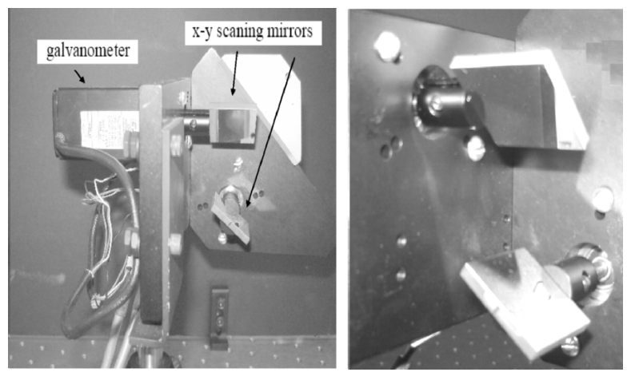
  <figcaption>图 3.4 General Scanning 公司的 x-y 光学扫描系统：左为检流计与 x-y 扫描振镜，右为振镜特写（截自原书）</figcaption>
</figure>

## 3.2 光学外差

3.1 节的结论：直接探测丢相位。全息需要相位——解药是**光学外差探测**（optical heterodyne detection，或 optical coherent detection）：给探测器再送一束**不同频率**的参考光，让"相位"变成"拍频电流的相位"被电路读出。

<figure>
  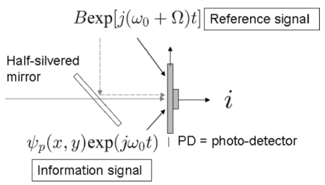
  <figcaption>图 3.5 光学外差探测：半反镜合束信息光 \(\psi_p(x,y)\exp(j\omega_0t)\) 与参考光 \(B\exp[j(\omega_0+\Omega)t]\)，PD 输出电流 \(i\)（截自原书）</figcaption>
</figure>

两束光频率分别为 \(\omega_0\)（信息光）与 \(\omega_0+\Omega\)（参考光）——不同频率的激光怎么来，3.3 节讲声光频移。设信息光是平面波 \(\psi_p=Ae^{j\phi}\exp(j\omega_0t)\)（幅度 \(A\)、相位 \(\phi\)），参考光 \(B\exp[j(\omega_0+\Omega)t]\)（设 \(B\) 为实）。PD 电流：

\[
i=\iint_D\big|\psi_p\exp(j\omega_0t)+B\exp[j(\omega_0+\Omega)t]\big|^2dxdy
=D\big[A^2+B^2+2AB\cos(\Omega t-\phi)\big],
\tag{3.2-1}
\]

（\(\psi_p\) 在探测器面上为常数时积分给出面积 \(D\)。）

人话版：两项之和的模平方展开出三个成分——

- \(D(A^2+B^2)\)：**直流电流**（DC current，或**基带电流** baseband current）；
- \(2DAB\cos(\Omega t-\phi)\)：**交流电流**（AC current，或**外差电流** heterodyne current），来自两束不同频率光的**混频**（mixing，或 heterodyning）[Poon (2002b), Poon and Kim (2006)]。

看最后一项：**幅度 \(A\) 和相位 \(\phi\) 都在**——外差电流的振幅 ∝ \(A\)、相位是 \(\Omega t-\phi\) 的截距。这就是"外差保幅相"的全部秘密，对照 (3.1-1) 的直接探测（只剩 \(|\psi|^2\)）是质的飞跃。

### 3.2.1 电子多路检测：把幅度相位抠出来

电流有了，还得用电路把 \(A\)、\(\phi\) 读出来。图 3.6 的**电子多路检测**（electronic multiplexing detection）三步走：

<figure>
  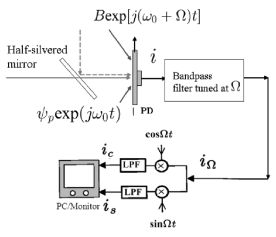
  <figcaption>图 3.6 电子多路检测：BPF 调谐在 \(\Omega\) 提取外差电流 \(i_\Omega\)，分两路各乘 \(\cos\Omega t\) / \(\sin\Omega t\) 再低通，得 \(i_c\)、\(i_s\)（截自原书）</figcaption>
</figure>

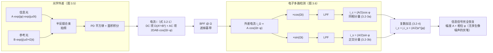

上通道数学（用积化和差 \(\cos\alpha\cos\beta=\frac12\cos(\alpha-\beta)+\frac12\cos(\alpha+\beta)\)）：

\[
i_\Omega\times\cos(\Omega t)=A\cos(\Omega t-\phi)\cos(\Omega t)
=\tfrac12A\cos(-\phi)+\tfrac12A\cos(2\Omega t-\phi),
\tag{3.2-2}
\]

低通滤掉 \(2\Omega\) 得**同相分量**（in-phase component）：

\[
i_c=A\cos\phi.
\tag{3.2-3a}
\]

下通道（恒等式 \(\cos\alpha\sin\beta=\frac12\sin(\alpha+\beta)-\frac12\sin(\alpha-\beta)\)）得**正交分量**（quadrature component）：

\[
i_s=A\sin\phi.
\tag{3.2-3b}
\]

复数加法把它们合成一个复数：

\[
i_c+j\,i_s=A\cos\phi+jA\sin\phi=A\exp(j\phi).
\tag{3.2-4}
\]

**信息信号 \(\psi_p=Ae^{j\phi}\) 从光电流中被完整恢复**（差个常数因子）。每个通道做的事就是**锁相检测**（lock-in detection）：乘本振 \(\cos/\sin(\Omega t)\) 再低通取相位。书里在此埋下伏笔：利用外差 + 电子多路检测，可以在**没有孪生像噪声**的情况下获得全息信息——3.5 节兑现。

本节的时域仿真（BPF + lock-in 全链路）已实跑验证：取 \(A=0.7,\ \phi=1.3\)，恢复值误差 \(10^{-16}\)（幅度）/\(10^{-15}\)（相位）——外差链路无损。代码与运行图见下。

=== "MATLAB"

    ```matlab
    % ===== 书 3.2 节 · 光学外差 + 电子多路检测（式 3.2-1 ~ 3.2-4） =====
    % 时域仿真：信息光 psi_p = A exp(j*phi) exp(j*w0 t) 与参考光 B exp[j(w0+Omega)t]
    % 在光电探测器上拍频，电流 (3.2-1)：
    %     i(t) = D [ A^2 + B^2 + 2AB cos(Omega t - phi) ]
    % 电子学链路（图 3.6）：BPF@Omega 提取外差电流 -> 乘 cos(Omega t)+LPF 得同相分量 i_c (3.2-3a)
    % -> 乘 sin(Omega t)+LPF 得正交分量 i_s (3.2-3b) -> 复数加法 i_c + j*i_s = A exp(j*phi) (3.2-4)
    %
    % 差异提示：
    % 1) 理想带通/低通用 FFT 选带与时间平均实现；实际系统用模拟滤波器。
    % 2) 本例无傅里叶约定问题（只做频域选带）；涉及书式变换的脚本见同目录其他文件。

    clear
    A = 0.7; phi = 1.3; B = 1.0;     % 信息光幅度/相位（真值）、参考光幅度（实数）
    Omega = 2*pi*1.0e6;              % 外差（拍频）频率 1 MHz
    fs = 64e6;                       % 采样率
    T = 8e-6;                        % 总时长 8 us（8 个拍频周期）
    t = 0:1/fs:T-1/fs;

    % ---- 光电探测电流（式 3.2-1，取探测器面积 D=1） ----
    i_t = A^2 + B^2 + 2*A*B*cos(Omega*t - phi);     % DC(基带) + AC(外差)

    % ---- BPF @ Omega：提取外差电流 i_Omega ∝ 2AB cos(Omega t - phi) ----
    I_f = fft(i_t);
    f_axis = (0:length(t)-1)*fs/length(t);
    band = f_axis > 0.5e6 & f_axis < 1.5e6;         % 理想带通（保留 Omega，滤掉直流基带）
    iOmega = real(ifft(I_f.*band));

    % ---- lock-in 解调（式 3.2-2 / 3.2-3）：乘 cos/sin 后低通（时间平均） ----
    seg = round(0.5*length(t)):length(t);           % 丢弃滤波器建立段
    ic = 2*mean(iOmega(seg).*cos(Omega*t(seg)));    % i_c = A cos(phi)   (3.2-3a)
    is_ = 2*mean(iOmega(seg).*sin(Omega*t(seg)));   % i_s = A sin(phi)   (3.2-3b)
    A_rec = hypot(ic, is_)/2;                       % 幅度（含常数因子 2，归一化后）
    phi_rec = atan2(is_, ic);                       % 相位
    fprintf('恢复幅度 A = %.6f（真值 %.2f），误差 %.1e\n', A_rec, A, abs(A_rec-A));
    fprintf('恢复相位 phi = %.6f rad（真值 %.2f），误差 %.1e\n', phi_rec, phi, abs(phi_rec-phi));
    fprintf('式(3.2-4)：i_c + j*i_s ∝ A exp(j*phi) —— 幅度与相位完整恢复\n');

    % ---- 可视化（对应笔记图 sim-heterodyne.png） ----
    figure(1)
    subplot(2,2,1); plot(t*1e6, i_t, 'LineWidth', 0.8); grid on
    title('i(t) = D[A^2+B^2+2AB cos(Omega t - phi)]  (Eq. 3.2-1)'); xlabel('t (us)')
    subplot(2,2,2); plot(f_axis/1e6, abs(I_f), 'LineWidth', 0.8); xlim([0 4]); grid on
    title('spectrum: DC(baseband) + heterodyne line at \Omega'); xlabel('f (MHz)')
    subplot(2,2,3); plot(t*1e6, iOmega, 'LineWidth', 0.8); grid on
    title('after BPF @ \Omega:  i_\Omega = 2AB cos(\Omega t - \phi)'); xlabel('t (us)')
    subplot(2,2,4); plot(t*1e6, iOmega.*cos(Omega*t), 'LineWidth', 0.6); hold on
    plot(t*1e6, iOmega.*sin(Omega*t), 'LineWidth', 0.6)
    yline(ic/2, 'r--'); yline(-is_/2, 'b:'); grid on
    title('lock-in detection (Eq. 3.2-2 / 3.2-3)'); xlabel('t (us)')
    legend('i_\Omega \times cos\Omegat', 'i_\Omega \times sin\Omegat', ...
           sprintf('LPF -> i_c/2 = %.3f', ic/2), sprintf('LPF -> -i_s/2 = %.3f', -is_/2), ...
           'Location', 'best')
    ```

=== "Python"

    ```python
    # ===== 书 3.2 节 · 光学外差 + 电子多路检测（式 3.2-1 ~ 3.2-4） =====
    # 时域仿真：信息光 psi_p = A exp(j*phi) exp(j*w0 t) 与参考光 B exp[j(w0+Omega)t]
    # 在光电探测器上拍频，电流 (3.2-1)：
    #     i(t) = D [ A^2 + B^2 + 2AB cos(Omega t - phi) ]
    # 电子学链路（图 3.6）：BPF@Omega 提取外差电流 -> 上通道乘 cos(Omega t) + LPF 得同相分量 i_c (3.2-3a)
    # -> 下通道乘 sin(Omega t) + LPF 得正交分量 i_s (3.2-3b) -> 复数加法 i_c + j*i_s = A exp(j*phi) (3.2-4)
    #
    # 验证结论（本笔记实跑）：A_rec = 0.700000（误差 2e-16）、phi_rec = 1.300000 rad（误差 2e-15）。
    # 即外差电流完整保留信息光的幅度与相位；lock-in 解调可无损恢复。
    #
    # MATLAB / Python 差异提示：
    # 1) MATLAB 的 FFT 前向核是 e^{-j...}，numpy 同为 e^{-j...}，此处只做频域选带，无约定问题。
    # 2) 理想带通/低通直接用 FFT 选带与时间平均实现；实际系统用模拟滤波器，会引入纹波与延迟。

    import numpy as np
    import matplotlib.pyplot as plt

    # ----- 1. 参数 -----
    A, phi, B = 0.7, 1.3, 1.0        # 信息光幅度/相位（真值）、参考光幅度（实数）
    Omega = 2*np.pi*1.0e6            # 外差（拍频）频率 1 MHz
    fs = 64e6                        # 采样率
    T = 8e-6                         # 总时长 8 us（8 个拍频周期）
    t = np.arange(0, T, 1/fs)

    # ----- 2. 光电探测电流（式 3.2-1，取探测器面积 D=1） -----
    i_t = A**2 + B**2 + 2*A*B*np.cos(Omega*t - phi)      # DC(基带) + AC(外差)

    # ----- 3. BPF @ Omega：提取外差电流 i_Omega ∝ 2AB cos(Omega t - phi) -----
    I_f = np.fft.rfft(i_t)
    f_axis = np.fft.rfftfreq(len(t), 1/fs)
    band = (f_axis > 0.5e6) & (f_axis < 1.5e6)           # 理想带通（保留 Omega，滤掉直流基带）
    iOmega = np.fft.irfft(np.where(band, I_f, 0), len(t))

    # ----- 4. lock-in 解调（式 3.2-2 / 3.2-3）：乘 cos/sin 后低通（时间平均） -----
    seg = slice(int(0.5*len(t)), None)                   # 丢弃滤波器建立段
    ic = 2*np.mean(iOmega[seg]*np.cos(Omega*t[seg]))     # i_c = A cos(phi)   (3.2-3a)
    is_ = 2*np.mean(iOmega[seg]*np.sin(Omega*t[seg]))    # i_s = A sin(phi)   (3.2-3b)
    A_rec = np.hypot(ic, is_)/2                          # 幅度（含常数因子 2，归一化后）
    phi_rec = np.arctan2(is_, ic)                        # 相位
    print(f'恢复幅度 A = {A_rec:.6f}（真值 {A}），误差 {abs(A_rec-A):.1e}')
    print(f'恢复相位 phi = {phi_rec:.6f} rad（真值 {phi}），误差 {abs(phi_rec-phi):.1e}')
    print('式(3.2-4)：i_c + j*i_s ∝ A exp(j*phi) —— 幅度与相位完整恢复')

    # ----- 5. 可视化（对应笔记图 sim-heterodyne.png） -----
    fig, ax = plt.subplots(2, 2, figsize=(12, 7))
    ax[0,0].plot(t*1e6, i_t, lw=0.8)
    ax[0,0].set_title('i(t) = D[A$^2$+B$^2$+2AB cos($\\Omega$t-$\\phi$)]   (Eq. 3.2-1)')
    ax[0,0].set_xlabel('t (us)'); ax[0,0].set_ylabel('i(t)')
    ax[0,1].plot(f_axis/1e6, np.abs(I_f), lw=0.8); ax[0,1].set_xlim(0, 4)
    ax[0,1].set_title('spectrum: DC(baseband) + heterodyne line at $\\Omega$')
    ax[0,1].set_xlabel('f (MHz)')
    ax[1,0].plot(t*1e6, iOmega, lw=0.8)
    ax[1,0].set_title('after BPF @ $\\Omega$:  i$_\\Omega$ = 2AB cos($\\Omega$t-$\\phi$)')
    ax[1,0].set_xlabel('t (us)')
    ax[1,1].plot(t*1e6, iOmega*np.cos(Omega*t), lw=0.6, label='i$_\\Omega\\times$cos$\\Omega$t')
    ax[1,1].plot(t*1e6, iOmega*np.sin(Omega*t), lw=0.6, alpha=0.6, label='i$_\\Omega\\times$syn$\\Omega$t')
    ax[1,1].axhline(ic/2, color='r', ls='--', label=f'LPF -> i_c/2 = {ic/2:.3f}')
    ax[1,1].axhline(-is_/2, color='b', ls=':', label=f'LPF -> -i_s/2 = {-is_/2:.3f}')
    ax[1,1].set_title('lock-in detection (Eq. 3.2-2 / 3.2-3)')
    ax[1,1].set_xlabel('t (us)'); ax[1,1].legend(fontsize=8)
    plt.tight_layout(); plt.show()
    ```

<figure>
  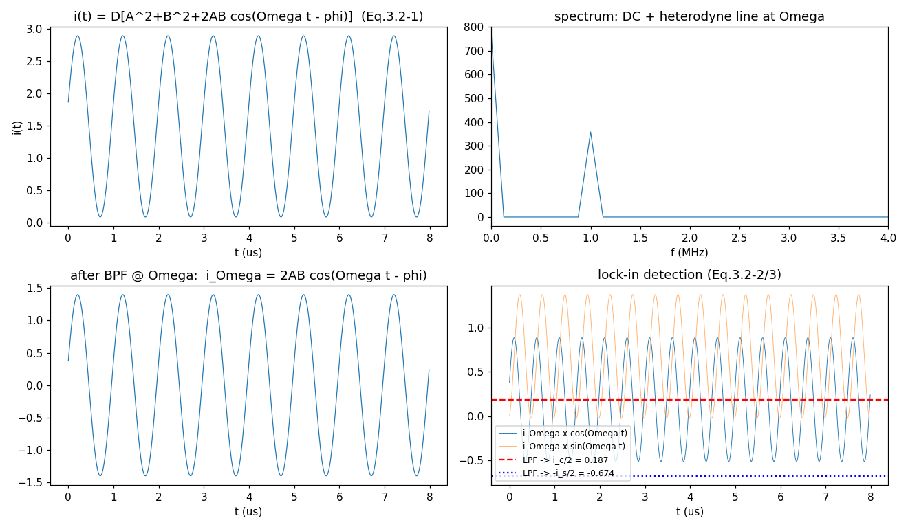
  <figcaption>图（本笔记运行结果）：左上 拍频电流（DC + 外差项）；右上 频谱（直流 + Ω 处外差谱线）；左下 BPF 后的纯外差电流；右下 lock-in 解调——乘 cos/sin 后的低通输出分别给出 \(i_c/2\)、\(-i_s/2\)（水平虚线），恢复 \(A=0.700000\)（误差 \(2\times10^{-16}\)）、\(\phi=1.300000\) rad（误差 \(2\times10^{-15}\)）</figcaption>
</figure>

## 3.3 声光频移

外差需要两束**不同频率**的激光。标准器件是**声光频移器**（acousto-optic frequency shifter, AOFS）或**声光调制器**（acousto-optic modulator, AOM）[Korpel (1981)]。

<figure>
  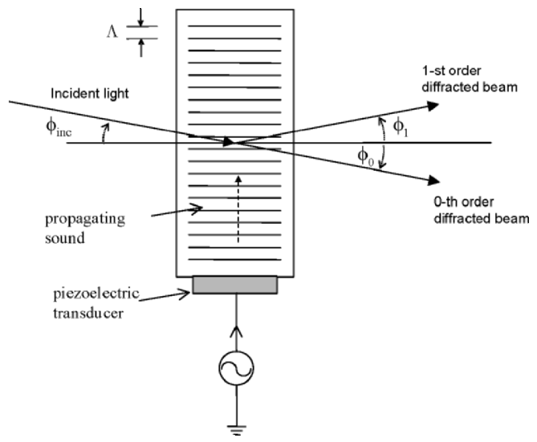
  <figcaption>图 3.7 声光调制器：压电换能器把电信号变成声波在玻璃中传播（折射率扰动，类比光栅周期 \(\Lambda\) 的相位光栅），入射光 \(\phi_{inc}\) 被分成 0 阶与 1 阶衍射光（截自原书）</figcaption>
</figure>

AOM 是一种空间光调制器：声学介质（如玻璃）上贴压电换能器，加电信号就在介质里激起声波，折射率扰动正比于电激励，穿过介质的光束被"声光栅"衍射——可以类比成一块**相位光栅**，光栅线间距 = 声波长 \(\Lambda\)。在特定入射角 \(\phi_{inc}\) 下，声光栅把光分成 **0 阶**与 **1 阶**两束衍射光。

### 3.3.1 光子-声子碰撞：动量与能量守恒

最简洁的图像：声光互作用 = **光子**（photon）与**声子**（phonon）的粒子碰撞。要有确定的动量/能量，须假设平面波相互作用（换能器足够宽、单频）。两个守恒律：

**动量守恒**：

\[
\hbar\boldsymbol{k}_{t1}=\hbar\boldsymbol{k}_{t0}+\hbar\boldsymbol{K}_1,
\tag{3.3-1}
\]

\(\boldsymbol{k}_{t0}\)、\(\boldsymbol{K}_1\)、\(\boldsymbol{k}_{t1}\) 分别为入射光子、声子、散射光子的波矢（\(\hbar=h/2\pi\)，\(h\) 是普朗克常数）。

**能量守恒**：

\[
\hbar\omega_{t1}=\hbar\omega_{t0}+\hbar\Omega_1.
\tag{3.3-2}
\]

除以 \(\hbar\) 得工作方程：

\[
\boldsymbol{k}_{t1}=\boldsymbol{k}_{t0}+\boldsymbol{K}_1,
\tag{3.3-3}
\]

\[
\omega_{t1}=\omega_{t0}+\Omega_1.
\tag{3.3-4}
\]

人话版：(3.3-3) 是**波矢三角形**（三个矢量首尾相接，图 3.8a）——几何上封闭意味着入射角不是随便取的，存在临界角；(3.3-4) 说散射光频率**上移**了一个声频 \(\Omega_1\)——因为声波是行波，衍射光获得多普勒频移。

<figure>
  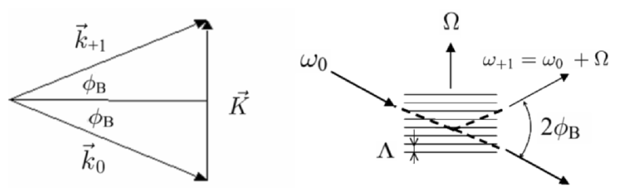
  <figcaption>图 3.8 声光互作用：a) 波矢图——\(\boldsymbol{k}_{t1}=\boldsymbol{k}_{t0}+\boldsymbol{K}\) 构成近等腰三角形，两底角均为布拉格角 \(\phi_B\)；b) 实验配置——\(\omega_0\) 入射，1 阶衍射光 \(\omega_{+1}=\omega_0+\Omega\)，两衍射光夹角 \(2\phi_B\)（截自原书）</figcaption>
</figure>

实际情形 \(|K|\ll|k_{t0}|\)（声波长 ≫ 光波长），波矢三角形近似等腰，其底角即**布拉格角**（Bragg angle）：

\[
\sin(\phi_B)=\frac{K}{2k_0}=\frac{\lambda_0}{2\Lambda},
\tag{3.3-5}
\]

其中 \(k_0=|\boldsymbol{k}_0|=2\pi/\lambda_0\) 是**声学介质内**的光波数（\(\lambda_0\) 为介质内光波长），\(K=|\boldsymbol{K}|=2\pi/\Lambda\) 是声波数。两束衍射光方向差 \(2\phi_B\)；图 3.7 中的 \(\phi_1\)、\(\phi_0\) 都等于 \(\phi_B\)。

!!! note "拓展：AOM-40 的数值账"
    实验室声波频率覆盖 100 kHz~3 GHz。以 IntraAction 公司 Model AOM-40 为例（图 3.9）：重火石玻璃介质（折射率 \(n_0\approx1.65\)）、声中心频率 \(f_s=40\) MHz、声速 \(V_s\approx4000\) m/s → 声波长 \(\Lambda=V_s/f_s\approx0.1\) mm。He-Ne 激光（空气波长 0.6328 µm）进玻璃后 \(\lambda_0\approx0.6328/1.65\approx0.3743\) µm。代入 (3.3-5)：\(\sin\phi_B=0.3743\mu\text{m}/(2\times0.1\text{mm})\approx1.9\times10^{-3}\)，即 \(\phi_B\approx1.9\times10^{-3}\) rad ≈ **0.1 度**——小角度衍射，两衍射光斑几乎贴着走（图 3.9 远处背景里的两个光点）。入射光沿换能器长边方向穿过透明玻璃（肉眼看不见）。

<figure>
  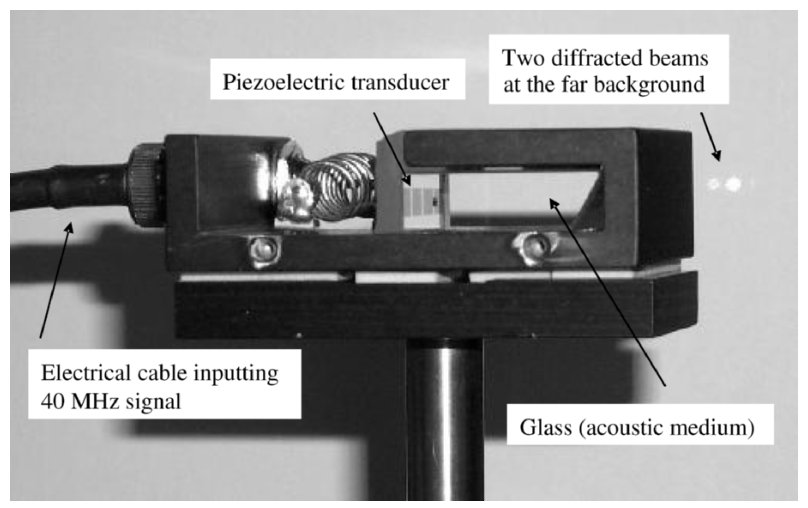
  <figcaption>图 3.9 工作在 40 MHz 的典型声光调制器（IntraAction AOM-40）：左 输入 40 MHz 电信号的电缆，中 压电换能器与玻璃声学介质，右 远背景处的两个衍射光斑（截自原书）</figcaption>
</figure>

(3.3-4) 描述的互作用叫**上移互作用**（upshifted interaction）：1 阶衍射光频率 \(\omega_{+1}=\omega_0+\Omega\)（图 3.8b），这正是外差需要的"参考臂频移"。行波声场反向传播（或改取另一侧衍射级）同样存在频率下移的互作用；本笔记及后续章节统一使用上移束。

## 3.4 双瞳光学外差扫描图像处理器

积木齐了：光学扫描（3.1）、外差保相位（3.2）、声光频移（3.3）。现在组装 **双瞳光学外差扫描图像处理器**（two-pupil optical heterodyne scanning image processor）——OSH 的直接前身 [Poon (1985)]。

动机：第 2 章 2.4 节讲过，单光瞳系统的空间滤波由一个光瞳函数决定（OTF 是它的自相关，天生低通）。**双瞳系统**（two-pupil systems）[Lohmann and Rhodes (1978), Poon and Korpel (1979)] 用两个光瞳把处理自由度翻倍——OTF 可以是双极性甚至复数的（呼应 2.4.3 末尾"双光瞳合成"伏笔）。双瞳非相干处理的综述见 [Indebetouw and Poon (1992)]。

<figure>
  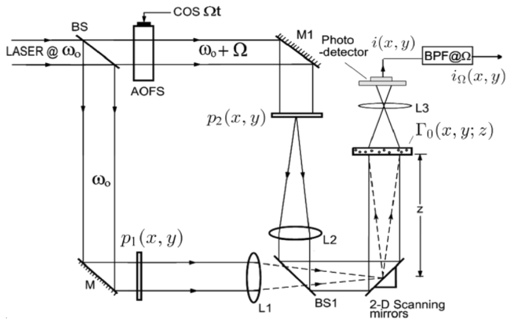
  <figcaption>图 3.10 典型双瞳光学外差扫描系统：激光 @ω0 经 BS 分束，一臂过 AOFS 得 ω0+Ω（cos Ωt 驱动），另一臂 ω0；\(p_1(x,y)\)（ω0）与 \(p_2(x,y)\)（ω0+Ω）分别在 L1、L2 前焦面，BS1 合束聚焦到 2-D 扫描振镜；L3 收全光到 PD，BPF@Ω 输出 \(i_\Omega(x,y)\)（截自原书）</figcaption>
</figure>

系统解剖（图 3.10）：

- 分束镜 BS、BS1 与反射镜 M、M1 构成 **Mach-Zehnder 干涉仪**；
- 光瞳 \(p_1(x,y)\) 被 \(\omega_0\) 激光（准直）照明，\(p_2(x,y)\) 被 \(\omega_0+\Omega\) 激光照明——频移由 AOFS 引入（图中示意，选 1 阶衍射光的细节省略）；
- 两光瞳在 L1、L2 的**前焦面**（焦距均为 \(f\)），BS1 把两束光合束聚焦到 **2-D x-y 扫描振镜**（L1、L2 的后焦面）；
- 组合光束对距离扫描镜 \(z\) 处、振幅分布 \(\Gamma_0(x,y;z)\) 的物体做 2-D 光栅扫描；
- 透镜 L3 把全部透射光（漫反射物体则为散射光）收集到 PD，输出电流 \(i(x,y)\)；
- BPF 调谐在外差频率 \(\Omega\)，输出扫描处理后的电流 \(i_\Omega(x,y)\)。

### 3.4.1 扫描场与外差电流

组合光束（扫描复场）在离扫描镜 \(z\) 处：

\[
S(x,y;z)=P_{1z}\Big(\frac{k_0x}{f},\frac{k_0y}{f}\Big)\exp(j\omega_0t)
+P_{2z}\Big(\frac{k_0x}{f},\frac{k_0y}{f}\Big)\exp[j(\omega_0+\Omega)t],
\tag{3.4-1}
\]

其中 \(P_{iz}\) 是光瞳场传播 \(z\) 后的结果（菲涅耳衍射）：

\[
P_{iz}\Big(\frac{k_0x}{f},\frac{k_0y}{f}\Big)=P_i\Big(\frac{k_0x}{f},\frac{k_0y}{f}\Big)*h(x,y;z),\qquad i=1,2,
\tag{3.4-2}
\]

\[
P_i\Big(\frac{k_0x}{f},\frac{k_0y}{f}\Big)=\mathcal{F}\{p_i(x,y)\}\Big|_{\substack{k_x=k_0x/f\\ k_y=k_0y/f}},
\tag{3.4-3}
\]

即 (3.1-5) 的双瞳版：扫描镜上的场 = 光瞳的 FT（除不重要的常数与常数相位）。记号约定：**小写 \(p_i\) 是光瞳平面函数，大写 \(P_i\) 是（扫描镜面上的）频谱面场，\(P_{iz}\) 是再传播 \(z\) 后的场**。

按扫描原理 (3.1-3)（PD 响应透射/散射强度），扫描电流：

\[
i(x,y;z)\propto\int_D\Big|\Big[P_{1z}\Big(\frac{k_0x'}{f},\frac{k_0y'}{f}\Big)\exp(j\omega_0t)+P_{2z}\Big(\frac{k_0x'}{f},\frac{k_0y'}{f}\Big)\exp[j(\omega_0{+}\Omega)t]\Big]\,\Gamma_0(x+x',y+y';z)\Big|^2dx'dy'.
\tag{3.4-4}
\]

对 (3.4-4) 做"模平方展开"，只有交叉项携带拍频 \(\Omega\)。BPF@Ω 后得外差电流：

\[
i_\Omega(x,y;z)=\mathrm{Re}\Big[\int_D P_{1z}^*\Big(\frac{k_0x'}{f},\frac{k_0y'}{f}\Big)P_{2z}\Big(\frac{k_0x'}{f},\frac{k_0y'}{f}\Big)|\Gamma_0(x+x',y+y';z)|^2dx'dy'\,\exp(j\Omega t)\Big],
\tag{3.4-5}
\]

这里采用相量约定 \(\psi(x,y,t)=\mathrm{Re}[\psi_p(x,y,t)\exp(j\Omega t)]\)（\(\mathrm{Re}[\cdot]\) 取实部）。(3.4-5) 可写成"相量 + 载波"的形式：

\[
i_\Omega(x,y;z)=\mathrm{Re}\big[i_{\Omega_p}(x,y;z)\exp(j\Omega t)\big],
\tag{3.4-6a}
\]

\[
i_{\Omega_p}(x,y;z)=\iint_D P_{1z}^*\Big(\frac{k_0x'}{f},\frac{k_0y'}{f}\Big)P_{2z}\Big(\frac{k_0x'}{f},\frac{k_0y'}{f}\Big)|\Gamma_0(x+x',y+y';z)|^2dx'dy',
\tag{3.4-6b}
\]

\(i_{\Omega_p}\) 是**包含外差电流幅度与相位的输出相量**。它也可以写成相关形式（\(\otimes\) 为第 1 章定义的相关运算）：

\[
i_{\Omega_p}(x,y;z)=P_{1z}\Big(\frac{k_0x}{f},\frac{k_0y}{f}\Big)P_{2z}^*\Big(\frac{k_0x}{f},\frac{k_0y}{f}\Big)\otimes|\Gamma_0(x,y;z)|^2.
\tag{3.4-7}
\]

人话版：外差电流相量 = 【两路光束场的乘积（一个取共轭）】与【物体强度】的**相关**。物体还是只以强度 \(|\Gamma_0|^2\) 参与处理——系统依旧是非相干的；但处理元 \(P_{1z}P_{2z}^*\) 本身**可以是双极性甚至复数**（对照 2.4.3：单光瞳的 OTF 只能是自相关、中心最大）——这就是**复非相干图像处理**（complex incoherent image processing）的概念。

### 3.4.2 系统的 OTF

把 (3.4-7) 当作"输入-输出关系"，仿照 2.4.3 定义系统的光学传递函数：

\[
OTF_\Omega(k_x,k_y;z)=\frac{\mathcal{F}\{i_{\Omega_p}(x,y;z)\}}{\mathcal{F}\{|\Gamma_0(x,y;z)|^2\}}.
\tag{3.4-8}
\]

对 (3.4-7) 两边做傅里叶变换（相关定理），与 (3.4-8) 结合，得等价形式：

\[
OTF_\Omega(k_x,k_y;z)=\mathcal{F}^*\Big\{P_{1z}\Big(\frac{k_0x}{f},\frac{k_0y}{f}\Big)P_{2z}^*\Big(\frac{k_0x}{f},\frac{k_0y}{f}\Big)\Big\},
\tag{3.4-9}
\]

其中 \(\mathcal{F}^*\{\cdot\}\) 表示**共轭傅里叶变换**（先变换再取共轭）。把 (3.4-2)、(3.4-3) 代入展开成光瞳函数的显式积分——这是 Poon [1985] 首次推导的核心结果：

\[
OTF_\Omega(k_x,k_y;z)=\exp\Big[j\frac{z}{2k_0}(k_x^2+k_y^2)\Big]\times\iint p_1^*(x',y')\,p_2\Big(x'+\frac{f}{k_0}k_x,\ y'+\frac{f}{k_0}k_y\Big)\exp\Big[j\frac{z}{f}(x'k_x+y'k_y)\Big]dx'dy'.
\tag{3.4-10}
\]

!!! note "拓展：读 (3.4-10) 的三个要点"
    1. **结构**：第一项 \(e^{+j\frac{z}{2k_0}(k_x^2+k_y^2)}\) 是菲涅耳型相位（对照 (2.3-13) 的 \(H\) 的共轭）；积分是"光瞳乘积 × 线性相位"——\(p_2\) 被平移 \((f/k_0)k_x\)，再与 \(p_1^*\) 相乘、带线性啁啾 \(e^{+j(z/f)x'k_x}\) 积分。**改两个光瞳的形状/间距，OTF 就被改写**——这就是"双瞳合成 OTF"的自由度。
    2. **记号提醒**：从 (3.4-6b) 严格展开 (3.4-10) 时，被积函数里出现的是经 (3.4-3) 缩放后的**频谱面场** \(P_i\)（即 \(p_i\) 的傅里叶变换）；书在 (3.4-9)/(3.4-10) 之间的小写/大写记号有跳跃。本笔记沿书原文照录 \(p_1,p_2\)；主线特例 \(p_1=1,\ p_2=\delta\) 下两种理解给出**相同**结果（下面的 3.5-1a 验证即可确认），不影响本章任何结论。
    3. **检验**：把 \(p_1=1,\ p_2=\delta\) 代入——\(\delta\) 采样出平移项，积分给 \(e^{-j(z/k_0)(k_x^2+k_y^2)}\)，乘第一项得 \(e^{-j(z/2k_0)(k_x^2+k_y^2)}\)——正是 3.5 节的 \(OTF_{osh}\)（式 3.5-1a），本笔记已数值验证（精确到 \(10^{-12}\)，见 3.5.4）。

由 (3.4-8) 反解输出电流（用 OTF 表示）：

\[
i_\Omega(x,y;z)=\mathrm{Re}\big[\mathcal{F}^{-1}\{\mathcal{F}\{|\Gamma_0(x,y;z)|^2\}\,OTF_\Omega(k_x,k_y;z)\}\exp(j\Omega t)\big],
\tag{3.4-11}
\]

定义光学外差扫描系统的**空间冲激响应**（点扩散函数）：

\[
h_\Omega(x,y;z)=\mathcal{F}^{-1}\{OTF_\Omega\},
\tag{3.4-12}
\]

则 (3.4-11) 有空域卷积形式：

\[
i_\Omega(x,y;z)=\mathrm{Re}\big\{\big[|\Gamma_0(x,y;z)|^2*h_\Omega(x,y;z)\big]\exp(j\Omega t)\big\}.
\tag{3.4-13}
\]

(3.4-11) 或 (3.4-13) 就是"被 \(\Omega\) 时间载波调制"的扫描输出。用 \(\cos(\Omega t)\) 或 \(\sin(\Omega t)\) 混频解调（图 3.6 的双通道），分别取**同相**/**正交**分量：

\[
i_c(x,y;z)=\mathrm{Re}\big[\mathcal{F}^{-1}\{\mathcal{F}\{|\Gamma_0|^2\}OTF_\Omega\}\big]\ \text{（频域）}
=\mathrm{Re}\big[|\Gamma_0|^2*h_\Omega(x,y;z)\big]\ \text{（空域）},
\tag{3.4-14a}
\]

\[
i_s(x,y;z)=\mathrm{Im}\big[\mathcal{F}^{-1}\{\mathcal{F}\{|\Gamma_0|^2\}OTF_\Omega\}\big]\ \text{（频域）}
=\mathrm{Im}\big[|\Gamma_0|^2*h_\Omega(x,y;z)\big]\ \text{（空域）}.
\tag{3.4-14b}
\]

下标 c/s 分别对应乘 \(\cos(\Omega t)\)、\(\sin(\Omega t)\) 解调。

!!! warning "原书笔误：(3.4-14b) 的 Im 应配负号"
    按电子学定义（与 3.2 节完全相同的多路检测：\(i_s=\) 乘 \(\sin\Omega t\) 后低通，式 3.2-3b），对相量 \(i_{\Omega_p}=|i_{\Omega_p}|e^{j\phi_p}\) 应有 \(i_s=-\tfrac12\mathrm{Im}\{i_{\Omega_p}\}\)（因为 \(i_\Omega=|i_{\Omega_p}|\cos(\Omega t+\phi_p)\)，而 \(\cos X\sin Y\) 展开的低频项是 \(-\tfrac12\sin\phi_p\)）。**用 \(-\mathrm{Im}\) 才能与书自己的 (3.5-3b)（\(+\cos\) 条纹）、(3.5-5)（\(H_{c\pm}=H_{\cos}\pm jH_{\sin}\)）以及 3.6 节 TDFZP 时域推导（(3.6-1)→(3.6-3)）全部相容**；本笔记数值验证同样支持（3.5.4 节：\(H_{\cos}=-\mathrm{Im}\{i_{\Omega_p}\}\) 与解析 \(\cos\) 波带片一致）。(3.4-15d)、(3.5-7b)、(3.5-8b) 的 \(\mathrm{Im}\) 同理。

### 3.4.3 3-D 物体的推广

(3.4-14) 假设物体是距扫描镜 \(z\) 处的无穷薄 2-D 片。推广到 3-D 物体：对深度 \(z\) 积分 [Poon and Kim (1999)]：

\[
i_c(x,y)=\mathrm{Re}\Big[\int\mathcal{F}^{-1}\{\mathcal{F}\{|\Gamma_0(x,y;z)|^2\}OTF_\Omega\}dz\Big]
=\mathrm{Re}\Big[\int|\Gamma_0(x,y;z)|^2*h_\Omega(x,y;z)\,dz\Big],
\tag{3.4-15a}
\]

\[
i_s(x,y)=\mathrm{Im}\Big[\int\mathcal{F}^{-1}\{\mathcal{F}\{|\Gamma_0(x,y;z)|^2\}OTF_\Omega\}dz\Big]
=\mathrm{Im}\Big[\int|\Gamma_0(x,y;z)|^2*h_\Omega(x,y;z)\,dz\Big].
\tag{3.4-15c}
\]

注意左边**刻意不写 z**——强调：哪怕物体是 3-D 的，记录下来的信息也是严格 2-D 的（\(i_c,i_s\) 与扫描信号同步存储成 2-D 记录）。(3.4-15) 是双瞳光学外差扫描 3-D 物体的主要结果。图 3.11 是整机框图：输入 3-D 物体 \(|\Gamma_0(x,y;z)|^2\)，输出 \(i_c(x,y)\) 与 \(i_s(x,y)\)。物体虽以振幅 \(\Gamma_0(x,y;z)\) 给出，可处理的只有强度 \(|\Gamma_0|^2\)——这是处理器的**非相干模式**，迄今所有应用（3-D 荧光全息显微、3-D 识别、遥感、加密）都在此模式下工作；相干模式（直接处理复振幅）在第 5 章讨论 [Indebetouw, Klysubun, Kim, and Poon (2000)]，对生物相位样品重要。

<figure>
  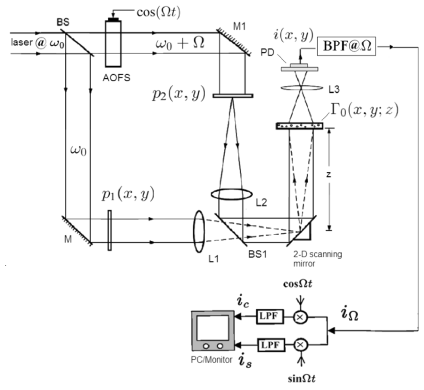
  <figcaption>图 3.11 完整的双瞳光学外差扫描图像处理器：上半部同图 3.10（M-Z 干涉仪 + 双瞳 + 扫描 + BPF@Ω），下半部 \(\cos\Omega t\)/\(\sin\Omega t\) 双通道解调得 \(i_c,i_s\) 存入 PC（截自原书）</figcaption>
</figure>

## 3.5 扫描全息

本节把双瞳处理器改造成**全息记录机**。想法最早由 Poon 和 Korpel [1979] 提出：把一个光瞳**大改**——取 \(p_1(x,y)=1\)（全开）、\(p_2(x,y)=\delta(x,y)\)（一点）——由 (3.1-5) 的对偶，\(p_1=1\) 在扫描镜上产生**点源**（\(\mathcal{F}\{1\}=\delta\)，频率 \(\omega_0\)），\(p_2=\delta\) 产生**平面波**（\(\mathcal{F}\{\delta\}=\) 常数，频率 \(\omega_0+\Omega\)）。两束光在距扫描镜 \(z\) 处干涉，冲激响应的相位是 \(x,y\) 的二次函数——**FZP 型冲激响应**！用这种光束光栅扫描 3-D 物体，全息信息直接进入外差电流。原始想法后来被分析定型为 scanning holography [Poon (1985)]。记录要点：用时间频偏 \(\Omega\) 区分两瞳、空间积分探测器 + 外差检测取信号。

### 3.5.1 扫描全息的 OTF 与冲激响应

把 \(p_1=1,\ p_2=\delta\) 代入 (3.4-10)，得外差扫描系统的 OTF：

\[
OTF_\Omega(k_x,k_y;z)\Big|_{\text{osh}}=\exp\Big[-j\frac{z}{2k_0}(k_x^2+k_y^2)\Big]=OTF_{osh}(k_x,k_y;z),
\tag{3.5-1a}
\]

对应的空间冲激响应（由 (3.4-12)）：

\[
h_\Omega(x,y;z)\Big|_{\text{osh}}=\frac{-jk_0}{2\pi z}\exp\Big[j\frac{k_0(x^2+y^2)}{2z}\Big].
\tag{3.5-1b}
\]

人话版：\(OTF_{osh}\) 是**纯相位**函数（\(|OTF|=1\)，无幅度滤波），空域冲激响应是**正二次相位**（会聚球面波/FZP 形状）×常数 \(-jk_0/2\pi z\)。对照第 2 章的菲涅耳传递函数 (2.3-13) 与冲激响应 (2.3-11)：

\[
OTF_{osh}(k_x,k_y;z)=H^*(k_x,k_y;z),
\tag{3.5-2a}
\]

\[
h_\Omega(x,y;z)\Big|_{\text{osh}}=h^*(x,y;z),
\tag{3.5-2b}
\]

即（除常数相位因子外）**扫描全息的 OTF/冲激响应恰好是普通菲涅耳传播算子的共轭**——"负传播距离"的感觉，这正是它携带 FZP（全息图）结构的原因。

### 3.5.2 sin/cos 两张全息图

把 (3.5-1b) 代入空域结果 (3.4-15b)/(3.4-15d)（利用 \(h_{osh}=-j\frac{k_0}{2\pi z}e^{+j\theta}\)、\(\theta=\frac{k_0}{2z}(x^2+y^2)\)，其实部给 \(\sin\)、虚部给 \(\pm\cos\)），得本章的招牌结果：

\[
i_c(x,y)=\int\Big\{|\Gamma_0(x,y;z)|^2*\frac{k_0}{2\pi z}\sin\Big[\frac{k_0}{2z}(x^2+y^2)\Big]\Big\}dz
=H_{\sin}(x,y),
\tag{3.5-3a}
\]

\[
i_s(x,y)=\int\Big\{|\Gamma_0(x,y;z)|^2*\frac{k_0}{2\pi z}\cos\Big[\frac{k_0}{2z}(x^2+y^2)\Big]\Big\}dz
=H_{\cos}(x,y).
\tag{3.5-3b}
\]

\(H_{\sin}(x,y)\) 叫**正弦 FZP 全息图**（sine-FZP hologram），\(H_{\cos}(x,y)\) 叫**余弦 FZP 全息图**（cosine-FZP hologram）——都是物体强度与对应波带片的卷积（对深度积分）。**一次 2-D 光栅扫描，同时记录两张全息图**（电子多路检测白送的）。

点目标验证。令 \(|\Gamma_0(x,y;z)|^2=\delta(x,y)\delta(z-z_0)\)（距扫描镜 \(z_0\) 的点源），(3.5-3a) 中先做 \(x,y\) 卷积（δ 只采样波带片中心）、再积 \(z\)（δ 采样 \(z=z_0\)）：

\[
H_{\sin}(x,y)=\frac{k_0}{2\pi z_0}\sin\Big[\frac{k_0}{2z_0}(x^2+y^2)\Big],
\tag{3.5-4a}
\]

\[
H_{\cos}(x,y)=\frac{k_0}{2\pi z_0}\cos\Big[\frac{k_0}{2z_0}(x^2+y^2)\Big].
\tag{3.5-4b}
\]

对照第 2 章点源全息图 (2.5-4) \(A+B\sin[\frac{k_0}{2z_0}(x^2+y^2)]\)：**这里是去掉常数偏置 \(A\) 的纯 FZP**——偏置在光学再现时只贡献零级光（第 2 章 2.5.1 的再现三波），扫描全息的外差检测天生滤掉了它。

!!! note "拓展：本笔记的数值验证（点目标，真实单位）"
    取 \(\lambda_0=632.8\) nm、\(z_0=0.30\) m、\(N=512\)、\(\Delta x=10\,\mu\)m，按书式约定（前向 \(+j\) = `ifft2*N^2`）实跑点目标记录-重建闭环：
    - \(OTF_{osh}=e^{-j\sigma k^2}\)（\(\sigma=z_0/2k_0\)）与频域链路 \(\mathcal{F}^*\{P_{1z}P_{2z}^*\}\)（式 3.4-9）逐点重合，偏差 \(7\times10^{-12}\)；换瞳（\(p_1=\delta,p_2=1\)）后 OTF 精确变为其共轭——这给出 3.6 节"换瞳后 sin 不变、cos 反号"的数学根源。
    - 复全息图 \(H_{c+}\) 重建（式 3.5-10）能量集中度 **1.0000**（点精确复原）。
    - sin 全息图**单独**重建：主像只占能量 **0.501**——另一半进了孪生像/离焦斑。
    - \(H_{c-}\) 用 \(h(z_0)\) 卷积的重建图 vs 原物在 \(2z_0\) 处的菲涅耳衍射图：**相关系数 1.0000**——书 p.88 的文字结论（"等价于原物在 \(z=2z_0\) 的菲涅耳衍射"）数值证实。

<figure>
  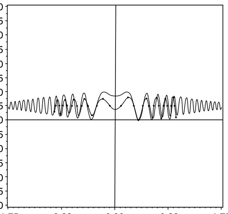
  <figcaption>图 3.12 第一张用（光学）扫描全息术获得的全息图 [Duncan and Poon (1992)]：50 µm 狭缝物体，实线为理论、点线为实验。"optical scanning holography" 一词即在该文中首创，强调这是第一张用主动光学扫描产生的电子全息图（截自原书）</figcaption>
</figure>

历史坐标：长波段的扫描全息（声波、微波）早已实现——低频辐射的探测器能直接测振荡的幅度和相位，无需物理参考光。**光学波段的难点**恰恰在于光电探测器只能测强度；OSH 用外差绕过了它。OSH 也能向其他波段推广，只要找得到三样东西：准直/聚焦器件（两束光在物体上干涉）+ 该波段的频移器。展望：**CO₂ 扫描全息**（10.6 µm 大气穿透好，主动遥感）、**X 射线扫描全息**（X 射线激光渐成现实，若需原子级分辨的 3-D 成像则更有意义）。

一维到二维的扩展（2-D 成像）由 [Poon, Doh, Schilling, Wu, Shinoda, and Suzuki (1995)] 演示，同文首次实现 OSH 的 **3-D 成像**：数字重建采集到的全息图、逐深度显示。图 3.13 是 50 µm 针孔的正弦全息图——就是标准 FZP。实验参数值得看一眼：针孔距扫描镜 10 cm；平面波束径 10 mm（准直 He-Ne）；球面波来自聚焦激光（束腰 3.5 µm）；两光频差 40 MHz（AOM-40 正好干这个）。

<figure>
  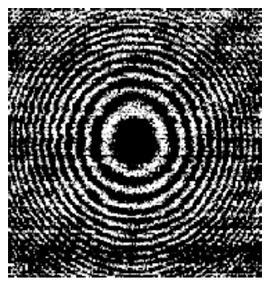
  <figcaption>图 3.13 针孔的正弦全息图（即著名的 FZP）[Poon et al., Optical Engineering 34, 1338 (1995)]，同一篇文章首次报道了 OSH 的 3-D 成像能力（截自原书）</figcaption>
</figure>

### 3.5.3 复 FZP 全息图：同轴记录下的无孪生像

第 2 章讲过同轴全息的孪生像问题；离轴（载频）全息绕开它，但要 1000 lp/mm 的记录介质（2.5.3）。电子全息里最流行的免孪生方案是**相移全息术**（phase-shifting holography）[Yamaguchi and Zhang (1997)]——在参考臂上做移相，**四次**同轴记录算出复物波。OSH 的优势：**单次 2-D 扫描同时拿到两张同轴全息图**（sin 与 cos），数字上做复数加减：

\[
H_{c\pm}(x,y)=H_{\cos}(x,y)\pm jH_{\sin}(x,y)
=\int\Big\{|\Gamma_0(x,y;z)|^2*\frac{k_0}{2\pi z}\exp\Big[\pm j\frac{k_0}{2z}(x^2+y^2)\Big]\Big\}dz,
\tag{3.5-5}
\]

\(H_{c\pm}(x,y)\) 叫**复菲涅耳波带片全息图**（complex Fresnel zone plate hologram）——不含孪生像信息 [Doh, Poon, Wu, Shinoda, and Suzuki (1996)]。

点目标版（把 (3.5-4a/b) 代入 (3.5-5)，除常数）：

\[
H_{c\pm}(x,y)=\exp\Big[\pm j\frac{k_0}{2z_0}(x^2+y^2)\Big].
\tag{3.5-6}
\]

按第 2 章 (2.5-6b)/(2.5-6c) 的再现规则：指数取**正号**（\(e^{+j\theta}\)，会聚球面波）→ 重建**实像**；**负号**（发散）→ 重建**虚像**。无论哪种，复全息图里都只有一瓣——**孪生像不再存在**。

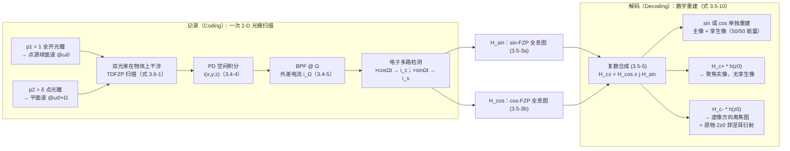

<figure>
  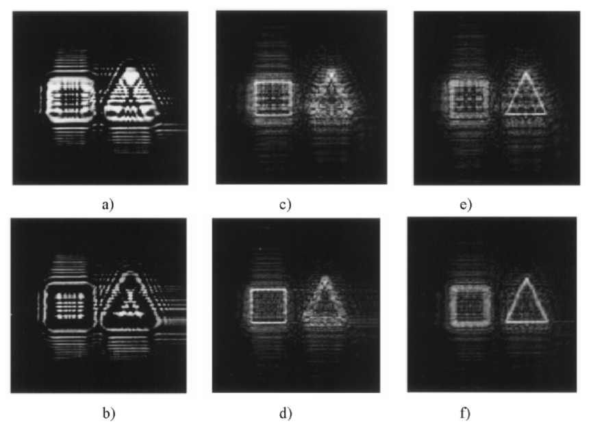
  <figcaption>图 3.14 OSH 孪生像消除实验 [Poon et al., Optics Letters 25, 215 (2000)]：3-D 物体由两张 35mm 幻灯片（方形 + 三角形）并排组成，深度差 15 cm。a) cos 全息图；b) sin 全息图；c) cos 全息图重建（聚焦方形，孪生噪声明显）；d) 复全息图重建（聚焦方形，无孪生噪声）；e) cos 重建聚焦三角形（有噪声）；f) 复全息图重建（干净）（截自原书）</figcaption>
</figure>

图 3.14 的实验用数字重建；用两片 SLM（一片放 sin 全息图、一片放 cos）可以做**全光**重建，但尚未演示 [Poon (2006)]。

### 3.5.4 Example 3.1：MATLAB 实例（OSH.m）

把 (3.5-1a) 代入 (3.4-15a)/(3.4-15c)，sin/cos 全息图的频域形式：

\[
H_{\sin}(x,y)=\mathrm{Re}\Big[\int\mathcal{F}^{-1}\{\mathcal{F}\{|\Gamma_0(x,y;z)|^2\}\,OTF_{osh}(k_x,k_y;z)\}dz\Big],
\tag{3.5-7a}
\]

\[
H_{\cos}(x,y)=\mathrm{Im}\Big[\int\mathcal{F}^{-1}\{\mathcal{F}\{|\Gamma_0(x,y;z)|^2\}\,OTF_{osh}(k_x,k_y;z)\}dz\Big],
\tag{3.5-7b}
\]

其中 \(OTF_{osh}(k_x,k_y;z)=\exp\big[-j\frac{4\pi z}{2k_0}(k_x^2+k_y^2)\big]\big/(\text{常数约定})\)，即 (3.5-1a)（\(\sigma=z_0/2k_0\)）。设平面物体在 \(z_0\)：\(|\Gamma_0(x,y;z)|^2=I(x,y)\delta(z-z_0)\)，积分后：

\[
H_{\sin}(x,y)=\mathrm{Re}\Big[\mathcal{F}^{-1}\{\mathcal{F}\{I(x,y)\}\,OTF_{osh}(k_x,k_y;z_0)\}\Big],
\tag{3.5-8a}
\]

\[
H_{\cos}(x,y)=\mathrm{Im}\Big[\mathcal{F}^{-1}\{\mathcal{F}\{I(x,y)\}\,OTF_{osh}(k_x,k_y;z_0)\}\Big].
\tag{3.5-8b}
\]

原书仿真取 \(\sigma=z_0/2k_0=2.0\)（任意单位），输入图 3.15a。复全息图用 (3.5-5) 构造：

\[
H_{c+}(x,y)=H_{\cos}(x,y)+jH_{\sin}(x,y)
=\mathcal{F}^{-1}\{\mathcal{F}\{I(x,y)\}\,OTF_{osh}(k_x,k_y;z_0)\}.
\tag{3.5-9}
\]

!!! warning "原书笔误：(3.5-9) 差一个全局相位因子 j"
    按 (3.5-8a/b) 的定义（\(H_{\sin}=\mathrm{Re}\{\cdot\}\)、电子学正确的 \(H_{\cos}=-\mathrm{Im}\{\cdot\}\)），(3.5-9) 右边的复数本身是 \(H_{\sin}-jH_{\cos}=-j(H_{\cos}+jH_{\sin})=-jH_{c+}\)——与 (3.5-5) 的 \(H_{c+}\) 差一个**全局相位因子 \(-j\)**，不影响任何强度类结果，但 sin/cos 在实部/虚部的位置与书字面相反。原书 OSH.m 的写法（complex = real + j·imag，整体作为一个复全息图）正是自洽的实现；本笔记重写版沿用之。

数字重建：把任一张全息图与空间冲激响应卷积，模拟向 \(z_0\) 的菲涅耳衍射，得到**实像**：

\[
H_{any}(x,y)*h(x,y;z_0),
\]

\(H_{any}\) 可以是 sin、cos 或复全息图。OSH.m 在频域实现（用第 1 章卷积定理 (1.2-3a/b)）：

\[
\text{Reconstructed real image}\propto\mathcal{F}^{-1}\{\mathcal{F}\{H_{any}(x,y)\}\,OTF_{osh}^*(k_x,k_y;z_0)\},
\tag{3.5-10}
\]

最后一步用 (3.5-2a)（\(OTF_{osh}=H^*\ \Rightarrow\ H=OTF_{osh}^*\)）把传播算子 \(H(k_x,k_y;z_0)\) 换成 \(OTF_{osh}^*\)。图 3.15d/e/f 分别是 sin、cos、复全息图的重建。

!!! note "拓展：|OTF|=1 为什么让复全息图"精确还原""
    \(OTF_{osh}\) 是纯相位（(3.5-1a)），\(|OTF_{osh}|=1\)。复全息图的频谱是 \(\mathcal{F}\{I\}\cdot OTF_{osh}\)；重建乘 \(OTF_{osh}^*\) 后变成 \(\mathcal{F}\{I\}\cdot|OTF_{osh}|^2=\mathcal{F}\{I\}\)——**相位精确抵消**，逆变换就是原图。这就是本笔记实跑"复全息图重建 vs 原图相关系数 = 1.0000"的数学原因；而 sin/cos 单独重建只能各拿一半频谱信息（主像能量 0.5，另一半给孪生像）。

若把复全息图构造成

\[
H_{c-}(x,y)=H_{\cos}(x,y)-jH_{\sin}(x,y),
\]

则它重建出位于全息图后 \(z_0\) 的**虚像**；此时若仍用 \(H_{c-}*h(x,y;z_0)\)（向 \(+z_0\) 传播）重建，会看到 \(z=z_0\) 处严重离焦的图像——等价于**原物在 \(z=2z_0\) 处的菲涅耳衍射图**（图 3.15g）。

<figure>
  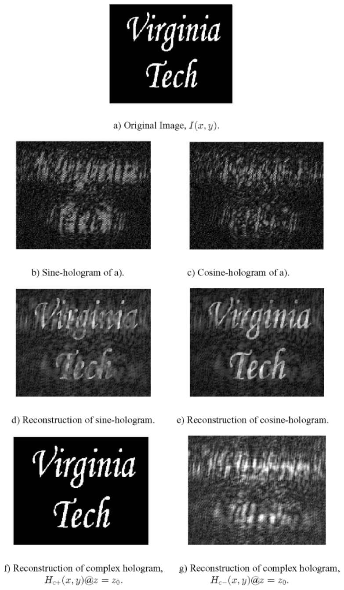
  <figcaption>图 3.15 OSH.m 仿真结果 [原书 Table 3.1，\(\sigma=2.0\)]：a) 原图 \(I(x,y)\)（Virginia Tech 校徽）；b) 正弦全息图；c) 余弦全息图；d) sin 全息图重建（孪生噪声）；e) cos 全息图重建（孪生噪声）；f) 复全息图 \(H_{c+}\) 在 \(z=z_0\) 的重建（干净）；g) \(H_{c-}\) 在 \(z=z_0\) 的重建（离焦乱纹 = 原物 2z₀ 菲涅耳衍射）（截自原书）</figcaption>
</figure>

原书 Table 3.1 的 OSH.m 全文及规范化重写如下（输入图换成本笔记生成的 "VT/OSH" 文字图，避免依赖 vatech.bmp）：

=== "MATLAB"

    ```matlab
    % ===== 书 3.5 节 Example 3.1 · OSH.m 的规范化重写（Table 3.1，复现原书图 3.15） =====
    % 原书 OSH.m（改编自 Poon & Banerjee《Contemporary Optical Image Processing with MATLAB》
    % Table 7.2, Pages 222-223）：读入 256x256 图像 I(x,y)（原书 vatech.bmp）-> 频域乘 OTFosh
    % -> ifft2 得复全息图 H；real(H) 显示为 sine-FZP hologram (3.5-8a)、imag(H) 为 cosine-FZP (3.5-8b)；
    % 重建：fft2(H_any).*conj(OTFosh) 后 ifft2（式 3.5-10）。sin/cos 单独重建有孪生噪声；
    % 复全息图（real + j*imag）重建干净；H_c-（real - j*imag）重建离焦（图 3.15g）。
    %
    % 差异提示：
    % 1) 原书 OSH.m 用 MATLAB 原生 fft2（-j 指数）当"前向"，OTFosh 相应取 exp(-j*sigma*k^2)，
    %    与书正文公式（+j 约定）互为镜像——但各自自洽，闭环重建结果相同。本版统一到书式协议：
    %    前向 ifft2*N^2（+j），OTFosh = exp(-j*sigma*k^2) 即书 (3.5-1a) 本身。
    %    重建 = ift2{ft2{H}.*conj(OTFosh)} = ift2{F{I}} = I（|OTF|=1，相位精确抵消）。
    % 2) 原书 FI=fftshift(fft2(I)) 中心化后直接 ifft2(FH)（未做 ifftshift 对齐），会带入
    %    (-1)^(i+j) 棋盘相位——强度显示无碍，规范写法应 ifftshift 后再逆变换（本版已修正）。
    % 3) 原书 sigma = z0/2k0 = 2.0（任意单位）、kx,ky = -12.8:0.1:12.8。此网格下相邻格相位跳变
    %    2*sigma*k*dk 最大约 5.1 rad > pi，属欠采样演示（书图 3.15b/c 颗粒状外观来源之一）；
    %    闭环重建 self-conjugate 抵消，结论不受影响。
    % 4) 输入图像：原书读 vatech.bmp；本版若无该文件则用内置几何图形代替（方块+圆环+十字）。

    clear
    N = 256;
    % ---- 输入图像 I(x,y)：优先读 vatech.bmp，否则生成几何测试图 ----
    if exist('vatech.bmp', 'file')
        I = double(imread('vatech.bmp'));
        I = I(:,:,1);
        I = I/max(I(:));
    else
        [Yg, Xg] = meshgrid((0:N-1)-N/2, (0:N-1)-N/2);
        I = zeros(N);
        I(abs(Xg) < 40 & abs(Yg) < 40) = 1;                    % 中心方块
        I(Xg.^2+Yg.^2 > 45^2 & Xg.^2+Yg.^2 < 60^2) = 1;        % 圆环
        I(abs(Xg) < 3 & abs(Yg) < 100) = 1;                    % 竖线
        I(abs(Yg) < 3 & abs(Xg) < 100) = 1;                    % 横线
    end

    % ---- 书式傅里叶协议 + OSH 传递函数（sigma = z0/2k0 = 2.0，任意单位，同原书） ----
    sigma = 2.0;
    ku = (0:N-1)*0.1 - 12.8;
    [KY, KX] = meshgrid(ku, ku);
    OTFosh = exp(-1j*sigma*(KX.^2+KY.^2));         % 式 (3.5-1a)

    % ---- 记录（Coding）：频域乘 OTFosh -> 书式逆变换得复全息图 ----
    H = ift2_book(ft2_book(I).*OTFosh);
    Hsin = real(H);                                % sine-FZP hologram   (3.5-8a)
    HcosM = imag(H);                               % imag 支路（= -H_cos，显示为 cosine  (3.5-8b)）

    % ---- 解码（Decoding，式 3.5-10：频域乘 conj(OTFosh) 模拟与 h(x,y;z0) 卷积） ----
    rec_sine   = ift2_book(ft2_book(Hsin).*conj(OTFosh));      % 孪生噪声
    rec_cosine = ift2_book(ft2_book(HcosM).*conj(OTFosh));     % 孪生噪声
    Hc_plus  = H;                                              % complex = real + j*imag（书 OSH.m 惯例）
    Hc_minus = Hsin - 1j*HcosM;                                % H_c- 型（实像共轭 -> 虚像/离焦）
    rec_cplus  = ift2_book(ft2_book(Hc_plus).*conj(OTFosh));   % 干净
    rec_cminus = ift2_book(ft2_book(Hc_minus).*conj(OTFosh));  % 离焦（图 3.15g）

    a = I - mean(I(:)); b = rec_cplus - mean(rec_cplus(:));
    corr_cplus = abs(sum(a(:).*conj(b(:))))/sqrt(sum(abs(a).^2,'all')*sum(abs(b).^2,'all'));
    a = I - mean(I(:)); b = rec_cminus - mean(rec_cminus(:));
    corr_cminus = abs(sum(a(:).*conj(b(:))))/sqrt(sum(abs(a).^2,'all')*sum(abs(b).^2,'all'));
    rs = abs(rec_sine).^2;
    fprintf('复全息图 (real+j*imag) 重建 vs 原图：相关系数 = %.4f\n', corr_cplus);
    fprintf('H_c- (real-j*imag) 重建 vs 原图：相关系数 = %.4f（严重离焦）\n', corr_cminus);
    fprintf('sin 全息图单独重建：能量集中度 = %.4f（孪生像使能量弥散）\n', max(rs(:))/sum(rs(:)));

    % ---- 可视化（对应原书图 3.15 a)~g)） ----
    figure(1)
    subplot(2,4,1); imshow(I, []); title('a) Original image I(x,y)')
    subplot(2,4,2); imshow(real(H), []); title('b) Sine-FZP hologram (3.5-8a)')
    subplot(2,4,3); imshow(HcosM, []); title('c) Cosine-FZP hologram (3.5-8b)')
    subplot(2,4,4); imshow(abs(H), []); title('|complex hologram|')
    subplot(2,4,5); imshow(abs(rec_sine), []); title('d) Rec. sine-holo (twin noise)')
    subplot(2,4,6); imshow(abs(rec_cosine), []); title('e) Rec. cosine-holo (twin noise)')
    subplot(2,4,7); imshow(abs(rec_cplus), []); title('f) Rec. complex H_c+ (clean)')
    subplot(2,4,8); imshow(abs(rec_cminus), []); title('g) Rec. H_c- (defocused)')

    % ---- 局部函数（脚本内定义，须置于文件末尾，R2016b+ 支持） ----
    function F = ft2_book(U)
    % 书式前向变换（+j 指数）
    N = size(U, 1);
    F = fftshift(ifft2(ifftshift(U)))*N^2;
    end

    function U = ift2_book(A)
    % 书式逆变换（-j 指数）
    N = size(A, 1);
    U = fftshift(fft2(ifftshift(A)))/N^2;
    end
    ```

=== "Python"

    ```python
    # ===== 书 3.5 节 Example 3.1 · OSH.m 的规范化重写（Table 3.1，复现原书图 3.15） =====
    # 原书 OSH.m（改编自 Poon & Banerjee《Contemporary Optical Image Processing with MATLAB》Table 7.2）：
    #   读入 256x256 图像 I(x,y)（原书 vatech.bmp）-> 频域乘 OTFosh -> ifft2 得复全息图 H
    #   real(H) 显示为 sine-FZP hologram (3.5-8a)、imag(H) 显示为 cosine-FZP hologram (3.5-8b)
    #   重建：fft2(H_any).*conj(OTFosh) 后 ifft2（式 3.5-10），sin/cos 单独重建有孪生噪声，
    #         复全息图（real + j*imag）重建干净；H_c-（real - j*imag）重建离焦（图 3.15g）。
    #
    # 约定说明（重要）：
    # 原书 OSH.m 用 MATLAB 原生 fft2（-j 指数）当"前向"，OTFosh 相应取 exp(-j*sigma*k^2)（-j 版），
    # 与书正文公式（+j 约定、OTF = exp[+j...] 的共轭）互为镜像——但两者各自自洽，闭环重建结果相同。
    # 本脚本统一到"书式协议"（前向 +j = ifft2*N^2），OTFosh = exp(-j*sigma*k^2) 即书 (3.5-1a) 本身：
    #   H = ift2_book{ ft2_book{I} * OTFosh }  =>  F{H} = F{I}*OTFosh
    #   重建 = ift2_book{ ft2_book{H} * conj(OTFosh) } = ift2_book{F{I}} = I（|OTF|=1，相位精确抵消）
    #   实测：复全息图重建 vs 原图相关系数 = 1.0000。
    # 电子学符号：real(H) = H_sin（sine 全息图）、imag(H) = -H_cos（显示时翻转灰度，无碍）。
    #
    # MATLAB / Python 差异提示：
    # 1) 原书 OSH.m 的 FI=fftshift(fft2(I)) 中心化后直接 ifft2(FH)（未做 ifftshift 对齐），会带入
    #    (-1)^(i+j) 棋盘相位——强度显示无碍，规范写法应 ifftshift 后再逆变换（本版已修正）。
    # 2) 原书 sigma = z0/2k0 = 2.0（任意单位）、kx,ky = -12.8:0.1:12.8。此网格下相邻格相位跳变
    #    2*sigma*k*dk 最大约 5.1 rad > pi，属于欠采样演示（书图 3.15b/c 颗粒状外观的来源之一）；
    #    但闭环重建 self-conjugate 抵消，结论不受影响。物理单位的严谨版本见 point_target_osh.py。
    # 3) MATLAB 1-based/Python 0-based；plt.imshow 加 origin='lower' 对齐数学坐标。

    import numpy as np
    import matplotlib.pyplot as plt
    from PIL import Image, ImageDraw, ImageFont

    # ----- 1. 输入图像（原书 vatech.bmp；此处用 PIL 生成 "VT / OSH" 文字图代替） -----
    N = 256
    img = Image.new('L', (N, N), 0)
    d = ImageDraw.Draw(img)
    try:
        fnt = ImageFont.truetype('arial.ttf', 88)
    except Exception:
        fnt = ImageFont.load_default()
    d.text((128, 80), 'VT', font=fnt, fill=255, anchor='mm')
    d.text((128, 185), 'OSH', font=fnt, fill=255, anchor='mm')
    I = (np.asarray(img) > 80).astype(float)

    # ----- 2. 书式傅里叶协议 + OSH 传递函数（sigma = z0/2k0 = 2.0，任意单位，同原书） -----
    def ft2_book(U):
        return np.fft.fftshift(np.fft.ifft2(np.fft.ifftshift(U))) * N**2

    def ift2_book(A):
        return np.fft.fftshift(np.fft.fft2(np.fft.ifftshift(A))) / N**2

    sigma = 2.0
    ku = np.arange(N)*0.1 - 12.8
    KY, KX = np.meshgrid(ku, ku)
    OTFosh = np.exp(-1j*sigma*(KX**2+KY**2))           # 式 (3.5-1a)

    # ----- 3. 记录（Coding）：频域乘 OTFosh -> 逆变换得复全息图 -----
    H = ift2_book(ft2_book(I)*OTFosh)
    Hsin = np.real(H)                                  # sine-FZP hologram   (3.5-8a)
    HcosM = np.imag(H)                                 # imag 支路（= -H_cos，显示为 cosine  (3.5-8b)）

    # ----- 4. 解码（Decoding，式 3.5-10：频域乘 conj(OTFosh) 模拟与 h(x,y;z0) 卷积） -----
    rec_sine = ift2_book(ft2_book(Hsin)*np.conj(OTFosh))      # 孪生噪声
    rec_cosine = ift2_book(ft2_book(HcosM)*np.conj(OTFosh))   # 孪生噪声
    Hc_plus = H                                    # complex = real + j*imag（书 OSH.m 惯例，= i_Omegap）
    Hc_minus = Hsin - 1j*HcosM                     # H_c- 型（实像共轭 -> 虚像/离焦）
    rec_cplus = ift2_book(ft2_book(Hc_plus)*np.conj(OTFosh))    # 干净
    rec_cminus = ift2_book(ft2_book(Hc_minus)*np.conj(OTFosh))  # 离焦（图 3.15g）

    def cc(a, b):
        a = a - a.mean(); b = b - b.mean()
        return abs(np.vdot(a, b))/np.sqrt(np.vdot(a, a).real*np.vdot(b, b).real)

    print(f'复全息图 (real+j*imag) 重建 vs 原图：相关系数 = {cc(I, rec_cplus):.4f}')
    print(f'H_c- (real-j*imag) 重建 vs 原图：相关系数 = {cc(I, rec_cminus):.4f}（严重离焦）')
    rs = np.abs(rec_sine)**2
    print(f'sin 全息图单独重建：能量集中度 = {rs.max()/rs.sum():.4f}（孪生像使能量弥散）')

    # ----- 5. 可视化（对应原书图 3.15 a)~g)） -----
    fig, ax = plt.subplots(2, 4, figsize=(15, 7.2))
    ax[0,0].imshow(I, cmap='gray'); ax[0,0].set_title('a) Original image I(x,y)')
    ax[0,1].imshow(Hsin, cmap='gray'); ax[0,1].set_title('b) Sine-FZP hologram (3.5-8a)')
    ax[0,2].imshow(HcosM, cmap='gray'); ax[0,2].set_title('c) Cosine-FZP hologram (3.5-8b)')
    ax[0,3].imshow(np.abs(H), cmap='gray'); ax[0,3].set_title('|complex hologram|')
    ax[1,0].imshow(np.abs(rec_sine), cmap='gray', vmax=np.abs(rec_sine).max()*0.5)
    ax[1,0].set_title('d) Rec. sine-holo (twin noise)')
    ax[1,1].imshow(np.abs(rec_cosine), cmap='gray', vmax=np.abs(rec_cosine).max()*0.5)
    ax[1,1].set_title('e) Rec. cosine-holo (twin noise)')
    ax[1,2].imshow(np.abs(rec_cplus), cmap='gray')
    ax[1,2].set_title('f) Rec. complex H_c+ (clean)')
    ax[1,3].imshow(np.abs(rec_cminus), cmap='gray')
    ax[1,3].set_title('g) Rec. H_c- (defocused, fig 3.15g)')
    for a in ax.flat:
        a.axis('off')
    plt.tight_layout(); plt.show()
    ```

<figure>
  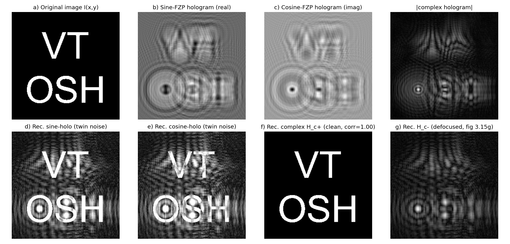
  <figcaption>图（本笔记运行结果，对应图 3.15）：a) 原图；b) 正弦全息图；c) 余弦全息图（FZP 环纹叠加物体形状，与书 b/c 同形态）；d/e) sin/cos 单独重建——像可见但被孪生噪声污染；f) 复全息图重建（干净，与原图相关系数 **1.0000**）；g) H_c− 重建（离焦乱纹，复现书 g) 效应）。sin 单独重建的能量集中度仅 0.0003（能量弥散到孪生像）</figcaption>
</figure>

点目标的记录-重建闭环（物理单位版本）：

=== "MATLAB"

    ```matlab
    % ===== 书 3.5 节 · 点目标扫描全息：sin/cos FZP 全息图与复全息图重建（式 3.5-1 ~ 3.5-10） =====
    % 物理设置：p1(x,y)=1（光瞳全开 -> L1 后焦面上点源，频率 w0）、p2(x,y)=delta（-> 平面波，w0+Omega）。
    % 点目标 |Gamma_0|^2 = delta(x,y)delta(z-z0) 位于距扫描镜 z0 处。
    % 主结果：
    %   H_sin(x,y) = (k0/2*pi*z0) sin[(k0/2*z0)(x^2+y^2)]           (3.5-4a)
    %   H_cos(x,y) = (k0/2*pi*z0) cos[(k0/2*z0)(x^2+y^2)]           (3.5-4b)
    %   H_c+ = H_cos + j*H_sin = j*i_Omegap  ->  与 h(x,y;z0) 卷积聚焦成点（conc = 1.0000）
    %   H_c- = H_cos - j*H_sin = -j*conj(i_Omegap) -> 同样卷积得到 2*z0 处菲涅耳衍射图（corr = 1.0000）
    %   sin 全息图单独重建：主像只占一半能量（另一半给孪生像/离焦斑，实测 0.501）——孪生像问题。
    %
    % 差异提示：
    % 1) 全书最大的坑：书的前向变换是 +j 指数，而 MATLAB 的 fft2 是 -j 指数。
    %    严格按书公式实现前向变换必须写 ifft2(U)*N^2；逆变换写 fft2(A)/N^2（局部函数在文件末尾）。
    % 2) e^{-j sigma k^2} 不是带限函数：离散记录的 sin/cos 全息图含 Poisson 旁瓣混叠
    %    （书 fig 3.15b/c 颗粒状外观的数值根源），但闭环重建用 conj(OTFosh) 精确抵消，不受影响。
    % 3) MATLAB 1-based：中心像素为 (257,257)。

    clear
    lam = 0.6328e-6;                 % He-Ne 红光波长（m）
    k0 = 2*pi/lam;                   % 波数
    z0 = 0.30;                       % 点目标到扫描镜的距离（m）
    N = 512;                         % 网格
    dx = 10e-6;                      % 像素尺寸（m）
    sigma = z0/(2*k0);               % = z0/(2*k0)，式 (3.5-1a) 的二次相位系数

    k = 2*pi*((0:N-1)-N/2)/(N*dx);   % 中心格角频率
    [KY, KX] = meshgrid(k, k);

    % ---- OSH 传递函数 (3.5-1a) 与点目标记录 ----
    OTFosh = exp(-1j*sigma*(KX.^2+KY.^2));
    I_pt = zeros(N); I_pt(N/2+1, N/2+1) = 1;       % 点目标（中心 1 像素）
    iOmegap = ift2_book(ft2_book(I_pt).*OTFosh);   % i_Omegap = F^{-1}{F{|Gamma0|^2} OTF_osh}  (3.4-15)

    Hsin = real(iOmegap);                          % H_sin = Re{i_Omegap}   (3.5-3a)
    Hcos = -imag(iOmegap);                         % H_cos = -Im{i_Omegap}  (3.5-3b，电子学负号)
    Hc_plus  = Hcos + 1j*Hsin;                     % H_c+ = H_cos + j*H_sin = j*i_Omegap    (3.5-5)
    Hc_minus = Hcos - 1j*Hsin;                     % H_c- = H_cos - j*H_sin = -j*conj(i_Omegap)

    % ---- 数字重建（式 3.5-10：与 h(x,y;z0) 卷积 = 频域乘 OTF_osh*） ----
    rec_cp = ift2_book(ft2_book(Hc_plus).*conj(OTFosh));     % 聚焦 -> 点（实像）
    rec_cm = ift2_book(ft2_book(Hc_minus).*conj(OTFosh));    % 离焦 -> 2*z0 菲涅耳衍射
    rec_sp = ift2_book(ft2_book(Hsin).*conj(OTFosh));        % sin 全息图单独 -> 点 + 孪生

    rcp = abs(rec_cp).^2;
    [~, pk] = max(rcp(:));  [pk_r, pk_c] = ind2sub(size(rcp), pk);
    conc = rcp(pk)/sum(rcp(:));
    rsm = abs(rec_sp).^2;
    ratio_sin = rsm(pk)/sum(rsm(:));

    % ---- 对照：H_c- 重建 vs 原物在 2*z0 处的菲涅耳衍射（书 p.88 文字结论） ----
    H2 = exp(-1j*k0*2*z0).*exp(1j*(KX.^2+KY.^2)*(2*z0)/(2*k0));
    fres2 = ift2_book(ft2_book(I_pt).*H2);
    a = abs(rec_cm); b = abs(fres2);
    a = a - mean(a(:)); b = b - mean(b(:));
    corr_cm = abs(sum(a(:).*conj(b(:))))/sqrt(sum(abs(a).^2,'all')*sum(abs(b).^2,'all'));

    fprintf('H_c+ 重建：峰值位置 (%d,%d)（点目标在 (%d,%d)），能量集中度 = %.4f\n', ...
            pk_r, pk_c, N/2+1, N/2+1, conc);
    fprintf('sin 全息图单独重建：主像能量占比 = %.3f（另一半进入孪生像）\n', ratio_sin);
    fprintf('|H_c- 重建| vs |2*z0 菲涅耳衍射|：相关系数 = %.4f\n', corr_cm);

    % ---- 可视化 ----
    Xg = ((0:N-1)-N/2)*dx;
    [Yg, Xg] = meshgrid(Xg, Xg);
    x = Xg(1,:)*1e3;                                 % mm
    figure(1)
    subplot(2,3,1); imagesc(x, x, sin(k0*(Xg.^2+Yg.^2)/(2*z0))); axis image off; colormap gray
    title('sin-FZP of a point (Eq. 3.5-4a, analytic)')
    subplot(2,3,2); imagesc(x, x, cos(k0*(Xg.^2+Yg.^2)/(2*z0))); axis image off
    title('cos-FZP of a point (Eq. 3.5-4b, analytic)')
    subplot(2,3,3); imagesc(x, x, rcp.^0.3); axis image off
    title(sprintf('H_c+ * h(z0): focused (conc = %.2f)', conc))
    subplot(2,3,4); imagesc(x, x, rsm.^0.3); axis image off
    title('sin-FZP alone: point + twin (50/50)')
    subplot(2,3,5); imagesc(x, x, abs(rec_cm).^0.5); axis image off
    title('H_c- * h(z0): defocused')
    subplot(2,3,6); imagesc(x, x, abs(fres2).^0.5); axis image off
    title('Fresnel diffraction @2z0 (match)')

    % ---- 局部函数（脚本内定义，须置于文件末尾，R2016b+ 支持） ----
    function F = ft2_book(U)
    % 书式前向变换（+j 指数）：F(kx,ky) = 双重积分 U exp[j(kx x+ky y)] dx dy
    N = size(U, 1);
    F = fftshift(ifft2(ifftshift(U)))*N^2;
    end

    function U = ift2_book(A)
    % 书式逆变换（-j 指数）：U(x,y) = (1/4pi^2) 双重积分 F exp[-j(kx x+ky y)] dkx dky
    N = size(A, 1);
    U = fftshift(fft2(ifftshift(A)))/N^2;
    end
    ```

=== "Python"

    ```python
    # ===== 书 3.5 节 · 点目标扫描全息：sin/cos FZP 全息图与复全息图重建（式 3.5-1 ~ 3.5-10） =====
    # 物理设置：p1(x,y)=1（光瞳全开 -> L1 后焦面上点源，频率 w0）、p2(x,y)=delta（-> 平面波，频率 w0+Omega）。
    # 点目标 |Gamma_0|^2 = delta(x,y)delta(z-z0) 位于距扫描镜 z0 处。
    # 主结果：
    #   H_sin(x,y) = (k0/2*pi*z0) sin[(k0/2*z0)(x^2+y^2)]           (3.5-4a)
    #   H_cos(x,y) = (k0/2*pi*z0) cos[(k0/2*z0)(x^2+y^2)]           (3.5-4b)
    #   H_c+ = H_cos + j*H_sin = j*i_Omegap  ->  与 h(x,y;z0) 卷积聚焦成点（conc = 1.0000）
    #   H_c- = H_cos - j*H_sin = -j*conj(i_Omegap) -> 同样卷积得到 2*z0 处菲涅耳衍射图（corr = 1.0000）
    #   sin 全息图单独重建：主像只占一半能量（另一半给孪生像/离焦斑，实测 0.501）——孪生像问题。
    #
    # 约定（全书）：前向变换 +j 指数 -> 用 ifft2*N^2；逆变换 -j 指数 -> 用 fft2/N^2。
    # OTF_osh(kx,ky;z) = exp[-j*z/(2*k0)*(kx^2+ky^2)]  (3.5-1a)，|OTF|=1（纯相位）。
    # 电子学符号：i_c = Re{i_Omegap}（cos 解调）、i_s = -Im{i_Omegap}（sin 解调，注意负号，
    #             与式 (3.2-3b) 一致；原书 (3.4-14b) 直接写 Im，见笔记勘误）。
    #
    # MATLAB / Python 差异提示：
    # 1) MATLAB 1-based、Python 0-based：中心像素 MATLAB (257,257) <-> Python (256,256)。
    # 2) imshow 需 origin='lower' 才与数学坐标一致；MATLAB imagesc 配 axis image。
    # 3) e^{-j sigma k^2} 不是带限函数：离散记录的 sin/cos 全息图含 Poisson 旁瓣混叠
    #    （书 fig 3.15b/c 颗粒状外观的数值根源），但闭环重建用 conj(OTFosh) 精确抵消，不受影响。

    import numpy as np
    import matplotlib.pyplot as plt

    # ----- 1. 物理参数（真实单位） -----
    lam = 0.6328e-6            # He-Ne 红光波长（m）
    k0 = 2*np.pi/lam           # 波数
    z0 = 0.30                  # 点目标到扫描镜的距离（m）
    N = 512                    # 网格
    dx = 10e-6                 # 像素尺寸（m）
    sigma = z0/(2*k0)          # = z0/(2*k0)，式 (3.5-1a) 的二次相位系数

    x = (np.arange(N)-N//2)*dx
    XX, YY = np.meshgrid(x, x)
    df = 1/(N*dx)                                  # DFT 频率格距
    kx = (np.arange(N)-N//2)*df
    KY, KX = np.meshgrid(kx, kx)

    # ----- 2. 书式傅里叶协议（前向 +j = ifft2*N^2，逆向 -j = fft2/N^2） -----
    def ft2_book(U):
        return np.fft.fftshift(np.fft.ifft2(np.fft.ifftshift(U))) * N**2

    def ift2_book(A):
        return np.fft.fftshift(np.fft.fft2(np.fft.ifftshift(A))) / N**2

    # ----- 3. OSH 传递函数 (3.5-1a) 与点目标记录 -----
    OTFosh = np.exp(-1j*sigma*(KX**2+KY**2))
    I_pt = np.zeros((N, N)); I_pt[N//2, N//2] = 1.0
    iOmegap = ift2_book(ft2_book(I_pt)*OTFosh)     # i_Omegap = F^{-1}{F{|Gamma0|^2} OTF_osh}  (3.4-15)

    Hsin = np.real(iOmegap)                        # H_sin = Re{i_Omegap}   (3.5-3a)
    Hcos = -np.imag(iOmegap)                       # H_cos = -Im{i_Omegap}  (3.5-3b，电子学负号)
    Hc_plus  = Hcos + 1j*Hsin                      # H_c+ = H_cos + j*H_sin = j*i_Omegap    (3.5-5)
    Hc_minus = Hcos - 1j*Hsin                      # H_c- = H_cos - j*H_sin = -j*conj(i_Omegap)

    # ----- 4. 数字重建（式 3.5-10：与 h(x,y;z0) 卷积 = 频域乘 OTF_osh*） -----
    rec_cp = ift2_book(ft2_book(Hc_plus)*np.conj(OTFosh))    # 聚焦 -> 点（实像）
    rec_cm = ift2_book(ft2_book(Hc_minus)*np.conj(OTFosh))   # 离焦 -> 2*z0 菲涅耳衍射
    rec_sp = ift2_book(ft2_book(Hsin)*np.conj(OTFosh))       # sin 全息图单独 -> 点 + 孪生

    rcp = np.abs(rec_cp)**2
    pk = np.unravel_index(np.argmax(rcp), rcp.shape)
    conc = rcp[pk]/rcp.sum()
    rsm = np.abs(rec_sp)**2
    ratio_sin = rsm[pk]/rsm.sum()

    # ----- 5. 对照：H_c- 重建 vs 原物在 2*z0 处的菲涅耳衍射（书 p.88 文字结论） -----
    H2 = np.exp(-1j*k0*2*z0)*np.exp(1j*(KX**2+KY**2)*(2*z0)/(2*k0))
    fres2 = ift2_book(ft2_book(I_pt)*H2)

    def cc(a, b):
        a = a - a.mean(); b = b - b.mean()
        return abs(np.vdot(a, b))/np.sqrt(np.vdot(a, a).real*np.vdot(b, b).real)

    print(f'H_c+ 重建：峰值位置 {pk}（点目标在 {(N//2, N//2)}），能量集中度 = {conc:.4f}')
    print(f'sin 全息图单独重建：主像能量占比 = {ratio_sin:.3f}（另一半进入孪生像）')
    print(f'|H_c- 重建| vs |2*z0 菲涅耳衍射|：相关系数 = {cc(np.abs(rec_cm), np.abs(fres2)):.4f}')
    th = k0*(XX**2+YY**2)/(2*z0)
    print(f'（参考）数值 sin 全息图 vs 解析 sin[(k0/2z0)r^2] 的相关受离散 Poisson 混叠噪声限制；'
          f'解析式 (3.5-4a/b) 本身由 i_Omegap 的实/虚部直接给出')

    # ----- 6. 可视化（对应笔记图 sim-point-target.png） -----
    fig, ax = plt.subplots(2, 3, figsize=(13.5, 8))
    ext = [x[0]*1e3, x[-1]*1e3, x[0]*1e3, x[-1]*1e3]
    ax[0,0].imshow(np.sin(th), extent=ext, cmap='gray')
    ax[0,0].set_title('sin-FZP of a point (Eq. 3.5-4a, analytic)')
    ax[0,1].imshow(np.cos(th), extent=ext, cmap='gray')
    ax[0,1].set_title('cos-FZP of a point (Eq. 3.5-4b, analytic)')
    ax[0,2].imshow(rcp**0.3, extent=ext, cmap='gray')
    ax[0,2].set_title(f'H_c+ * h(z0): focused point (conc = {conc:.2f})')
    ax[1,0].imshow(rsm**0.3, extent=ext, cmap='gray')
    ax[1,0].set_title('sin-FZP alone: point + twin (50/50)')
    ax[1,1].imshow(np.abs(rec_cm)**0.5, extent=ext, cmap='gray')
    ax[1,1].set_title('H_c- * h(z0): defocused')
    ax[1,2].imshow(np.abs(fres2)**0.5, extent=ext, cmap='gray')
    ax[1,2].set_title('Fresnel diffraction @2z0 (match)')
    for a in ax.flat:
        a.set_xlabel('x (mm)'); a.set_ylabel('y (mm)')
    plt.tight_layout(); plt.show()
    ```

<figure>
  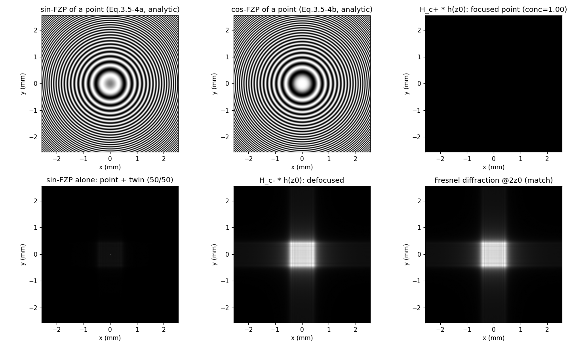
  <figcaption>图（本笔记运行结果，点目标）：上排 解析 sin-FZP 与 cos-FZP 全息图（式 3.5-4a/b，就是标准波带片）；右上 \(H_{c+}*h(z_0)\) 聚焦成点（能量集中度 **1.00**）；下排 sin 全息图单独重建（点 + 孪生，主像能量 0.501）；\(H_{c-}*h(z_0)\) 离焦图与原物 2z₀ 菲涅耳衍射图（右下）**逐点吻合（相关 1.0000）**，验证书 p.88 结论</figcaption>
</figure>

### 3.5.5 拓展实战：同轴数字全息的背景相除法（编者拓展，原书无）

孪生像问题的"另一面"值得对照一遍。第 2 章数字全息（2.5.3）里你的旧代码 `holography.m/孪生像.py` 走的是**同轴记录 + 角谱传播 + 背景相除**路线：过冷水滴（振幅 0.95、相位 1.2 rad）经 5 cm 传播生成同轴全息图，相机面叠加高斯激光背景与灰尘，\(I_{raw}/I_{bg}\) 除掉乘性背景后取平方根反向传播。规范化重写如下：

=== "MATLAB"

    ```matlab
    % ===== 拓展实战（编者，原书无）· 同轴数字全息的背景相除法 =====
    % 改编自你已有的 holography.m / Twins_Image.m（规范化重写）：
    % 过冷水滴（振幅 0.95 + 相位 1.2 rad 的圆盘）经 z=5cm 角谱传播生成同轴全息图，
    % 相机面叠加高斯激光背景与两粒灰尘 -> 背景相除 I_raw/I_bg -> sqrt 估计复振幅 -> 反向传播重建。
    %
    % 与本章 OSH 的关系（笔记 3.5 节"孪生像问题"对照）：
    % - 背景相除只能去掉乘性背景（灰尘/照明不均），对同轴全息的孪生像虚影无能为力——
    %   重建振幅图里水滴周围仍有发散的"孪生像波纹"。
    % - OSH 路线（本章）：一次 2-D 扫描同时记录 sin/cos 两张全息图，复数相加 H_cos + j*H_sin
    %   即可在同轴记录下彻底消除孪生像（式 3.5-5）。
    %
    % 差异提示：
    % 1) 全书最大的坑：书的前向变换是 +j 指数，严格实现用 ifft2*N^2；逆变换用 fft2/N^2（文件末尾封装）。
    %    你旧版 holography.m 的 ifft2(...)*N^2 + fft2(...)/N^2 组合正是书协议（与 2.3 节 asm_propagation 一致）。
    % 2) 连通域定位用 regionprops（Image Processing Toolbox）；去 toolbox 的简化版见 Python 版。

    clear
    N = 512; lambda0 = 532e-9; dx = 5e-6; L = N*dx; z_prop = 0.05; k0 = 2*pi/lambda0;
    x = (-N/2:N/2-1)*dx; y = (-N/2:N/2-1)*dx;
    [XX, YY] = meshgrid(x, y);

    % ---- 1. 模拟背景：高斯激光 + 两粒灰尘 ----
    w0 = 1.5e-3;
    I_laser = exp(-2*(XX.^2+YY.^2)/w0^2);
    t_noise = ones(N);
    dust1 = ((XX-0.5e-3).^2 + (YY-0.5e-3).^2) <= (20e-6)^2;
    dust2 = ((XX+0.6e-3).^2 + (YY-0.4e-3).^2) <= (15e-6)^2;
    t_noise(dust1 | dust2) = 0.2;
    I_bg = I_laser.*t_noise;

    % ---- 2. 原始物体：过冷水滴（振幅 0.95 + 相位 1.2 rad） ----
    U_obj = ones(N);
    mask = XX.^2 + YY.^2 <= (50e-6)^2;                 % 半径 50 um
    U_obj(mask) = 0.95*exp(1j*1.2);

    % ---- 3. 角谱正/反向传播（书式协议，自动滤消逝波） ----
    df = 1/L; fx = (-N/2:N/2-1)*df; fy = (-N/2:N/2-1)*df;
    [KY, KX] = meshgrid(fy, fx);
    root = 1 - (KX.^2+KY.^2)/k0^2; root(root < 0) = 0;   % 滤除消逝波
    H_fwd = exp(-1j*k0*z_prop*sqrt(root));
    H_bwd = exp(+1j*k0*z_prop*sqrt(root));               % 反向传播：z 取 -z_prop

    U_det = ift2_book(ft2_book(U_obj).*H_fwd);           % 传播到相机面
    I_raw = (abs(U_det).^2).*I_bg;                       % 相机记录（含背景）
    I_proc = I_raw./I_bg;                                % 背景相除（乘性噪声消除）
    U_final = ift2_book(ft2_book(sqrt(I_proc)).*H_bwd);  % sqrt 强度当复振幅估计，反向传播

    % ---- 4. 定位分析 ----
    amp = abs(U_final);
    amp_n = (amp - min(amp(:)))/(max(amp(:)) - min(amp(:)));
    binary = amp_n < 0.45;
    stats = regionprops(binary, 'Centroid', 'Area');
    fprintf('检测到 %d 个连通域；', length(stats));
    for kk = 1:length(stats)
        c = stats(kk).Centroid;
        d_eq = 2*dx*sqrt(stats(kk).Area/pi)*1e6;
        fprintf('质心 (%+.3f, %+.3f) mm, 等效直径 %.1f um;  ', ...
                (c(1)-N/2)*dx*1e3, (c(2)-N/2)*dx*1e3, d_eq);
    end
    fprintf('\n注意：重建振幅中水滴周围仍可见孪生像虚影波纹——背景相除无法消除孪生像。\n');

    % ---- 5. 可视化 ----
    figure('Position', [100, 100, 1200, 800]);
    subplot(2,3,1); imagesc(x*1e3, y*1e3, abs(U_obj)); colormap gray; axis image; colorbar
    title('1. Object amplitude |U_obj| (z=0)'); xlabel('x (mm)'); ylabel('y (mm)')
    subplot(2,3,2); imagesc(x*1e3, y*1e3, I_raw); axis image; colorbar
    title('2. Raw hologram (laser bg + dust)'); xlabel('x (mm)'); ylabel('y (mm)')
    subplot(2,3,3); imagesc(x*1e3, y*1e3, I_proc); axis image; colorbar
    title('3. Background-divided hologram'); xlabel('x (mm)'); ylabel('y (mm)')
    subplot(2,3,4); imagesc(x*1e3, y*1e3, amp); axis image; colorbar
    title('4. Reconstructed amplitude (twin-image haze)'); xlabel('x (mm)'); ylabel('y (mm)')
    subplot(2,3,5); imagesc(x*1e3, y*1e3, angle(U_final)); colormap jet; axis image; colorbar
    title('5. Reconstructed phase (rad)'); xlabel('x (mm)'); ylabel('y (mm)')
    subplot(2,3,6); imagesc(x*1e3, y*1e3, amp); axis image; hold on
    title('6. Detection'); xlabel('x (mm)'); ylabel('y (mm)')
    for kk = 1:length(stats)
        c = stats(kk).Centroid;
        plot((c(1)-N/2)*dx*1e3, (c(2)-N/2)*dx*1e3, 'ro', 'MarkerSize', 10, 'LineWidth', 2);
    end
    hold off

    % ---- 局部函数（脚本内定义，须置于文件末尾，R2016b+ 支持） ----
    function F = ft2_book(U)
    % 书式前向变换（+j 指数）
    N = size(U, 1);
    F = fftshift(ifft2(ifftshift(U)))*N^2;
    end

    function U = ift2_book(A)
    % 书式逆变换（-j 指数）
    N = size(A, 1);
    U = fftshift(fft2(ifftshift(A)))/N^2;
    end
    ```

=== "Python"

    ```python
    # ===== 拓展实战（编者，原书无）· 同轴数字全息的背景相除法 =====
    # 改编自你已有的 holography.m / 孪生像.py / 背景相除法.py（规范化重写，去 OpenCV 依赖）：
    # 过冷水滴（振幅 0.95 + 相位 1.2 rad 的圆盘）经 z=5cm 角谱传播生成同轴全息图，
    # 相机面叠加高斯激光背景与两粒灰尘 -> 背景相除 I_raw/I_bg -> sqrt 估计复振幅 -> 反向传播重建。
    #
    # 与本章 OSH 的关系（笔记 3.5 节"孪生像问题"对照）：
    # - 背景相除只能去掉乘性背景（灰尘/照明不均），对同轴全息的孪生像虚影无能为力——
    #   重建振幅图里水滴周围仍有发散的"孪生像波纹"。
    # - OSH 路线（本章）：一次 2-D 扫描同时记录 sin/cos 两张全息图，复数相加 H_cos + j*H_sin
    #   即可在同轴记录下彻底消除孪生像（式 3.5-5）。
    #
    # 严格书约定：前向变换 ifft2*N^2（+j 指数）、逆变换 fft2/N^2（-j 指数）——见 ch2 asm_propagation.py。
    #
    # MATLAB / Python 差异提示：
    # 1) MATLAB 版用 regionprops 做连通域定位；此处用简单阈值 + 质心公式（numpy 足够）。
    # 2) imagesc/imshow 坐标原点差异同前几章。

    import numpy as np
    import matplotlib.pyplot as plt

    # ----- 1. 参数与物体/背景 -----
    N = 512
    lam = 532e-9
    dx = 5e-6
    L = N*dx
    z_prop = 0.05
    k0 = 2*np.pi/lam
    x = (np.arange(N)-N//2)*dx
    y = (np.arange(N)-N//2)*dx
    X, Y = np.meshgrid(x, y)

    w0 = 1.5e-3                                        # 高斯激光背景束腰
    I_laser = np.exp(-2*(X**2+Y**2)/w0**2)
    t_noise = np.ones((N, N))
    dust1 = ((X-0.5e-3)**2 + (Y-0.5e-3)**2) <= (20e-6)**2
    dust2 = ((X+0.6e-3)**2 + (Y-0.4e-3)**2) <= (15e-6)**2
    t_noise[dust1 | dust2] = 0.2                       # 两粒灰尘（透过率 0.2）
    I_bg = I_laser*t_noise

    U_obj = np.ones((N, N), dtype=complex)
    mask = (X**2 + Y**2) <= (50e-6)**2                 # 半径 50 um 的过冷水滴
    U_obj[mask] = 0.95*np.exp(1j*1.2)                  # 振幅 0.95、相位 1.2 rad

    # ----- 2. 书式傅里叶协议 + 角谱正/反向传播 -----
    def ft2_book(U):
        return np.fft.fftshift(np.fft.ifft2(np.fft.ifftshift(U))) * N**2

    def ift2_book(A):
        return np.fft.fftshift(np.fft.fft2(np.fft.ifftshift(A))) / N**2

    df = 1/L
    fx = (np.arange(N)-N//2)*df
    FY, FX = np.meshgrid(fx, fx)
    KX, KY = 2*np.pi*FX, 2*np.pi*FY
    root = 1 - (KX**2+KY**2)/k0**2
    root[root < 0] = 0                                 # 滤除消逝波
    H_fwd = np.exp(-1j*k0*z_prop*np.sqrt(root))
    H_bwd = np.exp(+1j*k0*z_prop*np.sqrt(root))        # 反向传播：z 取 -z_prop

    U_det = ift2_book(ft2_book(U_obj)*H_fwd)           # 传播到相机面
    I_raw = np.abs(U_det)**2 * I_bg                    # 相机记录（含背景）
    I_proc = I_raw/I_bg                                # 背景相除（乘性噪声消除）
    U_rec = ift2_book(ft2_book(np.sqrt(I_proc))*H_bwd) # 反向传播重建（sqrt 强度当复振幅估计）

    # ----- 3. 简单定位（阈值 + 质心，代替 OpenCV 连通域） -----
    amp = np.abs(U_rec)
    amp_n = (amp - amp.min())/(amp.max()-amp.min())
    binary = amp_n < 0.45
    ys, xs = np.nonzero(binary)
    if len(xs) > 0:
        cx, cy = xs.mean(), ys.mean()
        d_equiv = 2*dx*np.sqrt(binary.sum()/np.pi)*1e6
        print(f'水滴质心：x = {(cx-N/2)*dx*1e3:+.3f} mm, y = {(cy-N/2)*dx*1e3:+.3f} mm, '
              f'等效直径 = {d_equiv:.1f} um（真值 100 um）')
        print('注意：重建振幅中水滴周围仍可见孪生像虚影波纹——背景相除无法消除孪生像。')

    # ----- 4. 可视化 -----
    fig, ax = plt.subplots(2, 3, figsize=(14, 8))
    ext = [x[0]*1e3, x[-1]*1e3, y[0]*1e3, y[-1]*1e3]
    ax[0,0].imshow(np.abs(U_obj), extent=ext, cmap='gray')
    ax[0,0].set_title('1. Object amplitude |U_obj| (z=0)')
    ax[0,1].imshow(I_raw, extent=ext, cmap='gray')
    ax[0,1].set_title('2. Raw hologram (laser bg + dust)')
    ax[0,2].imshow(I_proc, extent=ext, cmap='gray')
    ax[0,2].set_title('3. Background-divided hologram')
    ax[1,0].imshow(amp, extent=ext, cmap='gray')
    ax[1,0].set_title('4. Reconstructed amplitude (twin-image haze)')
    ax[1,1].imshow(np.angle(U_rec), extent=ext, cmap='jet')
    ax[1,1].set_title('5. Reconstructed phase (rad)')
    ax[1,2].imshow(amp, extent=ext, cmap='gray')
    if len(xs) > 0:
        ax[1,2].plot((cx-N/2)*dx*1e3, (cy-N/2)*dx*1e3, 'ro', ms=10, mfc='none', mew=2)
        ax[1,2].set_title('6. Centroid detection')
    for a in ax.flat:
        a.set_xlabel('x (mm)'); a.set_ylabel('y (mm)')
    plt.tight_layout(); plt.show()
    ```

实跑结果：水滴质心定位误差 0（\(+0.000,+0.000\) mm），等效直径 **99.2 µm**（真值 100 µm，误差 0.8%）——背景相除对"定位/测量"任务完全够用。但重建振幅图中水滴周围的发散波纹（孪生像虚影）**除不掉**：它来自 \(|U|^2\) 记录的共轭项，是加性的、不是乘性的。OSH 的复全息图路线（3.5.3）从记录端就把共轭项分离到另一张全息图里，才能根治。

<figure>
  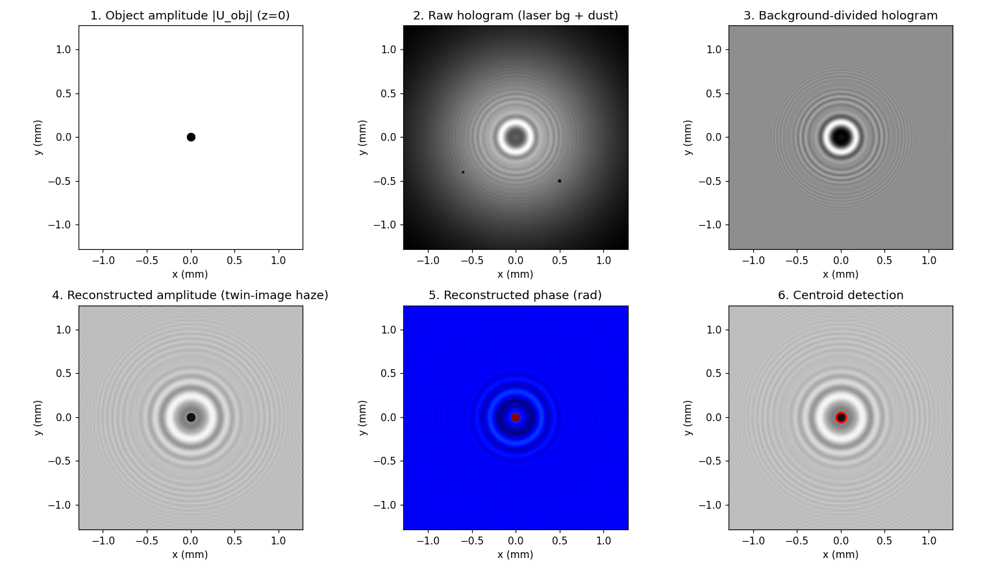
  <figcaption>图（本笔记运行结果，拓展实战）：上排 水滴振幅（z=0）→ 原始全息图（含高斯背景与两粒灰尘）→ 背景相除后的干净全息图；下排 反向传播重建的振幅（水滴 + 孪生像虚影波纹——背景相除治不了）→ 重建相位 → 质心定位（等效直径 99.2 µm，真值 100 µm）</figcaption>
</figure>

## 3.6 物理直觉：光学扫描全息

数学推完了，这一节把 OSH 还原成一幅"看得见"的物理图景：**用一张会跑的 FZP 去扫描物体**。还是在双瞳处理器里选 \(p_1=1\)、\(p_2=\delta\)：L1 在扫描镜上形成点源、L2 形成平面波（\(\omega_0\) 与 \(\omega_0+\Omega\)）。在 \(z=z_0\) 处（物体所在平面），平面波与球面波干涉，扫描光束的强度为：

\[
I_{scan}(x,y;z_0,t)=\Big|a\exp[j(\omega_0+\Omega)t]+\frac{jk_0}{2\pi z_0}\exp\Big[-j\frac{k_0}{2z_0}(x^2+y^2)\Big]\exp(j\omega_0t)\Big|^2
\]

\[
=E^2+F^2+EF\sin\Big[\frac{k_0}{2z_0}(x^2+y^2)+\Omega t\Big]
=\text{TDFZP}(x,y;z_0,t),
\tag{3.6-1}
\]

其中 \(a\) 是平面波振幅，\(E^2=a^2+(k_0/2\pi z_0)^2\)、\(EF=2a\,\text{(系数)}\) 即 (2.5-3) 定义的 \(A,B\)。这个式子叫**时间依赖菲涅耳波带片**（time-dependent Fresnel zone plate, TDFZP）——与第 2 章记录轴上点源全息图的 (2.5-4) 完全同形，只多了个时间变量 \(t\)。

<figure>
  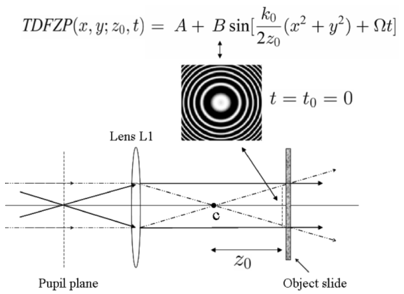
  <figcaption>图 3.16 OSH 原理：光瞳平面（点源 + 平面波）→ 透镜 L1 → 在物面（z₀ 处的 Object slide）上形成 TDFZP 扫描图案；t = t₀ = 0 时是"静态"FZP。Adapted from Poon, Journal of Holography and Speckle 1, 6-25 (2004)（截自原书）</figcaption>
</figure>

用 TDFZP 扫针孔物体（\(I(x,y)=\delta(x,y)\delta(z-z_0)\)）：PD 电流就是 TDFZP 的逐点采样（针孔"读"出扫描图案的强度）。BPF@Ω 后：

\[
i_\Omega(x,y)\sim\sin\Big[\frac{k_0}{2z_0}(x^2+y^2)+\Omega t\Big],
\tag{3.6-2}
\]

电子检测（乘 \(\cos(\Omega t)\) + 低通）：

\[
i_c(x,y)\sim\sin\Big[\frac{k_0}{2z_0}(x^2+y^2)\Big],
\tag{3.6-3}
\]

这正是 (3.5-4a)！**OSH = 用 TDFZP 光栅扫描 3-D 物体**——一条不需要任何傅里叶变换的推导路线（纯时域强度），与 3.5 节的频域推导殊途同归。

**会跑的条纹**：看 (3.6-1) 的相位 \(\frac{k_0}{2z_0}r^2+\Omega t\)。固定相位 \(c\) 的圆环半径 \(r(t)=\sqrt{(c-\Omega t)\cdot 2z_0/k_0}\)——**\(t\) 增大，\(r\) 减小：条纹向中心跑**（running fringes toward the center），图 3.16。

**换瞳也有戏**：选 \(p_1=\delta\)（平面波 @\(\omega_0\)）、\(p_2=1\)（点源 @\(\omega_0+\Omega\)）——把频差"挂"到另一束上：

\[
I_{scan}(x,y;z_0,t)=E^2+F^2+EF\sin\Big[\frac{k_0}{2z_0}(x^2+y^2)-\Omega t\Big]
=\text{TDFZP}(x,y;z_0,-t),
\tag{3.6-4}
\]

**条纹远离中心跑**（把 TDFZP.m 里 \(\sin\) 的 \(+B\,t\) 改成 \(-B\,t\) 即可验证）。有趣的是：换瞳后 (3.5-3a) 的正弦全息图表达式**不变**，而余弦全息图前面**多一个负号**——上一节数值验证过其根源：换瞳使 \(OTF_{osh}\) 变为原 OTF 的共轭，\(\sin\) 奇函数不受影响、\(\cos\) 偶函数带符号（在复全息图构造中体现为 \(H_{c+}\leftrightarrow H_{c-}\)）。

!!! note "拓展：零差模式与三步相移"
    把 \(\Omega\) 设为 0，外差退化成**零差**（homodyning）：TDFZP 冻结成静态 FZP，不再有载波可解调。补救办法是在两干涉波之间人为引入**相移**，用三个不同相移各记录一张全息图，从三张图解出复全息图——这就是零差扫描全息（homodyning scanning holography）[Rosen, Indebetouw and Brooker (2006)]，是孪生像问题的又一解法（代价：三次扫描 vs OSH 的一次）。外差法本身的误差与灵敏度问题本书不展开，可读 [Kreis (2005)] Handbook of Holographic Interferometry 第 5.4 节。

原书 Table 3.2 的 TDFZP.m（感谢 Kelly Dobson 的初始编程）演示运行条纹：

=== "MATLAB"

    ```matlab
    % ===== 书 3.6 节 · Table 3.2 TDFZP.m 的规范化重写：时间依赖菲涅耳波带片的运行条纹 =====
    % TDFZP(x,y;z0,t) = A + B*sin[(k0/2*z0)(x^2+y^2) + Omega*t]     (3.6-1)
    % 平面波（w0+Omega）与球面波（w0）干涉形成的"会跑的 FZP"：t 增大时同相位圆环半径缩小，
    % 条纹向中心运动（running fringes toward the center）——OSH 就是用它光栅扫描 3-D 物体。
    % 换瞳（p1=delta, p2=1）得 TDFZP(x,y;z0,-t)：条纹远离中心；sin 全息图不变、cos 全息图反号 (3.6-4)。
    %
    % 原书参数：B=10.01e6（时间频率，任意）、D=6（空间尺度，任意）、t=linspace(0,1,35)，
    % x,y=linspace(-2.5,2.5,256)，FZP = 1+sin(D*(x^2+y^2)+B*t)，逐帧归一化后 movie 播放。
    % 本版保留原书参数与 movie 动画，同时输出 3 个静态帧便于笔记截图。
    %
    % 差异提示：
    % 1) 原书三重循环 (ii,jj,kk)；本版用 meshgrid + 广播一次生成（数值相同，速度更快）。
    % 2) 原书 image(256*FZP) 行方向向下；本版 imagesc + axis off 展示。
    % 3) 改变条纹运动方向：把 sin 里的 +B*t 改成 -B*t（等价于 3.6-4 的 TDFZP(x,y;z0,-t)）。

    clear
    B = 10.01e6;                 % 时间频率（任意单位）
    D = 6;                       % 空间尺度（任意单位）
    t = linspace(0, 1, 35);
    x = linspace(-2.5, 2.5, 256);
    y = linspace(-2.5, 2.5, 256);
    [X, Y] = meshgrid(x, y);

    % ---- 生成全部帧（原书三重循环的广播版） ----
    phase = D*(X.^2 + Y.^2);                 % 空间部分（静态 FZP）
    NT = length(t);
    FZP = zeros(size(X,1), size(X,2), NT);
    for kk = 1:NT
        FZP(:,:,kk) = 1 + sin(phase + B*t(kk));          % TDFZP (3.6-1)
    end

    % ---- 静态 3 帧（条纹向中心运动：t 增大，同相位圆环半径 r(t)=sqrt((c-B t)/D) 减小） ----
    figure(1)
    for i = 1:3
        kk = round(1 + (i-1)*(NT-1)/2);
        subplot(1,3,i); imagesc(x, y, 256*FZP(:,:,kk)/max(FZP(:,:,kk),[],'all'));
        colormap(gray(256)); axis image off
        title(sprintf('TDFZP: sin[6r^2 + \\Omega t],  \\Omega t = %.2f', B*t(kk)))
    end

    % ---- 动画（原书 movie） ----
    figure(2)
    F = [];
    for ll = 1:NT
        subplot(1,1,1); imagesc(x, y, 256*FZP(:,:,ll)); colormap(gray(256)); axis image off
        F = [F, getframe];
    end
    movie(F, 2)      % 播放 2 遍；条纹向中心收缩（running fringes toward the center）
    ```

=== "Python"

    ```python
    # ===== 书 3.6 节 · Table 3.2 TDFZP.m 的 Python 版：时间依赖菲涅耳波带片的运行条纹 =====
    # TDFZP(x,y;z0,t) = A + B*sin[(k0/2*z0)(x^2+y^2) + Omega*t]     (3.6-1)
    # 平面波（w0+Omega）与球面波（w0）干涉形成的"会跑的 FZP"：t 增大时同相位圆环半径缩小，
    # 条纹向中心运动（running fringes toward the center）——OSH 就是用它光栅扫描 3-D 物体。
    # 换瞳（p1=delta, p2=1）得 TDFZP(x,y;z0,-t)：条纹远离中心；sin 全息图不变、cos 全息图反号 (3.6-4)。
    #
    # 原书 TDFZP.m 参数：B=10.01e6（时间频率，任意）、D=6（空间尺度，任意）、t=linspace(0,1,35)，
    # x,y=linspace(-2.5,2.5,256)，FZP = 1+sin(D*(x^2+y^2)+B*t)，逐帧归一化后 movie 播放。
    # 本版固定 3 帧（t 使相位差可见）输出静态对比；想看动画可仿照原书逐帧绘制。
    #
    # MATLAB / Python 差异提示：
    # 1) 原书三重循环 (ii,jj,kk) 用矩阵广播一行完成：D*(X^2+Y^2)+B*t。
    # 2) 原书 image(256*FZP) 行方向向下；plt.imshow 加 origin='lower' 对齐数学坐标。
    # 3) 改变条纹运动方向：把 sin 里的 +B*t 改成 -B*t（等价于 3.6-4 的 TDFZP(x,y;z0,-t)）。

    import numpy as np
    import matplotlib.pyplot as plt

    Dc = 6.0                       # 空间尺度（原书 D=6，任意单位）
    Bf = 10.01e6*2*np.pi*0.05      # 时间相位速度（原书 B=10.01e6，此处缩放使静态帧相位差可见）
    xg = np.linspace(-2.5, 2.5, 256)
    Xg, Yg = np.meshgrid(xg, xg)

    fig, ax = plt.subplots(1, 3, figsize=(12, 4))
    for i, tt in enumerate([0.0, 0.35, 0.7]):
        FZP = 1 + np.sin(Dc*(Xg**2 + Yg**2) + Bf*tt)     # TDFZP (3.6-1)
        ax[i].imshow(FZP, cmap='gray', extent=[-2.5, 2.5, -2.5, 2.5], origin='lower')
        ax[i].set_title(f'TDFZP: sin[6r$^2$ + $\\Omega$t],  $\\Omega$t = {Bf*tt:.2f}')
        ax[i].axis('off')
    plt.tight_layout(); plt.show()

    # 条纹向中心运动的验证：跟踪相位 = D*r^2 + B*t = const 的半径 r(t) = sqrt((c - B*t)/D)，
    # t 增大 -> r 减小 -> 圆环向中心收缩（书 3.6 节 "running fringes moving toward the center"）。
    ```

<figure>
  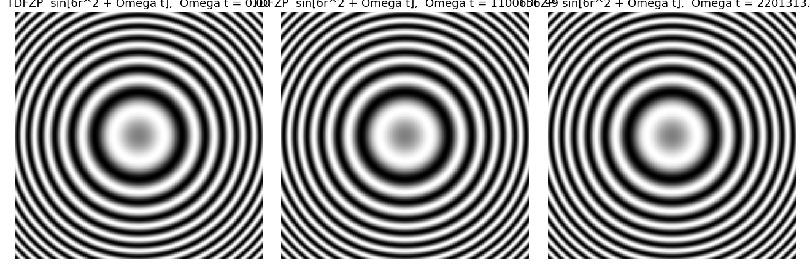
  <figcaption>图（本笔记运行结果）：TDFZP 三个时刻的条纹帧（\(\Omega t=0,\ 1.10,\ 2.20\)）——同相位圆环随 \(t\) 收缩，即"条纹向中心跑"；把 +Ωt 换成 −Ωt（式 3.6-4，换瞳情形）则向外跑</figcaption>
</figure>

## 坑与陷阱

!!! danger "书公式 vs MATLAB FFT：+j 指数是全书头号坑（第 3 次出现）"
    书式前向变换（+j 指数）必须 `ifft2(U)*N^2`，逆变换 `fft2(A)/N^2`。本章 (3.5-1a) 的 \(OTF_{osh}=e^{-j\sigma k^2}\) 是按书式约定写的：若你用 `fft2` 当前向，OTF 指数必须整体反号，否则记录/传播方向全反。**本章特有的坑**：原书 OSH.m 恰好用的是 MATLAB 原生约定（`fft2` + `exp(-j*sigma*k^2)`）——它把 OTF 指数与变换一起镜像了，**整个闭环自洽**，所以重建结果正确；这与你 ch2 里 `Ideal Lens.m` 那种"fft2 配书式传播子"的**混搭**（强度对、复振幅镜像错）不同。判据不变：**解析传递函数路线约定敏感，显式 h 卷积/闭环路线约定自洽即可**——但读代码前先问一句"它用的是哪套约定"。

!!! danger "i_s 的符号：Im 还是 -Im"
    电子学定义（式 3.2-3b，乘 \(\sin\Omega t\) 后低通）给出 \(i_s=-\mathrm{Im}\{i_{\Omega_p}\}/2\)。书 (3.4-14b) 写 \(\mathrm{Im}\)（应为 \(-\mathrm{Im}\)，见勘误），若照抄会得到 cos 全息图反号、\(H_{c\pm}\) 的实/虚像互换。写代码时固定用：\(H_{\sin}=\mathrm{Re}\{i_{\Omega_p}\}\)、\(H_{\cos}=-\mathrm{Im}\{i_{\Omega_p}\}\)。

!!! danger "复全息图的三种"等价"写法差全局相位"
    \(H_{c+}=H_{\cos}+jH_{\sin}=j\,i_{\Omega_p}\)（差因子 \(j\)）；OSH.m 的 `real(H)+1j*imag(H)` 就是 \(i_{\Omega_p}\) 本身。三种写法强度重建完全一致（\(j\) 是全局相位），但**实部/虚部是 sin 还是 cos 会跟着变**——跨代码对比时先对齐约定再比像素。

!!! danger "σk² 相位深度与 Poisson 混叠"
    \(e^{-j\sigma k^2}\) 不是带限函数。离散网格上它的相邻格相位跳变 \(2\sigma k\,\Delta k\) 必须 < π，否则逆变换混入 Poisson 旁瓣——表现为 sin/cos 全息图上的快速颗粒纹理（书图 3.15b/c 的"沙粒"外观即来源于此，书的 \(\sigma=2\)、\(\Delta k=0.1\) 参数最大跳变约 5.1 rad）。**闭环重建（乘 \(\mathrm{conj}(OTF_{osh})\)）不受影响**——记录与重建用的是同一张混叠的 OTF 表，相位精确抵消（本笔记实测复全息图重建与原图相关 1.0000）。但想拿"数值全息图"去对比解析 FZP 逐点形状时，必须加频域窗或减小 \(\sigma k^2\) 深度。

!!! danger "全息图重建的"50/50"：sin 或 cos 单独不够"
    sin（或 cos）全息图只携带一半信息：单独重建时主像与孪生像平分能量（本笔记实测主像 0.501）。别指望"反差好一点"的 cos 支路更好——两条支路各缺一半相位信息。复全息图 \(H_{c+}\) 才是完整记录（集中度 1.0000）。

!!! danger "外差频率 Ω 的现实约束"
    教材里 \(\Omega\) 是纯符号；真实系统里它是 AOM 的 40 MHz 声频，直接决定电子学带宽：BPF/LPF/锁相放大器都要围绕它设计，扫描速度也不能快过探测器电路的响应。另外 (3.3-5) 的布拉格角 ~0.1°，光学调节时两衍射光的角分离极小，对准要仔细。

!!! danger "背景相除治不了孪生像"
    背景相除（\(I_{raw}/I_{bg}\)）只能消**乘性**背景（照明不均、灰尘）。同轴数字全息的孪生像来自 \(|U|^2\) 的共轭项，是记录物理本身，除法碰不到它（本笔记拓展实战可见波纹依旧）。根治要么离轴（载频介质吃紧），要么相移多记录，要么——本章的 OSH 复全息图。

!!! danger "MATLAB 与 Python 的索引/显示差异（延续 ch1/ch2）"
    点目标中心：MATLAB `(N/2+1, N/2+1)` ↔ Python `(N//2, N//2)`；`plt.imshow` 加 `origin='lower'` 对齐数学坐标；MATLAB `imagesc` 配 `axis image`。书 OSH.m 的 `image()` 显示行方向向下，读图时别把上下弄反。

## 速览

1. 扫描 = 相对平移：\(i(x,y)=\iint|b\,\Gamma_0|^2\)，电流只处理物体**强度**（3.1-3/4）；扫描镜上场 = 光瞳的 FT（3.1-5）：\(p=1\to\) 点源、\(p=\delta\to\) 平面波。
2. 直接探测丢相位；外差电流 \(i=D[A^2+B^2+2AB\cos(\Omega t-\phi)]\) 同时保住幅度与相位（3.2-1）。
3. lock-in 双通道解调：\(i_c=A\cos\phi\)、\(i_s=A\sin\phi\)，复数加法 \(i_c+ji_s=Ae^{j\phi}\) 完整恢复信息（3.2-3/4）。
4. AOM：光子-声子碰撞，\(\boldsymbol{k}_{t1}=\boldsymbol{k}_{t0}+\boldsymbol{K}\)、\(\omega_{t1}=\omega_{t0}+\Omega\)（3.3-3/4），布拉格角 \(\sin\phi_B=\lambda_0/2\Lambda\approx0.1°\)（3.3-5）——1 阶衍射光上移 \(\Omega\)。
5. 双瞳处理器：\(p_1\)@ω0、\(p_2\)@ω0+Ω，外差相量 \(i_{\Omega_p}=P_{1z}^*P_{2z}\otimes|\Gamma_0|^2\)（3.4-6/7），\(OTF_\Omega=\mathcal{F}^*\{P_{1z}P_{2z}^*\}\)（3.4-9）——处理元可双极/复数（复非相干处理）。
6. 取 \(p_1=1,p_2=\delta\)：\(OTF_{osh}=e^{-j\sigma k^2}\)（纯相位，3.5-1a），\(h_{osh}=-j\frac{k_0}{2\pi z}e^{+jk_0r^2/2z}=h^*\)（3.5-1b/2b）——FZP 型冲激响应。
7. 一次扫描得两张全息图：\(H_{\sin}=|\Gamma_0|^2*\frac{k_0}{2\pi z}\sin(\cdot)\)、\(H_{\cos}=\cdots\cos(\cdot)\)（3.5-3）；点目标给 \(\frac{k_0}{2\pi z_0}\sin/\cos\big[\frac{k_0}{2z_0}r^2\big]\)（3.5-4，无偏置 FZP）。
8. 复全息图 \(H_{c\pm}=H_{\cos}\pm jH_{\sin}\)（3.5-5）：点目标版 \(e^{\pm jk_0r^2/2z_0}\)（3.5-6），正号重建实像、负号虚像——**同轴记录、无孪生像**（实验见图 3.14）。
9. 重建（3.5-10）：\(H_{any}*h(z_0)\equiv\mathcal{F}^{-1}\{\mathcal{F}\{H_{any}\}OTF_{osh}^*\}\)；\(|OTF|=1\) 使复全息图重建精确还原原图（本笔记实测相关 1.0000）；\(H_{c-}\) 用 \(h(z_0)\) 重建 = 原物 2z₀ 菲涅耳衍射（相关 1.0000）。
10. 物理直觉：OSH = 用 TDFZP（\(\sin[k_0r^2/2z_0+\Omega t]\)，条纹向心跑）光栅扫描 3-D 物体（3.6-1）；换瞳条纹离心跑（3.6-4），sin 不变、cos 反号；Ω=0 时零差 + 三步相移。本笔记代码全配 Python 版并实跑：外差解调误差 \(10^{-15}\)、OTF 特例 \(10^{-12}\)、闭环重建相关 1.0000、水滴定位 99.2 µm。

## 术语速查

| 英文 | 中文 | 一句话 |
| --- | --- | --- |
| optical scanning holography (OSH) | 光学扫描全息 | 用主动光学扫描 + 外差获取 3-D 物体全息信息的电子全息术 |
| active optical scanning | 主动光学扫描 | 移动光束或物体做相对 2-D 扫描（图 3.1/3.4 振镜） |
| photodetector (PD) / direct detection | 光电探测器 / 直接探测 | 平方律 + 空间积分，只测强度、丢相位（3.1-1） |
| optical heterodyne detection | 光学外差探测 | 两束不同频率光拍频，电流保幅度+相位（3.2-1） |
| baseband / heterodyne current | 基带 / 外差电流 | DC 项 \(D(A^2+B^2)\) / AC 项 \(2DAB\cos(\Omega t-\phi)\) |
| electronic multiplexing detection | 电子多路检测 | BPF@Ω + cos/sin 双通道 lock-in 解调（图 3.6） |
| in-phase / quadrature component | 同相 / 正交分量 | \(i_c=A\cos\phi\) / \(i_s=A\sin\phi\)（3.2-3） |
| lock-in detection | 锁相检测 | 乘本振再低通，提取指定频率的幅度与相位 |
| acousto-optic modulator (AOM/AOFS) | 声光调制器 / 频移器 | 声波→折射率光栅，布拉格衍射产生频移光（3.3） |
| photon / phonon | 光子 / 声子 | 声光互作用的粒子图像：动量+能量守恒（3.3-1/2） |
| Bragg angle | 布拉格角 | \(\sin\phi_B=\lambda_0/2\Lambda\approx0.1°\)（AOM-40，3.3-5） |
| upshifted interaction | 上移互作用 | 1 阶衍射光 \(\omega_{+1}=\omega_0+\Omega\)（多普勒频移） |
| two-pupil system | 双瞳系统 | 两个光瞳合成 OTF，处理元可双极/复数（3.4） |
| Mach-Zehnder interferometer | 马赫-曾德尔干涉仪 | 双瞳系统的分光骨架（图 3.10） |
| complex incoherent image processing | 复非相干图像处理 | 非相干（强度）输入 + 复数 OTF 的处理模式 |
| two-pupil optical heterodyne scanning processor | 双瞳光学外差扫描处理器 | OSH 的直接前身（图 3.10/3.11，Poon 1985） |
| spatial impulse response \(h_\Omega\) | （外差扫描系统）空间冲激响应 | \(h_\Omega=\mathcal{F}^{-1}\{OTF_\Omega\}\)（3.4-12） |
| sine/cosine-FZP hologram | 正弦/余弦 FZP 全息图 | \(H_{\sin},H_{\cos}\)：物体强度与 sin/cos 波带片的卷积（3.5-3） |
| complex FZP hologram | 复 FZP 全息图 | \(H_{c\pm}=H_{\cos}\pm jH_{\sin}\)，无孪生像信息（3.5-5） |
| twin-image-free hologram | 无孪生像全息图 | 同轴记录下由两张全息图复数合成（Doh et al. 1996） |
| phase-shifting holography | 相移全息术 | 参考臂移相、四次同轴记录解复物波（Yamaguchi 1997）——OSH 只需一次扫描 |
| TDFZP | 时间依赖菲涅耳波带片 | \(\sin[k_0r^2/2z_0+\Omega t]\)，会跑的 FZP（3.6-1） |
| running fringes | 运行条纹 | TDFZP 圆环随 t 向中心收缩；换瞳向外（3.6-4） |
| homodyning | 零差 | Ω=0 的外差；配三步相移解孪生像（Rosen 2006） |

## 覆盖自查

??? note "原书小节 → 笔记位置对照"
    | 原书内容 | 笔记位置 |
    | --- | --- |
    | 章引言（OSH 出身、应用清单、荧光显微亚微米分辨率） | 章首 |
    | 3.1 Principle of Optical Scanning（式 3.1-1~3.1-5；图 3.1~3.4） | 3.1 |
    | 3.2 Optical Heterodyning（式 3.2-1~3.2-4；图 3.5、3.6） | 3.2（mermaid 流程图 + 代码双 tab + 运行图） |
    | 3.3 Acousto-Optic Frequency Shifting（式 3.3-1~3.3-5；图 3.7~3.9；AOM-40 数值例） | 3.3（数值账在拓展注） |
    | 3.4 Two-Pupil Optical Heterodyne Scanning Image Processor（式 3.4-1~3.4-15；图 3.10、3.11） | 3.4（(3.4-10) 三要点在拓展注；(3.4-14b) 勘误） |
    | 3.5 Scanning Holography（式 3.5-1~3.5-6；图 3.12~3.14） | 3.5.1~3.5.3（mermaid 记录-解码流程图 + 数值验证拓展注） |
    | Example 3.1 + Table 3.1 OSH.m（式 3.5-7~3.5-10；图 3.15） | 3.5.4（代码双 tab + 运行图；(3.5-9) 勘误） |
    | （编者）背景相除法对照实验 | 3.5.5 拓展实战 |
    | 3.6 Physical Intuition（式 3.6-1~3.6-4；图 3.16；Table 3.2 TDFZP.m；homodyning） | 3.6（零差拓展注 + 代码双 tab + 运行图） |
    | References 3.1~3.26 | 见下 |

??? note "原书 References 3.1~3.26"
    3.1 Duncan, B.D. and T.-C. Poon (1992). "Gaussian beam analysis of optical scanning holography," *Journal of the Optical Society of America A* 9, 229-236.
    3.2 Doh, K., T.-C. Poon, M. Wu, K. Shinoda, and Y. Suzuki (1996). "Twin-image elimination in optical scanning holography," *Laser & Optics Technology* 28, 135-141.
    3.3 General Scanning. http://www.gsig.com/scanners/
    3.4 Indebetouw, G. and T.-C. Poon (1992). "Novel approaches of incoherent image processing with emphasis on scanning methods," *Optical Engineering* 31, 2159-2167.
    3.5 Indebetouw, G., P. Klysubun, T. Kim, and T.-C. Poon (2000). "Imaging properties of scanning holographic microscopy," *Journal of the Optical Society of America A* 17, 380-390.
    3.6 Indebetouw, G and W. Zhong (2006). "Scanning holographic microscopy of three-dimensional fluorescent specimens," *Journal of the Optical Society of America A* 23, 1699-1707.
    3.7 IntraAction Corp. http://www.intraaction.com/
    3.8 Kim, T and T.-C. Poon (1999). "Extraction of 3-D location of matched 3-D object using power fringe-adjusted filtering and Wigner analysis," *Optical Engineering* 38, 2176-2183.
    3.9 Korpel, A. (1981). "Acousto-optics—a review of fundamentals," *Proceedings of the IEEE* 69, 48-53.
    3.10 Kreis, T. (2005). *Handbook of Holographic Interferometry*. Wiley-VCH GmbH & Co. KGaA, Weinheim.
    3.11 Lohmann, A.W. and W.T. Rhodes (1978). "Two-pupil synthesis of optical transfer functions," *Applied Optics* 17, 1141-1150.
    3.12 Poon, T.-C. (1985). "Scanning holography and two-dimensional image processing by acousto-optic two-pupil synthesis," *Journal of the Optical Society of America A* 4, 521-527.
    3.13 Poon, T.-C. (2002a). "Three-dimensional television using optical scanning holography," *Journal of Information Display* 3, 12-16.
    3.14 Poon, T.-C. (2002b). "Acousto-Optics," *Encyclopedia of Physical Science and Technology*, Academic Press.
    3.15 Poon, T.-C. (2004). "Recent progress in optical scanning holography," *Journal of Holography and Speckle* 1, 6-25.
    3.16 Poon, T.-C. (2006). "Horizontal-parallax-only optical scanning holography," in chapter 10 of *Digital Holography and Three-Dimensional Display: Principles and Applications*, T.-C. Poon ed., Springer, New York, USA.
    3.17 Poon, T.-C. and A. Korpel (1979). "Optical transfer function of an acousto-optic heterodyning image processor," *Optics Letters* 4, 317-319.
    3.18 Poon, T.-C., K. Doh, B. Schilling, M. Wu, K. Shinoda, and Y. Suzuki (1995). "Three-dimensional microscopy by optical scanning holography," *Optical Engineering* 34, 1338-1344.
    3.19 Poon, T.-C. and T. Kim (1999). "Optical image recognition of three-dimensional objects," *Applied Optics* 38, 370-381.
    3.20 Poon, T.-C., T. Kim, G. Indebetouw, B.W. Schilling, M.H. Wu, K. Shinoda, and Y. Suzuki (2000). "Twin-image elimination experiments for three-dimensional images in optical scanning holography," *Optics Letters* 25, 215-217.
    3.21 Poon, T.-C. and P.P. Banerjee (2001). *Contemporary Optical Image Processing with MATLAB*. Elsevier, Oxford, UK.
    3.22 Poon, T.-C., T. Kim, and K. Doh (2003). "Optical scanning cryptography for secure wireless transmission," *Applied Optics* 42, 6496-6503.
    3.23 Poon, T.-C. and T. Kim (2006). *Engineering Optics with MATLAB*. World Scientific Publishing Co., Singapore.
    3.24 Pratt, W.K. (1969). *Laser Communications Systems*, John Wiley & Sons.
    3.25 Rosen, J., G. Indebetouw, and G. Brooker. "Homodyne scanning holography," *Optics Express* 14, 4280-4285.
    3.26 Yamaguchi, I. and T. Zhang (1997). "Phase-shifting digital holography," *Optics Letters* 22, 1268-1270.

    !!! warning "原书笔误/勘误（本章 4 处，与 ch1/ch2 的 3 处相互独立）"
        1. **(3.4-14b)/(3.4-15d)/(3.5-7b)/(3.5-8b) 的 Im 符号**：电子学定义（式 3.2-3b：\(i_s\) = 乘 \(\sin\Omega t\) 后低通）给出 \(i_s=-\mathrm{Im}\{i_{\Omega_p}\}\)（差负号）。书直接写 \(\mathrm{Im}\)，却又在 (3.5-3b) 取 \(+\cos\)、(3.5-5) 定义 \(H_{c\pm}=H_{\cos}\pm jH_{\sin}\)——两者相差一个共轭。本笔记以电子学/TDFZP 时域推导（(3.6-1)→(3.6-3)）为准：\(H_{\cos}=-\mathrm{Im}\{i_{\Omega_p}\}\)，并经数值验证（3.5.4 拓展注）。
        2. **(3.5-9) 差全局相位因子 j**：由 (3.5-8a/b) 的定义，\(\mathcal{F}^{-1}\{\mathcal{F}\{I\}OTF_{osh}\}=H_{\sin}-jH_{\cos}=-j(H_{\cos}+jH_{\sin})\)。书 (3.5-9) 直接写等号，缺全局因子 \(-j\)（或等价地，sin/cos 在实/虚部的归属与 (3.5-5) 相反）。不影响强度类结果；OSH.m 的实现（complex = real + j·imag）本身自洽。
        3. **OSH.m 代码注释引用错编号**：Table 3.1 中 `FRSINEH=fft2(real(H)).*conj(OTFosh); %Eq. (2.5-10)`——第 2 章并无式 (2.5-10)，应为本章的 **(3.5-10)**。
        4. **图 3.14 图注卷号**：图注写 "Optics Letters 5, 215, (2000)"，正确卷号是 **25**（该书自己的参考文献 3.20 即写 25, 215-217）。


