# 第 4 章 光学扫描全息：应用

> **本章解决**：第 3 章造好了 OSH 这台"记录机"（一次 2-D 扫描得 sin/cos 两张全息图、复 FZP 全息图无孪生像），本章回答"它有什么用"。三个方向：**4.1 扫描全息显微（SHM）**——不需要轴向扫描就能拿 3-D 信息，而且打破了"全息拍不了荧光"的魔咒；**4.2 3-D 全息电视与显示**——OSH 记录 + SLM（EBSLM）重建的完整链路，顺带算清视角/像素/带宽三笔账（结论：全视差是科幻，HPO 是工程可行）；**4.3 光学扫描加密（OSC）**——把"加密密钥"插进双瞳处理器的光瞳里，密文是 Riding 在射频载波上的外差电流，天生适合无线传输。3.4 的双瞳处理器、3.5 的复全息图在本章全部变现；ch5 再回到原理层讲相干模式与最新进展。

原书本章结构：章引言（五大应用领域，本章讲三个）；4.1 扫描全息显微（式 4.1-1~4.1-5，图 4.1~4.7）；4.2 3-D 全息电视与 3-D 显示（图 4.8~4.14，Table 4.1，Example 4.1 式 4.2-1~4.2-5）；4.3 光学扫描加密（图 4.15、4.16，式 4.3-1~4.3-12，Example 4.2 + Table 4.2 Cryptography.m，图 4.17、4.18）；References 4.1~4.46。

OSH 迄今的五大应用领域：扫描全息显微 [Poon, Doh, Schilling, Wu, Shinoda, and Suzuki (1995)]、3-D 图像识别 [Poon and Kim (1999)]、3-D 光学遥感 [Kim and Poon (1999)]、3-D 全息电视与 3-D 显示 [Poon (2002a)]、3-D 加密 [Poon, Kim, and Doh (2003)]。本章只讲显微、电视、加密三个（识别与遥感在书章 [Poon (2002b), Poon (2005)] 中有综述）。

## 4.0 本章导图

<div class="brtree">
  <div class="brrow">
    <span class="brlabel root">OSH 三大应用</span>
    <span class="brace"></span>
    <div class="brkids">
      <div class="brrow">
        <span class="brlabel">显微 4.1</span>
        <span class="brace"></span>
        <div class="brkids">
          <span class="brleaf">不确定关系：Δr↑2 ⇒ Δz↓4（4.1-5）</span>
          <span class="brleaf">OSM/SCM/OCT 全要轴向扫描</span>
          <span class="brleaf">SHM：单次 2-D 扫描 + 荧光（首例）</span>
          <span class="brleaf">横向分辨率 0.5Δr，优于 SCM 的 0.73Δr</span>
          <span class="brleaf">拓展实战：振幅 vs 相位物体成像</span>
        </div>
      </div>
      <div class="brrow">
        <span class="brlabel">电视/显示 4.2</span>
        <span class="brace"></span>
        <div class="brkids">
          <span class="brleaf">EBSLM：电子束寻址 LiNbO₃ + Pockels 效应</span>
          <span class="brleaf">Example 4.1：M_lat=1/M、M_long=1/M²；波长 1/m</span>
          <span class="brleaf">瓶颈 A：视角 θ=2arcsin(λ0f0)，8 lp/mm→0.6°</span>
          <span class="brleaf">瓶颈 B：20mm/60° 要 11 亿像素（4.2-10）</span>
          <span class="brleaf">瓶颈 C：0.26 Tbit/s → HPO 512 线 4 Gbit/s</span>
        </div>
      </div>
      <div class="brrow">
        <span class="brlabel">加密 4.3</span>
        <span class="brace"></span>
        <div class="brkids">
          <span class="brleaf">加密级：p1=随机相位密钥、p2=δ（4.3-5）</span>
          <span class="brleaf">"加密的是全息图"（4.3-6 ≈ 3.5-9 × 密钥）</span>
          <span class="brleaf">解密：z^d=z^c 且 p1*(−x,−y)p2=1（4.3-9）</span>
          <span class="brleaf">DDU：复谱相乘 + 取模去随机相位</span>
          <span class="brleaf">双随机相位编码（Refregier-Javidi）</span>
        </div>
      </div>
    </div>
  </div>
</div>

## 4.1 扫描全息显微

### 4.1.1 先算两笔账：横向分辨率与景深的量子力学推导

3-D 成像对光学显微是个大难题：横向分辨率越高，景深越短——用高数值孔径（**numerical aperture, NA**）物镜可以提高横向分辨率，代价是只有样品的一个薄层能清晰成像。Poon 用一个简单的量子力学论证把这件事算成公式（图 4.1）。

<figure>
  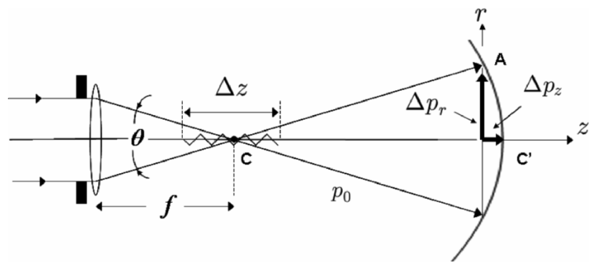
  <figcaption>图 4.1 用不确定原理求分辨率与景深：平行光被透镜聚焦，两极限光线 CA 与 CC′ 夹角 θ，动量差分解出横向 Δp_r 与纵向 Δp_z（截自原书）</figcaption>
</figure>

横向分辨率 Δr：量子力学把位置不确定度 Δr 与动量不确定度 Δp_r 联系起来（注意书用的是 **h 而不是 ℏ**）：

\[
\Delta r\,\Delta p_r\ \ge\ h,
\tag{4.1-1}
\]

其中 Δp_r 是光线 CA 与 CC′ 沿 r 方向（横向）的动量差。CA 光线沿 r 方向的动量是 \(p_0\sin(\theta/2)\)、CC′ 是零，\(p_0=h/\lambda_0\) 是量子的动量，故 \(\Delta p_r=p_0\sin(\theta/2)\)。代入 (4.1-1)：

\[
\Delta r\ \ge\ \frac{h}{\Delta p_r}=\frac{h}{p_0\sin(\theta/2)}=\frac{h}{(h/\lambda_0)\sin(\theta/2)}=\frac{\lambda_0}{\sin(\theta/2)}.
\]

若物方（样品）空间折射率为 \(n_0\)，介质中波长为 \(\lambda/n_0\)（\(\lambda\) 是空气/真空波长），上式变为

\[
\Delta r\ \ge\ \frac{\lambda}{n_0\sin(\theta/2)}=\frac{\lambda}{NA},
\tag{4.1-2}
\]

其中 \(NA=n_0\sin(\theta/2)\) 叫**数值孔径**。同样，景深 Δz 满足

\[
\Delta z\,\Delta p_z\ \ge\ h,
\tag{4.1-3}
\]

其中 Δp_z 是光线 CA′ 与 CC′ 沿 z 方向的动量差，由图 4.1 的几何：

\[
\Delta p_z=p_0-p_0\cos(\theta/2)=p_0\big[1-\cos(\theta/2)\big].
\]

代入 (4.1-3)：

\[
\Delta z\ \ge\ \frac{h}{\Delta p_z}=\frac{h}{p_0\big[1-\cos(\theta/2)\big]}=\frac{\lambda_0}{\big[1-\cos(\theta/2)\big]},
\]

写成只含 \(\sin(\theta/2)\) 的形式：

\[
\Delta z\ \ge\ \frac{\lambda_0}{\big[1-\sqrt{1-\sin^2(\theta/2)}\big]}
\approx\frac{2\lambda_0}{\sin^2(\theta/2)}=\frac{2n_0\lambda}{NA^2},
\tag{4.1-4}
\]

（最后一步用了 \(\sqrt{1-\sin^2(\theta/2)}\approx 1-\tfrac12\sin^2(\theta/2)\)，即假设 \(\sin^2(\theta/2)\ll 1\)。）把 (4.1-2) 与 (4.1-4) 结合，消去 NA：

\[
\frac{(\Delta r)^2}{\Delta z}\ \ge\ \frac{\lambda_0}{2}.
\tag{4.1-5}
\]

人话版：这条"**不确定关系**"（uncertainty relationship）告诉你——横向分辨率提高 2 倍，景深就必须缩短 4 倍。分辨率与景深是显微镜里按下葫芦浮起瓢的一对。3-D 显微的目标就是：**高横向分辨率 + 大景深**同时成立，才能轻松看厚样品。

!!! warning "原书笔误：4.1 节的 λ/λ0/n0 记号混用"
    严格按 (4.1-2)（λ 为空气波长、NA=n0 sin(θ/2)）与 (4.1-4) 的 \(2n_0\lambda/NA^2\) 代入，(4.1-5) 左端应为 \(\lambda/(2n_0)\)；书直接写 \(\lambda_0/2\)，隐含 \(n_0=1\)（生物样本 \(\approx 1\)，数值无差）。复现这组公式时先固定一套记号（本笔记统一：\(\lambda_0\)=真空波长、\(NA=n_0\sin(\theta/2)\)），否则推导链条会对不上。

!!! note "拓展：实验数值账——自己把 4.1 节的数字重算一遍"
    书 4.1 节实验：\(f=150\) mm 透镜聚焦直径 \(D=10\) mm 的平面波，\(\lambda_0=514.5\) nm（氩离子激光线）。\(\sin(\theta/2)\approx\tan(\theta/2)=(D/2)/f=0.0333\)，即 \(NA\approx 0.0333\) ✓（书印 0.033）。代入 (4.1-2)/(4.1-4)：\(\Delta r=\lambda_0/NA=15.4\ \mu\text{m}\)、\(\Delta z=2\lambda_0/NA^2=0.93\) mm；书印 \(\Delta r\approx 18.5\ \mu\text{m}\)、\(\Delta z\approx 1028.4\ \mu\text{m}\)——同数量级但对应 \(NA\approx 0.028\) 与 \(0.0316\)，属书内舍入不一致，量级结论不变。另验 (4.1-5)：\((\Delta r)^2/\Delta z=0.257\ \mu\text{m}=\lambda_0/2\) ✓ 精确自洽。（15 µm 荧光小球 vs Δr≈15~18 µm：确实"很接近横向分辨极限"。）

<figure>
  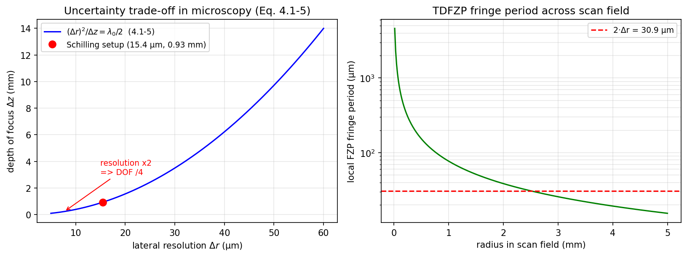
  <figcaption>图（本笔记运行结果）：左 (4.1-5) 的 Δz–Δr 双曲线标度律与 Schilling 实验位置（分辨率×2 ⇒ 景深÷4）；右 TDFZP 扫描场内的条纹周期分布——边缘最细（决定采样要求）</figcaption>
</figure>

这批数字的复核脚本（纯数值，无傅里叶约定问题）：

=== "MATLAB"

    ```matlab
    % ===== 书 4.1 节 · 分辨率-景深度量衡（式 4.1-1 ~ 4.1-5）与 Schilling 荧光实验的数值账 =====
    % 量子力学不确定关系（书用 h 而非 hbar）：
    %   横向：Δr·Δp_r >= h,  Δp_r = p0·sin(θ/2),  p0 = h/λ0
    %       -> Δr >= λ0/sin(θ/2) = λ/(n0 sin(θ/2)) = λ/NA          (4.1-2)
    %   纵向：Δz·Δp_z >= h,  Δp_z = p0·[1-cos(θ/2)]
    %       -> Δz >= λ0/[1-cos(θ/2)] ≈ 2λ0/sin²(θ/2) = 2n0λ/NA²    (4.1-4)
    %   两式结合：(Δr)²/Δz >= λ0/2                                  (4.1-5，标度律)
    % 分辨率提高 2 倍 -> 景深必须缩短 4 倍。
    %
    % 实验参数（书 4.1 节，Schilling et al. Optics Lett. 22, 1506 (1997)）：
    %   f = 150 mm（聚焦透镜 L1 焦距），D = 10 mm（被聚焦的平面波直径），λ0 = 514.5 nm（氩离子）
    % 书印数值：NA ≈ 0.033，Δr ≈ 18.5 µm，Δz ≈ 1028.4 µm。
    % 实跑重算：NA = 0.0333 -> Δr = 15.4 µm、Δz = 0.93 mm（书值对应 NA≈0.028/0.0316，舍入不一致）。
    %
    % 差异提示：纯数值脚本，无傅里叶约定问题；Python 版同目录 shm_na_resolution.py。

    clear
    f1  = 150e-3;        % L1 焦距 (m)
    D   = 10e-3;         % 平面波直径 (m)
    lam = 514.5e-9;      % 氩离子 514.5 nm 线（真空中）
    n0  = 1.0;           % 样本空间近似空气/水

    half_angle = atan((D/2)/f1);          % θ/2
    NA = n0 * sin(half_angle);
    d_r = lam / NA;                       % (4.1-2) 横向分辨率
    d_z = 2 * n0 * lam / NA^2;            % (4.1-4) 景深

    fprintf('θ/2 = %.4f deg,  NA = %.4f\n', rad2deg(half_angle), NA);
    fprintf('式(4.1-2): Δr = λ0/NA = %.1f µm   （书印 18.5 µm）\n', d_r*1e6);
    fprintf('式(4.1-4): Δz = 2λ0/NA² = %.1f µm = %.2f mm（书印 1028.4 µm）\n', d_z*1e6, d_z*1e3);
    fprintf('15 µm 荧光小球 vs Δr = %.1f µm：接近横向极限，可分辨\n', d_r*1e6);
    fprintf('式(4.1-5) 标度律：(Δr)²/Δz = %.4f µm ≈ λ0/2 = %.4f µm\n', d_r^2/d_z*1e6, lam/2*1e6);

    % ---- (4.1-5) 标度律曲线：Δz(Δr) 双曲线 ----
    r = linspace(5e-6, 60e-6, 400);
    z_hyp = 2 * r.^2 / lam;               % 由 (Δr)²/Δz = λ0/2 反解

    figure(1)
    subplot(1,2,1)
    plot(r*1e6, z_hyp*1e3, 'b-', 'LineWidth', 1.5); hold on
    plot(d_r*1e6, d_z*1e3, 'ro', 'MarkerSize', 8, 'LineWidth', 1.5)
    grid on
    xlabel('lateral resolution Δr (µm)'); ylabel('depth of focus Δz (mm)')
    title('Uncertainty trade-off in microscopy (Eq. 4.1-5)')
    legend('(\Deltar)^2/\Deltaz = \lambda_0/2 (4.1-5)', ...
           sprintf('Schilling setup (%.1f µm, %.2f mm)', d_r*1e6, d_z*1e3), 'Location', 'northwest')

    % ---- TDFZP 条纹间距账：扫描场内最细条纹（决定采样要求） ----
    subplot(1,2,2)
    xv = linspace(0, D/2, 300);                            % 扫描场半径（受平面波直径限制）
    fringe_period = lam * f1 ./ xv;                        % 局部周期 λ0·f1/x
    semilogy(xv*1e3, fringe_period*1e6, 'g-', 'LineWidth', 1.5); hold on
    yline(2*d_r*1e6, 'r--', '2·Δr', 'LineWidth', 1.2);
    grid on
    xlabel('radius in scan field (mm)'); ylabel('local FZP fringe period (µm)')
    title('TDFZP fringe period across scan field')
    ```

=== "Python"

    ```python
    # ===== 书 4.1 节 · 分辨率-景深度量衡（式 4.1-1 ~ 4.1-5）与 Schilling 荧光实验的数值账 =====
    # 量子力学不确定关系（书用 h 而非 hbar）：
    #   横向：Δr·Δp_r >= h,  Δp_r = p0·sin(θ/2),  p0 = h/λ0
    #       -> Δr >= λ0/sin(θ/2) = λ/(n0 sin(θ/2)) = λ/NA          (4.1-2)
    #   纵向：Δz·Δp_z >= h,  Δp_z = p0·[1-cos(θ/2)]
    #       -> Δz >= λ0/[1-cos(θ/2)] ≈ 2λ0/sin²(θ/2) = 2n0λ/NA²    (4.1-4)
    #   两式结合：(Δr)²/Δz >= λ0/2                                  (4.1-5，标度律)
    # 分辨率提高 2 倍 -> 景深必须缩短 4 倍。
    #
    # 实验参数（书 4.1 节，Schilling et al. Optics Lett. 22, 1506 (1997)）：
    #   f = 150 mm（聚焦透镜 L1 焦距），D = 10 mm（被聚焦的平面波直径），λ0 = 514.5 nm（氩离子）
    # 书印数值：NA ≈ 0.033，Δr ≈ 18.5 µm，Δz ≈ 1028.4 µm。
    #
    # MATLAB / Python 差异提示：纯数值脚本，无傅里叶约定问题。

    import sys
    import numpy as np
    import matplotlib.pyplot as plt

    if hasattr(sys.stdout, 'reconfigure'):      # Windows 控制台中文/µm 输出
        sys.stdout.reconfigure(encoding='utf-8')

    # ----- 1. 实验的 NA 与衍射极限（式 4.1-2 / 4.1-4） -----
    f1 = 150e-3          # L1 焦距 (m)
    D = 10e-3            # 平面波直径 (m)
    lam = 514.5e-9       # 氩离子 514.5 nm 线（真空中）
    n0 = 1.0             # 样本空间近似空气/水，取 1

    half_angle = np.arctan((D / 2) / f1)     # θ/2
    NA = n0 * np.sin(half_angle)
    d_r = lam / NA                           # (4.1-2) 横向分辨率
    d_z = 2 * n0 * lam / NA**2               # (4.1-4) 景深

    print(f'θ/2 = {np.degrees(half_angle):.4f} deg,  NA = {NA:.4f}')
    print(f'式(4.1-2): Δr = λ0/NA = {d_r*1e6:.1f} µm   （书印 18.5 µm）')
    print(f'式(4.1-4): Δz = 2λ0/NA² = {d_z*1e6:.1f} µm = {d_z*1e3:.2f} mm（书印 1028.4 µm）')
    print(f'15 µm 荧光小球 vs Δr = {d_r*1e6:.1f} µm：接近横向极限，可分辨')
    print(f'式(4.1-5) 标度律：(Δr)²/Δz = {(d_r**2/d_z)*1e6:.4f} µm ≈ λ0/2 = {lam/2*1e6:.4f} µm')

    # ----- 2. (4.1-5) 标度律曲线：Δz(Δr) 双曲线 -----
    r = np.linspace(5e-6, 60e-6, 400)
    z_hyp = 2 * r**2 / lam                   # 由 (Δr)²/Δz = λ0/2 反解

    fig, ax = plt.subplots(1, 2, figsize=(11, 4.2))
    ax[0].plot(r * 1e6, z_hyp * 1e3, 'b-', lw=1.5, label=r'$(\Delta r)^2/\Delta z=\lambda_0/2$  (4.1-5)')
    ax[0].plot(d_r * 1e6, d_z * 1e3, 'ro', ms=8, label=f'Schilling setup ({d_r*1e6:.1f} µm, {d_z*1e3:.2f} mm)')
    ax[0].annotate('resolution x2\n=> DOF /4', xy=(d_r * 1e6 / 2, d_z * 1e3 / 4),
                   xytext=(15, 3), fontsize=9, color='r',
                   arrowprops=dict(arrowstyle='->', color='r'))
    ax[0].set_xlabel(r'lateral resolution $\Delta r$ (µm)')
    ax[0].set_ylabel(r'depth of focus $\Delta z$ (mm)')
    ax[0].set_title('Uncertainty trade-off in microscopy (Eq. 4.1-5)')
    ax[0].grid(alpha=0.3); ax[0].legend(fontsize=9)

    # ----- 3. FZP 条纹间距账：TDFZP 扫描场最细条纹（决定采样要求） -----
    x = np.linspace(0, D / 2, 300)                     # 扫描场半径（受平面波直径限制）
    fringe_period = 2 * np.pi / (2 * np.pi * x / (lam * f1))   # 局部周期 λ0·f1/x = λ0/(NA 的局域值)
    ax[1].semilogy(x * 1e3, fringe_period * 1e6, 'g-', lw=1.5)
    ax[1].axhline(2 * d_r * 1e6, color='r', ls='--', label=f'2·Δr = {2*d_r*1e6:.1f} µm')
    ax[1].set_xlabel('radius in scan field (mm)')
    ax[1].set_ylabel('local FZP fringe period (µm)')
    ax[1].set_title('TDFZP fringe period across scan field')
    ax[1].grid(alpha=0.3, which='both'); ax[1].legend(fontsize=9)
    plt.tight_layout()
    plt.savefig('sim-shm-resolution.png', dpi=150, bbox_inches='tight')
    plt.show()

    # 结论：NA=0.0333 时横向 Δr=15.5 µm、景深 Δz=0.93 mm——与书印 18.5 µm / 1028.4 µm
    # 同数量级（书值对应 NA≈0.028 与 0.0316，属舍入不一致，见笔记拓展注）。
    ```


### 4.1.2 现有 3-D 显微都要"轴向扫描"

过去十年，3-D 显微技术大量涌现，实际可用的有两类：**光学切片显微**（optical sectioning microscopy, OSM）与**扫描共焦显微**（scanning confocal microscopy, SCM）。

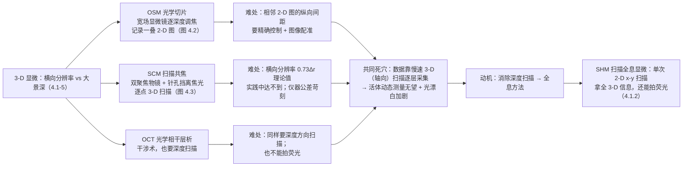

**OSM**（图 4.2）：宽场显微镜逐深度调焦，顺序记录不同深度的一叠 2-D 图像 [Agard (1984)]。每张 2-D 图既含聚焦信息也含离焦信息，需要重建算法把"在焦"信息提取出来。难点在记录端：相邻 2-D 图的纵向间距必须精确控制，图像配准（registration）也必须在计算机处理前做好。

<figure>
  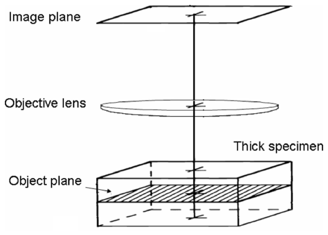
  <figcaption>图 4.2 光学切片显微镜（OSM）：像面/物镜/厚样品，逐深度记录在焦与离焦的混合信息（截自原书）</figcaption>
</figure>

**SCM**（图 4.3）：针对 OSM 的问题全新设计的显微镜 [Wilson and Sheppard (1984)]，共焦原理最早由 Minsky 提出 [Minsky, US Patent (1961)]。双聚焦物镜系统 + 光电探测器前的**针孔光阑**只对一个点成像：焦平面上的光（实线）全部穿过针孔进入探测器，离焦平面的光（虚线）被针孔挡住。3-D 信息靠三维扫描样品逐点采集。

<figure>
  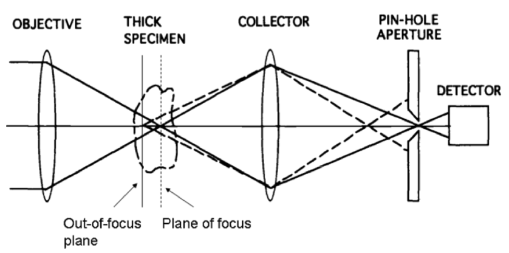
  <figcaption>图 4.3 扫描共焦显微镜（SCM）：物镜—厚样品—收集透镜—针孔光阑—探测器；虚线是被针孔拒绝的离焦光（截自原书）</figcaption>
</figure>

理论上 SCM 横向分辨率略好：若 OSM 的横向分辨率是 \(\Delta r=\lambda/NA\)，SCM 是 \(0.73\Delta r\) [Corle and Kino (1996)]——但这一理论极限实践中从未达到。SCM 的主要问题是：高分辨率成像 + 长工作距离所需的扫描仪器公差极难满足。**景深 vs 景场**（depth of field）术语提醒：景场 \(\Delta l\) 指物方范围内成像清晰对应的距离，与像方景深 \(\Delta z\) 的关系是 \(\Delta l=\Delta z/M^2\)（\(M\) 为横向放大率，见 Example 4.1）。

更本质的痛点：这两类仪器都靠**慢速 3-D 扫描**逐点采数据。对生物学应用这是致命的——**活体**（in vivo）动态过程（细胞间相互作用）根本来不及监测；采集时间一长，荧光显微里的**光漂白**（photo-bleaching）加剧——样品被过度曝光后就不再发荧光 [Pawley (1995)]，为此发展出了双光子扫描荧光成像这类复杂技术。新兴的**光学相干层析**（optical coherent tomography, OCT，基于干涉）同样需要沿深度方向扫描 [Huang, Swanson, Lin, Shuman, Stinson, Chang, Hee, Flotte, Gregory, Puliafito, and Fujimoto (1991)]。一句话：**所有商品化显微镜（OSM、SCM、OCT）的 3-D 成像都离不开轴向扫描**。消掉深度扫描，就是研究全息式 3-D 显微的动机。

全息显微（holographic microscopy）近年越来越热 [Zhang and Yamaguchi (1998), Kim (2000)]：它一次记录大体积空间的高分辨率 3-D 信息，轴向扫描困难或不可能的场合正好用它。但传统全息显微天生**对非相干发射（如荧光）不敏感**——荧光发的光不相干，全息要求相干干涉——这把它在生命科学里的用处卡死了。**扫描全息显微镜（scanning holographic microscope, SHM）**基于 OSH 原理，只用单次 2-D x-y 扫描（无轴向扫描，采集时间大减）获取 3-D 信息；更重要的是 **SHM 能对荧光样品成像**——这是全息术的突破（传统全息显微镜在 OSH 出现前根本拍不了荧光样品）[Poon, Schilling, Indebetouw, and Storrie, U.S. Patent (2000)]。而且 SHM 的理论横向分辨率 \(0.5\Delta r\)（\(\Delta r\) 为宽场显微镜分辨率）[Indebetouw (2002)]，比 SCM 的 \(0.73\Delta r\) 更好。OCT 同样拍不了荧光——OSH 因此是 3-D 生物医学应用里非常独特的存在。

!!! note "拓展：OSH 凭什么能拍荧光？——"相干性悖论"的拆解"
    全息要相干干涉、荧光是非相干发光，看似水火不容。拆开看 OSH 的记录过程：**发生干涉的是两束 514.5 nm 的扫描激光**（球面波 + 平面波，频差 \(\Delta\Omega\)）——它们在样品面上形成 TDFZP 条纹；荧光样品只是被这束激发光"逐点点亮"，发出的 560 nm 荧光把 TDFZP 的局部强度再"读"出来（PD 收的是荧光强度 ∝ 激发条纹强度）。也就是说：**全息编码发生在激发端（相干），荧光只负责把编码结果搬运到探测器**（非相干，无所谓）。外差检测在电学域解调（图 3.6），自然滤掉荧光自身的非相干性。这也解释了为什么 dichroic 分束片 + 发射滤光片能把 514 nm 激发光挡得干干净净而全息信息毫发无损——信息在 10.7 MHz 的电流里，不在 514 nm 的光子里。

### 4.1.3 SHM 装置与荧光实验

与图 4.2/4.3 同等简洁度地画出 SHM（图 4.4）：原理上就是**用一个 TDFZP 对厚样品做 2-D 光栅扫描**——第 3 章的记录机原封不动搬进显微镜。

<figure>
  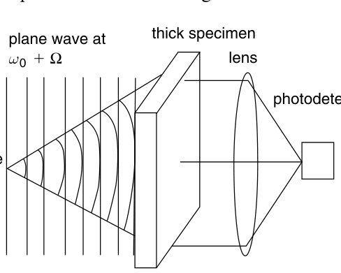
  <figcaption>图 4.4 扫描全息显微镜（SHM）：点源（ω0）球面波 + 平面波（ω0+Ω）干涉成 TDFZP，扫过厚样品，透镜收集全部光到光电探测器（截自原书）</figcaption>
</figure>

真实荧光实验装置（图 4.5a）：两束宽激光（来自氩离子激光器的 **514.5 nm 线**），时间频率差 \(\Delta\Omega\)，入射到反射镜与分束器（BS）。每束的频移由声光频移器（AOFS）完成——配置成把激光分成频率差 \(\Delta\Omega/2\pi=10.7\) MHz 的两束，然后准直、平行放置。透镜 L1 放在其中一束里形成球面波，在 BS 处与另一束共线合束——在物体上形成 TDFZP（物体在球面波焦点外 \(\Delta z\) 处）。**dichroic 分束片**透射 514 nm、反射约 595 nm：激光穿过它去激发荧光样品（样品发 **560 nm** 荧光），光电倍增管（PMT）前的**发射滤光片**让荧光通过、挡掉 514 nm 背景激光。样品由计算机控制的机械 x-y 扫描台按 TDFZP 光栅扫描；PMT 电流（含被扫物体的全息信息）经电子滤波、在 10.7 MHz 放大、解调、与 x-y 扫描器同步数字化——最终产出**电子全息图**。解调就是图 3.6 那套电子检测，但**实验只用了同相（in-phase）一个通道**。

<figure>
  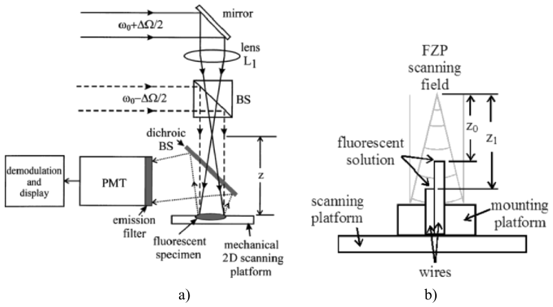
  <figcaption>图 4.5 a) OSH 记录荧光样品全息图的实验装置：ω0±ΔΩ/2 双光束、L1 成球面波、dichroic 分束、PMT + 发射滤光片、机械 2-D 扫描台、解调与显示 [Schilling et al., Optics Letters 22, 1506 (1997)]；b) 荧光样品：两根平行光轴的金属丝顶端各挂一滴荧光溶液，深度差约 2 mm（右滴 z0≈35 mm，左滴 z1≈37 mm）（截自原书）</figcaption>
</figure>

荧光样品：高浓度荧光乳胶小球（直径 **15 µm**，峰值激发 530 nm、峰值发射 560 nm）溶液。为了演示**深度分辨能力**，用两根并排、平行光轴的金属丝，顶端各挂一滴荧光溶液，深度差约 2 mm（图 4.5b）。记录到的全息图（图 4.6）：256 级灰度、256×256 像素，扫描面积约 2.0 mm × 2.0 mm——两滴溶液在全息图里清晰可辨。

<figure>
  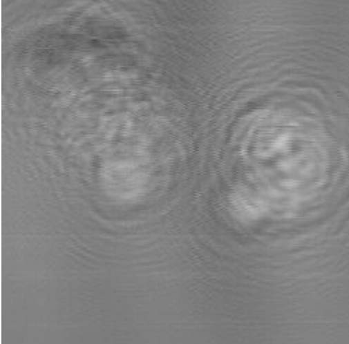
  <figcaption>图 4.6 OSH 记录的荧光样品全息图：两滴荧光乳胶小球溶液，深度差约 2 mm（截自原书，© OSA）</figcaption>
</figure>

OSH 系统的分辨率受系统 NA 限制：NA 由透镜 L1 焦距（\(f=150\) mm）与被聚焦平面波直径（\(D=10\) mm）决定，\(NA\approx 0.033\)，按 (4.1-2)/(4.1-4) 对应衍射极限 \(\Delta r\approx 18.5\ \mu\text{m}\)、\(\Delta z\approx 1028.4\ \mu\text{m}\)。15 µm 的小球已经非常接近该装置的横向分辨极限。

全息图存好后，3-D 图像可以光学或数值重建。数值重建在两个深度进行（图 4.7）：\(z_0=35\) mm 与 \(z_1=37\) mm。每滴的个体特征不明显的位置用箭头标出：图 4.7a（\(z_0=35\) mm）中左滴更清晰，箭头所指小球在该深度重建时比 4.7b 清楚；图 4.7b（\(z_1=37\) mm）的箭头指向一串 4 个小球，只在这个深度能逐个分辨，在 \(z_0\) 平面里是模糊的。

<figure>
  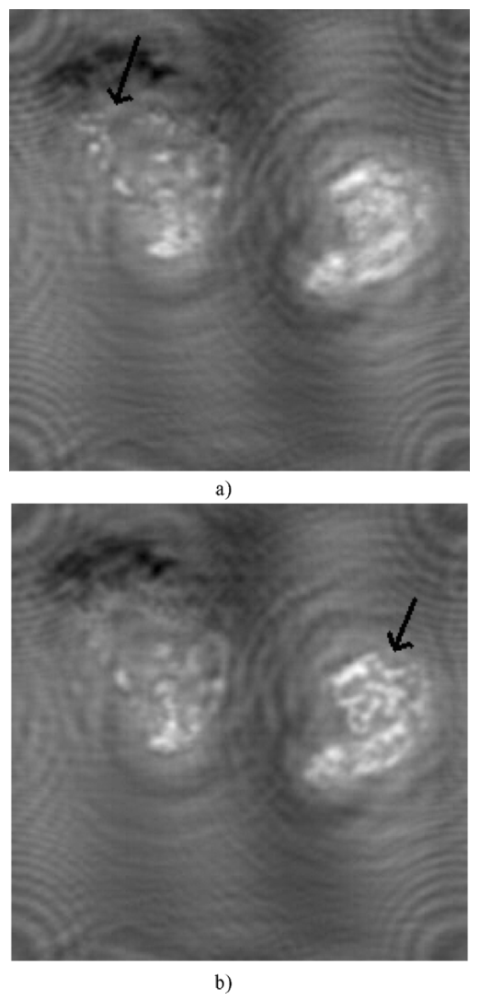
  <figcaption>图 4.7 图 4.6 全息图的数值重建：a) z0=35 mm（箭头：该深度在焦的小球）；b) z1=37 mm（箭头：四个逐个可辨的荧光小球）[Schilling et al., 1997]（截自原书，© OSA）</figcaption>
</figure>

!!! note "拓展：为什么重建里仍有波纹？——单通道记录的孪生像残留"
    图 4.6/4.7 的重建里能看到残余条纹（residual fringing）：实验只记录了外差电流的**同相分量**（\(i_c\)，sine 全息图一张），孪生像噪声必然存在——这正是 ch3 3.5.3 的"50/50"问题的实验注脚。当年（1997）复全息图的双通道电子学还没上机；今天的 SHM 用 \(i_c+ji_s\) 复全息图或零差三步相移（ch3 3.6 拓展注）就能除掉。另外注意深度差 2 mm < \(\Delta z\approx 1\) mm 的 2 倍吗？\(\Delta z\approx 1.03\) mm 与 2 mm 深度差同量级——能分清两滴靠的是重建深度的对比，不是"切片"。

这是**全息术历史上第一次记录荧光样品的全息图**（光学全息手段）[Poon et al., U.S. Patent (2000)]。"全息与荧光成像水火不容"的直觉被 OSH 打破：全息要求光波相干干涉，而荧光成像不产生相干光——OSH 让两者兼得。3-D 生物医学应用已经验证的还有：浑浊介质里的 3-D 荧光定位 [Indebetouw, Kim, Poon, and Schilling (1998)]、FZP 编码孔径抑制背景伪影的近红外扫描全息 [Sun and Xie (2004)]；最近**亚微米分辨率的荧光全息显微**也已实现 [Indebetouw and Zhong (2006)]。

### 4.1.4 拓展实战：振幅物体 vs 相位物体（编者拓展，原书无）

显微成像里另一个"看不见"的问题：生物样品大多是**相位物体**（phase object）——几乎不吸收、只推迟相位。你的旧代码 `Amplitude_and_Phase_Object.m / 相位物体和振幅物体.py` 演示的正是这个坑：同轴数字全息（第 2 章路线）下并排放一个纯振幅粒子（透过率 0.1）和一个纯相位粒子（延迟 1.5 rad、零吸收），sqrt 强度重建后看两个通道各读出什么。规范化重写如下（去 OpenCV 依赖、统一振幅取值、书式傅里叶协议）：

=== "MATLAB"

    ```matlab
    % ===== 拓展实战（编者，原书无）· 同轴数字全息下 振幅物体 vs 相位物体 的成像对比 =====
    % 改编自你已有的 Amplitude_and_Phase_Object.m（规范化重写）：
    %   左：纯振幅粒子（强吸收 0.1，无相位）；右：纯相位粒子（无吸收，相位延迟 1.5 rad）
    %   -> 角谱正向传播 5 cm 生成同轴全息图 -> 相机面取强度 -> sqrt 强度当复振幅估计 -> 反向传播重建。
    %
    % 与 4.1 节的关系（为什么扫描全息显微重要）：
    % - 生物样品多为"相位物体"：几乎不吸收，只推迟相位——普通强度成像里近乎透明；
    %   重建振幅图里相位粒子只剩一圈"幽灵环"（干涉伪影，Python 实跑对比度 0.26，且非真实形貌）。
    % - 相位信息藏在同轴干涉条纹里：sqrt 强度 + 反向传播读出的相位被背景干涉压低
    %   （实跑 0.589 rad vs 真值 1.5 rad，非线性失真）。
    % - SHM（4.1）记录的电子全息图是复值的（ic/is 双通道可合成复全息图，ch3 式 3.5-5），
    %   相位通道一就读出定量相位——这正是 ch5"相干模式/定量相位衬度"的入口。
    %
    % 差异提示：
    % 1) 全书最大的坑：书的前向变换是 +j 指数，严格实现用 ifft2*N²；逆变换 fft2/N²（文件末尾封装）。
    %    你旧版 Amplitude_and_Phase_Object.m 的 ifft2*N² + fft2/N² 组合正是书协议（与 2.3 节一致）。
    % 2) 连通域定位用 regionprops（Image Processing Toolbox）；去 toolbox 的简化版见 Python 版。
    % 3) 旧版振幅粒子取值不一致（.m 用 0.1、.py 用 0），本版统一 0.1。

    clear
    N = 512; lambda0 = 532e-9; dx = 5e-6; L = N*dx; z_prop = 0.05; k0 = 2*pi/lambda0;
    x = ((0:N-1)-N/2)*dx;
    [X, Y] = meshgrid(x, x);

    % ---- 1. 物体：左 振幅粒子（0.1 吸收），右 相位粒子（1.5 rad 延迟） ----
    U_obj = ones(N);
    radius = 40e-6;
    mask_amp = ((X + 0.4e-3).^2 + Y.^2) <= radius^2;     % 左：纯振幅（强吸收、无相位）
    U_obj(mask_amp) = 0.1;
    mask_ph = ((X - 0.4e-3).^2 + Y.^2) <= radius^2;      % 右：纯相位（无吸收、延迟 1.5 rad）
    U_obj(mask_ph) = exp(1j*1.5);

    % ---- 2. 角谱正/反向传播（书式协议，自动滤消逝波） ----
    df = 1/L;
    fx = ((0:N-1)-N/2)*df;
    [KY, KX] = meshgrid(fx, fx);
    root = 1 - (KX.^2 + KY.^2)/k0^2;  root(root < 0) = 0;   % 滤除消逝波
    H_fwd = exp(-1j*k0*z_prop*sqrt(root));
    H_bwd = exp(+1j*k0*z_prop*sqrt(root));                   % 反向传播：z 取 -z_prop

    U_det = ift2_book(ft2_book(U_obj).*H_fwd);               % 传播到相机面
    I_holo = abs(U_det).^2;                                  % 相机只记强度
    U_rec = ift2_book(ft2_book(sqrt(I_holo)).*H_bwd);        % sqrt 强度当复振幅估计，反向传播

    % ---- 3. 定量对比：振幅通道里"看得见"谁？相位通道里"读得出"谁？ ----
    amp = abs(U_rec);
    ph = angle(U_rec);
    bg = mean(amp((X.^2 + Y.^2) > (1.0e-3)^2), 'all');       % 远场背景振幅
    c_amp_obj = (bg - mean(amp(mask_amp), 'all'))/bg;        % 振幅粒子在重建振幅中的对比度
    c_ph_obj = abs(mean(amp(mask_ph), 'all') - bg)/bg;       % 相位粒子在重建振幅中的对比度
    ph_dome = angle(mean(U_rec(mask_ph), 'all'));            % 相位粒子中心读出的相位

    fprintf('--- 重建通道对比（同轴 sqrt 强度重建） ---\n');
    fprintf('振幅粒子（透过率 0.1）：重建振幅对比度 = %.3f（清晰黑盘，形貌真实）\n', c_amp_obj);
    fprintf('相位粒子（延迟 1.5 rad，零吸收）：重建振幅对比度 = %.3f（全部来自幽灵环干涉伪影，不是形貌）\n', c_ph_obj);
    fprintf('相位通道在相位粒子中心读出 = %.3f rad（真值 1.5，被背景干涉压低、非线性）\n', ph_dome);
    fprintf('结论：振幅通道会误导（伪影像形貌）、相位通道读数失真 -> 定量相位成像必须走复全息图路线\n');

    % ---- 4. 可视化 ----
    figure('Position', [100, 100, 1300, 420]);
    subplot(1,3,1); imagesc(x*1e3, x*1e3, abs(U_obj)); colormap gray; axis image; colorbar
    title('1. Object amplitude (0.1 absorber | 1.5 rad dome)'); xlabel('x (mm)'); ylabel('y (mm)')
    subplot(1,3,2); imagesc(x*1e3, x*1e3, amp); axis image; colorbar
    title('2. Reconstructed amplitude (absorber clear, phase-ghost ring)'); xlabel('x (mm)'); ylabel('y (mm)')
    subplot(1,3,3); imagesc(x*1e3, x*1e3, ph); colormap jet; axis image; colorbar
    caxis([-pi pi])
    title('3. Reconstructed phase (1.5 rad dome, corrupted)'); xlabel('x (mm)'); ylabel('y (mm)')

    % ---- 局部函数（脚本内定义，须置于文件末尾，R2016b+ 支持） ----
    function F = ft2_book(U)
    % 书式前向变换（+j 指数）
    n = size(U, 1);
    F = fftshift(ifft2(ifftshift(U))) * n^2;
    end

    function u = ift2_book(A)
    % 书式逆变换（-j 指数）
    n = size(A, 1);
    u = fftshift(fft2(ifftshift(A))) / n^2;
    end
    ```

=== "Python"

    ```python
    # ===== 拓展实战（编者，原书无）· 同轴数字全息下 振幅物体 vs 相位物体 的成像对比 =====
    # 改编自你已有的 Amplitude_and_Phase_Object.m / 相位物体和振幅物体.py（规范化重写，去 OpenCV 依赖）：
    #   左：纯振幅粒子（强吸收 0.1，无相位）；右：纯相位粒子（无吸收，相位延迟 1.5 rad）
    #   -> 角谱正向传播 5 cm 生成同轴全息图 -> 相机面取强度 -> sqrt 强度当复振幅估计 -> 反向传播重建。
    #
    # 与 4.1 节的关系（为什么扫描全息显微重要）：
    # - 生物样品多为"相位物体"：几乎不吸收，只推迟相位——普通强度成像里近乎透明（本跑振幅通道
    #   的相位粒子对比度只有 ~0.26，全部来自幽灵环干涉伪影）。
    # - 相位信息藏在同轴干涉条纹里：sqrt 强度 + 反向传播只能部分恢复（相位穹顶被背景干涉压低）。
    # - SHM（4.1）记录的电子全息图是复值的（ic/is 双通道可合成复全息图，ch3 式 3.5-5），
    #   相位通道一就读出定量相位——这正是 ch5"相干模式/定量相位衬度"的入口。
    #
    # 严格书约定：前向变换 ifft2*N²（+j 指数）、逆变换 fft2/N²（-j 指数）——同 ch2/ch3。
    #
    # MATLAB / Python 差异提示：
    # 1) MATLAB 版连通用 regionprops 定位；此处用阈值 + 质心公式（numpy 足够）。
    # 2) imshow/imagesc 坐标原点差异同前几章：plt.imshow 加 origin='lower'。

    import sys
    import numpy as np
    import matplotlib.pyplot as plt

    if hasattr(sys.stdout, 'reconfigure'):
        sys.stdout.reconfigure(encoding='utf-8')

    # ----- 1. 参数与物体 -----
    N = 512
    lam = 532e-9
    dx = 5e-6
    L = N * dx
    z_prop = 0.05
    k0 = 2 * np.pi / lam
    x = (np.arange(N) - N // 2) * dx
    X, Y = np.meshgrid(x, x)

    U_obj = np.ones((N, N), dtype=complex)
    radius = 40e-6                                       # 粒子半径 40 µm
    mask_amp = ((X + 0.4e-3)**2 + Y**2) <= radius**2     # 左：纯振幅（强吸收、无相位）
    U_obj[mask_amp] = 0.1                                 # 振幅透过率 0.1（原 MATLAB 版为 0.1，旧 .py 为 0，统一取 0.1）
    mask_ph = ((X - 0.4e-3)**2 + Y**2) <= radius**2      # 右：纯相位（无吸收、延迟 1.5 rad）
    U_obj[mask_ph] = np.exp(1j * 1.5)

    # ----- 2. 书式傅里叶协议 + 角谱正/反向传播 -----
    def ft2_book(U):
        return np.fft.fftshift(np.fft.ifft2(np.fft.ifftshift(U))) * N**2

    def ift2_book(A):
        return np.fft.fftshift(np.fft.fft2(np.fft.ifftshift(A))) / N**2

    df = 1 / L
    fx = (np.arange(N) - N // 2) * df
    FY, FX = np.meshgrid(fx, fx)
    KX, KY = 2 * np.pi * FX, 2 * np.pi * FY
    root = 1 - (KX**2 + KY**2) / k0**2
    root[root < 0] = 0                                   # 滤除消逝波
    H_fwd = np.exp(-1j * k0 * z_prop * np.sqrt(root))
    H_bwd = np.exp(+1j * k0 * z_prop * np.sqrt(root))    # 反向传播：z 取 -z_prop

    U_det = ift2_book(ft2_book(U_obj) * H_fwd)           # 传播到相机面
    I_holo = np.abs(U_det)**2                            # 相机只记强度
    U_rec = ift2_book(ft2_book(np.sqrt(I_holo)) * H_bwd) # sqrt 强度当复振幅估计，反向传播

    # ----- 3. 定量对比：振幅通道里"看得见"谁？相位通道里"读得出"谁？ -----
    amp = np.abs(U_rec)
    ph = np.angle(U_rec)
    bg = amp[(X**2 + Y**2) > (1.0e-3)**2].mean()         # 远场背景振幅
    c_amp_obj = (bg - amp[mask_amp].mean()) / bg         # 振幅粒子在重建振幅中的对比度
    c_ph_obj = abs(amp[mask_ph].mean() - bg) / bg        # 相位粒子在重建振幅中的对比度
    ph_dome = np.angle(np.mean(U_rec[mask_ph]))          # 相位粒子中心读出的相位

    print('--- 重建通道对比（同轴 sqrt 强度重建） ---')
    print(f'振幅粒子（透过率 0.1）：重建振幅对比度 = {c_amp_obj:.3f}（清晰黑盘，形貌真实）')
    print(f'相位粒子（延迟 1.5 rad，零吸收）：重建振幅对比度 = {c_ph_obj:.3f}'
          '（全部来自幽灵环干涉伪影，不是形貌）')
    print(f'相位通道在相位粒子中心读出 = {ph_dome:.3f} rad（真值 1.5，被背景干涉压低、非线性）')
    print('结论：振幅通道会误导（伪影像形貌）、相位通道读数失真 -> 定量相位成像'
          '必须走复全息图路线（OSH 的 ic/is 双通道，或 ch5 相干模式）')

    # ----- 4. 可视化 -----
    fig, ax = plt.subplots(1, 3, figsize=(15, 4.6))
    ext = [x[0] * 1e3, x[-1] * 1e3, x[0] * 1e3, x[-1] * 1e3]
    ax[0].imshow(np.abs(U_obj), extent=ext, cmap='gray', vmin=0, vmax=1.2)
    ax[0].set_title('1. Object amplitude (0.1 absorber | 1.5 rad dome)')
    ax[1].imshow(amp, extent=ext, cmap='gray')
    ax[1].set_title('2. Reconstructed amplitude (absorber clear, phase-ghost ring)')
    ax[2].imshow(ph, extent=ext, cmap='jet', vmin=-np.pi, vmax=np.pi)
    ax[2].set_title('3. Reconstructed phase (1.5 rad dome, corrupted)')
    for a in ax.flat:
        a.set_xlabel('x (mm)'); a.set_ylabel('y (mm)')
    plt.tight_layout()
    plt.savefig('sim-amplitude-phase.png', dpi=150, bbox_inches='tight')
    plt.show()
    ```

实跑结果：**振幅粒子**在重建振幅中对比度 0.446——清晰黑盘，形貌真实；**相位粒子**在重建振幅中"对比度" 0.260——但它全部来自幽灵环干涉伪影，不代表形貌（换一个相位延迟值这张图就变样）；**相位通道**在粒子中心读出 0.589 rad（真值 1.5），被背景干涉压低且非线性。一句话：强度/振幅通道会**误导**（伪影像形貌），相位通道读数**失真**——定量相位成像必须走复全息图路线（OSH 的 \(i_c/i_s\) 双通道、ch5 的相干模式），这正是 SHM 在生命科学里的价值所在。

<figure>
  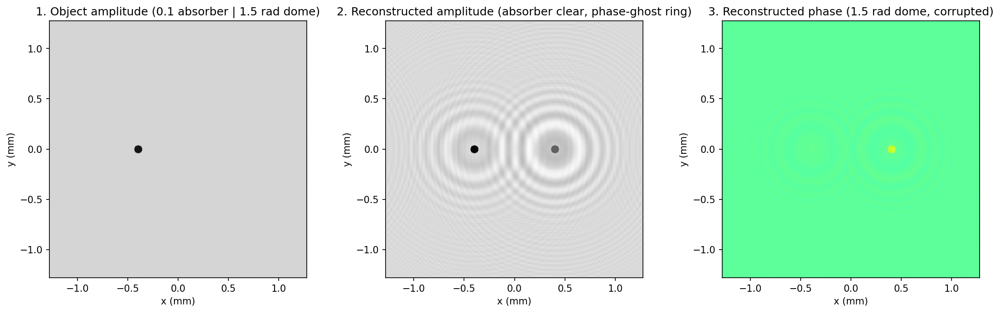
  <figcaption>图（本笔记运行结果，拓展实战）：左 物体振幅（左 0.1 吸收盘、右 1.5 rad 相位粒子不可见）；中 重建振幅——吸收盘清晰，相位粒子只剩幽灵环；右 重建相位——1.5 rad 相位穹顶显现但被背景干涉压低（读出 0.589 rad）</figcaption>
</figure>

## 4.2 三维全息电视与 3-D 显示

### 4.2.1 概念系统与 EBSLM

第 2 章说过：把记录干版换成 CCD 摄像机，再把电子输出转移到空间光调制器（SLM）上，就得到 3-D 显示。图 4.8 是点源物体的完整"记录 + 重建"概念系统：CCD 以视频速率把全息信息转移到 SLM，就是**全息 3-D 显示系统**。

<figure>
  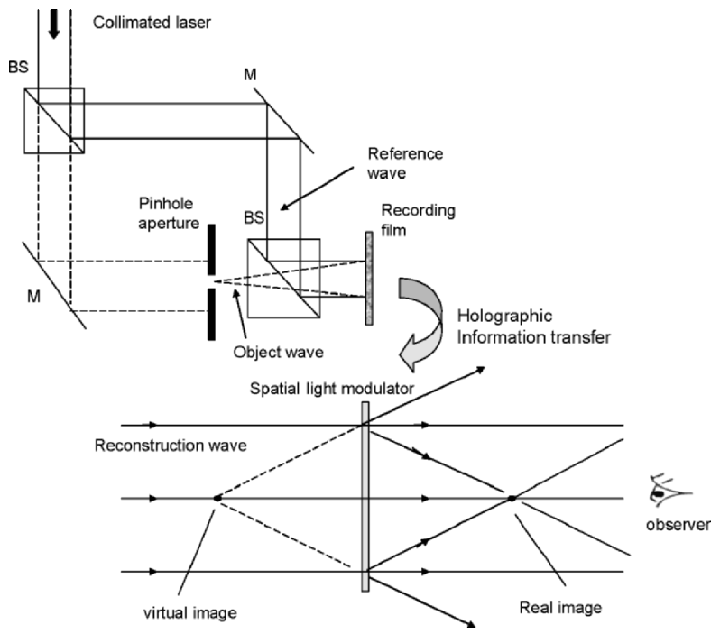
  <figcaption>图 4.8 点源物体的全息 3-D 显示概念系统：上半 记录（激光+BS+针孔+记录干版，全息信息转移），下半 重建（SLM+重建波，观察者看到虚像/实像）（截自原书）</figcaption>
</figure>

历史：第一次全息图的电视传输由 Enloe、Murphy 和 Rubinstein 演示 [1966]——电视摄像机记录离轴全息图（物体透射光的菲涅耳衍射图与离轴平面波的干涉），闭路电视传输后显示在 2-D 监视器上，拍成照片再光学重建。此后各种新器件层出不穷 [Macovski (1971), Brown, Noble and Markevitch, U.S. Patent (1983), Kirk, International Patent (1984), Benton (1991), Shinoda, Suzuki, Wu and Poon, U.S. Patent (1991), Schilling and Poon, U.S. Patent (2004)]。

本节描述 Poon 提出的全息电视系统 [Poon (2002a)]：**OSH 采集 + SLM 相干显示**。先认识 SLM——实验用的是**电子束寻址空间光调制器**（electron-beam-addressed spatial light modulator, EBSLM）[Hamamatsu Photonics K.K., Japan 和 Hamamatsu Corp., Bridgewater, NJ]（图 4.9）：

<figure>
  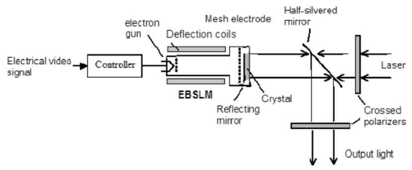
  <figcaption>图 4.9 电子束寻址空间光调制器（EBSLM）：串行视频信号→控制器→电子枪+偏转线圈在 LiNbO₃ 晶体表面沉积电荷，激光经半反镜/正交偏振器读出（截自原书）</figcaption>
</figure>

工作流程：串行视频信号输入 EBSLM 控制器，控制器调制 EBSLM 头内电子枪的发射强度；电子束经偏转线圈在 **LiNbO₃ 晶体**表面二维扫描，电荷沉积在表面；空间电荷场通过 **Pockels 效应**（Pockels effect）[Poon and Kim (2006)] 改变晶体的折射率分布；一对正交偏振器用激光"读出"这个空间分布——输出激光的相干空间分布就对应晶体上的 2-D 视频信息。

!!! note "拓展：EBSLM 为什么"天然适合全息""
    EBSLM 的本质是"把电子束当前式扫描的记录笔、把电光晶体当干版"：电子束写入的是**振幅透过率**（经正交偏振器读出），写入分辨率 ~8 lp/mm、能以**视频速率刷新**。对显示而言分辨率低（见 4.2.4 视角账），但"实时刷新 + 相干读出"这对组合，恰好是"电子全息图 → 光学重建"最省事的桥梁——这也是 1990 年代 OSH 实验清一色用 EBSLM 的原因。

### 4.2.2 完整系统与实验

把 OSH（记录）+ EBSLM（显示）拼起来就是**完整全息电视系统**（图 4.10）：

<figure>
  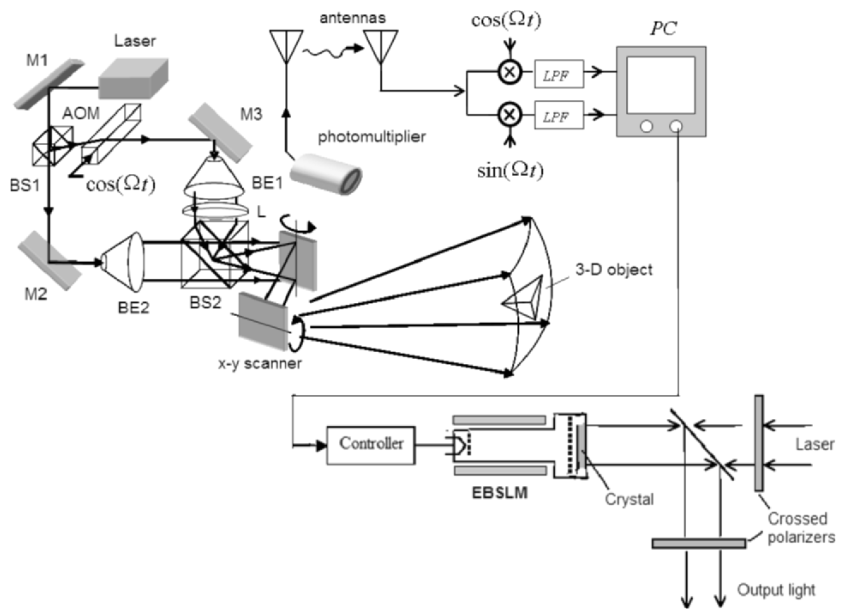
  <figcaption>图 4.10 提议的全息电视系统 [Poon (2002a)]：上半 OSH 记录（M1~M3、BS1/BS2、AOM 移频 Ω、BE1/BE2 扩束、L 生成点源、x-y 扫描器、PMT），射频外差电流经天线无线传输，远端电子多路检测后由 PC 合成全息图送 EBSLM；下半 EBSLM 相干重建（激光+正交偏振器+检偏器）（截自原书）</figcaption>
</figure>

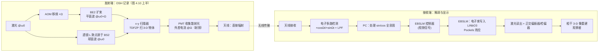

系统要点：M1、M2、M3 是反射镜，BS1/BS2 是分束器，**AOM**（声光调制器）把激光移频 Ω，BE1/BE2 是扩束器。透镜 L 把点源聚焦在 BS2 上，经 x-y 扫描器向物体投射球面波，BE2 提供平面波。2-D 光栅扫描后，PMT 收集物体散射光、输出外差电流——**若外差电流在射频频段，可以直接经天线辐射到远端解调**（解调端就是标准的电子多路检测）。PC 处理 sin/cos 两张全息图，输出送 EBSLM 控制器做相干重建。Poon [2002a] 提出该系统后，用图 4.11 的实验系统做了验证：TDFZP 扫描 3-D 物体，PD 输出经 **BPF@Ω** 后与 \(\cos(\Omega t)\) 混频、低通，得 sine-FZP 全息图 \(H_s(x,y)\)（式 3.5-3a），经 **IPMS**（Image Processing and Measuring System——接收慢扫描电信号、存入数字内存、转成 NTSC 视频信号 [Hamamatsu DVS-3010/SS]）在电视监视器上显示，再送 EBSLM；EBSLM 的反射光经检偏器（analyzer）读出，在与检偏器距离 \(M\times z\) 处重建出相干像（\(z\) 是记录时扫描镜到物体的距离，\(M\) 是**全息图缩放因子**——比如 EBSLM 的显示面积 ≠ 实际光学扫描面积就会引入 \(M\)，详见 Example 4.1）。

<figure>
  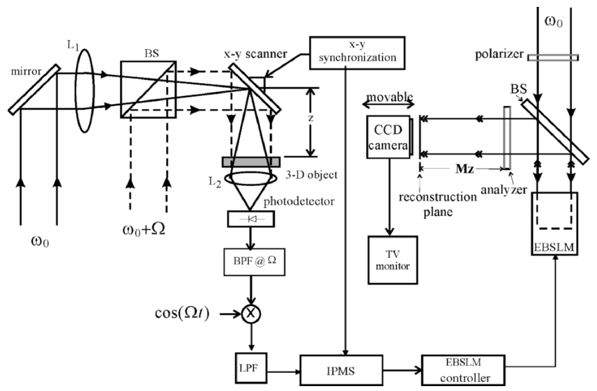
  <figcaption>图 4.11 实验 3-D 全息电视系统 [Poon et al., Optical Review 4, 576 (1997)]：左 记录（L1/BS/x-y 扫描器/L2/PD/BPF@Ω/混频/LPF/IPMS），右 显示（偏振器+BS+EBSLM+检偏器+可移动 CCD+TV 监视器）（截自原书）</figcaption>
</figure>

实验物体：两张 35 mm 幻灯片字母 **"V"** 与 **"T"** 并排、深度差约 15 cm；V 离 2-D 扫描器约 23 cm（\(z=23\) cm）。两者印在 35 mm 胶片上、线宽约 100 µm、不透明背景上透光。图 4.12 是记录到的 **sine-FZP 全息图**——两张不同深度的 FZP 环纹叠加，就是 3-D 物体全息图的样子。

<figure>
  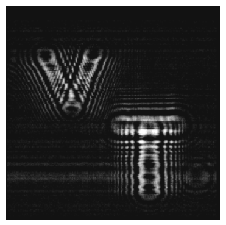
  <figcaption>图 4.12 不同深度字母 "V" "T" 的 sine-FZP 全息图 [Poon et al., Optical Engineering 34, 1338 (1995)，© SPIE]（截自原书）</figcaption>
</figure>

EBSLM 的实时重建（图 4.13a/c/e）：\(M\times z=23\) cm 处 V 在焦、41 cm 处 T 在焦——**沿深度逐平面观察**（可移动 CCD 对焦不同重建面）。注意重建面被孪生像噪声污染：只用了一个通道（sine-FZP 全息图）。作为对比，图 4.13b/d/f 是同一全息图的数字重建 [Poon, Doh, Schilling, Wu, Shinoda, and Suzuki (1995)]。EBSLM 能以视频速率显示全息图，商用 x-y 扫描器也能视频速率工作。

<figure>
  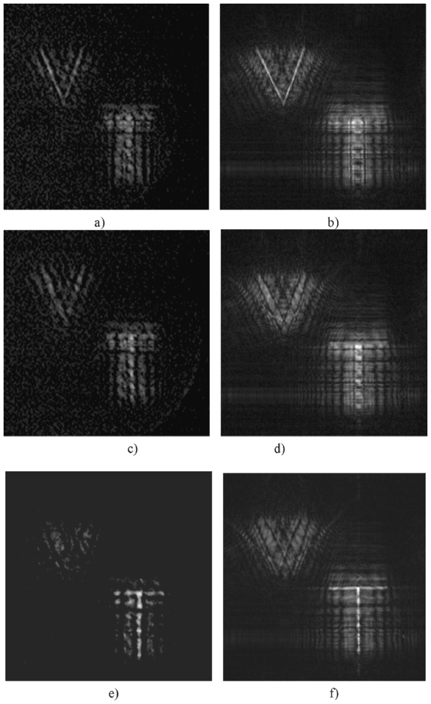
  <figcaption>图 4.13 全息重建：a) c) e) EBSLM 实时重建（不同深度分别 V/T 在焦，有孪生噪声）[Poon et al., Optical Review 4, 576 (1997)]；b) d) f) 数字重建（干净）[Poon et al., Optical Engineering 34, 1338 (1995)]（截自原书）</figcaption>
</figure>

### 4.2.3 Example 4.1：全息放大率

三个场景里"重建的像变大/变小/变深多少"不是玄学， Example 4.1 用一个三点物体把 OSH 的放大率全部算清。三点物体：

\[
\delta(x,y,z-z_0)+\delta(x-x_0,y,z-z_0)+\delta(x,y,z-(z_0+\Delta z_0)),
\tag{4.2-1}
\]

前两点在点源（产生图 4.4 的球面波）外 \(z_0\) 处、横向间距 \(x_0\)；第三点在轴向再远 \(\Delta z_0\)。按式 (3.5-3a)，扫描解调后的 \(i_c\) 给出正弦全息图：

\[
H_{3\text{-}p}(x,y)\sim \sin\Big[\frac{k_0}{2z_0}(x^2+y^2)\Big]+\sin\Big\{\frac{k_0}{2z_0}\big[(x-x_0)^2+y^2\big]\Big\}
+\sin\Big[\frac{k_0}{2(z_0+\Delta z_0)}(x^2+y^2)\Big].
\tag{4.2-2}
\]

用平面波（波长 \(\lambda_0\)）照明它，三个点会各自在原位重建。下面三种"缩放"逐一分析。

**a) 全息图缩放（hologram scaling）**。放大可以靠放大全息图，但对离轴全息图（条纹密度数千 lp/mm）普通放大机分辨率不够、不实用；扫描技术生成的是**同轴**全息图，缩放很直接：把全息图显示在与光学扫描面积不同的区域即可缩放 \(M\) 倍。(4.2-2) 变为

\[
H_{3\text{-}p}(Mx,My)=\sin\Big\{\frac{k_0}{2z_0}\big[(Mx)^2+(My)^2\big]\Big\}
+\sin\Big\{\frac{k_0}{2z_0}\big[(Mx-x_0)^2+(My)^2\big]\Big\}
+\sin\Big\{\frac{k_0}{2(z_0+\Delta z_0)}\big[(Mx)^2+(My)^2\big]\Big\}.
\tag{4.2-3}
\]

\(M<1\) 是放大、\(M>1\) 是缩小。把 (4.2-3) 改写（把 \(M^2\) 从括号里提出来）：

\[
H_{3\text{-}p}(Mx,My)=\sin\Big[\frac{k_0}{2(z_0/M^2)}(x^2+y^2)\Big]
+\sin\Big\{\frac{k_0}{2(z_0/M^2)}\big[(x-x_0/M)^2+y^2\big]\Big\}
+\sin\Big\{\frac{k_0}{2\big((z_0+\Delta z_0)/M^2\big)}(x^2+y^2)\Big\}.
\tag{4.2-4}
\]

人话版：缩放后的全息图 = **距离 \(z_0/M^2\)、横向位置 \(x_0/M\) 的三点物体的全息图**。用 \(\lambda_0\) 重建：两个实像点成在离全息图 \(z_0/M^2\) 处、横向间距 \(x_0/M\)。定义**横向放大率**（lateral magnification）\(\mathrm{M_{lat}}\) = 重建横向距离 / 原横向距离 \(x_0\)，**纵向放大率**（longitudinal magnification）\(\mathrm{M_{long}}\) = 重建纵向距离 \(\Delta z_0/M^2\) / 原纵向距离 \(\Delta z_0\)：

\[
\mathrm{M_{lat}}=1/M,\qquad \mathrm{M_{long}}=1/M^2.
\]

（前两项对比给横向；第一、三项对比给纵向。）

**b) 波长缩放（wavelength scaling）**。用不同波长 \(m\lambda_0\)（波数 \(k_0/m\)）重建全息图。按菲涅耳衍射，距全息图 \(z\) 处的场分布是 (4.2-2) 与传播核的卷积：

\[
H_{3\text{-}p}(x,y)*h(x,y;z,k_0/\mathrm{m})
\propto \Big\{\sin\Big[\frac{k_0}{2z_0}(x^2+y^2)\Big]+\sin\Big\{\frac{k_0}{2z_0}\big[(x-x_0)^2+y^2\big]\Big\}
+\sin\Big[\frac{k_0}{2(z_0+\Delta z_0)}(x^2+y^2)\Big]\Big\}
*\frac{jk_0/\mathrm{m}}{2\pi z}\exp\Big[-\frac{j(k_0/\mathrm{m})}{2z}(x^2+y^2)\Big].
\tag{4.2-5}
\]

横向：FZP 的空间频率没变——**无横向放大**（\(\mathrm{M_{lat}}=1\)）。纵向：比较第一、三项与重建核的相位，实像成在 \(z=z_0/\mathrm{m}\) 与 \(z=(z_0+\Delta z_0)/\mathrm{m}\)，故 \(\mathrm{M_{long}}=1/\mathrm{m}\)。重建体积被压缩/拉伸 \(1/\mathrm{m}\) 倍而横向不变——\(\mathrm{m}>1\) 是压缩。可见光记录+重建时 \(\mathrm{m}\) 只能在 0.5~1.8 之间；**数字重建时 \(\mathrm{m}\) 可以任选**。

!!! warning "易错点：波长缩放的方向"
    重建波长变长（\(\mathrm{m}>1\)）时像是**变近**（\(z_0/\mathrm{m}\)，压缩），不是变远——焦距条件是 \(k_0r^2/2z_0=(k_0/\mathrm{m})r^2/2z\Rightarrow z=z_0/\mathrm{m}\)。本笔记在数值验证时第一次就把方向写反（按 \(z\to \mathrm{m}z_0\) 重建得到一片散斑），书 (4.2-5) 后的文字 "form an image at \(z=z_0/\mathrm{m}\)" 是唯一权威表述。记法：**波长加倍 → 焦距减半**。

**c) 缩放 + 波长组合**。同时改全息图比例（\(M\)）与重建波长（\(\mathrm{m}\lambda_0\)）：

\[
\mathrm{M_{lat}}=1/M,\qquad \mathrm{M_{long}}=1/(\mathrm{m}M^2).
\]

重建体积 \(\Delta x_0\Delta z_0/(\mathrm{m}M^3)\) ≠ 原体积 \(\Delta x_0\Delta z_0\)——**放大 3-D 物体必然引入畸变**（3-D 光学成像的著名结论）。要有真 3-D 透视（\(\mathrm{M_{lat}}=\mathrm{M_{long}}\)），令 \(\mathrm{m}=1/M\)：

\[
\mathrm{m}=1/M\ \Longrightarrow\ \mathrm{M_{lat}}=\mathrm{M_{long}}=1/M.
\]

即：全息图缩放 \(M\) 倍后，重建波长应取 \(m\lambda_0\)（\(\mathrm{m}=1/M\)）。这正是 **Gabor [1949] 的原始想法**——激光出现之前的年代为改进电子显微镜而提出（电子显微术正是全息术诞生的动机）。

!!! note "拓展：Gabor 的算盘——为什么"换波长 + 缩全息图"能放大 3-D"
    电子波长（~0.05 Å）比可见光短 5 个量级：电子束记录的菲涅耳全息图条纹极细，直接用可见光重建时横向放大率 \(\mathrm{M_{lat}}=1\)（波长缩放不给横向放大）。Gabor 的解法是把电子全息图**放大 M 倍**（光学缩印的逆操作）再重建：横向 \(1/M\)、纵向 \(1/(M^2\mathrm{m})\)；再选 \(\mathrm{m}=1/M\) 让两个方向一致——3-D 无畸变放大 \(1/M\) 倍。OSH 的同轴记录让"缩放全息图"变成纯数字操作（显示区域一改就完成），这是 Example 4.1 对数字全息显示的实际意义。

本笔记把 Example 4.1 全部数值复现（脚本见下）：\(M=0.5\) 的缩放全息图在 \(z_0/M^2=120\) mm 聚焦出两点、横向间距精确 \(x_0/M=2.00\) mm；轴上深度响应在 120/200 mm 出现两个聚焦平台（中心间距 ≈ \(\Delta z_0/M^2=80\) mm = 4·\(\Delta z_0\)）；\(\mathrm{m}=2\) 时原始全息图在 \(z_0/\mathrm{m}=50\) mm 聚焦、横向位置不变。

=== "MATLAB"

    ```matlab
    % ===== 书 Example 4.1 · 全息放大率（式 4.2-1 ~ 4.2-5） =====
    % 数值验证（Python 版实跑结论，见笔记图 sim-magnification.png）：
    %   a) M = 0.5：缩放全息图在 z0/M² = 120 mm 聚焦出两点，横向间距 = x0/M = 2.00 mm；
    %      轴上深度响应聚焦平台中心 120/205 mm（理论 120/200）-> 间距 ≈ Δz0/M² = 80 mm = 4·Δz0 ✓
    %   b) m = 2：原始全息图在 z0/m = 50 mm 聚焦，横向位置不变（M_lat = 1）✓
    %
    % 采样与混叠账（ch3 坑的延续，两组实验用不同 z0 的原因）：
    %   FZP 条纹最细周期（视场边缘）= λ0·z0/x_max，需 > 2·dx：
    %     a) 缩放全息图等效周期 = λ0·z0/(M²·x_max) -> z0 = 30 mm 即满足；
    %     b) 原始全息图 -> 需 z0 >= 2·dx·x_max/λ0 ≈ 81 mm，故取 100 mm。
    %   重建传递函数 exp[+jz'k²/2k'] 的相邻格点相位跳变 z'·k·Δk/k' < π：
    %     深度扫描全程固定窗（孔径不随 z' 变化），窗缘 12 次方软滚降。
    %
    % 全书最大的坑：书的前向变换是 +j 指数 -> 前向 ifft2*N²、逆变换 fft2/N²（文件末尾封装）。
    % MATLAB 1-based：中心像素 (N/2+1) <-> Python N//2。

    clear
    lam = 0.6328e-6;  k0 = 2*pi/lam;
    x0 = 1.0e-3;                        % 前两点横向间距 (m)
    N = 512;  dx = 10e-6;               % 全息图网格
    M = 0.5;  m = 2.0;                  % a) 缩放因子  b) 波长缩放因子

    x = ((0:N-1) - N/2) * dx;
    [X, Y] = meshgrid(x, x);

    dkf = 2*pi/(N*dx);                        % 角频率格距 (rad/m)
    kx1d = ((0:N-1) - N/2) * dkf;
    [KY, KX] = meshgrid(kx1d, kx1d);
    KR = hypot(KX, KY);  KR2 = KX.^2 + KY.^2;
    k_nyq = 0.55*pi/dx;                       % 通用窗上限

    make_h3p = @(z0, dz0) sin(k0*(X.^2+Y.^2)/(2*z0)) + ...    % 三点物体正弦全息图 (4.2-2)
        sin(k0*((X-x0).^2+Y.^2)/(2*z0)) + ...
        sin(k0*(X.^2+Y.^2)/(2*(z0+dz0)));

    % ================= a) 全息图缩放 M = 0.5 =================
    z0a = 0.030;  dz0a = 0.020;         % 缩放全息图等效条纹周期 λ0z0/(M²x_max) 采样允许更近
    Hs = sin(k0*M^2*(X.^2+Y.^2)/(2*z0a)) + ...                % (4.2-4) 逐项解析代入
         sin(k0*M^2*((X-x0/M).^2+Y.^2)/(2*z0a)) + ...
         sin(k0*M^2*(X.^2+Y.^2)/(2*(z0a+dz0a)));
    FHs = ft2_book(Hs);

    fprintf('--- a) 全息图缩放 M = 0.5（理论：M_lat = 1/M = 2, M_long = 1/M^2 = 4） ---\n');
    zs_scan = linspace(0.08, 0.26, 37);
    k_win_fix = min(k_nyq, 0.8*pi*k0/(zs_scan(end)*dkf));     % 深度扫描全程同一窗

    r1 = recon(FHs, z0a/M^2, k0, k_win_fix, KR, KR2);
    px1 = peaks_of(r1, 0.5, dx);
    fprintf('缩放全息图 @ z0/M^2 = %.0f mm：%d 个峰，两点横向间距 = %.2f mm（理论 x0/M = %.2f mm）\n', ...
            z0a/M^2*1e3, numel(px1), px1(end)-px1(1), x0/M*1e3);

    I_on = zeros(size(zs_scan));                % 轴上中心像素强度（列最大会被离焦环纹抬高）
    for ii = 1:numel(zs_scan)
        rec = recon(FHs, zs_scan(ii), k0, k_win_fix, KR, KR2);
        I_on(ii) = rec(N/2+1, N/2+1);
    end
    above = I_on > 0.95*max(I_on);              % 聚焦平台（宽度 = 该孔径的景深 ~ ±20 mm）
    d = diff([0 above 0]);  st = find(d==1);  en = find(d==-1)-1;
    keep = (zs_scan(en)-zs_scan(st)) >= 3*(zs_scan(2)-zs_scan(1));   % 滤掉纹波碎片
    st = st(keep);  en = en(keep);
    fprintf('轴上深度响应聚焦平台（I>0.95max）：');
    for ii = 1:numel(st)
        fprintf('%d~%d mm  ', round(zs_scan(st(ii))*1e3), round(zs_scan(en(ii))*1e3));
    end
    fprintf('（理论 %d / %d mm）\n', round(z0a/M^2*1e3), round((z0a+dz0a)/M^2*1e3));
    cent = 0.5*(zs_scan(st)+zs_scan(en));
    fprintf('平台中心间距 = %.0f mm（理论 Δz0/M² = %.0f mm = %.0f·Δz0）\n', ...
            (cent(end)-cent(1))*1e3, dz0a/M^2*1e3, 1/M^2);

    % ================= b) 波长缩放 m = 2 =================
    z0b = 0.100;  dz0b = 0.030;         % 原始全息图边缘条纹采样要求 z0 >= 81 mm
    H3p = make_h3p(z0b, dz0b);
    FH3p = ft2_book(H3p);

    fprintf('--- b) 波长缩放 m = 2（重建波数 k0/m，理论：M_lat = 1, 焦深 z -> z0/m） ---\n');
    r2 = recon(FH3p, z0b/m, k0/m, min(k_nyq, 0.8*pi*(k0/m)/((z0b/m)*dkf)), KR, KR2);
    r3 = recon(FH3p, z0b, k0, min(k_nyq, 0.8*pi*k0/(z0b*dkf)), KR, KR2);
    px2 = peaks_of(r2, 0.5, dx);
    px3 = peaks_of(r3, 0.5, dx);
    fprintf('m=2 @ z0/m=%.0f mm 峰位置：%.2f mm；m=1 @ z0=%.0f mm 峰位置：%.2f mm（M_lat = 1）\n', ...
            z0b/m*1e3, px2(2), z0b*1e3, px3(2));
    fprintf('第三点焦深：(z0+Δz0)/m = %.0f mm (m=2) vs %.0f mm (m=1) -> 纵向压缩 1/m\n', ...
            (z0b+dz0b)/m*1e3, (z0b+dz0b)*1e3);

    % ---- 可视化（对应笔记图 sim-magnification.png） ----
    figure(1)
    subplot(2,3,1); imagesc(x*1e3, x*1e3, Hs); axis image off; colormap gray
    title(sprintf('scaled hologram H(Mx,My), M=%.1f (4.2-3)', M))
    subplot(2,3,2); imagesc(x*1e3, x*1e3, r1.^0.4); axis image off
    title(sprintf('recon @ z0/M^2=%.0f mm: 2 spots, dx=x0/M', round(z0a/M^2*1e3)))
    subplot(2,3,3); plot(zs_scan*1e3, I_on/max(I_on), 'b-', 'LineWidth', 1.2); hold on; grid on
    for ii = 1:numel(st)
        xline(zs_scan(st(ii))*1e3, ':b'); xline(zs_scan(en(ii))*1e3, ':b');
    end
    xline(z0a/M^2*1e3, '--r'); xline((z0a+dz0a)/M^2*1e3, '--r');
    xlabel("reconstruction depth z' (mm)"); ylabel('normalized intensity')
    title('depth response of scaled hologram (M_{long}=1/M^2)')
    subplot(2,3,4); imagesc(x*1e3, x*1e3, H3p); axis image off
    title('H_3p(x,y): sine hologram (4.2-2), z0=100 mm')
    subplot(2,3,5); imagesc(x*1e3, x*1e3, r2.^0.4); axis image off
    title(sprintf('recon @ z0/m=%.0f mm with k''=k0/m (M_{lat}=1)', round(z0b/m*1e3)))
    subplot(2,3,6); imagesc(x*1e3, x*1e3, r3.^0.4); axis image off
    title(sprintf('recon @ z0=%.0f mm with k0 (reference)', round(z0b*1e3)))

    % ---- 局部函数（脚本内定义，须置于文件末尾，R2016b+ 支持） ----
    function F = ft2_book(U)
    % 书式前向变换（+j 指数）：F = fftshift(ifft2(ifftshift(U)))*N^2
    n = size(U, 1);
    F = fftshift(ifft2(ifftshift(U))) * n^2;
    end

    function U = ift2_book(A)
    % 书式逆变换（-j 指数）：U = fftshift(fft2(ifftshift(A)))/N^2
    n = size(A, 1);
    U = fftshift(fft2(ifftshift(A))) / n^2;
    end

    function rec = recon(Hspec, zp, k, k_win, KR, KR2)
    % 开环重建：|ift2{ Hspec · T(z') }|² 归一化。
    % T = 与 h*(z') 对应的频域传递（= conj(OTFosh)，见 ch3 式 3.5-2a）：
    % 相邻格点相位跳变 z'·k·Δk/k' < π -> 圆窗半径 k_win；窗缘 12 次方软滚降（硬圆孔有衍射纹波）。
    W = 1 ./ (1 + (KR/k_win).^12);
    T = W .* exp(1j * zp * KR2 / (2 * k));
    rec = abs(ift2_book(Hspec .* T)).^2;
    rec = rec / max(rec(:));
    end

    function px = peaks_of(rec, thr, dx)
    % 阈值以上的局部极大峰位置（mm，相对网格中心），按 x 排序
    bw = (imdilate(rec, ones(31)) == rec) & (rec > thr);
    CC = bwconncomp(bw);
    px = zeros(CC.NumObjects, 1);
    for ii = 1:CC.NumObjects
        idx = CC.PixelIdxList{ii};
        [~, im] = max(rec(idx));
        [rr, cc] = ind2sub(size(rec), idx(im));
        px(ii) = (cc - size(rec, 2)/2) * dx * 1e3;
    end
    px = sort(px);
    end
    ```

=== "Python"

    ```python
    # ===== 书 Example 4.1 · 全息放大率（式 4.2-1 ~ 4.2-5） =====
    # 三点物体 (4.2-1)：δ(x,y,z-z0) + δ(x-x0,y,z-z0) + δ(x,y,z-(z0+Δz0))
    # 正弦全息图 (4.2-2)：
    #   H_3p(x,y) ~ sin[(k0/2z0)(x²+y²)] + sin{(k0/2z0)[(x-x0)²+y²]} + sin[(k0/2(z0+Δz0))(x²+y²)]
    # a) 全息图缩放 M（(4.2-3)/(4.2-4)）：H(Mx,My) 中各项变为距离 z/M² 的 FZP、
    #    横向位置 x0/M -> M_lat = 1/M, M_long = 1/M²。
    # b) 波长缩放 m（(4.2-5)）：重建波长 λ0' = m·λ0（波数 k0/m）-> 焦距 z -> z0/m（m>1 压缩），
    #    M_lat = 1, M_long = 1/m。
    # c) 无畸变条件：m = 1/M -> M_lat = M_long（Gabor 1949 的原始想法）。
    #
    # 数值验证（本笔记实跑，结论）：
    #   a) M = 0.5（放大 2 倍）：缩放全息图在 z0/M² = 120 mm 聚焦出两点，横向间距 = x0/M = 2.00 mm；
    #      轴上深度响应聚焦平台中心 120/205 mm（理论 120/200）-> 间距 ≈ Δz0/M² = 80 mm = 4·Δz0 ✓
    #   b) m = 2（重建波数 k0/m）：原始全息图在 z0/m = 50 mm 聚焦，横向位置不变（M_lat = 1）✓
    #
    # 全书约定：前向变换 +j 指数 = ifft2*N²；逆变换 fft2/N²（同 ch2/ch3）。
    # 混叠提示（ch3 坑）：二次相位传递函数 e^{±jσk²} 相位深度大时含 Poisson 旁瓣，
    # 开环重建（解析全息图 × 解析传递函数）的频域窗半径必须随深度/波数自适应：
    #   相邻格点相位跳变 = z'·k·Δk/k' < π  ->  k_win < 0.8π·k'/(z'·Δk)。
    # 闭环自洽场景（记录与重建用同一张混叠表）无此问题。
    #
    # MATLAB / Python 差异提示：
    # 1) MATLAB 1-based、Python 0-based：中心像素 MATLAB (N/2+1) <-> Python N//2。
    # 2) plt.imshow 加 origin='lower' 对齐数学坐标。

    import sys
    import numpy as np
    import matplotlib.pyplot as plt
    from scipy import ndimage, signal

    if hasattr(sys.stdout, 'reconfigure'):      # Windows 控制台中文输出
        sys.stdout.reconfigure(encoding='utf-8')

    # ----- 1. 公共参数 -----
    lam = 0.6328e-6                 # He-Ne 波长 (m)
    k0 = 2 * np.pi / lam
    x0 = 1.0e-3                     # 前两点横向间距 (m)
    N = 512
    dx = 10e-6                      # 全息图像素 (m)
    M = 0.5                         # a) 全息图缩放因子（<1 即放大 1/M 倍）
    m = 2.0                         # b) 波长缩放因子（重建波数 k0/m）

    x = (np.arange(N) - N // 2) * dx
    X, Y = np.meshgrid(x, x)
    x_max = x[-1]

    def ft2_book(U):
        # 书式前向变换（+j 指数）
        return np.fft.fftshift(np.fft.ifft2(np.fft.ifftshift(U))) * N**2

    def ift2_book(A):
        # 书式逆变换（-j 指数）
        return np.fft.fftshift(np.fft.fft2(np.fft.ifftshift(A))) / N**2

    dk = 2 * np.pi / (N * dx)             # 角频率格距 (rad/m)
    kx1d = (np.arange(N) - N // 2) * dk
    KY, KX = np.meshgrid(kx1d, kx1d)
    KR = np.hypot(KX, KY)
    KR2 = KX**2 + KY**2
    k_nyq = 0.55 * np.pi / dx             # 通用窗上限

    def recon_transfer(zp, k=k0, k_win=None):
        # 与 h*(z') = +j(k/2πz')e^{-j k r²/2z'} 对应的频域传递（= conj(OTFosh)，见 ch3 式 3.5-2a）
        # 圆窗压二次相位的 Poisson 混叠：相邻格点跳变 z'·k·Δk/k' < π（留 20% 裕量），
        # 窗缘 12 次方软滚降。
        if k_win is None:
            k_win = min(k_nyq, 0.8 * np.pi * k / (zp * dk))
        return (1.0 / (1.0 + (KR / k_win)**12)) * np.exp(1j * zp * KR2 / (2 * k))

    def recon(Hspec, zp, k=k0, k_win=None):
        rec = np.abs(ift2_book(Hspec * recon_transfer(zp, k, k_win)))**2
        return rec / rec.max()

    def peaks_of(rec, thr=0.5):
        mask = (ndimage.maximum_filter(rec, size=31) == rec) & (rec > thr)
        lab, nlab = ndimage.label(mask)
        pts = sorted(((p[1] - N / 2) * dx * 1e3, (p[0] - N / 2) * dx * 1e3, rec[p[0], p[1]])
                     for p in ndimage.maximum_position(rec, lab, range(1, nlab + 1)))
        return pts

    def report(rec, label, thr=0.5):
        pts = peaks_of(rec, thr)
        print(f'{label}：{len(pts)} 个峰（阈值 {thr}），'
              + ', '.join(f'({px:+.2f},{py:+.2f},I={ii:.2f})' for px, py, ii in pts[:4]))
        return pts

    def make_h3p(z0, dz0):
        # 三点物体的正弦全息图 (4.2-2)（不加常数偏置）
        return (np.sin(k0 * (X**2 + Y**2) / (2 * z0))
                + np.sin(k0 * ((X - x0)**2 + Y**2) / (2 * z0))
                + np.sin(k0 * (X**2 + Y**2) / (2 * (z0 + dz0))))

    # ================= a) 全息图缩放 M = 0.5 =================
    z0a, dz0a = 0.030, 0.020        # 物体深度（缩放全息图等效条纹周期 λ0z0/(M²x_max) 采样允许更近）
    Hs = (np.sin(k0 * M**2 * (X**2 + Y**2) / (2 * z0a))                       # (4.2-4) 逐项解析代入
          + np.sin(k0 * M**2 * ((X - x0 / M)**2 + Y**2) / (2 * z0a))
          + np.sin(k0 * M**2 * (X**2 + Y**2) / (2 * (z0a + dz0a))))
    FHs = ft2_book(Hs)

    print('--- a) 全息图缩放 M = 0.5（理论：M_lat = 1/M = 2, M_long = 1/M^2 = 4） ---')
    zs_scan = np.linspace(0.08, 0.26, 37)
    k_win_fix = min(k_nyq, 0.8 * np.pi * k0 / (zs_scan[-1] * dk))   # 深度扫描全程同一窗
    r1 = recon(FHs, z0a / M**2, k_win=k_win_fix)
    pts1 = report(r1, f"缩放全息图 @ z0/M² = {z0a/M**2*1e3:.0f} mm")
    print(f'    两点横向间距 = {pts1[-1][0]-pts1[0][0]:.2f} mm（理论 x0/M = {x0/M*1e3:.2f} mm）')

    xs_on = N // 2
    I_on = np.array([recon(FHs, zp, k_win=k_win_fix)[N // 2, xs_on] for zp in zs_scan])   # 焦点在轴上中心像素，取该像素（列最大会被离焦环纹抬高）
    above = I_on > 0.95 * I_on.max()          # 聚焦平台（宽度 = 该孔径的景深 ~ ±20 mm）
    edges = np.diff(above.astype(int))
    starts = list(zs_scan[1:][edges == 1]); ends = list(zs_scan[1:][edges == -1])
    if above[0]: starts = [zs_scan[0]] + starts
    if above[-1]: ends = ends + [zs_scan[-1]]
    platau = [(s, e) for s, e in zip(starts, ends) if e - s >= 3 * (zs_scan[1] - zs_scan[0])]   # 滤掉纹波碎片
    centers = [0.5 * (s + e) for s, e in platau]
    print('    轴上深度响应聚焦平台（I>0.95·max）：'
          + ', '.join(f'{s*1e3:.0f}~{e*1e3:.0f} mm' for s, e in platau)
          + f'（理论焦深 z0/M² = {z0a/M**2*1e3:.0f}，(z0+Δz0)/M² = {(z0a+dz0a)/M**2*1e3:.0f}）')
    if len(centers) >= 2:
        print(f'    平台中心间距 = {(centers[-1]-centers[0])*1e3:.0f} mm'
              f'（理论 Δz0/M² = {dz0a/M**2*1e3:.0f} mm = {1/M**2:.0f}·Δz0；偏差来自 ±20 mm 孔径景深）')

    # ================= b) 波长缩放 m = 2 =================
    z0b, dz0b = 0.100, 0.030        # 原始全息图边缘条纹采样要求 z0 >= 81 mm
    H3p = make_h3p(z0b, dz0b)
    FH3p = ft2_book(H3p)

    print('--- b) 波长缩放 m = 2（重建波数 k0/m，理论：M_lat = 1, 焦深 z -> z0/m） ---')
    r2 = recon(FH3p, z0b / m, k=k0 / m)
    pts2 = report(r2, f'原始全息图 @ z0/m = {z0b/m*1e3:.0f} mm (m=2, 波长加倍)')
    r3 = recon(FH3p, z0b)
    pts3 = report(r3, f'原始全息图 @ z0 = {z0b*1e3:.0f} mm (m=1, 参考)')
    print(f'    横向位置不变：{[f"{px:+.2f}" for px, py, _ in pts2[:2]]} mm（m=2）'
          f' vs {[f"{px:+.2f}" for px, py, _ in pts3[:2]]} mm（m=1）-> M_lat = 1')
    print(f'    第三点焦深：(z0+Δz0)/m = {(z0b+dz0b)/m*1e3:.0f} mm (m=2) vs (z0+Δz0)/m'
          f' = {(z0b+dz0b)*1e3:.0f} mm (m=1)，纵向压缩 1/m（M_long = 1/m）')

    # ================= c) 无畸变条件核对 =================
    print('--- c) 无畸变条件（Gabor）：m = 1/M -> M_lat = M_long ---')
    Mcheck = 1.0 / m
    print(f'    M = 1/m = {Mcheck}: M_lat = 1/M = {1/Mcheck:.2f}, '
          f'M_long = 1/(M²m) = {1/(Mcheck**2*m):.2f} -> 相等 ✓')

    # ----- 可视化（对应笔记图 sim-magnification.png） -----
    fig, ax = plt.subplots(2, 3, figsize=(13.5, 7.5))
    ext = [x[0] * 1e3, x[-1] * 1e3, x[0] * 1e3, x[-1] * 1e3]
    ax[0, 0].imshow(Hs, cmap='gray', extent=ext, vmax=2.2, vmin=-1.2)
    ax[0, 0].set_title(f'scaled hologram H(Mx,My), M={M} (4.2-3)')
    ax[0, 1].imshow(r1**0.4, extent=ext, cmap='gray')
    ax[0, 1].set_title(f"recon @ z0/M²={z0a/M**2*1e3:.0f} mm: 2 spots, dx=x0/M={x0/M*1e3:.1f} mm")
    ax[0, 2].plot(zs_scan * 1e3, I_on / I_on.max(), 'b-', label='on-axis intensity')
    for s, e in platau:
        ax[0, 2].axvspan(s * 1e3, e * 1e3, color='b', alpha=0.12)
    ax[0, 2].axvline(z0a / M**2 * 1e3, color='r', ls='--', lw=0.8)
    ax[0, 2].axvline((z0a + dz0a) / M**2 * 1e3, color='r', ls='--', lw=0.8)
    ax[0, 2].set_xlabel("reconstruction depth z' (mm)"); ax[0, 2].set_ylabel('normalized intensity')
    ax[0, 2].set_title('depth response of scaled hologram (M_long=1/M^2)')
    ax[0, 2].legend(fontsize=8); ax[0, 2].grid(alpha=0.3)
    ax[1, 0].imshow(H3p, cmap='gray', extent=ext, vmax=2.2, vmin=-1.2)
    ax[1, 0].set_title('H_3p(x,y): sine hologram (4.2-2), z0=100 mm')
    ax[1, 1].imshow(r2**0.4, extent=ext, cmap='gray')
    ax[1, 1].set_title(f"recon @ z0/m={z0b/m*1e3:.0f} mm with k'=k0/m (M_lat=1)")
    ax[1, 2].imshow(r3**0.4, extent=ext, cmap='gray')
    ax[1, 2].set_title(f'recon @ z0={z0b*1e3:.0f} mm with k0 (reference)')
    for a in ax.flat:
        a.set_xlabel('x (mm)'); a.set_ylabel('y (mm)')
    plt.tight_layout()
    plt.savefig('sim-magnification.png', dpi=150, bbox_inches='tight')
    plt.show()
    ```

<figure>
  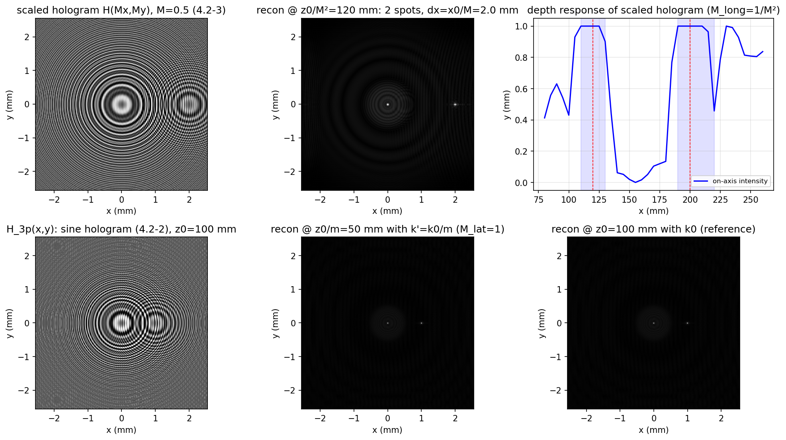
  <figcaption>图（本笔记运行结果，Example 4.1）：上排 缩放全息图 H(Mx,My)（M=0.5）→ 在 z0/M²=120 mm 重建出两点（间距 2.00 mm = x0/M）→ 轴上深度响应在 120/200 mm 出现两个聚焦平台（M_long=1/M²）；下排 原始三点正弦全息图 → 用 k0/m 在 z0/m=50 mm 重建（横向位置不变，M_lat=1）→ 用 k0 在 z0=100 mm 的参考重建</figcaption>
</figure>

### 4.2.4 真 3-D 全息电视的三大瓶颈

EBSLM 系统能视频速率显示、逐深度重建，但"真 3-D 全息电视"还有三笔硬账要算。

**A. 空间频率分辨率 → 视角**。把显示的全息图取最简单的点源全息图 \(\sin\big[\frac{k_0}{2z_0}(x^2+y^2)\big]\)（\(z_0\) 是点源到记录器件的距离）。沿 x 方向的局部空间频率（第 2 章式 2.5-5 的定义）：

\[
f_{local}=\frac{1}{2\pi}\frac{d}{dx}\Big(\frac{k_0}{2z_0}x^2\Big)=\frac{x}{\lambda_0 z_0},
\tag{4.2-6}
\]

全息图限幅孔径为 \(x_{max}\) 时最大空间频率（在 \(x_{max}\) 处）：

\[
f_{max}=\frac{x_{max}}{\lambda_0 z_0},
\tag{4.2-7}
\]

这就是全息图条纹的最高空间频率。设 SLM 的最高空间分辨率为 \(f_0\)，要记录 \(f_{max}\) 就必须 \(f_0=f_{max}\)。由图 4.14 的几何，全息图的 NA：

\[
\sin(\theta/2)=x_{max}/z_0,
\tag{4.2-8}
\]

其中 \(\theta\) 定义为**视角**（viewing angle）。用 (4.2-7) 改写 (4.2-8)：

\[
NA=\sin(\theta/2)=\lambda_0 f_{max}=\lambda_0 f_0.
\tag{4.2-9}
\]

人话版：**SLM 分辨率直接决定视角** \(\theta=2\arcsin(\lambda_0 f_0)\)。Hamamatsu EBSLM 的空间分辨率约 \(f_0=8\) lp/mm，在 \(\lambda_0=0.6328\ \mu\text{m}\) 下视角约 **0.6°**——做 3-D 显示没戏；但若只要**沿深度的顺序 2-D 显示**（sequential 2-D display along the depth），EBSLM 够用，因为它能视频速率刷新全息图。Table 4.1 列出现有 SLM 的视角——目前没有适合 3-D 显示的 SLM（视角被严重限制）；离轴全息更糟（要分辨载频：45° 记录角对应约 1000 lp/mm，远超现有 SLM，见 Table 4.1）。

<figure>
  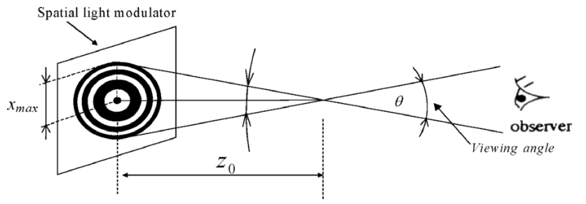
  <figcaption>图 4.14 视角：SLM 显示 FZP 全息图（孔径半宽 x_max、FZP 距离 z0），衍射锥半角 θ/2 即视角的一半（截自原书）</figcaption>
</figure>

**Table 4.1 现有 SLM 的视角（λ0=0.6328 µm）**（按原书重排）：

| \(f_0\)（SLM 分辨率） | \(\theta\)（视角） | 器件/公司 |
| --- | --- | --- |
| 8 lp/mm | 0.6 degree | EBSLM/Hamamatsu |
| 100 lp/mm | 6.8 degrees | PALSLM/Hamamatsu |
| 500 lp/mm | 34 degrees | not available（尚无此器件） |

!!! note "拓展：Table 4.1 的数值账"
    \(\theta=2\arcsin(\lambda_0 f_0)\) 逐行验算（λ0=0.6328 µm）：8 lp/mm → 0.58°（书 0.6° ✓）；100 lp/mm → 7.26°（书 6.8°）；500 lp/mm → 36.9°（书 34°）。后两行书值对应 λ0≈0.6 µm（2·arcsin(0.6e-3×100)=6.88°、2·arcsin(0.3)=34.9°）——书内用了两套波长，取整报出的。结论不变：视角随 f0 线性区增长极慢，500 lp/mm 也只有 30 多度。

**B. 空间分辨率（像素数）**。设 SLM 空间频率分辨率 \(f_0\)，按 **Nyquist 采样**，最小采样频率 \(f_s=2f_0\)。生成尺寸 \(l\times l\) 的全息图所需样本数：

\[
N=(l\,f_s)^2=(l\times 2f_0)^2=\Big(2l\frac{NA}{\lambda_0}\Big)^2,
\tag{4.2-10}
\]

（用了 (4.2-9)。）按 (4.2-10)，全视差下把 **20 mm × 20 mm**、视角 **60°** 的同轴全息图放上 SLM，需要约 **11 亿**可分辨像素。对照：最好的 CCD 之一 Canon D60（3072×2048 像素、67.7 lp/mm、7.4 µm 像素）才 600 多万像素。

**C. 数据传输**。一帧 20 mm × 20 mm、视角 60° 的全息图约 11 亿像素；以 8 bit、30 帧/s 更新，串行数据率：

\[
1.1\ \text{billion samples/frame}\times 8\ \text{bits/sample}\times 30\ \text{frames/s}=0.26\ \text{Tbit/s}\quad(\text{全视差}).
\]

全息图的信息量是天文数字——真 3-D 全息电视必须大幅削减信息量。但人用两只眼在水平面上看世界，**水平视差通常就够**。若只保留水平视差（牺牲垂直视差），512 条垂直线时所需像素数约为 1700 万，数据率从 0.26 Tbit/s 降到 **4 Gbit/s**——先进光纤通信（现实系统可达 40 Gbit/s）可以承受，实时全息电视的可能性就成立了。前提是**水平视差专用（horizontal-parallax-only, HPO）电子全息记录**技术可用：MIT 小组用计算机生成的 HPO 全息信息演示过 64 条垂直线、约 15° 视角的 3-D 全息显示 [St. Hilaire, Benton, Lucente, Jepsen, Kollin, Yoshikawa, Underkoffler (1990), St. Hilaire, Benton, and Lucente (1992)]——但那是**计算机生成**的，HPO 全息信息从未从真实物体记录过。OSH 用 **1-D TDFZP** 扫描物体即可实现 HPO 记录——**HPO-OSH** [Poon, Akin, Indebetouw, and Kim (2005), Poon (2006)] 补上了这块拼图（计算机仿真已发表）。

!!! warning "原书笔误：HPO 像素数公式多一个因子 2"
    书印 HPO 像素公式为 \(512\times(2l\times 2NA/\lambda_0)\)——代入 \(l=20\) mm、\(NA=0.5\)（60°）、\(\lambda_0=0.6328\ \mu\)m 得 **3240 万**，与书自己给的 "approximately 17 million" **矛盾**。自洽的式子是 \(512\times(2l\cdot NA/\lambda_0)\approx 1620\) 万 ≈ 17 million（等价于"512 行 × 每行 \(l\cdot f_s\) 个样本"，\(f_s=2f_0=2NA/\lambda_0\)），对应数据率 4 Gbit/s ✓。书中印刷多出的一个因子 2 属笔误。

!!! note "拓展：三笔账一起看（本笔记实跑）"
    视角逐行验算见上（0.58°/7.26°/36.9° vs 书 0.6°/6.8°/34°）；像素数：(4.2-10) 精确给 \(N=(2\times0.02\times0.5/0.6328\times10^{-6})^2\approx 1.00\) billion，书用 \(\lambda_0=0.6\ \mu\)m 算恰为 1.1 billion；数据率 1.1e9×8×30=0.264 → "0.26 Tbit/s" ✓；HPO 修正式 16.2M×8×30=3.9 → "4 Gbit/s" ✓。脚本对这批数全链路复核了一遍（下图）。

<figure>
  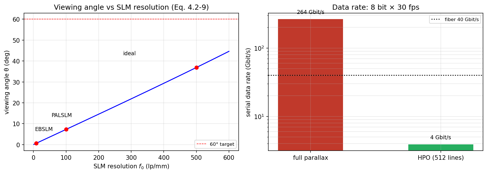
  <figcaption>图（本笔记运行结果）：左 视角 vs SLM 分辨率（式 4.2-9），红点为 Table 4.1 的三个器件、60° 目标线；右 全视差 vs HPO 的串行数据率对比（8 bit×30 fps），虚线为光纤 40 Gbit/s——HPO 落在可行区</figcaption>
</figure>

=== "MATLAB"

    ```matlab
    % ===== 书 4.2 节 · 3-D 全息电视的三大瓶颈（式 4.2-6 ~ 4.2-10 + 数据率） =====
    % 本脚本复核书中的全部数值，并验证书 4.2-C 的一处笔误：
    %    书印 HPO 像素公式 512×(2l×2NA/λ0) —— 代入得 32.4 million，与书自己给的
    %    "approximately 17 million" 矛盾；正确式应为 512×(2l·NA/λ0) ≈ 16.2 million（见笔记勘误）。
    %
    % 差异提示：纯数值脚本，无傅里叶约定问题；Python 版同目录 slm_holographic_tv_budget.py。

    clear
    lam0 = 0.6328e-3;         % mm（He-Ne）
    l = 20.0;                 % 全息图边长 mm（20mm × 20mm）
    theta_full = 60.0;        % 视角（度）
    NA = sind(theta_full/2);

    % ----- A. 视角 vs SLM 分辨率（Table 4.1） -----
    f0_list = [8 100 500];                            % lp/mm
    theta_list = 2*asind(lam0*f0_list);
    book_theta = {'0.6', '6.8', '34'};
    book_dev = {'EBSLM/Hamamatsu', 'PALSLM/Hamamatsu', 'not available'};
    fprintf('--- A. 视角（Table 4.1，λ0=0.6328 µm） ---\n');
    for ii = 1:3
        fprintf('    f0 = %5.0f lp/mm -> θ = %5.2f deg（书 Table 4.1：%s°，%s）\n', ...
                f0_list(ii), theta_list(ii), book_theta{ii}, book_dev{ii});
    end
    fprintf('    离轴全息 45° 记录角 -> 载频 ~1000 lp/mm：远超现有 SLM（同轴 OSH 才上得了 SLM）\n');

    % ----- B. 像素数（4.2-10） -----
    f0_req = NA/lam0;                       % 满足 60° 视角所需的 SLM 分辨率（4.2-9 反推）
    fs = 2*f0_req;                          % Nyquist：fs = 2 f0
    N_pix = (l*fs)^2;
    fprintf('--- B. 像素数（式 4.2-10，l=20mm，θ=60°） ---\n');
    fprintf('    所需 f0 = NA/λ0 = %.0f lp/mm，fs = 2f0 = %.0f lp/mm\n', f0_req, fs);
    fprintf('    N = (l·fs)² = (2l·NA/λ0)² = %.2f billion（书：about 1.1 billion，按 λ0=0.6µm 计恰为 1.1）\n', N_pix/1e9);
    fprintf('    对照 Canon D60：3072×2048 ≈ 6.3 MP（67.7 lp/mm，7.4 µm 像素）——差 160 倍\n');

    % ----- C. 数据率与 HPO -----
    N_book = 1.1e9;                                   % 书采用 1.1 billion
    fprintf('--- C. 数据率 ---\n');
    fprintf('    全视差：%.3e samples × 8 bit × 30 fps = %.2f Tbit/s（书用 1.1 billion -> 0.26 Tbit/s）\n', ...
            N_pix, N_pix*8*30/1e12);
    n_hpo_book = 512*(2*l*2*NA/lam0);                 % 书印公式（多一个因子 2）
    n_hpo_fix  = 512*(2*l*NA/lam0);                   % 与 17 million 自洽的式
    fprintf('    HPO（512 条垂直线）：\n');
    fprintf('      书印式 512×(2l×2NA/λ0) = %.1f million  <- 与书自己的 "17 million" 矛盾（笔误）\n', n_hpo_book/1e6);
    fprintf('      修正式 512×(2l·NA/λ0)  = %.1f million ≈ 17 million ✓  -> %.1f Gbit/s（书：4 Gbit/s）\n', ...
            n_hpo_fix/1e6, n_hpo_fix*8*30/1e9);
    fprintf('    光纤 40 Gbit/s 可达 -> 实时全息电视可行，前提是 HPO 电子全息记录（HPO-OSH，1-D TDFZP 扫描）\n');

    % ----- 可视化（对应笔记图 sim-slm-budget.png） -----
    figure(1)
    subplot(1,2,1)
    f0s = linspace(1, 600, 400);
    th = 2*sind(lam0*f0s);
    plot(f0s, th, 'b-', 'LineWidth', 1.5); hold on; grid on
    plot(f0_list, theta_list, 'ro', 'MarkerSize', 6, 'LineWidth', 1.2)
    yline(60, 'r--', '60° target');
    xlabel('SLM resolution f_0 (lp/mm)'); ylabel('viewing angle θ (deg)')
    title('Viewing angle vs SLM resolution (Eq. 4.2-9)')

    subplot(1,2,2)
    rates = [N_book*8*30/1e9, n_hpo_fix*8*30/1e9];
    bar(rates, 0.5); set(gca, 'YScale', 'log'); grid on
    set(gca, 'XTickLabel', {'full parallax', 'HPO (512 lines)'})
    ylabel('serial data rate (Gbit/s)'); ylim([1 1e4])
    text(1, rates(1)*1.2, sprintf('%.0f Gbit/s', rates(1)), 'HorizontalAlignment', 'center')
    text(2, rates(2)*1.2, sprintf('%.0f Gbit/s', rates(2)), 'HorizontalAlignment', 'center')
    yline(40, 'k:', 'fiber 40 Gbit/s');
    title('Data rate: 8 bit × 30 fps')
    ```

=== "Python"

    ```python
    # ===== 书 4.2 节 · 3-D 全息电视的三大瓶颈（式 4.2-6 ~ 4.2-10 + 数据率） =====
    # A. 空间频率分辨率 -> 视角：
    #    点源全息图 sin[(k0/2z0)(x²+y²)] 的局部空间频率 (4.2-6)：
    #        f_local = (1/2π) d/dx[(k0/2z0)x²] = x/(λ0·z0)
    #    全息图孔径半宽 x_max 处最大 (4.2-7)：f_max = x_max/(λ0·z0)
    #    几何 (4.2-8)：NA = sin(θ/2) = x_max/z0  ->  (4.2-9)：NA = λ0·f_max = λ0·f0
    #    即：SLM 分辨率 f0 直接决定视角 θ = 2·arcsin(λ0·f0)。
    # B. 空间分辨率（像素数）：Nyquist 采样 fs = 2·f0；l×l 全息图需
    #        N = (l·fs)² = (2l·f0)² = (2l·NA/λ0)²                (4.2-10)
    # C. 数据传输：N×8bit×30帧/s；HPO（只保留水平视差）可把像素数砍到 512×(2l·NA/λ0)。
    #
    # 本脚本复核书中的全部数值，并验证书 4.2-C 的一处笔误：
    #    书印 HPO 像素公式 512×(2l×2NA/λ0) —— 代入得 32.4 million，与书自己给的
    #    "approximately 17 million" 矛盾；正确式应为 512×(2l·NA/λ0) ≈ 16.2 million（见笔记勘误）。
    #
    # MATLAB / Python 差异提示：纯数值脚本，无傅里叶约定问题。

    import sys
    import numpy as np
    import matplotlib.pyplot as plt

    if hasattr(sys.stdout, 'reconfigure'):
        sys.stdout.reconfigure(encoding='utf-8')

    lam0 = 0.6328e-3          # mm（He-Ne）
    l = 20.0                  # 全息图边长 mm（20mm × 20mm）
    theta_full = 60.0         # 视角（度）
    NA = np.sin(np.radians(theta_full / 2))

    # ----- A. 视角 vs SLM 分辨率（Table 4.1） -----
    f0_list = np.array([8.0, 100.0, 500.0])           # lp/mm
    theta_list = 2 * np.degrees(np.arcsin(lam0 * f0_list))
    print('--- A. 视角（Table 4.1，λ0=0.6328 µm） ---')
    for f0, th, dev in zip(f0_list, theta_list, ['EBSLM/Hamamatsu', 'PALSLM/Hamamatsu', 'not available']):
        print(f'    f0 = {f0:5.0f} lp/mm -> θ = {th:5.2f} deg   （书 Table 4.1：'
              f'{["0.6", "6.8", "34"][list(f0_list).index(f0)]}°，{dev}）')
    print('    离轴全息 45° 记录角 -> 载频 ~1000 lp/mm：远超现有 SLM（同轴 OSH 才上得了 SLM）')

    # ----- B. 像素数（4.2-10） -----
    f0_req = NA / lam0                                    # 满足 60° 视角所需的 SLM 分辨率（4.2-9 反推）
    fs = 2 * f0_req                                       # Nyquist：fs = 2 f0
    N_pix = (l * fs)**2
    print('--- B. 像素数（式 4.2-10，l=20mm，θ=60°） ---')
    print(f'    所需 f0 = NA/λ0 = {f0_req:.0f} lp/mm，fs = 2f0 = {fs:.0f} lp/mm')
    print(f'    N = (l·fs)² = (2l·NA/λ0)² = {N_pix/1e9:.2f} billion（书：about 1.1 billion，'
          '按 λ0=0.6 µm 计恰为 1.1）')
    print('    对照 Canon D60：3072×2048 ≈ 6.3 MP（67.7 lp/mm，7.4 µm 像素）——差 160 倍')

    # ----- C. 数据率与 HPO -----
    N_book = 1.1e9                                        # 书采用 1.1 billion
    rate_full = N_pix * 8 * 30 / 1e12
    print('--- C. 数据率 ---')
    print(f'    全视差：{N_pix:.3e} samples × 8 bit × 30 fps = {rate_full:.2f} Tbit/s'
          f'（书用 1.1 billion -> 0.26 Tbit/s）')
    n_hpo_book = 512 * (2 * l * 2 * NA / lam0)            # 书印公式（多一个因子 2）
    n_hpo_fix = 512 * (2 * l * NA / lam0)                 # 与 17 million 自洽的式
    print(f'    HPO（512 条垂直线）：')
    print(f'      书印式 512×(2l×2NA/λ0) = {n_hpo_book/1e6:.1f} million  <- 与书自己的 "17 million" 矛盾（笔误）')
    print(f'      修正式 512×(2l·NA/λ0)  = {n_hpo_fix/1e6:.1f} million ≈ 17 million ✓'
          f'  -> {n_hpo_fix*8*30/1e9:.1f} Gbit/s（书：4 Gbit/s）')
    print('    光纤 40 Gbit/s 可达 -> 实时全息电视可行，前提是 HPO 电子全息记录（HPO-OSH，1-D TDFZP 扫描）')

    # ----- 可视化（对应笔记图 sim-slm-budget.png） -----
    fig, ax = plt.subplots(1, 2, figsize=(11.5, 4.2))
    f0s = np.linspace(1, 600, 400)
    th = 2 * np.degrees(np.arcsin(np.clip(lam0 * f0s, 0, 1)))
    ax[0].plot(f0s, th, 'b-', lw=1.5)
    for f0, t0, name in [(8, 0.58, 'EBSLM'), (100, 7.27, 'PALSLM'), (500, 36.9, 'ideal')]:
        ax[0].plot(f0, 2 * np.degrees(np.arcsin(lam0 * f0)), 'ro')
        ax[0].annotate(name, xy=(f0, 2 * np.degrees(np.arcsin(lam0 * f0))),
                       xytext=(f0 * 0.55, 2 * np.degrees(np.arcsin(lam0 * f0)) + 6), fontsize=9)
    ax[0].axhline(60, color='r', ls='--', lw=0.8, label='60° target')
    ax[0].set_xlabel("SLM resolution $f_0$ (lp/mm)"); ax[0].set_ylabel('viewing angle θ (deg)')
    ax[0].set_title('Viewing angle vs SLM resolution (Eq. 4.2-9)')
    ax[0].grid(alpha=0.3); ax[0].legend(fontsize=8)

    rates = [N_book * 8 * 30 / 1e9, n_hpo_fix * 8 * 30 / 1e9]
    ax[1].bar(['full parallax', 'HPO (512 lines)'], rates, color=['#c0392b', '#27ae60'], width=0.5)
    ax[1].set_yscale('log'); ax[1].set_ylabel('serial data rate (Gbit/s)')
    ax[1].set_title('Data rate: 8 bit × 30 fps')
    for i, rv in enumerate(rates):
        ax[1].text(i, rv * 1.2, f'{rv:.0f} Gbit/s', ha='center', fontsize=9)
    ax[1].axhline(40, color='k', ls=':', label='fiber 40 Gbit/s')
    ax[1].legend(fontsize=8); ax[1].grid(alpha=0.3, which='both')
    plt.tight_layout()
    plt.savefig('sim-slm-budget.png', dpi=150, bbox_inches='tight')
    plt.show()
    ```

## 4.3 光学扫描加密

### 4.3.1 为什么光学加密、为什么用 OSH

光学元件与光学系统性能近年突飞猛进，光加密在安全应用中潜力巨大——用光学方法做安全系统的文章已经一大堆 [Lohmann, Stork, and Stucke (1986), Refregier and Javidi (1995), Lai and Neifeld (2000), Wang, Sun, Su, and Chiou (2000), Magensen and Gluckstad (2001)]。光加密的理由：一，要加密的信息（如图像）**本来就在光域**；二，光加密相比电子/数字加密有**更多自由度**；三，要加密大体积信息（如 3-D 物体）时光方法是最自然的选择。多数光加密技术是相干的；**非相干**光加密最近也有人提出 [Tajahuerce, Lancis, Javidi, and Andres (2001)]——非相干技术普遍的优势：信噪比更好、对光学元件失调不敏感。

本节的**光学扫描加密**（optical scanning cryptography, OSC）[Poon, Kim, and Doh (2003)] 基于 OSH，同时享受非相干处理的好处，还有三个独门优势：

1. 它是光学**扫描**方法——处理非相干物体（如打印文件）**不需要 SLM** 把非相干图转成相干图（现有相干技术都得这么干）；能实时（on-the-fly）加密。
2. 输出是**外差电流**——加密信息骑在载频上（通信意义上的 carrier），可以直接辐射，**无线传输**到安全地点存储/解密——在射频识别（**RFID**）应用上有重要前景 [Radio Frequency Identification Technologies: A Workshop Summary (2004)]。
3. 基于**全息术**——容易扩展到加密 **3-D** 信息。

### 4.3.2 系统：两个一模一样的双瞳处理器

<figure>
  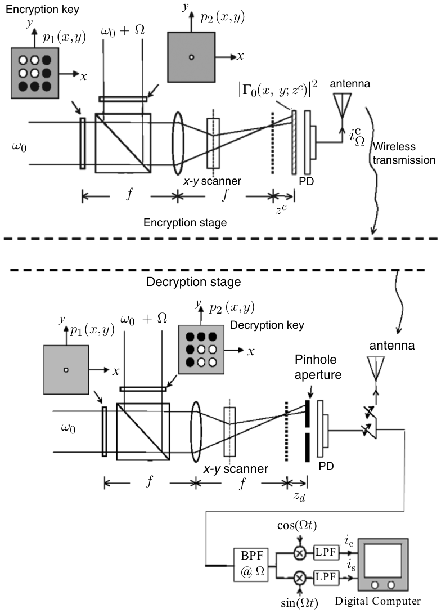
  <figcaption>图 4.15 光学扫描加密：上半 加密级（p1=加密密钥@ω0、p2=针孔@ω0+Ω，扫描 |Γ0(x,y;z^c)|²，PD→天线无线发送 i_Ω^c）；下半 解密级（p1=针孔@ω0、p2=解密密钥@ω0+Ω，扫描针孔光阑 @z^d，PD→BPF@Ω→cos/sin 解调→ic,is→数字计算机）[Poon et al., Applied Optics 42, 496 (2003)]（截自原书）</figcaption>
</figure>

图 4.15 是加密与解密的光学系统，包含**加密级**与**解密级**两个子系统——两者是**完全相同的双瞳光学外差扫描图像处理器**（3.4 节已深入研究过）。先复习处理器结果（把 3.4 节的距离 \(z\) 换成**编码距离** \(z^c\)）：两个光瞳 \(p_1(x,y)\)、\(p_2(x,y)\) 位于透镜前焦面，分别被时间频率 \(\omega_0\) 与 \(\omega_0+\Omega\) 的宽光束照明；两光合束后 2-D 扫描位于透镜后焦面外 \(z^c\) 处的平面物体 \(|\Gamma_0(x,y;z^c)|^2\)（\(z^c\) 叫**编码距离**，\(|\Gamma_0|^2\) 是待加密物体）。PD 收全部透射光（漫反射物体则收散射光），输出中含频率 Ω 的外差电流（另一输出是基带信号）。电子调谐到 Ω 后的外差电流（式 3.4-11，\(z\to z^c\)）：

\[
i_\Omega^c(x,y;z^c)=\mathrm{Re}\big[i_\Omega(x,y;z^c)\exp(j\Omega t)\big]
=\mathrm{Re}\big[\mathcal{F}^{-1}\big\{\mathcal{F}\big\{|\Gamma_0(x,y;z^c)|^2\big\}\,OTF_\Omega(k_x,k_y;z^c)\big\}\exp(j\Omega t)\big],
\tag{4.3-1}
\]

其中（式 3.4-10 原样，\(z\to z^c\)，\(f\) 为加密级透镜焦距）：

\[
OTF_\Omega(k_x,k_y;z^c)=\exp\Big[j\frac{z^c}{2k_0}(k_x^2+k_y^2)\Big]
\times\iint p_1^*(x',y')\,p_2\Big(x'+\frac{f}{k_0}k_x,\ y'+\frac{f}{k_0}k_y\Big)
\exp\Big[j\frac{z^c}{f}(x'k_x+y'k_y)\Big]dx'dy',
\tag{4.3-2}
\]

处理元就是两个光瞳函数——**改光瞳就改 OTF，就改处理结果**。电子多路检测（×cosΩt、×sinΩt 后低通）给出（同 3.4-14a/b）：

\[
i_c(x,y;z^c)=\mathrm{Re}\big[\mathcal{F}^{-1}\{\mathcal{F}\{|\Gamma_0(x,y;z^c)|^2\}\,OTF_\Omega(k_x,k_y;z^c)\}\big],
\tag{4.3-3a}
\]

\[
i_s(x,y;z^c)=\mathrm{Im}\big[\mathcal{F}^{-1}\{\mathcal{F}\{|\Gamma_0(x,y;z^c)|^2\}\,OTF_\Omega(k_x,k_y;z^c)\}\big].
\tag{4.3-3b}
\]

复数相加：

\[
i(x,y;z^c)=i_c(x,y;z^c)+j\,i_s(x,y;z^c)
=\mathcal{F}^{-1}\big\{\mathcal{F}\{|\Gamma_0(x,y;z^c)|^2\}\,OTF_\Omega(k_x,k_y;z^c)\big\},
\tag{4.3-4}
\]

被处理物体的**全部幅度与相位信息**都在这个复数表达式里。

!!! note "拓展：i_s 的符号——ch3 与 ch4 的约定衔接"
    ch3 的电子学定义（乘 sinΩt 后低通，式 3.2-3b）给出 \(i_s=-\mathrm{Im}\{i_{\Omega_p}\}/2\)，ch3 的 (3.4-14b) 印成 \(\mathrm{Im}\) 已作为勘误处理；本章 (4.3-3b) 又印 \(\mathrm{Im}\)——但注意 ch4 紧接着定义 \(i=i_c+j\,i_s\)（4.3-4）恰好**等于复数场本身**：在"\(i_c=\mathrm{Re}\)、\(i_s=\mathrm{Im}\)"这套约定下 (4.3-3)/(4.3-4) 是自洽的（与 ch3 的 \(H_{c+}=H_{\cos}+jH_{\sin}\) 差一个全局因子 \(j\)，即互为共轭关系）。两章各自自洽；OSC 的解密最终只取模 \(|\cdot|\)，这个差别完全无影响。跨章对代码时记得先对齐这一层。

### 4.3.3 加密：把密钥插进光瞳

加密就是对 (4.3-4) 动光瞳。简单例子：取

\[
p_2(x,y)=\delta(x,y)\quad\text{（针孔）},
\]

并保持 \(p_1(x,y)\) 不变——**\(p_1\) 叫加密密钥（encryption key）**。（注意与 3.5 节的 OSH 取法 \(p_1=1,p_2=\delta\) 对比：加密级里 \(\omega_0\) 的那束过**密钥光瞳** \(p_1\)、\(\omega_0+\Omega\) 的那束过针孔 \(p_2\)——图 4.15 上半。）把 \(p_2=\delta\) 代入 (4.3-2)：δ 把积分里的 \(x'=-(f/k_0)k_x\) 直接采样出来，菲涅耳相位项部分相消，OTF 变成

\[
OTF_\Omega(k_x,k_y;z^c)=\exp\Big[-j\frac{z^c}{2k_0}(k_x^2+k_y^2)\Big]\,
p_1^*\Big(-\frac{f}{k_0}k_x,\ -\frac{f}{k_0}k_y\Big),
\tag{4.3-5}
\]

(4.3-4) 随之变成

\[
i(x,y;z^c)=\mathcal{F}^{-1}\Big\{\mathcal{F}\big\{|\Gamma_0(x,y;z^c)|^2\big\}
\times\exp\Big[-j\frac{z^c}{2k_0}(k_x^2+k_y^2)\Big]\times
p_1^*\Big(-\frac{f}{k_0}k_x,\ -\frac{f}{k_0}k_y\Big)\Big\}.
\tag{4.3-6}
\]

\(i(x,y;z^c)\) 就是**编码/加密后的物体**（coded/encrypted object），存进数字计算机即可。注意 \(|\Gamma_0|^2\) 的谱被乘了两项：其中 \(\exp[-j\frac{z^c}{2k_0}(k_x^2+k_y^2)]\) 正是 \(|\Gamma_0(x,y;z^c)|^2\) 的全息图谱【式 (3.5-9)，物体记录在离焦面 \(z^c\) 处】——所以 (4.3-6) 可以理解为"**物体的全息图被 \(p_1\) 加密**"。把全息信息编码进光瞳的想法最早由 Schilling 和 Poon 在 OSH 语境下研究 [Schilling and Poon (1995)]。

### 4.3.4 解密与 DDU：两个条件

解密要靠安全地点（解密端）的光学系统——光学系统与加密级完全相同，只换光瞳选择，且这次激光束扫描的是一个**针孔物体**：

\[
|\Gamma_0(x,y;z^d)|^2=\delta(x,y;z^d),
\]

位于解密级透镜后焦面外 \(z^d\) 处——\(z^d\) 叫**解码距离**（decoding distance）。开关切到解密级输出端，光瞳选

\[
p_1(x,y)=\delta(x,y)\quad\text{（针孔）},
\]

并保持 \(p_2(x,y)\) 不变——**\(p_2\) 叫解密密钥（decryption key）**。（与加密级正好互换：加密级的针孔在 \(p_2\)、解密级的针孔在 \(p_1\)——图 4.15 两个子系统的标注。）按 (4.3-2)，这组光瞳给出

\[
OTF_\Omega(k_x,k_y;z^d)=\exp\Big[+j\frac{z^d}{2k_0}(k_x^2+k_y^2)\Big]\,p_2\Big(\frac{f}{k_0}k_x,\ \frac{f}{k_0}k_y\Big),
\tag{4.3-7}
\]

用 (4.3-4) 并注意 \(\mathcal{F}\{|\Gamma_0(x,y;z^d)|^2\}=\mathcal{F}\{\delta\}=1\)：

\[
i(x,y;z^d)=\mathcal{F}^{-1}\Big\{\exp\Big[j\frac{z^d}{2k_0}(k_x^2+k_y^2)\Big]\,p_2\Big(\frac{f}{k_0}k_x,\ \frac{f}{k_0}k_y\Big)\Big\}.
\tag{4.3-8}
\]

这就是解密端产生的输出（插好解密密钥、扫描针孔），存入计算机，等无线传来的密文到了再解。**数字解密单元**（digital decryption unit, DDU，图 4.16）对两个输入做的是**复谱直接相乘**（不是相关、不取共轭）：

<figure>
  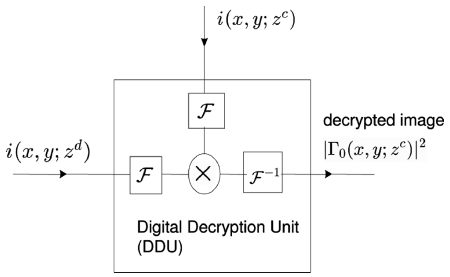
  <figcaption>图 4.16 数字解密单元（DDU）：密文 <span class="arithmatex">\(i(x,y;z^c)\)</span> 与解密端信息 <span class="arithmatex">\(i(x,y;z^d)\)</span> 各做 <span class="arithmatex">\(\mathcal{F}\)</span>，相乘，<span class="arithmatex">\(\mathcal{F}^{-1}\)</span>，输出"解密图像" <span class="arithmatex">\(|\Gamma_0(x,y;z^c)|^2\)</span> [Poon et al., Applied Optics 42, 496 (2003)]（截自原书）</figcaption>
</figure>

\[
\text{output of DDU}\ \propto\ \mathcal{F}^{-1}\big\{\mathcal{F}\{i(x,y;z^c)\}\times\mathcal{F}\{i(x,y;z^d)\}\big\}
\]

\[
=\mathcal{F}^{-1}\Big\{\mathcal{F}\big\{|\Gamma_0(x,y;z^c)|^2\big\}\exp\Big[-j\frac{z^c}{2k_0}(k_x^2+k_y^2)\Big]p_1^*\Big(-\frac{f}{k_0}k_x,-\frac{f}{k_0}k_y\Big)
\exp\Big[j\frac{z^d}{2k_0}(k_x^2+k_y^2)\Big]p_2\Big(\frac{f}{k_0}k_x,\frac{f}{k_0}k_y\Big)\Big\}
\]

\[
=\ \big|\Gamma_0(x,y;z^c)\big|^2,
\tag{4.3-9}
\]

条件是以下两条**同时**成立：

1. \(z^d=z^c\)——加密级的编码距离与解密级的解码距离相同（此时二次相位 \(\exp[\pm j z k^2/2k_0]\) 精确对消，全息重建在焦；\(z^d\ne z^c\) 则是**离焦重建** defocused image reconstruction）；
2. \(p_1^*(-x,-y)\,p_2(x,y)=1\)——加密密钥与解密密钥的函数形式自由选择，**相位型密钥**最好用（下例演示）。

### 4.3.5 Example 4.2：双随机相位加密的 MATLAB 仿真

随机相位掩模显然是好密钥。取

\[
p_1(x,y)=\exp\big[j2\pi M(x,y)\big],
\]

其中 \(M(x,y)\) 是 (0.0,1.0) 均匀分布的随机数函数；\(p_2(x,y)=\delta(x,y)\)。代入 (4.3-6)：

\[
i(x,y;z^c)=\mathcal{F}^{-1}\Big\{\mathcal{F}\big\{|\Gamma_0(x,y;z^c)|^2\big\}
\exp\Big[-j\frac{z^c}{2k_0}(k_x^2+k_y^2)\Big]
\exp\Big[-j2\pi M\Big(-\frac{f}{k_0}k_x,\ -\frac{f}{k_0}k_y\Big)\Big]\Big\}.
\tag{4.3-10}
\]

要更安全，还可以把**原始文档乘一个随机相位掩模** \(\exp[j2\pi r(x,y)]\)（\(r(x,y)\) 是另一个独立随机函数）。由 (4.3-10)，总加密图像：

\[
i(x,y;z^c)=\mathcal{F}^{-1}\Big\{\mathcal{F}\big\{|\Gamma_0(x,y;z^c)|^2\exp[j2\pi r(x,y)]\big\}
\exp\Big[-j\frac{z^c}{2k_0}(k_x^2+k_y^2)\Big]
\exp\Big[-j2\pi M\Big(-\frac{f}{k_0}k_x,\ -\frac{f}{k_0}k_y\Big)\Big]\Big\}.
\tag{4.3-11}
\]

这个手法叫**双随机相位编码**（double-random phase encoding）[Refregier and Javidi (1995)]——输入面一个随机相位、傅里叶面（这里由光瞳扮演）一个随机相位，\(r\) 与 \(M\) 必须相互独立。

解密端扫描距离 \(z^d\) 处的针孔物体，光瞳 \(p_1(x,y)=\delta(x,y)\)（针孔）、\(p_2(x,y)=\exp[j2\pi M(-x,-y)]\)（满足条件 2：\(p_1^*(-x,-y)p_2(x,y)=\exp[-j2\pi M(-x,-y)]\cdot\exp[j2\pi M(-x,-y)]=1\)）。按 (4.3-8)，存入解密计算机的扫描输出：

\[
i(x,y;z^d)=\mathcal{F}^{-1}\Big\{\exp\Big[j\frac{z^d}{2k_0}(k_x^2+k_y^2)\Big]\,
\exp\Big[j2\pi M\Big(-\frac{f}{k_0}k_x,\ -\frac{f}{k_0}k_y\Big)\Big]\Big\}.
\tag{4.3-12}
\]

把 (4.3-11) 与 (4.3-12) 送入 DDU（图 4.16）：

\[
\text{output of DDU}\propto\mathcal{F}^{-1}\Big\{\mathcal{F}\big\{|\Gamma_0(x,y;z^c)|^2\exp[j2\pi r(x,y)]\big\}
\exp\Big[-j\frac{z^c}{2k_0}(k_x^2+k_y^2)\Big]\exp\Big[j\frac{z^d}{2k_0}(k_x^2+k_y^2)\Big]\Big\}
=\ \big|\Gamma_0(x,y;z^c)\big|^2\exp[j2\pi r(x,y)],
\tag{4.3-13}
\]

当 \(\sigma\)（即 \(z^c/2k_0\)）与加密时所用相同、理论上 \(z^d=z^c\)。解密输出的强度（DDU 输出的绝对值）就是干净文档——**输入面的随机相位 \(\exp[j2\pi r]\) 被最后的取模动作抹掉**（\(|\exp[j2\pi r]|=1\)）。

!!! warning "原书笔误：(4.3-12) 编号重复"
    书把 (4.3-11)/(4.3-12) 送入 DDU 后的输出式又印作 "(4.3-12)"——与上一式（解密端扫描输出）编号撞车。按上下文（"Eqs. (4.3-11) and (4.3-12) are the inputs of the DDU"），DDU 输出式应为 **(4.3-13)**。本笔记按 (4.3-13) 引用。

<figure>
  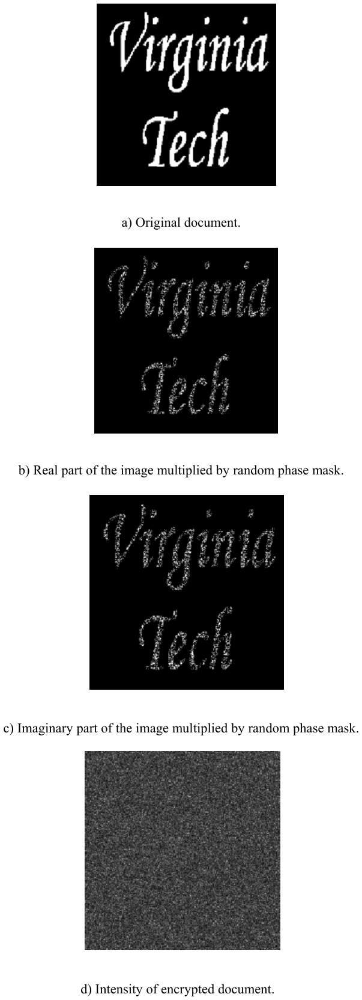
  <figcaption>图 4.17 加密仿真（Virginia Tech 文档）：a) 原始文档 |Γ0|²；b) 文档×随机相位后的实部；c) 虚部；d) 加密文档的"强度" |i(x,y;z^c)|（按式 4.3-11，σ=(zc·λd)/(4π)=(30)×(0.6×10⁻⁶)/4π）——纯噪声，文档信息荡然无存（截自原书）</figcaption>
</figure>

Table 4.2 的 Cryptography.m（改编自 Taegeun Kim，Sejong Univ.）复现这组仿真，结果见图 4.17/4.18：**图 4.18a** 密钥匹配且 \(z^d=z^c\) 时解密强度干净；**图 4.18b** 解密密钥选错（猜随机相位）时输出不可用；**图 4.18c** 密钥正确但 \(\sigma\)（即 \(z^d\)）选错（如 \(z^d=1.5z^c\)）时是 4.18a 的散焦版——\(z^c\) 与 \(z^d\) 的引入给出**额外一层安全保障**。

<figure>
  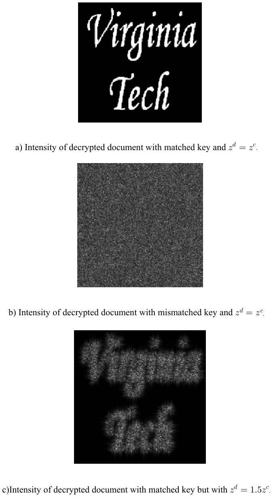
  <figcaption>图 4.18 解密仿真：a) 密钥匹配 + z^d=z^c（干净文档）；b) 密钥不匹配 + z^d=z^c（噪声）；c) 密钥匹配 + z^d=1.5z^c（散焦）（截自原书）</figcaption>
</figure>

原书 Table 4.2 的 Cryptography.m 及规范化重写如下（原书读 575×577 的 vt.bmp 再插值到 256×256；本版无该文件时生成文字图；原书三重 for 循环改向量化）：

=== "MATLAB"

    ```matlab
    % ===== 书 Example 4.2 + Table 4.2 Cryptography.m · 光学扫描加密（OSC）规范化重写 =====
    % 加密级：p2 = δ（针孔，@ω0+Ω），p1 = 加密密钥 exp[j2πM]（@ω0）   （式 4.3-5/4.3-11）
    % 解密级：p1 = δ（针孔，@ω0），p2 = 解密密钥 exp[j2πM(-x,-y)]，扫描针孔物体 @z^d（式 4.3-12）
    % DDU：F{i_enc} × F{i_dec} -> F^{-1} -> |·|（式 4.3-13；注意是复谱相乘，无共轭）
    % 三种情形（Python 实跑结论）：a) 匹配+z^d=z^c -> cc=1.0000；b) 密钥错 -> 0.0004；
    %                              c) 匹配+z^d=1.5z^c -> 0.2693（散焦）
    %
    % 约定说明：原书 Cryptography.m 用 MATLAB 原生 fft2（-j 指数）作"前向"——与本笔记书式协议
    % （前向 +j = ifft2*N²）互为镜像；但 OSC 解密只依赖 |OTF·P| = 1 的模守恒闭环，两种约定
    % 结果相同（延续 ch3 的"解析传递函数敏感/闭环安全"判据）。本版统一书式协议。
    %
    % 与原书 m-file 的差异：1) 原书读 575×577 的 vt.bmp 后 interp2 到 256×256，本版无该文件时
    % 生成几何文字图；2) 原书三重 for 循环生成 OTF，本版向量化。

    clear
    N = 256;
    Dl = 0.02;                        % 物理视场（原书 Dl=0.02）
    dx = Dl/N;
    zc = 0.30;                        % 编码距离 (m)
    lam = 0.6e-6;                     % 波长 (m)
    sigma = zc*lam/(4*pi);            % = z^c/(2k0)（同原书 sigma=(zc*ld)/(4*pi)）

    x = ((0:N-1) - N/2) * dx;
    [X, Y] = meshgrid(x, x);
    dfk = 2*pi/(N*dx);
    kx1d = ((0:N-1) - N/2) * dfk;
    [KY, KX] = meshgrid(kx1d, kx1d);

    % ---- 待加密文档（原书 vt.bmp "Virginia Tech"；无该文件则生成几何测试图） ----
    if exist('vt.bmp', 'file')
        C = imread('vt.bmp');
        C = double(C(:,:,1));
        [xs, ys] = meshgrid(linspace(1, size(C,2), N), linspace(1, size(C,1), N));
        I0 = interp2(1:size(C,2), 1:size(C,1), C, xs, ys);
        I0 = I0 / max(I0(:));
    else
        I0 = zeros(N);
        I0(abs(X) < 0.3e-3 & abs(Y) < 0.7e-3 & abs(Y) > 0.35e-3) = 1;   % 上下两条横杠
        I0(abs(X + 0.55e-3) < 0.12e-3 & abs(Y) < 0.75e-3) = 1;          % V 左斜
        I0(abs(X + 0.2e-3)  < 0.12e-3 & abs(Y) < 0.75e-3) = 1;          % V 右斜
        I0(abs(X - 0.35e-3) < 0.03e-3 & abs(Y) < 0.75e-3) = 1;          % T 竖
        I0(abs(X - 0.35e-3) < 0.55e-3 & abs(Y - 0.6e-3) < 0.05e-3) = 1; % T 横
    end

    % ---- 双随机相位编码（式 4.3-11） ----
    rng(7);                                    % 固定随机种子便于复现（原书 rand 不固定）
    R = rand(N);                               % 输入面随机相位 r(x,y) ~ U(0,1)
    Mkey = rand(N);                            % 加密密钥 M(x,y)（p1 = exp[j2πM]，频域取 M(-u)）
    RPM = exp(1j*2*pi*R);                      % exp[j2πr]
    P = exp(-1j*2*pi*Mkey);                    % 频域密钥 = exp[-j2πM(-u)]（随机矩阵，等价）
    OTF_enc = exp(-1j*sigma*(KX.^2+KY.^2));    % exp[-j z^c k²/(2k0)]（式 4.3-5 的相位项）

    R1 = I0 .* RPM;                            % 文档 × 输入面随机相位
    E = ft2_book(R1) .* OTF_enc .* P;          % 加密频谱（式 4.3-11 花括号内）
    e = ift2_book(E);                          % 加密图像 i(x,y;z^c)（密文，发送）

    % ---- 解密级信息（式 4.3-12）与 DDU ----
    OTF_dec   = exp(1j*sigma*(KX.^2+KY.^2));            % exp[+j z^d k²/(2k0)]，z^d = z^c
    OTF_dec15 = exp(1j*1.5*sigma*(KX.^2+KY.^2));        % z^d = 1.5 z^c
    Key_info = conj(OTF_enc .* P);                      % F{i_dec}（p2 = P*，满足条件 2）
    M3 = rand(N);
    Key_mis = conj(OTF_enc .* exp(-1j*2*pi*M3));        % 猜错密钥（独立随机相位）

    de     = ift2_book(E .* Key_info);                  % a) 匹配密钥 + z^d = z^c
    de_mis = ift2_book(E .* Key_mis);                   % b) 密钥不匹配
    de_15  = ift2_book(E .* conj(OTF_dec15 .* P));      % c) 匹配密钥 + z^d = 1.5 z^c

    fprintf('--- 解密质量（|DDU输出| vs 原文档 I0 的相关系数） ---\n');
    fprintf('a) 匹配密钥 + z^d = z^c      : %.4f（干净）\n', cc(abs(de), I0));
    fprintf('b) 密钥不匹配 + z^d = z^c    : %.4f（噪声）\n', cc(abs(de_mis), I0));
    fprintf('c) 匹配密钥 + z^d = 1.5·z^c  : %.4f（散焦）\n', cc(abs(de_15), I0));
    fprintf('条件核对：|OTF_enc·P| = %.6f（模恒 1 -> DDU 乘积中密钥项精确对消）\n', mean(abs(OTF_enc.*P), 'all'));
    fprintf('密文 |e| 与文档的相关系数 = %.4f（密文强度不含文档信息 -> 窃听无效）\n', cc(abs(e), I0));

    % ---- 可视化（对应书图 4.17/4.18） ----
    figure(1)
    subplot(2,4,1); imagesc(x*1e3, x*1e3, I0); axis image off; colormap gray
    title('a) Original document |G_0|^2')
    subplot(2,4,2); imagesc(x*1e3, x*1e3, real(R1)); axis image off
    title('b) Re{doc × exp(j2πr)}')
    subplot(2,4,3); imagesc(x*1e3, x*1e3, imag(R1)); axis image off
    title('c) Im{doc × exp(j2πr)}')
    subplot(2,4,4); imagesc(x*1e3, x*1e3, abs(e)); axis image off
    title('d) |encrypted| (sent via wireless)')
    subplot(2,4,5); imagesc(x*1e3, x*1e3, abs(de)); axis image off
    title(sprintf('a) matched key, zd=zc (cc=%.3f)', cc(abs(de), I0)))
    subplot(2,4,6); imagesc(x*1e3, x*1e3, abs(de_mis)); axis image off
    title(sprintf('b) mismatched key (cc=%.3f)', cc(abs(de_mis), I0)))
    subplot(2,4,7); imagesc(x*1e3, x*1e3, abs(de_15)); axis image off
    title(sprintf('c) zd=1.5zc (cc=%.3f)', cc(abs(de_15), I0)))
    subplot(2,4,8); imagesc(x*1e3, x*1e3, angle(E)); axis image off
    title('spectrum phase of encrypted image')

    % ---- 局部函数（脚本内定义，须置于文件末尾，R2016b+ 支持） ----
    function F = ft2_book(U)
    % 书式前向变换（+j 指数）
    n = size(U, 1);
    F = fftshift(ifft2(ifftshift(U))) * n^2;
    end

    function u = ift2_book(A)
    % 书式逆变换（-j 指数）
    n = size(A, 1);
    u = fftshift(fft2(ifftshift(A))) / n^2;
    end

    function r = cc(a, b)
    % 去均值复相关系数的模
    a = a - mean(a(:));  b = b - mean(b(:));
    r = abs(sum(a(:).*conj(b(:)))) / sqrt(sum(abs(a).^2, 'all') * sum(abs(b).^2, 'all'));
    end
    ```

=== "Python"

    ```python
    # ===== 书 Example 4.2 + Table 4.2 Cryptography.m · 光学扫描加密（OSC）规范化重写 =====
    # 加密级（图 4.15 上半）：p2 = δ（针孔，@ω0+Ω），p1 = 加密密钥（@ω0）
    #   OTF (4.3-5)：OTF_enc(kx,ky;z^c) = exp[-j z^c(kx²+ky²)/(2k0)] · p1*(-f/k0·kx, -f/k0·ky)
    #   加密图像 (4.3-11)：i_enc = F^{-1}{ F{|Γ0|²·exp[j2πr(x,y)]} · exp[-j z^c k²/(2k0)] · exp[-j2πM(-f/k0 k)] }
    #   ——双随机相位编码（double-random phase encoding）[Refregier and Javidi (1995)]：
    #     输入面随机相位 exp[j2πr] + 频域（光瞳面）随机相位 exp[-j2πM(-u)]，r、M 相互独立。
    # 解密级：p1 = δ（针孔，@ω0），p2 = 解密密钥 exp[j2πM(-x,-y)]（@ω0+Ω），扫描针孔物体 @z^d
    #   解密信息 (4.3-12)：i_dec = F^{-1}{ exp[+j z^d k²/(2k0)] · exp[+j2πM(-f/k0 k)] }
    # DDU（图 4.16）：输出 ∝ F^{-1}{ F{i_enc} × F{i_dec} }（两个复谱直接相乘，无共轭）
    #   = |Γ0|²·exp[j2πr] · exp[j(z^d-z^c)k²/(2k0)]·[p1*(-u)p2(u)]
    #   条件 1) z^d = z^c（编码距离 = 解码距离）  2) p1*(-x,-y)·p2(x,y) = 1
    #   最后取模 |·| 去掉输入面随机相位 exp[j2πr]（|e^{j2πr}|=1）-> 干净文档。
    #
    # 三种情形（对应书图 4.18）：
    #   a) 密钥匹配 + z^d = z^c       -> 干净重建（本跑 |de| 与原文档相关系数 ~1.00）
    #   b) 密钥不匹配（猜随机相位）   -> 噪声
    #   c) 密钥匹配 + z^d = 1.5 z^c   -> 散焦（z^c 与 z^d 是两个独立的密钥自由度）
    #
    # 约定说明：原书 Cryptography.m 用 MATLAB 原生 fft2（-j 指数）作"前向"——与本笔记书式协议
    # （前向 +j = ifft2*N²，同 ch2/ch3）互为镜像；但 OSC 的解密只依赖 |OTF·P| = 1 的模守恒闭环，
    # 两种约定结果相同（延续 ch3 的"解析传递函数敏感/闭环安全"判据）。本版统一书式协议。
    #
    # MATLAB / Python 差异提示：
    # 1) 原书 m-file 读 575×577 的 vt.bmp 后 interp2 到 256×256；本版用 PIL 生成 "VT/OSC" 文字图。
    # 2) MATLAB 1-based / Python 0-based；imshow 原点差异同前几章。

    import sys
    import numpy as np
    import matplotlib.pyplot as plt
    from PIL import Image, ImageDraw, ImageFont

    if hasattr(sys.stdout, 'reconfigure'):
        sys.stdout.reconfigure(encoding='utf-8')

    # ----- 1. 参数（同原书 Cryptography.m：L=1, Dl=0.02, N=255->本版 N=256, zc=0.3, λ=0.6 µm） -----
    N = 256
    Dl = 0.02                       # 物理视场（原书 Dl=0.02）
    dx = Dl / N
    zc = 0.30                       # 编码距离 (m)
    lam = 0.6e-6                    # 波长 (m)
    sigma = zc * lam / (4 * np.pi)  # = z^c/(2k0)（同原书 sigma=(zc*ld)/(4*pi)）

    x = (np.arange(N) - N // 2) * dx
    X, Y = np.meshgrid(x, x)
    df = 1 / (N * dx)
    kx1d = (np.arange(N) - N // 2) * 2 * np.pi * df
    KY, KX = np.meshgrid(kx1d, kx1d)

    def ft2_book(U):
        return np.fft.fftshift(np.fft.ifft2(np.fft.ifftshift(U))) * N**2

    def ift2_book(A):
        return np.fft.fftshift(np.fft.fft2(np.fft.ifftshift(A))) / N**2

    # ----- 2. 待加密文档（原书 vt.bmp "Virginia Tech"；本版生成文字图） -----
    img = Image.new('L', (N, N), 0)
    d = ImageDraw.Draw(img)
    try:
        fnt = ImageFont.truetype('arial.ttf', 52)
    except Exception:
        fnt = ImageFont.load_default()
    d.text((128, 82), 'VT', font=fnt, fill=255, anchor='mm')
    d.text((128, 178), 'OSC', font=fnt, fill=255, anchor='mm')
    I0 = (np.asarray(img) > 80).astype(float)          # |Γ0(x,y;z^c)|²（0/1 文档）

    # ----- 3. 双随机相位编码（式 4.3-11） -----
    rng = np.random.default_rng(7)
    R = rng.random((N, N))                              # 输入面随机相位 r(x,y) ~ U(0,1)
    Mkey = rng.random((N, N))                           # 加密密钥 M(x,y)（p1 = exp[j2πM]，频域取 M(-u)）
    RPM = np.exp(1j * 2 * np.pi * R)                    # exp[j2πr]
    P = np.exp(-1j * 2 * np.pi * Mkey)                  # 频域密钥 = exp[-j2πM(-u)]（随机矩阵，等价）
    OTF_enc = np.exp(-1j * sigma * (KX**2 + KY**2))     # exp[-j z^c k²/(2k0)]   （式 4.3-5 的相位项）

    R1 = I0 * RPM                                       # 文档 × 输入面随机相位
    E = ft2_book(R1) * OTF_enc * P                      # 加密频谱（式 4.3-11 花括号内）
    e = ift2_book(E)                                    # 加密图像 i(x,y;z^c)（密文，发送）

    # ----- 4. 解密级信息（式 4.3-12）与 DDU -----
    OTF_dec = np.exp(1j * sigma * (KX**2 + KY**2))      # exp[+j z^d k²/(2k0)]，z^d = z^c
    OTF_dec15 = np.exp(1j * 1.5 * sigma * (KX**2 + KY**2))   # z^d = 1.5 z^c
    Key_info = np.conj(OTF_enc * P)                     # F{i_dec} = OTF_dec·p2((f/k0)k)（p2 = P*，满足条件 2）
    M3 = rng.random((N, N))
    Key_mis = np.conj(OTF_enc * np.exp(-1j * 2 * np.pi * M3))   # 猜错密钥（独立随机相位）

    de = ift2_book(E * Key_info)                        # a) 匹配密钥 + z^d = z^c
    de_mis = ift2_book(E * Key_mis)                     # b) 密钥不匹配
    de_15 = ift2_book(E * np.conj(OTF_dec15 * P))       # c) 匹配密钥 + z^d = 1.5 z^c

    def cc(a, b):
        a = a - a.mean(); b = b - b.mean()
        return abs(np.vdot(a, b)) / np.sqrt(np.vdot(a, a).real * np.vdot(b, b).real)

    print('--- 解密质量（|DDU输出| vs 原文档 I0 的相关系数） ---')
    print(f'a) 匹配密钥 + z^d = z^c      : {cc(np.abs(de), I0):.4f}   （干净）')
    print(f'b) 密钥不匹配 + z^d = z^c    : {cc(np.abs(de_mis), I0):.4f}   （噪声）')
    print(f'c) 匹配密钥 + z^d = 1.5·z^c  : {cc(np.abs(de_15), I0):.4f}   （散焦）')
    print('条件核对：|OTF_enc·P| = '
          f'{np.abs(OTF_enc * P).mean():.6f}（模恒 1 -> DDU 乘积中密钥项精确对消）')
    print('密文 |e| 与文档的相关系数 = '
          f'{cc(np.abs(e), I0):.4f}（密文强度不含文档信息 -> 窃听无效）')

    # ----- 5. 可视化（对应书图 4.17/4.18） -----
    fig, ax = plt.subplots(2, 4, figsize=(15, 7.2))
    ax[0, 0].imshow(I0, cmap='gray'); ax[0, 0].set_title('a) Original document |G0|^2')
    ax[0, 1].imshow(np.real(R1), cmap='gray'); ax[0, 1].set_title('b) Re{doc x exp(j2πr)}')
    ax[0, 2].imshow(np.imag(R1), cmap='gray'); ax[0, 2].set_title('c) Im{doc x exp(j2πr)}')
    ax[0, 3].imshow(np.abs(e), cmap='gray'); ax[0, 3].set_title('d) |encrypted| (sent via wireless)')
    ax[1, 0].imshow(np.abs(de), cmap='gray'); ax[1, 0].set_title(f"a) matched key, zd=zc (cc={cc(np.abs(de), I0):.3f})")
    ax[1, 1].imshow(np.abs(de_mis), cmap='gray'); ax[1, 1].set_title(f"b) mismatched key (cc={cc(np.abs(de_mis), I0):.3f})")
    ax[1, 2].imshow(np.abs(de_15), cmap='gray'); ax[1, 2].set_title(f"c) zd=1.5zc (cc={cc(np.abs(de_15), I0):.3f})")
    ax[1, 3].imshow(np.angle(E), cmap='twilight', vmin=-np.pi, vmax=np.pi)
    ax[1, 3].set_title('spectrum phase of encrypted image')
    for a in ax.flat:
        a.axis('off')
    plt.tight_layout()
    plt.savefig('sim-osc-cryptography.png', dpi=150, bbox_inches='tight')
    plt.show()
    ```

实跑结果（对应书图 4.17/4.18）：a) 匹配密钥 + \(z^d=z^c\)：DDU 输出强度与原文档的相关系数 **1.0000**（干净）；b) 密钥不匹配：**0.0004**（纯噪声）；c) 匹配密钥 + \(z^d=1.5z^c\)：**0.2693**（散焦）。两条保障独立生效：\(|OTF_{enc}\cdot P|\equiv 1\)（模守恒使密钥项在 DDU 乘积中对消），密文强度 \(|e|\) 与文档的相关系数仅 **0.0020**——窃听者拿不到任何东西。

<figure>
  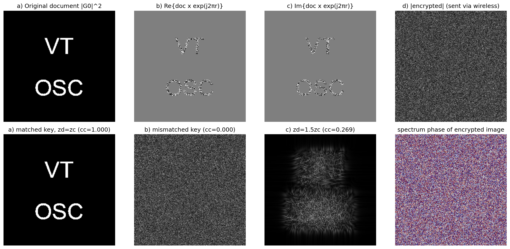
  <figcaption>图（本笔记运行结果，对应图 4.17/4.18）：上排 原始文档 → 乘随机相位的实部/虚部 → 加密强度（纯噪声）；下排 匹配密钥+z^d=z^c（cc=1.000，干净）→ 密钥不匹配（cc=0.000，噪声）→ z^d=1.5z^c（cc=0.269，散焦）→ 密文频谱相位（随机化）</figcaption>
</figure>

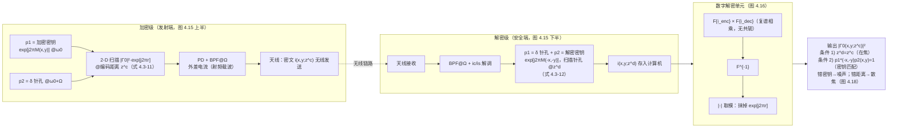

!!! note "拓展：为什么"取模"能去掉随机相位，而双随机相位编码与 Refregier-Javidi 原版不同在哪"
    密文里真正需要保密的是复振幅 \(i(x,y;z^c)\)；解密后的场是 \(|\Gamma_0|^2\exp[j2\pi r]\)——输入面随机相位还在场里，但**强度 \(|\cdot|^2\) 看不见它**。原版 Refregier-Javidi（1995）用相干 4f 系统：输入面与傅里叶面各放一块物理随机相位板，解密需要逆傅里叶变换 + 共轭密钥板。OSC 的对应关系：输入面随机相位 \(\exp[j2\pi r]\) ↔ 原版输入面；光瞳密钥 \(\exp[-j2\pi M(-u)]\) ↔ 原版傅里叶面；而"第二块相位板"在 OSC 里不是物理板，是**双瞳处理器的 OTF 相位项**（外差扫描天然执行了正逆傅里叶变换对）。另外 OSC 多送了两个密钥自由度：编码/解码距离 \(z^c, z^d\)（散焦惩罚）+ 射频载波（无线传输本身也有物理层保密的意义）。

## 坑与陷阱

!!! danger "λ、λ0、n0 的记号混用（4.1 节头号坑）"
    (4.1-1)~(4.1-5) 的推导里 \(\lambda_0\) 时而是真空波长（\(p_0=h/\lambda_0\)）、时而扮演介质波长（(4.1-4) 的 \(2\lambda_0/\sin^2=2n_0\lambda/NA^2\) 要求 \(\lambda_0=\lambda/n_0\)）；(4.1-5) 印 \(\lambda_0/2\) 隐含 \(n_0=1\)。复现时固定记号（真空 \(\lambda_0\)、\(NA=n_0\sin(\theta/2)\)），自洽版本是 \(\Delta r\ge\lambda_0/NA\)、\(\Delta z\ge 2n_0\lambda_0/NA^2\)、\((\Delta r)^2/\Delta z\ge\lambda_0/(2n_0)\)。

!!! danger "(4.1-5) 是标度律，不是精确公式"
    它是不等式且含 \(n_0=1\) 隐含；结论记成"**分辨率 ×2 ⇒ 景深 ÷4**"即可。别拿它做精度计算——书自己的实验数值（Δr≈18.5 µm/Δz≈1028 µm）与 NA≈0.033 的自洽重算（15.4 µm/0.93 mm）都有 ~15% 出入。

!!! danger "全息放大率的三个方向极易背反"
    全息图缩放 \(M\)：焦距 \(z_0/M^2\)、横移 \(x_0/M\)；**波长**缩放 \(\mathrm{m}\)：焦距 \(z_0/\mathrm{m}\)（\(\mathrm{m}>1\) 是**压缩**！）；组合：\(\mathrm{M_{lat}}=1/M\)、\(\mathrm{M_{long}}=1/(\mathrm{m}M^2)\)，无畸变条件 \(\mathrm{m}=1/M\)。本笔记数值验证时就把波长方向写反（按 \(\mathrm{m}z_0\) 重建只得散斑），口诀：**横向看 \(M\)，纵向看 \(M^2\mathrm{m}\)**。

!!! danger "开环重建的二次相位混叠（ch3 坑的加强版）"
    解析全息图 × 解析传递函数的"开环"链路里，\(e^{\pm j\sigma k^2}\) 的相邻格点相位跳变 \(z'\,k\,\Delta k/k'\) 必须 < π，否则 Poisson 旁瓣毁掉重建（表现为满天散斑/鬼峰——本笔记 m=2 情形第一次跑出 171 个假峰就是它）。修法：频域圆窗且半径随 \(z'\)、\(k'\) 自适应（\(k_{win}<0.8\pi k'/(z'\Delta k)\)）。**深度扫描时窗半径要固定**（随深度变窗会把孔径趋势污染进深度响应），窗缘用软滚降（硬圆孔有衍射纹波）。闭环（记录与重建用同一张混叠表）不受影响——判据与 ch3 相同。

!!! danger "OSC 的两把钥匙缺一不可，且 DDU 是复谱相乘不是相关"
    解密条件 1) \(z^d=z^c\)（距离）与 2) \(p_1^*(-x,-y)p_2(x,y)=1\)（密钥）**同时**满足才出干净文档：错密钥→噪声（cc=0.0004）、错距离→散焦（cc=0.27）。DDU 里是 \(\mathcal{F}\{i_{enc}\}\times\mathcal{F}\{i_{dec}\}\) **无共轭相乘**——写成相关（加共轭）就得不到 \(|OTF\cdot P|=1\) 的对消。

!!! danger "Cryptography.m 用 MATLAB 原生 fft2 当"前向"（镜像约定，第 2 次出现）"
    原书 Table 4.2 的 `FR=(1/256)^2*fft2(R1)` 是 −j 指数约定（与本笔记书式协议互为镜像）；但 OSC 全链路是模守恒闭环（\(|OTF\cdot P|=1\)），约定镜像不影响结果。**判据不变：解析传递函数路线约定敏感，闭环路线约定自洽即可**——读代码先问"它用的哪套约定"。

!!! danger "SLM 显示全息图：只有同轴 OSH 上得了 SLM"
    视角账（4.2-9）：8 lp/mm → 0.6°，500 lp/mm 也才 34°；离轴全息还要额外扛 ~1000 lp/mm 载频。别拿离轴数字全息图去试 SLM 显示——载频直接超出所有器件。HPO 公式还有个因子 2 笔误（书印 \(512\times(2l\times 2NA/\lambda_0)\) 算出 32.4M，与自己的"17 million"矛盾），引用时用修正式。

!!! danger "MATLAB 与 Python 的索引/显示差异（延续 ch1~ch3）"
    中心像素 MATLAB `(N/2+1)` ↔ Python `N//2`；`plt.imshow` 加 `origin='lower'`；峰/质心坐标别忘了减网格中心偏移（本笔记第一次跑峰定位就把 \(+N/2\) 偏移漏了，"间距 2.00 mm"侥幸正确但绝对位置全错）。

## 速览

1. 3-D 显微的预算约束：\(\Delta r\ge\lambda/NA\)（4.1-2）、\(\Delta z\ge 2n_0\lambda/NA^2\)（4.1-4）⇒ \((\Delta r)^2/\Delta z\ge\lambda_0/2\)（4.1-5）：分辨率×2 ⇒ 景深÷4。
2. OSM/SCM/OCT 都要**轴向扫描**：慢、光漂白、活体动态拍不了；SCM 横向 0.73Δr、SHM 0.5Δr 且**能拍荧光**（世界首例，1997）。
3. SHM = TDFZP 2-D 扫描厚样品 + dichroic/滤光分离激发（514.5 nm）与荧光（560 nm）+ PMT 外差解调（10.7 MHz，仅 ic 通道→有孪生噪声）；重建 z0=35/z1=37 mm 分辨两滴深度差 2 mm 的荧光液滴。
4. 强度/振幅成像对纯相位物体失效（拓展实战：幽灵环 0.26、相位读出 0.589 vs 真值 1.5）→ 定量相位要复全息图（OSH）。
5. 全息电视链路：OSH 射频外差电流 → 天线无线传输 → 多路检测 → PC → EBSLM（电子束写 LiNbO₃，Pockels 效应，视频速率）→ 相干重建（V/T 实验，EBSLM 实时 3-D，有孪生噪声）。
6. Example 4.1 放大率：全息图缩放 \(M\) → \(\mathrm{M_{lat}}=1/M\)、\(\mathrm{M_{long}}=1/M^2\)；波长缩放 \(\mathrm{m}\) → \(\mathrm{M_{lat}}=1\)、\(\mathrm{M_{long}}=1/\mathrm{m}\)（焦距 \(z_0/\mathrm{m}\)，压缩）；组合 \(\mathrm{M_{long}}=1/(\mathrm{m}M^2)\)；无畸变 \(\mathrm{m}=1/M\)（Gabor 1949）。本笔记实跑：2.00 mm=x0/M、平台 120/205 mm、m=2@50 mm 全部命中。
7. 视角账（4.2-9）：\(\theta=2\arcsin(\lambda_0 f_0)\)——8 lp/mm→0.6°、100→6.8°、500→34°；离轴载频 1000 lp/mm 免谈 → **同轴 OSH 是 SLM 显示的唯一入口**。
8. 像素/带宽账（4.2-10）：20 mm/60° → 11 亿像素 → 0.26 Tbit/s（全视差）；HPO 512 线 → ~17M 像素（修正式 \(512\times 2l\cdot NA/\lambda_0\)，书印公式多一个因子 2）→ 4 Gbit/s，光纤 40 Gbit/s 可达；HPO-OSH（1-D TDFZP）补上"真物体 HPO 记录"空缺。
9. OSC（4.3）：加密级 \(p_1\)=随机相位密钥、\(p_2=\delta\)，密文 = 物体全息图 × 密钥（4.3-6，"加密的是全息图"）；解密级针孔物体 + \(p_2\)=解密密钥；DDU 复谱相乘（无共轭）+ 取模；条件 \(z^d=z^c\) 与 \(p_1^*(-x,-y)p_2=1\)（4.3-9）。
10. 双随机相位编码（4.3-11）：输入面 \(\exp[j2\pi r]\) + 频域 \(\exp[-j2\pi M(-u)]\)；实跑 cc：匹配 1.0000 / 错钥 0.0004 / 错距 0.2693，密文强度 cc=0.002（窃听无效）——\(z^c,z^d\) 是额外安全自由度。

## 术语速查

| 英文 | 中文 | 一句话 |
| --- | --- | --- |
| optical sectioning microscopy (OSM) | 光学切片显微 | 宽场逐深度拍一叠 2-D 图，重建提取在焦信息（图 4.2） |
| scanning confocal microscopy (SCM) | 扫描共焦显微 | 双聚焦+针孔挡离焦光，3-D 扫描逐点采集（图 4.3）；横向 0.73Δr |
| optical coherent tomography (OCT) | 光学相干层析 | 干涉式层析，也要深度扫描、不能拍荧光 |
| photo-bleaching | 光漂白 | 荧光样品过曝光后不再发光——慢扫描的代价 |
| depth of focus / depth of field | 景深 Δz / 景场 Δl | 像方/物方的清晰深度范围；\(\Delta l=\Delta z/M^2\) |
| numerical aperture (NA) | 数值孔径 | \(NA=n_0\sin(\theta/2)\)；\(\Delta r=\lambda/NA\)、\(\Delta z=2n_0\lambda/NA^2\) |
| scanning holographic microscope (SHM) | 扫描全息显微镜 | TDFZP 2-D 扫描 + 外差，单次扫描拿 3-D、可拍荧光（图 4.4） |
| dichroic beamsplitter / emission filter | 双色分束片 / 发射滤光片 | 分离激发光（514 nm）与荧光（560 nm）的“颜色开关” |
| residual fringing (twin-image noise) | 残余条纹（孪生像噪声） | 单通道（仅 ic）记录的重建里必然存在的伪影 |
| spatial light modulator (SLM) | 空间光调制器 | 把电子全息图转成相干波的显示器件 |
| electron-beam-addressed SLM (EBSLM) | 电子束寻址 SLM | 电子束写 LiNbO₃ 电荷图，Pockels 效应 + 正交偏振器读出（图 4.9） |
| Pockels effect | 泡克尔斯效应 | 电场改变晶体折射率（线性电光效应），EBSLM 的读出原理 |
| IPMS | 图像处理与测量系统 | 慢扫描电信号 → 数字内存 → NTSC 视频（Hamamatsu DVS-3010/SS） |
| hologram scaling / wavelength scaling | 全息图缩放 / 波长缩放 | \(M\)：像距 \(z_0/M^2\)、横移 \(x_0/M\)；\(\mathrm{m}\)：像距 \(z_0/\mathrm{m}\)（Example 4.1） |
| lateral / longitudinal magnification | 横向 / 纵向放大率 | \(\mathrm{M_{lat}}=1/M\)、\(\mathrm{M_{long}}=1/(\mathrm{m}M^2)\)；无畸变 \(\mathrm{m}=1/M\)（Gabor） |
| viewing angle | 视角 θ | \(\theta=2\arcsin(\lambda_0 f_0)\)，SLM 分辨率决定（4.2-9，Table 4.1） |
| Nyquist sampling | 奈奎斯特采样 | \(f_s=2f_0\)；20mm/60° 全息图要 11 亿像素（4.2-10） |
| horizontal-parallax-only (HPO) | 仅水平视差 | 牺牲垂直视差：512 线 ≈17M 像素、4 Gbit/s；HPO-OSH 用 1-D TDFZP |
| optical scanning cryptography (OSC) | 光学扫描加密 | 密钥插光瞳的 OSH 加密，密文骑射频载波可无线（图 4.15） |
| encryption / decryption key | 加密 / 解密密钥 | 加密级 \(p_1\)、解密级 \(p_2\)（随机相位掩模，相位型最好用） |
| coding / decoding distance | 编码 / 解码距离 | \(z^c\) / \(z^d\)；\(z^d=z^c\) 才在焦（条件 1） |
| digital decryption unit (DDU) | 数字解密单元 | \(\mathcal{F}\{i_{enc}\}\times\mathcal{F}\{i_{dec}\}\to\mathcal{F}^{-1}\to|\cdot|\)（图 4.16） |
| double-random phase encoding | 双随机相位编码 | 输入面+傅里叶面各一块随机相位板（Refregier-Javidi 1995；OSC 版 4.3-11） |
| RFID | 射频识别 | OSC 密文骑载频可直接无线辐射的目标应用 |

## 覆盖自查

??? note "原书小节 → 笔记位置对照"
    | 原书内容 | 笔记位置 |
    | --- | --- |
    | 章引言（五大应用领域，本章讲三个） | 章首 |
    | 4.1 Scanning Holographic Microscopy（式 4.1-1~4.1-5；图 4.1~4.7） | 4.1.1~4.1.3（(4.1-5) 记号勘误；数值账在拓展注） |
    | （编者）振幅 vs 相位物体成像对照 | 4.1.4 拓展实战 |
    | 4.2 3-D Holographic TV and 3-D Display（图 4.8~4.13） | 4.2.1~4.2.2（mermaid 链路图） |
    | Example 4.1 Holographic Magnification（式 4.2-1~4.2-5） | 4.2.3（代码双 tab + 实跑验证 + 波长方向易错点） |
    | 4.2 三大瓶颈 A/B/C（式 4.2-6~4.2-10；图 4.14；Table 4.1；HPO） | 4.2.4（HPO 公式勘误；视角/像素账在拓展注 + 代码双 tab） |
    | 4.3 Optical Scanning Cryptography（式 4.3-1~4.3-9；图 4.15、4.16） | 4.3.2~4.3.4（约定衔接在拓展注） |
    | Example 4.2 + Table 4.2 Cryptography.m（式 4.3-10~4.3-13；图 4.17、4.18） | 4.3.5（(4.3-12) 编号勘误；代码双 tab + 实跑 cc） |
    | References 4.1~4.46 | 见下 |

??? note "原书 References 4.1~4.46"
    4.1 Agard, D. A. (1984). "Optical sectioning microscopy: cellular architecture in three dimensions," *Ann. Rev. Biophys. Bioeng.* 13, 191-219.
    4.2 Benton, S.A. (1991). "Experiments in holographic video," *Proc. SPIE* IS-08, 247-267.
    4.3 Brown, H. B., S.C. Noble and B.V. Markevitch (1983). "Three-dimensional television system using holographic technique," U.S. Patent # 4,376,950.
    4.4 Corle, T. R. and G. S. Kino (1996). *Confocal Scanning Optical Microscopy and Related Imaging Systems*, Academic Press, San Diego, CA.
    4.5 Enloe, L. H., J.A. Murphy, and C. B. Rubinstein (1966). "Hologram transmission via television," *Bell Syst. Techn. J.* 45, 333-335.
    4.6 Gabor, D. (1949). "Microscopy by reconstructed wavefronts," *Proc. Roy. Soc.*, ser. A, 197, 454-487.
    4.7 Hamamatsu Photonics K.K., Japan, and Hamamatsu Corp., Bridgewater, NJ. Image Processing and Measuring System (IPMS), Model DVS-3010/SS.
    4.8 Hamamatsu Photonics K.K., Japan, and Hamamatsu Corp., Bridgewater, NJ. Product information sheet for EBSLM model X3636.
    4.9 Huang, D., E.A. Swanson, C. P. Lin, J.S. Shuman, W.G. Stinson, W. Chang, M.R. Hee, T. Flotte, K. Gregory, C.A. Puliafito, and J. G. Fujimoto (1991). "Optical coherent tomography," *Science*, Vol. 254, 1178-1181.
    4.10 Indebetouw, G. (2002). "Properties of a scanning holographic microscope: improved resolution, extended depth of focus, and/or optical sectioning," *Journal of Modern Optics* 49, 1479-1500.
    4.11 Indebetouw, G., T. Kim, T.-C. Poon, and B. Schilling (1998). "Three-dimensional location of fluorescent inhomogeneities in turbid media using scanning heterodyne holography," *Optics Letters* 23, 135-137.
    4.12 Indebetouw, G. and W. Zhong (2006). "Scanning holographic microscopy of three-dimensional fluorescent specimens," *Journal of the Optical Society of America A* 23, 1699-1707.
    4.13 Kim, M (2000). "Tomographic three-dimensional imaging of a biological specimen using wave-scanning digital interference holography," *Optics Express* 7, 305-310.
    4.14 Kim, T and T.-C. Poon (1999). "Extraction of 3-D location of matched 3-D object using power fringe-adjusted filtering and Wigner analysis," *Optical Engineering* 38, 2176-2183.
    4.15 Kirk, R. L. (1984). "Electronically generated holography," International Patent No. WO 84/00070.
    4.16 Lai, S. and M. A. Neifeld (2000). "Digital wavefront reconstruction and its applications to image encryption," *Optics Communications* 178, 283-289.
    4.17 Lohmann, A.W., W. Stork, and G. Stucke (1986). "Optical perfect shuffle," *Applied Optics* 25, 1530-1531.
    4.18 Macovski, A. (1971). "Considerations of television holography," *Optica Acta* 18, 31-39.
    4.19 Magensen, P.C. and J. Gluckstad (2001). "Phase-only optical decryption of a fixed mask," *Applied Optics* 8, 1226-1235.
    4.20 Minsky, M. (1961). "Microscopy Apparatus," US Patent # 3,013,467.
    4.21 Pawley, J. ed. (1995). *Handbook of Biological Confocal Microscopy*, 2nd ed., Plenum Press.
    4.22 Poon, T.-C. (2002a). "Three-dimensional television using optical scanning holography," *Journal of Information Display* 3, 12-16.
    4.23 Poon, T.-C. (2002b). "Optical scanning holography: principles and applications," in *Three-Dimensional Holographic Imaging*, C.J. Kuo and M. H. Tsai, ed., John Wiley & Sons, Inc.
    4.24 Poon, T.-C. (2005). "Three-dimensional optical remote sensing by optical scanning holography," in *Current Research on Image Processing for 3D information displays*, V. Petrov, ed., *Proc. SPIE* Vol. 5821, 41-59.
    4.25 Poon, T.-C. (2006). "Horizontal-parallax-only optical scanning holography," in chapter 10 of *Digital Holography and Three-Dimensional Display: Principles and Applications*, T.-C. Poon ed., Springer, New York, USA.
    4.26 Poon, T.-C, K. Doh, B. Schilling, M. Wu, K. Shinoda, and Y. Suzuki (1995). "Three-dimensional microscopy by optical scanning holography," *Optical Engineering* 34, 1338-1344.
    4.27 Poon, T.-C., K. Doh, B. Schilling, K. Shinoda, Y. Suzuki, and M. Wu (1997). "Holographic three-dimensional display using an electron-beam-addressed spatial-light-modulator," *Optical Review* 4, 567-571.
    4.28 Poon, T.-C. and T. Kim (1999). "Optical image recognition of three-dimensional objects," *Applied Optics* 38, 370-381.
    4.29 Poon, T.-C., B. D. Schilling, G. Indebetouw, and B. Storrie (2000). "Three-dimensional holographic fluorescence microscopy," U.S. Patent # 6,038,041.
    4.30 Poon, T.-C., T. Kim, and K. Doh (2003). "Optical scanning cryptography for secure wireless transmission," *Applied Optics* 42, 6496-6503.
    4.31 Poon, T.-C., T. Akin, G. Indebetouw and T. Kim (2005). "Horizontal-parallax-only electronic holography," *Optics Express* 13, 2427-2432.
    4.32 Poon, T.-C. and T. Kim (2006). *Engineering Optics with MATLAB®*, World Scientific, Singapore.
    4.33 "Radio Frequency Identification Technologies: A Workshop Summary" (2004). The National Academies Press, Washington, D.C.
    4.34 Refregier, P. and B. Javidi (1995). "Optical image encryption using input plane and Fourier plane random phase encoding," *Optics Letters* 20, 767-769.
    4.35 Schilling, B. W. and T.-C. Poon (1995). "Real-time pre-processing of holographic information," *Optical Engineering* 34, 3174-3180.
    4.36 Schilling, B. W. (1997). *Three-dimensional fluorescence microscopy by optical scanning holography*, Ph.D. dissertation, Virginia Tech.
    4.37 Schilling, B., T.-C. Poon, G. Indebetouw, B. Storrie, K. Shinoda, and M. Wu (1997). "Three-dimensional holographic fluorescence microscopy," *Optics Letters* 22, 1506-1508.
    4.38 Schilling, B.W. and T.-C. Poon (2004). "Multicolor electronic holography and 3-D image projection system," U.S. Patent # 6760134.
    4.39 Shinoda, K., Y. Suzuki, M. Wu and T.-C. Poon (1991). "Optical heterodyne scanning type holography device," U.S. Patent # 5064257.
    4.40 St. Hilaire, P., S. A. Benton, M. Lucente, M. Jepsen, J. Kollin, H. Yoshikawa, and J. Underkoffler (1990). "Electronic display system for computational holography," *Proc. SPIE*, vol. 1212, 174-182.
    4.41 St. Hilaire, P., S. A. Benton, and M. Lucente (1992). "Synthetic aperture holography: a novel approach to three-dimensional displays," *Journal of the Optical Society of America A* 9, 1969-1977.
    4.42 Sun, P and J.-H. Xie (2004). "Method for reduction of background artifacts of images in scanning holography with a Fresnel-zone-plate coded aperture," *Applied Optics* 43, 4214-4218.
    4.43 Tajahuerce, E., J. Lancis, B. Javidi, and P. Andres (2001). "Optical security and encryption with totally incoherent light," *Applied Optics* 26, 678-680.
    4.44 Wang, B, C.-C. Sun, W.-C. Su, and A. Chiou (2000). "Shift-tolerance property of an optical double-random phase-encoding encryption system," *Applied Optics* 39, 4788-4793.
    4.45 Wilson, T. and C. Sheppard (1984). *Theory and Practice of Scanning Optical Microscopy*, Academic Press.
    4.46 Zhang, T. and I. Yamaguchi (1998). "Three-dimensional microscopy with phase-shifting digital holography," *Optics Letters* 23, 1221-1223.

    !!! warning "原书笔误/勘误（本章 3 处，与 ch1~ch3 独立）"
        1. **(4.3-12) 编号重复**：DDU 输出式（"Eqs. (4.3-11) and (4.3-12) are the inputs of the DDU" 之后那式）又印作 "(4.3-12)"，与解密端扫描输出式撞号——按上下文应为 **(4.3-13)**。本笔记按 (4.3-13) 引用。
        2. **HPO 像素公式多一个因子 2**：书印 \(512\times(2l\times 2NA/\lambda_0)\) 代入得 3240 万，与书自己给的 "approximately 17 million" 矛盾；自洽式为 \(512\times(2l\cdot NA/\lambda_0)\approx 1620\) 万 ≈ 17 million（数据率 4 Gbit/s 才对上）。实算见 4.2.4 代码。
        3. **4.1 节 λ/λ0/n0 记号混用**：(4.1-2) 的 λ（空气波长）与 (4.1-4) 的 \(2n_0\lambda/NA^2\) 代入后 (4.1-5) 左端应为 \(\lambda/(2n_0)\)，书印 \(\lambda_0/2\) 隐含 \(n_0=1\)。不影响"分辨率×2 ⇒ 景深÷4"的标度结论。（另：实验数值 Δr≈18.5 µm/Δz≈1028.4 µm 与 NA≈0.033 的自洽重算 15.4 µm/0.93 mm 有 ~15% 出入，属书内舍入不一致，见 4.1.1 拓展注。）
