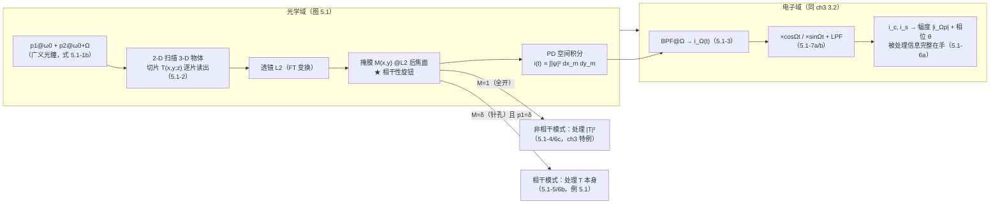
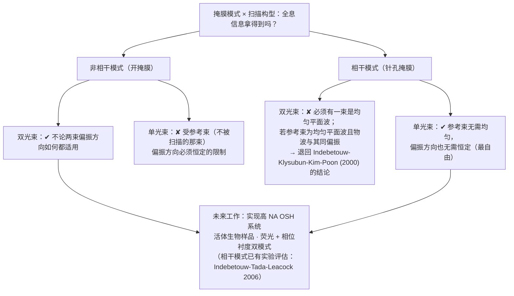
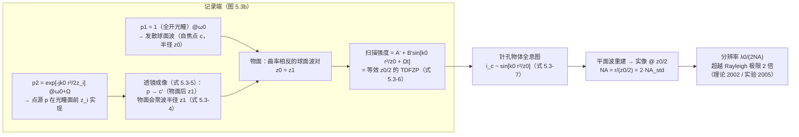

# 第 5 章 光学扫描全息：进展

> **本章解决**：OSH 原理层面的三项扩展——在双瞳处理器中加入傅里叶变换透镜与掩膜，使系统可在相干模式下处理振幅透过率而非仅有强度；单光束与双光束扫描构型在偏振与平面波要求上的取舍；以及通过改变扫描光束的曲率实现点扩散函数工程，在相同孔径下提高横向分辨率。学完能比较各构型的适用条件，并分析分辨率提升的代价与实现路径。

研究动机：OSH 至今处理的多是非相干物体（荧光、遥感、打印文档）——标准双瞳处理器的探测器接收全部透射光，做的是空间积分强度探测。生物成像中的定量相位衬度成像则需要处理物体的振幅透过率 \(T(x,y;z)\)；5.1 节讨论如何改装处理器，使其工作在相干模式。

## 5.0 本章导图

<div class="brtree">
  <div class="brrow">
    <span class="brlabel root">广义双瞳处理器</span>
    <span class="brace"></span>
    <div class="brkids">
      <div class="brrow">
        <span class="brlabel">相干/非相干 5.1</span>
        <span class="brace"></span>
        <div class="brkids">
          <span class="brleaf">加装 L2 + 掩膜 M(x,y)（图 5.1）</span>
          <span class="brleaf">M=1：处理 |T|²（5.1-4，ch3 特例）</span>
          <span class="brleaf">M=δ 且 p1=δ：处理 T（5.1-5/6b）</span>
          <span class="brleaf">例 5.1：p2=1 → T 的复 FZP 全息图（5.1-9）</span>
          <span class="brleaf">实跑：相位读出 1.5000 vs 0.0000</span>
        </div>
      </div>
      <div class="brrow">
        <span class="brlabel">扫描构型 5.2</span>
        <span class="brace"></span>
        <div class="brkids">
          <span class="brleaf">双光束：非相干模式不挑偏振</span>
          <span class="brleaf">双光束相干模式：要均匀平面波 + 同偏振</span>
          <span class="brleaf">单光束：相干模式最自由</span>
          <span class="brleaf">扫描全息 ≈ 合成孔径雷达（1979 伏笔）</span>
        </div>
      </div>
      <div class="brrow">
        <span class="brlabel">PSF 工程 5.3</span>
        <span class="brace"></span>
        <div class="brkids">
          <span class="brleaf">标准 OSH：PSF = 重建点源，λ0/NA（5.3-2）</span>
          <span class="brleaf">反向曲率波对（5.3-4/5，z_i=2f、z0=z1=f/4）</span>
          <span class="brleaf">啁啾 ×2（5.3-6/7）→ 重建 @ z0/2</span>
          <span class="brleaf">分辨率 ×2：FWHM 实跑比 2.006</span>
          <span class="brleaf">axicon 切片 / DOE、SLM / 超分辨</span>
        </div>
      </div>
    </div>
  </div>
</div>

## 5.1 相干与非相干全息处理

### 5.1.1 广义双瞳处理器：多一块透镜、多一块掩膜

ch4 的所有应用都建立在 ch3 图 3.11 的标准双瞳处理器上。**广义双瞳图像处理器**（generalized two-pupil image processor）[Poon, J. Holography and Speckle 1, 6-25 (2004)] 只加两样东西（图 5.1）：

1. **傅里叶变换透镜 L2**——3-D 物体放在 L2 **前**；
2. **掩膜**（mask）\(M(x,y)\)——放在 L2 的**后焦面**。

PD 收集**透过掩膜的全部光**，输出被处理且被扫描的电流 \(i(t)\)；BPF 调谐到 \(\Omega\) 取出外差电流 \(i_\Omega(t)\)。3-D 物体照旧建模成一叠薄、弱散射的横切片，每片用振幅透过率 \(T(x,y;z)\) 表示。扫描与外差检测部分与图 3.11 完全相同。

<figure>
  
  <figcaption>图 5.1 广义双瞳图像处理器：双瞳 p1@ω0、p2@ω0+Ω 经 L1/扫描振镜在 3-D 物体（切片 T(x,y;z)，前表面距焦点 z0）上形成扫描场；L2 后焦面上的掩膜 M(x,y) 决定处理模式，PD 空间积分后 BPF@Ω 给 i_Ω(t)，×cos/×sin 解调出 i_c、i_s。Adapted from T.-C. Poon, J. Holography Speckle 1, 6-25 (2004)（截自原书）</figcaption>
</figure>

推导流程与 ch3 3.4 节同构，多出的只是"L2 传播 + 乘掩膜 + 强度积分"三步。逐步列式：

**第一步：扫描场照到物切片上**。位置 z 处切片**之前**的光场振幅分布（两束时间频率不同）：

\[
P_1(x,y;z+z_0)\exp(j\omega_0 t)+P_2(x,y;z+z_0)\exp\big[j(\omega_0+\Omega)t\big],
\tag{5.1-1a}
\]

其中按菲涅耳衍射，光瞳传播到切片处的场是"光瞳的傅里叶变换 ⊛ 菲涅耳核"：

\[
P_i(x,y;z+z_0)=\mathcal{F}\{p_i(x,y)\}\Big|_{k_x=\frac{k_0 x}{f},\ k_y=\frac{k_0 y}{f}}*h(x,y;z+z_0),
\tag{5.1-1b}
\]

\(i=1\) 或 \(2\)，\(p_i(x,y)\) 是图 5.1 里的两个光瞳函数，\(f\) 是透镜 L1 的焦距。人话版：大写 \(P_i\) 是"传播到物面的扫描光束复振幅"，小写 \(p_i\) 是"光瞳上画的是什么"。两个特例先记住：\(p_i=\delta\)（点光瞳）\(\Rightarrow P_i\propto\) 常数（平面波）；\(p_i=1\)（全开）\(\Rightarrow P_i\propto\) 从焦点发散的球面波——这正是 ch3 3.5/3.6 的标准 OSH 配置（\(p_1=1\) 给球面波 @\(\omega_0\)、\(p_2=\delta\) 给平面波 @\(\omega_0+\Omega\)）。

**第二步：切片调制（光学扫描原理，3.1 节）**。切片**之后**的场：

\[
\chi(x',y',x,y;z)=\big\{P_1(x',y';z+z_0)\exp(j\omega_0 t)
+P_2(x',y';z+z_0)\exp\big[j(\omega_0+\Omega)t\big]\big\}\,T(x'+x,\ y'+y;\ z),
\tag{5.1-2}
\]

其中 \(x=x(t)\)、\(y=y(t)\) 是物体相对入射光场的瞬时 2-D 扫描位置。（\(x'\)、\(y'\) 是切片自己的坐标，\(x\)、\(y\) 是扫描位移——T 的宗量 \(x'+x\) 就是"光斑扫到哪里，哪里的透过率被读出"。）

**第三步：L2 + 掩膜**。场经 L2 传播到掩膜面。由第 2 章式 (2.4-5)（令其中 \(d_0=f-z\)），单切片在掩膜面（坐标 \(x_m,y_m\)）上的场，除不重要的常数外为

\[
\exp\Big[-j\frac{k_0}{2f^2}(x_m^2+y_m^2)\Big]\times\iint\chi(x',y',x,y;z)\,
\exp\Big[j\frac{k_0}{f}\big(x'x_m+y'y_m\big)\Big]dx'dy',
\]

——就是"输入场的傅里叶变换（取样在 \(k_0x_m/f\)）× 一个二次相位因子"。3-D 物体是很多切片，把上式对物厚 \(z\) 积分，得掩膜前的总场；再乘上掩膜，掩膜后的场为

\[
\psi(x,y;x_m,y_m)=\Big\{\int\Big[\exp\Big[-j\frac{k_0z}{2f^2}(x_m^2+y_m^2)\Big]\times\iint\chi(x',y',x,y;z)\,\exp\Big[j\frac{k_0}{f}(x'x_m+y'y_m)\Big]dx'dy'\Big]dz\Big\}\,M(x_m,y_m).
\]

**第四步：空间积分探测**。PD 响应强度、把掩膜面上的功率全部加起来：

\[
i(t)\propto\int\big|\psi(x,y;x_m,y_m)\big|^2\,dx_mdy_m .
\]

\(i(t)\) 含基带电流与频率 \(\Omega\) 的外差电流。经一些整理（把 \(|\psi|^2\) 展开、按时间频率分类），BPF@Ω 后的外差电流：

\[
i_\Omega(t)\propto\iint\Big[P_1(x',y';z'+z_0)P_2^*(x'',y'';z''+z_0)\exp(-j\Omega t)
+P_2(x',y';z'+z_0)P_1^*(x'',y'';z''+z_0)\exp(j\Omega t)\Big]
\]

\[
\times\exp\Big\{j\frac{k_0}{f}\big[x_m(x'-x'')+y_m(y'-y'')\big]\Big\}
\]

\[
\times\exp\Big[-j\frac{k_0(z'-z'')}{2f^2}(x_m^2+y_m^2)\Big]\,
T(x'+x,y'+y;z')\,T^*(x''+x,y''+y;z'')\,\big|M(x_m,y_m)\big|^2
\]

\[
\times\,dx'dy'dx''dy''dz'dz''dx_mdy_m .
\tag{5.1-3}
\]

这个七重积分看起来吓人，但它就是一句话：**外差电流 carrying 的是"两束扫描光先后读出的物场乘积"在掩膜面上的相干叠加**。被积函数里有三组"可操作的旋钮"：光瞳 \(p_1,p_2\)（决定 \(P_1,P_2\)）、掩膜 \(M(x_m,y_m)\)（决定哪些空间频率参与干涉）、以及探测方式（掩膜开/关改变积分结构）。Indebetouw, Klysubun, Kim, and Poon [2000] 的结论：**双瞳扫描系统的相干性可以用掩膜 \(M(x_m,y_m)\) 来调制**。



### 5.1.2 两个极限：开掩膜 vs 针孔掩膜

对 (5.1-3) 取两个掩膜极限，就得到本章最重要的两个结果。

**极限一：开掩膜 \(M(x,y)=1\)——非相干处理**。(5.1-3) 变成

\[
i_\Omega(t)\propto\mathrm{Re}\Big[\iint P_1^*(x',y';z+z_0)\,P_2(x',y';z+z_0)\,
\big|T(x'+x,y'+y;z)\big|^2\,dx'dy'dz\,\exp(j\Omega t)\Big].
\tag{5.1-4}
\]

此式与 (3.4-5) 基本相同——**非相干处理**，因为被处理的只有强度值 \(|T|^2\)（强度可以由两个光瞳 \(p_1,p_2\) 的组合来处理，处理元是复值的 \(P_1^*P_2\)）。掩膜全开时 PD 就是 ch3 的"空间积分探测器"，标准 OSH 是本极限的特例。

!!! note "拓展：补证明——开掩膜为什么"砸碎"切片间相干性"
    (5.1-3) → (5.1-4) 的关键一步是对 \(x_m,y_m\) 积分。开掩膜 \(|M|^2=1\) 时，被积函数里含因子 \(\exp\{j\frac{k_0}{f}[x_m(x'-x'')+y_m(y'-y'')]\}\)，对整个掩膜面积分：\(\iint\exp\big\{j\frac{k_0}{f}\big[x_m(x'-x'')+y_m(y'-y'')\big]\big\}\,dx_mdy_m=\big(\frac{2\pi f}{k_0}\big)^2\delta(x'-x'')\,\delta(y'-y'')\)。δ 函数强制 \(x'=x'',\ y'=y''\)，于是菲涅耳相位差因子 \(\exp[-j\frac{k_0(z'-z'')}{2f^2}(x_m^2+y_m^2)]\) 里的 \(x_m,y_m\) 也随之消失（\(z'-z''\) 的项在与 \(x_m\) 相关的积分里同样坍缩，\(z'=z''\) 由 \(x',y'\) 绑定后剩余积分给出 \(|T|^2\))。物理解释：开掩膜 = 掩膜面上**每一点都在干涉**，所有"切片对"的贡献互相平均，只有"同一点读出的场与其自身共轭"（\(TT^*\)）能存活——**相干性被探测的空间积分压成了强度**。这也解释了 ch3 为什么不用画掩膜：PD 收全光就是 \(M=1\)。

**极限二：针孔掩膜 \(M(x,y)=\delta(x,y)\)——通向相干处理**。δ 掩膜把 (5.1-3) 的 \(x_m,y_m\) 积分直接"采样"（不再产生 δ(x'−x'')），得

\[
i_\Omega(t)\propto\mathrm{Re}\Big\{\Big[\iint P_2(x',y';z'+z_0)\,T(x'+x,y'+y;z')\,dx'dy'dz'\Big]\times\Big[\iint P_1^*(x'',y'';z''+z_0)\,T^*(x''+x,y''+y;z'')\,dx''dy''dz''\Big]\exp(j\Omega t)\Big\}.
\]

现在取特例 \(p_1(x,y)=\delta(x,y)\)——**两个扫描光束之一变成均匀平面波**（(5.1-1b) 里 \(\mathcal{F}\{\delta\}=\) 常数），保持 \(p_2(x,y)\) 不动。此时

\[
\iint_\infty P_1^*(x'',y'';z''+z_0)\,T^*(x''+x,y''+y;z'')\,dx''dy''dz''\ \ \text{是一个常数},
\]

因为平面波参考束"一次看遍整个物体"：\(\iint T^*(x''+x,y''+y;z'')dx''dy''\) 是物体的总"质量"，与扫描位置 \((x,y)\) 无关。于是 (5.1-3) 变成

\[
i_\Omega(t)\propto\mathrm{Re}\Big[\iint P_2(x',y';z+z_0)\,T(x'+x,y'+y;z)\,dx'dy'dz\,\exp(j\Omega t)\Big].
\tag{5.1-5}
\]

**我们处理的是物体的振幅透过率**（由光瞳 \(p_2\) 加工）。(5.1-4) 与 (5.1-5) 就是广义双瞳外差扫描处理器最重要的两个结果：**把探测方式从针孔换成空间积分，3-D 物体成像过程的相干性就从"振幅线性"（5.1-5）切换到"强度线性"（5.1-4）**；再改变掩膜尺寸，还可以做 3-D **部分相干**图像处理 [Poon and Indebetouw (2003)]。

### 5.1.3 统一结果与解调

把 (5.1-4) 与 (5.1-5) 合并成一个重要结果：

\[
i_\Omega(t)\big|_\Omega\propto\mathrm{Re}\big[i_{\Omega p}(x,y)\,\exp(j\Omega t)\big],
\tag{5.1-6a}
\]

其中，取 \(M(x,y)=\delta(x,y)\) 且 \(p_1(x,y)=\delta(x,y)\) 时是**相干处理方程**：

\[
i_{\Omega p}(x,y)=\int P_2(x',y';z+z_0)\,T(x'+x,y'+y;z)\,dx'dy'dz;
\tag{5.1-6b}
\]

取 \(M(x,y)=1\) 时是**非相干处理方程**：

\[
i_{\Omega p}(x,y)=\int P_1^*(x',y';z+z_0)\,P_2(x',y';z+z_0)\,
\big|T(x'+x,y'+y;z)\big|^2\,dx'dy'dz.
\tag{5.1-6c}
\]

再强调一遍角色分工：\(T\) 或 \(|T|^2\) 是被扫描的输入物体（复振幅物体或强度物体皆可）；\(i_{\Omega p}(x,y)\) 是 PD 输出的、时间频率为 \(\Omega\) 的被处理外差电流，一般是**复函数**——它的幅度与相位携带**完整的被处理信息**。按图 5.1 的常规多路电子检测解调，给两个输出：

\[
i_c(x,y)\propto\big|i_{\Omega p}(x,y)\big|\cos\big(\theta(x,y)\big),
\tag{5.1-7a}
\]

\[
i_s(x,y)\propto\big|i_{\Omega p}(x,y)\big|\sin\big(\theta(x,y)\big),
\tag{5.1-7b}
\]

其中 \(i_{\Omega p}(x,y)=\big|i_{\Omega p}(x,y)\big|\exp\big[j\theta(x,y)\big]\)。处理操作由光瞳 \(p_1,p_2\) 和/或掩膜 \(M\) 的选择操纵（按 (5.1-6)）。

!!! warning "原书笔误：(5.1-7a/b) 的 sin/cos 印反"
    书印 \(i_c\propto|i_{\Omega p}|\sin(\theta)\)、\(i_s\propto|i_{\Omega p}|\cos(\theta)\)。但同页定义 \(\theta(x,y)=\arg\{i_{\Omega p}\}\)，且图 5.1 的电子学框图明确标注 **cosΩt 通道 → \(i_c\)**、**sinΩt 通道 → \(i_s\)**（与 ch3 (3.2-3) 的命名一致）：实电流 \(i_\Omega(t)=|i_{\Omega p}|\cos(\Omega t+\theta)\) 乘 \(\cos\Omega t\) 低通给 \(\propto|i_{\Omega p}|\cos\theta\)。故 (5.1-7a/b) 应为 \(i_c\propto\cos\theta\)、\(i_s\propto\sin\theta\)，本笔记按此引用。

这两个结果打开了非常规处理的大门。其一，**3-D 复相干图像处理**（3-D coherent image processing）——相干处理已被实验评估 [Indebetouw, Tada and Leacock (2006)]；其二，**3-D 复非相干图像处理**（3-D complex incoherent image processing）——"3-D"指被处理物体可以是 3-D 的，"复"指强度物体的处理元可以是复函数（(5.1-4) 的处理元是 \(P_1^*P_2\)）。这些都是 3-D 光学图像处理里几乎未被开垦的题目 [Poon and Indebetouw (2003)]。

!!! note "拓展：相干模式为什么是"定量相位衬度"的入口（与 ch4 拓展实战呼应）"
    ch4 4.1.4 的数值实战里，同轴强度成像对纯相位粒子只给出"幽灵环"（对比度 0.26 的伪影），相位通道读数被背景干涉压低——**强度线性**的探测器天然看不见相位形貌。(5.1-6b) 改变了游戏规则：\(i_{\Omega p}\propto P_2\otimes T\) **线性于复振幅**，纯相位结构 \(T=\exp[j\varphi(x,y)]\) 以 \(|T|=1\) 的完整幅度进入外差电流，解调 (5.1-7) 直接给出幅度+相位两个通道。这就是扫描全息显微做**定量相位成像**（quantitative phase imaging）的原理基础——Indebetouw, Tada, Leacock (2006) 用实验评估了这条路线（Ref 5.6，BioMedical Engineering OnLine 开放获取）。与第 2 章的离轴数字全息相位成像（Cuche 等，Ref 5.2）相比，OSH 版不需要高分辨率记录介质（同轴 + 射频载波），代价是逐点扫描。

### 5.1.4 Example 5.1：相干模式下的全息记录

相干处理用 (5.1-6b)。一般地，\(T(x,y;z)\) 由选择 \(p_2(x,y)\) 来加工。做一个**简单的全息记录**：选 \(p_2(x,y)=1\)。按 (5.1-1b)、用第 1 章 Table 1.1 与式 (2.3-11)，\(P_2(x,y;z+z_0)\) 变成

\[
P_2(x,y;z+z_0)=\mathcal{F}\{p_2(x,y)\}\Big|_{k_x=\frac{k_0x}{f},\ k_y=\frac{k_0y}{f}}*h(x,y;z+z_0)
\]

\[
=4\pi^2\delta\Big(\frac{k_0x}{f},\ \frac{k_0y}{f}\Big)*\Big\{\exp\big[-jk_0(z+z_0)\big]\frac{jk_0}{2\pi(z+z_0)}\exp\Big[-\frac{jk_0(x^2+y^2)}{2(z+z_0)}\Big]\Big\}
\]

\[
\propto\exp\big[-jk_0(z+z_0)\big]\frac{jk_0}{2\pi(z+z_0)}\exp\Big[-\frac{jk_0(x^2+y^2)}{2(z+z_0)}\Big],
\tag{5.1-8}
\]

（\(\mathcal{F}\{1\}=4\pi^2\delta(k_x,k_y)\) 采样后卷积就是核本身——**全开光瞳经透镜聚焦成点源、再发散成球面波**，正是 ch3 的老朋友。）代入 (5.1-6b)：

\[
i_{\Omega p}(x,y)=\int\exp\big[-jk_0(z+z_0)\big]\frac{jk_0}{2\pi(z+z_0)}
\]

\[
\times\exp\Big[-\frac{jk_0(x'^2+y'^2)}{2(z+z_0)}\Big]\,T(x'+x,y'+y;z)\,dx'dy'dz
\]

\[
=\int\exp\big[-jk_0(z+z_0)\big]\frac{jk_0}{2\pi(z+z_0)}\,
\Big[\Big\{\exp\Big[-\frac{jk_0(x^2+y^2)}{2(z+z_0)}\Big]\Big\}^*\otimes T(x,y;z)\Big]dz
\]

（\(\otimes\) 为相关；用式 (1.2-5) 把相关写成卷积 \(*\)）：

\[
i_{\Omega p}(x,y)=\int\exp\big[-jk_0(z+z_0)\big]\frac{jk_0}{2\pi(z+z_0)}\,
\Big[\Big\{\exp\Big[-\frac{jk_0(x^2+y^2)}{2(z+z_0)}\Big]\Big\}*T(x,y;z)\Big]dz.
\tag{5.1-9}
\]

与 (3.5-5)（非相干情形）对照着看：**(5.1-9) 是 \(T(x,y;z)\) 的复菲涅耳波带片全息图**——全息记录的对象从强度 \(|T|^2\)（ch3）换成了相干信息 \(T\) 本身。

本笔记把例 5.1 的物理差异完整数值化（代码见下）：物体 = 三条振幅缝（\(|T|=1\)）+ 一块**纯相位圆盘**（\(|T|=1\)、零吸收、相位延迟 1.5 rad），物体以外区域全吸收（\(T=0\)）。相干模式（(5.1-9)，\(p_2=1\)）记录后重建：振幅与 \(|T|\) 的相关系数 **1.0000**，圆盘上相位读出 **+1.5000 rad**（真值 1.5，精确）；非相干模式（(5.1-6c)，标准 OSH 的 \(p_1=1,p_2=\delta\)）记录后重建：强度与 \(|T|^2\) 相关系数 **1.0000**，但圆盘相位读出 **+0.0000 rad**——纯相位结构在非相干模式里**完全不可见**。

<figure>
  
  <figcaption>图（本笔记运行结果，Example 5.1 + 式 5.1-6b/6c 对比）：上排 相干模式——物体相位（三缝振幅 + 1.5 rad 相位圆盘）→ 复 FZP 全息图 |i_Ωp|（式 5.1-9）→ 重建相位在圆盘上精确读出 1.5 rad；下排 非相干模式——强度物体 |T|²（圆盘"隐身"成均匀亮盘）→ 重建振幅 ≈ |T|² → 重建相位 ≈ 0（相位信息从未被记录）</figcaption>
</figure>

=== "MATLAB"

    ```matlab
    % ===== 书 5.1 · 相干模式 vs 非相干模式记录（式 5.1-6b / 5.1-6c，例 5.1 式 5.1-9）=====
    % 演示广义双瞳处理器的核心结论（Poon & Indebetouw 2003）：
    %   - 非相干模式（开掩膜 M=1）：记录的是强度物体 |T|^2，纯相位结构完全不可见（式 5.1-6c）；
    %   - 相干模式（针孔掩膜 M=delta 且 p1=delta）：记录的是振幅物体 T 本身（式 5.1-6b），
    %     p2=1 时就是例 5.1 的"复菲涅耳波带片全息图"（式 5.1-9）。
    % 物体设计：三缝（振幅物体）+ 纯相位圆盘（|T|=1，相位 1.5 rad）。
    %
    % 严格书约定：前向变换 +j 指数 -> MATLAB 用 ifft2(...)*N^2 实现（ifft2 自带 1/N^2，
    %   乘回 N^2 恰好是无归一化的 +j 求和）；逆变换 -j 指数 -> fft2(...)/N^2。
    %   （numpy 的 fft2/ifft2 归一化与 MATLAB 相同，故 Python 版用同样的 ifft2*N^2 / fft2/N^2。）
    %
    % MATLAB / Python 差异提示：
    % 1) meshgrid 与 numpy.meshgrid 默认 'xy' 一致：数组都是 (行=y, 列=x)。
    % 2) imshow 坐标原点：MATLAB imagesc 默认 y 向上；Python plt.imshow 需 origin='lower'。
    % 3) 相位显示里振幅为零处置 NaN（显示为白），避免 angle(0±eps) 的随机噪声误导。

    clear
    N = 512; dx = 1.0; lam0 = 0.5; k0 = 2*pi/lam0; z0 = 2000.0;   % 任意单位（无量纲演示）

    x = ((0:N-1) - N/2)*dx;
    [X, Y] = meshgrid(x, x);                                      % (行=y, 列=x)
    KX = 2*pi*(0:N-1)/(N*dx);                                     % 频域网格（同 numpy.fft.fftfreq 的排列）
    KX(KX >= pi/dx) = KX(KX >= pi/dx) - 2*pi/dx;                  % 后半段折回负频率
    [KX2, KY2] = meshgrid(KX, KX);
    K2 = KX2.^2 + KY2.^2;

    % ----- 1. 物体 T(x,y;z=0)：振幅三缝 + 纯相位圆盘 -----
    T = zeros(N, N);
    for xc = [-180, -140, -100]                                   % 三条振幅缝（宽 12）
        T(abs(X - xc) <= 6 & abs(Y) <= 120) = 1.0;
    end
    disc = (X - 70).^2 + Y.^2 <= 60^2;                            % 纯相位圆盘：零吸收
    T(disc) = exp(1j*1.5);                                        % 相位延迟 1.5 rad

    % ----- 2. 相干模式记录（式 5.1-6b + 例 5.1 的 p2=1 -> 式 5.1-9）-----
    % i_Omegap(x,y) = exp[-j k0 (z+z0)] * j k0 / (2 pi (z+z0)) * [ chirp(z+z0) * T ]
    % chirp(Z) = exp[-j k0 (x^2+y^2)/(2Z)]，其频谱是 exp[+j Z k^2 / (2 k0)]（书前向 +j）。
    % 书式卷积 = F^{-1}{F{chirp}·F{T}} = fft2(ifft2(T)·N^2·H)/N^2 = fft2(ifft2(T)·H)
    % （前向 ifft2*N^2 的 N^2 与逆变换 fft2/N^2 的 1/N^2 恰好相消——与 Python 版逐行一致）。
    A_coh = 1j*k0/(2*pi*z0) * exp(-1j*k0*z0);                     % 式 (5.1-9) 前因子
    Coh = A_coh .* fft2( ifft2(T) .* exp(1j*z0*K2/(2*k0)) );      % 复 FZP 全息图

    % 相干重建：全息图反向共轭传播，乘回前因子
    Rc = fft2( ifft2(Coh) .* exp(-1j*z0*K2/(2*k0)) ) / A_coh;     % 精确恢复 T（H·W=1）

    % ----- 3. 非相干模式记录（式 5.1-6c，M=1；p1=1 球面波 + p2=delta 平面波，同 ch3 标准 OSH）-----
    % 取 ch3 (3.5-5) 的 +chirp 分支：H = |T|^2 * exp[+j k0 r^2/(2 z0)] * k0/(2 pi z0)，
    % 该核的频谱是 exp[-j z0 k^2 / (2 k0)]。
    I2 = abs(T).^2;
    A_inc = k0/(2*pi*z0);
    Inc = A_inc .* fft2( ifft2(I2) .* exp(-1j*z0*K2/(2*k0)) );    % 复 FZP 全息图（强度物体）

    Ri = fft2( ifft2(Inc) .* exp(1j*z0*K2/(2*k0)) ) / A_inc;      % 重建回 |T|^2

    % ----- 4. 数值验证 -----
    mycorr = @(a, b) sum((a(:)-mean(a(:))).*(b(:)-mean(b(:)))) / ...
        norm(a(:)-mean(a(:))) / norm(b(:)-mean(b(:)));            % 皮尔逊相关（免工具箱）
    c_coh  = mycorr(abs(Rc), abs(T));                             % 相干重建振幅 vs |T|
    c_inc  = mycorr(abs(Ri), I2);                                 % 非相干重建 vs |T|^2
    ph_coh = angle(mean(Rc(disc)));                               % 圆盘上读出的相位
    ph_inc = angle(mean(Ri(disc)));
    fprintf('--- 式 5.1-6b（相干） vs 5.1-6c（非相干）记录对比 ---\n');
    fprintf('相干重建：corr(|Rc|, |T|)    = %+.4f\n', c_coh);
    fprintf('相干重建：圆盘相位读出      = %+.4f rad（真值 1.5）\n', ph_coh);
    fprintf('非相干重建：corr(|Ri|,|T|^2) = %+.4f\n', c_inc);
    fprintf('非相干重建：圆盘相位读出    = %+.4f rad（只记录了 |T|^2，相位丢失）\n', ph_inc);
    disp('结论：掩膜从"开"换成"针孔"，记录对象从 |T|^2 变成 T —— 3-D 复相干处理的入口');

    % ----- 5. 可视化 -----
    phT = angle(T);  phT(abs(T) < 1e-9) = NaN;                    % 振幅为零处不显示相位
    phRc = angle(Rc); phRc(abs(Rc) < 1e-9) = NaN;
    phRi = angle(Ri); phRi(abs(Ri) < 1e-9) = NaN;

    figure('Position', [50 50 1500 860]);
    subplot(2, 3, 1); imagesc(x, x, phT); axis xy equal tight; colormap(gca, jet); colorbar;
    title('1. Object arg(T): slits (amp) + disc (1.5 rad, |T|=1)'); xlabel('x'); ylabel('y');
    subplot(2, 3, 2); imagesc(x, x, abs(Coh)); axis xy equal tight; colormap(gca, gray);
    title('2. Coherent hologram |i_Omegap| (Eq.5.1-9, complex FZP)'); xlabel('x'); ylabel('y');
    subplot(2, 3, 3); imagesc(x, x, phRc); axis xy equal tight; colormap(gca, jet); colorbar;
    title('3. Coherent recon: arg(Rc) reads 1.5 rad on disc'); xlabel('x'); ylabel('y');
    subplot(2, 3, 4); imagesc(x, x, I2); axis xy equal tight; colormap(gca, gray); caxis([0 1.2]);
    title('4. Intensity object |T|^2 (what M=1 mode sees)'); xlabel('x'); ylabel('y');
    subplot(2, 3, 5); imagesc(x, x, abs(Ri)); axis xy equal tight; colormap(gca, gray);
    title('5. Incoherent recon: |Ri| ~ |T|^2 (slits + flat disc)'); xlabel('x'); ylabel('y');
    subplot(2, 3, 6); imagesc(x, x, phRi); axis xy equal tight; colormap(gca, jet); colorbar;
    title('6. Incoherent recon: arg(Ri) ~ 0 (no phase info)'); xlabel('x'); ylabel('y');
    ```

=== "Python"

    ```python
    # ===== 书 5.1 · 相干模式 vs 非相干模式记录（式 5.1-6b / 5.1-6c，例 5.1 式 5.1-9）=====
    # 演示广义双瞳处理器的核心结论（Poon & Indebetouw 2003）：
    #   - 非相干模式（开掩膜 M=1）：记录的是强度物体 |T|^2，纯相位结构完全不可见（式 5.1-6c）；
    #   - 相干模式（针孔掩膜 M=delta 且 p1=delta）：记录的是振幅物体 T 本身（式 5.1-6b），
    #     p2=1 时就是例 5.1 的"复菲涅耳波带片全息图"（式 5.1-9）。
    # 物体设计：三缝（振幅物体）+ 纯相位圆盘（|T|=1，相位 1.5 rad）。
    #
    # 严格书约定：前向变换 +j 指数 -> numpy 用 ifft2*N^2 实现；逆变换 -j 指数 -> fft2/N^2。
    # （MATLAB 同理：ifft2(...)*N^2 与 fft2(...)/N^2，见同目录 .m 文件。）
    #
    # MATLAB / Python 差异提示：
    # 1) numpy 的 meshgrid 默认 'xy'；MATLAB 的 meshgrid 同为 [X,Y]=meshgrid(x,y)，
    #    两者数组均是 (行=y, 列=x)，一致。
    # 2) plt.imshow 加 origin='lower' 让 y 轴向上（MATLAB imagesc 默认 y 向上）。

    import numpy as np
    import matplotlib.pyplot as plt

    # ----- 0. 网格与书协议的傅里叶封装 -----
    N = 512
    dx = 1.0                      # 任意单位（无量纲演示）
    lam0 = 0.5
    k0 = 2 * np.pi / lam0
    z0 = 2000.0                   # 物体前表面到焦点 c 的距离（式 5.1-1b 的 z+z0 取 z=0）

    x = (np.arange(N) - N // 2) * dx
    X, Y = np.meshgrid(x, x)                     # (行=y, 列=x)
    KX = 2 * np.pi * np.fft.fftfreq(N, d=dx)
    KX, KY = np.meshgrid(KX, KX)
    K2 = KX**2 + KY**2

    def fwd(u):                                   # 书前向变换（+j 指数）
        return np.fft.ifft2(u) * N**2

    def inv(U):                                   # 书逆变换（-j 指数）
        return np.fft.fft2(U) / N**2

    def propagate(u, z):                          # 菲涅耳传播（式 2.3-13 传递函数）
        return inv(fwd(u) * np.exp(-1j * k0 * z) * np.exp(1j * z * K2 / (2 * k0)))

    # ----- 1. 物体 T(x,y;z=0)：振幅三缝 + 纯相位圆盘 -----
    T = np.zeros((N, N), dtype=complex)
    for xc in (-180.0, -140.0, -100.0):           # 三条振幅缝（宽 12）
        T[(np.abs(X - xc) <= 6) & (np.abs(Y) <= 120)] = 1.0
    disc = (X - 70.0)**2 + Y**2 <= 60.0**2         # 纯相位圆盘：零吸收，相位延迟 1.5 rad
    T[disc] = np.exp(1j * 1.5)

    # ----- 2. 相干模式记录（式 5.1-6b + 例 5.1 的 p2=1 -> 式 5.1-9）-----
    # i_Omegap(x,y) = exp[-j k0 (z+z0)] * j k0 / (2 pi (z+z0)) * [ chirp(z+z0) * T ]
    # 其中 chirp(Z) = exp[-j k0 (x^2+y^2) / (2Z)]，其频谱是 exp[+j Z k^2 / (2 k0)]。
    A_coh = 1j * k0 / (2 * np.pi * z0) * np.exp(-1j * k0 * z0)          # 式 (5.1-9) 前因子
    Coh = A_coh * inv(fwd(T) * np.exp(1j * z0 * K2 / (2 * k0)))          # 复 FZP 全息图

    # 相干重建：把全息图当透射片，反向共轭传播即得 T（乘回前因子）
    Rc = inv(fwd(Coh) * np.exp(-1j * z0 * K2 / (2 * k0))) / A_coh

    # ----- 3. 非相干模式记录（式 5.1-6c，M=1；p1=1 球面波 + p2=delta 平面波，同 ch3 标准 OSH）-----
    # i_Omegap = P1* P2 与 |T|^2 的相关 = |T|^2 与复共轭核的卷积；取 ch3 (3.5-5) 的 +chirp 分支：
    # H = |T|^2 * exp[+j k0 r^2 / (2 z0)] * k0/(2 pi z0)，其频谱是 exp[-j z0 k^2 / (2 k0)]。
    I2 = np.abs(T)**2
    A_inc = k0 / (2 * np.pi * z0)
    Inc = A_inc * inv(fwd(I2) * np.exp(-1j * z0 * K2 / (2 * k0)))        # 复 FZP 全息图（强度物体）

    Ri = inv(fwd(Inc) * np.exp(1j * z0 * K2 / (2 * k0))) / A_inc         # 重建回 |T|^2

    # ----- 4. 数值验证 -----
    def corr(a, b):
        a = a.ravel() - a.mean(); b = b.ravel() - b.mean()
        return float(a @ b / (np.linalg.norm(a) * np.linalg.norm(b)))

    ph_coh = np.angle(np.mean(Rc[disc]))            # 相干重建在圆盘上读出的相位
    ph_inc = np.angle(np.mean(Ri[disc]))            # 非相干重建在圆盘上读出的相位
    print('--- 式 5.1-6b（相干） vs 5.1-6c（非相干）记录对比 ---')
    print(f'相干重建：corr(|Rc|, |T|)   = {corr(np.abs(Rc), np.abs(T)):+.4f}')
    print(f'相干重建：圆盘相位读出     = {ph_coh:+.4f} rad（真值 1.5，纯相位结构被完整记录）')
    print(f'非相干重建：corr(|Ri|,|T|^2) = {corr(np.abs(Ri), I2):+.4f}')
    print(f'非相干重建：圆盘相位读出   = {ph_inc:+.4f} rad（只记录了 |T|^2，相位信息丢失）')
    print('结论：掩膜从"开"换到"针孔"，记录对象从 |T|^2 变成 T —— 这就是 3-D 复相干处理的入口')

    # ----- 5. 可视化（振幅为零处相位无定义，遮成黑色避免"angle(0±eps) 噪声"误导）-----
    def phase_masked(U, floor=1e-9):
        ph = np.angle(U)
        ph[np.abs(U) < floor] = np.nan
        return ph

    def arg_object(T):
        ph = np.angle(T)
        ph[np.abs(T) < 1e-9] = np.nan
        return ph

    plt.rcParams['figure.facecolor'] = 'white'
    fig, ax = plt.subplots(2, 3, figsize=(15, 9.2))
    ext = [x[0], x[-1], x[0], x[-1]]
    cmap = plt.get_cmap('jet').with_extremes(bad='k')
    im = ax[0, 0].imshow(arg_object(T), extent=ext, cmap=cmap, vmin=-np.pi, vmax=np.pi)
    ax[0, 0].set_title('1. Object arg(T): slits (amp) + disc (1.5 rad, |T|=1)')
    plt.colorbar(im, ax=ax[0, 0], fraction=0.046)
    ax[0, 1].imshow(np.abs(Coh), extent=ext, cmap='gray')
    ax[0, 1].set_title('2. Coherent hologram |i_Omegap| (Eq.5.1-9, complex FZP)')
    im = ax[0, 2].imshow(phase_masked(Rc), extent=ext, cmap=cmap, vmin=-np.pi, vmax=np.pi)
    ax[0, 2].set_title('3. Coherent recon: arg(Rc) reads 1.5 rad on disc')
    plt.colorbar(im, ax=ax[0, 2], fraction=0.046)

    ax[1, 0].imshow(I2, extent=ext, cmap='gray', vmin=0, vmax=1.2)
    ax[1, 0].set_title('4. Intensity object |T|^2 (what M=1 mode sees)')
    ax[1, 1].imshow(np.abs(Ri), extent=ext, cmap='gray')
    ax[1, 1].set_title('5. Incoherent recon: |Ri| ~ |T|^2 (slits + flat disc)')
    im = ax[1, 2].imshow(phase_masked(Ri), extent=ext, cmap=cmap, vmin=-np.pi, vmax=np.pi)
    ax[1, 2].set_title('6. Incoherent recon: arg(Ri) ~ 0 (no phase info)')
    plt.colorbar(im, ax=ax[1, 2], fraction=0.046)
    for a in ax.flat:
        a.set_xlabel('x'); a.set_ylabel('y')
    plt.tight_layout()
    plt.savefig('sim-coherent-incoherent.png', dpi=150, bbox_inches='tight')
    plt.show()
    ```

## 5.2 单光束扫描 vs 双光束扫描

OSH 用于 3-D 显微的适用性最近被系统评估过：**偏振效应、高数值孔径、广义照明波前**三件事一起算 [Swoger, Martinez-Corral, Huisken, and Stelzer (2002)]。三条背景知识：

- 低 \(NA\) 系统里，光传播过程中偏振态不变；用高 \(NA\) 透镜时**必须**把偏振算进来。
- **广义照明**（generalized illumination）指两个扫描光束所对应的两个光瞳的一般取法。理想情形：一个光瞳是 δ、另一个为 1——物体被一束平面波 + 一束球面波照明（作者称它们为"参考光束"（reference beam）与"物体光束"（object beam））。任意光瞳函数下，物体上就是广义照明波前——例如 (5.1-4) 表明物体实际被 \(P_1^*P_2\) 照明，这就是广义照明。
- **双光束扫描**（double-beam scanning）：平面波 + 球面波**一起**光栅扫描厚样品；**单光束扫描**（single-beam scanning）：只有一束波被扫描，另一束相对样品保持静止。

<figure>
  
  <figcaption>图 5.2 OSH 的两种扫描构型：实线 单光束扫描（振镜 M1 扫、M2 固定）；虚线 双光束扫描（M2 扫、M1 固定）。M：固定反射镜，BS：分束器，L1/L2：透镜，PD：光电探测器；样品与掩膜分别放在 L2 的前、后焦面（即图 5.1 的情形）（截自原书）</figcaption>
</figure>

Swoger 等对两种构型的观察总结（样品在 L2 前焦面、掩膜在 L2 后焦面）：



要点拆开说：**不论两束扫描光的偏振方向如何，双光束扫描都很适合工作在非相干模式**（探测器前开掩膜）；但要拿**相干模式**（针孔掩膜）的全息信息，双光束构型里必须有一束在物体上是均匀平面波。若参考束是均匀平面波、物波与它同偏振，结果退回 Indebetouw, Klysubun, Kim, and Poon [2000] 的早先结论。反过来，**单光束扫描做相干模式时，参考束不必均匀、偏振也不必恒定**（这里"参考束"专指不被扫描的那一束）；但单光束做**非相干**模式时，反而被"参考束偏振方向恒定"卡住。所以两种构型各有 pros and cons——未来应该做一个高 \(NA\) 的光学扫描全息系统，让我们能同时以荧光和相位衬度观察活体生物样品。最近已有相干模式的 OSH 系统被搭建出来测试相位衬度能力 [Indebetouw, Tada, and Leacock (2006)]。

本节收尾认了个祖：单光束扫描实验 recently 已有演示 [Chien, Dilworth, Liu and Leith (2006)]，作者认为"扫描全息术"（scanning holography）与"合成孔径光学"（synthetic-aperture optics）本质可互换——两者都意味着**相位保持的扫描**。事实上早在 1970 年代末，Poon 和 Korpel [1979] 就指出扫描全息记录与**合成孔径雷达**（synthetic-aperture radar, SAR）是类似物（ch3 3.5 节提过的伏笔，在这里正式归队）。

!!! note "拓展：OSH 与 SAR 的"亲戚关系"到底像在哪"
    SAR：飞机载一根天线沿航迹移动，在不同位置发射-接收雷达脉冲，把回波的**幅度与相位**都记下来，最后用孔径合成算法把一串小孔径观测合成为等效大孔径——方位向分辨率由"合成孔径长度"决定而非天线物理尺寸。OSH：光束扫过物体，每个扫描位置的外差电流同样保存**幅度与相位**（(5.1-6a) 的复相量 \(i_{\Omega p}\)），全息图本身就是"逐点记录的复 echoing 数据"，重建（乘共轭 FZP 传递函数）就是孔径合成。共同数学内核：**相位保持的移动孔径采样 + 相干合成**。差异也直白：SAR 的"孔径"由飞机航迹拉长（1-D 合成），OSH 的孔径就是 2-D 扫描场；SAR 用微波（相干性白送），OSH 得靠外差电子学把相位搬到射频上保住（ch3 3.2 的全部意义）。

## 5.3 PSF 工程

### 5.3.1 标准 OSH 的 PSF：重建点源即系统冲激响应

3.6 节说过，OSH 的基本原理是造一张**时间依赖菲涅耳波带片**（TDFZP）去光栅扫描物体。这在双瞳外差处理器（3.4 节）里取两个光瞳 \(p_1(x,y)=1\)、\(p_2(x,y)=\delta(x,y)\) 实现（图 5.3a）：距透镜焦点 \(c\) 为 \(z_0\) 处的扫描光束强度由 (3.6-1) 给出：

\[
I_{scan}(x,y;t)=\Big|a\exp\big[j(\omega_0+\Omega)t\big]+\frac{jk_0}{2\pi z_0}\exp\Big[-\frac{jk_0(x^2+y^2)}{2z_0}\Big]\exp(j\omega_0 t)\Big|^2
\]

\[
=A+B\sin\Big[\frac{k_0}{2z_0}(x^2+y^2)+\Omega t\Big],
\tag{5.3-1}
\]

（两束光的时间频率不同已含在式中；扫描光束强度就是时间依赖的菲涅耳波带片。）物体是针孔（数学上的 δ 函数）时，电子检测输出（例如乘 \(\cos\Omega t\) 低通）由 (3.6-3)：

\[
i_c(x,y)\sim\sin\Big[\frac{k_0}{2z_0}(x^2+y^2)\Big].
\tag{5.3-2}
\]

这就是单通道针孔物体的全息图。平面波照明它，**实像聚焦在全息图前方 \(z_0\) 处**。若全息图有限幅孔径（半径 \(r\)），则其 \(NA\) 为 \(r/z_0\)，重建点源的分辨率是 \(\lambda_0/NA\)。这个重建点源就是系统的**点扩散函数**（point spread function, PSF）。现在——**操纵光瞳的函数形式，就能按意愿修改系统 PSF**。如今这叫 **PSF 工程**（PSF-engineering）[Martinez-Corral (2003)]。

### 5.3.2 反向曲率球面波：p2 的"点源实现"

考虑如下情形：\(p_1(x,y)=1\) 照旧（它给出发散球面波——(5.3-1) 里 \(\exp[-jk_0(x^2+y^2)/2z_0]\exp(j\omega_0t)\) 那一项），但把 p2 换成

\[
p_2(x,y)=\exp\Big[-\frac{jk_0(x^2+y^2)}{2z_i}\Big].
\]

注意：这个二次相位光瞳**不是要真的做一块相位板**——书 p.146 明说，它等价于**在光瞳面前距离 \(z_i\) 处放一个点源** p（图 5.3b：点源到光瞳面的距离 \(z_i\)，点源发散球面波照到光瞳面上就是 \(\exp[-jk_0r^2/2z_i]\)）。求它在物面上的场 \(a(x,y)\)：经透镜的傅里叶变换 [(2.4-6)] 与 \(z_0\) 的菲涅耳衍射 [(2.3-12)]：

\[
a(x,y)=\mathcal{F}_{xy}\{p_2(x,y)\}\Big|_{k_x=\frac{k_0x}{f},\ k_y=\frac{k_0y}{f}}*h(x,y;z_0)
\]

\[
=\mathcal{F}_{xy}\Big\{\exp\Big[-\frac{jk_0(x^2+y^2)}{2z_i}\Big]\Big\}\Big|_{k_x=\frac{k_0x}{f},\ k_y=\frac{k_0y}{f}}*h(x,y;z_0),
\tag{5.3-3}
\]

\(f\) 是透镜焦距。用 Table 1.1 求出傅里叶变换、再做卷积，除常数外结果为

\[
a(x,y)=\frac{jk_0}{2\pi z_1}\exp\Big[\frac{jk_0(x^2+y^2)}{2z_1}\Big].
\tag{5.3-4}
\]

指数取**正号**：物面上是**会聚球面波**（对照 (5.3-1) 的负号发散项），半径 \(z_1\)，会聚中心 \(c'\)。\(a(x,y)\) 可以是会聚或发散波前，取决于聚焦点 p 的位置：图 5.3b 里 \(c'\) 是聚焦点 p 的像点，故此时曲率半径 \(z_1\) 为正（会聚波照明样品，参见第 2 章 Example 2.4 球面波）。\(z_1\) 可以由恰当放置点源 p（即距离 \(z_i\)）按**成像条件**设计出来：

\[
\frac{1}{f+z_i}+\frac{1}{f+z_0+z_1}=\frac{1}{f}.
\tag{5.3-5}
\]

取 \(z_i=2f\)、\(z_0=z_1=f/4\)，(5.3-5) 成立（\(1/3f+1/(3f/2)=1/f\) ✓，本笔记已数值复核，见 5.3.3 代码）。由于 \(z_0=z_1\)，照明样品的是一对**曲率相反的球面波**。

<figure>
  
  <figcaption>图 5.3 a) 标准 OSH：TDFZP 作扫描光束（p1=1 全开→焦点 c→发散球面波；p2=δ→平面波），物面距焦点 z0；b) PSF 工程：点源 p 在光瞳面前 z_i 处（实现 p2 的二次相位），经透镜成像于 c'（物面后 z1），物面上是曲率相反的球面波对（发散自 c、会聚至 c'）。Adapted from T.-C. Poon, J. Holography and Speckle 1, 6 (2004)（截自原书）</figcaption>
</figure>

!!! note "拓展：补证明——(5.3-4) 与 (5.3-5) 的完整推导链"
    书把中间步骤全留给了 Table 1.1 和读者，补齐如下。
    **第一步（频谱面的会聚 chirp）**：用 Table 1.1 的 \(\mathcal{F}\{\exp[-a(x^2+y^2)]\}=\frac{\pi}{a}\exp[-\frac{k_x^2+k_y^2}{4a}]\)（取 \(a=jk_0/2z_i\)）：\(\mathcal{F}\big\{\exp\big[-\frac{jk_0r^2}{2z_i}\big]\big\}=\frac{2\pi z_i}{jk_0}\exp\big[+\frac{jz_i(k_x^2+k_y^2)}{2k_0}\big]\xrightarrow{k_x=k_0x/f}\frac{2\pi z_i}{jk_0}\exp\big[+\frac{jk_0z_i r^2}{2f^2}\big]\)，正号二次相位 = **会聚波**，在焦平面上曲率半径 \(R_f=f^2/z_i\)（会聚中心在焦平面后 \(R_f\) 处）。
    **第二步（传到物面）**：卷积 \(h(x,y;z_0)\propto\exp[-jk_0r^2/2z_0]\) 等价于继续传播 \(z_0\)——会聚波半径缩短：\(R=R_f-z_0=\frac{f^2}{z_i}-z_0\)。
    **第三步（成像条件）**：要 (5.3-4) 精确成立（物面上半径恰为 \(z_1\)），需 \(f^2/z_i-z_0=z_1\)，即 \(f^2=z_i(z_0+z_1)\)。把 (5.3-5) 交叉相乘：\(\frac{1}{f+z_i}+\frac{1}{f+z_0+z_1}=\frac{1}{f}\iff f\big[(f+z_0+z_1)+(f+z_i)\big]=(f+z_i)(f+z_0+z_1)\iff f^2=z_i(z_0+z_1)\)——两条路**完全等价**。而 (5.3-5) 本身就是几何光学的透镜成像公式：物点 p 在透镜前 \(f+z_i\)（\(z_i\) 在光瞳面/前焦面之前），像 \(c'\) 在透镜后 \(f+z_0+z_1\)——"物在 \(f+z_i\)、像在 \(f+z_0+z_1\)"。所以**点源 p 经透镜成像于 c'，物面上的会聚波自然以 c' 为心、半径 \(z_1\)**——波动光学与几何光学在这里握手。
    （小心一个记号陷阱：p2 的下标是 \(z_i\) 不是 \(z_1\)——它由"点源放在光瞳面前 \(z_i\)"实现；\(z_1\) 是**结果**（像距），由 (5.3-5) 从 \(z_i\) 算出来。本笔记第一版就把下标看混、错误地报了一个"(5.3-5) 笔误"，PDF 300 dpi 放大核对后确认**原书无误**。）

### 5.3.3 啁啾率翻倍的全息图：分辨率 ×2

对 \(p_1=1\)、\(p_2=\exp[-jk_0r^2/2z_i]\) 且 \(z_0=z_1\) 的选择，(5.3-4) 与 (5.3-1) 合起来给出扫描光束强度：

\[
I_{scan}(x,y;t)\propto\Big|\exp\Big[+\frac{jk_0(x^2+y^2)}{2z_0}\Big]\exp\big[j(\omega_0+\Omega)t\big]
+\exp\Big[-\frac{jk_0(x^2+y^2)}{2z_0}\Big]\exp(j\omega_0 t)\Big|^2
\]

\[
=A'+B'\sin\Big[\frac{k_0}{2(z_0/2)}(x^2+y^2)+\Omega t\Big],
\tag{5.3-6}
\]

（\(A',B'\) 是常数。注意书把啁啾写成 \(\frac{k_0}{2(z_0/2)}\)：**这正好是"等效记录距离 z0/2 的标准 TDFZP"**——两波干涉的交叉项 \(2\cos[\frac{k_0r^2}{z_0}+\Omega t]\)，啁啾率比 (5.3-1) **翻倍**。）这个扫描光束给出的新全息图：

\[
i_c(x,y)\sim\sin\Big[\frac{k_0}{z_0}(x^2+y^2)\Big]
=\sin\Big[\frac{k_0}{2(z_0/2)}(x^2+y^2)\Big].
\tag{5.3-7}
\]

实像重建时**像成在全息图前方 \(z_0/2\) 处**。同样大小的限幅孔径 \(r\) 下，\(NA\) 变成 \(r/(z_0/2)\)，重建点源分辨率 \(\lambda_0/(2NA)\)——新 PSF。结论：**同样大小的全息图孔径，可以通过合成 OSH 的点扩散函数，让全息重建的横向分辨率突破孔径的 Rayleigh 极限至多 2 倍**（至少在低 \(NA\) 极限下）。Indebetouw (2002) 从理论上研究过这一点，最近被光学实验证实 [Indebetouw, Maghnouji, and Foster (2005)]。

本笔记数值复现（代码见下）：两张针孔全息图——标准 \(i_c\sim\sin[k_0r^2/2z_0]\)（式 5.3-2）与工程 \(i_c\sim\sin[k_0r^2/z_0]\)（式 5.3-7）——角谱重建后：工程版的聚焦距离精确落在 \(z_0/2\)（扫描曲线峰值 3520 = 几何值，标准版因低菲涅尔数 \(N_F=4.1\) 出现 Li & Wolf 焦移，峰值前移至 6512）；焦斑半高全宽（FWHM）**15.11 vs 7.53，比值 2.006 ≈ 理论 2.0**，且各自贴住 Airy 理论值（15.09/7.54）。

<figure>
  
  <figcaption>图（本笔记运行结果，式 5.3-2 vs 5.3-7）：左上 标准针孔全息图 \(\sin(k_0r^2/2z_0)\)；右上 工程全息图 \(\sin(k_0r^2/z_0)\)（条纹密度翻倍）；左下 两个焦斑剖面对比（FWHM 15.1 → 7.5，分辨率 ×2）；右下 聚焦锐度 vs 重建距离——工程版峰值在 z0/2（3520，精确），标准版在 z0 附近（6512，低菲涅尔数焦移）</figcaption>
</figure>



=== "MATLAB"

    ```matlab
    % ===== 书 5.3 · PSF 工程（式 5.3-1 ~ 5.3-7）：反向曲率球面波把横向分辨率提高 2 倍 =====
    % 标准 OSH（5.3a）：p1=1（球面波@w0）+ p2=delta（平面波@w0+Omega），TDFZP 扫描（式 5.3-1）。
    %   针孔物体的 cos 通道全息图（式 5.3-2）：i_c ~ sin[k0 r^2/(2 z0)]，重建像距 z0，
    %   NA = r/z0，分辨率 lam0/NA。
    % PSF 工程（5.3b）：把 p2 换成点源实现（点源 p 在光瞳面前 z_i 处 -> p2 = exp[-j k0 r^2/(2 z_i)]，
    %   式 5.3-3），物面上得到会聚球面波（式 5.3-4：a = (jk0/2 pi z1) exp[+j k0 r^2/(2 z1)]）。
    %   成像条件（式 5.3-5，原书印的就是这个形式，PDF 300 dpi 放大确认无误）：
    %       1/(f+z_i) + 1/(f+z0+z1) = 1/f   <=>   f^2 = z_i (z0+z1)
    %   选 z_i=2f、z0=z1=f/4 精确满足。波动光学复核：焦平面会聚波半径 R_f = f^2/z_i，
    %   再传 z0 后半径 R_f - z0 = z1 —— 与 (5.3-5) 等价。物面上是"曲率相反的球面波对"，
    %   扫描强度（式 5.3-6）= A' + B' sin[k0 r^2/z0 + Omega t] —— 啁啾率翻倍，
    %   新全息图（式 5.3-7）i_c ~ sin[k0 r^2/z0]，重建像距 z0/2，NA = r/(z0/2)，分辨率 lam0/(2 NA)。
    %
    % 本脚本验证：a) 式 5.3-5 成像条件（书本数字 + 等价形式 f^2=z_i(z0+z1)）；b) 式 5.3-3 -> 5.3-4
    %   会聚波曲率 R = f^2/z_i - z0；c) 两张全息图的聚焦距离；d) 焦斑 FWHM 之比 ~ 2（Airy 理论对照）。
    %
    % 严格书约定：前向变换 +j 指数 -> ifft2(...)*N^2；逆变换 -j 指数 -> fft2(...)/N^2。
    % MATLAB / Python 差异提示：
    % 1) 参数设计（三个约束）：角谱传递函数无混叠 d < N*dx^2/lam0；菲涅尔数 N_F=r^2/(lam0*z0)~4
    %    （太小时低菲涅尔数"焦移"明显，Li & Wolf 效应）；焦斑 FWHM>=数像素可采样。
    % 2) MATLAB 的 besselj(1,x) 对应 scipy.special.j1（第一类一阶贝塞尔）。

    clear
    N = 1024; dx = 2.0; lam0 = 0.5; k0 = 2*pi/lam0;
    z0 = 7040.0; r_ap = 120.0;            % N_F = r^2/(lam0*z0) = 4.1

    x = ((0:N-1) - N/2)*dx;
    [X, Y] = meshgrid(x, x);
    R2 = X.^2 + Y.^2;
    KX = 2*pi*(0:N-1)/(N*dx); KX(KX >= pi/dx) = KX(KX >= pi/dx) - 2*pi/dx;
    [KX2, KY2] = meshgrid(KX, KX);
    K2 = KX2.^2 + KY2.^2;
    row = N/2 + 1;                        % 中心行（MATLAB 1-based；Python 用 0-based 的 N//2）

    fwd = @(u) ifft2(u) * N^2;            % 书前向变换（+j 指数）
    invf = @(U) fft2(U) / N^2;            % 书逆变换（-j 指数）
    propagate = @(u, d) invf( fwd(u) .* exp(-1j*k0*d) .* exp(1j*d*K2/(2*k0)) );  % 式 (2.3-13)

    ap = R2 <= r_ap^2;                    % 全息图孔径（半径 r）

    % ----- 1. 式 5.3-5 成像条件（原书即印 1/(f+z_i)+1/(f+z0+z1)=1/f，无误）-----
    % 交叉验证：a) 书本数字代入；b) 等价形式 f^2 = z_i(z0+z1)（交叉相乘可证）；
    % c) 波动光学链 R_f = f^2/z_i -> R = R_f - z0 = z1（见第 2 步），与 b) 恒等。
    % （若把 p2 下标误读成 z1，则条件变成 f^2 = z1(z0+z1)，书数 z_i=2f, z0=z1=f/4 不满足——
    %   故 p2 下标必为 z_i：由"点源放在光瞳面前 z_i 处"实现，见书 p.146。）
    f = 8000.0; zi = 2*f; z0c = f/4; z1c = f/4;   % 书中选值：z_i=2f, z0=z1=f/4
    lhs = 1/(f + zi) + 1/(f + z0c + z1c);         % 式 (5.3-5) 左端
    fprintf('--- 式 5.3-5 成像条件核验（f=%d, z_i=2f, z0=z1=f/4）---\n', f);
    fprintf('1/(f+z_i)+1/(f+z0+z1) = %.6f /f (应 = 1.000000，书本数字精确成立)\n', lhs*f);
    fprintf('等价形式：z_i = f^2/(z0+z1) = %.4f f (应 = 2f，一致)\n', f^2/(z0c+z1c)/f);

    % ----- 2. 核验式 5.3-3 -> 5.3-4：物面会聚波的曲率半径 = f^2/z_i - z0（= z1）-----
    % 点源（p2 的实现）经透镜成像：焦平面场是会聚 chirp，半径 f^2/z_i；
    % 再卷积 h(x,y;z0) 传到物面（式 5.3-3），应得会聚波半径 z1。
    R_f = f^2/zi;                                          % 焦平面会聚波半径（本参数下 = 4000）
    u_f = exp(1j*k0*R2/(2*R_f));                           % 焦平面场（会聚）
    a_field = propagate(u_f, z0c);                         % 式 (5.3-3)：再卷积 h(x,y;z0)

    seg = (row-60):(row+60);                               % 只在采样充分的中心区拟合
    ph = unwrap(angle(a_field(row, seg)));
    rho = x(seg);
    cf = polyfit(rho.^2, ph, 1);                           % 相位 ~ cf(1)*r^2 + cf(2)
    R_num = k0/(2*cf(1));
    fprintf('--- 式 5.3-4 会聚波曲率核验（点源实现 z_i=2f）---\n');
    fprintf('理论 R = f^2/z_i - z0 = %.1f  (即 z1 = %.1f)\n', f^2/zi - z0c, z1c);
    fprintf('数值拟合 R_num        = %.1f  (相对误差 %.2f%%)\n', R_num, ...
        abs(R_num - (f^2/zi - z0c))/(f^2/zi - z0c)*100);

    % ----- 3. 两张针孔全息图（式 5.3-2 / 5.3-7 的复全息图版，取 +chirp 支）-----
    H_std = ap .* exp(1j*k0*R2/(2*z0));    % 标准 TDFZP 记录，重建像距 z0
    H_eng = ap .* exp(1j*k0*R2/z0);        % 反向曲率对记录，重建像距 z0/2
    s_std = ap .* sin(k0*R2/(2*z0));       % 式 (5.3-2) 的 cos 通道（显示用）
    s_eng = ap .* sin(k0*R2/z0);           % 式 (5.3-7)

    d_grid = linspace(0.4*z0, 1.1*z0, 29); % 聚焦距离扫描（覆盖 z0/2 与 z0，且 < AS 采样上限）
    sharp_std = arrayfun(@(d) max(abs(propagate(H_std, d)), [], 'all')^2, d_grid);
    sharp_eng = arrayfun(@(d) max(abs(propagate(H_eng, d)), [], 'all')^2, d_grid);
    [~, i_std] = max(sharp_std);  [~, i_eng] = max(sharp_eng);
    fprintf('--- 聚焦距离扫描 ---\n');
    fprintf('标准全息图最锐距离 = %.0f (几何焦点 z0 = %.0f；N_F=%.1f 的低菲涅尔数焦移使峰值略前移)\n', ...
        d_grid(i_std), z0, r_ap^2/(lam0*z0));
    fprintf('工程全息图最锐距离 = %.0f (几何焦点 z0/2 = %.0f)\n', d_grid(i_eng), z0/2);

    % ----- 4. 焦斑 FWHM（线性插值找半高交点）-----
    U_std = propagate(H_std, z0);          % 标准焦斑（z0 处）
    U_eng = propagate(H_eng, z0/2);        % 工程焦斑（z0/2 处）
    [w_std, w_eng] = deal_fwhm2(abs(U_std(row,:)).^2, abs(U_eng(row,:)).^2, dx);
    fprintf('--- 焦斑 FWHM（横向分辨率）---\n');
    fprintf('标准：FWHM = %.2f（Airy 理论 %.2f）—— 分辨率 lam0/NA，NA = r/z0\n', ...
        w_std, 3.232*z0/(k0*r_ap));
    fprintf('工程：FWHM = %.2f（Airy 理论 %.2f）—— 分辨率 lam0/(2NA)\n', ...
        w_eng, 3.232*(z0/2)/(k0*r_ap));
    fprintf('FWHM 之比 = %.3f（理论 2.0：超越孔径 Rayleigh 极限 2 倍）\n', w_std/w_eng);

    % ----- 5. 可视化 -----
    figure('Position', [40 40 1250 950]);
    subplot(2, 2, 1); imagesc(x, x, s_std); axis xy equal tight; xlim([-250 250]); ylim([-250 250]);
    colormap(gca, gray); title('1. Std hologram i_c ~ sin(k0 r^2 / 2 z0)  (Eq.5.3-2)');
    xlabel('x'); ylabel('y');
    subplot(2, 2, 2); imagesc(x, x, s_eng); axis xy equal tight; xlim([-250 250]); ylim([-250 250]);
    colormap(gca, gray); title('2. Engineered i_c ~ sin(k0 r^2 / z0)  (Eq.5.3-7, chirp x2)');
    xlabel('x'); ylabel('y');
    subplot(2, 2, 3);
    Ist = abs(U_std(row,:)).^2; Ien = abs(U_eng(row,:)).^2;
    plot(x, Ist/max(Ist), x, Ien/max(Ien), 'LineWidth', 1.2); xlim([-30 30]); grid on;
    legend(sprintf('std @z0, FWHM=%.1f', w_std), sprintf('eng @z0/2, FWHM=%.1f', w_eng), 'Location', 'northeast');
    title('3. Focal spot cross-sections (FWHM ratio ~ 2)'); xlabel('x'); ylabel('normalized intensity');
    subplot(2, 2, 4);
    plot(d_grid/z0, sharp_std/max(sharp_std), 'o-', d_grid/z0, sharp_eng/max(sharp_eng), 's-', 'MarkerSize', 4);
    grid on; legend('std (peak @ z0)', 'eng (peak @ z0/2)', 'Location', 'northwest');
    title('4. Focus sharpness vs reconstruction distance');
    xlabel('reconstruction distance d / z0'); ylabel('peak |U|^2 (norm.)');

    % ===== 局部函数 =====
    function w = deal_fwhm(prof, step)     % 单条剖面的半高全宽（线性插值）
        I = prof / max(prof);
        half = 0.5;
        pk = find(I == max(I), 1);
        hi = pk;
        while hi < length(I) && I(hi+1) >= half, hi = hi + 1; end
        xr = hi + (I(hi) - half)/(I(hi) - I(hi+1));
        lo = pk;
        while lo > 1 && I(lo-1) >= half, lo = lo - 1; end
        xl = lo - (I(lo) - half)/(I(lo) - I(lo-1));
        w = (xr - xl) * step;
    end

    function [w1, w2] = deal_fwhm2(p1, p2, step)
        w1 = deal_fwhm(p1, step);
        w2 = deal_fwhm(p2, step);
    end
    ```

=== "Python"

    ```python
    # ===== 书 5.3 · PSF 工程（式 5.3-1 ~ 5.3-7）：反向曲率球面波把横向分辨率提高 2 倍 =====
    # 标准 OSH（5.3a）：p1=1（球面波@w0）+ p2=delta（平面波@w0+Omega），TDFZP 扫描（式 5.3-1）。
    #   针孔物体的 cos 通道全息图（式 5.3-2）：i_c ~ sin[k0 r^2 / (2 z0)]，重建像距 z0，
    #   NA = r/z0，分辨率 lam0/NA。
    # PSF 工程（5.3b）：把 p2 换成点源实现（点源 p 在光瞳面前 z_i 处 -> p2 = exp[-j k0 r^2/(2 z_i)]，
    #   式 5.3-3），物面上得到会聚球面波（式 5.3-4：a = (jk0/2 pi z1) exp[+j k0 r^2/(2 z1)]）。
    #   成像条件（式 5.3-5，原书印的就是这个形式，PDF 300 dpi 放大确认无误）：
    #       1/(f+z_i) + 1/(f+z0+z1) = 1/f   <=>   f^2 = z_i (z0+z1)
    #   选 z_i=2f、z0=z1=f/4 精确满足。波动光学复核：焦平面会聚波半径 R_f = f^2/z_i
    #   （F{p2}|_{kx=k0 x/f} = exp[+j k0 z_i r^2/(2 f^2)]），再传 z0 后半径 R_f - z0 = z1 —— 与 (5.3-5) 等价。
    #   物面上是"曲率相反的球面波对"，扫描强度（式 5.3-6）
    #   = A' + B' sin[k0 r^2 / z0 + Omega t] —— 啁啾率翻倍，新全息图（式 5.3-7）
    #   i_c ~ sin[k0 r^2 / z0]，重建像距 z0/2，NA = r/(z0/2)，分辨率 lam0/(2 NA)。
    #
    # 本脚本验证：a) 式 5.3-5 成像条件（书本数字 + 等价形式 f^2=z_i(z0+z1)）；b) 式 5.3-3 -> 5.3-4 会聚波曲率
    #             R = f^2/z_i - z0；c) 两张全息图的聚焦距离；d) 焦斑 FWHM 之比 ~ 2
    #             （超越孔径 Rayleigh 极限 2 倍，Indebetouw 2002 理论 / 2005 光学实验证实）。
    #
    # 严格书约定：前向变换 +j 指数 -> numpy 用 ifft2*N^2；逆变换 -j 指数 -> fft2/N^2。
    # MATLAB / Python 差异提示：plt.imshow 加 origin='lower'（MATLAB imagesc 默认 y 向上）。

    import numpy as np
    import matplotlib.pyplot as plt

    # ----- 0. 网格与书协议傅里叶封装 -----
    # 参数设计（三个约束同时满足）：
    #   a) 角谱传递函数无混叠：d < k0*N*dx^2/(2*pi) = N*dx^2/lam0（dx=2, N=1024 -> 8192）；
    #   b) 菲涅尔数 N_F = r^2/(lam0*z0) ~ 4：N_F 太小时出现显著"焦移"（Li & Wolf 效应，
    #      低 N_F 会聚波的轴上强度峰明显前移，见第 4 步扫描曲线的注释）；
    #   c) 焦斑可采样：FWHM_std = 3.232*lam0*z0/(2*pi*r) >= ~7 px。
    # 取 z0=7040, r=120: N_F=4.1, FWHM_std=15.1（7.5 px），FWHM_eng=7.5（3.8 px）。
    N = 1024
    dx = 2.0
    lam0 = 0.5
    k0 = 2 * np.pi / lam0
    z0 = 7040.0                    # 物面到焦点 c 的距离
    r_ap = 120.0                   # 全息图孔径半径（式 5.3-2 讨论中的 r）

    x = (np.arange(N) - N // 2) * dx
    X, Y = np.meshgrid(x, x)
    R2 = X**2 + Y**2
    KX = 2 * np.pi * np.fft.fftfreq(N, d=dx)
    KX2, KY2 = np.meshgrid(KX, KX)
    K2 = KX2**2 + KY2**2

    def fwd(u):                                   # 书前向变换（+j 指数）
        return np.fft.ifft2(u) * N**2

    def inv(U):                                   # 书逆变换（-j 指数）
        return np.fft.fft2(U) / N**2

    def propagate(u, d):                          # 书式 (2.3-13) 传递函数，向 +z 传播 d
        return inv(fwd(u) * np.exp(-1j * k0 * d) * np.exp(1j * d * K2 / (2 * k0)))

    ap = R2 <= r_ap**2             # 全息图孔径（半径 r）
    row = N // 2

    # ----- 1. 式 5.3-5 成像条件（原书即印 1/(f+z_i)+1/(f+z0+z1)=1/f，无误）-----
    # 交叉验证三条路：a) 书本数字代入；b) 等价形式 f^2 = z_i(z0+z1)（交叉相乘可证）；
    # c) 波动光学链：R_f = f^2/z_i（焦平面）-> R = R_f - z0 = z1（物面），与 b) 恒等。
    # （若把 p2 的下标误读成 z1，则条件变成 f^2 = z1(z0+z1)，书数 z_i=2f, z0=z1=f/4 不满足——
    #   故 p2 下标必为 z_i：它由"点源放在光瞳面前 z_i 处"实现，见书 p.146 的实现说明。）
    f = 8000.0                     # 透镜焦距
    zi, z0c, z1c = 2 * f, f / 4, f / 4   # 书中选值：z_i=2f, z0=z1=f/4
    lhs = 1 / (f + zi) + 1 / (f + z0c + z1c)          # 式 (5.3-5) 左端
    print(f'--- 式 5.3-5 成像条件核验（f={f:.0f}, z_i=2f, z0=z1=f/4）---')
    print(f'1/(f+z_i)+1/(f+z0+z1) = {lhs * f:.6f} /f (应 = 1.000000，书本数字精确成立)')
    print(f'等价形式：z_i = f^2/(z0+z1) = {f**2 / (z0c + z1c) / f:.4f} f (应 = 2f，一致)')

    # ----- 2. 核验式 5.3-3 -> 5.3-4：物面会聚波的曲率半径 = f^2/z_i - z0（= z1）-----
    # 点源（p2 的实现）经透镜成像：焦平面场是会聚 chirp，半径 f^2/z_i（式 5.3-3 的
    # F{p2}|_{kx=k0 x/f}）；再卷积 h(x,y;z0) 传到物面（式 5.3-3），应得会聚波半径 z1。
    R_f = f**2 / zi                                  # 焦平面会聚波半径（本参数下 = 4000）
    u_f = np.exp(1j * k0 * R2 / (2 * R_f))           # 焦平面场（会聚）
    a_field = propagate(u_f, z0c)                    # 式 (5.3-3)：再卷积 h(x,y;z0)

    seg = slice(N // 2 - 60, N // 2 + 60)            # 只在采样充分的中心区拟合
    ph = np.unwrap(np.angle(a_field[row, seg]))
    rho = x[seg]
    cf = np.polyfit(rho**2, ph, 1)                   # 相位 ~ cf[0] * r^2 + cf[1]
    R_num = k0 / (2 * cf[0])
    print('--- 式 5.3-4 会聚波曲率核验（点源实现 z_i=2f）---')
    print(f'理论 R = f^2/z_i - z0 = {f**2 / zi - z0c:.1f}  (即 z1 = {z1c:.1f})')
    print(f'数值拟合 R_num        = {R_num:.1f}  (相对误差 {abs(R_num - (f**2 / zi - z0c)) / (f**2 / zi - z0c) * 100:.2f}%)')

    # ----- 3. 两张针孔全息图（式 5.3-2 / 5.3-7 的复全息图版，取 +chirp 支）-----
    H_std = ap * np.exp(1j * k0 * R2 / (2 * z0))     # 标准 TDFZP 记录，重建像距 z0
    H_eng = ap * np.exp(1j * k0 * R2 / z0)           # 反向曲率对记录，重建像距 z0/2
    s_std = ap * np.sin(k0 * R2 / (2 * z0))          # 式 (5.3-2) 的 cos 通道（显示用）
    s_eng = ap * np.sin(k0 * R2 / z0)                # 式 (5.3-7)

    d_grid = np.linspace(0.4 * z0, 1.1 * z0, 29)     # 聚焦距离扫描（覆盖 z0/2 与 z0，且 < AS 采样上限）
    sharp_std = np.array([np.abs(propagate(H_std, d)).max()**2 for d in d_grid])
    sharp_eng = np.array([np.abs(propagate(H_eng, d)).max()**2 for d in d_grid])
    d_best_std = d_grid[np.argmax(sharp_std)]
    d_best_eng = d_grid[np.argmax(sharp_eng)]
    print('--- 聚焦距离扫描 ---')
    print(f'标准全息图最锐距离 = {d_best_std:.0f} (几何焦点 z0 = {z0:.0f}；N_F={r_ap**2 / (lam0 * z0):.1f} '
          '的低菲涅尔数焦移使峰值略前移，Li & Wolf 效应)')
    print(f'工程全息图最锐距离 = {d_best_eng:.0f} (几何焦点 z0/2 = {z0 / 2:.0f})')

    # ----- 4. 焦斑 FWHM（线性插值找半高交点）-----
    def fwhm(profile, step):
        I = profile / profile.max()
        half = 0.5
        pk = int(np.argmax(I))
        hi = pk
        while hi < len(I) - 1 and I[hi + 1] >= half:
            hi += 1
        xr = hi + (I[hi] - half) / (I[hi] - I[hi + 1]) if hi + 1 < len(I) else hi
        lo = pk
        while lo > 0 and I[lo - 1] >= half:
            lo -= 1
        xl = lo - (I[lo] - half) / (I[lo] - I[lo - 1]) if lo - 1 >= 0 else lo
        return (xr - xl) * step

    U_std = propagate(H_std, z0)       # 标准焦斑（z0 处）
    U_eng = propagate(H_eng, z0 / 2)   # 工程焦斑（z0/2 处）
    w_std, w_eng = fwhm(np.abs(U_std[row, :])**2, dx), fwhm(np.abs(U_eng[row, :])**2, dx)
    print('--- 焦斑 FWHM（横向分辨率）---')
    print(f'标准：FWHM = {w_std:.2f}（Airy 理论 {3.232 * z0 / (k0 * r_ap):.2f}）—— 分辨率 lam0/NA，NA = r/z0')
    print(f'工程：FWHM = {w_eng:.2f}（Airy 理论 {3.232 * (z0 / 2) / (k0 * r_ap):.2f}）—— 分辨率 lam0/(2NA)')
    print(f'FWHM 之比 = {w_std / w_eng:.3f}（理论 2.0：超越孔径 Rayleigh 极限 2 倍）')

    # ----- 5. 可视化 -----
    fig, ax = plt.subplots(2, 2, figsize=(12.5, 10))
    ext = [x[0], x[-1], x[0], x[-1]]
    ax[0, 0].imshow(s_std, extent=ext, cmap='gray')
    ax[0, 0].set_title('1. Std hologram $i_c\\sim\\sin(k_0r^2/2z_0)$  (Eq.5.3-2), r=%.0f' % r_ap)
    ax[0, 0].set_xlim(-250, 250); ax[0, 0].set_ylim(-250, 250)
    ax[0, 1].imshow(s_eng, extent=ext, cmap='gray')
    ax[0, 1].set_title('2. Engineered $i_c\\sim\\sin(k_0r^2/z_0)$  (Eq.5.3-7, chirp x2)')
    ax[0, 1].set_xlim(-250, 250); ax[0, 1].set_ylim(-250, 250)
    I_std = np.abs(U_std[row, :])**2; I_eng = np.abs(U_eng[row, :])**2
    ax[1, 0].plot(x, I_std / I_std.max(), label='std @z0, FWHM=%.1f' % w_std)
    ax[1, 0].plot(x, I_eng / I_eng.max(), label='eng @z0/2, FWHM=%.1f' % w_eng)
    ax[1, 0].set_xlim(-30, 30); ax[1, 0].legend(fontsize=9); ax[1, 0].grid(alpha=0.3)
    ax[1, 0].set_title('3. Focal spot cross-sections (FWHM ratio ~ 2)')
    ax[1, 0].set_xlabel('x'); ax[1, 0].set_ylabel('normalized intensity')
    ax[1, 1].plot(d_grid / z0, sharp_std / sharp_std.max(), 'o-', ms=3, label='std (peak @ z0)')
    ax[1, 1].plot(d_grid / z0, sharp_eng / sharp_eng.max(), 's-', ms=3, label='eng (peak @ z0/2)')
    ax[1, 1].legend(fontsize=9); ax[1, 1].grid(alpha=0.3)
    ax[1, 1].set_title('4. Focus sharpness vs reconstruction distance')
    ax[1, 1].set_xlabel('reconstruction distance d / z0'); ax[1, 1].set_ylabel('peak |U|^2 (norm.)')
    plt.tight_layout()
    plt.savefig('sim-psf-engineering.png', dpi=150, bbox_inches='tight')
    plt.show()
    ```

!!! note "拓展：分辨率 ×2 的代价与适用边界"
    三笔账看清楚这个"免费午餐"的边界。**账一（NA 预算，(4.1-5)）**：\((\Delta r)^2/\Delta z\ge\lambda_0/2\) 的标度律不会消失——NA 从 \(r/z_0\) 变 \(r/(z_0/2)\) 翻倍，分辨率 ÷2 的同时景深也 ÷4（本例焦斑更"瘦"必然更"短"）；书 5.5 的实验标题里"exceeding the Rayleigh limit **and extended depth of focus**"并提，靠的是**多张离轴全息图叠加**（Ref 5.8）来同时要两样。**账二（低 NA 极限）**：书明说"at least in the limit of low \(NA\)"——高 NA 时偏振、矢量化衍射（图 5.3 的几何光学近似失效）会把 2 倍打折扣，这正是 5.2 节 Swoger 评估高 NA 时强调偏振的原因。**账三（工程实现）**：p2 的二次相位不用真做相位板——放一个点源就行（图 5.3b）；一般的任意复振幅光瞳可用掩膜、折射/衍射光学元件（DOEs）或可动态改变的空间光调制器（SLM）合成。

### 5.3.4 更多光瞳：axicon、DOE/SLM 与超分辨

到目前为止考察过的其他光瞳还有 **axicon**（轴锥透镜），已被用于实现**光学切片**（optical sectioning）——不过迄今只提供了仿真 [Indebetouw, Zhong, and Chamberlin-Long (2006)]。一般地，任意复振幅分布的光瞳都可以用掩膜、折射或衍射光学元件（**diffractive optical elements, DOEs**）、或允许动态改变的 SLM 来合成——\(p_2(x,y)=\exp[-jk_0(x^2+y^2)/2z_i]\)（本例）就可以简单地在光瞳面前距离 \(z_i\) 处放一个点源实现（图 5.3b）。双瞳方法在合成非常规 PSF 上提供了广阔的可能性空间，新应用之一是**超分辨**（super-resolution）[Indebetouw, Tada, Rosen and Brooker (2007)]。

!!! note "拓展：全书读完——OSH 的"设计空间"一张图"
    把 ch2~ch5 串起来看，OSH 的全部花样都落在三个旋钮上：**旋钮一：两个光瞳** \(p_1,p_2\)（改 OTF → ch3 3.4 的合成传递函数、ch4 4.3 的加密密钥、本章 5.3 的 PSF 工程）；**旋钮二：掩膜/探测** \(M\)（改相干性 → 本章 5.1 的强度/振幅/部分相干三模式）；**旋钮三：扫描构型**（单/双光束、1-D/2-D 扫描 → 本章 5.2、ch4 的 HPO-OSH）。外差电子学（ch3 3.2）把这三组光学旋钮的输出统一搬到射频域，让"全息"变成一种**可编程的电流**。这也是本章标题"Advances"的深意：OSH 不是一台仪器，而是一个框架——后面每一篇 OSH 文献，基本都能归位到这三个旋钮的组合上。

## 坑与陷阱

!!! danger "掩膜 M 是相干性旋钮，别把"OSH 只能处理强度"当定理"
    ch3/ch4 的标准 OSH 是 \(M=1\)（PD 收全光）的特例——所以只处理 \(|T|^2\)。换成针孔掩膜 \(M=\delta\) 且 \(p_1=\delta\)（(5.1-6b)），被处理对象变成 \(T\) 本身。读 ch3 老推导时留意：那里的"空间积分探测"四个字，就是本章"开掩膜"的意思。

!!! danger "(5.1-7a/b) 的 sin/cos 印反了"
    书印 \(i_c\propto|i_{\Omega p}|\sin\theta\)、\(i_s\propto\cos\theta\)，与其自己定义的 \(\theta=\arg\{i_{\Omega p}\}\) 和图 5.1 的电子学标注（cosΩt→\(i_c\)）矛盾。正确配对：\(i_c\propto\cos\theta\)、\(i_s\propto\sin\theta\)。跨章对代码时以 cos→c 为准（ch3 同）。

!!! danger "相干模式里的"两个 δ"：p1=δ 与 M=δ 各司其职"
    (5.1-6b) 的条件是 \(M=\delta\) **且** \(p_1=\delta\)：\(p_1=\delta\) 让 ω0 束变平面波（把"另一束的积分"变成常数）；\(M=\delta\) 让探测只取掩膜中心的干涉（保住两束的相干乘积）。少一个都退化——\(M=1\) 强度化、\(p_1\neq\delta\) 则多出一个随扫描位置变化的二次相位因子。别与标准 OSH 的 \(p_1=1,p_2=\delta\) 记混（那里的 δ 在 p2）。

!!! danger "大写 P 与小写 p：一个是场、一个是光瞳"
    \(p_i(x,y)\) 是光瞳函数（可自由设计）；\(P_i(x,y;z+z_0)=\mathcal{F}\{p_i\}|_{k_0x/f}*h(x,y;z+z_0)\) 是传播到物切片的场。(5.1-8) 的推导依赖 \(\mathcal{F}\{1\}=4\pi^2\delta\) 采样——\(p_2=1\) 给的是**发散球面波**，\(p_2=\delta\) 给的是**平面波**，方向感别记反（与 ch3 的 \(p_1=1\)→球面波、\(p_2=\delta\)→平面波完全一致）。

!!! danger "(5.3-5) 没有笔误，但 p2 的下标极易看混"
    原书 (5.3-5) 印的就是 \(1/(f+z_i)+1/(f+z_0+z_1)=1/f\)（300 dpi 放大核对），与书本数字 \(z_i=2f,\ z_0=z_1=f/4\) 精确自洽，等价于 \(f^2=z_i(z_0+z_1)\)。p2 = \(\exp[-jk_0r^2/2z_i]\) 的下标是 **\(z_i\)**（点源位置），\(z_1\) 是像距（结果）。本笔记初版曾误报此处为笔误——教训：**乱码文本层不可信，公式必须看渲染图**。

!!! danger "单光束 vs 双光束的适用矩阵别背反"
    非相干模式：双光束 ✔（不挑偏振）/ 单光束 ✘（参考束偏振必须恒定）；相干模式：双光束 ✘（必须有一束均匀平面波 + 同偏振）/ 单光束 ✔（最自由）。"参考束"在单光束语境专指**不被扫描**的那一束。

!!! danger "啁啾翻倍是"等效距离减半"，不是全息图放大"
    \(\sin[k_0r^2/z_0]=\sin[k_0r^2/(2\cdot(z_0/2))]\)——把 (5.3-7) 认成"距离 z0 的标准全息图"就会在错误的 z0 重建。它等效于记录距离 \(z_0/2\) 的标准 TDFZP：重建在 \(z_0/2\)，NA 翻倍，分辨率 ÷2（FWHM 实跑比 2.006）；景深按 (4.1-5) 同步 ÷4，预算不会凭空变好。

!!! danger "MATLAB 与 Python 的索引/显示差异（全书收官提醒）"
    中心行 MATLAB `row = N/2+1` ↔ Python `row = N//2`；频域网格 MATLAB 手写折回负频率 ↔ Python `np.fft.fftfreq` 一步到位；`plt.imshow` 加 `origin='lower'` 或 `extent` 前后一致。卷积的书式实现 `fft2(ifft2(T)·H)` 中 N² 因子恰好相消——两语言必须写成同一形态，否则差一个 N² 标度（相关系数/相位不受影响，但幅值对比会误导）。

## 速览

1. 广义双瞳处理器 = 标准处理器 + 傅里叶变换透镜 L2 + 掩膜 \(M(x,y)\)（L2 后焦面）。物面场 \(P_i=\mathcal{F}\{p_i\}|_{k_0x/f}*h(z+z_0)\)（5.1-1b）；外差电流七重积分 (5.1-3)。
2. \(M=1\)（开掩膜/空间积分探测）→ 非相干处理：\(i_{\Omega p}\propto P_1^*P_2\otimes|T|^2\)（5.1-4/6c，ch3 特例）；机制：对 \(x_m\) 积分产生 \(\delta(x'-x'')\)，切片间相干性被压成强度。
3. \(M=\delta\) 且 \(p_1=\delta\) → 相干处理：\(i_{\Omega p}\propto P_2\otimes T\)（5.1-5/6b）——处理振幅本身；平面波参考束使 \(\iint T^*=\) 常数。掩膜尺寸连续可调 → 3-D 部分相干处理（Poon-Indebetouw 2003）。
4. 解调 (5.1-7)：\(i_c\propto|i_{\Omega p}|\cos\theta\)、\(i_s\propto|i_{\Omega p}|\sin\theta\)（书印 sin/cos 互换，勘误）；幅度+相位 = 完整被处理信息 → 定量相位衬度成像的入口。
5. 例 5.1（(5.1-8)/(5.1-9)）：\(p_2=1\) → \(T(x,y;z)\) 的**复 FZP 全息图**（(3.5-5) 的相干版）。实跑：相干模式圆盘相位读出 1.5000 rad（真值 1.5）、corr=1.0000；非相干模式相位 0.0000（纯相位结构不可见）。
6. 5.2 构型矩阵：非相干模式——双光束 ✔/单光束 ✘；相干模式——双光束 ✘（需均匀平面波）/单光束 ✔。高 NA 要算偏振（Swoger 2002）；扫描全息 ≈ 合成孔径雷达（Poon-Korpel 1979，Chien-Leith 2006 单光束实验）。
7. 标准 OSH 的 PSF = 重建点源：孔径 r → \(NA=r/z_0\)、分辨率 \(\lambda_0/NA\)（5.3-2）。操纵光瞳改 PSF = PSF 工程（Martinez-Corral 2003）。
8. PSF 工程（5.3-3~5.3-5）：\(p_2=\exp[-jk_0r^2/2z_i]\)（点源实现）→ 物面会聚波 \(\frac{jk_0}{2\pi z_1}e^{+jk_0r^2/2z_1}\)；成像条件 \(1/(f+z_i)+1/(f+z_0+z_1)=1/f\iff f^2=z_i(z_0+z_1)\)；\(z_i=2f,\ z_0=z_1=f/4\)。曲率实跑拟合 2000.1 vs 理论 2000.0。
9. 反向曲率波对（\(z_0=z_1\)）→ 啁啾翻倍（5.3-6）→ \(i_c\sim\sin[k_0r^2/z_0]\)（5.3-7，等效距离 \(z_0/2\)）→ 重建 @ \(z_0/2\)、\(NA'=2NA\)、分辨率 \(\lambda_0/(2NA)\)：突破 Rayleigh 极限 2 倍（Indebetouw 2002 理论；2005 光学实验证实）。实跑 FWHM 15.11/7.53，比 2.006。
10. 更多光瞳：axicon → 光学切片（仅仿真）；任意复振幅光瞳可用掩膜/DOE/SLM 合成；新应用 = 超分辨（叠加离轴全息，Ref 5.8）。全书框架 = 三旋钮：光瞳（OTF）、掩膜（相干性）、扫描构型。

## 术语速查

| 英文 | 中文 | 一句话 |
| --- | --- | --- |
| generalized two-pupil image processor | 广义双瞳图像处理器 | 标准处理器 + L2 + 掩膜 M(x,y)（图 5.1） |
| mask \(M(x,y)\) | 掩膜 | 相干性旋钮：M=1 强度线性 / M=δ 振幅线性 |
| amplitude transmittance \(T(x,y;z)\) | 振幅透过率 | 3-D 物体薄切片模型（薄、弱散射） |
| coherent / incoherent processing | 相干 / 非相干处理 | 处理 T（5.1-6b）/ 处理 \|T\|²（5.1-6c） |
| 3-D complex incoherent image processing | 3-D 复非相干图像处理 | 强度物体 + 复处理元 P1*P2（几乎未开垦） |
| quantitative phase-contrast imaging | 定量相位衬度成像 | 相干模式的应用目标（Cuche 1999；Ref 5.6） |
| spatially integrating detection | 空间积分探测 | PD 收全光 = 开掩膜 = ch3 的默认探测 |
| single-beam / double-beam scanning | 单 / 双光束扫描 | 一束扫一束停 / 两束一起扫（图 5.2） |
| reference / object beam | 参考束 / 物体束 | 平面波 / 球面波的叫法；单光束语境指不被扫描的那束 |
| generalized illumination wavefront | 广义照明波前 | 任意光瞳组合照到物体上的场（如 P1*P2） |
| synthetic-aperture radar (SAR) | 合成孔径雷达 | 扫描全息记录的"亲戚"：相位保持扫描 + 孔径合成（1979 伏笔） |
| point spread function (PSF) | 点扩散函数 | 重建点源即系统 PSF（5.3-2 的像） |
| PSF-engineering | PSF 工程 | 操纵光瞳函数按需合成 PSF（Martinez-Corral 2003） |
| Rayleigh limit | 瑞利极限 | 孔径决定的经典分辨率 \(\lambda_0/NA\)；OSH 可破 2 倍 |
| opposite curvatures | 相反曲率 | 会聚（+z1，至 c'）与发散（−z0，自 c）球面波对 |
| axicon | 轴锥透镜 | 锥形光瞳，用于光学切片（仅仿真，Ref 5.7） |
| diffractive optical element (DOE) | 衍射光学元件 | 合成任意复振幅光瞳的器件之一 |
| super-resolution | 超分辨 | 叠加离轴全息突破目标物镜 Rayleigh 极限（Ref 5.8） |
| low-Fresnel-number focal shift | 低菲涅尔数焦移 | N_F≈4 时会聚波焦点前移（Li & Wolf 效应，实跑 6512 vs 7040） |
