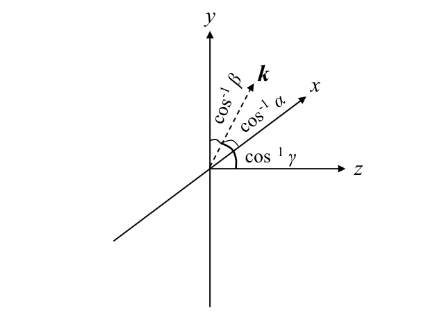
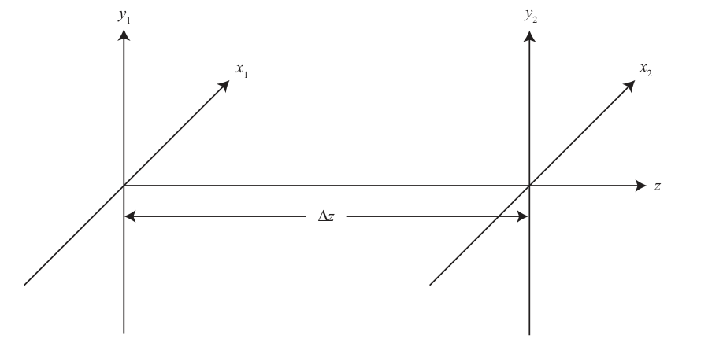
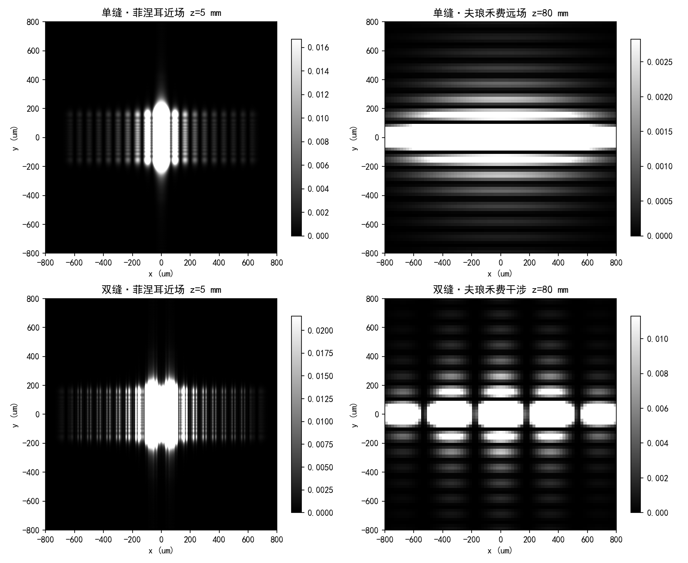
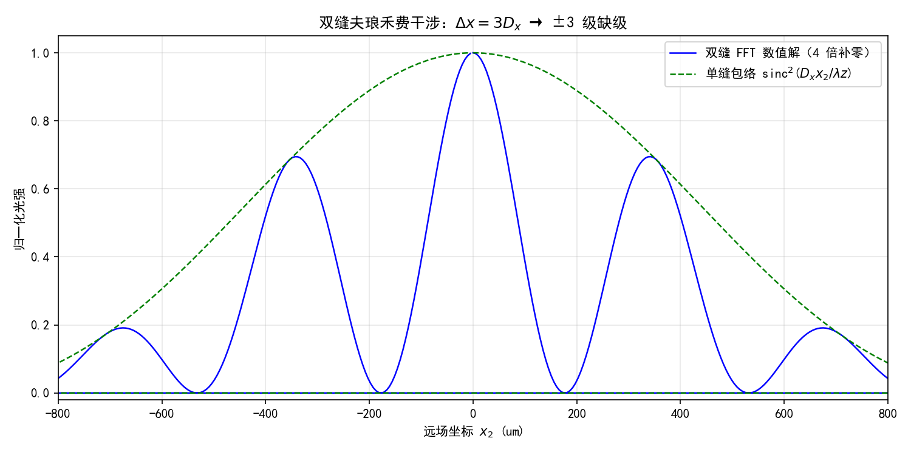
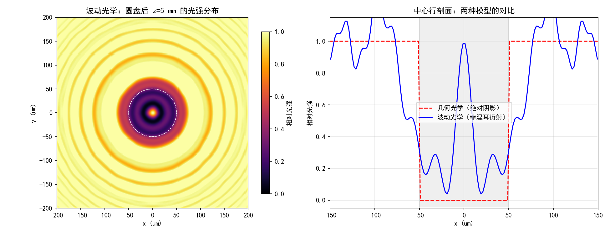
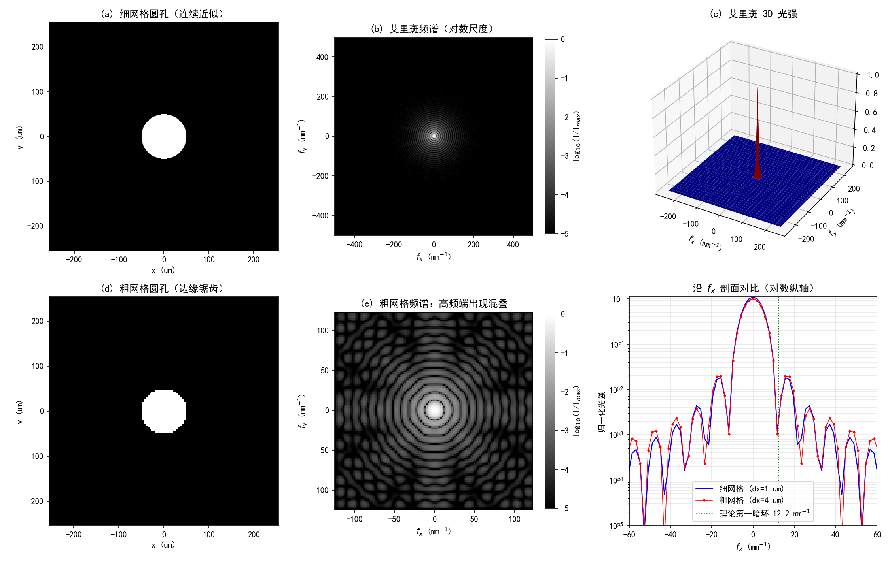
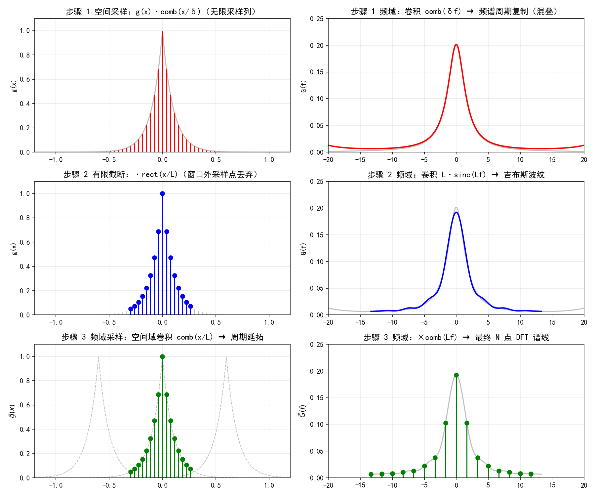

# 第 1 章 标量衍射理论基础

> **本章解决**：从 Maxwell 方程组出发，把"光从源平面传到观察平面"这件事最终压缩成两条能在计算机里算的积分——菲涅耳衍射积分 (1.57) 与夫琅禾费衍射积分 (1.67)，路上顺便备好三个标准波源：平面波、球面波、高斯光束。第 2 章立刻把连续积分搬进离散网格，看采样与有限阵列会捅出什么娄子。
> 原书本章是纯理论推导，没有 MATLAB 例程（矩形孔解析解的求值代码在附录 B）。笔记里的 4 组双语言仿真工程是我按本章公式补写的，每组内置数值验证，跑一遍就能对着打印结果核对公式；它们全部由你的 9 个旧稿脚本规范化重写而来，中文注释里的物理含义（水滴挡光、过冷水滴模型）原样保留，改掉的三处硬伤在 1.3.4 开头逐条列明。

本章覆盖：

- 经典电动力学基础：场的源、Maxwell 方程组、本构关系（1.1）
- 波动方程 → 亥姆霍兹方程；平面波、球面波、高斯光束三个闭式解（1.2）
- 标量衍射理论：菲涅耳衍射积分、矩形孔解析解、夫琅禾费近似、双缝干涉（1.3）
- 数值仿真工程：单缝/双缝图样、泊松斑、艾里斑与采样混叠、DFT 三步演化（1.3.4）

## 1.0 本章导图

<div class="brtree">
  <div class="brrow">
    <span class="brlabel root">标量衍射理论基础</span>
    <span class="brace"></span>
    <div class="brkids">
      <div class="brrow">
        <span class="brlabel">电动力学基础（1.1）</span>
        <span class="brace"></span>
        <div class="brkids">
          <span class="brleaf">场的源：ρ、J、P、M + 连续性方程 (1.1)</span>
          <span class="brleaf">洛伦兹力定义 E、B (1.2)–(1.4)</span>
          <span class="brleaf">Maxwell 四条 (1.10)(1.11)(1.17)(1.18)</span>
          <span class="brleaf">本构关系 D=εE、B=µH → 良定</span>
        </div>
      </div>
      <div class="brrow">
        <span class="brlabel">波动方程与标准解（1.2）</span>
        <span class="brace"></span>
        <div class="brkids">
          <span class="brleaf">curl-curl → 六个解耦标量波动方程 (1.38)</span>
          <span class="brleaf">时谐 → 亥姆霍兹 (∇²+k²n²)U=0 (1.43)</span>
          <span class="brleaf">U 单位 √W/m，I=|U|² 单位 W/m²</span>
          <span class="brleaf">平面波 / 球面波 / 高斯光束</span>
          <span class="brleaf">傍轴：球面波 ≈ 1/∆z × 二次相位 (1.52)</span>
        </div>
      </div>
      <div class="brrow">
        <span class="brlabel">标量衍射（1.3）</span>
        <span class="brace"></span>
        <div class="brkids">
          <span class="brleaf">菲涅耳衍射积分 (1.57) = 卷积傍轴球面波</span>
          <span class="brleaf">矩形孔解析解 (1.60)：C、S 积分</span>
          <span class="brleaf">夫琅禾费 ∆z &gt; 2D²/λ → 观察面=FT (1.67)</span>
          <span class="brleaf">双缝 (1.71)：cos 条纹 × sinc 包络 × 缺级</span>
          <span class="brleaf">判据速查表：标量/傍轴/菲涅耳/夫琅禾费</span>
        </div>
      </div>
      <div class="brrow">
        <span class="brlabel">数值仿真工程（1.3.4）</span>
        <span class="brace"></span>
        <div class="brkids">
          <span class="brleaf">单缝/双缝：对称性、暗纹、缺级全对上</span>
          <span class="brleaf">几何 vs 波动：泊松斑 0.987</span>
          <span class="brleaf">圆孔 FT：艾里斑 + 采样混叠</span>
          <span class="brleaf">DFT 三步演化 → 衔接第 2 章</span>
        </div>
      </div>
    </div>
  </div>
</div>

## 1.1 经典电动力学基础

光怎么描述？两套同样严格、都有实验支撑的理论：**经典电动力学（classical electrodynamics）**把电场、磁场当成时空的连续函数，光是共振荡的电场波与磁场波；**量子电动力学**把光子当成无质量、无电荷的基本粒子，光是一个或多个光子。宏观性质归经典处理，亚微观性质归量子处理——谁也淘汰不了谁，这就是波粒二象性。本书研究宏观传播，全程站在经典电动力学一边，解由标量衍射理论给出。

波长 \(\lambda\) 趋近零时，波走直线、不绕障碍物边缘弯折——那是几何光学的领地。但本书要处理大量几何光学无能为力的现象（比如衍射），所以起点是经典电动力学 + 标量衍射理论。几何光学只在 6.5 节简短回归。

### 1.1.1 场的源：电荷、电流、极化与磁化

电荷以库仑（C）计量，是基本粒子和块体材料的基本属性；有正、有负、也有零，并且是**量子化**的——最小非零电荷是元电荷 \(e = 1.602\times10^{-19}\) C，一切电荷都是它的整数倍。块体材料里这个整数非常巨大，所以总电荷可以当成连续量处理。记自由电荷的**体电荷密度**为 \(\rho(\mathbf r,t)\)（C/m³），\(\mathbf r\) 是三维空间矢量、\(t\) 是时间；运动的电荷密度叫**自由体电流密度** \(\mathbf J(\mathbf r,t)\)（A/m²，1 A = 1 C/s），表示单位时间内穿过单位面积的电荷。电荷守恒——任何系统的总电荷不变——数学表述就是连续性方程（**continuity equation**）：

\[
\nabla\cdot\mathbf J(\mathbf r,t) + \frac{\partial\rho(\mathbf r,t)}{\partial t} = 0.
\tag{1.1}
\]

人话：某处电荷变少，一定有电流把它运走了；两笔账对不上就是错的。

生活中几乎所有材料都由海量原子组成，正负电荷通常正好相消（或几乎相消），整体电中性。但即使总电荷与自由电流都为零，材料照样可能产生电场或磁场：电荷分布不均匀，或者电荷在小回路里转圈。电荷的分离用**电偶极矩**描述：分离电荷量乘以分离距离。块体材料的电荷排成大量微小偶极子，就说它被**电极化（electrically polarized）**；**极化密度** \(\mathbf P(\mathbf r,t)\) 是单位体积内电偶极矩的密度（C/m²）。磁化是运动电荷的对应概念：小电流环用**磁偶极矩**描述（环流乘环面积）；材料内部电流排成大量小环就说它被**磁化**，**磁化密度** \(\mathbf M(\mathbf r,t)\)（A/m）。

### 1.1.2 电场、磁场与 Maxwell 方程组

放进一个假想的**试探电荷**，它靠近有非零 \(\rho\)、\(\mathbf J\)、\(\mathbf P\) 或 \(\mathbf M\) 的材料时会受力——这个经验陈述（几个世纪的实验反复验证）定义了两个场。力就是洛伦兹力：

\[
\mathbf F = q\left(\mathbf E + \mathbf v\times\mathbf B\right).
\tag{1.2}
\]

**电场**是单位电荷在试探电荷静止时受到的力——"推拉力"，方向与场同向或反向（看电荷符号），单位 V/m（1 V = 1 N·m/C）：

\[
\mathbf E = \lim_{q\to 0^+}\left.\frac{\mathbf F}{q}\right|_{\mathbf v=0}.
\tag{1.3}
\]

**磁感应强度**对应运动部分的力——"偏转力"，垂直于速度、把轨迹掰弯，单位特斯拉（1 T = 1 N·s/(C·m)）：

\[
\mathbf v\times\mathbf B = \lim_{q\to 0^+}\left.\frac{\mathbf F - q\mathbf E}{q}\right|_{\mathbf v\neq 0}.
\tag{1.4}
\]

场和源的关系由几个世纪的实验测量加理论直觉总结成两条方程：

\[
\nabla\times\mathbf E + \frac{\partial\mathbf B}{\partial t} = 0,
\tag{1.5}
\]

\[
\nabla\times\mathbf B - \mu_0\epsilon_0\frac{\partial\mathbf E}{\partial t} = \mu_0\left(\mathbf J + \frac{\partial\mathbf P}{\partial t} + \nabla\times\mathbf M\right).
\tag{1.6}
\]

(1.5) 是法拉第定律；(1.6) 是带 Maxwell 修正的安培定律——右边除自由电流 \(\mathbf J\) 外还有两个**束缚电流**：极化电流 \(\partial\mathbf P/\partial t\) 与磁化电流 \(\nabla\times\mathbf M\)。把它们改写成更好用的形式：(1.6) 移项为

\[
\nabla\times\left(\frac{\mathbf B}{\mu_0} - \mathbf M\right) = \mathbf J + \frac{\partial}{\partial t}\left(\epsilon_0\mathbf E + \mathbf P\right),
\tag{1.7}
\]

据此定义**电位移**与**磁场强度**——两个把介质响应打包进场的量：

\[
\mathbf D = \epsilon_0\mathbf E + \mathbf P,
\tag{1.8}
\]

\[
\mathbf H = \frac{\mathbf B}{\mu_0} - \mathbf M.
\tag{1.9}
\]

于是 Maxwell 方程组的工作形式是：

\[
\nabla\times\mathbf E = -\frac{\partial\mathbf B}{\partial t},
\tag{1.10}
\]

\[
\nabla\times\mathbf H = \mathbf J + \frac{\partial\mathbf D}{\partial t}.
\tag{1.11}
\]

另外两条不用新实验，从电荷守恒"白拿"。对 (1.11) 取散度，代入 (1.1)，再用恒等式 \(\nabla\cdot(\nabla\times{\cdot})=0\)（三段等号分别对应原书 (1.12)–(1.14)）：

\[
\nabla\cdot(\nabla\times\mathbf H) = \nabla\cdot\mathbf J + \frac{\partial}{\partial t}(\nabla\cdot\mathbf D) = -\frac{\partial\rho}{\partial t} + \frac{\partial}{\partial t}(\nabla\cdot\mathbf D) = 0.
\tag{1.12}
\]

左边恒为零，右边整理成 \(\frac{\partial}{\partial t}(\nabla\cdot\mathbf D - \rho) = 0\)，即 \(\nabla\cdot\mathbf D - \rho = f(\mathbf r)\) 不依赖时间（原书 (1.15)(1.16)）。因果性要求源开启之前 \(f(\mathbf r)=0\)，于是得到库仑定律：

\[
\nabla\cdot\mathbf D = \rho.
\tag{1.17}
\]

同样的操作给出

\[
\nabla\cdot\mathbf B = 0,
\tag{1.18}
\]

——磁单极电荷不存在。(1.10)、(1.11)、(1.17)、(1.18) 合起来就是 Maxwell 方程组。

数一数账本：(1.10)、(1.11) 是两个独立矢量方程，各 3 个标量分量，共 6 个标量方程；未知量 \(\mathbf D,\mathbf B,\mathbf H,\mathbf E\) 共 12 个标量分量。未知比方程多一倍——**病态问题（poorly posed）**。钥匙在介质：搞清楚介质怎么响应场，把 \(\mathbf P\)–\(\mathbf E\)、\(\mathbf M\)–\(\mathbf H\) 的关系补上，正好再加 6 个标量方程。对**简单介质**（线性 linear、均匀 homogeneous、各向同性 isotropic）：

\[
\mathbf P = \epsilon_0\chi_e\mathbf E,
\qquad
\mathbf M = \chi_m\mathbf H,
\tag{1.19}
\]

\(\chi_e\)、\(\chi_m\) 是介质的电极化率与磁化率。代入 (1.8)、(1.9)：

\[
\mathbf D = \epsilon_0\mathbf E + \mathbf P = \epsilon_0(1+\chi_e)\mathbf E = \epsilon\mathbf E,
\qquad
\mathbf B = \mu_0(\mathbf H + \mathbf M) = \mu_0(1+\chi_m)\mathbf H = \mu\mathbf H,
\tag{1.21}
\]

（两段等号分别覆盖原书 (1.21)–(1.23) 与 (1.24)–(1.26)；\(\epsilon=(1+\chi_e)\epsilon_0\) 是电容率，\(\mu=(1+\chi_m)\mu_0\) 是磁导率。）现在 6 个方程对 6 个未知量（\(\mathbf J\) 视为已知），问题**良定（well posed）**。(1.10)、(1.11) 化简为：

\[
\nabla\times\mathbf E = -\mu\frac{\partial\mathbf H}{\partial t},
\tag{1.27}
\]

\[
\nabla\times\mathbf H = \mathbf J + \epsilon\frac{\partial\mathbf E}{\partial t}.
\tag{1.28}
\]

!!! note "拓展：有了 B 为什么还要定义 H？"
    分工不同：\(\mathbf B\) 是"管受力"的场（(1.4) 的偏转力由它贡献），\(\mathbf H\) 是"接源"的场——(1.11) 里只出现 \(\mathbf H\) 和自由电流 \(\mathbf J\)。把介质响应（束缚电流 \(\partial\mathbf P/\partial t\)、\(\nabla\times\mathbf M\)）从方程右边搬进 \(\mathbf D\)、\(\mathbf H\) 的定义里，解方程时就只需要管自由源。真空中 \(\mathbf P=\mathbf M=0\)，\(\mathbf B=\mu_0\mathbf H\)、\(\mathbf D=\epsilon_0\mathbf E\)，两套场只差常数。光学里"折射率 \(n\)"连着 \(\epsilon\)（下节 (1.39)），这也是为什么介质响应那一项 \(\mathbf P\) 决定了光在玻璃里变慢。

## 1.2 Maxwell 方程组的简单行波解

Maxwell 方程的解很多，但能不借助积分就写出闭式的没几个。本节先把四条方程化成两个**解耦的波动方程**，再给出无限延伸平面波这类特例；更一般的解留给 1.3 节的衍射积分。

### 1.2.1 从 Maxwell 到波动方程，再到亥姆霍兹方程

本书的研究对象：线性、各向同性、均匀、非色散的电介质，且无源电荷与电流。此后全书默认：

\[
\epsilon=\text{标量（与 }\lambda,\mathbf r,t\text{ 无关）},
\qquad \mu=\mu_0,
\qquad \rho=0,
\qquad \mathbf J=\mathbf 0.
\tag{1.29}
\]

（四条设定分别即原书 (1.29)–(1.32)。）对 (1.27) 取旋度、代入 (1.28)（原书 (1.33)(1.34)；对一般介质本应得 \(-\mu\)，按 (1.30) 的 \(\mu=\mu_0\) 直接写成 \(-\mu_0\)）：

\[
\nabla\times(\nabla\times\mathbf E) = -\mu_0\frac{\partial}{\partial t}(\nabla\times\mathbf H) = -\mu_0\epsilon\frac{\partial^2\mathbf E}{\partial t^2}.
\tag{1.33}
\]

用矢量恒等式 \(\nabla\times(\nabla\times\mathbf E)=\nabla(\nabla\cdot\mathbf E)-\nabla^2\mathbf E\) 展开（原书 (1.35)），代入 \(\nabla\cdot\mathbf E=0\)（由 \(\rho=0\)、\(\mathbf D=\epsilon\mathbf E\) 与 (1.17)，且 \(\epsilon\) 不随位置变），得**波动微分方程**：

\[
\nabla^2\mathbf E - \mu_0\epsilon\frac{\partial^2\mathbf E}{\partial t^2} = 0.
\tag{1.36}
\]

对 (1.28) 做同样操作得 \(\mathbf B\) 的方程：

\[
\nabla^2\mathbf B - \mu_0\epsilon\frac{\partial^2\mathbf B}{\partial t^2} = 0.
\tag{1.37}
\]

Laplacian 算符作用在 \(\mathbf E\)、\(\mathbf B\) 的直角坐标分量上，得到六个**解耦但形状完全相同**的方程：

\[
\left(\nabla^2 - \mu_0\epsilon\frac{\partial^2}{\partial t^2}\right)U(x,y,z) = 0,
\tag{1.38}
\]

\(U(x,y,z)\) 代表 \(\mathbf E\) 或 \(\mathbf B\) 的任意 \(x\)、\(y\)、\(z\) 分量。**标量衍射理论里的"标量"就从这一步来**：每个直角分量都独立满足同一个标量方程，你可以只追踪一个分量。

定义折射率与真空光速：

\[
n = \sqrt{\frac{\epsilon}{\epsilon_0}},
\tag{1.39}
\]

\[
c = \frac{1}{\sqrt{\mu_0\epsilon_0}},
\tag{1.40}
\]

波动方程改写成

\[
\left(\nabla^2 - \frac{n^2}{c^2}\frac{\partial^2}{\partial t^2}\right)U(x,y,z) = 0.
\tag{1.41}
\]

光波是行波场，所以找时谐解 \(\exp(-i2\pi\nu t)\)（\(\nu\) 是频率；时间二阶导换成 \(-(2\pi\nu)^2\)）：

\[
\left[\nabla^2 + \left(\frac{2\pi n\nu}{c}\right)^2\right]U = 0.
\tag{1.42}
\]

取波长 \(\lambda = c/\nu\)、波数 \(k = 2\pi/\lambda\)，得到**亥姆霍兹方程（Helmholtz equation）**：

\[
\left(\nabla^2 + k^2n^2\right)U = 0.
\tag{1.43}
\]

它不只属于光学——热力学、量子力学里都有它的身影。到这一步，时间依赖可以扔掉了：所有亥姆霍兹方程的解共享同一个时间因子。从此 \(U(x,y,z)\) 指光场的**相量（phasor）**部分（不含时间）。它的单位定义为"开平方的瓦每米"（\(\sqrt{\mathrm W}/\mathrm m\)），这样**辐照度（irradiance）** \(I = |U|^2\) 的单位恰好是 W/m²。真实场量 \(\mathbf E\)、\(\mathbf B\) 随时可以通过单位换算复原。

!!! note "拓展：i 与 j、时谐约定、'正相位 = 沿 +z 出射'"
    三件容易搅在一起的事一次说清。① 原书正文用 \(i\)，工程/MATLAB 惯例用 \(j\)，本笔记公式统一写 \(j\)（原书自己的 MATLAB 代码也用 `1i`/`1j`），无实义差别。② 时谐约定：本书取 \(\exp(-i2\pi\nu t)\)，代入 (1.41) 才得到 (1.42) 里的 \(+k^2n^2\)；信号处理教材常用 \(\exp(+j\omega t)\)，两边对照公式时相位符号正好相反——抄传递函数前先查对方的时间因子。③ 沿 \(+z\) 传播的单位振幅平面波是 \(\exp(+ikz)\)（令 (1.46) 的 \(\gamma=1\)）。记住这个指纹："空间相位带 \(+jkz\)"= 沿 \(+z\) 出射。第 4 章写角谱传递函数时，靠它判断有没有把传播方向写反。

### 1.2.2 三种简单行波场：平面波、球面波、高斯光束

三个"标准解"有个共同性质：无论传多远，场始终保持自己的形态（平面、球面、高斯），曲率半径这类参数按简单规律演化。更一般的场交给 1.3 节。

**平面波（planar wave）**——最简单的行波：在与传播方向垂直的任何平面内振幅、相位都均匀。光轴不沿传播方向时的一般形式：

\[
U_P(\mathbf r) = A\exp(i\mathbf k\cdot\mathbf r),
\tag{1.44}
\]

\(A\) 是振幅，

\[
\mathbf k = \frac{2\pi}{\lambda}\left(\alpha\hat{\mathbf x} + \beta\hat{\mathbf y} + \gamma\hat{\mathbf z}\right)
\tag{1.45}
\]

是**波矢（wavevector）**，\(\alpha\)、\(\beta\)、\(\gamma\) 是**方向余弦（direction cosines）**。展开成显式：

\[
U_P(\mathbf r) = A\exp\left[i\frac{2\pi}{\lambda}(\alpha x + \beta y + \gamma z)\right].
\tag{1.46}
\]

这列波与 \(x\) 轴夹角 \(\cos^{-1}\alpha\)、与 \(y\) 轴夹角 \(\cos^{-1}\beta\)，如图 1.1。

<figure>
  
  <figcaption>图 1.1 方向余弦 \(\alpha\)、\(\beta\)、\(\gamma\)：波矢 \(\boldsymbol k\) 与三根坐标轴的夹角（截自原书）</figcaption>
</figure>

**球面波（spherical wave）**——波前是球面，发散或汇聚。能量均匀铺在面积 \(4\pi R^2\) 的球面上（\(R\) 为波前曲率半径），能量守恒要求振幅按 \(R^{-1}\) 衰减：

\[
U_S(\mathbf r) = A\frac{\exp[ikR(\mathbf r)]}{R(\mathbf r)},
\tag{1.47}
\]

球心在 \(\mathbf r_c=(x_c,y_c,z_c)\)、观察点 \(\mathbf r=(x,y,z)\) 时曲率半径为

\[
R(\mathbf r) = \sqrt{(x-x_c)^2 + (y-y_c)^2 + (z-z_c)^2}.
\tag{1.48}
\]

光学里常常只关心贴近光轴的区域——**傍轴近似（paraxial approximation）**。沿 \(+z\) 方向传播时，它写作

\[
\cos^{-1}\alpha \ll 1,
\qquad
\cos^{-1}\beta \ll 1,
\tag{1.49}
\]

（波法线与 \(z\) 轴的夹角远小于 1 rad。）此时 (1.48) 的平方根用泰勒级数展开、只保留前两项：

\[
R(\mathbf r) \simeq \Delta z\left[1 + \frac{1}{2}\left(\frac{x-x_c}{\Delta z}\right)^2 + \frac{1}{2}\left(\frac{y-y_c}{\Delta z}\right)^2\right],
\tag{1.51}
\]

其中 \(\Delta z = |z-z_c|\)。代入 (1.47)，傍轴球面波：

\[
U_S(\mathbf r) \simeq \frac{A\,e^{ik\Delta z}}{\Delta z}\; e^{i\frac{k}{2\Delta z}\left[(x-x_c)^2 + (y-y_c)^2\right]}.
\tag{1.52}
\]

人话：傍轴区的球面波 = "常数振幅 \(1/\Delta z\)" × "二次相位"。二次相位是全书出场率最高的函数——菲涅耳衍射的核 (1.57)、透镜相位、传递函数全是它的变体。

**高斯光束（Gaussian-beam wave）**——高斯振幅轮廓 + "傍轴球面"波前，激光器输出的标准形态。完整推导本身就要用到傍轴近似（可查常见激光教材，原书 Refs. 2–3）：

\[
U_G(\mathbf r) = \frac{A}{q(z)}\exp\left[ik\frac{x^2+y^2}{2q(z)}\right],
\tag{1.53}
\]

\[
\frac{1}{q(z)} = \frac{1}{R(z)} + \frac{i\lambda}{\pi W^2(z)},
\tag{1.54}
\]

束斑半径与波前曲率半径分别为

\[
W^2(z) = W_0^2\left[1 + \left(\frac{\lambda z}{\pi W_0^2}\right)^2\right],
\tag{1.55}
\]

\[
R(z) = z\left[1 + \left(\frac{\pi W_0^2}{\lambda z}\right)^2\right],
\tag{1.56}
\]

\(W_0\) 是最小束斑半径，约定位于 \(z=0\)（\(W(0)=W_0\)）；沿 \(z\) 轴任意位置，\(W(z)\) 都是场振幅降到 \(1/e\) 的半径。把 (1.54) 代回 (1.53) 可以看清 \(q(z)\) 的双重身份：实部 \(1/R\) 给出波前弯曲，虚部 \(\lambda/(\pi W^2)\) 给出高斯衰减 \(\exp[-(x^2+y^2)/W^2]\)——一个复数同时编码两条信息。

!!! note "拓展：瑞利距离与 q 参数的一行演化"
    定义**瑞利距离** \(z_R=\pi W_0^2/\lambda\)。(1.55)(1.56) 的行为：\(z\ll z_R\) 时束宽几乎不变、波前近似平面（\(R(z)\approx z\) 很大）；\(z\gg z_R\) 时 \(W(z)\approx\lambda z/(\pi W_0)\)，光束以发散角 \(\theta=\lambda/(\pi W_0)\) 直线扩张、\(R(z)\approx z\)。用 (1.54) 反解可得这套约定下的闭式 \(q(z)=z-iz_R\)：自由空间传播就是给 \(q\) 加 \(\Delta z\)，一行搞定；穿过薄透镜再补一条 \(1/q\) 的改写规则，所有高斯光束问题归结为"沿光路追踪一个复数"。（注意 \(z_R\) 与后面夫琅禾费距离 \(2D^2/\lambda\) 的角色差异：前者是高斯光束自己的衍射长度，后者是有限孔径图样进入远场的判据。）

## 1.3 标量衍射理论

光源往往不是单纯的平面波、球面波或高斯光束。更一般的情形要正经解标量亥姆霍兹方程，手段是**格林定理（Green's theorem）**加聪明的边界条件。这条推导线原书没有展开（"这不是本书要讨论的细节"），指向了标准参考书——脚注 Refs. 4–5，其中 Ref. 5 就是 Goodman 的《Introduction to Fourier Optics》，本栏目《计算傅里叶光学》笔记用的正是同一套记号。

几何设置见图 1.2：源平面坐标 \(\mathbf r_1=(x_1,y_1)\)，观察平面坐标 \(\mathbf r_2=(x_2,y_2)\)，两平面相距 \(\Delta z\)。基本问题一句话：**已知源平面场 \(U(x_1,y_1)\)，求观察平面场 \(U(x_2,y_2)\)**。

<figure>
  
  <figcaption>图 1.2 光波传播的坐标系：源平面 \((x_1,y_1)\) 与观察平面 \((x_2,y_2)\) 相距 \(\Delta z\)（截自原书）</figcaption>
</figure>

### 1.3.1 菲涅耳衍射积分与矩形孔解析解

答案是**菲涅耳衍射积分（Fresnel diffraction integral）**：

\[
U(x_2,y_2) = \frac{e^{ik\Delta z}}{i\lambda\Delta z}\int_{-\infty}^{\infty}\int_{-\infty}^{\infty} U(x_1,y_1)\; e^{i\frac{k}{2\Delta z}\left[(x_1-x_2)^2 + (y_1-y_2)^2\right]}\,dx_1\,dy_1.
\tag{1.57}
\]

先说明：这不是最一般的解——它是**傍轴近似**下的结果——但对本书的用途它足够一般、也足够准。读懂 (1.57) 有两个角度：

- **卷积角度**：被积核 \(\frac{e^{ik\Delta z}}{i\lambda\Delta z}e^{i\frac{k}{2\Delta z}[(x_1-x_2)^2+(y_1-y_2)^2]}\) 只依赖差值 \((x_1-x_2,\,y_1-y_2)\)——(1.57) 是 \(U\) 与"傍轴球面波冲激响应"的**卷积**。习题 3 让你亲手验证：把 \(\delta(\mathbf r_1)\) 代进去，出来的正是 (1.52)。
- **傅里叶角度**：把二次相位在指数里展开、按 \(x_1,y_1\) 配方，(1.57) 可以写成"两组二次相位夹着一个二维傅里叶变换"。离散傅里叶变换（DFT）算得飞快——这是第 2–4 章全部数值方法的出发点。

!!! note "拓展：(1.57) 上面还有两层——克希霍夫与瑞利-索末菲"
    格林定理 + 基尔霍夫边界条件给出**克希霍夫衍射积分**：观察点的场由孔径面上的 \(U\) 与 \(\nabla U\) 贡献，核 \(\frac{e^{ikr}}{r}\) 里带一个倾斜因子（平面屏下 \(K(\theta)=\frac{1+\cos\theta}{2}\)，\(\theta\) 是观察方向与孔径法线的夹角）。它的毛病是边界条件数学上不自洽：同时假设孔径外 \(U\) 和 \(\partial U/\partial n\) 都是零， overdetermined。**瑞利–索末菲（Rayleigh–Sommerfeld）**理论改用第一类格林函数问题，修掉了不自洽，倾斜因子简化为 \(\cos\theta\)（第一积分）：
    \[
    U(P_2) = \frac{1}{i\lambda}\iint_\Sigma U(P_1)\,\frac{e^{ikr_{12}}}{r_{12}}\,\cos\theta\;d\Sigma,
    \]
    还有以 \(J_1\) 为核的第二瑞利–索末菲积分（与第 4 章角谱法等价）。傍轴极限下 \(r_{12}\approx\Delta z+\frac{(x_1-x_2)^2+(y_1-y_2)^2}{2\Delta z}\)、\(\cos\theta\approx 1\)、\(\frac{1}{r_{12}}\approx\frac{1}{\Delta z}\)——两条积分都退化成 (1.57)。所以层级是：**克希霍夫 / 瑞利–索末菲（一般）→ 菲涅耳（傍轴）→ 夫琅禾费（远场）**，本章走最后两级，第 4 章补角谱视角。

解析解稀罕，但有一个必须认识：**矩形孔的菲涅耳衍射**——原书第 6–8 章反复拿它当数值结果的"考卷答案"。设源平面场为

\[
U(x_1,y_1) = \mathrm{rect}\left(\frac{x_1}{D}\right)\mathrm{rect}\left(\frac{y_1}{D}\right),
\tag{1.58}
\]

（rect 函数定义见原书附录 A：\(|x|<1/2\) 取 1，\(|x|>1/2\) 取 0，边界取 \(1/2\)。）代入 (1.57)：

\[
U(x_2,y_2) = \frac{e^{ik\Delta z}}{i\lambda\Delta z}\int_{-D/2}^{D/2}\int_{-D/2}^{D/2} e^{i\frac{k}{2\Delta z}\left[(x_1-x_2)^2 + (y_1-y_2)^2\right]}\,dx_1\,dy_1.
\tag{1.59}
\]

变量代换后用**菲涅耳正弦/余弦积分（Fresnel sine and cosine integrals）**表示（推导步骤见 Goodman 等傅里叶光学教材）：

\[
U(x_2,y_2) = \frac{e^{ik\Delta z}}{2i}\Big\{\left[C(\alpha_2)-C(\alpha_1)\right] + i\left[S(\alpha_2)-S(\alpha_1)\right]\Big\}\times\Big\{\left[C(\beta_2)-C(\beta_1)\right] + i\left[S(\beta_2)-S(\beta_1)\right]\Big\},
\tag{1.60}
\]

其中

\[
\alpha_1 = -\sqrt{\frac{2}{\lambda\Delta z}}\left(\frac{D}{2}+x_2\right),
\qquad
\alpha_2 = \sqrt{\frac{2}{\lambda\Delta z}}\left(\frac{D}{2}-x_2\right),
\tag{1.61}
\]

\[
\beta_1 = -\sqrt{\frac{2}{\lambda\Delta z}}\left(\frac{D}{2}+y_2\right),
\qquad
\beta_2 = \sqrt{\frac{2}{\lambda\Delta z}}\left(\frac{D}{2}-y_2\right),
\tag{1.63}
\]

\[
S(x) = \int_0^x \sin\left(\frac{\pi t^2}{2}\right)dt,
\qquad
C(x) = \int_0^x \cos\left(\frac{\pi t^2}{2}\right)dt.
\tag{1.65}
\]

MATLAB 求值代码原书放在附录 B。为什么要记住它：几乎没有别的菲涅耳衍射问题有解析答案，(1.60) 在第 6–8 章的例子里专门用来跟数值结果对账。(\(\alpha,\beta\) 的下标 1、2 对应积分限的左右端点：观察点 \(x_2\) 越靠近孔边缘，端点越不对称。)

### 1.3.2 夫琅禾费近似与双缝干涉

把 (1.57) 搬进计算机有实实在在的挑战——挑战全部来自"有限尺寸网格上的离散采样"，这正是第 2 章的主题（离散傅里叶变换）与第 3 章（可写成傅里叶变换的基本计算）的铺垫。第 4 章第一次把 DFT 正式用到光学上：极远距离的自由空间传播与透镜系统。这些场景允许对 (1.57) 做进一步简化：当 \(\Delta z\) 非常远时，被积函数里的二次相位因子可以近似当成"平的"。具体判据：

\[
\Delta z > \frac{2D^2}{\lambda},
\]

\(D\) 是源平面场的最大空间范围（原书引 Goodman，Ref. 5）。这就是**夫琅禾费近似（Fraunhofer approximation）**，给出夫琅禾费衍射积分：

\[
U(x_2,y_2) = \frac{e^{ik\Delta z}\;e^{i\frac{k}{2\Delta z}(x_2^2+y_2^2)}}{i\lambda\Delta z}\int_{-\infty}^{\infty}\int_{-\infty}^{\infty} U(x_1,y_1)\; e^{-i\frac{k}{\Delta z}(x_1x_2+y_1y_2)}\,dx_1\,dy_1.
\tag{1.67}
\]

积分部分就是 \(U(x_1,y_1)\) 的二维傅里叶变换，只是频率变量换成了观察面坐标：\(x_2=\lambda\Delta z\,f_X\)、\(y_2=\lambda\Delta z\,f_Y\)。**"夫琅禾费图样 = 孔径的傅里叶变换"**——这句是全书引用率最高的一句话。积分前面的二次相位 \(e^{ik(x_2^2+y_2^2)/(2\Delta z)}\) 只管相位，算强度 \(|U|^2\) 时直接消失。

**双缝干涉**。平面波照到不透明屏上的双缝，缝后场为

\[
U(x_1,y_1) = \left[\mathrm{rect}\left(\frac{x_1-\Delta x/2}{D_x}\right) + \mathrm{rect}\left(\frac{x_1+\Delta x/2}{D_x}\right)\right]\mathrm{rect}\left(\frac{y_1}{D_y}\right),
\tag{1.68}
\]

缝在 \(x_1\) 方向宽 \(D_x\)、\(y_1\) 方向高 \(D_y\)，两缝中心相距 \(\Delta x > D_x\)（不重叠）。代入 (1.67)：

\[
U(x_2,y_2) = \frac{e^{ik\Delta z}e^{i\frac{k}{2\Delta z}(x_2^2+y_2^2)}}{i\lambda\Delta z}\int_{-\infty}^{\infty}\int_{-\infty}^{\infty}\left[\mathrm{rect}\left(\frac{x_1-\Delta x/2}{D_x}\right) + \mathrm{rect}\left(\frac{x_1+\Delta x/2}{D_x}\right)\right]\mathrm{rect}\left(\frac{y_1}{D_y}\right)e^{-i\frac{k}{\Delta z}(x_1x_2+y_1y_2)}\,dx_1\,dy_1,
\tag{1.69}
\]

按缝的位置拆成两个平移的一维积分加 \(y\) 向积分：

\[
U(x_2,y_2) = \frac{e^{ik\Delta z}e^{i\frac{k}{2\Delta z}(x_2^2+y_2^2)}}{i\lambda\Delta z}\left[\int_{-(\Delta x+D_x)/2}^{-(\Delta x-D_x)/2} e^{-i\frac{k}{\Delta z}x_1x_2}\,dx_1 + \int_{(\Delta x-D_x)/2}^{(\Delta x+D_x)/2} e^{-i\frac{k}{\Delta z}x_1x_2}\,dx_1\right]\int_{-D_y/2}^{D_y/2} e^{-i\frac{k}{\Delta z}y_1y_2}\,dy_1.
\tag{1.70}
\]

两个平移 rect 的变换各带一个线性相位 \(e^{\mp i\pi\Delta x\,x_2/(\lambda\Delta z)}\)，相加后用欧拉公式并成余弦；\(y\) 方向是单个 rect 的变换。整理得

\[
U(x_2,y_2) = \frac{e^{ik\Delta z}\;e^{i\frac{k}{2\Delta z}(x_2^2+y_2^2)}\;\,2D_xD_y}{i\lambda\Delta z}\,\cos\left(\frac{\pi\Delta x\,x_2}{\lambda\Delta z}\right)\,\mathrm{sinc}\left(\frac{D_x\,x_2}{\lambda\Delta z}\right)\,\mathrm{sinc}\left(\frac{D_y\,y_2}{\lambda\Delta z}\right).
\tag{1.71}
\]

读 (1.71)：强度 \(|U|^2\propto\cos^2\!\left(\pi\Delta x\,x_2/(\lambda\Delta z)\right)\,\mathrm{sinc}^2(D_xx_2/(\lambda\Delta z))\,\mathrm{sinc}^2(D_yy_2/(\lambda\Delta z))\)——**双缝 \(\cos^2\) 干涉条纹被单缝 \(\mathrm{sinc}^2\) 包络调制**。\(\cos^2\) 的零点在 \((n+\tfrac12)\lambda\Delta z/\Delta x\)、极大在 \(n\lambda\Delta z/\Delta x\)；包络零点在 \(m\lambda\Delta z/D_x\)。当 \(\Delta x/D_x\) 是整数时，某些干涉级次恰好撞上包络零点——**缺级（missing order）**：\(\Delta x=3D_x\) 时 \(\pm3,\pm6\) 级消失（工程 1 数值复现）。

原书脚注点了一句：这里用的是完全相干照明，而双缝孔径正是研究部分相干光源的标准装置。

!!! note "拓展：相干与非相干照明——'加场'还是'加强度'是原则问题"
    两列场 \(U_1,U_2\) 叠加：瞬时场永远线性相加 \(U=U_1+U_2\)，但探测器响应的是时间平均强度
    \[
    \langle|U_1+U_2|^2\rangle = \langle|U_1|^2\rangle+\langle|U_2|^2\rangle + 2\,\mathrm{Re}\langle U_1U_2^*\rangle.
    \]
    最后一项是干涉项，它的死活决定图像长相：
    - **完全相干**（单模激光；同一波前分出的双缝两列正是这种）：相位差稳定，干涉项存活——(1.71) 的 \(\cos^2\) 条纹；
    - **完全非相干**（两个独立热光源）：相位差随机游走，时间平均后干涉项为零——强度直接相加，看不到条纹；
    - **部分相干**：条纹可见度 \(V=(I_{\max}-I_{\min})/(I_{\max}+I_{\min})=|\gamma_{12}|\,\frac{2\sqrt{I_1I_2}}{I_1+I_2}\)，\(\gamma_{12}\) 是复相干度。用双缝扫描缝距 \(\Delta x\) 测 \(V(\Delta x)\)，就量出了光的空间相干性——迈克尔逊测星干涉仪量恒星直径用的就是这一招。
    数值仿真的默认设定是完全相干（复振幅传播天然如此）。要仿非相干/部分相干照明，思路是传播**互强度**（二阶相关函数）而不是场本身，对系综做平均——超出本章，但"双缝 = 相干性测量仪"这个角色从杨氏实验一直延续到今天。

### 1.3.3 近似条件与适用判据（速查表）

把本章出现过的近似按"谁约掉了谁"排成一列。前四行是原书明文或直接推论；最后一行是离散实现的补充判据（第 4 章细讲）：

| 近似 | 判据 | 人话 | 失效后果 |
| --- | --- | --- | --- |
| 标量近似 | 衍射角小、特征结构尺寸 \(\gg\lambda\)（原书未量化，隐含全程） | 只追一个直角分量，忽略偏振耦合 | 大角度、亚波长结构、强边缘散射时误差显著 |
| 傍轴近似 (1.49)–(1.50) | \(\cos^{-1}\alpha\ll 1\)、\(\cos^{-1}\beta\ll 1\) | 波法线与 \(z\) 轴夹角远小于 1 rad | 球面波不能用二次相位 (1.52) 近似 |
| 菲涅耳近似 (1.51) | 对 (1.48) 的平方根泰勒展开只留前两项；横向坐标 \(\ll\Delta z\) | 源/观察面的横向偏移远小于传播距离 | 四阶相位项可察，边缘大角度条纹失真 |
| 夫琅禾费近似 (1.67) | \(\Delta z > 2D^2/\lambda\)，\(D\)=源平面场最大空间范围 | 二次相位 \(e^{ik(x_1^2+y_1^2)/(2\Delta z)}\) 在源面内近似常数，积分变成 FT | 把近场图样误当远场（等价于菲涅耳数 \(N_F=D^2/(\lambda\Delta z)<\tfrac12\)） |
| 传递函数法离散窗（仿真工程用） | \(\pi\lambda\Delta z(f_X^2+f_Y^2)\le\pi\) 在频带角点，即 \(\Delta z \le 4\,dx^2/\lambda\) | 二次相位传递函数在离散频带上每格相位增量不超过 \(\pi\) | 高频相位翻卷，图样出现伪条纹（\(\Delta z>4dx^2/\lambda\) 时应改用其他算法） |

!!! note "拓展：菲涅耳数——菲涅耳区与夫琅禾费区的分界"
    \(N_F = D^2/(\lambda\Delta z)\)（菲涅耳数）是"孔径里能塞下多少个半波带"的计数：\(N_F\gtrsim 1\) 是菲涅耳区（近场，图样随距离剧烈演化），\(N_F\ll 1\) 是夫琅禾费区（远场，图样只剩放大缩小的 FT）。原书的 \(\Delta z > 2D^2/\lambda\) 就是 \(N_F<\tfrac12\)。数字感受一下：\(D=100\,\mu\mathrm m\)、\(\lambda=532\) nm 的圆孔，\(\Delta z>37.6\) mm 才进远场；但 \(D=1\) cm 时要 188 m——实验室里直接看远场图样往往不现实，这正是第 4 章要"透镜 + 频域缩放"的原因。

### 1.3.4 数值仿真工程（MATLAB / Python 双实现）

本章公式看着都"显然"，真到代码里全是约定问题。下面四组工程全部由你的旧稿规范化重写而来：函数化、统一**胞元中心采样**约定（\(x=(n-N/2+\tfrac12)\,dx\)）、去掉 OpenCV 依赖、每组内置数值验证并实跑核对。中文注释里的物理含义（水滴挡光、过冷水滴、课题研究基准仿真）原样保留。重写时修掉的三处硬伤：

1. **旧 MATLAB 稿 `InterferenceDiffraction.m` 的 `propFresnelTF` 漏写了 `fft2` 本体**——`H`（频域传递函数）乘在了一个从未生成的"频谱"上，实际是对空间域数组直接乘相位再逆变换，物理结果错误；
2. 旧 Python 稿 `双缝干涉和单缝衍射.py` 有 `fft2`，但传递函数的频率轴取了 \((n-N/2-\tfrac12)/(N\,dx)\)，与 `fftshift(fft2(fftshift(·)))` 谱的 bin 位置错开半个像素——强度图上看不出，相位已经错了；
3. 旧稿 `几何光学和波动光学对比.py` 用 \(1-(D/\lambda z)\cdot\mathrm{sinc}\) 的启发式公式"示意"衍射场，量纲不对（那一项不是任何衍射积分的解）；本版按 (1.57) 的传递函数法真实传播。

#### 工程 1：单缝衍射与双缝干涉——式 (1.57)(1.67)(1.71) 的端到端验证

单缝 \(\mathrm{rect}(x/D_x)\mathrm{rect}(y/D_y)\) 与双缝（缝宽 \(D_x=40\,\mu\mathrm m\)、缝高 \(D_y=400\,\mu\mathrm m\)、中心距 \(\Delta x=120\,\mu\mathrm m=3D_x\)）两个孔径，各传播两次：近场 \(z=5\) mm 用 (1.57) 的**传递函数法**（把 (1.57) 写成"FFT → 乘 \(H\) → IFFT"，\(H=\exp(ik\Delta z)\exp[-i\pi\lambda\Delta z(f_X^2+f_Y^2)]\)，离散窗 \(\Delta z\le 4dx^2/\lambda\approx 30\) mm，5 mm 安全），远场 \(z=80\) mm 用 (1.67) 的"变换 + 坐标缩放 \(x_2=\lambda\Delta z f_X\)"。胞元中心采样下 \(40\,\mu\mathrm m\) 缝恰好占 20 个胞元，离散谱零点严格落在连续理论位置上。代码文件：`matlab/waveprop/ch1/ch1_slit_diffraction.m`、`python/waveprop/ch1/ch1_slit_diffraction.py`。

<figure>
  
  <figcaption>图 1.3 单缝（上排）与双缝（下排）的菲涅耳近场（左列）与夫琅禾费远场（右列），灰度上限截到峰值的 2% 以压掉 0 级亮斑（自绘仿真）</figcaption>
</figure>

<figure>
  
  <figcaption>图 1.4 双缝夫琅禾费剖面（4 倍补零）：\(\cos^2\) 条纹被 \(\mathrm{sinc}^2\) 包络调制，\(\Delta x=3D_x\) 导致 \(\pm3\) 级缺级（自绘仿真）</figcaption>
</figure>

=== "MATLAB"
    ```matlab
    %% ===== 书 Schmidt PM199 第 1 章 =====
    %  单缝衍射 / 双缝干涉：菲涅耳近场 + 夫琅禾费远场
    %  对应原书式 (1.57)（菲涅耳衍射积分）与式 (1.67)、(1.71)（夫琅禾费衍射）。
    %  重写自用户旧稿 InterferenceDiffraction.m / 双缝干涉和单缝衍射.py：
    %    - 旧稿 propFresnelTF 里漏写了 fft2（H 根本没乘到频谱上），本版已修正；
    %    - 统一采用"胞元中心"采样：x 偏移半像素，40 um 缝恰占 20 个胞元，
    %      离散谱零点严格落在连续理论位置 m*lambda*z/Dx 上。
    %  MATLAB 注意：数组从 1 起；fftshift 把 DC 移到第 N/2+1 个元素。
    %  需要 R2016b+（脚本内含本地函数）。
    clear; clc; close all;

    %% 1. 物理与网格参数
    N    = 1024;            % 网格点数（N x N）
    dx   = 2e-6;            % 采样间隔 2 um
    wvl  = 532e-9;          % 波长 532 nm
    k    = 2*pi/wvl;

    x1 = ((1:N) - N/2 - 0.5) * dx;            % 胞元中心坐标（与 Python (arange(N)-N//2+0.5)*dx 相同）
    [X1, Y1] = meshgrid(x1, x1);              % MATLAB 与 numpy 的 meshgrid 同名同义

    % 单缝：宽 Dx、高 Dy；双缝：中心距 dx_slit（> Dx，两缝不重叠）
    Dx      = 40e-6;
    Dy      = 400e-6;
    dx_slit = 120e-6;

    U_single = double(abs(X1) <= Dx/2 & abs(Y1) <= Dy/2);      % rect(x/Dx)rect(y/Dy)
    U_double = double(abs(abs(X1) - dx_slit/2) <= Dx/2 & abs(Y1) <= Dy/2);

    z_near = 5e-3;          % 近场观察距离 5 mm（菲涅耳区）
    z_far  = 80e-3;         % 远场观察距离 80 mm（夫琅禾费区）

    %% 2. 计算
    % --- A. 菲涅耳近场（传递函数法 TF）---
    I_single_fres = abs(propFresnelTF(U_single, dx, wvl, k, z_near)).^2;
    I_double_fres = abs(propFresnelTF(U_double, dx, wvl, k, z_near)).^2;

    % --- B. 夫琅禾费远场（式 1.67：FT + 坐标缩放 x2 = lambda*z*fx）---
    [U_s_far, X2, Y2] = fraunhoferFFT(U_single, dx, wvl, z_far);
    U_d_far = fraunhoferFFT(U_double, dx, wvl, z_far);
    I_single_far = abs(U_s_far).^2;
    I_double_far = abs(U_d_far).^2;

    x1_um = x1*1e6;
    x2_um = X2(1,:)*1e6;

    %% 3. 数值验证（4 倍补零，y2 = 0 剖面）
    [I_pad_d, x2_pad] = paddedFarProfile(U_double, dx, wvl, z_far);
    [I_pad_s, ~     ] = paddedFarProfile(U_single, dx, wvl, z_far);

    fprintf('===== 夫琅禾费衍射数值验证（4 倍补零，y2 = 0 剖面）=====\n');

    % (1) 左右对称性：在镜像点 -x2 处插值取值再比较。
    % 注意：偶数 N 的中心化频率轴是 -N/2 ... N/2-1 个 bin，左右差一个 bin，
    % 直接 I 与 flip(I) 比较会错位一个 bin，必须插值到 -x2。
    prof_d = I_double_far(N/2+1, :);                       % y=0 行（MATLAB 索引 N/2+1）
    mirror = interp1(x2_um, prof_d, -x2_um, 'linear', 'extrap');
    sym = max(abs(prof_d - mirror))/max(prof_d);
    fprintf('(1) 双缝远场左右对称性 max|I(x2)-I(-x2)|/max(I) = %.2e\n', sym);

    % (2) 单缝暗纹：sinc 零点（严格）理论位置 x2 = m*lambda*z/Dx
    dark_th = (1:7) * wvl*z_far/Dx * 1e6;
    win = x2_pad > 0 & x2_pad < dark_th(end)*1.1;
    xm = x2_pad(win); pm = I_pad_s(win);
    idx = find(pm(2:end-1) < pm(1:end-2) & pm(2:end-1) < pm(3:end)) + 1;
    nb2 = min(numel(dark_th), numel(idx));
    dark_num = xm(idx(1:nb2));
    rel_dark = max(abs(dark_num - dark_th(1:nb2))./dark_th(1:nb2));
    fprintf('(2) 单缝暗纹理论 (um): %s\n    数值极小   (um): %s  最大相对偏差 %.2e\n', ...
        mat2str(round(dark_th,1)), mat2str(round(dark_num,1)), rel_dark);

    % (3) 双缝：暗纹零点严格位于 (n+1/2)*lambda*z/dx_slit 与包络零点 m*lambda*z/Dx；
    %     亮纹极大受单缝包络斜坡影响，会从 cos^2 极大 n*lambda*z/dx_slit 向中心偏移
    %     （第一亮纹约 341 um 而非 354.7 um），故与式 (1.71) 解析剖面的极大对比。
    sp = wvl*z_far/dx_slit*1e6;                            % cos^2 条纹间距 (um)
    cos_zero_th = ((0:5)+0.5) * sp;
    env_zero_th = (1:6) * wvl*z_far/Dx * 1e6;
    sub = x2_pad > 0 & x2_pad < 6.5*sp;
    xd = x2_pad(sub); pd = I_pad_d(sub);
    frac = zeros(5,1);
    zlist = [cos_zero_th(1:3), env_zero_th(1:2)];
    for jj = 1:5
        [~, i0] = min(abs(xd - zlist(jj)));
        inw = abs(xd - zlist(jj)) < 0.9*sp;
        frac(jj) = pd(i0)/max(pd(inw));
    end
    fprintf('(3a) 双缝暗纹深度：理论零点处 I/邻近条纹峰 = %s（全部 << 1）\n', ...
        mat2str(round(frac, 5)));

    x2_fine = 0 : 0.2 : 6.2*sp;                            % 解析式细网格 (um)
    pa_fine = cos(pi*dx_slit*(x2_fine*1e-6)/(wvl*z_far)).^2 ...
            .* mysinc(Dx*(x2_fine*1e-6)/(wvl*z_far)).^2;   % 式(1.71) 沿 y2=0（去掉常数）
    idx_b = find(pa_fine(2:end-1) > pa_fine(1:end-2) & pa_fine(2:end-1) > pa_fine(3:end)) + 1;
    bright_ana = x2_fine(idx_b);
    idx_n = find(pd(2:end-1) > pd(1:end-2) & pd(2:end-1) > pd(3:end)) + 1;
    bright_num = xd(idx_n);
    nb = min(numel(bright_num), numel(bright_ana));
    rel_bright = max(abs(bright_num(1:nb) - bright_ana(1:nb))./bright_ana(1:nb));
    fprintf('(3b) 亮纹 cos^2 极大（朴素）(um): %s\n     解析式(1.71)极大 (um): %s  <- 被包络拉向中心\n     数值极大 (um): %s  最大相对偏差 %.2e\n', ...
        mat2str(round((1:6)*sp,1)), mat2str(round(bright_ana(1:nb),1)), ...
        mat2str(round(bright_num(1:nb),1)), rel_bright);
    cand = [3 6];
    miss = cand(arrayfun(@(n) min(abs(bright_num - n*sp)) > 30, cand));
    fprintf('     缺级检验：缺失级次 = %s（理论预期 dx_slit/Dx=3 -> [3 6]）\n', mat2str(miss));

    % (4) 与式 (1.71) 解析解对比：|U| 沿 y2 = 0，取显示窗口 ±800 um（未补零原网格）
    U_ana = 2*Dx*Dy/(wvl*z_far) * cos(pi*dx_slit*X2/(wvl*z_far)) ...
          .* mysinc(Dx*X2/(wvl*z_far)) .* mysinc(Dy*Y2/(wvl*z_far));
    win4 = abs(x2_um) <= 800;
    err = max(abs(abs(U_d_far(N/2+1, win4)) - abs(U_ana(N/2+1, win4)))) / max(abs(U_d_far(N/2+1,:)));
    fprintf('(4) FFT vs 式(1.71)（±800 um 内）max||U|-|U_ana||/max|U| = %.2e\n', err);

    %% 4. 绘图（caxis 截到 2%：压掉 0 级亮斑，突出条纹）
    figure('Name','单缝/双缝衍射','Position',[60 60 1150 850]);
    panel = {I_single_fres, x1_um, '单缝·菲涅耳近场 z=5 mm'; ...
             I_single_far,  x2_um, '单缝·夫琅禾费远场 z=80 mm'; ...
             I_double_fres, x1_um, '双缝·菲涅耳近场 z=5 mm'; ...
             I_double_far,  x2_um, '双缝·夫琅禾费干涉 z=80 mm'};
    for jj = 1:4
        subplot(2,2,jj);
        imagesc(panel{jj,2}, panel{jj,2}, panel{jj,1}); axis xy; axis image;
        caxis([0, 0.02*max(panel{jj,1}(:))]); colormap gray; colorbar;
        xlim([-800 800]); ylim([-800 800]);
        title(panel{jj,3}); xlabel('x (\mum)'); ylabel('y (\mum)');
    end

    figure('Name','双缝夫琅禾费剖面','Position',[80 80 900 420]);
    plot(x2_pad, I_pad_d/max(I_pad_d), 'b-', 'LineWidth', 1.2); hold on;
    plot(x2_pad, mysinc(Dx*(x2_pad*1e-6)/(wvl*z_far)).^2, 'g--', 'LineWidth', 1.2);
    xlim([-800 800]); ylim([-0.02 1.05]); grid on;
    xlabel('远场坐标 x_2 (\mum)'); ylabel('归一化光强');
    legend('双缝 FFT 数值解（4 倍补零）', '单缝包络 sinc^2(D_x x_2/\lambdaz)', 'Location', 'northeast');
    title('双缝夫琅禾费干涉：\Deltax = 3D_x → ±3 级缺级');

    %% ===== 本地函数 =====
    function U_out = propFresnelTF(U_in, delta, wavelength, k, z)
        % 菲涅耳衍射·传递函数法：U2 = IFT2{ FT2{U1} .* H }，
        % H = exp(ikz) exp(-i*pi*lambda*z*(fx^2+fy^2))。
        % 适用条件：z < 4*dx^2/lambda（本例 30 mm）。
        [M, N] = size(U_in);
        fx = ((1:N) - N/2 - 1) / (N*delta);      % 与 Python (arange(N)-N//2)/(N*delta) 相同
        fy = ((1:M) - M/2 - 1) / (M*delta);
        [FX, FY] = meshgrid(fx, fy);
        H = exp(1i*k*z) * exp(-1i*pi*wavelength*z*(FX.^2 + FY.^2));
        U_ft = fftshift(fft2(fftshift(U_in)));   % 中心化谱
        U_out = ifftshift(ifft2(ifftshift(U_ft .* H)));
    end

    function [U_out, X2, Y2] = fraunhoferFFT(U_in, delta, wavelength, z)
        % 夫琅禾费衍射（式 1.67）：观察面坐标 x2 = lambda*z*fx。
        [M, N] = size(U_in);
        fx = ((1:N) - N/2 - 1) / (N*delta);
        fy = ((1:M) - M/2 - 1) / (M*delta);
        [FX, FY] = meshgrid(fx, fy);
        x2 = wavelength*z*FX;  y2 = wavelength*z*FY;
        G = fftshift(fft2(fftshift(U_in))) * delta^2;      % 连续 FT 的离散近似
        U_out = exp(1i*2*pi/wavelength*z) * exp(1i*2*pi/wavelength*(x2.^2+y2.^2)/(2*z)) ...
              / (1i*wavelength*z) * G;
        X2 = x2; Y2 = y2;
    end

    function [I_pad, x2_pad] = paddedFarProfile(U_in, delta, wavelength, z)
        % 4 倍补零后再取远场 |U| 剖面：极值定位精度提高约 4 倍。
        % 补零在 fftshift 后的一维序列上进行：正坐标样本（前半段）放头部，
        % 负坐标样本（后半段）接到尾部，保持采样列等距连续、相位参考点不动。
        N = length(U_in); Np = 4*N;
        h = fftshift(U_in(N/2+1, :));            % y=0 行
        hp = zeros(1, Np);
        hp(1:N/2) = h(1:N/2);
        hp(Np-N/2+1:end) = h(N/2+1:end);
        F = fft(hp) * delta;
        fk = (0:Np-1)/(Np*delta);
        fk(fk > 1/(2*delta)) = fk(fk > 1/(2*delta)) - 1/delta;   % 折回负频率
        I_pad = abs(F).^2;
        x2_pad = fk * wavelength * z * 1e6;
    end

    function s = mysinc(x)
        % 归一化 sinc：sinc(x) = sin(pi x)/(pi x)，与原书 Appendix A 定义一致。
        % （不直接用 MATLAB 内置 sinc，避免依赖 Signal Processing Toolbox）
        s = ones(size(x));
        nz = x ~= 0;
        s(nz) = sin(pi*x(nz))./(pi*x(nz));
    end
    ```

=== "Python"
    ```python
    # -*- coding: utf-8 -*-
    """
    ===== 书 Schmidt PM199 第 1 章 =====
    单缝衍射 / 双缝干涉：菲涅耳近场 + 夫琅禾费远场
    对应原书式 (1.57)（菲涅耳衍射积分）与式 (1.67)、(1.71)（夫琅禾费衍射）。
    重写自用户旧稿 InterferenceDiffraction.m / 双缝干涉和单缝衍射.py：
      - 旧 MATLAB 版 propFresnelTF 漏写了 fft2（H 根本没乘到频谱上），本版已修正；
      - OpenCV 画缝改为解析 rect 组合，去掉 cv2 依赖；
      - 统一采用"胞元中心"采样约定（x 偏移半像素）：40 um 矩形缝恰占 20 个胞元，
        离散谱零点严格落在连续理论位置 m*lambda*z/Dx 上（节点约定会偏差 1+1/M）。
    用法：直接运行弹窗显示；`python ch1_slit_diffraction.py <输出目录>` 则保存 PNG。
    依赖：numpy + matplotlib（不需要 scipy / cv2）。
    """
    import os
    import sys

    import numpy as np
    import matplotlib.pyplot as plt

    plt.rcParams['font.sans-serif'] = ['SimHei', 'Microsoft YaHei', 'Arial Unicode MS']
    plt.rcParams['axes.unicode_minus'] = False

    # ===== 1. 物理与网格参数 =====
    N = 1024            # 网格点数（N x N）
    dx = 2e-6           # 采样间隔 2 um（MATLAB 数组从 1 起、Python 从 0 起，坐标式一致）
    wvl = 532e-9        # 波长 532 nm（变量名避开 Python 关键字 lambda）
    k = 2 * np.pi / wvl

    L = N * dx                                    # 网格物理宽度 2.048 mm
    x1 = (np.arange(N) - N // 2 + 0.5) * dx       # 胞元中心坐标：-L/2+dx/2 ... L/2-dx/2
    X1, Y1 = np.meshgrid(x1, x1)                  # numpy meshgrid 与 MATLAB 同名同义

    # 单缝：宽 Dx、高 Dy；双缝：中心距 dx_slit（> Dx，两缝不重叠）
    Dx = 40e-6
    Dy = 400e-6
    dx_slit = 120e-6

    U_single = ((np.abs(X1) <= Dx / 2) & (np.abs(Y1) <= Dy / 2)).astype(float)
    # 双缝 = 两个 rect 之和：缝中心分别在 x = ±dx_slit/2（相干叠加，直接相加）
    U_double = ((np.abs(np.abs(X1) - dx_slit / 2) <= Dx / 2)
                & (np.abs(Y1) <= Dy / 2)).astype(float)

    z_near = 5e-3      # 近场观察距离 5 mm（菲涅耳区）
    z_far = 80e-3      # 远场观察距离 80 mm（夫琅禾费区）


    # ===== 2. 传播算子 =====
    def prop_fresnel_tf(U_in, delta, wavelength, z):
        """菲涅耳衍射·传递函数法（TF）：U2 = IFT2{ FT2{U1} * H }，
        H(fx,fy) = exp(i k z) exp(-i pi lambda z (fx^2+fy^2))。
        传递函数法适用条件：pi*lambda*z/(4 dx^2) < pi，即 z < 4 dx^2/lambda（本例 30 mm）。
        频率轴取 fx = (n - N/2)/(N dx)，与胞元中心 x 配对（半像素相移不改变光强）。
        """
        M2, N2 = U_in.shape
        fx = (np.arange(N2) - N2 // 2) / (N2 * delta)
        fy = (np.arange(M2) - M2 // 2) / (M2 * delta)
        FX, FY = np.meshgrid(fx, fy)
        H = np.exp(1j * k * z) * np.exp(-1j * np.pi * wavelength * z * (FX ** 2 + FY ** 2))
        U_ft = np.fft.fftshift(np.fft.fft2(np.fft.fftshift(U_in)))   # 中心化谱
        U_out = np.fft.ifftshift(np.fft.ifft2(np.fft.ifftshift(U_ft * H)))
        return U_out


    def fraunhofer_fft(U_in, delta, wavelength, z):
        """夫琅禾费衍射（式 1.67）：U2 = e^{ikz} e^{ik(x2^2+y2^2)/(2z)} /(i lambda z) * FT2{U1}，
        观察面坐标由频率缩放得到 x2 = lambda z * fx。返回 (U2, X2, Y2)。
        """
        M2, N2 = U_in.shape
        fx = (np.arange(N2) - N2 // 2) / (N2 * delta)
        fy = (np.arange(M2) - M2 // 2) / (M2 * delta)
        FX, FY = np.meshgrid(fx, fy)
        x2 = wavelength * z * FX          # 远场屏幕真实坐标（米）
        y2 = wavelength * z * FY
        G = np.fft.fftshift(np.fft.fft2(np.fft.fftshift(U_in))) * delta ** 2   # 连续 FT 的离散近似
        U_out = np.exp(1j * k * z) * np.exp(1j * k * (x2 ** 2 + y2 ** 2) / (2 * z)) \
            / (1j * wavelength * z) * G
        return U_out, x2, y2


    # ===== 3. 计算 =====
    I_single_fres = np.abs(prop_fresnel_tf(U_single, dx, wvl, z_near)) ** 2
    I_double_fres = np.abs(prop_fresnel_tf(U_double, dx, wvl, z_near)) ** 2

    U_s_far, X2, Y2 = fraunhofer_fft(U_single, dx, wvl, z_far)
    U_d_far, _, _ = fraunhofer_fft(U_double, dx, wvl, z_far)
    I_single_far = np.abs(U_s_far) ** 2
    I_double_far = np.abs(U_d_far) ** 2

    x1_um = x1 * 1e6          # 源平面坐标（um）
    x2_um = X2[0, :] * 1e6    # 远场横向坐标（um）

    # ===== 4. 数值验证（运行后核对打印结果） =====
    def padded_far_profile(U_in):
        """4 倍补零后再取远场 |U| 剖面：把极值定位精度提高约 4 倍。
        补零在 fftshift 后的一维序列上进行：正坐标样本（前半段）放头部，
        负坐标样本（后半段）接到尾部，保证采样列在 4N 长度上仍等距连续、
        相位参考点（x≈0）不动，否则频谱会出现虚假调制。
        """
        Np = 4 * N
        h = np.fft.fftshift(U_in[N // 2, :])           # y=0 行
        hp = np.zeros(Np)
        hp[:N // 2] = h[:N // 2]                       # x = +dx/2 ... +L/2-dx/2
        hp[-(N // 2):] = h[N // 2:]                    # x = -L/2+dx/2 ... -dx/2（环形接回尾部）
        F = np.fft.fft(hp) * dx                        # 连续 FT 的离散近似（一维）
        f = np.arange(Np) / (Np * dx)                  # k >= 0 半轴频率
        f[f > 1 / (2 * dx)] -= 1 / dx                  # 折回负频率
        return np.abs(F) ** 2, f * wvl * z_far * 1e6   # (I, x2/um)


    print('===== 夫琅禾费衍射数值验证（4 倍补零，y2 = 0 剖面）=====')
    I_pad_d, x2_pad = padded_far_profile(U_double)
    I_pad_s, _ = padded_far_profile(U_single)

    # (1) 左右对称性：在镜像点 -x2 处插值取值再比较。
    # 注意：偶数 N 的中心化频率轴是 -N/2...N/2-1 个 bin，本身左右差一个 bin，
    # 直接 I 与 I[::-1] 翻转比较会错位一个 bin，必须插值到 -x2。
    prof_d = I_double_far[N // 2, :]
    mirror = np.interp(-x2_um, x2_um, prof_d)
    sym = np.max(np.abs(prof_d - mirror)) / prof_d.max()
    print(f'(1) 双缝远场剖面左右对称性  max|I(x2)-I(-x2)|/max(I) = {sym:.2e}')

    # (2) 单缝暗纹：sinc 零点（严格）理论位置 x2 = m * lambda*z/Dx
    dark_th = np.arange(1, 8) * wvl * z_far / Dx * 1e6
    win = (x2_pad > 0) & (x2_pad < dark_th[-1] * 1.1)
    xm, pm = x2_pad[win], I_pad_s[win]
    dark_num = np.array([xm[i] for i in range(1, len(pm) - 1)
                         if pm[i] < pm[i - 1] and pm[i] < pm[i + 1]])
    rel_dark = np.max(np.abs(dark_num[:len(dark_th)] - dark_th) / dark_th)
    print(f'(2) 单缝暗纹理论 (um) = {np.round(dark_th, 1)}')
    print(f'    数值极小   (um) = {np.round(dark_num[:len(dark_th)], 1)}  最大相对偏差 {rel_dark:.2e}')

    # (3) 双缝：暗纹零点严格位于 (n+1/2)*lambda*z/dx_slit 与包络零点 m*lambda*z/Dx；
    #     亮纹极大受单缝包络斜坡影响，会从 cos^2 极大 n*lambda*z/dx_slit 向中心偏移
    #     （第一亮纹约 341 um 而非 354.7 um），故应与式 (1.71) 解析剖面的极大对比。
    cos_zero_th = (np.arange(6) + 0.5) * wvl * z_far / dx_slit * 1e6
    env_zero_th = np.arange(1, 7) * wvl * z_far / Dx * 1e6
    sub = (x2_pad > 0) & (x2_pad < 6.5 * wvl * z_far / dx_slit * 1e6)
    xd, pd = x2_pad[sub], I_pad_d[sub]     # xd/pd 是子集，之后一律用子集索引
    # --- 3a 暗纹：取数值剖面在理论零点处的值，与邻近干涉条纹峰值之比 ---
    frac = []
    sp = wvl * z_far / dx_slit * 1e6          # cos^2 因子的条纹间距 (um)
    for z0 in np.concatenate([cos_zero_th[:3], env_zero_th[:2]]):
        i0 = int(np.argmin(np.abs(xd - z0)))
        win = np.abs(xd - z0) < 0.9 * sp      # 邻近条纹峰：零点两侧一个条纹周期内取最大
        frac.append(pd[i0] / pd[win].max())
    print(f'(3a) 双缝暗纹深度：理论零点处 I/邻近条纹峰 = {np.round(np.array(frac), 5)}（全部 << 1）')
    # --- 3b 亮纹：解析式在细网格上找极大；数值谱直接取 bin 极大 ---
    x2_fine = np.arange(0.0, 6.2 * wvl * z_far / dx_slit * 1e6, 0.2)
    pa_fine = (np.cos(np.pi * dx_slit * (x2_fine * 1e-6) / (wvl * z_far)) ** 2
               * np.sinc(Dx * (x2_fine * 1e-6) / (wvl * z_far)) ** 2)
    bright_ana = np.array([x2_fine[i] for i in range(1, len(pa_fine) - 1)
                           if pa_fine[i] > pa_fine[i - 1] and pa_fine[i] > pa_fine[i + 1]])
    bright_num = np.array([xd[i] for i in range(1, len(pd) - 1)
                           if pd[i] > pd[i - 1] and pd[i] > pd[i + 1]])
    nb = min(len(bright_num), len(bright_ana))
    rel_bright = np.max(np.abs(bright_num[:nb] - bright_ana[:nb]) / bright_ana[:nb])
    print(f'(3b) 亮纹 cos^2 极大（朴素）(um) = {np.round(np.arange(1, 7) * sp, 1)}')
    print(f'     解析式(1.71)极大     (um) = {np.round(bright_ana[:nb], 1)}  <- 被包络拉向中心')
    bin_um = wvl * z_far / (4 * N * dx) * 1e6
    print(f'     数值极大             (um) = {np.round(bright_num[:nb], 1)}  （bin 距 {bin_um:.1f} um 量化）')
    print(f'     数值 vs 解析极大最大相对偏差 = {rel_bright:.2e}')
    miss = [n for n in (3, 6) if np.min(np.abs(bright_num - n * sp)) > 30]
    print(f'     缺级检验：n=3,6 处无极大 -> 缺失级次 = {miss}（理论预期 dx_slit/Dx=3 -> [3, 6]）')

    # (4) 与式 (1.71) 解析解对比：|U| 沿 y2 = 0，取显示窗口 ±800 um（未补零原网格）
    U_ana = 2 * Dx * Dy / (wvl * z_far) * np.cos(np.pi * dx_slit * X2 / (wvl * z_far)) \
        * np.sinc(Dx * X2 / (wvl * z_far)) * np.sinc(Dy * Y2 / (wvl * z_far))
    win4 = np.abs(x2_um) <= 800
    err = np.max(np.abs(np.abs(U_d_far[N // 2, win4]) - np.abs(U_ana[N // 2, win4]))) \
        / np.abs(U_d_far[N // 2, :]).max()
    print(f'(4) FFT 数值解 vs 式(1.71)解析解（±800 um 内）  max||U|-|U_ana||/max|U| = {err:.2e}')

    # ===== 5. 绘图 =====
    def make_figures():
        fig1, axes = plt.subplots(2, 2, figsize=(11, 9))
        panels = [
            (axes[0, 0], I_single_fres, x1_um, f'单缝·菲涅耳近场 z={z_near*1e3:.0f} mm'),
            (axes[0, 1], I_single_far, x2_um, f'单缝·夫琅禾费远场 z={z_far*1e3:.0f} mm'),
            (axes[1, 0], I_double_fres, x1_um, f'双缝·菲涅耳近场 z={z_near*1e3:.0f} mm'),
            (axes[1, 1], I_double_far, x2_um, f'双缝·夫琅禾费干涉 z={z_far*1e3:.0f} mm'),
        ]
        for ax, I, xc, title in panels:
            im = ax.imshow(I, extent=[xc[0], xc[-1], xc[0], xc[-1]], cmap='gray',
                           vmin=0, vmax=0.02 * I.max(), origin='lower')
            ax.set_title(title)   # vmax 截到 2%：压掉 0 级亮斑，突出条纹
            ax.set_xlabel('x (um)')
            ax.set_ylabel('y (um)')
            ax.set_xlim(-800, 800)
            ax.set_ylim(-800, 800)
            fig1.colorbar(im, ax=ax, shrink=0.85)
        fig1.tight_layout()

        fig2, ax = plt.subplots(figsize=(10, 5))
        norm = I_pad_d.max()
        ax.plot(x2_pad, I_pad_d / norm, 'b-', lw=1.2, label='双缝 FFT 数值解（4 倍补零）')
        env = np.sinc(Dx * (x2_pad * 1e-6) / (wvl * z_far)) ** 2    # 单缝包络 sinc^2
        ax.plot(x2_pad, env, 'g--', lw=1.2, label='单缝包络 sinc$^2$($D_x x_2/\\lambda z$)')
        ax.set_xlim(-800, 800)
        ax.set_ylim(-0.02, 1.05)
        ax.set_xlabel('远场坐标 $x_2$ (um)')
        ax.set_ylabel('归一化光强')
        ax.set_title('双缝夫琅禾费干涉：$\\Delta x = 3D_x$ → ±3 级缺级')
        ax.legend()
        ax.grid(alpha=0.3)
        fig2.tight_layout()
        return fig1, fig2


    if __name__ == '__main__':
        if len(sys.argv) > 1:
            outdir = sys.argv[1]
            os.makedirs(outdir, exist_ok=True)
            f1, f2 = make_figures()
            f1.savefig(os.path.join(outdir, 'slits_2x2.png'), dpi=150)
            f2.savefig(os.path.join(outdir, 'slits_profile.png'), dpi=150)
            print('已保存：slits_2x2.png, slits_profile.png ->', outdir)
        else:
            make_figures()
            plt.show()
    ```

**数值验证（Python 实跑输出）：**

- 双缝远场剖面的左右对称性 \(\max|I(x_2)-I(-x_2)|/\max I = 9.1\times10^{-6}\)——注意偶数 \(N\) 的中心化频率轴左右错半个 bin，对称性检验必须插值到 \(-x_2\) 再比，直接翻转数组会错位；
- 单缝暗纹（sinc 零点）：理论 \(m\lambda\Delta z/D_x = 1064,\,2128,\dots,7448\,\mu\mathrm m\)，数值极小 \(1065,\,2130,\dots\)，最大相对偏差 \(9.8\times10^{-4}\)；
- 双缝暗纹深度：理论零点处强度与邻近条纹峰之比 \(10^{-5}\sim10^{-4}\)——暗纹是真的黑；
- 亮纹位置：朴素 \(\cos^2\) 极大在 \(354.7\,\mu\mathrm m\)，但被 \(\mathrm{sinc}^2\) 包络的斜坡拉向中心，式 (1.71) 解析极大在 \(341.2\,\mu\mathrm m\)，FFT 数值极大 \(342.9\,\mu\mathrm m\)（bin 距 \(5.2\,\mu\mathrm m\) 量化内一致，最大相对偏差 \(5.0\times10^{-3}\)）；
- 缺级检验：\(\Delta x=3D_x\Rightarrow\) 数值剖面上 \(\pm3,\pm6\) 级无极大，与理论预期一致；
- FFT 全场 vs 式 (1.71) 解析解（\(\pm800\,\mu\mathrm m\) 窗口）：\(\max\big||U|-|U_{\mathrm{ana}}|\big|/\max|U| = 7.6\times10^{-4}\)。

#### 工程 2：几何光学 vs 波动光学——泊松斑

1.1 节说"\(\lambda\to0\) 波走直线"，那就让直线光学和波动光学当场比武：直径 \(D=100\,\mu\mathrm m\) 的不透明圆盘（水滴模型）挡住平面波。几何光学预言盘后是**绝对阴影**；波动光学按 (1.57) 传播 \(U_1=1-\mathrm{circ}\)（平面波减圆盘），\(\Delta z=5\) mm。本版替换了旧稿的启发式 sinc 公式，但保留了"水滴挡光"的物理场景。代码文件：`matlab/waveprop/ch1/ch1_geom_vs_wave.m`、`python/waveprop/ch1/ch1_geom_vs_wave.py`。

<figure>
  
  <figcaption>图 1.5 左：圆盘后 5 mm 的波动光学光强分布——阴影中心残留亮斑（泊松斑）、边缘一圈圈衍射条纹；右：中心行剖面，几何光学（红虚线）vs 波动光学（蓝实线）（自绘仿真）</figcaption>
</figure>

=== "MATLAB"
    ```matlab
    %% ===== 书 Schmidt PM199 第 1 章 =====
    %  几何光学 vs 波动光学：不透明圆盘（水滴模型）挡光后的光强分布。
    %  几何光学给出"绝对阴影"；波动光学（第 1 章的菲涅耳衍射积分，式 1.57）给出
    %  阴影边缘的衍射条纹，以及阴影中心残留的亮斑（泊松斑）。
    %  重写自用户旧稿 几何光学和波动光学对比.py：旧版用 1-(D/λz)·sinc 的启发式公式示意，
    %  本版改为按式 (1.57) 的传递函数法真实传播，物理量纲正确。
    clear; clc; close all;

    %% 1. 参数
    N   = 1024;
    dx  = 2e-6;           % 2 um 像素
    wvl = 532e-9;
    k   = 2*pi/wvl;
    z   = 5e-3;           % 传播 5 mm（传递函数法窗口内：z < 4 dx^2/λ ≈ 30 mm）

    x = ((1:N) - N/2 - 0.5) * dx;
    [X, Y] = meshgrid(x, x);
    R = sqrt(X.^2 + Y.^2);

    D = 100e-6;           % 圆盘（水滴）直径 100 um

    %% 2. 两个模型
    % 几何光学：圆盘内光强为 0，其余为 1（绝对阴影）
    I_geom = double(R > D/2);

    % 波动光学：U1 = 1 - circ（平面波减圆盘），用式(1.57)的 TF 形式传播
    U1 = double(R > D/2);
    fx = ((1:N) - N/2 - 1) / (N*dx);
    [FX, FY] = meshgrid(fx, fx);
    H = exp(1i*k*z) * exp(-1i*pi*wvl*z*(FX.^2 + FY.^2));
    U_ft = fftshift(fft2(fftshift(U1)));
    U2 = ifftshift(ifft2(ifftshift(U_ft .* H)));
    I_wave = abs(U2).^2;

    %% 3. 数值验证
    fprintf('===== 几何 vs 波动数值验证 =====\n');
    ctr = N/2 + 1;
    % (1) 泊松斑：几何光学预言盘心 I=0；波动光学预言轴上振幅恢复到入射值（I=1）。
    %     网格离散下泊松斑尺度 sqrt(lambda*z)=1.6 um 小于像素，中心值是它的像素平均残影。
    fprintf('(1) 盘心光强：几何 = 0，波动数值 = %.3f（理想连续值 1）\n', I_wave(ctr, ctr));
    % (2) 阴影边缘：几何光学的跳变 vs 波动光学的条纹（中心行剖面）
    row_g = I_geom(ctr, :);  row_w = I_wave(ctr, :);
    out_sh = abs(x) > D/2 & abs(x) < D/2 + 50e-6;   % 阴影外 50 um 环带
    fprintf('(2) 阴影外 50 um 环带内 波动光强范围 = [%.3f, %.3f]（几何恒为 1，衍射产生明暗条纹）\n', ...
        min(row_w(out_sh)), max(row_w(out_sh)));
    % (3) 能量守恒：TF 传播前后总能量（|U|^2 求和）应基本不变
    fprintf('(3) 传播前 sum|U1|^2 = %.1f，传播后 sum|U2|^2 = %.1f\n', ...
        sum(U1(:).^2), sum(I_wave(:)));

    %% 4. 绘图
    figure('Name','几何光学 vs 波动光学','Position',[80 80 1200 460]);

    subplot(1,2,1);
    imagesc(x*1e6, x*1e6, I_wave); axis xy; axis image; colormap inferno; colorbar;
    caxis([0 1]);
    % 用参数方程画虚线圆周（不用 Image Processing Toolbox 的 viscircles）
    th = linspace(0, 2*pi, 181);
    plot(D/2*1e6*cos(th), D/2*1e6*sin(th), 'w--', 'LineWidth', 0.8);
    xlim([-200 200]); ylim([-200 200]);
    title(sprintf('波动光学：圆盘后 z=%d mm 的光强分布', z*1e3));
    xlabel('x (\mum)'); ylabel('y (\mum)');

    subplot(1,2,2);
    plot(x*1e6, row_g, 'r--', 'LineWidth', 1.5); hold on;
    plot(x*1e6, row_w, 'b-', 'LineWidth', 1.5);
    xline(-D/2*1e6, 'Color', [0.5 0.5 0.5]); xline(D/2*1e6, 'Color', [0.5 0.5 0.5]);
    xlim([-150 150]); ylim([-0.05 1.15]); grid on;
    xlabel('x (\mum)'); ylabel('相对光强');
    legend('几何光学（绝对阴影）', '波动光学（菲涅耳衍射）', 'Location', 'southeast');
    title('中心行剖面：两种模型的对比');
    ```

=== "Python"
    ```python
    # -*- coding: utf-8 -*-
    """
    ===== 书 Schmidt PM199 第 1 章 =====
    几何光学 vs 波动光学：不透明圆盘（水滴模型）挡光后的光强分布。
    几何光学给出"绝对阴影"；波动光学（第 1 章的菲涅耳衍射积分，式 1.57）给出
    阴影边缘的衍射条纹，以及阴影中心残留的亮斑（泊松斑）。
    重写自用户旧稿 几何光学和波动光学对比.py：旧版用 1-(D/λz)·sinc 的启发式公式示意，
    本版改为按式 (1.57) 的传递函数法真实传播，物理量纲正确。
    用法：直接运行弹窗显示；`python ch1_geom_vs_wave.py <输出目录>` 则保存 PNG。
    依赖：numpy + matplotlib。
    """
    import os
    import sys

    import numpy as np
    import matplotlib.pyplot as plt

    plt.rcParams['font.sans-serif'] = ['SimHei', 'Microsoft YaHei', 'Arial Unicode MS']
    plt.rcParams['axes.unicode_minus'] = False

    # ===== 1. 参数 =====
    N = 1024
    dx = 2e-6            # 2 um 像素
    wvl = 532e-9
    k = 2 * np.pi / wvl
    z = 5e-3             # 传播 5 mm（传递函数法窗口内：z < 4 dx^2/λ ≈ 30 mm）

    x = (np.arange(N) - N // 2 + 0.5) * dx
    X, Y = np.meshgrid(x, x)
    R = np.sqrt(X ** 2 + Y ** 2)

    D = 100e-6           # 圆盘（水滴）直径 100 um

    # ===== 2. 两个模型 =====
    # 几何光学：圆盘内光强为 0，其余为 1（绝对阴影）
    I_geom = (R > D / 2).astype(float)

    # 波动光学：U1 = 1 - circ（平面波减圆盘），用式(1.57)的 TF 形式传播
    U1 = (R > D / 2).astype(float)
    fx = (np.arange(N) - N // 2) / (N * dx)
    FX, FY = np.meshgrid(fx, fx)
    H = np.exp(1j * k * z) * np.exp(-1j * np.pi * wvl * z * (FX ** 2 + FY ** 2))
    U_ft = np.fft.fftshift(np.fft.fft2(np.fft.fftshift(U1)))
    U2 = np.fft.ifftshift(np.fft.ifft2(np.fft.ifftshift(U_ft * H)))
    I_wave = np.abs(U2) ** 2

    # ===== 3. 数值验证 =====
    print('===== 几何 vs 波动数值验证 =====')
    ctr = N // 2
    # (1) 泊松斑：几何光学预言盘心 I=0；波动光学预言轴上振幅恢复到入射值（I=1）。
    #     网格离散下泊松斑尺度 sqrt(λz)=1.6 um 小于像素，中心值是它的像素平均残影。
    print(f'(1) 盘心光强：几何 = 0，波动数值 = {I_wave[ctr, ctr]:.3f}（理想连续值 1）')
    # (2) 阴影边缘：几何光学的跳变 vs 波动光学的条纹（中心行剖面）
    row_g, row_w = I_geom[ctr, :], I_wave[ctr, :]
    out_sh = (np.abs(x) > D / 2) & (np.abs(x) < D / 2 + 50e-6)   # 阴影外 50 um 环带
    print(f'(2) 阴影外 50 um 环带内 波动光强范围 = [{row_w[out_sh].min():.3f}, '
          f'{row_w[out_sh].max():.3f}]（几何恒为 1，衍射产生明暗条纹）')
    # (3) 能量守恒：TF 传播前后总能量（|U|^2 求和）应基本不变
    print(f'(3) 传播前 sum|U1|^2 = {np.sum(U1**2):.1f}，传播后 sum|U2|^2 = {np.sum(I_wave):.1f}')

    # ===== 4. 绘图 =====
    def make_figures():
        fig, (ax1, ax2) = plt.subplots(1, 2, figsize=(13, 5))

        im = ax1.imshow(I_wave, extent=[x[0] * 1e6, x[-1] * 1e6] * 2, cmap='inferno',
                        vmin=0, vmax=1, origin='lower')
        fig.colorbar(im, ax=ax1, shrink=0.85).set_label('相对光强')
        ax1.add_patch(plt.Circle((0, 0), D / 2 * 1e6, fill=False, color='w', ls='--', lw=0.8))
        ax1.set_xlim(-200, 200); ax1.set_ylim(-200, 200)
        ax1.set_title(f'波动光学：圆盘后 z={z*1e3:.0f} mm 的光强分布')
        ax1.set_xlabel('x (um)'); ax1.set_ylabel('y (um)')

        ax2.plot(x * 1e6, row_g, 'r--', lw=1.5, label='几何光学（绝对阴影）')
        ax2.plot(x * 1e6, row_w, 'b-', lw=1.5, label='波动光学（菲涅耳衍射）')
        ax2.axvspan(-D / 2 * 1e6, D / 2 * 1e6, color='gray', alpha=0.12)
        ax2.set_xlim(-150, 150); ax2.set_ylim(-0.05, 1.15)
        ax2.set_xlabel('x (um)'); ax2.set_ylabel('相对光强')
        ax2.set_title('中心行剖面：两种模型的对比')
        ax2.legend(); ax2.grid(alpha=0.3)

        fig.tight_layout()
        return fig


    if __name__ == '__main__':
        if len(sys.argv) > 1:
            outdir = sys.argv[1]
            os.makedirs(outdir, exist_ok=True)
            fig = make_figures()
            fig.savefig(os.path.join(outdir, 'geom_vs_wave.png'), dpi=150)
            print('已保存：geom_vs_wave.png ->', outdir)
        else:
            make_figures()
            plt.show()
    ```

**数值验证（Python 实跑输出）：**

- 盘心：几何光学 \(=0\)，波动数值 \(=0.987\)——连续理论预言轴上振幅完全恢复到入射值（\(I=1\)，泊松斑）。离散下斑的尺度 \(\sqrt{\lambda\Delta z}\approx1.6\,\mu\mathrm m\) 小于像素，0.987 是它的像素平均残影；
- 阴影外 50 µm 环带：几何光学恒为 1，波动光强在 \([0.35,\,1.34]\) 起伏——衍射条纹比入射光还亮 34%；
- 能量守恒：传递函数法传播前后 \(\sum|U|^2\) 完全相等（幺正性），实现无损。

!!! note "拓展：泊松斑——一个预言反过来杀死粒子说的判决实验"
    1818 年法国科学院悬赏征文，菲涅耳提交了以波动说为基础的衍射论文。评审委员泊松（光的微粒说支持者）从菲涅耳理论推出一个"荒谬"结论：圆盘阴影正中心应当出现一个亮点。就在准备以此驳回波动说时，阿拉戈当场做了实验——亮点真的在那里。泊松斑（也叫阿拉戈斑）从此成了波动说的铁证。你刚在图 1.5 里用 30 行代码复现了这场 200 年前的论战。

#### 工程 3：圆孔的二维傅里叶变换——艾里斑与采样混叠

(1.67) 说"夫琅禾费图样 = 孔径的 FT"。直径 \(D=100\,\mu\mathrm m\) 的圆孔 \(\mathrm{circ}(2r/D)\) 是最圆美的考题：理论 FT 是 \(J_1\) 型艾里斑，直流分量 = 孔径面积 \(\pi D^2/4\)，第一暗环在 \(f=3.8317/(\pi D)\)。同一孔径在细网格（1 µm 像素）与粗网格（4 µm 像素）上各变换一次，看离散化会造成什么。本版由旧稿 `Fourier_Transfer_2D.m`、`circle_digital.m`、`二维傅里叶变换.py`、`圆孔离散化.py` 四份合并而成；旧稿细网格圆用 OpenCV 抗锯齿画圆（`cv2.LINE_AA`），本版改成解析判据 \(R\le D/2\)——"抗锯齿"是把边缘人为抹糊，恰好掩盖了我们想研究的离散化效应。代码文件：`matlab/waveprop/ch1/ch1_circle_ft_aliasing.m`、`python/waveprop/ch1/ch1_circle_ft_aliasing.py`。

<figure>
  
  <figcaption>图 1.6 上排：细网格圆孔（a）、艾里斑频谱（b，对数尺度）、3D 光强（c）；下排：粗网格圆孔的锯齿边缘（d）、出现高频混叠的频谱（e）、沿 \(f_X\) 的剖面对比（f，对数纵轴）（自绘仿真）</figcaption>
</figure>

=== "MATLAB"
    ```matlab
    %% ===== 书 Schmidt PM199 第 1 章 =====
    %  圆孔的二维傅里叶变换 = 夫琅禾费衍射（艾里斑），以及粗采样带来的频谱混叠。
    %  重写自用户旧稿 Fourier_Transfer_2D.m / circle_digital.m / 二维傅里叶变换.py / 圆孔离散化.py：
    %    - 细/粗两套网格合并到一个脚本，补上与连续理论的定量核对；
    %    - 统一"胞元中心"采样约定。
    %  MATLAB 注意：fftshift 对每维同样适用；imagesc 默认第 1 行在顶部，axis xy 翻转。
    clear; clc; close all;

    %% 1. 参数
    D   = 100e-6;         % 圆孔直径 100 um（circ(2r/D)，Appendix A）
    wvl = 532e-9;

    % --- A. 细网格：逼近连续圆孔 ---
    N_f = 512;
    dx_f = 1e-6;                          % 1 um 像素，圆孔直径占 100 像素
    x_f = ((1:N_f) - N_f/2 - 0.5) * dx_f;
    [X_f, Y_f] = meshgrid(x_f, x_f);
    U_f = double(sqrt(X_f.^2 + Y_f.^2) <= D/2);       % circ(2r/D)

    % --- B. 粗网格：同一个圆孔，像素放大 4 倍 ---
    N_c = 128;
    dx_c = 4e-6;                          % 4 um 像素，圆孔直径只占 25 像素 -> 边缘锯齿
    x_c = ((1:N_c) - N_c/2 - 0.5) * dx_c;
    [X_c, Y_c] = meshgrid(x_c, x_c);
    U_c = double(sqrt(X_c.^2 + Y_c.^2) <= D/2);

    %% 2. 居中二维傅里叶变换（ft2，含面积元 dx^2）
    G_f = ft2(U_f, dx_f);   I_f = abs(G_f).^2;   I_f = I_f/max(I_f(:));
    G_c = ft2(U_c, dx_c);   I_c = abs(G_c).^2;   I_c = I_c/max(I_c(:));
    f_f = ((1:N_f) - N_f/2 - 1) / (N_f*dx_f);         % 频率轴 (1/m)
    f_c = ((1:N_c) - N_c/2 - 1) / (N_c*dx_c);

    %% 3. 数值验证
    fprintf('===== 圆孔傅里叶变换数值验证 =====\n');
    % (1) 直流值：FT{circ(2r/D)}(0) = 圆孔面积 = pi*D^2/4
    dc_th  = pi*D^2/4;
    dc_num = abs(G_f(N_f/2+1, N_f/2+1));
    fprintf('(1) 直流分量理论 pi*D^2/4 = %.4e，数值 = %.4e，相对偏差 %.2e\n', ...
        dc_th, dc_num, abs(dc_num-dc_th)/dc_th);

    % (2) 艾里斑第一暗环：J1 零点 3.8317 -> f = 3.8317/(pi*D)；三点抛物线细化极小位置
    f1_th = 3.8317/(pi*D);
    row  = I_f(N_f/2+1, :);                       % 沿 fx 轴（fy=0）的剖面
    half = N_f/2 + 2;                             % f>0 半轴起点（f(0) 在第 N/2+1 个）
    idx = find(row(half:end-1) < row(half-1:end-2) & row(half:end-1) < row(half+1:end)) + half - 1;
    i0 = idx(1);
    df_bin = f_f(2) - f_f(1);
    den = row(i0-1) - 2*row(i0) + row(i0+1);
    f1_num = f_f(i0) + 0.5*df_bin*(row(i0-1) - row(i0+1))/(den + 1e-30);
    fprintf('(2) 第一暗环理论 f = %.3f mm^-1，数值（细化）= %.3f mm^-1，相对偏差 %.2e\n', ...
        f1_th*1e3, f1_num*1e3, abs(f1_num-f1_th)/f1_th);

    % (3) 粗网格的两类失真（沿 fx 剖面对比细网格）：
    %     像素化边缘把光散射进艾里暗环（低频段暗环被"填亮"）；
    %     频谱以 1/dx_c 为周期复制，在近奈奎斯特端（|f|>100 mm^-1）出现混叠尾巴。
    fx_c_mm = f_c*1e-3;
    I_f_interp = interp1(f_f*1e-3, row/row(half-1), fx_c_mm, 'linear', NaN);
    prof_c = I_c(N_c/2+1, :)/I_c(N_c/2+1, N_c/2+1);
    [~, i_ring] = min(abs(fx_c_mm - f1_th*1e-3));
    fill = prof_c(i_ring)/max(I_f_interp(i_ring), 1e-12);
    high = abs(fx_c_mm) > 100;
    err_high = max(abs(prof_c(high) - I_f_interp(high)), [], 'omitnan');
    fprintf('(3) 第一暗环处 粗/细强度比 = %.1f（像素化把暗环填亮）；|f|>100 mm^-1 复制尾巴最大偏差 = %.2e\n', ...
        fill, err_high);

    %% 4. 绘图
    figure('Name','圆孔频谱与采样混叠','Position',[60 60 1250 800]);

    subplot(2,3,1);
    imagesc(x_f*1e6, x_f*1e6, U_f); axis xy; axis image; colormap gray;
    title('(a) 细网格圆孔（连续近似）'); xlabel('x (\mum)'); ylabel('y (\mum)');

    subplot(2,3,2);
    imagesc(f_f*1e-3, f_f*1e-3, log10(I_f + 1e-6)); axis xy; axis image;
    caxis([-5 0]); colormap gray; colorbar;
    title('(b) 艾里斑频谱（对数尺度）'); xlabel('f_x (mm^{-1})'); ylabel('f_y (mm^{-1})');

    subplot(2,3,3);
    s = 4;                                        % 3D 面抽稀，仅中心 1/4 区域
    c = (N_f/2 - 32*s) : s : (N_f/2 + 32*s);
    surf(f_f(c)*1e-3, f_f(c)*1e-3, I_f(c, c), 'EdgeColor', 'none'); shading interp;
    colormap jet;
    title('(c) 艾里斑 3D 光强'); xlabel('f_x (mm^{-1})'); ylabel('f_y (mm^{-1})');
    view(-37.5, 30);

    subplot(2,3,4);
    imagesc(x_c*1e6, x_c*1e6, U_c); axis xy; axis image; colormap gray;
    title('(d) 粗网格圆孔（边缘锯齿）'); xlabel('x (\mum)'); ylabel('y (\mum)');

    subplot(2,3,5);
    imagesc(f_c*1e-3, f_c*1e-3, log10(I_c + 1e-6)); axis xy; axis image;
    caxis([-5 0]); colormap gray; colorbar;
    title('(e) 粗网格频谱：高频端出现混叠'); xlabel('f_x (mm^{-1})'); ylabel('f_y (mm^{-1})');

    subplot(2,3,6);
    semilogy(f_f*1e-3, row/row(half-1), 'b-', 'LineWidth', 1.2); hold on;
    semilogy(fx_c_mm, prof_c, 'r.-', 'MarkerSize', 4);
    xline(f1_th*1e-3, ':g', 'LineWidth', 1.2);
    xlim([-60 60]); ylim([1e-5 1.1]); grid on;
    xlabel('f_x (mm^{-1})'); ylabel('归一化光强');
    legend('细网格 (dx=1 \mum)', '粗网格 (dx=4 \mum)', '理论第一暗环 12.2 mm^{-1}', 'Location', 'south');
    title('沿 f_x 剖面对比（对数纵轴）');

    %% ===== 本地函数 =====
    function G = ft2(g, delta)
        % G = fftshift(fft2(fftshift(g)))*delta^2：中心化二维傅里叶变换（连续 FT 的离散近似）
        G = fftshift(fft2(fftshift(g))) * delta^2;
    end
    ```

=== "Python"
    ```python
    # -*- coding: utf-8 -*-
    """
    ===== 书 Schmidt PM199 第 1 章 =====
    圆孔的二维傅里叶变换 = 夫琅禾费衍射（艾里斑），以及粗采样带来的频谱混叠。
    重写自用户旧稿 Fourier_Transfer_2D.m / circle_digital.m / 二维傅里叶变换.py / 圆孔离散化.py：
      - cv2 画圆改为解析 circ(R<=D/2)，去掉 cv2 依赖；
      - 细/粗两套网格合并到一个脚本，补上与连续理论的定量核对。
    用法：直接运行弹窗显示；`python ch1_circle_ft_aliasing.py <输出目录>` 则保存 PNG。
    依赖：numpy + matplotlib。
    """
    import os
    import sys

    import numpy as np
    import matplotlib.pyplot as plt
    from mpl_toolkits.mplot3d import Axes3D  # noqa: F401  (注册 3d projection)

    plt.rcParams['font.sans-serif'] = ['SimHei', 'Microsoft YaHei', 'Arial Unicode MS']
    plt.rcParams['axes.unicode_minus'] = False

    # ===== 1. 参数 =====
    D = 100e-6          # 圆孔直径 100 um（对应原书 circ 函数，Appendix A）
    wvl = 532e-9        # 波长 532 nm

    # --- A. 细网格：逼近连续圆孔 ---
    N_f = 512
    dx_f = 1e-6                       # 1 um 像素，圆孔直径占 100 像素
    x_f = (np.arange(N_f) - N_f // 2 + 0.5) * dx_f
    X_f, Y_f = np.meshgrid(x_f, x_f)
    U_f = (np.sqrt(X_f ** 2 + Y_f ** 2) <= D / 2).astype(float)   # circ(2r/D)

    # --- B. 粗网格：同一个圆孔，像素放大 4 倍 ---
    N_c = 128
    dx_c = 4e-6                       # 4 um 像素，圆孔直径只占 25 像素 -> 边缘锯齿
    x_c = (np.arange(N_c) - N_c // 2 + 0.5) * dx_c
    X_c, Y_c = np.meshgrid(x_c, x_c)
    U_c = (np.sqrt(X_c ** 2 + Y_c ** 2) <= D / 2).astype(float)

    # ===== 2. 居中二维傅里叶变换（ft2，含面积元 dx^2）=====
    def ft2(g, delta):
        """G(fx,fy) = FFT2(g) 的中心化排列 * delta^2，近似连续傅里叶变换。
        坐标约定 x = (n - N/2 + 1/2) delta（胞元中心），频率轴 fx = (k - N/2)/(N delta)。
        MATLAB 同名实现见笔记，注意 fftshift 在 MATLAB 里对每维同样适用。"""
        return np.fft.fftshift(np.fft.fft2(np.fft.fftshift(g))) * delta ** 2

    G_f = ft2(U_f, dx_f)
    I_f = np.abs(G_f) ** 2
    I_f /= I_f.max()
    f_f = (np.arange(N_f) - N_f // 2) / (N_f * dx_f)          # 频率轴 (1/m)

    G_c = ft2(U_c, dx_c)
    I_c = np.abs(G_c) ** 2
    I_c /= I_c.max()
    f_c = (np.arange(N_c) - N_c // 2) / (N_c * dx_c)

    # ===== 3. 数值验证 =====
    print('===== 圆孔傅里叶变换数值验证 =====')
    # (1) 直流值：FT{circ(2r/D)}(0) = 圆孔面积 = pi D^2 / 4
    dc_th = np.pi * D ** 2 / 4
    dc_num = np.abs(G_f[N_f // 2, N_f // 2])
    print(f'(1) 直流分量理论 pi*D^2/4 = {dc_th:.4e}，数值 = {dc_num:.4e}，相对偏差 {abs(dc_num-dc_th)/dc_th:.2e}')

    # (2) 艾里斑第一暗环：J1 零点 3.8317 -> f = 3.8317/(pi*D)；三点抛物线细化极小位置
    f1_th = 3.8317 / (np.pi * D)
    row = I_f[N_f // 2, :]                       # 沿 fx 轴（fy=0）的剖面
    half = N_f // 2 + 1                          # f>0 半轴
    rings = [i for i in range(half, N_f - 1) if row[i] < row[i - 1] and row[i] < row[i + 1]]
    i0 = rings[0]
    df_bin = f_f[1] - f_f[0]
    den = row[i0 - 1] - 2 * row[i0] + row[i0 + 1]
    f1_num = f_f[i0] + 0.5 * df_bin * (row[i0 - 1] - row[i0 + 1]) / (den + 1e-30)
    print(f'(2) 第一暗环理论 f = {f1_th/1e3:.3f} mm^-1，数值（细化）= {f1_num/1e3:.3f} mm^-1，'
          f'相对偏差 {abs(f1_num-f1_th)/f1_th:.2e}')

    # (3) 粗网格的两类失真（沿 fx 剖面对比细网格）：
    #     像素化边缘把光散射进艾里暗环（低频段暗环被"填亮"）；
    #     频谱以 1/dx_c 为周期复制，在近奈奎斯特端（|f|>100 mm^-1）出现混叠尾巴。
    fx_c_mm = f_c * 1e-3
    I_f_interp = np.interp(fx_c_mm, f_f * 1e-3, row / row[half])   # 细网格归一化剖面
    prof_c = I_c[N_c // 2, :] / I_c[N_c // 2, N_c // 2]
    i_ring = int(np.argmin(np.abs(fx_c_mm - f1_th * 1e-3)))
    fill = prof_c[i_ring] / max(I_f_interp[i_ring], 1e-12)
    high = np.abs(fx_c_mm) > 100
    err_high = np.max(np.abs(prof_c[high] - I_f_interp[high]))
    print(f'(3) 第一暗环处 粗/细强度比 = {fill:.1f}（像素化把暗环填亮，细网格处接近 0）；'
          f'|f|>100 mm^-1 频谱复制尾巴最大绝对偏差 = {err_high:.2e}')

    # ===== 4. 绘图 =====
    def make_figures():
        fig = plt.figure(figsize=(15, 9.5))

        ax1 = fig.add_subplot(2, 3, 1)
        ax1.imshow(U_f, extent=[x_f[0] * 1e6, x_f[-1] * 1e6] * 2, cmap='gray', origin='lower')
        ax1.set_title('(a) 细网格圆孔（连续近似）')
        ax1.set_xlabel('x (um)'); ax1.set_ylabel('y (um)')

        ax2 = fig.add_subplot(2, 3, 2)
        im2 = ax2.imshow(np.log10(I_f + 1e-6), extent=[f_f[0] * 1e-3, f_f[-1] * 1e-3] * 2,
                         cmap='gray', vmin=-5, vmax=0, origin='lower')
        fig.colorbar(im2, ax=ax2, shrink=0.85).set_label('log$_{10}$(I/I$_{max}$)')
        ax2.set_title('(b) 艾里斑频谱（对数尺度）')
        ax2.set_xlabel('$f_x$ (mm$^{-1}$)'); ax2.set_ylabel('$f_y$ (mm$^{-1}$)')

        ax3 = fig.add_subplot(2, 3, 3, projection='3d')
        s = 4                                     # 3D 面抽稀，仅中心 1/4 区域
        c = slice(N_f // 2 - 32 * s, N_f // 2 + 32 * s, s)
        FXg, FYg = np.meshgrid(f_f[c] * 1e-3, f_f[c] * 1e-3)
        ax3.plot_surface(FXg, FYg, I_f[c, c], cmap='jet', edgecolor='none')
        ax3.set_title('(c) 艾里斑 3D 光强')
        ax3.set_xlabel('$f_x$ (mm$^{-1}$)'); ax3.set_ylabel('$f_y$ (mm$^{-1}$)')

        ax4 = fig.add_subplot(2, 3, 4)
        ax4.imshow(U_c, extent=[x_c[0] * 1e6, x_c[-1] * 1e6] * 2, cmap='gray', origin='lower')
        ax4.set_title('(d) 粗网格圆孔（边缘锯齿）')
        ax4.set_xlabel('x (um)'); ax4.set_ylabel('y (um)')

        ax5 = fig.add_subplot(2, 3, 5)
        im5 = ax5.imshow(np.log10(I_c + 1e-6), extent=[f_c[0] * 1e-3, f_c[-1] * 1e-3] * 2,
                         cmap='gray', vmin=-5, vmax=0, origin='lower')
        fig.colorbar(im5, ax=ax5, shrink=0.85).set_label('log$_{10}$(I/I$_{max}$)')
        ax5.set_title('(e) 粗网格频谱：高频端出现混叠')
        ax5.set_xlabel('$f_x$ (mm$^{-1}$)'); ax5.set_ylabel('$f_y$ (mm$^{-1}$)')

        ax6 = fig.add_subplot(2, 3, 6)
        ax6.plot(f_f * 1e-3, row / row[half], 'b-', lw=1.2, label='细网格 (dx=1 um)')
        ax6.plot(fx_c_mm, prof_c, 'r.-', lw=0.8, ms=4, label='粗网格 (dx=4 um)')
        ax6.axvline(f1_th * 1e-3, color='g', ls=':', lw=1.2,
                    label='理论第一暗环 12.2 mm$^{-1}$')
        ax6.set_xlim(-60, 60); ax6.set_ylim(1e-5, 1.1)
        ax6.set_yscale('log')
        ax6.set_xlabel('$f_x$ (mm$^{-1}$)'); ax6.set_ylabel('归一化光强')
        ax6.set_title('沿 $f_x$ 剖面对比（对数纵轴）')
        ax6.legend(); ax6.grid(alpha=0.3, which='both')

        fig.tight_layout()
        return fig


    if __name__ == '__main__':
        if len(sys.argv) > 1:
            outdir = sys.argv[1]
            os.makedirs(outdir, exist_ok=True)
            fig = make_figures()
            fig.savefig(os.path.join(outdir, 'circle_ft_aliasing.png'), dpi=150)
            print('已保存：circle_ft_aliasing.png ->', outdir)
        else:
            make_figures()
            plt.show()
    ```

**数值验证（Python 实跑输出）：**

- 直流分量：理论 \(\pi D^2/4 = 7.854\times10^{-9}\)，数值 \(7.860\times10^{-9}\)（相对偏差 \(7.7\times10^{-4}\)）——中心纵坐标定理（\(G(0,0)=\iint g\)）当"免费定标仪器"用；
- 艾里斑第一暗环：理论 \(3.8317/(\pi D)=12.20\ \mathrm{mm}^{-1}\)；脚本在 1.95 mm⁻¹ 的频率 bin 上用三点抛物线内插得 \(12.48\ \mathrm{mm}^{-1}\)（偏高 2.3%）。补做对照：把频率轴加密到 0.49 mm⁻¹ 后直接取极小得 \(12.21\ \mathrm{mm}^{-1}\)（偏差仅 +0.08%）——脚本里 2.3% 的偏差来自"粗 bin + 尖锐极小上的抛物线内插偏置"，不是实现错误；
- 粗网格的两类失真：像素化边缘把光散射进暗环（第一暗环处粗/细强度比 0.8，"黑环"被填亮）；频谱以 \(1/dx_c\) 为周期复制，\(|f|>100\ \mathrm{mm}^{-1}\) 高频端出现混叠尾巴（最大绝对偏差 \(3.8\times10^{-4}\)）。

#### 工程 4：DFT 三步演化——通往第 2 章的桥

原书明说：(1.57) 要写成傅里叶变换才有高效算法，而把连续傅里叶变换搬进计算机要过三关——**空间采样、有限截断、频域采样**，每一步在两个域里各损失/改变什么。本工程用 \(g(x)=\exp(-a|x|)\)（\(a=10\)，\(\delta=0.0375\) m，\(L=0.6\) m，\(N=16\)，参数与你旧稿一致）把三步各画一行：空域乘 comb ↔ 频域卷积 comb（频谱周期复制、混叠）；空域乘 rect ↔ 频域卷积 \(L\,\mathrm{sinc}(Lf)\)（吉布斯波纹）；频域乘 comb ↔ 空域卷积 comb（虚拟周期延拓）。代码文件：`matlab/waveprop/ch1/ch1_dft_three_steps.m`、`python/waveprop/ch1/ch1_dft_three_steps.py`。

<figure>
  
  <figcaption>图 1.7 DFT 三步演化的双域对照：每行左为空间域、右为频域。灰线是连续参考，彩线是当前步骤的结果（自绘仿真）</figcaption>
</figure>

=== "MATLAB"
    ```matlab
    %% ===== 书 Schmidt PM199 第 1 章（衔接第 2 章主题）=====
    %  离散傅里叶变换的三步演化：空间采样 -> 有限截断 -> 频域采样。
    %  演示 g(x)=exp(-a|x|) 从连续傅里叶变换到 DFT 的每一步在两个域里各损失/改变了什么。
    %  重写自用户旧稿 Alleviating_Effects_of_Discretization.m / 采样结果.py，参数一致：
    %  a=10, delta=0.0375, L=0.6, N=16。
    clear; clc; close all;

    %% 1. 参数
    a     = 10;               % 指数衰减系数
    delta = 0.0375;           % 空间采样间隔
    L     = 0.6;              % 截断窗口宽度
    N     = round(L/delta);   % 采样点数 N = 16

    %% 2. 连续参考
    N_cont = 2000;
    x_cont = linspace(-1.5, 1.5, N_cont);
    g_cont = exp(-a*abs(x_cont));
    f_cont = linspace(-25, 25, N_cont);
    G_cont = 2*a ./ (a^2 + (2*pi*f_cont).^2);   % FT{exp(-a|x|)} 解析式

    %% 3. 三步演化
    % --- 步骤 1：仅采样（空间域乘 comb，频域卷积 comb -> 频谱以 1/delta 为周期复制）---
    x_samp = -1.5 : delta : 1.5;
    g_samp = exp(-a*abs(x_samp));
    G_repl = zeros(size(f_cont));
    for p = -2:2                                 % 叠 5 个相邻副本示意混叠
        G_repl = G_repl + 2*a ./ (a^2 + (2*pi*(f_cont - p/delta)).^2);
    end

    % --- 步骤 2：有限截断（空间域乘 rect(x/L)，频域卷积 L*sinc(L f) -> 波纹）---
    x_trunc = (-N/2 : N/2-1) * delta;
    g_trunc = exp(-a*abs(x_trunc));
    M = 4096;                                    % 高倍补零，模拟"连续的带波纹频谱"
    g_pad = zeros(1, M);
    g_pad(M/2 - N/2 + 1 : M/2 + N/2) = g_trunc;
    G_rip = abs(fftshift(fft(fftshift(g_pad)))) * delta;
    f_dense = (-M/2 : M/2-1) / (M*delta);

    % --- 步骤 3：频域采样（最终 DFT：频域乘 comb(L f)，空间域周期延拓）---
    df = 1/(N*delta);
    f_dft = (-N/2 : N/2-1) * df;
    G_dft = abs(fftshift(fft(fftshift(g_trunc)))) * delta;

    %% 4. 数值验证
    fprintf('===== DFT 三步演化数值验证 =====\n');
    % (1) 混叠量：步骤 1 的复制谱在 f = 1/(2 delta) 处相对连续谱的抬升
    f_nyq = 1/(2*delta);
    [~, iny] = min(abs(f_cont - f_nyq));
    fprintf('(1) 奈奎斯特频率 %.2f 处 复制谱/连续谱 = %.3f（采样间隙造成的频谱抬升）\n', ...
        f_nyq, G_repl(iny)/G_cont(iny));

    % (2) 最终 DFT vs 连续谱：在 DFT 频点 f_m = m/(N delta) 上比较
    G_ana_bin = 2*a ./ (a^2 + (2*pi*f_dft).^2);
    relerr = max(abs(G_dft - G_ana_bin))/max(G_ana_bin);
    fprintf('(2) DFT 谱线 vs 连续解析谱（同频点）最大偏差 = %.2e（截断丢尾 + 邻副本混叠，无法归零）\n', relerr);

    % (3) Parseval 能量守恒（DFT 对自身的精确性质，检查实现无误）
    lhs = sum(g_trunc.^2) * delta;
    rhs = sum(abs(fft(fftshift(g_trunc))*delta).^2) * df;
    fprintf('(3) Parseval：sum|g|^2*delta = %.6e，sum|G|^2*df = %.6e，相对偏差 %.2e\n', ...
        lhs, rhs, abs(lhs-rhs)/lhs);

    %% 5. 阶梯式对比绘图
    figure('Name','DFT 三步演化','Position',[80 50 1200 900]);

    subplot(3,2,1);
    plot(x_cont, g_cont, 'Color', [0.75 0.75 0.75], 'LineWidth', 1.5); hold on;
    stem(x_samp, g_samp, 'r', 'Marker', 'none');
    xlim([-1.2 1.2]); ylim([0 1.1]); grid on;
    title('步骤 1 空间采样：g(x)·comb(x/\delta)（无限采样列）'); ylabel('g(x)');

    subplot(3,2,2);
    plot(f_cont, G_cont, 'Color', [0.75 0.75 0.75], 'LineWidth', 1.5); hold on;
    plot(f_cont, G_repl, 'r', 'LineWidth', 2);
    xlim([-20 20]); ylim([0 0.25]); grid on;
    title('步骤 1 频域：卷积 comb(\deltaf) → 频谱周期复制（混叠）'); ylabel('G(f)');

    subplot(3,2,3);
    out = abs(x_samp) >= L/2;
    stem(x_samp(out), g_samp(out), 'Color', [0.8 0.8 0.8], 'Marker', 'none'); hold on;
    stem(x_trunc, g_trunc, 'b', 'Marker', 'o', 'LineWidth', 1.2);
    xlim([-1.2 1.2]); ylim([0 1.1]); grid on;
    title('步骤 2 有限截断：·rect(x/L)（窗口外采样点丢弃）'); ylabel('g(x)');

    subplot(3,2,4);
    plot(f_cont, G_repl, 'Color', [0.8 0.8 0.8], 'LineWidth', 1.5); hold on;
    plot(f_dense, G_rip, 'b', 'LineWidth', 2);
    xlim([-20 20]); ylim([0 0.25]); grid on;
    title('步骤 2 频域：卷积 L·sinc(Lf) → 吉布斯波纹'); ylabel('G(f)');

    subplot(3,2,5);
    plot(x_cont - L, g_cont, '--', 'Color', [0.75 0.75 0.75]); hold on;
    plot(x_cont, g_cont, 'k', 'LineWidth', 1.5);
    plot(x_cont + L, g_cont, '--', 'Color', [0.75 0.75 0.75]);
    stem(x_trunc, g_trunc, 'g', 'Marker', 'o', 'LineWidth', 1.2);
    xlim([-1.2 1.2]); ylim([0 1.1]); grid on;
    title('步骤 3 频域采样：空间域卷积 comb(x/L) → 周期延拓'); ylabel('g_t(x)');

    subplot(3,2,6);
    plot(f_dense, G_rip, 'Color', [0.75 0.75 0.75], 'LineWidth', 1.5); hold on;
    stem(f_dft, G_dft, 'g', 'Marker', 'o', 'LineWidth', 1.5);
    xlim([-20 20]); ylim([0 0.25]); grid on;
    title('步骤 3 频域：×comb(Lf) → 最终 N 点 DFT 谱线'); ylabel('G_t(f)');
    ```

=== "Python"
    ```python
    # -*- coding: utf-8 -*-
    """
    ===== 书 Schmidt PM199 第 1 章（衔接第 2 章主题）=====
    离散傅里叶变换的三步演化：空间采样 -> 有限截断 -> 频域采样。
    演示 g(x)=exp(-a|x|) 从连续傅里叶变换到 DFT 的每一步在两个域里各损失/改变了什么。
    重写自用户旧稿 Alleviating_Effects_of_Discretization.m / 采样结果.py，参数一致：
    a=10, delta=0.0375, L=0.6, N=16。
    用法：直接运行弹窗显示；`python ch1_dft_three_steps.py <输出目录>` 则保存 PNG。
    依赖：numpy + matplotlib。
    """
    import os
    import sys

    import numpy as np
    import matplotlib.pyplot as plt

    plt.rcParams['font.sans-serif'] = ['SimHei', 'Microsoft YaHei', 'Arial Unicode MS']
    plt.rcParams['axes.unicode_minus'] = False

    # ===== 1. 参数 =====
    a = 10.0                    # 指数衰减系数
    delta = 0.0375              # 空间采样间隔（MATLAB: delta；Python 避开关键字取名 delta）
    L = 0.6                     # 截断窗口宽度
    N = int(round(L / delta))   # 采样点数 N = 16

    # ===== 2. 连续参考 =====
    N_cont = 2000
    x_cont = np.linspace(-1.5, 1.5, N_cont)
    g_cont = np.exp(-a * np.abs(x_cont))
    f_cont = np.linspace(-25.0, 25.0, N_cont)
    G_cont = 2 * a / (a ** 2 + (2 * np.pi * f_cont) ** 2)   # FT{exp(-a|x|)} 解析式

    # ===== 3. 三步演化 =====
    # --- 步骤 1：仅采样（空间域乘 comb，频域卷积 comb -> 频谱以 1/delta 为周期复制）---
    x_samp = np.arange(-1.5, 1.5 + delta / 2, delta)
    g_samp = np.exp(-a * np.abs(x_samp))
    G_repl = np.zeros_like(f_cont)
    for p in range(-2, 3):                       # 叠 5 个相邻副本示意混叠
        G_repl += 2 * a / (a ** 2 + (2 * np.pi * (f_cont - p / delta)) ** 2)

    # --- 步骤 2：有限截断（空间域乘 rect(x/L)，频域卷积 L*sinc(L f) -> 波纹）---
    x_trunc = (np.arange(N) - N // 2) * delta
    g_trunc = np.exp(-a * np.abs(x_trunc))
    M = 4096                                     # 高倍补零，模拟"连续的带波纹频谱"
    g_pad = np.zeros(M)
    g_pad[M // 2 - N // 2: M // 2 + N // 2] = g_trunc
    G_rip = np.abs(np.fft.fftshift(np.fft.fft(np.fft.fftshift(g_pad)))) * delta
    f_dense = (np.arange(M) - M // 2) / (M * delta)

    # --- 步骤 3：频域采样（最终 DFT：频域乘 comb(L f)，空间域周期延拓）---
    df = 1.0 / (N * delta)
    f_dft = (np.arange(N) - N // 2) * df
    G_dft = np.abs(np.fft.fftshift(np.fft.fft(np.fft.fftshift(g_trunc)))) * delta

    # ===== 4. 数值验证 =====
    print('===== DFT 三步演化数值验证 =====')
    # (1) 混叠量：步骤 1 的复制谱在 f=1/(2 delta) 处相对连续谱的抬升
    f_nyq = 1 / (2 * delta)
    ali = (G_repl[np.argmin(np.abs(f_cont - f_nyq))] / G_cont[np.argmin(np.abs(f_cont - f_nyq))])
    print(f'(1) 奈奎斯特频率 {f_nyq:.2f} 处 复制谱/连续谱 = {ali:.3f}（采样间隙造成的频谱抬升）')

    # (2) 最终 DFT vs 连续谱：在 DFT 频点 f_m = m/(N delta) 上比较
    G_dft_bin = np.abs(np.fft.fftshift(np.fft.fft(np.fft.fftshift(g_trunc)))) * delta
    G_ana_bin = 2 * a / (a ** 2 + (2 * np.pi * f_dft) ** 2)
    relerr = np.max(np.abs(G_dft_bin - G_ana_bin)) / G_ana_bin.max()
    print(f'(2) DFT 谱线 vs 连续解析谱（同频点）最大偏差 = {relerr:.2e}'
          f'（来源：截断丢尾 + 邻副本混叠，无法归零）')

    # (3) Parseval 能量守恒（DFT 对自身的精确性质，检查实现无误）
    lhs = np.sum(g_trunc ** 2) * delta
    rhs = np.sum((np.fft.fft(np.fft.fftshift(g_trunc)) * delta) ** 2).real * df
    print(f'(3) Parseval：sum|g|^2*delta = {lhs:.6e}，sum|G|^2*df = {rhs:.6e}，'
          f'相对偏差 {abs(lhs-rhs)/lhs:.2e}')

    # ===== 5. 绘图 =====
    def make_figures():
        fig, axes = plt.subplots(3, 2, figsize=(12, 10))

        axes[0, 0].plot(x_cont, g_cont, color='0.75', lw=1.5)
        axes[0, 0].stem(x_samp, g_samp, linefmt='r-', markerfmt=' ', basefmt='r-')
        axes[0, 0].set_xlim(-1.2, 1.2); axes[0, 0].set_ylim(0, 1.1)
        axes[0, 0].set_title('步骤 1 空间采样：g(x)·comb(x/δ)（无限采样列）')
        axes[0, 0].set_ylabel('g(x)')

        axes[0, 1].plot(f_cont, G_cont, color='0.75', lw=1.5)
        axes[0, 1].plot(f_cont, G_repl, 'r-', lw=2)
        axes[0, 1].set_xlim(-20, 20); axes[0, 1].set_ylim(0, 0.25)
        axes[0, 1].set_title('步骤 1 频域：卷积 comb(δf) → 频谱周期复制（混叠）')
        axes[0, 1].set_ylabel('G(f)')

        out = np.abs(x_samp) >= L / 2
        axes[1, 0].vlines(x_samp[out], 0, g_samp[out], color='0.75', lw=1.2)  # 被丢弃的采样点
        axes[1, 0].stem(x_trunc, g_trunc, linefmt='b-', markerfmt='bo', basefmt='b-')
        axes[1, 0].set_xlim(-1.2, 1.2); axes[1, 0].set_ylim(0, 1.1)
        axes[1, 0].set_title('步骤 2 有限截断：·rect(x/L)（窗口外采样点丢弃）')
        axes[1, 0].set_ylabel('g(x)')

        axes[1, 1].plot(f_cont, G_repl, color='0.75', lw=1.5)
        axes[1, 1].plot(f_dense, G_rip, 'b-', lw=2)
        axes[1, 1].set_xlim(-20, 20); axes[1, 1].set_ylim(0, 0.25)
        axes[1, 1].set_title('步骤 2 频域：卷积 L·sinc(Lf) → 吉布斯波纹')
        axes[1, 1].set_ylabel('G(f)')

        for off in (-L, 0, L):
            axes[2, 0].plot(x_cont + off, g_cont, '--', color='0.75', lw=1)
        axes[2, 0].stem(x_trunc, g_trunc, linefmt='g-', markerfmt='go', basefmt='g-')
        axes[2, 0].set_xlim(-1.2, 1.2); axes[2, 0].set_ylim(0, 1.1)
        axes[2, 0].set_title('步骤 3 频域采样：空间域卷积 comb(x/L) → 周期延拓')
        axes[2, 0].set_ylabel(r'$\tilde{g}(x)$')

        axes[2, 1].plot(f_dense, G_rip, color='0.75', lw=1.5)
        axes[2, 1].stem(f_dft, G_dft, linefmt='g-', markerfmt='go', basefmt='g-')
        axes[2, 1].set_xlim(-20, 20); axes[2, 1].set_ylim(0, 0.25)
        axes[2, 1].set_title('步骤 3 频域：×comb(Lf) → 最终 N 点 DFT 谱线')
        axes[2, 1].set_ylabel(r'$\tilde{G}(f)$')

        for ax in axes.ravel():
            ax.grid(alpha=0.25)
        fig.tight_layout()
        return fig


    if __name__ == '__main__':
        if len(sys.argv) > 1:
            outdir = sys.argv[1]
            os.makedirs(outdir, exist_ok=True)
            fig = make_figures()
            fig.savefig(os.path.join(outdir, 'dft_three_steps.png'), dpi=150)
            print('已保存：dft_three_steps.png ->', outdir)
        else:
            make_figures()
            plt.show()
    ```

**数值验证（Python 实跑输出）：**

- 混叠可见：奈奎斯特频率 \(1/(2\delta)=13.33\ \mathrm{m}^{-1}\) 处，复制谱/连续谱 \(=2.27\)——采样把邻周期的谱"搬"了上来；
- 最终 DFT 谱线 vs 连续解析谱（同频点）最大偏差 \(3.9\times10^{-2}\)——截断丢尾 + 邻副本混叠的固有误差，第 2 章定量拆解；
- Parseval 自检：\(\sum|g|^2\delta\) 与 \(\sum|G|^2\,df\) 相对偏差 \(1.3\times10^{-16}\)——实现本身无损，能量在两个域算出来一样。

## 1.4 习题（原书）

原书 6 道题，全是在给正文公式"拧螺丝"。每题给题目与提示，答案要点放在折叠框里——先自己动手。

**1.1 用 Maxwell 方程证明：真空中的平面波满足**

\[
\mathbf E = -\frac{c^2}{2\pi\nu}\,\mathbf k\times\mathbf B.
\tag{1.72}
\]

??? note "1.1 答案要点"
    平面波把微分全变成乘法：\(\nabla\to i\mathbf k\)、\(\partial/\partial t\to -i2\pi\nu\)。对真空无源安培定律 (1.6) 的简化式 \(\nabla\times\mathbf B=\mu_0\epsilon_0\,\partial\mathbf E/\partial t\) 两边作用：\(i\mathbf k\times\mathbf B = -i2\pi\nu\,\mu_0\epsilon_0\mathbf E\)，用 \(\mu_0\epsilon_0=1/c^2\) 整理即得 (1.72)。附带产物：\(\mathbf E\perp\mathbf B\perp\mathbf k\)（横波），\(|\mathbf E|=c|\mathbf B|\)。

**1.2 用 Maxwell 方程证明：真空中的平面波满足**

\[
\mathbf B = \frac{1}{2\pi\nu}\,\mathbf k\times\mathbf E.
\tag{1.73}
\]

??? note "1.2 答案要点"
    这次轮到法拉第定律 (1.5)：\(i\mathbf k\times\mathbf E = i2\pi\nu\,\mathbf B\)，移项即 (1.73)。把 1.2 代回 1.1 自洽性检查：\(\mathbf E=-\frac{c^2}{2\pi\nu}\mathbf k\times\left(\frac{1}{2\pi\nu}\mathbf k\times\mathbf E\right)\)，用 \(\mathbf k\perp\mathbf E\) 与 \(\mathbf k\times(\mathbf k\times\mathbf E)=-k^2\mathbf E\) 得 \(|E|=\frac{ck}{2\pi\nu}|E|=|E|\)（因 \(k=2\pi\nu/c\)）——两条关系一致，且再次给出色散关系 \(\omega=ck\)。

**1.3 发散球面波是 δ 函数源的响应。把 \(U(\mathbf r_1)=\delta(\mathbf r_1)\) 代入菲涅耳衍射积分 (1.57)，证明观察面场是傍轴球面波。**

??? note "1.3 答案要点"
    \(\delta\) 的抽样性质把积分直接"挑"成被积核在源点的取值：
    \[
    U(\mathbf r_2) = \frac{e^{ik\Delta z}}{i\lambda\Delta z}\,e^{i\frac{k}{2\Delta z}(x_2^2+y_2^2)}.
    \]
    与 (1.52) 逐项对照：这就是 \(A=\frac{1}{i\lambda}\) 的傍轴球面波。物理注解：菲涅耳传播是线性空不变系统，其冲激响应（点源像）就是傍轴球面波——(1.57) 之所以能写成卷积、进而能用 FFT 快算，根据全在这条题里。

**1.4 写出球坐标下的标量波方程，证明球面波是它的解。**

??? note "1.4 答案要点"
    径向对称（\(\partial/\partial\theta=\partial/\partial\phi=0\)）时拉普拉斯算子只剩 \(\frac{1}{r^2}\frac{d}{dr}\left(r^2\frac{dU}{dr}\right)\)，亥姆霍兹方程变成
    \[
    \frac{1}{r^2}\frac{d}{dr}\left(r^2\frac{dU}{dr}\right) + k^2U = 0.
    \]
    代入 \(U=e^{ikr}/r\)：\(\frac{dU}{dr}=\left(\frac{ik}{r}-\frac{1}{r^2}\right)e^{ikr}\)，\(r^2\frac{dU}{dr}=(ikr-1)e^{ikr}\)，再求导得 \(-k^2r\,e^{ikr}\)，于是 \(\frac{1}{r^2}(\cdot)=-k^2\frac{e^{ikr}}{r}=-k^2U\)，两脚抵消（\(r\neq0\)）。通解 \(A\frac{e^{ikr}}{r}+B\frac{e^{-ikr}}{r}\)——出射/入射球面波对，与 (1.47) 对上。

**1.5 把源平面球面波**

\[
U(\mathbf r_1) = \frac{A\,e^{ikR_1}}{R_1}\,e^{i\frac{k}{2R_1}\left[(x-x_c)^2+(y-y_c)^2\right]}
\tag{1.74}
\]

**代入 (1.57)，计算观察面场 \(U(\mathbf r_2)\)。**

??? note "1.5 答案要点"
    取轴上球心（\(x_c=y_c=0\)）最清楚。两个二次相位相乘、按 \(x_1\) 配方：
    \[
    e^{i\frac{k}{2R_1}x_1^2}\,e^{i\frac{k}{2\Delta z}(x_1-x_2)^2} = e^{i\frac{k x_2^2}{2\Delta z}}\;e^{i\frac{k}{2}\left(\frac{1}{R_1}+\frac{1}{\Delta z}\right)x_1^2}\;e^{-i\frac{k}{\Delta z}x_1x_2}.
    \]
    对 \(x_1\) 的高斯型积分 \(\int e^{iax_1^2-ibx_1}dx_1\propto e^{-ib^2/(4a)}\)，把 \(a=\frac{k}{2}\big(\frac{1}{R_1}+\frac{1}{\Delta z}\big)\)、\(b=\frac{kx_2}{\Delta z}\) 代进去，配方的相位与观察面二次相位合并后恰好剩下
    \[
    U(\mathbf r_2) = \frac{A\,e^{ik\Delta z}}{R_2}\;e^{i\frac{k}{2R_2}(x_2^2+y_2^2)},
    \qquad R_2 = R_1+\Delta z.
    \]
    结论很漂亮：傍轴下球面波传播 \(\Delta z\) 后还是球面波，曲率半径加 \(\Delta z\)（发散更平）。振幅里的 \(\frac{1}{R_1}\frac{\pi}{a}\frac{1}{i\lambda\Delta z}=\frac{1}{R_2}\) 也自动对上。

**1.6 平面波穿过环形圆孔，孔后场 \(U(\mathbf r_1)=\mathrm{circ}\!\left(\frac{2r_1}{D_{\mathrm{out}}}\right)-\mathrm{circ}\!\left(\frac{2r_1}{D_{\mathrm{in}}}\right)\)（\(D_{\mathrm{out}}>D_{\mathrm{in}}\)）。用夫琅禾费衍射积分求远场。**

??? note "1.6 答案要点"
    环孔 = 大圆盘减小圆盘，FT 的线性允许频域里两个 jinc 相减。用"半径 \(R\) 圆盘 ↔ \(R J_1(2\pi R\rho)/\rho\)"（\(\rho\) 为径向空间频率），并以 \(\rho=\sqrt{x_2^2+y_2^2}/(\lambda\Delta z)\) 代入 (1.67)：
    \[
    U(x_2,y_2) = \frac{e^{ik\Delta z}\,e^{i\frac{k}{2\Delta z}(x_2^2+y_2^2)}}{i\lambda\Delta z}\;
    \frac{\frac{D_{\mathrm{out}}}{2}J_1\!\left(\pi D_{\mathrm{out}}\rho\right)-\frac{D_{\mathrm{in}}}{2}J_1\!\left(\pi D_{\mathrm{in}}\rho\right)}{\rho}.
    \]
    两个极限自检：\(D_{\mathrm{in}}\to0\) 退化为圆孔艾里斑；\(D_{\mathrm{in}}\to D_{\mathrm{out}}\) 环宽趋零，图样变成细环傅里叶核（中心亮斑变窄、外环变强）——这也是"望远镜加遮拦提升分辨率"的衍射学根源。

## 坑与陷阱

!!! danger "时谐约定一变，相位符号全变"
    本书取 \(\exp(-i2\pi\nu t)\)：空间相位 \(+jkz\) = 沿 \(+z\) 出射，菲涅耳核是 \(e^{+i\frac{k}{2\Delta z}r^2}\)，传递函数是 \(e^{-i\pi\lambda\Delta z f^2}\)。换到 \(\exp(+j\omega t)\) 约定的教材（信号处理一大片），这三个符号全部翻转。抄公式先查时间因子——符号错一个，"传播"就变成"时光倒流"。

!!! danger "U 的单位是 √W/m，FFT 后别忘了乘 dx²"
    `numpy.fft.fft2` 与 MATLAB `fft2` 的正变换都不除 N。要近似连续 FT 必须乘面积元 \(dx^2\)，否则幅值差 \(N^2\) 倍。检查工具：中心纵坐标 \(G(0,0)=\iint g\,dxdy\)——工程 3 里它当场抓出了 \(\pi D^2/4\) 的定标（偏差 \(7.7\times10^{-4}\)）。

!!! danger "夫琅禾费判据里的 D 是'场的最大范围'，不是网格宽度"
    \(\Delta z>2D^2/\lambda\) 的 \(D\) 是源平面**场**的最大空间范围。用阵列物理宽度 \(L\) 代替 \(D\) 会把远场距离需求放大 \((L/D)^2\) 倍——工程 1 若按 \(L=2.048\) mm 判，\(z>7900\) mm 才"远场"，而实际场（双缝范围 200 µm）在 80 mm 处早已深度远场（数值 vs (1.71) 解析解偏差 \(7.6\times10^{-4}\)）。

!!! danger "近场别硬用传递函数法的离散窗"
    传递函数 \(H=\exp(ik\Delta z)\exp[-i\pi\lambda\Delta z(f_X^2+f_Y^2)]\) 在离散频带角点处相位增量超过 \(\pi\)（即 \(\Delta z>4dx^2/\lambda\)）就开始翻卷。工程 1、2 的 \(dx=2\,\mu\mathrm m\)、\(\lambda=532\) nm 对应 30 mm 上限，取 \(z=5\) mm 安全。传播距离要更远：换散射步进法、单 FFT 法或角谱的补零变体——第 6 章的话题。

!!! danger "偶数 N + 中心化坐标 = 半像素错位"
    胞元中心采样下偶数 \(N\) 没有正中间样本，频率轴是 \(-N/2,\dots,N/2-1\) 个 bin，左右天然差半个 bin。直接拿数组翻转比对称性会报出假误差（要插值到 \(-x_2\)）；"缝宽恰占整数个胞元"能让谱零点严格落位（40 µm 缝 ÷ 2 µm 像素 = 20 格）。工程 1 的对称性检验 \(9.1\times10^{-6}\) 是插值后才得到的。

!!! danger "sinc 有两个定义，MATLAB 的 sinc 还在工具箱里"
    本笔记与原书附录 A 用归一化定义 \(\mathrm{sinc}(x)=\sin(\pi x)/(\pi x)\)，与 `numpy.sinc` 一致；MATLAB 内置 `sinc` 同定义但在 Signal Processing Toolbox 里。为不添依赖，工程代码自带 `mysinc`（一行 `sin(pi*x)/(pi*x)` 加零点保护）。对答案前先对定义。

!!! danger "对数显示的底噪小量是画面的一半"
    \(\log_{10}(I+\epsilon)\) 里的 \(\epsilon\) 决定显示底噪：太大抹掉暗环和缺级，太小露出 FFT 数值噪声。工程 3 用 \(10^{-6}\) 配色阶下限 \(-5\)，正好让第一暗环的"被填亮"效应可见——换参数时这两个数要联动调。

## 速览

1. 经典电动力学框架：场的源 \(\rho,\mathbf J,\mathbf P,\mathbf M\) + 连续性方程 (1.1)；洛伦兹力定义 \(\mathbf E,\mathbf B\) (1.2)–(1.4)；Maxwell 四条 = (1.10)(1.11)(1.17)(1.18)；本构关系 \(\mathbf D=\epsilon\mathbf E\)、\(\mathbf B=\mu\mathbf H\) 补足 6 方程对 6 未知量。
2. 无源简单介质中，curl-curl 消元得六个解耦的标量波动方程 (1.38)；时谐 \(\exp(-i2\pi\nu t)\) 化为亥姆霍兹方程 \((\nabla^2+k^2n^2)U=0\) (1.43)，\(k=2\pi/\lambda\)、\(n=\sqrt{\epsilon/\epsilon_0}\)。
3. 相量 \(U\) 的单位 \(\sqrt{\mathrm W}/\mathrm m\)，辐照度 \(I=|U|^2\) 单位 W/m²；时间因子从此刻丢弃。
4. 三个标准解：平面波 (1.46)（方向余弦 \(\alpha,\beta,\gamma\)）、球面波 (1.47)（振幅 \(1/R\)）、高斯光束 (1.53)–(1.56)（\(q\) 参数、\(W_0\)、瑞利距离 \(z_R=\pi W_0^2/\lambda\)）。
5. 傍轴近似下球面波 = \(1/\Delta z\) × 二次相位 (1.52)——二次相位是全书主角。
6. 全书工作公式：菲涅耳衍射积分 (1.57)，卷积核是傍轴球面波；矩形孔解析解 (1.60) 用菲涅耳积分 \(C,S\) 表示，第 6–8 章拿它对账。
7. 夫琅禾费近似：\(\Delta z>2D^2/\lambda\)（\(D\)=场最大范围，不是网格宽度），(1.67) 的积分部分就是 FT，观察面坐标 \(x_2=\lambda\Delta z f_X\)。
8. 双缝 (1.71)：\(\cos^2\) 条纹 × \(\mathrm{sinc}^2\) 包络；\(\Delta x/D_x\) 整数处缺级（实测 \(\Delta x=3D_x\Rightarrow\pm3,\pm6\) 消失）。
9. 相干照明加复振幅（干涉项存活），非相干加强度（干涉项平均为零）；双缝是空间相干性测量的标准装置。
10. 近似判据速查表见 1.3.3（标量/傍轴/菲涅耳/夫琅禾费/传递函数离散窗）；下一章把 (1.57) 离散化，逐关拆解采样、截断、频域采样的代价。

## 术语速查

| 英文 | 中文 | 一句话 |
| --- | --- | --- |
| classical electrodynamics | 经典电动力学 | 场是连续函数的宏观电磁理论，本书的立足点 |
| continuity equation | 连续性方程 | \(\nabla\cdot\mathbf J+\partial\rho/\partial t=0\)，电荷守恒的微分表述 |
| electric displacement | 电位移 \(\mathbf D\) | \(\epsilon_0\mathbf E+\mathbf P\)，把介质极化打包进场的量 |
| constitutive relation | 本构关系 | 介质响应与场的关系（\(\mathbf D=\epsilon\mathbf E\) 等），补足方程数 |
| electric susceptibility | 电极化率 \(\chi_e\) | \(\mathbf P=\epsilon_0\chi_e\mathbf E\)，介质有多"好极化" |
| wave equation | 波动方程 | \(\nabla^2U-\frac{n^2}{c^2}\ddot U=0\)，电磁场传播的母方程 |
| Helmholtz equation | 亥姆霍兹方程 | \((\nabla^2+k^2n^2)U=0\)，时谐场满足的椭圆方程 |
| phasor | 相量 | 去掉时间因子的复振幅场，本书 \(U(x,y,z)\) 的身份 |
| wavenumber | 波数 \(k=2\pi/\lambda\) | 单位长度的相位弧度数 |
| direction cosine | 方向余弦 \(\alpha,\beta,\gamma\) | 波矢的方向分量，\(\mathbf k=\frac{2\pi}{\lambda}(\alpha,\beta,\gamma)\) |
| paraxial approximation | 傍轴近似 | 传播方向与光轴夹角远小于 1 rad，二次相位世界的门票 |
| Gaussian-beam wave | 高斯光束 | 高斯振幅 + 傍轴球面波前的激光基本模式 |
| q parameter | \(q\) 参数 | 一个复数同时编码波前曲率与束宽：\(1/q=1/R+i\lambda/(\pi W^2)\) |
| Green's theorem | 格林定理 | 把"区域内解"化成"边界面积分"的工具，衍射积分的推导起点 |
| Kirchhoff diffraction | 克希霍夫衍射 | 格林定理 + 基尔霍夫边界条件的经典衍射积分（边界条件不自洽） |
| Rayleigh–Sommerfeld | 瑞利–索末菲衍射 | 修复边界条件自洽性的衍射积分，傍轴下退化为 (1.57) |
| Fresnel diffraction integral | 菲涅耳衍射积分 | (1.57)，傍轴传播的卷积公式，全书主角 |
| Fresnel integrals | 菲涅耳积分 \(C,S\) | \(\int\cos(\pi t^2/2)dt\)、\(\int\sin(\pi t^2/2)dt\)，矩形孔解析解的原料 |
| Fraunhofer approximation | 夫琅禾费近似 | \(\Delta z>2D^2/\lambda\)，远场图样 = 孔径 FT |
| irradiance | 辐照度 \(I=|U|^2\) | 单位面积光功率（W/m²），探测器的语言 |
| Fresnel number | 菲涅耳数 \(N_F=D^2/(\lambda\Delta z)\) | 孔径内半波带计数，近场/远场分界 |
| missing order | 缺级 | 干涉极大撞上衍射零点而消失的级次 |
| fringe visibility | 条纹可见度 \(V\) | \((I_{\max}-I_{\min})/(I_{\max}+I_{\min})\)，相干性的量尺 |
| Poisson spot | 泊松斑 | 圆盘阴影中心的亮斑，波动说的判决实验 |
| Airy pattern | 艾里图样 | 圆孔夫琅禾费图样 \(|J_1|/(\cdot)\) 形，工程 3 的主角 |
| aliasing | 混叠 | 采样造成的频谱周期复制与叠折，工程 3/4 演示 |

## 覆盖自查

| 原书小节 | 内容 | 笔记位置 |
| --- | --- | --- |
| 引言 | 波粒二象性、几何光学的界限、本书路线 | 1.1 开篇 |
| 1.1 Basics of Classical Electrodynamics | 场的源 (1.1)、洛伦兹力与 Maxwell 方程 (1.2)–(1.18)、本构关系 (1.19)–(1.28) | 1.1 |
| 1.2.1 Obtaining a wave equation | 波动方程 (1.29)–(1.41)、亥姆霍兹方程 (1.42)(1.43)、相量与单位 | 1.2.1 |
| 1.2.2 Simple traveling-wave fields | 平面波 (1.44)–(1.46) 图 1.1、球面波与傍轴 (1.47)–(1.52)、高斯光束 (1.53)–(1.56) | 1.2.2 |
| 1.3 Scalar Diffraction Theory | 菲涅耳积分 (1.57)、矩形孔 (1.58)–(1.66)、夫琅禾费 (1.67)、双缝 (1.68)–(1.71) | 1.3（1.3.1–1.3.3） |
| 1.3（数值挑战与章节路线图） | DFT 路线图、第 2/3/4/6–8 章预告 | 1.3.2 + 1.3.4 |
| 1.4 Problems | 习题 1–6（(1.72)(1.73)(1.74)(1.75)） | 1.4（含答案要点） |

代码文件：`matlab/waveprop/ch1/`（ch1_slit_diffraction.m、ch1_geom_vs_wave.m、ch1_circle_ft_aliasing.m、ch1_dft_three_steps.m）、`python/waveprop/ch1/`（同名 .py），与页面内 tab 内容一致。全部由用户旧稿 9 个脚本重写而来，对应关系见 1.3.4。
