# 第 2 章 数字傅里叶变换

> **本章解决**：第 1 章把"光从源平面传到观察平面"压缩成两条能在纸面上写的积分（菲涅耳衍射积分 (1.57) 与夫琅禾费积分 (1.67)），但计算机里没有连续积分，只有有限个离散的数。本章回答三个朴素的问题：连续傅里叶变换怎么定标着搬进计算机、采样间隔和网格宽度怎么选、搬进来之后丢了什么又怎么补救。第 3 章直接用这套工具算卷积与相关，第 6 章起算真正的衍射，第 7 章把本章的采样判据落到菲涅耳衍射的网格设计上。
> 原书本章自带 6 段 MATLAB 例程（`ft`/`ift`、两个高斯示例脚本、`ft2`/`ift2`）。笔记里 5 组双语言工程与原书参数一一对应（网格、采样间隔、信号全部照抄），全部用 numpy.fft 实跑验证并汇报数字；复用了你仓库里《计算傅里叶光学》笔记的公共模块 `python/fourier/common/base.py`（`sinc`/`gauss`/`tri`/`coords`），import 路径写在每个脚本头部。发现原书两处笔误，正文用警告框标出并数值复现。

本章覆盖：

- DFT 三步推导：黎曼和 → 固定采样间隔 → 正索引重排，定标因子 δ 与 Nδ（2.1）
- 奈奎斯特采样判据与混叠：6 m⁻¹ 的余弦欠采样后看起来就是 2 m⁻¹（2.2）
- DFT 与连续 FT 的三种失真：混叠、波纹、虚拟周期延拓（2.3）
- 三个旋钮（δ、L、N）的拉锯与两条采样判据 (2.20)(2.21)（2.4）
- 三个案例研究：sinc（硬限带）、高斯（软限带）、二次相位高斯（b 拉宽带宽）（2.5）
- 二维 DFT 与 `ft2`/`ift2`：全书后续章节的主力函数（2.6）

## 2.0 本章导图

<div class="brtree">
  <div class="brrow">
    <span class="brlabel root">数字傅里叶变换</span>
    <span class="brace"></span>
    <div class="brkids">
      <div class="brrow">
        <span class="brlabel">DFT 基础（2.1）</span>
        <span class="brace"></span>
        <div class="brkids">
          <span class="brleaf">解析 FT (2.1)(2.2) → 黎曼和 (2.3)</span>
          <span class="brleaf">固定采样：δ、δf=1/(Nδ) (2.4)</span>
          <span class="brleaf">正索引重排 (2.5)【勘误】→ DFT (2.6)</span>
          <span class="brleaf">ft 乘 δ / ift 乘 Nδ (Listing 2.1/2.2)</span>
          <span class="brleaf">平移 ⇒ 线性相位 −2πx₀f（图 2.3）</span>
        </div>
      </div>
      <div class="brrow">
        <span class="brlabel">采样与混叠（2.2–2.3）</span>
        <span class="brace"></span>
        <div class="brkids">
          <span class="brleaf">奈奎斯特：每周期至少 2 点</span>
          <span class="brleaf">欠采样：6 m⁻¹ 折返成 2 m⁻¹（图 2.5）</span>
          <span class="brleaf">三步失真 (2.15)–(2.18)</span>
          <span class="brleaf">混叠 / 波纹 / 虚拟周期延拓</span>
        </div>
      </div>
      <div class="brrow">
        <span class="brlabel">补救与判据（2.4）</span>
        <span class="brace"></span>
        <div class="brkids">
          <span class="brleaf">加大 L 压波纹、减小 δ 压混叠</span>
          <span class="brleaf">固定 N 时两者跷跷板（图 2.7/2.8）</span>
          <span class="brleaf">唯一双赢：δ↓ 且 L↑ ⇒ N×4（图 2.9）</span>
          <span class="brleaf">δ ≤ 1/(2f_max)（2.20）/ 1/(f_s+f_max)（2.21）</span>
        </div>
      </div>
      <div class="brrow">
        <span class="brlabel">案例研究（2.5）</span>
        <span class="brace"></span>
        <div class="brkids">
          <span class="brleaf">sinc：硬限带，δ ≤ 1/a（图 2.10）</span>
          <span class="brleaf">高斯：软限带，δe² 边缘混叠 14%</span>
          <span class="brleaf">p=0.01 电平准则 (2.26)(2.27)</span>
          <span class="brleaf">二次相位：带宽被 b 拉宽 (2.31)</span>
        </div>
      </div>
      <div class="brrow">
        <span class="brlabel">二维 DFT（2.6）</span>
        <span class="brace"></span>
        <div class="brkids">
          <span class="brleaf">(2.32)–(2.40)：一维逐维推广</span>
          <span class="brleaf">ft2 乘 δ²、ift2 乘 (Nδf)²</span>
          <span class="brleaf">方孔 ⇒ sinc×sinc（衍射图样预告）</span>
          <span class="brleaf">第 4 章起的主力函数</span>
        </div>
      </div>
    </div>
  </div>
</div>

## 2.1 数字傅里叶变换基础

线性系统理论与傅里叶分析是波动光学的两件主工具：第 1 章末尾说过，真空传播可以当成线性系统，观察平面的场 = 源平面场与自由空间冲激响应的卷积。卷积怎么用计算机快速算？答案是离散傅里叶变换（**discrete Fourier transform, DFT**）。本章先把 DFT 本身打磨好——定标正确、采样合理、失真可控，后面所有章节都建立在这上面。

### 2.1.1 傅里叶变换：从解析到数值

本书的傅里叶变换（**Fourier transform, FT**）约定：空间函数 \(g(x)\) 的谱 \(G(f_x)\) 与逆变换定义为

\[
G(f_x) = \mathcal{F}\{g(x)\} = \int_{-\infty}^{\infty} g(x)\, e^{-i2\pi f_x x}\, dx
\tag{2.1}
\]

\[
g(x) = \mathcal{F}^{-1}\{G(f_x)\} = \int_{-\infty}^{\infty} G(f_x)\, e^{i2\pi f_x x}\, df_x,
\tag{2.2}
\]

\(x\) 是空间变量（单位 m），\(f_x\) 是空间频率变量（单位 m⁻¹）。人话：(2.1) 问"\(g(x)\) 里含多少个 \(\exp(i2\pi f_x x)\) 这样的条纹"，答案是一个复数——模是含量，辐角是错位。用 \(2\pi f\) 而不是角频率 \(\omega\)，好处是正逆变换完全对称、没有 \(1/2\pi\) 因子乱跑（这套约定与 Goodman《Introduction to Fourier Optics》及《计算傅里叶光学》笔记一致）。

把连续积分搬进计算机分三步走。

**第一步：把积分写成黎曼和。** 在等间隔的格点上取样求和：

\[
G(f_{x_m}) = \mathcal{F}\{g(x_n)\} = \sum_{n=-\infty}^{\infty} g(x_n)\, e^{-i2\pi f_{x_m} x_n}\,(x_{n+1}-x_n),
\qquad m = -\infty,\ldots,\infty,
\tag{2.3}
\]

\(n\)、\(m\) 都是整数，\((x_{n+1}-x_n)\) 就是采样间隔。

**第二步：固定采样间隔，截成有限项。** 计算机只能算有限个样本 \(N\)，本章只讨论**偶数** \(N\)（原因见 2.1.3 的拓展框）；DFT 软件也要求固定间隔。设采样间隔为 \(\delta\)，则 \(x_n = n\delta\)；频域间隔取 \(\delta f = 1/(N\delta)\)，即 \(f_{x_m} = m/(N\delta)\)。式 (2.3) 变成

\[
G\!\left(\frac{m}{N\delta}\right) = \mathcal{F}\{g(n\delta)\} = \delta \sum_{n=-N/2}^{N/2-1} g(n\delta)\, e^{-i2\pi mn/N},
\qquad m = -\tfrac{N}{2},\, 1-\tfrac{N}{2},\, \ldots,\, \tfrac{N}{2}-1.
\tag{2.4}
\]

注意两个新角色：空域窗口宽度 \(L = N\delta\)（能"看见"多宽的信号）和频域窗口宽度 \(1/(2\delta)\)（能分辨多细的条纹）。它们的拉锯是 2.3–2.4 节的主角。

**第三步：重排样本，喂给 DFT 软件。** MATLAB 数组从 1 开始编号（**one-based indexing**，正索引），而 (2.4) 的下标横跨正负。办法是循环移位——把负坐标的样本搬到队尾，让"原点样本排第一个"。原书式 (2.5) 给的重排规则按字面是错的（见下方勘误），正确的规则是

\[
g_{n'} =
\begin{cases}
g\left[(n'-1)\,\delta\right] & \text{for } n' = 1, 2, \ldots, \tfrac{N}{2},\\[4pt]
g\left[(n'-1-N)\,\delta\right] & \text{for } n' = \tfrac{N}{2}+1,\, \tfrac{N}{2}+2, \ldots, N,
\end{cases}
\tag{2.5 修正}
\]

也就是：前半段按 \(x = 0, \delta, \ldots\) 排，后半段接 \(x = -\tfrac{N}{2}\delta, \ldots, -\delta\)。图 2.1 画的就是这个操作：高斯的峰值（\(x=0\) 的样本）跑到第 1 号，正半边按升序排完，负半边接着排。

<figure>
  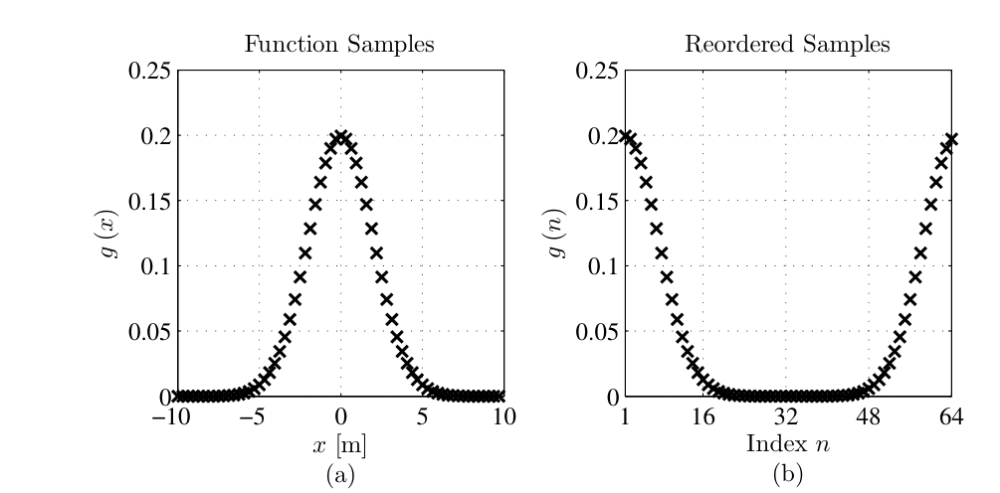
  <figcaption>图 2.1 空域样本的重排：左图是按坐标排列的高斯采样，右图是重排后的数组——循环移位让原点落在第一个元素（截自原书）</figcaption>
</figure>

!!! warning "原书笔误：式 (2.5) 的重排公式按字面无法执行"
    原书印的是 \(g_{n'} = g[(n'+\tfrac{N}{2})\delta]\)（\(n'=1,\ldots,\tfrac{N}{2}+1\)）与 \(g[(n'-N-2)\delta]\)（\(n'=\tfrac{N}{2}+2,\ldots,N\)）。第一支在 \(n'=1\) 时要取 \(x=(1+\tfrac{N}{2})\delta\)——这个坐标根本不在采样范围 \([-\tfrac{N}{2}\delta,\,(\tfrac{N}{2}-1)\delta]\) 里（数值验证：\(N=8\) 时第一支有一半下标越界）；第二支整体错一个序号，末端只排到 \(x=-2\delta\)，把 \(x=-\delta\) 丢了。正确公式即上面的 (2.5 修正)，它与 MATLAB `fftshift` 的输出逐元素相等（工程 1 验证：最大差 \(0.00\times10^{0}\)）。

重排之后，频率域的样本顺序也跟着乱了（新下标记 \(m'\)），最终得到 DFT 的工作公式：

\[
G_{m'} = \delta \sum_{n'=1}^{N} g_{n'}\, e^{-i2\pi(m'-1)(n'-1)/N},
\qquad m' = 1, 2, \ldots N.
\tag{2.6}
\]

!!! note "拓展：fftshift、奇偶性与"排列 vs 坐标""
    三件事一次说清。① 对**偶数** \(N\)，`fftshift` 和 `ifftshift` 是同一个操作（象限对调），所以 `ft` 里用哪个都行；**奇数** \(N\) 就不同了——这也是本书从头到尾只用偶数 \(N\) 的原因之一。② "数据排列"和"坐标轴"是两回事：居中排列的数组配 \(x = (-N/2,\ldots,N/2-1)\delta\) 的坐标轴，FFT 前用 `fftshift` 把数据转成"原点在前"，坐标轴本身永远按升序生成、只用来标注。③ 这套"三种排列"（解析指标 / 居中 / 移位）的细致展开在《计算傅里叶光学》笔记第 2 章（Voelz 书 2.4 节）有逐索引的图解，两本书的约定完全兼容，可对照着看。

### 2.1.2 逆傅里叶变换：从解析到数值

逆变换（**DIFT**）的推导一模一样，只是指数变号、定标因子换成 \(\delta f\)。黎曼和版本：

\[
g(x_n) = \mathcal{F}^{-1}\{G(f_{x_m})\} = \sum_{m=-\infty}^{\infty} G(f_{x_m})\, e^{i2\pi f_{x_m} x_n}\,(f_{x,m+1}-f_{x,m}),
\qquad n = -\infty, \ldots, \infty.
\tag{2.7}
\]

取 \(\delta f = 1/(N\delta)\)、截成有限项：

\[
g(n\delta) = \mathcal{F}^{-1}\{G(f_{x_m})\} = \delta f \sum_{m=-N/2}^{N/2-1} G\!\left(\frac{m}{N\delta}\right) e^{i2\pi mn/N},
\qquad n = -\tfrac{N}{2},\, \ldots,\, \tfrac{N}{2}-1.
\tag{2.8}
\]

正索引重排后得到 DIFT 的工作公式：

\[
g_{n'} = \frac{1}{N\delta} \sum_{m'=1}^{N} G_{m'}\, e^{i2\pi(m'-1)(n'-1)/N},
\qquad n' = 1, 2, \ldots N.
\tag{2.9}
\]

MATLAB 的 DFT 软件把 (2.9) 里除了乘 \(1/(N\delta)\)（即 \(\delta f\)）以外的部分全包了——定标要自己补。书里给了两个 3 行函数，本章以后所有 MATLAB 代码都在用它们：

=== "MATLAB"

    ```matlab
    % Listing 2.1：定标正确的一维 DFT（式 2.6）
    function G = ft(g, delta)
    % function G = ft(g, delta)
    G = fftshift(fft(fftshift(g))) * delta;
    ```

    ```matlab
    % Listing 2.2：定标正确的一维 DIFT（式 2.9）
    function g = ift(G, delta_f)
    % function g = ift(G, delta_f)
    g = ifftshift(ifft(ifftshift(G))) ...
        * length(G) * delta_f;
    ```

=== "Python"

    ```python
    # Listing 2.1/2.2 对应实现：定标正确的一维 DFT / DIFT。
    # 偶数 N 时 fftshift == ifftshift，与 MATLAB 行为逐位一致。
    import numpy as np

    def ft(g, delta):
        return np.fft.fftshift(np.fft.fft(np.fft.fftshift(g))) * delta

    def ift(G, delta_f):
        return np.fft.ifftshift(np.fft.ifft(np.fft.ifftshift(G))) \
            * len(G) * delta_f
    ```

记两条对应规则就够：**正变换补乘 \(\delta\)，逆变换补乘 \(N\,\delta f = 1/\delta\)**。量纲自检：\(G\) 的单位是 \(g\) 的单位 × m，\(\delta\) 的单位正是 m。

### 2.1.3 在软件中做离散傅里叶变换

MATLAB 核心库自带 `fft`/`ifft`，用快速傅里叶变换（**fast Fourier transform, FFT**）算法算 DFT。FFT 在 \(N\) 是 2 的整数幂时最快；现代软件（如 FFTW）对其他长度也快得可以，但本书统一限制在偶数 \(N\)。

!!! note "拓展：为什么偏爱 2 的幂"
    基-2 FFT 的运算量是 \(N\log_2 N\)，且对 \(N=2^k\) 走的是最内层优化路径。光学仿真常要算上千次二维 FFT（迭代传播、相位恢复、湍流模拟），\(N\) 从 1024 换成 1000 在单机上几乎无感，但混进大循环就会被记住。实际准则：先用物理判据定 \(N\)（本章 2.4 节的流程图），若结果离 2 的幂不远，就近取整补零——补零对谱的采样密度的影响见第 3 章。

原书给了两个示例脚本：对高斯函数做 DFT 并与解析 FT 对比。示例 1 的函数是实且偶的：

```matlab
% example_ft_gaussian.m（原书 Listing 2.3）
L = 5;                 % spatial extent of the grid
N = 32;                % number of samples
delta = L / N;         % sample spacing
x = (-N/2 : N/2-1) * delta;
f = (-N/2 : N/2-1) / (N*delta);
a = 1;
g_samp = exp(-pi*a*x.^2);          % 函数采样值
g_dft = ft(g_samp, delta);         % DFT
M = 1024;                          % 连续参考曲线
x_cont = linspace(x(1), x(end), M);
f_cont = linspace(f(1), f(end), M);
g_cont = exp(-pi*a*x_cont.^2);
g_ft_cont = exp(-pi*f_cont.^2/a)/a;
```

<figure>
  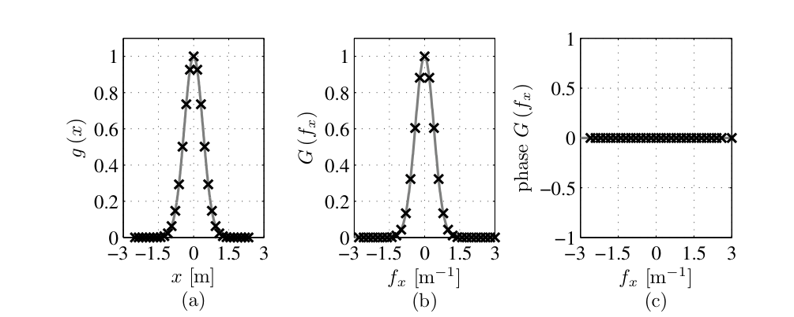
  <figcaption>图 2.2 高斯函数与其定标正确的 DFT：(a) 空域采样，(b) 幅值与解析 FT 对比，(c) 相位（截自原书）</figcaption>
</figure>

数值上有多准？工程 1 用同样的参数实跑：\(L=5\)、\(N=32\)、\(a=1\) 时 \(\max|G_{\mathrm{DFT}}-G_{\mathrm{ana}}| = 5.4\times10^{-10}\)——原书说"最显着的偏差在 \(f_x=0\) 处"，实测确实如此（\(5.4\times10^{-10}\) 全部来自 \(f_x=0\) 那个样本）：它是截断丢失的谱尾在直流的残账。这个量级对任何强度计算都毫无影响。

示例 2 把高斯平移出原点，谱里就有了相位：

```matlab
% example_ft_gaussian_shift.m（原书 Listing 2.4）
L = 10; N = 64;
delta = L / N;
x = (-N/2 : N/2-1) * delta;
x0 = 5*delta;
f = (-N/2 : N/2-1) / (N*delta);
a = 1;
g_samp = exp(-pi*a*(x-x0).^2);
g_dft = ft(g_samp, delta);
M = 1024;
x_cont = linspace(x(1), x(end), M);
f_cont = linspace(f(1), f(end), M);
g_cont = exp(-pi*a*(x_cont-x0).^2);
g_ft_cont = exp(-i*2*pi*x0*f_cont) .* exp(-pi*f_cont.^2/a)/a;
```

<figure>
  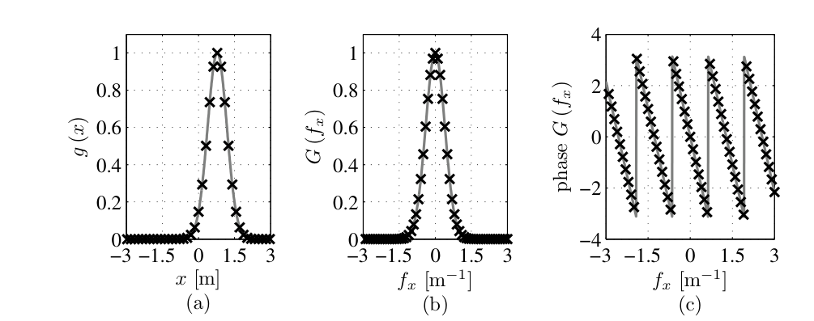
  <figcaption>图 2.3 平移高斯的 DFT：(c) 相位是一条斜率 \(=-2\pi x_0\) 的直线——这就是"空域平移 ⇔ 频域线性相位"（截自原书）</figcaption>
</figure>

原书特别提醒：把高斯移向网格边缘后，网格必须比示例 1 加倍（\(N\) 从 32 到 64、\(L\) 从 5 到 10），否则相位只在频谱中央与解析结果吻合。工程 1 复现了这句话：\(L=5\) 时幅度显著样本的最大相位误差 \(2.8\times10^{-3}\) rad（集中在网格边缘附近——那里截断最狠），\(L=10\) 时降到 \(8.6\times10^{-15}\) rad（机器精度）。**信号挪个位置，网格就得重新审**——这句话贯穿全书。

下面是工程 1 的完整代码（Python 侧复用 `base.py`，import 路径见文件头）：

=== "MATLAB"

    ```matlab
        %% ===== 书 Schmidt PM199 第 2 章 =====
    %  DFT 基础：定标、重排、正逆变换配对（对应原书 2.1 节与 Listings 2.1-2.4）
    %  与 python/waveprop/ch2/ch2_ft_basics.py 数值行为一致（本机无 MATLAB 时
    %  以 Python 实跑结果为准，见笔记页面打印输出）。
    %  MATLAB 注意：数组从 1 起；偶数 N 时 fftshift 与 ifftshift 相同。
    %  需要 R2016b+（脚本内含本地函数）。
    clear; clc;

    %% 验证 1：式 (2.6) 的 DFT 就是重排后的黎曼和
    N = 8; delta = 0.5;
    n = (0:N-1) - N/2;                       % n = -N/2 .. N/2-1
    x = n * delta;
    g = exp(-pi*(x/2).^2);                   % 测试函数（居中排列）
    m = (0:N-1) - N/2;
    G_sum = zeros(1,N);
    for mi = 1:N                             % 逐点按式 (2.4) 的对称指数形式
        G_sum(mi) = delta * sum(g .* exp(-2i*pi*m(mi)*n/N));
    end
    G_ft = ft(g, delta);
    fprintf('验证 1：max|G_ft - G_黎曼和| = %.2e\n', max(abs(G_ft - G_sum)));

    %% 验证 2：式 (2.5) 重排公式（原书笔误）
    % 原书 (2.5) 第一支 g[(n'+N/2)*delta] 在 n'=1 时坐标 (1+N/2)*delta 越界；
    % 第二支 g[(n'-N-2)*delta] 末端只到 -2*delta。正确重排（与 fftshift 一致）：
    %   g_tilde{n'} = g[(n'-1)*delta]    n'=1..N/2； g[(n'-1-N)*delta]  n'=N/2+1..N
    g_correct = [g(N/2+1:N), g(1:N/2)];      % 即 fftshift(g)（偶数 N）
    g_shift = fftshift(g);
    fprintf('验证 2：修正公式 vs fftshift 最大差 = %.2e；', max(abs(g_correct - g_shift)));
    fprintf('原书第一支越界样本比例 = %.0f%%\n', 100*mean((n + N/2)*delta > x(end)+1e-12));

    %% 验证 3：Listing 2.3 高斯 DFT vs 解析 FT（L=5, N=32, a=1）
    L = 5; N = 32; a = 1;
    delta = L / N;
    [n_c, f] = coords(L, N);                 % 居中坐标 x = n*delta 与频率轴
    x = n_c * delta;
    g_samp = exp(-pi*(a*x).^2);
    G_dft = ft(g_samp, delta);
    G_ana = 1/a * exp(-pi*(f/a).^2);
    [~, i0] = min(abs(f));
    fprintf('验证 3：max|G_dft - G_ana| = %.2e（f=0 处 %.2e）\n', ...
        max(abs(G_dft - G_ana)), abs(G_dft(i0) - G_ana(i0)));

    %% 验证 4：Listing 2.4 平移高斯的相位（L=5/N=32 与 L=10/N=64 对比）
    for pr = [struct('L',5,'N',32), struct('L',10,'N',64)]
        delta = pr.L / pr.N;
        x0 = 5 * delta;
        [n_c, f] = coords(pr.L, pr.N);
        x = n_c * delta;
        G_dft = ft(exp(-pi*(x - x0).^2), delta);
        G_ana = exp(-2i*pi*x0*f) .* exp(-pi*f.^2);
        amp_ok = abs(G_dft) > 1e-3 * max(abs(G_dft));
        ph_err = angle(G_dft(amp_ok) ./ G_ana(amp_ok));
        fprintf('验证 4：L=%-4.1f N=%d：幅度显著样本相位误差 max = %.2e rad\n', ...
            pr.L, pr.N, max(abs(ph_err)));
    end

    %% 验证 5：ft/ift 往返 + Parseval
    L = 5; N = 64;
    delta = L / N; delta_f = 1/(N*delta);
    [n_c, ~] = coords(L, N);
    x = n_c * delta;
    g = exp(-pi*(x/1.5).^2) .* (1 + 0.3*cos(2*pi*0.7*x));
    g_rt = ift(ft(g, delta), delta_f);
    lhs = sum(abs(g).^2) * delta;
    rhs = sum(abs(ft(g, delta)).^2) * delta_f;
    fprintf('验证 5：max|ift(ft(g))-g| = %.2e；Parseval 相对偏差 %.2e\n', ...
        max(abs(g_rt - g)), abs(lhs-rhs)/lhs);

    %% ===== 本地函数 =====
    function G = ft(g, delta)
        % 一维 DFT（原书 Listing 2.1）：定标因子 delta 由用户补乘
        G = fftshift(fft(fftshift(g))) * delta;
    end

    function g = ift(G, delta_f)
        % 一维 DIFT（原书 Listing 2.2）：定标因子 N*delta_f
        g = ifftshift(ifft(ifftshift(G))) * length(G) * delta_f;
    end

    function [x, f] = coords(L, N)
        % 居中采样坐标（书式 2.21/2.22 同款）：x = n*delta，f = n/(N*delta)，
        % n = -N/2 .. N/2-1。返回升序数组；喂给 ft 前数据须按居中排列。
        delta = L / N;
        n = (-N/2 : N/2-1);
        x = n * delta;
        f = n / (N * delta);
    end
    ```

=== "Python"

    ```python
        # -*- coding: utf-8 -*-
    """
    ===== 书 Schmidt PM199 第 2 章 =====
    DFT 基础：定标、重排、正逆变换配对（对应原书 2.1 节与 Listings 2.1–2.4）

    复用说明：
        本脚本从 python/fourier/common/base.py 导入公共函数（sinc/gauss/coords）。
        base.py 属《计算傅里叶光学》(Voelz) 笔记的公共模块，其中的
        ft1_centered/ft2_centered 与本节按原书定义的 ft/ft2 在偶数 N 下完全等价
        （偶数 N 时 fftshift 与 ifftshift 相同）。import 路径处理：

            import os, sys
            sys.path.insert(0, os.path.join(os.path.dirname(os.path.abspath(__file__)),
                                            "..", "..", "fourier", "common"))
            from base import gauss, coords

    数值验证（运行本脚本全部自动打印）：
        (1) 原书式 (2.6) 的 DFT 与"逐点黎曼和"一致（证明 fft 确实算的是那个和）；
        (2) 原书式 (2.5) 的重排公式按字面无法实现（原书笔误），修正公式与
            fftshift 逐元素一致；
        (3) 原书 Listing 2.3 的高斯 DFT 与解析 FT 的最大偏差；
        (4) 原书 Listing 2.4 平移高斯的相位斜率恢复 -2*pi*x0（与解析相位比对），
            并复现"网格不够大时相位只在中心附近正确"的原书论断；
        (5) ift(ft(g)) 往返 + Parseval 定理。
    MATLAB/Python 差异：
        - MATLAB 数组 1 起、numpy 0 起：居中排列的"零坐标"样本在 MATLAB 的
          N/2+1 号，numpy 的 N//2 号。坐标轴一律用 x = (n - N/2)*delta 生成，
          与排列解耦。
        - numpy.fft.fft 正变换不除 N（归一化在 ifft），MATLAB 相同——
          定标因子 delta / (N*delta_f) 都要自己乘。
    用法：直接运行打印验证；`python ch2_ft_basics.py` 无图形输出。
    依赖：numpy（不需要 matplotlib）。
    """
    import os
    import sys

    import numpy as np

    # ---- 复用《计算傅里叶光学》笔记的公共基础模块（同仓库） ----
    sys.path.insert(0, os.path.join(os.path.dirname(os.path.abspath(__file__)),
                                    "..", "..", "fourier", "common"))
    from base import gauss, coords  # noqa: E402


    # ===== 书 2.1.3 节 Listing 2.1 / 2.2：定标正确的 DFT / DIFT =====
    def ft(g, delta):
        """一维 DFT（原书 Listing 2.1）：
        G = fftshift(fft(fftshift(g))) * delta
        输入 g 按居中排列（零坐标样本在中间，偶数 N 时 numpy 索引 N//2），
        输出 G 同样居中排列；乘 delta 把求和升级为连续 FT 的近似。"""
        return np.fft.fftshift(np.fft.fft(np.fft.fftshift(g))) * delta


    def ift(G, delta_f):
        """一维 DIFT（原书 Listing 2.2）：
        g = ifftshift(ifft(ifftshift(G))) * length(G) * delta_f
        逆变换的定标因子是 N*delta_f = 1/delta（保持 ft/ift 互逆）。"""
        return np.fft.ifftshift(np.fft.ifft(np.fft.ifftshift(G))) \
            * len(G) * delta_f


    def main():
        print('===== 验证 1：式 (2.6) 的 DFT 就是重排后的黎曼和 =====')
        N, delta = 8, 0.5
        n = np.arange(N) - N // 2                      # n = -N/2 .. N/2-1
        x = n * delta
        g = gauss(x / 2.0)                             # 任意测试函数（居中排列）
        m = np.arange(N) - N // 2
        # 逐点按式 (2.4) 的指数计算（未重排的对称形式）
        G_sum = np.array([delta * np.sum(g * np.exp(-2j * np.pi * mi * n / N))
                          for mi in m])
        G_ft = ft(g, delta)
        print('    max|G_ft - G_黎曼和| = %.2e' % np.max(np.abs(G_ft - G_sum)))

        print('===== 验证 2：式 (2.5) 重排公式（原书笔误）=====')
        # 原书 (2.5) 第一支：g[(n'+N/2)*delta], n'=1..N/2+1 —— n'=1 时坐标
        # (1+N/2)*delta 超出采样范围 [-N/2, N/2-1]*delta，按字面无法取到样本；
        # 第二支 g[(n'-N-2)*delta] 整体错一个序号（末端只到 -2*delta）。
        # 正确的重排（与 fftshift 逐元素一致，也与原书图 2.1 一致）：
        #     g_tilde[n'] = g[(n'-1)*delta]        n' = 1 .. N/2   （1-based）
        #     g_tilde[n'] = g[(n'-1-N)*delta]      n' = N/2+1 .. N
        # 0-based numpy 写法：g_tilde = fftshift(g)（居中 -> 零坐标在最前）。
        book_idx = n[0]  # 仅占位避免未用警告
        del book_idx
        g_tilde_correct = np.concatenate([g[N // 2:], g[:N // 2]])
        g_tilde_fftshift = np.fft.fftshift(g)
        print('    修正公式 vs fftshift 逐元素最大差 = %.2e'
              % np.max(np.abs(g_tilde_correct - g_tilde_fftshift)))
        ok = ((n + N / 2) * delta <= x[-1] + 1e-12).mean()
        print('    原书第一支可取到的样本比例（N=%d）= %.0f%%（其余越界）'
              % (N, 100 * ok))

        print('===== 验证 3：Listing 2.3 高斯 DFT vs 解析 FT =====')
        # 原书参数：L = 5, N = 32, a = 1
        L, N, a = 5.0, 32, 1.0
        delta = L / N
        x, f = coords(L, N)          # x = n*delta（居中），f = n/(N*delta)
        g_samp = gauss(a * x)        # exp(-pi*(a*x)^2)
        G_dft = ft(g_samp, delta)
        G_ana = 1.0 / a * gauss(f / a)   # (1/|a|) exp(-pi*(f/a)^2)，式 (2.24)
        err = np.abs(G_dft - G_ana)
        i0 = np.argmin(np.abs(f))    # f = 0 的样本（偶数 N 时位于 N//2）
        print('    max|G_dft - G_ana| = %.2e，其中 f=0 处偏差 = %.2e'
              % (err.max(), err[i0]))

        print('===== 验证 4：Listing 2.4 平移高斯的相位 =====')
        # 原书参数：L = 10, N = 64, x0 = 5*delta, a = 1
        for (L, N) in [(5.0, 32), (10.0, 64)]:
            delta = L / N
            x0 = 5 * delta
            x, f = coords(L, N)
            g_samp = gauss(x - x0)                     # 平移后的高斯
            G_dft = ft(g_samp, delta)
            # 解析 FT：exp(-i 2 pi x0 f) * exp(-pi f^2)，用 -pi*f^2/a（a=1）
            G_ana = np.exp(-2j * np.pi * x0 * f) * gauss(f)
            # 只在幅度显著处（|G| > 1e-3 * 峰值）比较展开相位
            amp_ok = np.abs(G_dft) > 1e-3 * np.abs(G_dft).max()
            ph_err = np.angle(G_dft / G_ana)[amp_ok]
            print('    L=%-4.1f N=%d：幅度显著样本的相位误差 max = %.2e rad'
                  % (L, N, np.max(np.abs(ph_err))))

        print('===== 验证 5：ft/ift 往返 + Parseval =====')
        L, N = 5.0, 64
        delta = L / N
        delta_f = 1.0 / (N * delta)
        x, f = coords(L, N)
        g = gauss(x / 1.5) * (1 + 0.3 * np.cos(2 * np.pi * 0.7 * x))
        g_rt = ift(ft(g, delta), delta_f)
        print('    max|ift(ft(g)) - g| = %.2e' % np.max(np.abs(g_rt - g)))
        lhs = np.sum(np.abs(g) ** 2) * delta
        rhs = np.sum(np.abs(ft(g, delta)) ** 2) * delta_f
        print('    Parseval: sum|g|^2*dx = %.10f, sum|G|^2*df = %.10f, 相对偏差 %.2e'
              % (lhs, rhs, abs(lhs - rhs) / lhs))


    if __name__ == '__main__':
        main()
    ```

**工程 1 实跑输出（Python，numpy.fft）：** 式 (2.6) 与逐点黎曼和最大差 \(2.2\times10^{-16}\)；(2.5 修正) 与 `fftshift` 逐元素差 \(0\)；图 2.2 参数下 DFT vs 解析最大偏差 \(5.4\times10^{-10}\)（在 \(f_x=0\)）；图 2.3 参数下相位误差 \(8.6\times10^{-15}\) rad（\(L=5\) 时 \(2.8\times10^{-3}\)）；`ift(ft(g))` 往返误差 \(4.5\times10^{-16}\)；Parseval 相对偏差 \(3.6\times10^{-16}\)。

把本章反复出现的坐标与定标收进一张表：

| 连续世界 | 离散世界 | 关系 |
| --- | --- | --- |
| \(x\) 连续取值 | \(x_n = n\delta\)，\(n=-N/2,\ldots,N/2-1\) | 空域窗宽 \(L=N\delta\) |
| \(f_x\) 连续取值 | \(f_{x_m} = m/(N\delta)\) | 频域窗宽 \(\pm 1/(2\delta)\)，间隔 \(\delta f = 1/L\) |
| \(\int g\,e^{-i2\pi f_xx}dx\) | \(\delta\sum_n g_n e^{-i2\pi f_xn\delta}\) | `ft` 补乘 \(\delta\) |
| \(\int G\,e^{i2\pi f_xx}df_x\) | \(\delta f\sum_m G_m e^{i2\pi f_xm\delta f}\) | `ift` 补乘 \(N\delta f = 1/\delta\) |
| 无周期 | 空域以 \(L\) 周期延拓 | 2.3 节的"虚拟周期复制" |

## 2.2 纯频率信号的采样

用 DFT 近似连续 FT，效果好不好，第一决定因素是**网格间隔 \(\delta\) 和点数 \(N\) 怎么定**。图 2.2 与图 2.3 的区别就在这里：平移后的高斯最高有效频率更高，所以要更多样本才能把谱表示好。

理论依据是 Whittaker–Shannon 采样定理：最高频率不超过 \(f_{\max}\) 的**限带信号**（bandlimited signal）可以被均匀间隔

\[
\delta_c = \frac{1}{2 f_{\max}}
\]

的采样值唯一确定；\(f_c = 1/\delta_c = 2 f_{\max}\) 叫**奈奎斯特采样频率**（Nyquist sampling frequency），"采样频率必须高于 \(f_c\)"就是**奈奎斯特判据**。人话：信号里最细的条纹，一个周期至少要采两个点。

最直观的演示是纯余弦信号：

\[
g(x) = \cos(2\pi f_0 x)
\tag{2.10}
\]

频率 \(f_0\)、周期 \(T = 1/f_0\)，需要的间隔是 \(\delta_c = 1/(2f_0)\)。图 2.4 里 \(f_0 = 6\ \mathrm{m}^{-1}\) 的信号按 \(\delta_0 = 1/12\ \mathrm{m}\) 采样——每个峰、每个谷恰好采到一点。只给你这些黑叉，你能认出信号吗？其实 \(\cos(4\pi f_0x)\)（两倍频）也能产生同样的样本；但**没有任何比 \(f_0\) 更低的频率**能产生它们。所以只要告诉你"这些样本满足奈奎斯特判据"，信号就唯一了。

<figure>
  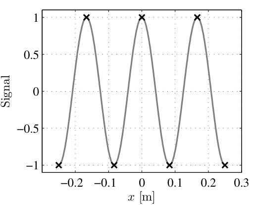
  <figcaption>图 2.4 正确采样的余弦信号（\(f_0=6\ \mathrm{m}^{-1}\)，\(\delta=1/12\) m）：不存在更低的频率能产生这些样本（截自原书）</figcaption>
</figure>

反例见图 2.5：\(f_1 = 6\ \mathrm{m}^{-1}\) 的信号按 \(\delta = 1/8\) m 采样（需要 \(1/12\)，太粗了），结果与 \(f_2 = 2\ \mathrm{m}^{-1}\) 信号的采样值**完全相同**；另一组 \(f_1 = 8\ \mathrm{m}^{-1}\)、\(\delta = 1/6\) m 也折返到 \(2\ \mathrm{m}^{-1}\)。欠采样的高频条纹伪装成低频——这就是**混叠（aliasing）**。工程 2 验证了第一组的确逐点相同（最大差 \(4\times10^{-15}\)）：\(8 - 6 = 2\)，折叠公式见下方拓展。

<figure>
  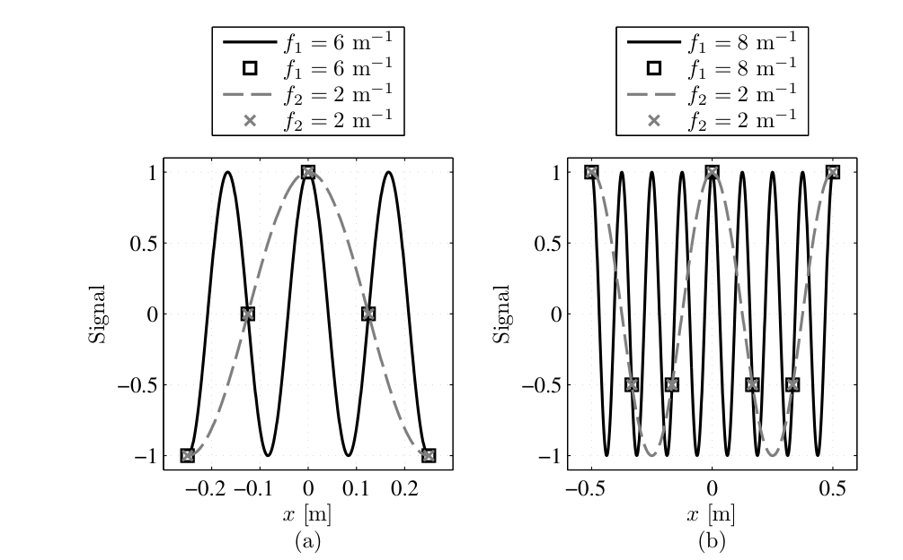
  <figcaption>图 2.5 欠采样造成的混叠：两组参数下，高频信号（实线）与低频信号（虚线）的样本完全一致（截自原书）</figcaption>
</figure>

对一般的（可写成正弦叠加或积分的）信号，规则是：**找到最高有效频率，按它定 \(\delta\)；最高频采够了，所有更低的频率自动采够。** 听起来简单，但"最高有效频率"经常没有闭式答案——2.5 节的三个案例就是三种实操判法。

!!! note "拓展：折返公式与 cos 的偶性"
    以采样率 \(f_s = 1/\delta\) 采样，频率 \(f_1 > f_s/2\) 的分量会折返到 \(f_2 = f_s - f_1\)（带符号：\(f_2 = f_s - f_1 < 0\) 时表现为 \(|f_2|\) 且相位反号）。验证第一组：\(f_s = 8\)，\(f_2 = 8-6 = 2\) ✓；第二组 \(f_s = 6\)，\(f_2 = 6-8 = -2\)，而 \(\cos(2\pi\cdot(-2)x) = \cos(2\pi\cdot 2x)\)——余弦是偶函数，负频率看起来就是正频率。采样破坏的正是"哪个频率"这个信息，值本身没丢。

## 2.3 离散与连续傅里叶变换

DFT 对和它的连续原型比，差在三件事上：

- 空域采样（spatial domain sampling）；
- 有限空域网格（finite spatial grid）；
- 空间频率域采样（spatial-frequency-domain sampling）。

对应产生三种失真：频域**混叠**（aliasing）、频域**波纹与展宽**（rippling and smearing）、空域**虚拟周期复制**（virtual periodic replication）。这一节把账算清楚（推导路线跟随 Brigham 的教材，原书 Ref. 8）。

设已知一对连续 FT：

\[
g(x) \Leftrightarrow G(f_x),
\tag{2.11}
\]

采样、截断后的版本记作

\[
\hat{g}(x) \Leftrightarrow \hat{G}(f_x).
\tag{2.12}
\]

为了看清每步干了什么，取一对有闭式的信号当显微镜：

\[
g(x) = \exp(-a|x|),
\tag{2.13}
\]

\[
G(f_x) = \frac{1}{a}\,\frac{2}{1+(2\pi f_x/a)^2}.
\tag{2.14}
\]

（洛伦兹形谱，\(a = 10\ \mathrm{m}^{-1}\) 时峰值 \(2/a = 0.2\)。结论对任何 FT 对都成立。）

**第 1 步：空域采样。** 用间隔 \(\delta\) 的 comb 函数乘上去（comb 定义见原书附录 A：\(\mathrm{comb}(x) = \sum_n \delta(x-n)\)，\(\tfrac{1}{\delta}\mathrm{comb}(x/\delta) = \sum_n \delta(x-n\delta)\)）。空域相乘 = 频域卷积：

\[
g(x)\,\frac{1}{\delta}\,\mathrm{comb}\!\left(\frac{x}{\delta}\right) \;\Leftrightarrow\; G(f_x)\otimes \mathrm{comb}(\delta f_x).
\tag{2.15}
\]

人话：频谱以 \(1/\delta\) 为周期无限复制，每个副本还放大 \(1/\delta\) 倍。图 2.6(d) 里谱的尾部在频带边缘翘起来——那就是隔壁副本的边缘，**混叠**。

**第 2 步：有限网格。** 空域再乘 \(\mathrm{rect}(x/L)\)，等价于频域卷积 \(L\,\mathrm{sinc}(Lf_x)\)：

\[
g(x)\,\frac{1}{\delta}\,\mathrm{comb}\!\left(\frac{x}{\delta}\right)\mathrm{rect}\!\left(\frac{x}{L}\right) \;\Leftrightarrow\; G(f_x)\otimes\mathrm{comb}(\delta f_x)\otimes\left[L\,\mathrm{sinc}(Lf_x)\right].
\tag{2.16}
\]

空域丢了 \(|x|>L/2\) 的尾巴；频域里谱被 \(L\) 放大、并与宽度 \(1/L\) 的 sinc 卷积——峰变矮、细节被抹平、还添了波纹（图 2.6(f)）。

**第 3 步：频域采样。** DFT 的输出是频谱的采样值。频域乘 \(\mathrm{comb}(Lf_x)\)（间隔 \(1/L\)），等价于空域卷积 \(\tfrac{1}{L}\mathrm{comb}(x/L)\)：

\[
\hat{g}(x) = \left[g(x)\,\frac{1}{\delta}\,\mathrm{comb}\!\left(\frac{x}{\delta}\right)\mathrm{rect}\!\left(\frac{x}{L}\right)\right]\otimes\left[\frac{1}{L}\,\mathrm{comb}\!\left(\frac{x}{L}\right)\right],
\tag{2.17}
\]

\[
\hat{G}(f_x) = \left[G(f_x)\otimes\mathrm{comb}(\delta f_x)\otimes L\,\mathrm{sinc}(Lf_x)\right]\times\mathrm{comb}(Lf_x).
\tag{2.18}
\]

空域以 \(L\) 为周期**虚拟**复制——"虚拟"是因为那些区域根本没有样本（图 2.6(g)(i)）。

<figure>
  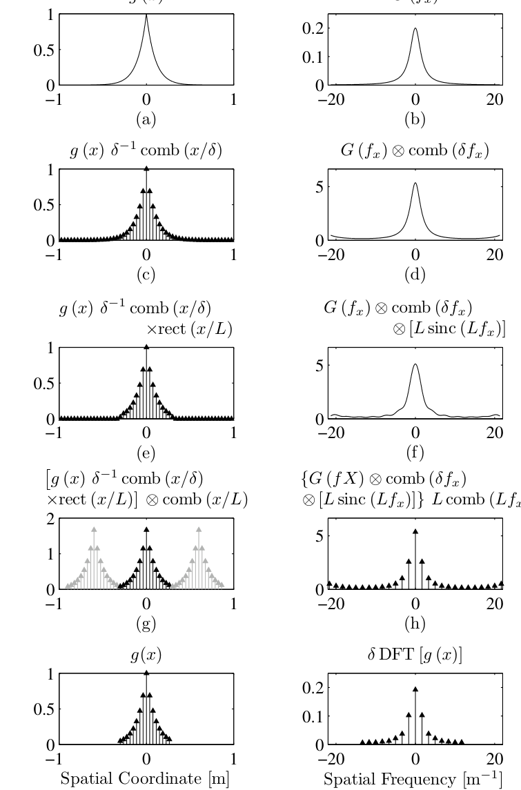
  <figcaption>图 2.6 从解析 FT 到 DFT 的图形化推导（\(g=e^{-a|x|}\)，\(a=10\)，\(\delta=0.0375\) m，\(L=0.6\) m）：(a)(b) 原始对，(c)(d) 采样→混叠，(e)(f) 截断→波纹，(g)(h) 频域采样→空域周期化，(i)(j) 最终 DFT 对（截自原书）</figcaption>
</figure>

| 步骤 | 空域操作 | 频域后果 | 视觉特征 | 缓解手段 |
| --- | --- | --- | --- | --- |
| 1 采样 | \(\times\tfrac{1}{\delta}\mathrm{comb}(x/\delta)\) | \(\otimes\mathrm{comb}(\delta f_x)\)：谱以 \(1/\delta\) 周期复制 | 频带边缘尾部翘起（混叠） | 减小 \(\delta\) |
| 2 截断 | \(\times\mathrm{rect}(x/L)\) | \(\otimes L\,\mathrm{sinc}(Lf_x)\)：卷上宽度 \(1/L\) 的 sinc | 峰变矮 + 波纹 + 展宽 | 加大 \(L\) |
| 3 频域采样 | \(\otimes\tfrac{1}{L}\mathrm{comb}(x/L)\) | \(\times\mathrm{comb}(Lf_x)\)：频谱取样 | 空域以 \(L\) 虚拟周期延拓 | 无需（本来就是离散世界） |

!!! note "拓展：式 (2.15) 为什么成立——泊松求和公式"
    comb 的 FT 还是 comb：\(\mathcal{F}\{\tfrac{1}{\delta}\mathrm{comb}(x/\delta)\} = \mathrm{comb}(\delta f_x)\)。空域采样信号 \(\sum_n g(n\delta)\delta(x-n\delta)\) 的谱是 \(\sum_n g(n\delta)e^{-i2\pi f_xn\delta}\)，用泊松求和公式可以严格写成 \(\tfrac{1}{\delta}\sum_k G(f_x - k/\delta)\)——这正是 (2.15) 右边的"卷 comb"。工程 2 就用这个恒等式精确算出了"只混叠不波纹"的中间谱（与直接求和逐 bin 吻合到 \(10^{-17}\)）。反过来这也解释了图 2.6(d) 的纵轴为什么到 5.3：副本带着 \(1/\delta = 26.7\) 的放大因子，\(0.2\times26.7 \approx 5.3\)。

!!! note "拓展：逆变换方向的对称性"
    一个常见疑问：图 2.6(h) 的频域函数还有无穷多个样本，为什么不"再乘一个频域 rect"把频域也截断？书里的澄清：**正变换**从 (g) 图的黑样本出发（空域截断已在第 2 步付过钱）；若做**离散逆变换**，则轮到频域当"输入"——把 (a)(c)(e)(g)(i) 当作频域函数看，逆变换后空域同样会周期复制、起波纹、被采样（即 (b)(d)(f)(h)(j) 的镜像过程）。正逆变换只差指数上一个符号，失真机制完全对称。所以：**离散世界里，"在哪个域截断、就在哪个域看到卷 sinc 的波纹"**。

## 2.4 缓解离散化的影响

想用 DFT 逼近已知的连续 \(G(f_x)\)，实际算出的是 \(\hat{G}(f_x)\)——一个采样过、起波纹、混叠过的版本。失真可以压小，一般不能归零：**加大 \(L\) 压波纹，减小 \(\delta\) 压混叠**。但注意 \(\delta = L/N\)——两个愿望抢同一个 \(N\)。

原书用三张图演示各种取舍（仍用 \(e^{-10|x|}\) 那对信号）：

<figure>
  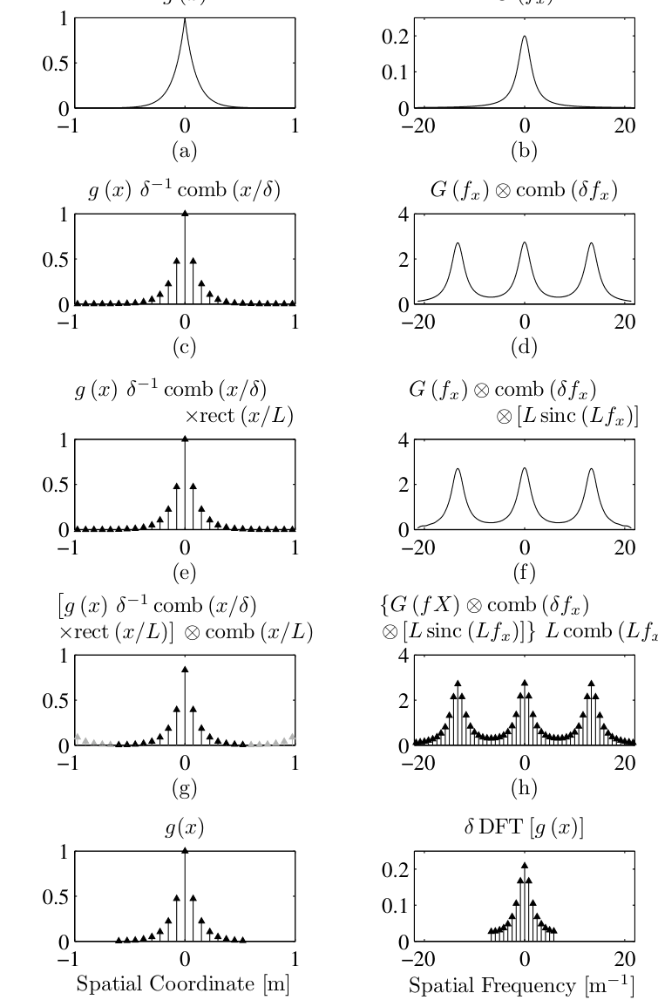
  <figcaption>图 2.7 与图 2.6 同款但网格加大（\(\delta\) 翻倍、\(N\) 不变）：\(L\,\mathrm{sinc}(Lf_x)\) 变窄 → 波纹减小；但 \(\mathrm{comb}(\delta f_x)\) 间隔减半 → 混叠加重（截自原书）</figcaption>
</figure>

<figure>
  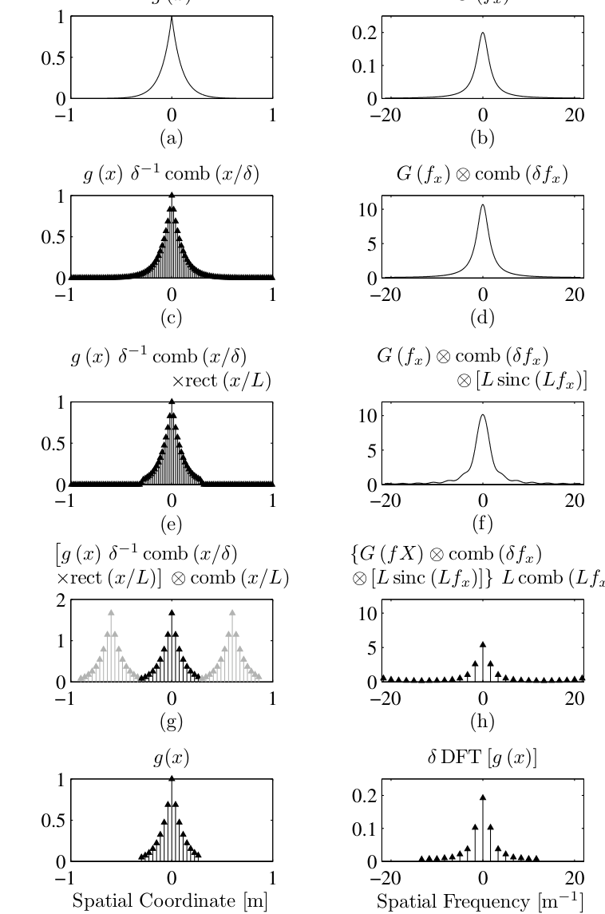
  <figcaption>图 2.8 加样本（\(N\) 翻倍、\(\delta\) 减半、\(L\) 不变）：副本间隔拉开 → 混叠减轻；\(L\) 没变 → 波纹原样（截自原书）</figcaption>
</figure>

<figure>
  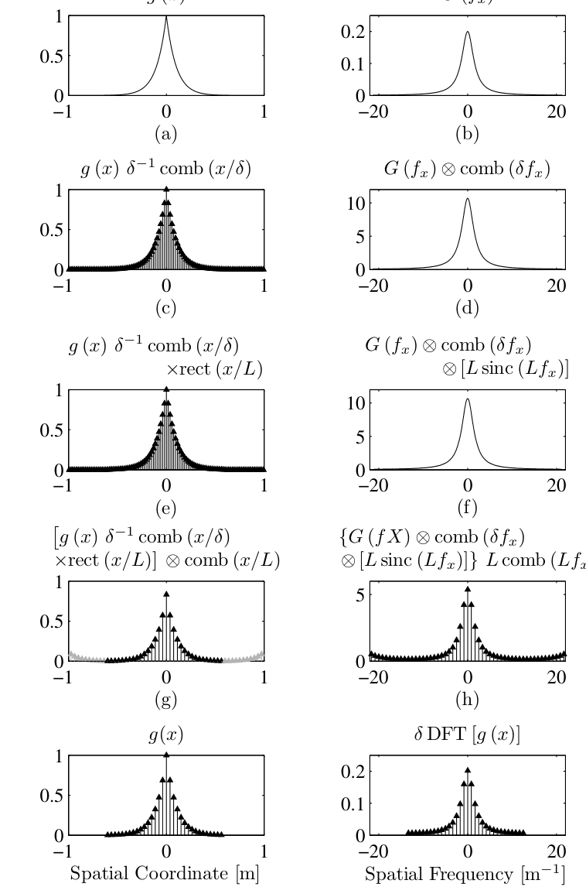
  <figcaption>图 2.9 双管齐下（\(\delta\) 减半且 \(L\) 加倍，\(N\) 变为 4 倍）：混叠与波纹同时下降——代价是内存与计算量（截自原书）</figcaption>
</figure>

工程 2 按原书参数把四张图重新算了一遍，并把"混叠误差 / 波纹误差 / DFT 总误差"量化（全部以解析峰值 \(G(0)=0.2\) 为基准，频带 \(|f_x|\le 1/(2\delta)\)）：

| 策略（原书图） | \(\delta\) [m] | \(L\) [m] | \(N\) | 混叠误差 | 波纹误差 | DFT 总误差 |
| --- | --- | --- | --- | --- | --- | --- |
| 基线（图 2.6） | 0.0375 | 0.6 | 16 | \(2.1\times10^{-2}\) | \(5.0\times10^{-2}\) | \(3.9\times10^{-2}\) |
| A 加大网格（图 2.7） | 0.075 | 1.2 | 16 | \(8.0\times10^{-2}\) | \(2.5\times10^{-3}\) | \(8.0\times10^{-2}\) |
| B 加密采样（图 2.8） | 0.01875 | 0.6 | 32 | \(4.0\times10^{-3}\) | \(5.0\times10^{-2}\) | \(4.7\times10^{-2}\) |
| C 双管齐下（图 2.9） | 0.01875 | 1.2 | 64 | \(4.0\times10^{-3}\) | \(2.5\times10^{-3}\) | \(5.2\times10^{-3}\) |

数字把原书的三句话钉死了：A 策略波纹降 20 倍但混叠涨 4 倍；B 策略混叠降 5 倍但波纹纹丝不动；C 策略两个都降、总误差从 \(3.9\times10^{-2}\) 压到 \(5.2\times10^{-3}\)（7.5 倍），代价是 \(N\) 变 4 倍。

<figure>
  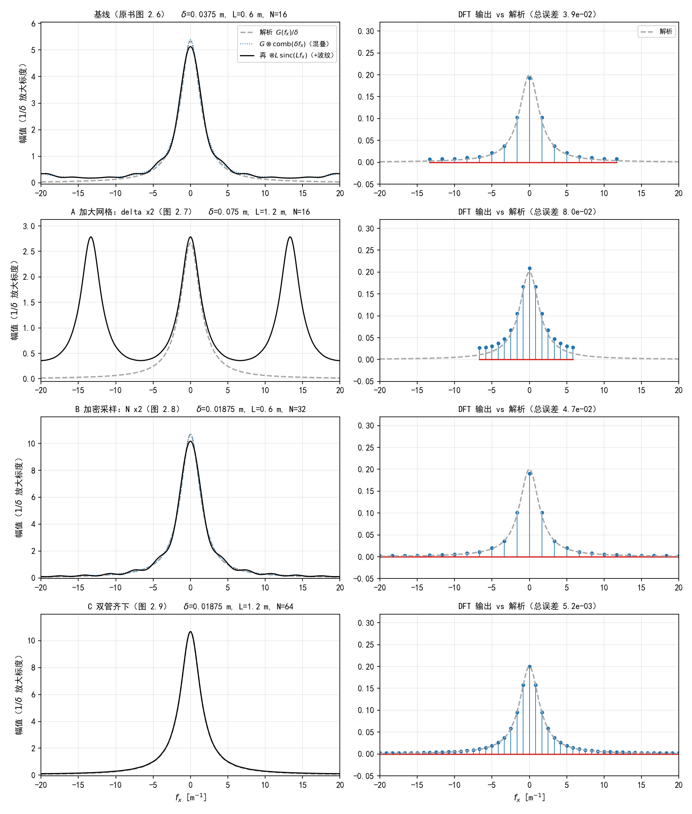
  <figcaption>图 2.10（自绘仿真）四条策略的频谱链条复现：左列为 1/δ 放大标度下的解析谱（灰虚线）、加混叠（蓝点线）、再加波纹（黑实线）——A 行看得见隔壁副本、B 行看得见峰旁波纹、C 行干净；右列为最终 DFT 样本 vs 解析谱</figcaption>
</figure>

有些信号是**严格限带**的——存在有限的 \(f_{x,\max}\) 使

\[
G(f_x) = 0 \qquad \text{for } |f_x| > f_{x,\max},
\tag{2.19}
\]

这个频率叫 \(g(x)\) 的**带宽（bandwidth）**。对它们，按"最高频每个周期两点"定采样即可：

\[
\delta \le \frac{1}{2 f_{x,\max}}.
\tag{2.20}
\]

这是菲涅耳衍射各章的关键判据，第 7 章会专门展开。更常见的是**不严格限带、但只关心有限带宽**的信号：若系统的采样率只有 \(f_s\)，判据可以放宽成

\[
\delta \le \frac{1}{f_s + f_{x,\max}},
\tag{2.21}
\]

人话：混叠照样发生，但折返来的分量只落在频带最高端——你关心的频段是干净的。

把"拿到一个信号，怎么走到一张靠谱的谱"整理成决策流程——全书每一章建网格都在重演这条链：

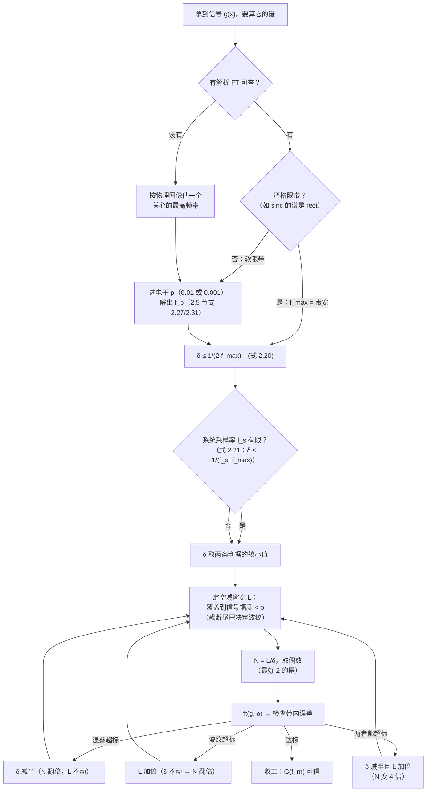

=== "MATLAB"

    ```matlab
    %% ===== 书 Schmidt PM199 第 2 章 =====
    %  离散化的三种失真与三条补救路线（对应原书 2.3、2.4 节与图 2.6-2.9）
    %  信号 g(x)=exp(-a|x|)（a=10），G(f)=2a/(a^2+(2*pi*f)^2)。
    %  链条：采样(混叠) -> 截断(波纹) -> 频域采样(空域周期延拓)。
    %  中间谱的精确算法：S(f) = sum_n g(n*delta) exp(-i2*pi*f*n*delta)，
    %  DFT 输出 = delta*S(f_m)（脚本内自检）。
    %  与 python/waveprop/ch2/ch2_discretization.py 一致；需要 R2016b+。
    clear; clc; close all;

    a = 10.0;
    strat = {  % 名称, delta, L, N
        '基线（原书图 2.6）',              0.0375,  0.6, 16
        'A 加大网格：\delta x2（图 2.7）',  0.075,   1.2, 16
        'B 加密采样：N x2（图 2.8）',       0.01875, 0.6, 32
        'C 双管齐下（图 2.9）',             0.01875, 1.2, 64
    };

    %% 链条自检 + 误差量化
    f_fine = linspace(-20, 20, 8001);
    G0 = 2*a / a^2;                          % 解析峰值 2/a = 0.2
    n_ali = -16:15; x_ali = n_ali/8;
    fprintf('===== 混叠折返恒等式（f1=6, delta=1/8 m -> f2=2 m^-1）=====\n');
    fprintf('    max|cos(2*pi*6*x) 与 cos(2*pi*2*x) 的样本差| = %.1e\n', ...
        max(abs(cos(2*pi*6*x_ali) - cos(2*pi*2*x_ali))));

    fprintf('===== 三种失真的量化（频带 |f| <= 1/(2 delta)，误差/解析峰值）=====\n');
    fprintf('%-28s %-12s %-12s %-12s\n', '策略', '混叠误差', '波纹误差', 'DFT总误差');
    results = cell(size(strat,1), 1);
    for s = 1:size(strat,1)
        name = strat{s,1}; delta = strat{s,2}; L = strat{s,3}; N = strat{s,4};
        n = (-N/2 : N/2-1);
        x_n = n * delta;
        g_samp = exp(-a*abs(x_n));                           % 居中排列
        % 中间谱 S(f) = sum_n g(n*delta) exp(-i2 pi f n delta)（矩阵一行一个频率）
        S = real(exp(-2i*pi*x_n.' * reshape(f_fine,1,[])) * g_samp.');  % (1 x Mf)
        G_ali = alias_only(f_fine, a, delta);                % (1/delta)*sum_k G
        Gt = G_true(f_fine, a);
        fmax = 1/(2*delta);
        band = abs(f_fine) <= fmax;
        e_alias = max(abs(delta*G_ali(band) - Gt(band))) / G0;
        e_rip   = max(abs(delta*(S(band) - G_ali(band)))) / G0;
        fm = (-N/2 : N/2-1) / (N*delta);
        G_dft = ft(g_samp, delta);
        e_dft = max(abs(G_dft - G_true(fm,a))) / G0;
        fprintf('%-28s %-12.2e %-12.2e %-12.2e\n', name, e_alias, e_rip, e_dft);
        results{s} = struct('name',name,'delta',delta,'L',L,'N',N, ...
            'f',f_fine,'Gt',Gt,'Ga',G_ali,'S',S, ...
            'fm',fm,'Gdft',abs(G_dft),'e',e_dft);
    end

    %% 绘图：4 行 x 2 列（左列 1/delta 放大标度，同原书图 (d)(f)）
    figure('Position',[40 40 1150 1250]);
    for s = 1:4
        r = results{s};
        subplot(4,2,2*s-1);
        plot(r.f, r.Gt/r.delta, '--', 'Color', [0.6 0.6 0.6], 'LineWidth', 1.4); hold on;
        plot(r.f, r.Ga, ':', 'Color', [0.2 0.4 0.85], 'LineWidth', 1.0);
        plot(r.f, r.S, 'k-', 'LineWidth', 1.1);
        xlim([-20 20]); ylim([-0.05 1.12*max(r.Ga)]);
        title(sprintf('%s   \\delta=%.4g, L=%.2g, N=%d', r.name, r.delta, r.L, r.N), ...
            'FontSize', 10);
        ylabel('幅值（1/\delta 放大标度）'); grid on;
        if s == 1
            legend({'解析 G(f_x)/\delta', 'G\otimescomb(\delta f_x)（混叠）', ...
                    '再\otimesL sinc(L f_x)（+波纹）'}, 'FontSize', 8, 'Location', 'northeast');
        end
        if s == 4, xlabel('f_x [m^{-1}]'); end

        subplot(4,2,2*s);
        stem(r.fm, r.Gdft, 'b.', 'MarkerSize', 4); hold on;
        plot(r.f, r.Gt, '--', 'Color', [0.6 0.6 0.6], 'LineWidth', 1.4);
        xlim([-20 20]); ylim([-0.05 0.32]); grid on;
        title(sprintf('DFT 输出 vs 解析（总误差 %.1e）', r.e), 'FontSize', 10);
        if s == 1, legend({'DFT', '解析'}, 'FontSize', 8, 'Location', 'northeast'); end
        if s == 4, xlabel('f_x [m^{-1}]'); end
    end

    %% ===== 本地函数 =====
    function G = G_true(f, a)
        % 解析 FT：G = 2a/(a^2+(2 pi f)^2)（原书式 2.14）
        G = 2*a ./ (a^2 + (2*pi*f).^2);
    end

    function Ga = alias_only(f, a, delta)
        % 只做第 1 步的频谱：(1/delta) * sum_k G(f + k/delta)
        Ga = zeros(size(f));
        for k = -400:400
            Ga = Ga + G_true(f + k/delta, a);
        end
        Ga = Ga / delta;
    end

    function G = ft(g, delta)
        % 一维 DFT（原书 Listing 2.1）
        G = fftshift(fft(fftshift(g))) * delta;
    end
    ```

=== "Python"

    ```python
    # -*- coding: utf-8 -*-
    """
    ===== 书 Schmidt PM199 第 2 章 =====
    离散化的三种失真与三条补救路线（对应原书 2.3、2.4 节与图 2.6–2.9）

    连续 FT 对 g(x)=exp(-a|x|) ⇔ G(f)=2a/(a^2+(2*pi*f)^2)（原书式 (2.13)(2.14)，
    a=10 m^-1，与原书图 2.6 参数一致）。DFT 链条的三步失真：
        1) 空域采样（乘 delta^-1 comb(x/delta)）  -> 频域周期复制 comb(delta*f)：混叠
        2) 空域截断（乘 rect(x/L)）              -> 频域卷积 L sinc(L f)：波纹+展宽
        3) 频域采样（乘 comb(L f)）              -> 空域虚拟周期延拓（周期 L）
    其中第 1+2 步合并后的"连续频谱"有一个无需数值卷积的精确算法：
        S(f) = sum_{n=-N/2}^{N/2-1} g(n*delta) exp(-i 2 pi f n delta)
    （这就是"采样 + 截断后的空域信号"的真实连续 FT；对它再在 f_m = m/(N*delta)
     上取样、乘 delta，就得到 DFT 输出——脚本内部对此做了自检。）

    三条补救路线（原书图 2.7 / 2.8 / 2.9）：
        A 加大网格：delta 翻倍、N 不变     -> L=N*delta 翻倍，压波纹，但混叠变重
        B 加密采样：delta 减半、N 翻倍     -> L 不变，压混叠，但波纹不变
        C 双管齐下：delta 减半、L 也翻倍   -> N=4 倍，混叠与波纹同时下降
    数值验证（运行自动打印）：
        - 混叠折返恒等式：6 m^-1 的余弦按 delta=1/8 m 采样与 2 m^-1 逐点相同；
        - delta*S(f_m) 与 ft(g) 的 DFT 输出逐 bin 一致（链条自洽）；
        - 四种策略的混叠/波纹/总误差对照表。
    MATLAB 注意：本脚本无 MATLAB 专有函数；fftshift 语义与 MATLAB 相同
    （偶数 N 时 fftshift == ifftshift）。
    用法：python ch2_discretization.py <输出目录>  保存 PNG；否则弹窗显示。
    依赖：numpy + matplotlib。
    """
    import os
    import sys

    import numpy as np
    import matplotlib.pyplot as plt

    plt.rcParams['font.sans-serif'] = ['SimHei', 'Microsoft YaHei', 'Arial Unicode MS']
    plt.rcParams['axes.unicode_minus'] = False


    def g_func(x, a):
        """空域信号 exp(-a|x|)（原书式 2.13）"""
        return np.exp(-a * np.abs(x))


    def G_func(f, a):
        """解析 FT：2a/(a^2+(2 pi f)^2)（原书式 2.14，峰值 2/a）"""
        return 2 * a / (a ** 2 + (2 * np.pi * f) ** 2)


    def alias_only(f, a, delta, K=400):
        """只做第 1 步的频谱：G ⊗ comb(delta f) = (1/delta) Σ_k G(f + k/delta)。
        （原书式 2.15 的空域采样对 (1/delta)comb(x/delta) 在频域产生
        间隔 1/delta、幅度放大 1/delta 的周期复制；洛伦兹尾按 1/f^2 衰减，
        K=400 个周期后截断误差可忽略。）"""
        s = np.zeros_like(f, dtype=float)
        for k in range(-K, K + 1):
            s += G_func(f + k / delta, a)
        return s / delta


    def chain_spectrum(f, g_samp, delta):
        """第 1+2 步的精确频谱 S(f) = Σ g(n delta) exp(-i2 pi f n delta)。
        g_samp 按居中排列（n = -N/2 .. N/2-1），返回复数谱（长度同 f）。"""
        n = np.arange(len(g_samp)) - len(g_samp) // 2
        terms = g_samp[np.newaxis, :] * np.exp(
            -2j * np.pi * f[:, np.newaxis] * (n * delta)[np.newaxis, :])
        return terms.sum(axis=1)


    def ft1(g, delta):
        """居中一维 DFT（原书 Listing 2.1；等价于 base.py 的 ft1_centered）"""
        return np.fft.fftshift(np.fft.fft(np.fft.fftshift(g))) * delta


    def main(outdir=None):
        a = 10.0
        # ---- 四种策略：(名称, delta, L, N) ----
        strategies = [
            ('基线（原书图 2.6）',        0.0375,  0.6, 16),
            ('A 加大网格：delta x2（图 2.7）', 0.075,  1.2, 16),
            ('B 加密采样：N x2（图 2.8）',   0.01875, 0.6, 32),
            ('C 双管齐下（图 2.9）',        0.01875, 1.2, 64),
        ]

        print('===== DFT 链条自检：delta*S(f_m) 与 DFT 输出逐 bin 对比 =====')
        f_fine = np.linspace(-20.0, 20.0, 8001)
        for name, delta, L, N in strategies:
            x = (np.arange(N) - N // 2) * delta
            g_samp = g_func(x, a)
            S = chain_spectrum(f_fine, g_samp, delta)
            fm = (np.arange(N) - N // 2) / (N * delta)      # DFT bin 频率
            S_bins = chain_spectrum(fm, g_samp, delta)
            G_dft = ft1(g_samp, delta)
            err = np.max(np.abs(delta * S_bins - G_dft))
            print('  %-24s max|delta*S - DFT| = %.2e' % (name, err))

        print('\n===== 混叠折返恒等式（原书图 2.5 第一组：f1=6, delta=1/8 m）=====')
        n_ali = np.arange(-16, 16)
        x_ali = n_ali / 8.0
        d_max = np.max(np.abs(np.cos(2 * np.pi * 6 * x_ali)
                              - np.cos(2 * np.pi * 2 * x_ali)))
        print('    max|cos(2*pi*6*x) 与 cos(2*pi*2*x) 的样本差| = %.1e（f_s=8, 折返 f2=2）'
              % d_max)

        print('\n===== 三种失真的量化（频带 |f| <= 1/(2 delta)，误差以解析峰值为基准）=====')
        print('  %-24s %-14s %-14s %-14s' %
              ('策略', '混叠误差', '波纹误差', 'DFT 总误差'))
        results = []
        for name, delta, L, N in strategies:
            x = (np.arange(N) - N // 2) * delta
            g_samp = g_func(x, a)
            fmax = 1.0 / (2 * delta)
            band = np.abs(f_fine) <= fmax
            G_true = G_func(f_fine, a)
            G_ali = alias_only(f_fine, a, delta)     # (1/delta)ΣG，放大标度
            S = chain_spectrum(f_fine, g_samp, delta).real   # 同为放大标度
            e_alias = np.max(np.abs(delta * G_ali - G_true)[band]) / G_func(0, a)
            e_rip = np.max(np.abs(delta * S - delta * G_ali)[band]) / G_func(0, a)
            fm = (np.arange(N) - N // 2) / (N * delta)
            e_dft = np.max(np.abs(ft1(g_samp, delta)
                                  - G_func(fm, a))) / G_func(0, a)
            results.append((name, delta, L, N, f_fine, G_true, G_ali, S,
                            fm, ft1(g_samp, delta), e_alias, e_rip, e_dft))
            print('  %-24s %-14.2e %-14.2e %-14.2e'
                  % (name, e_alias, e_rip, e_dft))

        # ---- 绘图：4 行 x 2 列（左列用原书图 (d)(f) 的 1/delta 放大标度）----
        fig, axes = plt.subplots(4, 2, figsize=(11.5, 13.5))
        for r, res in enumerate(results):
            name, delta, L, N, ff, Gt, Ga, S, fm, Gdft, *_ = res
            ax = axes[r, 0]
            ax.plot(ff, Gt / delta, color='0.65', lw=1.6, ls='--',
                    label=r'解析 $G(f_x)/\delta$')
            ax.plot(ff, Ga, color='tab:blue', lw=1.0, ls=':',
                    label=r'$G\otimes\mathrm{comb}(\delta f_x)$（混叠）')
            ax.plot(ff, S, color='k', lw=1.3,
                    label=r'再 $\otimes L\,\mathrm{sinc}(Lf_x)$（+波纹）')
            ax.set_xlim(-20, 20)
            ax.set_ylim(-0.05, Ga.max() * 1.12)
            ax.set_title('%s   $\\delta$=%.4g m, L=%.2g m, N=%d'
                         % (name, delta, L, N), fontsize=10)
            ax.set_ylabel('幅值（$1/\\delta$ 放大标度）')
            if r == 0:
                ax.legend(fontsize=8, loc='upper right')
            if r == 3:
                ax.set_xlabel(r'$f_x$ [m$^{-1}$]')

            ax = axes[r, 1]
            markerline, stemlines, _ = ax.stem(fm, np.abs(Gdft))
            plt.setp(stemlines, lw=0.8)
            plt.setp(markerline, ms=3.5)
            ax.plot(ff, Gt, color='0.65', lw=1.6, ls='--', label='解析')
            ax.set_xlim(-20, 20)
            ax.set_ylim(-0.05, 0.32)
            ax.set_title('DFT 输出 vs 解析（总误差 %.1e）' % res[12], fontsize=10)
            if r == 0:
                ax.legend(fontsize=8, loc='upper right')
            if r == 3:
                ax.set_xlabel(r'$f_x$ [m$^{-1}$]')

        for ax in axes.ravel():
            ax.grid(alpha=0.25)
        fig.tight_layout()

        if outdir:
            os.makedirs(outdir, exist_ok=True)
            fp = os.path.join(outdir, 'dft_remedies.png')
            fig.savefig(fp, dpi=150)
            print('\n已保存：%s' % fp)
        else:
            plt.show()


    if __name__ == '__main__':
        main(sys.argv[1] if len(sys.argv) > 1 else None)
    ```

**工程 2 实跑输出（Python）：** 混叠折返恒等式最大差 \(4\times10^{-15}\)；链条自检 \(\delta\,S(f_m)\) 与 DFT 输出逐 bin 最大差 \(7.5\times10^{-17}\)（说明"采样+截断的中间谱"算法与 FFT 完全自洽）；四条策略的误差表见上表。

## 2.5 信号变换的三个案例研究

光学里要变换的信号五花八门，限带方式各不相同。原书挑了三个：sinc（**硬**限带，附录 A 定义）、高斯与二次相位高斯（**软**限带）。每个案例演示一种确定 \(\delta\) 的实操方法——等你想算"未知甚至随机"信号（第 8、9 章）的谱时，这些就是模板。

### 2.5.1 sinc 信号

本书的 sinc 是归一化定义（\(\mathrm{sinc}(x) = \sin(\pi x)/(\pi x)\)），它的解析 FT 简单得可以作为"带宽"一词的标准教材：

\[
G(f_x) = \frac{1}{a}\,\mathrm{rect}\!\left(\frac{f_x}{a}\right).
\tag{2.22}
\]

谱在 \(|f_x| > a/2\) 处严格为零，所以变换之前就知道带宽。套奈奎斯特判据：

\[
\delta \le \frac{1}{2\,(a/2)} = \frac{1}{a}.
\]

原书取 \(\delta = 0.85/a\)（留 15% 余量，让频率网格比谱宽一点）、\(N=32\)，结果见图 2.10（笔记编号 fig-2-11）。

<figure>
  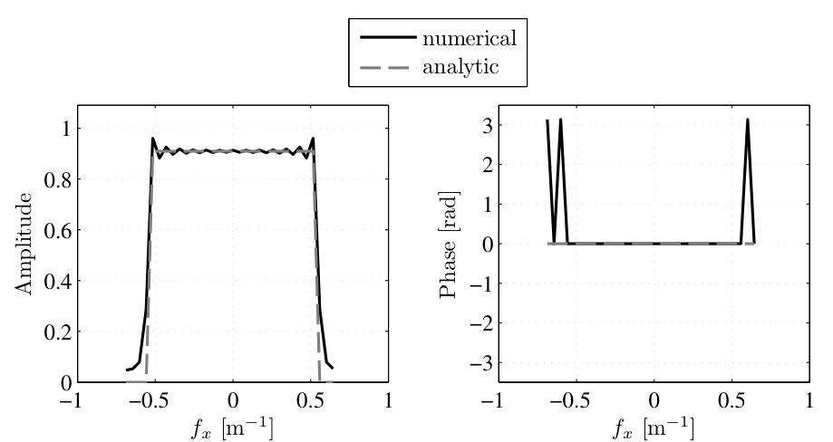
  <figcaption>图 2.11（原书图 2.10）sinc 信号（\(a=1.1\)，\(\delta=0.85/a\)，\(N=32\)）的 DFT：(a) 幅值有轻微波纹——空域网格没装下信号的整个尾巴；(b) 相位在频带边缘跳变（截自原书）</figcaption>
</figure>

两个"看着像 bug、其实有物理"的现象，工程 3 给了定量：

- **幅值波纹**：带内最大偏差 \(1.3\times10^{-2}\)（相对峰值 \(1/a\)）。来源是截断：sinc 的尾巴按 \(1/x\) 衰减，网格边缘截掉的部分约是峰值的百分之几。
- **相位 \(\pi\) 跳变**：带外样本的相位本该任意（谱值应为 0），数值上是 \(10^{-3}\) 量级的**小负数**——负数的相位就是 \(\pi\)。实测带外样本 40% 显示 \(\pi\)、其余是正值附近。这不是错误，也不需要 `unwrap` 去修。

### 2.5.2 高斯信号

本书的高斯信号定义与 FT：

\[
g(x) = \exp\!\left[-\pi(ax)^2\right],
\tag{2.23}
\]

\[
G(f_x) = \frac{1}{|a|}\,\exp\!\left[-\pi\left(\frac{f_x}{a}\right)^2\right].
\tag{2.24}
\]

激光束的振幅轮廓就是它（第 1 章 1.2.2 节见过二维版），所以这个案例最重要。高斯**几乎**限带——谱是高斯，理论上拖到无穷远。取它的 \(1/e^2\) 频率当"最高频率"：

\[
f_{e2} = a\left(\frac{2}{\pi}\right)^{1/2},
\]

（这个定义是人为选的，完全可以用别的电平。）对应的最大间隔

\[
\delta_{e2} = \frac{1}{2a}\sqrt{\frac{\pi}{2}}.
\tag{2.25}
\]

<figure>
  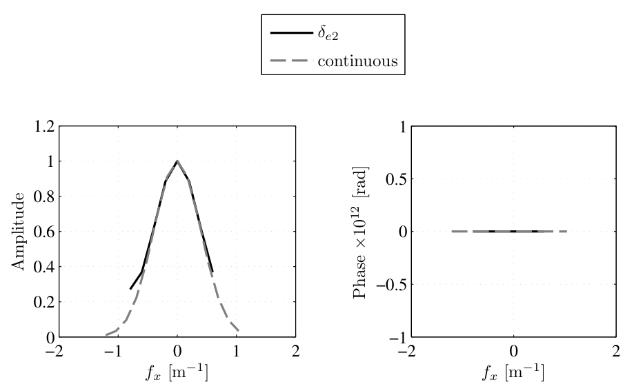
  <figcaption>图 2.12（原书图 2.11）按 1/e² 电平定 \(\delta_{e2}\) 的高斯 DFT（\(a=1\)）：最左样本明显高出连续谱——右侧没采到的谱尾折回来了（截自原书）</figcaption>
</figure>

按 \(\delta_{e2}\) 采样（\(a=1\) 时 \(\delta_{e2}=0.627\)），最左样本混叠抬升实测 \(0.271\) vs 解析值 \(0.135\)——正好翻倍，占总峰值的 14%。**\(1/e^2\) 不太够**。

换个更保守的电平 \(p\)：令谱降到峰值的 \(p\) 倍，

\[
p = \exp\!\left[-\pi\left(\frac{f_{x,p}}{a}\right)^2\right],
\tag{2.26}
\]

解出

\[
f_{x,p} = \left[-\frac{a^2}{\pi}\ln p\right]^{1/2}.
\tag{2.27}
\]

例如 \(f_{x,0.01} = 2.1\,a/\pi^{1/2}\)、\(f_{x,0.001} = 2.6\,a/\pi^{1/2}\)。

<figure>
  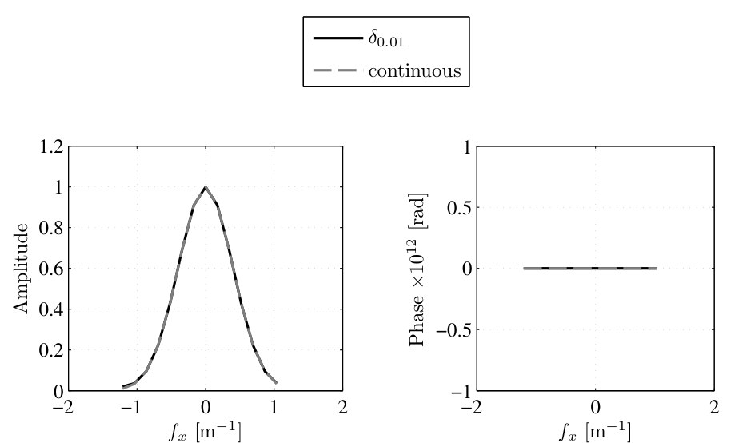
  <figcaption>图 2.13（原书图 2.12）按 p=0.01 电平定 \(\delta\) 的高斯 DFT（\(a=1\)）：混叠分量只剩峰值的 1%，幅值图上已看不见（截自原书）</figcaption>
</figure>

工程 3 实测：\(p=0.01\) 判据下最左样本 \(0.020\) vs 解析 \(0.010\)——抬升恰为峰值的 1%，与设计值严丝合缝。**p 准则的本质：混叠的残渣和你愿意容忍的电平同级。**

### 2.5.3 带二次相位的高斯信号

给高斯再乘一个二次相位：

\[
g(x) = \exp\!\left[-\pi(ax)^2\right]\exp\!\left[i\pi(bx)^2\right].
\tag{2.28}
\]

这正是高斯光束传播时的样子（振幅高斯 + 波前曲率），也是三个案例里最一般的。二次相位让信号随 \(|x|\) 增大振荡得越来越快（图 2.14/原书图 2.13），但高斯包络把它压住——信号仍然"接近"限带。

<figure>
  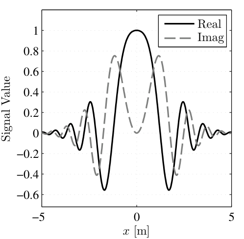
  <figcaption>图 2.14（原书图 2.13）二次相位高斯（\(a=0.25\)，\(b=0.57\)）的实部与虚部：包络内快速振荡（截自原书）</figcaption>
</figure>

它的解析 FT（工程 3 用直接积分验证过：相对偏差 \(5.3\times10^{-16}\)）：

\[
G(f_x) = \frac{1}{\sqrt{a^2 - ib^2}}\,\exp\!\left[-\pi\frac{f_x^2}{a^2 - ib^2}\right].
\tag{2.29}
\]

二次相位的代价：**频带变宽**。图 2.15/原书图 2.14 固定 \(a=0.33\)、取 \(b = 0.75, 1.5, 2.5\)——\(b\) 越大谱越宽。

<figure>
  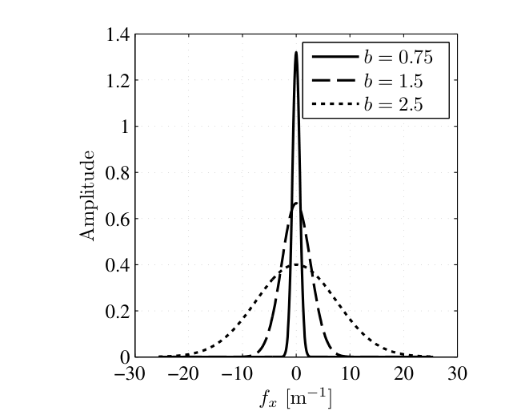
  <figcaption>图 2.15（原书图 2.14）二次相位高斯的谱幅值随曲率参数 \(b\) 增宽：\(b=0.75\to2.5\) 时带宽从约 2 m⁻¹ 拉到约 23 m⁻¹（截自原书）</figcaption>
</figure>

带宽照样从幅值电平反解。令 \(p\) 为幅值电平：

\[
p = \exp\!\left[-\pi\,\mathrm{Re}\!\left(\frac{f_{x,p}^2}{a^2-ib^2}\right)\right],
\tag{2.30}
\]

\[
f_{x,p} = \left[-\frac{a^2 + b^4/a^2}{\pi}\,\ln p\right]^{1/2}.
\tag{2.31}
\]

式 (2.31) 定量确认 \(f_{x,p}\) 随 \(b\) 增大（\((2.26)(2.27)\) 就是 \(b=0\) 的特例）。原书的数值例子：\(a=0.25\)、\(b=0.57\)，采样 \(\delta = 0.25\) m、只用了 40 个样本，谱幅值吻合得很好、相位在频带边缘略差——若系统采样率只有约 \(1.7\ \mathrm{m}^{-1}\) 这就够了，需要更高频精度就换 \(p=0.001\) 重算。

<figure>
  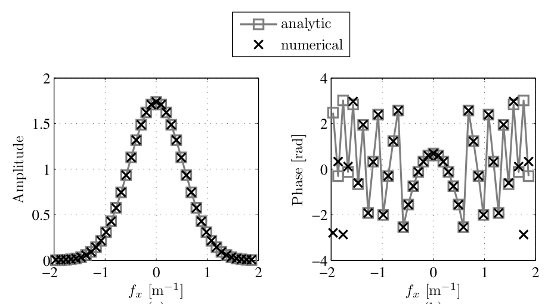
  <figcaption>图 2.16（原书图 2.15）二次相位高斯（\(a=0.25\)，\(b=0.57\)）的 DFT vs 解析：幅值吻合，相位在频带边缘略有偏差（截自原书）</figcaption>
</figure>

!!! warning "原书笔误：\(f_{x,0.01} = 1.96\ \mathrm{m}^{-1}\) 实为 \(p=0.001\) 的值"
    原书正文与图 2.15 题注都说"\(p=0.01\) 的频率用于计算网格间隔，因此 \(f_{x,0.01} = 1.96\ \mathrm{m}^{-1}\)、\(\delta = 0.25\) m"。但把 \(a=0.25\)、\(b=0.57\)、\(p=0.01\) 代入原书自己的式 (2.31)：\(f_{x,0.01} = 1.60\ \mathrm{m}^{-1}\)（\(\delta = 0.31\) m）；**1.96 m⁻¹ 是 \(p=0.001\) 的结果**（\(f_{x,0.001}=1.96\) m⁻¹）。工程 3 用两条独立路径（式 (2.31) 与数值谱的电平位置）交叉验证，两者一致到 \(10^{-4}\) m⁻¹。不影响结论（\(\delta=0.25\) m 只是比必要的更细），但抄参数时要清楚它对应哪一档电平。

工程 3 还比较了两种采样下的精度：原书 \(\delta=0.25\) m（\(N=40\)）带内幅值误差 \(2.3\times10^{-3}\)、相位最大误差 \(0.88\) rad（在最边缘——那里谱值只剩峰值的 \(10^{-3}\)）；按 \(p=0.01\) 判据 \(\delta=0.31\) m（\(N=32\)）幅值误差 \(9.3\times10^{-3}\)、相位 \(0.22\) rad。**"谱值占比高"的地方才值得花样本**——这就是 p 准则的含义。

三个案例的判法收进一张表：

| 案例 | 带宽类型 | \(f_{\max}\) 怎么定 | \(\delta\) 上限 | 数值表现（实测） |
| --- | --- | --- | --- | --- |
| \(\mathrm{sinc}(ax)\) (2.22) | 硬限带 \(\pm a/2\) | 精确已知 | \(1/a\)（书取 \(0.85/a\)） | 带内波纹 \(1.3\times10^{-2}\)，带缘相位 \(\pi\) 跳变 |
| 高斯 (2.23) | 软限带 | \(1/e^2\) 电平或 \(p\) 电平 (2.27) | \(\delta_{e2}\)（混叠 14%）/\(1/(2f_{x,0.01})\)（1%） | \(1/e^2\) 判据在频带边缘翻车 |
| 二次相位高斯 (2.28) | 软限带，\(b\) 拉宽 | \(p\) 电平 (2.31) | \(1/(2f_{x,p})\) | 边缘相位先坏；\(\delta=0.25\) 时相位误差 0.88 rad |

!!! note "拓展：b 是什么？——高斯光束的波前曲率"
    对照第 1 章式 (1.52)：傍轴球面波是 \(e^{ik r^2/(2\Delta z)}\)。把 \(k/2\Delta z = \pi b^2\)（即 \(b = \sqrt{1/(\lambda\Delta z)}\)）代进 (2.28)，它就是"振幅 \(1/e^2\) 半径 \(W=1/a\) 的高斯束传了 \(\Delta z\) 之后"的横向场。\(b\to0\) 是束腰（平面波前），\(b\) 越大波前越弯、衍射发散越厉害——所以谱越宽，这正是"光束传播越远，需要的采样网格越细"的频域版本。第 6 章菲涅耳衍射、第 7 章采样要求会反复用到这一联系。

=== "MATLAB"

    ```matlab
        %% ===== 书 Schmidt PM199 第 2 章 =====
    %  三个变换案例研究：sinc / 高斯 / 带二次相位的高斯（对应原书 2.5 节）
    %  与 python/waveprop/ch2/ch2_case_studies.py 一致（数值以 Python 实跑为准）。
    %  含原书勘误复现：2.5.3 节 "f_{x,0.01}=1.96 m^-1" 实为 p=0.001 的值，
    %  式 (2.31) 代入 p=0.01 应为 1.60 m^-1。需要 R2016b+。
    clear; clc;

    %% 案例 1：sinc 信号（原书图 2.10：a=1.1, delta=0.85/a, N=32）
    a = 1.1; delta = 0.85/a; N = 32;
    [x, f] = coords(N*delta, N);
    g = mysinc(a*x);
    G = ft(g, delta);
    G_a = ft_ana_sinc(f, a);
    band = abs(f) <= a/2;
    rip = max(abs(abs(G(band)) - abs(G_a(band)))) * a;    % 相对峰值 1/a
    ph_edge = angle(G(~band));
    frac_pi = mean(abs(abs(ph_edge) - pi) < 0.1);
    fprintf('案例 1：带内幅度波纹 = %.2e；带外样本相位≈pi 比例 = %.0f%%\n', ...
        rip, 100*frac_pi);

    %% 案例 2：高斯信号（原书图 2.11/2.12：a=1）
    a = 1.0;
    f_e2 = a * sqrt(2/pi);
    delta_e2 = 1/(2*f_e2);                    % 1/e^2 判据（原书式 2.25）
    delta_01 = 1/(2*sqrt(a^2/pi*log(100)));   % p=0.01 判据（原书式 2.27）
    for case2 = [struct('tag','delta_e2  ','d',delta_e2), ...
                 struct('tag','delta_0.01','d',delta_01)]
        N = 32;
        [x, f] = coords(N*case2.d, N);
        G = ft(exp(-pi*(a*x).^2), case2.d);
        G_left = real(G(1));                  % 居中排列最左样本 = 频带负边缘
        G_anL = 1/a * exp(-pi*f(1)^2/a^2);
        fprintf('案例 2：%s = %.4f：最左样本 %.4f（解析 %.4f，混叠抬升占峰值 %.0f%%）\n', ...
            case2.tag, case2.d, G_left, G_anL, 100*(G_left - G_anL)/(1/a));
    end

    %% 案例 3：二次相位高斯（原书图 2.13-2.15），a=0.25、b=0.57
    a = 0.25; b = 0.57;
    for p = [0.01, 0.001]
        fp = bandwidth_p(a, b, p);            % 原书式 (2.31)
        fprintf('案例 3：p=%-6g：式(2.31) f_p = %.4f m^-1%s\n', p, fp, ...
            ternary(p==0.001, '  <- 原书正文的 1.96 实为这一档（勘误）', ''));
    end
    % 原书采样参数下的 DFT 精度
    cfgs = {struct('tag','原书 delta=0.25 m（=p=0.001 判据）','d',0.25,'N',40), ...
            struct('tag','p=0.01 判据 delta=0.312 m            ','d', ...
                   1/(2*bandwidth_p(a,b,0.01)),'N',32)};
    for c = 1:2
        d = cfgs{c}.d; N = cfgs{c}.N;
        [x, f] = coords(N*d, N);
        g = exp(-pi*(a*x).^2) .* exp(1i*pi*(b*x).^2);
        G = ft(g, d);
        G_a = 1/sqrt(a^2 - 1i*b^2) * exp(-pi*f.^2/(a^2 - 1i*b^2));
        ok = abs(G_a) > 1e-3 * max(abs(G_a));
        amp_err = max(abs(abs(G(ok)) - abs(G_a(ok)))) / max(abs(G_a));
        ph_err = max(abs(angle(G(ok) ./ G_a(ok))));
        fprintf('案例 3：%s N=%d：带内幅度误差 %.2e，相位误差 %.2e rad\n', ...
            cfgs{c}.tag, N, amp_err, ph_err);
    end
    % 原书图 2.14 的带宽（a=0.33，p=0.01）
    fprintf('案例 3：图 2.14 带宽（a=0.33，p=0.01）：');
    for bb = [0.75, 1.5, 2.5]
        fprintf('b=%.2f -> %.2f  ', bb, bandwidth_p(0.33, bb, 0.01));
    end
    fprintf('m^-1\n');

    %% ===== 本地函数 =====
    function G = ft(g, delta)
        % 一维 DFT（原书 Listing 2.1）
        G = fftshift(fft(fftshift(g))) * delta;
    end

    function [x, f] = coords(L, N)
        % 居中采样坐标：x = n*delta，f = n/(N*delta)，n = -N/2 .. N/2-1
        delta = L / N;
        n = (-N/2 : N/2-1);
        x = n * delta;
        f = n / (N * delta);
    end

    function s = mysinc(x)
        % 归一化 sinc：sin(pi x)/(pi x)（避免依赖 Signal Processing Toolbox）
        s = ones(size(x));
        nz = x ~= 0;
        s(nz) = sin(pi*x(nz)) ./ (pi*x(nz));
    end

    function G = ft_ana_sinc(f, a)
        % sinc(a x) 的解析 FT：(1/a) rect(f/a)
        G = (abs(f) < a/2) / a + (abs(f) == a/2) * (0.5/a);
    end

    function fp = bandwidth_p(a, b, p)
        % p 电平带宽（原书式 2.31；b=0 退化为式 2.27）
        fp = sqrt(-(a^2 + b^4/a^2)/pi * log(p));
    end

    function out = ternary(cond, vTrue, vFalse)
        if cond, out = vTrue; else, out = vFalse; end
    end
    ```

=== "Python"

    ```python
        # -*- coding: utf-8 -*-
    """
    ===== 书 Schmidt PM199 第 2 章 =====
    三个变换案例研究：sinc / 高斯 / 带二次相位的高斯（对应原书 2.5 节）

    三种信号的带宽类型不同，采样间隔 delta 的确定方法也不同：
        1) sinc(a x)：硬限带，G = (1/a) rect(f/a)，带宽 |f| <= a/2，
           奈奎斯特判据 delta <= 1/a（恰好两倍余量时取 delta = 0.85/a，原书图 2.10）；
        2) exp(-pi (a x)^2)：软限带，G = (1/|a|) exp(-pi (f/a)^2)。
           按 1/e^2 频率取 delta_e2 = (1/(2a)) sqrt(pi/2)（原书式 2.25），
           频带边缘可见混叠；改按 p=0.01 电平取 delta（原书式 2.26/2.27）后混叠消失；
        3) exp(-pi (a x)^2) * exp(i pi (b x)^2)：二次相位把带宽拉宽，
           p 电平带宽由原书式 (2.31)：f_p = sqrt(-(a^2 + b^4/a^2)/pi * ln p)。
    原书勘误（本脚本数值复现）：
        原书 2.5.3 节称 a=0.25、b=0.57 时 "f_{x,0.01} = 1.96 m^-1"，但按式 (2.31)
        代入 p=0.01 得 1.60 m^-1；1.96 m^-1 实为 p=0.001 的结果。
    数值验证（运行自动打印）：
        - 案例 1：幅度波纹、频带边缘的相位 pi 跳变计数；
        - 案例 2：delta_e2 与 delta_0.01 的最左样本混叠抬升对比；
        - 案例 3：式 (2.31) 的 p 电平带宽 vs 数值谱、原书两个数值的归属，
          以及式 (2.29) 解析 FT 与直接积分的核对、图 2.14 三条 b 曲线的带宽。
    MATLAB 注意：numpy 的 np.sinc(x) 是 sin(pi x)/(pi x)（归一化），
    与 MATLAB Signal Processing Toolbox 的 sinc 同定义；为不添依赖，
    本脚本自带 mysinc（与 base.py 的 sinc 相同，此处从 base 导入）。
    用法：python ch2_case_studies.py  （纯数值输出，无图形）
    依赖：numpy；base.py（同仓库 python/fourier/common）。
    """
    import os
    import sys

    import numpy as np

    sys.path.insert(0, os.path.join(os.path.dirname(os.path.abspath(__file__)),
                                    "..", "..", "fourier", "common"))
    from base import sinc, coords  # noqa: E402


    def ft1(g, delta):
        """居中一维 DFT（原书 Listing 2.1）"""
        return np.fft.fftshift(np.fft.fft(np.fft.fftshift(g))) * delta


    def ft_ana_sinc(f, a):
        """sinc(a x) 的解析 FT：(1/a) rect(f/a)（原书式 2.22）"""
        return np.where(np.abs(f) < a / 2, 1.0 / a,
                        np.where(np.abs(f) == a / 2, 0.5 / a, 0.0))


    def ft_ana_gauss(f, a):
        """exp(-pi (a x)^2) 的解析 FT（原书式 2.24）"""
        return 1.0 / abs(a) * np.exp(-np.pi * (f / a) ** 2)


    def ft_ana_gauss_quad(f, a, b):
        """带二次相位高斯的解析 FT（原书式 2.29）"""
        c = a ** 2 - 1j * b ** 2
        return 1.0 / np.sqrt(c) * np.exp(-np.pi * f ** 2 / c)


    def bandwidth_p(a, b, p):
        """p 电平带宽（原书式 2.31；b=0 时退化为式 2.27）"""
        return np.sqrt(-(a ** 2 + b ** 4 / a ** 2) / np.pi * np.log(p))


    def main():
        print('===== 案例 1：sinc 信号（原书图 2.10：a=1.1, delta=0.85/a, N=32）=====')
        a = 1.1
        delta = 0.85 / a
        N = 32
        x, f = coords(N * delta, N)
        g = sinc(a * x)
        G = ft1(g, delta)
        G_a = ft_ana_sinc(f, a)
        band = np.abs(f) <= a / 2
        rip = np.max(np.abs(np.abs(G) - np.abs(G_a))[band]) * a
        edge = ~band
        ph_edge = np.angle(G[edge])
        frac_pi = np.mean(np.abs(np.abs(ph_edge) - np.pi) < 0.1)
        print('    带内幅度波纹 = %.2e（相对峰值 1/a=%.2f）' % (rip, 1 / a))
        print('    带外样本中相位≈pi 的比例 = %.0f%%（谱值应为 0，实为小负数）'
              % (100 * frac_pi))

        print('===== 案例 2：高斯信号（原书图 2.11/2.12：a=1）=====')
        a = 1.0
        f_e2 = a * np.sqrt(2 / np.pi)
        delta_e2 = 1.0 / (2 * f_e2)
        delta_01 = 1.0 / (2 * bandwidth_p(a, 0.0, 0.01))
        for tag, d in [('delta_e2  = %.4f' % delta_e2, delta_e2),
                       ('delta_0.01 = %.4f' % delta_01, delta_01)]:
            N = 32
            x, f = coords(N * d, N)
            G = ft1(np.exp(-np.pi * a * x ** 2), d)
            i_left = 0                      # 居中排列的最左样本 = 频带负边缘
            lift = G[i_left].real - ft_ana_gauss(f[i_left], a)
            print('    %s：最左样本 f=%.3f，混叠抬升 = %.4f（解析值 %.4f，抬升 %.0f%%）'
                  % (tag, f[i_left], G[i_left].real,
                     ft_ana_gauss(f[i_left], a),
                     100 * lift / ft_ana_gauss(0, a)))

        print('===== 案例 3：二次相位高斯（原书图 2.13–2.15）=====')
        a, b = 0.25, 0.57
        # --- 式 (2.31) 的 p 电平带宽 vs 数值谱的 p 电平位置 ---
        for p in (0.01, 0.001):
            fp = bandwidth_p(a, b, p)
            # 数值：细网格上解析谱幅值降到 p 倍峰值的频率（验证式 2.29/2.31）
            f_fine = np.linspace(0, 4, 400001)
            A = np.abs(ft_ana_gauss_quad(f_fine, a, b))
            fp_num = np.interp(p, (A / A[0])[::-1], f_fine[::-1])
            print('    p=%-6g：式(2.31) f_p = %.4f m^-1，数值谱电平位置 = %.4f m^-1'
                  % (p, fp, fp_num))
        print('    -> 原书正文"f_{x,0.01} = 1.96 m^-1"实为 p=0.001 的值（勘误）；'
              'p=0.01 应为 %.2f m^-1' % bandwidth_p(a, b, 0.01))
        # --- 式 (2.29) 解析 FT vs 直接数值积分 ---
        f0 = 0.9
        xx = np.linspace(-40, 40, 1_200_001)
        g_num = np.exp(-np.pi * (a * xx) ** 2) * np.exp(1j * np.pi * (b * xx) ** 2)
        G_num = np.trapezoid(g_num * np.exp(-2j * np.pi * f0 * xx), xx)
        rel = abs(G_num - ft_ana_gauss_quad(f0, a, b)) / abs(ft_ana_gauss_quad(f0, a, b))
        print('    式(2.29) 在 f=0.9 处 vs 直接积分：相对偏差 = %.2e' % rel)
        # --- 原书采样参数下的 DFT 精度 ---
        for tag, d, N in [('原书 delta=0.25 m（=p=0.001 判据）', 0.25, 40),
                          ('p=0.01 判据 delta=%.3f m' % (1 / (2 * bandwidth_p(a, b, 0.01))),
                           1 / (2 * bandwidth_p(a, b, 0.01)), 32)]:
            x, f = coords(N * d, N)
            g = np.exp(-np.pi * (a * x) ** 2) * np.exp(1j * np.pi * (b * x) ** 2)
            G = ft1(g, d)
            G_a = ft_ana_gauss_quad(f, a, b)
            ok = np.abs(G_a) > 1e-3 * np.abs(G_a).max()
            amp_err = np.max(np.abs(np.abs(G) - np.abs(G_a))[ok]) / np.abs(G_a).max()
            ph_err = np.max(np.abs(np.angle(G / G_a))[ok])
            print('    %s N=%d：带内幅度误差 %.2e，相位误差 %.2e rad'
                  % (tag, N, amp_err, ph_err))
        # --- 原书图 2.14：a=0.33，b 增大拉宽带宽 ---
        print('    图 2.14 的带宽（a=0.33，p=0.01）：')
        for bb in (0.75, 1.5, 2.5):
            print('      b=%-4.2f -> f_p = %6.2f m^-1' % (bb, bandwidth_p(0.33, bb, 0.01)))


    if __name__ == '__main__':
        main()
    ```

**工程 3 实跑输出（Python）：** 案例 1 带内波纹 \(1.3\times10^{-2}\)、带外 40% 样本相位 \(\approx\pi\)；案例 2 \(\delta_{e2}\) 最左样本混叠 \(0.271\)（解析 0.135）、\(p=0.01\) 判据 \(0.020\)（解析 0.010）；案例 3 式 (2.31) 与数值电平位置在 \(p=0.01/0.001\) 两档分别给出 \(1.6023/1.6023\)、\(1.9624/1.9624\) m⁻¹，式 (2.29) vs 直接积分偏差 \(5.3\times10^{-16}\)，图 2.14 的三条带宽 \(b=0.75\to2.10\)、\(b=1.5\to8.26\)、\(b=2.5\to22.93\) m⁻¹。

## 2.6 二维离散傅里叶变换

我们生活在三维空间加时间里；光学研究沿一个空间方向传播的波，扔掉时间因子后，剩下一个横向平面上的二维函数。所以**二维 FT 是本书剩余章节的主角**。

把 (2.1)(2.2) 推广到二维：

\[
G(f_x, f_y) = \mathcal{F}\{g(x,y)\} = \int_{-\infty}^{\infty}\int_{-\infty}^{\infty} g(x,y)\, e^{-i2\pi(f_xx+f_yy)}\, dx\, dy,
\tag{2.32}
\]

\[
g(x,y) = \mathcal{F}^{-1}\{G(f_x,f_y)\} = \int_{-\infty}^{\infty}\int_{-\infty}^{\infty} G(f_x,f_y)\, e^{i2\pi(f_xx+f_yy)}\, df_x\, df_y.
\tag{2.33}
\]

2.3 节的推导逐条照搬，只需把替换规则过一遍：

\[
g(x) \Rightarrow g(x,y),
\tag{2.34}
\]

\[
G(f_x) \Rightarrow G(f_x,f_y),
\tag{2.35}
\]

\[
\mathrm{rect}\!\left(\frac{x}{a}\right) \Rightarrow \mathrm{rect}\!\left(\frac{x}{a}\right)\mathrm{rect}\!\left(\frac{y}{b}\right),
\tag{2.36}
\]

\[
a\,\mathrm{sinc}(af_x) \Rightarrow ab\,\mathrm{sinc}(af_x)\,\mathrm{sinc}(bf_y),
\tag{2.37}
\]

\[
a\,\mathrm{comb}(af_x) \Rightarrow ab\,\mathrm{comb}(af_x)\,\mathrm{comb}(bf_y).
\tag{2.38}
\]

假设 \(x,y\) 两维点数、采样、间隔全相同，失真链的二维版本是：

\[
\hat{g}(x,y) = \left[g(x,y)\,\frac{1}{\delta^2}\mathrm{comb}\!\left(\frac{x}{\delta}\right)\mathrm{comb}\!\left(\frac{y}{\delta}\right)\mathrm{rect}\!\left(\frac{x}{L}\right)\mathrm{rect}\!\left(\frac{y}{L}\right)\right]\otimes\left[\frac{1}{L^2}\mathrm{comb}\!\left(\frac{x}{L}\right)\mathrm{comb}\!\left(\frac{y}{L}\right)\right],
\tag{2.39}
\]

\[
\hat{G}(f_x,f_y) = \left[G(f_x,f_y)\otimes\mathrm{comb}(\delta f_x)\,\mathrm{comb}(\delta f_y)\otimes L^2\,\mathrm{sinc}(Lf_x)\,\mathrm{sinc}(Lf_y)\right]\times\mathrm{comb}(Lf_x)\,\mathrm{comb}(Lf_y).
\tag{2.40}
\]

定标规则跟着变：`ft2` 补乘 \(\delta^2\)，`ift2` 补乘 \((N\delta_f)^2\)。这两个函数是后续章节二维卷积、相关、结构函数与波传播的核心工具：

=== "MATLAB"

    ```matlab
    % Listing 2.5：定标正确的二维 DFT（式 2.39 对应的正变换）
    function G = ft2(g, delta)
    % function G = ft2(g, delta)
    G = fftshift(fft2(fftshift(g))) * delta^2;
    ```

    ```matlab
    % Listing 2.6：定标正确的二维 DIFT（式 2.40 对应的逆变换）
    function g = ift2(G, delta_f)
    % function g = ift2(G, delta_f)
    N = size(G, 1);
    g = ifftshift(ifft2(ifftshift(G))) * (N * delta_f)^2;
    ```

=== "Python"

    ```python
    # Listing 2.5/2.6 对应实现：定标正确的二维 DFT / DIFT。
    # 注意：原书 ift2 按方阵写死 (N*delta_f)^2（N=size(G,1) 是行数），
    # 非方阵须按 (M*delta_f_y)*(N*delta_f_x) 分维相乘，见工程 4。
    import numpy as np

    def ft2(g, delta):
        return np.fft.fftshift(np.fft.fft2(np.fft.fftshift(g))) * delta ** 2

    def ift2(G, delta_f):
        return np.fft.ifftshift(np.fft.ifft2(np.fft.ifftshift(G))) \
            * (G.shape[0] * delta_f) * (G.shape[1] * delta_f)
    ```

工程 4 用"方孔的谱"演示 `ft2`/`ift2`——这是"夫琅禾费衍射图样 = 孔径 FT"（式 (1.67)）的最小例子：

\[
g(x,y) = \mathrm{rect}\!\left(\frac{x}{D}\right)\mathrm{rect}\!\left(\frac{y}{D}\right)
\;\Longleftrightarrow\;
G(f_x,f_y) = D^2\,\mathrm{sinc}(Df_x)\,\mathrm{sinc}(Df_y).
\]

<figure>
  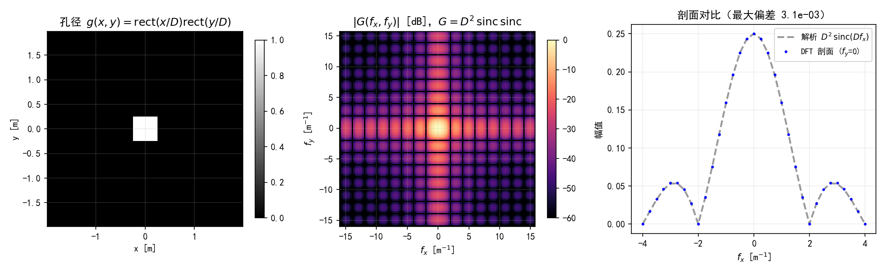
  <figcaption>图 2.17（自绘仿真）方孔（\(D=0.5\) m，\(L=4\) m，\(N=128\)）的二维 DFT：左为孔径，中为 \(|G|\) 的 dB 图（sinc×sinc 主瓣 + 十字臂），右为 \(f_y=0\) 剖面与解析式的对比（最大偏差 \(3.1\times10^{-3}\)，相对峰值）</figcaption>
</figure>

验证数字（Python 实跑）：`ift2(ft2(g))` 往返误差 \(7.2\times10^{-16}\)；二维 Parseval \(\sum|g|^2\delta^2 = \sum|G|^2\delta f^2 = 0.25\)（相对偏差 \(2.2\times10^{-16}\)，数值恰好等于孔径面积 \(D^2\)）；\(|G(0,0)| = 0.250000\) 与 \(D^2\) 零偏差——这得益于**胞元中心采样**（\(x=(n+\tfrac12)\delta\)，孔径边界恰好落在胞元边界上；若用节点采样 \(x=n\delta\)，边界样本被整格计入，直流分量会多出约 \(2D\delta\)）。

!!! warning "原书 ift2 只对方阵正确"
    原书 Listing 2.6 用 `N = size(G,1)`（MATLAB 的行数）同时代表两个维度、定标 \((N\delta_f)^2\)。方阵没问题；**非方阵**（两维 \(\delta\) 相同、点数不同）时两维的频率间隔不同，必须按 \((M\,\delta f_y)\times(N\,\delta f_x)\) 分维相乘。工程 4 实测：\(64\times128\) 阵列上按原书写法往返误差 \(7.5\times10^{-1}\)，分维定标 \(5.6\times10^{-16}\)。

=== "MATLAB"

    ```matlab
        %% ===== 书 Schmidt PM199 第 2 章 =====
    %  二维 DFT：ft2 / ift2 与方形孔径的频谱（对应原书 2.6 节 Listings 2.5-2.6）
    %  与 python/waveprop/ch2/ch2_ft2_2d.py 一致（数值以 Python 实跑为准）。
    %  采样约定：胞元中心 x=(n+1/2)*delta，孔径边界恰落在胞元边界上，
    %  离散孔径面积严格 = D^2（节点采样会把边界样本整格计入）。
    %  MATLAB 注意：imagesc + axis xy 才是数学坐标（y 向上）；需要 R2016b+。
    clear; clc; close all;

    %% 网格与孔径
    N = 128; L = 4.0; D = 0.5;
    delta = L/N; delta_f = 1/(N*delta);
    n = -N/2 : N/2-1;
    x = (n + 0.5) * delta;                   % 胞元中心采样
    f = n / (N * delta);
    [X, Y] = meshgrid(x, x);                 % 与 numpy meshgrid 默认 indexing='xy' 同义
    [FX, ~] = meshgrid(f, f);

    g = double(abs(X) <= D/2 & abs(Y) <= D/2);
    G = ft2(g, delta);

    %% 数值验证
    fprintf('===== 二维 DFT 验证（方孔 D=%.2f m）=====\n', D);
    g_rt = ift2(G, delta_f);
    fprintf('(1) max|ift2(ft2(g)) - g| = %.2e\n', max(abs(g_rt(:) - g(:))));
    lhs = sum(abs(g(:)).^2) * delta^2;
    rhs = sum(abs(G(:)).^2) * delta_f^2;
    fprintf('(2) Parseval 相对偏差 = %.2e\n', abs(lhs-rhs)/lhs);
    i0 = N/2 + 1;                            % 居中排列的零坐标样本（MATLAB 1-based）
    fprintf('(3) |G(0,0)| = %.6f，D^2 = %.6f\n', abs(G(i0,i0)), D^2);
    prof = abs(G(i0,:));
    prof_ana = abs(D^2 * mysinc(D*f));
    ok = abs(f) <= 2/D;
    rel = max(abs(prof(ok) - prof_ana(ok))) / D^2;
    fprintf('(4) fy=0 剖面 vs 解析 D^2 sinc(D fx)：最大偏差 %.2e（相对峰值）\n', rel);

    % 非方阵检查（MATLAB size(G,1) 是行数）：行/列频率间隔不同时，
    % 原书 (N*delta_f)^2 定标错误，必须 (M*df_y)*(N*df_x) 分维相乘
    M2 = 64;
    gx = exp(-pi*x.^2); gy = exp(-pi*x(1:M2).^2);
    g2 = gy.' * gx;                          % (M2 x N) 各向异性高斯
    G2 = ft2(g2, delta);
    rt_book = ifftshift(ifft2(ifftshift(G2))) * (size(G2,1)*delta_f)^2;
    rt_fix  = ifftshift(ifft2(ifftshift(G2))) * (M2/(M2*delta)) * (N/(N*delta));
    fprintf('(5) %dx%d 非方阵：原书 (行数*df)^2 误差 %.2e；(M*df_y)(N*df_x) 误差 %.2e\n', ...
        M2, N, max(abs(rt_book(:) - g2(:))), max(abs(rt_fix(:) - g2(:))));

    %% 绘图
    figure('Position',[60 60 1250 400]);
    subplot(1,3,1);
    imagesc(x, x, g); axis xy equal; colormap gray; colorbar;
    title('孔径 g(x,y) = rect(x/D)rect(y/D)'); xlabel('x [m]'); ylabel('y [m]');
    subplot(1,3,2);
    Gdb = 20*log10(abs(G)/max(abs(G(:)) + eps));
    imagesc(f, f, Gdb); axis xy; caxis([-60 0]); colormap parula; colorbar;
    title('|G(f_x,f_y)| [dB]，G = D^2 sinc sinc');
    xlabel('f_x [m^{-1}]'); ylabel('f_y [m^{-1}]');
    subplot(1,3,3);
    plot(f(ok), prof_ana(ok), '--', 'Color', [0.6 0.6 0.6], 'LineWidth', 1.6); hold on;
    plot(f(ok), prof(ok), 'b.', 'MarkerSize', 5);
    grid on; xlabel('f_x [m^{-1}]'); ylabel('幅值');
    title(sprintf('剖面 f_y=0（最大偏差 %.1e）', rel));
    legend({'解析 D^2 sinc(Df_x)', 'DFT 剖面'}, 'FontSize', 9);

    %% ===== 本地函数 =====
    function G = ft2(g, delta)
        % 二维 DFT（原书 Listing 2.5）
        G = fftshift(fft2(fftshift(g))) * delta^2;
    end

    function s = mysinc(x)
        % 归一化 sinc：sin(pi x)/(pi x)
        s = ones(size(x));
        nz = x ~= 0;
        s(nz) = sin(pi*x(nz)) ./ (pi*x(nz));
    end
    ```

=== "Python"

    ```python
        # -*- coding: utf-8 -*-
    """
    ===== 书 Schmidt PM199 第 2 章 =====
    二维 DFT：ft2 / ift2 与方形孔径的频谱（对应原书 2.6 节 Listings 2.5–2.6）

    复用说明：
        base.py（python/fourier/common/）的 ft2_centered 与本脚本按原书定义的
        ft2 在偶数 N 下完全一致；sinc 也取自 base（归一化定义 sin(pi x)/(pi x)）。
        import 路径处理同 ch2_ft_basics.py。

    示例：方形孔径 g(x,y) = rect(x/D) rect(y/D)，其连续 FT 为
        G(fx,fy) = D^2 sinc(D fx) sinc(D fy)
    这正是第 4 章以后"夫琅禾费衍射图样 = 孔径 FT"的最小例子（方孔的远场
    衍射图样）。相位在 sinc 过零点两侧翻转 0/pi，呈棋盘结构。

    数值验证（运行自动打印）：
        (1) ift2(ft2(g)) 往返最大误差；
        (2) 二维 Parseval：sum|g|^2 dx^2 = sum|G|^2 dfx dfy；
        (3) 中心样本 G(0,0) = 孔径面积 D^2；
        (4) fy=0 剖面 vs 解析 D^2 sinc(D fx) 的最大相对偏差；
        (5) 原书 Listing 2.6 的 ift2 假定方阵（N = size(G,1) 同时用于两维），
            本脚本对非方阵验证"必须用 (M*dfx)*(N*dfy)"的修正版。
    MATLAB/Python 差异：
        - MATLAB ift2 用 (N*delta_f)^2 且 N 取 size(G,1)——仅对方阵正确；
          numpy 侧本脚本写成对 M x N 通用的形式。
        - imshow 默认 origin='upper'（图像惯例），MATLAB imagesc + axis xy
          才与数学坐标一致；本脚本显式传 origin='lower'。
    用法：python ch2_ft2_2d.py <输出目录>  保存 PNG；否则弹窗显示。
    依赖：numpy + matplotlib；base.py（同仓库 python/fourier/common）。
    """
    import os
    import sys

    import numpy as np
    import matplotlib.pyplot as plt

    plt.rcParams['font.sans-serif'] = ['SimHei', 'Microsoft YaHei', 'Arial Unicode MS']
    plt.rcParams['axes.unicode_minus'] = False

    sys.path.insert(0, os.path.join(os.path.dirname(os.path.abspath(__file__)),
                                    "..", "..", "fourier", "common"))
    from base import sinc  # noqa: E402


    # ===== 书 2.6 节 Listing 2.5 / 2.6：二维定标正确的 DFT / DIFT =====
    def ft2(g, delta):
        """二维 DFT（原书 Listing 2.5）：G = fftshift(fft2(fftshift(g)))*delta^2"""
        return np.fft.fftshift(np.fft.fft2(np.fft.fftshift(g))) * delta ** 2


    def ift2(G, delta_f, delta_f_y=None):
        """二维 DIFT（原书 Listing 2.6 的通用化）：
        g = ifftshift(ifft2(ifftshift(G))) * (M*df_y)*(N*df_x)。
        delta_f 是 x 方向频率间隔 1/(N*delta_x)；delta_f_y 是 y 方向的
        1/(M*delta_y)，方阵且两维等间距时与 delta_f 相同（默认）。
        原书按方阵写死 (N*delta_f)^2（MATLAB 的 N=size(G,1) 是行数），
        非方阵时行/列两维的 L 各不相同，必须分开乘。"""
        M, N = G.shape
        dfy = delta_f_y if delta_f_y is not None else delta_f
        return np.fft.ifftshift(np.fft.ifft2(np.fft.ifftshift(G))) \
            * (M * dfy) * (N * delta_f)


    def main(outdir=None):
        # ---- 网格与孔径 ----
        N = 128            # 每边采样点数（原书约定偶数 N；FFT 对 2 的幂最快）
        L = 4.0            # 空域边长 [m] -> delta = L/N = 31.25 mm
        D = 0.5            # 方形孔径边长 [m]（D/delta = 16，恰为整数个胞元）
        delta = L / N
        delta_f = 1.0 / (N * delta)
        n = np.arange(N) - N // 2
        # 胞元中心采样（第 1 章笔记的约定）：x = (n + 1/2)*delta，孔径边界
        # 恰好落在胞元边界上 -> 离散孔径与连续 rect 逐点相等，面积严格 = D^2。
        # 若用原书 Listing 2.3 的节点采样 x = n*delta，边界样本 |x| = D/2 会被
        # 整格计入（17 格），G(0,0) 多出 2*D*delta 量级的偏差。
        x = (n + 0.5) * delta
        f = n / (N * delta)
        X, Y = np.meshgrid(x, x)          # indexing='xy'：与 MATLAB meshgrid 同义
        FX, FY = np.meshgrid(f, f)

        g = ((np.abs(X) <= D / 2) & (np.abs(Y) <= D / 2)).astype(float)
        G = ft2(g, delta)

        # ---- 数值验证 ----
        print('===== 二维 DFT 验证（方孔 rect(x/D)rect(y/D)，D=%.2f m）=====' % D)
        g_rt = ift2(G, delta_f)
        print('(1) max|ift2(ft2(g)) - g| = %.2e' % np.max(np.abs(g_rt - g)))
        lhs = np.sum(np.abs(g) ** 2) * delta ** 2
        rhs = np.sum(np.abs(G) ** 2) * delta_f ** 2
        print('(2) Parseval: sum|g|^2*dx^2 = %.10f, sum|G|^2*df^2 = %.10f (偏差 %.2e)'
              % (lhs, rhs, abs(lhs - rhs) / lhs))
        i0 = N // 2
        print('(3) |G(0,0)| = %.6f，孔径面积 D^2 = %.6f（偏差 %.2e）'
              % (abs(G[i0, i0]), D ** 2, abs(abs(G[i0, i0]) - D ** 2)))
        prof = np.abs(G[i0, :])                      # fy = 0 剖面（取幅值：胞元中心
        prof_ana = np.abs(D ** 2 * sinc(D * f))      # 采样给谱附加 pi*f*delta 线性相位）
        ok = np.abs(f) <= 2 / D                      # 主瓣 + 前两个旁瓣内比较
        rel = np.max(np.abs(prof - prof_ana)[ok]) / D ** 2
        print('(4) fy=0 剖面（|fx| <= 2/D）vs 解析 D^2 sinc(D fx)：最大偏差 %.2e'
              '（相对峰值）' % rel)

        # 非方阵检查：M x N 矩形阵列（两维 delta 相同、频率间隔不同）上，
        # 原书 ift2 的 (size(G,1)*df)^2 定标错；正确做法是两维分别乘 M*df_y、N*df_x
        M2 = 64
        gx = np.exp(-np.pi * (x / 1.0) ** 2)         # x 向（N 点）
        gy = np.exp(-np.pi * (x[:M2] / 1.0) ** 2)    # y 向（M2 点）
        g2 = np.outer(gy, gx)                        # (M2, N) 各向异性高斯
        G2 = ft2(g2, delta)
        dfx = 1.0 / (N * delta)                      # x 向频率间隔
        dfy = 1.0 / (M2 * delta)                     # y 向频率间隔
        rt_book = np.fft.ifftshift(np.fft.ifft2(np.fft.ifftshift(G2))) \
            * (G2.shape[0] * delta_f) ** 2           # 原书写法：MATLAB size(G,1)=行数 M2
        rt_fix = ift2(G2, dfx, delta_f_y=dfy)
        print('(5) %dx%d 非方阵：原书 (行数*df_x)^2 往返误差 %.2e；'
              ' (M*df_y)(N*df_x) 往返误差 %.2e'
              % (M2, N, np.max(np.abs(rt_book - g2)), np.max(np.abs(rt_fix - g2))))

        # ---- 绘图 ----
        fig, axes = plt.subplots(1, 3, figsize=(13.5, 4.2))
        im0 = axes[0].imshow(g, extent=[x[0], x[-1], x[0], x[-1]],
                             origin='lower', cmap='gray')
        axes[0].set_title('孔径 $g(x,y)=\\mathrm{rect}(x/D)\\mathrm{rect}(y/D)$')
        axes[0].set_xlabel('x [m]'); axes[0].set_ylabel('y [m]')
        fig.colorbar(im0, ax=axes[0], shrink=0.85)

        im1 = axes[1].imshow(20 * np.log10(np.abs(G) / np.abs(G).max() + 1e-12),
                             extent=[f[0], f[-1], f[0], f[-1]],
                             origin='lower', cmap='magma', vmin=-60, vmax=0)
        axes[1].set_title(r'$|G(f_x,f_y)|$ [dB]，$G=D^2\,\mathrm{sinc}\,\mathrm{sinc}$')
        axes[1].set_xlabel(r'$f_x$ [m$^{-1}$]'); axes[1].set_ylabel(r'$f_y$ [m$^{-1}$]')
        fig.colorbar(im1, ax=axes[1], shrink=0.85)

        axes[2].plot(f[ok], prof_ana[ok], color='0.6', lw=2, ls='--',
                     label=r'解析 $D^2\,\mathrm{sinc}(Df_x)$')
        axes[2].plot(f[ok], prof[ok], 'b.', ms=4, label='DFT 剖面 ($f_y$=0)')
        axes[2].set_xlabel(r'$f_x$ [m$^{-1}$]'); axes[2].set_ylabel('幅值')
        axes[2].set_title('剖面对比（最大偏差 %.1e）' % rel)
        axes[2].legend(fontsize=9)
        for ax in axes:
            ax.grid(alpha=0.2)
        fig.tight_layout()

        if outdir:
            os.makedirs(outdir, exist_ok=True)
            fp = os.path.join(outdir, 'ft2_demo.png')
            fig.savefig(fp, dpi=150)
            print('已保存：%s' % fp)
        else:
            plt.show()


    if __name__ == '__main__':
        main(sys.argv[1] if len(sys.argv) > 1 else None)
    ```

## 2.7 习题（原书）

原书 5 道题全是一个句式："对某信号做 DFT，\(a=1\) 和 \(a=10\) 各来一次，画图与解析 FT 对比。"它们其实是 2.5 节三个案例的举一反三——每题的考点都是**先定采样、再动手**。工程 5 把五道题全部实跑（采样配方见下表与答案要点），结果汇总成图 2.18。

| 题 | 信号 | 解析 FT | 限带类型 | 采样配方 |
| --- | --- | --- | --- | --- |
| 2.1 | \(\mathrm{sinc}(ax)\) | \(\tfrac{1}{a}\mathrm{rect}(f_x/a)\) | 硬限带 | \(\delta = 0.85/a\)（奈奎斯特留余量） |
| 2.2 | \(\exp(-\pi a^2x^2)\) | \(\tfrac{1}{\|a\|}e^{-\pi(f_x/a)^2}\) | 软限带 | \(p=0.01\) 电平：\(\delta = 1/(2f_{x,p})\) |
| 2.3 | \(\exp(-\pi a^2x^2 + i\pi b^2x^2)\)，\(b=2\) | \(\tfrac{1}{\sqrt{a^2-ib^2}}e^{-\pi f_x^2/(a^2-ib^2)}\) | 软限带（\(b\) 拉宽） | 式 (2.31) |
| 2.4 | \(\mathrm{tri}(ax)\) | \(\tfrac{1}{a}\mathrm{sinc}^2(f_x/a)\) | 非限带（空域有限） | \(\mathrm{sinc}^2\) 尾降到 \(p\)：\(f_{\max}=a/(\pi\sqrt{p})\) |
| 2.5 | \(\exp(-a\|x\|)\) | \(\tfrac{2a}{a^2+(2\pi f_x)^2}\) | 非限带（空域无限） | 洛伦兹尾降到 \(p\)：\(f_{\max}=\tfrac{a}{2\pi}\sqrt{1/p-1}\) |

<figure>
  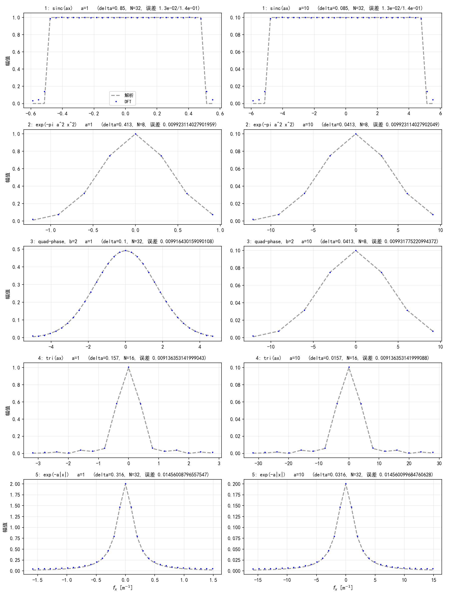
  <figcaption>图 2.18（自绘仿真）习题 1–5 的 DFT vs 解析 FT（左列 \(a=1\)，右列 \(a=10\)）：每个工况的 \(\delta\)、\(N\) 与误差标在标题里——\(a\) 变大十倍，网格按同比例缩放，结果逐位不变</figcaption>
</figure>

**2.1 对 \(\mathrm{sinc}(ax)\) 做 DFT（\(a=1,10\)）。**

??? note "2.1 答案要点"
    谱是 \(\tfrac1a\mathrm{rect}(f_x/a)\)，带宽 \(\pm a/2\)，取 \(\delta = 0.85/a\)、\(N=32\)（空域窗覆盖到 sinc 尾巴约 3%）。实测：带内幅值最大偏差 \(1.3\times10^{-2}\)（截断波纹），带外最大 \(1.4\times10^{-1}\)——后者是 rect 边缘被 \(L\,\mathrm{sinc}(Lf_x)\) 卷出来的吉布斯溢出，集中在 \(|f_x|=a/2\) 附近 \(1/L\) 宽度内。\(a=1\to10\) 只是把网格缩小 10 倍、频带拉宽 10 倍，两条误差**逐位不变**——无量纲缩放的直接演示。

**2.2 对 \(\exp(-\pi a^2x^2)\) 做 DFT（\(a=1,10\)）。**

??? note "2.2 答案要点"
    谱 \(\tfrac{1}{\|a\|}e^{-\pi(f_x/a)^2}\)。按 \(p=0.01\) 电平 \(f_{x,0.01}=1.21\,a\) 定 \(\delta = 0.413/a\)、空域截到幅度 1%（\(N=8\) 就够）。实测带内误差 \(9.9\times10^{-3}\)——恰是设计允许的 1% 混叠残渣。对照 2.5.2 节：若改用 \(1/e^2\) 判据，同样配方下边缘混叠会涨到 14%。

**2.3 对 \(\exp(-\pi a^2x^2 + i\pi b^2x^2)\)（\(a=1\)，\(b=2\)）做 DFT。**

??? note "2.3 答案要点"
    用式 (2.31)（注意 \(b^4/a^2 = 16\)，带宽主要由 \(b\) 决定）：\(a=1\) 时 \(f_{x,0.01} = 4.99\ \mathrm{m}^{-1}\)、\(\delta = 0.100\) m、\(N=32\)；\(a=10\) 时带宽反而变窄（\(b^4/a^2 = 0.16\)，二次相位几乎被高斯"憋住"）、\(f_{x,0.01} = 12.1\ \mathrm{m}^{-1}\)、\(N=8\)。实测误差 \(9.9\times10^{-3}\)。**本题的陷阱：不能只看 \(a\) 定采样**——相位项 \(b\) 拉宽了频带（\(a=1\) 时带宽是纯高斯的 4 倍）。

**2.4 对 \(\mathrm{tri}(ax)\) 做 DFT（\(a=1,10\)）。**

??? note "2.4 答案要点"
    \(\mathrm{tri}(ax) = \mathrm{rect}(ax)\ast a\,\mathrm{rect}(ax)\)（自卷积），谱 \(\tfrac1a\mathrm{sinc}^2(f_x/a)\)——**非限带**（尾巴按 \(1/f_x^2\) 衰减）。取 \(\mathrm{sinc}^2\) 降到 \(p=0.01\) 的频率 \(f_{\max} = a/(\pi\sqrt p) = 3.2\,a\) 定 \(\delta\)，空域窗 \(1.2/a\)（tri 本身有限支撑）。实测误差 \(9.1\times10^{-3}\)。额外教训：三角形的拐角不在采样点上，离散谱与解析谱的偏差有一部分来自"拐角怎么离散"，加密采样可继续压低。

**2.5 对 \(\exp(-a\|x\|)\) 做 DFT（\(a=1,10\)）。**

??? note "2.5 答案要点"
    谱是洛伦兹 \(\tfrac{2a}{a^2+(2\pi f_x)^2}\)（式 (2.14) 同款），非限带。令幅值降到峰值 \(p=0.01\)：\(f_{\max} = \tfrac{a}{2\pi}\sqrt{1/p-1} = 1.58\,a\)，\(\delta = 0.316/a\)；空域截到幅度 \(e^{-1}=0.01\)（\(|x| = 4.6/a\)，\(N=32\)）。实测误差 \(1.5\times10^{-2}\)。与 2.3 节的演示信号是同一对——那里基线参数（\(\delta=0.0375\)、\(L=0.6\)）相对本题粗得多，就是为了把失真放大到看得见。

=== "MATLAB"

    ```matlab
        %% ===== 书 Schmidt PM199 第 2 章 =====
    %  原书 2.7 节习题 1-5：五个信号在 a=1 与 a=10 两档下的 DFT vs 解析 FT
    %  与 python/waveprop/ch2/ch2_problems.py 一致（数值以 Python 实跑为准）。
    %  采样策略（原书 2.5 节案例研究的模板）：
    %    sinc：奈奎斯特 delta=0.85/a；高斯类：p=0.01 电平带宽；
    %    tri / exp(-a|x|)：谱 1/f^2 衰减，取 |G|=0.01 峰值为 f_max。
    %  需要 R2016b+。
    clear; clc; close all;

    a_list = [1, 10];
    p = 0.01; b3 = 2;
    names = {'1: sinc(ax)', '2: exp(-pi a^2 x^2)', '3: quad-phase, b=2', ...
             '4: tri(ax)', '5: exp(-a|x|)'};
    fprintf('===== 习题 1-5：a=1 / a=10 的采样参数与 DFT 精度 =====\n');
    fprintf('%-18s %-5s %-10s %-8s %-12s %-12s\n', ...
        '信号', 'a', 'delta', 'N', '带内误差', '带外误差');
    rows = zeros(10, 8);   % [a delta N err_in err_out ...] 按题号-a 排列
    k = 0;
    for q = 1:5
        for a = a_list
            switch q
                case 1,  delta = 0.85/a;                       % 奈奎斯特 + 15%
                case 4,  f_max = a/(pi*sqrt(p));   delta = 1/(2*f_max);
                case 5,  f_max = a*sqrt(1/p - 1)/(2*pi); delta = 1/(2*f_max);
                otherwise
                    if q == 2, coeff = a^2; else, coeff = a^2 + b3^4/a^2; end
                    f_max = sqrt(coeff/pi*log(1/p)); delta = 1/(2*f_max);
            end
            switch q
                case 4, half = 1.2/a;
                case 1, half = 12/a;
                case 5, half = log(100)/a;
                otherwise, half = sqrt(log(100)/pi)/a;
            end
            N = 2^ceil(log2(2*half/delta));                % 取 2 的幂
            [x, f] = coords(N*delta, N);
            g = signal_eval(q, x, a, b3);
            G = ft(g, delta);
            G_a = analytic_eval(q, f, a, b3);
            dev = abs(abs(G) - abs(G_a)) / max(abs(G_a));
            if q == 1
                inb = abs(f) < a/2;
                e_in = max(dev(inb)); e_out = max(dev(~inb));
            else
                e_in = max(dev); e_out = NaN;
            end
            k = k + 1;
            rows(k,:) = [q, a, delta, N, e_in, e_out, 0, 0];
            fprintf('%-18s %-5.0f %-10.4g %-8d %-12.2e %-12.4g\n', ...
                names{q}, a, delta, N, e_in, e_out);
        end
    end

    %% 绘图：5 行 x 2 列
    figure('Position',[30 30 1150 1500]);
    k = 0;
    for q = 1:5
        for c = 1:2
            k = k + 1;
            a = a_list(c);
            delta = rows(k,3); N = rows(k,4);
            [x, f] = coords(N*delta, N);
            G = abs(ft(signal_eval(q, x, a, b3), delta));
            G_a = abs(analytic_eval(q, f, a, b3));
            subplot(5,2,k);
            m = abs(f) <= 0.8/delta;
            plot(f(m), G_a(m), '--', 'Color', [0.6 0.6 0.6], 'LineWidth', 1.5); hold on;
            plot(f(m), G(m), 'b.', 'MarkerSize', 4);
            grid on;
            title(sprintf('%s  a=%g  (delta=%.3g, N=%d)', names{q}, a, delta, N), ...
                'FontSize', 10);
            if q == 5, xlabel('f_x [m^{-1}]'); end
            if q == 1 && c == 1
                legend({'解析', 'DFT'}, 'FontSize', 9, 'Location', 'south');
            end
        end
    end

    %% ===== 本地函数 =====
    function G = ft(g, delta)
        G = fftshift(fft(fftshift(g))) * delta;            % 原书 Listing 2.1
    end

    function [x, f] = coords(L, N)
        delta = L / N;
        n = (-N/2 : N/2-1);
        x = n * delta;
        f = n / (N * delta);
    end

    function s = mysinc(x)
        s = ones(size(x));
        nz = x ~= 0;
        s(nz) = sin(pi*x(nz)) ./ (pi*x(nz));
    end

    function y = tri_fun(x)
        % 三角函数 Lambda(x)：|x|<=1 取 1-|x|，其余 0（原书附录 A）
        y = double(abs(x) <= 1) .* (1 - abs(x));
    end

    function g = signal_eval(q, x, a, b)
        switch q
            case 1,  g = mysinc(a*x);
            case 2,  g = exp(-pi*(a*x).^2);
            case 3,  g = exp(-pi*(a*x).^2) .* exp(1i*pi*(b*x).^2);
            case 4,  g = tri_fun(a*x);
            case 5,  g = exp(-a*abs(x));
        end
    end

    function G = analytic_eval(q, f, a, b)
        switch q
            case 1,  G = (abs(f) < a/2)/a + (abs(f) == a/2)*(0.5/a);
            case 2,  G = 1/a * exp(-pi*(f/a).^2);
            case 3,  c = a^2 - 1i*b^2;
                     G = 1/sqrt(c) * exp(-pi*f.^2/c);
            case 4,  G = mysinc(f/a).^2 / a;                   % tri 的 FT：sinc^2/a
            case 5,  G = 2*a ./ (a^2 + (2*pi*f).^2);
        end
    end
    ```

=== "Python"

    ```python
        # -*- coding: utf-8 -*-
    """
    ===== 书 Schmidt PM199 第 2 章 =====
    原书 2.7 节习题 1–5：五个信号在 a=1 与 a=10 两档下的 DFT vs 解析 FT

    题目：对下列信号做 DFT，画出与解析 FT 的对比（a=1、a=10 各一次）：
        1) sinc(a x)              -> (1/a) rect(f/a)            [硬限带]
        2) exp(-pi (a x)^2)       -> (1/|a|) exp(-pi (f/a)^2)   [软限带]
        3) exp(-pi (a x)^2 + i pi (b x)^2), b=2
                                  -> 1/sqrt(a^2-i b^2) exp(-pi f^2/(a^2-i b^2))
                                     [软限带，b 拉宽带宽]
        4) tri(a x)               -> (1/a) sinc^2(f/a)          [非限带，空域有限支撑]
        5) exp(-a |x|)            -> 2a/(a^2 + (2 pi f)^2)      [非限带，空域无限支撑]
    采样策略（原书 2.5 节的案例研究就是这套方法的模板）：
        - sinc：奈奎斯特判据 delta = 0.85/a（留 15% 余量）；
        - 高斯类：p=0.01 电平带宽 -> delta = 1/(2 f_p)；
        - tri/exp(-a|x|)：谱按 1/f^2 衰减，取 |G| 降到峰值 p=0.01 的频率为
          f_max（tri 的 sinc^2 尾 -> f_max = a/(pi*sqrt(p))，洛伦兹尾 ->
          f_max = a sqrt(1/p-1)/(2 pi)），空域范围相应取振幅 < 0.01 处。
    每个工况打印：delta、N、f_max 与 DFT 相对解析谱的最大偏差。
    MATLAB 注意：tri 用 base 同款定义 |x|<=1 取 1-|x|；MATLAB 无内置 tri，
    需自己写（见配套 .m 文件末尾的本地函数）。
    用法：python ch2_problems.py <输出目录>  保存 PNG；否则弹窗显示。
    依赖：numpy + matplotlib；base.py（同仓库 python/fourier/common）。
    """
    import os
    import sys

    import numpy as np
    import matplotlib.pyplot as plt

    plt.rcParams['font.sans-serif'] = ['SimHei', 'Microsoft YaHei', 'Arial Unicode MS']
    plt.rcParams['axes.unicode_minus'] = False

    sys.path.insert(0, os.path.join(os.path.dirname(os.path.abspath(__file__)),
                                    "..", "..", "fourier", "common"))
    from base import sinc, tri, coords  # noqa: E402


    def ft1(g, delta):
        """居中一维 DFT（原书 Listing 2.1）"""
        return np.fft.fftshift(np.fft.fft(np.fft.fftshift(g))) * delta


    # ---- 五个信号与解析 FT ----
    def f_sinc(x, a):
        return sinc(a * x)


    def G_sinc(f, a):
        return np.where(np.abs(f) < a / 2, 1.0 / a,
                        np.where(np.abs(np.asarray(f)) == a / 2, 0.5 / a, 0.0))


    def f_gauss(x, a):
        return np.exp(-np.pi * (a * x) ** 2)


    def G_gauss(f, a):
        return 1.0 / abs(a) * np.exp(-np.pi * (f / a) ** 2)


    def f_gauss_quad(x, a, b=2.0):
        return np.exp(-np.pi * (a * x) ** 2) * np.exp(1j * np.pi * (b * x) ** 2)


    def G_gauss_quad(f, a, b=2.0):
        c = a ** 2 - 1j * b ** 2
        return 1.0 / np.sqrt(c) * np.exp(-np.pi * f ** 2 / c)


    def f_expdec(x, a):
        return np.exp(-a * np.abs(x))


    def G_expdec(f, a):
        return 2 * a / (a ** 2 + (2 * np.pi * f) ** 2)


    def bandwidth_p_general(G_func, a, p, f_hi=4000.0):
        """数值求 |G| 降到峰值 p 倍的频率（用于无闭式带宽的信号）"""
        f = np.linspace(1e-9, f_hi, 2_000_001)
        A = np.abs(G_func(f, a)) / np.abs(G_func(0.0, a))
        return np.interp(p, A[::-1], f[::-1])


    def main(outdir=None):
        a_list = [1.0, 10.0]
        p = 0.01
        b3 = 2.0                              # 习题 3 指定 b = 2
        problems = [
            ('1: sinc(ax)',            lambda x, a: f_sinc(x, a),      G_sinc),
            ('2: exp(-pi a^2 x^2)',    lambda x, a: f_gauss(x, a),     G_gauss),
            ('3: quad-phase, b=2',     lambda x, a: f_gauss_quad(x, a, b3),
                                       lambda f, a: G_gauss_quad(f, a, b3)),
            ('4: tri(ax)',             lambda x, a: tri(a * x),
                                       lambda f, a: sinc(f / a) ** 2 / a),
            ('5: exp(-a|x|)',          lambda x, a: f_expdec(x, a),    G_expdec),
        ]

        print('===== 习题 1–5：a=1 / a=10 的采样参数与 DFT 精度 =====')
        print('%-18s %-5s %-10s %-8s %-12s %-12s' %
              ('信号', 'a', 'delta', 'N', '带内误差', '带外误差'))
        rows = []
        for name, fx, Gx in problems:
            for a in a_list:
                if name.startswith('1'):
                    delta = 0.85 / a                    # 奈奎斯特 + 15% 余量
                elif name.startswith('4'):
                    f_max = a / (np.pi * np.sqrt(p))    # sinc^2 尾：sinc^2(u)=p
                    delta = 1.0 / (2 * f_max)
                elif name.startswith('5'):
                    f_max = bandwidth_p_general(G_expdec, a, p)
                    delta = 1.0 / (2 * f_max)
                else:
                    # 信号 2：f_p = sqrt(a^2/pi*ln(1/p))；信号 3：式 (2.31)（b=2）
                    coeff = a ** 2 if name.startswith('2') \
                        else a ** 2 + b3 ** 4 / a ** 2
                    f_max = np.sqrt(coeff / np.pi * np.log(1 / p))
                    delta = 1.0 / (2 * f_max)
                # 空域范围：截到信号幅度 < 0.01（tri 本身有限支撑，取 1.2/a）
                if name.startswith('4'):
                    half = 1.2 / a
                elif name.startswith('1'):
                    half = 12 / a                       # sinc 尾按 1/x 截到 ~3%
                elif name.startswith('5'):
                    half = np.log(100) / a              # exp(-a|x|) 幅度 0.01 处
                else:
                    half = np.sqrt(np.log(100) / np.pi) / a   # 高斯幅度 0.01 处
                N = int(2 ** np.ceil(np.log2(2 * half / delta)))   # 2 的幂
                x, f = coords(N * delta, N)
                g = fx(x, a)
                G = ft1(g, delta)
                G_a = Gx(f, a)
                peak = np.max(np.abs(G_a))
                dev = np.abs(np.abs(G) - np.abs(G_a)) / peak
                if name.startswith('1'):     # 硬限带：带内看波纹，带外看 Gibbs 溢出
                    inb = np.abs(f) < a / 2
                    err_in = np.max(dev[inb])
                    err_out = np.max(dev[~inb])
                else:
                    err_in = np.max(dev)
                    err_out = float('nan')
                rows.append((name, a, delta, N, x, f, np.abs(G), np.abs(G_a),
                             err_in, err_out))
                print('%-18s %-5.0f %-10.4g %-8d %-12.2e %-12.4g'
                      % (name, a, delta, N, err_in, err_out))

        # ---- 绘图：5 行 x 2 列（a=1 左，a=10 右）；显示范围 = 0.8/delta ≈ 1.6 倍带宽 ----
        fig, axes = plt.subplots(5, 2, figsize=(12, 16))
        for r, (name, _, _) in enumerate(problems):
            for c, a in enumerate(a_list):
                row = next(q for q in rows if q[0] == name and q[1] == a)
                _, _, delta, N, x, f, Ga, Gan, err_in, err_out = row
                ax = axes[r, c]
                m = np.abs(f) <= 0.8 / delta
                ax.plot(f[m], Gan[m], color='0.6', lw=1.8, ls='--', label='解析')
                ax.plot(f[m], Ga[m], 'b.', ms=3, label='DFT')
                err_txt = err_in if err_out != err_out else \
                    '%.1e/%.1e' % (err_in, err_out)
                ax.set_title('%s   a=%g   (delta=%.3g, N=%d, 误差 %s)'
                             % (name, a, delta, N, err_txt), fontsize=10)
                if r == 4:
                    ax.set_xlabel(r'$f_x$ [m$^{-1}$]')
                if r == 0 and c == 0:
                    ax.legend(fontsize=9)
                ax.grid(alpha=0.25)
        for ax in axes[:, 0]:
            ax.set_ylabel('幅值')
        fig.tight_layout()

        if outdir:
            os.makedirs(outdir, exist_ok=True)
            fp = os.path.join(outdir, 'problems.png')
            fig.savefig(fp, dpi=150)
            print('已保存：%s' % fp)
        else:
            plt.show()


    if __name__ == '__main__':
        main(sys.argv[1] if len(sys.argv) > 1 else None)
    ```

## 坑与陷阱

!!! danger "fft 不除 N，ift 别忘乘 Nδf——二维再翻一倍"
    `numpy.fft.fft` 和 MATLAB `fft2` 的正变换都不除 \(N\)：连续量纲靠 `ft` 乘 \(\delta\)（二维 \(\delta^2\)）、`ift` 乘 \(N\delta f\)（二维 \((M\delta f_y)(N\delta f_x)\)）补回来。忘了就是差 \(N\)（或 \(N^2\)）倍的幅值。自检工具：直流样本 \(G(0,0) = \iint g\,dxdy\)——工程 4 里它当场验证了方孔面积 \(D^2 = 0.25\)。

!!! danger "原书 ift2 的 \((N\delta_f)^2\) 只对方阵成立"
    MATLAB 的 `size(G,1)` 是行数。非方阵（两维 \(\delta\) 相同、点数不同）时行/列的频率间隔不同，按原书一行代码定标会差一个 \(M/N\) 因子（工程 4 实测往返误差 0.75，等于没做逆变换的定标）。传播仿真几乎总是方阵，但一写各向异性网格就会踩。

!!! danger "数据排列和坐标轴是两回事"
    居中排列（原点样本在中间）配升序坐标轴 \(x=(-N/2,\ldots,N/2-1)\delta\)；FFT 要"原点在前"的移位排列，用 `fftshift`/`ifftshift` 切换。坐标轴永远升序、只做标注。偶数 \(N\) 时 `fftshift == ifftshift`，奇数 \(N\) 不同——这就是全书只用偶数 \(N\) 的原因之一。

!!! danger "相位 π 跳变不是错误"
    谱值本应为 0 的样本（sinc 案例的带外、rect 的零点）数值上是 \(10^{-3}\) 量级的小负数，相位显示 \(\pi\)。用 `unwrap` 去"修"它只会把噪声放大成锯齿。先看幅值是不是处于底噪，再决定要不要看相位。

!!! danger "欠采样把高频伪装成低频，而且毫无破绽"
    \(6\ \mathrm{m}^{-1}\) 的余弦按 \(\delta = 1/8\) m 采样，样本与 \(2\ \mathrm{m}^{-1}\) 的余弦逐点相同（工程 2 验证最大差 \(4\times10^{-15}\)，机器精度）。图样上看不出任何毛刺——混叠不产生噪声，它产生**另一个干净的错误答案**。防线只有一条：动手前按 (2.20)/(2.21) 或 p 准则把 \(\delta\) 定死。

!!! danger "δ 与 L 是跷跷板，固定 N 时此消彼长"
    \(\delta = L/N\)：加大 \(L\) 压波纹必然加大 \(\delta\) 抬混叠（基线→A：波纹 \(5.0\times10^{-2}\to2.5\times10^{-3}\)，混叠 \(2.1\times10^{-2}\to8.0\times10^{-2}\)）；减小 \(\delta\) 压混叠必然缩 \(L\) 保波纹（基线→B）。唯一双赢是同时动两个（\(N\times4\)）。报预算时先想清楚你压的是哪种误差。

!!! danger "估带宽要带相位项一起算"
    只看振幅包络会低估带宽：二次相位把 \(a=1\) 的高斯带宽从 \(1.2\ \mathrm{m}^{-1}\)（纯高斯，\(p=0.01\)）拉到 \(5.0\ \mathrm{m}^{-1}\)（\(b=2\)）。高斯光束传播越远 \(b\) 越大——第 7 章的采样判据全部因此而来。公式：式 (2.31)。

!!! danger "节点采样会把孔径边界样本整格计入"
    用 \(x = n\delta\) 采样方孔且边界恰落在节点上（\(\|x\|=D/2\) 判 \(\le\)），直流样本比真面积多出约 \(2D\delta\)。胞元中心采样 \(x=(n+\tfrac12)\delta\)（第 1 章笔记的约定）让边界落在胞元之间——工程 4 的 \(G(0,0)\) 与 \(D^2\) 零偏差就是这么来的。算能量、面积、归一化系数之前先检查你的采样约定。

## 速览

1. 本书的 FT 约定 (2.1)(2.2)：\(\pm i2\pi f_xx\) 指数、无 \(1/2\pi\) 因子；与 Goodman、《计算傅里叶光学》一致。
2. DFT 三步走：黎曼和 → 固定 \(\delta\) 与 \(\delta f = 1/(N\delta)\) (2.4) → 正索引重排 (2.5【原书公式有误，见勘误】) → 式 (2.6)。
3. 定标口诀：`ft` 补乘 \(\delta\)，`ift` 补乘 \(N\delta f\)；二维 `ft2` 乘 \(\delta^2\)、`ift2` 乘 \((M\delta f_y)(N\delta f_x)\)。
4. 空域平移 ⇔ 频域线性相位 \(-2\pi x_0f_x\)（图 2.3）；信号贴近网格边缘时相位先失真——网格要跟着信号挪。
5. 奈奎斯特判据：最高频每周期至少 2 点，\(\delta\le1/(2f_{\max})\) (2.20)；系统采样率 \(f_s\) 有限时放宽为 \(\delta\le1/(f_s+f_{\max})\) (2.21)。
6. 欠采样 = 混叠：\(6\ \mathrm{m}^{-1}\) 按 \(\delta=1/8\) m 采样折返成 \(2\ \mathrm{m}^{-1}\)，样本逐点相同。
7. DFT 三失真 (2.15)–(2.18)：采样→频域混叠、截断→波纹展宽、频域采样→空域虚拟周期延拓；\(\delta\)、\(L\)、\(N\) 三旋钮的拉锯与四条策略的实测误差见 2.4 节表格。
8. 软限带信号用 p 电平准则：高斯 \(f_{x,p}=\sqrt{-\tfrac{a^2}{\pi}\ln p}\) (2.27)；二次相位高斯 \(f_{x,p}=\sqrt{-\tfrac{a^2+b^4/a^2}{\pi}\ln p}\) (2.31)——\(1/e^2\) 判据会让最左样本混叠 14%，\(p=0.01\) 压到 1%。
9. 二维 DFT (2.32)–(2.40) 是第 4 章起的主力：方孔谱 \(D^2\mathrm{sinc}(Df_x)\mathrm{sinc}(Df_y)\) 就是衍射图样的预告；胞元中心采样让 \(G(0,0)\) 精确等于孔径面积。
10. 原书两处笔误已在笔记勘误：式 (2.5) 的重排下标、\(f_{x,0.01}=1.96\ \mathrm{m}^{-1}\)（实为 \(p=0.001\) 档）。

## 术语速查

| 英文 | 中文 | 一句话 |
| --- | --- | --- |
| discrete Fourier transform (DFT) | 离散傅里叶变换 | 连续 FT 的计算机版：采样 + 截断 + 频域取样 |
| fast Fourier transform (FFT) | 快速傅里叶变换 | 算 DFT 的 \(N\log N\) 算法，\(N\) 取 2 的幂最快 |
| sampling interval \(\delta\) | 采样间隔 | 空域格点间距，决定频带宽 \(\pm1/(2\delta)\) |
| grid size \(L\) | 网格宽度 | \(N\delta\)，决定频率分辨率 \(\delta f = 1/L\) |
| Nyquist criterion | 奈奎斯特判据 | 最高频成分每周期至少采 2 个点 |
| aliasing | 混叠 | 欠采样使高频折返伪装成低频 |
| bandlimited signal | 限带信号 | 谱在 \(\|f_x\|>f_{x,\max}\) 处严格为零 |
| bandwidth | 带宽 | 信号的最高频率 \(f_{x,\max}\) |
| rippling / smearing | 波纹 / 展宽 | 空域截断在频域卷 \(L\,\mathrm{sinc}(Lf_x)\) 的后果 |
| virtual periodic replication | 虚拟周期复制 | 频域采样使空域以 \(L\) 为周期"看起来"延拓 |
| comb function | 梳状函数 | \(\sum_n\delta(x-n)\)，采样的数学化身 |
| fftshift / ifftshift | 频谱移位 | 居中排列 ⇔ 原点在前；偶数 \(N\) 两者相同 |
| one-based indexing | 正索引 | MATLAB 数组从 1 编号，重排的起因 |
| Whittaker–Shannon theorem | Whittaker–Shannon 采样定理 | 限带信号可由均匀采样唯一重建 |
| 1/e² frequency | \(1/e^2\) 频率 | 谱幅降到峰值 \(e^{-2}\) 的频率，软限带的朴素判据 |
| p-level criterion | p 电平准则 | 谱降到峰值 \(p\) 倍处当带宽，混叠残渣 ≤ p |
| quadratic phase | 二次相位 | \(e^{i\pi(bx)^2}\)，波前曲率的频域 fingerprint |
| Parseval's theorem | Parseval 定理 | 两个域算出的能量相等，定标正确性的自检工具 |

## 覆盖自查

| 原书小节 | 内容 | 笔记位置 |
| --- | --- | --- |
| 引言 | 线性系统视角、数值仿真的必要性 | 2.1 开篇 |
| 2.1.1 Fourier transforms: from analytic to numerical | 式 (2.1)–(2.6)、图 2.1、重排勘误 | 2.1.1 |
| 2.1.2 Inverse Fourier transforms | 式 (2.7)–(2.9)、Listing 2.1/2.2（`ft`/`ift`） | 2.1.2 |
| 2.1.3 Performing DFTs in software | `fft`/FFTW、Listing 2.3/2.4、图 2.2/2.3 | 2.1.3（工程 1） |
| 2.2 Sampling Pure-Frequency Functions | 式 (2.10)、奈奎斯特判据、图 2.4/2.5 | 2.2 |
| 2.3 Discrete vs Continuous FT | 式 (2.11)–(2.18)、图 2.6、三失真表 | 2.3 |
| 2.4 Alleviating Effects of Discretization | 式 (2.19)–(2.21)、图 2.7/2.8/2.9、量化表 + mermaid 流程 | 2.4（工程 2） |
| 2.5.1 Sinc signals | 式 (2.22)、图 2.10 | 2.5.1（工程 3） |
| 2.5.2 Gaussian signals | 式 (2.23)–(2.27)、图 2.11/2.12 | 2.5.2（工程 3） |
| 2.5.3 Gaussian signals with quadratic phase | 式 (2.28)–(2.31)、图 2.13/2.14/2.15、勘误 1.96 | 2.5.3（工程 3） |
| 2.6 Two-Dimensional DFTs | 式 (2.32)–(2.40)、Listing 2.5/2.6（`ft2`/`ift2`）、方孔演示 | 2.6（工程 4） |
| 2.7 Problems | 习题 1–5 | 2.7（工程 5，含答案要点） |

代码文件：`matlab/waveprop/ch2/`（ch2_ft_basics.m、ch2_discretization.m、ch2_case_studies.m、ch2_ft2_2d.m、ch2_problems.m）与 `python/waveprop/ch2/`（同名 .py），与页面内 tab 内容一致。Python 侧复用《计算傅里叶光学》公共模块 `python/fourier/common/base.py`（`sinc`/`gauss`/`tri`/`coords`），import 路径见各脚本头部注释；五个 Python 工程全部 numpy.fft 实跑验证，关键数字汇总在各工程的"实跑输出"段。
