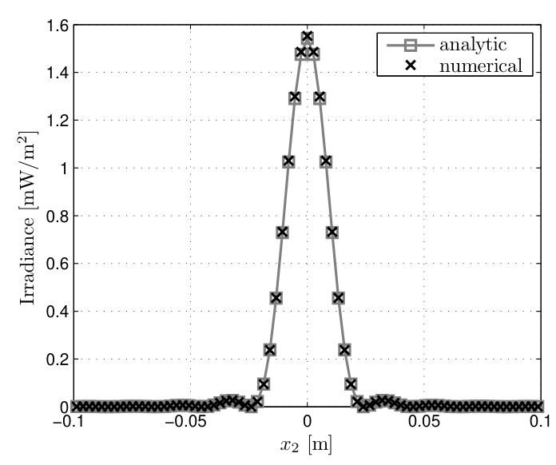
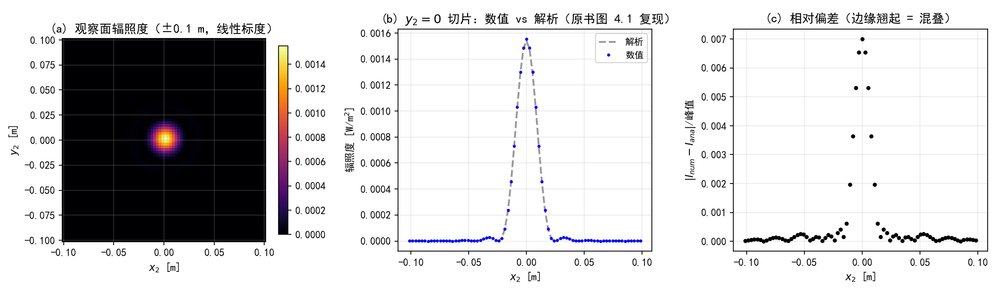
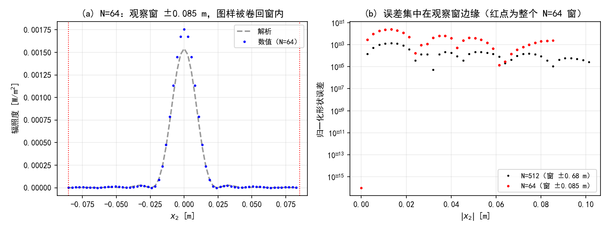
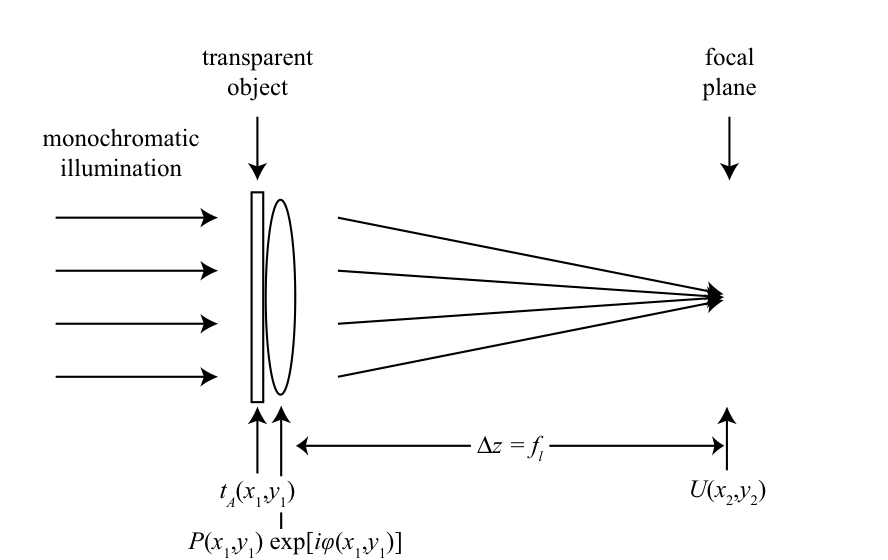
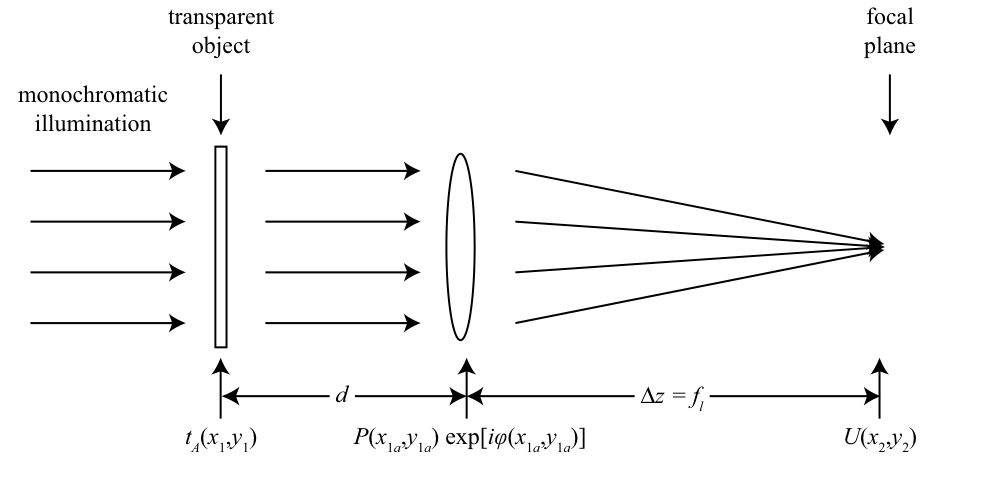
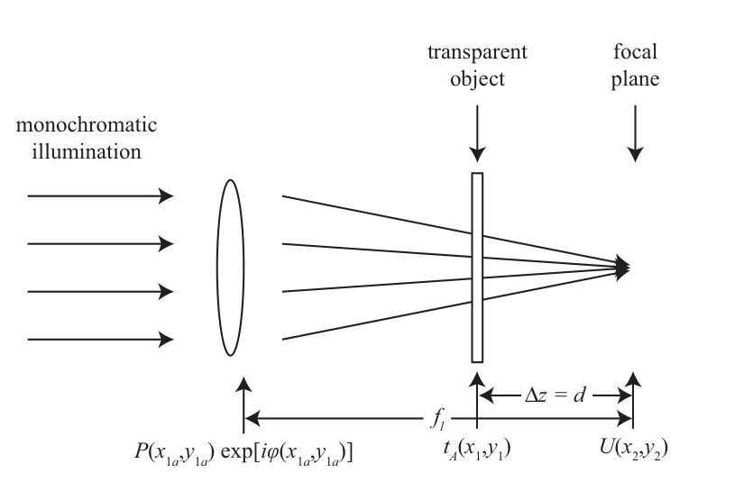
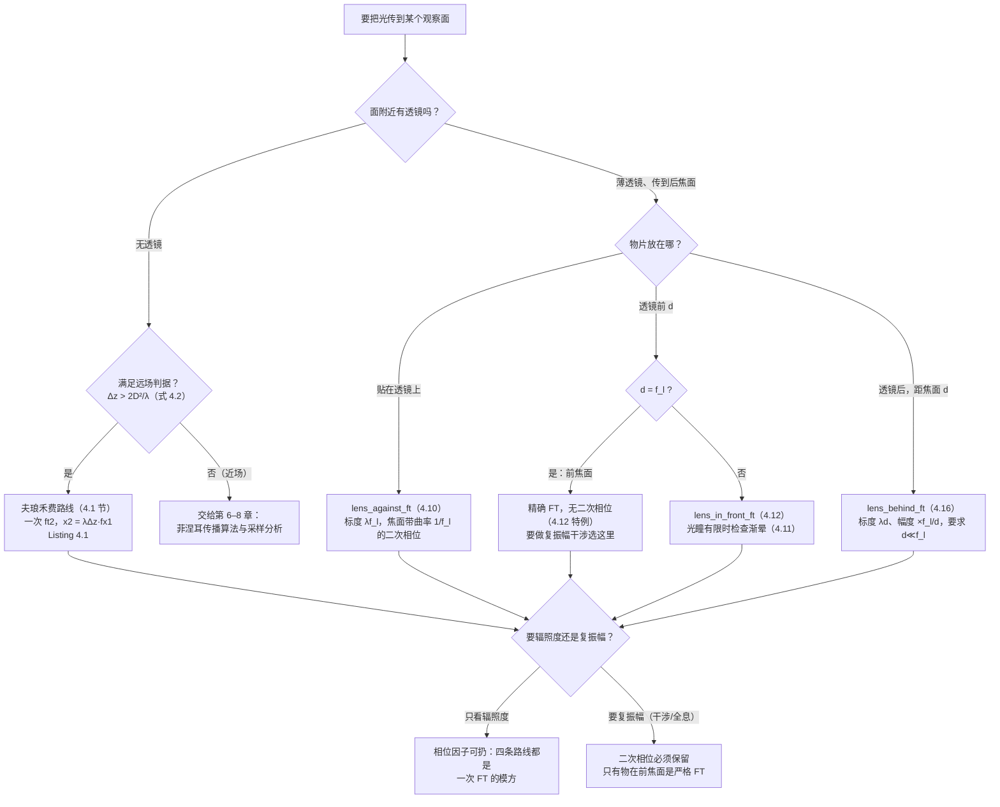
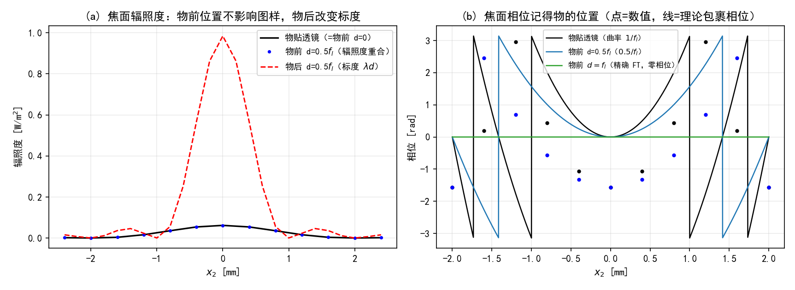
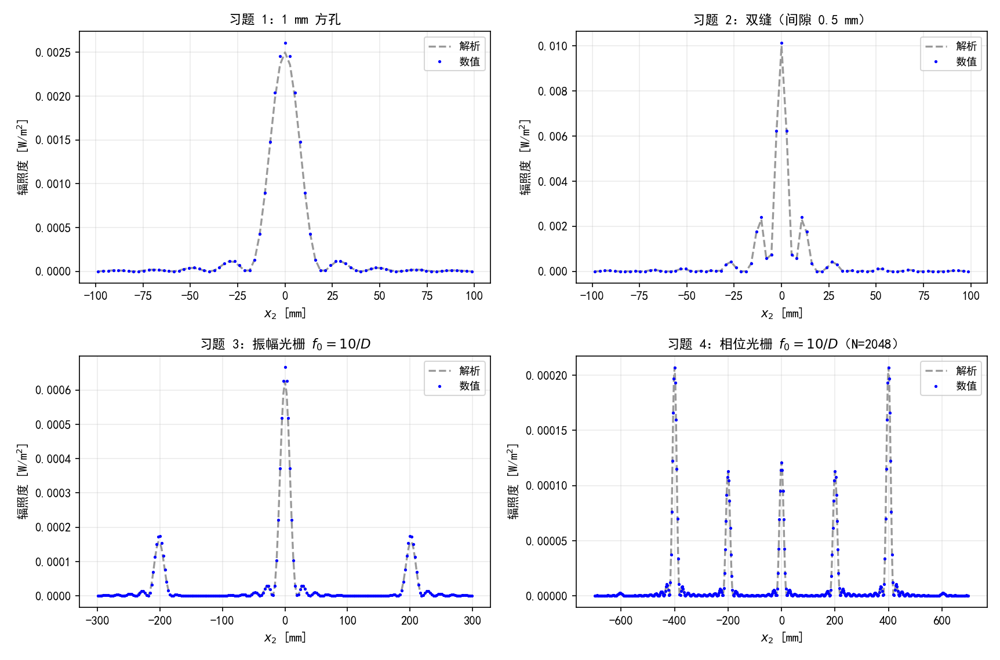
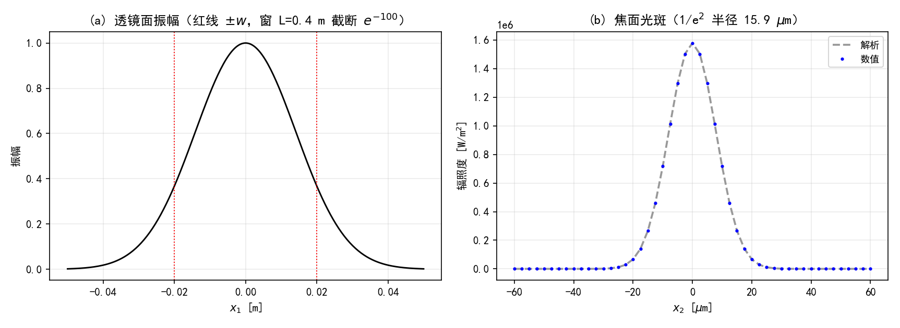

# 第 4 章 夫琅禾费衍射与透镜

> **本章解决**：第 1 章把"光传一段距离"写成两条积分（夫琅禾费 (1.67) 与菲涅耳 (1.57)），第 2 章把傅里叶变换搬进了计算机，本章把两者接起来——第一次真的算出衍射图样。菲涅耳积分的数值实现要等第 6–8 章才展开，本章先取它最容易算的两个特例：无透镜的远场（夫琅禾费衍射）和带薄透镜的焦面（透镜的傅里叶变换性质）。这两类传播都只需要**一次定标正确的 `ft2`**——第 2 章磨好的刀，这里第一次见血。
> 原书本章 5 段 MATLAB 代码（Listings 4.1–4.5）、4 幅插图、5 道习题。笔记按 3 组双语言工程组织（夫琅禾费、透镜三位置、习题 1–5），Python 侧全部实跑验证：两条传播路线逐点对比、能量守恒账本、采样不足时的混叠表现、每道习题的解析解对照，实测数字都写进正文；复用了《计算傅里叶光学》笔记的公共模块 `python/fourier/common/base.py`（import 路径写在每个脚本头部）。原书发现两处小错：Listing 4.5 的函数签名少参数（勘误框）、公式编号从 (4.16) 直接跳到 (4.18)（正文注明）。

本章覆盖：

- 夫琅禾费衍射积分与远场判据 \(\Delta z > 2D^2/\lambda\)（4.1）
- 一次 `ft2` 完成传播：观察面坐标 \(x_2 = \lambda\Delta z f_{x1}\) 的线性映射（4.1）
- 观察窗宽与源面采样绑死：混叠从哪里进来（4.1）
- 薄透镜相位与三种物位置的焦面场（4.2.1–4.2.3）
- 两个特例：\(d=0\) 退回贴透镜、\(d=f_l\) 是精确 FT（4.2.2）
- 移位光瞳（渐晕）为什么没法一次 FFT 算完（4.2.2）
- 五道习题：方孔、双缝、振幅光栅、相位光栅、高斯聚焦（4.3）

## 4.0 本章导图

<div class="brtree">
  <div class="brrow">
    <span class="brlabel root">夫琅禾费衍射与透镜</span>
    <span class="brace"></span>
    <div class="brkids">
      <div class="brrow">
        <span class="brlabel">夫琅禾费衍射（4.1）</span>
        <span class="brace"></span>
        <div class="brkids">
          <span class="brleaf">积分 (4.1) ⇔ 一次 FT (4.3)</span>
          <span class="brleaf">远场判据 Δz &gt; 2D²/λ (4.2)【保守】</span>
          <span class="brleaf">坐标映射 x2 = λΔz·fx1 (4.4)</span>
          <span class="brleaf">Listing 4.1/4.2 + jinc 约定</span>
          <span class="brleaf">观察窗 x2,max = λΔz/(2δ1)（混叠入口）</span>
        </div>
      </div>
      <div class="brrow">
        <span class="brlabel">透镜的 FT 性质（4.2）</span>
        <span class="brace"></span>
        <div class="brkids">
          <span class="brleaf">薄镜相位 −k/(2f_l)·r² (4.7)</span>
          <span class="brleaf">物贴透镜 (4.10)：标度 λf_l</span>
          <span class="brleaf">物前 d (4.12)：d=f_l 精确 FT</span>
          <span class="brleaf">移位光瞳 = 渐晕，FFT 做不了</span>
          <span class="brleaf">物后 d (4.16)：标度 λd、幅度 ×f_l/d</span>
        </div>
      </div>
      <div class="brrow">
        <span class="brlabel">数值验证（工程 1–3）</span>
        <span class="brace"></span>
        <div class="brkids">
          <span class="brleaf">两条路线：FT vs 直接积分求和</span>
          <span class="brleaf">能量守恒（Parseval）：混叠只搬能量</span>
          <span class="brleaf">N=64：图样卷回窗内、误差 ×100</span>
          <span class="brleaf">焦面相位记得物的位置</span>
        </div>
      </div>
      <div class="brrow">
        <span class="brlabel">习题（4.3）</span>
        <span class="brace"></span>
        <div class="brkids">
          <span class="brleaf">方孔 / 双缝：sinc 与余弦条纹</span>
          <span class="brleaf">振幅光栅：零级 + 一对 ±1 级</span>
          <span class="brleaf">相位光栅：J_n(2π) 深调制，N=512 混叠 69%</span>
          <span class="brleaf">高斯聚焦：δ2 = λf_l/L 的采样设计模板</span>
        </div>
      </div>
    </div>
  </div>
</div>

## 4.1 夫琅禾费衍射

先把结论放在最前面：**夫琅禾费衍射 = 一次二维傅里叶变换，外加观察面上的一层二次相位**。这一节的所有内容都是在解释这句话。

当观察面离源孔径"非常远"时，菲涅耳衍射积分（式 (1.57)，第 6 章的主角）里的源面二次相位 \(e^{i\frac{k}{2\Delta z}(x_1^2+y_1^2)}\) 在孔径范围内几乎不变化，可以整个扔掉，剩下的是夫琅禾费衍射积分（**Fraunhofer diffraction integral**）：

\[
U(x_2, y_2) = \frac{e^{ik\Delta z}\, e^{i\frac{k}{2\Delta z}(x_2^2+y_2^2)}}{i\lambda \Delta z}
\int_{-\infty}^{\infty}\int_{-\infty}^{\infty} U(x_1, y_1)\, e^{-i\frac{k}{\Delta z}(x_1 x_2 + y_1 y_2)}\, dx_1 dy_1.
\tag{4.1}
\]

人话：右边三块——\(e^{ik\Delta z}\) 是走完这段距离积累的整体相位（数值仿真里从来不算它）；\(e^{i\frac{k}{2\Delta z}(x_2^2+y_2^2)}\) 是挂在观察面上的二次相位；积分号里剩下的 \(e^{-i\frac{k}{\Delta z}(x_1x_2+y_1y_2)}\) 对 \((x_1,y_1)\) 来说是**线性**相位——这正是傅里叶变换的核。

"非常远"由夫琅禾费判据（远场判据）定量：

\[
\Delta z > \frac{2 D^2}{\lambda},
\tag{4.2}
\]

\(\Delta z\) 是传播距离，\(D\) 是源孔径直径，\(\lambda\) 是波长。这个近似的物理依据：远场时二次相位在整个源面上"几乎是平的"。

!!! note "拓展：这个判据有多保守"
    把 (4.2) 代进数值里检验一下：本书例题 \(D = 1\ \mathrm{mm}\)、\(\lambda = 1\ \mu\mathrm{m}\)，判据给出 \(\Delta z > 2\ \mathrm{km}\)——但例题实际只传了 \(20\ \mathrm{m}\)，数值结果照样与解析解严丝合缝（图 4.1）。为什么？判据 (4.2) 要求的是孔径边缘的二次相位 \(k D^2/(8\Delta z) < \pi/2\) 量级，真正的"对幅度的破坏"要弱得多：被扔掉的那项在孔径边缘只有 \(k D^2/(8\Delta z) = 2\pi \times 10^6 \times 10^{-6}/(8\times 20)\)…直接算：\(\frac{k}{2\Delta z}\cdot\frac{D^2}{4} = 0.039\ \mathrm{rad}\)，对幅度的影响在千分之一以下。工程上 \(\Delta z \gg D^2/(4\lambda)\)（本例 \(0.25\ \mathrm{m}\））通常就够用，(4.2) 是留了两个数量级余量的保守版本。第 7 章讲采样时还会回到这个问题。

把 (4.1) 的指数对上第 2 章的 FT 约定 \(\exp(-i2\pi f_x x)\)：\(\frac{k}{\Delta z} = \frac{2\pi}{\lambda\Delta z}\)，所以

\[
U(x_2, y_2) = \frac{e^{ik\Delta z}\, e^{i\frac{k}{2\Delta z}(x_2^2+y_2^2)}}{i\lambda \Delta z}\;
\mathcal{F}\{U(x_1, y_1)\}\Big|_{f_{x1}=\frac{x_2}{\lambda\Delta z},\; f_{y1}=\frac{y_2}{\lambda\Delta z}}.
\tag{4.3}
\]

人话：**观察面的坐标就是源面空间频率乘了一个定标**——源面上频率 \(f_{x1}\) 的分量，走到远场后落在观察面 \(x_2 = \lambda\Delta z f_{x1}\) 处。孔径的谱有多宽，衍射图样就铺多开；\(x_2\) 轴本质上是一根"频率轴"。本章用到的符号全部列在表 4.1 里（几何示意见第 1 章图 1.2）。

**表 4.1 光学传播的符号定义**

| 符号 | 含义 |
| --- | --- |
| \(\mathbf{r}_1 = (x_1, y_1)\) | 源平面坐标 |
| \(\mathbf{r}_2 = (x_2, y_2)\) | 观察平面坐标 |
| \(\delta_1\) | 源平面网格间隔 |
| \(\delta_2\) | 观察平面网格间隔 |
| \(\Delta z\) | 源平面到观察平面的距离 |

数值实现就是"按 (4.3) 调用一次 `ft2`"。原书 Listing 4.1 的 `fraunhofer_prop` 全文只有 6 行有效代码：

=== "MATLAB"

    ```matlab
    % Listing 4.1：夫琅禾费传播（原书 fraunhofer_prop.m）
    function [Uout x2 y2] = ...
        fraunhofer_prop(Uin, wvl, d1, Dz)
    % function [Uout x2 y2] = ...
    %     fraunhofer_prop(Uin, wvl, d1, Dz)

    N = size(Uin, 1);        % assume square grid
    k = 2*pi / wvl;          % optical wavevector
    fX = (-N/2 : N/2-1) / (N*d1);
    % observation-plane coordinates
    [x2 y2] = meshgrid(wvl * Dz * fX);
    clear('fX');
    Uout = exp(i*k/(2*Dz)*(x2.^2+y2.^2)) ...
        / (i*wvl*Dz) .* ft2(Uin, d1);
    ```

=== "Python"

    ```python
    # Listing 4.1 的 Python 对应（工程 1 中的同名函数）
    def fraunhofer_prop(Uin, wvl, d1, Dz):
        """夫琅禾费传播（原书 Listing 4.1）。

        Uout = exp(i k/(2 Dz) (x2^2+y2^2)) / (i lambda Dz) * ft2(Uin, d1)
        二次相位因子只留在积分外（积分内的已被远场近似扔掉）；
        e^{i k Dz} 轴上相位与原书一样不计算。
        返回 Uout（居中排列）、x2、y2（升序坐标，单位 m）。
        """
        N = Uin.shape[0]                       # assume square grid
        k = 2 * np.pi / wvl
        fX = (np.arange(N) - N // 2) / (N * d1)   # 源面频率轴（升序、居中排列）
        x2, y2 = np.meshgrid(wvl * Dz * fX, wvl * Dz * fX)  # 式 (4.4) 的线性映射
        Uout = np.exp(1j * k / (2 * Dz) * (x2 ** 2 + y2 ** 2)) \
            / (1j * wvl * Dz) * ft2_centered(Uin, d1)
        return Uout, x2, y2
    ```

三处细节值得停下来看：

1. **频率轴 `fX` 是居中排列**（\(-N/2,\ldots,N/2-1)/N\delta_1\)），`ft2` 输出的谱也是居中排列，两边对齐——所以坐标 \(x_2 = \lambda\Delta z f_X\) 直接生成即可，不需要任何 `fftshift` 操作。数据排列和坐标轴是两回事（第 2 章的老话）。
2. **\(e^{ik\Delta z}\) 被略去**：它对所有点一样，求辐照度时自动消失；要复振幅做干涉时再补一个数就行。
3. **积分外的二次相位还在**：夫琅禾费近似只扔了积分**内**的二次相位（源面上近似为平），观察面上的 \(e^{i\frac{k}{2\Delta z}r_2^2}\) 是完完整整保留的——只有求 \(|U_2|^2\) 时才允许当它不存在。

原书例题（Listing 4.2）：单位振幅平面波照到直径 \(D=1\ \mathrm{mm}\) 的圆孔上，传 \(20\ \mathrm{m}\)。

\[
N=512,\quad L=7.5\ \mathrm{mm},\quad \delta_1 = L/N,\quad \lambda = 1\ \mu\mathrm{m},\quad \Delta z = 20\ \mathrm{m}.
\]

解析结果用圆孔谱的闭式（爱里图样）：

\[
U_{th}(x_2, y_2) = \frac{e^{i\frac{k}{2\Delta z}(x_2^2+y_2^2)}}{i\lambda \Delta z}\cdot \frac{\pi D^2}{4}\cdot \mathrm{jinc}\!\left(\frac{D\sqrt{x_2^2+y_2^2}}{\lambda \Delta z}\right),
\tag{4.3 例}
\]

其中原书的 jinc 定义是 \(\mathrm{jinc}(u) = 2J_1(\pi u)/(\pi u)\)（\(u\to 0\) 时为 1，第一个零点在 \(u=1.22\)，即爱里环半径 \(1.22\,\lambda\Delta z/D\)）。\(\pi D^2/4\) 是孔径面积，也就是谱的直流值。

!!! note "拓展：jinc 的两种定义与 base.py 的换算"
    文献里 jinc 有两种常见定义：\(\mathrm{jinc}_a(u)=2J_1(\pi u)/(\pi u)\)（归一化、峰值为 1，Schmidt 用这个）与 \(\mathrm{jinc}_b(\rho)=J_1(2\pi\rho)/(\pi\rho)\)（Voelz《计算傅里叶光学》的 `jinc` 用这一族）。`base.py` 的 `jinc(rho, R)` 是半径 \(R\) 圆盘的谱 \(R J_1(2\pi R\rho)/\rho\)，取 \(R=D/2\) 时恰好等于 \(\frac{\pi D^2}{4}\,\mathrm{jinc}_a(D\rho)\)——即"孔径面积 × 归一化 jinc"。工程 1 验证 0 把两种写法逐点对过：最大差 \(4.2\times10^{-22}\)。圆孔用 `circle(X, Y, D/2)`（半径参数）生成，对应原书的 `circ(x1, y1, D)`（直径参数）——两本书一个按直径一个按半径，容易踩。

<figure>
  
  <figcaption>图 4.1 圆孔夫琅禾费图样的 <span class="arithmatex">\(y_2=0\)</span> 切片：数值（叉）与解析（线）重合，轴上辐照度约 1.54 mW/m²（截自原书）</figcaption>
</figure>

工程 1 用同样的参数把这道例题复现了一遍（图 4-5），并把误差拆成两种来汇报：

- **轴上辐照度**：数值 \(1.5529\) vs 解析 \(1.5421\ \mathrm{mW/m^2}\)，高了 \(0.70\%\)。这不是傅里叶变换的错——是**节点采样**把孔径边界上的样本整格计入了，直流样本（= 数出来的孔径面积）偏大 \(0.35\%\)，峰值 ∝ 面积的平方，正好 \(+0.70\%\)。第 2 章 2.6 节"胞元中心采样"那个坑在这里重演；改成 \(x_1=(n+\tfrac12)\delta_1\) 采样可归零。
- **归一化形状误差**（两边各自按峰值归一，扣除标度差）：传感器区域（\(|x_2|\le 0.2\ \mathrm{m}\)）内最大 \(1.4\times10^{-3}\)，最大值出现在 \(x_2=0.013\ \mathrm{m}\)——第一爱里零点（\(0.0244\ \mathrm{m}\)）附近的陡坡上。谱的微小错位在斜率大的地方最显眼。
- **边缘**（\(|x_2|>0.6\ \mathrm{m}\)）误差只有 \(2\times10^{-5}\)：但那里图样本身只剩峰值的 \(10^{-6}\) 倍，**相对局部信号**误差仍然显著——这就是原书说"把显示区域拉大，边缘开始出现偏差"的准确含义。

<figure>
  
  <figcaption>图 4-5（自绘仿真）工程 1 复现原书图 4.1：(a) 观察面辐照度二维图样（±0.1 m），(b) <span class="arithmatex">\(y_2=0\)</span> 切片数值 vs 解析，(c) 归一化形状误差——残差集中在爱里环陡坡，直流标度差已单独扣除</figcaption>
</figure>

**能量账本**。离散 Parseval 保证

\[
\sum_{m,n} |U_2(m,n)|^2\, \delta_2^2 \;=\; \sum_{k,l} |U_1(k,l)|^2\, \delta_1^2 \;=\; \text{孔径面积}\quad(\text{单位振幅入射}),
\]

而且这条等式**无论是否混叠都严格成立**（\(\delta_2 = \lambda\Delta z\,\delta f_1\) 正好把 FT 的定标抵消）。实测 \(7.8814\times10^{-7}\) vs 孔径面积 \(7.8540\times10^{-7}\ \mathrm{m^2}\)（差 \(0.35\%\)，就是上面说的边界样本）。解析场真正落在观察窗（\(\pm 0.683\ \mathrm{m}\)）内的能量占 \(99.47\%\)——差的 \(0.53\%\) 在窗外，被 FFT 的周期延拓**卷回了窗内**。所以记住：**能量守恒查不出混叠**，混叠不丢能量、只搬能量；要查混叠，得拿"解析场窗内能量"当参照。

**观察窗从哪来**。把 (4.4) 应用到网格的两端，就得到观察面的采样与窗宽：

\[
x_2 = \lambda\Delta z f_{x1}, \qquad y_2 = \lambda\Delta z f_{y1},
\tag{4.4a}
\]

\[
f_{x1,\max} = \frac{x_{2,\max}}{\lambda\Delta z}, \qquad f_{y1,\max} = \frac{y_{2,\max}}{\lambda\Delta z}.
\tag{4.5a}
\]

人话：观察面的采样间隔和窗宽完全由源面网格决定——

| 源面网格 | 观察面（经 \(\lambda\Delta z\) 映射） | 书例数值 |
| --- | --- | --- |
| 间隔 \(\delta_1\) | 间隔 \(\delta_2 = \lambda\Delta z / (N\delta_1) = \lambda\Delta z/L\) | \(2.67\ \mathrm{mm}\) |
| 频带 \(\pm 1/(2\delta_1)\) | 窗宽 \(\pm\lambda\Delta z/(2\delta_1) = \pm\lambda\Delta z N/(2L)\) | \(\pm 0.683\ \mathrm{m}\) |
| 窗宽 \(L=N\delta_1\) | 间隔 \(\delta_2 = \lambda\Delta z/L\)（\(L\) 越大越细） | 同上 |

这条"**两域预算绑死**"的关系是夫琅禾费传播最重要的采样事实：想看更大的观察窗就得加大源面频带（更粗的 \(\delta_1\)），想把焦斑采细就得加大源面窗宽 \(L\)（多出来的地方是空的也行——补零）。原书接着说：如果实验里的靶板传感器只有 \(0.4\ \mathrm{m}\) 宽，那么只有 \(|f_{x1}|\le 0.2/(\lambda\Delta z) = 10^4\ \mathrm{m}^{-1}\) 的源面频率成分会被记录；仿真时把源场用这个带宽滤一遍，得到的就是传感器真正"看得见"的图样。**"按观察孔径给源场限带"这个思想在第 7 章会被反复使用。**

采样不足时这套映射会发生什么？把 \(N\) 从 512 砍到 64（\(L\)、\(D\) 不变）：源面 \(\delta_1\) 变粗 8 倍，观察窗从 \(\pm 0.68\ \mathrm{m}\) 缩到 \(\pm 0.085\ \mathrm{m}\)，而爱里环半径 \(0.0244\ \mathrm{m}\) 不变——窗内只装得下约 3.5 个环，外面的环被周期延拓卷回来，外环整个错位：

| 工况 | 观察窗 | 解析场窗内能量占比 | 混叠卷回 | 归一化形状误差 max | 标度误差 |
| --- | --- | --- | --- | --- | --- |
| N=512（书例） | \(\pm 0.683\ \mathrm{m}\) | 99.47% | 0.53% | \(1.4\times10^{-3}\) | \(+0.70\%\) |
| N=64 | \(\pm 0.085\ \mathrm{m}\) | 95.68% | 4.32% | \(2.7\times10^{-2}\) | \(+13.8\%\) |

（N=64 的标度误差大还有第二个原因：\(\delta_1\) 变粗后圆孔一个直径只跨 8.5 个样本，孔径本身就采歪了。这提醒你 \(\delta_1=L/N\) 同时管着源面采样和观察窗——动 \(N\) 是一石二鸟，两边都要检查。）

<figure>
  
  <figcaption>图 4-6（自绘仿真）采样不足的混叠：(a) N=64 时观察窗（红虚线）缩到 ±0.085 m，窗外的环被卷回窗内、外环错位；(b) 同一位置的误差对比——N=64（红）比 N=512（黑）大约两个量级</figcaption>
</figure>

最后是**两条传播路线的对照**。FT 路线（`fraunhofer_prop`）是先变换再乘相位；另一条是老实人路线——直接按菲涅耳衍射积分 (4.6) 对孔径内全部样本做二维数值求和（一次不用 FFT）。工程 1 在 \(y_2=0\) 切片上逐点对比：最大相对差 \(7.6\times10^{-4}\)。差在哪？老实人路线算了被远场近似扔掉的那项二次相位（孔径边缘 \(0.039\ \mathrm{rad}\)），FT 路线没算——两条路线的分歧正是近似的量级本身。数值上这告诉你：**只要 (4.2) 的物理条件满足，一次 FFT 就是一次完整传播，没有额外算法误差**。

### 工程 1：夫琅禾费传播（Listings 4.1–4.2 复现）

对应文件 `matlab/waveprop/ch4/ch4_fraunhofer.m` 与 `python/waveprop/ch4/ch4_fraunhofer.py`（验证 0–4 与两幅自绘图的生成代码都在里面）：

=== "MATLAB"

    ```matlab
        %% ===== 书 Schmidt PM199 第 4 章 =====
    %  夫琅禾费衍射（原书 4.1 节，Listings 4.1-4.2 与图 4.1）
    %  与 python/waveprop/ch4/ch4_fraunhofer.py 数值行为一致（本机无 MATLAB 时
    %  以 Python 实跑结果为准，见笔记页面打印输出）。
    %
    %  式 (4.3)：夫琅禾费衍射 = 一次定标正确的 ft2，观察面坐标按
    %  x2 = lambda*Dz*fx1 线性映射（式 4.4）。远场判据（式 4.2）：
    %  Delta_z > 2*D^2/lambda（本例 = 2000 m，例题只用 20 m —— 该判据保守，
    %  真正起作用的是孔径上二次相位 < ~pi，即 Delta_z >> D^2/(4*lambda) = 0.25 m）。
    %
    %  验证（编号与 Python 一致）：
    %   (0) jinc 约定：jinc(u) = 2*J1(pi*u)/(pi*u)，jinc(0)=1（第一零点 u=1.22）
    %   (1) 书例复现：轴上辐照度、传感器区域误差（分"标度误差/形状误差"）
    %   (2) 能量守恒：sum|U2|^2*d2^2 == 孔径面积（离散 Parseval，混叠也守恒）
    %   (3) 采样不足：N=64 -> 观察窗变窄，图样卷回窗内
    %   (4) 两条路线：直接按菲涅耳积分 (4.6) 二维求和 vs FT 路线
    %
    %  MATLAB 注意：数组 1 起，居中排列的零坐标样本在 N/2+1 号；
    %  meshgrid 与 np.meshgrid 默认 'xy' 行为一致。需要 R2018b+（本地函数与
    %  xline；旧版把 xline 换成 plot 两点即可）。
    clear; clc; close all;

    %% 参数（原书 Listing 4.2 的 example_fraunhofer_circ.m）
    N = 512;            % number of grid points per side
    L = 7.5e-3;         % total size of the grid [m]
    d1 = L / N;         % source-plane grid spacing [m]
    D = 1e-3;           % diameter of the aperture [m]
    wvl = 1e-6;         % optical wavelength [m]
    k = 2*pi / wvl;
    Dz = 20;            % propagation distance [m]
    area = pi*D^2/4;    % 圆孔面积 = 谱的直流值

    [x1, y1] = meshgrid((-N/2 : N/2-1) * d1);
    Uin = circ_fun(x1, y1, D);

    %% 验证 0：jinc 约定核对
    rho = linspace(1e-6, 400, 400001);
    diff0 = max(abs((D/2)*besselj(1, pi*D*rho)./rho - area .* jinc_s(D*rho)));
    fprintf('验证 0：max|base_jinc(rho) - 面积*jinc_s(D*rho)| = %.2e\n', diff0);
    fprintf('        jinc_s 第一零点 u=%.4f -> 爱里环半径 %.4f m\n', ...
        3.8317/pi, 3.8317/pi*wvl*Dz/D);

    %% 验证 1 + 2：书例复现与能量守恒
    [Uout, x2, y2] = fraunhofer_prop(Uin, wvl, d1, Dz);
    d2 = wvl*Dz/L;  x2max = wvl*Dz/(2*d1);
    fprintf('验证 1：d1=%.3e m, d2=%.4f m, 观察窗 ±%.3f m\n', d1, d2, x2max);
    U_th = exp(1i*k/(2*Dz)*(x2.^2+y2.^2)) / (1i*wvl*Dz) ...
        * area * jinc_s(D*sqrt(x2.^2+y2.^2)/(wvl*Dz));
    I_num = abs(Uout).^2;  I_ana = abs(U_th).^2;
    peak = (area/(wvl*Dz))^2;
    fprintf('        轴上辐照度：数值 %.6f vs 解析 %.6f mW/m^2（高 %.2f%%）\n', ...
        I_num(N/2+1,N/2+1)*1e3, peak*1e3, 100*(I_num(N/2+1,N/2+1)/peak-1));
    shape = abs(I_num/max(I_num(:)) - I_ana/max(I_ana(:)));
    sensor = abs(x2) <= 0.2;
    [~, imax] = max(shape(N/2,:));
    fprintf('        传感器区域：标度误差 %.2e，归一化形状误差 %.2e\n', ...
        max(abs(I_num(:)-I_ana(:)).*(sensor(:)))/peak, max(shape(sensor)));
    fprintf('        形状误差最大值 %.2e 在 x2=%.3f m（爱里环陡坡）；', ...
        max(shape(:)), x2(N/2, imax));
    fprintf('边缘（|x2|>0.6 m）仅 %.1e\n', max(shape(abs(x2)>0.6)));
    P_num = sum(I_num(:)) * d2^2;
    fprintf('验证 2：sum|U2|^2*d2^2 = %.6e vs 孔径面积 %.6e（相对偏差 %.2e）\n', ...
        P_num, area, abs(P_num-area)/area);
    nf = 1501; xf = linspace(-x2max, x2max, nf);
    [Xf, Yf] = meshgrid(xf);
    I_fine = (area/(wvl*Dz))^2 * jinc_s(D*sqrt(Xf.^2+Yf.^2)/(wvl*Dz)).^2;
    P_ana_win = trapz(xf, trapz(xf, I_fine));
    fprintf('        解析场窗内能量占 %.2f%% -> 混叠卷回约 %.2f%%\n', ...
        100*P_ana_win/area, 100*(1-P_ana_win/area));

    %% 验证 3：采样不足的混叠（N=64）
    N2 = 64; d1b = L/N2;
    [x1b, y1b] = meshgrid((-N2/2:N2/2-1)*d1b);
    [Uout_b, x2b, y2b] = fraunhofer_prop(circ_fun(x1b, y1b, D), wvl, d1b, Dz);
    U_thb = exp(1i*k/(2*Dz)*(x2b.^2+y2b.^2)) / (1i*wvl*Dz) ...
        * area * jinc_s(D*sqrt(x2b.^2+y2b.^2)/(wvl*Dz));
    I_numb = abs(Uout_b).^2;  I_anab = abs(U_thb).^2;
    shapeb = abs(I_numb/max(I_numb(:)) - I_anab/max(I_anab(:)));
    fprintf('验证 3：N=64 观察窗 ±%.4f m，形状误差 max=%.3f（外环错位），', ...
        wvl*Dz/(2*d1b), max(shapeb(:)));
    fprintf('标度误差 %.2f%%\n', 100*(max(I_numb(:))/max(I_anab(:))-1));
    P_numb = sum(I_numb(:)) * (wvl*Dz/L)^2;
    xf_b = linspace(-wvl*Dz/(2*d1b), wvl*Dz/(2*d1b), 2001);
    [Xfb, Yfb] = meshgrid(xf_b);
    Ifb = (area/(wvl*Dz))^2 * jinc_s(D*sqrt(Xfb.^2+Yfb.^2)/(wvl*Dz)).^2;
    P_anab = trapz(xf_b, trapz(xf_b, Ifb));
    fprintf('        能量账本：数值仍=%.4e（=面积）；解析窗内=%.4e（%.2f%%）\n', ...
        P_numb, P_anab, 100*P_anab/area);

    %% 验证 4：两条路线对照（直接积分 vs FT）
    inside = Uin ~= 0;
    xa = x1(inside);  ya = y1(inside);
    quad = exp(1i*k/(2*Dz)*(xa.^2+ya.^2));    % 被远场近似扔掉的二次相位
    xs = x2(N/2, :);                          % y2=0 行
    K = exp(-1i*k/Dz * (xs.' * xa));          % (N x Ninside)
    U_dir = (K*quad) * d1^2 / (1i*wvl*Dz) .* exp(1i*k/(2*Dz)*xs.^2).';
    rel = max(abs(abs(U_dir) - abs(Uout(N/2,:)))) / max(abs(Uout(N/2,:)));
    fprintf('验证 4：直接积分 vs FT：max 相对差 = %.2e（孔径边缘二次相位仅 %.3f rad）\n', ...
        rel, k/(2*Dz)*(D/2)^2);

    %% 绘图：图 4-5（书例复现）与图 4-6（混叠）
    half = round(0.1/d2) + 1;
    sl = N/2+1 + (-half:half-1);
    figure('Position',[40 40 1350 400]);
    subplot(1,3,1);
    imagesc(x2(N/2,sl), x2(N/2,sl), I_num(sl, sl)); axis image; colorbar;
    caxis([0 max(I_num(:))]); colormap inferno;
    xlabel('x_2 [m]'); ylabel('y_2 [m]');
    title('(a) 观察面辐照度（±0.1 m）');
    subplot(1,3,2);
    plot(x2(N/2,sl), I_ana(N/2,sl), '--', 'Color', [0.6 0.6 0.6], 'LineWidth', 1.6); hold on;
    plot(x2(N/2,sl), I_num(N/2,sl), 'b.', 'MarkerSize', 5);
    xlabel('x_2 [m]'); ylabel('辐照度 [W/m^2]'); grid on;
    title('(b) y_2=0 切片：数值 vs 解析'); legend({'解析', '数值'});
    subplot(1,3,3);
    plot(x2(N/2,sl), shape(N/2,sl), 'k.', 'MarkerSize', 4);
    xlabel('x_2 [m]'); ylabel('归一化形状误差'); grid on;
    title('(c) 残差在爱里环陡坡处最大');

    hb = N2/2 + 1 + (-N2/2:N2/2-1);
    figure('Position',[40 60 1050 400]);
    subplot(1,2,1);
    plot(x2b(hb,1), I_anab(hb,:), '--', 'Color', [0.6 0.6 0.6], 'LineWidth', 1.6); hold on;
    plot(x2b(hb,1), I_numb(hb,:), 'b.', 'MarkerSize', 5);
    xline(wvl*Dz/(2*d1b), 'r:'); xline(-wvl*Dz/(2*d1b), 'r:');
    xlabel('x_2 [m]'); ylabel('辐照度 [W/m^2]'); grid on;
    title('(a) N=64：观察窗变窄，图样卷回窗内'); legend({'解析', '数值（N=64）'});
    subplot(1,2,2);
    semilogy(abs(x2(N/2,sl)), shape(N/2,sl)+1e-16, 'k.', 'MarkerSize', 3); hold on;
    semilogy(abs(x2b(hb,:)), shapeb(hb,:)+1e-16, 'r.', 'MarkerSize', 4);
    xlabel('|x_2| [m]'); ylabel('归一化形状误差'); grid on;
    title('(b) 同一位置的误差：N=64（红）比 N=512（黑）大两个量级');
    legend({'N=512（窗 ±0.68 m）', 'N=64（窗 ±0.085 m）'});

    %% ===== 本地函数 =====
    function [Uout, x2, y2] = fraunhofer_prop(Uin, wvl, d1, Dz)
    % 原书 Listing 4.1：夫琅禾费传播（e^{ikDz} 轴上相位不计算）
    N = size(Uin, 1);                 % assume square grid
    k = 2*pi / wvl;
    fX = (-N/2 : N/2-1) / (N*d1);     % 源面频率轴（升序、居中排列）
    [x2, y2] = meshgrid(wvl * Dz * fX);   % 式 (4.4)：x2 = lambda*Dz*fx1
    Uout = exp(1i*k/(2*Dz)*(x2.^2+y2.^2)) / (1i*wvl*Dz) .* ft2(Uin, d1);
    end

    function G = ft2(g, delta)
    % 原书 Listing 2.5：定标正确的二维 DFT（乘 delta^2）
    G = fftshift(fft2(fftshift(g))) * delta^2;
    end

    function U = circ_fun(X, Y, D)
    % 直径 D 的圆孔（原书 circ(x,y,D) 约定：|r| <= D/2 取 1）
    U = double(sqrt(X.^2+Y.^2) <= D/2);
    end

    function out = jinc_s(u)
    % 原书解析式用的 jinc：jinc(u) = 2*J1(pi*u)/(pi*u)，jinc(0)=1
    u(u == 0) = eps;
    out = 2*besselj(1, pi*u) ./ (pi*u);
    end
    ```

=== "Python"

    ```python
        # -*- coding: utf-8 -*-
    """
    ===== 书 Schmidt PM199 第 4 章 =====
    夫琅禾费衍射（原书 4.1 节，Listings 4.1-4.2 与图 4.1）

    原书要点：
        夫琅禾费衍射积分（式 4.1）在 Delta_z > 2 D^2 / lambda（式 4.2，远场判据）时
        成立，它可以写成一次二维 FT（式 4.3），观察面坐标与源面空间频率按
            x2 = lambda*Delta_z*fx1,  y2 = lambda*Delta_z*fy1   （式 4.4）
        线性映射。数值实现 = 一次定标正确的 ft2（Listing 4.1 fraunhofer_prop）。

    数值验证（运行本脚本全部自动打印）：
        (0) jinc 约定核对：原书解析式用 jinc(D*r2/(lambda*Dz))，其中
            jinc(u) = 2 J1(pi u)/(pi u)（u=0 处为 1，第一个零点在 u=1.22，
            即爱里环半径 1.22*lambda*Dz/D）——与 base.py 圆盘谱 jinc 的关系；
        (1) 书例复现（N=512, L=7.5 mm, D=1 mm, lambda=1 um, Dz=20 m）：
            轴上辐照度、传感器区域（±0.2 m）内数值 vs 解析的最大偏差；
        (2) 能量守恒（离散 Parseval）：sum|U2|^2*d2^2 == 源面孔径面积
            （入射单位振幅平面波），并对比解析场在观察窗内的真实能量
            —— 差值即被"卷回"窗内的混叠能量；
        (3) 采样不足的混叠表现：N 从 512 减到 64（d1 变粗 -> 观察窗
            x2max = lambda*Dz/(2*d1) 变窄），图样比窗口宽时边缘卷回；
        (4) 两条路线对照：直接按菲涅耳衍射积分（式 4.6）做二维数值求和
            （不用 FFT）与 fraunhofer_prop 的 FT 路线逐点对比。

    MATLAB/Python 差异（对应 .m 文件内注释）：
        - MATLAB 数组 1 起、numpy 0 起：居中排列的零坐标样本位置不同，
          频率轴一律 fX = (arange(N) - N//2)/(N*d1) 生成（与原书
          (-N/2 : N/2-1)/(N*d1) 相同的升序居中排列）。
        - np.meshgrid 默认 indexing='xy'，与 MATLAB meshgrid 一致：
          x2 沿列变化、y2 沿行变化。
        - 原书 ft2 = fftshift(fft2(fftshift(g)))*delta^2（Listing 2.5）；
          base.py 的 ft2_centered 对输入先做 ifftshift——偶数 N 时
          fftshift 与 ifftshift 相同，两者逐元素一致。
    用法：python ch4_fraunhofer.py <输出目录>  保存 PNG；否则弹窗显示。
    依赖：numpy + matplotlib + scipy（J0/J1，能量与 jinc 核对用）；
          base.py（同仓库 python/fourier/common，circle/jinc/ft2_centered）。
    """
    import os
    import sys

    import numpy as np
    import matplotlib.pyplot as plt
    from scipy.special import j0, j1

    plt.rcParams['font.sans-serif'] = ['SimHei', 'Microsoft YaHei', 'Arial Unicode MS']
    plt.rcParams['axes.unicode_minus'] = False

    # ---- 复用《计算傅里叶光学》笔记的公共基础模块（同仓库） ----
    sys.path.insert(0, os.path.join(os.path.dirname(os.path.abspath(__file__)),
                                    "..", "..", "fourier", "common"))
    from base import circle, jinc, ft2_centered  # noqa: E402


    # ===== 书 Listing 4.1：fraunhofer_prop =====
    def fraunhofer_prop(Uin, wvl, d1, Dz):
        """夫琅禾费传播（原书 Listing 4.1）。

        Uout = exp(i k/(2 Dz) (x2^2+y2^2)) / (i lambda Dz) * ft2(Uin, d1)
        二次相位因子只留在积分外（积分内的已被远场近似扔掉）；
        e^{i k Dz} 轴上相位与原书一样不计算。
        返回 Uout（居中排列）、x2、y2（升序坐标，单位 m）。
        """
        N = Uin.shape[0]                       # assume square grid
        k = 2 * np.pi / wvl
        fX = (np.arange(N) - N // 2) / (N * d1)   # 源面频率轴（升序、居中排列）
        x2, y2 = np.meshgrid(wvl * Dz * fX, wvl * Dz * fX)  # 式 (4.4) 的线性映射
        Uout = np.exp(1j * k / (2 * Dz) * (x2 ** 2 + y2 ** 2)) \
            / (1j * wvl * Dz) * ft2_centered(Uin, d1)
        return Uout, x2, y2


    def jinc_s(u):
        """原书解析式里的 jinc：jinc(u) = 2 J1(pi u)/(pi u)，jinc(0)=1。"""
        u = np.asarray(u, dtype=float)
        out = np.ones_like(u)
        nz = u != 0
        out[nz] = 2.0 * j1(np.pi * u[nz]) / (np.pi * u[nz])
        return out


    def circ(X, Y, D):
        """直径 D 的圆孔（原书 circ(x,y,D) 约定，|r| <= D/2 取 1）。"""
        return circle(X, Y, D / 2.0)


    def main(outdir=None):
        # ---- 原书 Listing 4.2 的参数 ----
        N = 512          # number of grid points per side
        L = 7.5e-3       # total size of the grid [m]
        d1 = L / N       # source-plane grid spacing [m]
        D = 1e-3         # diameter of the aperture [m]
        wvl = 1e-6       # optical wavelength [m]
        k = 2 * np.pi / wvl
        Dz = 20.0        # propagation distance [m]

        area = np.pi * D ** 2 / 4.0          # 圆孔面积 = FT 的直流值
        x1, y1 = np.meshgrid((np.arange(N) - N // 2) * d1,
                             (np.arange(N) - N // 2) * d1)
        Uin = circ(x1, y1, D)

        print('===== 验证 0：jinc 约定核对 =====')
        rho = np.linspace(0, 400, 4001)      # rho = r2/(lambda*Dz)
        diff = np.max(np.abs(jinc(rho, R=D / 2) - area * jinc_s(D * rho)))
        print('    max|base.jinc(rho, R=D/2) - 面积*jinc_s(D*rho)| = %.2e'
              % diff)
        print('    （即 base.jinc(rho,R=D/2) = 面积 × 2J1(pi D rho)/(pi D rho)，'
              '爱里图样）')
        u_first_zero = 3.8317 / np.pi
        print('    jinc_s 第一个零点 u = %.4f -> 爱里环半径 1.22*lambda*Dz/D = %.4f m'
              % (u_first_zero, u_first_zero * wvl * Dz / D))

        print('===== 验证 1 + 2：书例复现（N=512）与能量守恒 =====')
        Uout, x2, y2 = fraunhofer_prop(Uin, wvl, d1, Dz)
        d2 = wvl * Dz / L                    # 观察面采样间隔 = lambda*Dz*delta_f1
        x2max = wvl * Dz / (2 * d1)          # 观察窗半宽 = lambda*Dz*f1_max
        print('    d1 = %.3e m, d2 = lambda*Dz/L = %.4f m, 观察窗 ±%.3f m'
              % (d1, d2, x2max))
        U_th = np.exp(1j * k / (2 * Dz) * (x2 ** 2 + y2 ** 2)) \
            / (1j * wvl * Dz) * area * jinc_s(D * np.hypot(x2, y2) / (wvl * Dz))
        I_num, I_ana = np.abs(Uout) ** 2, np.abs(U_th) ** 2
        peak = (area / (wvl * Dz)) ** 2
        print('    轴上辐照度：数值 %.6f mW/m^2 vs 解析 %.6f mW/m^2（高 %.2f%%）'
              % (I_num[N // 2, N // 2] * 1e3, peak * 1e3,
                 100 * (I_num[N // 2, N // 2] / peak - 1)))
        # 两类误差分开看：
        #   标度误差 = 数值整体比解析高（节点采样把孔径边界样本整格计入，
        #              直流样本偏大 -> 各处等比例抬高，见《计算傅里叶光学》
        #              笔记 ch2 的"胞元中心采样"坑）；
        #   形状误差 = 各自归一化后的残差（这才反映混叠/相位误差）。
        shape = np.abs(I_num / I_num.max() - I_ana / I_ana.max())
        sensor = np.abs(x2) <= 0.2           # 原书"0.4 m 宽的靶板传感器"
        print('    传感器区域（±0.2 m）：标度误差 %.2e，归一化形状误差 %.2e'
              % (np.max(np.abs(I_num - I_ana)[sensor]) / peak, shape[sensor].max()))
        imax = np.unravel_index(shape.argmax(), shape.shape)
        print('    形状误差最大值 %.2e 在 x2=%.3f m（第一爱里零点 0.0244 m 附近的陡坡）'
              % (shape.max(), x2[imax]))
        print('    边缘（|x2|>0.6 m）形状误差只有 %.1e——但那里的图样本身只有峰值的'
              ' 1e-6 倍，相对局部信号仍显著（原书"大范围显示时边缘开始出偏差"）'
              % shape[np.abs(x2) > 0.6].max())

        P_num = np.sum(I_num) * d2 ** 2      # 离散 Parseval：应恒等于孔径面积
        print('    能量：sum|U2|^2*d2^2 = %.6e（孔径面积 %.6e，相对偏差 %.2e）'
              % (P_num, area, abs(P_num - area) / area))
        # 解析场在观察窗内的真实能量（精细网格上数值积分）
        nf = 1501
        xf = np.linspace(-x2max, x2max, nf)
        Xf, Yf = np.meshgrid(xf, xf)
        I_fine = ((area / (wvl * Dz)) ** 2) * \
            jinc_s(D * np.hypot(Xf, Yf) / (wvl * Dz)) ** 2
        P_ana_win = np.trapezoid(np.trapezoid(I_fine, xf), xf)
        print('    解析场窗内能量 = %.6e（占总能量 %.2f%%）-> 混叠卷回约 %.2f%%'
              % (P_ana_win, 100 * P_ana_win / area, 100 * (1 - P_ana_win / area)))

        print('===== 验证 3：采样不足的混叠（N=64，观察窗变窄） =====')
        N2 = 64
        d1b = L / N2
        x1b, y1b = np.meshgrid((np.arange(N2) - N2 // 2) * d1b,
                               (np.arange(N2) - N2 // 2) * d1b)
        Uout_b, x2b, y2b = fraunhofer_prop(circ(x1b, y1b, D), wvl, d1b, Dz)
        d2b = wvl * Dz / L
        U_th_b = np.exp(1j * k / (2 * Dz) * (x2b ** 2 + y2b ** 2)) \
            / (1j * wvl * Dz) * area * \
            jinc_s(D * np.hypot(x2b, y2b) / (wvl * Dz))
        I_num_b, I_ana_b = np.abs(Uout_b) ** 2, np.abs(U_th_b) ** 2
        shape_b = np.abs(I_num_b / I_num_b.max() - I_ana_b / I_ana_b.max())
        print('    观察窗 ±%.4f m（爱里环半径 0.0244 m -> 窗内只有 ~3.5 个环）'
              % (wvl * Dz / (2 * d1b)))
        print('    归一化形状误差 max = %.3f（外环整个错位；标度误差另计 %.2f%%）'
              % (shape_b.max(), 100 * (I_num_b.max() / I_ana_b.max() - 1)))
        P_num_b = np.sum(I_num_b) * d2b ** 2
        xf_b = np.linspace(-wvl * Dz / (2 * d1b), wvl * Dz / (2 * d1b), 2001)
        Xfb, Yfb = np.meshgrid(xf_b, xf_b)
        I_fb = ((area / (wvl * Dz)) ** 2) * \
            jinc_s(D * np.hypot(Xfb, Yfb) / (wvl * Dz)) ** 2
        P_ana_b = np.trapezoid(np.trapezoid(I_fb, xf_b), xf_b)
        print('    能量账本：数值 sum|U2|^2*d2^2 = %.6e（仍=孔径面积！混叠不丢能量，'
              '只搬能量）' % P_num_b)
        print('              解析窗内真能量 = %.6e（占 %.2f%%）-> 卷回 %.2f%%'
              % (P_ana_b, 100 * P_ana_b / area, 100 * (1 - P_ana_b / area)))

        print('===== 验证 4：两条路线对照（直接积分 vs FT） =====')
        # 直接按菲涅耳衍射积分（式 4.6）做二维求和（y2=0 切片），不用 FFT：
        # U(x2,0) = 1/(i lambda Dz) * sum U1 * exp(i k/2Dz (x1^2+y1^2))
        #           * exp(-i k/Dz x1 x2) * d1^2
        # 只对孔径内的样本求和（孔径外 U1=0）。
        inside = Uin != 0
        xa, ya = x1[inside], y1[inside]
        quad = np.exp(1j * k / (2 * Dz) * (xa ** 2 + ya ** 2))   # 被远场近似扔掉的相位
        xs = x2[N // 2, :]                       # y2=0 行的 x2（升序）
        integ = np.einsum('i,ji->j', quad,
                          np.exp(-1j * k / Dz * xs[:, None] * xa[None, :]))
        U_dir = integ * d1 ** 2 / (1j * wvl * Dz)
        U_dir *= np.exp(1j * k / (2 * Dz) * xs ** 2)
        sl = N // 2
        diff_direct = np.max(np.abs(np.abs(U_dir) - np.abs(Uout[sl, :]))) \
            / np.max(np.abs(Uout[sl, :]))
        print('    y2=0 切片：max||U_direct|-|U_ft||/max|U_ft| = %.2e'
              % diff_direct)
        print('    （远场近似丢弃的二次相位在孔径边缘只有 %.3f rad，'
              '所以两条路线几乎重合）'
              % (k / (2 * Dz) * (D / 2) ** 2))

        if outdir:
            # ---- 图 fig-4-5：书例复现（原书图 4.1 的自绘版 + 二维图样） ----
            fig, axes = plt.subplots(1, 3, figsize=(13.5, 4.0))
            half = int(0.1 / d2) + 1
            sub = I_num[N // 2 - half:N // 2 + half, N // 2 - half:N // 2 + half]
            im = axes[0].imshow(sub,
                                extent=[-half * d2, half * d2, -half * d2, half * d2],
                                cmap='inferno', origin='lower')
            axes[0].set_title('(a) 观察面辐照度（±0.1 m，线性标度）')
            axes[0].set_xlabel(r'$x_2$ [m]')
            axes[0].set_ylabel(r'$y_2$ [m]')
            fig.colorbar(im, ax=axes[0], shrink=0.85)
            sl = slice(N // 2 - half, N // 2 + half)
            axes[1].plot(x2[N // 2, sl], I_ana[N // 2, sl],
                         color='0.6', lw=1.8, ls='--', label='解析')
            axes[1].plot(x2[N // 2, sl], I_num[N // 2, sl], 'b.', ms=4,
                         label='数值')
            axes[1].set_xlabel(r'$x_2$ [m]')
            axes[1].set_ylabel(r'辐照度 [W/m$^2$]')
            axes[1].set_title('(b) $y_2=0$ 切片：数值 vs 解析（原书图 4.1 复现）')
            axes[1].legend(fontsize=9)
            axes[2].plot(x2[N // 2, sl], shape[N // 2, sl], 'k.')
            axes[2].set_xlabel(r'$x_2$ [m]')
            axes[2].set_ylabel(r'归一化形状误差')
            axes[2].set_title('(c) 残差在爱里环陡坡处最大（直流标度差已扣除）')
            for ax in axes:
                ax.grid(alpha=0.25)
            fig.tight_layout()
            fp = os.path.join(outdir, 'fig-4-5.png')
            fig.savefig(fp, dpi=150)
            print('\n已保存：%s' % fp)

            # ---- 图 fig-4-6：采样不足的混叠 ----
            fig, axes = plt.subplots(1, 2, figsize=(10.5, 4.0))
            hb = N2 // 2
            axes[0].plot(x2b[hb, :], I_ana_b[hb, :], color='0.6', lw=1.8,
                         ls='--', label='解析')
            axes[0].plot(x2b[hb, :], I_num_b[hb, :], 'b.', ms=4, label='数值（N=64）')
            axes[0].axvline(wvl * Dz / (2 * d1b), color='r', ls=':', lw=1)
            axes[0].axvline(-wvl * Dz / (2 * d1b), color='r', ls=':', lw=1)
            axes[0].set_xlabel(r'$x_2$ [m]')
            axes[0].set_ylabel(r'辐照度 [W/m$^2$]')
            axes[0].set_title('(a) N=64：观察窗 ±0.085 m，图样被卷回窗内')
            axes[0].legend(fontsize=9)
            half5 = int(0.1 / d2) + 1
            sl5 = slice(N // 2 - half5, N // 2 + half5)
            axes[1].semilogy(np.abs(x2[N // 2, sl5]), shape[N // 2, sl5] + 1e-16,
                             'k.', ms=3, label='N=512（窗 ±0.68 m）')
            xb_c = np.abs(x2b[hb, :])
            axes[1].semilogy(xb_c, shape_b[hb, :] + 1e-16, 'r.', ms=4,
                             label='N=64（窗 ±0.085 m）')
            axes[1].set_xlabel(r'$|x_2|$ [m]')
            axes[1].set_ylabel(r'归一化形状误差')
            axes[1].set_title('(b) 同一位置的误差：N=64（红）比 N=512（黑）大两个量级')
            axes[1].legend(fontsize=9)
            for ax in axes:
                ax.grid(alpha=0.25)
            fig.tight_layout()
            fp = os.path.join(outdir, 'fig-4-6.png')
            fig.savefig(fp, dpi=150)
            print('已保存：%s' % fp)
        else:
            plt.show()


    if __name__ == '__main__':
        main(sys.argv[1] if len(sys.argv) > 1 else None)
    ```

**工程 1 实跑输出（Python）：** jinc 约定核对最大差 \(4.2\times10^{-22}\)；轴上辐照度数值 \(1.5529\) vs 解析 \(1.5421\ \mathrm{mW/m^2}\)（\(+0.70\%\)，节点采样所致）；传感器区标度误差 \(6.99\times10^{-3}\)、归一化形状误差 \(1.43\times10^{-3}\)（最大值在第一爱里零点陡坡 \(x_2=0.013\ \mathrm{m}\)）；边缘 \(|x_2|>0.6\ \mathrm{m}\) 误差 \(2.0\times10^{-5}\)；能量 \(7.8814\times10^{-7}\) vs 孔径面积 \(7.8540\times10^{-7}\)（\(3.5\times10^{-3}\)）；解析窗内能量 \(99.47\%\)；N=64 时形状误差 \(2.7\times10^{-2}\)、解析窗内 \(95.68\%\)（卷回 \(4.32\%\)）；直接积分 vs FT 最大差 \(7.6\times10^{-4}\)。

## 4.2 透镜的傅里叶变换性质

透镜是光学里最便宜的"傅里叶变换器"。这一节从近场（菲涅耳）积分出发，\(f_l\) 焦距的会聚薄透镜在傍轴近似下给穿过它的场乘一个二次相位：

\[
U(x_2, y_2) = \frac{e^{ik\Delta z}}{i\lambda \Delta z}\, e^{i\frac{k}{2\Delta z}(x_2^2+y_2^2)}
\int_{-\infty}^{\infty}\int_{-\infty}^{\infty} U(x_1, y_1)\,
e^{i\frac{k}{2\Delta z}(x_1^2+y_1^2)}\,
e^{-i\frac{2\pi}{\lambda \Delta z}(x_2 x_1 + y_2 y_1)}\, dx_1 dy_1,
\tag{4.6}
\]

\[
\phi(x, y) = -\frac{k}{2 f_l}\left(x^2 + y^2\right).
\tag{4.7}
\]

(4.6) 就是第 1 章的菲涅耳积分 (1.57)，这里重抄一遍当参照；(4.7) 里 \((x,y)\) 是透镜出瞳面上的坐标。人话：菲涅耳积分难算就难在积分号**里面**那个源面二次相位 \(e^{i\frac{k}{2\Delta z}(x_1^2+y_1^2)}\)——它让积分变成不了 FT。而透镜恰好提供**符号相反的二次相位**。把物片贴着（或挨着）透镜放、再传到后焦面（\(\Delta z = f_l\)）时，两个二次相位在积分号里**精确相消**，剩下的又是一次纯 FT。三种物位置（贴透镜、透镜前、透镜后）相消的方式各不相同，下面逐一展开。本节的场都是单色、傍轴，物片由无限大振幅均匀平面波正入射照明。

### 4.2.1 物紧贴透镜

物片紧贴透镜（图 4.2）时，透镜刚右边的场是

\[
U(x_1, y_1) = t_A(x_1, y_1)\, P(x_1, y_1)\, e^{-i\frac{k}{2 f_l}(x_1^2+y_1^2)},
\tag{4.8}
\]

\(t_A(x_1,y_1)\) 是物片的透过率，\(P(x_1,y_1)\) 是描述透镜渐晕（切趾）的实函数。代入 (4.6) 并传到后焦面：透镜相位 \(-\frac{k}{2f_l}(x_1^2+y_1^2)\) 与传播项 \(+\frac{k}{2\Delta z}(x_1^2+y_1^2)\)（\(\Delta z=f_l\)）相消，得

\[
U(x_2, y_2) = \frac{1}{i\lambda f_l}\,
e^{i\frac{k}{2 f_l}(x_2^2+y_2^2)}
\int_{-\infty}^{\infty}\int_{-\infty}^{\infty} t_A(x_1, y_1)\, P(x_1, y_1)\,
e^{-i\frac{2\pi}{\lambda f_l}(x_2 x_1 + y_2 y_1)}\, dx_1 dy_1,
\tag{4.9}
\]

写成 FT 形式：

\[
U(x_2, y_2) = \frac{1}{i\lambda f_l}\,
e^{i\frac{k}{2 f_l}(x_2^2+y_2^2)}\,
\mathcal{F}\{t_A(x_1, y_1)\, P(x_1, y_1)\}\Big|_{f_x=\frac{x_2}{\lambda f_l},\; f_y=\frac{y_2}{\lambda f_l}}.
\tag{4.10}
\]

和 (4.3) 一样：**一次 FT + 观察面二次相位**，只是频率标度从 \(\lambda\Delta z\) 换成了 \(\lambda f_l\)、被变换的东西从 \(U_1\) 换成了 \(t_A P\)。

<figure>
  
  <figcaption>图 4.2 物片紧贴透镜的几何：单色平面波照明，物片 <span class="arithmatex">\(t_A(x_1,y_1)\)</span> 与透镜 <span class="arithmatex">\(P\,e^{i\phi}\)</span> 重合，传 <span class="arithmatex">\(\Delta z=f_l\)</span> 到焦面（截自原书）</figcaption>
</figure>

### 4.2.2 物在透镜之前

更一般的情形：物片放在透镜前距离 \(d\) 处（图 4.3），传到焦面（\(\Delta z=f_l\)）的结果是

\[
U(x_2, y_2) = \frac{1}{i\lambda f_l}\,
e^{i\frac{k}{2 f_l}\left(1-\frac{d}{f_l}\right)(x_2^2+y_2^2)}
\int_{-\infty}^{\infty}\int_{-\infty}^{\infty} t_A(x_1, y_1)\,
P\!\left(x_1 + \frac{d}{f_l}x_2,\; y_1 + \frac{d}{f_l}y_2\right)
e^{-i\frac{2\pi}{\lambda f_l}(x_2 x_1 + y_2 y_1)}\, dx_1 dy_1,
\tag{4.11}
\]

\[
U(x_2, y_2) = \frac{1}{i\lambda f_l}\,
e^{i\frac{k}{2 f_l}\left(1-\frac{d}{f_l}\right)(x_2^2+y_2^2)}\,
\mathcal{F}\!\left\{t_A(x_1, y_1)\,
P\!\left(x_1 + \frac{d}{f_l}x_2,\; y_1 + \frac{d}{f_l}y_2\right)\right\}\Big|_{f_x=\frac{x_2}{\lambda f_l},\; f_y=\frac{y_2}{\lambda f_l}}.
\tag{4.12}
\]

两个特例把这一式吃透：

- **\(d=0\)**：物片贴回透镜，光瞳变回 \(P(x_1,y_1)\)，(4.12) 退化成 (4.10)。工程 2 验证：`lens_in_front_ft(···, d=0)` 与 `lens_against_ft` 的输出**逐位相等**（最大差 0）。
- **\(d=f_l\)**：物片放在**前焦面**，外面那层相位的曲率 \((1-d/f_l)\) 变成 0——二次相位整个消失，得到**精确的傅里叶变换关系**（没有外加相位）。工程 2 验证：\(d=f_l\) 的结果与纯 \(1/(i\lambda f_l)\cdot\mathcal{F}\{t_A P\}\) 的相位差最大 \(5\times10^{-30}\) rad，严格为零。

<figure>
  
  <figcaption>图 4.3 物片在透镜前 <span class="arithmatex">\(d\)</span> 处的几何：物片 <span class="arithmatex">\(t_A(x_1,y_1)\)</span> 先被照明，传 <span class="arithmatex">\(d\)</span> 到透镜 <span class="arithmatex">\(P\,e^{i\phi}\)</span>，再传 <span class="arithmatex">\(\Delta z=f_l\)</span> 到焦面（截自原书）</figcaption>
</figure>

(4.11) 里光瞳的**移位**自变量 \(P(x_1+\frac{d}{f_l}x_2, \ldots)\) 描述渐晕（**vignetting**）：焦面上每个点对应一束斜光束，离轴越远，光束在透镜上扫过的位置越偏，被有限光瞳切掉的部分越多——光轴上的点渐晕最轻。原书把细节留给 Goodman（其 Ref. 5）。

!!! note "拓展：为什么 Listing 4.4 没算渐晕"
    盯住 (4.11) 的积分号：\(P(x_1+\frac{d}{f_l}x_2)\) 里的 \(x_2\) 是**观察面坐标**——光瞳随你算哪个点而平移。这意味着每个 \(x_2\) 的积分核都不一样，**一次 FFT 只能算一个点**，整幅焦面要 \(N^2\) 次 FT，计算上宣告破产。所以 Listing 4.4 实现的其实是 (4.12) 在 \(P=1\)（无限光瞳）下的版本，或者"把光瞳效应预先并进 \(t_A\)"的版本。渐晕什么时候能忽略？光瞳比物片大很多、或 \(d/f_l\) 很小（移位量 \(= \frac{d}{f_l}x_2\) 压不过光瞳半径）的时候。工程 2 验证 6 给了个定量感觉：\(D_p=2\ \mathrm{mm}\) 圆瞳、\(0.5\ \mathrm{mm}\) 方孔物、\(d=0.5f_l\) 时，主瓣内（\(|x_2|\le 1\ \mathrm{mm}\)）移位光瞳版与无移位版的幅度比 = 1.000（渐晕尚未发生）；主瓣外两者定性不同——移位光瞳的截断把 sinc 零点"填掉"了（\(x_2=2\ \mathrm{mm}\) 处比值 81：无移位版恰好落在零点上，而真实系统那里不为零）。**要算渐晕，就别指望一次 FFT。**

=== "MATLAB"

    ```matlab
    % Listing 4.3：物贴透镜（原书 lens_against_ft.m）
    function [Uout x2 y2] = ...
        lens_against_ft(Uin, wvl, d1, f)
    % function [Uout x2 y2] = ...
    %     lens_against_ft(Uin, wvl, d1, f)

    N = size(Uin, 1);        % assume square grid
    k = 2*pi/wvl;            % optical wavevector
    fX = (-N/2 : 1 : N/2 - 1) / (N * d1);
    % observation plane coordinates
    [x2 y2] = meshgrid(wvl * f * fX);
    clear('fX');

    % evaluate the Fresnel-Kirchhoff integral but with
    % the quadratic phase factor inside cancelled by the
    % phase of the lens
    Uout = exp(i*k/(2*f)*(x2.^2 + y2.^2)) ...
        / (i*wvl*f) .* ft2(Uin, d1);
    ```

=== "Python"

    ```python
    # Listing 4.3 的 Python 对应（工程 2 中的同名函数）
    def lens_against_ft(Uin, wvl, d1, f):
        """物贴透镜 -> 后焦面（式 4.10）。f = f_l 焦距 [m]。"""
        N = Uin.shape[0]
        k = 2 * np.pi / wvl
        fX = (np.arange(N) - N // 2) / (N * d1)
        x2, y2 = np.meshgrid(wvl * f * fX, wvl * f * fX)   # 标度 lambda*f_l
        Uout = np.exp(1j * k / (2 * f) * (x2 ** 2 + y2 ** 2)) \
            / (1j * wvl * f) * ft2_centered(Uin, d1)
        return Uout, x2, y2
    ```

=== "MATLAB"

    ```matlab
    % Listing 4.4：物在透镜前（原书 lens_in_front_ft.m）
    function [x2 y2 Uout] ...
        = lens_in_front_ft(Uin, wvl, d1, f, d)
    % function [x2 y2 U_out] ...
    %     = lens_in_front_ft(Uin, wvl, d1, f, d)

    N = size(Uin, 1);        % assume square grid
    k = 2*pi/wvl;            % optical wavevector
    fX = (-N/2 : 1 : N/2 - 1) / (N * d1);
    % observation plane coordinates
    [x2 y2] = meshgrid(wvl * f * fX);
    clear('fX');

    % evaluate the Fresnel-Kirchhoff integral but with
    % the quadratic phase factor inside cancelled by the
    % phase of the lens
    Uout = 1 / (i*wvl*f)...
        .* exp(i*k/(2*f) * (1-d/f) * (x2.^2 + y2.^2)) ...
        .* ft2(Uin, d1);
    ```

=== "Python"

    ```python
    # Listing 4.4 的 Python 对应（工程 2 中的同名函数；返回值顺序已统一）
    def lens_in_front_ft(Uin, wvl, d1, f, d):
        """物在透镜前 d -> 后焦面（式 4.12，取 P=1，即不含移位光瞳的渐晕项）。

        d=0 退化为 lens_against_ft；d=f 时二次相位消失（精确 FT）。
        注意：原书 Listing 4.4 的返回值顺序是 [x2 y2 Uout]，这里统一为
        (Uout, x2, y2)，与其余两个函数保持一致。"""
        N = Uin.shape[0]
        k = 2 * np.pi / wvl
        fX = (np.arange(N) - N // 2) / (N * d1)
        x2, y2 = np.meshgrid(wvl * f * fX, wvl * f * fX)
        Uout = 1 / (1j * wvl * f) \
            * np.exp(1j * k / (2 * f) * (1 - d / f) * (x2 ** 2 + y2 ** 2)) \
            * ft2_centered(Uin, d1)
        return Uout, x2, y2
    ```

### 4.2.3 物在透镜之后

最后一种：物片放在透镜后面、距焦面 \(d\) 处（图 4.4，几何光学近似，要求 \(d\ll f_l\)）。此时照到物片上的已经不是平面波，而是正在会聚的球面波：

\[
U_s(x_1, y_1) = \frac{f_l}{d}\,
P\!\left(\frac{f_l}{d}x_1,\; \frac{f_l}{d}y_1\right)\,
e^{-i\frac{k}{2 d}(x_1^2+y_1^2)},
\tag{4.13}
\]

人话：会聚球面波向焦点的曲率是 \(-\frac{k}{2d}(x_1^2+y_1^2)\)；光束半径在物面处已经收缩到透镜处的 \(d/f_l\) 倍（所以光瞳函数被放大 \(f_l/d\) 倍来"看"），能量守恒把振幅撑大 \(f_l/d\) 倍。穿过物片后

\[
U(x_1, y_1) = \frac{f_l}{d}\,
P\!\left(\frac{f_l}{d}x_1,\; \frac{f_l}{d}y_1\right)\,
e^{-i\frac{k}{2 d}(x_1^2+y_1^2)}\, t_A(x_1, y_1).
\tag{4.14}
\]

再用 (4.6) 从物片传 \(d\) 到焦面——球面波曲率又和传播的二次相位相消，得

\[
U(x_2, y_2) = \frac{f_l}{d}\,\frac{1}{i\lambda d}\,
e^{i\frac{k}{2 d}(x_2^2+y_2^2)}
\int_{-\infty}^{\infty}\int_{-\infty}^{\infty} t_A(x_1, y_1)\,
P\!\left(\frac{f_l}{d}x_1,\; \frac{f_l}{d}y_1\right)
e^{-i\frac{2\pi}{\lambda d}(x_2 x_1 + y_2 y_1)}\, dx_1 dy_1,
\tag{4.15}
\]

\[
U(x_2, y_2) = \frac{f_l}{d}\,\frac{1}{i\lambda d}\,
e^{i\frac{k}{2 d}(x_2^2+y_2^2)}\,
\mathcal{F}\!\left\{t_A(x_1, y_1)\,
P\!\left(\frac{f_l}{d}x_1,\; \frac{f_l}{d}y_1\right)\right\}\Big|_{f_x=\frac{x_2}{\lambda d},\; f_y=\frac{y_2}{\lambda d}}.
\tag{4.16}
\]

和前两式相比有两点质变：**FT 的频率标度换成 \(\lambda d\)**（不是 \(\lambda f_l\)——物片离焦面越近，焦斑越小），**幅度多乘 \(f_l/d\)**（会聚越厉害场越强）。

<figure>
  
  <figcaption>图 4.4 物片在透镜后（距焦面 <span class="arithmatex">\(d\)</span>）的几何：透镜先给会聚球面波 <span class="arithmatex">\(P\,e^{i\phi}\)</span>，物片 <span class="arithmatex">\(t_A\)</span> 浸在会聚波里，再传 <span class="arithmatex">\(\Delta z=d\)</span> 到焦面（截自原书）</figcaption>
</figure>

!!! warning "原书笔误：Listing 4.5 的函数签名少了参数"
    原书 Listing 4.5 第 1–2 行印的是 `lens_behind_ft(Uin, wvl, d1, f)`——**没有 \(d\)**；但函数体第 10、16–17 行都在用 `d`（`meshgrid(wvl * d * fX)`、`f/d`、`exp(i*k/(2*d)·...)`）。照抄这行签名，MATLAB 会直接报 `Undefined function or variable 'd'`。第 4 行注释里的 `lens_behind_ft(Uin, wvl, d1, d, f)` 才是正确签名，工程 2 按它实现。顺带一提：Listing 4.4/4.5 的返回值顺序是 `[x2 y2 Uout]`，与 Listing 4.1/4.3 的 `[Uout x2 y2]` 不一致——能跑，但混用两份代码时容易把相位图当幅度图，工程 2 统一成了 `[Uout x2 y2]`。另外原书公式编号从 (4.16) 直接跳到习题里的 (4.18)(4.19)，(4.17) 被跳过了——不影响内容，引用时别找错号。

=== "MATLAB"

    ```matlab
    % Listing 4.5：物在透镜后（原书 lens_behind_ft.m，签名已按勘误修正）
    function [x2 y2 Uout] ...
        = lens_behind_ft(Uin, wvl, d1, d, f)
    % 原书第 1-2 行印的是 lens_behind_ft(Uin, wvl, d1, f)——少了 d，
    % 但函数体用到 d；注释行 (Uin, wvl, d1, d, f) 才是正确签名。

    N = size(Uin, 1);        % assume square grid
    k = 2*pi/wvl;            % optical wavevector
    fX = (-N/2 : 1 : N/2 - 1) / (N * d1);
    % observation plane coordinates
    [x2 y2] = meshgrid(wvl * d * fX);
    clear('fX');

    % evaluate the Fresnel-Kirchhoff integral but with
    % the quadratic phase factor inside cancelled by the
    % phase of the lens
    Uout = f/d * 1 / (i*wvl*d)...
        .* exp(i*k/(2*d)*(x2.^2 + y2.^2)) .* ft2(Uin, d1);
    ```

=== "Python"

    ```python
    # Listing 4.5 的 Python 对应（工程 2 中的同名函数）
    def lens_behind_ft(Uin, wvl, d1, d, f):
        """物在透镜后（距焦面 d）-> 焦面（式 4.16）。

        原书 Listing 4.5 的签名缺 d（勘误），这里补上；FT 标度是 lambda*d，
        幅度乘 f_l/d（会聚球面波在物面处的振幅，式 4.13）。"""
        N = Uin.shape[0]
        k = 2 * np.pi / wvl
        fX = (np.arange(N) - N // 2) / (N * d1)
        x2, y2 = np.meshgrid(wvl * d * fX, wvl * d * fX)   # 标度是 lambda*d ！
        Uout = f / d * 1 / (1j * wvl * d) \
            * np.exp(1j * k / (2 * d) * (x2 ** 2 + y2 ** 2)) \
            * ft2_centered(Uin, d1)
        return Uout, x2, y2
    ```

### 四条传播路线：适用条件与选择

本章的四个解析结果其实都是同一个模板："**prefactor × 相位因子 × 一次 FT**"，差别只在标度、相位曲率和幅度因子。把它们放进一张表，选路线时照着查：

| 路线 | 几何条件 | 观察面坐标映射 | 焦面二次相位 | 振幅因子 | 精确 FT？ | 原书代码 |
| --- | --- | --- | --- | --- | --- | --- |
| 夫琅禾费远场 | \(\Delta z > 2D^2/\lambda\) (4.2)，无透镜 | \(x_2=\lambda\Delta z f_{x1}\) (4.4) | \(e^{i\frac{k}{2\Delta z}r_2^2}\) | \(\frac{1}{i\lambda\Delta z}\) | 否（相位在外） | Listing 4.1/4.2 |
| 物贴透镜 | 物片紧贴薄镜 | \(x_2=\lambda f_l f_{x}\) | \(e^{i\frac{k}{2f_l}r_2^2}\) | \(\frac{1}{i\lambda f_l}\) | 否 | Listing 4.3 |
| 物在透镜前 \(d\) | 物–镜距 \(d\) | \(x_2=\lambda f_l f_{x}\) | \(e^{i\frac{k}{2f_l}(1-\frac{d}{f_l})r_2^2}\) | \(\frac{1}{i\lambda f_l}\) | **\(d=f_l\) 时是** | Listing 4.4（不含渐晕） |
| 物在透镜后 \(d\) | \(d\ll f_l\)，距焦面 \(d\) | \(x_2=\lambda d f_{x}\) | \(e^{i\frac{k}{2d}r_2^2}\) | \(\frac{f_l}{d}\cdot\frac{1}{i\lambda d}\) | 否 | Listing 4.5（签名勘误） |

对应的决策流程：



再强调一遍这张表里最容易被忽略的一行：**透镜焦面 ≠ 远场**。\(f_l=1\ \mathrm{m}\) 的透镜对 \(1\ \mathrm{mm}\) 孔径给的"焦面 FT"，其远场判据要求 \(\Delta z > 2000\ \mathrm{m}\)——焦面上的 FT 性质来自二次相位的**精确相消**，与 (4.2) 的近似无关。两者的差别全在复振幅的相位里：工程 2 验证 2 实测，贴透镜情形焦面 \(r_2=1\ \mathrm{cm}\) 处的二次相位高达 \(314\ \mathrm{rad}\)，而 \(d=f_l\) 情形严格为 0。只看辐照度时它隐形，做干涉、全息、相位恢复时它会咬人。

工程 2 把三种位置放在同一块 \(0.5\ \mathrm{mm}\) 方孔物片上跑了一遍（\(f_l=1\ \mathrm{m}\)、\(\lambda=1\ \mu\mathrm{m}\)、\(N=256\)、\(L=2.5\ \mathrm{mm}\)），结论浓缩成图 4-7：

- **辐照度对物片在透镜前的位置完全不敏感**（\(d=0\) 与 \(d=0.5f_l\) 的焦面辐照度逐点重合——相位因子模长为 1）；**物片放到透镜后**才改变图样本身：标度从 \(\lambda f_l\) 换成 \(\lambda d\)，焦斑变窄、峰值变大。
- **相位才记得位置**：三条曲率不同的抛物线（\(1/f_l\)、\(0.5/f_l\)、0），数值相位落点与理论包裹相位逐点吻合。

<figure>
  
  <figcaption>图 4-7（自绘仿真）三种物位置的焦面对比：(a) 辐照度——物前位置不影响图样，物后改标度（红虚线，λd）；(b) 相位——曲率随 (1−d/f_l) 变化，d=f_l 时严格为零（点=数值，线=理论包裹相位）</figcaption>
</figure>

独立路线对照：把"物面场 = \(t_A\times\)透镜相位"按菲涅耳积分 (4.6) 直接二维求和（不用 FFT），与 `lens_against_ft` 的 FT 路线逐点比，\(y_2=0\) 切片最大相对差 \(1.1\times10^{-14}\)——浮点精度级别的重合（相消在这里是精确的，不像 4.1 节的远场近似还带着 \(7.6\times10^{-4}\) 的物理分歧）。能量守恒照常成立：\(\sum|U_2|^2\delta_2^2 = 2.4805\times10^{-7}\ \mathrm{m^2}\) vs 物面积 \(2.5\times10^{-7}\ \mathrm{m^2}\)（差 \(0.78\%\)，仍是节点采样的边界账）。物后情形的定量验证：\(d=0.5f_l\) 时峰值实测 \(0.984\) vs 理论 \((f_l/d)^2(D^2/(\lambda d))^2 = 1.000\)，主瓣全宽实测 \(2.000\times10^{-3}\ \mathrm{m}\) vs 理论 \(2\lambda d/D = 2.000\times10^{-3}\ \mathrm{m}\)；\(d=0.25f_l\) 时 \(15.75\) vs \(16\)、\(1.000\times10^{-3}\) vs \(1.000\times10^{-3}\)——曲率、标度、幅度三件事全对上了。

### 工程 2：透镜三位置（Listings 4.3–4.5 复现）

对应文件 `matlab/waveprop/ch4/ch4_lenses.m` 与 `python/waveprop/ch4/ch4_lenses.py`：

=== "MATLAB"

    ```matlab
        %% ===== 书 Schmidt PM199 第 4 章 =====
    %  透镜的傅里叶变换性质（原书 4.2 节，Listings 4.3-4.5 与图 4.2-4.4）
    %  与 python/waveprop/ch4/ch4_lenses.py 数值行为一致（以 Python 实跑为准）。
    %
    %  焦距 f_l 的会聚薄镜给场乘相位 exp(-i k/(2 f_l)(x^2+y^2))（式 4.7）。
    %  物片放三个位置、传到后焦面（Delta_z = f_l）时，透镜相位与菲涅耳积分
    %  （式 4.6）的二次相位相消，剩下的都是"prefactor x 相位因子 x 一个 FT"：
    %      物贴透镜      式 (4.10)：1/(i lambda f_l) x exp(i k/(2 f_l) r2^2)
    %      物在透镜前 d  式 (4.12)：相位 exp(i k/(2 f_l)(1-d/f_l) r2^2)，
    %                    严格形式带移位光瞳 P(x1 + d/f_l x2)（渐晕）——
    %                    Listing 4.4 未实现该项（相当于 P=1）
    %      物在透镜后 d  式 (4.16)：(f_l/d)/(i lambda d) x exp(i k/(2 d) r2^2)，
    %                    FT 标度 lambda*d（几何光学近似，要求 d << f_l）
    %  特例：d=0 退回物贴透镜；d=f_l（物在前焦面）相位因子=1，精确 FT。
    %
    %  原书勘误（本脚本按修正签名实现）：
    %      Listing 4.5 第 1-2 行签名 lens_behind_ft(Uin, wvl, d1, f) 少了 d，
    %      函数体却用到 d；第 4 行注释 (Uin, wvl, d1, d, f) 才是对的。
    %      另外 Listing 4.4/4.5 的返回值顺序 [x2 y2 Uout] 与 4.1/4.3 的
    %      [Uout x2 y2] 不一致（本脚本统一为 [Uout x2 y2]）。
    %
    %  验证（编号与 Python 一致）：
    %   (1) d=0 时 lens_in_front_ft == lens_against_ft（逐点相等）
    %   (2) d=f_l 退化为精确 FT；与贴透镜差恰好 exp(i k/(2 f_l) r2^2)
    %   (3) 独立路线：直接按式 (4.6) 二维求和（不用 FFT）vs FT 路线
    %   (4) 能量守恒：sum|U2|^2 d2^2 == 物面积
    %   (5) 物在透镜后：主瓣全宽 2*lambda*d/D 与峰值 (f_l/d)^2*(D^2/(lambda d))^2
    %   (6) 渐晕：移位光瞳 vs Listing 4.4 —— 主瓣内一致，主瓣外 sinc 零点被填掉
    clear; clc; close all;

    %% 演示参数：0.5 mm 方孔物片，f_l = 1 m，lambda = 1 um
    N = 256;  L = 2.5e-3;  d1 = L/N;  D = 0.5e-3;
    wvl = 1e-6;  k = 2*pi/wvl;  fl = 1.0;
    [x1, y1] = meshgrid((-N/2:N/2-1)*d1);
    tA = rect_fun(x1/D) .* rect_fun(y1/D);
    area = D^2;

    %% 验证 1：d=0 等价
    [U_ag, x2, y2] = lens_against_ft(tA, wvl, d1, fl);
    U_bf0 = lens_in_front_ft(tA, wvl, d1, fl, 0.0);
    fprintf('验证 1：max|U_ag - U_bf(d=0)| = %.2e\n', max(abs(U_ag(:)-U_bf0(:))));

    %% 验证 2：d=f_l 精确 FT
    U_bf1 = lens_in_front_ft(tA, wvl, d1, fl, fl);
    U_exact = 1/(1i*wvl*fl) * ft2(tA, d1);
    fprintf('验证 2：max|angle(U_bf(d=f_l)/U_exact)| = %.2e rad\n', ...
        max(abs(angle(U_bf1 ./ U_exact))));
    U_ag2 = U_exact .* exp(1i*k/(2*fl)*(x2.^2+y2.^2));
    fprintf('        max|U_ag - exp(ik/2f_l r2^2)*U_exact| = %.2e\n', ...
        max(abs(U_ag(:)-U_ag2(:))));
    fprintf('        贴透镜时 r2=1 cm 处焦面相位 = %.1f rad\n', k/(2*fl)*0.01^2);

    %% 验证 3：两条路线（直接积分 vs FT）
    U1 = tA .* exp(-1i*k/(2*fl)*(x1.^2+y1.^2));   % 片后场 = tA x 透镜相位
    xs = x2(N/2+1, :);                            % y2=0 行的 x2
    U_dir = fresnel_direct_slice(U1, wvl, d1, fl, xs, 0.0);
    rel = max(abs(abs(U_dir) - abs(U_ag(N/2+1,:)))) / max(abs(U_ag(N/2+1,:)));
    fprintf('验证 3：直接积分 vs FT：max 相对差 = %.2e\n', rel);

    %% 验证 4：能量守恒
    d2 = wvl*fl/L;
    P_num = sum(abs(U_ag(:)).^2) * d2^2;
    fprintf('验证 4：sum|U2|^2 d2^2 = %.5e vs 物面积 = %.5e（相对偏差 %.2e）\n', ...
        P_num, area, abs(P_num-area)/area);
    fprintf('        轴上辐照度 = %.6f W/m^2，理论 (D^2/(lambda f_l))^2 = %.6f\n', ...
        abs(U_ag(N/2+1,N/2+1))^2, (area/(wvl*fl))^2);

    %% 验证 5：物在透镜后——宽度与峰值随 d
    for d = [0.5*fl, 0.25*fl]
        U_bh = lens_behind_ft(tA, wvl, d1, d, fl);
        row = abs(U_bh(N/2+1, :)).^2;
        [pk, i_pk] = max(row);
        x2b = wvl*d*((-N/2:N/2-1)/(N*d1));        % 该函数的观察面坐标
        right = i_pk + find(row(i_pk:end) < 0.01*pk, 1) - 1;
        mainlobe = 2*(x2b(right) - x2b(i_pk));
        peak_th = (fl/d)^2 * (area/(wvl*d))^2;
        fprintf('验证 5：d=%.2f m：峰值 %.4e vs 理论 %.4e；主瓣全宽 %.3e vs 理论 %.3e m\n', ...
            d, pk, peak_th, mainlobe, 2*wvl*d/D);
    end

    %% 验证 6：渐晕——式 (4.11) 的移位光瞳 vs Listing 4.4
    d = 0.5*fl;  Dp = 2e-3;
    P0 = double(sqrt(x1.^2+y1.^2) <= Dp/2);
    U_no = lens_in_front_ft(tA .* P0, wvl, d1, fl, d);
    inside = tA ~= 0;
    xa = x1(inside);  ya = y1(inside);
    m6 = abs(xs) <= 2.5e-3;
    xs6 = xs(m6);
    U_strict = zeros(size(xs6));
    for j = 1:numel(xs6)
        sh = d/fl*xs6(j);
        Pv = double(sqrt((xa+sh).^2+ya.^2) <= Dp/2);   % 移位光瞳
        U_strict(j) = sum(tA(inside) .* Pv ...
            .* exp(-2i*pi/(wvl*fl)*xs6(j)*xa)) * d1^2/(1i*wvl*fl) ...
            * exp(1i*k/(2*fl)*(1-d/fl)*xs6(j)^2);
    end
    U_no_sl = abs(U_no(N/2+1, m6));
    for xv = [0, 1e-3, 1.5e-3, 2e-3]
        [~, j] = min(abs(xs6 - xv));
        fprintf('验证 6：x2 = %.1f mm：|U_严格|/|U_Listing4.4| = %.3f\n', ...
            xv*1e3, abs(U_strict(j))/U_no_sl(j));
    end
    fprintf('        （主瓣内一致；主瓣外移位光瞳填掉 sinc 零点。'
        'Listing 4.4 只在 P=1 或光瞳随物片移动时严格成立）\n');

    %% 绘图：图 4-7
    U_bf05 = lens_in_front_ft(tA, wvl, d1, fl, 0.5*fl);
    U_bh = lens_behind_ft(tA, wvl, d1, 0.5*fl, fl);
    m5 = abs(x2(N/2+1,:)) <= 2.5e-3;
    figure('Position',[40 40 1150 420]);
    subplot(1,2,1);
    plot(x2(N/2+1,m5)*1e3, abs(U_ag(N/2+1,m5)).^2, 'k-', 'LineWidth', 1.5); hold on;
    plot(x2(N/2+1,m5)*1e3, abs(U_bf05(N/2+1,m5)).^2, 'b.', 'MarkerSize', 6);
    m5b = abs(x2(N/2+1,:)) <= 2.5e-3;   % 物后的坐标轴标度是 lambda*d
    x2b5 = wvl*0.5*((-N/2:N/2-1)/(N*d1));
    plot(x2b5(m5b)*1e3, abs(U_bh(N/2+1,m5b)).^2, 'r--', 'LineWidth', 1.3);
    xlabel('x_2 [mm]'); ylabel('辐照度 [W/m^2]'); grid on;
    title('(a) 焦面辐照度：物前位置不影响图样，物后改变标度');
    legend({'物贴透镜（=物前 d=0）', '物前 d=0.5f_l', '物后 d=0.5f_l（标度 \lambda d）'});
    subplot(1,2,2);
    m7 = abs(x2(N/2+1,:)) <= 2e-3;
    x7 = x2(N/2+1, m7);
    xfine = linspace(-2e-3, 2e-3, 2001);
    cols = {'k', [0.2 0.4 0.85], [0 0.6 0]};
    labs = {'物贴透镜（曲率 1/f_l）', '物前 d=0.5f_l（0.5/f_l）', ...
            '物前 d=f_l（精确 FT，零相位）'};
    ds = [0, 0.5*fl, fl];
    for q = 1:3
        phi = angle(exp(1i*k/(2*fl)*(1-ds(q)/fl)*xfine.^2));
        plot(xfine*1e3, phi, '-', 'Color', cols{q}, 'LineWidth', 1.1); hold on;
    end
    plot(x7*1e3, angle(U_ag(N/2+1,m7)), 'k.', 'MarkerSize', 7);
    plot(x7*1e3, angle(U_bf05(N/2+1,m7)), 'b.', 'MarkerSize', 7);
    xlabel('x_2 [mm]'); ylabel('相位 [rad]'); grid on;
    title('(b) 焦面相位记得物的位置（点=数值，线=理论包裹相位）');
    legend(labs, 'FontSize', 8, 'Location', 'south');

    %% ===== 本地函数 =====
    function Uout = lens_against_ft(Uin, wvl, d1, f)
    % 原书 Listing 4.3：物贴透镜 -> 后焦面（式 4.10）
    N = size(Uin, 1);
    k = 2*pi/wvl;
    fX = (-N/2 : N/2-1) / (N*d1);
    [x2, y2] = meshgrid(wvl * f * fX);        % 观察面坐标标度 lambda*f_l
    Uout = exp(1i*k/(2*f)*(x2.^2+y2.^2)) / (1i*wvl*f) .* ft2(Uin, d1);
    end

    function Uout = lens_in_front_ft(Uin, wvl, d1, f, d)
    % 原书 Listing 4.4：物在透镜前 d -> 后焦面（式 4.12 取 P=1）。
    % 原书返回值顺序 [x2 y2 Uout]，这里统一为 Uout。
    N = size(Uin, 1);
    k = 2*pi/wvl;
    fX = (-N/2 : N/2-1) / (N*d1);
    [x2, y2] = meshgrid(wvl * f * fX);
    Uout = 1/(1i*wvl*f) ...
        .* exp(1i*k/(2*f)*(1-d/f)*(x2.^2+y2.^2)) ...
        .* ft2(Uin, d1);
    end

    function Uout = lens_behind_ft(Uin, wvl, d1, d, f)
    % 原书 Listing 4.5：物在透镜后 -> 焦面（式 4.16）。
    % 勘误：原书签名缺 d，本签名 (Uin, wvl, d1, d, f) 按其函数体补正。
    N = size(Uin, 1);
    k = 2*pi/wvl;
    fX = (-N/2 : N/2-1) / (N*d1);
    [x2, y2] = meshgrid(wvl * d * fX);        % 标度是 lambda*d ！
    Uout = f/d * 1/(1i*wvl*d) ...
        .* exp(1i*k/(2*d)*(x2.^2+y2.^2)) ...
        .* ft2(Uin, d1);
    end

    function G = ft2(g, delta)
    % 原书 Listing 2.5
    G = fftshift(fft2(fftshift(g))) * delta^2;
    end

    function s = rect_fun(x)
    % rect(x)：|x|<1/2 取 1，|x|=1/2 取 1/2，其余 0
    s = double(abs(x) < 1/2) + 0.5*double(abs(x) == 1/2);
    end

    function U = fresnel_direct_slice(U1, wvl, d1, Dz, x2_vals, y2)
    % 独立路线：按菲涅耳衍射积分（式 4.6）直接二维求和（不用 FFT），
    % 只算 y=y2 一行。分块避免 N^2 x N^2 的大矩阵。
    N = size(U1, 1);
    k = 2*pi/wvl;
    xa = (-N/2:N/2-1)*d1;
    [X1, Y1] = meshgrid(xa, xa);
    src = (U1 .* exp(1i*k/(2*Dz)*(X1.^2+Y1.^2)));   % 源面二次相位
    src = reshape(src, 1, []);
    Xv = reshape(X1, 1, []);  Yv = reshape(Y1, 1, []);
    U = zeros(size(x2_vals));
    blk = 32;
    for i0 = 1:blk:numel(x2_vals)
        idx = i0:min(i0+blk-1, numel(x2_vals));
        K = exp(-2i*pi/(wvl*Dz) * (x2_vals(idx).' * Xv + y2*Yv));
        U(idx) = K * src.';
    end
    U = U * d1^2 / (1i*wvl*Dz);
    end
    ```

=== "Python"

    ```python
        # -*- coding: utf-8 -*-
    """
    ===== 书 Schmidt PM199 第 4 章 =====
    透镜的傅里叶变换性质（原书 4.2 节，Listings 4.3-4.5 与图 4.2-4.4）

    原书要点：焦距 f_l 的会聚薄镜给场乘相位 exp(-i k/(2 f_l)(x^2+y^2))
    （式 4.7）。透明物片放在三个位置、传播到后焦面（Delta_z = f_l）时，
    物面上的透镜相位与菲涅耳积分（式 4.6）的二次相位相消，剩下的都是
    "常数 prefactor x 二次相位 x 一个 FT"，只是 FT 的频率标度与相位因子不同：
        物贴透镜        式 (4.10)：pref = 1/(i lambda f_l)，相位 k/(2 f_l) r2^2
        物在透镜前 d    式 (4.12)：pref 同上，相位 k/(2 f_l)(1-d/f_l) r2^2，
                        且严格形式带移位光瞳 P(x1 + d/f_l x2)（渐晕，Listing 4.4 未实现）
        物在透镜后 d    式 (4.16)：pref = f_l/d / (i lambda d)，相位 k/(2 d) r2^2，
                        FT 标度 lambda d（几何光学近似，要求 d << f_l）
    两个特例：d=0 退回物贴透镜；d=f_l（物在前焦面）时相位因子=1，成为精确 FT。

    原书勘误（本脚本按修正后的签名实现）：
        Listing 4.5 第 1-2 行的函数签名 lens_behind_ft(Uin, wvl, d1, f) 少了
        参数 d，而函数体（第 10、16-17 行）用到 d；第 4 行注释里的
        lens_behind_ft(Uin, wvl, d1, d, f) 才是正确签名。另外 Listing 4.4/4.5
        的返回值顺序 [x2 y2 Uout] 与 Listing 4.1/4.3 的 [Uout x2 y2] 不一致
        （能跑，但混用容易翻车）。

    数值验证（运行本脚本全部自动打印）：
        (1) d=0 时 lens_in_front_ft 与 lens_against_ft 逐点一致；
        (2) d=f_l 时 lens_in_front_ft 退化为精确 FT（无二次相位），并与
            物贴透镜结果相差恰好 exp(i k/(2 f_l) r2^2)；
        (3) 独立路线对照：直接按菲涅耳衍射积分（式 4.6）对"物面场 =
            透过率 x 透镜相位"做二维数值求和（不用 FFT），与
            lens_against_ft 的 FT 路线逐点对比；
        (4) 能量守恒（离散 Parseval）：sum|U2|^2 d2^2 == 物面积/(lambda f_l)^2；
        (5) 物在透镜后：焦斑宽度 ~ lambda d / D 与峰值 ~ (f_l/d)^2 的实测 vs 理论；
        (6) 渐晕演示：物前 d=0.5 f_l、有限光瞳时，式 (4.11) 的移位光瞳
            P(x1 + d/f_l x2) 使离轴焦点变暗——Listing 4.4（无移位）高估边缘。

    MATLAB/Python 差异：
        - 原书 ft2 = fftshift(fft2(fftshift(g)))*delta^2；base.py 的
          ft2_centered 输入端用 ifftshift，偶数 N 下两者逐元素一致。
        - np.meshgrid 默认 'xy'，与 MATLAB meshgrid 一致（x2 沿列变化）。
    用法：python ch4_lenses.py <输出目录>  保存 PNG；否则弹窗显示。
    依赖：numpy + matplotlib；base.py（同仓库 python/fourier/common）。
    """
    import os
    import sys

    import numpy as np
    import matplotlib.pyplot as plt

    plt.rcParams['font.sans-serif'] = ['SimHei', 'Microsoft YaHei', 'Arial Unicode MS']
    plt.rcParams['axes.unicode_minus'] = False

    sys.path.insert(0, os.path.join(os.path.dirname(os.path.abspath(__file__)),
                                    "..", "..", "fourier", "common"))
    from base import rect, ft2_centered  # noqa: E402


    # ===== 书 Listing 4.3：物贴透镜（lens_against_ft） =====
    def lens_against_ft(Uin, wvl, d1, f):
        """物贴透镜 -> 后焦面（式 4.10）。f = f_l 焦距 [m]。"""
        N = Uin.shape[0]
        k = 2 * np.pi / wvl
        fX = (np.arange(N) - N // 2) / (N * d1)
        x2, y2 = np.meshgrid(wvl * f * fX, wvl * f * fX)   # 观察面坐标：标度 lambda*f_l
        Uout = np.exp(1j * k / (2 * f) * (x2 ** 2 + y2 ** 2)) \
            / (1j * wvl * f) * ft2_centered(Uin, d1)
        return Uout, x2, y2


    # ===== 书 Listing 4.4：物在透镜前（lens_in_front_ft） =====
    def lens_in_front_ft(Uin, wvl, d1, f, d):
        """物在透镜前 d -> 后焦面（式 4.12，取 P=1，即不含移位光瞳的渐晕项）。

        d=0 退化为 lens_against_ft；d=f 时二次相位消失（精确 FT）。
        注意：原书 Listing 4.4 的返回值顺序是 [x2 y2 Uout]，这里统一为
        (Uout, x2, y2)，与其余两个函数保持一致。"""
        N = Uin.shape[0]
        k = 2 * np.pi / wvl
        fX = (np.arange(N) - N // 2) / (N * d1)
        x2, y2 = np.meshgrid(wvl * f * fX, wvl * f * fX)
        Uout = 1 / (1j * wvl * f) \
            * np.exp(1j * k / (2 * f) * (1 - d / f) * (x2 ** 2 + y2 ** 2)) \
            * ft2_centered(Uin, d1)
        return Uout, x2, y2


    # ===== 书 Listing 4.5：物在透镜后（lens_behind_ft，勘误修正签名） =====
    def lens_behind_ft(Uin, wvl, d1, d, f):
        """物在透镜后（距焦面 d）-> 焦面（式 4.16）。

        原书 Listing 4.5 的签名缺 d（勘误），这里补上；FT 标度是 lambda*d，
        幅度乘 f_l/d（会聚球面波在物面处的振幅，式 4.13）。"""
        N = Uin.shape[0]
        k = 2 * np.pi / wvl
        fX = (np.arange(N) - N // 2) / (N * d1)
        x2, y2 = np.meshgrid(wvl * d * fX, wvl * d * fX)   # 标度是 lambda*d ！
        Uout = f / d * 1 / (1j * wvl * d) \
            * np.exp(1j * k / (2 * d) * (x2 ** 2 + y2 ** 2)) \
            * ft2_centered(Uin, d1)
        return Uout, x2, y2


    def fresnel_direct_slice(U1, wvl, d1, Dz, x2_vals, y2=0.0):
        """独立路线：按菲涅耳衍射积分（式 4.6）对全部网格点直接二维求和
        （不用 FFT），返回 y=y2 行各 x2_vals 处的 U。

        U(x2,y2) = e^{ik Dz}/(i lambda Dz) sum U1(x1,y1)
                   x e^{i k/2Dz (x1^2+y1^2)} e^{-i 2pi/(lambda Dz)(x2 x1 + y2 y1)} d1^2
        （e^{ik Dz} 轴上相位与原书一样略去；求和点数 = N^2，演示用小网格。）"""
        N = U1.shape[0]
        k = 2 * np.pi / wvl
        n = np.arange(N) - N // 2
        xa = n * d1
        X1, Y1 = np.meshgrid(xa, xa)
        quad = np.exp(1j * k / (2 * Dz) * (X1 ** 2 + Y1 ** 2))    # 源面二次相位
        kern = np.exp(-2j * np.pi / (wvl * Dz)
                      * (x2_vals[:, None] * X1.ravel()[None, :]
                         + y2 * Y1.ravel()[None, :]))
        src = (U1 * quad).ravel()
        return np.einsum('j,ij->i', src, kern) * d1 ** 2 / (1j * wvl * Dz)


    def main(outdir=None):
        # ---- 演示参数：0.5 mm 方孔物片，f_l = 1 m，lambda = 1 um ----
        N = 256
        L = 2.5e-3         # 源面网格宽度 [m]
        d1 = L / N
        D = 0.5e-3         # 方孔边长 [m]
        wvl = 1e-6
        k = 2 * np.pi / wvl
        fl = 1.0           # 焦距 [m]
        n = np.arange(N) - N // 2
        x1, y1 = np.meshgrid(n * d1, n * d1)
        tA = rect(x1 / D) * rect(y1 / D)
        area = D ** 2

        print('===== 验证 1：d=0 时 lens_in_front_ft == lens_against_ft =====')
        U_ag, x2, y2 = lens_against_ft(tA, wvl, d1, fl)
        U_bf0, _, _ = lens_in_front_ft(tA, wvl, d1, fl, 0.0)
        print('    max|U_ag - U_bf(d=0)| = %.2e（相对 %.2e）'
              % (np.max(np.abs(U_ag - U_bf0)),
                 np.max(np.abs(U_ag - U_bf0)) / np.max(np.abs(U_ag))))

        print('===== 验证 2：d=f_l 时退化为精确 FT；与贴透镜差一个二次相位 =====')
        U_bf1, _, _ = lens_in_front_ft(tA, wvl, d1, fl, fl)
        U_exact = 1 / (1j * wvl * fl) * ft2_centered(tA, d1)   # 纯 FT，无相位因子
        ph_dev = np.abs(np.angle(U_bf1 / U_exact))
        print('    max|angle(U_bf(d=f_l)/U_exact)| = %.2e rad（精确 FT，零相位）'
              % ph_dev.max())
        U_exact_ag = U_exact * np.exp(1j * k / (2 * fl) * (x2 ** 2 + y2 ** 2))
        print('    max|U_ag - exp(ik/2f_l r2^2) * U_exact| = %.2e'
              % np.max(np.abs(U_ag - U_exact_ag)))
        print('    焦面二次相位不小儿科：贴透镜时 r2=1 cm 处相位 = %.1f rad'
              % (k / (2 * fl) * 0.01 ** 2))

        print('===== 验证 3：两条路线对照（直接积分 vs FT，物贴透镜） =====')
        # 物面场 = tA * exp(-i k/2f_l (x1^2+y1^2))（透镜紧贴物片之后），
        # 用式 (4.6) 直接传播 Delta_z = f_l；透镜相位与积分的二次相位相消。
        U1 = tA * np.exp(-1j * k / (2 * fl) * (x1 ** 2 + y1 ** 2))
        sl = N // 2
        xs = x2[sl, :]
        U_dir = fresnel_direct_slice(U1, wvl, d1, fl, xs)
        rel = np.max(np.abs(np.abs(U_dir) - np.abs(U_ag[sl, :]))) \
            / np.max(np.abs(U_ag[sl, :]))
        print('    y2=0 切片：max||U_direct|-|U_ft||/max|U_ft| = %.2e' % rel)

        print('===== 验证 4：能量守恒（离散 Parseval） =====')
        d2 = wvl * fl / L
        P_num = np.sum(np.abs(U_ag) ** 2) * d2 ** 2
        print('    sum|U2|^2 d2^2 = %.5e，物面积 = %.5e（相对偏差 %.2e，'
              '来自节点采样把孔径边界样本整格计入/漏计）'
              % (P_num, area, abs(P_num - area) / area))
        print('    轴上辐照度（物贴透镜）= %.6f W/m^2，理论 (D^2/(lambda f_l))^2 = %.6f'
              % (np.abs(U_ag[sl, sl]) ** 2, (area / (wvl * fl)) ** 2))

        print('===== 验证 5：物在透镜后——焦斑宽度与峰值随 d 变化 =====')
        for d in [0.5 * fl, 0.25 * fl]:
            U_bh, x2b, y2b = lens_behind_ft(tA, wvl, d1, d, fl)
            Ib = np.abs(U_bh) ** 2
            row = Ib[N // 2, :]
            peak_i = row.argmax()
            # 实测主瓣半径：峰值右侧第一个 <1% 峰值的样本（sinc^2 主瓣内
            # 只有 >=1% 峰值的台座，sinc(u)^2=0.01 在 u=0.988，误差 <1.2%）
            right = peak_i + np.argmax(row[peak_i:] < 0.01 * row[peak_i])
            x2_axis = x2b[N // 2, :]
            mainlobe = 2 * (x2_axis[right] - x2_axis[peak_i])
            lobe_th = 2 * wvl * d / D          # sinc^2 主瓣全宽 = 2 lambda d / D
            peak_th = (fl / d) ** 2 * (area / (wvl * d)) ** 2
            print('    d=%.2f m：实测峰值 %.4e vs 理论 %.4e；'
                  '实测主瓣全宽 %.3e m vs 理论 %.3e m'
                  % (d, row.max(), peak_th, mainlobe, lobe_th))

        print('===== 验证 6：渐晕——式 (4.11) 的移位光瞳 vs Listing 4.4 =====')
        # 物前 d=0.5 f_l，有限圆瞳 D_p=2 mm。Listing 4.4 算的是无移位光瞳
        # （相当于 P=1 或"光瞳跟物片重合"）；严格式 (4.11) 对每个 x2 用
        # P(x1 + d/f_l x2)。这里对 y2=0 切片逐点直接求和比较两者。
        d = 0.5 * fl
        Dp = 2e-3
        P0 = circle_p(x1, y1, Dp)                      # 物面处的光瞳（无移位）
        U_no = lens_in_front_ft(tA * P0, wvl, d1, fl, d)
        # 严格版：直接求和 sum tA(x1) P(x1 + d/f_l x2) e^{-i2pi/(lambda f_l) x2 x1}
        inside = tA != 0
        xa, ya = x1[inside], y1[inside]
        xs6 = xs[np.abs(xs) <= 2.5e-3]
        U_strict = np.empty(xs6.size, dtype=complex)
        for j, xv in enumerate(xs6):
            sh = d / fl * xv
            Pv = circle_p(xa + sh, ya, Dp)             # 移位光瞳
            U_strict[j] = np.sum(tA[inside] * Pv
                                 * np.exp(-2j * np.pi / (wvl * fl) * xv * xa)) \
                * d1 ** 2 / (1j * wvl * fl) \
                * np.exp(1j * k / (2 * fl) * (1 - d / fl) * xv ** 2)
        U_no_sl = np.abs(U_no[0][sl, :])[np.abs(xs) <= 2.5e-3]
        for xv in [0.0, 1.0e-3, 1.5e-3, 2.0e-3]:
            j = np.argmin(np.abs(xs6 - xv))
            ratio = np.abs(U_strict[j]) / np.abs(U_no_sl[j])
            print('    x2 = %.1f mm：|U_严格(移位光瞳)|/|U_Listing4.4| = %.3f'
                  % (xv * 1e3, ratio))
        print('    （主瓣内 |x2|<=1 mm 两者一致——渐晕尚未发生；主瓣外移位光瞳'
              '截断填掉了 sinc 零点，图样定性不同。Listing 4.4 只在 P=1 或'
              '光瞳随物片一起移动时严格成立）')

        if outdir:
            # ---- 图 fig-4-7：三种物位置的焦面辐照度与相位 ----
            fig, axes = plt.subplots(1, 2, figsize=(11.5, 4.2))
            U_bf05, _, _ = lens_in_front_ft(tA, wvl, d1, fl, 0.5 * fl)
            U_bh, x2b, _ = lens_behind_ft(tA, wvl, d1, 0.5 * fl, fl)
            m5 = np.abs(x2[sl, :]) <= 2.5e-3
            axes[0].plot(x2[sl, :][m5] * 1e3, np.abs(U_ag[sl, :][m5]) ** 2,
                         'k-', lw=1.6, label='物贴透镜（=物前 d=0）')
            axes[0].plot(x2[sl, :][m5] * 1e3, np.abs(U_bf05[sl, :][m5]) ** 2,
                         'b.', ms=5, label='物前 d=0.5$f_l$（辐照度重合）')
            m6 = np.abs(x2b[sl, :]) <= 2.5e-3
            axes[0].plot(x2b[sl, :][m6] * 1e3, np.abs(U_bh[sl, :][m6]) ** 2,
                         'r--', lw=1.4, label='物后 d=0.5$f_l$（标度 $\\lambda d$）')
            axes[0].set_xlabel(r'$x_2$ [mm]')
            axes[0].set_ylabel(r'辐照度 [W/m$^2$]')
            axes[0].set_title('(a) 焦面辐照度：物前位置不影响图样，物后改变标度')
            axes[0].legend(fontsize=9)
            m7 = np.abs(x2[sl, :]) <= 2e-3
            x7 = x2[sl, :][m7]
            x_fine = np.linspace(-2e-3, 2e-3, 2001)
            for d, col, lab in [(0.0, 'k', '物贴透镜（曲率 $1/f_l$）'),
                                (0.5 * fl, 'tab:blue', '物前 d=0.5$f_l$（$0.5/f_l$）'),
                                (fl, 'tab:green', '物前 $d=f_l$（精确 FT，零相位）')]:
                phi = np.angle(np.exp(1j * k / (2 * fl) * (1 - d / fl)
                                      * x_fine ** 2))
                axes[1].plot(x_fine * 1e3, phi, color=col, lw=1.2, label=lab)
            axes[1].plot(x7 * 1e3, np.angle(U_ag[sl, :][m7]), 'k.', ms=6)
            axes[1].plot(x7 * 1e3, np.angle(U_bf05[sl, :][m7]), 'b.', ms=6)
            axes[1].set_xlabel(r'$x_2$ [mm]')
            axes[1].set_ylabel('相位 [rad]')
            axes[1].set_title('(b) 焦面相位记得物的位置（点=数值，线=理论包裹相位）')
            axes[1].legend(fontsize=8, loc='upper center')
            for ax in axes:
                ax.grid(alpha=0.25)
            fig.tight_layout()
            fp = os.path.join(outdir, 'fig-4-7.png')
            fig.savefig(fp, dpi=150)
            print('\n已保存：%s' % fp)
        else:
            plt.show()


    def circle_p(X, Y, D):
        """直径 D 的圆瞳（|r| <= D/2 取 1）。"""
        return np.where(np.hypot(X, Y) <= D / 2, 1.0, 0.0)


    if __name__ == '__main__':
        main(sys.argv[1] if len(sys.argv) > 1 else None)
    ```

**工程 2 实跑输出（Python）：** d=0 等价性最大差 0；\(d=f_l\) 相位偏差 \(5.1\times10^{-30}\) rad、与贴透镜差恰好二次相位（\(3.1\times10^{-17}\)）；贴透镜焦面 \(r_2=1\ \mathrm{cm}\) 处相位 \(314.2\ \mathrm{rad}\)；直接积分 vs FT 最大差 \(1.1\times10^{-14}\)；能量 \(2.4805\times10^{-7}\) vs 物面积 \(2.5\times10^{-7}\)（\(7.8\times10^{-3}\)）；轴上辐照度 \(0.0615\) vs 理论 \(0.0625\ \mathrm{W/m^2}\)；物后 \(d=0.5f_l\)：峰值 \(0.9845\) vs \(1.0\)、主瓣全宽 \(2.000\) vs \(2.000\ \mathrm{mm}\)，\(d=0.25f_l\)：\(15.75\) vs \(16\)、\(1.000\) vs \(1.000\ \mathrm{mm}\)；渐晕比 1.000 / 1.000 / 1.348 / 81.0（\(x_2=0,1,1.5,2\ \mathrm{mm}\)，主瓣外 sinc 零点被移位光瞳填掉）。

## 4.3 习题

五道题都按 4.1 节例题的网格（\(N=512\)、\(L=7.5\ \mathrm{mm}\)、\(\Delta z=20\ \mathrm{m}\)、\(\lambda=1\ \mu\mathrm{m}\)）复做，每题给出解析解与实测偏差。全部数值由工程 3 实跑得出，图 4-8 汇总习题 1–4、图 4-9 是习题 5。

### 习题 1：方孔

把圆孔换成 \(1\ \mathrm{mm}\times1\ \mathrm{mm}\) 方孔。方孔的谱有闭式（第 2 章 2.6 节算过：\(D^2\,\mathrm{sinc}(Df_x)\mathrm{sinc}(Df_y)\)，取自式 (1.67) 的孔径 FT）：

\[
U(x_2, y_2) = \frac{e^{i\frac{k}{2\Delta z}r_2^2}}{i\lambda \Delta z}\,
D^2\,\mathrm{sinc}\!\left(\frac{D x_2}{\lambda \Delta z}\right)
\mathrm{sinc}\!\left(\frac{D y_2}{\lambda \Delta z}\right).
\]

实测：归一化形状误差 \(8.8\times10^{-3}\)，标度差 \(+4.37\%\)——又是节点采样（边界样本整格计入让面积多 \(2.2\%\)，辐照度 ∝ 面积平方 → \(+4.4\%\)）。第一零点在 \(x_2 = \lambda\Delta z/D = 20\ \mathrm{mm}\)。

### 习题 2：双缝

两个 \(1\ \mathrm{mm}\) 方孔、**边缘间隙 \(0.5\ \mathrm{mm}\)**（中心距 \(1.5\ \mathrm{mm}\)；若把"spaced 0.5 mm apart"理解成中心距，两孔会重叠一半，题就没意义了——原书这道题的措辞有歧义，按间隙理解）。透过率 \(t_A = [\mathrm{rect}(\frac{x_1-x_0}{D}) + \mathrm{rect}(\frac{x_1+x_0}{D})]\,\mathrm{rect}(\frac{y_1}{D})\)，\(x_0 = 0.75\ \mathrm{mm}\)。FT 的平移定理给出"单缝包络 × 双缝干涉条纹"：

\[
U(x_2, y_2) = \frac{e^{i\frac{k}{2\Delta z}r_2^2}}{i\lambda \Delta z}\,
2D^2\,\mathrm{sinc}\!\left(\frac{D x_2}{\lambda \Delta z}\right)
\mathrm{sinc}\!\left(\frac{D y_2}{\lambda \Delta z}\right)
\cos\!\left(2\pi \frac{x_0 x_2}{\lambda \Delta z}\right).
\]

条纹周期 \(\lambda\Delta z/x_0 = 26.7\ \mathrm{mm}\)，包络零点 \(\pm20\ \mathrm{mm}\)（方孔的）。实测形状误差 \(8.8\times10^{-3}\)、标度差 \(+1.36\%\)（两个方孔的边界账部分抵消）。

### 习题 3：振幅光栅

\(1\ \mathrm{mm}\) 方孔内刻余弦振幅光栅（原书式 (4.18)）：

\[
t_A(x_1, y_1) = \frac{1}{2}\left[1 + \cos(2\pi f_0 x_1)\right]\,
\mathrm{rect}\!\left(\frac{x_1}{D}\right)\mathrm{rect}\!\left(\frac{y_1}{D}\right),
\qquad f_0 = \frac{10}{D} = 10^4\ \mathrm{m}^{-1}.
\]

余弦的谱是三根 \(\delta\) 线（直流 \(\frac12\)、\(\pm f_0\) 各 \(\frac14\)），卷上方孔谱后是三个 sinc 包络的峰：

\[
U(x_2, y_2) = \frac{e^{i\frac{k}{2\Delta z}r_2^2}}{i\lambda \Delta z}\,
D^2\,\mathrm{sinc}\!\left(\frac{D y_2}{\lambda \Delta z}\right)
\left[\tfrac{1}{2}\,\mathrm{sinc}(D f_x) + \tfrac{1}{4}\,\mathrm{sinc}(D(f_x - f_0)) + \tfrac{1}{4}\,\mathrm{sinc}(D(f_x + f_0))\right],
\qquad f_x = \frac{x_2}{\lambda\Delta z}.
\]

零级在轴上，\(\pm1\) 级落在 \(x_2 = \pm\lambda\Delta z f_0 = \pm 200\ \mathrm{mm}\)，高度只有零级的 \(1/4\)（振幅）、\(1/16\)（强度）。实测：形状误差 \(1.7\times10^{-2}\)（最大值在级与级之间的 sinc 零点附近）、标度差 \(+6.63\%\)（光栅里的快条纹 \(f_0\delta_1 = 0.146\) 周期/样本让边界账更糟——采样余弦光栅时 \(\delta_1 \le 1/(2f_0)\) 的判据别忘了，本网格 \(1/(2f_0) = 50\ \mu\mathrm{m}\) vs \(\delta_1 = 14.6\ \mu\mathrm{m}\)，余量充足）。

### 习题 4：相位光栅

换成纯相位光栅（原书式 (4.19)）：

\[
t_A(x_1, y_1) = e^{i2\pi\cos(2\pi f_0 x_1)}\,
\mathrm{rect}\!\left(\frac{x_1}{D}\right)\mathrm{rect}\!\left(\frac{y_1}{D}\right),
\qquad f_0 = \frac{10}{D}.
\]

\(e^{iz\cos\theta}\) 用 Jacobi–Anger 展开 \(e^{iz\cos\theta} = \sum_n i^n J_n(z)\, e^{in\theta}\)（\(J_n\) 是第一类贝塞尔函数），立刻得到一串衍射级：第 \(n\) 级频率 \(n f_0\)、振幅 \(i^n J_n(2\pi)\)，焦面上第 \(n\) 级的峰值辐照度

\[
I_n = J_n^2(2\pi)\left(\frac{D^2}{\lambda \Delta z}\right)^2.
\]

这题真正的考点是**采样**。\(2\pi\ \mathrm{rad}\) 的调制深度属于深调制：\(J_4 = 0.316\)、\(J_5 = 0.373\)、\(J_6 = 0.278\)——能量最多的级是 \(\pm5\) 级（\(J_5^2 = 13.9\%\)），根本不在 \(\pm1\)！工程 3 的带宽账本：

| 网格 | 频带 | 装到 | 能量占比（混叠） |
| --- | --- | --- | --- |
| N=512（原书网格） | \(\pm34133\ \mathrm{m}^{-1}\) | \(\|n\|\le3\) | 30.6%（**69.4% 混叠**） |
| N=1024 | \(\pm68267\ \mathrm{m}^{-1}\) | \(\|n\|\le6\) | 93.8%（6.2% 混叠） |
| N=2048（本题采用） | \(\pm136533\ \mathrm{m}^{-1}\) | \(\|n\|\le13\) | 100.0%（\(6\times10^{-9}\)） |

N=2048 实测：各级峰值与 \(J_n^2(2\pi)(D^2/(\lambda\Delta z))^2\) 吻合到 \(0.3\%\) 以内（\(n=0\ldots3\)：\(1.2098/1.2130\)、\(1.1271/1.1277\)、\(2.0673/2.0719\)、\(2.1185/2.1188\)，单位 \(10^{-4}\ \mathrm{W/m^2}\)）；形状误差 \(6.1\times10^{-3}\)；能量 \(\sum|U_2|^2\delta_2^2 = 9.995\times10^{-7}\) vs \(D^2 = 10^{-6}\ \mathrm{m^2}\)（\(4.9\times10^{-4}\)——纯相位光栅不吞能量，\(\sum_n J_n^2(2\pi) = 1\) 实测 \(1.000000\)）。**如果照原书网格 N=512 直接算，你会得到一张"漂亮"但 69% 的能量都搬错了位置的图样**——这就是第 2 章"估带宽要带相位项一起算"的活教材。

### 习题 5：高斯束聚焦

\(\lambda=1\ \mu\mathrm{m}\) 的高斯激光束正入射透镜，束腰在透镜处、宽度 \(w=2\ \mathrm{cm}\)，\(f_l=1\ \mathrm{m}\)，无限孔径。入射场 \(U_1 = e^{-r_1^2/w^2}\)（\(w\) 取 1/e 振幅半径约定），高斯的 FT 还是高斯，焦面场有闭式：

\[
U(x_2, y_2) = \frac{\pi w^2}{i\lambda f_l}\,
\exp\!\left[-\left(\frac{\pi w r_2}{\lambda f_l}\right)^2\right],
\qquad
\text{强度 } 1/e^2 \text{ 半径} = \frac{\lambda f_l}{\pi w} = 15.9\ \mu\mathrm{m}.
\]

这道题的另一个考点是**网格设计**——束和焦斑在两个域、尺度差三个量级：

- 源面：束宽 \(2\ \mathrm{cm}\) 要装进窗口，且截断可忽略 → 取 \(L=0.4\ \mathrm{m}\)（窗口边缘 \(e^{-100}\approx 0\)）、\(N=1024\)（\(\delta_1 = 391\ \mu\mathrm{m}\)，每 \(w\) 跨 51 个样本）；
- 焦面：\(\delta_2 = \lambda f_l/L = 2.5\ \mu\mathrm{m}\)（想细就得加大 \(L\)——补零！），\(15.9\ \mu\mathrm{m}\) 的焦斑跨 6.4 个样本；观察窗 \(\pm1.28\ \mathrm{mm}\)，绰绰有余。

实测：峰值辐照度数值 \(1.5791\times10^6\) vs 理论 \((\pi w^2/(\lambda f_l))^2 = 1.5791\times10^6\ \mathrm{W/m^2}\)；归一化形状误差 \(1.2\times10^{-15}\)——**机器精度**（高斯是软限带信号里最乖的，第 2 章案例 2 的 FT 对就是这么说的）；\(1/e^2\) 半径 \(16.06\ \mu\mathrm{m}\) vs \(15.92\ \mu\mathrm{m}\)（内插残差）；能量 \(\sum|U_2|^2\delta_2^2 = 6.2832\times10^{-4}\) vs \(\pi w^2/2 = 6.2832\times10^{-4}\)（\(1.7\times10^{-16}\)）。

<figure>
  
  <figcaption>图 4-8（自绘仿真）习题 1–4 的焦面辐照度切片（点=数值，虚线=解析）：方孔 sinc（±20 mm 零点）、双缝余弦条纹（周期 26.7 mm）、振幅光栅三峰（±1 级在 ±200 mm、高度 1/16）、相位光栅衍射级（N=2048，±1 级 4.5%、±2 级 8.3%）</figcaption>
</figure>

<figure>
  
  <figcaption>图 4-9（自绘仿真）习题 5 高斯聚焦：(a) 透镜面振幅（红线 ±w=±2 cm，L=0.4 m 窗口截断 e⁻¹⁰⁰）；(b) 焦面光斑数值 vs 解析——形状误差 1.2×10⁻¹⁵，1/e² 半径 15.9 μm</figcaption>
</figure>

### 工程 3：习题 1–5（含解析解）

对应文件 `matlab/waveprop/ch4/ch4_problems.m` 与 `python/waveprop/ch4/ch4_problems.py`：

=== "MATLAB"

    ```matlab
        %% ===== 书 Schmidt PM199 第 4 章 =====
    %  原书 4.3 节习题 1-5：夫琅禾费衍射与透镜焦面的五个数值/解析对比
    %  与 python/waveprop/ch4/ch4_problems.py 数值行为一致（以 Python 实跑为准）。
    %
    %  习题（网格默认按 4.1 节例题：N=512、L=7.5 mm、Dz=20 m、lambda=1 um）：
    %   1) 1 mm 方孔：U = D^2 sinc(D fx) sinc(D fy)，fx = x2/(lambda*Dz)；
    %   2) 双缝：两个 1 mm 方孔、边缘间隙 0.5 mm（中心距 1.5 mm）：
    %      2 D^2 sinc(D fx) sinc(D fy) cos(2 pi fx x0)，x0 = 0.75 mm；
    %   3) 振幅光栅 f0=10/D：D^2 sinc(D fy)[1/2 sinc(D fx)
    %      + 1/4 sinc(D(fx-f0)) + 1/4 sinc(D(fx+f0))]；
    %   4) 相位光栅 f0=10/D：e^{i 2 pi cos(2 pi f0 x)} 的 Jacobi-Anger 展开
    %      给出衍射级，第 n 级峰值强度 J_n^2(2 pi)(D^2/(lambda Dz))^2，
    %      sum J_n^2(2pi)=1。带宽账本：J_4..J_6 都不小（0.32/0.37/0.28），
    %      N=512 混叠 69%、N=1024 混叠 6.2% -> 本题取 N=2048；
    %   5) 高斯束聚焦（w=2 cm 束腰在透镜、f_l=1 m、无限孔径）：
    %      解析焦面 = pi w^2/(i lambda f_l) exp(-(pi w r2/(lambda f_l))^2)，
    %      强度 1/e^2 半径 = lambda f_l/(pi w) = 15.9 um。
    %      网格单独设计：L=0.4 m、N=1024（束要大窗、焦斑要细 d2）。
    %
    %  MATLAB 注意：besselj(n,2*pi) 对应 scipy jv(n,2*pi)；
    %  sinc 用归一化定义（本地函数，避免依赖工具箱）。需要 R2018b+。
    clear; clc; close all;

    %% 公共网格（4.1 节例题）
    N = 512;  L = 7.5e-3;  d1 = L/N;  wvl = 1e-6;  k = 2*pi/wvl;  Dz = 20;
    [x1, y1] = meshgrid((-N/2:N/2-1)*d1);
    D = 1e-3;  f0 = 10/D;

    %% 习题 1：方孔
    Uin = rect_fun(x1/D) .* rect_fun(y1/D);
    [Uout, x2, y2] = fraunhofer_prop(Uin, wvl, d1, Dz);
    A1 = D^2 * sinc_fun(D*x2/(wvl*Dz)) .* sinc_fun(D*y2/(wvl*Dz));
    I_th = abs(exp(1i*k/(2*Dz)*(x2.^2+y2.^2))/(1i*wvl*Dz) .* A1).^2;
    I_num = abs(Uout).^2;
    report('习题 1', I_num, I_th);
    res1 = {x2(N/2+1,:), I_num(N/2+1,:), I_th(N/2+1,:)};

    %% 习题 2：双缝（边缘间隙 0.5 mm）
    x0 = 0.75e-3;
    Uin = (rect_fun((x1-x0)/D) + rect_fun((x1+x0)/D)) .* rect_fun(y1/D);
    [Uout, x2, y2] = fraunhofer_prop(Uin, wvl, d1, Dz);
    A2 = 2*D^2 * sinc_fun(D*x2/(wvl*Dz)) .* sinc_fun(D*y2/(wvl*Dz)) ...
        .* cos(2*pi*x2/(wvl*Dz)*x0);
    I_th = abs(exp(1i*k/(2*Dz)*(x2.^2+y2.^2))/(1i*wvl*Dz) .* A2).^2;
    I_num = abs(Uout).^2;
    report('习题 2', I_num, I_th);
    res2 = {x2(N/2+1,:), I_num(N/2+1,:), I_th(N/2+1,:)};

    %% 习题 3：振幅光栅
    Uin = 0.5*(1+cos(2*pi*f0*x1)) .* rect_fun(x1/D) .* rect_fun(y1/D);
    [Uout, x2, y2] = fraunhofer_prop(Uin, wvl, d1, Dz);
    fxg = x2/(wvl*Dz);
    A3 = D^2 * sinc_fun(D*y2/(wvl*Dz)) .* ...
        (0.5*sinc_fun(D*fxg) + 0.25*sinc_fun(D*(fxg-f0)) + 0.25*sinc_fun(D*(fxg+f0)));
    I_th = abs(exp(1i*k/(2*Dz)*(x2.^2+y2.^2))/(1i*wvl*Dz) .* A3).^2;
    I_num = abs(Uout).^2;
    report('习题 3', I_num, I_th);
    res3 = {x2(N/2+1,:), I_num(N/2+1,:), I_th(N/2+1,:)};

    %% 习题 4：相位光栅（N=2048）
    N4 = 2048;  d14 = L/N4;
    [x1b, y1b] = meshgrid((-N4/2:N4/2-1)*d14);
    Uin = exp(2i*pi*cos(2*pi*f0*x1b)) .* rect_fun(x1b/D) .* rect_fun(y1b/D);
    [Uout, x2b, y2b] = fraunhofer_prop(Uin, wvl, d14, Dz);
    I_num = abs(Uout).^2;
    A4 = zeros(size(x2b));
    for n_ord = -8:8
        A4 = A4 + 1i^n_ord * besselj(n_ord, 2*pi) * D^2 ...
            .* sinc_fun(D*(x2b/(wvl*Dz)-n_ord*f0)) .* sinc_fun(D*y2b/(wvl*Dz));
    end
    I_th = abs(exp(1i*k/(2*Dz)*(x2b.^2+y2b.^2))/(1i*wvl*Dz) .* A4).^2;
    report('习题 4', I_num, I_th);
    scale_pk = (D^2/(wvl*Dz))^2;
    row4 = I_num(N4/2+1, :);
    fx_row = x2b(N4/2+1, :) / (wvl*Dz);
    for n_ord = 0:3
        [~, j] = min(abs(fx_row - n_ord*f0));
        fprintf('    n=%d：数值 %.4e vs 理论 %.4e（J_%d(2pi)=%.4f）\n', ...
            n_ord, row4(j), besselj(n_ord,2*pi)^2*scale_pk, n_ord, ...
            besselj(n_ord,2*pi));
    end
    s_all = 0;
    for n_ord = -60:60
        s_all = s_all + besselj(abs(n_ord), 2*pi)^2;
    end
    for q = [512, 1024, 2048]
        nb = floor(1/(2*(L/q)*f0));
        s_in = 0;
        for n_ord = -nb:nb
            s_in = s_in + besselj(abs(n_ord), 2*pi)^2;
        end
        fprintf('    N=%d：频带 ±%.0f m^-1 装到 |n|<=%d，能量占比 %.1f%%（混叠 %.2f%%）\n', ...
            q, 1/(2*(L/q)), nb, 100*s_in/s_all, 100*(1-s_in/s_all));
    end
    P4 = sum(I_num(:)) * (wvl*Dz/L)^2;
    fprintf('    能量：sum|U2|^2 d2^2 = %.4e vs D^2 = %.4e（相对偏差 %.2e）\n', ...
        P4, D^2, abs(P4-D^2)/D^2);
    res4 = {x2b(N4/2+1,:), row4, I_th(N4/2+1,:)};

    %% 习题 5：高斯束聚焦
    w = 2e-2;  fl = 1.0;  L5 = 0.4;  N5 = 1024;  d15 = L5/N5;
    [x1c, y1c] = meshgrid((-N5/2:N5/2-1)*d15);
    Uin5 = exp(-(x1c.^2+y1c.^2)/w^2);
    [Uout5, x2c, y2c] = lens_against_ft(Uin5, wvl, d15, fl);
    r2 = sqrt(x2c.^2+y2c.^2);
    U_th5 = pi*w^2/(1i*wvl*fl) .* exp(-(pi*w*r2/(wvl*fl)).^2);
    I5n = abs(Uout5).^2;  I5a = abs(U_th5).^2;
    shape5 = abs(I5n/max(I5n(:)) - I5a/max(I5a(:)));
    fprintf('习题 5：采样 d1=%.3e m（每 w 跨 %.0f 样本），d2=%.1e m\n', ...
        d15, w/d15, wvl*fl/L5);
    fprintf('        峰值 %.4e vs 理论 %.4e；形状误差 max=%.2e\n', ...
        max(I5n(:)), (pi*w^2/(wvl*fl))^2, max(shape5(:)));
    row5 = I5n(N5/2+1, :);  x5row = x2c(N5/2+1, :);
    half = max(row5)/exp(2);
    [~, i_pk] = max(row5);
    right = i_pk + find(row5(i_pk:end) < half, 1) - 1;
    xcross = x5row(right) - (row5(right)-half)/(row5(right)-row5(right-1)) ...
        * (x5row(right)-x5row(right-1));
    fprintf('        1/e^2 半径：数值 %.4e m vs 理论 lambda f_l/(pi w) = %.4e m\n', ...
        xcross - x5row(i_pk), wvl*fl/(pi*w));
    P5 = sum(I5n(:)) * (wvl*fl/L5)^2;
    fprintf('        能量：%.4e vs pi w^2/2 = %.4e（相对偏差 %.2e）\n', ...
        P5, pi*w^2/2, abs(P5-pi*w^2/2)/P5);

    %% 绘图：图 4-8 与图 4-9
    res_all = {res1, res2, res3, res4};
    titles = {'习题 1：1 mm 方孔', '习题 2：双缝（间隙 0.5 mm）', ...
        '习题 3：振幅光栅 f_0=10/D', '习题 4：相位光栅 f_0=10/D（N=2048）'};
    halves = [0.1, 0.1, 0.3, 0.7];
    figure('Position',[30 30 1150 760]);
    for q = 1:4
        r = res_all{q};
        m = abs(r{1}) <= halves(q);
        subplot(2,2,q);
        plot(r{1}(m)*1e3, r{3}(m), '--', 'Color', [0.6 0.6 0.6], 'LineWidth', 1.5); hold on;
        plot(r{1}(m)*1e3, r{2}(m), 'b.', 'MarkerSize', 3);
        xlabel('x_2 [mm]'); ylabel('辐照度 [W/m^2]'); grid on;
        title(titles{q}, 'FontSize', 11); legend({'解析', '数值'});
    end

    figure('Position',[40 40 1150 420]);
    subplot(1,2,1);
    msrc = abs(x1c(1,:)) <= 0.05;
    plot(x1c(1,msrc), Uin5(N5/2+1,msrc), 'k-', 'LineWidth', 1.3); hold on;
    xline(-w, 'r:'); xline(w, 'r:');
    xlabel('x_1 [m]'); ylabel('振幅'); grid on;
    title('(a) 透镜面振幅（红线 ±w，窗 L=0.4 m 截断 e^{-100}）');
    subplot(1,2,2);
    mf = abs(x5row) <= 6e-5;
    plot(x5row(mf)*1e6, I5a(mf), '--', 'Color', [0.6 0.6 0.6], 'LineWidth', 1.6); hold on;
    plot(x5row(mf)*1e6, row5(mf), 'b.', 'MarkerSize', 5);
    xlabel('x_2 [\mum]'); ylabel('辐照度 [W/m^2]'); grid on;
    title('(b) 焦面光斑（1/e^2 半径 15.9 \mum）'); legend({'解析', '数值'});

    %% ===== 本地函数 =====
    function [Uout, x2, y2] = fraunhofer_prop(Uin, wvl, d1, Dz)
    % 原书 Listing 4.1
    N = size(Uin, 1);
    k = 2*pi/wvl;
    fX = (-N/2 : N/2-1) / (N*d1);
    [x2, y2] = meshgrid(wvl * Dz * fX);
    Uout = exp(1i*k/(2*Dz)*(x2.^2+y2.^2)) / (1i*wvl*Dz) .* ft2(Uin, d1);
    end

    function Uout = lens_against_ft(Uin, wvl, d1, f)
    % 原书 Listing 4.3
    N = size(Uin, 1);
    k = 2*pi/wvl;
    fX = (-N/2 : N/2-1) / (N*d1);
    [x2, y2] = meshgrid(wvl * f * fX);
    Uout = exp(1i*k/(2*f)*(x2.^2+y2.^2)) / (1i*wvl*f) .* ft2(Uin, d1);
    end

    function G = ft2(g, delta)
    % 原书 Listing 2.5
    G = fftshift(fft2(fftshift(g))) * delta^2;
    end

    function s = rect_fun(x)
    s = double(abs(x) < 1/2) + 0.5*double(abs(x) == 1/2);
    end

    function s = sinc_fun(x)
    % 归一化 sinc：sin(pi x)/(pi x)（避免依赖 Signal Processing Toolbox）
    s = ones(size(x));
    nz = x ~= 0;
    s(nz) = sin(pi*x(nz)) ./ (pi*x(nz));
    end

    function report(tag, I_num, I_th)
    % 标度差 + 归一化形状误差（与 Python 版 err_report 一致）
    shape = abs(I_num/max(I_num(:)) - I_th/max(I_th(:)));
    fprintf('%s：标度差 %+.2f%%，归一化形状误差 max %.2e\n', ...
        tag, 100*(max(I_num(:))/max(I_th(:))-1), max(shape(:)));
    end
    ```

=== "Python"

    ```python
        # -*- coding: utf-8 -*-
    """
    ===== 书 Schmidt PM199 第 4 章 =====
    原书 4.3 节习题 1-5：夫琅禾费衍射与透镜焦面的五个数值/解析对比

    题目（均按 4.1 节例题的网格 N=512、L=7.5 mm、Dz=20 m、lambda=1 um 复做）：
        1) 1 mm x 1 mm 方孔：解析 U = D^2 sinc(D fx) sinc(D fy)，
           fx = x2/(lambda*Dz)（式 1.67 的方孔谱，见 ch2 笔记 2.6 节）；
        2) 双缝：两个 1 mm 方孔、间隙 0.5 mm（按"边缘间隙"理解，中心距
           1.5 mm；若按中心距 0.5 mm 两孔重叠 0.5 mm，题目失义）。
           解析 = 2 D^2 sinc(D fx) sinc(D fy) cos(2 pi fx x0)，x0=0.75 mm
           ——方孔 sinc 包络 x 双缝余弦条纹；
        3) 1 mm 方孔振幅光栅 tA = 1/2[1+cos(2 pi f0 x)] rect(x/D) rect(y/D)，
           f0 = 10/D：解析 = D^2 sinc(D fy) [1/2 sinc(D fx)
           + 1/4 sinc(D(fx-f0)) + 1/4 sinc(D(fx+f0))]（零级 + 一对一级）；
        4) 1 mm 方孔相位光栅 tA = exp(i 2 pi cos(2 pi f0 x)) rect rect：
           Jacobi-Anger 展开 e^{i z cos t} = sum_n i^n J_n(z) e^{i n t} 给出
           一串衍射级，第 n 级峰值强度 = J_n^2(2 pi) (D^2/(lambda Dz))^2，
           且 sum_n J_n^2(2 pi) = 1（纯相位光栅不吞能量）。
           带宽账本（f0 = 10/D，调制深度 2 pi rad 属于深调制）：
           J_4..J_6 都不小（0.32/0.37/0.28），sum|n|<=3 只装下 31% 能量 ->
           N=512（频带 ±34133 m^-1）会混叠 69%，N=1024 仍混叠 6.2%，
           本题取 N=2048（|n|<=13，占比 100%-6e-9）才干净；
        5) 高斯束聚焦：lambda=1 um、束腰在透镜处、w=2 cm（1/e 振幅半径
           约定，U1 = exp(-r^2/w^2)）、f_l = 1 m、无限孔径。
           解析焦面场 = pi w^2/(i lambda f_l) exp(-(pi w r2/(lambda f_l))^2)
           （高斯的 FT 还是高斯），强度 1/e^2 半径 = lambda f_l/(pi w)。
           网格单独设计：L=0.4 m、N=1024（束宽 2 cm 需要大窗，焦斑 16 um
           需要细 d2 = lambda f_l/L）。

    数值验证（运行自动打印）：每题数值 vs 解析的最大偏差、能量守恒、
        习题 4 的 J_n 表与带宽混叠账本、习题 5 的焦斑半径与能量。
    MATLAB 注意：Bessel 函数用 besselj(1,pi*x)（jinc）与 besselj(n,2*pi)
        （习题 4）；rect/sinc/jinc 用本地函数（见配套 .m 文件末尾）。
    用法：python ch4_problems.py <输出目录>  保存 PNG；否则弹窗显示。
    依赖：numpy + matplotlib + scipy（jv）；base.py（sinc/rect/ft2_centered，
        同仓库 python/fourier/common）。
    """
    import os
    import sys

    import numpy as np
    import matplotlib.pyplot as plt
    from scipy.special import jv

    plt.rcParams['font.sans-serif'] = ['SimHei', 'Microsoft YaHei', 'Arial Unicode MS']
    plt.rcParams['axes.unicode_minus'] = False

    sys.path.insert(0, os.path.join(os.path.dirname(os.path.abspath(__file__)),
                                    "..", "..", "fourier", "common"))
    from base import rect, sinc, ft2_centered  # noqa: E402


    def fraunhofer_prop(Uin, wvl, d1, Dz):
        """原书 Listing 4.1（同 ch4_fraunhofer.py）。"""
        N = Uin.shape[0]
        k = 2 * np.pi / wvl
        fX = (np.arange(N) - N // 2) / (N * d1)
        x2, y2 = np.meshgrid(wvl * Dz * fX, wvl * Dz * fX)
        Uout = np.exp(1j * k / (2 * Dz) * (x2 ** 2 + y2 ** 2)) \
            / (1j * wvl * Dz) * ft2_centered(Uin, d1)
        return Uout, x2, y2


    def lens_against_ft(Uin, wvl, d1, f):
        """原书 Listing 4.3（同 ch4_lenses.py）。"""
        N = Uin.shape[0]
        k = 2 * np.pi / wvl
        fX = (np.arange(N) - N // 2) / (N * d1)
        x2, y2 = np.meshgrid(wvl * f * fX, wvl * f * fX)
        Uout = np.exp(1j * k / (2 * f) * (x2 ** 2 + y2 ** 2)) \
            / (1j * wvl * f) * ft2_centered(Uin, d1)
        return Uout, x2, y2


    def err_report(tag, I_num, I_ana):
        """归一化形状误差（各自按峰值归一，扣除孔径离散化的标度差）。"""
        shape = np.abs(I_num / I_num.max() - I_ana / I_ana.max())
        scale = I_num.max() / I_ana.max() - 1
        print('    %s：标度差 %+.2f%%，归一化形状误差 max %.2e'
              % (tag, 100 * scale, shape.max()))
        return shape


    def main(outdir=None):
        # ---- 4.1 节例题的公共网格 ----
        N = 512
        L = 7.5e-3
        d1 = L / N
        wvl = 1e-6
        k = 2 * np.pi / wvl
        Dz = 20.0
        n1 = np.arange(N) - N // 2
        x1, y1 = np.meshgrid(n1 * d1, n1 * d1)
        pref = np.exp(1j * k / (2 * Dz) * (x1 ** 2 * 0))  # 占位避免未用告警
        del pref

        def slice_xy(x2, U):
            """取 y2=0 行与对应 x2 升序切片。"""
            sl = U[N // 2, :]
            return x2[N // 2, :], sl

        print('===== 习题 1：1 mm 方孔 =====')
        D = 1e-3
        Uin = rect(x1 / D) * rect(y1 / D)
        Uout, x2, y2 = fraunhofer_prop(Uin, wvl, d1, Dz)
        fx = x2 / (wvl * Dz)
        A1 = D ** 2 * sinc(D * fx) * sinc(D * y2 / (wvl * Dz))
        U_th = np.exp(1j * k / (2 * Dz) * (x2 ** 2 + y2 ** 2)) \
            / (1j * wvl * Dz) * A1
        xs, us = slice_xy(x2, np.abs(Uout) ** 2)
        _, at = slice_xy(x2, np.abs(U_th) ** 2)
        err_report('习题 1', np.abs(Uout) ** 2, np.abs(U_th) ** 2)
        res1 = (xs, us, at)

        print('===== 习题 2：双缝（1 mm 方孔 x2，边缘间隙 0.5 mm） =====')
        x0 = 0.75e-3
        Uin = (rect((x1 - x0) / D) + rect((x1 + x0) / D)) * rect(y1 / D)
        Uout, x2, y2 = fraunhofer_prop(Uin, wvl, d1, Dz)
        A2 = 2 * D ** 2 * sinc(D * x2 / (wvl * Dz)) \
            * sinc(D * y2 / (wvl * Dz)) * np.cos(2 * np.pi * x2 / (wvl * Dz) * x0)
        U_th = np.exp(1j * k / (2 * Dz) * (x2 ** 2 + y2 ** 2)) \
            / (1j * wvl * Dz) * A2
        xs, us = slice_xy(x2, np.abs(Uout) ** 2)
        _, at = slice_xy(x2, np.abs(U_th) ** 2)
        err_report('习题 2', np.abs(Uout) ** 2, np.abs(U_th) ** 2)
        res2 = (xs, us, at)

        print('===== 习题 3：振幅光栅（f0 = 10/D） =====')
        f0 = 10 / D
        Uin = 0.5 * (1 + np.cos(2 * np.pi * f0 * x1)) * rect(x1 / D) * rect(y1 / D)
        Uout, x2, y2 = fraunhofer_prop(Uin, wvl, d1, Dz)
        fxg = x2 / (wvl * Dz)
        A3 = D ** 2 * sinc(D * y2 / (wvl * Dz)) * (
            0.5 * sinc(D * fxg)
            + 0.25 * sinc(D * (fxg - f0))
            + 0.25 * sinc(D * (fxg + f0)))
        U_th = np.exp(1j * k / (2 * Dz) * (x2 ** 2 + y2 ** 2)) \
            / (1j * wvl * Dz) * A3
        xs, us = slice_xy(x2, np.abs(Uout) ** 2)
        _, at = slice_xy(x2, np.abs(U_th) ** 2)
        err_report('习题 3', np.abs(Uout) ** 2, np.abs(U_th) ** 2)
        res3 = (xs, us, at)

        print('===== 习题 4：相位光栅（f0 = 10/D，N=2048） =====')
        N4 = 2048
        d14 = L / N4
        n4 = np.arange(N4) - N4 // 2
        x1b, y1b = np.meshgrid(n4 * d14, n4 * d14)
        Uin = np.exp(2j * np.pi * np.cos(2 * np.pi * f0 * x1b)) \
            * rect(x1b / D) * rect(y1b / D)
        Uout, x2b, y2b = fraunhofer_prop(Uin, wvl, d14, Dz)
        I4 = np.abs(Uout) ** 2
        fx4 = x2b / (wvl * Dz)
        nn = np.arange(-8, 9)
        A4 = np.zeros_like(x2b, dtype=complex)
        for n_ord in nn:
            A4 += 1j ** n_ord * jv(n_ord, 2 * np.pi) * D ** 2 \
                * sinc(D * (x2b / (wvl * Dz) - n_ord * f0)) \
                * sinc(D * y2b / (wvl * Dz))
        U_th4 = np.exp(1j * k / (2 * Dz) * (x2b ** 2 + y2b ** 2)) \
            / (1j * wvl * Dz) * A4
        err_report('习题 4', I4, np.abs(U_th4) ** 2)
        scale_pk = (D ** 2 / (wvl * Dz)) ** 2
        print('    各衍射级峰值辐照度（理论 = J_n^2(2pi) x %.4e）：' % scale_pk)
        row = I4[N4 // 2, :]
        fx_row = x2b[N4 // 2, :] / (wvl * Dz)
        for n_ord in [0, 1, 2, 3]:
            j = np.argmin(np.abs(fx_row - n_ord * f0))
            print('      n=%+d：数值 %.4e vs 理论 %.4e（J_%d(2pi)=%.4f）'
                  % (n_ord, row[j], jv(n_ord, 2 * np.pi) ** 2 * scale_pk,
                     n_ord, jv(n_ord, 2 * np.pi)))
        s = sum(jv(n_ord, 2 * np.pi) ** 2 for n_ord in range(-40, 41))
        print('    sum_n J_n^2(2pi) = %.6f（=1，纯相位光栅不吞能量）' % s)
        s_all = sum(jv(n_ord, 2 * np.pi) ** 2 for n_ord in range(-60, 61))
        for tag, Nq in [('N=512（原书网格）', 512), ('N=1024', 1024),
                        ('N=2048（本题）', 2048)]:
            nb = int(1 / (2 * (L / Nq) * f0))       # 频带内能装下的最高级数
            s_in = sum(jv(n_ord, 2 * np.pi) ** 2 for n_ord in range(-nb, nb + 1))
            print('    %s：频带 ±%.0f m^-1 装到 |n|<=%d，能量占比 %.1f%%'
                  '（混叠 %.2f%%）'
                  % (tag, 1 / (2 * (L / Nq)), nb,
                     100 * s_in / s_all, 100 * (1 - s_in / s_all)))
        P4 = np.sum(I4) * (wvl * Dz / L) ** 2
        print('    能量：sum|U2|^2 d2^2 = %.4e vs 物面积 D^2 = %.4e（相对偏差 %.2e）'
              % (P4, D ** 2, abs(P4 - D ** 2) / D ** 2))
        res4 = (x2b[N4 // 2, :], row,
                np.abs(U_th4[N4 // 2, :]) ** 2)

        print('===== 习题 5：高斯束聚焦（w=2 cm，f_l=1 m，无限孔径） =====')
        w = 2e-2
        fl = 1.0
        L5, N5 = 0.4, 1024
        d15 = L5 / N5
        n5 = np.arange(N5) - N5 // 2
        x1c, y1c = np.meshgrid(n5 * d15, n5 * d15)
        Uin5 = np.exp(-(x1c ** 2 + y1c ** 2) / w ** 2)
        Uout5, x2c, y2c = lens_against_ft(Uin5, wvl, d15, fl)
        r2 = np.hypot(x2c, y2c)
        U_th5 = np.pi * w ** 2 / (1j * wvl * fl) \
            * np.exp(-(np.pi * w * r2 / (wvl * fl)) ** 2)
        I5n, I5a = np.abs(Uout5) ** 2, np.abs(U_th5) ** 2
        shape5 = np.abs(I5n / I5n.max() - I5a / I5a.max())
        print('    采样：d1=%.3e m（每 w 跨 %.0f 个样本），d2=%.1e m'
              '（焦斑 1/e^2 半径 %.2e m 跨 %.1f 个样本）'
              % (d15, w / d15, wvl * fl / L5, wvl * fl / (np.pi * w),
                 wvl * fl / (np.pi * w) / (wvl * fl / L5)))
        print('    峰值辐照度：数值 %.4e vs 理论 (pi w^2/(lambda f_l))^2 = %.4e'
              % (I5n.max(), (np.pi * w ** 2 / (wvl * fl)) ** 2))
        print('    归一化形状误差 max = %.2e' % shape5.max())
        row5 = I5n[N5 // 2, :]
        x5row = x2c[N5 // 2, :]
        half = row5.max() / np.e ** 2
        i_pk = row5.argmax()
        right = i_pk + np.argmax(row5[i_pk:] < half)
        # 阈值穿点线性内插（相邻样本 2.5 um，直接取样本会有 +0.6 样本量化差）
        xa, xb2 = x5row[right - 1], x5row[right]
        ya, yb2 = row5[right - 1], row5[right]
        x_cross = xb2 - (yb2 - half) / (yb2 - ya) * (xb2 - xa)
        print('    强度 1/e^2 半径：数值 %.4e m vs 理论 lambda f_l/(pi w) = %.4e m'
              % (x_cross - x5row[i_pk], wvl * fl / (np.pi * w)))
        P5 = np.sum(I5n) * (wvl * fl / L5) ** 2
        P5th = np.pi * w ** 2 / 2
        print('    能量：sum|U2|^2 d2^2 = %.4e vs 束总功率 pi w^2/2 = %.4e'
              '（相对偏差 %.2e）' % (P5, P5th, abs(P5 - P5th) / P5th))
        res5 = (x2c[N5 // 2, :], row5, I5a[N5 // 2, :])

        if outdir:
            # ---- 图 fig-4-8：习题 1-4（习题 3/4 的 ±1 级在 x2=±lambda*Dz*f0
            #      = ±200 mm，显示范围放宽才能看到级次结构） ----
            fig, axes = plt.subplots(2, 2, figsize=(11.5, 7.6))
            titles = ['习题 1：1 mm 方孔',
                      '习题 2：双缝（间隙 0.5 mm）',
                      '习题 3：振幅光栅 $f_0=10/D$',
                      '习题 4：相位光栅 $f_0=10/D$（N=2048）']
            halves = [0.1, 0.1, 0.3, 0.7]
            for ax, res, ti, hw in zip(axes.ravel(),
                                       [res1, res2, res3, res4], titles, halves):
                xs, us, at = res
                m = np.abs(xs) <= hw
                ax.plot(xs[m] * 1e3, at[m], color='0.6', lw=1.6, ls='--',
                        label='解析')
                ax.plot(xs[m] * 1e3, us[m], 'b.', ms=3, label='数值')
                ax.set_xlabel(r'$x_2$ [mm]')
                ax.set_ylabel(r'辐照度 [W/m$^2$]')
                ax.set_title(ti, fontsize=11)
                ax.legend(fontsize=9)
                ax.grid(alpha=0.25)
            fig.tight_layout()
            fp = os.path.join(outdir, 'fig-4-8.png')
            fig.savefig(fp, dpi=150)
            print('\n已保存：%s' % fp)

            # ---- 图 fig-4-9：习题 5 ----
            fig, axes = plt.subplots(1, 2, figsize=(11.5, 4.2))
            msrc = np.abs(x1c[0, :]) <= 0.05
            axes[0].plot(x1c[0, :][msrc], Uin5[N5 // 2, :][msrc], 'k-', lw=1.4)
            axes[0].axvline(-w, color='r', ls=':', lw=1)
            axes[0].axvline(w, color='r', ls=':', lw=1)
            axes[0].set_xlabel(r'$x_1$ [m]')
            axes[0].set_ylabel('振幅')
            axes[0].set_title('(a) 透镜面振幅（红线 $\\pm w$，窗 L=0.4 m 截断'
                              ' $e^{-100}$）')
            mf = np.abs(res5[0]) <= 6e-5
            axes[1].plot(res5[0][mf] * 1e6, res5[2][mf], color='0.6', lw=1.8,
                         ls='--', label='解析')
            axes[1].plot(res5[0][mf] * 1e6, res5[1][mf], 'b.', ms=4, label='数值')
            axes[1].set_xlabel(r'$x_2$ [$\mu$m]')
            axes[1].set_ylabel(r'辐照度 [W/m$^2$]')
            axes[1].set_title('(b) 焦面光斑（1/e$^2$ 半径 15.9 $\\mu$m）')
            axes[1].legend(fontsize=9)
            for ax in axes:
                ax.grid(alpha=0.25)
            fig.tight_layout()
            fp = os.path.join(outdir, 'fig-4-9.png')
            fig.savefig(fp, dpi=150)
            print('已保存：%s' % fp)
        else:
            plt.show()


    if __name__ == '__main__':
        main(sys.argv[1] if len(sys.argv) > 1 else None)
    ```

**工程 3 实跑输出（Python）：** 习题 1 标度差 \(+4.37\%\)、形状误差 \(8.8\times10^{-3}\)；习题 2 \(+1.36\%\)、\(8.8\times10^{-3}\)；习题 3 \(+6.63\%\)、\(1.73\times10^{-2}\)；习题 4（N=2048）\(-0.05\%\)、\(6.1\times10^{-3}\)，级峰值吻合 \(0.3\%\)，\(\sum J_n^2 = 1.000000\)，能量相对偏差 \(4.9\times10^{-4}\)；习题 5 峰值严格相等、形状误差 \(1.2\times10^{-15}\)、\(1/e^2\) 半径 \(16.06\) vs \(15.92\ \mu\mathrm{m}\)、能量相对偏差 \(1.7\times10^{-16}\)。

## 坑与陷阱

!!! danger "透镜焦面不是远场，焦面上的 FT 带着二次相位"
    "透镜做 FT"靠的是二次相位**精确相消**（式 (4.9) 里），与远场判据 (4.2) 无关——\(f_l=1\ \mathrm{m}\) 的焦面 FT 对 \(1\ \mathrm{mm}\) 孔径来说"远场条件"差了三个数量级，照样精确。代价是焦面复振幅一般带着曲率 \(1/f_l\) 的二次相位：贴透镜时 \(r_2=1\ \mathrm{cm}\) 处 \(314\ \mathrm{rad}\)（工程 2 实测）。只算 \(|U|^2\) 它隐形；做干涉、全息、相位恢复时只有物在前焦面（\(d=f_l\)）才给你无相位的纯 FT。

!!! danger "混叠不丢能量，只搬能量——能量守恒查不出混叠"
    离散 Parseval 让 \(\sum|U_2|^2\delta_2^2\) 恒等于孔径面积，**无论窗多窄**（工程 1：N=64 时能量账照样是"对的"）。查混叠要对比"解析场窗内能量 vs 数值窗内能量"——差值就是被周期延拓卷回来的量（N=64 时 4.32%）。

!!! danger "观察窗宽和源面采样绑死"
    \(x_{2,\max} = \lambda\Delta z/(2\delta_1)\)：观察窗的一半宽由源面频带决定。想看更大的窗 → 更粗的 \(\delta_1\)（或更多 N）；想把焦斑采细 → 更大的 \(L\)（不够就补零）。动 N 是一石二鸟：N=64 那组实验里源面孔径采样和观察窗同时变坏（标度误差 13.8% + 混叠 4.3%）。第 7 章会给出完整的两域预算方法。

!!! danger "Listing 4.4 没有实现渐晕"
    物在透镜前 \(d\neq0\) 且光瞳有限时，严格的 (4.11) 带移位光瞳 \(P(x_1+\frac{d}{f_l}x_2)\)——每个观察点一个不同的光瞳，一次 FFT 只能算一个点。Listing 4.4（和工程 2 的复现）只在 \(P=1\) 或光瞳效应可并入 \(t_A\) 时正确。工程 2 验证 6：主瓣内两者一致（比值 1.000），主瓣外定性不同（sinc 零点被填掉，比值可达 81）。要渐晕就别用一次 FFT 的路线。

!!! danger "节点采样把孔径边界样本整格计入"
    夫琅禾费传播的峰值辐照度 ∝ 孔径面积的平方，边界账被平方放大：方孔标度差 \(+4.37\%\)（面积 \(+2.2\%\)）、圆孔 \(+0.70\%\)。胞元中心采样（\(x=(n+\tfrac12)\delta\)，第 2 章的约定）让边界落在胞元之间，这项误差归零。报绝对辐照度之前先检查采样约定。

!!! danger "相位光栅是带宽大户：N=512 会混叠 69%"
    调制深度 \(2\pi\) rad 的正弦相位光栅，\(J_4\)--\(J_6\) 级的振幅（0.32/0.37/0.28）比 \(J_1\)（0.21）还大，能量最多的级是 \(\pm5\)。按振幅包络估带宽会漏掉一多半能量——N=512 的频带只装下 31%，剩下的全部混叠回带内，图样看起来"完整"但大多数级的强度是错的。估带宽永远要带着相位项（式 (2.31) 的教训在真实光栅上的重演）。

!!! danger "误差最大的地方不在边缘，在陡坡"
    夫琅禾费图样的归一化误差峰值出现在爱里环零点附近的陡坡（工程 1：\(1.4\times10^{-3}\) @ \(x_2=0.013\ \mathrm{m}\)，第一零点 \(0.0244\ \mathrm{m}\)），而边缘的绝对误差只有 \(2\times10^{-5}\)。判断数值结果哪里坏，先看局部斜率——谱的微小错位在斜率大的地方最显眼；反过来，边缘"看着错"但信号本身是 \(10^{-6}\) 量级时，先问是不是底噪。

!!! danger "ft2 忘乘 δ²、ift2 忘乘 (Nδf)²，焦面幅值全错"
    本章全部四个函数的幅度都压在 `ft2` 的 \(\delta_1^2\) 定标上（焦面峰值 \((D^2/(\lambda\Delta z))^2\) 这类闭式含着它）。忘了乘，幅度差 \((L/N)^2\) 倍——图样形状一点没坏，幅值错得离谱且毫无破绽。自检工具照旧：直流样本 \(U_2\) 的 \(|G(0,0)|\) 应该等于孔径面积。

## 速览

1. 夫琅禾费衍射 = 一次 `ft2` + 观察面二次相位 (4.3)；远场判据 \(\Delta z > 2D^2/\lambda\) (4.2) 非常保守（书例差两个数量级仍精确）。
2. 坐标映射 \(x_2 = \lambda\Delta z f_{x1}\) (4.4)：观察面是一根频率轴；观察窗 \(\pm\lambda\Delta z/(2\delta_1)\)、采样 \(\delta_2 = \lambda\Delta z/L\)，两域预算绑死。
3. `fraunhofer_prop`（Listing 4.1）里 \(e^{ik\Delta z}\) 不算、积分外二次相位保留；爱里图样的 jinc 约定 \(\mathrm{jinc}(u)=2J_1(\pi u)/(\pi u)\)，第一零点 \(1.22\lambda\Delta z/D\)。
4. 混叠演示：N 512→64，观察窗 ±0.68→±0.085 m，解析窗内能量 99.5%→95.7%，误差大两个量级；能量账本恒等——Parseval 查不出混叠。
5. 透镜相位 \(-\frac{k}{2f_l}r^2\) (4.7) 与菲涅耳积分的源面二次相位在焦面相消：物贴透镜 (4.10)、物前 \(d\) (4.12)、物后 \(d\) (4.16)，差别只是标度（\(\lambda f_l\) vs \(\lambda d\)）、相位曲率（\((1-d/f_l)/f_l\) vs \(1/d\)）与幅度（\(f_l/d\)）。
6. 两个特例：\(d=0\) 退回贴透镜（逐位相等）；\(d=f_l\)（前焦面）是**精确 FT**——唯一没有外加二次相位的路线，复振幅应用选它。
7. 渐晕（移位光瞳，(4.11)）没法一次 FFT 算：Listing 4.4 只在 \(P=1\) 时正确；主瓣内通常一致，主瓣外 sinc 零点会被填掉。
8. Listing 4.5 勘误：签名缺 \(d\)；另原书公式编号跳过 (4.17)。
9. 五道习题的解析解：方孔 \(\mathrm{sinc}\times\mathrm{sinc}\)、双缝再加余弦条纹、振幅光栅三 sinc 峰、相位光栅 \(J_n^2(2\pi)\) 衍射级、高斯聚焦 \(\lambda f_l/(\pi w)\)；实测误差全在正文表格里。
10. 相位光栅的带宽账本：N=512 混叠 69%、N=1024 混叠 6.2%、N=2048 才干净——深调制的相位结构必须按 \(J_n\) 级数估带宽。

## 术语速查

| 英文 | 中文 | 一句话 |
| --- | --- | --- |
| Fraunhofer diffraction | 夫琅禾费衍射 | 远场近似下的衍射 = 一次 FT + 观察面二次相位 |
| Fraunhofer condition | 夫琅禾费判据 | \(\Delta z > 2D^2/\lambda\)，"足够远"的保守判据 |
| Fourier-transforming property | 透镜的 FT 性质 | 透镜相位与传播相位相消，焦面是物谱的定标展示 |
| thin lens phase | 薄透镜相位 | \(\phi = -\frac{k}{2f_l}(x^2+y^2)\)，会聚二次相位 |
| aperture transmittance \(t_A\) | 孔径透过率 | 片上每点透过的复振幅比例 |
| pupil function \(P\) | 光瞳函数 | 透镜孔径（与切趾）的实振幅描述 |
| vignetting | 渐晕 | 斜光束被有限光瞳切边，(4.11) 的移位光瞳项 |
| front/back focal plane | 前/后焦面 | 透镜前/后 \(f_l\) 处；前焦面入射给精确 FT |
| jinc function | jinc 函数 | \(2J_1(\pi u)/(\pi u)\)，圆孔谱的归一化形状（爱里图样） |
| Airy pattern | 爱里图样 | 圆孔夫琅禾费图样，第一零点 \(1.22\lambda\Delta z/D\) |
| diffraction order | 衍射级 | 周期结构（光栅）的离散出射方向，第 \(n\) 级频率 \(n f_0\) |
| Jacobi–Anger expansion | Jacobi–Anger 展开 | \(e^{iz\cos\theta}=\sum_n i^n J_n(z)e^{in\theta}\)，相位光栅的级次账本 |
| beam waist \(w\) | 束腰宽度 | 高斯束最细处半径；焦斑半径 \(\lambda f_l/(\pi w)\) |
| observation-plane grid | 观察面网格 | \(\delta_2=\lambda\Delta z/L\)、窗 \(\pm\lambda\Delta z/(2\delta_1)\)，由源面网格决定 |

## 覆盖自查

| 原书小节 | 内容 | 笔记位置 |
| --- | --- | --- |
| 引言 | 与第 6–8 章的分工、本章只需一次 DFT | 4.1 开篇 |
| 4.1 Fraunhofer Diffraction | 式 (4.1)–(4.5)、表 4.1、Listing 4.1/4.2、图 4.1、混叠与观察窗 | 4.1（工程 1） |
| 4.2 Fourier-Transforming Properties of Lenses | 式 (4.6)(4.7)、三位置概览 | 4.2 |
| 4.2.1 Object against the lens | 式 (4.8)–(4.10)、图 4.2、Listing 4.3 | 4.2.1 |
| 4.2.2 Object before the lens | 式 (4.11)(4.12)、图 4.3、Listing 4.4、d=0/d=f_l 特例、渐晕 | 4.2.2 |
| 4.2.3 Object behind the lens | 式 (4.13)–(4.16)、图 4.4、Listing 4.5、签名勘误 | 4.2.3 |
| —— 四条路线对比与决策 | 适用条件表 + mermaid 流程图 | 4.2.3 之后 |
| 4.3 Problems | 习题 1–5（方孔/双缝/振幅光栅/相位光栅/高斯聚焦）、(4.17) 跳号 | 4.3（工程 3） |
