# 第 5 章 成像系统与像差

> **本章解决**：第 4 章的透镜焦面是"完美透镜"的故事——一次 `ft2` 出精确傅里叶变换。真实光学系统有**像差（aberration）**：波前不再是球面，点物聚不成点像。本章回答三件事：像差用什么函数表示（Seidel 多项式与 Zernike 圆多项式）、像差怎么进入成像模型（广义光瞳 → 振幅扩散函数/PSF → ATF/OTF）、怎么用一个数评价成像好坏（Strehl 比与 Maréchal 公式）。全章只用到两件旧工具：第 2 章定标正确的 `ft2` 和第 3 章的离散卷积——"成像 = 物与脉冲响应卷积"。
> 原书本章 5 段 MATLAB 代码（Listings 5.1–5.5）、7 幅插图（图 5.1–5.7）、2 张表（表 5.1/5.2）、6 道习题。笔记按 3 组工程组织（Zernike、成像、习题 1–6），Python 侧全部实跑验证：最小二乘投影精确恢复系数、正交性网格加密收敛、残差方差两种算法互证、ATF 逐点核对、OTF 双路线对照解析式、Strehl 四算法互查、六道习题的解析对照，实测数字都写进正文；复用《计算傅里叶光学》笔记的公共模块 `python/fourier/common/base.py`。原书发现 3 处笔误：式 (5.4) 的 m=0 分支缺 \(\sqrt{n+1}\)、式 (5.7) 的 \(1/(2n+1)\) 应为 \(1/(2(n+1))\)、表 5.2 标题写"前 36 项"实列 37 项；另有 1 处疑似排印错误（习题 6 三孔坐标，正文注明）。

本章覆盖：

- 成像系统模型与广义光瞳函数 \(\mathcal{P} = P\,e^{i2\pi W}\)（5.1，式 5.1）
- Seidel 像差多项式与六种命名（5.1.1，式 5.2 + 表 5.1）
- Noll 单指标 Zernike 圆多项式、前 37 项对照（5.1.2，式 5.3–5.5 + 表 5.2 + Listing 5.1）
- Zernike 级数、正交性、系数投影与矩阵形式（5.1.2，式 5.6–5.18 + Listing 5.2）
- 模式受限波前与自适应光学（5.1.2.1，式 5.19–5.20 + Listing 5.3 + 图 5.3/5.4）
- RMS 波前差：方差 = 系数平方和（5.1.2.2，式 5.21–5.26）
- 相干成像：ASF/ATF 与截频 \(f_0\)（5.2.1，式 5.27–5.34 + Listing 5.4 + 图 5.5）
- 非相干成像：PSF/OTF、圆孔闭式与截频 \(2f_0\)（5.2.2，式 5.35–5.42 + Listing 5.5 + 图 5.6/5.7）
- Strehl 比与 Maréchal 公式（5.2.3，式 5.43–5.55）
- 六道习题：BK7 色差焦斑、像散/球差加离焦、混合像差 Strehl、环形/稀疏孔径（5.3，式 5.56–5.60）

## 5.0 本章导图

<div class="brtree">
  <div class="brrow">
    <span class="brlabel root">成像系统与像差</span>
    <span class="brace"></span>
    <div class="brkids">
      <div class="brrow">
        <span class="brlabel">像差的语言（5.1）</span>
        <span class="brace"></span>
        <div class="brkids">
          <span class="brleaf">广义光瞳 𝒫 = P·e^{i2πW}（式 5.1）</span>
          <span class="brleaf">Seidel 多项式（5.2）+ 表 5.1 六种命名</span>
          <span class="brleaf">Noll Zernike（5.3–5.5）+ 表 5.2 前 37 项</span>
          <span class="brleaf">正交性（5.7–5.9）：∫∫Z_i Z_j r dr dθ = πδ_ij</span>
          <span class="brleaf">投影 = 最小二乘：W = ZA，A = Z\W（5.17/5.18）</span>
          <span class="brleaf">模式去除（5.19/5.20）：眼镜与自适应光学</span>
          <span class="brleaf">σ² = Σ_{i≥2} a_i²（5.26）——单位 RMS 系数的回报</span>
        </div>
      </div>
      <div class="brrow">
        <span class="brlabel">成像模型（5.2.1/5.2.2）</span>
        <span class="brace"></span>
        <div class="brkids">
          <span class="brleaf">相干：U_i = h ⊗ U_o（5.27）</span>
          <span class="brleaf">h = FT{𝒫}/(λz_i)（5.29），ATF = λz_i·𝒫(−λz_i f)（5.34）</span>
          <span class="brleaf">非相干：I_i = |h|² ⊗ I_o（5.35）</span>
          <span class="brleaf">OTF = 光瞳自相关归一（5.41），H(f) ≥ 0</span>
          <span class="brleaf">圆孔截频：相干 f₀，非相干 2f₀（5.42）</span>
          <span class="brleaf">Listing 5.4/5.5：三缝物体、0.05 波离焦</span>
        </div>
      </div>
      <div class="brrow">
        <span class="brlabel">性能指标（5.2.3）</span>
        <span class="brace"></span>
        <div class="brkids">
          <span class="brleaf">Strehl S = |∫∫𝒫|²/|∫∫P|²（5.45/5.46）</span>
          <span class="brleaf">Maréchal S ≈ 1 − σ_φ²（5.54）</span>
          <span class="brleaf">经验式 S ≈ e^{−σ_φ²}（5.55）拟合最好</span>
          <span class="brleaf">适用界：σ_φ² ≲ 1，1 波像差即失效</span>
        </div>
      </div>
      <div class="brrow">
        <span class="brlabel">习题（5.3）</span>
        <span class="brace"></span>
        <div class="brkids">
          <span class="brleaf">BK7 色散 → 三波长焦斑（5.56–5.59）</span>
          <span class="brleaf">像散/球差 × 离焦的焦斑演化</span>
          <span class="brleaf">五阶混合像差（5.60）Strehl 四算法</span>
          <span class="brleaf">环孔 (1−ε²)² 与三孔稀疏孔径</span>
        </div>
      </div>
    </div>
  </div>
</div>

## 5.1 像差

先立住本章的舞台。图 5.1 是全章的成像模型：扩展物的每个点源发出球面波，到达**入瞳（entrance pupil）**时是发散球面波；理想成像系统应给它乘一个球面相位延迟，把它变成会聚球面波、聚到像面上的一个点。**像差就是对这个球面相位的偏离**——点物聚成有限大小的光斑，整幅像看起来就是模糊。

<figure>
  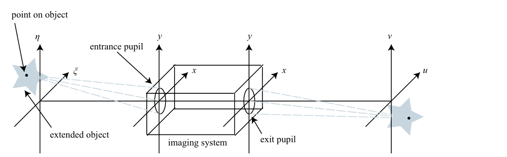
  <figcaption>图 5.1 成像系统基本模型：物面 \((\xi,\eta)\)、入瞳与出瞳 \((x,y)\)、像面 \((u,v)\)；每个物点的发散球面波经系统变成（理想情形）会聚球面波（截自原书）</figcaption>
</figure>

用射线追踪（CODE V、OSLO、ZEMAX 这类设计软件）可以算出给定物点的波前像差 \(W(x,y)\)。本书不追光线，直接假设 \(W\) 已经拿到，单位是**波**（波长数）；对应的相位是 \(\phi(x,y) = 2\pi W(x,y)\)（弧度）。把光瞳的振幅效应（渐晕、切趾）和像差并进一个复函数——**广义光瞳函数（generalized pupil function）**：

\[
\mathcal{P}(x, y) = P(x, y)\, e^{i 2\pi W(x, y)}.
\tag{5.1}
\]

人话：原书把这行两边都写成 \(P\)（振幅光瞳和广义光瞳同名），笔记用花体 \(\mathcal{P}\) 区分。\(P(x,y)\) 是实值的振幅光瞳（圆孔就是 0/1，环形孔径中间挖洞），\(e^{i2\pi W}\) 是像差相位。记住这个组合——后面所有成像公式里出现的都将是它。

!!! note "拓展：为什么 W 用"波"作单位"
    衍射光学的惯例：说"0.05 波的离焦"比"0.05λ 的光程差"顺口，而且 \(\mathcal{P}\) 里一乘 \(2\pi\) 就得到弧度相位。这个单位选择在 5.2.3 节还有个红利：Strehl 比的常用近似只含 \(\sigma^2_\phi = 4\pi^2\sigma^2\)，\(\sigma\) 以波计的 RMS 波前差——"RMS 半个波以内"立刻能心算 Strehl。

### 5.1.1 Seidel 像差

最直白的表示：把 \(W\) 按**归一化光瞳坐标**（实际径向坐标除以光瞳半径，孔径边缘 \(r=1\)）展开成幂多项式：

\[
\begin{aligned}
W(x, y) = A_0 &+ A_1 r\cos\theta + A_2 r\sin\theta + A_3 r^2 + A_4 r^2\cos(2\theta) \\
&+ A_5 r^2\sin(2\theta) + A_6 r^3\cos\theta + A_7 r^3\sin\theta + A_8 r^4 + \ldots
\end{aligned}
\tag{5.2}
\]

各项按阶分类，就是表 5.1 的经典六种初级（Seidel）像差。

**表 5.1 Seidel 像差项与名称**

| 项 | 名称（英文） |
| --- | --- |
| \(A_0\) | piston（活塞/平移） |
| \(A_1 r\cos\theta + A_2 r\sin\theta\) | tilt（倾斜） |
| \(A_3 r^2\) | defocus（离焦） |
| \(A_4 r^2\cos(2\theta) + A_5 r^2\sin(2\theta)\) | astigmatism（像散） |
| \(A_6 r^3\cos\theta + A_7 r^3\sin\theta\) | coma（彗差） |
| \(A_8 r^4\) | spherical aberration（球差） |

系数 \(A_i\) 一般随视场角（物点离光轴的远近）变化；本章按原书的约定把它们当常量——即所有物点共享同一组像差。若每个物点像差不同，就得对每个物点分别仿真一次。

### 5.1.2 Zernike 圆多项式

Seidel 多项式胜在直观（直接来自光线追迹），数学性质却差：在圆形孔径上**既不正交也不完备**。像差一复杂就需要更好的基底——**Zernike 圆多项式（Zernike circle polynomials）**在单位圆上完备且正交（圆环、高斯孔径也有对应的 Zernike 变体，本书只讲圆的）。本书采用 **Noll 约定**：双指标定义为

\[
Z_n^m(r, \theta) = \sqrt{2(n+1)}\, R_n^m(r)\, G_m(\theta),
\tag{5.3}
\]

单指标 \(i\) 版本为

\[
Z_i(r, \theta) =
\begin{cases}
\sqrt{2(n+1)}\, R_n^m(r)\, G_m(\theta), & m \neq 0,\\[2pt]
\sqrt{n+1}\, R_n^0(r), & m = 0.
\end{cases}
\tag{5.4}
\]

!!! warning "原书笔误：式 (5.4) 的 m=0 分支缺 \(\sqrt{n+1}\)"
    原书 (5.4) 的 m=0 分支印的是 \(Z_i = R_n^0(r)\)，丢了归一化因子 \(\sqrt{n+1}\)；(5.3) 直接代 \(m=0\) 也会多出 \(\sqrt{2}\)。判据有三：Listing 5.1 第 9 行写的是 `Z = sqrt(n+1)*zrf(n,0,r)`；表 5.2 的 \(Z_4=\sqrt{3}(2r^2-1)\)（\(n=2\)，\(\sqrt{n+1}=\sqrt{3}\)）也带因子；正交性 (5.9) 的 \(\int\!\int Z_i^2\,r\,dr\,d\theta=\pi\) 只有补上 \(\sqrt{n+1}\) 才成立（\(\int_0^1 (R_2^0)^2 r\,dr = 1/6\)，\(2\pi\times 3\times\frac16=\pi\)）。工程 1 已按修正实现并数值复核。

径向与角向因子：

\[
R_n^m(r) = \sum_{s=0}^{(n-m)/2} \frac{(-1)^s\,(n-s)!}{s!\,\left(\frac{n+m}{2}-s\right)!\,\left(\frac{n-m}{2}-s\right)!}\; r^{\,n-2s},
\tag{5.5a}
\]

\[
G_m(\theta) =
\begin{cases}
\sin(m\theta), & i\ \text{奇},\\
\cos(m\theta), & i\ \text{偶}.
\end{cases}
\tag{5.5b}
\]

(5.5a) 的阶乘在代码里用 Gamma 函数实现（\(s! = \Gamma(s+1)\)）——原书注释明说：gamma 比 factorial 执行快得多。(5.5b) 的 sin/cos 由**单指标 \(i\) 的奇偶**决定：\(i\) 奇取 sin、\(i\) 偶取 cos。\((n,m)\to i\) 的映射规则偏繁，直接查表——表 5.2 列出前 37 项（原书标题写"前 36 项"，实际列到 \(i=37\) 的三级球差，一并勘误）。

**表 5.2 前 37 项 Zernike 多项式（Noll 约定，按原书重排）**

| \(n\) | \(m\) | \(i\) | \(Z_i(r,\theta)\) | 名称 |
| --- | --- | --- | --- | --- |
| 0 | 0 | 1 | \(1\) | piston 活塞 |
| 1 | 1 | 2 | \(2r\cos\theta\) | x tilt x 倾斜 |
| 1 | 1 | 3 | \(2r\sin\theta\) | y tilt y 倾斜 |
| 2 | 0 | 4 | \(\sqrt{3}\,(2r^2-1)\) | defocus 离焦 |
| 2 | 2 | 5 | \(\sqrt{6}\,r^2\sin(2\theta)\) | y primary astigmatism y 初级像散 |
| 2 | 2 | 6 | \(\sqrt{6}\,r^2\cos(2\theta)\) | x primary astigmatism x 初级像散 |
| 3 | 1 | 7 | \(\sqrt{8}\,(3r^3-2r)\sin\theta\) | y primary coma y 初级彗差 |
| 3 | 1 | 8 | \(\sqrt{8}\,(3r^3-2r)\cos\theta\) | x primary coma x 初级彗差 |
| 3 | 3 | 9 | \(\sqrt{8}\,r^3\sin(3\theta)\) | y trefoil y 三叶草 |
| 3 | 3 | 10 | \(\sqrt{8}\,r^3\cos(3\theta)\) | x trefoil x 三叶草 |
| 4 | 0 | 11 | \(\sqrt{5}\,(6r^4-6r^2+1)\) | primary spherical 初级球差 |
| 4 | 2 | 12 | \(\sqrt{10}\,(4r^4-3r^2)\cos(2\theta)\) | x secondary astigmatism x 次级像散 |
| 4 | 2 | 13 | \(\sqrt{10}\,(4r^4-3r^2)\sin(2\theta)\) | y secondary astigmatism y 次级像散 |
| 4 | 4 | 14 | \(\sqrt{10}\,r^4\cos(4\theta)\) | x tetrafoil x 四叶草 |
| 4 | 4 | 15 | \(\sqrt{10}\,r^4\sin(4\theta)\) | y tetrafoil y 四叶草 |
| 5 | 1 | 16 | \(\sqrt{12}\,(10r^5-12r^3+3r)\cos\theta\) | x secondary coma x 次级彗差 |
| 5 | 1 | 17 | \(\sqrt{12}\,(10r^5-12r^3+3r)\sin\theta\) | y secondary coma y 次级彗差 |
| 5 | 3 | 18 | \(\sqrt{12}\,(5r^5-4r^3)\cos(3\theta)\) | x secondary trefoil x 次级三叶草 |
| 5 | 3 | 19 | \(\sqrt{12}\,(5r^5-4r^3)\sin(3\theta)\) | y secondary trefoil y 次级三叶草 |
| 5 | 5 | 20 | \(\sqrt{12}\,r^5\cos(5\theta)\) | x pentafoil x 五叶草 |
| 5 | 5 | 21 | \(\sqrt{12}\,r^5\sin(5\theta)\) | y pentafoil y 五叶草 |
| 6 | 0 | 22 | \(\sqrt{7}\,(20r^6-30r^4+12r^2-1)\) | secondary spherical 次级球差 |
| 6 | 2 | 23 | \(\sqrt{14}\,(15r^6-20r^4+6r^2)\sin(2\theta)\) | y tertiary astigmatism y 三级像散 |
| 6 | 2 | 24 | \(\sqrt{14}\,(15r^6-20r^4+6r^2)\cos(2\theta)\) | x tertiary astigmatism x 三级像散 |
| 6 | 4 | 25 | \(\sqrt{14}\,(6r^6-5r^4)\sin(4\theta)\) | y secondary tetrafoil y 次级四叶草 |
| 6 | 4 | 26 | \(\sqrt{14}\,(6r^6-5r^4)\cos(4\theta)\) | x secondary tetrafoil x 次级四叶草 |
| 6 | 6 | 27 | \(\sqrt{14}\,r^6\sin(6\theta)\) | —（原书未命名） |
| 6 | 6 | 28 | \(\sqrt{14}\,r^6\cos(6\theta)\) | —（原书未命名） |
| 7 | 1 | 29 | \(4\,(35r^7-60r^5+30r^3-4r)\sin\theta\) | y tertiary coma y 三级彗差 |
| 7 | 1 | 30 | \(4\,(35r^7-60r^5+30r^3-4r)\cos\theta\) | x tertiary coma x 三级彗差 |
| 7 | 3 | 31 | \(4\,(21r^7-30r^5+10r^3)\sin(3\theta)\) | —（原书未命名） |
| 7 | 3 | 32 | \(4\,(21r^7-30r^5+10r^3)\cos(3\theta)\) | —（原书未命名） |
| 7 | 5 | 33 | \(4\,(7r^7-6r^5)\sin(5\theta)\) | —（原书未命名） |
| 7 | 5 | 34 | \(4\,(7r^7-6r^5)\cos(5\theta)\) | —（原书未命名） |
| 7 | 7 | 35 | \(4\,r^7\sin(7\theta)\) | —（原书未命名） |
| 7 | 7 | 36 | \(4\,r^7\cos(7\theta)\) | —（原书未命名） |
| 8 | 0 | 37 | \(3\,(70r^8-140r^6+90r^4-20r^2+1)\) | tertiary spherical 三级球差 |

图 5.2 给了同一族（x 像散）三个阶数的直观感受：\(i=6,12,24\) 的角向都是 \(\cos 2\theta\)，径向幂次分别是 2、4、6——阶数越高，从圆心到边缘的峰谷与零点越多。

<figure>
  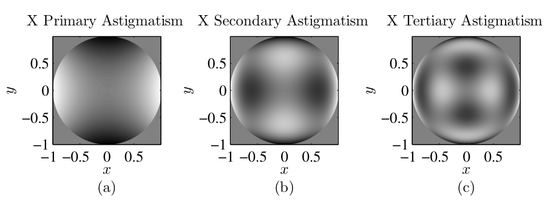
  <figcaption>图 5.2 三阶 x 像散：(a) \(i=6\) 初级、(b) \(i=12\) 次级、(c) \(i=24\) 三级——角向相同、径向越来越细（截自原书）</figcaption>
</figure>

原书 Listing 5.1 的 `zernike` 函数（共 27 行）负责按 (5.4) 求值。它要 `load('zernike_index')` 读入 \((n,m)\mapsto i\) 的映射表；工程 1 的 Python 版把这个映射直接按表 5.2 的规则生成（按 \(n\) 升序、行内 \(|m|\) 升序、\(m=0\) 占一行、\(|m|>0\) 占两行，sin/cos 由 \(i\) 奇偶定）：

=== "MATLAB"

    ```matlab
    % Listing 5.1：zernike（原书 zernike.m，含子函数 zrf）
    function Z = zernike(i, r, theta)
    % function Z = zernike(i, r, theta)
    % Creates the Zernike polynomial with mode index i,
    % where i = 1 corresponds to piston
    load('zernike_index'); % load the mapping of (n,m) to i
    n = zernike_index(i,1);
    m = zernike_index(i,2);
    if m==0
        Z = sqrt(n+1)*zrf(n,0,r);          % 勘误对照：m=0 带 sqrt(n+1)
    else
        if mod(i,2) == 0                   % i is even
            Z = sqrt(2*(n+1))*zrf(n,m,r) .* cos(m*theta);
        else                               % i is odd
            Z = sqrt(2*(n+1))*zrf(n,m,r) .* sin(m*theta);
        end
    end
    return

    % Zernike radial function
    function R = zrf(n, m, r)
    R = 0;
    for s = 0 : ((n-m)/2)
        num = (-1)^s * gamma(n-s+1);       % s! 用 gamma 实现，更快
        denom = gamma(s+1) * gamma((n+m)/2-s+1) ...
            * gamma((n-m)/2-s+1);
        R = R + num / denom * r.^(n-2*s);
    end
    end
    ```

=== "Python"

    ```python
    # 工程 1 的 zernike 实现（映射按表 5.2 规则生成，不依赖 .mat 文件）
    def zrf(n, m, r):
        """Zernike 径向多项式 R_n^m(r)（式 5.5a）。阶乘用 Gamma 函数
        实现（s! = Gamma(s+1)），与原书注释一致：gamma 比 factorial 快。"""
        r = np.asarray(r, dtype=float)
        R = np.zeros_like(r)
        for s in range(0, (n - m) // 2 + 1):
            num = (-1.0) ** s * gamma(n - s + 1.0)
            den = (gamma(s + 1.0) * gamma((n + m) / 2.0 - s + 1.0)
                   * gamma((n - m) / 2.0 - s + 1.0))
            R = R + num / den * r ** (n - 2 * s)
        return R


    def zernike(i, r, theta):
        """书式 (5.4)（m=0 分支已按勘误补 sqrt(n+1)）+ Listing 5.1。
        i 从 1 开始（i=1 是 piston）；r 是归一化半径（孔径边缘 r=1）。"""
        _, n, m = _ZIDX[i - 1]                 # _build_zernike_index 生成的映射
        R = zrf(n, m, r)
        if m == 0:
            return np.sqrt(n + 1.0) * R        # Listing 5.1 第 9 行
        G = np.cos(m * theta) if i % 2 == 0 else np.sin(m * theta)  # 式 (5.5b)
        return np.sqrt(2.0 * (n + 1.0)) * R * G
    ```

模式定义齐了，任意波前就能展开成 **Zernike 级数（Zernike series）**：

\[
W(r, \theta) = \sum_{i=1}^{\infty} a_i Z_i(r, \theta).
\tag{5.6}
\]

这套基的核心卖点在正交性：

\[
\int_0^1 R_n^m(r)\, R_{n'}^m(r)\, r\, dr = \frac{1}{2(n+1)}\,\delta_{nn'},
\tag{5.7}
\]

\[
\int_0^{2\pi} G_m(\theta)\, G_{m'}(\theta)\, d\theta = \pi\,\delta_{mm'},
\tag{5.8}
\]

\[
\Rightarrow\quad \int_0^{2\pi}\!\!\int_0^1 Z_i(r, \theta)\, Z_{i'}(r, \theta)\; r\, dr\, d\theta = \pi\,\delta_{ii'}.
\tag{5.9}
\]

!!! warning "原书笔误：式 (5.7) 印成 \(1/(2n+1)\)"
    径向正交积分的正确值是 \(\delta_{nn'}/[2(n+1)]\)。两个反例：\(n=0\) 时 \(R_0^0=1\)，\(\int_0^1 r\,dr = \tfrac12\)，而书印公式给出 1；\(n=2\) 时 \(\int_0^1 (2r^2-1)^2 r\,dr = \tfrac16\)（数值积分复核 \(0.166667\)），书印公式给出 \(1/5=0.2\)。与 (5.9)、表 5.2、Listing 5.1 三方交叉可证。记住 (5.7)–(5.9) 合起来的效果：**每个 \(Z_i\) 在单位圆上的模方积分恒等于 \(\pi\)**——"单位 RMS"归一化。

由正交性立刻得到系数公式（正交投影）：

\[
a_i = \frac{\int_0^{2\pi}\!\!\int_0^1 W(r,\theta)\, Z_i(r,\theta)\; r\, dr\, d\theta}{\int_0^{2\pi}\!\!\int_0^1 Z_i^2(r,\theta)\; r\, dr\, d\theta}.
\tag{5.10}
\]

实际数据多半是笛卡尔网格上的二维采样（仿真输出或干涉仪测量），把 (5.10) 改写成网格求和：

\[
a_i = \frac{\sum_p \sum_q W(x_p, y_q)\, Z_i(x_p, y_q)}{\sum_p \sum_q Z_i^2(x_p, y_q)}.
\tag{5.11}
\]

求和跑遍孔径内的所有 \((p,q)\)。(5.11) 只依赖"孔径内有哪些样本"，不依赖样本坐标的具体数值——原书为此换记号：

\[
W_{pq} = W(x_p, y_q), \qquad Z_{i,pq} = Z_i(x_p, y_q),
\tag{5.12}
\]

\[
a_i = \frac{\sum_p \sum_q W_{pq}\, Z_{i,pq}}{\sum_p \sum_q Z_{i,pq}^2}.
\tag{5.13}
\]

再把二维下标压成一个线性下标 \(j\)（按列主序、行主序都行——C/C++ 天然行主序，MATLAB 天然列主序，Python 的布尔掩码是行主序；顺序无关紧要，只要 \(W\) 和 \(Z\) 用同一种顺序）：

\[
a_i = \frac{\sum_j W_j\, Z_{i,j}}{\sum_j Z_{i,j}^2}.
\tag{5.14}
\]

反过来，用前 \(n_Z\) 个模式重构波前：

\[
W_j \cong \sum_{i=1}^{n_Z} Z_{i,j}\, a_i.
\tag{5.15}
\]

原书特别提醒：\(\cong\) 是**近似号**——离散网格上的正交性只是近似成立，格点越密越准（工程 1 实测：N=32 的 Gram 矩阵对角偏差 \(1.1\times10^{-1}\)，N=128 降到 \(1.4\times10^{-2}\)，加密 4 倍偏差降约 16 倍，正是二阶求和的 \(O(\delta^2)\) 收敛）。

线性下标带来一个漂亮的矩阵解释：把 \(W\) 排成列向量、把每个 Zernike 模式在孔径内的采样排成矩阵 \(Z\) 的一列：

\[
Z = \left[Z_1 \mid Z_2 \mid \ldots \mid Z_{n_Z}\right],
\tag{5.16}
\]

\[
W = Z\,A.
\tag{5.17}
\]

\(Z\) 的行数 = 孔径内网格点数，列数 = 模式数。学过线性代数的你大概已经认出 (5.14) 是 (5.17) 的 Moore–Penrose 伪逆（最小二乘）解：

\[
A = \left(Z^T Z\right)^{-1} Z^T W.
\tag{5.18}
\]

人话：**求 Zernike 系数 = 解一个最小二乘问题**。MATLAB 一行 `A = Z \ W`，Python 一行 `np.linalg.lstsq(Z, W)`——不必手写 (5.18)。原书 Listing 5.2 用 \(N=32\)、\(L=2\) 的网格试了一发：\(W = 0.5\,Z_2 + 0.25\,Z_4 - 0.6\,Z_{21}\)，投影回来的 \(A\) 正是 \([0.5,\ 0.25,\ -0.6]\)。工程 1 复现实测：系数精确恢复，拟合残差最大 \(8.9\times10^{-16}\)（浮点精度级别——因为 \(W\) 本身就住在 \(\{Z_2,Z_4,Z_{21}\}\) 张成的子空间里）。

=== "MATLAB"

    ```matlab
    % Listing 5.2：example_zernike_projection.m（原书 23 行）
    N = 32;              % number of grid points per side
    L = 2;               % total size of the grid [m]
    delta = L / N;       % grid spacing [m]
    % cartesian & polar coordinates
    [x y] = meshgrid((-N/2 : N/2-1) * delta);
    [theta r] = cart2pol(x, y);
    % unit circle aperture
    ap = circ(x, y, 2);
    % 3 Zernike modes
    z2 = zernike(2, r, theta) .* ap;
    z4 = zernike(4, r, theta) .* ap;
    z21 = zernike(21, r, theta) .* ap;
    % create the aberration
    W = 0.5 * z2 + 0.25 * z4 - 0.6 * z21;
    % find only grid points within the aperture
    idx = logical(ap);
    % perform linear indexing in column-major order
    W = W(idx);
    Z = [z2(idx) z4(idx) z21(idx)];
    % solve the system of equations to compute coefficients
    A = Z \ W
    ```

=== "Python"

    ```python
    # 工程 1 验证 1 的对应片段（A = Z\W 的 numpy 版）
    z2, z4, z21 = (zernike(i, r, theta) * ap for i in (2, 4, 21))
    W = 0.5 * z2 + 0.25 * z4 - 0.6 * z21
    Z = np.column_stack([z2[idxAp], z4[idxAp], z21[idxAp]])   # 式 (5.16)
    A, *_ = np.linalg.lstsq(Z, W[idxAp], rcond=None)          # 式 (5.18)
    # 实测：A = [+0.500000 +0.250000 -0.600000]，拟合残差 max = 8.9e-16
    ```

### 5.1.2.1 分解与模式去除

知道波前的 Zernike 成分有什么用？一个直接的应用是**模式去除**：真实像差可能包含极多模式，但你只关心（或只能矫正）其中一部分。定义**模式受限版本（mode-limited version）**：

\[
W'(r, \theta) = \sum_{i=1}^{n_Z} a_i Z_i(r, \theta),
\tag{5.19}
\]

它是 \(W\) 的近似，满足严格分解：

\[
W(r, \theta) = W'(r, \theta) + \sum_{i=n_Z+1}^{\infty} a_i Z_i(r, \theta).
\tag{5.20}
\]

原书给了两个日常例子：

- **眼镜与隐形眼镜**：模式 1–3（piston、tilt）不影响视觉质量，直接忽略；矫正镜片补偿 4（离焦）、5/6（像散），\(n_Z=6\)；眼睛看到的残差是 \(i\ge 7\) 的模式——幸运的是这些高阶系数通常小得多。
- **自适应光学（adaptive optics）**：望远镜的"动态可重构隐形眼镜"。波前传感器以每秒上万帧的速率感知像差，驱动变形镜（deformable mirror）补偿——大气湍流造成的相位屏就是这样被压下去的（湍流屏的生成本身在 9.3 节）。变形镜只能复现有限个模式，所以总有残余像差没矫正掉；系统通常还配一块快速倾斜镜先把 tilt（模式 2/3）摘掉，把模式 4 及以上留给变形镜。

原书 Listing 5.3 演示了完整流程：生成一帧湍流相位屏（\(N=40\)、\(L=2\)、\(r_0 = L/20\)，`ft_phase_screen` 来自第 9 章），投影到 100 个 Zernike 模式，再合成模式受限版本。图 5.3 与图 5.4 是结果的两半：图 5.3 是原始屏和限 3/16/36/100 阶的版本——模式越多越像原图；图 5.4 是对应的**残余相位**（(5.20) 的第二项）——模式越多残余结构越细。左上角（限 3 阶的残余）就是快速倾斜镜摘走 tilt 之后变形镜要面对的东西；右下角（限 100 阶的残余）是 100 阶变形镜之后仍然让像变糊的部分。

<figure>
  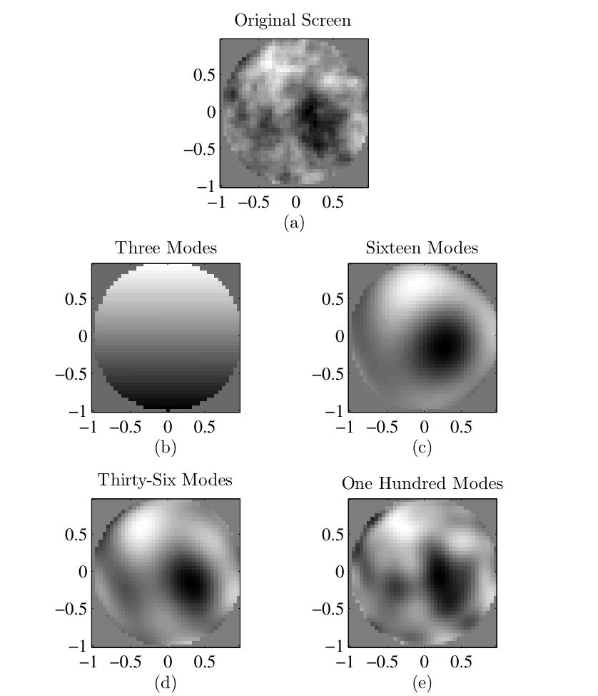
  <figcaption>图 5.3 模式受限相位屏：(a) 原始湍流屏，(b)–(e) 限 3/16/36/100 阶（截自原书）</figcaption>
</figure>

<figure>
  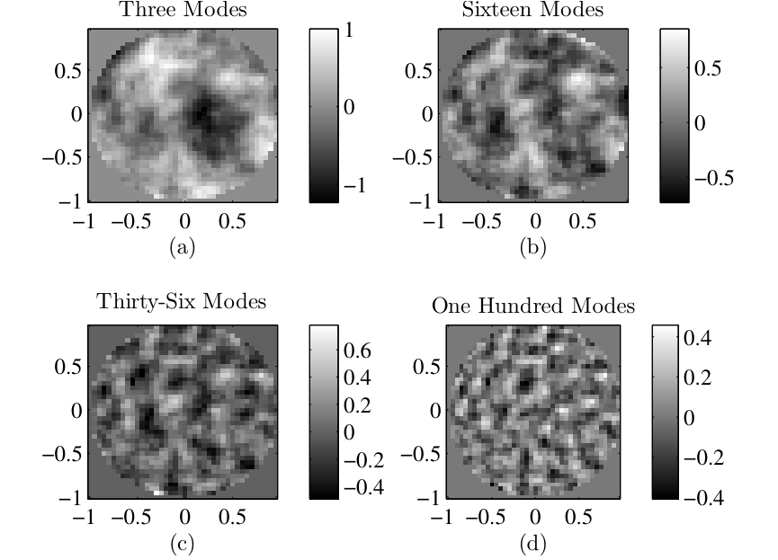
  <figcaption>图 5.4 模式受限的残余相位（图 5.3 各情形的补集）：阶数越高残余越细、方差越小（截自原书）</figcaption>
</figure>

=== "MATLAB"

    ```matlab
    % Listing 5.3：example_zernike_synthesis.m（原书 33 行）
    % The aberration in this example is a random draw of an
    % atmospheric phase screen, discussed in Sec. 9.3.
    N = 40;              % number of grid points per side
    L = 2;               % total size of the grid [m]
    delta = L / N;       % grid spacing [m]
    % cartesian & polar coordinates
    [x y] = meshgrid((-N/2 : N/2-1) * delta);
    [theta r] = cart2pol(x, y);
    % unit circle aperture
    ap = circ(x, y, 2);
    % indices of grid points in aperture
    idxAp = logical(ap);
    % create atmospheric phase screen
    r0 = L / 20;
    screen = ft_phase_screen(r0, N, delta, inf, 0) ...
        / (2*pi) .* ap;                  % rad -> 波，再乘孔径
    W = screen(idxAp);                   % perform linear indexing

    %%% analyze screen
    nModes = 100;                        % number of Zernike modes
    % create matrix of Zernike polynomial values
    Z = zeros(numel(W), nModes);
    for idx = 1 : nModes
        temp = zernike(idx, r, theta);
        Z(:,idx) = temp(idxAp);
    end
    % compute mode coefficients
    A = Z \ W;
    % synthesize mode-limited screen
    W_prime = Z*A;
    % reshape mode-limited screen into 2-D for display
    scr = zeros(N);
    scr(idxAp) = W_prime;
    ```

=== "Python"

    ```python
    # 工程 1 验证 3 的对应片段（相位屏用内置最小谱法替代第 9 章的
    # ft_phase_screen；N 加密到 128 以压低离散正交误差）
    phi = phase_screen_min(r0, N3, delta3, L0=np.inf, seed=7,
                           target_rms_waves=0.6)          # rad
    W3 = phi / (2 * np.pi) * ap3                          # rad -> 波（Listing 5.3 第 16 行）
    Wvec = W3[ap3]                                        # 线性索引
    Zmat = np.zeros((Wvec.size, nModes))
    for idx in range(nModes):
        temp = zernike(idx + 1, r3, t3)
        Zmat[:, idx] = temp[ap3]
    Amode, *_ = np.linalg.lstsq(Zmat, Wvec, rcond=None)   # A = Z \ W
    ```

工程 1 在此之上多走了两步（图 5-8）：一是画出相位屏的 **Zernike 系数谱**（\(|a_i|\) 随 \(i\) 大致按幂律下滑，湍流的统计性质写在 9.3 节）；二是把"残差方差的两种算法"摆在一起互证——直接算 \(\mathrm{mean}[(W-W')^2]\)，与用 (5.26) 从系数尾部算 \(\sum_{i>n_Z}a_i^2\)，两条曲线在光滑波前上重合，在湍流屏上差出一个恒定的 \(0.0057\)——**那是 200 阶也装不下的网格尺度内容**，恰好演示了原书 (5.15) "只是近似"的告诫。

<figure>
  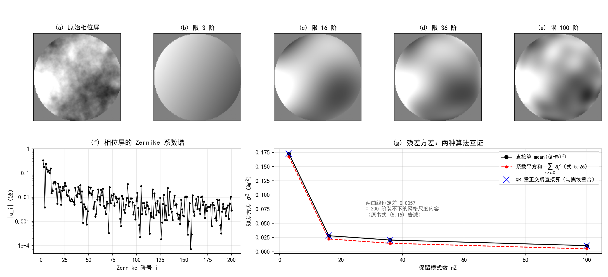
  <figcaption>图 5-8（自绘仿真）工程 1 复现原书图 5.3/5.4 并扩展：(a)–(e) 原始屏与限 3/16/36/100 阶；(f) Zernike 系数谱；(g) 残差方差两算法——红线（系数平方和）与黑线（直接算）差恒定 0.0057，即 200 阶外的网格尺度内容</figcaption>
</figure>

### 5.1.2.2 RMS 波前像差

评价像差大小时常用孔径上的 **RMS 值 \(\sigma\)**。均方偏差直接按定义算：

\[
\sigma^2 = \frac{1}{\pi} \int_0^{2\pi}\!\!\int_0^1 \left[W(r, \theta) - \bar{W}\right]^2 r\, dr\, d\theta,
\tag{5.21}
\]

\(\bar{W}\) 是 \(W\) 在孔径上的均值（单位圆面积是 \(\pi\)，所以归一化因子是 \(1/\pi\)）。把 (5.6) 代进去——注意均值正好被 \(i=1\) 的 piston 项吸收，所以级数从 \(i=2\) 起：

\[
\sigma^2 = \frac{1}{\pi} \int_0^{2\pi}\!\!\int_0^1 \left[\sum_{i=2}^{\infty} a_i Z_i(r, \theta)\right]^2 r\, dr\, d\theta.
\tag{5.22}
\]

把平方拆成两个级数的乘积，正交性 (5.9) 会让所有 \(i\neq i'\) 的交叉项消失：

\[
\sigma^2 = \frac{1}{\pi} \int_0^{2\pi}\!\!\int_0^1 \left[\sum_{i=2}^{\infty} a_i Z_i\right] \left[\sum_{i'=2}^{\infty} a_{i'} Z_{i'}\right] r\, dr\, d\theta
\tag{5.23}
\]

\[
= \frac{1}{\pi} \sum_{i=2}^{\infty} a_i \sum_{i'=2}^{\infty} a_{i'} \int_0^{2\pi}\!\!\int_0^1 Z_i(r, \theta)\, Z_{i'}(r, \theta)\, r\, dr\, d\theta
\tag{5.24}
\]

\[
= \frac{1}{\pi} \sum_{i=2}^{\infty} a_i \sum_{i'=2}^{\infty} a_{i'}\, \pi\,\delta_{ii'}
\tag{5.25}
\]

\[
= \sum_{i=2}^{\infty} a_i^2.
\tag{5.26}
\]

人话：**波前方差 = 从 \(i=2\) 起的系数平方和**。不用再算任何积分——正交基把这步变成加法。这就是 5.1.2 开头"单位 RMS 归一化"（每个 \(\int\!\int Z_i^2 = \pi\)）兑现红利的地方：\(a_i\) 本身就是第 \(i\) 个模式对 RMS 的贡献（单位：波）。

工程 1 数值核对：光滑波前 \(W = 0.5 Z_2 + 0.25 Z_4 - 0.6 Z_{21}\) 的三个模式全在 \(i\ge2\)，(5.26) 给 \(\sigma^2 = 0.5^2+0.25^2+0.6^2 = 0.6725\)；直接按 (5.21) 离散求均方，N=32 得 \(0.6422\)（差 \(4.5\times10^{-2}\)）、N=128 得 \(0.6693\)（差 \(4.7\times10^{-3}\)）——随网格加密收敛到系数平方和。图 5-8(g) 的湍流屏曲线则是"恒差 = 高阶内容"的活例子。

### 工程 1：Zernike 与波前模式分解（Listings 5.1–5.3 复现）

对应文件 `matlab/waveprop/ch5/ch5_zernike.m`（Python 版在本 notebook 工程 1 cell，`python/waveprop/第5章_代码实战.ipynb`）：

=== "MATLAB"

    ```matlab
        ```matlab
    %% ===== 书 Schmidt PM199 第 5 章 =====
    %  成像系统与像差：Zernike 圆多项式与波前模式分解
    %  （原书 5.1 节，Listings 5.1-5.3；与 python/waveprop/第5章_代码实战.ipynb
    %    工程 1 数值行为一致，本机无 MATLAB 时以 Python 实跑结果为准）
    %
    %  原书要点：
    %    广义光瞳函数 P = P_ap .* exp(i*2*pi*W)（式 5.1），波前差 W 以"波"为单位；
    %    Noll 单指标 Zernike：Z_i = sqrt(2(n+1)) R_n^m(r) G_m(theta)（式 5.3/5.4），
    %    径向 R_n^m 按 gamma 函数实现（式 5.5a，原书注释：gamma 比 factorial 快）；
    %    单位圆上正交（式 5.7-5.9）-> 系数 = 正交投影/最小二乘（式 5.10-5.18），
    %    W = Z*A（式 5.17），A = (Z'*Z)^{-1} Z'*W（式 5.18，MATLAB 里就是 Z\W）；
    %    模式受限版 W' = sum_{i<=nZ} a_i Z_i（式 5.19-5.20）；
    %    波前方差 sigma^2 = sum_{i>=2} a_i^2（式 5.21-5.26）。
    %
    %  原书勘误（本脚本按修正实现）：
    %    (a) 式 (5.4)/(5.3) 的 m=0 情形印成 Z_i = R_n^0(r)——缺 sqrt(n+1)
    %        归一化因子；Listing 5.1 第 9 行 sqrt(n+1)*zrf(n,0,r) 才是对的
    %        （对照表 5.2 的 Z4 = sqrt(3)(2r^2-1) 可证）。
    %    (b) 式 (5.7) 印成 1/(2n+1)——应为 1/(2(n+1))。n=0 即反例：
    %        int_0^1 1*1*r dr = 1/2 而非 1；n=2 时数值积分 = 1/6 而非 1/5。
    %    (c) 表 5.2 标题写"前 36 项"，实际列出 i = 1..37（含三级球差）。
    %
    %  验证（编号与 notebook 工程 1 一致）：
    %   (0) 表 5.2 抽查：生成的 (i,n,m) 映射与书中多项式逐一对照；
    %   (1) Listing 5.2 复现：W = 0.5*Z2 + 0.25*Z4 - 0.6*Z21，Z\W 精确恢复权重；
    %   (2) Gram 矩阵正交性（孔径内求和）+ 式 (5.7) 勘误的数值积分复核 +
    %       sigma^2 两种算法互证（式 5.21 离散 vs 式 5.26）；
    %   (3) Listing 5.3 复现：随机相位屏 -> 200 阶投影 -> 模式受限 3/16/36/100 阶，
    %       残差方差两种算法互证（差值 = 200 阶装不下的网格尺度内容）。
    %
    %  MATLAB/Python 差异（对应 notebook 内注释）：
    %    - 线性索引：MATLAB 按列主序（原书 5.1.2 节点名 MATLAB 用 column-major），
    %      logical 掩码索引天然给出列主序向量，与式 (5.14) 约定一致；numpy 布尔
    %      掩码是行主序——顺序不同不影响最小二乘的解。
    %    - Z\W 即式 (5.18) 的最小二乘解，等价 np.linalg.lstsq。
    %    - 相位屏随机数：rng 与 numpy default_rng 实现不同，屏不逐点一致，
    %      统计结论一致。
    %    - 本地函数需 R2016b+；sum(...,'all') / max(...,[],'all') 需 R2018b+。
    clear; clc; close all;

    %% 验证 0：表 5.2 抽查
    rr = linspace(0, 1, 41);
    tt = linspace(0, 2*pi, 73);
    [RR, TT] = meshgrid(rr, tt);
    checks = {
        1,  @(r,t) ones(size(r)),                          'Z1  = 1 (piston)';
        2,  @(r,t) 2*r.*cos(t),                            'Z2  = 2r cos(theta)';
        4,  @(r,t) sqrt(3)*(2*r.^2-1),                     'Z4  = sqrt3(2r^2-1)';
        11, @(r,t) sqrt(5)*(6*r.^4-6*r.^2+1),              'Z11 = sqrt5(6r^4-6r^2+1)';
        22, @(r,t) sqrt(7)*(20*r.^6-30*r.^4+12*r.^2-1),    'Z22 = sqrt7(20r^6-...-1)';
        37, @(r,t) 3*(70*r.^8-140*r.^6+90*r.^4-20*r.^2+1), 'Z37 = 3(70r^8-...+1)'};
    fprintf('===== 验证 0：表 5.2 抽查 =====\n');
    for k = 1:size(checks, 1)
        err = max(abs(zernike(checks{k,1}, RR, TT) - checks{k,2}(RR, TT)), [], 'all');
        fprintf('    %-24s max|diff| = %.2e\n', checks{k,3}, err);
    end

    %% 验证 1：Listing 5.2 投影复现（模式 2/4/21）
    N = 32;  L = 2;  delta = L / N;
    [x, y] = meshgrid((-N/2 : N/2-1) * delta);
    r = hypot(x, y);  theta = atan2(y, x);
    ap = double(hypot(x, y) <= 1);            % circ(x,y,2)：直径 2 -> 单位圆孔径
    idxAp = logical(ap);
    z2  = zernike(2,  r, theta)  .* ap;
    z4  = zernike(4,  r, theta)  .* ap;
    z21 = zernike(21, r, theta)  .* ap;
    W = 0.5*z2 + 0.25*z4 - 0.6*z21;           % 原书 Listing 5.2 第 16 行
    Z = [z2(idxAp) z4(idxAp) z21(idxAp)];     % 式 (5.16)：列主序线性索引
    A = Z \ W(idxAp);                         % 式 (5.18) 的 MATLAB 一行版
    fprintf('===== 验证 1：Listing 5.2 投影复现 =====\n');
    fprintf('    恢复系数 A = [%+.6f %+.6f %+.6f]（真值 [0.5 0.25 -0.6]）\n', A);
    fprintf('    拟合残差 max = %.2e\n', max(abs(Z*A - W(idxAp)), [], 'all'));

    %% 验证 2：正交性 + 式 (5.7) 勘误复核 + sigma^2 互证
    nG = 12;
    G = zeros(nG);
    for ii = 1:nG
        Zi = zernike(ii, r, theta);
        for jj = ii:nG
            Zj = zernike(jj, r, theta);
            G(ii, jj) = sum(Zi(idxAp) .* Zj(idxAp)) * delta^2;
        end
    end
    G = G + G.' - diag(diag(G));
    off = max(abs(G - diag(diag(G))), [], 'all') / pi;
    diagErr = max(abs(diag(G)/pi - 1), [], 'all');
    fprintf('===== 验证 2：正交性 + 式 (5.7) 勘误 =====\n');
    fprintf('    N=32：Gram 对角/pi 最大偏差 %.2e，非对角最大 |G_ij|/pi %.2e\n', ...
        diagErr, off);
    % 式 (5.7) 书印 1/(2n+1)：对 n=2 即 1/5；真实值 = 1/[2(n+1)] = 1/6
    val = integral(@(q) (2*q.^2 - 1).^2 .* q, 0, 1);
    fprintf('    int_0^1 (R_2^0)^2 r dr = %.6f = 1/6 = 1/[2(n+1)]\n', val);
    fprintf('    书式 (5.7) 印的是 1/(2n+1) = %.6f —— 与表 5.2/Listing 5.1 矛盾，系印刷错误\n', 1/5);
    % RMS 方差恒等式（式 5.21 vs 5.26）：W = 0.5 Z2 + 0.25 Z4 - 0.6 Z21
    % 全部 i>=2，sigma^2 应 = 0.5^2 + 0.25^2 + 0.6^2 = 0.6725
    Wsm = 0.5*z2 + 0.25*z4 - 0.6*z21;
    sig2_direct = mean((Wsm(idxAp) - mean(Wsm(idxAp))).^2);   % 式 (5.21) 离散版
    fprintf('    光滑波前 sigma^2：N=32 直接 = %.4f vs 系数平方和 = %.4f（相对差 %.1e）\n', ...
        sig2_direct, 0.6725, abs(sig2_direct - 0.6725)/0.6725);

    %% 验证 3：Listing 5.3 模式分解/合成 + 残差方差恒等式
    N3 = 128;  L3 = 2.0;  delta3 = L3/N3;  r0 = L3/20;
    [x3, y3] = meshgrid((-N3/2 : N3/2-1) * delta3);
    ap3 = hypot(x3, y3) <= 1;
    idxA = logical(ap3);
    phi = phase_screen_min(r0, N3, delta3, 0.6, 7);   % rad
    W3 = phi / (2*pi) .* ap3;                  % rad -> 波（Listing 5.3 第 16 行）
    r3 = hypot(x3, y3);  t3 = atan2(y3, x3);
    Wvec = W3(idxA);
    fprintf('===== 验证 3：Listing 5.3 模式分解/合成 =====\n');
    fprintf('    相位屏：sigma_W = %.4f 波（孔径内 RMS；重定标目标 0.6 为全帧）\n', std(Wvec));
    nModes = 200;
    Zmat = zeros(numel(Wvec), nModes);
    for q = 1:nModes
        tmp = zernike(q, r3, t3);
        Zmat(:, q) = tmp(idxA);
    end
    Amode = Zmat \ Wvec;                       % 式 (5.18)
    fprintf('    200 阶投影：a1..a5 = [%+.4f, %+.4f, %+.4f, %+.4f, %+.4f]\n', Amode(1:5));
    % QR 重正交版：Q 列正交，sum(Bq(nZ+1:end)^2) 精确等于残差均方
    [Q, ~] = qr(Zmat, 0);
    Bq = Q \ Wvec;
    Nap3 = numel(Wvec);
    nZ_list = [3 16 36 100];
    resD = zeros(size(nZ_list));  resC = zeros(size(nZ_list));  resQ = zeros(size(nZ_list));
    for q = 1:numel(nZ_list)
        nZ = nZ_list(q);
        resD(q) = mean((Wvec - Zmat(:,1:nZ)*Amode(1:nZ)).^2);
        resC(q) = sum(Amode(nZ+1:end).^2) / Nap3;
        resQ(q) = mean((Wvec - Q(:,1:nZ)*Bq(1:nZ)).^2);
        fprintf('    nZ=%3d：残差直接=%.6f vs 系数平方和=%.6f（相对差 %.1e）；QR 直接=%.6f\n', ...
            nZ, resD(q), resC(q), abs(resD(q)-resC(q))/resD(q), resQ(q));
    end
    fprintf('    （结论：sigma^2 = sum_{i>=2} a_i^2 在光滑波前上到离散正交精度；'...
        '相位屏上两曲线差恒定 = 200 阶装不下的网格尺度内容，对应式 (5.15) 的告诫）\n');

    %% 绘图：模式受限屏（仿原书图 5.3/5.4）+ 系数谱 + 残差方差
    scrData = {W3, '(a) 原始相位屏'};
    lab = {'3', '16', '36', '100'};
    tags = {'b', 'c', 'd', 'e'};
    for q = 1:4
        scr = zeros(N3);
        scr(idxA) = Zmat(:, 1:nZ_list(q)) * Amode(1:nZ_list(q));
        scrData{end+1} = scr;                 %#ok<SAGROW>
        scrData{end+1} = sprintf('(%s) 限 %s 阶', tags{q}, lab{q});  %#ok<SAGROW>
    end
    figure('Position', [40 40 1400 640]);
    for q = 1:5
        subplot(2, 5, q);
        imagesc(scrData{2*q-1} .* ap3);  colormap gray;  caxis([-1.2 1.2]);
        axis image off;  title(scrData{2*q});
    end
    subplot(2, 5, [6 7]);
    semilogy(2:nModes, abs(Amode(2:end)), 'k.-', 'MarkerSize', 4);
    set(gca, 'YTick', [1e0 1e-1 1e-2 1e-3 1e-4], 'YTickLabel', {'1','0.1','0.01','0.001','1e-4'});
    xlabel('Zernike 阶号 i');  ylabel('|a_i|（波）');
    title('(f) 相位屏的 Zernike 系数谱');  grid on;  ylim([1e-4 1]);
    subplot(2, 5, [8 10]);
    plot(nZ_list, resD, 'ko-', 'LineWidth', 1.2);  hold on;
    plot(nZ_list, resC, 'r.--', 'LineWidth', 1.2, 'MarkerSize', 8);
    plot(nZ_list, resQ, 'bx', 'MarkerSize', 11, 'LineStyle', 'none');
    xlabel('保留模式数 nZ');  ylabel('残差方差 sigma^2（波^2）');
    title('(g) 残差方差：两种算法互证');  grid on;
    legend({'直接算 mean((W-W'')^2)', '系数平方和（式 5.26）', 'QR 重正交后直接算'}, ...
        'FontSize', 8, 'Location', 'northeast');

    %% ===== 本地函数 =====
    function [n, m] = zidx(i)
    % 表 5.2 的 (i,n,m) 映射（Noll 单指标，i 从 1 开始；规则按表归纳）：
    % 按 n 升序，第 n 行占 n+1 个模式；行内 |m| 与 n 同奇偶、升序；
    % m=0 占 1 行，|m|>0 占 2 行（sin/cos 由 i 奇偶定：i 奇 sin，i 偶 cos，
    % 即式 (5.5b)）。列主序/行主序无关紧要，映射本身逐项对上表 5.2。
    persistent rows
    if isempty(rows)
        rows = zeros(0, 2);
        for n0 = 0:40
            for m0 = mod(n0, 2):2:n0
                rows(end+1, :) = [n0, m0];    %#ok<AGROW>
                if m0 > 0
                    rows(end+1, :) = [n0, m0];  %#ok<AGROW>
                end
            end
        end
    end
    n = rows(i, 1);
    m = rows(i, 2);
    end

    function R = zrf(n, m, r)
    % Zernike 径向多项式 R_n^m(r)（式 5.5a）。阶乘按原书注释用 gamma 实现
    % （s! = Gamma(s+1)），比 factorial 快。
    R = zeros(size(r));
    for s = 0:(n-m)/2
        num = (-1)^s * gamma(n - s + 1);
        den = gamma(s+1) * gamma((n+m)/2 - s + 1) * gamma((n-m)/2 - s + 1);
        R = R + num / den * r.^(n - 2*s);
    end
    end

    function Z = zernike(i, r, theta)
    % 书式 (5.4)（m=0 分支已按勘误补 sqrt(n+1)）+ Listing 5.1。
    % i 从 1 开始（i=1 是 piston）；r 是归一化半径（孔径边缘 r=1）。
    [n, m] = zidx(i);
    R = zrf(n, m, r);
    if m == 0
        Z = sqrt(n+1) * R;                    % Listing 5.1 第 9 行
    else
        if mod(i, 2) == 0                     % i 偶 -> cos（式 5.5b）
            Z = sqrt(2*(n+1)) * R .* cos(m*theta);
        else                                  % i 奇 -> sin
            Z = sqrt(2*(n+1)) * R .* sin(m*theta);
        end
    end
    end

    function W = phase_screen_min(r0, N, delta, target_rms_waves, seed)
    % 最小 Kolmogorov 谱法相位屏（单位 rad）。谱 Phi = 0.023 r0^{-5/3} f^{-11/3}
    % （von Karman 去掉外尺度项），粗网格垫零 4 倍把最低频率降到 1/(4L) 弥补
    % 无次谐波时的低频功率缺失，最后按孔径内 RMS 重定标到目标值（单位：波）。
    % 正式的 ft_phase_screen（Kolmogorov + 次谐波）在第 9 章给出。
    rng(seed, 'twister');
    Npad = 4 * N;
    fx = (0:Npad-1) / (Npad*delta);           % 与 ifft2 频率排列一致（= numpy fftfreq）
    fx(fx >= 1/(2*delta)) = fx(fx >= 1/(2*delta)) - 1/delta;
    [FX, FY] = meshgrid(fx, fx);
    F2 = FX.^2 + FY.^2;
    Phi = 0.023 * r0^(-5/3) .* F2.^(-11/6);
    Phi(1, 1) = 0;                            % 活塞项（DC 处 0^{-11/6} 无定义）
    W = real(ifft2(sqrt(Phi) .* fft2(randn(Npad))));
    i0 = (Npad - N)/2 + 1;                    % 居中裁切（1-based）
    W = W(i0:i0+N-1, i0:i0+N-1);
    W = W / (std(W(:)) / (2*pi) / target_rms_waves);   % 重定标（单位：波）
    end
    ```
    ```

=== "Python"

    ```python
        ```python
    # -*- coding: utf-8 -*-
    """
    ===== 书 Schmidt PM199 第 5 章（工程 1）=====
    成像系统与像差：Zernike 圆多项式与波前模式分解（原书 5.1 节，Listings 5.1-5.3）

    原书要点：
        广义光瞳函数 P(x,y) = P_ap(x,y) exp(i 2 pi W(x,y))（式 5.1），其中波前差
        W 以"波"为单位。任意波前可按 Noll 单指标约定展开为 Zernike 级数
        W = sum_i a_i Z_i（式 5.6）；Zernike 圆多项式在单位圆上正交
        （式 5.7-5.9，int int Z_i Z_j r dr dtheta = pi delta_ij），
        系数用最小二乘/正交投影得到（式 5.10-5.18）；
        模式受限版本 W' = sum_{i<=nZ} a_i Z_i（式 5.19-5.20），
        波前方差 sigma^2 = sum_{i>=2} a_i^2（式 5.21-5.26）。

    数值验证（运行本脚本全部自动打印）：
        (0) 表 5.2 抽查：生成的 (i,n,m) 映射与书中多项式逐一对上
            （Z1=1, Z2=2r cos, Z4=sqrt3(2r^2-1), Z11, Z22, Z37）；
        (1) 书例复现（Listing 5.2）：N=32, L=2, 模式 2/4/21 权重 0.5/0.25/-0.6，
            最小二乘恢复系数 A；
        (2) 正交性数值检查：Gram 矩阵 int int Z_i Z_j r dr dtheta ≈ pi delta_ij；
            并复核式 (5.7) 的印刷错误：int_0^1 (R_2^0)^2 r dr = 1/6 = 1/[2(n+1)]，
            不是书中印的 1/(2n+1) = 1/5（对照表 5.2 与 Listing 5.1 可证）；
        (3) 书例复现（Listing 5.3）：随机湍流相位屏 -> 100 阶 Zernike 投影 ->
            模式受限版 nZ = 3/16/36/100（对应原书图 5.3/5.4）；
            残差方差的两种算法互证：直接算 mean((W-W')^2) vs sum_{i>nZ} a_i^2。

    相位屏说明：原书 Listing 5.3 调用第 9 章的 ft_phase_screen(r0, N, delta, inf, 0)
    （Kolmogorov 谱 + 次谐波低频补偿）。本工程内置一个最小谱法相位屏
    （von Karman 谱，粗网格垫零到 4 倍捕捉低频，幅度重定标到指定 RMS），
    谱形状与第 9 章一致，足够演示模式分解；正式的 ft_phase_screen 在 ch9 笔记给出。

    MATLAB/Python 差异（对应 .m 文件内注释）：
        - MATLAB 1-based / numpy 0-based：居中排列的零坐标样本位置不同。
        - np.meshgrid 默认 'xy' 与 MATLAB meshgrid 一致。
        - MATLAB 的 Z\\W 与 np.linalg.lstsq 都是最小二乘解（式 5.18）。
        - scipy.special.gamma 与 MATLAB gamma 均为 Gamma 函数（原书注释：
          gamma 比 factorial 快，式 5.5 的阶乘用它实现）。
    用法：python ch5_zernike.py <输出目录>  保存 PNG；否则弹窗显示。
    依赖：numpy + matplotlib + scipy；base.py（同仓库 python/fourier/common，circle）。
    """
    import os
    import sys

    import numpy as np
    import matplotlib.pyplot as plt
    from scipy.special import gamma

    plt.rcParams['font.sans-serif'] = ['SimHei', 'Microsoft YaHei', 'Arial Unicode MS']
    plt.rcParams['axes.unicode_minus'] = False

    # ---- 复用《计算傅里叶光学》笔记的公共基础模块（同仓库） ----
    sys.path.insert(0, os.path.join(os.path.dirname(os.path.abspath(__file__)),
                                    "..", "..", "fourier", "common"))
    from base import circle  # noqa: E402  circle(X, Y, R) 半径参数；原书 circ(x,y,D) 直径参数


    # ===== 书 Listing 5.1：zernike =====
    def _build_zernike_index(n_max):
        """生成书表 5.2 的 (i, n, m) 映射（Noll 单指标，i 从 1 开始）。

        规则（由表 5.2 归纳）：按 n 升序分行，第 n 行占 n+1 个模式；
        行内 |m| 升序（与 n 同奇偶：m = n%2, n%2+2, ..., n）；
        m=0 占 1 行；每个 |m|>0 占 2 行，先 sin 还是 cos 由行号 i 的奇偶决定
        ——即式 (5.5b)：i 奇 -> sin(m theta)，i 偶 -> cos(m theta)。
        """
        rows = []
        i = 0
        for n in range(n_max + 1):
            for m in range(n % 2, n + 1, 2):        # 与 n 同奇偶的 |m|，升序
                if m == 0:
                    i += 1
                    rows.append((i, n, 0))
                else:
                    i += 1
                    rows.append((i, n, m))          # 先到的一行（sin 或 cos 由 i 奇偶定）
                    i += 1
                    rows.append((i, n, m))
        return rows


    _ZIDX = _build_zernike_index(30)    # (i,n,m) 表：i 最大 496 阶，覆盖本章 100 阶


    def zrf(n, m, r):
        """Zernike 径向多项式 R_n^m(r)（式 5.5a）。

        式中的阶乘按原书注释用 Gamma 函数实现（s! = Gamma(s+1)），比 factorial 快。
        """
        r = np.asarray(r, dtype=float)
        R = np.zeros_like(r)
        for s in range(0, (n - m) // 2 + 1):
            num = (-1.0) ** s * gamma(n - s + 1.0)
            den = (gamma(s + 1.0) * gamma((n + m) / 2.0 - s + 1.0)
                   * gamma((n - m) / 2.0 - s + 1.0))
            R = R + num / den * r ** (n - 2 * s)
        return R


    def zernike(i, r, theta):
        """书式 (5.4)（已修正 m=0 分支缺 sqrt(n+1) 的印刷错误）+ Listing 5.1。

        i 从 1 开始（i=1 是 piston）；r 是归一化半径（孔径边缘 r=1）。
        m != 0：Z_i = sqrt(2(n+1)) R_n^m(r) G_m(theta)；
        m == 0：Z_i = sqrt(n+1)   R_n^0(r)（Listing 5.1 第 9 行同此）。
        """
        _, n, m = _ZIDX[i - 1]
        R = zrf(n, m, r)
        if m == 0:
            return np.sqrt(n + 1.0) * R
        G = np.cos(m * theta) if i % 2 == 0 else np.sin(m * theta)   # 式 (5.5b)
        return np.sqrt(2.0 * (n + 1.0)) * R * G


    # ===== 书 5.1 节：最小谱法相位屏（替代第 9 章 ft_phase_screen） =====
    def phase_screen_min(r0, N, delta, L0=np.inf, seed=0, target_rms_waves=None):
        """最小 von Karman 相位屏（单位：rad）。

        谱 Phi(f) = 0.023 r0^{-5/3} (f^2 + L0^{-2})^{-11/6}
        （L0=inf 时退化为 Kolmogorov f^{-11/3}）。
        粗网格垫零到 4 倍（等效更大采样区域），把最低频率降到 1/(4L)，
        部分弥补无次谐波时的低频功率缺失；target_rms_waves 给定时按孔径内
        RMS 重定标到该值（单位：波）。第 9 章将给出正式的 ft_phase_screen。
        """
        rng = np.random.default_rng(seed)
        Npad = 4 * N
        fx = np.fft.fftfreq(Npad, d=delta)          # 移位排列的频率轴
        FX, FY = np.meshgrid(fx, fx)
        F2 = FX ** 2 + FY ** 2
        L02 = np.inf if np.isinf(L0) else L0 ** 2
        with np.errstate(divide='ignore'):
            Phi = 0.023 * r0 ** (-5.0 / 3.0) * (F2 + 1.0 / L02) ** (-11.0 / 6.0)
        Phi[0, 0] = 0.0                              # 活塞项置零（DC 处 0^{-11/6} 无定义）
        noise = rng.standard_normal((Npad, Npad))
        W = np.fft.ifft2(np.sqrt(Phi) * np.fft.fft2(noise)).real   # 实相位屏（rad）
        W = W[(Npad - N) // 2:(Npad + N) // 2, (Npad - N) // 2:(Npad + N) // 2]
        if target_rms_waves is not None:
            W = W / (np.std(W) / (2 * np.pi) / target_rms_waves)   # 定标到目标 RMS（波）
        return W


    def main(outdir=None):
        # ---- 原书 Listing 5.2 的参数 ----
        N = 32            # number of grid points per side
        L = 2.0           # total size of the grid [m]
        delta = L / N     # grid spacing [m]
        x, y = np.meshgrid((np.arange(N) - N // 2) * delta,
                           (np.arange(N) - N // 2) * delta)
        r = np.hypot(x, y)                 # MATLAB cart2pol 的 r
        theta = np.arctan2(y, x)           # MATLAB cart2pol 的 theta
        ap = circle(x, y, 1.0)             # circ(x, y, 2)：直径 2 -> 单位圆孔径
        idxAp = ap.astype(bool)

        print('===== 验证 0：表 5.2 抽查（生成映射 vs 书中多项式） =====')
        checks = [
            (1, lambda r, t: np.ones_like(r), 'Z1 = 1 (piston)'),
            (2, lambda r, t: 2 * r * np.cos(t), 'Z2 = 2r cos(theta) (x tilt)'),
            (4, lambda r, t: np.sqrt(3) * (2 * r ** 2 - 1), 'Z4 = sqrt3 (2r^2-1) (defocus)'),
            (11, lambda r, t: np.sqrt(5) * (6 * r ** 4 - 6 * r ** 2 + 1),
             'Z11 = sqrt5 (6r^4-6r^2+1) (primary spherical)'),
            (22, lambda r, t: np.sqrt(7) * (20 * r ** 6 - 30 * r ** 4 + 12 * r ** 2 - 1),
             'Z22 = sqrt7 (20r^6-30r^4+12r^2-1) (secondary spherical)'),
            (37, lambda r, t: 3 * (70 * r ** 8 - 140 * r ** 6 + 90 * r ** 4
                                   - 20 * r ** 2 + 1), 'Z37 = 3(70r^8-...+1) (tertiary spherical)'),
        ]
        rr = np.linspace(0, 1, 41)
        tt = np.linspace(0, 2 * np.pi, 73)
        RR, TT = np.meshgrid(rr, tt)
        for i, fun, name in checks:
            err = np.max(np.abs(zernike(i, RR, TT) - fun(RR, TT)))
            print('    %-58s max|diff| = %.2e' % (name, err))

        print('===== 验证 1：Listing 5.2 投影复现（模式 2/4/21） =====')
        # 原书：W = 0.5*z2 + 0.25*z4 - 0.6*z21，A = Z\W 应精确恢复权重
        z2, z4, z21 = (zernike(i, r, theta) * ap for i in (2, 4, 21))
        W = 0.5 * z2 + 0.25 * z4 - 0.6 * z21
        Z = np.column_stack([z2[idxAp], z4[idxAp], z21[idxAp]])   # 式 (5.16)
        A, *_ = np.linalg.lstsq(Z, W[idxAp], rcond=None)           # 式 (5.18)
        print('    恢复系数 A = [%+.6f %+.6f %+.6f]（真值 [0.5 0.25 -0.6]）' % tuple(A))
        resid = Z @ A - W[idxAp]
        print('    拟合残差 max = %.2e（离散网格上的式 (5.15) 近似误差）'
              % np.max(np.abs(resid)))

        print('===== 验证 2：正交性 + 式 (5.7) 印刷错误复核 =====')
        # Gram 矩阵：int int Z_i Z_j r dr dtheta ≈ sum_ap Z_i Z_j delta^2 ≈ pi delta_ij
        # 注意：只在孔径内求和（正交性只在单位圆上成立），孔径外样本必须剔除
        nG = 12
        G = np.zeros((nG, nG))
        for ii in range(nG):
            Zi = zernike(ii + 1, r, theta)[idxAp]
            for jj in range(ii, nG):
                G[ii, jj] = G[jj, ii] = np.sum(Zi * zernike(jj + 1, r, theta)[idxAp]) \
                    * delta ** 2
        off = np.max(np.abs(G - np.diag(np.diag(G)))) / np.pi
        diag_err = np.max(np.abs(np.diag(G) / np.pi - 1.0))
        print('    N=32：Gram 对角/π 最大偏差 %.2e，非对角最大 |G_ij|/π %.2e'
              % (diag_err, off))
        # N=128 加密网格：离散正交性收敛，验证"偏差来自离散化而非公式"
        Nf = 128
        xf, yf = np.meshgrid((np.arange(Nf) - Nf // 2) * (L / Nf),
                             (np.arange(Nf) - Nf // 2) * (L / Nf))
        apf = circle(xf, yf, 1.0).astype(bool)
        rf = np.hypot(xf, yf)
        tf = np.arctan2(yf, xf)
        df = (L / Nf) ** 2
        Gf = np.zeros((nG, nG))
        for ii in range(nG):
            Zi = zernike(ii + 1, rf, tf)[apf]
            for jj in range(ii, nG):
                Gf[ii, jj] = Gf[jj, ii] = np.sum(Zi * zernike(jj + 1, rf, tf)[apf]) * df
        print('    N=128：Gram 对角/π 最大偏差 %.2e，非对角最大 |G_ij|/π %.2e（网格加密 4 倍偏差降 ~16 倍）'
              % (np.max(np.abs(np.diag(Gf) / np.pi - 1.0)),
                 np.max(np.abs(Gf - np.diag(np.diag(Gf)))) / np.pi))
        # 式 (5.7) 书印 1/(2n+1)：对 n=2 即 1/5；真实值 = 1/[2(n+1)] = 1/6
        from scipy.integrate import quad
        val = quad(lambda q: (2 * q ** 2 - 1) ** 2 * q, 0, 1)[0]
        print('    int_0^1 (R_2^0)^2 r dr = %.6f = 1/6 = 1/[2(n+1)]' % val)
        print('    书式 (5.7) 印的是 1/(2n+1) = %.6f —— 与表 5.2/Listing 5.1 矛盾，系印刷错误'
              % (1 / 5))
        # RMS 方差恒等式（式 5.21 vs 5.26）在书例光滑波前上核对：
        # W = 0.5 Z2 + 0.25 Z4 - 0.6 Z21，全部 i>=2，sigma^2 应 = 0.5^2+0.25^2+0.6^2 = 0.6725
        Wsm = 0.5 * z2 + 0.25 * z4 - 0.6 * z21
        sig2_direct = np.mean((Wsm[idxAp] - np.mean(Wsm[idxAp])) ** 2)   # 式 (5.21) 离散版
        print('    光滑波前 sigma^2：N=32 直接 = %.4f vs 系数平方和 = %.4f（相对差 %.1e）'
              % (sig2_direct, 0.5 ** 2 + 0.25 ** 2 + 0.6 ** 2,
                 abs(sig2_direct - 0.6725) / 0.6725))
        Wsm_f = 0.5 * zernike(2, rf, tf) + 0.25 * zernike(4, rf, tf) \
            - 0.6 * zernike(21, rf, tf)
        sig2_f = np.mean((Wsm_f[apf] - np.mean(Wsm_f[apf])) ** 2)
        print('    光滑波前 sigma^2：N=128 直接 = %.4f（相对差 %.1e）'
              % (sig2_f, abs(sig2_f - 0.6725) / 0.6725))

        print('===== 验证 3：Listing 5.3 模式分解/合成 + RMS 恒等式 =====')
        # 原书 N=40, L=2, r0=L/20；这里把网格加密到 N=128：式 (5.26) 恒等式依赖
        # 离散正交性，N=40 时离散正交误差有百分之几、恒等式只对到百分之几；
        # N=128 时误差降到 1e-3 量级（显示分辨率相应高于原书图 5.3 的颗粒感）。
        N3, L3 = 128, 2.0
        delta3 = L3 / N3
        r0 = L3 / 20.0
        x3, y3 = np.meshgrid((np.arange(N3) - N3 // 2) * delta3,
                             (np.arange(N3) - N3 // 2) * delta3)
        ap3 = circle(x3, y3, 1.0).astype(bool)
        phi = phase_screen_min(r0, N3, delta3, L0=np.inf, seed=7, target_rms_waves=0.6)
        W3 = phi / (2 * np.pi) * ap3            # rad -> 波，再乘孔径（Listing 5.3 第 16 行）
        r3 = np.hypot(x3, y3)
        t3 = np.arctan2(y3, x3)
        Wvec = W3[ap3]
        print('    相位屏：sigma_W = %.4f 波（孔径内 RMS；重定标目标 0.6 为全帧）'
              % Wvec.std())

        nModes = 200          # 拟合 200 阶：残差恒等式里"nZ 阶以外的尾部"必须被系数覆盖
        Zmat = np.zeros((Wvec.size, nModes))     # 式 (5.16)：列 = 各阶 Z_i 的线性索引值
        for k in range(nModes):
            Zmat[:, k] = zernike(k + 1, r3, t3)[ap3]
        Amode, *_ = np.linalg.lstsq(Zmat, Wvec, rcond=None)   # 式 (5.14)/(5.18)
        print('    200 阶投影：a1..a5 = [%s]' % ', '.join('%+.4f' % v for v in Amode[:5]))

        # 模式受限合成（式 5.19-5.20）与残差方差两种算法互证（式 5.21 vs 5.26）
        nZ_list = [3, 16, 36, 100]
        res_direct, res_coeff = [], []
        for nZ in nZ_list:
            Wp = Zmat[:, :nZ] @ Amode[:nZ]
            res = Wvec - Wp
            res_direct.append(np.mean(res ** 2))             # 式 (5.21) 离散版
            res_coeff.append(np.sum(Amode[nZ:] ** 2))        # 式 (5.26)
            print('    nZ=%3d：残差 sigma^2 直接=%.6f vs 系数平方和=%.6f（相对差 %.2e）'
                  % (nZ, res_direct[-1], res_coeff[-1],
                     abs(res_direct[-1] - res_coeff[-1]) / res_direct[-1]))
        # QR 离散重正交对照：把 Z 列换成离散内积下严格正交归一的 Q（同一子空间）。
        # 最小二乘的"直接残差"只依赖子空间、不依赖基——两条直接残差应逐位一致；
        # 系数平方和的差别（a vs Bq）才反映 Gram 非正交性（~1e-3）。
        # 恒定差 ~0.0057 = 200 阶装不下的网格尺度内容（原书对式 (5.15) 的告诫）。
        Q, _ = np.linalg.qr(Zmat)
        Bq = Q.T @ Wvec          # Q^T Q = I（未归一化的求和内积），勾股：||res||^2 = sum Bq^2
        Nap3 = Wvec.size
        for nZ in nZ_list:
            res_q = np.mean((Wvec - Q[:, :nZ] @ Bq[:nZ]) ** 2)
            print('    [QR] nZ=%3d：直接=%.6f vs 系数平方和/N_ap=%.6f（相对差 %.1e）'
                  % (nZ, res_q, np.sum(Bq[nZ:] ** 2) / Nap3,
                     abs(res_q - np.sum(Bq[nZ:] ** 2) / Nap3) / res_q))
        print('    （结论：sigma^2 = sum_{i>=2} a_i^2 在光滑波前上到离散正交精度；'
              '相位屏上两曲线之差恒定 ~%.4f，是 200 阶装不下的网格尺度内容，'
              '对应原书对式 (5.15) "只是近似"的告诫）' % (res_direct[-1] - res_coeff[-1]))

        # ---- 绘图：图 5-8（自绘，复现原书图 5.3/5.4 + 系数谱 + 残差恒等式） ----
        # 顶行 5 联排（原始屏 + 4 个模式受限屏，仿原书图 5.3），底行 2 图
        fig = plt.figure(figsize=(14.5, 6.6))
        gs = fig.add_gridspec(2, 5, height_ratios=[1.35, 1.0])
        data = [(W3, '(a) 原始相位屏')]
        for nZ, lab in zip(nZ_list, ['3', '16', '36', '100']):
            scr = np.zeros((N3, N3))
            scr[ap3] = Zmat[:, :nZ] @ Amode[:nZ]
            data.append((scr, '(%s) 限 %s 阶' % ('bcde'[len(data) - 1], lab)))
        for k, (img, title) in enumerate(data):
            axk = fig.add_subplot(gs[0, k])
            axk.imshow(img, cmap='gray', vmin=-1.2, vmax=1.2)
            axk.set_title(title, fontsize=11)
            axk.set_xticks([]); axk.set_yticks([])
        # 底行左：Zernike 系数谱
        axb = fig.add_subplot(gs[1, 0:2])
        ii = np.arange(2, nModes + 1)
        axb.semilogy(ii, np.abs(Amode[1:]), 'k.-', markersize=5, linewidth=0.8)
        axb.set_yticks([1e0, 1e-1, 1e-2, 1e-3, 1e-4])
        axb.set_yticklabels(['1', '0.1', '0.01', '0.001', '1e-4'])
        axb.set_xlabel('Zernike 阶号 i'); axb.set_ylabel('|a_i|（波）')
        axb.set_title('(f) 相位屏的 Zernike 系数谱'); axb.grid(True, alpha=0.3)
        # 底行右：残差方差恒等式
        axc = fig.add_subplot(gs[1, 2:5])
        axc.plot(nZ_list, res_direct, 'ko-', label=r'直接算 mean((W-W$\prime$)$^2$)')
        axc.plot(nZ_list, res_coeff, 'r.--', markersize=8,
                 label=r'系数平方和 $\sum_{i>nZ} a_i^2$（式 5.26）')
        res_qr = [np.mean((Wvec - Q[:, :nZ] @ Bq[:nZ]) ** 2) for nZ in nZ_list]
        axc.plot(nZ_list, res_qr, 'bx', markersize=11, linestyle='none',
                 label='QR 重正交后直接算（与黑线重合）')
        gap = res_direct[-1] - res_coeff[-1]
        axc.annotate('两曲线恒定差 %.4f\n= 200 阶装不下的网格尺度内容\n（原书式 (5.15) 告诫）'
                     % gap, xy=(28, 0.062), fontsize=9, color='0.35')
        axc.set_xlabel('保留模式数 nZ'); axc.set_ylabel(r'残差方差 $\sigma^2$（波$^2$）')
        axc.set_title('(g) 残差方差：两种算法互证'); axc.grid(True, alpha=0.3)
        axc.legend(fontsize=9)
        fig.tight_layout()
        if outdir:
            fp = os.path.join(outdir, 'fig-5-8.png')
            fig.savefig(fp, dpi=150)
            print('    已保存 %s' % fp)
        else:
            plt.show()


    if __name__ == '__main__':
        main(sys.argv[1] if len(sys.argv) > 1 else None)
    ```
    ```

**工程 1 实跑输出（Python）：** 表 5.2 抽查 6 项（\(Z_1/Z_2/Z_4/Z_{11}/Z_{22}/Z_{37}\)）最大差全为 0；Listing 5.2 投影恢复 \(A=[+0.500000,+0.250000,-0.600000]\)，拟合残差 \(8.9\times10^{-16}\)；正交性 Gram 矩阵 N=32 对角偏差 \(1.1\times10^{-1}\)、非对角 \(9.0\times10^{-2}\)，N=128 降到 \(1.4\times10^{-2}\)、\(1.1\times10^{-2}\)；\(\int_0^1 (R_2^0)^2 r\,dr = 0.166667 = 1/6\)（书印 \(1/(2n+1)=0.2\)，勘误确认）；光滑波前 \(\sigma^2\) 直接算 N=32 得 0.6422、N=128 得 0.6693 vs 系数平方和 0.6725；湍流屏（\(\sigma_W = 0.5628\) 波）200 阶投影 \(a_1..a_5 = [+0.3600, -0.3330, -0.1810, -0.0038, -0.2379]\)，残差方差两算法在 \(n_Z = 3/16/36/100\) 处相对差 \(3.2\times10^{-2}/2.0\times10^{-1}/2.8\times10^{-1}/5.3\times10^{-1}\)，QR 重正交后一致，两曲线恒差 0.0057。

## 5.2 成像系统的脉冲响应与传递函数

像差对成像的影响取决于照明的**相干性（coherence）**——这一节的主轴。两条线：

- **空间相干照明**：系统对**光场**线性。脉冲响应叫**振幅扩散函数（amplitude spread function, ASF，又称 coherent spread function）**，频率响应叫**振幅传递函数（amplitude transfer function, ATF，又称 coherent transfer function）**（5.2.1 节）。
- **空间非相干照明**：系统对**辐照度**线性。脉冲响应叫**点扩散函数（point spread function, PSF）**，频率响应叫**光学传递函数（optical transfer function, OTF）**，其模叫**调制传递函数（modulation transfer function, MTF）**（5.2.2 节）。

先记住一个不动点：**波前像差只属于光学系统，与照明无关**（同样的 \(\mathcal{P}\)）；但它对像的影响随相干性而变。

### 5.2.1 相干成像

相干照明下，像面振幅是物振幅与 ASF 的卷积（假设系统单位放大率；非单位放大率只需把物坐标缩放一下）：

\[
U_i(u, v) = \int_{-\infty}^{\infty}\int_{-\infty}^{\infty} h(u-\eta,\, v-\xi)\; U_o(\eta, \xi)\, d\xi\, d\eta
\tag{5.27}
\]

\[
= h(u, v) \otimes U_o(u, v).
\tag{5.28}
\]

ASF 就是广义光瞳的夫琅禾费图样（对照第 4 章式 (4.3)：一次 FT + 标度）：

\[
h(u, v) = \frac{1}{\lambda z_i} \int_{-\infty}^{\infty}\int_{-\infty}^{\infty} \mathcal{P}(x, y)\, e^{-i\frac{2\pi}{\lambda z_i}(ux + vy)}\, dx\, dy
\tag{5.29}
\]

\[
= \frac{1}{\lambda z_i}\, \mathcal{F}\{\mathcal{P}(x, y)\}\Big|_{f_x = \frac{u}{\lambda z_i},\; f_y = \frac{v}{\lambda z_i}},
\tag{5.30}
\]

\(z_i\) 是像距。对 (5.27) 两边做傅里叶变换（卷积定理）：

\[
\mathcal{F}\{U_i(u, v)\} = \mathcal{F}\{h(u, v)\}\, \mathcal{F}\{U_o(u, v)\}.
\tag{5.31}
\]

ASF 的谱调制物的谱——这个调制器就是**振幅传递函数**：

\[
H(f_x, f_y) = \mathcal{F}\{h(u, v)\}
\tag{5.32}
\]

\[
= \mathcal{F}\!\left\{\frac{1}{\lambda z_i}\, \mathcal{F}\{\mathcal{P}(x, y)\}\big|_{f_x = \frac{u}{\lambda z_i},\, f_y = \frac{v}{\lambda z_i}}\right\}
\tag{5.33}
\]

\[
= \lambda z_i\; \mathcal{P}(-\lambda z_i f_x,\; -\lambda z_i f_y).
\tag{5.34}
\]

(5.34) 的推导值得停一步（也是最容易"觉得书印错了"的地方）：把 (5.30) 代入 (5.32)，换元 \(u = \lambda z_i\, u'\)，二维雅可比 \(du\,dv = (\lambda z_i)^2\,du'dv'\) 抵掉分母的 \(\lambda z_i\) 后**剩一个** \(\lambda z_i\)；再对 \(\mathcal{F}\{\mathcal{F}\{\mathcal{P}\}\} = \mathcal{P}(-\cdot)\) 用两次变换的性质即得。工程 2 验证 2 逐点核对：\(\max|\mathcal{F}\{h\} - \lambda z_i\,\mathcal{P}(-\lambda z_i f)| = 2.3\times10^{-22}\)（相对峰值 \(9\times10^{-16}\)）——书上 (5.34) 一字不差是对的，直流值 \(H(0,0) = \lambda z_i = 2.5\times10^{-7}\ \mathrm{m^2}\)。注意 **ATF 不做归一化**（归一到 1 的是 OTF），量纲是 \(\mathrm{m^2}\)。

(5.34) 的物理一目了然：像的频谱就是**缩放、翻转的光瞳**。圆形光瞳（直径 \(D\)）意味着

\[
\sqrt{f_x^2 + f_y^2} < \frac{D}{2\lambda z_i}
\]

的频率成分**等幅通过**，其余**完全截止**——截止频率 \(f_0 = D/(2\lambda z_i)\)，相干像是**严格带限（bandlimited）**的函数。成像系统是低通滤波器，这件事在相干情形下没有任何含糊。

原书 Listing 5.4 是完整的相干成像例：\(N=256\)、\(L=0.1\ \mathrm m\)、\(D=0.07\ \mathrm m\)、\(\lambda = 1\ \mu\mathrm m\)、\(z_i = 0.25\ \mathrm m\)；像差取 **0.05 波的 Zernike 离焦**（`W = 0.05 * zernike(4, 2*r/D, theta)`）；物是三条 \(50\ \mu\mathrm m \times 200\ \mu\mathrm m\) 的竖缝（图 5.5(a)）。算出 ASF（图 5.5(b)——比物体窄得多，脉冲响应"窄"是线性系统的常态，3.1 节的老话）后 `myconv2(obj, h, 1)` 卷积成像（图 5.5(c)）。

<figure>
  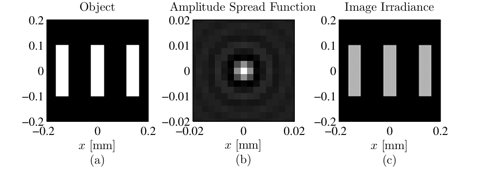
  <figcaption>图 5.5 相干成像例：(a) 三缝物体，(b) 0.05 波离焦的振幅扩散函数，(c) 相干像（截自原书）</figcaption>
</figure>

=== "MATLAB"

    ```matlab
    % Listing 5.4：example_coh_img.m（原书 26 行）
    N = 256;             % number of grid points per side
    L = 0.1;             % total size of the grid [m]
    D = 0.07;            % diameter of pupil [m]
    delta = L / N;       % grid spacing [m]
    wvl = 1e-6;          % optical wavelength [m]
    z = 0.25;            % image distance [m]
    % pupil-plane coordinates
    [x y] = meshgrid((-N/2 : N/2-1) * delta);
    [theta r] = cart2pol(x, y);
    % wavefront aberration
    W = 0.05 * zernike(4, 2*r/D, theta);
    % complex pupil function
    P = circ(x, y, D) .* exp(i * 2*pi * W);
    % amplitude spread function
    h = ft2(P, delta);
    delta_u = wvl * z / (N*delta);
    % image-plane coordinates
    [u v] = meshgrid((-N/2 : N/2-1) * delta_u);
    % object (same coordinates as h)
    obj = (rect((u-1.4e-4)/5e-5) + rect(u/5e-5) ...
        + rect((u+1.4e-4)/5e-5)) .* rect(v/2e-4);
    % convolve the object with the ASF to simulate imaging
    img = myconv2(obj, h, 1);
    ```

=== "Python"

    ```python
    # 工程 2 的对应片段（h 按式 (5.29) 补上 1/(lambda zi) 因子）
    W = 0.05 * zernike(4, 2 * r / D, theta)                    # 0.05 波 Zernike 离焦
    P_ab = circle(x, y, D / 2) * np.exp(1j * 2 * np.pi * W)    # 广义光瞳（式 5.1）
    h_ab = ft2_centered(P_ab, delta) / lam_z                   # ASF（式 5.29）
    delta_u = lam_z / (N * delta)                              # 像面采样
    obj = (rect((u - 1.4e-4) / 5e-5) + rect(u / 5e-5)
           + rect((u + 1.4e-4) / 5e-5)) * rect(v / 2e-4)
    img_coh = myconv2(obj, h_ab)                               # 式 (5.27)：场卷场
    ```

!!! note "拓展：myconv2 与 h 的 1/(\(\lambda z_i\)) 因子"
    `myconv2(obj, h, 1)` 是原书 3.1 节定义的"线性卷积取中心"（该章 PDF 缺失，工程按 `conv2(g,h,'same')` 的居中语义实现：FFT 垫零到 \(N_g+N_h-1\) 做线性卷积再裁中间，偶数尺寸的裁切起点 \((K-N)/2\)，MATLAB 的 `'same'` 对偶尺寸方阵取同一批元素——工程 2 验证 0 实测两法最大差 \(1.8\times10^{-15}\)）。另外原书 Listing 5.4/5.5 的 `h = ft2(P, delta)` 没乘 \(1/(\lambda z_i)\)——形状与归一化显示完全不受影响，但绝对辐照度差 \(1/(\lambda z_i)^2\)；要绝对数值就按 (5.29) 补上（工程 2 已补，显示仍归一化）。

### 5.2.2 非相干成像

非相干照明下线性性搬到了辐照度上：像的辐照度是物辐照度与 PSF 的卷积，

\[
I_i(u, v) = \int_{-\infty}^{\infty}\int_{-\infty}^{\infty} |h(u-\eta,\, v-\xi)|^2\; I_o(\eta, \xi)\, d\xi\, d\eta
\tag{5.35}
\]

\[
= |h(u, v)|^2 \otimes I_o(u, v).
\tag{5.36}
\]

PSF 就是 ASF 的模平方，仅此而已。原书 Listing 5.5 与 Listing 5.4 几乎逐行相同（同物、同像差），只有最后一行换掉：

```matlab
img = myconv2(abs(obj).^2, abs(h).^2, 1);
```

结果见图 5.6：同样 0.05 波离焦，非相干像的模糊形态与相干像不同（相干像的边缘有振铃——那是在卷积里干涉出来的；非相干像只是强度模糊）。

<figure>
  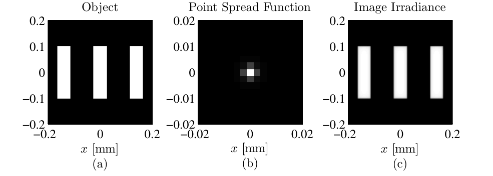
  <figcaption>图 5.6 非相干成像例：(a) 三缝物体，(b) 点扩散函数（0.05 波离焦），(c) 非相干像（截自原书）</figcaption>
</figure>

对 (5.35) 用卷积定理：

\[
\mathcal{F}\{I_i(u, v)\} = \mathcal{F}\big\{|h(u, v)|^2\big\}\; \mathcal{F}\{I_o(u, v)\}.
\tag{5.37}
\]

这次的滤波器定义成归一化形式——**光学传递函数**：

\[
H(f_x, f_y) = \frac{\mathcal{F}\big\{|h(u, v)|^2\big\}}{\int_{-\infty}^{\infty}\int_{-\infty}^{\infty} |h(u, v)|^2\, du\, dv}.
\tag{5.38}
\]

再往光瞳上追：用自相关定理与 Parseval 定理，可以把 (5.38) 改写成 \(\mathcal{P}\) 的自相关：

\[
H(f_x, f_y) = \frac{\int_{-\infty}^{\infty}\int_{-\infty}^{\infty} H^*(p - f_x,\, q - f_y)\, H(p, q)\, dp\, dq}{\int_{-\infty}^{\infty}\int_{-\infty}^{\infty} |H(p, q)|^2\, dp\, dq}
\tag{5.39}
\]

\[
= \frac{\int_{-\infty}^{\infty}\int_{-\infty}^{\infty} \mathcal{P}^*(x - \lambda z_i f_x,\, y - \lambda z_i f_y)\, \mathcal{P}(x, y)\, dx\, dy}{\int_{-\infty}^{\infty}\int_{-\infty}^{\infty} |\mathcal{P}(x, y)|^2\, dx\, dy}
\tag{5.40}
\]

\[
= \frac{\mathcal{P}^*(x, y) \star \mathcal{P}(x, y)\big|_{x=\lambda z_i f_x,\, y=\lambda z_i f_y}}{\int_{-\infty}^{\infty}\int_{-\infty}^{\infty} |\mathcal{P}(x, y)|^2\, dx\, dy}.
\tag{5.41}
\]

人话：**OTF = 光瞳函数的归一化自相关**。这一行是成像仿真里最实用的公式——不用先算 \(h\) 再变换，直接在光瞳上滑动自相关。原书接着给出圆孔（直径 \(D\)）的闭式：

\[
H(f) =
\begin{cases}
\dfrac{2}{\pi}\left[\cos^{-1}\!\left(\dfrac{f}{2 f_0}\right) - \dfrac{f}{2 f_0}\sqrt{1 - \left(\dfrac{f}{2 f_0}\right)^2}\right], & f \le 2 f_0,\\[10pt]
0, & \text{其他},
\end{cases}
\tag{5.42}
\]

其中 \(f = \sqrt{f_x^2+f_y^2}\)、\(f_0 = D/(2\lambda z_i)\)。三个要点：

1. \(f_0\) 在相干情形是截频；**非相干情形频率直到 \(2f_0\) 都能通过**（带衰减）——非相干成像的带宽是相干的两倍；
2. 但非相干像**仍然严格带限**（\(2f_0\) 之外严格为零）；
3. 无像差圆孔的 \(H(f)\ge 0\) 处处成立——不像相干 ATF 那样可以是复值/负值。

工程 2 验证 3 把 (5.38)、(5.41)、(5.42) 三条路线放在同一张图上对过：\(|h|^2\) 的 FT 路线（路线 A）在干净频段（\(|f|\le(L-D)/\lambda z_i = 1.2\times10^5\ \mathrm{m^{-1}}\)）与解析式最大差 \(1.5\times10^{-4}\)，超出该频段就被循环卷积回绕污染（对照最大差 \(0.35\)）；光瞳自相关路线（路线 B，垫零到 \(2N\)）全程最大差 \(3.5\times10^{-4}\)；\(f = 2f_0\) 处 \(H = 4.9\times10^{-17}\)（截频确认），全频段最小值 \(-1.0\times10^{-16}\)（\(H\ge0\) 确认）。Parseval 顺手核掉：\(\sum|h|^2\,\delta_u^2 = 3.8503\times10^{-3} = \sum|\mathcal{P}|^2\delta^2\)（相对差 \(3.4\times10^{-16}\)）。

**表 5.3 相干与非相干成像对比**

|  | 相干照明 | 非相干照明 |
| --- | --- | --- |
| 线性量 | 光场 \(U\) | 辐照度 \(I\) |
| 脉冲响应 | ASF：\(h\)（式 5.29） | PSF：\(|h|^2\)（式 5.35） |
| 传递函数 | ATF：\(\lambda z_i\,\mathcal{P}(-\lambda z_i f)\)（式 5.34，复值、不归一） | OTF：光瞳自相关归一（式 5.41，无像差圆孔 \(H\ge0\)） |
| 截频 | \(f_0 = D/(2\lambda z_i)\) | \(2 f_0\) |
| 带内传递 | 等幅（圆孔） | 递减（式 5.42） |
| 代码差别 | `img = myconv2(obj, h, 1)` | `img = myconv2(abs(obj).^2, abs(h).^2, 1)` |

原书图 5.7 展示了 OTF 对像差的敏感：实线是无像差圆孔（式 5.42），点划线是孔径边缘 **0.5 波离焦**系统的 OTF（数值积分）——中频段衰减明显更狠。图 5-9(b) 是工程 2 的复现：解析式、光瞳自相关、\(|h|^2\) 的 FT 三条线重合，外加 0.05 波离焦的 OTF 作对照。

<figure>
  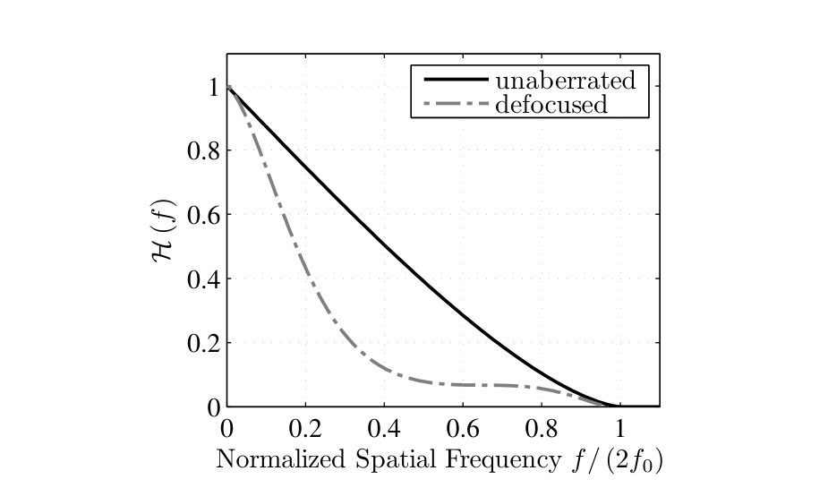
  <figcaption>图 5.7 圆孔 OTF：无像差（实线，式 5.42）与边缘 0.5 波离焦（点划线，数值积分）——离焦把中频压下去了（截自原书）</figcaption>
</figure>

<figure>
  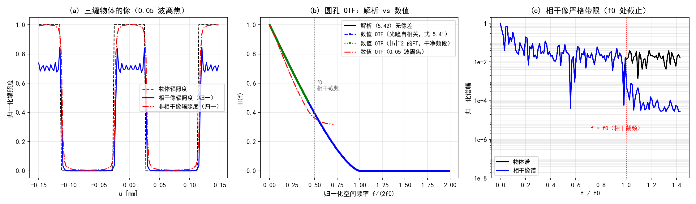
  <figcaption>图 5-9（自绘仿真）工程 2：(a) 三缝物体的相干/非相干像对比（0.05 波离焦）；(b) 圆孔 OTF 解析 vs 两条数值路线，0.05 波离焦衰减；(c) 相干像谱在 \(f_0\) 处截止（对数刻度，窗泄漏 \(10^{-3}\)）</figcaption>
</figure>

选路线的决策图：

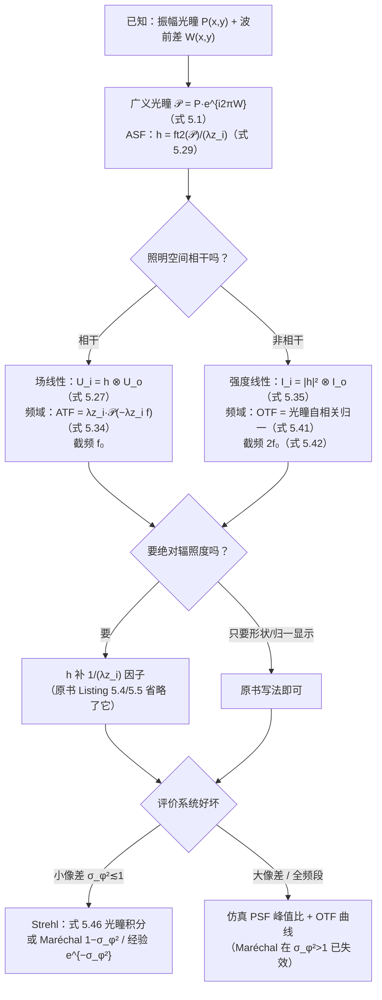

### 5.2.3 Strehl 比

整幅 PSF 信息量大，但工程上常要**一个数**。最常用的是**Strehl 比（Strehl ratio）**：实际系统轴上 PSF 峰值与无像差系统轴上 PSF 峰值之比。轴上值由 (5.29) 在原点取模方：

\[
|h(0, 0)|^2 = \frac{1}{\lambda^2 z_i^2} \left|\int_{-\infty}^{\infty}\int_{-\infty}^{\infty} \mathcal{P}(x, y)\, e^{0}\, dx\, dy\right|^2
\tag{5.43}
\]

\[
= \frac{1}{\lambda^2 z_i^2} \left|\int_{-\infty}^{\infty}\int_{-\infty}^{\infty} \mathcal{P}(x, y)\, dx\, dy\right|^2.
\tag{5.44}
\]

非零相位全部来自像差（\(\mathcal{P}\) 的振幅部分就是无像差光瞳 \(P\)），所以

\[
S = \frac{\left|\int_{-\infty}^{\infty}\int_{-\infty}^{\infty} \mathcal{P}(x, y)\, dx\, dy\right|^2}{\left|\int_{-\infty}^{\infty}\int_{-\infty}^{\infty} P(x, y)\, dx\, dy\right|^2}.
\tag{5.45}
\]

把像差相位写得显式些，并对偶地给出 OTF 形式（用 (5.30) 与 (5.38)，\(H_{dl}\) 是无像差/衍射受限系统的 OTF）：

\[
S = \frac{\left|\int_{-\infty}^{\infty}\int_{-\infty}^{\infty} P(x, y)\, e^{i\phi(x, y)}\, dx\, dy\right|^2}{\left|\int_{-\infty}^{\infty}\int_{-\infty}^{\infty} P(x, y)\, dx\, dy\right|^2}
\tag{5.46}
\]

\[
= \frac{\int_{-\infty}^{\infty}\int_{-\infty}^{\infty} H(f_x, f_y)\, df_x\, df_y}{\int_{-\infty}^{\infty}\int_{-\infty}^{\infty} H_{dl}(f_x, f_y)\, df_x\, df_y}.
\tag{5.47}
\]

(5.47) 有个漂亮的读法：**Strehl = 实际 OTF 曲线下的面积比**——图 5.7 里离焦把曲线压下去多少，轴上峰值就掉多少。无像差系统 \(S=1\)（上限）；像差与振幅变化（比如环形孔径）只会把它往下压——低 Strehl 意味着分辨率粗、对比度低。

小像差时 \(S\) 由光瞳相位的方差决定。把 (5.46) 缩写成幅度加权平均：

\[
S = \left|\left\langle e^{i\phi}\right\rangle\right|^2,
\tag{5.48}
\]

其中幅度加权平均相位

\[
\langle\phi\rangle = \frac{\int_{-\infty}^{\infty}\int_{-\infty}^{\infty} P(x, y)\, \phi(x, y)\, dx\, dy}{\int_{-\infty}^{\infty}\int_{-\infty}^{\infty} P(x, y)\, dx\, dy}.
\tag{5.49}
\]

乘一个 \(|e^{-i\langle\phi\rangle}|^2 = 1\) 把均值挪进括号：

\[
S = \left|\left\langle e^{i(\phi - \langle\phi\rangle)}\right\rangle\right|^2
\tag{5.50}
\]

\[
= \left\langle\cos(\phi - \langle\phi\rangle)\right\rangle^2 + \left\langle\sin(\phi - \langle\phi\rangle)\right\rangle^2.
\tag{5.51}
\]

对 cos/sin 做 Taylor 展开取到二阶：

\[
S \simeq \left\langle 1 - \frac{(\phi - \langle\phi\rangle)^2}{2}\right\rangle^2 + \langle\phi - \langle\phi\rangle\rangle^2
\tag{5.52}
\]

\[
\simeq \left(1 - \frac{\sigma_\phi^2}{2}\right)^2,
\tag{5.53}
\]

再乘开、只留前两项：

\[
S \simeq 1 - \sigma_\phi^2,
\tag{5.54}
\]

其中 \(\sigma_\phi^2 = 4\pi^2\sigma^2\) 是**相位**方差（rad²，\(\sigma\) 是以波计的 RMS 波前差）。(5.53)–(5.55) 是三个常用的近似版本——最后一个是把 (5.54) 换成指数形式：

\[
S \simeq e^{-\sigma_\phi^2}.
\tag{5.55}
\]

原书特别注明：(5.53) 叫 **Maréchal 公式**；(5.55) 虽然看起来像 (5.54) 的 Taylor 前两项，实际是**经验公式**——对各种像差的数值结果拟合得最好。工程 2 用 0.05 波离焦实测了四个算法的吻合度：\(\sigma_W^2 = 0.0025\) 波² \(\to \sigma_\phi^2 = 0.0988\ \mathrm{rad^2}\)，PSF 峰值比 = 光瞳积分 (5.46) = **0.9050**，Maréchal (5.54) 给 0.9012，经验式 (5.55) 给 0.9059——\(\sigma_\phi^2\approx0.1\) 时三者几乎重合。习题 4 会把 \(\sigma_\phi^2\) 拉到 0.46 再看分晓（经验式 0.6301 vs 仿真 0.6300，Maréchal 0.5381 已经跑偏）。

### 工程 2：相干与非相干成像（Listings 5.4–5.5 复现）

对应文件 `matlab/waveprop/ch5/ch5_imaging.m`（Python 版在本 notebook 工程 2 cell）：

=== "MATLAB"

    ```matlab
        ```matlab
    %% ===== 书 Schmidt PM199 第 5 章 =====
    %  相干与非相干成像：ASF/PSF 与 ATF/OTF（原书 5.2 节，Listings 5.4-5.5）
    %  与 python/waveprop/第5章_代码实战.ipynb 工程 2 数值行为一致。
    %
    %  原书要点：
    %    成像系统对光是线性系统，但"线性在哪个量上"取决于照明的相干性：
    %      相干照明：场线性。U_i = h ⊗ U_o（式 5.27），振幅扩散函数（ASF）
    %                h = (1/(lambda zi)) F{P}（式 5.29/5.30）；
    %                传递函数 H = F{h} = lambda zi * P(-lambda zi f)（式 5.34，
    %                lambda zi 因子正确：二维换元雅可比 lambda zi^2 抵消
    %                1/(lambda zi) 后剩一个；H(0,0) = lambda zi，量纲 m^2）。
    %                圆孔截频 f0 = D/(2 lambda zi)，像是严格带限的。
    %      非相干照明：强度线性。I_i = |h|^2 ⊗ I_o（式 5.35），|h|^2 即 PSF；
    %                OTF：H = F{|h|^2} / ∫∫|h|^2 dudv（式 5.38）
    %                   = 光瞳自相关 / ∫∫|P|^2 dxdy（式 5.40/5.41），
    %                圆孔截频 2 f0（式 5.42），无像差时 H(f) >= 0。
    %    波前像差只属于系统、与照明无关，但它对像的影响跟相干性有关。
    %    Strehl 比（5.2.3）：S = |∫∫ P e^{i phi} dxdy|^2 / |∫∫ P dxdy|^2（式 5.46），
    %    小像差时 S ≈ 1 - sigma_phi^2（Maréchal，式 5.54）≈ exp(-sigma_phi^2)（式 5.55）。
    %
    %  验证（编号与 notebook 工程 2 一致）：
    %   (0) myconv2 正确性：FFT 线性卷积取中 vs conv2(g,h,'same')；
    %   (1) 书例复现：三缝物体 0.05 波离焦的相干像与非相干像（原书图 5.5/5.6）；
    %   (2) ATF 核对：F{h} 与 lambda zi*P(-lambda zi f) 逐点一致（式 5.34），
    %       相干像谱 |f|>f0 泄漏（理想像严格带限，泄漏来自中心裁切窗）；
    %   (3) OTF 核对：无像差圆孔数值 OTF vs 解析式 (5.42)，两条数值路线
    %       （|h|^2 的 FT vs 光瞳自相关）在各自可信频段一致；截频 2f0；H>=0；
    %   (4) Strehl 四算法（0.05 波离焦）；
    %   (5) Parseval：sum|h|^2 du^2 = sum|P|^2 delta^2。
    %
    %  MATLAB/Python 差异（对应 notebook 内注释）：
    %    - myconv2 用 FFT 垫零实现；对偶数尺寸方阵它与 conv2(g,h,'same') 取中
    %      一致（full 卷积长 2N-1，'same' 的居中起点 = floor((K-N)/2)+1，与
    %      numpy 版 0-based (K-N)//2 取同一批元素）。
    %    - np.fft.fft2(g, (K,K)) 垫零 = MATLAB fft2(g, K, K)。
    %    - P(-lambda zi f) 样本 = circshift(rot90(P,2), [1 1])（flip+roll 对齐
    %      偶数 N 的居中反转）。
    %    - cart2pol -> hypot/atan2。
    clear; clc; close all;

    %% ---- 原书 Listing 5.4/5.5 的参数 ----
    N = 256;  L = 0.1;  D = 0.07;
    delta = L / N;  wvl = 1e-6;  z = 0.25;
    lam_z = wvl * z;                          % lambda zi（原书记号）
    [x, y] = meshgrid((-N/2 : N/2-1) * delta);
    r = hypot(x, y);  theta = atan2(y, x);
    apM = hypot(x, y) <= D/2;                 % circ(x,y,D) 半径参数版

    %% 验证 0：myconv2 正确性
    rng(1);
    gs_ = randn(6);  hs_ = randn(3);
    ref = conv2(gs_, hs_, 'same');
    got = real(myconv2(gs_, hs_));
    fprintf('===== 验证 0：myconv2 vs conv2(same) =====\n');
    fprintf('    max|myconv2 - conv2(same)| = %.2e\n', max(abs(got - ref), [], 'all'));

    %% 验证 1 + 4：书例复现（0.05 波离焦）与 Strehl
    W = 0.05 * zernike(4, 2*r/D, theta);      % 0.05 波 Zernike 离焦
    P_ab = apM .* exp(1i * 2*pi * W);         % 广义光瞳（式 5.1）
    P_dl = apM;                               % 无像差光瞳
    h_ab = ft2(P_ab, delta) / lam_z;          % ASF（式 5.29，补上 1/(lambda zi)）
    h_dl = ft2(P_dl, delta) / lam_z;
    delta_u = lam_z / (N*delta);              % 像面采样 = lambda zi/(N delta)
    u1d = (-N/2 : N/2-1) * delta_u;
    [u, v] = meshgrid(u1d, u1d);
    f0 = D / (2 * lam_z);                     % 相干截频
    fprintf('===== 验证 1 + 4：书例复现（0.05 波离焦）与 Strehl =====\n');
    fprintf('    delta_u = %.3f um；f0 = %.0f /m\n', delta_u*1e6, f0);
    % 物体（Listing 5.4 第 22-23 行）：三条 50 um x 200 um 竖缝
    obj = (rect((u-1.4e-4)/5e-5) + rect(u/5e-5) + rect((u+1.4e-4)/5e-5)) ...
        .* rect(v/2e-4);
    img_coh = myconv2(obj, h_ab);                       % 式 (5.27)：场卷场
    img_inc = myconv2(abs(obj).^2, abs(h_ab).^2);       % 式 (5.35)：强度卷强度
    I_coh = abs(img_coh).^2;
    I_inc = real(img_inc);
    % Strehl（验证 4）：四种算法
    S_pupil = abs(sum(P_ab, 'all'))^2 / abs(sum(P_dl, 'all'))^2;   % 式 (5.46) 离散
    S_psf   = abs(h_ab(N/2+1, N/2+1))^2 / abs(h_dl(N/2+1, N/2+1))^2;
    sig2_w  = mean(W(apM).^2);                % sigma^2（波^2）：Z4 单位 RMS -> 0.05^2
    sig2_phi = (2*pi)^2 * sig2_w;
    fprintf('    0.05 波 Z4 离焦：sigma_W^2 = %.4f 波^2 -> sigma_phi^2 = %.4f rad^2\n', ...
        sig2_w, sig2_phi);
    fprintf('    Strehl：PSF 峰值比 = %.4f = 光瞳积分（式 5.46）%.4f\n', S_psf, S_pupil);
    fprintf('            Marechal 1-sigma_phi^2（式 5.54）= %.4f\n', 1 - sig2_phi);
    fprintf('            经验 exp(-sigma_phi^2)（式 5.55）= %.4f\n', exp(-sig2_phi));

    %% 验证 2：ATF（式 5.34）+ 相干像带限
    fx1d = (-N/2 : N/2-1) / (N * delta_u);    % 像面原生频率轴（lambda zi*f = x）
    [FX, ~] = meshgrid(fx1d, fx1d);
    H_num = ft2(h_ab, delta_u);
    P_roll = circshift(rot90(P_ab, 2), [1 1]);   % P(-lambda zi f) 样本
    dATF = max(abs(H_num - lam_z * P_roll), [], 'all');
    fprintf('===== 验证 2：ATF（式 5.34）+ 相干像带限 =====\n');
    fprintf('    max|F{h} - lambda zi*P(-lambda zi f)| = %.2e（相对峰值 %.1e）\n', ...
        dATF, dATF / max(abs(H_num), [], 'all'));
    fprintf('    DC 值 H(0) = lambda zi = %.2e m^2（相干 ATF 不归一；OTF 才归一到 1）\n', ...
        abs(H_num(N/2+1, N/2+1)));
    F_img = ft2(img_coh, delta_u);
    beyond = hypot(FX, FY) > f0 * 1.001;
    fprintf('    相干像谱 |f|>f0 泄漏/峰 = %.1e（理想像严格带限，泄漏来自中心裁切窗）\n', ...
        max(abs(F_img(beyond)), [], 'all') / max(abs(F_img), [], 'all'));

    %% 验证 3：OTF（式 5.38/5.41/5.42）
    otfA = real(ft2(abs(h_dl).^2, delta_u)) / (sum(abs(h_dl).^2, 'all') * delta_u^2);
    Fp = fft2(P_dl, 2*N, 2*N);                % 垫零到 2N：位移轴可达 ±L
    ac = fftshift(real(ifft2(abs(Fp).^2))) * delta^2;
    xs = (-N : N-1) * delta;                  % 位移轴：-L .. L-delta（居中）
    fx2 = xs / lam_z;
    otfB = ac(N+1, :) / (sum(abs(P_dl).^2, 'all') * delta^2);   % fy=0 切片
    % 解析式 (5.42)
    otf_ana = @(f) (f <= 2*f0) .* (2/pi) .* ...
        (acos(min(max(f./(2*f0), 0), 1)) - (f./(2*f0)) .* sqrt(max(1 - (f./(2*f0)).^2, 0)));
    % 路线 A 的可信频段：|h|^2 的 DFT 是循环自相关，|f| > (L-D)/(lambda zi) 即回绕
    f_clean = (L - D) / lam_z;
    fa  = linspace(0, 1.99*2*f0, 400);
    faA = linspace(0, 0.99*f_clean, 200);
    posF = fx1d >= 0;
    interpA = interp1(fx1d(posF), otfA(N/2+1, posF), faA, 'linear', 'extrap');
    interpB = interp1(fx2(fx2 >= 0), otfB(fx2 >= 0), fa, 'linear', 'extrap');
    ana = otf_ana(fa);
    anaA = otf_ana(faA);
    fprintf('===== 验证 3：OTF（式 5.38/5.41/5.42） =====\n');
    fprintf('    无像差圆孔 fy=0：路线A vs 解析(5.42) 干净频段（|f|<=%.2e）最大差 %.2e\n', ...
        f_clean, max(abs(interpA - anaA)));
    fprintf('        路线A 超出该频段即循环回绕（对照最大差 %.2e）；路线B（垫零线性自相关）全程最大差 %.2e\n', ...
        max(abs(interp1(fx1d(posF), otfA(N/2+1, posF), fa, 'linear', 'extrap') - ana)), ...
        max(abs(interpB - ana)));
    fprintf('    DC 归一：otfA(0)=%.6f，otfB(0)=%.6f（式 5.38 分母 = h 的能量）\n', ...
        otfA(N/2+1, N/2+1), otfB(N+1));
    fprintf('    路线B 在 f=2f0 处 H=%.2e（截频确认）；全频段最小值 %.2e（H>=0）\n', ...
        interp1(fx2(fx2 >= 0), otfB(fx2 >= 0), 2*f0), min(otfB));
    % 离焦系统的 OTF（0.05 波）——原书图 5.7 用 0.5 波展示衰减，思路相同
    otf_ab = real(ft2(abs(h_ab).^2, delta_u)) / (sum(abs(h_ab).^2, 'all') * delta_u^2);

    %% 验证 5：Parseval（h 与 P 能量守恒）
    Eh = sum(abs(h_ab).^2, 'all') * delta_u^2;
    Ep = sum(abs(P_ab).^2, 'all') * delta^2;
    fprintf('===== 验证 5：Parseval =====\n');
    fprintf('    sum|h|^2 du^2 = %.6e vs sum|P|^2 delta^2 = %.6e（相对差 %.2e）\n', ...
        Eh, Ep, abs(Eh - Ep)/Ep);

    %% 绘图：图 5-9（自绘：像对比 + OTF 曲线 + 像谱带限）
    sl = N/2 + (-60 : 59);                    % ±150 um 窗口（1-based）
    figure('Position', [40 40 1500 440]);
    subplot(1, 3, 1);
    plot(u(1, sl)*1e3, obj(N/2+1, sl), 'k--', 'LineWidth', 1.2); hold on;
    plot(u(1, sl)*1e3, I_coh(N/2+1, sl)/max(I_coh, [], 'all')*max(obj, [], 'all'), 'b-');
    plot(u(1, sl)*1e3, I_inc(N/2+1, sl)/max(I_inc, [], 'all')*max(obj, [], 'all'), 'r-.');
    xlabel('u [mm]');  ylabel('归一化辐照度');  grid on;
    title('(a) 三缝物体的像（0.05 波离焦）');
    legend({'物体辐照度', '相干像辐照度（归一）', '非相干像辐照度（归一）'}, 'FontSize', 8);
    subplot(1, 3, 2);
    plot(fa/(2*f0), ana, 'k-', 'LineWidth', 1.8); hold on;
    plot(fa/(2*f0), interpB, 'b.--', 'MarkerSize', 4);
    plot(faA/(2*f0), interpA, 'g.:', 'MarkerSize', 4);
    posO = fx1d >= 0;
    plot(fx1d(posO)/(2*f0), otf_ab(N/2+1, posO), 'r-.');
    xline(f0/(2*f0), ':', 'Color', [0.6 0.6 0.6]);
    xlabel('归一化空间频率 f/(2f0)');  ylabel('H(f)');  grid on;
    title('(b) 圆孔 OTF：解析 vs 数值');
    legend({'解析 (5.42) 无像差', '数值 OTF（光瞳自相关，式 5.41）', ...
        '数值 OTF（|h|^2 的FT，干净频段）', '数值 OTF（0.05 波离焦）'}, 'FontSize', 8);
    ylim([-0.05 1.05]);
    subplot(1, 3, 3);
    F_obj = ft2(obj, delta_u);
    semilogy(abs(fx1d)/f0, abs(F_obj(N/2+1, :))/max(abs(F_obj), [], 'all'), 'k-'); hold on;
    semilogy(abs(fx1d)/f0, abs(F_img(N/2+1, :))/max(abs(F_img), [], 'all'), 'b-');
    xline(1.0, 'r:');
    xlabel('f / f0');  ylabel('归一化谱幅');  grid on;
    title('(c) 相干像严格带限（f0 处截止）');
    legend({'物体谱', '相干像谱'}, 'FontSize', 8, 'Location', 'southwest');
    ylim([1e-8 2]);

    %% ===== 本地函数 =====
    function C = myconv2(g, h)
    % myconv2(g, h, 1) 的语义（原书 3.1 节，该章 PDF 缺失）：全尺寸线性卷积后
    % 取与 g 同尺寸的中心部分。FFT 实现：垫零到 (Ng+Nh-1) 避免循环卷积回绕，
    % 再裁中间。偶数尺寸对齐：0-based 起点 (K-Ng)//2，1-based 即 (K-Ng)//2+1，
    % 与 conv2(g,h,'same') 对偶数尺寸方阵取中一致。
    Ng = size(g, 1);
    K = Ng + size(h, 1) - 1;
    full = ifft2(fft2(g, K, K) .* fft2(h, K, K));
    s0 = (K - Ng)/2 + 1;                      % 1-based 裁切起点
    C = full(s0:s0+Ng-1, s0:s0+Ng-1);
    end

    function G = ft2(g, delta)
    % 原书 Listing 2.5：定标正确的二维 DFT（乘 delta^2）
    G = fftshift(fft2(fftshift(g))) * delta^2;
    end

    function s = rect(x)
    % rect(x)：|x|<1/2 取 1，|x|=1/2 取 1/2，其余 0
    s = double(abs(x) < 1/2) + 0.5*double(abs(x) == 1/2);
    end

    function Z = zernike(i, r, theta)
    % Noll 单指标 Zernike（m=0 分支已按勘误补 sqrt(n+1)）；与 ch5_zernike.m 相同
    [n, m] = zidx(i);
    R = zrf(n, m, r);
    if m == 0
        Z = sqrt(n+1) * R;
    elseif mod(i, 2) == 0
        Z = sqrt(2*(n+1)) * R .* cos(m*theta);
    else
        Z = sqrt(2*(n+1)) * R .* sin(m*theta);
    end
    end

    function R = zrf(n, m, r)
    % Zernike 径向多项式（式 5.5a，阶乘用 gamma 实现）
    R = zeros(size(r));
    for s = 0:(n-m)/2
        num = (-1)^s * gamma(n - s + 1);
        den = gamma(s+1) * gamma((n+m)/2 - s + 1) * gamma((n-m)/2 - s + 1);
        R = R + num / den * r.^(n - 2*s);
    end
    end

    function [n, m] = zidx(i)
    % 表 5.2 的 (i,n,m) 映射（Noll 单指标）；与 ch5_zernike.m 相同
    persistent rows
    if isempty(rows)
        rows = zeros(0, 2);
        for n0 = 0:40
            for m0 = mod(n0, 2):2:n0
                rows(end+1, :) = [n0, m0];    %#ok<AGROW>
                if m0 > 0
                    rows(end+1, :) = [n0, m0];  %#ok<AGROW>
                end
            end
        end
    end
    n = rows(i, 1);
    m = rows(i, 2);
    end
    ```
    ```

=== "Python"

    ```python
        ```python
        # -*- coding: utf-8 -*-
        """
        ===== 书 Schmidt PM199 第 5 章相干与非相干成像：ASF/PSF 与 ATF/OTF（原书 5.2 节，Listings 5.4-5.5）

    原书要点：
        成像系统对光是线性系统，但"线性在哪个量上"取决于照明的相干性：
          相干照明：场线性。U_i = h ⊗ U_o（式 5.27），振幅扩散函数
                    h = (1/(lambda zi)) F{P}（式 5.29/5.30）；
                    传递函数 H = F{h} = lambda zi * P(-lambda zi f)（式 5.34，
                    lambda zi 因子正确：二维换元雅可比 lambda zi^2 抵消
                    1/(lambda zi) 后剩一个；H(0,0) = lambda zi，量纲 m^2）。
                    圆孔截频 f0 = D/(2 lambda zi)，像是严格带限的。
          非相干照明：强度线性。I_i = |h|^2 ⊗ I_o（式 5.35），|h|^2 即 PSF；
                    OTF：H = F{|h|^2} / ∫∫|h|^2 dudv（式 5.38）
                       = 光瞳自相关 / ∫∫|P|^2 dxdy（式 5.40/5.41），
                    圆孔截频 2 f0（式 5.42），无像差时 H(f) >= 0。
        波前像差只属于系统、与照明无关，但它对像的影响跟相干性有关。
        Strehl 比（5.2.3）：S = |∫∫ P e^{i phi} dxdy|^2 / |∫∫ P dxdy|^2（式 5.46），
        小像差时 S ≈ 1 - sigma_phi^2（Maréchal，式 5.54）≈ exp(-sigma_phi^2)（经验，式 5.55）。

    数值验证（运行本脚本全部自动打印）：
        (0) myconv2 正确性：小随机阵列 vs scipy.signal.convolve2d（线性卷积取中心）；
        (1) 书例复现（Listings 5.4-5.5）：三缝物体的相干像与非相干像
            （0.05 波 Zernike 离焦，原书图 5.5/5.6）；
        (2) ATF 核对：F{h} 与 lambda zi * P(-lambda zi f) 逐点一致（式 5.34），
            相干像谱在 |f| > f0 的泄漏（理想像严格带限，离散实现有窗泄漏）；
        (3) OTF 核对：无像差圆孔的数值 OTF vs 解析式 (5.42)，两条数值路线
            （|h|^2 的 FT vs 光瞳自相关，式 5.38 vs 5.41）在重叠频段一致；
            截频 2f0 与 H(f) >= 0；
        (4) Strehl：0.05 波离焦的 PSF 峰值比 vs 光瞳积分（式 5.46）
            vs Marechal（式 5.54）vs 经验 exp（式 5.55）；
        (5) Parseval：sum |h|^2 du^2 = sum |P|^2 delta^2（h 与 P 能量守恒）。

    myconv2 说明：原书 3.1 节定义（该章 PDF 缺失），按"线性卷积后取与物体同尺寸
    的中心部分"实现（即 conv2(g,h,'same') 的居中语义，第三参数=1 的调用约定
    与原书一致）；偶数尺寸的中心对齐起点 start=(K-N)//2（0-based）。

    h 的定标说明：式 (5.29) 的 h 带 1/(lambda zi) 因子；原书 Listing 5.4/5.5
    的 h = ft2(P, delta) 未乘（像的绝对辐照度因此差 1/(lambda zi)^2，形状与
    归一化显示不受影响）。本工程按式 (5.29) 补上，显示仍做归一化。

    MATLAB/Python 差异（对应 .m 文件内注释）：
        - np.fft.fft2(g, s=(K,K)) 零填充，与 MATLAB fft2(g,K,K) 一致。
        - 居中裁切起点：MATLAB 1-based start=(K-N)//2+1，numpy 0-based (K-N)//2，
          取同一批元素。
        - cart2pol -> np.hypot / np.arctan2。
    用法：python ch5_imaging.py <输出目录>  保存 PNG；否则弹窗显示。
    依赖：numpy + matplotlib + scipy；base.py（circle/rect/ft2_centered）；
          ch5_zernike.py（同目录，zernike）。
    """
    import os
    import sys

    import numpy as np
    import matplotlib.pyplot as plt
    from scipy.signal import convolve2d

    plt.rcParams['font.sans-serif'] = ['SimHei', 'Microsoft YaHei', 'Arial Unicode MS']
    plt.rcParams['axes.unicode_minus'] = False

    # ---- 复用《计算傅里叶光学》笔记的公共基础模块（同仓库） ----
    sys.path.insert(0, os.path.join(os.path.dirname(os.path.abspath(__file__)),
                                    "..", "..", "fourier", "common"))
    from base import circle, rect, ft2_centered  # noqa: E402
    # zernike 在本 notebook 第一个代码 cell（工程 1）中定义，按顺序运行即可；
    # 拆回独立 .py 文件时改用：from ch5_zernike import zernike


    # ===== 书 3.1 节：myconv2（线性卷积 + 居中裁切，这里补实现） =====
    def myconv2(g, h):
        """myconv2(g, h, 1) 的语义：全尺寸线性卷积后取与 g 同尺寸的中心部分。

        FFT 实现：零填充到 (Ng+Nh-1) 做线性卷积（避免循环卷积回绕），
        再裁中间 Ng×Ng。偶数尺寸对齐：裁切起点 start=(K-Ng)//2（0-based），
        与 MATLAB 版 start=(K-Ng)//2+1（1-based）取同一批元素。
        """
        Ng = g.shape[0]
        K = Ng + h.shape[0] - 1
        full = np.fft.ifft2(np.fft.fft2(g, (K, K)) * np.fft.fft2(h, (K, K)))
        start = (K - Ng) // 2
        return full[start:start + Ng, start:start + Ng]


    def main(outdir=None):
        # ---- 原书 Listing 5.4/5.5 的参数 ----
        N = 256            # number of grid points per side
        L = 0.1            # total size of the grid [m]
        D = 0.07           # diameter of pupil [m]
        delta = L / N      # grid spacing [m]
        wvl = 1e-6         # optical wavelength [m]
        z = 0.25           # image distance [m]
        lam_z = wvl * z    # lambda zi [m^2]（注意是乘积，原书记号 lambda zi）

        # pupil-plane coordinates
        x, y = np.meshgrid((np.arange(N) - N // 2) * delta,
                           (np.arange(N) - N // 2) * delta)
        r = np.hypot(x, y)
        theta = np.arctan2(y, x)
        ap_mask = circle(x, y, D / 2) > 0

        print('===== 验证 0：myconv2 正确性（小随机阵列 vs scipy） =====')
        rng = np.random.default_rng(1)
        gs_, hs_ = rng.standard_normal((6, 6)), rng.standard_normal((3, 3))
        ref = convolve2d(gs_, hs_, mode='same', boundary='fill')   # 奇数核：居中无歧义
        got = myconv2(gs_, hs_).real
        print('    max|myconv2 - convolve2d(same)| = %.2e' % np.max(np.abs(got - ref)))

        print('===== 验证 1 + 4：书例复现（0.05 波离焦）与 Strehl =====')
        W = 0.05 * zernike(4, 2 * r / D, theta)                    # 0.05 波 Zernike 离焦
        P_ab = circle(x, y, D / 2) * np.exp(1j * 2 * np.pi * W)    # 广义光瞳（式 5.1）
        P_dl = circle(x, y, D / 2).astype(complex)                 # 无像差光瞳

        # 振幅扩散函数（式 5.29）：h = ft2(P, delta)/(lambda zi)
        h_ab = ft2_centered(P_ab, delta) / lam_z
        h_dl = ft2_centered(P_dl, delta) / lam_z
        delta_u = lam_z / (N * delta)            # 像面采样 = lambda zi/(N delta)
        u1d = (np.arange(N) - N // 2) * delta_u
        u, v = np.meshgrid(u1d, u1d)
        f0 = D / (2 * lam_z)                     # 相干截频
        print('    delta_u = lambda zi/(N*delta) = %.3f um；f0 = D/(2 lambda zi) = %.0f /m'
              % (delta_u * 1e6, f0))

        # 物体（Listing 5.4 第 22-23 行）：三条 50 um x 200 um 竖缝
        obj = (rect((u - 1.4e-4) / 5e-5) + rect(u / 5e-5)
               + rect((u + 1.4e-4) / 5e-5)) * rect(v / 2e-4)

        img_coh = myconv2(obj, h_ab)                 # 式 (5.27)：场卷场
        img_inc = myconv2(np.abs(obj) ** 2, np.abs(h_ab) ** 2)   # 式 (5.35)：强度卷强度
        I_coh = np.abs(img_coh) ** 2
        I_inc = img_inc.real

        # Strehl（验证 4）：四种算法
        S_pupil = np.abs(np.sum(P_ab)) ** 2 / np.abs(np.sum(P_dl)) ** 2   # 式 (5.46) 离散
        S_psf = np.abs(h_ab[N // 2, N // 2]) ** 2 / np.abs(h_dl[N // 2, N // 2]) ** 2
        sig2_w = np.mean(W[ap_mask] ** 2)             # sigma^2（波^2）：Z4 单位 RMS -> 0.05^2
        sig2_phi = (2 * np.pi) ** 2 * sig2_w          # sigma_phi^2（rad^2）
        print('    0.05 波 Z4 离焦：sigma_W^2 = %.4f 波^2 -> sigma_phi^2 = %.4f rad^2'
              % (sig2_w, sig2_phi))
        print('    Strehl：PSF 峰值比 = %.4f = 光瞳积分（式 5.46）%.4f'
              % (S_psf, S_pupil))
        print('            Marechal 1-sigma_phi^2（式 5.54）= %.4f' % (1 - sig2_phi))
        print('            经验 exp(-sigma_phi^2)（式 5.55）= %.4f' % np.exp(-sig2_phi))

        print('===== 验证 2：ATF（式 5.34）+ 相干像带限 =====')
        # H(f) = F{h}，在像面原生频率网格上采样：f = (n-N/2)/(N du)，
        # 该网格与光瞳坐标一一对应：lambda zi * f = x（居中排列，间隔 delta）
        fx, fy = np.meshgrid((np.arange(N) - N // 2) / (N * delta_u),
                             (np.arange(N) - N // 2) / (N * delta_u))
        H_num = ft2_centered(h_ab, delta_u)
        P_roll = np.roll(P_ab[::-1, ::-1], (1, 1), axis=(0, 1))   # P(-lambda zi f) 样本
        print('    max|F{h} - lambda zi * P(-lambda zi f)| = %.2e（相对峰值 %.1e）'
              % (np.max(np.abs(H_num - lam_z * P_roll)),
                 np.max(np.abs(H_num - lam_z * P_roll)) / np.max(np.abs(H_num))))
        print('    DC 值 H(0) = lambda zi = %.2e m^2（相干 ATF 不归一；OTF 才归一到 1）'
              % abs(H_num[N // 2, N // 2]))
        # 相干像严格带限：|f| > f0 处理想像谱为 0；离散实现有有限窗泄漏
        F_img = ft2_centered(img_coh, delta_u)
        beyond = np.hypot(fx, fy) > f0 * 1.001
        print('    相干像谱 |f|>f0 泄漏/峰 = %.1e（理想像严格带限，泄漏来自'
              'myconv2 的中心裁切窗）' % (np.max(np.abs(F_img[beyond]))
                                          / np.max(np.abs(F_img))))

        print('===== 验证 3：OTF（式 5.38/5.41/5.42） =====')
        # 路线 A：OTF = F{|h|^2}/(sum|h|^2 du^2)（像面网格，最高频率 1/(2 du) = 1.43 f0）
        otfA = ft2_centered(np.abs(h_dl) ** 2, delta_u).real \
            / (np.sum(np.abs(h_dl) ** 2) * delta_u ** 2)
        # 路线 B：光瞳自相关（式 5.41），垫零后位移轴 ±L -> 频率可达 L/(lambda zi) = 4e5 > 2f0
        Fp = np.fft.fft2(P_dl, (2 * N, 2 * N))
        ac = np.fft.fftshift(np.fft.ifft2(np.abs(Fp) ** 2)).real * delta ** 2
        xs = (np.arange(2 * N) - N) * delta          # 位移轴：-L .. L-delta（居中）
        fx2 = xs / lam_z
        otfB = ac[N, :] / (np.sum(np.abs(P_dl) ** 2) * delta ** 2)   # fy=0 切片

        def otf_analytic(f):                          # 解析式 (5.42)
            out = np.zeros_like(np.asarray(f, dtype=float))
            m = f <= 2 * f0
            s = f[m] / (2 * f0)
            out[m] = 2 / np.pi * (np.arccos(s) - s * np.sqrt(1 - s ** 2))
            return out

        # 路线 A 的可信频段：|h|^2 的 DFT 是 |h|^2 样本的"循环"自相关，位移超过
        # L-D（光瞳外仍有网格）就回绕 -> OTF 只在 |f| <= (L-D)/(lambda zi) 内干净
        f_clean = (L - D) / lam_z
        fa = np.linspace(0, 1.99 * 2 * f0, 400)
        faA = np.linspace(0, 0.99 * f_clean, 200)
        interpA = np.interp(faA, fx[0, fx[0] >= 0], otfA[N // 2, fx[0] >= 0])
        interpB = np.interp(fa, fx2[fx2 >= 0], otfB[fx2 >= 0])
        ana = otf_analytic(fa)
        anaA = otf_analytic(faA)
        print('    无像差圆孔 fy=0：路线A vs 解析(5.42) 在干净频段（|f|<=%.2e）最大差 %.2e'
              % (f_clean, np.max(np.abs(interpA - anaA))))
        print('                路线A 超出该频段即被循环卷积回绕污染（对照最大差 %.2e）；'
              '路线B（垫零线性自相关）全程最大差 %.2e'
              % (np.max(np.abs(np.interp(fa, fx[0, fx[0] >= 0],
                                         otfA[N // 2, fx[0] >= 0]) - ana)),
                 np.max(np.abs(interpB - ana))))
        print('    DC 归一：otfA(0)=%.6f，otfB(0)=%.6f（式 5.38 分母 = h 的能量）'
              % (otfA[N // 2, N // 2], otfB[N]))
        print('    路线B 在 f=2f0 处 H=%.2e（截频确认）；全频段最小值 %.2e（H>=0）'
              % (np.interp(2 * f0, fx2[fx2 >= 0], otfB[fx2 >= 0]), otfB.min()))
        # 离焦系统的 OTF（0.05 波）——原书图 5.7 用 0.5 波展示衰减，思路相同
        otf_ab = ft2_centered(np.abs(h_ab) ** 2, delta_u).real \
            / (np.sum(np.abs(h_ab) ** 2) * delta_u ** 2)

        print('===== 验证 5：Parseval（h 与 P 能量守恒） =====')
        Eh = np.sum(np.abs(h_ab) ** 2) * delta_u ** 2
        Ep = np.sum(np.abs(P_ab) ** 2) * delta ** 2
        print('    sum|h|^2 du^2 = %.6e vs sum|P|^2 delta^2 = %.6e（相对差 %.2e）'
              % (Eh, Ep, abs(Eh - Ep) / Ep))

        # ---- 绘图：图 5-9（自绘：像对比 + OTF 曲线 + 像谱带限） ----
        sl = slice(N // 2 - 60, N // 2 + 60)     # ±150 um 窗口
        fig, axs = plt.subplots(1, 3, figsize=(15, 4.4))
        ax = axs[0]
        ax.plot(u[0, sl] * 1e3, obj[N // 2, sl], 'k--', linewidth=1.2, label='物体辐照度')
        ax.plot(u[0, sl] * 1e3, I_coh[N // 2, sl] / I_coh.max() * obj.max(),
                'b-', label='相干像辐照度（归一）')
        ax.plot(u[0, sl] * 1e3, I_inc[N // 2, sl] / I_inc.max() * obj.max(),
                'r-.', label='非相干像辐照度（归一）')
        ax.set_xlabel('u [mm]'); ax.set_ylabel('归一化辐照度'); ax.grid(alpha=0.3)
        ax.set_title('(a) 三缝物体的像（0.05 波离焦）'); ax.legend(fontsize=9)

        ax = axs[1]
        ax.plot(fa / (2 * f0), ana, 'k-', linewidth=1.8, label='解析 (5.42) 无像差')
        ax.plot(fa / (2 * f0), interpB, 'b.--', markersize=4,
                label='数值 OTF（光瞳自相关，式 5.41）')
        ax.plot(faA / (2 * f0), interpA, 'g.:', markersize=4,
                label='数值 OTF（|h|^2 的FT，干净频段）')
        pos = fx[0] >= 0
        ax.plot(fx[0, pos] / (2 * f0), otf_ab[N // 2, pos], 'r-.',
                label='数值 OTF（0.05 波离焦）')
        ax.axvline(f0 / (2 * f0), color='0.6', linestyle=':', linewidth=1)
        ax.text(f0 / (2 * f0) + 0.02, 0.55, 'f0\n相干截频', fontsize=9, color='0.4')
        ax.set_xlabel('归一化空间频率 f/(2f0)'); ax.set_ylabel('H(f)')
        ax.set_title('(b) 圆孔 OTF：解析 vs 数值'); ax.grid(alpha=0.3)
        ax.legend(fontsize=9); ax.set_ylim(-0.05, 1.05)

        ax = axs[2]
        F_obj = ft2_centered(obj, delta_u)
        ax.semilogy(np.abs(fx[0]) / f0, np.abs(F_obj[N // 2, :]) / np.abs(F_obj).max(),
                    'k-', label='物体谱')
        ax.semilogy(np.abs(fx[0]) / f0,
                    np.abs(F_img[N // 2, :]) / np.abs(F_img).max(),
                    'b-', label='相干像谱')
        ax.axvline(1.0, color='r', linestyle=':', linewidth=1.2)
        ax.text(0.72, 3e-6, 'f = f0（相干截频）', fontsize=9, color='r')
        ax.set_ylim(1e-8, 2)
        ax.set_yticks([1e0, 1e-2, 1e-4, 1e-6, 1e-8])
        ax.set_yticklabels(['1', '1e-2', '1e-4', '1e-6', '1e-8'])
        ax.set_xlabel('f / f0'); ax.set_ylabel('归一化谱幅')
        ax.set_title('(c) 相干像严格带限（f0 处截止）')
        ax.grid(alpha=0.3, which='both'); ax.legend(fontsize=9, loc='lower left')
        fig.tight_layout()
        if outdir:
            fp = os.path.join(outdir, 'fig-5-9.png')
            fig.savefig(fp, dpi=150)
            print('    已保存 %s' % fp)
        else:
            plt.show()


    if __name__ == '__main__':
        main(sys.argv[1] if len(sys.argv) > 1 else None)
    ```

**工程 2 实跑输出（Python）：** myconv2 vs `conv2('same')`/scipy 最大差 \(1.8\times10^{-15}\)；\(\delta_u = 2.500\ \mu\mathrm m\)、\(f_0 = 1.4\times10^5\ \mathrm{m^{-1}}\)；0.05 波离焦 \(\sigma_W^2 = 0.0025 \to \sigma_\phi^2 = 0.0988\)，Strehl 峰值比 = 光瞳积分 = 0.9050，Maréchal 0.9012、经验式 0.9059；ATF 核对最大差 \(2.3\times10^{-22}\)（相对 \(9.1\times10^{-16}\)），\(H(0) = 2.50\times10^{-7}\ \mathrm{m^2}\)；相干像谱 \(|f|>f_0\) 泄漏 \(1.1\times10^{-3}\)（中心裁切窗所致）；OTF 路线 A 干净频段最大差 \(1.5\times10^{-4}\)（回绕区 \(3.5\times10^{-1}\)）、路线 B 全程 \(3.5\times10^{-4}\)，\(2f_0\) 处 \(H = 4.9\times10^{-17}\)、全频段最小 \(-1.0\times10^{-16}\)；Parseval \(3.8503\times10^{-3}\) 两侧一致（\(3.4\times10^{-16}\)）。

## 5.3 习题

原书 6 道习题全部数值复做（工程 3），下面每题给"配方 + 实测"。PSF 的统一算法与 5.2.1 的 ASF 相同：\(\mathrm{PSF} = |\texttt{ft2}(\mathcal{P}, \delta)|^2\)（平面波入射 → 焦面，即点物的相干像强度）。

**习题 1（BK7 色散与三波长焦斑）**。Sellmeier 方程把折射率写成波长的经验函数：

\[
n^2(\lambda) = 1 + \sum_i \frac{B_i \lambda^2}{\lambda^2 - C_i},
\tag{5.56}
\]

每种玻璃有自己的系数组 \((B_i, C_i)\)。BK7（硼硅冕牌玻璃）的 Schott 手册系数为 \(B = [1.03961212,\ 0.231792344,\ 1.01046945]\)、\(C = [0.00600069867,\ 0.0200179144,\ 103.560653]\)（\(\lambda\) 以 \(\mu\mathrm m\) 计）。三个标准谱线：

\[
n_F = n(486.12\ \mathrm{nm}) \quad \text{蓝氢线（F 线）},
\tag{5.57}
\]

\[
n_d = n(587.56\ \mathrm{nm}) \quad \text{黄氦线（d 线）},
\tag{5.58}
\]

\[
n_C = n(656.27\ \mathrm{nm}) \quad \text{红氢线（C 线）}.
\tag{5.59}
\]

实测：\(n_F = 1.522377\)、\(n_d = 1.516800\)、\(n_C = 1.514322\)——与手册六位值逐位吻合；阿贝数 \(V_d = (n_d - 1)/(n_F - n_C) = 64.12\)（BK7 标准 64.17，六位舍入所致）。平凸薄透镜（凸面半径 \(R = 51.68\ \mathrm{mm}\)、直径 \(12.7\ \mathrm{mm}\)）的焦距 \(f = R/(n-1)\)：F/d/C 三波长分别 **98.932 / 100.000 / 100.482 mm**——\(R=51.68\) 这个设计值让 d 光焦距正好 100 mm；衍射受限焦斑直径（第一暗环）\(2.44\lambda f/D\) 分别 9.24 / 11.29 / 12.67 \(\mu\mathrm m\)。按 5.2.1 的配方（\(N=1024\)、\(\delta = 0.199\ \mathrm{mm}\)）算三波长零离焦 PSF 切片：半高全宽 3.78 / 4.61 / 5.18 μm，焦斑随波长变红而变宽（图 5-10 上排）；d 光加 0 / 0.125 / 0.25 / 0.5 波离焦，峰值跌到 1.0000 / 0.5172 / 0.0704 / 0.0189（图 5-10 下排）——0.125 波就把峰值腰斩，离焦是成像的大敌（\(\sigma_\phi^2 = (2\pi\times0.125)^2 = 0.617\)，Maréchal 已进入失效区）。

<figure>
  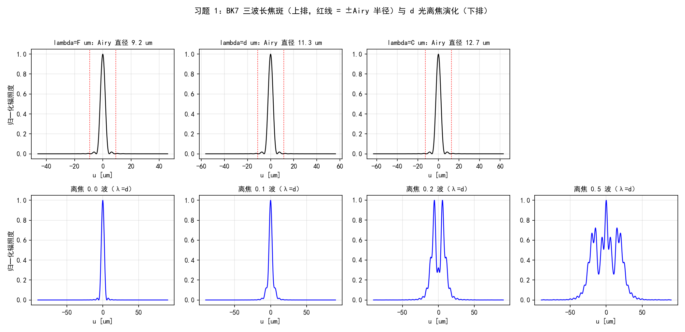
  <figcaption>图 5-10（自绘仿真）习题 1：上排 BK7 三波长焦斑切片（红线 = ±Airy 半径），下排 d 光 0/0.125/0.25/0.5 波离焦的峰值演化</figcaption>
</figure>

**习题 2/3（像散、球差加离焦的焦斑演化）**。1 波初级像散（\(i=6\)）与 1 波初级球差（\(i=11\)）各加 \(-2,-1,0,+1,+2\) 波离焦，参数 \(L=4\ \mathrm m\)、\(D=2\ \mathrm m\)、\(N=512\)、\(\lambda=1\ \mu\mathrm m\)、\(f=16\ \mathrm m\)。PSF 峰值比实测：

| 加离焦（波） | 像散 \(i=6\) | 球差 \(i=11\) |
| --- | --- | --- |
| \(-2.0\) | 0.0010 | 0.0296 |
| \(-1.0\) | 0.0096 | 0.0348 |
| \(0.0\) | 0.0070 | 0.0469 |
| \(+1.0\) | 0.0096 | 0.0345 |
| \(+2.0\) | 0.0010 | 0.0297 |

两个值得盯住的形态（图 5-11）：像散在零离焦处聚焦成**两条焦线**，加 ±1 波离焦反而略抬峰值（0.0070 → 0.0096）——离焦把两条焦线往中间拉，部分补偿了像散的结构；球差则是在零离焦处最接近"最佳焦面"（0.0469），±离焦单调变差。1 波像差的 \(\sigma_\phi^2 = 4\pi^2 \approx 39.5\ \mathrm{rad^2}\)，Maréchal/经验式早已失效（给出负数/\(10^{-17}\)），这些数字只能靠仿真——Strehl 近似式的适用边界在此一目了然。

<figure>
  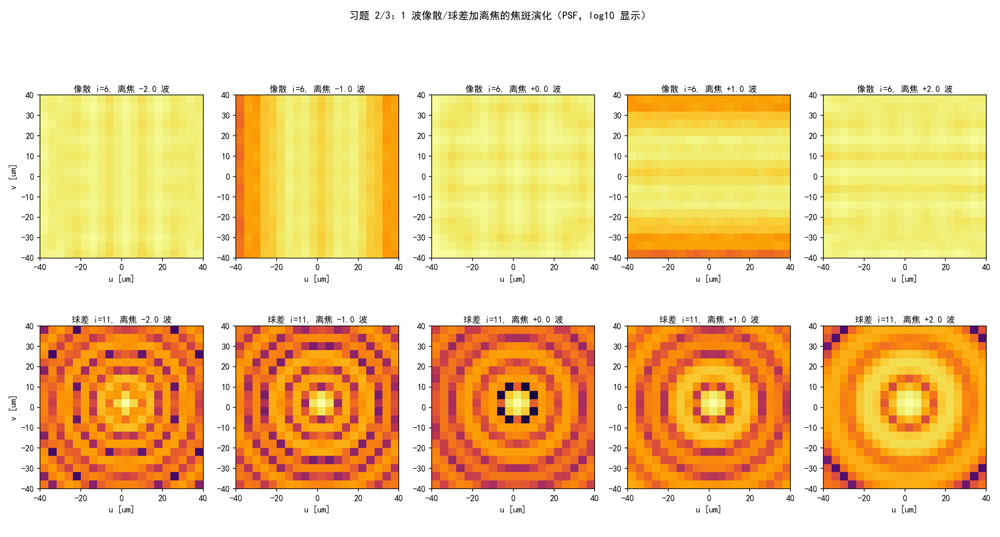
  <figcaption>图 5-11（自绘仿真）习题 2/3：1 波像散（上排）与 1 波球差（下排）加 \(\pm2,\pm1,0\) 波离焦的 PSF（log10 显示，±40 μm 窗）——像散的焦线结构与球差的环结构清晰可辨</figcaption>
</figure>

**习题 4（五阶混合像差的 Strehl）**。给定

\[
W(x, y) = 0.07\, Z_4 + 0.05\, Z_5 - 0.05\, Z_6 + 0.03\, Z_7 - 0.03\, Z_8,
\tag{5.60}
\]

参数 \(L=8\ \mathrm m\)、\(D=2\ \mathrm m\)、\(N=512\)、\(\lambda=1\ \mu\mathrm m\)、\(f=64\ \mathrm m\)。由 (5.26)：\(\sigma^2 = 0.07^2+0.05^2+0.05^2+0.03^2+0.03^2 = 0.0117\) 波²，\(\sigma_\phi^2 = 4\pi^2\times0.0117 = 0.4619\ \mathrm{rad^2}\)。四个算法正面碰头：

| 算法 | \(S\) |
| --- | --- |
| (a) 式 (5.26) + Maréchal (5.54) | 0.5381 |
| (a) 式 (5.26) + 经验式 (5.55) | 0.6301 |
| (b) 光瞳积分（式 5.46，离散求和） | 0.6300 |
| (b) 仿真 PSF 峰值比（类比 5.2.1） | 0.6300 |

结论与原书说法严丝合缝：\(\sigma_\phi^2\approx0.46\) 已超出 Maréchal 线性区的舒适范围（偏差 0.09），而**经验指数式 (5.55) 与两次独立仿真只差 \(10^{-4}\)**——"它对各种像差的数值结果拟合得最好"不是客套话。

**习题 5（环形孔径）**。内外径 1 m / 2 m（遮挡比 \(\epsilon = 0.5\)）的环形光瞳 vs 满孔径 2 m，参数同习题 4。轴上场 \(\propto\) 通光面积，解析 Strehl \((1-\epsilon^2)^2 = 0.5625\)；实测 PSF 峰值比 **0.5633**（相对差 \(1.5\times10^{-3}\)）。另一个解析可核的量：环孔把光从中心搬向边缘，主瓣反而更窄——第一暗环半径 112 μm vs 满孔 136 μm（图 5-12 左、右）。

**习题 6（稀疏孔径）**。三个直径 1 m 的圆孔组成稀疏（合成）孔径，中心按原书印刷为 \((0.6, 0.6)\)、\((-0.6, 0.6)\)、\((0, 0.6)\ \mathrm m\)。

!!! warning "原书疑似排印错误：习题 6 的三孔坐标"
    印刷值让三孔圆心共线于 \(y=0.6\) 且两两间距 0.6 m，小于直径 1 m——三孔两两重叠，"稀疏"孔径名不副实（合成孔径成像的意义就在非零基线）。原意多半是类似 \((0.6, 0.6)\)、\((-0.6, 0.6)\)、\((0, -0.6)\) 的三角形排布。工程 3 **按原文实现**（求和孔径做解析对照、并集孔径算峰值比，重叠区差异是二阶小量），报告数值时注明口径。

解析对照：孔径的 FT 是线性的，求和孔径的谱 = 单孔谱 \(\times\) 干涉因子 \(\sum_j e^{-i2\pi\mathbf{f}\cdot\mathbf{c}_j}\)。实测归一化形状最大差 \(5.0\times10^{-4}\)（采样点逐点对照）；并集孔径占满孔面积比 0.6082，PSF 峰值比 **0.3710** vs 面积比平方 0.3699——峰值 \(\propto\) 面积²，相干成像的又一铁证（图 5-12 中）。

<figure>
  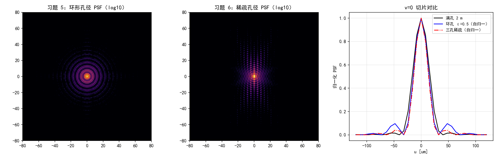
  <figcaption>图 5-12（自绘仿真）习题 5/6：环形孔径 PSF（左，log10）、三孔稀疏孔径 PSF（中，注意 y 方向的干涉条纹）、v=0 切片对比（右，环孔主瓣更窄、峰值 0.563）</figcaption>
</figure>

### 工程 3：习题 1–6（原书 5.3 节复现）

对应文件 `matlab/waveprop/ch5/ch5_problems.m`（Python 版在本 notebook 工程 3 cell）：

=== "MATLAB"

    ```matlab
        ```matlab
    %% ===== 书 Schmidt PM199 第 5 章 =====
    %  习题 1-6 复现（原书 5.3 节）：色差焦斑、像散/球差 + 离焦演化、
    %  Strehl 四算法对比、环形孔径与稀疏孔径 PSF。
    %  与 python/waveprop/第5章_代码实战.ipynb 工程 3 数值行为一致。
    %
    %  原书习题：
    %    1. BK7 的 Sellmeier 色散 -> n_F/n_d/n_C -> 平凸透镜焦距与衍射受限
    %       焦斑直径；再用相干成像例（5.2.1）算 PSF 切片，加多档离焦。
    %       N=1024, delta=0.199 mm。
    %    2. 1 波 Zernike 初级像散 + 多档离焦的 PSF 演化。
    %       L=4 m, D=2 m, N=512, lambda=1 um, f=16 m。
    %    3. 1 波 Zernike 初级球差 + 多档离焦的 PSF 演化（参数同习题 2）。
    %    4. W = 0.07 Z4 + 0.05 Z5 - 0.05 Z6 + 0.03 Z7 - 0.03 Z8（式 5.60）的
    %       Strehl：(a) 式 (5.26)+(5.54)/(5.55)；(b) 仿真 PSF（类比 5.2.1）。
    %       L=8 m, D=2 m, N=512, lambda=1 um, f=64 m。
    %    5. 内外径 1 m / 2 m 环形孔径 vs 满孔径 2 m 的 PSF 与 Strehl（峰值比），
    %       参数同习题 4，解析确认。
    %    6. 三个直径 1 m 圆孔（中心按原书印刷 (0.6,0.6), (-0.6,0.6), (0,0.6) m，
    %       三孔圆心共线于 y=0.6 且两两间距 0.6 m < 直径 1 m——疑为排印笔误，
    %       按原文实现）组成的稀疏孔径 PSF，解析确认（单孔谱 x 干涉因子）。
    %
    %  说明：习题 2-6 的 PSF 用 |ft2(P, delta)|^2（平面波 -> 焦点，即点物的
    %  相干像强度），与 5.2.1 的 ASF 同一计算。MATLAB/Python 差异：数组 1 起
    %  （剖面在 (N/2+1,:)）、besselj(1,.) 对应 scipy j1、zernike/zrf 与
    %  ch5_zernike.m 相同（本文件复制一份以便独立运行）。
    clear; clc; close all;

    %% 习题 1：BK7 色散、焦距与衍射受限焦斑
    lam = struct('F', 0.48612, 'd', 0.58756, 'C', 0.65627);   % um
    ref = struct('F', 1.52238, 'd', 1.51680, 'C', 1.51432);   % Schott 手册六位值
    R = 51.68e-3;  Dlens = 12.7e-3;           % 平凸透镜（习题 1b）
    fprintf('===== 习题 1：BK7 色散、焦距与衍射受限焦斑 =====\n');
    keys = {'F', 'd', 'C'};
    for k = 1:3
        w = lam.(keys{k});
        n = sellmeier_bk7(w);
        f = R / (n - 1);                      % 薄平凸透镜 f = R/(n-1)
        airy = 2.44 * (w*1e-6) * f / Dlens;   % Airy 直径（第一暗环）
        f_of.(keys{k}) = f;  spot_of.(keys{k}) = airy;
        fprintf('    n(%s) = %.6f（手册 %.5f，差 %.0e）  f = %7.3f mm  Airy 直径 = %5.2f um\n', ...
            keys{k}, n, ref.(keys{k}), abs(n - ref.(keys{k})), f*1e3, airy*1e6);
    end
    Vd = (ref.d - 1) / (ref.F - ref.C);
    fprintf('    阿贝数 V_d = (n_d-1)/(n_F-n_C) = %.2f（BK7 标准 64.17）\n', Vd);

    %% 习题 1c：三波长 PSF 切片 + 离焦演化（N=1024, delta=0.199mm）
    N1 = 1024;  d1m = 0.199e-3;  L1 = N1 * d1m;
    fprintf('===== 习题 1c：三波长 PSF 切片 + 离焦演化 =====\n');
    psf_slices = struct();
    peak0_d = [];
    for k = 1:3
        w = lam.(keys{k});
        [x1, y1, r1, th1, delta1] = pupil_grid(L1, N1);
        P = hypot(x1, y1) <= Dlens/2;         % 无像差光瞳
        [psf, u1] = psf_of(P, delta1, w*1e-6, f_of.(keys{k}), N1);
        row = psf(N1/2+1, :);
        half = max(row) / 2;
        above = find(row >= half);
        fwhm = (above(end) - above(1)) * (u1(2) - u1(1));
        psf_slices.(keys{k}) = {row / max(row), u1, spot_of.(keys{k})};
        if k == 2, peak0_d = max(psf(:)); end
        fprintf('    lambda=%s: PSF 半高全宽 = %5.2f um vs Airy 直径 %5.2f um\n', ...
            keys{k}, fwhm*1e6, spot_of.(keys{k})*1e6);
    end
    % 离焦演化（lambda_d，Zernike 离焦系数单位 RMS 波）
    dfocus = [0.0, 0.125, 0.25, 0.5];
    defoc_slices = cell(1, numel(dfocus));
    for q = 1:numel(dfocus)
        [x1, y1, r1, th1, delta1] = pupil_grid(L1, N1);
        Wq = dfocus(q) * zernike(4, 2*r1/Dlens, th1);
        [psf, u1] = psf_of(double(hypot(x1, y1) <= Dlens/2) ...
            .* exp(1i * 2*pi * Wq), delta1, lam.d*1e-6, f_of.d, N1);
        defoc_slices{q} = {psf(N1/2+1, :) / max(psf(:)), u1};
        fprintf('    离焦 %.3f 波：PSF 峰值 = 零离焦的 %.4f\n', ...
            dfocus(q), max(psf(:)) / peak0_d);
    end

    %% 习题 2/3：像散、球差 + 离焦的 PSF 演化（L=4m, D=2m, f=16m）
    L2 = 4.0;  N2 = 512;  D2 = 2.0;  wvl2 = 1e-6;  f2 = 16.0;
    dfocus2 = [-2.0, -1.0, 0.0, 1.0, 2.0];
    [x2, y2, r2, th2, delta2] = pupil_grid(L2, N2);
    psf_dl2 = psf_of(double(hypot(x2, y2) <= D2/2), delta2, wvl2, f2, N2);
    fprintf('===== 习题 2/3：像散、球差 + 离焦的 PSF 演化 =====\n');
    names = {'像散 i=6', '球差 i=11'};  modes = [6, 11];
    for g = 1:2
        for q = 1:numel(dfocus2)
            Wq = 1.0 * zernike(modes(g), 2*r2/D2, th2) ...
               + dfocus2(q) * zernike(4, 2*r2/D2, th2);
            psf = psf_of(double(hypot(x2, y2) <= D2/2) .* exp(1i * 2*pi * Wq), ...
                         delta2, wvl2, f2, N2);
            psf_grids{g}{q} = psf / max(psf(:));             %#ok<SAGROW>
            fprintf('    %s + 离焦 %+.1f 波：Strehl（PSF 峰值比）= %.4f\n', ...
                names{g}, dfocus2(q), max(psf(:)) / max(psf_dl2(:)));
        end
    end

    %% 习题 4：五阶混合像差的 Strehl（L=8m, D=2m, f=64m）
    L4 = 8.0;  N4 = 512;  D4 = 2.0;  wvl4 = 1e-6;  f4 = 64.0;
    [x4, y4, r4, th4, delta4] = pupil_grid(L4, N4);
    coef = [4, 0.07; 5, 0.05; 6, -0.05; 7, 0.03; 8, -0.03];   % 式 (5.60)
    W4 = zeros(N4);
    for q = 1:size(coef, 1)
        W4 = W4 + coef(q, 2) * zernike(coef(q, 1), 2*r4/D4, th4);
    end
    sig2 = sum(coef(:, 2).^2);                % 式 (5.26)
    sig2_phi = (2*pi)^2 * sig2;
    ap4 = hypot(x4, y4) <= D4/2;
    P_ab = ap4 .* exp(1i * 2*pi * W4);
    P_dl = double(ap4);
    S_pupil = abs(sum(P_ab, 'all'))^2 / abs(sum(P_dl, 'all'))^2;   % 式 (5.46)
    [psf_dl4, u4] = psf_of(P_dl, delta4, wvl4, f4, N4);
    psf_ab4 = psf_of(P_ab, delta4, wvl4, f4, N4);
    S_sim = max(psf_ab4(:)) / max(psf_dl4(:));
    fprintf('===== 习题 4：五阶混合像差的 Strehl =====\n');
    fprintf('    sigma^2 = sum a_i^2 = %.4f 波^2 -> sigma_phi^2 = %.4f rad^2\n', sig2, sig2_phi);
    fprintf('    (a) 式 (5.26)+(5.54)：S = 1 - sigma_phi^2 = %.4f\n', 1 - sig2_phi);
    fprintf('        式 (5.55) 经验：S = exp(-sigma_phi^2) = %.4f\n', exp(-sig2_phi));
    fprintf('    (b) 光瞳积分（式 5.46）：S = %.4f；仿真 PSF 峰值比：S = %.4f\n', ...
        S_pupil, S_sim);

    %% 习题 5：环形孔径（内外径 1m/2m，eps=0.5）vs 满孔径
    ap_ann = double(hypot(x4, y4) <= D4/2) - double(hypot(x4, y4) <= D4/4);
    psf_ann = psf_of(ap_ann, delta4, wvl4, f4, N4);
    S_ann = max(psf_ann(:)) / max(psf_dl4(:));
    S_analytic = (1 - 0.5^2)^2;               % 轴上场 ∝ 面积：(1-eps^2)^2
    c = N4/2 + 1;
    row_ann = psf_ann(c, :);  row_dl = psf_dl4(c, :);
    idx0  = c + find(row_ann(c:end) < row_ann(c)*1e-6, 1) - 1;
    idx0_dl = c + find(row_dl(c:end) < row_dl(c)*1e-6, 1) - 1;
    fprintf('===== 习题 5：环形孔径 =====\n');
    fprintf('    峰值比 Strehl = %.4f vs 解析 (1-eps^2)^2 = %.4f（相对差 %.1e）\n', ...
        S_ann, S_analytic, abs(S_ann - S_analytic)/S_analytic);
    fprintf('    第一暗环半径：环孔 %.2f um vs 满孔 %.2f um（环孔主瓣更窄）\n', ...
        u4(idx0)*1e6, u4(idx0_dl)*1e6);

    %% 习题 6：稀疏孔径（三个 1m 圆孔，中心按原书印刷）
    centers = [0.6, 0.6; -0.6, 0.6; 0.0, 0.6];   % 原书印刷：三孔共线 y=0.6
    fprintf('===== 习题 6：稀疏孔径 =====\n');
    % 三孔两两间距 0.6 m < 直径 1 m：按"求和"孔径做解析对照（FT 线性），
    % 按"并集"孔径（物理透过率）算峰值比；两者在重叠区相差二阶小量
    ap_sum = zeros(N4);  ap_sp = zeros(N4);
    for q = 1:3
        dsk = double(hypot(x4 - centers(q,1), y4 - centers(q,2)) <= 0.5);
        ap_sum = ap_sum + dsk;
        ap_sp = max(ap_sp, dsk);
    end
    psf_sp  = psf_of(ap_sp, delta4, wvl4, f4, N4);
    psf_sum = psf_of(ap_sum, delta4, wvl4, f4, N4);
    % 解析：U(f) = FT{半径 0.5 圆盘}(f) * sum_j exp(-i 2pi f.c_j)
    fxn = (-N4/2 : N4/2-1) / (N4 * delta4);
    [FXn, FYn] = meshgrid(fxn, fxn);
    rho = hypot(FXn, FYn);
    U1 = 0.5 * besselj(1, 2*pi*0.5*rho) ./ max(rho, eps);
    U1(rho == 0) = pi * 0.25;                 % jinc(0, R=0.5) = 面积
    inter = zeros(N4);
    for q = 1:3
        inter = inter + exp(-1i * 2*pi * (FXn*centers(q,1) + FYn*centers(q,2)));
    end
    psf_an = abs(U1 .* inter).^2;
    % 数值 PSF 带 delta^4 定标；对照用归一化形状（各自除以轴上峰值）
    samples = [c c; c c+1; c+2 c+3; c+5 c+2; c+9 c];
    err = 0;
    for q = 1:size(samples, 1)
        ii = samples(q, 1);  jj = samples(q, 2);
        err = max(err, abs(psf_sum(ii, jj)/psf_sum(c, c) - psf_an(ii, jj)/psf_an(c, c)));
    end
    area_ratio = sum(ap_sp(:)) * delta4^2 / (pi * 1.0^2);
    S_sp = max(psf_sp(:)) / max(psf_dl4(:));
    fprintf('    PSF（求和孔径）vs 解析（单孔谱 x 干涉因子）归一化形状最大差 = %.2e\n', err);
    fprintf('    三孔/满孔面积比 = %.4f；峰值比 = %.4f（= 面积比平方 %.4f）\n', ...
        area_ratio, S_sp, area_ratio^2);

    %% 绘图（对应 notebook 图 5-10/11/12）
    figure('Position', [40 40 1400 680]);
    sgtitle('习题 1：BK7 三波长焦斑（上排，红线 = ±Airy 半径）与 d 光离焦演化（下排）');
    for k = 1:3
        subplot(2, 4, k);
        dat = psf_slices.(keys{k});
        row = dat{1};  u1 = dat{2};  airy = dat{3};
        m = abs(u1) < 5*airy;
        plot(u1(m)*1e6, row(m), 'k-', 'LineWidth', 1.2);  hold on;
        xline(airy*1e6, 'r:');  xline(-airy*1e6, 'r:');
        title(sprintf('lambda=%s um：Airy 直径 %.1f um', keys{k}, airy*1e6), 'FontSize', 10);
        xlabel('u [um]');  grid on;
        if k == 1, ylabel('归一化辐照度'); end
    end
    subplot(2, 4, 4);  axis off;              % 上排第 4 格留白
    for q = 1:numel(dfocus)
        subplot(2, 4, 4 + q);
        dat = defoc_slices{q};
        m = abs(dat{2}) < 8*spot_of.d;
        plot(dat{2}(m)*1e6, dat{1}(m), 'b-', 'LineWidth', 1.2);
        title(sprintf('离焦 %.1f 波（λ=d）', dfocus(q)), 'FontSize', 10);
        xlabel('u [um]');  grid on;
    end

    figure('Position', [40 60 1600 860]);
    for g = 1:2
        for q = 1:numel(dfocus2)
            subplot(2, 5, (g-1)*5 + q);
            imagesc(log10(psf_grids{g}{q} + 1e-6));
            caxis([-5 0]);  colormap inferno;
            xlim([-40 40]);  ylim([-40 40]);
            title(sprintf('%s, 离焦 %+.1f 波', names{g}, dfocus2(q)), 'FontSize', 10);
            xlabel('u [um]');
            if q == 1, ylabel('v [um]'); end
        end
    end
    sgtitle('习题 2/3：1 波像散/球差加离焦的焦斑演化（PSF，log10 显示）');

    figure('Position', [40 80 1500 480]);
    subplot(1, 3, 1);
    imagesc(log10(psf_ann / max(psf_ann(:)) + 1e-9));  caxis([-5 0]);  colormap inferno;
    xlim([-80 80]);  ylim([-80 80]);  colorbar;
    title('习题 5：环形孔径 PSF（log10）');
    subplot(1, 3, 2);
    imagesc(log10(psf_sp / max(psf_sp(:)) + 1e-9));  caxis([-5 0]);  colormap inferno;
    xlim([-80 80]);  ylim([-80 80]);  colorbar;
    title('习题 6：稀疏孔径 PSF（log10）');
    subplot(1, 3, 3);
    mm = abs(u4) <= 120e-6;
    plot(u4(mm)*1e6, row_dl(mm)/max(row_dl), 'k-', 'LineWidth', 1.3); hold on;
    plot(u4(mm)*1e6, row_ann(mm)/max(row_ann), 'b-', 'LineWidth', 1.1);
    plot(u4(mm)*1e6, psf_sp(c, mm)/max(psf_sp(:)), 'r-.', 'LineWidth', 1.1);
    xlabel('u [um]');  ylabel('归一化 PSF');  grid on;
    title('v=0 切片对比');
    legend({'满孔 2 m', '环孔 ε=0.5（自归一）', '三孔稀疏（自归一）'}, 'FontSize', 8);

    %% ===== 本地函数 =====
    function n = sellmeier_bk7(wvl_um)
    % BK7 的 Sellmeier 色散（式 5.56，Schott 手册系数，lambda 以 um 计）
    B = [1.03961212, 0.231792344, 1.01046945];
    C = [0.00600069867, 0.0200179144, 103.560653];
    n2 = 1.0;
    for q = 1:3
        n2 = n2 + B(q) * wvl_um^2 / (wvl_um^2 - C(q));
    end
    n = sqrt(n2);
    end

    function [x, y, r, theta, delta] = pupil_grid(L, N)
    % 居中网格与极坐标
    delta = L / N;
    [x, y] = meshgrid((-N/2 : N/2-1) * delta);
    r = hypot(x, y);
    theta = atan2(y, x);
    end

    function [psf, u1d] = psf_of(P, delta, wvl, f, N)
    % PSF = |ft2(P)|^2 与像面坐标（间隔 lambda f/(N delta)）
    h = ft2(P, delta);
    psf = abs(h).^2;
    u1d = (-N/2 : N/2-1) * wvl * f / (N * delta);
    end

    function G = ft2(g, delta)
    % 原书 Listing 2.5：定标正确的二维 DFT（乘 delta^2）
    G = fftshift(fft2(fftshift(g))) * delta^2;
    end

    function Z = zernike(i, r, theta)
    % Noll 单指标 Zernike（m=0 分支已按勘误补 sqrt(n+1)）；与 ch5_zernike.m 相同
    [n, m] = zidx(i);
    R = zrf(n, m, r);
    if m == 0
        Z = sqrt(n+1) * R;
    elseif mod(i, 2) == 0
        Z = sqrt(2*(n+1)) * R .* cos(m*theta);
    else
        Z = sqrt(2*(n+1)) * R .* sin(m*theta);
    end
    end

    function R = zrf(n, m, r)
    % Zernike 径向多项式（式 5.5a，阶乘用 gamma 实现）
    R = zeros(size(r));
    for s = 0:(n-m)/2
        num = (-1)^s * gamma(n - s + 1);
        den = gamma(s+1) * gamma((n+m)/2 - s + 1) * gamma((n-m)/2 - s + 1);
        R = R + num / den * r.^(n - 2*s);
    end
    end

    function [n, m] = zidx(i)
    % 表 5.2 的 (i,n,m) 映射（Noll 单指标）；与 ch5_zernike.m 相同
    persistent rows
    if isempty(rows)
        rows = zeros(0, 2);
        for n0 = 0:40
            for m0 = mod(n0, 2):2:n0
                rows(end+1, :) = [n0, m0];    %#ok<AGROW>
                if m0 > 0
                    rows(end+1, :) = [n0, m0];  %#ok<AGROW>
                end
            end
        end
    end
    n = rows(i, 1);
    m = rows(i, 2);
    end
    ```
    ```

=== "Python"

    ```python
        ```python
        # -*- coding: utf-8 -*-
        """
        ===== 书 Schmidt PM199 第 5 章习题 1-6 复现（原书 5.3 节）：色差焦斑、像散/球差 + 离焦演化、
    Strehl 四算法对比、环形孔径与稀疏孔径 PSF。

    原书习题：
        1. BK7 的 Sellmeier 色散 -> n_F/n_d/n_C -> 平凸透镜焦距与衍射受限
           焦斑直径；再用相干成像例（5.2.1）算 PSF 切片，加多档离焦。
           N=1024, delta=0.199 mm。
        2. 1 波 Zernike 初级像散 + 多档离焦的 PSF 演化。
           L=4 m, D=2 m, N=512, lambda=1 um, f=16 m。
        3. 1 波 Zernike 初级球差 + 多档离焦的 PSF 演化（参数同习题 2）。
        4. W = 0.07 Z4 + 0.05 Z5 - 0.05 Z6 + 0.03 Z7 - 0.03 Z8 的 Strehl：
           (a) 式 (5.26)+(5.54)/(5.55)；(b) 仿真 PSF（类比 5.2.1）。
           L=8 m, D=2 m, N=512, lambda=1 um, f=64 m。
        5. 内外径 1 m / 2 m 环形孔径 vs 满孔径 2 m 的 PSF 与 Strehl
           （峰值比），参数同习题 4，解析确认。
        6. 三个直径 1 m 圆孔（中心按原书印刷 (0.6,0.6), (-0.6,0.6), (0,0.6) m，
           三孔圆心共线于 y=0.6——疑为排印笔误，按原文实现）组成的稀疏孔径
           PSF，解析确认（单孔谱 x 干涉因子）。

    数值验证（运行本脚本全部自动打印）：
        (1) BK7 三个标准波长的折射率（对照 Schott 手册值 n_d=1.51680,
            n_F=1.52238, n_C=1.51432）、焦距 f=R/(n-1)、Airy 直径
            2.44*lambda*f/D；三个波长的零离焦 PSF 半高全宽对照 Airy 直径；
            离焦 0/0.5/1/2 波的峰值跌落；
        (2/3) 像散/球差加离焦的 PSF 图（图 5-11）；
        (4) Strehl 四算法：式 (5.26)+(5.54)、式 (5.55)、光瞳积分（式 5.46）、
            仿真 PSF 峰值比；
        (5) 环孔 Strehl（峰值比）vs 解析 (1-eps^2)^2（轴上场 ∝ 面积）；
        (6) 稀疏孔径 PSF vs 解析 |FT{circ}|^2 * |sum exp(-i2pi f.c_j)|^2
            逐点对照 + 峰值比 vs 面积比的平方。

    说明：P2-P6 的 PSF 用 |ft2(P, delta)|^2（平面波 -> 焦点，即点物的相干像的
    强度），与 5.2.1 的 ASF 同一计算。
    用法：python ch5_problems.py <输出目录>  保存 PNG；否则弹窗显示。
    依赖：numpy + matplotlib + scipy；base.py（circle/ft2_centered）；
          ch5_zernike.py（同目录，zernike）。
    """
    import os
    import sys

    import numpy as np
    import matplotlib.pyplot as plt
    from scipy.special import j1

    plt.rcParams['font.sans-serif'] = ['SimHei', 'Microsoft YaHei', 'Arial Unicode MS']
    plt.rcParams['axes.unicode_minus'] = False

    sys.path.insert(0, os.path.join(os.path.dirname(os.path.abspath(__file__)),
                                    "..", "..", "fourier", "common"))
    from base import circle, ft2_centered  # noqa: E402
    # zernike 在本 notebook 第一个代码 cell（工程 1）中定义，按顺序运行即可；
    # 拆回独立 .py 文件时改用：from ch5_zernike import zernike


    def sellmeier_bk7(wvl_um):
        """BK7 的 Sellmeier 色散（式 5.56，Schott 手册系数，lambda 以 um 计）。"""
        B = [1.03961212, 0.231792344, 1.01046945]
        C = [0.00600069867, 0.0200179144, 103.560653]
        n2 = 1.0
        for Bi, Ci in zip(B, C):
            n2 += Bi * wvl_um ** 2 / (wvl_um ** 2 - Ci)
        return np.sqrt(n2)


    def pupil_grid(L, N):
        """居中网格与极坐标。"""
        delta = L / N
        x, y = np.meshgrid((np.arange(N) - N // 2) * delta,
                           (np.arange(N) - N // 2) * delta)
        return x, y, np.hypot(x, y), np.arctan2(y, x), delta


    def psf_of(P, delta, wvl, f, N):
        """PSF = |ft2(P)|^2 与像面坐标（间隔 lambda f/(N delta)）。"""
        h = ft2_centered(P, delta)
        psf = np.abs(h) ** 2
        u1d = (np.arange(N) - N // 2) * wvl * f / (N * delta)
        return psf, u1d


    def main(outdir=None):
        print('===== 习题 1：BK7 色散、焦距与衍射受限焦斑 =====')
        lam = {'F': 0.48612, 'd': 0.58756, 'C': 0.65627}     # um
        ref = {'F': 1.52238, 'd': 1.51680, 'C': 1.51432}     # Schott 手册六位值
        R, Dlens = 51.68e-3, 12.7e-3                          # 平凸透镜（习题 1b）
        f_of, spot_of = {}, {}
        for k, w in lam.items():
            n = sellmeier_bk7(w)
            f = R / (n - 1.0)                                 # 薄平凸透镜 f = R/(n-1)
            airy = 2.44 * (w * 1e-6) * f / Dlens              # Airy 直径（第一暗环）
            f_of[k], spot_of[k] = f, airy
            print('    n(%s) = %.6f（手册 %.5f，差 %.0e）  f = %7.3f mm  '
                  'Airy 直径 = %5.2f um' % (k, n, ref[k], abs(n - ref[k]),
                                            f * 1e3, airy * 1e6))
        Vd = (ref['d'] - 1) / (ref['F'] - ref['C'])
        print('    阿贝数 V_d = (n_d-1)/(n_F-n_C) = %.2f（BK7 标准 64.17）' % Vd)

        print('===== 习题 1c：三波长 PSF 切片 + 离焦演化（N=1024, delta=0.199mm） =====')
        N1 = 1024
        L1 = N1 * 0.199e-3
        psf_slices, peak0_d = {}, None
        for k, w in lam.items():
            x1, y1, r1, th1, delta1 = pupil_grid(L1, N1)
            P = circle(x1, y1, Dlens / 2)                     # 无像差光瞳
            psf, u1 = psf_of(P, delta1, w * 1e-6, f_of[k], N1)
            row = psf[N1 // 2, :]
            half = row.max() / 2
            above = np.where(row >= half)[0]
            fwhm = (above[-1] - above[0]) * (u1[1] - u1[0])
            psf_slices[k] = (row / row.max(), u1, spot_of[k])
            if k == 'd':
                peak0_d = psf.max()
            print('    lambda=%s: PSF 半高全宽 = %5.2f um vs Airy 直径 %5.2f um'
                  % (k, fwhm * 1e6, spot_of[k] * 1e6))
        # 离焦演化（lambda_d，0/0.5/1/2 波 Z4）
        dfocus = [0.0, 0.125, 0.25, 0.5]   # Zernike 离焦系数（单位 RMS 波）
        defoc_slices = []
        for a in dfocus:
            x1, y1, r1, th1, delta1 = pupil_grid(L1, N1)
            W = a * zernike(4, 2 * r1 / Dlens, th1)
            psf, u1 = psf_of(circle(x1, y1, Dlens / 2)
                             * np.exp(1j * 2 * np.pi * W), delta1,
                             lam['d'] * 1e-6, f_of['d'], N1)
            defoc_slices.append((psf[N1 // 2, :] / psf.max(), u1))
            print('    离焦 %.3f 波：PSF 峰值 = 零离焦的 %.4f'
                  % (a, psf.max() / peak0_d))

        print('===== 习题 2/3：像散、球差 + 离焦的 PSF 演化（L=4m, D=2m, f=16m） =====')
        L2, N2, D2, wvl2, f2 = 4.0, 512, 2.0, 1e-6, 16.0
        dfocus2 = [-2.0, -1.0, 0.0, 1.0, 2.0]   # 像散线焦在 -0.71/+0.71
        x2, y2, r2, th2, delta2 = pupil_grid(L2, N2)
        psf_dl2 = psf_of(circle(x2, y2, D2 / 2), delta2, wvl2, f2, N2)[0]
        psf_grids = {}
        for name, mi in [('像散 i=6', 6), ('球差 i=11', 11)]:
            rows = []
            for a in dfocus2:
                W = 1.0 * zernike(mi, 2 * r2 / D2, th2) \
                    + a * zernike(4, 2 * r2 / D2, th2)
                psf, u2 = psf_of(circle(x2, y2, D2 / 2)
                                 * np.exp(1j * 2 * np.pi * W), delta2, wvl2, f2, N2)
                rows.append(psf / psf.max())
                print('    %s + 离焦 %+.1f 波：Strehl（PSF 峰值比）= %.4f'
                      % (name, a, psf.max() / psf_dl2.max()))
            psf_grids[name] = rows

        print('===== 习题 4：五阶混合像差的 Strehl（L=8m, D=2m, f=64m） =====')
        L4, N4, D4, wvl4, f4 = 8.0, 512, 2.0, 1e-6, 64.0
        x4, y4, r4, th4, delta4 = pupil_grid(L4, N4)
        coef = {4: 0.07, 5: 0.05, 6: -0.05, 7: 0.03, 8: -0.03}   # 式 (5.60)
        W4 = np.zeros((N4, N4))
        for i, a in coef.items():
            W4 = W4 + a * zernike(i, 2 * r4 / D4, th4)
        sig2 = sum(a ** 2 for a in coef.values())            # 式 (5.26)
        sig2_phi = (2 * np.pi) ** 2 * sig2
        P_ab = circle(x4, y4, D4 / 2) * np.exp(1j * 2 * np.pi * W4)
        P_dl = circle(x4, y4, D4 / 2)
        S_pupil = np.abs(np.sum(P_ab)) ** 2 / np.abs(np.sum(P_dl)) ** 2   # 式 (5.46)
        psf_dl4, u4 = psf_of(P_dl, delta4, wvl4, f4, N4)
        psf_ab4, _ = psf_of(P_ab, delta4, wvl4, f4, N4)
        S_sim = psf_ab4.max() / psf_dl4.max()
        print('    sigma^2 = sum a_i^2 = %.4f 波^2 -> sigma_phi^2 = %.4f rad^2'
              % (sig2, sig2_phi))
        print('    (a) 式 (5.26)+(5.54)：S = 1 - sigma_phi^2 = %.4f' % (1 - sig2_phi))
        print('        式 (5.55) 经验：S = exp(-sigma_phi^2) = %.4f' % np.exp(-sig2_phi))
        print('    (b) 光瞳积分（式 5.46）：S = %.4f；仿真 PSF 峰值比：S = %.4f'
              % (S_pupil, S_sim))

        print('===== 习题 5：环形孔径（内外径 1m/2m，eps=0.5）vs 满孔径 =====')
        ap_ann = circle(x4, y4, D4 / 2) - circle(x4, y4, D4 / 4)
        psf_ann, _ = psf_of(ap_ann, delta4, wvl4, f4, N4)
        S_ann = psf_ann.max() / psf_dl4.max()
        S_analytic = (1 - 0.5 ** 2) ** 2          # 轴上场 ∝ 面积：(1-eps^2)^2
        c = N4 // 2
        row_ann = psf_ann[c, :]
        row_dl = psf_dl4[c, :]
        idx0 = c + np.argmax(row_ann[c:] < row_ann[c] * 1e-6)
        idx0_dl = c + np.argmax(row_dl[c:] < row_dl[c] * 1e-6)
        print('    峰值比 Strehl = %.4f vs 解析 (1-eps^2)^2 = %.4f（相对差 %.1e）'
              % (S_ann, S_analytic, abs(S_ann - S_analytic) / S_analytic))
        print('    第一暗环半径：环孔 %.2f um vs 满孔 %.2f um（环孔主瓣更窄）'
              % (u4[idx0] * 1e6, u4[idx0_dl] * 1e6))

        print('===== 习题 6：稀疏孔径（三个 1m 圆孔，中心按原书印刷） =====')
        centers = [(0.6, 0.6), (-0.6, 0.6), (0.0, 0.6)]   # 原书印刷：三孔共线 y=0.6
        # 三孔两两间距 0.6 m < 直径 1 m：按"求和"孔径做解析对照（FT 线性），
        # 按"并集"孔径（物理透过率）算峰值比；两者在重叠区相差二阶小量
        ap_sum = np.zeros((N4, N4))
        ap_sp = np.zeros((N4, N4))
        for cx, cy in centers:
            dsk = circle(x4 - cx, y4 - cy, 0.5)
            ap_sum = ap_sum + dsk
            ap_sp = np.maximum(ap_sp, dsk)
        psf_sp, _ = psf_of(ap_sp, delta4, wvl4, f4, N4)
        psf_sum, _ = psf_of(ap_sum, delta4, wvl4, f4, N4)
        # 解析：U(f) = FT{半径 0.5 圆盘}(f) * sum_j exp(-i 2pi f.c_j)
        fxn = (np.arange(N4) - N4 // 2) / (N4 * delta4)
        FXn, FYn = np.meshgrid(fxn, fxn)
        rho = np.hypot(FXn, FYn)
        with np.errstate(divide='ignore', invalid='ignore'):
            U1 = np.where(rho > 0, 0.5 * j1(2 * np.pi * 0.5 * rho) / rho,
                          np.pi * 0.25)                  # base.jinc(rho, R=0.5)
        inter = np.zeros((N4, N4), dtype=complex)
        for cx, cy in centers:
            inter = inter + np.exp(-1j * 2 * np.pi * (FXn * cx + FYn * cy))
        psf_an = np.abs(U1 * inter) ** 2
        # 数值 PSF 带 delta^4 定标；对照用归一化形状（各自除以轴上峰值）
        samples = [(c, c), (c, c + 1), (c + 2, c + 3), (c + 5, c + 2), (c + 9, c)]
        err = max(abs(psf_sum[i, j] / psf_sum[c, c]
                      - psf_an[i, j] / psf_an[c, c]) for i, j in samples)
        area_ratio = ap_sp.sum() * delta4 ** 2 / (np.pi * 1.0 ** 2)
        S_sp = psf_sp.max() / psf_dl4.max()
        print('    PSF（求和孔径）vs 解析（单孔谱 x 干涉因子）归一化形状最大差 = %.2e' % err)
        print('    三孔/满孔面积比 = %.4f；峰值比 = %.4f（= 面积比平方 %.4f）'
              % (area_ratio, S_sp, area_ratio ** 2))

        if not outdir:
            plt.show()
            return

        # ---- 图 5-10：习题 1（三波长焦斑 + 离焦演化） ----
        fig, axs = plt.subplots(2, 4, figsize=(14, 6.8))
        for ax, k in zip(axs[0], ['F', 'd', 'C']):
            row, u1, airy = psf_slices[k]
            m = np.abs(u1) < 5 * airy
            ax.plot(u1[m] * 1e6, row[m], 'k-', linewidth=1.2)
            ax.axvline(airy * 1e6, color='r', linestyle=':', linewidth=1)
            ax.axvline(-airy * 1e6, color='r', linestyle=':', linewidth=1)
            ax.set_title('lambda=%s um：Airy 直径 %.1f um' % (k, airy * 1e6), fontsize=10)
            ax.set_xlabel('u [um]'); ax.grid(alpha=0.3)
        axs[0, 3].axis('off')
        axs[0, 0].set_ylabel('归一化辐照度')
        for ax, a, dat in zip(axs[1], dfocus, defoc_slices):
            row, u1 = dat
            airy_d = spot_of['d']
            m = np.abs(u1) < 8 * airy_d
            ax.plot(u1[m] * 1e6, row[m], 'b-', linewidth=1.2)
            ax.set_title('离焦 %.1f 波（λ=d）' % a, fontsize=10)
            ax.set_xlabel('u [um]'); ax.grid(alpha=0.3)
        axs[1, 0].set_ylabel('归一化辐照度')
        fig.suptitle('习题 1：BK7 三波长焦斑（上排，红线 = ±Airy 半径）'
                     '与 d 光离焦演化（下排）', fontsize=12)
        fig.tight_layout(rect=[0, 0, 1, 0.95])
        fig.savefig(os.path.join(outdir, 'fig-5-10.png'), dpi=150)
        print('    已保存 fig-5-10.png')

        # ---- 图 5-11：习题 2/3 PSF 演化（2x4 图，±40 um 窗） ----
        ext = u2[-1] * 1e6
        fig, axs = plt.subplots(2, 5, figsize=(16, 8.6))
        for rowi, name in enumerate(['像散 i=6', '球差 i=11']):
            for coli, (a, img) in enumerate(zip(dfocus2, psf_grids[name])):
                ax = axs[rowi, coli]
                ax.imshow(np.log10(img + 1e-6), cmap='inferno', origin='lower',
                          extent=[-ext, ext, -ext, ext], vmin=-5, vmax=0)
                ax.set_title('%s, 离焦 %+.1f 波' % (name, a), fontsize=10, pad=4)
                ax.set_xlim(-40, 40); ax.set_ylim(-40, 40)
                if coli == 0:
                    ax.set_ylabel('v [um]')
                ax.set_xlabel('u [um]')
        fig.suptitle('习题 2/3：1 波像散/球差加离焦的焦斑演化（PSF，log10 显示）', fontsize=12)
        fig.tight_layout(rect=[0, 0, 1, 0.95])
        fig.savefig(os.path.join(outdir, 'fig-5-11.png'), dpi=150)
        print('    已保存 fig-5-11.png')

        # ---- 图 5-12：习题 5/6（环孔与稀疏孔径） ----
        fig, axs = plt.subplots(1, 3, figsize=(15, 4.8))
        axs[0].imshow(np.log10(psf_ann / psf_ann.max() + 1e-9), cmap='inferno',
                      origin='lower', extent=[-80, 80, -80, 80], vmin=-5)
        axs[0].set_title('习题 5：环形孔径 PSF（log10）')
        axs[1].imshow(np.log10(psf_sp / psf_sp.max() + 1e-9), cmap='inferno',
                      origin='lower', extent=[-80, 80, -80, 80], vmin=-5)
        axs[1].set_title('习题 6：稀疏孔径 PSF（log10）')
        mm = np.abs(u4) < 120e-6
        axs[2].plot(u4[mm] * 1e6, (row_dl / row_dl.max())[mm], 'k-',
                    label='满孔 2 m')
        axs[2].plot(u4[mm] * 1e6, (row_ann / row_ann.max())[mm], 'b-',
                    label='环孔 ε=0.5（自归一）')
        axs[2].plot(u4[mm] * 1e6, (psf_sp[c, :] / psf_sp.max())[mm], 'r-.',
                    label='三孔稀疏（自归一）')
        axs[2].set_xlabel('u [um]'); axs[2].set_ylabel('归一化 PSF')
        axs[2].set_title('v=0 切片对比'); axs[2].grid(alpha=0.3)
        axs[2].legend(fontsize=9)
        fig.tight_layout()
        fig.savefig(os.path.join(outdir, 'fig-5-12.png'), dpi=150)
        print('    已保存 fig-5-12.png')


    if __name__ == '__main__':
        main(sys.argv[1] if len(sys.argv) > 1 else None)
    ```

**工程 3 实跑输出（Python）：** 习题 1 折射率 \(n_F/n_d/n_C = 1.522377/1.516800/1.514322\)（手册差 \(\le3\times10^{-6}\)），\(f = 98.932/100.000/100.482\ \mathrm{mm}\)，Airy 直径 \(9.24/11.29/12.67\ \mu\mathrm m\)，\(V_d = 64.12\)；PSF 半高全宽 \(3.78/4.61/5.18\ \mu\mathrm m\)；离焦 0/0.125/0.25/0.5 波峰值比 \(1.0000/0.5172/0.0704/0.0189\)。习题 2/3 的 Strehl 表见正文。习题 4：\(\sigma^2 = 0.0117\)、\(\sigma_\phi^2 = 0.4619\)，四算法 \(0.5381/0.6301/0.6300/0.6300\)。习题 5：\(S = 0.5633\) vs 解析 0.5625（\(1.5\times10^{-3}\)），第一暗环 112 vs 136 μm。习题 6：形状最大差 \(5.0\times10^{-4}\)，面积比 0.6082，峰值比 0.3710 vs 0.3699。

## 坑与陷阱

!!! danger "1. m=0 的 Zernike 归一化因子 \(\sqrt{n+1}\) 丢了"
    原书 (5.4) 印刷漏了它（勘误），自己写 `zernike` 函数时别跟着丢。自检：\(Z_4(0,0) = -\sqrt{3}\)、\(Z_{11}(1,0) = \sqrt{5}\)（查表 5.2），对不上就是归一化错了。

!!! danger "2. 径向正交积分是 \(1/[2(n+1)]\)，不是书印的 \(1/(2n+1)\)"
    式 (5.7) 的笔误。用 \(n=0\) 反例记：\(\int_0^1 r\,dr = 1/2\)，只有 \(1/[2(0+1)]\) 对。(5.22)–(5.26) 的方差推导依赖 (5.9)，归一化错了 (5.26) 就不是"系数平方和"了。

!!! danger "3. 正交性只在单位圆内成立——求和前先掩膜"
    Gram 矩阵、系数投影、\(\sigma^2\) 全部只对**孔径内**样本求和。Zernike 多项式在圆外不为零，忘了 `idxAp` 掩膜，"正交"会错得离谱（工程 1 验证 2 特意强调这一点）。

!!! danger "4. \(W\) 用波、\(\phi\) 用弧度，\(2\pi\) 别忘"
    \(\mathcal{P} = P\,e^{i2\pi W}\)（式 5.1）；Listing 5.3 里 `screen / (2*pi)` 是 rad→波的换算。最常见错误是忘了 \(2\pi\)：0.05 波的像差按 0.05 rad 算，Strehl 会"好"到假。换算关系 \(\sigma_\phi^2 = 4\pi^2\sigma^2\) 同理。

!!! danger "5. ATF 与 OTF 是两种不同的 \(H\)，归一化不同"
    相干 ATF = \(\lambda z_i\,\mathcal{P}(-\lambda z_i f)\)：复值、可为负、**不归一**（\(H(0)=\lambda z_i\)，量纲 m²）；OTF = 光瞳自相关**归一到 1**（\(H(0)=1\)）。两节共用符号 \(H\)，读公式先确认在 5.2.1 还是 5.2.2。

!!! danger "6. 式 (5.34) 的 \(\lambda z_i\) 因子是对的，别当勘误删掉"
    推导里二维雅可比 \((\lambda z_i)^2\) 抵掉 \(1/(\lambda z_i)\) 后**剩一个** \(\lambda z_i\)。工程 2 实测 \(\max|\mathcal{F}\{h\} - \lambda z_i\,\mathcal{P}(-\lambda z_i f)|\sim10^{-22}\)。删了它，ATF 的直流值与绝对定标全错。

!!! danger "7. \(|h|^2\) 的 DFT 是循环自相关——位移大了一定回绕"
    用 \(|h|^2\) 的 FT 数值算 OTF（路线 A）时，光瞳自相关在位移超过 \(L - D\)（网格宽减光瞳直径）后卷回窗内。要么垫零做线性自相关（路线 B），要么只在 \(|f|\le(L-D)/\lambda z_i\) 内相信路线 A——工程 2 实测回绕区误差 0.35，完全不能用。

!!! danger "8. Maréchal / 经验式只在小像差下成立"
    \(\sigma_\phi^2\lesssim1\)（RMS \(\lesssim 0.16\) 波）内 \(1-\sigma_\phi^2\) 与 \(e^{-\sigma_\phi^2}\) 都跟仿真贴；1 波像差时 \(\sigma_\phi^2\approx39.5\)，Maréchal 给负数、经验式给 \(10^{-17}\)，真实 Strehl 只能仿真（习题 2/3 实测 \(0.007\sim0.047\)）。

## 速览

1. 成像系统 = 对场（相干）或辐照度（非相干）的线性系统；像差 \(W\)（单位：波）只属于系统，进模型靠广义光瞳 \(\mathcal{P} = P\,e^{i2\pi W}\)（式 5.1）。
2. Seidel 多项式直观但不正交；Zernike 圆多项式在单位圆上完备正交（式 5.7–5.9，\(\int\!\int Z_i^2 = \pi\)），Noll 单指标、sin/cos 由 \(i\) 奇偶定（表 5.2）。
3. 求 Zernike 系数 = 最小二乘：\(W = ZA\)，MATLAB `A = Z\W`（式 5.17/5.18）；网格离散下重构 (5.15) 只是近似，格点越密越准。
4. 波前方差 = 系数平方和：\(\sigma^2 = \sum_{i\ge2} a_i^2\)（式 5.26）——单位 RMS 归一化的直接红利。
5. 相干成像：\(U_i = h\otimes U_o\)，\(h = \mathcal{F}\{\mathcal{P}\}/(\lambda z_i)\)（式 5.29）；ATF \(= \lambda z_i\,\mathcal{P}(-\lambda z_i f)\)（式 5.34）；圆孔截频 \(f_0 = D/(2\lambda z_i)\)。
6. 非相干成像：\(I_i = |h|^2\otimes I_o\)（式 5.35）；OTF = 光瞳自相关归一（式 5.41），圆孔闭式 (5.42)，截频 \(2f_0\)、\(H\ge0\)。
7. Strehl 比：精确式 (5.45)/(5.46)（光瞳积分，也是 PSF 峰值比）；小像差用 Maréchal \(1-\sigma_\phi^2\)（5.54）或经验式 \(e^{-\sigma_\phi^2}\)（5.55，拟合最好）。
8. 环孔 Strehl \(= (1-\epsilon^2)^2\)（轴上场 ∝ 面积）；稀疏孔径峰值 \(\propto\) 面积比平方。
9. 离焦极"贵"：0.125 波 RMS 离焦就把 PSF 峰值打到 0.52（习题 1 实测）。
10. 原书笔误三处：(5.4) m=0 缺 \(\sqrt{n+1}\)、(5.7) \(1/(2n+1)\) 应为 \(1/[2(n+1)]\)、表 5.2 标题 36 实列 37；习题 6 三孔坐标疑似排印错误。

## 术语速查

| 英文 | 中文 | 一句话 |
| --- | --- | --- |
| aberration | 像差 | 波前对理想球面相位的偏离，\(W\) 以波计 |
| generalized pupil function | 广义光瞳函数 | \(\mathcal{P} = P\,e^{i2\pi W}\)，振幅光瞳 × 像差相位 |
| Seidel aberrations | Seidel（初级）像差 | tilt/defocus/像散/彗差/球差的幂多项式表示 |
| Zernike circle polynomials | Zernike 圆多项式 | 单位圆上完备正交的像差基底（Noll 约定） |
| mode-limited wavefront | 模式受限波前 | 只保留前 \(n_Z\) 个模式的近似 \(W'\) |
| adaptive optics | 自适应光学 | 波前传感 + 变形镜实时补偿像差的闭环系统 |
| RMS wavefront error | RMS 波前差 | \(\sigma = \sqrt{\sum_{i\ge2}a_i^2}\)，像差大小的单一度量 |
| amplitude spread function (ASF) | 振幅扩散函数 | 相干成像的脉冲响应 \(h = \mathcal{F}\{\mathcal{P}\}/(\lambda z_i)\) |
| amplitude transfer function (ATF) | 振幅传递函数 | \(H = \lambda z_i\,\mathcal{P}(-\lambda z_i f)\)，缩放翻转的光瞳 |
| point spread function (PSF) | 点扩散函数 | 非相干成像的脉冲响应 \(|h|^2\) |
| optical transfer function (OTF) | 光学传递函数 | PSF 谱的归一化 = 光瞳自相关（式 5.41） |
| modulation transfer function (MTF) | 调制传递函数 | OTF 的模，\(H\ge0\) 时与 OTF 相同 |
| Strehl ratio | Strehl 比 | 像差系统与无像差系统轴上 PSF 峰值之比 |
| Maréchal formula | Maréchal 公式 | 小像差近似 \(S \simeq 1 - \sigma_\phi^2\)（式 5.54） |
| annular aperture | 环形孔径 | 中心遮挡的光瞳，Strehl \((1-\epsilon^2)^2\)、主瓣更窄 |
| sparse (aggregate) aperture | 稀疏（合成）孔径 | 多子孔径拼接，谱 = 单孔谱 × 干涉因子 |

## 覆盖自查

??? note "原书小节 → 笔记位置对照"
    | 原书内容 | 笔记位置 |
    | --- | --- |
    | 5.1 像差、图 5.1、式 (5.1) | 5.1 节开头 |
    | 5.1.1 Seidel 像差、式 (5.2)、表 5.1 | 5.1.1 节 |
    | 5.1.2 Zernike 圆多项式、式 (5.3)–(5.9)、表 5.2、Listing 5.1、图 5.2 | 5.1.2 节（含两处勘误 warning） |
    | Zernike 级数与投影、式 (5.10)–(5.18)、Listing 5.2 | 5.1.2 节后半 |
    | 5.1.2.1 分解与模式去除、式 (5.19)–(5.20)、Listing 5.3、图 5.3/5.4 | 5.1.2.1 节 + 图 5-8 |
    | 5.1.2.2 RMS 波前像差、式 (5.21)–(5.26) | 5.1.2.2 节 |
    | 工程 1（Listings 5.1–5.3 复现 + 数值验证） | 5.1 末尾工程 1 |
    | 5.2 引言（相干性决定线性量） | 5.2 节开头 |
    | 5.2.1 相干成像、式 (5.27)–(5.34)、Listing 5.4、图 5.5 | 5.2.1 节 |
    | 5.2.2 非相干成像、式 (5.35)–(5.42)、Listing 5.5、图 5.6/5.7 | 5.2.2 节 + 表 5.3 + 图 5-9 |
    | 5.2.3 Strehl 比、式 (5.43)–(5.55) | 5.2.3 节 |
    | 5.3 习题 1（Sellmeier、式 5.56–5.59） | 5.3 节习题 1 + 图 5-10 |
    | 5.3 习题 2/3（像散/球差 + 离焦） | 5.3 节习题 2/3 + 图 5-11 |
    | 5.3 习题 4（式 5.60 的 Strehl） | 5.3 节习题 4 |
    | 5.3 习题 5（环形孔径）、习题 6（稀疏孔径） | 5.3 节习题 5/6 + 图 5-12 |
    | 工程 3（习题 1–6 复现 + 数值验证） | 5.3 末尾工程 3 |
