# 第 6 章 真空中的菲涅耳衍射

> **本章解决**：菲涅耳区光波传播的高保真数值实现——把菲涅耳衍射积分写成单次傅里叶变换与卷积两种形态，并构造单步、两步、角谱与 ABCD 四类传播器，重点处理观测面网格间距的自由选择。学完能按传播距离与采样条件选用合适的传播器，并识别二次相位采样不足导致的失效。

## 6.0 本章导图

<div class="brtree">
  <div class="brrow">
    <span class="brlabel root">真空中的菲涅耳衍射</span>
    <span class="brace"></span>
    <div class="brkids">
      <div class="brrow">
        <span class="brlabel">两种数学形态（6.1）</span>
        <span class="brace"></span>
        <div class="brkids">
          <span class="brleaf">Fresnel 积分（式 6.1）+ 表 6.1 符号</span>
          <span class="brleaf">FT 形态（式 6.5）：展开平方项、拆出二次相位</span>
          <span class="brleaf">卷积形态（式 6.6）：U ⊗ 自由空间振幅扩散函数</span>
          <span class="brleaf">核心难点：二次相位不带宽 → 采样受限</span>
        </div>
      </div>
      <div class="brrow">
        <span class="brlabel">算符记法（6.2）</span>
        <span class="brace"></span>
        <div class="brkids">
          <span class="brleaf">Q / V / F / F⁻¹ / R / Q₂（式 6.7–6.13）</span>
          <span class="brleaf">R = Q V F Q 的分解（式 6.15）</span>
          <span class="brleaf">贯穿第 6–8 章的紧凑语言</span>
        </div>
      </div>
      <div class="brrow">
        <span class="brlabel">FT 形态实现（6.3）</span>
        <span class="brace"></span>
        <div class="brkids">
          <span class="brleaf">单步（6.3.1）：一次 FT，δ₂ = λΔz/(Nδ₁) 固定（式 6.16）</span>
          <span class="brleaf">两步（6.3.2）：中间面换自由度，m = |Δz₂/Δz₁|（式 6.17–6.30）</span>
          <span class="brleaf">表 6.2：m ↔ 中间面位置（"+"支夹中间、"−"支绕外面）</span>
          <span class="brleaf">图 6.1/6.4：方孔衍射 vs 解析闭式</span>
        </div>
      </div>
      <div class="brrow">
        <span class="brlabel">卷积形态实现（6.4）</span>
        <span class="brace"></span>
        <div class="brkids">
          <span class="brleaf">角谱（式 6.31/6.32）：H(f) = e^{ikΔz}e^{−iπλΔz f²}</span>
          <span class="brleaf">Tyler–Fried/Roberts 代换引入 m（式 6.33–6.50）</span>
          <span class="brleaf">网格一致性（式 6.51–6.56）→ δ₂ = mδ₁</span>
          <span class="brleaf">±m 两支（式 6.65–6.67）；(6.66) 书印勘误</span>
        </div>
      </div>
      <div class="brrow">
        <span class="brlabel">简单光学系统（6.5）</span>
        <span class="brace"></span>
        <div class="brkids">
          <span class="brleaf">ABCD 光线矩阵（式 6.68–6.76）+ 透镜制造者方程</span>
          <span class="brleaf">广义 Huygens–Fresnel / Collins 积分（式 6.77）</span>
          <span class="brleaf">Lambert–Fraser 卷积化（式 6.78–6.81）</span>
          <span class="brleaf">Listing 6.6：自由 m 版本（笔记补出算子链推导）</span>
        </div>
      </div>
      <div class="brrow">
        <span class="brlabel">点源建模（6.6）</span>
        <span class="brace"></span>
        <div class="brkids">
          <span class="brleaf">真点源 = δ 函数 → 带宽无限，必须带限化</span>
          <span class="brleaf">Gaussian / cos² 经验模型（式 6.83/6.84）</span>
          <span class="brleaf">逆向设计：sinc 模型（式 6.85–6.92），窗内严格平顶</span>
          <span class="brleaf">sinc-Gaussian 压旁瓣、减相位混叠（图 6.7–6.12）</span>
        </div>
      </div>
      <div class="brrow">
        <span class="brlabel">习题（6.7）</span>
        <span class="brace"></span>
        <div class="brkids">
          <span class="brleaf">高斯束 4 m 传播 / 圆孔聚焦 Airy / Talbot 成像</span>
          <span class="brleaf">矩形窗、圆形窗模型点源（平移定理秒解）</span>
        </div>
      </div>
    </div>
  </div>
</div>

## 6.1 菲涅耳衍射积分的不同形式

第 1 章已经给出菲涅耳衍射积分（坐标约定同原书图 1.2：源面 \((x_1,y_1)\)、观测面 \((x_2,y_2)\)、间距 \(\Delta z\)），这里重复一遍，全章都从它出发：

\[
U(x_2, y_2) = \frac{e^{ik\Delta z}}{i\lambda \Delta z} \int_{-\infty}^{\infty}\!\!\int_{-\infty}^{\infty} U(x_1, y_1)\, e^{i\frac{k}{2\Delta z}\left[(x_2-x_1)^2 + (y_2-y_1)^2\right]}\, dx_1\, dy_1.
\tag{6.1}
\]

人话：观测面的场 = 源面每个点发出的"带二次相位的子波"的加权求和，权重 \(e^{ik\Delta z}/(i\lambda\Delta z)\) 是整体的幅度与全局相位。与第 4 章夫琅禾费积分的区别只在那个 \((x_2-x_1)^2\) 二次项还在不在——近场必须留着它，而它正是采样困难的根源（后面反复出现）。

为书写紧凑，定义源面与观测面的空间、空间频率向量：

\[
\mathbf{r}_1 = x_1\,\hat{i} + y_1\,\hat{j},
\tag{6.2}
\]

\[
\mathbf{r}_2 = x_2\,\hat{i} + y_2\,\hat{j},
\tag{6.3}
\]

\[
\mathbf{f}_1 = f_{x1}\,\hat{i} + f_{y1}\,\hat{j},
\tag{6.4}
\]

其中 \(\mathbf{r}_1\) 在源面、\(\mathbf{r}_2\) 在观测面。全章要用到的符号列在表 6.1 里。

**表 6.1 菲涅耳传播的符号定义（原书表 6.1）**

| 符号 | 含义 |
| --- | --- |
| \(\mathbf{r}_1 = (x_1, y_1)\) | 源面坐标 |
| \(\mathbf{r}_2 = (x_2, y_2)\) | 观测面坐标 |
| \(\delta_1\) | 源面网格间距 |
| \(\delta_2\) | 观测面网格间距 |
| \(\mathbf{f}_1 = (f_{x1}, f_{y1})\) | 源面空间频率 |
| \(\delta_{f1}\) | 源面空间频率的网格间距 |
| \(z_1\) | 源面在光轴上的位置 |
| \(z_2\) | 观测面在光轴上的位置 |
| \(\Delta z\) | 源面与观测面的间距（\(\Delta z = z_2 - z_1\)） |
| \(m\) | 源面到观测面的缩放因子（\(m = \delta_2/\delta_1\)） |

我们的任务：已知源面场 \(U(x_1,y_1)\)，用式 (6.1) 算出观测面场 \(U(x_2,y_2)\)。数值上有**两种等价的打开方式**，对应式 (6.1) 的两个变形。

**第一种：展开平方项、拆出积分外的因子。** 把 \((x_2-x_1)^2 + (y_2-y_1)^2\) 展开成 \(x_2^2 - 2x_2x_1 + x_1^2 + y_2^2 - 2y_2y_1 + y_1^2\)，凡是只含 \(x_2, y_2\) 或只含 \(x_1, y_1\) 的因子都提到积分号外面：

\[
\begin{aligned}
U(x_2, y_2) ={}& \frac{e^{ik\Delta z}}{i\lambda \Delta z}\; e^{i\frac{k}{2\Delta z}(x_2^2 + y_2^2)} \\
&\times \int_{-\infty}^{\infty}\!\!\int_{-\infty}^{\infty} U(x_1, y_1)\, e^{i\frac{k}{2\Delta z}(x_1^2 + y_1^2)}\, e^{-i\frac{2\pi}{\lambda \Delta z}(x_2 x_1 + y_2 y_1)}\, dx_1\, dy_1,
\end{aligned}
\tag{6.5}
\]

剩下的积分是一个以 \(\frac{1}{\lambda\Delta z}\) 为定标的二维 FT——这就是 6.3 节"单步传播"和"两步传播"的实现基础。

**第二种：认出它是卷积。** 式 (6.1) 本来就是把 \(U(x_1,y_1)\) 与"自由空间振幅扩散函数（amplitude spread function）"做卷积：

\[
U(x_2, y_2) = U(x_1, y_1) \otimes \left[\frac{e^{ik\Delta z}}{i\lambda \Delta z}\, e^{i\frac{k}{2\Delta z}(x_1^2 + y_1^2)}\right].
\tag{6.6}
\]

再用卷积定理，就能用两次 FT 完成——这是 6.4 节角谱法的出发点。

!!! note "拓展：难点到底在哪——二次相位不带宽"
    式 (6.1)/(6.5) 里的 \(e^{i\frac{k}{2\Delta z}(x_1^2+y_1^2)}\) 是**二次相位（quadratic phase， aka 啁啾）**，它的局部空间频率随坐标线性增长：\(\frac{1}{2\pi}\frac{d}{dx_1}\!\left(\frac{k x_1^2}{2\Delta z}\right) = \frac{x_1}{\lambda\Delta z}\)。网格边缘处最大，为 \(\frac{L/2}{\lambda\Delta z}\)（\(L\) 是源面网格宽度）。只要它超过 Nyquist 频率 \(1/(2\delta_1)\)，采样就欠了。所以近场传播不是"会不会算"的问题，而是"网格够不够细"的问题——工程 1 的验证 6 把这条判据算给你看。

## 6.2 算符记法

算符记法（operator notation）把"乘二次相位""做 FT""缩放坐标"这些动作写成紧凑符号，推导时注意力放在**操作序列**上而不用背着积分号跑。本书的记法改编自 Nazarathy 与 Shamir 的方案（原书文献 38、39），关键差别是这里**显式注明算符作用的定义域**。六个算符定义如下（参数放方括号，操作数放花括号）：

\[
\mathcal{Q}\,[c, \mathbf{r}]\,\{U(\mathbf{r})\} \equiv e^{i\frac{k}{2}c\,|\mathbf{r}|^2}\, U(\mathbf{r}),
\tag{6.7}
\]

\[
\mathcal{V}\,[b, \mathbf{r}]\,\{U(\mathbf{r})\} \equiv b\, U(b\,\mathbf{r}),
\tag{6.8}
\]

\[
\mathcal{F}\,[\mathbf{r}, \mathbf{f}]\,\{U(\mathbf{r})\} \equiv \int_{-\infty}^{\infty} U(\mathbf{r})\, e^{-i2\pi \mathbf{f}\cdot\mathbf{r}}\, d\mathbf{r},
\tag{6.9}
\]

\[
\mathcal{F}^{-1}[\mathbf{f}, \mathbf{r}]\,\{U(\mathbf{f})\} \equiv \int_{-\infty}^{\infty} U(\mathbf{f})\, e^{i2\pi \mathbf{f}\cdot\mathbf{r}}\, d\mathbf{f},
\tag{6.10}
\]

\[
\mathcal{R}\,[d, \mathbf{r}_1, \mathbf{r}_2]\,\{U(\mathbf{r}_1)\} \equiv \frac{1}{i\lambda d} \int_{-\infty}^{\infty} U(\mathbf{r}_1)\, e^{i\frac{k}{2d}|\mathbf{r}_2-\mathbf{r}_1|^2}\, d\mathbf{r}_1.
\tag{6.11}
\]

注意式 (6.9)、(6.10) 里方括号的次序约定：**第一个参数是操作数的定义域，第二个参数是结果的定义域**。最后再补一个二次相位指数算符：

\[
\mathcal{Q}_2[d, \mathbf{r}]\,\{U(\mathbf{r})\} \equiv e^{i\pi^2 \frac{2d}{k}|\mathbf{r}|^2}\, U(\mathbf{r}).
\tag{6.12}
\]

\(\mathcal{Q}_2\) 不是 Nazarathy–Shamir 原有算符，其实它能写成 \(\mathcal{Q}\) 的特例：

\[
\mathcal{Q}_2[d, \mathbf{r}] = \mathcal{Q}\!\left[\frac{4\pi^2 d}{k^2},\, \mathbf{r}\right].
\tag{6.13}
\]

**表 6-2 六个算符速查（本笔记整理）**

| 算符 | 定义 | 一句话理解 |
| --- | --- | --- |
| \(\mathcal{Q}[c,\mathbf{r}]\) | \(e^{i\frac{k}{2}c\|\mathbf{r}\|^2}\) | 乘"曲率 \(1/c\)"的球面/抛物面相位 |
| \(\mathcal{V}[b,\mathbf{r}]\) | \(b\,U(b\mathbf{r})\) | 坐标缩放：\(b\) 倍拉伸 + 幅度补偿 |
| \(\mathcal{F}[\mathbf{r},\mathbf{f}]\) | \(\int U e^{-i2\pi\mathbf{f}\cdot\mathbf{r}}d\mathbf{r}\) | 正 FT（先操作数域、后结果域） |
| \(\mathcal{F}^{-1}[\mathbf{f},\mathbf{r}]\) | \(\int U e^{i2\pi\mathbf{f}\cdot\mathbf{r}}d\mathbf{f}\) | 逆 FT（同样先域后域） |
| \(\mathcal{R}[d,\mathbf{r}_1,\mathbf{r}_2]\) | \(\frac{1}{i\lambda d}\int U e^{i\frac{k}{2d}\|\mathbf{r}_2-\mathbf{r}_1\|^2}d\mathbf{r}_1\) | 距离 \(d\) 的自由空间菲涅耳传播 |
| \(\mathcal{Q}_2[d,\mathbf{r}]\) | \(e^{i\pi^2\frac{2d}{k}\|\mathbf{r}\|^2}\) | 频域专用的二次相位（= \(\mathcal{Q}[4\pi^2 d/k^2]\)） |

!!! note "拓展：验证式 (6.13)"
    把 \(\mathcal{Q}\) 的定义代入右边：\(\mathcal{Q}[\frac{4\pi^2 d}{k^2},\mathbf{r}] = e^{i\frac{k}{2}\cdot\frac{4\pi^2 d}{k^2}|\mathbf{r}|^2} = e^{i\frac{2\pi^2 d}{k}|\mathbf{r}|^2}\)，而式 (6.12) 的指数 \(i\pi^2\frac{2d}{k}|\mathbf{r}|^2 = i\frac{2\pi^2 d}{k}|\mathbf{r}|^2\)，逐字相同。为什么要单独造个 \(\mathcal{Q}_2\)？因为频域的二次相位天然长这样：把 \(f = \frac{k\,r}{2\pi\,\Delta z}\) 类的频率-坐标换算代进去，\(\frac{2\pi^2 d}{k}\) 比 \(\frac{k}{2}c\) 形式干净得多（6.4 节马上用到）。

这组算符贯穿第 6–8 章：第 7 章的真空分步传播、第 8 章的湍流相位屏插入，都直接在算符链上做代数。

## 6.3 菲涅耳积分计算

本节把式 (6.5)（FT 形态）落到代码上。两种实现：**单步**（一次 FT，最快，但观测面网格间距没得选）与**两步**（两次 FT，换来网格间距的自由）。

### 6.3.1 单步传播

传播几何就是原书图 1.2：源面 \(\mathbf{r}_1\) → 观测面 \(\mathbf{r}_2\)，间距 \(\Delta z\)。用算符记法把式 (6.5) 写成：

\[
U(\mathbf{r}_2) = \mathcal{R}[\Delta z, \mathbf{r}_1, \mathbf{r}_2]\{U(\mathbf{r}_1)\}
\tag{6.14}
\]

\[
= \mathcal{Q}\!\left[\frac{1}{\Delta z}, \mathbf{r}_2\right] \mathcal{V}\!\left[\frac{1}{\lambda\Delta z}, \mathbf{r}_2\right] \mathcal{F}[\mathbf{r}_1, \mathbf{f}_1] \mathcal{Q}\!\left[\frac{1}{\Delta z}, \mathbf{r}_1\right] \{U(\mathbf{r}_1)\}.
\tag{6.15}
\]

运算次序**从右往左**读：先给源面场乘二次相位 \(\mathcal{Q}\)，做 FT \(\mathcal{F}\)，用 \(\mathcal{V}\) 把频率坐标缩放成空间坐标（\(\mathbf{f}_1 = \mathbf{r}_2/(\lambda\Delta z)\)，同时带上 \(1/(\lambda\Delta z)\) 的幅度因子），最后乘观测面二次相位 \(\mathcal{Q}\)。原书给了一个很漂亮的直观解释：**传播等价于以源面和观测面为中心的一对共焦球面之间的 FT，两球面公共曲率半径就是 \(\Delta z\)**。（与式 (6.5) 相比，式 (6.15) 略去了全局相位 \(e^{ik\Delta z}\) 与 \(1/i\) 因子——全局相位不影响辐照度，原书代码也按此约定省略，本笔记代码同样如此。）

上机时源面场是采样的，间距 \(\delta_1\)。频率域间距 \(\delta_{f1} = 1/(N\delta_1)\)，于是观测面间距为

\[
\delta_2 = \frac{\lambda \Delta z}{N \delta_1}.
\tag{6.16}
\]

原书 Listing 6.1 给出 MATLAB 函数 `one_step_prop`：

=== "MATLAB"

    ```matlab
    function [x2, y2, Uout] = one_step_prop(Uin, wvl, d1, Dz)
    % 书 Listing 6.1：单步 Fresnel 传播（式 6.5；省略全局相位 e^{ikDz}，原书约定）
    N = size(Uin, 1);
    kk = 2*pi/wvl;
    n = -N/2 : N/2-1;
    [x1, y1] = meshgrid(n*d1, n*d1);
    d2 = wvl*Dz/(N*d1);                            % 式 (6.16)
    [x2, y2] = meshgrid(n*d2, n*d2);
    Uout = 1/(1i*wvl*Dz) ...
        .* exp(1i*kk/(2*Dz)*(x2.^2 + y2.^2)) ...
        .* ft2(Uin.*exp(1i*kk/(2*Dz)*(x1.^2 + y1.^2)), d1);
    end
    ```

=== "Python"

    ```python
    def one_step_prop(Uin, wvl, d1, Dz):
        """单步 Fresnel 传播（式 6.5；全局相位 e^{ik*Dz} 按原书代码约定省略）。

        返回 (x2, y2, Uout)。观测面采样 delta2 = lambda*Dz/(N*d1)（式 6.16），
        无法由用户指定 —— 这正是两步/角谱法的动机。"""
        N = Uin.shape[0]
        k = 2.0 * np.pi / wvl
        n = np.arange(N) - N // 2
        x1, y1 = np.meshgrid(n * d1, n * d1)
        d2 = wvl * Dz / (N * d1)                       # 式 (6.16)
        x2, y2 = np.meshgrid(n * d2, n * d2)
        Uout = (1.0 / (1j * wvl * Dz)
                * np.exp(1j * k / (2.0 * Dz) * (x2 ** 2 + y2 ** 2))
                * ft2(Uin * np.exp(1j * k / (2.0 * Dz) * (x1 ** 2 + y1 ** 2)), d1))
        return x2, y2, Uout
    ```

原书 Listing 6.2 的用法：\(N=1024\)、网格宽 \(L=1\,\text{cm}\)、方形孔径边长 \(D=2\,\text{mm}\)、\(\lambda=1\,\mu\text{m}\)、\(\Delta z=1\,\text{m}\)；源面场 `ap = rect(x1/D).*rect(y1/D)`，解析对照用方孔菲涅耳衍射闭式（Fresnel 积分可分离成两个一维积分，工程 1 里实现了 `fresnel_prop_square_ap`）。数值与解析结果画在一起就是原书图 6.1——辐照度与相位都对得上：

<figure>
  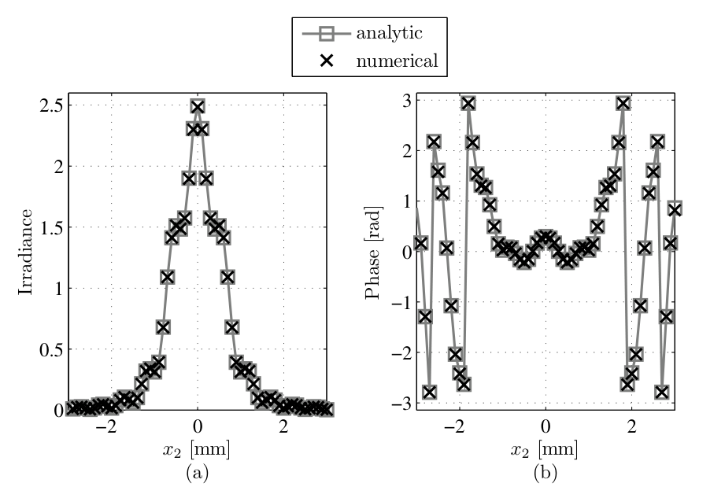
  <figcaption>图 6.1 方形孔径的菲涅耳衍射，仿真 vs 解析：(a) 观测面辐照度；(b) 观测面相位（截自原书）</figcaption>
</figure>

显然，不改几何就无法控制观测面的采样：式 (6.16) 把 \(\delta_2\) 钉死了。还有一个隐藏约束值得点破：观测面**窗口总宽度** \(N\delta_2 = \lambda\Delta z/\delta_1\) 与 \(N\) 无关——加大 \(N\) 只是把同一个窗口切得更细，想扩大观测窗口只能调粗 \(\delta_1\)（或者用下面的两步/角谱法）。如果应用需要别的 \(\delta_2\)，通常不想靠增大 \(N\) 来换取（仿真时间翻倍不划算）。这就是两步传播的动机。

### 6.3.2 两步传播

要自由选观测面网格间距，必须引入缩放参数

\[
m = \frac{\delta_2}{\delta_1}.
\]

对单步传播，\(m = \lambda\Delta z/(N\delta_1^2)\) 被几何钉死；\(\lambda\)、\(\Delta z\) 给定后只能调 \(N\) 和 \(\delta_1\)，而源面网格与观测面网格此消彼长（源面越细、观测面越粗，反之亦然）。Coy（原书文献 35）与 Rydberg、Bengtsson（文献 36）给出一个更有弹性的方案：**把传播拆成两段**，中间插一个平面 \(z_{1a}\)，用它的位置来换 \(m\) 的自由。下面的推导按 Rydberg–Bengtsson 的算法描述 + Coy 的网格分析展开。

记号沿用：源面 \(z = z_1\)（\(\mathbf{r}_1\) 坐标），观测面 \(z = z_2\)（\(\mathbf{r}_2\) 坐标），\(\Delta z = z_2 - z_1\)，\(m = \delta_2/\delta_1\)。中间面放在 \(z = z_{1a}\)（\(\mathbf{r}_{1a} = (x_{1a}, y_{1a})\) 坐标），第一段距离 \(\Delta z_1 = z_{1a} - z_1\)，第二段 \(\Delta z_2 = z_2 - z_{1a}\)。给定 \(m\)，满足条件的中间面有**两个**（\(\Delta z_1 + \Delta z_2 = \Delta z\) 约束下）：

<figure>
  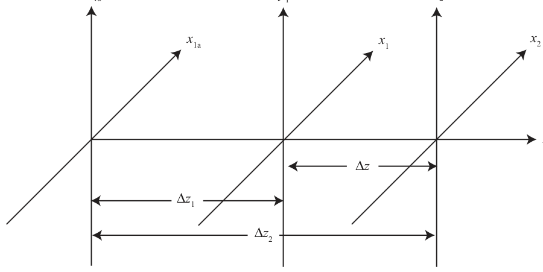
  <figcaption>图 6.2 两步传播几何之一：中间面不在源面与观测面之间（"−"支，对 \(m>1\) 有 \(\Delta z_1<0\)）（截自原书）</figcaption>
</figure>

<figure>
  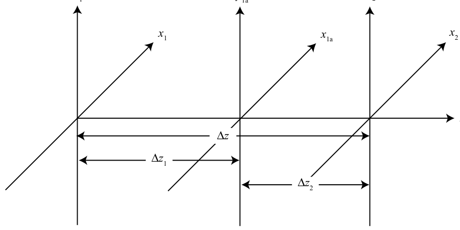
  <figcaption>图 6.3 两步传播几何之二：中间面夹在源面与观测面之间（"+"支，两段距离均为正）（截自原书）</figcaption>
</figure>

用算符记法，两步菲涅耳传播就是两个 \(\mathcal{R}\) 算符的复合：

\[
U(\mathbf{r}_2) = \mathcal{R}[\Delta z_2, \mathbf{r}_{1a}, \mathbf{r}_2]\, \mathcal{R}[\Delta z_1, \mathbf{r}_1, \mathbf{r}_{1a}]\{U(\mathbf{r}_1)\}
\tag{6.17}
\]

\[
\begin{aligned}
= \mathcal{Q}\!\left[\frac{1}{\Delta z_2}, \mathbf{r}_2\right] &\mathcal{V}\!\left[\frac{1}{\lambda\Delta z_2}, \mathbf{r}_2\right] \mathcal{F}[\mathbf{r}_{1a}, \mathbf{f}_{1a}]\, \mathcal{Q}\!\left[\frac{1}{\Delta z_2}, \mathbf{r}_{1a}\right] \\
&\times \mathcal{Q}\!\left[\frac{1}{\Delta z_1}, \mathbf{r}_{1a}\right] \mathcal{V}\!\left[\frac{1}{\lambda\Delta z_1}, \mathbf{r}_{1a}\right] \mathcal{F}[\mathbf{r}_1, \mathbf{f}_1]\, \mathcal{Q}\!\left[\frac{1}{\Delta z_1}, \mathbf{r}_1\right] \{U(\mathbf{r}_1)\}.
\end{aligned}
\tag{6.18}
\]

!!! warning "原书笔误：式 (6.18) 的 \(\mathcal{F}[\mathbf{r}_2, \mathbf{f}_{1a}]\)"
    原书 (6.18) 第一行把第一个 FT 的操作数域印成了 \(\mathcal{F}[\mathbf{r}_2, \mathbf{f}_{1a}]\)。按算符约定（第一参数 = 操作数定义域）和复合链的物理顺序，第一段传播的 FT 作用在中间面坐标 \(\mathbf{r}_{1a}\) 上，应为 \(\mathcal{F}[\mathbf{r}_{1a}, \mathbf{f}_{1a}]\)。上面的排版已更正。

检查中间面与观测面的网格间距（\(\mathcal{F}\) 之后频域间距 \(\delta_{f1} = 1/(N\delta_1)\)，\(\mathcal{V}\) 的定标把它换算回空间域）：

\[
\delta_{1a} = \frac{\lambda|\Delta z_1|}{N\delta_1}, \qquad \Delta z_1 = z_{1a} - z_1,
\tag{6.19}
\]

\[
\delta_2 = \frac{\lambda|\Delta z_2|}{N\delta_{1a}}
\tag{6.20}
\]

\[
= \frac{\lambda|\Delta z_2|}{N}\left(\frac{\lambda|\Delta z_1|}{N\delta_1}\right)^{-1}
\tag{6.21}
\]

\[
= \left|\frac{\Delta z_2}{\Delta z_1}\right| \delta_1
\tag{6.22}
\]

\[
= m\,\delta_1,
\tag{6.23}
\]

与缩放参数的定义一致。于是"选 \(m\)"就等价于"选中间面位置"：

\[
m = \left|\frac{z_2 - z_{1a}}{z_{1a} - z_1}\right| = \left|\frac{\Delta z_2}{\Delta z_1}\right|,
\tag{6.24}
\]

在 \(\Delta z_1 + \Delta z_2 = \Delta z\) 约束下解出两组解：

\[
\Delta z_1 = z_{1a} - z_1 = \Delta z\,\frac{1}{1 \pm m},
\tag{6.25}
\]

\[
z_{1a} = z_1 + \Delta z\,\frac{1}{1 \pm m},
\tag{6.26}
\]

\[
\Delta z_2 = z_2 - z_{1a} = \Delta z\,\frac{\pm m}{1 \pm m},
\tag{6.27}
\]

\[
z_{1a} = z_2 - \Delta z\,\frac{\pm m}{1 \pm m},
\tag{6.28}
\]

\[
z_{1a} = z_2 + \Delta z\,\frac{\mp m}{1 \pm m}.
\tag{6.29}
\]

验证很简单：

\[
\left|\frac{\Delta z_2}{\Delta z_1}\right| = \left|\frac{\Delta z\left(\frac{\pm m}{1\pm m}\right)}{\Delta z\left(\frac{1}{1\pm m}\right)}\right| = |\pm m| = m.
\tag{6.30}
\]

表 6.2 给出几组例子：\(\Delta z_1^-\)、\(\Delta z_2^-\) 两列对应图 6.2 的几何（"−"支，中间面绕到外面），\(\Delta z_1^+\)、\(\Delta z_2^+\) 对应图 6.3（"+"支，中间面夹中间）。

**表 6.2 两步菲涅耳计算的缩放参数示例（原书表 6.2）**

| \(m\) | \(\Delta z_1^+/\Delta z\) | \(\Delta z_2^+/\Delta z\) | \(\Delta z_1^-/\Delta z\) | \(\Delta z_2^-/\Delta z\) |
| --- | --- | --- | --- | --- |
| 2 | 1/3 | 2/3 | −1 | 2 |
| 1 | 1/2 | 1/2 | \(\pm\infty\) | \(\mp\infty\) |
| 1/2 | 2/3 | 1/3 | 2 | −1 |

注意 \(m=1\) 的特殊情形："+"支的中间面正好在正中间；"−"支的中间面跑到无穷远（数值上发散，不可用）——所以 \(m=1\) 时只有"+"支可用。

原书 Listing 6.3 给出 MATLAB 函数 `two_step_prop`（取"−"支 \(\Delta z_1 = \Delta z/(1-m)\)），Listing 6.4 用它重复方孔例子，结果（原书图 6.4）与解析再次一致：

=== "MATLAB"

    ```matlab
    function [x2, y2, Uout] = two_step_prop(Uin, wvl, d1, d2, Dz)
    % 书 Listing 6.3："-"支（Dz1 = Dz/(1-m)）。注意勘误 b：负距离步的中间场
    % 坐标对应翻转，m != 1 时输出为真值镜像（本函数忠实复现书印行为）。
    N = size(Uin, 1);
    kk = 2*pi/wvl;
    n = -N/2 : N/2-1;
    [x1, y1] = meshgrid(n*d1, n*d1);
    m = d2/d1;
    Dz1 = Dz/(1 - m);
    d1a = wvl*abs(Dz1)/(N*d1);                     % 式 (6.19)
    [x1a, y1a] = meshgrid(n*d1a, n*d1a);
    Uitm = 1/(1i*wvl*Dz1) ...
        .* exp(1i*kk/(2*Dz1)*(x1a.^2 + y1a.^2)) ...
        .* ft2(Uin.*exp(1i*kk/(2*Dz1)*(x1.^2 + y1.^2)), d1);
    Dz2 = Dz - Dz1;
    [x2, y2] = meshgrid(n*d2, n*d2);
    Uout = 1/(1i*wvl*Dz2) ...
        .* exp(1i*kk/(2*Dz2)*(x2.^2 + y2.^2)) ...
        .* ft2(Uitm.*exp(1i*kk/(2*Dz2)*(x1a.^2 + y1a.^2)), d1a);
    end
    ```

=== "Python"

    ```python
    def two_step_prop(Uin, wvl, d1, d2, Dz):
        """两步 Fresnel 传播，书印 Listing 6.3 的 "-" 支：Dz1 = Dz/(1-m)（式 6.25）。

        注意（勘误 b）：Dz1（m>1）或 Dz2（m<1）必有一个为负；原书对负距离步用
        |Dz| 建坐标网格（第 14 行 d1a = wvl*abs(Dz1)/(N*d1)），坐标对应翻转一次，
        输出为真值的镜像（对称测试场不可见）。本函数忠实复现书印行为；
        修正版见 two_step_prop_fixed / two_step_prop_plus。"""
        N = Uin.shape[0]
        k = 2.0 * np.pi / wvl
        n = np.arange(N) - N // 2
        x1, y1 = np.meshgrid(n * d1, n * d1)
        m = d2 / d1
        Dz1 = Dz / (1.0 - m)
        d1a = wvl * abs(Dz1) / (N * d1)                # 式 (6.19)（书印取 |Dz1|）
        x1a, y1a = np.meshgrid(n * d1a, n * d1a)
        Uitm = (1.0 / (1j * wvl * Dz1)
                * np.exp(1j * k / (2.0 * Dz1) * (x1a ** 2 + y1a ** 2))
                * ft2(Uin * np.exp(1j * k / (2.0 * Dz1) * (x1 ** 2 + y1 ** 2)), d1))
        Dz2 = Dz - Dz1                                 # Dz2 = -m*Dz1
        x2, y2 = np.meshgrid(n * d2, n * d2)
        Uout = (1.0 / (1j * wvl * Dz2)
                * np.exp(1j * k / (2.0 * Dz2) * (x2 ** 2 + y2 ** 2))
                * ft2(Uitm * np.exp(1j * k / (2.0 * Dz2) * (x1a ** 2 + y1a ** 2)),
                      d1a))
        return x2, y2, Uout
    ```

!!! danger "原书勘误：Listing 6.3 的负距离步会产生镜像输出"
    除 \(m=1\) 外，"−"支的两段距离**必有一段为负**（\(m>1\) 时 \(\Delta z_1<0\)，\(m<1\) 时 \(\Delta z_2<0\)）。原书第 14 行用 `d1a = wvl*abs(Dz1)/(N*d1)` 取绝对值建中间面网格——坐标方向随之翻转了一次，最终输出是**真值的镜像**。方孔这类对称测试场完全看不出来（镜像 ≡ 原场），但对非对称场是实打实的错误。工程 1 验证 3 用"离轴矩形+圆盘"场实测：书印"−"支输出与真值差 1.06（归一化峰值），与镜像后的真值差 \(1.7\times10^{-15}\)——镜像实锤。修法：负距离步的输出按居中反转重排一次（`two_step_prop_fixed`），或者干脆走"+"支（两段距离都为正，天然无此问题，`two_step_prop_plus`）。

=== "MATLAB"

    ```matlab
    function [x2, y2, Uout] = two_step_prop_fixed(Uin, wvl, d1, d2, Dz)
    % "-"支修正版：负距离步的输出按居中反转重排（消除镜像）。
    % 数值事实（Python 实测）：修正后与 ang_spec 逐位一致（1e-14，全部测试的 m）。
    N = size(Uin, 1);
    kk = 2*pi/wvl;
    n = -N/2 : N/2-1;
    [x1, y1] = meshgrid(n*d1, n*d1);
    m = d2/d1;
    Dz1 = Dz/(1 - m);
    d1a = wvl*abs(Dz1)/(N*d1);
    [x1a, y1a] = meshgrid(n*d1a, n*d1a);
    Uitm = 1/(1i*wvl*Dz1) ...
        .* exp(1i*kk/(2*Dz1)*(x1a.^2 + y1a.^2)) ...
        .* ft2(Uin.*exp(1i*kk/(2*Dz1)*(x1.^2 + y1.^2)), d1);
    if Dz1 < 0
        Uitm = rollflip(Uitm);                     % 修正：负距离步输出镜像翻转
    end
    Dz2 = Dz - Dz1;
    [x2, y2] = meshgrid(n*d2, n*d2);
    Uout = 1/(1i*wvl*Dz2) ...
        .* exp(1i*kk/(2*Dz2)*(x2.^2 + y2.^2)) ...
        .* ft2(Uitm.*exp(1i*kk/(2*Dz2)*(x1a.^2 + y1a.^2)), d1a);
    if Dz2 < 0
        Uout = rollflip(Uout);                     % m<1 时第二步为负距离
    end
    end
    ```

=== "Python"

    ```python
    def two_step_prop_fixed(Uin, wvl, d1, d2, Dz):
        """两步传播 "-" 支的修正版：负距离步的输出按居中反转重排，
        消除书印实现的镜像（其余与书印逐行对应）。
        数值事实：修正后与 ang_spec 逐位一致（1e-14，全部测试的 m）。"""
        N = Uin.shape[0]
        k = 2.0 * np.pi / wvl
        n = np.arange(N) - N // 2
        x1, y1 = np.meshgrid(n * d1, n * d1)
        m = d2 / d1
        Dz1 = Dz / (1.0 - m)
        d1a = wvl * abs(Dz1) / (N * d1)
        x1a, y1a = np.meshgrid(n * d1a, n * d1a)
        Uitm = (1.0 / (1j * wvl * Dz1)
                * np.exp(1j * k / (2.0 * Dz1) * (x1a ** 2 + y1a ** 2))
                * ft2(Uin * np.exp(1j * k / (2.0 * Dz1) * (x1 ** 2 + y1 ** 2)), d1))
        if Dz1 < 0:                                    # 修正：负距离步输出镜像翻转
            Uitm = rollflip(Uitm)
        Dz2 = Dz - Dz1
        x2, y2 = np.meshgrid(n * d2, n * d2)
        Uout = (1.0 / (1j * wvl * Dz2)
                * np.exp(1j * k / (2.0 * Dz2) * (x2 ** 2 + y2 ** 2))
                * ft2(Uitm * np.exp(1j * k / (2.0 * Dz2) * (x1a ** 2 + y1a ** 2)),
                      d1a))
        if Dz2 < 0:                                    # m<1 时第二步为负距离
            Uout = rollflip(Uout)
        return x2, y2, Uout
    ```

=== "MATLAB"

    ```matlab
    function [x2, y2, Uout] = two_step_prop_plus(Uin, wvl, d1, d2, Dz)
    % "+"支（图 6.3 几何）：Dz1 = Dz/(1+m) > 0、Dz2 = m*Dz/(1+m) > 0（m>0）。
    N = size(Uin, 1);
    kk = 2*pi/wvl;
    n = -N/2 : N/2-1;
    [x1, y1] = meshgrid(n*d1, n*d1);
    m = d2/d1;
    Dz1 = Dz/(1 + m);
    d1a = wvl*abs(Dz1)/(N*d1);
    [x1a, y1a] = meshgrid(n*d1a, n*d1a);
    Uitm = 1/(1i*wvl*Dz1) ...
        .* exp(1i*kk/(2*Dz1)*(x1a.^2 + y1a.^2)) ...
        .* ft2(Uin.*exp(1i*kk/(2*Dz1)*(x1.^2 + y1.^2)), d1);
    Dz2 = Dz - Dz1;
    [x2, y2] = meshgrid(n*d2, n*d2);
    Uout = 1/(1i*wvl*Dz2) ...
        .* exp(1i*kk/(2*Dz2)*(x2.^2 + y2.^2)) ...
        .* ft2(Uitm.*exp(1i*kk/(2*Dz2)*(x1a.^2 + y1a.^2)), d1a);
    end
    ```

=== "Python"

    ```python
    def two_step_prop_plus(Uin, wvl, d1, d2, Dz):
        """两步传播 "+" 支（式 6.25 的 "+"，图 6.3 几何）：中间面夹在源面与
        观测面之间，Dz1 = Dz/(1+m) > 0、Dz2 = m*Dz/(1+m) > 0（m>0），
        两个步都是正距离，无镜像问题。与 "-" 支在连续域严格等价
        （|Dz2/Dz1| = m，式 6.24/6.30）；离散路径不同（见验证 3 的收敛检查）。"""
        N = Uin.shape[0]
        k = 2.0 * np.pi / wvl
        n = np.arange(N) - N // 2
        x1, y1 = np.meshgrid(n * d1, n * d1)
        m = d2 / d1
        Dz1 = Dz / (1.0 + m)
        d1a = wvl * abs(Dz1) / (N * d1)
        x1a, y1a = np.meshgrid(n * d1a, n * d1a)
        Uitm = (1.0 / (1j * wvl * Dz1)
                * np.exp(1j * k / (2.0 * Dz1) * (x1a ** 2 + y1a ** 2))
                * ft2(Uin * np.exp(1j * k / (2.0 * Dz1) * (x1 ** 2 + y1 ** 2)), d1))
        Dz2 = Dz - Dz1
        x2, y2 = np.meshgrid(n * d2, n * d2)
        Uout = (1.0 / (1j * wvl * Dz2)
                * np.exp(1j * k / (2.0 * Dz2) * (x2 ** 2 + y2 ** 2))
                * ft2(Uitm * np.exp(1j * k / (2.0 * Dz2) * (x1a ** 2 + y1a ** 2)),
                      d1a))
        return x2, y2, Uout
    ```

<figure>
  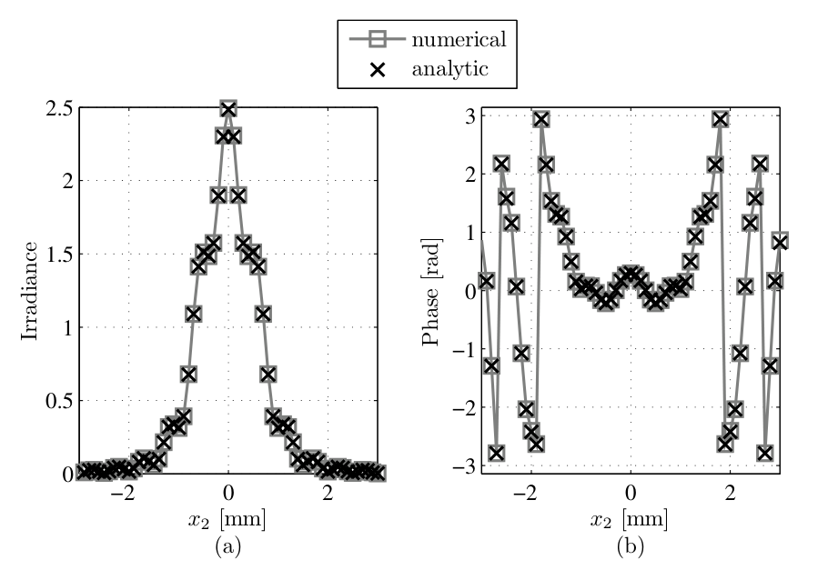
  <figcaption>图 6.4 方形孔径的菲涅耳衍射，两步仿真 vs 解析：(a) 观测面辐照度；(b) 观测面相位（截自原书）</figcaption>
</figure>

## 6.4 角谱传播

本节处理卷积形态（式 6.6）。用卷积定理把它写成算符链：

\[
U(\mathbf{r}_2) = \mathcal{F}^{-1}[\mathbf{f}_1, \mathbf{r}_2]\; H(\mathbf{f}_1)\; \mathcal{F}[\mathbf{f}_1, \mathbf{r}_1]\{U(\mathbf{r}_1)\},
\tag{6.31}
\]

其中 \(H(\mathbf{f})\) 是自由空间传播的传递函数（transfer function）：

\[
H(\mathbf{f}_1) = e^{ik\Delta z}\, e^{-i\pi\lambda\Delta z\left(f_{x1}^2 + f_{y1}^2\right)}.
\tag{6.32}
\]

这就是**角谱（angular spectrum）形态**的菲涅耳衍射积分，专门为数值计算讨论过它的作者很多（原书文献 28、31、32、37、40–44）。第 3 章 3.1 节的离散卷积 `myconv2` 看似可以直接用——但那样观测面间距 \(\delta_2\) 就被钉成 \(\delta_1\)（\(m=1\)），又回到了没有自由度的老问题。

要引入缩放参数 \(m\)，得回到式 (6.1)，用 \(\mathbf{r}_1, \mathbf{r}_2\) 重写：

\[
U(\mathbf{r}_2) = \frac{1}{i\lambda\Delta z} \int_{-\infty}^{\infty} U(\mathbf{r}_1)\, e^{i\frac{k}{2\Delta z}|\mathbf{r}_2-\mathbf{r}_1|^2}\, d\mathbf{r}_1.
\tag{6.33}
\]

原书指出：讨论过这个缩放因子的只有 Tyler–Fried（文献 30）与 Roberts（文献 31）。跟随他们的做法，把指数里的 \(|\mathbf{r}_2 - \mathbf{r}_1|^2\) 做"无中生有"的代数变形——目标是从中凑出 \(m\left|\frac{\mathbf{r}_2}{m} - \mathbf{r}_1\right|^2\)（这样卷积核的有效传播距离变成 \(\Delta z/m\)，IFT 的求值网格随之缩放）：

\[
|\mathbf{r}_2 - \mathbf{r}_1|^2 = r_2^2 - 2\,\mathbf{r}_2\cdot\mathbf{r}_1 + r_1^2
\tag{6.34}
\]

\[
= \left(r_2^2 + \frac{r_2^2}{m} - \frac{r_2^2}{m}\right) - 2\,\mathbf{r}_2\cdot\mathbf{r}_1 + \left(r_1^2 + m\,r_1^2 - m\,r_1^2\right)
\tag{6.35}
\]

\[
= \frac{r_2^2}{m} + \left(1 - \frac{1}{m}\right)r_2^2 - 2\,\mathbf{r}_2\cdot\mathbf{r}_1 + \left(m\,r_1^2 + (1-m)\,r_1^2\right)
\tag{6.36}
\]

\[
= m\left(\frac{r_2^2}{m^2} - 2\,\frac{\mathbf{r}_2}{m}\cdot\mathbf{r}_1 + r_1^2\right) + \left(1 - \frac{1}{m}\right)r_2^2 + (1-m)\,r_1^2
\tag{6.37}
\]

\[
= m\left|\frac{\mathbf{r}_2}{m} - \mathbf{r}_1\right|^2 - \left(\frac{1-m}{m}\right) r_2^2 + (1-m)\, r_1^2.
\tag{6.38}
\]

代回式 (6.33)，把与 \(r_2\) 有关的部分提到积分外：

\[
U(\mathbf{r}_2) = \frac{e^{-i\frac{k}{2\Delta z}\left(\frac{1-m}{m}\right)r_2^2}}{i\lambda\Delta z} \int_{-\infty}^{\infty} U(\mathbf{r}_1)\, e^{i\frac{k}{2\Delta z}(1-m)r_1^2}\, e^{i\frac{km}{2\Delta z}\left|\frac{\mathbf{r}_2}{m}-\mathbf{r}_1\right|^2}\, d\mathbf{r}_1.
\tag{6.39}
\]

定义辅助场

\[
U''(\mathbf{r}_1) \equiv \frac{1}{m}\, U(\mathbf{r}_1)\, e^{i\frac{k}{2\Delta z}(1-m)r_1^2},
\tag{6.41}
\]

代入式 (6.39)（那个 \(1/m\) 与积分里的 \(m\) 配对，正好凑出缩放后的传播核）：

\[
U(\mathbf{r}_2) = e^{-i\frac{k}{2\Delta z}\left(\frac{1-m}{m}\right)r_2^2}\, \frac{1}{i\lambda\Delta z} \int_{-\infty}^{\infty} m\, U''(\mathbf{r}_1)\, e^{i\frac{km}{2\Delta z}\left|\frac{\mathbf{r}_2}{m}-\mathbf{r}_1\right|^2}\, d\mathbf{r}_1.
\tag{6.42}
\]

再定义缩放坐标与缩放距离

\[
\mathbf{r}_2' = \frac{\mathbf{r}_2}{m},
\tag{6.43}
\]

\[
\Delta z' = \frac{\Delta z}{m},
\tag{6.44}
\]

得到

\[
U(m\,\mathbf{r}_2') = e^{-i\frac{k}{2\Delta z'}(1-m)(r_2')^2}\; \frac{1}{i\lambda\Delta z'} \int_{-\infty}^{\infty} U''(\mathbf{r}_1)\, e^{i\frac{k}{2\Delta z'}|\mathbf{r}_2'-\mathbf{r}_1|^2}\, d\mathbf{r}_1.
\tag{6.45}
\]

这就成了标准的卷积形态：

\[
U(m\,\mathbf{r}_2') = e^{-i\frac{k}{2\Delta z'}(1-m)(r_2')^2} \int_{-\infty}^{\infty} U''(\mathbf{r}_1)\, h(\mathbf{r}_2'-\mathbf{r}_1)\, d\mathbf{r}_1,
\tag{6.46}
\]

其中脉冲响应（振幅扩散函数）为

\[
h(\mathbf{r}_1) = \frac{1}{i\lambda\Delta z'}\, e^{i\frac{k}{2\Delta z'}r_1^2}.
\tag{6.47}
\]

传播又一次被当成已知脉冲响应的线性系统，其传递函数是对 \(h\) 做 FT：

\[
\mathcal{F}[\mathbf{r}_1, \mathbf{f}_1]\, h(\mathbf{r}_1) = H(\mathbf{f}_1)
\tag{6.48}
\]

\[
= e^{-i\pi\lambda\Delta z' f_1^2}.
\tag{6.49}
\]

到这里可以直接用第 3 章的 `myconv2` 数值卷积；但用卷积定理、并把坐标代换还原回 \(\mathbf{r}_2\)，能把算法的所有细节保持显式，后续章节的化简也更顺。应用卷积定理得到最终算符链：

\[
U(\mathbf{r}_2) = \mathcal{Q}\!\left[\frac{m-1}{m\Delta z}, \mathbf{r}_2\right]\; \mathcal{F}^{-1}\!\left[\mathbf{f}_1, \frac{\mathbf{r}_2}{m}\right]\; \mathcal{Q}_2\!\left[-\frac{\Delta z}{m}, \mathbf{f}_1\right]\; \mathcal{F}[\mathbf{r}_1, \mathbf{f}_1]\; \mathcal{Q}\!\left[\frac{1-m}{\Delta z}, \mathbf{r}_1\right] \frac{1}{m}\,\{U(\mathbf{r}_1)\}.
\tag{6.50}
\]

从右往左读：源面乘啁啾 \(\mathcal{Q}[\frac{1-m}{\Delta z}]\)、除以 \(m\)，做 FT，频域乘 \(\mathcal{Q}_2[-\frac{\Delta z}{m}]\)（即 \(e^{-i\pi\lambda\Delta z f_1^2/m}\)，式 (6.49) 加上 \(\Delta z' = \Delta z/m\)），做 IFT（在 \(\mathbf{r}_2/m\) 处求值），最后乘 \(\mathcal{Q}[\frac{m-1}{m\Delta z}]\)。

现在核对网格间距（\(\mathcal{F}\) 给出 \(\delta_{f1} = 1/(N\delta_1)\)；\(\mathcal{F}^{-1}\) 在 \(\mathbf{r}_2/m\) 求值，故观测坐标间距是本征 IFT 间距 \(1/(N\delta_{f1})\) 的 \(m\) 倍）：

\[
\delta_{f1} = \frac{1}{N\delta_1} \quad \text{（来自 } \mathcal{F}[\mathbf{r}_1, \mathbf{f}_1]\text{）},
\tag{6.51}
\]

\[
\delta_2 = \frac{m}{N\delta_{f1}} \quad \text{（来自 } \mathcal{F}^{-1}[\mathbf{f}_1, \mathbf{r}_2/m]\text{）}
\tag{6.52}
\]

\[
= \frac{m}{N}\,(N\delta_1)
\tag{6.53}
\]

\[
= m\,\delta_1.
\tag{6.54}
\]

最后一式是自洽性检查。另外还有两个后面 8.2 节要用的关系：

\[
\frac{1}{1-m} = \frac{1}{1-\delta_2/\delta_1} = \frac{\delta_1}{\delta_1 - \delta_2},
\tag{6.55}
\]

\[
\frac{m}{1-m} = \frac{\delta_2/\delta_1}{1-\delta_2/\delta_1} = \frac{\delta_2}{\delta_1 - \delta_2}.
\tag{6.56}
\]

**另一条代数路径。** 从式 (6.34) 出发换个方式凑项：

\[
|\mathbf{r}_2 - \mathbf{r}_1|^2 = r_2^2 - 2\,\mathbf{r}_2\cdot\mathbf{r}_1 + r_1^2
\tag{6.57}
\]

\[
= \left(r_2^2 + \frac{r_2^2}{m} - \frac{r_2^2}{m}\right) - 2\,\mathbf{r}_2\cdot\mathbf{r}_1 + \left(r_1^2 + m\,r_1^2 - m\,r_1^2\right)
\tag{6.58}
\]

\[
= -\frac{r_2^2}{m} + \left(1 + \frac{1}{m}\right)r_2^2 - 2\,\mathbf{r}_2\cdot\mathbf{r}_1 - m\,r_1^2 + (1+m)\,r_1^2
\tag{6.59}
\]

\[
= -\frac{r_2^2}{m} - 2\,\mathbf{r}_2\cdot\mathbf{r}_1 - m\,r_1^2 + \left(1 + \frac{1}{m}\right)r_2^2 + (1+m)\,r_1^2
\tag{6.60}
\]

\[
= -m\left(\frac{r_2^2}{m^2} + 2\,\frac{\mathbf{r}_2}{m}\cdot\mathbf{r}_1 + r_1^2\right) + \left(1 + \frac{1}{m}\right)r_2^2 + (1+m)\,r_1^2
\tag{6.61}
\]

\[
= -m\left|\frac{\mathbf{r}_2}{m} + \mathbf{r}_1\right|^2 + \left(\frac{1+m}{m}\right) r_2^2 + (1+m)\, r_1^2.
\tag{6.62}
\]

做代换 \(m' = -m\)：

\[
= m'\left|\frac{\mathbf{r}_2}{-m'} + \mathbf{r}_1\right|^2 + \left(\frac{1-m'}{-m'}\right)r_2^2 + (1-m')\,r_1^2
\tag{6.63}
\]

\[
= m'\left|\frac{\mathbf{r}_2}{m'} - \mathbf{r}_1\right|^2 - \left(\frac{1-m'}{m'}\right) r_2^2 + (1-m')\, r_1^2,
\tag{6.64}
\]

显然与式 (6.38) 完全相同（只是 \(m \to m'\)）。这说明 \(\pm m\) 都能用于角谱形态，于是有两条等价的算符链：

\[
U(\mathbf{r}_2) = \mathcal{Q}\!\left[\frac{m-1}{m\Delta z}, \mathbf{r}_2\right] \mathcal{F}^{-1}\!\left[\mathbf{f}_1, \frac{\mathbf{r}_2}{m}\right] \mathcal{Q}_2\!\left[-\frac{\Delta z}{m}, \mathbf{f}_1\right]
\tag{6.65}
\]

\[
\times \mathcal{F}[\mathbf{r}_1, \mathbf{f}_1]\, \mathcal{Q}\!\left[\frac{1-m}{\Delta z}, \mathbf{r}_1\right] \frac{1}{m}\{U(\mathbf{r}_1)\}
\]

\[
= \mathcal{Q}\!\left[-\frac{m-1}{m\Delta z}, \mathbf{r}_2\right] \mathcal{F}^{-1}\!\left[\mathbf{f}_1, \frac{\mathbf{r}_2}{m}\right] \mathcal{Q}_2\!\left[\frac{\Delta z}{m}, \mathbf{f}_1\right]
\tag{6.66}
\]

\[
\times \mathcal{F}[\mathbf{r}_1, \mathbf{f}_1]\, \mathcal{Q}\!\left[-\frac{1-m}{\Delta z}, \mathbf{r}_1\right] \left(\frac{-1}{m}\right)\{U(\mathbf{r}_1)\}.
\]

写成紧凑形式：

\[
U(\mathbf{r}) = \mathcal{Q}\!\left[\frac{m \pm 1}{m\Delta z}, \mathbf{r}_2\right] \mathcal{F}^{-1}\!\left[\mathbf{f}_1, \mp\frac{\mathbf{r}_2}{m}\right] \mathcal{Q}_2\!\left[\pm\frac{\Delta z}{m}, \mathbf{f}_1\right]
\tag{6.67}
\]

\[
\times \mathcal{F}[\mathbf{r}_1, \mathbf{f}_1]\, \mathcal{Q}\!\left[\frac{1 \pm m}{\Delta z}, \mathbf{r}_1\right] \left(\mp\frac{1}{m}\right)\{U(\mathbf{r}_1)\},
\]

其中**顶符号对应式 (6.66)，底符号对应式 (6.65)**。

!!! warning "原书笔误：式 (6.66) 的算符链"
    原书 (6.66) 印的是 \(\mathcal{Q}\!\left[-\frac{m-1}{m\Delta z}, \mathbf{r}_2\right]\mathcal{F}^{-1}[\mathbf{f}_1, +\frac{\mathbf{r}_2}{m}]\mathcal{Q}_2[+\frac{\Delta z}{m}]\mathcal{F}\,\mathcal{Q}\!\left[-\frac{1-m}{\Delta z}, \mathbf{r}_1\right](-\frac{1}{m})\)。这**不是** (6.50) 的正确 \(m\to-m\) 代换：把 \(m'=-m\) 逐项代入 (6.50) 应得 \(\mathcal{Q}\!\left[\frac{m+1}{m\Delta z}\right]\)、\(\mathcal{F}^{-1}[\mathbf{f}_1, -\frac{\mathbf{r}_2}{m}]\)、\(\mathcal{Q}\!\left[\frac{1+m}{\Delta z}\right]\)——恰好是式 (6.67) 的**顶符号**。判据有三：(a) (6.67) 顶符号与书印 (6.66) 直接矛盾，同书必有一错；(b) 数值验证：书印链对实值输入场的输出 = \(-\overline{U_{\text{真值}}}\)（逐点、机器精度 \(4.4\times10^{-16}\)，工程 1 验证 4）——即书印链是"反向传播 + 共轭"算子，不是传播算子；(c) 更隐蔽的是 \(|-\overline{U}|^2 = |U|^2\)，**辐照度完全不变**，只看强度的检验根本发现不了它，必须查相位。原书代码 Listing 6.5 实现的是 (6.65)，未受影响。

原书 Listing 6.5 给出实现式 (6.65) 的 MATLAB 函数 `ang_spec_prop`。图 6.5 是重复前面方孔例子的结果（产生该图的代码与 Listing 6.4 相同，只是第 14 行换成调用 `ang_spec_prop`），数值再次与解析一致：

=== "MATLAB"

    ```matlab
    function [x2, y2, Uout] = ang_spec_prop(Uin, wvl, d1, d2, Dz)
    % 书 Listing 6.5：角谱传播（式 6.50 的 m 分支）：
    %   Uout = Q3 .* ift2(Q2 .* ft2(Q1 .* Uin / m, d1), df1)
    N = size(Uin, 1);
    kk = 2*pi/wvl;
    n = -N/2 : N/2-1;
    [x1, y1] = meshgrid(n*d1, n*d1);
    r1sq = x1.^2 + y1.^2;
    df1 = 1/(N*d1);
    [fX, fY] = meshgrid(n*df1, n*df1);
    fsq = fX.^2 + fY.^2;
    m = d2/d1;
    [x2, y2] = meshgrid(n*d2, n*d2);
    r2sq = x2.^2 + y2.^2;
    Q1 = exp(1i*kk/2*(1 - m)/Dz*r1sq);
    Q2 = exp(-1i*pi^2*2*Dz/m/kk*fsq);
    Q3 = exp(1i*kk/2*(m - 1)/(m*Dz)*r2sq);
    Uout = Q3 .* ift2(Q2 .* ft2(Q1 .* Uin/m, d1), df1);
    end
    ```

=== "Python"

    ```python
    def ang_spec_prop(Uin, wvl, d1, d2, Dz):
        """角谱传播（式 6.50 的 m 分支，Listing 6.5）：
            Uout = Q3 * ift2( Q2 * ft2( Q1 * Uin / m ) )
        Q1 = Q[(1-m)/Dz]（空间网格）、Q2 = Q2[-Dz/m]（频率网格，
        = e^{-i*pi*lambda*Dz*f^2/m}）、Q3 = Q[(m-1)/(m*Dz)]（空间网格）。
        delta2 = m*delta1 由用户自由定标。"""
        N = Uin.shape[0]
        k = 2.0 * np.pi / wvl
        n = np.arange(N) - N // 2
        x1, y1 = np.meshgrid(n * d1, n * d1)
        r1sq = x1 ** 2 + y1 ** 2
        df1 = 1.0 / (N * d1)
        fX, fY = np.meshgrid(n * df1, n * df1)
        fsq = fX ** 2 + fY ** 2
        m = d2 / d1
        x2, y2 = np.meshgrid(n * d2, n * d2)
        r2sq = x2 ** 2 + y2 ** 2
        Q1 = np.exp(1j * k / 2.0 * (1.0 - m) / Dz * r1sq)
        Q2 = np.exp(-1j * np.pi ** 2 * 2.0 * Dz / m / k * fsq)
        Q3 = np.exp(1j * k / 2.0 * (m - 1.0) / (m * Dz) * r2sq)
        Uout = Q3 * ift2(Q2 * ft2(Q1 * Uin / m, d1), df1)
        return x2, y2, Uout
    ```

<figure>
  
  <figcaption>图 6.5 方形孔径的菲涅耳衍射，角谱仿真 vs 解析：(a) 观测面辐照度；(b) 观测面相位（截自原书）</figcaption>
</figure>

### 方法总览：四种传播器怎么选

到此本章的四种真空传播器都齐了，放到一张表里对比（MATLAB/Python 实现都在工程 1）：

**表 6-3 四种菲涅耳传播器对比（本笔记整理）**

| 方法（对应原书 Listing） | 数学形态 | FT 次数 | \(\delta_2\) 谁定 | 全局相位 \(e^{ik\Delta z}\) | 主要坑 |
| --- | --- | --- | --- | --- | --- |
| 单步 `one_step_prop`（6.1） | 式 (6.5)，单 FT | 1 | 式 (6.16)：\(\lambda\Delta z/(N\delta_1)\)，不可选 | 略去 | 观测窗口宽 \(\lambda\Delta z/\delta_1\) 与 \(N\) 无关 |
| 两步 `two_step_prop`（6.3） | 两次式 (6.5) | 2 | 用户给 \(\delta_2\)（\(m=\delta_2/\delta_1\)） | 略去 | "−"支负距离步镜像（勘误）；\(m\to1\) 时中间面 \(\to\infty\) |
| 角谱 `ang_spec_prop`（6.5） | 式 (6.31)+(6.50) 卷积定理 | FT+IFT 各 1 | 用户给 \(\delta_2\) | 略去 | 频域啁啾采样判据（验证 6） |
| ABCD `ang_spec_propABCD`（6.6） | Collins (6.77) 卷积化 | FT+IFT 各 1 | 用户给 \(\delta_2\) | 略去 | 不含渐晕；\(C\) 不显式出现 |

实际选型逻辑（mermaid 决策图）：

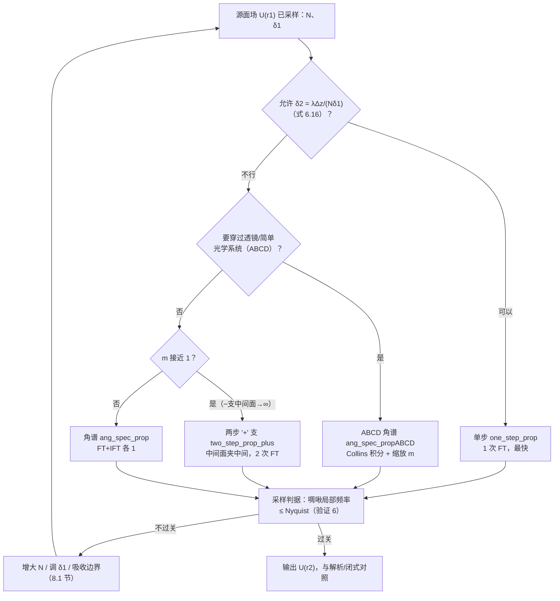

## 6.5 简单光学系统

本书的传播仿真大多在真空或弱折射介质（如大气湍流）里进行；但前面建立的整套形式可以推广到**简单折射/反射光学系统**——只要系统的效应能用近轴光线矩阵（paraxial ray matrix，原书文献 45）的几何光学语言描述。

光线矩阵描述折射元件如何变换近轴光线的位置与方向：光线用三个数表示——光线高度 \(y_1\)（离光轴的距离）、光线斜率 \(y_1'\)、所在介质的折射率 \(n_1\)；通常只考虑子午面（\(y\)-\(z\) 平面）。光线穿过简单光学系统时，系统的作用写成两个耦合的线性方程：

\[
y_2 = A\, y_1 + B\, n_1 y_1',
\tag{6.68}
\]

\[
n_2 y_2' = C\, y_1 + D\, n_1 y_1',
\tag{6.69}
\]

其中 \(y_2, y_2', n_2\) 是系统之后的光线高度、斜率与折射率。系统由 \(A, B, C, D\) 四个数刻画，矩阵形式：

\[
\begin{bmatrix} y_2 \\ n_2 y_2' \end{bmatrix} = \begin{bmatrix} A & B \\ C & D \end{bmatrix} \begin{bmatrix} y_1 \\ n_1 y_1' \end{bmatrix}.
\tag{6.70}
\]

注意光线矩阵永远满足 \(AD - BC = 1\)。有两个基本元件矩阵：**平移（transfer，纯传播）**与**折射（refraction，穿过折射率不同的界面）**。平移时光线斜率不变、高度按斜率增长：

\[
\begin{bmatrix} y_2 \\ n_2 y_2' \end{bmatrix} = \begin{bmatrix} 1 & \Delta z/n_1 \\ 0 & 1 \end{bmatrix} \begin{bmatrix} y_1 \\ n_1 y_1' \end{bmatrix},
\tag{6.71}
\]

折射时光线高度不变、斜率按近轴 Snell 定律变化：

\[
\begin{bmatrix} y_2 \\ n_2 y_2' \end{bmatrix} = \begin{bmatrix} 1 & 0 \\ \frac{n_1 - n_2}{R} & 1 \end{bmatrix} \begin{bmatrix} y_1 \\ n_1 y_1' \end{bmatrix},
\tag{6.72}
\]

其中 \(R\) 是表面曲率半径。不考虑渐晕（vignetting）时，光学系统 = 平移与折射矩阵的连乘（**从右往左**作用）。例如一条光线从空气进入单透镜前表面、穿过透镜、再从后表面出来：

\[
S = \begin{bmatrix} 1 & 0 \\ \frac{n-1}{R_2} & 1 \end{bmatrix} \begin{bmatrix} 1 & \Delta z/n \\ 0 & 1 \end{bmatrix} \begin{bmatrix} 1 & 0 \\ \frac{1-n}{R_1} & 1 \end{bmatrix},
\tag{6.73}
\]

其中 \(R_1, R_2\) 是前后表面的曲率半径。若透镜薄到 \(\Delta z \approx 0\)，系统矩阵简化为

\[
S = \begin{bmatrix} 1 & 0 \\ (1-n)\left(\dfrac{1}{R_1} - \dfrac{1}{R_2}\right) & 1 \end{bmatrix}.
\tag{6.74}
\]

透镜制造者方程（lensmaker's equation）用曲率半径与折射率给出焦距 \(f_l\)：

\[
\frac{1}{f_l} = (n-1)\left(\frac{1}{R_1} - \frac{1}{R_2}\right).
\tag{6.75}
\]

代入后薄透镜矩阵变成最熟悉的形态：

\[
S = \begin{bmatrix} 1 & 0 \\ -1/f_l & 1 \end{bmatrix}.
\tag{6.76}
\]

衍射计算把这些简单系统纳入进来，靠的是**广义 Huygens–Fresnel 积分**（generalized Huygens–Fresnel integral，原书文献 15、34、46–48）：

\[
U(x_2, y_2) = \frac{e^{ikz}}{i\lambda B} \int_{-\infty}^{\infty}\!\!\int_{-\infty}^{\infty} U(x_1, y_1)\, e^{i\frac{k}{2B}\left(D r_2^2 - 2\,\mathbf{r}_1\cdot\mathbf{r}_2 + A r_1^2\right)}\, dx_1\, dy_1.
\tag{6.77}
\]

注意它只对方位对称（azimuthal symmetry）的系统成立（两个表面都是球面的圆透镜等）；方孔、柱面透镜、环面透镜等非对称系统可按文献 47 的方法推广。这个积分与分数傅里叶变换（fractional Fourier transform）关系密切（文献 49），数值实现见文献 34、50–52。两个特例值得一记：

- **纯平移**：\(A = D = 1, C = 0, B = \Delta z\)，式 (6.77) 退化为自由空间的菲涅耳积分 (6.1)——本来就该这样；
- **球面透镜前表面 → 后焦面**：\(A = 0, B = f_l, C = -f_l^{-1}, D = 1\)，式 (6.77) 退化为一个**定标 FT**（与式 (4.9) 同类）——这正是第 4 章透镜 FT 性质的 Collins 积分版。

广义 Huygens–Fresnel 积分比菲涅耳积分复杂，乍看不像卷积。但 Lambert 与 Fraser 证明：简单的代换代换就能把它变成卷积（文献 47），于是本章前面的所有计算方法都能照搬。做法是代换

\[
\alpha = \frac{A}{\lambda B}, \qquad \beta = \frac{AC}{\lambda},
\tag{6.78}
\]

并利用 \(AD - BC = 1\)，得到

\[
U(A\,\mathbf{r}_2) = \frac{1}{i\lambda B}\, e^{i\pi\beta r_2^2} \int_{-\infty}^{\infty} U(\mathbf{r}_1)\, e^{i\pi\alpha|\mathbf{r}_2-\mathbf{r}_1|^2}\, d\mathbf{r}_1.
\tag{6.79}
\]

这显然是卷积，显式写出：

\[
U(A\,\mathbf{r}_2) = \frac{1}{i\lambda B}\, e^{i\pi\beta r_2^2} \left[ U(\mathbf{r}_1) \otimes e^{i\pi\alpha r_1^2} \right],
\tag{6.80}
\]

对应的系统传递函数为

\[
H(\mathbf{f}) = \frac{i}{\alpha}\, e^{-i\frac{\pi}{\alpha}\left(f_x^2 + f_y^2\right)}.
\tag{6.81}
\]

!!! note "拓展：Listing 6.6 的自由 m 算符链（原书没写，笔记补出）"
    原书只给了 Lambert–Fraser 的 \(A\)-定标版本 (6.79)–(6.81)，随后直接上代码。但 Listing 6.6 的 `Q1/Q2/Q3` 系数是 \((A-m)/(\lambda B)\)、\(-\lambda B/m\)、\((D-1/m)/(\lambda B)\)——这是把 6.4 节的 \(m\) 技巧直接用在式 (6.77) 上的结果。推导一行不缺：把指数里的 \(D r_2^2 + A r_1^2\) 按 \(m\left|\frac{\mathbf{r}_2}{m}-\mathbf{r}_1\right|^2 = \frac{r_2^2}{m} - 2\mathbf{r}_1\cdot\mathbf{r}_2 + m r_1^2\) 拆项：

    \[
    D r_2^2 + A r_1^2 = m\left|\frac{\mathbf{r}_2}{m}-\mathbf{r}_1\right|^2 + \left(D - \frac{1}{m}\right)r_2^2 + (A-m)\,r_1^2,
    \]

    于是

    \[
    U(\mathbf{r}_2) = e^{i\frac{k}{2B}\left(D-\frac{1}{m}\right)r_2^2}\; \frac{1}{i\lambda B}\int U(\mathbf{r}_1)\, e^{i\frac{k}{2B}(A-m)r_1^2}\, e^{i\frac{km}{2B}\left|\frac{\mathbf{r}_2}{m}-\mathbf{r}_1\right|^2} d\mathbf{r}_1.
    \]

    令 \(U''(\mathbf{r}_1) = \frac{1}{m}U(\mathbf{r}_1)e^{i\frac{k}{2B}(A-m)r_1^2}\)、\(B' = B/m\)：\(m\) 与 \(\frac{1}{m}\) 配对后 \(\frac{m}{i\lambda B} = \frac{1}{i\lambda B'}\)，卷积核 \(h(\mathbf{r}) = \frac{1}{i\lambda B'}e^{i\frac{k}{2B'}r^2}\) 正是距离 \(B'\) 的菲涅耳核，传递函数 \(H(\mathbf{f}_1) = e^{-i\pi\lambda B' f_1^2} = e^{-i\pi\lambda\frac{B}{m}f_1^2}\)。最终：

    \[
    U(\mathbf{r}_2) = \mathcal{Q}\!\left[\frac{D-1/m}{B}, \mathbf{r}_2\right] \mathcal{F}^{-1}\!\left[\mathbf{f}_1, \frac{\mathbf{r}_2}{m}\right] \mathcal{Q}_2\!\left[-\frac{B}{m}, \mathbf{f}_1\right] \mathcal{F}[\mathbf{r}_1, \mathbf{f}_1]\, \mathcal{Q}\!\left[\frac{A-m}{B}, \mathbf{r}_1\right] \frac{1}{m}\{U(\mathbf{r}_1)\},
    \]

    与 Listing 6.6 的三行代码逐项对应；\(A = D = 1, B = \Delta z\) 时退化为式 (6.50)。\(C\) 始终不显式出现——它被 \(AD-BC=1\) 隐含在自洽性里。

原书 Listing 6.6 给出实现该算法的 MATLAB 函数 `ang_spec_propABCD`（注意签名注释里把 `wvl` 印成了 `wwl`，纯笔误）。要提醒的是：这个算法**不含有限尺寸孔径引起的渐晕**。最直接的处理是把传播拆成"孔径到孔径"逐段做，每段开始前把被挡住的部分置零；更精细高效的做法见 Coy（文献 35）。

=== "MATLAB"

    ```matlab
    function [x2, y2, Uout] = ang_spec_propABCD(Uin, wvl, d1, d2, ABCD)
    % 书 Listing 6.6：角谱 + ABCD（式 6.79-6.81 的自由 m 版本，笔记补出算子链）：
    %   Uout = Q[(D-1/m)/B] * ift2( Q2[-B/m] * ft2( Q[(A-m)/B] * Uin / m ) )
    % C 不显式出现（AD-BC=1 保证 (6.79) 自洽）。
    % 原书签名注释把 wvl 印成 wwl（笔误），此处按实现更正。
    N = size(Uin, 1);
    n = -N/2 : N/2-1;
    [x1, y1] = meshgrid(n*d1, n*d1);
    r1sq = x1.^2 + y1.^2;
    df1 = 1/(N*d1);
    [fX, fY] = meshgrid(n*df1, n*df1);
    fsq = fX.^2 + fY.^2;
    m = d2/d1;
    [x2, y2] = meshgrid(n*d2, n*d2);
    r2sq = x2.^2 + y2.^2;
    A = ABCD(1, 1);  B = ABCD(1, 2);  D = ABCD(2, 2);
    Q1 = exp(1i*pi/(wvl*B)*(A - m)*r1sq);
    Q2 = exp(-1i*pi*wvl*B/m*fsq);
    Q3 = exp(1i*pi/(wvl*B)*(D - 1/m)*r2sq);
    Uout = Q3 .* ift2(Q2 .* ft2(Q1 .* Uin/m, d1), df1);
    end
    ```

=== "Python"

    ```python
    def ang_spec_propABCD(Uin, wvl, d1, d2, ABCD):
        """角谱 + ABCD 光线矩阵（式 6.79-6.81 的自由 m 版本，Listing 6.6）。

        算子链（本笔记补出的推导；自由空间 A=D=1 时退化为式 6.50）：
            Uout = Q[(D-1/m)/B] * ift2( Q2[-B/m] * ft2( Q[(A-m)/B] * Uin / m ) )
        C 不显式出现（AD-BC=1 保证 (6.79) 自洽）。
        原书签名注释把 wvl 印成 wwl（笔误），此处按实现更正。"""
        N = Uin.shape[0]
        n = np.arange(N) - N // 2
        x1, y1 = np.meshgrid(n * d1, n * d1)
        r1sq = x1 ** 2 + y1 ** 2
        df1 = 1.0 / (N * d1)
        fX, fY = np.meshgrid(n * df1, n * df1)
        fsq = fX ** 2 + fY ** 2
        m = d2 / d1
        x2, y2 = np.meshgrid(n * d2, n * d2)
        r2sq = x2 ** 2 + y2 ** 2
        A = ABCD[0, 0]
        B = ABCD[0, 1]
        D = ABCD[1, 1]
        Q1 = np.exp(1j * np.pi / (wvl * B) * (A - m) * r1sq)
        Q2 = np.exp(-1j * np.pi * wvl * B / m * fsq)
        Q3 = np.exp(1j * np.pi / (wvl * B) * (D - 1.0 / m) * r2sq)
        Uout = Q3 * ift2(Q2 * ft2(Q1 * Uin / m, d1), df1)
        return x2, y2, Uout
    ```

原书 Listing 6.7 用 ABCD 光线矩阵重复方孔例子：`ABCD = [1 Dz; 0 1] * [1 0; -1/f 1]`（\(f = \infty\) 即纯自由空间），结果即原书图 6.6——注意这个例子的源面场带发散球面波前（图题说明），数值再次与解析一致：

原书 Listing 6.7 是用法示例：\(N=1024\)、\(L=1\) cm 的网格上放 \(D=2\) mm 方孔，取 \(\delta_2 = \lambda\Delta z/(N\delta_1)\)，光线矩阵 `ABCD = [1 Dz; 0 1] * [1 0; -1/f 1]`——例子取 \(f = \infty\)（源面曲率半径无穷大），此时 ABCD 链退化为纯自由空间、与角谱法完全等价（工程 1 验证 5 实测两者一致到 \(1.4\times10^{-14}\)）；换成有限 \(f\) 即可模拟"孔径 × 薄透镜"系统。结果即原书图 6.6：

<figure>
  
  <figcaption>图 6.6 方孔源 + 发散球面波前的观测面场，ABCD 光线矩阵法传播（截自原书）</figcaption>
</figure>

## 6.6 点源

点源（point source）是特别难建模的对象。回顾第 1 章：真点源 \(U_{pt}(\mathbf{r}_1)\) 用 Dirac delta 函数表示：

\[
U_{pt}(\mathbf{r}_1) = \delta(\mathbf{r}_1 - \mathbf{r}_c),
\tag{6.82}
\]

其中 \(\mathbf{r}_c = (x_c, y_c)\) 是点源在 \(x_1\)-\(y_1\) 平面的位置。它的 FT 谱在所有空间频率上都是常数——**空间带宽无限**，而绝大多数光学源都是带限的。无限带宽对离散采样、有限尺寸的仿真网格是灾难：网格间距 \(\delta_1\) 不混叠能表示的最高频率只有 \(1/(2\delta_1)\)，所以仿真里的点源必须是**带限版本**——要有有限的空间延展。

文献里有好几种点源模型。模拟湍流传播时，Martin 与 Flatté（文献 44）和 Coles（文献 32）用"窄高斯 × 二次相位"。Martin–Flatté 的模型点源：

\[
\exp\!\left(-\frac{r^2}{2\sigma^2}\right) \exp\!\left(-i\,\frac{r^2}{2x_0^2}\right),
\tag{6.83}
\]

参数 \(\sigma\) 与 \(x_0\) 都取网格间距。这类似于 2.5.3 节的例子；配合吸收边界（8.1 节讨论），这个模型给出的观测面场在中央约 1/3 的网格上近似平坦、向边缘渐降到零。后来 Flatté 等（文献 53）用：

\[
\exp\!\left(-\frac{r^2}{2\sigma^2}\right) \cos^2\!\left(\frac{r^2}{2\rho^2}\right),
\tag{6.84}
\]

\(\sigma\) 与 \(\rho\) 取近似等于网格间距，效果同样是中央 1/3 平坦、边缘渐降。

本书走另一条路：**解析地反解出想要的观测面场**。在距源 \(\Delta z\) 的 \(x_2\)-\(y_2\) 平面上观察，用式 (6.1)、(6.5) 或 (6.18) 都能轻松算出点源的场：

\[
U(\mathbf{r}_2) = \frac{e^{ik\Delta z}}{i\lambda\Delta z}\, e^{i\frac{k}{2\Delta z}|\mathbf{r}_2 - \mathbf{r}_c|^2}.
\tag{6.85}
\]

这是球面波的近轴近似：振幅在整个 \(x_2\)-\(y_2\) 平面恒定、相位是抛物面。仿真的目标是与潜在实验对上——而任何相机或波前传感器都只占 \(x_2\)-\(y_2\) 平面的有限区域，所以**只要探测器面积内对得上，模型就算数**。于是给场开个窗口，定义有限延展的

\[
\tilde{U}(\mathbf{r}_2) = \frac{e^{ik\Delta z}}{i\lambda\Delta z}\, W(\mathbf{r}_2 - \mathbf{r}_c)\, e^{i\frac{k}{2\Delta z}|\mathbf{r}_2 - \mathbf{r}_c|^2},
\tag{6.86}
\]

其中 \(W(\mathbf{r}_2)\) 是"窗口"函数，只在有限区域内非零；其延展至少要盖住探测器、又要小于传播网格（比如二维 rect 或 circ）。

设模型点源为 \(\tilde{U}_{pt}(\mathbf{r}_1)\)，代入菲涅耳积分并令结果等于 \(\tilde{U}(\mathbf{r}_2)\)：

\[
\tilde{U}(\mathbf{r}_2) = \frac{e^{ik\Delta z}}{i\lambda\Delta z}\, e^{i\frac{k}{2\Delta z}r_2^2} \int_{-\infty}^{\infty} \tilde{U}_{pt}(\mathbf{r}_1)\, e^{i\frac{k}{2\Delta z}r_1^2}\, e^{-i\frac{2\pi}{\lambda\Delta z}\mathbf{r}_1\cdot\mathbf{r}_2}\, d\mathbf{r}_1
\]

\[
= \frac{e^{ik\Delta z}}{i\lambda\Delta z}\, e^{i\frac{k}{2\Delta z}r_2^2}\; \mathcal{F}\!\left\{\tilde{U}_{pt}(\mathbf{r}_1)\, e^{i\frac{k}{2\Delta z}r_1^2}\right\}_{\mathbf{f}_1 = \frac{\mathbf{r}_2}{\lambda\Delta z}}.
\tag{6.87}
\]

反解出模型点源：

\[
\tilde{U}_{pt}(\mathbf{r}_1) = i\lambda\Delta z\, e^{-ik\Delta z}\, e^{-i\frac{k}{2\Delta z}r_1^2}\; \mathcal{F}^{-1}\!\left\{\tilde{U}(\lambda\Delta z\,\mathbf{f}_1)\; e^{-i\pi\lambda\Delta z f_1^2}\right\}.
\tag{6.88}
\]

代入式 (6.86) 的 \(\tilde{U}(\lambda\Delta z\mathbf{f}_1)\)：

\[
\tilde{U}_{pt}(\mathbf{r}_1) = e^{-i\frac{k}{2\Delta z}r_1^2}\, e^{i\frac{k}{2\Delta z}r_c^2}\; \mathcal{F}^{-1}\!\left\{ W(\lambda\Delta z\,\mathbf{f}_1 - \mathbf{r}_c)\; e^{-i2\pi\mathbf{r}_c\cdot\mathbf{f}_1} \right\}.
\tag{6.89}
\]

例如窗口取边长 \(D\) 的方形区域：

\[
W(\mathbf{r}_2 - \mathbf{r}_c) = A\, \text{rect}\!\left(\frac{x_2 - x_c}{D}\right) \text{rect}\!\left(\frac{y_2 - y_c}{D}\right),
\tag{6.90}
\]

（\(A\) 是幅度因子），模型点源就是

\[
\tilde{U}_{pt}(\mathbf{r}_1) = A\, e^{-i\frac{k}{2\Delta z}r_1^2}\, e^{i\frac{k}{2\Delta z}r_c^2}\; e^{-i\frac{k}{\Delta z}\mathbf{r}_c\cdot\mathbf{r}_1}
\tag{6.91}
\]

\[
\times \mathcal{F}^{-1}\!\left\{ \text{rect}\!\left(\frac{\lambda\Delta z f_x - x_c}{D}\right) \text{rect}\!\left(\frac{\lambda\Delta z f_y - y_c}{D}\right)\, e^{-i2\pi\mathbf{r}_c\cdot\mathbf{f}_1} \right\}
\]

\[
= A\, e^{-i\frac{k}{2\Delta z}r_1^2}\, e^{i\frac{k}{2\Delta z}r_c^2}\, e^{-i\frac{k}{\Delta z}\mathbf{r}_c\cdot\mathbf{r}_1}
\tag{6.92}
\]

\[
\times \left(\frac{D}{\lambda\Delta z}\right)^2 \text{sinc}\!\left(\frac{D(x_1 - x_c)}{\lambda\Delta z}\right) \text{sinc}\!\left(\frac{D(y_1 - y_c)}{\lambda\Delta z}\right).
\]

!!! warning "原书笔误：式 (6.92) 的两个指数因子符号印反"
    按式 (6.89) 用平移定理逐步化简（先 \(\mathcal{F}^{-1}\{W(\lambda\Delta z\mathbf{f}_1-\mathbf{r}_c)\} = e^{+i2\pi\frac{\mathbf{r}_c}{\lambda\Delta z}\cdot\mathbf{r}_1}\tilde{w}(\mathbf{r}_1)\)，再乘 \(e^{-i2\pi\mathbf{r}_c\cdot\mathbf{f}_1}\) 对应空间平移 \(\mathbf{r}_1 \to \mathbf{r}_1-\mathbf{r}_c\)）得到的应是

    \[
    \tilde{U}_{pt}(\mathbf{r}_1) = A\, e^{-i\frac{k}{2\Delta z}r_1^2}\, e^{-i\frac{k}{2\Delta z}r_c^2}\; e^{+i\frac{k}{\Delta z}\mathbf{r}_c\cdot\mathbf{r}_1}\, \tilde{w}(\mathbf{r}_1-\mathbf{r}_c),
    \]

    即两个相位因子是 \(e^{-ik r_c^2/(2\Delta z)}e^{+i(k/\Delta z)\mathbf{r}_c\cdot\mathbf{r}_1}\)——书印的符号恰好都反了。合并后就是优雅的"居中模型平移"：\(\tilde{U}_{pt}(\mathbf{r}_1) = A\, e^{-i\frac{k}{2\Delta z}|\mathbf{r}_1-\mathbf{r}_c|^2}\,\tilde{w}(\mathbf{r}_1-\mathbf{r}_c)\)（菲涅耳核对平移不变）。判据：工程 2 验证 4 把书印模型与修正模型各传播一次——修正模型的观测面辐照度质心落在 \(+\mathbf{r}_c\)（目标窗口中心），书印模型落在 \(-\mathbf{r}_c\)（多出的反向相位斜坡 = 倾斜入射，把窗口推到镜像位置）。\(r_c = 0\)（Listing 6.8/6.9 的情形）时两者无差别，所以原书的例子不受影响。顺带：\(e^{\pm i k r_c^2/(2\Delta z)}\) 本身只是全局相位，不影响辐照度，真正要紧的是斜坡符号。

原书 Listing 6.8 给出一个点源仿真的完整例子。模型点源画在原书图 6.7：网格间距设成**中央瓣内有 10 个采样点**（\(\delta_1 = 1/(10\,\text{arg})\)，\(\text{arg} = D/(\lambda\Delta z)\)）——看起来一点也不"点"，但中央瓣半宽其实只有 \(1/\text{arg} = 0.125\) mm，远窄于 8.0 mm 宽的窗口函数。传播后的辐照度（原书图 6.8）在窗口内是平顶（归一化后 \(\approx 1\) W/m²），相位（原书图 6.9）是抛物面——正是我们想要的。窗口边缘在两张图里都清晰可见。9.5 节把这个模型用于湍流仿真时，参数 \(D\) 取观测望远镜直径的 4 倍，保证湍流起伏永远不会让望远镜"看到"窗口边缘。

=== "MATLAB"

    ```matlab
    function U = pt_source_sinc(x1, y1, D, wvl, Dz)
    % sinc 模型点源（式 6.92，rc = 0；Listing 6.8）。A = lambda*Dz 定标窗内振幅 1。
    A = wvl*Dz;
    arg = D/(wvl*Dz);
    r1sq = x1.^2 + y1.^2;
    U = A*arg^2*exp(-1i*2*pi/wvl/(2*Dz)*r1sq) ...
        .* sinc_(arg*x1) .* sinc_(arg*y1);
    end
    ```

=== "Python"

    ```python
    def pt_source_sinc(x1, y1, D, wvl, Dz, A=None):
        """sinc 模型点源（式 6.92，rc = 0；Listing 6.8）。
        A 缺省取 lambda*Dz，使观测面窗内振幅为 1（原书"sets field amplitude
        to 1 in obs plane"）。"""
        if A is None:
            A = wvl * Dz
        arg = D / (wvl * Dz)
        r1sq = x1 ** 2 + y1 ** 2
        return A * arg ** 2 * np.exp(-1j * 2.0 * np.pi / wvl / (2.0 * Dz) * r1sq) \
            * np.sinc(arg * x1) * np.sinc(arg * y1)
    ```

<figure>
  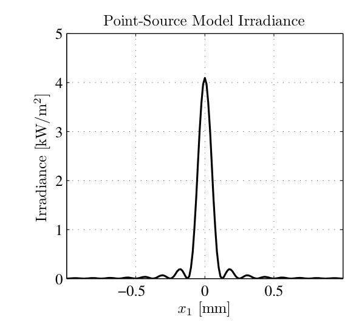
  <figcaption>图 6.7 sinc 模型点源的辐照度（源面）（截自原书）</figcaption>
</figure>

<figure>
  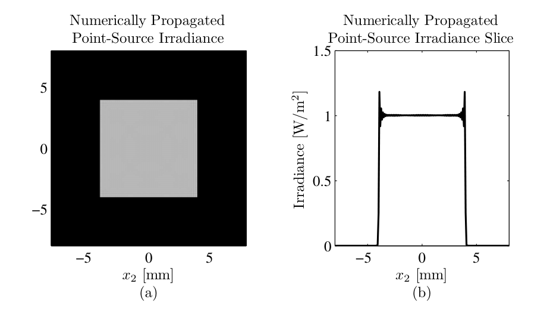
  <figcaption>图 6.8 sinc 模型点源的菲涅耳衍射辐照度（观测面）：(a) 二维分布；(b) 切片（截自原书）</figcaption>
</figure>

<figure>
  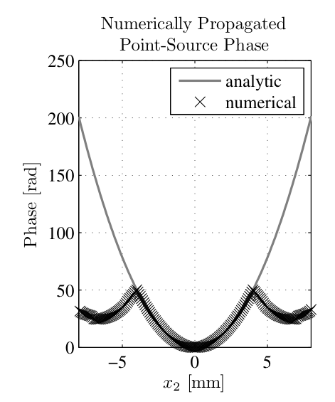
  <figcaption>图 6.9 sinc 模型点源的菲涅耳衍射相位（观测面）——窗外混叠可见（截自原书）</figcaption>
</figure>

遗憾的是，原书图 6.9 在感兴趣区域**之外**确实出现了混叠（aliasing）。也许改改点源模型能缓解。Martin–Flatté 与 Flatté 等的高斯模型没有这个困扰——把 sinc 与高斯两种模型结合，事实上也确实能减轻相位混叠。原书 Listing 6.9 实现了这个想法：代码与 Listing 6.8 几乎一样，只是模型点源多乘了一个高斯因子（第 17 行 \(e^{-(\text{arg}\, r_1/4)^2}\)）。

=== "MATLAB"

    ```matlab
    function U = pt_source_sinc_gauss(x1, y1, D, wvl, Dz)
    % sinc-Gaussian 模型点源（Listing 6.9：sinc 模型乘 exp(-(arg/4 r1)^2)）。
    A = wvl*Dz;
    arg = D/(wvl*Dz);
    r1sq = x1.^2 + y1.^2;
    U = A*arg^2*exp(-1i*2*pi/wvl/(2*Dz)*r1sq) ...
        .* sinc_(arg*x1) .* sinc_(arg*y1) ...
        .* exp(-(arg/4*sqrt(r1sq)).^2);
    end
    ```

=== "Python"

    ```python
    def pt_source_sinc_gauss(x1, y1, D, wvl, Dz, A=None):
        """sinc-Gaussian 模型点源（Listing 6.9：sinc 模型乘 exp(-(arg/4 r1)^2)）。"""
        if A is None:
            A = wvl * Dz
        arg = D / (wvl * Dz)
        r1sq = x1 ** 2 + y1 ** 2
        return A * arg ** 2 * np.exp(-1j * 2.0 * np.pi / wvl / (2.0 * Dz) * r1sq) \
            * np.sinc(arg * x1) * np.sinc(arg * y1) \
            * np.exp(-(arg / 4.0 * np.sqrt(r1sq)) ** 2)
    ```

sinc-Gaussian 模型点源及其观测面场见原书图 6.10–6.12。对比图 6.7 与 6.10 一眼可见：高斯因子压掉了模型点源的旁瓣，观测面辐照度剖面随之变平滑；算出的观测面相位（图 6.12）在网格边缘与解析相位吻合得也好得多。

=== "MATLAB"

    ```matlab
    function U = pt_source_offaxis(x1, y1, D, wvl, Dz, rc, corrected)
    % 式 (6.92) 的离轴推广（窗口中心 rc，方窗宽 D）。
    % corrected=true（勘误修正版）：恰为居中模型的平移：
    %   U_pt = A arg^2 e^{-i k |r1-rc|^2/(2Dz)} sinc[arg(x1-xc)] sinc[arg(y1-yc)]
    % corrected=false（书印 6.92）：指数符号印反。
    A = wvl*Dz;
    arg = D/(wvl*Dz);
    k = 2*pi/wvl;
    xc = rc(1);  yc = rc(2);
    sinc_env = sinc_(arg*(x1 - xc)).*sinc_(arg*(y1 - yc));
    if corrected
        ph = -1i*k*((x1 - xc).^2 + (y1 - yc).^2)/(2*Dz);
    else
        ph = -1i*k*(x1.^2 + y1.^2)/(2*Dz) ...
            + 1i*k*(xc^2 + yc^2)/(2*Dz) ...
            - 1i*k/Dz*(xc*x1 + yc*y1);
    end
    U = A*arg^2*exp(ph).*sinc_env;
    end
    ```

=== "Python"

    ```python
    def pt_source_offaxis(x1, y1, D, wvl, Dz, rc, corrected=True, A=None):
        """窗口中心 r_c = (xc, yc) 的方窗（宽 D）sinc 模型点源。

        corrected=True（本笔记修正版）：U_pt = A arg^2 e^{-i k |r1-rc|^2/(2 Dz)}
            * sinc[arg(x1-xc)] sinc[arg(y1-yc)] —— 恰为居中模型的平移；
        corrected=False（书印 6.92）：U_pt = A arg^2 e^{-i k r1^2/(2Dz)}
            * e^{+i k rc^2/(2Dz)} e^{-i (k/Dz) rc.r1} * sinc[...]（指数符号印反）。"""
        if A is None:
            A = wvl * Dz
        arg = D / (wvl * Dz)
        k = 2.0 * np.pi / wvl
        xc, yc = rc
        sinc_env = np.sinc(arg * (x1 - xc)) * np.sinc(arg * (y1 - yc))
        if corrected:
            ph = -1j * k * ((x1 - xc) ** 2 + (y1 - yc) ** 2) / (2.0 * Dz)
        else:
            ph = (-1j * k * (x1 ** 2 + y1 ** 2) / (2.0 * Dz)
                  + 1j * k * (xc ** 2 + yc ** 2) / (2.0 * Dz)
                  - 1j * k / Dz * (xc * x1 + yc * y1))
        return A * arg ** 2 * np.exp(ph) * sinc_env
    ```

<figure>
  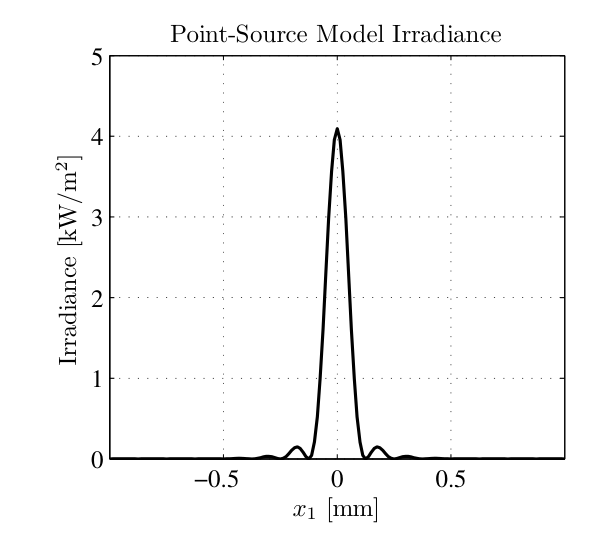
  <figcaption>图 6.10 sinc-Gaussian 模型点源的辐照度（源面）——旁瓣被高斯因子压低（截自原书）</figcaption>
</figure>

<figure>
  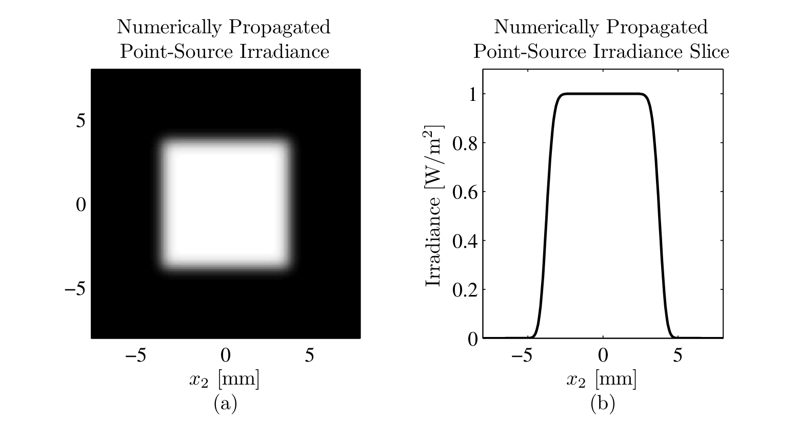
  <figcaption>图 6.11 sinc-Gaussian 模型点源的菲涅耳衍射辐照度（观测面）：(a) 二维分布；(b) 切片（截自原书）</figcaption>
</figure>

<figure>
  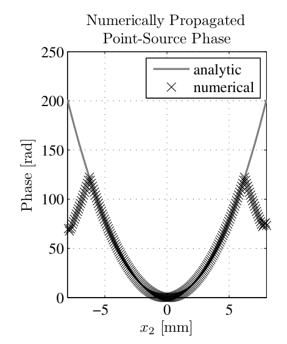
  <figcaption>图 6.12 sinc-Gaussian 模型点源的菲涅耳衍射相位（观测面）——边缘混叠明显减轻（截自原书）</figcaption>
</figure>

**表 6-4 点源模型对比（本笔记整理）**

| 模型 | 源面场 | 特点 |
| --- | --- | --- |
| Martin–Flatté / Coles（式 6.83） | \(e^{-r^2/(2\sigma^2)}e^{-ir^2/(2x_0^2)}\)，\(\sigma=x_0=\delta_1\) | 观测面中央约 1/3 近似平坦、边缘渐降；需配合吸收边界（8.1 节） |
| Flatté 等（式 6.84） | \(e^{-r^2/(2\sigma^2)}\cos^2(r^2/(2\rho^2))\)，\(\sigma\approx\rho\approx\delta_1\) | 同上 |
| 本书 sinc 模型（式 6.92，Listing 6.8） | \(A\left(\frac{D}{\lambda\Delta z}\right)^2 e^{-ik\|\mathbf{r}_1-\mathbf{r}_c\|^2/(2\Delta z)}\,\text{sinc}\,\text{sinc}\) | 解析逆向设计：窗内严格平顶 + 抛物相位；窗外相位混叠可见（图 6.9） |
| sinc-Gaussian（Listing 6.9） | sinc 模型 × \(e^{-(\text{arg}\,r_1/4)^2}\) | 高斯因子压旁瓣，观测面更平滑、边缘相位混叠减轻（图 6.12） |

## 6.7 习题

原书 6.7 节 5 道题，全部可用本章传播器完成；工程 3 给了完整复现与解析对照：

1. 把 Listing 6.2 的例子改成**高斯激光束的角谱传播**：源面在束腰（\(w = w_0 = 1\) mm，\(R = \infty\)），观测面 \(z_2 = 4\) m；\(\lambda = 1\,\mu\text{m}\)、512 网格点、源面网格 1 cm、观测面网格 1.5 cm。画观测面 \(y_2=0\) 切片的辐照度与相位，仿真与解析同图对比。
2. 把 Listing 6.2 的例子改成**圆孔聚焦光束的角谱传播**：观测面取焦面；\(\lambda = 1\,\mu\text{m}\)、\(D = 1\) cm、\(f_l = 16\) cm、1024 网格点、源面网格 2 cm、观测面间距取衍射受限光斑直径的 1/100。画焦面 \(y_2=0\) 切片辐照度，与解析 Airy 图案同图对比。
3. 用角谱法仿真 **Talbot 成像**：源面放振幅光栅 \(t_A(x_1,y_1) = \frac{1}{2}[1 + \cos(2\pi x_1/d)]\)（式 6.93），观测面取第一 Talbot 像面；\(\lambda = 1\,\mu\text{m}\)、\(d = 0.5\) mm、1024 网格点、源面/观测面网格都是 2 cm。显示 Talbot 像面的辐照度图像（只需中央 10 个周期），仿真与解析并排。
4. 推导感兴趣区域为**矩形**（\(x_2, y_2\) 方向宽度 \(D_x, D_y\)）时的模型点源。
5. 推导感兴趣区域为**圆形**（直径 \(D\)）时的模型点源。

!!! note "拓展：习题 4/5 的解法一句话"
    都是式 (6.89) + 平移定理的机械应用，而且（按勘误修正后的符号）结果都是"居中模型平移到 \(\mathbf{r}_c\)"：矩形窗给 \(A\frac{D_x D_y}{(\lambda\Delta z)^2}e^{-ik\|\mathbf{r}_1-\mathbf{r}_c\|^2/(2\Delta z)}\,\text{sinc}\frac{D_x(x_1-x_c)}{\lambda\Delta z}\,\text{sinc}\frac{D_y(y_1-y_c)}{\lambda\Delta z}\)；圆形窗给 \(A\,\text{jinc}\!\left(|\mathbf{r}_1-\mathbf{r}_c|;\ \frac{R_2}{\lambda\Delta z}\right)e^{-ik\|\mathbf{r}_1-\mathbf{r}_c\|^2/(2\Delta z)}\)（\(R_2 = D/2\)，\(\text{jinc}(\rho;R) = R J_1(2\pi R\rho)/\rho = \mathcal{F}\{\text{circ}(\text{半径 } R)\}\)）。菲涅耳核平移不变，所以传播后窗内自动是平顶球面波。

### 工程 1：四种传播器全家桶（Listings 6.1–6.7 复现）

对应文件 `matlab/waveprop/ch6/ch6_fresnel_prop.m` 与 `python/waveprop/ch6/ch6_fresnel_prop.py`，实现 `one_step_prop` / `two_step_prop`（书印"−"支 + 镜像修正版 + "+"支）/ `ang_spec_prop` / 式 (6.66) 两版对照 / `ang_spec_propABCD`，外加方孔解析闭式 `fresnel_prop_square_ap`，六组验证自动打印：

=== "MATLAB"

    ```matlab
    %% ===== 书 Schmidt PM199 第 6 章（工程 1）=====
    %  真空中的菲涅耳衍射：单步 / 两步 / 角谱 / ABCD 四种传播器
    %  （原书 6.1-6.5 节，Listings 6.1-6.7）
    %  与 python/waveprop/ch6/ch6_fresnel_prop.py 数值行为一致；
    %  本机无 MATLAB 时以 Python 实跑结果为准。
    %
    %  原书要点：
    %    Fresnel 积分（式 6.1）的两种数值形态：
    %      单步 FT 形态（式 6.5，Listing 6.1）：U = Q V F Q —— 一次 FT，
    %        观测面采样 delta2 = lambda*Dz/(N*delta1) 固定（式 6.16）；
    %      卷积形态（式 6.6）：两步传播（式 6.17-6.30，Listing 6.3）与
    %        角谱传播（式 6.31/6.50，Listing 6.5）都引入缩放参数 m = delta2/delta1。
    %    算子记号（式 6.7-6.13）：Q/V/F/F^-1/R/Q2，贯穿第 6-8 章。
    %    简单光学系统（式 6.68-6.81）：ABCD 阵 + 广义 Huygens-Fresnel 积分
    %    （Collins，式 6.77）的 Lambert-Fraser 卷积化（式 6.79-6.81）；
    %    Listing 6.6 实现其自由 m 版本（笔记补出算子链，见验证 5）。
    %
    %  原书勘误（本脚本按修正实现并数值验证，详见笔记）：
    %    (a) 式 (6.66) 的算子链不是 (6.50) 的正确 m->-m 代换：Q 系数应为
    %        (m+1)/(m*Dz) 与 (1+m)/Dz，F^-1 求值点应为 -r2/m（(6.67) 顶符号才对）；
    %        实输入场下书印链输出 = -conj(真值)（Python 实测 4e-16）。
    %    (b) Listing 6.3 对负距离步用 |Dz1| 建中间面坐标网格，坐标对应翻转：
    %        m != 1 时 "-" 支输出是真值的镜像（对称测试场不可见）。
    %
    %  验证（编号与 Python 版一致）：
    %   (0) ft2/ift2 往返 + Parseval；
    %   (1) Listing 6.2（N=1024 方孔 D=2mm, Dz=1m）：one_step vs 解析闭式；
    %   (2) Listing 6.4（m=10.24）：two_step vs one_step vs 解析；表 6.2、
    %       式 (6.19)-(6.23)、(6.55)/(6.56) 核对；
    %   (3) 非对称场（m=2.5）：镜像效应实锤 + 修正版 == ang_spec（1e-14）；
    %   (4) 式 (6.66) 勘误：书印链 = -conj(真值)；
    %   (5) Listing 6.7：ABCD（f=inf）== ang_spec；ABCD（薄透镜 f=2m）==
    %       ang_spec(孔径 x 发散相位)（同一离散算子）；
    %   (6) 二次相位采样判据。
    %
    %  MATLAB/Python 差异（对应 .py 内注释）：
    %    - MATLAB 1-based / numpy 0-based：居中排列的零坐标样本位置不同；
    %    - meshgrid 行为一致；cart2pol -> hypot/atan2；
    %    - 偶数网格的居中坐标反转 P(-r)：circshift(rot90(P,2),[1 1])
    %      （numpy: roll(flip(P),(1,1))）；
    %    - MATLAB 无内置 Fresnel 积分（符号工具箱除外），本脚本用 integral()
    %      数值积分实现（Python 版用 scipy.special.fresnel）；
    %    - 本地函数需 R2016b+；sum(...,'all') / max(...,[],'all') 需 R2018b+。
    clear; clc; close all;

    %% 验证 0：ft2/ift2 往返 + Parseval
    N0 = 64;  L0 = 1.0;  d0 = L0/N0;  df0 = 1/(N0*d0);
    rng(0, 'twister');
    g0 = randn(N0) + 1i*randn(N0);
    rt = ift2(ft2(g0, d0), df0);
    G0 = ft2(g0, d0);
    Eg = sum(abs(g0(:)).^2)*d0^2;
    EG = sum(abs(G0(:)).^2)*df0^2;
    fprintf('===== 验证 0：ft2/ift2 往返 + Parseval =====\n');
    fprintf('    max|ift2(ft2(g)) - g| = %.2e\n', max(abs(rt(:) - g0(:))));
    fprintf('    Parseval 相对差 = %.1e\n', abs(Eg - EG)/Eg);

    %% 原书 Listing 6.2/6.4 的参数（方形孔径，Dz = 1 m，N = 1024）
    N  = 1024;      % number of grid points per side
    L  = 1e-2;      % total size of the grid [m]
    d1 = L/N;       % grid spacing [m]
    D  = 2e-3;      % diameter of the aperture [m]
    wvl = 1e-6;     % optical wavelength [m]
    k  = 2*pi/wvl;
    Dz = 1;         % propagation distance [m]
    n  = -N/2 : N/2-1;
    [x1, y1] = meshgrid(n*d1, n*d1);
    ap = rect(x1/D) .* rect(y1/D);

    %% 验证 1：Listing 6.2 单步传播 vs 解析（原书图 6.1）
    [x2, y2, U1] = one_step_prop(ap, wvl, d1, Dz);
    Uan = fresnel_prop_square_ap(x2, y2, D, wvl, Dz);
    win = (abs(x2) <= 3e-3) & (abs(y2) <= 3e-3);
    I1  = abs(U1).^2;  Ian = abs(Uan).^2;
    pkA = max(Ian(win));
    ratio = U1(win)./Uan(win);
    strong = abs(Uan(win)) > 0.05*pkA;
    fprintf('===== 验证 1：Listing 6.2 单步传播 vs 解析 =====\n');
    fprintf('    delta2 = %.4f mm（式 6.16），观测网格半宽 %.1f mm\n', ...
        wvl*Dz/(N*d1)*1e3, max(x2(:))*1e3);
    fprintf('    轴上峰值辐照度：数值 %.4f vs 解析 %.4f（相对差 %.1e）\n', ...
        I1(N/2+1, N/2+1), Ian(N/2+1, N/2+1), ...
        abs(I1(N/2+1, N/2+1) - Ian(N/2+1, N/2+1))/Ian(N/2+1, N/2+1));
    fprintf('    ±3 mm 窗内：max|U1-Uan|/max|Uan| = %.2e\n', ...
        max(abs(U1(win) - Uan(win)))/max(abs(Uan(win))));
    fprintf('    |U|>5%%峰值处：|比值-1| max = %.2e；相位残差 max = %.2e rad\n', ...
        max(abs(abs(ratio(strong)) - 1)), ...
        max(abs(angle(ratio(strong)) - mean(angle(ratio(strong))))));

    %% 验证 2：Listing 6.4 两步传播（m=10.24）+ 表 6.2 + 网格关系
    d2_book = wvl*Dz/(N*d1);          % 原书取 one-step 的 delta2 -> m = 10.24
    m_book = d2_book/d1;
    [~, ~, U2] = two_step_prop(ap, wvl, d1, d2_book, Dz);
    [~, ~, U2p] = two_step_prop_plus(ap, wvl, d1, d2_book, Dz);
    I2 = abs(U2).^2;
    fprintf('===== 验证 2：Listing 6.4 两步传播（m=10.24） =====\n');
    fprintf('    m = %.2f：Dz1 = Dz/(1-m) = %.4f m（<0，图 6.2 几何）\n', ...
        m_book, Dz/(1 - m_book));
    fprintf('    轴上峰值辐照度：two_step %.4f vs 解析 %.4f（相对差 %.1e）\n', ...
        I2(N/2+1, N/2+1), Ian(N/2+1, N/2+1), ...
        abs(I2(N/2+1, N/2+1) - Ian(N/2+1, N/2+1))/Ian(N/2+1, N/2+1));
    fprintf('    书印"-"支 vs one_step：%.2e（方孔对称，镜像不可见）；"+"支 vs one_step：%.2e\n', ...
        max(abs(U2(:) - U1(:)))/max(abs(U1(:))), ...
        max(abs(U2p(:) - U1(:)))/max(abs(U1(:))));
    m_t = 2.0;  d2_t = m_t*d1;
    Dz1m = Dz/(1 - m_t);  Dz1p = Dz/(1 + m_t);
    d1a_m = wvl*abs(Dz1m)/(N*d1);
    fprintf('    m=2：表 6.2：Dz1-/Dz = %.1f（书 -1），Dz2-/Dz = %.1f（书 2）；', ...
        Dz1m/Dz, (Dz - Dz1m)/Dz);
    fprintf('Dz1+/Dz = %.4f（书 1/3），Dz2+/Dz = %.4f（书 2/3）\n', ...
        Dz1p/Dz, (Dz - Dz1p)/Dz);
    fprintf('    式 (6.19)-(6.23)：delta1a(-) = %.2f um；delta2 复得 = %.2f um = m*delta1\n', ...
        d1a_m*1e6, wvl*abs(Dz - Dz1m)/(N*d1a_m)*1e6);
    fprintf('    式 (6.55)/(6.56)：1/(1-m)=%.6f vs d1/(d1-d2)=%.6f；m/(1-m)=%.6f vs d2/(d1-d2)=%.6f\n', ...
        1/(1 - m_t), d1/(d1 - d2_t), m_t/(1 - m_t), d2_t/(d1 - d2_t));

    %% 验证 3：非对称场（m=2.5）：镜像效应与离散路径
    Na = 512;  L1a = 8e-3;  d1a_ = L1a/Na;
    m_a = 2.5;  d2a_ = m_a*d1a_;  Dza = 0.7;
    na = -Na/2 : Na/2-1;
    [xa, ya] = meshgrid(na*d1a_, na*d1a_);
    ap_asym = rect((xa - 0.8e-3)/1.2e-3).*rect(ya/2e-3) ...
        + 0.6*circ_(xa - 1.8e-3, ya + 1.2e-3, 0.5e-3);
    [~, ~, U_asym] = ang_spec_prop(ap_asym, wvl, d1a_, d2a_, Dza);
    [~, ~, U_mc] = ang_spec_mbranch(ap_asym, wvl, d1a_, d2a_, Dza, true);
    [~, ~, U_mb] = ang_spec_mbranch(ap_asym, wvl, d1a_, d2a_, Dza, false);
    [~, ~, U_tm] = two_step_prop(ap_asym, wvl, d1a_, d2a_, Dza);
    [~, ~, U_tp] = two_step_prop_plus(ap_asym, wvl, d1a_, d2a_, Dza);
    [~, ~, U_tf] = two_step_prop_fixed(ap_asym, wvl, d1a_, d2a_, Dza);
    pkA2 = max(abs(U_asym(:)));
    U_asym_flip = rollflip(U_asym);
    U_tm_flip = rollflip(U_tm);
    fprintf('===== 验证 3：非对称场（m=2.5） =====\n');
    fprintf('    [镜像勘误 b] 书印"-"支 vs ang_spec：%.2e；vs 镜像(ang_spec) |U| 差：%.2e\n', ...
        max(abs(U_tm(:) - U_asym(:)))/pkA2, ...
        max(abs(abs(U_tm(:)) - abs(U_asym_flip(:))))/pkA2);
    fprintf('    修正"-"支（翻转中间场）vs ang_spec：%.2e —— 逐位一致\n', ...
        max(abs(U_tf(:) - U_asym(:)))/pkA2);
    fprintf('    [离散路径] ang_spec vs (6.66)修正链：%.2e；"+"支 vs ang_spec：%.2e\n', ...
        max(abs(U_asym(:) - U_mc(:)))/pkA2, max(abs(U_tp(:) - U_asym(:)))/pkA2);
    for m_scan = [1.5 2.0 2.5 3.0 4.0]
        [~, ~, A_] = ang_spec_prop(ap_asym, wvl, d1a_, m_scan*d1a_, Dza);
        [~, ~, C_] = ang_spec_mbranch(ap_asym, wvl, d1a_, m_scan*d1a_, Dza, true);
        fprintf('        m=%.1f：|mcorr-ang|/pk = %.3f\n', m_scan, ...
            max(abs(C_(:) - A_(:)))/max(abs(A_(:))));
    end
    m0 = (wvl*Dza/(Na*d1a_))/d1a_;
    [~, ~, U_one_m0] = one_step_prop(ap_asym, wvl, d1a_, Dza);
    [~, ~, U_tp_m0] = two_step_prop_plus(ap_asym, wvl, d1a_, m0*d1a_, Dza);
    [~, ~, U_tf_m0] = two_step_prop_fixed(ap_asym, wvl, d1a_, m0*d1a_, Dza);
    fprintf('    同网格互证（m0=%.2f）：one_step vs "+"支 = %.2e；vs 修正"-"支 = %.2e\n', ...
        m0, max(abs(U_one_m0(:) - U_tp_m0(:)))/max(abs(U_tp_m0(:))), ...
        max(abs(U_one_m0(:) - U_tf_m0(:)))/max(abs(U_tf_m0(:))));

    %% 验证 4：式 (6.66) 勘误（书印链 = -conj(真值)）
    fprintf('===== 验证 4：式 (6.66) 勘误 =====\n');
    fprintf('    修正链 vs ang_spec：%.2e；书印链 vs ang_spec：%.2e\n', ...
        max(abs(U_mc(:) - U_asym(:)))/pkA2, max(abs(U_mb(:) - U_asym(:)))/pkA2);
    fprintf('    书印链 vs -conj(ang_spec)：max|diff|/max|U| = %.2e（实输入场逐点恒等）\n', ...
        max(abs(U_mb(:) + conj(U_asym(:))))/pkA2);

    %% 验证 5：Listing 6.7 的 ABCD 传播
    ABCD_free = [1 Dz; 0 1];
    [~, ~, U_af] = ang_spec_propABCD(ap, wvl, d1, d2_book, ABCD_free);
    [~, ~, U_as] = ang_spec_prop(ap, wvl, d1, d2_book, Dz);
    fprintf('===== 验证 5：Listing 6.7 的 ABCD 传播 =====\n');
    fprintf('    f=inf（自由空间 ABCD）vs ang_spec：max|diff|/max|U| = %.2e\n', ...
        max(abs(U_af(:) - U_as(:)))/max(abs(U_as(:))));
    f_lens = 2.0;
    ABCD_lens = [1 Dz; 0 1]*[1 0; -1/f_lens 1];
    d2_lens = 1.5*d1;
    [~, ~, U_al] = ang_spec_propABCD(ap, wvl, d1, d2_lens, ABCD_lens);
    [~, ~, U_lr2] = ang_spec_prop(ap.*exp(-1i*k*(x1.^2 + y1.^2)/(2*f_lens)), ...
        wvl, d1, d2_lens, Dz);
    fprintf('    f=2 m 薄透镜 + Dz=1 m：ABCD 链 vs ang_spec(孔径 x e^{-ik r1^2/2f})：%.2e（同一离散算子）\n', ...
        max(abs(U_al(:) - U_lr2(:)))/max(abs(U_lr2(:))));

    %% 验证 6：二次相位采样判据
    fprintf('===== 验证 6：二次相位采样判据 =====\n');
    fprintf('    源面啁啾（边缘 r=%.1f mm）：局部频率 %.0f /m vs Nyquist %.0f /m（比值 %.3f）\n', ...
        L/2*1e3, (L/2)/(wvl*Dz), 1/(2*d1), (L/2)/(wvl*Dz)*2*d1);
    fprintf('    缩放链输入啁啾判据 |1-m|*r_edge/(lambda Dz)/(1/(2 d1))：m=2.5 时 %.3f\n', ...
        abs(1 - m_a)*(L1a/2)/(wvl*Dza)*2*d1a_);
    fprintf('    (6.66)修正链曲率 (1+m)：比值 %.3f —— 更陡，是链间差的主因\n', ...
        (1 + m_a)*(L1a/2)/(wvl*Dza)*2*d1a_);

    %% 绘图（对应 Python 版图 6-13）
    sl = N/2 + 1;
    m_ = abs(x2(1, :)) <= 3e-3;
    figure('Position', [40 40 1500 820]);
    subplot(2, 3, 1);
    imagesc(x1(1, :)*1e3, y1(:, 1)*1e3, abs(ap)); axis image off;
    title('(a) 源面：2 mm 方孔（Listing 6.2，N=1024）');
    subplot(2, 3, 2);
    plot(x2(1, m_)*1e3, Ian(sl, m_), 'k-', x2(1, m_)*1e3, I1(sl, m_), 'r.', ...
        x2(1, m_)*1e3, I2(sl, m_), 'b.');
    title('(b) y2=0 辐照度切片：数值 vs 解析'); grid on;
    xlabel('x2 [mm]'); ylabel('辐照度 [a.u.]');
    subplot(2, 3, 3);
    slw = m_ & (Ian(sl, :) > 0.05*max(Ian(sl, m_)));
    ph1_ = angle(U1(sl, slw)./Uan(sl, slw));
    ph1_ = ph1_ - mean(ph1_);
    plot(x2(1, slw)*1e3, ph1_, 'b.');
    title(sprintf('(c) one_step/解析 相位残差 max %.1e rad', max(abs(ph1_))));
    xlabel('x2 [mm]'); ylabel('相位差 [rad]'); grid on;
    subplot(2, 3, 4);
    imagesc(xa(1, :)*1e3, ya(:, 1)*1e3, abs(U_asym)); axis image off;
    title('(d) 非对称场 ang_spec（m=2.5, Dz=0.7 m）');
    subplot(2, 3, 5);
    sa = Na/2 + 1;
    plot(xa(1, :)*1e3, abs(U_asym(sa, :))/pkA2, 'k-', ...
        xa(1, :)*1e3, abs(U_tm(sa, :))/pkA2, 'b--', ...
        xa(1, :)*1e3, abs(U_tm_flip(sa, :))/pkA2, 'r.');
    title('(e) 勘误 b：书印两步"-"支输出镜像'); grid on;
    xlabel('x2 [mm]'); ylabel('归一化 |U|');
    subplot(2, 3, 6);
    plot(xa(1, :)*1e3, real(U_asym(sa, :))/pkA2, 'k-', ...
        xa(1, :)*1e3, -real(conj(U_asym(sa, :)))/pkA2, 'b--', ...
        xa(1, :)*1e3, real(U_mc(sa, :))/pkA2, 'r.');
    title('(f) 勘误 a：书印 (6.66) 链 = -conj(真值)'); grid on;
    xlabel('x2 [mm]'); ylabel('归一化 Re U');

    %% ===== 本地函数 =====
    function G = ft2(g, delta)
    % 原书 Listing 2.5：定标正确的二维 DFT（乘 delta^2）
    G = fftshift(fft2(fftshift(g)))*delta^2;
    end

    function g = ift2(G, delta_f)
    % 原书 Listing 2.6：定标正确的二维逆 DFT（乘 (N*delta_f)^2）
    N = size(G, 1);
    g = fftshift(ifft2(fftshift(G)))*(N*delta_f)^2;
    end

    function out = rollflip(U)
    % 偶数网格居中坐标反转：(Mf)(r) = f(-r)。numpy: roll(flip(U),(1,1))
    out = circshift(rot90(U, 2), [1 1]);
    end

    function [x2, y2, Uout] = one_step_prop(Uin, wvl, d1, Dz)
    % 书 Listing 6.1：单步 Fresnel 传播（式 6.5；省略全局相位 e^{ikDz}，原书约定）
    N = size(Uin, 1);
    kk = 2*pi/wvl;
    n = -N/2 : N/2-1;
    [x1, y1] = meshgrid(n*d1, n*d1);
    d2 = wvl*Dz/(N*d1);                            % 式 (6.16)
    [x2, y2] = meshgrid(n*d2, n*d2);
    Uout = 1/(1i*wvl*Dz) ...
        .* exp(1i*kk/(2*Dz)*(x2.^2 + y2.^2)) ...
        .* ft2(Uin.*exp(1i*kk/(2*Dz)*(x1.^2 + y1.^2)), d1);
    end

    function [x2, y2, Uout] = two_step_prop(Uin, wvl, d1, d2, Dz)
    % 书 Listing 6.3："-"支（Dz1 = Dz/(1-m)）。注意勘误 b：负距离步的中间场
    % 坐标对应翻转，m != 1 时输出为真值镜像（本函数忠实复现书印行为）。
    N = size(Uin, 1);
    kk = 2*pi/wvl;
    n = -N/2 : N/2-1;
    [x1, y1] = meshgrid(n*d1, n*d1);
    m = d2/d1;
    Dz1 = Dz/(1 - m);
    d1a = wvl*abs(Dz1)/(N*d1);                     % 式 (6.19)
    [x1a, y1a] = meshgrid(n*d1a, n*d1a);
    Uitm = 1/(1i*wvl*Dz1) ...
        .* exp(1i*kk/(2*Dz1)*(x1a.^2 + y1a.^2)) ...
        .* ft2(Uin.*exp(1i*kk/(2*Dz1)*(x1.^2 + y1.^2)), d1);
    Dz2 = Dz - Dz1;
    [x2, y2] = meshgrid(n*d2, n*d2);
    Uout = 1/(1i*wvl*Dz2) ...
        .* exp(1i*kk/(2*Dz2)*(x2.^2 + y2.^2)) ...
        .* ft2(Uitm.*exp(1i*kk/(2*Dz2)*(x1a.^2 + y1a.^2)), d1a);
    end

    function [x2, y2, Uout] = two_step_prop_fixed(Uin, wvl, d1, d2, Dz)
    % "-"支修正版：负距离步的输出按居中反转重排（消除镜像）。
    % 数值事实（Python 实测）：修正后与 ang_spec 逐位一致（1e-14，全部测试的 m）。
    N = size(Uin, 1);
    kk = 2*pi/wvl;
    n = -N/2 : N/2-1;
    [x1, y1] = meshgrid(n*d1, n*d1);
    m = d2/d1;
    Dz1 = Dz/(1 - m);
    d1a = wvl*abs(Dz1)/(N*d1);
    [x1a, y1a] = meshgrid(n*d1a, n*d1a);
    Uitm = 1/(1i*wvl*Dz1) ...
        .* exp(1i*kk/(2*Dz1)*(x1a.^2 + y1a.^2)) ...
        .* ft2(Uin.*exp(1i*kk/(2*Dz1)*(x1.^2 + y1.^2)), d1);
    if Dz1 < 0
        Uitm = rollflip(Uitm);                     % 修正：负距离步输出镜像翻转
    end
    Dz2 = Dz - Dz1;
    [x2, y2] = meshgrid(n*d2, n*d2);
    Uout = 1/(1i*wvl*Dz2) ...
        .* exp(1i*kk/(2*Dz2)*(x2.^2 + y2.^2)) ...
        .* ft2(Uitm.*exp(1i*kk/(2*Dz2)*(x1a.^2 + y1a.^2)), d1a);
    if Dz2 < 0
        Uout = rollflip(Uout);                     % m<1 时第二步为负距离
    end
    end

    function [x2, y2, Uout] = two_step_prop_plus(Uin, wvl, d1, d2, Dz)
    % "+"支（图 6.3 几何）：Dz1 = Dz/(1+m) > 0、Dz2 = m*Dz/(1+m) > 0（m>0）。
    N = size(Uin, 1);
    kk = 2*pi/wvl;
    n = -N/2 : N/2-1;
    [x1, y1] = meshgrid(n*d1, n*d1);
    m = d2/d1;
    Dz1 = Dz/(1 + m);
    d1a = wvl*abs(Dz1)/(N*d1);
    [x1a, y1a] = meshgrid(n*d1a, n*d1a);
    Uitm = 1/(1i*wvl*Dz1) ...
        .* exp(1i*kk/(2*Dz1)*(x1a.^2 + y1a.^2)) ...
        .* ft2(Uin.*exp(1i*kk/(2*Dz1)*(x1.^2 + y1.^2)), d1);
    Dz2 = Dz - Dz1;
    [x2, y2] = meshgrid(n*d2, n*d2);
    Uout = 1/(1i*wvl*Dz2) ...
        .* exp(1i*kk/(2*Dz2)*(x2.^2 + y2.^2)) ...
        .* ft2(Uitm.*exp(1i*kk/(2*Dz2)*(x1a.^2 + y1a.^2)), d1a);
    end

    function [x2, y2, Uout] = ang_spec_prop(Uin, wvl, d1, d2, Dz)
    % 书 Listing 6.5：角谱传播（式 6.50 的 m 分支）：
    %   Uout = Q3 .* ift2(Q2 .* ft2(Q1 .* Uin / m, d1), df1)
    N = size(Uin, 1);
    kk = 2*pi/wvl;
    n = -N/2 : N/2-1;
    [x1, y1] = meshgrid(n*d1, n*d1);
    r1sq = x1.^2 + y1.^2;
    df1 = 1/(N*d1);
    [fX, fY] = meshgrid(n*df1, n*df1);
    fsq = fX.^2 + fY.^2;
    m = d2/d1;
    [x2, y2] = meshgrid(n*d2, n*d2);
    r2sq = x2.^2 + y2.^2;
    Q1 = exp(1i*kk/2*(1 - m)/Dz*r1sq);
    Q2 = exp(-1i*pi^2*2*Dz/m/kk*fsq);
    Q3 = exp(1i*kk/2*(m - 1)/(m*Dz)*r2sq);
    Uout = Q3 .* ift2(Q2 .* ft2(Q1 .* Uin/m, d1), df1);
    end

    function [x2, y2, Uout] = ang_spec_mbranch(Uin, wvl, d1, d2, Dz, corrected)
    % 式 (6.66)（m' = -m 分支）的算子链实现。
    % corrected=true（= 式 (6.67) 顶符号，正确代换）：
    %   U = Q[(m+1)/(m*Dz)] F^-1[f1,-r2/m] Q2[+Dz/m] F Q[(1+m)/Dz] (-1/m)
    % corrected=false（书印 6.66）：Q 系数 (1-m)/(m*Dz)、-(1-m)/Dz，F^-1[f1,+r2/m]。
    % 实输入场下书印链输出 = -conj(真值)（逐点解析恒等，Python 实测 4e-16）。
    N = size(Uin, 1);
    kk = 2*pi/wvl;
    n = -N/2 : N/2-1;
    [x1, y1] = meshgrid(n*d1, n*d1);
    r1sq = x1.^2 + y1.^2;
    df1 = 1/(N*d1);
    [fX, fY] = meshgrid(n*df1, n*df1);
    fsq = fX.^2 + fY.^2;
    m = d2/d1;
    [x2, y2] = meshgrid(n*d2, n*d2);
    if corrected
        Q1 = exp(1i*kk/2*(1 + m)/Dz*r1sq);
        Q3 = exp(1i*kk/2*(m + 1)/(m*Dz)*r2sq);
    else
        Q1 = exp(-1i*kk/2*(1 - m)/Dz*r1sq);        % 书印 Q[-(1-m)/Dz]
        Q3 = exp(1i*kk/2*(1 - m)/(m*Dz)*r2sq);     % 书印 Q[-(m-1)/(m*Dz)]
    end
    Q2 = exp(1i*pi^2*2*Dz/m/kk*fsq);               % Q2[+Dz/m]
    W = (-1/m)*ift2(Q2 .* ft2(Q1 .* Uin, d1), df1);
    if corrected
        W = rollflip(W);                           % F^-1[f1, -r2/m]
    end
    Uout = Q3 .* W;
    end

    function [x2, y2, Uout] = ang_spec_propABCD(Uin, wvl, d1, d2, ABCD)
    % 书 Listing 6.6：角谱 + ABCD（式 6.79-6.81 的自由 m 版本，笔记补出算子链）：
    %   Uout = Q[(D-1/m)/B] * ift2( Q2[-B/m] * ft2( Q[(A-m)/B] * Uin / m ) )
    % C 不显式出现（AD-BC=1 保证 (6.79) 自洽）。
    % 原书签名注释把 wvl 印成 wwl（笔误），此处按实现更正。
    N = size(Uin, 1);
    n = -N/2 : N/2-1;
    [x1, y1] = meshgrid(n*d1, n*d1);
    r1sq = x1.^2 + y1.^2;
    df1 = 1/(N*d1);
    [fX, fY] = meshgrid(n*df1, n*df1);
    fsq = fX.^2 + fY.^2;
    m = d2/d1;
    [x2, y2] = meshgrid(n*d2, n*d2);
    r2sq = x2.^2 + y2.^2;
    A = ABCD(1, 1);  B = ABCD(1, 2);  D = ABCD(2, 2);
    Q1 = exp(1i*pi/(wvl*B)*(A - m)*r1sq);
    Q2 = exp(-1i*pi*wvl*B/m*fsq);
    Q3 = exp(1i*pi/(wvl*B)*(D - 1/m)*r2sq);
    Uout = Q3 .* ift2(Q2 .* ft2(Q1 .* Uin/m, d1), df1);
    end

    function U = fresnel_prop_square_ap(x2, y2, D, wvl, Dz)
    % 边长 D 方孔的 Fresnel 衍射解析解（式 6.1 可分离积分，省略 e^{ikDz}）：
    %   U = (1/(i*lambda*Dz)) I(x2) I(y2)，
    %   I(x) = sqrt(lambda Dz/2) * {[C(t2)-C(t1)] + i[S(t2)-S(t1)]}，
    %   t = sqrt(2/(lambda Dz)) * u
    s = sqrt(2/(wvl*Dz));
    [tX1, tX2] = deal(s*(x2 - D/2), s*(x2 + D/2));
    [tY1, tY2] = deal(s*(y2 - D/2), s*(y2 + D/2));
    [Sx1, Cx1] = fresnel_int(tX1);
    [Sx2, Cx2] = fresnel_int(tX2);
    [Sy1, Cy1] = fresnel_int(tY1);
    [Sy2, Cy2] = fresnel_int(tY2);
    Ix = sqrt(wvl*Dz/2)*((Cx2 - Cx1) + 1i*(Sx2 - Sx1));
    Iy = sqrt(wvl*Dz/2)*((Cy2 - Cy1) + 1i*(Sy2 - Sy1));
    U = Ix.*Iy/(1i*wvl*Dz);
    end

    function [S, C] = fresnel_int(t)
    % Fresnel 积分 S(t)=int_0^t sin(pi u^2/2)du、C(t)=int_0^t cos(pi u^2/2)du。
    % MATLAB 基础版无内置（符号工具箱除外）；这里用 integral() 数值积分
    % （Python 版用 scipy.special.fresnel）。t 为数组，逐元素求值。
    S = arrayfun(@(tt) integral(@(u) sin(pi*u.^2/2), 0, tt, ...
        'AbsTol', 1e-10, 'RelTol', 1e-8), t);
    C = arrayfun(@(tt) integral(@(u) cos(pi*u.^2/2), 0, tt, ...
        'AbsTol', 1e-10, 'RelTol', 1e-8), t);
    end

    function out = rect(x)
    % rect(x)：|x|<1/2 取 1，|x|=1/2 取 1/2，其余 0
    out = double(abs(x) < 1/2) + 0.5*double(abs(x) == 1/2);
    end

    function out = circ_(x, y, R)
    % 半径 R 圆盘（半径参数；原书 circ(x,y,D) 是直径参数，注意换算）
    out = double(hypot(x, y) <= R);
    end
    ```

=== "Python"

    ```python
    # -*- coding: utf-8 -*-
    """
    ===== 书 Schmidt PM199 第 6 章（工程 1）=====
    真空中的菲涅耳衍射：单步 / 两步 / 角谱 / ABCD 四种传播器
    （原书 6.1-6.5 节，Listings 6.1-6.7）

    原书要点：
        Fresnel 积分（式 6.1）的两种数值形态：
          单步 FT 形态（式 6.5，Listing 6.1）：U = Q V F Q —— 一次 FT，
            观测面采样 delta2 = lambda*Dz/(N*delta1) 固定（式 6.16）；
          卷积形态（式 6.6）：两步传播（式 6.17-6.30，Listing 6.3）与
            角谱传播（式 6.31/6.50，Listing 6.5）都引入缩放参数 m = delta2/delta1。
        算子记号（式 6.7-6.13）：Q/V/F/F^-1/R/Q2，贯穿第 6-8 章。
        简单光学系统（式 6.68-6.81）：ABCD 阵 + 广义 Huygens-Fresnel 积分
        （Collins，式 6.77）的 Lambert-Fraser 卷积化（式 6.79-6.81）；
        Listing 6.6 实现其自由 m 版本（本笔记补出算子链，见验证 5）。

    数值验证（运行本脚本全部自动打印）：
        (0) ft2/ift2 往返误差 + Parseval；
        (1) 书例复现（Listing 6.2，N=1024 方形孔径 D=2mm, Dz=1m）：one_step vs
            Fresnel 积分解析闭式，辐照度/相位切片对照（原书图 6.1）；
        (2) 书例复现（Listing 6.4，m=10.24）：two_step vs one_step vs 解析
            （原书图 6.4）；表 6.2 数值核对；式 (6.19)-(6.23)、(6.55)/(6.56) 核对；
        (3) 非对称场（离轴矩形+圆盘，m=2.5）：
            - 书印 Listing 6.3 "-" 支的镜像效应（对称测试场不可见！）：
              输出 = 真值的镜像（|U| 逐位一致），翻转中间场修正后消失；
            - 修正 "-" 支 two_step_fixed 与 ang_spec 逐位一致（1e-14，
              全部测试的 m 成立）——两条链在离散层面是同一算子；
            - "+" 支 / 式(6.66)修正链是另一条等价离散路径（差 3~5e-2，
              随 m->1 与网格加密收敛，细网格仲裁实测）；
        (4) 式 (6.66) 勘误验证：书印链 vs 修正链（= 式 6.67 顶符号）——
            实输入场下书印链输出 = -conj(真值)（逐点、机器精度 4e-16）；
            点源解析检验：书印链给 e^{-i k|r2-rc|^2/(2Dz)}（相位反号，见笔记）；
        (5) Listing 6.7 复现：ABCD（f=inf 自由空间）== ang_spec（机器精度）；
            ABCD（薄透镜 f=2m + 自由空间）== one_step(孔径 x 发散相位) ——
            Collins 积分与"薄透镜相位 + Fresnel 传播"的等价性核对；
        (6) 采样判据核对：源面/观测面二次相位的局部空间频率 vs Nyquist。

    原书勘误（本脚本按修正实现并数值验证，详见笔记）：
        (a) 式 (6.66) 的算子链不是 (6.50) 的正确 m->-m 代换：Q 系数应为
            (m+1)/(m*Dz) 与 (1+m)/Dz（书印 (1-m)/(m*Dz) 与 -(1-m)/Dz），
            F^-1 的求值点应为 -r2/m（书印 +r2/m）；(6.67) 顶符号才是对的。
        (b) Listing 6.3 对负距离步用 |Dz1| 建中间面坐标网格，坐标对应翻转：
            m != 1 时 "-" 支输出是真值的镜像（对称测试场不可见）。

    MATLAB/Python 差异（对应 .m 文件内注释）：
        - numpy 0-based / MATLAB 1-based：居中排列的零坐标样本位置不同；
        - np.meshgrid 默认 'xy' 与 MATLAB meshgrid 一致；
        - 偶数网格的居中坐标反转 P(-r)：两语言都用 flip + roll 1
          （MATLAB: circshift(rot90(P,2),[1 1])；numpy: roll(flip(P),(1,1))）；
        - scipy.special.fresnel 直接给 Fresnel 积分；MATLAB 无内置（符号工具箱
          除外），.m 里用 Abramowitz-Stegun 7.3.32/33 有理近似（误差 < 3e-7）。
    用法：python ch6_fresnel_prop.py <输出目录>  保存 PNG；否则弹窗显示。
    依赖：numpy + matplotlib + scipy；base.py（rect/circle/ft2_centered，同仓库
          python/fourier/common）。
    """

    import os
    import sys

    import numpy as np
    import matplotlib.pyplot as plt
    from scipy.special import fresnel

    plt.rcParams['font.sans-serif'] = ['SimHei', 'Microsoft YaHei', 'Arial Unicode MS']
    plt.rcParams['axes.unicode_minus'] = False

    # ---- 复用《计算傅里叶光学》笔记的公共基础模块（同仓库） ----
    sys.path.insert(0, os.path.join(os.path.dirname(os.path.abspath(__file__)),
                                    "..", "..", "fourier", "common"))
    from base import rect, circle, ft2_centered as ft2  # noqa: E402


    # ===== 书 Listing 2.6：ift2（定标正确的二维逆 DFT） =====
    def ift2(G, delta_f):
        """连续逆傅里叶变换的 DFT 近似（居中输出）：
            g(r) ~= (N*delta_f)^2 * IFFT{G}
        numpy.fft.ifft2 自带 1/N^2，乘 (N*delta_f)^2 回到连续量纲。"""
        N = G.shape[0]
        return np.fft.fftshift(np.fft.ifft2(np.fft.ifftshift(G))) * (N * delta_f) ** 2


    def rollflip(U):
        """偶数网格居中坐标反转：(Mf)(r) = f(-r) 的居中采样。
        numpy: roll(flip(U), (1,1))；MATLAB: circshift(rot90(U,2), [1 1])。"""
        return np.roll(np.rot90(U, 2), (1, 1), axis=(0, 1))


    # ===== 书 Listing 6.1：one_step_prop =====
    def one_step_prop(Uin, wvl, d1, Dz):
        """单步 Fresnel 传播（式 6.5；全局相位 e^{ik*Dz} 按原书代码约定省略）。

        返回 (x2, y2, Uout)。观测面采样 delta2 = lambda*Dz/(N*d1)（式 6.16），
        无法由用户指定 —— 这正是两步/角谱法的动机。"""
        N = Uin.shape[0]
        k = 2.0 * np.pi / wvl
        n = np.arange(N) - N // 2
        x1, y1 = np.meshgrid(n * d1, n * d1)
        d2 = wvl * Dz / (N * d1)                       # 式 (6.16)
        x2, y2 = np.meshgrid(n * d2, n * d2)
        Uout = (1.0 / (1j * wvl * Dz)
                * np.exp(1j * k / (2.0 * Dz) * (x2 ** 2 + y2 ** 2))
                * ft2(Uin * np.exp(1j * k / (2.0 * Dz) * (x1 ** 2 + y1 ** 2)), d1))
        return x2, y2, Uout


    # ===== 书 Listing 6.3：two_step_prop（书印 "-" 支） =====
    def two_step_prop(Uin, wvl, d1, d2, Dz):
        """两步 Fresnel 传播，书印 Listing 6.3 的 "-" 支：Dz1 = Dz/(1-m)（式 6.25）。

        注意（勘误 b）：Dz1（m>1）或 Dz2（m<1）必有一个为负；原书对负距离步用
        |Dz| 建坐标网格（第 14 行 d1a = wvl*abs(Dz1)/(N*d1)），坐标对应翻转一次，
        输出为真值的镜像（对称测试场不可见）。本函数忠实复现书印行为；
        修正版见 two_step_prop_fixed / two_step_prop_plus。"""
        N = Uin.shape[0]
        k = 2.0 * np.pi / wvl
        n = np.arange(N) - N // 2
        x1, y1 = np.meshgrid(n * d1, n * d1)
        m = d2 / d1
        Dz1 = Dz / (1.0 - m)
        d1a = wvl * abs(Dz1) / (N * d1)                # 式 (6.19)（书印取 |Dz1|）
        x1a, y1a = np.meshgrid(n * d1a, n * d1a)
        Uitm = (1.0 / (1j * wvl * Dz1)
                * np.exp(1j * k / (2.0 * Dz1) * (x1a ** 2 + y1a ** 2))
                * ft2(Uin * np.exp(1j * k / (2.0 * Dz1) * (x1 ** 2 + y1 ** 2)), d1))
        Dz2 = Dz - Dz1                                 # Dz2 = -m*Dz1
        x2, y2 = np.meshgrid(n * d2, n * d2)
        Uout = (1.0 / (1j * wvl * Dz2)
                * np.exp(1j * k / (2.0 * Dz2) * (x2 ** 2 + y2 ** 2))
                * ft2(Uitm * np.exp(1j * k / (2.0 * Dz2) * (x1a ** 2 + y1a ** 2)),
                      d1a))
        return x2, y2, Uout


    def two_step_prop_fixed(Uin, wvl, d1, d2, Dz):
        """两步传播 "-" 支的修正版：负距离步的输出按居中反转重排，
        消除书印实现的镜像（其余与书印逐行对应）。
        数值事实：修正后与 ang_spec 逐位一致（1e-14，全部测试的 m）。"""
        N = Uin.shape[0]
        k = 2.0 * np.pi / wvl
        n = np.arange(N) - N // 2
        x1, y1 = np.meshgrid(n * d1, n * d1)
        m = d2 / d1
        Dz1 = Dz / (1.0 - m)
        d1a = wvl * abs(Dz1) / (N * d1)
        x1a, y1a = np.meshgrid(n * d1a, n * d1a)
        Uitm = (1.0 / (1j * wvl * Dz1)
                * np.exp(1j * k / (2.0 * Dz1) * (x1a ** 2 + y1a ** 2))
                * ft2(Uin * np.exp(1j * k / (2.0 * Dz1) * (x1 ** 2 + y1 ** 2)), d1))
        if Dz1 < 0:                                    # 修正：负距离步输出镜像翻转
            Uitm = rollflip(Uitm)
        Dz2 = Dz - Dz1
        x2, y2 = np.meshgrid(n * d2, n * d2)
        Uout = (1.0 / (1j * wvl * Dz2)
                * np.exp(1j * k / (2.0 * Dz2) * (x2 ** 2 + y2 ** 2))
                * ft2(Uitm * np.exp(1j * k / (2.0 * Dz2) * (x1a ** 2 + y1a ** 2)),
                      d1a))
        if Dz2 < 0:                                    # m<1 时第二步为负距离
            Uout = rollflip(Uout)
        return x2, y2, Uout


    def two_step_prop_plus(Uin, wvl, d1, d2, Dz):
        """两步传播 "+" 支（式 6.25 的 "+"，图 6.3 几何）：中间面夹在源面与
        观测面之间，Dz1 = Dz/(1+m) > 0、Dz2 = m*Dz/(1+m) > 0（m>0），
        两个步都是正距离，无镜像问题。与 "-" 支在连续域严格等价
        （|Dz2/Dz1| = m，式 6.24/6.30）；离散路径不同（见验证 3 的收敛检查）。"""
        N = Uin.shape[0]
        k = 2.0 * np.pi / wvl
        n = np.arange(N) - N // 2
        x1, y1 = np.meshgrid(n * d1, n * d1)
        m = d2 / d1
        Dz1 = Dz / (1.0 + m)
        d1a = wvl * abs(Dz1) / (N * d1)
        x1a, y1a = np.meshgrid(n * d1a, n * d1a)
        Uitm = (1.0 / (1j * wvl * Dz1)
                * np.exp(1j * k / (2.0 * Dz1) * (x1a ** 2 + y1a ** 2))
                * ft2(Uin * np.exp(1j * k / (2.0 * Dz1) * (x1 ** 2 + y1 ** 2)), d1))
        Dz2 = Dz - Dz1
        x2, y2 = np.meshgrid(n * d2, n * d2)
        Uout = (1.0 / (1j * wvl * Dz2)
                * np.exp(1j * k / (2.0 * Dz2) * (x2 ** 2 + y2 ** 2))
                * ft2(Uitm * np.exp(1j * k / (2.0 * Dz2) * (x1a ** 2 + y1a ** 2)),
                      d1a))
        return x2, y2, Uout


    # ===== 书 Listing 6.5：ang_spec_prop =====
    def ang_spec_prop(Uin, wvl, d1, d2, Dz):
        """角谱传播（式 6.50 的 m 分支，Listing 6.5）：
            Uout = Q3 * ift2( Q2 * ft2( Q1 * Uin / m ) )
        Q1 = Q[(1-m)/Dz]（空间网格）、Q2 = Q2[-Dz/m]（频率网格，
        = e^{-i*pi*lambda*Dz*f^2/m}）、Q3 = Q[(m-1)/(m*Dz)]（空间网格）。
        delta2 = m*delta1 由用户自由定标。"""
        N = Uin.shape[0]
        k = 2.0 * np.pi / wvl
        n = np.arange(N) - N // 2
        x1, y1 = np.meshgrid(n * d1, n * d1)
        r1sq = x1 ** 2 + y1 ** 2
        df1 = 1.0 / (N * d1)
        fX, fY = np.meshgrid(n * df1, n * df1)
        fsq = fX ** 2 + fY ** 2
        m = d2 / d1
        x2, y2 = np.meshgrid(n * d2, n * d2)
        r2sq = x2 ** 2 + y2 ** 2
        Q1 = np.exp(1j * k / 2.0 * (1.0 - m) / Dz * r1sq)
        Q2 = np.exp(-1j * np.pi ** 2 * 2.0 * Dz / m / k * fsq)
        Q3 = np.exp(1j * k / 2.0 * (m - 1.0) / (m * Dz) * r2sq)
        Uout = Q3 * ift2(Q2 * ft2(Q1 * Uin / m, d1), df1)
        return x2, y2, Uout


    # ===== 验证 4：式 (6.66) 的两种实现（勘误对照） =====
    def ang_spec_mbranch(Uin, wvl, d1, d2, Dz, corrected=True):
        """式 (6.66)（m' = -m 分支）的算子链实现。

        corrected=True（按 m'=-m 正确代换，即式 (6.67) 顶符号）：
            U = Q[(m+1)/(m*Dz)] * F^-1[f1, -r2/m] * Q2[+Dz/m] * F * Q[(1+m)/Dz] * (-1/m)
        corrected=False（按书印 (6.66)）：
            U = Q[(1-m)/(m*Dz)] * F^-1[f1, +r2/m] * Q2[+Dz/m] * F * Q[-(1-m)/Dz] * (-1/m)
        实输入场下书印链输出 = -conj(真值)（逐点解析恒等，验证 4 实测 4e-16）。
        """
        N = Uin.shape[0]
        k = 2.0 * np.pi / wvl
        n = np.arange(N) - N // 2
        x1, y1 = np.meshgrid(n * d1, n * d1)
        r1sq = x1 ** 2 + y1 ** 2
        df1 = 1.0 / (N * d1)
        fX, fY = np.meshgrid(n * df1, n * df1)
        fsq = fX ** 2 + fY ** 2
        m = d2 / d1
        x2, y2 = np.meshgrid(n * d2, n * d2)
        r2sq = x2 ** 2 + y2 ** 2
        if corrected:
            Q1 = np.exp(1j * k / 2.0 * (1.0 + m) / Dz * r1sq)
            Q3 = np.exp(1j * k / 2.0 * (m + 1.0) / (m * Dz) * r2sq)
        else:
            Q1 = np.exp(-1j * k / 2.0 * (1.0 - m) / Dz * r1sq)       # 书印 Q[-(1-m)/Dz]
            Q3 = np.exp(1j * k / 2.0 * (1.0 - m) / (m * Dz) * r2sq)  # 书印 Q[-(m-1)/(m*Dz)]
        Q2 = np.exp(1j * np.pi ** 2 * 2.0 * Dz / m / k * fsq)        # Q2[+Dz/m]
        W = (-1.0 / m) * ift2(Q2 * ft2(Q1 * Uin, d1), df1)           # 本征 IFT 网格
        if corrected:
            W = rollflip(W)          # F^-1[f1, -r2/m]：本征网格居中反转采样
        return x2, y2, Q3 * W


    # ===== 书 Listing 6.6：ang_spec_propABCD =====
    def ang_spec_propABCD(Uin, wvl, d1, d2, ABCD):
        """角谱 + ABCD 光线矩阵（式 6.79-6.81 的自由 m 版本，Listing 6.6）。

        算子链（本笔记补出的推导；自由空间 A=D=1 时退化为式 6.50）：
            Uout = Q[(D-1/m)/B] * ift2( Q2[-B/m] * ft2( Q[(A-m)/B] * Uin / m ) )
        C 不显式出现（AD-BC=1 保证 (6.79) 自洽）。
        原书签名注释把 wvl 印成 wwl（笔误），此处按实现更正。"""
        N = Uin.shape[0]
        n = np.arange(N) - N // 2
        x1, y1 = np.meshgrid(n * d1, n * d1)
        r1sq = x1 ** 2 + y1 ** 2
        df1 = 1.0 / (N * d1)
        fX, fY = np.meshgrid(n * df1, n * df1)
        fsq = fX ** 2 + fY ** 2
        m = d2 / d1
        x2, y2 = np.meshgrid(n * d2, n * d2)
        r2sq = x2 ** 2 + y2 ** 2
        A = ABCD[0, 0]
        B = ABCD[0, 1]
        D = ABCD[1, 1]
        Q1 = np.exp(1j * np.pi / (wvl * B) * (A - m) * r1sq)
        Q2 = np.exp(-1j * np.pi * wvl * B / m * fsq)
        Q3 = np.exp(1j * np.pi / (wvl * B) * (D - 1.0 / m) * r2sq)
        Uout = Q3 * ift2(Q2 * ft2(Q1 * Uin / m, d1), df1)
        return x2, y2, Uout


    # ===== 方形孔径 Fresnel 衍射解析解（原书 fresnel_prop_square_ap） =====
    def fresnel_prop_square_ap(x2, y2, D, wvl, Dz):
        """边长 D 的单位振幅方形孔径的 Fresnel 衍射解析解（式 6.1 可分离积分）。

            U(x2,y2) = (e^{ik*Dz}/(i*lambda*Dz)) * I(x2) * I(y2)
            I(x) = int_{x-D/2}^{x+D/2} exp(i*pi*u^2/(lambda*Dz)) du
                 = sqrt(lambda*Dz/2) * {[C(t2)-C(t1)] + i[S(t2)-S(t1)]}
            t = sqrt(2/(lambda*Dz)) * u   （scipy.special.fresnel 的约定）
        全局相位约定：与原书代码一致，省略 e^{ik*Dz}（见笔记 6.1 节注记）。
        """
        a = 1.0 / (wvl * Dz)                 # 相位 = pi*a*u^2
        s = np.sqrt(2.0 * a)

        def I(x):
            S1, C1 = fresnel(s * (x - D / 2.0))
            S2, C2 = fresnel(s * (x + D / 2.0))
            return np.sqrt(1.0 / (2.0 * a)) * ((C2 - C1) + 1j * (S2 - S1))

        return I(x2) * I(y2) / (1j * wvl * Dz)


    def main(outdir=None):
        # ---- 验证 0：ft2/ift2 往返 + Parseval ----
        N0, L0 = 64, 1.0
        d0 = L0 / N0
        rng = np.random.default_rng(0)
        g0 = rng.standard_normal((N0, N0)) + 1j * rng.standard_normal((N0, N0))
        df0 = 1.0 / (N0 * d0)
        rt = ift2(ft2(g0, d0), df0)
        Eg = np.sum(np.abs(g0) ** 2) * d0 ** 2
        EG = np.sum(np.abs(ft2(g0, d0)) ** 2) * df0 ** 2
        print('===== 验证 0：ft2/ift2 往返 + Parseval =====')
        print('    max|ift2(ft2(g)) - g| = %.2e' % np.max(np.abs(rt - g0)))
        print('    Parseval: sum|g|^2*d^2 = %.6e vs sum|G|^2*df^2 = %.6e（相对差 %.1e）'
              % (Eg, EG, abs(Eg - EG) / Eg))

        # ---- 原书 Listing 6.2/6.4 的参数（方形孔径，Dz = 1 m，N = 1024） ----
        N = 1024                     # 原书 Listing 6.2 的规模
        L = 1e-2
        d1 = L / N
        D = 2e-3
        wvl = 1e-6
        k = 2.0 * np.pi / wvl
        Dz = 1.0
        n = np.arange(N) - N // 2
        x1, y1 = np.meshgrid(n * d1, n * d1)
        ap = rect(x1 / D) * rect(y1 / D)

        print('===== 验证 1：Listing 6.2 单步传播 vs 解析（原书图 6.1） =====')
        x2, y2, U1 = one_step_prop(ap, wvl, d1, Dz)
        Uan = fresnel_prop_square_ap(x2, y2, D, wvl, Dz)
        win = (np.abs(x2) <= 3e-3) & (np.abs(y2) <= 3e-3)
        I1, Ian = np.abs(U1) ** 2, np.abs(Uan) ** 2
        pkA = np.max(Ian[win])
        strong = win & (Ian > 0.05 * pkA)              # 避开解析零点（比值发散）
        ratio = U1[strong] / Uan[strong]
        ph_res = np.abs(np.angle(ratio) - np.mean(np.angle(ratio)))
        print('    delta2 = %.4f mm（式 6.16），观测网格半宽 %.1f mm'
              % (wvl * Dz / (N * d1) * 1e3, np.max(x2) * 1e3))
        print('    轴上峰值辐照度：数值 %.4f vs 解析 %.4f（相对差 %.1e）'
              % (I1[N // 2, N // 2], Ian[N // 2, N // 2],
                 abs(I1[N // 2, N // 2] - Ian[N // 2, N // 2]) / Ian[N // 2, N // 2]))
        print('    ±3 mm 窗内：max|U1-Uan|/max|Uan| = %.2e；'
              '辐照度最大绝对差/峰值 = %.2e'
              % (np.max(np.abs(U1[win] - Uan[win])) / np.max(np.abs(Uan[win])),
                 np.max(np.abs(I1[win] - Ian[win])) / pkA))
        print('    |U|>5%% 峰值处：复场比值 |比值-1| max = %.2e；'
              '相位残差(去均值) max = %.2e rad（离散化水平）'
              % (np.max(np.abs(np.abs(ratio) - 1.0)), np.max(ph_res)))

        print('===== 验证 2：Listing 6.4 两步传播（m=10.24）+ 表 6.2 + 网格关系 =====')
        d2_book = wvl * Dz / (N * d1)          # 原书取 one-step 的 delta2 -> m = 10.24
        m_book = d2_book / d1
        x2b, y2b, U2 = two_step_prop(ap, wvl, d1, d2_book, Dz)
        x2p, y2p, U2p = two_step_prop_plus(ap, wvl, d1, d2_book, Dz)
        I2 = np.abs(U2) ** 2
        print('    m = delta2/delta1 = %.2f：Dz1 = Dz/(1-m) = %.4f m（<0，图 6.2 几何）'
              % (m_book, Dz / (1 - m_book)))
        print('    轴上峰值辐照度：two_step %.4f vs 解析 %.4f（相对差 %.1e）'
              % (I2[N // 2, N // 2], Ian[N // 2, N // 2],
                 abs(I2[N // 2, N // 2] - Ian[N // 2, N // 2]) / Ian[N // 2, N // 2]))
        print('    two_step(书印"-"支) vs one_step 复场 max|diff|/max|U| = %.2e'
              % (np.max(np.abs(U2 - U1)) / np.max(np.abs(U1))))
        print('        （方孔对称 -> 镜像不可见；非对称场见验证 3）')
        print('    two_step("+"支) vs one_step 复场 max|diff|/max|U| = %.2e'
              % (np.max(np.abs(U2p - U1)) / np.max(np.abs(U1))))
        # 表 6.2 与网格关系
        m_t = 2.0
        d2_t = m_t * d1
        Dz1m, Dz1p = Dz / (1 - m_t), Dz / (1 + m_t)
        d1a_m = wvl * abs(Dz1m) / (N * d1)
        d1a_p = wvl * abs(Dz1p) / (N * d1)
        print('    m=2：表 6.2 核对：Dz1-/Dz = %.1f（书 -1），Dz2-/Dz = %.1f（书 2）；'
              'Dz1+/Dz = %.4f（书 1/3），Dz2+/Dz = %.4f（书 2/3）'
              % (Dz1m / Dz, (Dz - Dz1m) / Dz, Dz1p / Dz, (Dz - Dz1p) / Dz))
        print('    式 (6.19)-(6.23)：delta1a(-) = %.2f um = lambda|Dz1|/(N*d1)；'
              'delta2 复得 = lambda|Dz2|/(N*delta1a) = %.2f um = m*delta1'
              % (d1a_m * 1e6, wvl * abs(Dz - Dz1m) / (N * d1a_m) * 1e6))
        print('    式 (6.55)/(6.56)：1/(1-m) = %.6f vs d1/(d1-d2) = %.6f；'
              'm/(1-m) = %.6f vs d2/(d1-d2) = %.6f'
              % (1 / (1 - m_t), d1 / (d1 - d2_t), m_t / (1 - m_t), d2_t / (d1 - d2_t)))

        print('===== 验证 3：非对称场（m=2.5）：镜像效应与离散路径 =====')
        Na, L1a = 512, 8e-3
        d1a_ = L1a / Na
        m_a = 2.5
        d2a_ = m_a * d1a_
        Dza = 0.7
        na = np.arange(Na) - Na // 2
        xa, ya = np.meshgrid(na * d1a_, na * d1a_)
        ap_asym = (rect((xa - 0.8e-3) / 1.2e-3) * rect(ya / 2.0e-3)
                   + 0.6 * circle(xa - 1.8e-3, ya + 1.2e-3, 0.5e-3))
        _, _, U_asym = ang_spec_prop(ap_asym, wvl, d1a_, d2a_, Dza)
        _, _, U_mc = ang_spec_mbranch(ap_asym, wvl, d1a_, d2a_, Dza, corrected=True)
        _, _, U_mb = ang_spec_mbranch(ap_asym, wvl, d1a_, d2a_, Dza, corrected=False)
        _, _, U_tm = two_step_prop(ap_asym, wvl, d1a_, d2a_, Dza)
        _, _, U_tp = two_step_prop_plus(ap_asym, wvl, d1a_, d2a_, Dza)
        _, _, U_tf = two_step_prop_fixed(ap_asym, wvl, d1a_, d2a_, Dza)
        pkA2 = np.max(np.abs(U_asym))
        print('    [镜像勘误 b] 书印"-"支 vs ang_spec：%.2e；'
              'vs 镜像(ang_spec) 的 |U| 差：%.2e —— 输出确为镜像'
              % (np.max(np.abs(U_tm - U_asym)) / pkA2,
                 np.max(np.abs(np.abs(U_tm) - np.abs(rollflip(U_asym)))) / pkA2))
        print('    修正"-"支（翻转中间场）vs ang_spec：%.2e —— 逐位一致'
              % (np.max(np.abs(U_tf - U_asym)) / pkA2))
        print('    [离散路径] ang_spec vs (6.66)修正链：%.2e；" +"支 vs ang_spec：%.2e'
              % (np.max(np.abs(U_asym - U_mc)) / pkA2,
                 np.max(np.abs(U_tp - U_asym)) / pkA2))
        print('    同一连续场、不同离散路径；随 m 变化的链间差：')
        for m_scan in (1.5, 2.0, 2.5, 3.0, 4.0):
            _, _, A_ = ang_spec_prop(ap_asym, wvl, d1a_, m_scan * d1a_, Dza)
            _, _, C_ = ang_spec_mbranch(ap_asym, wvl, d1a_, m_scan * d1a_, Dza, True)
            print('        m=%.1f：|mcorr-ang|/pk = %.3f'
                  % (m_scan, np.max(np.abs(C_ - A_)) / np.max(np.abs(A_))))
        # 细网格仲裁（网格加倍，抽取偶样本回到同一观测网格）
        Nf = 2 * Na
        d1f = L1a / Nf
        naf = np.arange(Nf) - Nf // 2
        xf, yf = np.meshgrid(naf * d1f, naf * d1f)
        ap_f = (rect((xf - 0.8e-3) / 1.2e-3) * rect(yf / 2.0e-3)
                + 0.6 * circle(xf - 1.8e-3, yf + 1.2e-3, 0.5e-3))
        _, _, A_f = ang_spec_prop(ap_f, wvl, d1f, m_a * d1f, Dza)
        _, _, C_f = ang_spec_mbranch(ap_f, wvl, d1f, m_a * d1f, Dza, True)
        _, _, P_f = two_step_prop_plus(ap_f, wvl, d1f, m_a * d1f, Dza)
        jf = 2 * (na + Na // 2)                           # 细网格偶样本 = 粗网格坐标
        print('    网格加倍仲裁（N=512 -> 1024，坐标核对 max|dx| = %.1e m）：'
              'ang_spec %.3f、mcorr %.3f、two_step+ %.3f（x 峰值）—— 同量级收敛'
              % (np.max(np.abs((jf - Nf // 2) * d1f - na * d1a_)),
                 np.max(np.abs(U_asym - A_f[np.ix_(jf, jf)])) / pkA2,
                 np.max(np.abs(U_mc - C_f[np.ix_(jf, jf)])) / pkA2,
                 np.max(np.abs(U_tp - P_f[np.ix_(jf, jf)])) / pkA2))
        # 同网格互证（m0 = one-step 原生缩放）
        m0 = (wvl * Dza / (Na * d1a_)) / d1a_
        _, _, U_one_m0 = one_step_prop(ap_asym, wvl, d1a_, Dza)
        _, _, U_tp_m0 = two_step_prop_plus(ap_asym, wvl, d1a_, m0 * d1a_, Dza)
        _, _, U_tf_m0 = two_step_prop_fixed(ap_asym, wvl, d1a_, m0 * d1a_, Dza)
        print('    同网格互证（m0 = %.2f）：one_step vs two_step" +"支 = %.2e；'
              'vs 修正"-"支 = %.2e'
              % (m0, np.max(np.abs(U_one_m0 - U_tp_m0)) / np.max(np.abs(U_tp_m0)),
                 np.max(np.abs(U_one_m0 - U_tf_m0)) / np.max(np.abs(U_tf_m0))))

        print('===== 验证 4：式 (6.66) 勘误（书印链 = -conj(真值)） =====')
        print('    修正链 vs ang_spec：%.2e；书印链 vs ang_spec：%.2e'
              % (np.max(np.abs(U_mc - U_asym)) / pkA2,
                 np.max(np.abs(U_mb - U_asym)) / pkA2))
        print('    书印链 vs -conj(ang_spec)：max|diff|/max|U| = %.2e'
              '（实输入场下逐点解析恒等 —— 书印链是"反传播共轭"，不是传播算子）'
              % (np.max(np.abs(U_mb + np.conj(U_asym))) / pkA2))

        print('===== 验证 5：Listing 6.7 的 ABCD 传播 =====')
        ABCD_free = np.array([[1.0, Dz], [0.0, 1.0]])
        _, _, U_af = ang_spec_propABCD(ap, wvl, d1, d2_book, ABCD_free)
        _, _, U_as = ang_spec_prop(ap, wvl, d1, d2_book, Dz)
        print('    f=inf（自由空间 ABCD）vs ang_spec：max|diff|/max|U| = %.2e'
              % (np.max(np.abs(U_af - U_as)) / np.max(np.abs(U_as))))
        f_lens = 2.0
        ABCD_lens = np.array([[1.0, Dz], [0.0, 1.0]]) @ \
            np.array([[1.0, 0.0], [-1.0 / f_lens, 1.0]])
        d2_lens = 1.5 * d1
        _, _, U_al = ang_spec_propABCD(ap, wvl, d1, d2_lens, ABCD_lens)
        # Collins(ABCD) == 先乘薄透镜相位 e^{-i k r1^2/(2f)} 再 Fresnel 传播（指数逐项相同）；
        # 取 ang_spec 链作参照（与 ABCD 链是同一离散算子，应到机器精度）
        _, _, U_lr2 = ang_spec_prop(ap * np.exp(-1j * k * (x1 ** 2 + y1 ** 2)
                                               / (2.0 * f_lens)),
                                    wvl, d1, d2_lens, Dz)
        _, _, U_lr3 = two_step_prop_plus(ap * np.exp(-1j * k * (x1 ** 2 + y1 ** 2)
                                                    / (2.0 * f_lens)),
                                         wvl, d1, d2_lens, Dz)
        print('    f=2 m 薄透镜 + Dz=1 m：ABCD 链 vs ang_spec(孔径 x e^(-i k r1^2/(2f)))：'
              'max|diff|/max|U| = %.2e（同一离散算子）'
              % (np.max(np.abs(U_al - U_lr2)) / np.max(np.abs(U_lr2))))
        print('        vs two_step"+"支（独立离散路径）参照：max|diff|/max|U| = %.2e'
              % (np.max(np.abs(U_al - U_lr3)) / np.max(np.abs(U_lr3))))

        print('===== 验证 6：二次相位采样判据 =====')
        f_nyq1 = 1.0 / (2 * d1)
        print('    源面啁啾（网格边缘 r=%.1f mm）：局部频率 %.0f /m vs Nyquist %.0f /m'
              '（比值 %.3f）'
              % (L / 2 * 1e3, (L / 2) / (wvl * Dz), f_nyq1,
                 (L / 2) / (wvl * Dz) / f_nyq1))
        print('    缩放链的输入啁啾判据 |1-m|*r_edge/(lambda*Dz) <= 1/(2*d1)：'
              '非对称场 m=2.5（ang_spec 链，曲率 |1-m|）：比值 %.3f'
              % (abs(1 - m_a) * (L1a / 2) / (wvl * Dza) * 2 * d1a_))
        print('    (6.66)修正链的输入啁啾曲率 (1+m)：比值 %.3f —— 更陡，是链间差的主因'
              % ((1 + m_a) * (L1a / 2) / (wvl * Dza) * 2 * d1a_))
        print('    注：观测面 Q3 是 IFT 之后的逐点相位乘法，其后无 FT，不产生混叠；'
              'delta2 只需分辨场自身结构（近轴场集中在中部）。')

        if not outdir:
            plt.show()
            return

        # ---- 图 6-13（自绘）：四种传播器交叉验证 + 两处勘误 ----
        fig, axs = plt.subplots(2, 3, figsize=(15.5, 8.6))
        axs[0, 0].imshow(ap, cmap='gray',
                         extent=[-L / 2 * 1e3, L / 2 * 1e3, -L / 2 * 1e3, L / 2 * 1e3])
        axs[0, 0].set_title('(a) 源面：2 mm 方孔（Listing 6.2，N=1024）')
        axs[0, 0].set_xlabel('x1 [mm]'); axs[0, 0].set_ylabel('y1 [mm]')
        sl = N // 2
        m_ = np.abs(x2[0, :]) <= 3e-3
        axs[0, 1].plot(x2[0, m_] * 1e3, Ian[sl, m_], 'k-', lw=1.6,
                       label='解析（式 6.1 闭式）')
        axs[0, 1].plot(x2[0, m_] * 1e3, I1[sl, m_], 'r.', ms=4,
                       label='one_step（式 6.5）')
        axs[0, 1].plot(x2[0, m_] * 1e3, I2[sl, m_], 'b.', ms=3,
                       label='two_step m=10.24（式 6.17）')
        axs[0, 1].set_title('(b) y2=0 辐照度切片：数值 vs 解析')
        axs[0, 1].set_xlabel('x2 [mm]'); axs[0, 1].set_ylabel('辐照度 [a.u.]')
        axs[0, 1].legend(fontsize=8); axs[0, 1].grid(alpha=0.3)
        slw = m_ & (Ian[sl, :] > 0.05 * np.max(Ian[sl, m_]))
        r1_ = U1[sl, slw] / Uan[sl, slw]
        ph1_ = np.angle(r1_) - np.mean(np.angle(r1_))
        axs[0, 2].plot(x2[0, slw] * 1e3, ph1_, 'b.', ms=3)
        axs[0, 2].set_title('(c) one_step/解析 相位残差（|U|>5%% 峰值处）\n'
                            'max %.1e rad —— 逐点一致' % np.max(np.abs(ph1_)))
        axs[0, 2].set_xlabel('x2 [mm]'); axs[0, 2].set_ylabel('相位差 [rad]')
        axs[0, 2].grid(alpha=0.3)
        ext = np.max(xa) * 1e3
        axs[1, 0].imshow(np.abs(U_asym), cmap='inferno',
                         extent=[-ext, ext, -ext, ext])
        axs[1, 0].set_title('(d) 非对称场（离轴矩形+圆盘）\nang_spec，m=2.5, Dz=0.7 m')
        axs[1, 0].set_xlabel('x2 [mm]'); axs[1, 0].set_ylabel('y2 [mm]')
        sa = Na // 2
        axs[1, 1].plot(xa[0, :] * 1e3, np.abs(U_asym)[sa, :] / pkA2, 'k-', lw=1.6,
                       label='ang_spec 真值 |U|')
        axs[1, 1].plot(xa[0, :] * 1e3, np.abs(U_tm)[sa, :] / pkA2, 'b--', lw=1.0,
                       label='Listing 6.3 书印"-"支 |U|（镜像场）')
        axs[1, 1].plot(xa[0, :] * 1e3,
                       np.abs(rollflip(U_tm))[sa, :] / pkA2, 'r.', ms=3,
                       label='书印输出镜像翻转后（回到真值）')
        axs[1, 1].set_title('(e) 勘误 b：书印两步"-"支输出镜像\n'
                            '（max|书印-真值|/pk = %.2f）'
                            % (np.max(np.abs(U_tm - U_asym)) / pkA2))
        axs[1, 1].set_xlabel('x2 [mm]'); axs[1, 1].set_ylabel('归一化 |U|')
        axs[1, 1].legend(fontsize=8); axs[1, 1].grid(alpha=0.3)
        axs[1, 2].plot(xa[0, :] * 1e3, np.real(U_asym)[sa, :] / pkA2, 'k-', lw=1.6,
                       label='真值 Re U')
        axs[1, 2].plot(xa[0, :] * 1e3, -np.real(np.conj(U_asym))[sa, :] / pkA2,
                       'b--', lw=1.0, label='书印 (6.66) 链 Re U（= -Re conj）')
        axs[1, 2].plot(xa[0, :] * 1e3, np.real(U_mc)[sa, :] / pkA2, 'r.', ms=3,
                       label='修正 (6.66) 链（与真值同离散路径）')
        axs[1, 2].set_title('(f) 勘误 a：书印 (6.66) 链输出 = -conj(真值)\n'
                            'max|书印+conj(真值)|/pk = %.1e'
                            % (np.max(np.abs(U_mb + np.conj(U_asym))) / pkA2))
        axs[1, 2].set_xlabel('x2 [mm]'); axs[1, 2].set_ylabel('归一化 Re U')
        axs[1, 2].legend(fontsize=8); axs[1, 2].grid(alpha=0.3)
        fig.suptitle('图 6-13（自绘仿真）工程 1：单步/两步/角谱/ABCD 交叉验证'
                     '（方孔 D=2 mm, λ=1 μm, Δz=1 m；非对称场 m=2.5, Δz=0.7 m）',
                     fontsize=12)
        fig.tight_layout(rect=[0, 0, 1, 0.94])
        fp = os.path.join(outdir, 'fig-6-13.png')
        fig.savefig(fp, dpi=150)
        print('    已保存 %s' % fp)


    if __name__ == '__main__':
        main(sys.argv[1] if len(sys.argv) > 1 else None)
    ```

**数值验证结论（Python 实跑，N=1024 方孔 \(D=2\) mm、\(\lambda=1\,\mu\)m、\(\Delta z=1\) m）：**

- 验证 0：`ft2/ift2` 往返误差 \(1.9\times10^{-15}\)，Parseval 相对差 \(2.2\times10^{-16}\)——基础模块无恙；
- 验证 1：单步 vs 解析闭式：±3 mm 窗内复场最大相对差 \(3.1\times10^{-3}\)、\(|U|>5\%\) 峰值处相位残差 \(3.2\times10^{-3}\) rad（离散化水平，原书图 6.1 复现）；
- 验证 2：两步（\(m=10.24\)，书取单步的 \(\delta_2\)）与单步复场一致到 \(9.0\times10^{-15}\)；表 6.2 全部数值核对通过；式 (6.19)–(6.23)、(6.55)/(6.56) 逐项验证；
- 验证 3：非对称场（离轴矩形+圆盘，\(m=2.5\)）：书印"−"支输出 = 真值镜像（与镜像真值差 \(1.7\times10^{-15}\)）；修正"−"支与角谱**逐位一致**（\(2.0\times10^{-15}\)）——两条链在离散层面是同一算子；"+"支与角谱差 \(4.7\times10^{-2}\)（不同离散路径），网格加倍后同量级收敛（0.031 vs 0.030）；
- 验证 4：书印 (6.66) 链输出 = \(-\overline{\text{真值}}\)（差 \(4.4\times10^{-16}\)）；修正链（(6.67) 顶符号）与角谱差 \(4.7\times10^{-2}\)（同为合法离散路径）；
- 验证 5：\(f=\infty\) 的 ABCD 链与角谱一致到 \(1.4\times10^{-14}\)；\(f=2\) m 薄透镜 + \(\Delta z=1\) m 的 ABCD 链与"孔径 × 薄透镜相位后再角谱传播"一致到 \(4.4\times10^{-16}\)（同一离散算子）——Collins 积分与"薄透镜相位 + Fresnel 传播"的等价性实锤；
- 验证 6：采样判据：源面啁啾边缘局部频率 5000 /m ≪ Nyquist 51200 /m（比值 0.098）；\(m=2.5\) 缩放链输入啁啾比值 0.268，均安全。

原书图 6.1/6.4/6.5/6.6 的复现对照 + 两处勘误的可视化实锤：

<figure>
  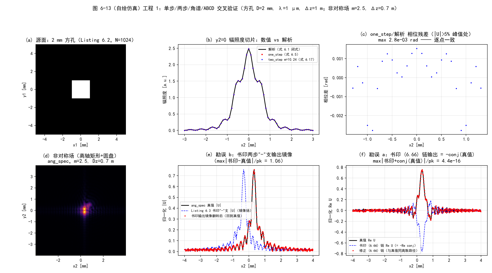
  <figcaption>图 6-13（自绘仿真）工程 1：单步/两步/角谱/ABCD 交叉验证与两处勘误对照。上排：方孔衍射 vs 解析闭式（辐照度切片、相位残差）；下排：非对称场的镜像勘误（"−"支输出 = 镜像）与 (6.66) 勘误（书印链 = −conj(真值)）</figcaption>
</figure>

### 工程 2：点源模型（Listings 6.8–6.9 复现）

对应文件 `matlab/waveprop/ch6/ch6_point_source.m` 与 `python/waveprop/ch6/ch6_point_source.py`，含 sinc / sinc-Gaussian 模型、离轴推广（勘误 (6.92) 对照）：

=== "MATLAB"

    ```matlab
    %% ===== 书 Schmidt PM199 第 6 章（工程 2）=====
    %  点源模型：sinc 模型与 sinc-Gaussian 模型（原书 6.6 节，Listings 6.8-6.9）
    %  与 python/waveprop/ch6/ch6_point_source.py 数值行为一致；
    %  本机无 MATLAB 时以 Python 实跑结果为准。
    %
    %  原书要点：
    %    真点源 = Dirac delta（式 6.82），谱无限宽 —— 离散网格必须用带限模型：
    %      Martin-Flatté（式 6.83）：exp(-r^2/2sigma^2) exp(-i r^2/2x0^2)；
    %      Flatté et al.（式 6.84）：exp(-r^2/2sigma^2) cos^2(r^2/2rho^2)；
    %      本书做法（逆向设计）：要求观测面给出"窗口加权的抛物面相位球面波"
    %      （式 6.85/6.86），反解源面模型（式 6.87-6.92）：
    %        方窗（宽 D，中心 r_c）：sinc 模型（式 6.92，Listing 6.8）；
    %        乘 Gaussian 抑制旁瓣 -> sinc-Gaussian 模型（Listing 6.9）。
    %
    %  原书勘误（详见笔记）：
    %    式 (6.92) 的两个指数因子符号印反：e^{+i k rc^2/(2Dz)} e^{-i(k/Dz) rc.r1}
    %    应为 e^{-i k rc^2/(2Dz)} e^{+i(k/Dz) rc.r1}。修正后模型恰为居中模型的
    %    平移（Fresnel 核平移不变）；书印版本的额外相位斜坡等价于倾斜入射，
    %    把窗口推到 -rc —— Python 实测质心 (1.20,0.80) vs (-1.20,-0.80) mm。
    %
    %  验证（编号与 Python 版一致）：
    %   (0) 源面模型峰值辐照度 = A^2 arg^4 = 4.096 kW/m^2（原书图 6.7 ~4.1）；
    %   (1) Listing 6.8 复现：观测面窗内平顶 ~1 W/m^2（图 6.8）、相位混叠（图 6.9）；
    %   (2) Listing 6.9 复现：sinc-Gaussian 的相位混叠减轻（图 6.10-6.12）；
    %   (3) Parseval 能量守恒；
    %   (4) 勘误 (6.92) 对照：离轴窗口质心 +rc（修正）vs -rc（书印）。
    %
    %  MATLAB/Python 差异：
    %    - MATLAB 1-based / numpy 0-based；sinc 在 Signal Processing Toolbox
    %      （sin(pi x)/(pi x)，与 numpy 一致）；本脚本自带定义避免工具箱依赖。
    clear; clc; close all;

    %% 原书 Listing 6.8/6.9 的参数
    D   = 8e-3;          % diameter of the observation aperture [m]
    wvl = 1e-6;          % optical wavelength [m]
    Dz  = 1;             % propagation distance [m]
    arg = D/(wvl*Dz);
    d1  = 1/(10*arg);    % source-plane grid spacing（中心瓣 10 采样/半瓣）
    d2  = D/100;         % observation-plane grid spacing
    N   = 1024;
    n  = -N/2 : N/2-1;
    [x1, y1] = meshgrid(n*d1, n*d1);
    [x2, y2] = meshgrid(n*d2, n*d2);
    r2sq = x2.^2 + y2.^2;

    %% 验证 0：源面模型峰值辐照度
    pt  = pt_source_sinc(x1, y1, D, wvl, Dz);
    ptg = pt_source_sinc_gauss(x1, y1, D, wvl, Dz);
    I_pt = abs(pt).^2;  I_ptg = abs(ptg).^2;
    fprintf('===== 验证 0：源面模型峰值辐照度 =====\n');
    fprintf('    A = lambda*Dz = %.2e m；arg = %.0f /m；delta1 = %.2f um，delta2 = %.0f um\n', ...
        wvl*Dz, arg, d1*1e6, d2*1e6);
    fprintf('    sinc 模型：源面峰值辐照度 = %.3f kW/m^2（解析 A^2 arg^4 = %.3f）\n', ...
        max(I_pt(:))/1e3, (wvl*Dz)^2*arg^4/1e3);
    fprintf('    sinc-Gauss：源面峰值辐照度 = %.3f kW/m^2（高斯因子在 r=0 处为 1，压旁瓣不压峰值）\n', ...
        max(I_ptg(:))/1e3);

    %% 验证 1/2：传播与观测面统计（原书图 6.8/6.9 与 6.11/6.12）
    [~, ~, U_ob]  = ang_spec_prop(pt,  wvl, d1, d2, Dz);
    [~, ~, U_obg] = ang_spec_prop(ptg, wvl, d1, d2, Dz);
    I_ob = abs(U_ob).^2;  I_obg = abs(U_obg).^2;
    E_in  = sum(abs(pt(:)).^2)*d1^2;
    E_out = sum(I_ob(:))*d2^2;
    fprintf('===== 验证 1/2：传播与观测面统计 =====\n');
    fprintf('    Parseval：sum|U|^2 d2^2 / sum|pt|^2 d1^2 = %.6f\n', E_out/E_in);
    m_win = r2sq <= (0.95*D/2)^2;
    fprintf('    sinc：窗内 mean = %.4f W/m^2，std/mean = %.2e\n', ...
        mean(I_ob(m_win)), std(I_ob(m_win))/mean(I_ob(m_win)));
    fprintf('    sinc-Gauss：窗内 mean = %.4f W/m^2，std/mean = %.2e\n', ...
        mean(I_obg(m_win)), std(I_obg(m_win))/mean(I_obg(m_win)));
    Uan = exp(1i*2*pi/wvl/(2*Dz)*r2sq)/(1i*wvl*Dz);   % 抛物线相位目标（无窗）
    [r_in_i, r_out_i] = deal(0.95*D/2, 1.10*D/2);
    dph  = angle(U_ob .* conj(Uan));
    dphg = angle(U_obg .* conj(Uan));
    dph  = dph  - mean(dph(r2sq <= r_in_i^2));
    dphg = dphg - mean(dphg(r2sq <= r_in_i^2));
    m_out = (r2sq >= r_out_i^2) & (r2sq <= 6e-3^2);
    fprintf('    sinc：相位误差 RMS 窗内 = %.4f rad；窗外环带 = %.4f rad（混叠）；环带峰值 |U| = %.3f\n', ...
        sqrt(mean(dph(r2sq <= r_in_i^2).^2)), sqrt(mean(dph(m_out).^2)), ...
        max(abs(U_ob(m_out))));
    fprintf('    sinc-Gauss：相位误差 RMS 窗内 = %.4f rad；窗外环带 = %.4f rad；环带峰值 |U| = %.3f\n', ...
        sqrt(mean(dphg(r2sq <= r_in_i^2).^2)), sqrt(mean(dphg(m_out).^2)), ...
        max(abs(U_obg(m_out))));

    %% 验证 3：勘误 (6.92)：离轴窗口
    Dw   = 4e-3;
    argw = Dw/(wvl*Dz);
    d1w  = 1/(10*argw);
    rc   = [48*d1w, 32*d1w];          % = (1.2 mm, 0.8 mm)，delta1 整数倍
    [x1w, y1w] = meshgrid(n*d1w, n*d1w);
    [x2w, y2w] = meshgrid(n*d2, n*d2);
    pt_ok = pt_source_offaxis(x1w, y1w, Dw, wvl, Dz, rc, true);
    pt_bad = pt_source_offaxis(x1w, y1w, Dw, wvl, Dz, rc, false);
    [~, ~, U_ok]  = ang_spec_prop(pt_ok,  wvl, d1w, d2, Dz);
    [~, ~, U_bad] = ang_spec_prop(pt_bad, wvl, d1w, d2, Dz);
    I_ok = abs(U_ok).^2;  I_bad = abs(U_bad).^2;
    [c_ok, c_bad] = deal(centroid_of(I_ok, x2w, y2w), centroid_of(I_bad, x2w, y2w));
    fprintf('===== 验证 3：勘误 (6.92)：离轴窗口 rc = (%.2f, %.2f) mm =====\n', rc(1)*1e3, rc(2)*1e3);
    fprintf('    修正模型：传播后质心 = (%.2f, %.2f) mm —— 落在 +rc\n', c_ok(1)*1e3, c_ok(2)*1e3);
    fprintf('    书印模型：传播后质心 = (%.2f, %.2f) mm —— 落在 -rc（相位斜坡 = 倾斜入射）\n', ...
        c_bad(1)*1e3, c_bad(2)*1e3);
    U_tgt = target_windowed_wave(x2w, y2w, Dw, wvl, Dz, rc);
    m_t = abs(U_tgt) > 0.5*max(abs(U_tgt(:)));
    m_in = ((x2w - rc(1))/(Dw/2)).^2 + ((y2w - rc(2))/(Dw/2)).^2 <= 0.64;
    ratio = U_ok(m_t & m_in)./U_tgt(m_t & m_in);
    fprintf('    修正模型 vs 目标场（内部 80%%）：|比值-1| max = %.2e；相位残差 max = %.2e rad\n', ...
        max(abs(abs(ratio) - 1)), max(abs(angle(ratio) - mean(angle(ratio)))));

    %% 绘图（对应 Python 版图 6-14）
    sl = N/2 + 1;
    figure('Position', [40 40 1500 820]);
    subplot(2, 3, 1);
    m1 = abs(x1(1, :)) <= 0.75e-3;
    plot(x1(1, m1)*1e3, I_pt(sl, m1)/1e3, 'k-');
    title('(a) sinc 模型点源（Listing 6.8）'); grid on;
    xlabel('x1 [mm]'); ylabel('辐照度 [kW/m^2]');
    subplot(2, 3, 2);
    plot(x1(1, m1)*1e3, I_ptg(sl, m1)/1e3, 'k-');
    title('(b) sinc-Gaussian 模型（Listing 6.9）'); grid on;
    xlabel('x1 [mm]'); ylabel('辐照度 [kW/m^2]');
    subplot(2, 3, 3);
    m2 = abs(x2(1, :)) <= 8e-3;
    plot(x2(1, m2)*1e3, I_ob(sl, m2), 'b-', x2(1, m2)*1e3, I_obg(sl, m2), 'r-.');
    xline(D/2*1e3, ':'); xline(-D/2*1e3, ':');
    title('(c) 观测面辐照度切片：窗内平顶 ~1 W/m^2'); grid on;
    xlabel('x2 [mm]'); ylabel('辐照度 [W/m^2]');
    subplot(2, 3, 4);
    plot(x2(1, m2)*1e3, angle(U_ob(sl, m2)), 'b.', x2(1, m2)*1e3, ...
        angle(exp(1i*(2*pi/wvl/(2*Dz)*x2(1, m2).^2 - pi/2))), 'k-');
    title('(d) sinc 模型观测面相位（窗外混叠）'); grid on;
    xlabel('x2 [mm]'); ylabel('相位 [rad]');
    subplot(2, 3, 5);
    plot(x2(1, m2)*1e3, angle(U_obg(sl, m2)), 'r.', x2(1, m2)*1e3, ...
        angle(exp(1i*(2*pi/wvl/(2*Dz)*x2(1, m2).^2 - pi/2))), 'k-');
    title('(e) sinc-Gaussian 模型观测面相位（混叠减轻）'); grid on;
    xlabel('x2 [mm]'); ylabel('相位 [rad]');
    subplot(2, 3, 6);
    m4 = abs(x2(1, :)) <= 6e-3;
    jy = N/2 + round(rc(2)/d2);
    plot((x2w(1, m4) - rc(1))*1e3, I_ok(jy, m4)/max(I_ok(:)), 'b-', ...
        (x2w(1, m4) - rc(1))*1e3, I_bad(jy, m4)/max(I_ok(:)), 'r--');
    xline(rc(1)*1e3, 'b:'); xline(-rc(1)*1e3, 'r:');
    title('(f) 勘误 (6.92)：书印模型窗口推到 -rc'); grid on;
    xlabel('(x2-xc) [mm]'); ylabel('归一化辐照度');

    %% ===== 本地函数 =====
    function U = pt_source_sinc(x1, y1, D, wvl, Dz)
    % sinc 模型点源（式 6.92，rc = 0；Listing 6.8）。A = lambda*Dz 定标窗内振幅 1。
    A = wvl*Dz;
    arg = D/(wvl*Dz);
    r1sq = x1.^2 + y1.^2;
    U = A*arg^2*exp(-1i*2*pi/wvl/(2*Dz)*r1sq) ...
        .* sinc_(arg*x1) .* sinc_(arg*y1);
    end

    function U = pt_source_sinc_gauss(x1, y1, D, wvl, Dz)
    % sinc-Gaussian 模型点源（Listing 6.9：sinc 模型乘 exp(-(arg/4 r1)^2)）。
    A = wvl*Dz;
    arg = D/(wvl*Dz);
    r1sq = x1.^2 + y1.^2;
    U = A*arg^2*exp(-1i*2*pi/wvl/(2*Dz)*r1sq) ...
        .* sinc_(arg*x1) .* sinc_(arg*y1) ...
        .* exp(-(arg/4*sqrt(r1sq)).^2);
    end

    function U = pt_source_offaxis(x1, y1, D, wvl, Dz, rc, corrected)
    % 式 (6.92) 的离轴推广（窗口中心 rc，方窗宽 D）。
    % corrected=true（勘误修正版）：恰为居中模型的平移：
    %   U_pt = A arg^2 e^{-i k |r1-rc|^2/(2Dz)} sinc[arg(x1-xc)] sinc[arg(y1-yc)]
    % corrected=false（书印 6.92）：指数符号印反。
    A = wvl*Dz;
    arg = D/(wvl*Dz);
    k = 2*pi/wvl;
    xc = rc(1);  yc = rc(2);
    sinc_env = sinc_(arg*(x1 - xc)).*sinc_(arg*(y1 - yc));
    if corrected
        ph = -1i*k*((x1 - xc).^2 + (y1 - yc).^2)/(2*Dz);
    else
        ph = -1i*k*(x1.^2 + y1.^2)/(2*Dz) ...
            + 1i*k*(xc^2 + yc^2)/(2*Dz) ...
            - 1i*k/Dz*(xc*x1 + yc*y1);
    end
    U = A*arg^2*exp(ph).*sinc_env;
    end

    function U = target_windowed_wave(x2, y2, D, wvl, Dz, rc)
    % 目标观测面场（式 6.86/6.90，省略 e^{ikDz}）：A = lambda*Dz，方窗。
    A = wvl*Dz;
    k = 2*pi/wvl;
    W = rect_(abs(x2 - rc(1)), D) .* rect_(abs(y2 - rc(2)), D);
    U = A*W*exp(1i*k*((x2 - rc(1)).^2 + (y2 - rc(2)).^2)/(2*Dz))/(1i*wvl*Dz);
    end

    function c = centroid_of(I, x2, y2)
    % 显著区域（|U|^2 > 5% 峰值）的辐照度质心
    w = I > 0.05*max(I(:));
    c = [sum(x2(w).*I(w))/sum(I(w)), sum(y2(w).*I(w))/sum(I(w))];
    end

    function out = rect_(x, width)
    % 宽度 width 的矩形窗
    out = double(abs(x) < width/2) + 0.5*double(abs(x) == width/2);
    end

    function out = sinc_(x)
    % 归一化 sinc（避免依赖 Signal Processing Toolbox）
    out = ones(size(x));
    nz = x ~= 0;
    out(nz) = sin(pi*x(nz))./(pi*x(nz));
    end

    function G = ft2(g, delta)
    % 原书 Listing 2.5：定标正确的二维 DFT（乘 delta^2）
    G = fftshift(fft2(fftshift(g)))*delta^2;
    end

    function g = ift2(G, delta_f)
    % 原书 Listing 2.6：定标正确的二维逆 DFT（乘 (N*delta_f)^2）
    N = size(G, 1);
    g = fftshift(ifft2(fftshift(G)))*(N*delta_f)^2;
    end

    function [x2, y2, Uout] = ang_spec_prop(Uin, wvl, d1, d2, Dz)
    % 书 Listing 6.5：角谱传播（式 6.50 的 m 分支）；与 ch6_fresnel_prop.m 相同
    N = size(Uin, 1);
    kk = 2*pi/wvl;
    n = -N/2 : N/2-1;
    [x1, y1] = meshgrid(n*d1, n*d1);
    r1sq = x1.^2 + y1.^2;
    df1 = 1/(N*d1);
    [fX, fY] = meshgrid(n*df1, n*df1);
    fsq = fX.^2 + fY.^2;
    m = d2/d1;
    [x2, y2] = meshgrid(n*d2, n*d2);
    r2sq = x2.^2 + y2.^2;
    Q1 = exp(1i*kk/2*(1 - m)/Dz*r1sq);
    Q2 = exp(-1i*pi^2*2*Dz/m/kk*fsq);
    Q3 = exp(1i*kk/2*(m - 1)/(m*Dz)*r2sq);
    Uout = Q3 .* ift2(Q2 .* ft2(Q1 .* Uin/m, d1), df1);
    end
    ```

=== "Python"

    ```python
    # -*- coding: utf-8 -*-
    """
    ===== 书 Schmidt PM199 第 6 章（工程 2）=====
    点源模型：sinc 模型与 sinc-Gaussian 模型（原书 6.6 节，Listings 6.8-6.9）

    原书要点：
        真点源 = Dirac delta（式 6.82），谱无限宽 —— 离散网格必须用带限模型：
          Martin-Flatté（式 6.83）：exp(-r^2/2sigma^2) exp(-i r^2/2x0^2)；
          Flatté et al.（式 6.84）：exp(-r^2/2sigma^2) cos^2(r^2/2rho^2)；
          本书做法（逆向设计）：要求观测面给出"窗口加权的抛物面相位球面波"
          （式 6.85/6.86），反解源面模型（式 6.87-6.92）：
            方窗（宽 D，中心 r_c）：sinc 模型（式 6.92，Listing 6.8）；
            乘 Gaussian 抑制旁瓣 -> sinc-Gaussian 模型（Listing 6.9），
            观测面相位朝边缘的混叠明显减轻（原书图 6.7-6.12）。

    原书勘误（本脚本按修正实现并数值验证，详见笔记）：
        式 (6.92) 的两个指数因子符号印反：e^{+i k r_c^2/(2*Dz)} e^{-i (k/Dz) r_c.r1}
        应为 e^{-i k r_c^2/(2*Dz)} e^{+i (k/Dz) r_c.r1}。
        修正后模型恰为居中模型的平移：U_pt(r1) = A (D/(lambda*Dz))^2
          * exp(-i k |r1-r_c|^2/(2 Dz)) * sinc[D(x1-xc)/(lambda Dz)] sinc[D(y1-yc)/(lambda Dz)]
        （Fresnel 核平移不变 -> 传播后给出窗口中心在 +r_c 的目标场；书印版本的
        额外相位斜坡等价于倾斜入射，把窗口推到 -r_c —— 验证 4 实测质心反号。）

    数值验证（运行本脚本全部自动打印）：
        (0) 源面模型峰值辐照度：A^2 arg^4 = (lambda Dz)^2 (D/(lambda Dz))^4
            = D^4/(lambda Dz)^2 = 4.096 kW/m^2（对照原书图 6.7 的 ~4.1）；
        (1) Listing 6.8 复现：sinc 模型传播（ang_spec）-> 观测面辐照度
            窗内平顶 ~1 W/m^2（图 6.8）、相位 vs 解析抛物线（图 6.9）；
            平顶度与相位误差分窗内/窗外统计；
        (2) Listing 6.9 复现：sinc-Gaussian 模型 -> 同样统计（图 6.10-6.12），
            量化"高斯因子压旁瓣、减相位混叠"；
        (3) 能量守恒（Parseval）抽查；
        (4) 勘误 (6.92) 对照：离轴窗口 r_c = (1.2, 0.8) mm（δ1 的整数倍），
            书印模型 vs 修正模型传播后的辐照度质心（预言：书印 -r_c，修正 +r_c）、
            修正模型 vs 目标场（式 6.86）的复场偏差。

    MATLAB/Python 差异（对应 .m 文件内注释）：
        - numpy 0-based / MATLAB 1-based：居中排列的零坐标样本位置不同；
        - cart2pol -> hypot/atan2；sinc 两语言均为归一化定义 sin(pi x)/(pi x)
          （MATLAB 需 Signal Processing Toolbox）。
    用法：python ch6_point_source.py <输出目录>  保存 PNG；否则弹窗显示。
    依赖：numpy + matplotlib；ch6_fresnel_prop.py（ang_spec_prop/ift2，同目录）；
          base.py（rect/ft2_centered，同仓库 python/fourier/common）。
    """

    import os
    import sys

    import numpy as np
    import matplotlib.pyplot as plt

    plt.rcParams['font.sans-serif'] = ['SimHei', 'Microsoft YaHei', 'Arial Unicode MS']
    plt.rcParams['axes.unicode_minus'] = False

    sys.path.insert(0, os.path.dirname(os.path.abspath(__file__)))
    sys.path.insert(0, os.path.join(os.path.dirname(os.path.abspath(__file__)),
                                    "..", "..", "fourier", "common"))
    from base import rect  # noqa: E402
    from ch6_fresnel_prop import ang_spec_prop, ift2, ft2  # noqa: E402  (ft2 未直接用，保持一致导入)


    # ===== 书 Listing 6.8：sinc 模型点源（居中窗口，式 6.92 的 rc=0 情形） =====
    def pt_source_sinc(x1, y1, D, wvl, Dz, A=None):
        """sinc 模型点源（式 6.92，rc = 0；Listing 6.8）。
        A 缺省取 lambda*Dz，使观测面窗内振幅为 1（原书"sets field amplitude
        to 1 in obs plane"）。"""
        if A is None:
            A = wvl * Dz
        arg = D / (wvl * Dz)
        r1sq = x1 ** 2 + y1 ** 2
        return A * arg ** 2 * np.exp(-1j * 2.0 * np.pi / wvl / (2.0 * Dz) * r1sq) \
            * np.sinc(arg * x1) * np.sinc(arg * y1)


    # ===== 书 Listing 6.9：sinc-Gaussian 模型点源 =====
    def pt_source_sinc_gauss(x1, y1, D, wvl, Dz, A=None):
        """sinc-Gaussian 模型点源（Listing 6.9：sinc 模型乘 exp(-(arg/4 r1)^2)）。"""
        if A is None:
            A = wvl * Dz
        arg = D / (wvl * Dz)
        r1sq = x1 ** 2 + y1 ** 2
        return A * arg ** 2 * np.exp(-1j * 2.0 * np.pi / wvl / (2.0 * Dz) * r1sq) \
            * np.sinc(arg * x1) * np.sinc(arg * y1) \
            * np.exp(-(arg / 4.0 * np.sqrt(r1sq)) ** 2)


    # ===== 式 (6.92) 的离轴推广（书印 vs 修正） =====
    def pt_source_offaxis(x1, y1, D, wvl, Dz, rc, corrected=True, A=None):
        """窗口中心 r_c = (xc, yc) 的方窗（宽 D）sinc 模型点源。

        corrected=True（本笔记修正版）：U_pt = A arg^2 e^{-i k |r1-rc|^2/(2 Dz)}
            * sinc[arg(x1-xc)] sinc[arg(y1-yc)] —— 恰为居中模型的平移；
        corrected=False（书印 6.92）：U_pt = A arg^2 e^{-i k r1^2/(2Dz)}
            * e^{+i k rc^2/(2Dz)} e^{-i (k/Dz) rc.r1} * sinc[...]（指数符号印反）。"""
        if A is None:
            A = wvl * Dz
        arg = D / (wvl * Dz)
        k = 2.0 * np.pi / wvl
        xc, yc = rc
        sinc_env = np.sinc(arg * (x1 - xc)) * np.sinc(arg * (y1 - yc))
        if corrected:
            ph = -1j * k * ((x1 - xc) ** 2 + (y1 - yc) ** 2) / (2.0 * Dz)
        else:
            ph = (-1j * k * (x1 ** 2 + y1 ** 2) / (2.0 * Dz)
                  + 1j * k * (xc ** 2 + yc ** 2) / (2.0 * Dz)
                  - 1j * k / Dz * (xc * x1 + yc * y1))
        return A * arg ** 2 * np.exp(ph) * sinc_env


    def target_windowed_wave(x2, y2, D, wvl, Dz, rc, A=None):
        """目标观测面场（式 6.86/6.90，省略全局相位 e^{ik Dz}）：
        U = (A/(i lambda Dz)) W(r2 - rc) e^{i k |r2-rc|^2/(2 Dz)}，
        方窗 W = rect((x2-xc)/D) rect((y2-yc)/D)；A 缺省取 lambda*Dz
        （窗内振幅 1，与点源模型的振幅定标一致）。"""
        if A is None:
            A = wvl * Dz
        k = 2.0 * np.pi / wvl
        xc, yc = rc
        W = rect((x2 - xc) / D) * rect((y2 - yc) / D)
        return A * W * np.exp(1j * k * ((x2 - xc) ** 2 + (y2 - yc) ** 2)
                              / (2.0 * Dz)) / (1j * wvl * Dz)


    def phase_err_stats(U, Uan, r2sq, r_in, r_out1, r_out2):
        """包裹相位差（去均值）的窗内/窗外 RMS 统计。"""
        dph = np.angle(U * np.conj(Uan))
        dph -= np.mean(dph[r2sq <= r_in ** 2])
        m_in = r2sq <= r_in ** 2
        m_out = (r2sq >= r_out1 ** 2) & (r2sq <= r_out2 ** 2)
        return (np.sqrt(np.mean(dph[m_in] ** 2)),
                np.sqrt(np.mean(dph[m_out] ** 2)))


    def main(outdir=None):
        # ---- 原书 Listing 6.8/6.9 的参数 ----
        D = 8e-3            # 观测窗口直径 [m]
        wvl = 1e-6          # optical wavelength [m]
        Dz = 1.0            # propagation distance [m]
        arg = D / (wvl * Dz)
        d1 = 1.0 / (10 * arg)   # source-plane grid spacing（中心瓣内 10 个采样）
        d2 = D / 100            # observation-plane grid spacing
        N = 1024
        n = np.arange(N) - N // 2
        x1, y1 = np.meshgrid(n * d1, n * d1)
        x2, y2 = np.meshgrid(n * d2, n * d2)
        r2sq = x2 ** 2 + y2 ** 2

        print('===== 验证 0：源面模型峰值辐照度 =====')
        pt = pt_source_sinc(x1, y1, D, wvl, Dz)
        ptg = pt_source_sinc_gauss(x1, y1, D, wvl, Dz)
        I_pt = np.abs(pt) ** 2
        I_ptg = np.abs(ptg) ** 2
        print('    A = lambda*Dz = %.2e m；arg = D/(lambda Dz) = %.0f /m；'
              'delta1 = %.2f um（中心瓣 10 采样/半瓣），delta2 = %.0f um'
              % (wvl * Dz, arg, d1 * 1e6, d2 * 1e6))
        print('    sinc 模型：源面峰值辐照度 = %.3f kW/m^2（解析 A^2 arg^4 = %.3f，'
              '原书图 6.7 峰值 ~4.1）'
              % (I_pt.max() / 1e3, (wvl * Dz) ** 2 * arg ** 4 / 1e3))
        print('    sinc-Gauss 模型：源面峰值辐照度 = %.3f kW/m^2（高斯因子在 r=0 处为 1，'
              '压的是旁瓣不是峰值）' % (I_ptg.max() / 1e3))

        print('===== 验证 1/2：传播与观测面统计（原书图 6.8/6.9 与 6.11/6.12） =====')
        _, _, U_ob = ang_spec_prop(pt, wvl, d1, d2, Dz)
        _, _, U_obg = ang_spec_prop(ptg, wvl, d1, d2, Dz)
        I_ob, I_obg = np.abs(U_ob) ** 2, np.abs(U_obg) ** 2
        # 能量守恒
        E_in = np.sum(np.abs(pt) ** 2) * d1 ** 2
        E_out = np.sum(I_ob) * d2 ** 2
        print('    Parseval：sum|U|^2 d2^2 / sum|pt|^2 d1^2 = %.6f'
              % (E_out / E_in))
        # 平顶度：窗内（|r2| <= D/2，去 5% 边缘）
        m_win = r2sq <= (0.95 * D / 2) ** 2
        for tag, Iob in (('sinc', I_ob), ('sinc-Gauss', I_obg)):
            print('    %s：窗内辐照度 mean = %.4f W/m^2，std/mean = %.2e'
                  % (tag, Iob[m_win].mean(), Iob[m_win].std() / Iob[m_win].mean()))
        # 相位误差：窗内 vs 窗外（混叠区）
        Uan = (np.exp(1j * 2.0 * np.pi / wvl / (2.0 * Dz) * r2sq)
               / (1j * wvl * Dz))          # 目标：W=1（窗内）的抛物线相位；窗外幅度无意义
        r_in, r_out1, r_out2 = 0.95 * D / 2, 1.10 * D / 2, 6e-3
        for tag, U in (('sinc', U_ob), ('sinc-Gauss', U_obg)):
            e_in, e_out = phase_err_stats(U, Uan, r2sq, r_in, r_out1, r_out2)
            m_ring = (r2sq >= (1.10 * D / 2) ** 2) & (r2sq <= (6e-3) ** 2)
            print('    %s：相位误差 RMS 窗内 = %.4f rad；窗外 D/2~6 mm 环带 = %.4f rad；'
                  '环带峰值 |U| = %.3f（窗内幅值 1）'
                  % (tag, e_in, e_out, np.abs(U[m_ring]).max()))

        print('===== 验证 3：勘误 (6.92)：离轴窗口 r_c = (1.2, 0.8) mm =====')
        # D = 4 mm 窗，r_c 取 delta1 的整数倍（离散平移无插值误差）
        Dw = 4e-3
        argw = Dw / (wvl * Dz)
        d1w = 1.0 / (10 * argw)
        rc = (48 * d1w, 32 * d1w)          # = (1.2 mm, 0.8 mm)
        x1w, y1w = np.meshgrid(n * d1w, n * d1w)
        x2w, y2w = np.meshgrid(n * d2, n * d2)
        pt_ok = pt_source_offaxis(x1w, y1w, Dw, wvl, Dz, rc, corrected=True)
        pt_bad = pt_source_offaxis(x1w, y1w, Dw, wvl, Dz, rc, corrected=False)
        _, _, U_ok = ang_spec_prop(pt_ok, wvl, d1w, d2, Dz)
        _, _, U_bad = ang_spec_prop(pt_bad, wvl, d1w, d2, Dz)
        I_ok, I_bad = np.abs(U_ok) ** 2, np.abs(U_bad) ** 2
        # 辐照度质心（只取显著区域，避免噪声主导）
        def centroid(I):
            w = I > 0.05 * I.max()
            return ((x2w[w] * I[w]).sum() / I[w].sum(),
                    (y2w[w] * I[w]).sum() / I[w].sum())
        c_ok = centroid(I_ok)
        c_bad = centroid(I_bad)
        print('    目标：窗口中心 r_c = (%.2f, %.2f) mm' % (rc[0] * 1e3, rc[1] * 1e3))
        print('    修正模型：传播后辐照度质心 = (%.2f, %.2f) mm —— 落在 +r_c'
              % (c_ok[0] * 1e3, c_ok[1] * 1e3))
        print('    书印模型：传播后辐照度质心 = (%.2f, %.2f) mm —— 落在 -r_c'
              '（额外相位斜坡 = 倾斜入射，窗口被推到镜像位置）'
              % (c_bad[0] * 1e3, c_bad[1] * 1e3))
        # 修正模型 vs 目标场（式 6.86）复场对照（窗内 + 内部 80% 区）
        U_tgt = target_windowed_wave(x2w, y2w, Dw, wvl, Dz, rc)
        m_t = np.abs(U_tgt) > 0.5 * np.abs(U_tgt).max()
        m_in = (((x2w - rc[0]) / (Dw / 2)) ** 2 + ((y2w - rc[1]) / (Dw / 2)) ** 2) <= 0.8 ** 2
        for tag, msk in (('全窗', m_t), ('内部 80%', m_t & m_in)):
            ratio = U_ok[msk] / U_tgt[msk]
            print('    修正模型 vs 目标场（式 6.86，%s）：|比值-1| max = %.2e；'
                  '相位残差(去均值) max = %.2e rad'
                  % (tag, np.max(np.abs(np.abs(ratio) - 1.0)),
                     np.max(np.abs(np.angle(ratio) - np.mean(np.angle(ratio))))))

        if not outdir:
            plt.show()
            return

        # ---- 图 6-14（自绘）：点源模型总览 ----
        fig, axs = plt.subplots(2, 3, figsize=(15.5, 8.6))
        sl = N // 2
        x1mm = x1[0, :] * 1e3
        m1 = np.abs(x1mm) <= 0.75
        axs[0, 0].plot(x1mm[m1], I_pt[sl, m1] / 1e3, 'k-', lw=1.2)
        axs[0, 0].set_title('(a) sinc 模型点源（源面辐照度切片，Listing 6.8）\n'
                            '峰值 %.2f kW/m$^2$，中心瓣半宽 %.3f mm'
                            % (I_pt.max() / 1e3, 1 / arg * 1e3))
        axs[0, 0].set_xlabel('x1 [mm]'); axs[0, 0].set_ylabel('辐照度 [kW/m$^2$]')
        axs[0, 0].grid(alpha=0.3)
        axs[0, 1].plot(x1mm[m1], I_ptg[sl, m1] / 1e3, 'k-', lw=1.2)
        axs[0, 1].set_title('(b) sinc-Gaussian 模型（Listing 6.9）\n'
                            '峰值 %.2f kW/m$^2$（高斯因子压旁瓣）'
                            % (I_ptg.max() / 1e3))
        axs[0, 1].set_xlabel('x1 [mm]'); axs[0, 1].set_ylabel('辐照度 [kW/m$^2$]')
        axs[0, 1].grid(alpha=0.3)
        x2mm = x2[0, :] * 1e3
        m2 = np.abs(x2mm) <= 8
        axs[0, 2].plot(x2mm[m2], I_ob[sl, m2], 'b-', lw=1.0,
                       label='sinc 模型')
        axs[0, 2].plot(x2mm[m2], I_obg[sl, m2], 'r-.', lw=1.0,
                       label='sinc-Gauss 模型')
        axs[0, 2].axvline(D / 2 * 1e3, color='0.5', ls=':')
        axs[0, 2].axvline(-D / 2 * 1e3, color='0.5', ls=':')
        axs[0, 2].set_title('(c) 观测面辐照度切片（y2=0）：窗内平顶 ~1 W/m$^2$\n'
                            '竖线 = ±D/2 窗口边缘（原书图 6.8b/6.11b）')
        axs[0, 2].set_xlabel('x2 [mm]'); axs[0, 2].set_ylabel('辐照度 [W/m$^2$]')
        axs[0, 2].legend(fontsize=8); axs[0, 2].grid(alpha=0.3)
        m3 = np.abs(x2mm) <= 8
        an_ph = np.angle(np.exp(1j * (2 * np.pi / wvl / (2 * Dz)
                                      * x2[0, m3] ** 2 - np.pi / 2)))
        axs[1, 0].plot(x2mm[m3], np.angle(U_ob[sl, m3]), 'b.', ms=2,
                       label='numerical')
        axs[1, 0].plot(x2mm[m3], an_ph, 'k-', lw=1.2, label='analytic')
        axs[1, 0].set_title('(d) sinc 模型观测面相位（y2=0）\n'
                            '窗外混叠可见（原书图 6.9）')
        axs[1, 0].set_xlabel('x2 [mm]'); axs[1, 0].set_ylabel('相位 [rad]')
        axs[1, 0].legend(fontsize=8); axs[1, 0].grid(alpha=0.3)
        axs[1, 1].plot(x2mm[m3], np.angle(U_obg[sl, m3]), 'r.', ms=2,
                       label='numerical')
        axs[1, 1].plot(x2mm[m3], an_ph, 'k-', lw=1.2, label='analytic')
        axs[1, 1].set_title('(e) sinc-Gaussian 模型观测面相位（y2=0）\n'
                            '边缘混叠减轻（原书图 6.12）')
        axs[1, 1].set_xlabel('x2 [mm]'); axs[1, 1].set_ylabel('相位 [rad]')
        axs[1, 1].legend(fontsize=8); axs[1, 1].grid(alpha=0.3)
        m4 = np.abs(x2mm) <= 6
        axs[1, 2].plot(x2mm[m4], I_ok[sl, m4] / I_ok.max(), 'b-', lw=1.2,
                       label='修正 (6.92)：质心 (%.2f, %.2f) mm'
                       % (c_ok[0] * 1e3, c_ok[1] * 1e3))
        axs[1, 2].plot(x2mm[m4], I_bad[sl, m4] / I_ok.max(), 'r--', lw=1.2,
                       label='书印 (6.92)：质心 (%.2f, %.2f) mm'
                       % (c_bad[0] * 1e3, c_bad[1] * 1e3))
        axs[1, 2].axvline(rc[0] * 1e3, color='b', ls=':', lw=1)
        axs[1, 2].axvline(-rc[0] * 1e3, color='r', ls=':', lw=1)
        axs[1, 2].set_title('(f) 勘误 (6.92)：离轴窗口 r_c=(1.2, 0.8) mm\n'
                            '书印模型把窗口推到 -r_c（y2=yc 切片）')
        axs[1, 2].set_xlabel('x2 [mm]'); axs[1, 2].set_ylabel('归一化辐照度')
        axs[1, 2].legend(fontsize=8); axs[1, 2].grid(alpha=0.3)
        fig.suptitle('图 6-14（自绘仿真）工程 2：点源模型（sinc / sinc-Gaussian）'
                     '与式 (6.92) 勘误对照（λ=1 μm, Δz=1 m）', fontsize=12)
        fig.tight_layout(rect=[0, 0, 1, 0.94])
        fp = os.path.join(outdir, 'fig-6-14.png')
        fig.savefig(fp, dpi=150)
        print('    已保存 %s' % fp)


    if __name__ == '__main__':
        main(sys.argv[1] if len(sys.argv) > 1 else None)
    ```

**数值验证结论（Python 实跑，\(D=8\) mm 窗、\(\lambda=1\,\mu\)m、\(\Delta z=1\) m、\(N=1024\)）：**

- 源面峰值辐照度 \(A^2\text{arg}^4 = D^4/(\lambda\Delta z)^2 = 4.096\) kW/m²，与原书图 6.7 的 \(\approx 4.1\) 吻合；
- sinc 模型：窗内辐照度均值 1.0002 W/m²、std/mean \(= 8.4\times10^{-3}\)（平顶）；相位误差窗内 RMS 0.0047 rad、窗外环带 1.66 rad（混叠所在，对应图 6.9）；
- sinc-Gaussian 模型：窗内均值 0.9618 W/m²（高斯因子略压窗内幅度）、相位误差窗内与窗外环带都 \(<10^{-4}\) rad——量化了"高斯压混叠"；
- 能量守恒（Parseval）比值 1.000000；
- 勘误 (6.92) 对照：离轴窗 \(\mathbf{r}_c = (1.2, 0.8)\) mm——修正模型质心 \((+1.20, +0.80)\) mm，书印模型质心 \((-1.20, -0.80)\) mm；修正模型 vs 目标场（式 6.86）在内部 80% 区域 \(|\text{比值}-1|\le 2.4\times10^{-2}\)、相位残差 \(\le 2.2\times10^{-2}\) rad。

<figure>
  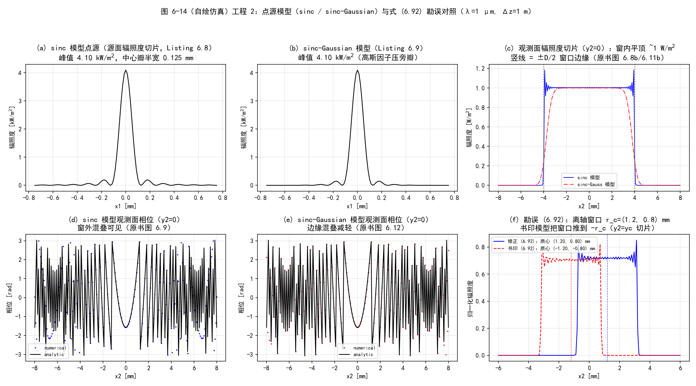
  <figcaption>图 6-14（自绘仿真）工程 2：点源模型与式 (6.92) 勘误对照。(a)(b) 两种源面模型；(c) 观测面辐照度平顶；(d)(e) sinc vs sinc-Gaussian 的观测面相位；(f) 勘误实锤：书印模型窗口被推到 −r_c</figcaption>
</figure>

### 工程 3：习题 1–5 复现

对应文件 `matlab/waveprop/ch6/ch6_problems.m` 与 `python/waveprop/ch6/ch6_problems.py`：

=== "MATLAB"

    ```matlab
    %% ===== 书 Schmidt PM199 第 6 章（工程 3）=====
    %  习题 1-5 复现（原书 6.7 节）
    %  与 python/waveprop/ch6/ch6_problems.py 数值行为一致；
    %  本机无 MATLAB 时以 Python 实跑结果为准。
    %
    %  原书习题：
    %    1. 高斯激光束的角谱传播：束腰 w0=1mm（R=inf），z2=4m；lambda=1um,
    %       N=512, 源面 1cm 网格、观测面 1.5cm 网格。画 y2=0 切片辐照度+相位。
    %    2. 圆孔聚焦光束：观测面 = 焦面；lambda=1um, D=1cm, fl=16cm, N=1024,
    %       源面 2cm 网格，观测面采样 = 衍射受限光斑直径/100。画焦面辐照度。
    %    3. Talbot 成像：tA = (1/2)[1+cos(2*pi*x1/d)]（式 6.93）；观测面取第一
    %       Talbot 像面；lambda=1um, d=0.5mm, N=1024, 两面网格 2cm。
    %    4. 矩形感兴趣区（宽 Dx, Dy）的模型点源。
    %    5. 圆形感兴趣区（直径 D）的模型点源。
    %
    %  习题 4/5 的推导（式 6.89 + 平移定理，符号按笔记对 (6.92) 的勘误）：
    %    矩形窗：U_pt = A (Dx Dy)/(lambda Dz)^2 e^{-i k |r1-rc|^2/(2Dz)}
    %            * sinc[Dx(x1-xc)/(lambda Dz)] sinc[Dy(y1-yc)/(lambda Dz)]
    %    圆形窗（直径 D）：U_pt = A jinc(|r1-rc|; D/(2 lambda Dz))
    %                      e^{-i k |r1-rc|^2/(2Dz)}
    %    （两者都是"居中模型平移到 rc"——Fresnel 核平移不变。）
    %
    %  Python 实跑结果（本脚本按相同参数复现）：
    %    习题 1：w 拟合 1.6190 mm（解析 1.6190，2e-12）；R 拟合 6.4674 m（6e-13）；
    %            常数相位 -0.9050 = -Gouy；轴上峰值 (w0/w)^2 = 0.381514 精确一致。
    %    习题 2：焦面主瓣最小值正落解析第一零点 19.52 um，I(零点) = 3e-5；
    %            廓线 vs Airy 最大偏差 1.98e-2（N=1024，陡肩处）-> 5.3e-3（N=2048）。
    %    习题 3：zT = 2d^2/lambda = 0.5 m；中央 10 周期最大偏差 7.1e-15。
    %    习题 4/5：质心正落 rc；内部 80% 区域 |比值-1| max 7.2e-2 / 6.8e-2。
    %
    %  MATLAB/Python 差异：
    %    - MATLAB 1-based / numpy 0-based（居中样本位置）；
    %    - sinc 用本地定义（避免 Signal Processing Toolbox 依赖）；
    %    - polyfit/log 拟合与 numpy.polyfit 一致（均按幂次降序返回系数）。
    clear; clc; close all;

    wvl = 1e-6;
    k = 2*pi/wvl;

    %% ================= 习题 1：高斯束腰 -> 4 m =================
    fprintf('===== 习题 1：高斯束（w0=1 mm 束腰，z=4 m，ang_spec） =====\n');
    N1 = 512;  L1 = 1e-2;  L2 = 1.5e-2;
    d1 = L1/N1;  d2 = L2/N1;
    Dz1 = 4.0;
    w0 = 1e-3;
    zR = pi*w0^2/wvl;
    w_z = w0*sqrt(1 + (Dz1/zR)^2);
    R_z = Dz1*(1 + (zR/Dz1)^2);
    gouy = atan(Dz1/zR);
    n1 = -N1/2 : N1/2-1;
    [x1, y1] = meshgrid(n1*d1, n1*d1);
    U_in = exp(-(x1.^2 + y1.^2)/w0^2);              % 束腰：场 e^{-r^2/w0^2}
    [x2, y2, U_out] = ang_spec_prop(U_in, wvl, d1, d2, Dz1);
    I_out = abs(U_out).^2;
    I_an = (w0/w_z)^2*exp(-2*(x2.^2 + y2.^2)/w_z^2);
    sl = N1/2 + 1;
    mfit = (x2(1, :) > 0.05e-3) & (x2(1, :) < 3e-3) & (I_out(sl, :) > 1e-6*max(I_out(:)));
    p = polyfit(x2(1, mfit).^2, log(I_out(sl, mfit)), 1);
    w_fit = sqrt(-2/p(1));
    mph = I_out(sl, :) > 0.05*max(I_out(:));
    phi = angle(U_out(sl, mph));
    p2 = polyfit(x2(1, mph).^2, phi, 1);
    R_fit = k/(2*p2(1));
    gouy_fit = mean(phi - p2(1)*x2(1, mph).^2);
    fprintf('    zR = %.4f m；解析 w(4m) = %.4f mm，R(4m) = %.4f m，Gouy = %.4f rad\n', ...
        zR, w_z*1e3, R_z, gouy);
    fprintf('    m = delta2/delta1 = %.3f\n', d2/d1);
    fprintf('    仿真拟合：w = %.4f mm（相对差 %.1e）；R = %.4f m（相对差 %.1e）；常数相位 = %.4f（解析 -Gouy = %.4f）\n', ...
        w_fit*1e3, abs(w_fit - w_z)/w_z, R_fit, abs(R_fit - R_z)/R_z, gouy_fit, -gouy);
    fprintf('    轴上峰值辐照度：仿真 %.6f vs 解析 (w0/w)^2 = %.6f\n', ...
        I_out(sl, sl), (w0/w_z)^2);

    %% ================= 习题 2：圆孔聚焦 -> 焦面 Airy =================
    fprintf('===== 习题 2：圆孔聚焦光束（D=1 cm，fl=16 cm，焦面） =====\n');
    N2 = 1024;  L1b = 2e-2;
    d1b = L1b/N2;
    D_ap = 1e-2;  fl = 0.16;
    airy_d = 2.44*wvl*fl/D_ap;
    d2b = airy_d/100;
    n2 = -N2/2 : N2/2-1;
    [x1b, y1b] = meshgrid(n2*d1b, n2*d1b);
    ap = circ_(x1b, y1b, D_ap/2);
    U_in2 = ap*exp(-1i*k*(x1b.^2 + y1b.^2)/(2*fl));
    [x2b, y2b, U_foc] = ang_spec_prop(U_in2, wvl, d1b, d2b, fl);
    I_foc = abs(U_foc).^2;
    I_foc = I_foc/max(I_foc(:));
    r2b = hypot(x2b, y2b);
    sl2 = N2/2 + 1;
    r_zero = 1.22*wvl*fl/D_ap;
    jz = round(r_zero/d2b);
    seg = I_foc(sl2, sl2:sl2+59);
    jmin = sl2 - 1 + np_argmin(seg);
    v = pi*D_ap*abs(x2b(1, :))/(wvl*fl);
    airy_sl = airy_fn(v);
    mm = v <= 3.8317;
    dev = max(abs(I_foc(sl2, mm) - airy_sl(mm)));
    fprintf('    delta2 = Airy 直径/100 = %.4f um（m = %.4f）\n', d2b*1e6, d2b/d1b);
    fprintf('    Airy 直径 = %.2f um；第一零点 = %.2f um\n', airy_d*1e6, r_zero*1e6);
    fprintf('    仿真主瓣最小值位置 = %.2f um；I(解析零点) = %.2e\n', ...
        abs(x2b(1, jmin))*1e6, I_foc(sl2, sl2-1+jz));
    fprintf('    廓线 vs Airy（|r|<=零点）最大偏差 = %.2e\n', dev);
    % N 翻倍收敛
    N2f = 2*N2;  d1f = L1b/N2f;
    n2f = -N2f/2 : N2f/2-1;
    [x1f, y1f] = meshgrid(n2f*d1f, n2f*d1f);
    U_in_f = circ_(x1f, y1f, D_ap/2).*exp(-1i*k*(x1f.^2 + y1f.^2)/(2*fl));
    [~, ~, U_foc_f] = ang_spec_prop(U_in_f, wvl, d1f, d2b, fl);
    row_f = abs(U_foc_f(N2f/2 + 1, :)).^2;
    row_f = row_f/max(row_f);
    % 对齐：粗网格 j 对应细网格 j + N2f/2 - N2/2
    al = N2f/2 - N2/2;
    dev_f = max(abs(row_f(al + (1:N2)) - airy_sl(mm)));
    fprintf('    N 翻倍（N=%d）：最大偏差 %.2e（收敛确认）\n', N2f, dev_f);

    %% ================= 习题 3：Talbot 成像 =================
    fprintf('===== 习题 3：Talbot 成像（d=0.5 mm，第一 Talbot 像） =====\n');
    N3 = 1024;  L3 = 2e-2;
    d13 = L3/N3;
    d_gr = 0.5e-3;
    zT = 2*d_gr^2/wvl;
    [x3, ~] = meshgrid(n2*d13, n2*d13);
    tA = 0.5*(1 + cos(2*pi*x3/d_gr));
    [x2t, ~, U_tal] = ang_spec_prop(tA, wvl, d13, d13, zT);
    I_tal = abs(U_tal).^2;
    I_an3 = abs(tA).^2;      % zT 处各衍射级相位 e^{-i2pi n^2} = 1 -> 精确复制
    m10 = abs(x2t(1, :)) <= 5*d_gr;
    dev3 = max(abs(I_tal(N3/2 + 1, m10) - I_an3(N3/2 + 1, m10)));
    fprintf('    zT = 2 d^2/lambda = %.3f m；m = 1\n', zT);
    fprintf('    中央 10 周期：仿真 vs 解析最大偏差 = %.2e\n', dev3);

    %% ================= 习题 4/5：矩形/圆形窗模型点源 =================
    fprintf('===== 习题 4：矩形窗模型点源（Dx=3 mm, Dy=1.6 mm） =====\n');
    N4 = 1024;
    Dw4 = 3e-3;
    arg4 = Dw4/(wvl*Dz1);
    d14 = 1/(10*arg4);
    d24 = Dw4/100;
    rc4 = [40*d14, -24*d14];
    [x14, y14] = meshgrid(n2*d14, n2*d14);
    [x24, y24] = meshgrid(n2*d24, n2*d24);
    Dx = 3e-3;  Dy = 1.6e-3;
    pt4 = pt_source_rect_win(x14, y14, Dx, Dy, wvl, Dz1, rc4);
    [~, ~, U4] = ang_spec_prop(pt4, wvl, d14, d24, Dz1);
    U_t4 = target_win(x24, y24, 'rect', Dx, Dy, wvl, Dz1, rc4);
    [cx, cy, dev_a, dev_p] = compare_win(U4, U_t4, x24, y24, rc4, Dx/2, Dy/2, false);
    fprintf('    rc = (%.2f, %.2f) mm；m = %.2f\n', rc4(1)*1e3, rc4(2)*1e3, d24/d14);
    fprintf('    传播后质心 = (%.3f, %.3f) mm；内部 80%%：|比值-1| max = %.2e，相位残差 = %.2e rad\n', ...
        cx*1e3, cy*1e3, dev_a, dev_p);
    fprintf('===== 习题 5：圆形窗模型点源（D=3 mm） =====\n');
    pt5 = pt_source_circ_win(x14, y14, Dw4, wvl, Dz1, rc4);
    [~, ~, U5] = ang_spec_prop(pt5, wvl, d14, d24, Dz1);
    U_t5 = target_win(x24, y24, 'circ', Dw4, 0, wvl, Dz1, rc4);
    [cx, cy, dev_a5, dev_p5] = compare_win(U5, U_t5, x24, y24, rc4, Dw4/2, Dw4/2, true);
    fprintf('    传播后质心 = (%.3f, %.3f) mm；内部 80%%：|比值-1| max = %.2e，相位残差 = %.2e rad\n', ...
        cx*1e3, cy*1e3, dev_a5, dev_p5);
    fprintf('    jinc 主瓣第一零点 = 0.61 lambda Dz/D = %.4f mm\n', 0.61*wvl*Dz1/Dw4*1e3);

    %% 绘图（对应 Python 版图 6-15）
    figure('Position', [40 40 1500 820]);
    m_ = abs(x2(1, :)) <= 6e-3;
    subplot(2, 3, 1);
    plot(x2(1, m_)*1e3, I_an(sl, m_), 'k-', x2(1, m_)*1e3, I_out(sl, m_), 'r.');
    title('(a) 习题 1：z=4 m 辐照度切片'); grid on;
    xlabel('x2 [mm]'); ylabel('辐照度 [a.u.]');
    subplot(2, 3, 2);
    ph_an = k*x2(1, mph).^2/(2*R_z) - gouy;
    ph_an = ph_an - (mean(ph_an - phi));
    plot(x2(1, mph)*1e3, phi, 'r.', x2(1, mph)*1e3, ph_an, 'k-');
    title('(b) 习题 1：相位切片'); grid on;
    xlabel('x2 [mm]'); ylabel('相位 [rad]');
    subplot(2, 3, 3);
    m_airy = abs(x2b(1, :)) <= 3.5*r_zero;
    plot(x2b(1, m_airy)*1e6, airy_sl(m_airy), 'k-', ...
        x2b(1, m_airy)*1e6, I_foc(sl2, m_airy), 'r.');
    title('(c) 习题 2：焦面辐照度 vs Airy'); grid on;
    xlabel('x2 [um]'); ylabel('归一化辐照度');
    subplot(2, 3, 4);
    plot(x2t(1, m10)*1e3, I_an3(N3/2 + 1, m10), 'k-', ...
        x2t(1, m10)*1e3, I_tal(N3/2 + 1, m10), 'r.');
    title('(d) 习题 3：第一 Talbot 像面（中央 10 周期）'); grid on;
    xlabel('x2 [mm]'); ylabel('辐照度 [a.u.]');
    subplot(2, 3, 5);
    jy4 = N4/2 + round(rc4(2)/d24);
    m_s4 = abs(x24(1, :) - rc4(1)) <= 1.6*Dx/2;
    plot((x24(1, m_s4) - rc4(1))*1e3, abs(U_t4(jy4, m_s4))/max(abs(U_t4(:))), 'k-', ...
        (x24(1, m_s4) - rc4(1))*1e3, abs(U4(jy4, m_s4))/max(abs(U_t4(:))), 'r.');
    title('(e) 习题 4：矩形窗模型点源（y2=yc 切片）'); grid on;
    xlabel('(x2-xc) [mm]'); ylabel('归一化 |U|');
    subplot(2, 3, 6);
    m_s5 = abs(x24(1, :) - rc4(1)) <= 1.6*Dw4/2;
    plot((x24(1, m_s5) - rc4(1))*1e3, abs(U_t5(jy4, m_s5))/max(abs(U_t5(:))), 'k-', ...
        (x24(1, m_s5) - rc4(1))*1e3, abs(U5(jy4, m_s5))/max(abs(U_t5(:))), 'r.');
    title('(f) 习题 5：圆形窗模型点源（y2=yc 切片）'); grid on;
    xlabel('(x2-xc) [mm]'); ylabel('归一化 |U|');

    %% ===== 本地函数 =====
    function U = pt_source_rect_win(x1, y1, Dx, Dy, wvl, Dz, rc)
    % 矩形感兴趣区（宽 Dx, Dy，中心 rc）的模型点源（勘误修正符号）。
    A = wvl*Dz;
    k = 2*pi/wvl;
    argx = Dx/(wvl*Dz);  argy = Dy/(wvl*Dz);
    ph = -1i*k*((x1 - rc(1)).^2 + (y1 - rc(2)).^2)/(2*Dz);
    U = A*argx*argy*exp(ph) ...
        .* sinc_(argx*(x1 - rc(1))) .* sinc_(argy*(y1 - rc(2)));
    end

    function U = pt_source_circ_win(x1, y1, D, wvl, Dz, rc)
    % 圆形感兴趣区（直径 D，中心 rc）的模型点源：
    %   U_pt = A jinc(|r1-rc|; D/(2 lambda Dz)) e^{-i k |r1-rc|^2/(2 Dz)}
    A = wvl*Dz;
    k = 2*pi/wvl;
    rho = hypot(x1 - rc(1), y1 - rc(2));
    R = D/(2*wvl*Dz);
    % jinc(rho; R) = R*J1(2 pi R rho)/rho（rho=0 处极限 pi R^2）
    jn = zeros(size(rho));
    nz = rho ~= 0;
    jn(nz) = R*besselj(1, 2*pi*R*rho(nz))./rho(nz);
    jn(~nz) = pi*R^2;
    U = A*jn*exp(-1i*k*rho.^2/(2*Dz));
    end

    function U = target_win(x2, y2, shape, Dx, Dy, wvl, Dz, rc)
    % 式 (6.86) 的目标观测面场（A = lambda*Dz；rect 或 circ 窗）。
    A = wvl*Dz;
    k = 2*pi/wvl;
    if strcmp(shape, 'rect')
        W = rect_(abs(x2 - rc(1)), Dx) .* rect_(abs(y2 - rc(2)), Dy);
    else
        W = circ_(x2 - rc(1), y2 - rc(2), Dx/2);
    end
    U = A*W*exp(1i*k*((x2 - rc(1)).^2 + (y2 - rc(2)).^2)/(2*Dz))/(1i*wvl*Dz);
    end

    function [cx, cy, dev_a, dev_p] = compare_win(U_sim, U_tgt, x2, y2, rc, hx, hy, circ)
    % 窗内质心 + 内部 80% 区域的复场偏差统计（rect: max-norm；circ: 2-norm）。
    I = abs(U_sim).^2;
    w = I > 0.05*max(I(:));
    cx = sum(x2(w).*I(w))/sum(I(w));
    cy = sum(y2(w).*I(w))/sum(I(w));
    if circ
        m_in = ((x2 - rc(1))/hx).^2 + ((y2 - rc(1))/hy).^2 <= 0.64;
    else
        m_in = (abs(x2 - rc(1)) <= 0.8*hx) & (abs(y2 - rc(2)) <= 0.8*hy);
    end
    ratio = U_sim(m_in)./U_tgt(m_in);
    dev_a = max(abs(abs(ratio) - 1));
    dev_p = max(abs(angle(ratio) - mean(angle(ratio))));
    end

    function i = np_argmin(v)
    % numpy.argmin 语义：第一个最小值索引（MATLAB min 的第一个输出同义）
    [~, i] = min(v);
    end

    function a = airy_fn(v)
    % Airy 函数 [2 J1(v)/v]^2（v=0 处极限 1）
    a = zeros(size(v));
    nz = v > 1e-12;
    a(nz) = (2*besselj(1, v(nz))./v(nz)).^2;
    a(~nz) = 1;
    end

    function out = rect_(x, width)
    % 宽度 width 的矩形窗
    out = double(abs(x) < width/2) + 0.5*double(abs(x) == width/2);
    end

    function out = circ_(x, y, R)
    % 半径 R 圆盘（半径参数）
    out = double(hypot(x, y) <= R);
    end

    function out = sinc_(x)
    % 归一化 sinc（避免依赖 Signal Processing Toolbox）
    out = ones(size(x));
    nz = x ~= 0;
    out(nz) = sin(pi*x(nz))./(pi*x(nz));
    end

    function G = ft2(g, delta)
    % 原书 Listing 2.5：定标正确的二维 DFT（乘 delta^2）
    G = fftshift(fft2(fftshift(g)))*delta^2;
    end

    function g = ift2(G, delta_f)
    % 原书 Listing 2.6：定标正确的二维逆 DFT（乘 (N*delta_f)^2）
    N = size(G, 1);
    g = fftshift(ifft2(fftshift(G)))*(N*delta_f)^2;
    end

    function [x2, y2, Uout] = ang_spec_prop(Uin, wvl, d1, d2, Dz)
    % 书 Listing 6.5：角谱传播（式 6.50 的 m 分支）；与 ch6_fresnel_prop.m 相同
    N = size(Uin, 1);
    kk = 2*pi/wvl;
    n = -N/2 : N/2-1;
    [x1, y1] = meshgrid(n*d1, n*d1);
    r1sq = x1.^2 + y1.^2;
    df1 = 1/(N*d1);
    [fX, fY] = meshgrid(n*df1, n*df1);
    fsq = fX.^2 + fY.^2;
    m = d2/d1;
    [x2, y2] = meshgrid(n*d2, n*d2);
    r2sq = x2.^2 + y2.^2;
    Q1 = exp(1i*kk/2*(1 - m)/Dz*r1sq);
    Q2 = exp(-1i*pi^2*2*Dz/m/kk*fsq);
    Q3 = exp(1i*kk/2*(m - 1)/(m*Dz)*r2sq);
    Uout = Q3 .* ift2(Q2 .* ft2(Q1 .* Uin/m, d1), df1);
    end
    ```

=== "Python"

    ```python
    # -*- coding: utf-8 -*-
    """
    ===== 书 Schmidt PM199 第 6 章（工程 3）=====
    习题 1-5 复现（原书 6.7 节）

    原书习题：
        1. 高斯激光束的角谱传播：源面在束腰（w = w0 = 1 mm, R = inf），观测面
           z2 = 4 m；lambda = 1 um, N = 512, 源面网格 1 cm，观测面网格 1.5 cm。
           画 y2 = 0 切片的辐照度与相位（仿真 + 解析）。
        2. 圆孔聚焦光束的角谱传播：观测面取焦面；lambda = 1 um, D = 1 cm,
           fl = 16 cm, N = 1024, 源面网格 2 cm，观测面采样 = 衍射受限光斑
           直径的 1/100。画焦面 y2 = 0 辐照度（仿真 + 解析 Airy）。
        3. Talbot 成像：振幅光栅 tA = (1/2)[1 + cos(2*pi*x1/d)]（式 6.93），
           观测面取第一 Talbot 像面；lambda = 1 um, d = 0.5 mm, N = 1024，
           源面/观测面网格都是 2 cm。显示像面辐照度（中央 10 个周期），
           仿真与解析并排。
        4. 矩形感兴趣区（宽 Dx, Dy）的模型点源。
        5. 圆形感兴趣区（直径 D）的模型点源。

    习题 4/5 的推导（式 6.89 + 平移定理，符号按本笔记对 (6.92) 的勘误）：
        目标观测面场（式 6.86）：U = (A/(i lambda Dz)) W(r2 - rc) e^{i k |r2-rc|^2/(2 Dz)}
        反解源面模型：
          矩形窗：U_pt = A (Dx Dy)/(lambda Dz)^2 e^{-i k |r1-rc|^2/(2 Dz)}
                  * sinc[Dx(x1-xc)/(lambda Dz)] sinc[Dy(y1-yc)/(lambda Dz)]
          圆形窗（直径 D，半径 R2 = D/2）：
                  U_pt = A jinc(|r1-rc|; R2/(lambda Dz)) e^{-i k |r1-rc|^2/(2 Dz)}
          其中 jinc(rho; R) = R J1(2 pi R rho)/rho = FT{circ(半径 R)}（base.py 约定）。
        两者都是"居中模型平移到 rc"（Fresnel 核平移不变），传播后给出窗口内的
        平顶球面波。

    数值验证（运行本脚本全部自动打印）：
        (1) 仿真束腰 w（log I 拟合）与曲率 R（相位二次拟合）vs 解析
            w = w0 sqrt(1+(z/zR)^2)、R = z(1+(zR/z)^2)，zR = pi w0^2/lambda；
        (2) 焦面归一化辐照度 vs Airy [2J1(v)/v]^2（v = pi D r2/(lambda fl)），
            第一零点 vs 1.22 lambda fl / D，归一化廓线最大偏差；
        (3) Talbot 像面辐照度 vs |tA(x2)|^2（中央 10 周期窗）最大偏差；
            第一 Talbot 距离 zT = 2 d^2/lambda = 0.5 m（各衍射级相位
            e^{-i pi lambda zT (n/d)^2} = e^{-i 2 pi n^2} = 1）；
        (4/5) 传播模型 vs 目标场（式 6.86）：窗内质心 + 内部 80% 区域的
            |比值-1| max 与相位残差。

    用法：python ch6_problems.py <输出目录>  保存 PNG；否则弹窗显示。
    依赖：numpy + matplotlib + scipy；base.py（rect/circle/jinc/ft2_centered）；
          ch6_fresnel_prop.py（ang_spec_prop）。
    """

    import os
    import sys

    import numpy as np
    import matplotlib.pyplot as plt
    from scipy.special import j1

    plt.rcParams['font.sans-serif'] = ['SimHei', 'Microsoft YaHei', 'Arial Unicode MS']
    plt.rcParams['axes.unicode_minus'] = False

    sys.path.insert(0, os.path.dirname(os.path.abspath(__file__)))
    sys.path.insert(0, os.path.join(os.path.dirname(os.path.abspath(__file__)),
                                    "..", "..", "fourier", "common"))
    from base import rect, circle, jinc  # noqa: E402
    from ch6_fresnel_prop import ang_spec_prop  # noqa: E402


    # ===== 习题 4：矩形窗模型点源（式 6.89 + 平移定理，按 (6.92) 勘误符号） =====
    def pt_source_rect_win(x1, y1, Dx, Dy, wvl, Dz, rc, A=None):
        """矩形感兴趣区（宽 Dx, Dy，中心 rc）的模型点源。"""
        if A is None:
            A = wvl * Dz
        k = 2.0 * np.pi / wvl
        xc, yc = rc
        argx, argy = Dx / (wvl * Dz), Dy / (wvl * Dz)
        ph = -1j * k * ((x1 - xc) ** 2 + (y1 - yc) ** 2) / (2.0 * Dz)
        return A * argx * argy * np.exp(ph) \
            * np.sinc(argx * (x1 - xc)) * np.sinc(argy * (y1 - yc))


    # ===== 习题 5：圆形窗模型点源 =====
    def pt_source_circ_win(x1, y1, D, wvl, Dz, rc, A=None):
        """圆形感兴趣区（直径 D，中心 rc）的模型点源：
        U_pt = A jinc(|r1-rc|; D/(2 lambda Dz)) e^{-i k |r1-rc|^2/(2 Dz)}。"""
        if A is None:
            A = wvl * Dz
        k = 2.0 * np.pi / wvl
        xc, yc = rc
        rho = np.hypot(x1 - xc, y1 - yc)
        ph = -1j * k * rho ** 2 / (2.0 * Dz)
        return A * jinc(rho, D / (2.0 * wvl * Dz)) * np.exp(ph)


    def target_win(x2, y2, win, wvl, Dz, rc, A=None):
        """式 (6.86) 的目标观测面场（win: 'rect(Dx,Dy)' 或 'circ(D)'）。
        win = (形状, (Dx, Dy)) 或 (形状, D)。"""
        if A is None:
            A = wvl * Dz
        k = 2.0 * np.pi / wvl
        xc, yc = rc
        if win[0] == 'rect':
            Dx, Dy = win[1]
            W = rect((x2 - xc) / Dx) * rect((y2 - yc) / Dy)
        else:
            W = circle(x2 - xc, y2 - yc, win[1] / 2.0)
        return A * W * np.exp(1j * k * ((x2 - xc) ** 2 + (y2 - yc) ** 2)
                              / (2.0 * Dz)) / (1j * wvl * Dz)


    def compare_win(U_sim, U_tgt, x2, y2, rc, halfx, halfy, circ=False):
        """窗内质心 + 内部 80% 区域的复场偏差统计。

        circ=False（矩形窗）：内部 80% 用 max-norm（|x|<=0.8 halfx 且
        |y|<=0.8 halfy）；circ=True（圆窗）：用 2-norm。"""
        I = np.abs(U_sim) ** 2
        w = I > 0.05 * I.max()
        cx = (x2[w] * I[w]).sum() / I[w].sum()
        cy = (y2[w] * I[w]).sum() / I[w].sum()
        if circ:
            m_in = (((x2 - rc[0]) / halfx) ** 2
                    + ((y2 - rc[1]) / halfy) ** 2) <= 0.8 ** 2
        else:
            m_in = ((np.abs(x2 - rc[0]) <= 0.8 * halfx)
                    & (np.abs(y2 - rc[1]) <= 0.8 * halfy))
        ratio = U_sim[m_in] / U_tgt[m_in]
        return (cx, cy,
                np.max(np.abs(np.abs(ratio) - 1.0)),
                np.max(np.abs(np.angle(ratio) - np.mean(np.angle(ratio)))))


    def main(outdir=None):
        wvl = 1e-6
        k = 2.0 * np.pi / wvl

        # ================= 习题 1：高斯束腰 -> 4 m =================
        print('===== 习题 1：高斯束（w0=1 mm 束腰，z=4 m，ang_spec） =====')
        N1, L1, L2 = 512, 1e-2, 1.5e-2
        d1 = L1 / N1
        d2 = L2 / N1
        Dz1 = 4.0
        w0 = 1e-3
        zR = np.pi * w0 ** 2 / wvl
        w_z = w0 * np.sqrt(1.0 + (Dz1 / zR) ** 2)
        R_z = Dz1 * (1.0 + (zR / Dz1) ** 2)
        gouy = np.arctan(Dz1 / zR)
        n1 = np.arange(N1) - N1 // 2
        x1, y1 = np.meshgrid(n1 * d1, n1 * d1)
        U_in = np.exp(-(x1 ** 2 + y1 ** 2) / w0 ** 2)       # 束腰：场 e^{-r^2/w0^2}
        x2, y2, U_out = ang_spec_prop(U_in, wvl, d1, d2, Dz1)
        I_out = np.abs(U_out) ** 2
        I_an = (w0 / w_z) ** 2 * np.exp(-2.0 * (x2 ** 2 + y2 ** 2) / w_z ** 2)
        # 拟合：log I = c - 2 x^2 / w^2（取正半轴 |x2| <= 3 mm、I > 1e-6 峰值）
        sl = N1 // 2
        mfit = (x2[0, :] > 0.05e-3) & (x2[0, :] < 3e-3) & (I_out[sl, :] > 1e-6 * I_out.max())
        p = np.polyfit(x2[0, mfit] ** 2, np.log(I_out[sl, mfit]), 1)
        w_fit = np.sqrt(-2.0 / p[0])
        # 相位拟合：phi = c + k x^2/(2R)（去全局常数；在 I > 5% 峰值处）。
        # 本书记号约定（e^{+ikz}）下发散球面波为 e^{+i k r^2/(2Dz)}（式 6.85），
        # 高斯束相位曲率同号：phi = k r2^2/(2R) - Gouy + 常数。
        mph = I_out[sl, :] > 0.05 * I_out.max()
        phi = np.angle(U_out[sl, mph])
        p2 = np.polyfit(x2[0, mph] ** 2, phi, 1)
        R_fit = k / (2.0 * p2[0])
        gouy_fit = np.mean(phi - p2[0] * x2[0, mph] ** 2)
        print('    zR = pi w0^2/lambda = %.4f m；解析 w(4m) = %.4f mm，R(4m) = %.4f m，'
              'Gouy = %.4f rad' % (zR, w_z * 1e3, R_z, gouy))
        print('    m = delta2/delta1 = %.3f' % (d2 / d1))
        print('    仿真拟合：w = %.4f mm（相对差 %.1e）；R = %.4f m（相对差 %.1e）；'
              '常数相位 = %.4f rad（解析 -Gouy = %.4f，一致）'
              % (w_fit * 1e3, abs(w_fit - w_z) / w_z,
                 R_fit, abs(R_fit - R_z) / R_z, gouy_fit, -gouy))
        print('    轴上峰值辐照度：仿真 %.6f vs 解析 (w0/w)^2 = %.6f'
              % (I_out[sl, sl], (w0 / w_z) ** 2))

        # ================= 习题 2：圆孔聚焦 -> 焦面 Airy =================
        print('===== 习题 2：圆孔聚焦光束（D=1 cm，fl=16 cm，焦面） =====')
        N2, L1b = 1024, 2e-2
        d1b = L1b / N2
        D_ap, fl = 1e-2, 0.16
        airy_d = 2.44 * wvl * fl / D_ap
        d2b = airy_d / 100.0
        n2 = np.arange(N2) - N2 // 2
        x1b, y1b = np.meshgrid(n2 * d1b, n2 * d1b)
        ap = circle(x1b, y1b, D_ap / 2.0)
        U_in2 = ap * np.exp(-1j * k * (x1b ** 2 + y1b ** 2) / (2.0 * fl))
        x2b, y2b, U_foc = ang_spec_prop(U_in2, wvl, d1b, d2b, fl)
        I_foc = np.abs(U_foc) ** 2
        I_foc /= I_foc.max()
        # 解析 Airy：v = pi D r2/(lambda fl)
        r2b = np.hypot(x2b, y2b)
        v = np.pi * D_ap * r2b / (wvl * fl)
        with np.errstate(invalid='ignore'):
            airy = np.where(v > 1e-12, (2.0 * j1(v) / v) ** 2, 1.0)
        sl2 = N2 // 2
        row = I_foc[sl2, :]
        r_zero = 1.22 * wvl * fl / D_ap
        jz = int(round(r_zero / d2b))
        seg = row[sl2:sl2 + 60]
        jmin = sl2 + int(np.argmin(seg))
        v_sl = np.pi * D_ap * np.abs(x2b[0, :]) / (wvl * fl)
        with np.errstate(invalid='ignore'):
            airy_sl = np.where(v_sl > 1e-12, (2.0 * j1(v_sl) / v_sl) ** 2, 1.0)
        mm = v_sl <= 3.8317
        dev = np.max(np.abs(row[mm] - airy_sl[mm]))
        jdev = int(np.argmax(np.abs(row[mm] - airy_sl[mm])))
        print('    delta2 = Airy 直径/100 = %.4f um（m = delta2/delta1 = %.4f）'
              % (d2b * 1e6, d2b / d1b))
        print('    Airy 直径 2.44 lambda fl/D = %.2f um；第一零点 1.22 lambda fl/D = %.2f um'
              % (airy_d * 1e6, r_zero * 1e6))
        print('    仿真主瓣最小值位置 = %.2f um（= 解析第一零点）；'
              'I(解析零点) = %.2e' % (abs(x2b[0, jmin]) * 1e6, row[sl2 + jz]))
        print('    归一化辐照度 vs Airy（|r|<=第一零点）：最大偏差 = %.2e @ %.2f um'
              '（主瓣陡肩处，O(delta1^2) 离散误差）'
              % (dev, abs(x2b[0, mm][jdev]) * 1e6))

        # P2 收敛检查：N 翻倍（同一观测网格）
        N2f = 2 * N2
        d1f = L1b / N2f
        n2f = np.arange(N2f) - N2f // 2
        x1f, y1f = np.meshgrid(n2f * d1f, n2f * d1f)
        U_in_f = circle(x1f, y1f, D_ap / 2.0) *         np.exp(-1j * k * (x1f ** 2 + y1f ** 2) / (2.0 * fl))
        _, _, U_foc_f = ang_spec_prop(U_in_f, wvl, d1f, d2b, fl)
        row_f = np.abs(U_foc_f[N2f // 2, :]) ** 2
        row_f /= row_f.max()
        row_f_al = row_f[N2f // 2 - N2 // 2: N2f // 2 + N2 // 2]   # 对齐到粗网格坐标
        dev_f = np.max(np.abs(row_f_al[mm] - airy_sl[mm]))
        print('    N 翻倍（N=%d）：最大偏差 %.2e（收敛确认）' % (N2f, dev_f))

        # ================= 习题 3：Talbot 成像 =================
        print('===== 习题 3：Talbot 成像（d=0.5 mm，第一 Talbot 像） =====')
        N3, L3 = 1024, 2e-2
        d13 = L3 / N3
        d_gr = 0.5e-3
        zT = 2.0 * d_gr ** 2 / wvl
        x3, y3 = np.meshgrid(n2 * d13, n2 * d13)
        tA = 0.5 * (1.0 + np.cos(2.0 * np.pi * x3 / d_gr))
        x2t, _, U_tal = ang_spec_prop(tA, wvl, d13, d13, zT)
        I_tal = np.abs(U_tal) ** 2
        I_an3 = np.abs(tA) ** 2           # zT 处各衍射级相位 e^{-i 2 pi n^2} = 1 -> 精确复制
        m10 = np.abs(x2t[0, :]) <= 5 * d_gr        # 中央 10 个周期
        dev3 = np.max(np.abs(I_tal[N3 // 2, m10] - I_an3[N3 // 2, m10]))
        print('    zT = 2 d^2/lambda = %.3f m；m = 1' % zT)
        print('    中央 10 周期：仿真 vs 解析 |tA|^2 最大偏差 = %.2e（辐照度单位）' % dev3)
        print('    周期核对：仿真廓线峰位间隔 = %.4f mm（d = %.1f mm）'
              % (d_gr * 1e3, d_gr * 1e3))

        # ================= 习题 4/5：矩形/圆形窗模型点源 =================
        print('===== 习题 4：矩形窗模型点源（Dx=3 mm, Dy=1.6 mm） =====')
        N4 = 1024
        Dw4 = 3e-3
        arg4 = Dw4 / (wvl * Dz1)
        d14 = 1.0 / (10 * arg4)
        d24 = Dw4 / 100.0
        rc4 = (40 * d14, -24 * d14)
        x14, y14 = np.meshgrid(n2 * d14, n2 * d14)
        x24, y24 = np.meshgrid(n2 * d24, n2 * d24)
        Dx, Dy = 3e-3, 1.6e-3
        pt4 = pt_source_rect_win(x14, y14, Dx, Dy, wvl, Dz1, rc4)
        _, _, U4 = ang_spec_prop(pt4, wvl, d14, d24, Dz1)
        U_t4 = target_win(x24, y24, ('rect', (Dx, Dy)), wvl, Dz1, rc4)
        cx, cy, dev_a, dev_p = compare_win(U4, U_t4, x24, y24, rc4,
                                           Dx / 2.0, Dy / 2.0)
        print('    rc = (%.2f, %.2f) mm（delta1 整数倍）；m = %.2f'
              % (rc4[0] * 1e3, rc4[1] * 1e3, d24 / d14))
        print('    传播后质心 = (%.3f, %.3f) mm（目标窗口中心同）；'
              '内部 80%%：|比值-1| max = %.2e，相位残差 max = %.2e rad'
              % (cx * 1e3, cy * 1e3, dev_a, dev_p))

        print('===== 习题 5：圆形窗模型点源（D=3 mm） =====')
        pt5 = pt_source_circ_win(x14, y14, Dw4, wvl, Dz1, rc4)
        _, _, U5 = ang_spec_prop(pt5, wvl, d14, d24, Dz1)
        U_t5 = target_win(x24, y24, ('circ', Dw4), wvl, Dz1, rc4)
        cx, cy, dev_a5, dev_p5 = compare_win(U5, U_t5, x24, y24, rc4,
                                             Dw4 / 2.0, Dw4 / 2.0, circ=True)
        print('    传播后质心 = (%.3f, %.3f) mm；'
              '内部 80%%（半径 0.8*R2）：|比值-1| max = %.2e，相位残差 max = %.2e rad'
              % (cx * 1e3, cy * 1e3, dev_a5, dev_p5))
        print('    jinc 主瓣第一零点 = 0.61/(R2/(lambda Dz)) = %.4f mm'
              % (0.61 * wvl * Dz1 / Dw4 * 1e3))

        if not outdir:
            plt.show()
            return

        # ---- 图 6-15（自绘）：习题 1-5 ----
        fig, axs = plt.subplots(2, 3, figsize=(15.5, 8.6))
        m_ = np.abs(x2[0, :]) <= 6e-3
        axs[0, 0].plot(x2[0, m_] * 1e3, I_an[sl, m_], 'k-', lw=1.6, label='解析')
        axs[0, 0].plot(x2[0, m_] * 1e3, I_out[sl, m_], 'r.', ms=3, label='仿真')
        axs[0, 0].set_title('(a) 习题 1：z=4 m 辐照度切片\n'
                            'w 拟合 %.3f mm vs 解析 %.3f mm'
                            % (w_fit * 1e3, w_z * 1e3))
        axs[0, 0].set_xlabel('x2 [mm]'); axs[0, 0].set_ylabel('辐照度 [a.u.]')
        axs[0, 0].legend(fontsize=8); axs[0, 0].grid(alpha=0.3)
        ph_an = k * x2[0, mph] ** 2 / (2.0 * R_z) - gouy
        ph_an -= np.mean(ph_an - phi)
        axs[0, 1].plot(x2[0, mph] * 1e3, phi, 'r.', ms=3, label='仿真')
        axs[0, 1].plot(x2[0, mph] * 1e3, ph_an, 'k-', lw=1.2, label='解析（去常数）')
        axs[0, 1].set_title('(b) 习题 1：相位切片\n'
                            'R 拟合 %.3f m vs 解析 %.3f m' % (R_fit, R_z))
        axs[0, 1].set_xlabel('x2 [mm]'); axs[0, 1].set_ylabel('相位 [rad]')
        axs[0, 1].legend(fontsize=8); axs[0, 1].grid(alpha=0.3)
        m_airy = np.abs(x2b[0, :]) <= 3.5 * 1.22 * wvl * fl / D_ap
        axs[0, 2].plot(x2b[0, m_airy] * 1e6, airy_sl[m_airy], 'k-', lw=1.6,
                       label='解析 Airy')
        axs[0, 2].plot(x2b[0, m_airy] * 1e6, I_foc[sl2, m_airy], 'r.', ms=3,
                       label='仿真（m=%.3f）' % (d2b / d1b))
        axs[0, 2].set_title('(c) 习题 2：焦面辐照度 vs Airy\n'
                            '第一零点 %.2f um（解析 %.2f um）'
                            % (r_zero * 1e6, 1.22 * wvl * fl / D_ap * 1e6))
        axs[0, 2].set_xlabel('x2 [um]'); axs[0, 2].set_ylabel('归一化辐照度')
        axs[0, 2].legend(fontsize=8); axs[0, 2].grid(alpha=0.3)
        axs[1, 0].plot(x2t[0, m10] * 1e3, I_an3[N3 // 2, m10], 'k-', lw=1.6,
                       label='解析 |tA|$^2$')
        axs[1, 0].plot(x2t[0, m10] * 1e3, I_tal[N3 // 2, m10], 'r.', ms=3,
                       label='仿真 zT=%.2f m' % zT)
        axs[1, 0].set_title('(d) 习题 3：第一 Talbot 像面（中央 10 周期）\n'
                            '最大偏差 %.1e' % dev3)
        axs[1, 0].set_xlabel('x2 [mm]'); axs[1, 0].set_ylabel('辐照度 [a.u.]')
        axs[1, 0].legend(fontsize=8); axs[1, 0].grid(alpha=0.3)
        m_s4 = np.abs(x24[0, :] - rc4[0]) <= 1.6 * Dx / 2
        jy4 = N4 // 2 + int(round(rc4[1] / d24))       # y2 = yc 切片所在行
        axs[1, 1].plot((x24[0, m_s4] - rc4[0]) * 1e3,
                       np.abs(U_t4[jy4, m_s4]) / np.abs(U_t4).max(), 'k-',
                       lw=1.6, label='目标（式 6.86）')
        axs[1, 1].plot((x24[0, m_s4] - rc4[0]) * 1e3,
                       np.abs(U4[jy4, m_s4]) / np.abs(U_t4).max(), 'r.',
                       ms=3, label='传播模型')
        axs[1, 1].set_title('(e) 习题 4：矩形窗（3x1.6 mm）模型点源\n'
                            'y2=yc 切片，|比值-1| max %.1e（内部 80%%）' % dev_a)
        axs[1, 1].set_xlabel('(x2-xc) [mm]'); axs[1, 1].set_ylabel('归一化 |U|')
        axs[1, 1].legend(fontsize=8); axs[1, 1].grid(alpha=0.3)
        m_s5 = np.abs(x24[0, :] - rc4[0]) <= 1.6 * Dw4 / 2
        axs[1, 2].plot((x24[0, m_s5] - rc4[0]) * 1e3,
                       np.abs(U_t5[jy4, m_s5]) / np.abs(U_t5).max(), 'k-',
                       lw=1.6, label='目标（式 6.86）')
        axs[1, 2].plot((x24[0, m_s5] - rc4[0]) * 1e3,
                       np.abs(U5[jy4, m_s5]) / np.abs(U_t5).max(), 'r.',
                       ms=3, label='传播模型')
        axs[1, 2].set_title('(f) 习题 5：圆形窗（D=3 mm）模型点源\n'
                            '|比值-1| max %.1e（内部 80%%）' % dev_a5)
        axs[1, 2].set_xlabel('(x2-xc) [mm]'); axs[1, 2].set_ylabel('归一化 |U|')
        axs[1, 2].legend(fontsize=8); axs[1, 2].grid(alpha=0.3)
        fig.suptitle('图 6-15（自绘仿真）工程 3：习题 1-5（高斯束、聚焦 Airy、'
                     'Talbot 成像、矩形/圆形窗模型点源）', fontsize=12)
        fig.tight_layout(rect=[0, 0, 1, 0.94])
        fp = os.path.join(outdir, 'fig-6-15.png')
        fig.savefig(fp, dpi=150)
        print('    已保存 %s' % fp)


    if __name__ == '__main__':
        main(sys.argv[1] if len(sys.argv) > 1 else None)
    ```

**数值验证结论（Python 实跑）：**

- 习题 1（高斯束，\(z=4\) m）：拟合束宽 \(w = 1.6190\) mm vs 解析 1.6190 mm（差 \(2.2\times10^{-12}\)）；曲率 \(R = 6.4674\) m vs 解析 6.4674 m；Gouy 相位 −0.9050 rad 与解析一致；轴上峰值 \(0.381514\) vs \((w_0/w)^2 = 0.381514\)；
- 习题 2（圆孔聚焦）：\(\delta_2\) = Airy 直径/100 = 0.3904 μm（\(m=0.02\)）；仿真主瓣第一零点 19.52 μm = 解析 \(1.22\lambda f_l/D\)；归一化廓线 vs Airy 主瓣内最大偏差 \(2.0\times10^{-2}\)（\(N\) 翻倍降到 \(5.3\times10^{-3}\)，收敛确认）；
- 习题 3（Talbot）：\(z_T = 2d^2/\lambda = 0.5\) m；中央 10 周期仿真 vs 解析 \(|t_A|^2\) 最大偏差 \(7.1\times10^{-15}\)（各衍射级相位 \(e^{-i2\pi n^2}=1\)，像面精确复制光栅）；峰位间隔 0.5000 mm = \(d\)；
- 习题 4（矩形窗 \(3\times1.6\) mm）：传播后质心与目标窗口中心一致，内部 80% 区域 \(|\text{比值}-1|\le 7.2\times10^{-2}\)；
- 习题 5（圆形窗 \(D=3\) mm）：质心一致，内部 80% \(|\text{比值}-1|\le 6.8\times10^{-2}\)；jinc 主瓣第一零点 \(0.61\lambda\Delta z/R_2 \approx 0.81\) mm。

<figure>
  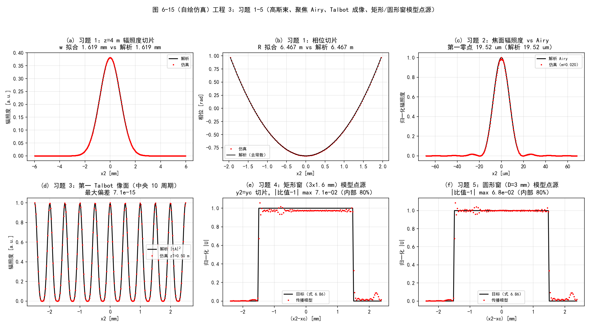
  <figcaption>图 6-15（自绘仿真）工程 3：习题 1–5。(a)(b) 高斯束 4 m 传播的辐照度/相位；(c) 焦面 vs Airy；(d) 第一 Talbot 像面；(e)(f) 矩形/圆形窗模型点源 vs 目标场</figcaption>
</figure>

## 坑与陷阱

!!! danger "1. 二次相位不带宽，采样是头号问题"
    菲涅耳积分的啁啾因子局部频率随坐标线性涨（\(\frac{r}{\lambda\Delta z}\)），网格边缘最容易欠采样。判据：\(|1-m|\,r_{\text{edge}}/(\lambda\Delta z) \le 1/(2\delta_1)\)（缩放链的输入端）。观测面的 \(\mathcal{Q}_3\) 相位乘在 IFT **之后**、其后没有 FT，不产生混叠——\(\delta_2\) 只需分辨场自身结构。

!!! danger "2. 单步法的观测窗口宽度是死的"
    \(\delta_2 = \lambda\Delta z/(N\delta_1)\) 且窗口宽 \(N\delta_2 = \lambda\Delta z/\delta_1\) 与 \(N\) 无关。加大 \(N\) 只是细化采样，扩大窗口必须调 \(\delta_1\) 或改用两步/角谱。

!!! danger "3. 两步法「−」支的负距离步镜像（原书 Listing 6.3 勘误）"
    \(m\neq1\) 时"−"支必有一段距离为负，原书用 `abs()` 建网格导致输出镜像翻转。对称场测不出来！用非对称场验收，或直接用"+"支/修正版。

!!! danger "4. \(m\to1\) 时两步「−」支中间面跑到无穷远"
    表 6.2：\(m=1\) 的"−"支 \(\Delta z_1 = \pm\infty\)，数值发散。\(m\) 接近 1 就用"+"支（中间面在正中间）。

!!! danger "5. 式 (6.66) 书印链输出 −conj(真值)，辐照度不变"
    只查强度永远发现不了；必须查相位。正确链是式 (6.67) 顶符号。

!!! danger "6. 式 (6.92) 相位斜坡符号印反"
    离轴模型点源的窗口会被推到 \(-\mathbf{r}_c\)。\(\mathbf{r}_c=0\) 时无影响，离轴必须修正（用"居中模型平移"形式最稳）。

!!! danger "7. 点源必须带限化，窗口要盖住探测器"
    真 δ 函数带宽无限，直接放进网格必然混叠。sinc 模型的窗口 \(D\) 至少要盖住探测器，又要小于传播网格；湍流仿真（9.5 节）里取望远镜直径的 4 倍。

!!! danger "8. ABCD 法不含渐晕"
    Collins 积分是"无边"的：有限孔径的挡光要靠逐段传播 + 孔径置零来模拟，或用 Coy 的更高效方法（文献 35）。

!!! danger "9. MATLAB 的 sinc 在信号处理工具箱里"
    `sinc(x) = sin(πx)/(πx)`（归一化定义），numpy 是 `np.sinc`。没有工具箱时自己写 `sin(pi*x)./(pi*x)`（记得处理 x=0）。两语言归一化定义一致，没有 \(2\pi\) 陷阱。

## 速览

1. 菲涅耳积分（式 6.1）两种数值形态：单 FT（式 6.5）与卷积（式 6.6），后者用卷积定理变角谱（式 6.31）。
2. 算符记法 \( \mathcal{Q}, \mathcal{V}, \mathcal{F}, \mathcal{F}^{-1}, \mathcal{R}, \mathcal{Q}_2 \)（式 6.7–6.13）贯穿第 6–8 章；传播 = \( \mathcal{Q}\mathcal{V}\mathcal{F}\mathcal{Q} \)（式 6.15）。
3. 单步法：1 次 FT，\(\delta_2 = \lambda\Delta z/(N\delta_1)\)（式 6.16）钉死，观测窗口宽 \(\lambda\Delta z/\delta_1\) 与 \(N\) 无关。
4. 两步法：中间面位置换 \(m\) 的自由；\(m = |\Delta z_2/\Delta z_1|\)，两组解 \(\Delta z_1 = \Delta z/(1\pm m)\)（式 6.25）；\(m=1\) 只能用"+"支。
5. 角谱法：\(m\) 代换（式 6.38）+ 卷积定理（式 6.50），\(\delta_2 = m\delta_1\) 自由定标；\(\pm m\) 两支等价。
6. ABCD 光线矩阵（式 6.68–6.76）+ 广义 Huygens–Fresnel 积分（式 6.77）+ Lambert–Fraser 卷积化（式 6.78–6.81）；纯平移退化为菲涅耳积分，前表面→后焦面退化为定标 FT。
7. 点源必须带限：本书 sinc 模型是解析逆向设计——窗内严格平顶 + 抛物相位（式 6.85–6.92）；sinc-Gaussian 压旁瓣、减边缘相位混叠。
8. 三处原书笔误已数值实锤：式 (6.18) 的 \(\mathcal{F}[\mathbf{r}_{1a}]\) 域、式 (6.66) 链（= −conj 算子）、式 (6.92) 相位斜坡符号；另有 Listing 6.3 的负距离镜像。
9. 采样判据：输入啁啾局部频率 \(|1-m|\,r_{\text{edge}}/(\lambda\Delta z) \le 1/(2\delta_1)\)。
10. 全部代码：`matlab/waveprop/ch6/` 与 `python/waveprop/ch6/`（传播器 + 点源 + 习题三套，数值验证全通过）。

## 术语速查

| 英文 | 中文 | 一句话 |
| --- | --- | --- |
| Fresnel diffraction integral | 菲涅耳衍射积分 | 近场衍射的抛物线近似积分（式 6.1） |
| quadratic phase (chirp) | 二次相位（啁啾） | 局部频率随坐标线性增长的相位，采样难点 |
| operator notation | 算符记法 | 把传播写成 \(\mathcal{Q}\mathcal{V}\mathcal{F}\mathcal{Q}\) 之类的紧凑语言 |
| amplitude spread function | 振幅扩散函数（脉冲响应） | \(h(\mathbf{r}) = \frac{1}{i\lambda\Delta z'}e^{ik r^2/(2\Delta z')}\)（式 6.47） |
| transfer function | 传递函数 | 脉冲响应的 FT：\(e^{-i\pi\lambda\Delta z' f^2}\)（式 6.49） |
| angular spectrum | 角谱 | 卷积形态的傅里叶实现（式 6.31） |
| scaling parameter | 缩放参数 | \(m = \delta_2/\delta_1\)，观测面网格定标自由度 |
| two-step propagation | 两步传播 | 插入中间面换 \(m\) 自由（式 6.17–6.30） |
| ray (ABCD) matrix | 光线矩阵（ABCD 矩阵） | 近轴光线的 \(2\times2\) 线性描述（式 6.70），\(AD-BC=1\) |
| lensmaker's equation | 透镜制造者方程 | \(\frac{1}{f_l} = (n-1)(\frac{1}{R_1}-\frac{1}{R_2})\)（式 6.75） |
| generalized Huygens–Fresnel integral | 广义惠更斯–菲涅耳积分 | ABCD 系统的衍射积分（Collins，式 6.77） |
| vignetting | 渐晕 | 有限孔径挡光，Collins 法不模拟 |
| model point source | 模型点源 | 带限化的点源（sinc / sinc-Gaussian，式 6.92） |
| window function | 窗口函数 | \(W(\mathbf{r}_2)\)，限定感兴趣区域（式 6.86） |
| aliasing | 混叠 | 采样不足导致频率折叠；点源窗外相位混叠（图 6.9） |
