# 第 7 章 菲涅耳衍射的采样要求

> **本章解决**：第 6 章把四种真空传播器（单步/两步/角谱/ABCD）交到你手上，但没回答最实际的工程问题——**网格参数（\(\delta_1, \delta_2, N\)）怎么选才不会混叠**。本章给出答案的两半：**几何带宽判据**（观测孔径物理上只能接收到有限的方向谱，这是 Coy 判据的核心，与采样无关）给出 \(\delta_1,\delta_2,N\) 的下限；**二次相位判据**（FT 内部的啁啾必须按局部空间频率过 Nyquist）决定哪种传播器在什么距离范围内有效——结论：**菲涅耳积分法适合长传播、角谱法适合短传播**。这套选参流程是第 8 章湍流相位屏仿真、第 9 章系统级仿真的直接地基。

## 7.0 本章导图

<div class="brtree">
  <div class="brrow">
    <span class="brlabel root">菲涅耳衍射的采样要求</span>
    <span class="brace"></span>
    <div class="brkids">
      <div class="brrow">
        <span class="brlabel">施加带宽限制（7.1）</span>
        <span class="brace"></span>
        <div class="brkids">
          <span class="brleaf">Nyquist 判据（式 7.1）</span>
          <span class="brleaf">平面波谱 = 空间频率谱（式 7.3–7.5，图 7.1）</span>
          <span class="brleaf">角度带宽 ↔ 网格间距：αmax = λ/(2δ1)（式 7.6/7.7）</span>
        </div>
      </div>
      <div class="brrow">
        <span class="brlabel">传播几何（7.2）</span>
        <span class="brace"></span>
        <div class="brkids">
          <span class="brleaf">αmax = α_edges + α_k（式 7.8–7.12，图 7.2）</span>
          <span class="brleaf">约束 1：δ2 上界（式 7.13–7.14）</span>
          <span class="brleaf">照亮区 / 卷绕 / 网格宽度（式 7.15–7.18，图 7.3）</span>
          <span class="brleaf">约束 2：N 下界（式 7.19–7.20）</span>
        </div>
      </div>
      <div class="brrow">
        <span class="brlabel">方法有效性（7.3）</span>
        <span class="brace"></span>
        <div class="brkids">
          <span class="brleaf">单步法：δ2 钉死，式 7.25（=7.31）+ 最小距离 7.42</span>
          <span class="brleaf">啁啾判据：f_loc = ∇φ/2π（式 7.37–7.42）</span>
          <span class="brleaf">角谱法：约束 3（式 7.53）+ 约束 4（式 7.59）</span>
          <span class="brleaf">一般准则：|1+Δz/R| &lt; D2/D1 免检约束 3（式 7.60）</span>
        </div>
      </div>
      <div class="brrow">
        <span class="brlabel">选参配方与验收</span>
        <span class="brace"></span>
        <div class="brkids">
          <span class="brleaf">图 7.5 等高线法选 (δ1, δ2, N)</span>
          <span class="brleaf">表 7-1 四约束速查 / 表 7-2 方法对比 / 决策流程图</span>
          <span class="brleaf">方孔解析对照验收（本书的"标准砝码"）</span>
        </div>
      </div>
      <div class="brrow">
        <span class="brlabel">习题（7.4）</span>
        <span class="brace"></span>
        <div class="brkids">
          <span class="brleaf">啁啾混叠的解析证明（式 7.61）</span>
          <span class="brleaf">点源 / 长距采样图</span>
          <span class="brleaf">会聚源仿真（式 7.62）+ 推广解析解</span>
          <span class="brleaf">约束 4 强于约束 1+2 的代数证明</span>
        </div>
      </div>
    </div>
  </div>
</div>

## 7.1 施加带宽限制

仿真存在的意义就是处理解析解搞不定的问题，所以传播代码必须能对付**几乎任何源场**。波动光学仿真建立在 DFT 上，而第 2 章已经看到混叠（aliasing）是 DFT 的头号威胁：波形是带限的，采样够细就行；但**大多数光学源不是空间带限的，菲涅耳衍射积分里的二次相位更是肯定不带宽**。这个问题很多人研究过（原书文献 30、31、35、37、42、54、55）。

在动手之前，先立一个物理事实：光场的空间频率谱直接映射成它的**平面波谱（plane-wave spectrum）**（原书文献 5），传播几何决定了"观测孔径能看到的源空间频率上限"——**这个限制是物理的，不是采样造成的**。这就是 Coy 采样方法的基础，也是本章大部分讨论的指南针。

第一步是回顾 Nyquist 判据，它约束网格间距：

\[
\delta \le \frac{1}{2 f_{max}},
\tag{7.1}
\]

其中 \(f_{max}\) 是感兴趣的最高空间频率。要建立"光线角度 ↔ 空间带宽"的联系，把式 (6.5) 只保留 FT 部分写成算符记法：

\[
U(x_2, y_2) = \frac{e^{ik\Delta z}}{i\lambda \Delta z}\; e^{i\frac{k}{2\Delta z}(x_2^2 + y_2^2)}\;
\mathcal{F}\!\left[\mathbf{r}_1,\ \mathbf{f}_1 = \frac{\mathbf{r}_2}{\lambda \Delta z}\right]\!\left\{ U(x_1, y_1)\, e^{i\frac{k}{2\Delta z}(x_1^2 + y_1^2)} \right\}.
\tag{7.2}
\]

人话：FT 里那个二次相位因子很有意思——它是一个"聚焦到观测面的虚拟球面波"，相当于把源场的相位**相对于这个球面重新测量**；测量完之后，每个空间频率向量 \(\mathbf{f}_1\) 就一一对应观测面上的一个具体坐标。下面反复利用这个"几何 ↔ 空间频率"的对应关系来约束采样网格。

在衍射的角谱表述里，光场 \(U(x,y)\) 可以分解成一组不同方向、不同振幅的平面波之和。任意方向的平面波用相量（phasor）记法写为

\[
U_p(x, y, z, t) = e^{i(\mathbf{k}\cdot\mathbf{r} - 2\pi \nu t)},
\tag{7.3}
\]

其中 \(\mathbf{r} = x\,\hat{i} + y\,\hat{j} + z\,\hat{k}\) 是三维位置向量，\(\mathbf{k} = (2\pi/\lambda)(\alpha\,\hat{i} + \beta\,\hat{j} + \gamma\,\hat{k})\) 是光波矢，\(\nu\) 是时间频率。三个**方向余弦（direction cosines）**\(\alpha, \beta, \gamma\) 的几何意义见图 7.1。省掉时间项，平面波就是

\[
U_p(x, y, z) = e^{i\mathbf{k}\cdot\mathbf{r}} = e^{i\frac{2\pi}{\lambda}(\alpha x + \beta y)}\, e^{i\frac{2\pi}{\lambda}\gamma z}.
\tag{7.4}
\]

于是 \(z=0\) 平面上的复指数源 \(\exp[i2\pi(f_x x + f_y y)]\) 可以看作沿以下方向传播的平面波：

\[
\alpha = \lambda f_x, \qquad \beta = \lambda f_y, \qquad \gamma = \sqrt{1 - (\lambda f_x)^2 - (\lambda f_y)^2}.
\tag{7.5}
\]

也就是说：**源的空间频率谱同时就是它的平面波谱**，空间频率按式 (7.5) 映射成方向余弦 \((\alpha, \beta)\)。角谱的截止角因此定义为 \(\alpha_{max} = \lambda f_{max}\)——它是能影响观测场的最大谱角。把式 (7.1) 改写成"最大角含量 ↔ 网格间距"的形式：

\[
\delta_1 \le \frac{\lambda}{2\alpha_{max}},
\tag{7.6}
\]

反过来，若网格间距已给定，采样后的场能表示的最大角含量就是

\[
\alpha_{max} = \frac{\lambda}{2\delta_1}.
\tag{7.7}
\]

式 (7.7) 把网格参数和传播几何绑在了一起，是全章的枢纽。

<figure>
  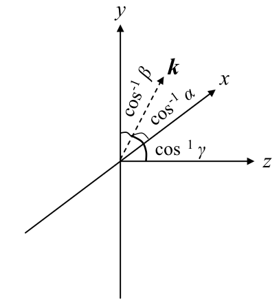
  <figcaption>图 7.1 方向余弦 α、β、γ 的几何示意：波矢 k 与三条坐标轴夹角的余弦（截自原书）</figcaption>
</figure>

!!! note "拓展：γ 与"截止频率 λ⁻¹""
    式 (7.5) 里 \(\gamma = \sqrt{1-(\lambda f_x)^2-(\lambda f_y)^2}\) 要是实数，必须 \((\lambda f_x)^2+(\lambda f_y)^2 \le 1\)，即 \(|f| \le 1/\lambda\)——比这更斜的"平面波"是**倏逝波（evanescent wave）**，振幅沿 z 指数衰减，传不远。这就是 7.3.1.2 节说自由空间振幅扩散函数"截止频率为 \(\lambda^{-1}\)"的来源：精确的角谱传递函数在 \(|f| > 1/\lambda\) 没有传播解（近轴菲涅耳核干脆丢掉了这部分）。另一个实用印象：式 (7.7) 说明网格的 Nyquist 频率 \(1/(2\delta_1)\) 对应最大光线角 \(\lambda/(2\delta_1)\)——网格越细，能"合法表达"的光线越斜；\(\delta_1 = \lambda/2\) 时这个角度达到 90°，也就是把倏逝波都装下了，代价是网格小到没法用。

## 7.2 传播几何

现在的任务是：**用源尺寸和接收器尺寸确定 \(\alpha_{max}\)**。本节跟随 Coy、Praus、Mansell 的推导（原书文献 35、42、54）。讨论限于一维（二维直接推广），且为一般性假设波前是球面的。

如图 7.2，源场最大空间延展为 \(D_1\)，观测面上感兴趣区域（region of interest，比如传感器口径）最大延展为 \(D_2\)；源面网格间距 \(\delta_1\)、观测面 \(\delta_2\)。源场既可以按上面的平面波叠加看，也可以按**点源叠加**看——这正是 Huygens 原理。这里取点源视角，要求网格足够细，使源面上**每一个点**都能充分照亮观测面的感兴趣区域；最大光线角 \(\alpha_{max}\) 就是源面场点束流的发散角。

考虑源面下边缘的点 \((x_1 = -D_1/2,\ z = z_1)\)：\(\alpha_{max}\) 可以写成两个角之和 \(\alpha_k + \alpha_{edges}\)（见图 7.2）。源面下边缘到观测孔径上边缘 \((x_2 = D_2/2,\ z = z_2)\) 的角度，在近轴近似下是

\[
\alpha_{edges} = \frac{D_1 + D_2}{2 \Delta z}.
\tag{7.8}
\]

再看 \(\alpha_k\)：在源面边缘处，式 (7.2) 中那个虚拟球面波的波矢 \(\mathbf{k}\) 与 z 轴有一个夹角。因为网格点数固定、间距分别是 \(\delta_1\) 与 \(\delta_2\)，两网格尺寸之比为 \(\delta_2/\delta_1\)，于是 \(\mathbf{k}\) 与观测面的交点在 \(x_2 = -D_1 \delta_2/(2\delta_1)\)。近轴角度为

\[
\alpha_k = \frac{D_1 \delta_2}{2 \delta_1 \Delta z} - \frac{D_1}{2 \Delta z} = \frac{D_1}{2 \Delta z}\left(\frac{\delta_2}{\delta_1} - 1\right).
\tag{7.9}
\]

人话：\(\alpha_{edges}\) 是"源边缘 → 接收区边缘"的纯几何张角；\(\alpha_k\) 是**虚拟球面波在源面边缘的倾斜角**，它由两副网格的缩放比决定——\(\delta_2 = \delta_1\)（\(m=1\)）时虚拟球面波正对前方、\(\alpha_k = 0\)；观测面网格被放大（\(\delta_2 > \delta_1\)）时波矢向外偏。两者相加：

\[
\alpha_{max} = \alpha_{edges} + \alpha_k
\tag{7.10}
\]

\[
= \frac{D_1 + D_2}{2 \Delta z} + \frac{D_1}{2 \Delta z}\left(\frac{\delta_2}{\delta_1} - 1\right)
\tag{7.11}
\]

\[
= \frac{D_1 \delta_2/\delta_1 + D_2}{2 \Delta z}.
\tag{7.12}
\]

与采样要求 (7.7) 联立（\(\alpha_{max} \le \lambda/(2\delta_1)\)）：

\[
\frac{D_1 \delta_2/\delta_1 + D_2}{2 \Delta z} \le \frac{\lambda}{2 \delta_1}
\tag{7.13}
\]

\[
\delta_2 \le -\frac{D_2}{D_1}\, \delta_1 + \frac{\lambda \Delta z}{D_1}.
\tag{7.14}
\]

**满足式 (7.14)（约束 1）意味着：所选网格间距足以采样"影响观测面感兴趣区域"的空间带宽。**它在 \((\delta_1, \delta_2)\) 平面上是一条斜率为 \(-D_2/D_1\)、截距为 \(\lambda \Delta z/D_1\) 的直线（7.3.3 节的图 7.7 会再画它）。

<figure>
  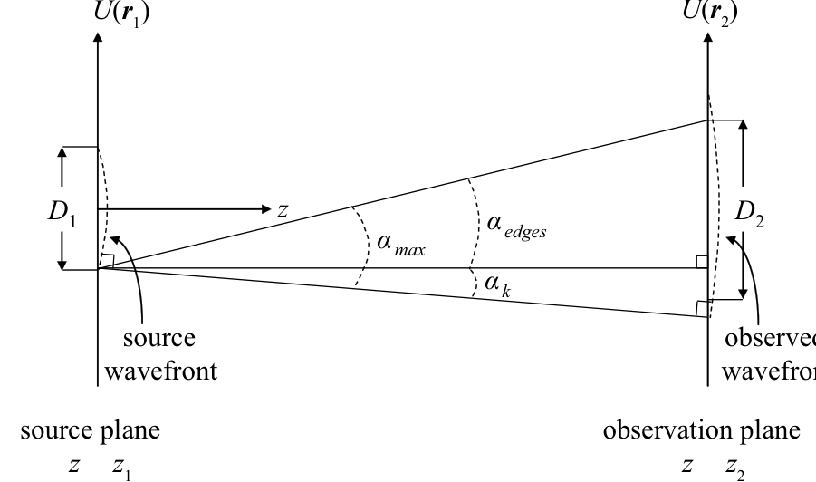
  <figcaption>图 7.2 角度定义：α_max = α_edges + α_k——源面下边缘发出、恰好扫过观测孔径上边缘的最大角（截自原书）</figcaption>
</figure>

接下来确定观测面网格需要多大的空间延展。图 7.3 显示：最大角含量为 \(\alpha_{max}\) 的源在观测面照亮的区域直径为

\[
D_{illum} = D_1 \delta_2/\delta_1 + 2 \alpha_{max} \Delta z
\tag{7.15}
\]

\[
= D_1 \delta_2/\delta_1 + \frac{\lambda \Delta z}{\delta_1}.
\tag{7.16}
\]

观测面上的混叠**只要不闯进观测孔径就无所谓**：网格延展若小于照亮区，可以想象照亮区边缘"卷绕（wrapping）"到网格另一侧——这正是第 2 章图 2.6(d)、2.7(d) 的现象。要让卷绕刚好只到观测孔径边缘（绕半圈），网格延展至少得是照亮区与观测孔径直径的**平均**：

\[
D_{grid} \ge \frac{D_{illum} + D_2}{2}
\tag{7.17}
\]

\[
= \frac{D_1 \delta_2/\delta_1 + \lambda \Delta z/\delta_1 + D_2}{2}.
\tag{7.18}
\]

最后，观测面需要的网格点数：

\[
N = \frac{D_{grid}}{\delta_2}
\tag{7.19}
\]

\[
\ge \frac{D_1}{2 \delta_1} + \frac{D_2}{2 \delta_2} + \frac{\lambda \Delta z}{2 \delta_1 \delta_2}.
\tag{7.20}
\]

**满足式 (7.20)（约束 2）意味着：观测面网格足够宽，卷绕回来的光不会爬进感兴趣区域。**注意 \(D_1 \delta_2/\delta_1\) 就是"几何像"的大小（两副网格的缩放关系），\(\lambda \Delta z/\delta_1\) 是衍射展宽（源面网格边缘两点的角分离 \(\lambda/\delta_1\) 乘距离）。

<figure>
  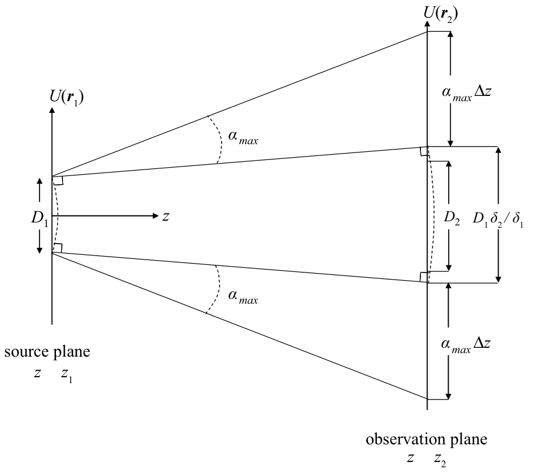
  <figcaption>图 7.3 观测面上被最大角含量照亮的区域：几何像 D1δ2/δ1 加上两侧 ±α_max·Δz 的衍射展宽（截自原书）</figcaption>
</figure>

## 7.3 传播方法的有效性

遗憾的是，**满足几何约束（不在感兴趣区里看到混叠）并不保证结果满意**——还必须考虑用哪种传播方法。菲涅耳积分法与角谱法各有各的约束：两者都要避免 FT 内部二次相位的混叠，而两种方法 FT 内的二次相位**不一样**。分析下来（原书文献 30、31、37）：**6.3 节的菲涅耳积分法对长距离传播有效，6.4 节的角谱法对短距离传播有效**。

### 7.3.1 菲涅耳积分传播

#### 7.3.1.1 单步、固定观测面网格间距

单步菲涅耳积分传播的观测面间距是钉死的（第 6 章式 6.16）：

\[
\delta_2 = \frac{\lambda \Delta z}{N \delta_1}.
\tag{7.21}
\]

把它代进约束 1（式 7.14）：

\[
\frac{D_1 \lambda \Delta z}{N \delta_1} + D_2 \delta_1 \le \lambda \Delta z
\tag{7.22}
\]

\[
\frac{D_1 \lambda \Delta z}{\delta_1} + D_2 \delta_1 N \le N \lambda \Delta z
\tag{7.23}
\]

\[
\frac{D_1 \lambda \Delta z}{\delta_1} \le N \left(\lambda \Delta z - D_2 \delta_1\right)
\tag{7.24}
\]

\[
N \ge \frac{D_1 \lambda \Delta z}{\delta_1 \left(\lambda \Delta z - D_2 \delta_1\right)}.
\tag{7.25}
\]

再把 \(\delta_2\) 代进约束 2（式 7.20）：

\[
N \ge \frac{D_1}{2 \delta_1} + \frac{D_2 \delta_1}{2 \lambda \Delta z} N + \frac{\lambda \Delta z}{2 \delta_1}\, \frac{N \delta_1}{\lambda \Delta z}
\tag{7.26}
\]

\[
N \ge \frac{D_1}{2 \delta_1} + \frac{D_2 \delta_1}{2 \lambda \Delta z} N + \frac{N}{2}
\tag{7.27}
\]

\[
\frac{N}{2} - \frac{D_2 \delta_1}{2 \lambda \Delta z} N \ge \frac{D_1}{2 \delta_1}
\tag{7.28}
\]

\[
N \left(1 - \frac{D_2 \delta_1}{\lambda \Delta z}\right) \ge \frac{D_1}{\delta_1}
\tag{7.29}
\]

\[
N \ge \frac{D_1}{\delta_1 \left(1 - \frac{D_2 \delta_1}{\lambda \Delta z}\right)}
\tag{7.30}
\]

\[
N \ge \frac{D_1 \lambda \Delta z}{\delta_1 \left(\lambda \Delta z - D_2 \delta_1\right)}.
\tag{7.31}
\]

与式 (7.25) 完全相同！——单步法把 \(\delta_2\) 钉死之后，约束 1 和约束 2 **不再是两条独立约束，而是同一个不等式**（两条推导殊途同归）。这个不等式还有两个值得记住的性质：

- 必须 \(\lambda \Delta z > D_2 \delta_1\)，否则 \(N\) 没有正解；
- 当 \(\lambda \Delta z \to D_2 \delta_1\) 时，所需 \(N \to \infty\)。

!!! note "拓展：式 (7.30) → (7.31) 与"贴边发散"的物理含义"
    式 (7.30) 乘 \(\frac{\lambda \Delta z}{\lambda \Delta z} = 1\) 即得式 (7.31)，纯属同一式的两种写法。"贴边发散"可以这样读：观测面网格总宽 \(N\delta_2 = \lambda \Delta z/\delta_1\) 与 \(N\) 无关（第 6 章的老朋友）；约束 2 要求它至少装下 \(\frac{D_{illum}+D_2}{2}\)。当 \(\lambda \Delta z/\delta_1 \to D_2 + D_1\delta_2/\delta_1\)（几何像 + 孔径恰好占满窗口）时，照亮区边缘卷绕半圈正好压到孔径边缘，任何再小一点的窗口都装不下——此时唯一的出路是加大 \(\lambda \Delta z/\delta_1\)（调 \(\delta_1\)、\(\Delta z\)）或改用两步/角谱法给 \(\delta_2\) 自由。工程 1 验证 0 把 \(\lambda \Delta z > D_2\delta_1\) 与式 (7.25)/(7.31) 的恒等性都核了一遍。

#### 7.3.1.2 避免混叠

自由空间振幅扩散函数的带宽大得离谱：截止频率为 \(\lambda^{-1}\)（见 7.1 节拓展），在有限网格上表示它不现实——硬要 \(\delta_1 = \lambda/2 \approx 500\) nm，则 \(N=1024\) 时网格总宽只有 \(L = N\delta_1 \approx 0.512\) mm，几乎没有实际问题能塞进这么小的网格。

实际能做的，是**保证网格上出现的所有频率都被正确表示**。我们无法穷举所有源场，所以把源建模成"带振幅切趾（apodized）、最大延展 \(D_1\)、抛物面波前半径 \(R\)"的光束，用它导出采样准则：

\[
U(\mathbf{r}_1) = A(\mathbf{r}_1)\, e^{i \frac{k}{2 R} r_1^2},
\tag{7.32}
\]

其中 \(A(\mathbf{r}_1)\) 是源孔径的振幅透过率，其非零部分最大延展为 \(D_1\)；\(R < 0\) 表示**会聚**波前、\(R > 0\) 表示**发散**波前（按式 (7.32) 的相位符号约定；下方勘误注记解释书印文字的出入）。

!!! warning "原书笔误：发散/会聚的 R 符号说反了"
    原书 7.3.1.2 节正文写"A diverging beam is indicated by \(R<0\), while a converging beam is indicated by \(R>0\)"。这与式 (7.32) 自身的相位定义矛盾：\(e^{ik r_1^2/(2R)}\) 的局部空间频率是 \(f_x = x_1/(\lambda R)\)（式 7.39），对应方向余弦 \(\alpha = x_1/R\)——\(R>0\) 时光线向外偏（发散），\(R<0\) 时光线向内偏（会聚）。原书习题 4 也明确说 \(R=-0.2\) m 是"converging source"，与本勘误一致。工程 2 用高斯束数值实锤：\(R=+0.2\) m 传播 0.1 m 后 RMS 束宽 0.75 mm → 1.12 mm（发散）、输出波前曲率 \(R_{out}=+0.3>0\)；\(R=-0.2\) m 则 0.75 mm → 0.38 mm（会聚）、\(R_{out}=-0.1<0\)。

这种源型下，菲涅耳衍射积分的算符链是（第 6 章式 (6.15) 加上源相位）：

\[
U(\mathbf{r}_2) = \mathcal{Q}\!\left[\frac{1}{\Delta z}, \mathbf{r}_2\right] \mathcal{V}\!\left[\frac{1}{\lambda \Delta z}, \mathbf{r}_1\right] \mathcal{F}[\mathbf{r}_1, \mathbf{f}_1]\, \mathcal{Q}\!\left[\frac{1}{\Delta z}, \mathbf{r}_1\right] \{U(\mathbf{r}_1)\}
\tag{7.33}
\]

\[
= \mathcal{Q}\!\left[\frac{1}{\Delta z}, \mathbf{r}_2\right] \mathcal{V}\!\left[\frac{1}{\lambda \Delta z}, \mathbf{r}_1\right] \mathcal{F}[\mathbf{r}_1, \mathbf{f}_1]\, \mathcal{Q}\!\left[\frac{1}{\Delta z}, \mathbf{r}_1\right] \left\{ A(\mathbf{r}_1)\, e^{i \frac{k}{2 R} r_1^2} \right\}
\tag{7.34}
\]

\[
= \mathcal{Q}\!\left[\frac{1}{\Delta z}, \mathbf{r}_2\right] \mathcal{V}\!\left[\frac{1}{\lambda \Delta z}, \mathbf{r}_1\right] \mathcal{F}[\mathbf{r}_1, \mathbf{f}_1]\, \mathcal{Q}\!\left[\frac{1}{\Delta z}, \mathbf{r}_1\right] \mathcal{Q}\!\left[\frac{1}{R}, \mathbf{r}_1\right] \{A(\mathbf{r}_1)\}
\tag{7.35}
\]

\[
= \mathcal{Q}\!\left[\frac{1}{\Delta z}, \mathbf{r}_2\right] \mathcal{V}\!\left[\frac{1}{\lambda \Delta z}, \mathbf{r}_1\right] \mathcal{F}[\mathbf{r}_1, \mathbf{f}_1]\, \mathcal{Q}\!\left[\frac{1}{\Delta z} + \frac{1}{R}, \mathbf{r}_1\right] \{A(\mathbf{r}_1)\}.
\tag{7.36}
\]

关键动作：两个源面二次相位合并成 \(\mathcal{Q}\!\left[\frac{1}{\Delta z} + \frac{1}{R}\right]\)。Lambert 与 Fraser 证明：很小的孔径下乘积 \(\mathcal{Q}A\) 的带宽由 \(A\) 决定，孔径较大时则由 \(\mathcal{Q}\) 在孔径边缘的相位决定（原书文献 47）——典型情形是后者，所以聚焦在 \(\mathcal{Q}\) 的相位上。

局部空间频率（local spatial frequency）基本上是波形的局部变化率（原书文献 5）：

\[
f_{loc} = \frac{1}{2 \pi} \nabla \phi,
\tag{7.37}
\]

\(\phi\) 是以弧度计的光学相位，\(\mathbf{f}_{loc}\) 的笛卡尔分量以 m⁻¹ 计。概念上：变化剧烈（梯度大）的波形含高频。我们要求 FT 内二次相位的**最大**局部空间频率至少被采样两倍（Nyquist）。二次相位在两个笛卡尔方向变化相同，只分析 \(x_1\) 方向：

\[
f_{loc_x} = \frac{1}{2 \pi} \frac{\partial}{\partial x_1} \frac{k}{2}\left(\frac{1}{\Delta z} + \frac{1}{R}\right) r_1^2
\tag{7.38}
\]

\[
= \left(\frac{1}{\Delta z} + \frac{1}{R}\right) \frac{x_1}{\lambda}.
\tag{7.39}
\]

它在网格边缘 \(x_1 = N \delta_1/2\) 取最大值——但源是切趾的，场只在居中孔径（最大延展 \(D_1\)）内非零，相位跟着孔径走，所以乘积的最大局部频率出现在 \(x_1 = \pm D_1/2\)。应用 Nyquist 判据：

\[
\left(\frac{1}{\Delta z} + \frac{1}{R}\right) \frac{D_1}{2 \lambda} \le \frac{1}{2 \delta_1}.
\tag{7.40}
\]

整理出最小传播距离：

\[
\Delta z \ge \frac{D_1 \delta_1 R}{\lambda R - D_1 \delta_1} \quad \text{（有限 } R\text{）}
\tag{7.41}
\]

\[
\Delta z \ge \frac{D_1 \delta_1}{\lambda} \quad \text{（无限 } R\text{，即平面波源）}.
\tag{7.42}
\]

注意这只是**指导线**（guideline）：\(\Delta z\) 贴着下限时仿真与解析不会完美吻合。式 (7.42) 也印证了本节标题——**单步菲涅耳积分法有最短距离限制，天然适合长距离**。

原书 Listing 7.1 是一个把采样分析落到实处的完整例子：方孔、单步传播、解析对照。第 10 行用式 (7.25) 算出最少网格点 66，第 11 行向上取 2 的幂得 \(N=128\)（配合 FFT）。执行完前 11 行后，采样相关参数为（式 7.43）：

**式 (7.43) Listing 7.1 例子的采样参数（原书式 7.43）**

| 参数 | 值 | 来源 |
| --- | --- | --- |
| \(D_1\) | 2 mm | 源孔径直径 |
| \(D_2\) | 3 mm | 观测面感兴趣区直径 |
| \(\lambda\) | 1 µm | 波长 |
| \(\Delta z\) | 0.5 m | 传播距离 |
| \(\delta_1\) | 40 µm | 源面网格间距（\(D_1/50\)，孔径内 ≥50 点） |
| \(\delta_2\) | 97.7 µm | 观测面间距（式 7.21：\(\lambda\Delta z/(N\delta_1)\)） |
| \(N\) | 128 | 网格点数（式 7.25 给 66，向上取 2 的幂） |

用式 (7.42) 检验：单步传播的最小距离 \(D_1\delta_1/\lambda = 2\,\text{mm}\times 40\,\mu\text{m}/1\,\mu\text{m} = 8\) cm。本例 \(\Delta z = 0.5\) m，比下限远得多、网格点也比下限多近一倍——可以预期结果与理论吻合。仿真与解析同图（原书图 7.4），辐照度与相位确实都贴得很近：

=== "MATLAB"

    ```matlab
    % example_square_one_step_prop_samp.m（原书 Listing 7.1）
    D1 = 2e-3;          % diam of the source aperture [m]
    D2 = 3e-3;          % diam of the obs-plane region of interest [m]
    delta1 = D1 / 50;   % want at least 50 grid pts across ap
    wvl = 1e-6;         % optical wavelength [m]
    k = 2*pi / wvl;
    Dz = 0.5;           % propagation distance [m]
    % minimum number of grid points
    Nmin = D1 * wvl*Dz / (delta1 * (wvl*Dz - D2*delta1));   % 式 (7.25)
    N = 2^ceil(log2(Nmin));   % number of grid pts per side（向上取 2 的幂）
    % source plane
    [x1 y1] = meshgrid((-N/2 : N/2-1) * delta1);
    ap = rect(x1/D1) .* rect(y1/D1);
    % simulate the propagation
    [x2 y2 Uout] = one_step_prop(ap, wvl, delta1, Dz);       % 书 Listing 6.1
    % analytic result for y2=0 slice
    Uout_an ...
    = fresnel_prop_square_ap(x2(N/2+1,:), 0, D1, wvl, Dz);   % 书式 (1.60) 实现
    ```

=== "Python"

    ```python
    # example_square_one_step_prop_samp（Listing 7.1 的 Python 等价）
    import numpy as np
    # one_step_prop / fresnel_prop_square_ap 见第 6 章笔记工程 1 / python/waveprop/ch6
    D1, D2 = 2e-3, 3e-3          # 源孔径 / 观测面感兴趣区直径 [m]
    delta1 = D1 / 50             # 孔径内至少 50 个网格点
    wvl = 1e-6                   # 光波长 [m]
    Dz = 0.5                     # 传播距离 [m]
    Nmin = D1 * wvl * Dz / (delta1 * (wvl * Dz - D2 * delta1))   # 式 (7.25)
    N = int(2 ** np.ceil(np.log2(Nmin)))     # 向上取 2 的幂 -> 128
    n = np.arange(N) - N // 2    # 居中坐标（numpy 0-based：零点样本在 N//2）
    x1, y1 = np.meshgrid(n * delta1, n * delta1)
    ap = rect(x1 / D1) * rect(y1 / D1)
    x2, y2, Uout = one_step_prop(ap, wvl, delta1, Dz)
    # 解析对照：y2 = 0 切片（MATLAB 的 x2(N/2+1,:) 对应 numpy 的 x2[N//2]）
    Uout_an = fresnel_prop_square_ap(x2[N // 2, :], 0.0, D1, wvl, Dz)
    ```

<figure>
  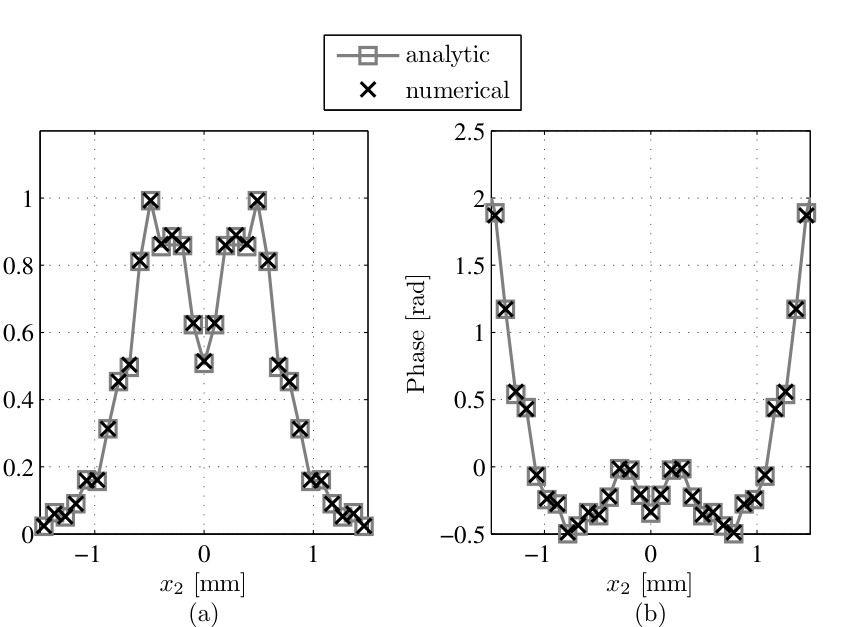
  <figcaption>图 7.4 方孔菲涅耳衍射，单步仿真 vs 解析：(a) 观测面辐照度；(b) 观测面相位。采样参数按式 (7.25)/(7.42) 选取（截自原书）</figcaption>
</figure>

### 7.3.2 角谱传播

角谱法的观测面间距不像上节那样被钉死——\(\delta_1\) 与 \(\delta_2\) 可以独立选取，所以约束 1（式 7.14）、约束 2（式 7.20）**原样保留、没有化简**。除此之外还要再加两条不等式，因为角谱法（式 6.67）的 FT 里有**自己的**二次相位要避免混叠。与上节一样，把源限制成式 (7.32) 的形式，角谱法写成：

\[
U(\mathbf{r}_2) = \mathcal{Q}\!\left[\frac{m-1}{m \Delta z}, \mathbf{r}_2\right] \mathcal{F}^{-1}\!\left[\mathbf{f}_1, \frac{\mathbf{r}_2}{m}\right] \mathcal{Q}_2\!\left[-\frac{\Delta z}{m}, \mathbf{f}_1\right] \times \mathcal{F}[\mathbf{r}_1, \mathbf{f}_1]\, \mathcal{Q}\!\left[\frac{1-m}{\Delta z}, \mathbf{r}_1\right] \frac{1}{m} \{U(\mathbf{r}_1)\}
\tag{7.44}
\]

\[
= \mathcal{Q}\!\left[\frac{m-1}{m \Delta z}, \mathbf{r}_2\right] \mathcal{F}^{-1}\!\left[\mathbf{f}_1, \frac{\mathbf{r}_2}{m}\right] \mathcal{Q}_2\!\left[-\frac{\Delta z}{m}, \mathbf{f}_1\right] \times \mathcal{F}[\mathbf{r}_1, \mathbf{f}_1]\; \frac{1}{m}\, \mathcal{Q}\!\left[\frac{1-m}{\Delta z} + \frac{1}{R}, \mathbf{r}_1\right] \{A(\mathbf{r}_1)\},
\tag{7.45}
\]

其中 \(m = \delta_2/\delta_1\)（第 6 章的缩放参数），源相位 \(e^{ik r_1^2/(2R)} = \mathcal{Q}\!\left[\frac{1}{R}\right]\) 与 \(\mathcal{Q}\!\left[\frac{1-m}{\Delta z}\right]\) 合并成 \(\mathcal{Q}\!\left[\frac{1-m}{\Delta z} + \frac{1}{R}\right]\)。FT（和 IFT）内外有**两个**二次相位因子要检查：

\[
\mathcal{Q}\!\left[\frac{1-m}{\Delta z} + \frac{1}{R},\ \mathbf{r}_1\right] = \exp\!\left[i \frac{k}{2}\left(\frac{1-m}{\Delta z} + \frac{1}{R}\right) |\mathbf{r}_1|^2\right]
\tag{7.46}
\]

\[
\mathcal{Q}_2\!\left[-\frac{\Delta z}{m},\ \mathbf{f}_1\right] = \exp\!\left[-i \pi^2 \frac{2 \Delta z}{m k} |\mathbf{f}_1|^2\right].
\tag{7.47}
\]

!!! warning "原书笔误：式 (7.46)、(7.47) 的指数符号都印反了"
    - **式 (7.46)**：书印 \(\exp\!\left[-i\frac{k}{2}\left(\frac{1-m}{\Delta z}+\frac{1}{R}\right)|\mathbf{r}_1|^2\right]\)。按 \(\mathcal{Q}\) 的定义（式 6.7，指数为 \(+i\frac{k}{2}c|\mathbf{r}|^2\)）、算符链 (7.45) 的合并过程（\(\mathcal{Q}[\frac{1-m}{\Delta z}]\mathcal{Q}[\frac{1}{R}]\)，两个正相位相加），以及两行之后式 (7.48) 的相位 \(\phi = +\frac{k}{2}(\cdots)\)，指数都应为**正**号——书印负号是笔误。
    - **式 (7.47)**：书印 \(\exp\!\left[+i\pi^2\frac{2\Delta z}{mk}|\mathbf{f}_1|^2\right]\)。按 \(\mathcal{Q}_2\) 的定义（式 6.12：\(\mathcal{Q}_2[d] = e^{+i\pi^2\frac{2d}{k}|\mathbf{r}|^2}\)），代入 \(d = -\Delta z/m\) 得**负**指数；第 6 章 Listing 6.5 的实现（`Q2 = exp(-1i*pi^2*2*Dz/m/k*fsq)`，与解析对照验证到 \(10^{-14}\)）也是负号。
    - **影响面**：约束 4 的推导（式 7.54–7.59）只用到 \(\left|\nabla\phi\right|\)（式 7.56 是对相位求导取模长的场景），符号反转不影响 Nyquist 判据的最终形式——所以书印 (7.54) 沿用正相位并不改变结论。工程 1 复现的仿真按修正后的符号实现（与 Listing 6.5 一致）。

与上节相同，逐个算最大局部频率并套 Nyquist。第一个因子的相位是

\[
\phi = \frac{k}{2}\left(\frac{1-m}{\Delta z} + \frac{1}{R}\right) |\mathbf{r}_1|^2
\tag{7.48}
\]

\[
= \frac{k}{2}\left(\frac{1 - \delta_2/\delta_1}{\Delta z} + \frac{1}{R}\right) |\mathbf{r}_1|^2,
\tag{7.49}
\]

局部空间频率为

\[
f_{lx} = \frac{1}{2 \pi} \frac{\partial}{\partial x_1} \phi
\tag{7.50}
\]

\[
= \frac{1}{\lambda}\left(\frac{1 - \delta_2/\delta_1}{\Delta z} + \frac{1}{R}\right) x_1.
\tag{7.51}
\]

最大值同样出现在 \(x_1 = \pm D_1/2\)（该因子乘在源面孔径函数上）。Nyquist 采样给出

\[
\frac{1}{\lambda} \left| \frac{1 - \delta_2/\delta_1}{\Delta z} + \frac{1}{R} \right| \frac{D_1}{2} \le \frac{1}{2 \delta_1}.
\tag{7.52}
\]

整理成对 \(\delta_2\) 的上下界（约束 3）：

\[
\left(1 + \frac{\Delta z}{R}\right) \delta_1 - \frac{\lambda \Delta z}{D_1} \;\le\; \delta_2 \;\le\; \left(1 + \frac{\Delta z}{R}\right) \delta_1 + \frac{\lambda \Delta z}{D_1}.
\tag{7.53}
\]

第二个二次相位因子（振幅传递函数）的相位是

\[
\phi = \pi^2 \frac{2 \Delta z}{m k} |\mathbf{f}_1|^2
\tag{7.54}
\]

\[
= \pi^2 \frac{2 \delta_1 \Delta z}{\delta_2 k} |\mathbf{f}_1|^2.
\tag{7.55}
\]

它的局部空间频率（加撇以免与上一个混淆）为

\[
f'_{lx} = \frac{1}{2 \pi} \frac{\partial}{\partial f_{1x}} \phi
\tag{7.56}
\]

\[
= \frac{\delta_1 \lambda \Delta z}{\delta_2}\, f_{1x}.
\tag{7.57}
\]

它在空间频率网格边缘 \(f_{1x} = \pm 1/(2\delta_1)\) 取最大，Nyquist 判据给出

\[
\frac{\lambda \Delta z}{2 \delta_2} \le \frac{N \delta_1}{2}
\tag{7.58}
\]

\[
N \ge \frac{\lambda \Delta z}{\delta_1 \delta_2}.
\tag{7.59}
\]

一共四条不等式，比菲涅耳积分法复杂。把四条约束集中重列如下（与原书一致）：

**表 7-1 角谱传播的四条采样约束（原书 7.3.2 节汇总）**

| 编号 | 不等式 | 保护什么 | 性质 |
| --- | --- | --- | --- |
| 约束 1 | \(\delta_2 \le -\dfrac{D_2}{D_1}\delta_1 + \dfrac{\lambda \Delta z}{D_1}\) | 卷绕混叠不进感兴趣区 | 几何/物理 |
| 约束 2 | \(N \ge \dfrac{D_1}{2\delta_1} + \dfrac{D_2}{2\delta_2} + \dfrac{\lambda \Delta z}{2\delta_1 \delta_2}\) | 观测面网格装得下卷绕 | 几何 |
| 约束 3 | \(\left(1+\dfrac{\Delta z}{R}\right)\delta_1 - \dfrac{\lambda \Delta z}{D_1} \le \delta_2 \le \left(1+\dfrac{\Delta z}{R}\right)\delta_1 + \dfrac{\lambda \Delta z}{D_1}\) | FT 前的源面啁啾 \(\mathcal{Q}[\frac{1-m}{\Delta z}+\frac{1}{R}]\) 过 Nyquist | 数值（式 7.53） |
| 约束 4 | \(N \ge \dfrac{\lambda \Delta z}{\delta_1 \delta_2}\) | 频域啁啾 \(\mathcal{Q}_2[-\frac{\Delta z}{m}]\) 过 Nyquist | 数值（式 7.59） |

四个不等式联立求解不容易，最直接的办法是把它们的边界画在 \((\delta_1, \delta_2)\) 平面上。原书例子参数：\(D_1 = 2\) mm、\(D_2 = 4\) mm、\(\Delta z = 0.1\) m、\(\lambda = 1\,\mu\)m。图 7.5(a) 是约束 4 给出的 \(\log_2 N\) 下界等高线（实线族），叠加约束 1（点划线）与约束 3（虚线）对 \(\delta_2\) 的上界；约束 1 显然比约束 3 更紧。选点被限制在点划线以下的左下角，该区域等高线给出的 \(\log_2 N\) 至少 \(2^{8.5}\)；因为 FFT 要 2 的幂，取 \(N = 2^9 = 512\)。随后（有点随意地）选 \(\delta_1 = 9.48\,\mu\)m、\(\delta_2 = 28.12\,\mu\)m，约束 4 给出最少 \(2^{8.55}\) 个点；图 7.5(b) 显示约束 2 只要求 \(2^{8.51}\)。于是 \(N = 512\) 足够。

<figure>
  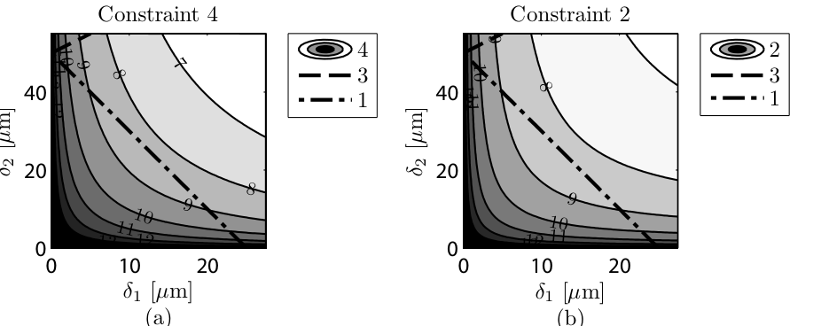
  <figcaption>图 7.5 角谱传播的采样约束（D1=2 mm, D2=4 mm, Δz=0.1 m, λ=1 µm）：(a) 约束 4 的 log2 N 等高线 + 约束 1（点划线）/约束 3（虚线）上界；(b) 约束 2 的等高线。红* 处参数即正文所选（截自原书）</figcaption>
</figure>

!!! note "拓展：图 7.5(a) 里那条"左上角虚线""
    原书正文说约束 3 的虚线"barely visible in the upper-left corner"。按书例参数 \(R=\infty\)（Listing 7.2 的源是纯 rect 孔径，无二次相位），约束 3 上界是斜率 \(1+\Delta z/R = 1\)、截距 \(\lambda\Delta z/D_1 = 50\,\mu\)m 的直线，在纵轴 0–40 µm 的绘图窗内根本不出现；只有 \(1+\Delta z/R < 0\)（会聚源、焦点在两平面之间）时该线才以负斜率从左上角进入窗口——原图那条陡虚线对应的是有限（负）\(R\) 的画法，与 Listing 7.2 的 \(R=\infty\) 不完全对应。无论哪种画法，结论一致：本例约束 3 不起作用（式 7.60 判定），真正干活的是约束 1 和约束 4。工程 1 的图 7-9 按 \(R=\infty\) 重绘，图 7-10 把三种 \(R\) 情形画齐。

原书 Listing 7.2 给出这个例子的仿真代码，数值求值角谱法（式 7.44）模拟方孔传播。既然采样给了这么多关照，仿真的振幅与相位应当与解析结果贴得很近——图 7.6 的 (a) 辐照度切片与 (b) 缠绕相位确实如此：

=== "MATLAB"

    ```matlab
    % example_square_prop_ang_spec.m（原书 Listing 7.2）
    D1 = 2e-3;          % diameter of the source aperture [m]
    D2 = 4e-3;          % diameter of the observation aperture [m]
    wvl = 1e-6;         % optical wavelength [m]
    k = 2*pi / wvl;
    Dz = 0.1;           % propagation distance [m]
    delta1 = 9.4848e-6;
    delta2 = 28.1212e-6;
    Nmin = D1/(2*delta1) + D2/(2*delta2) ...
        + (wvl*Dz)/(2*delta1*delta2);           % 约束 2（式 7.20）
    % bump N up to the next power of 2 for efficient FFT
    N = 2^ceil(log2(Nmin));
    [x1 y1] = meshgrid((-N/2 : N/2-1) * delta1);
    ap = rect(x1/D1) .* rect(y1/D1);
    [x2 y2 Uout] = ang_spec_prop(ap, wvl, delta1, delta2, Dz);  % 书 Listing 6.5
    % analytic result for y2=0 slice
    Uout_an ...
    = fresnel_prop_square_ap(x2(N/2+1,:), 0, D1, wvl, Dz);
    ```

=== "Python"

    ```python
    # example_square_prop_ang_spec（Listing 7.2 的 Python 等价）
    import numpy as np
    # ang_spec_prop / fresnel_prop_square_ap 见第 6 章笔记工程 1 / python/waveprop/ch6
    D1, D2 = 2e-3, 4e-3         # 源孔径 / 观测孔径直径 [m]
    wvl = 1e-6                  # 光波长 [m]
    Dz = 0.1                    # 传播距离 [m]
    delta1 = 9.4848e-6          # 图 7.5 选点（约束 1 之下）
    delta2 = 28.1212e-6
    # 约束 2（式 7.20）
    Nmin = D1 / (2 * delta1) + D2 / (2 * delta2) + (wvl * Dz) / (2 * delta1 * delta2)
    N = int(2 ** np.ceil(np.log2(Nmin)))     # 向上取 2 的幂（约束 4 更紧时同此流程）
    n = np.arange(N) - N // 2
    x1, y1 = np.meshgrid(n * delta1, n * delta1)
    ap = rect(x1 / D1) * rect(y1 / D1)
    x2, y2, Uout = ang_spec_prop(ap, wvl, delta1, delta2, Dz)
    Uout_an = fresnel_prop_square_ap(x2[N // 2, :], 0.0, D1, wvl, Dz)   # y2=0 切片
    ```

<figure>
  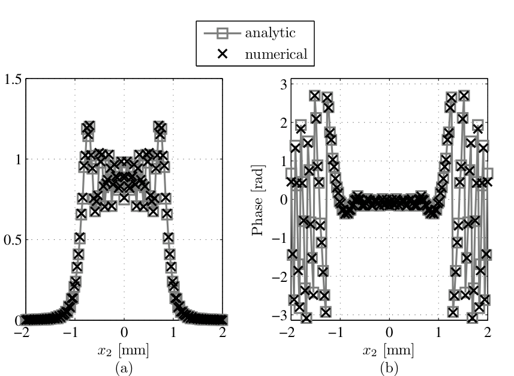
  <figcaption>图 7.6 方孔菲涅耳衍射，角谱仿真 vs 解析：(a) 观测面辐照度；(b) 观测面缠绕相位。四条约束下选参，结果贴合（截自原书）</figcaption>
</figure>

### 7.3.3 一般准则

现在把问题一般化。首先可以证明**约束 4 强于约束 1 与约束 2 的组合**（代数证明见 7.4 节习题 6 与工程 2 验证 7）——所以只需要分析图 7.5(a)，图 (b) 可以无视。其次，约束 2 与约束 3 都是简单线性不等式：约束 1 的斜率是 \(-D_2/D_1\)、\(\delta_2\) 截距是 \(\lambda \Delta z/D_1\)（图 7.7）。约束 3 更有意思：它的**上界**斜率是 \(1 + \Delta z/R\)、\(\delta_2\) 截距同样是 \(\lambda \Delta z/D_1\)；对比图 7.7(a)(b) 与 (c) 可知：若 \(-D_2/D_1 < 1 + \Delta z/R\)，约束 3 的上界与约束 1 同截距且斜率更大（更松），不用考虑。约束 3 的**下界**斜率也是 \(1 + \Delta z/R\)，但 \(\delta_2\) 截距是 \(-\lambda \Delta z/D_1\)（不物理，弃用），改看它的 \(\delta_1\) 截距 \(\lambda \Delta z/[D_1(1 + \Delta z/R)]\)；对比图 7.7(a)(b) 可知：当 \(1 + \Delta z/R < D_2/D_1\) 时约束 3 下界也不起作用。

总结约束 3 的去留判据：当

\[
\left| 1 + \frac{\Delta z}{R} \right| < \frac{D_2}{D_1}
\tag{7.60}
\]

时，约束 3 不是限制因素。有趣的物理解释：**几何光束被包含在直径 \(D_2\) 的区域内**——这包括发散源，以及焦点在观测面**之前或之后**的会聚源（习题 5 要求画出这四种光线图，工程 2 的图 7-10 三情形就是它的参数版）。

<figure>
  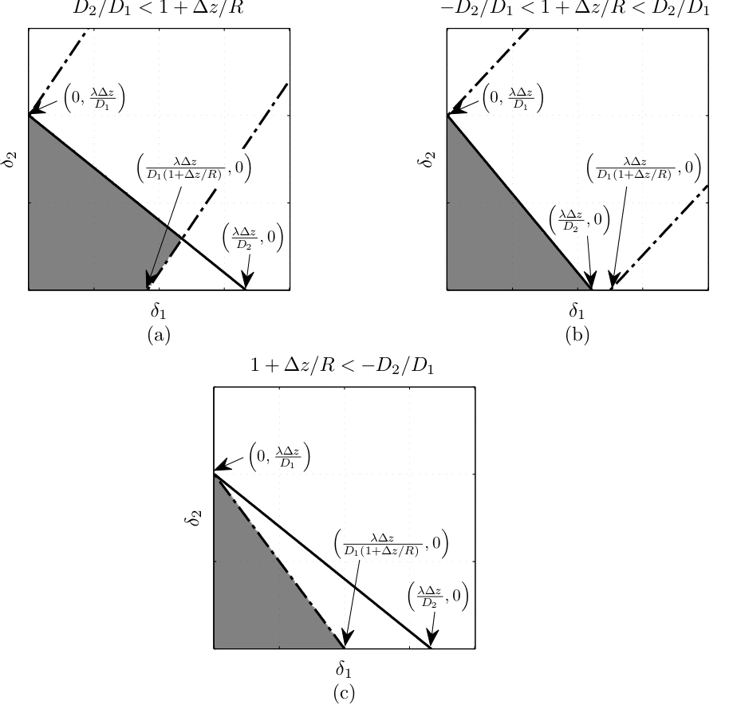
  <figcaption>图 7.7 角谱传播的一般采样约束：约束 1（实线，斜率 −D2/D1）与约束 3 上界（点划线，斜率 1+Δz/R、同截距 λΔz/D1）、下界（虚线，δ1 截距 λΔz/[D1(1+Δz/R)]）的三种相对位置（截自原书）</figcaption>
</figure>

本章的采样分析应当作为波动光学仿真的**指导线而非铁律**。这一章最重要的一课是：**二次相位在傅里叶光学里无处不在，给数值求值带来极大挑战，仿真必须小心设置、充分验证**。要仿真一个没有解析解的传播问题时，先用本章判据选网格，再用"同类设置 + 有解析解的问题"验收仿真精度——这正是本书反复用方孔衍射做例子的原因（第 8、9 章的湍流与系统仿真都沿用这套验收流程）。

两种传播方法的采样要求放到一张表里对比：

**表 7-2 菲涅耳积分法（单步）vs 角谱法的采样要求（本笔记整理）**

| 项目 | 菲涅耳积分法（单步） | 角谱法 |
| --- | --- | --- |
| 观测面采样 \(\delta_2\) | \(\lambda \Delta z/(N\delta_1)\) 钉死（式 7.21） | 自由（\(m = \delta_2/\delta_1\)） |
| 变换次数 | 1 次 FT | FT + IFT 各 1 次 |
| 有效距离 | 长（\(\Delta z \ge D_1\delta_1/\lambda\)，式 7.42） | 短 |
| 网格点数下界 | 式 (7.25)（= 约束 1、2 化简后的合成） | 约束 4（式 7.59）主导；约束 1、2 联立；约束 3 按式 (7.60) 免检 |
| 失效模式 | \(\lambda \Delta z \to D_2 \delta_1\) 时 \(N \to \infty\)；距离短于式 (7.41/7.42) 时源面啁啾混叠 | 短距离下频域啁啾欠采样；约束 1 被绕过时卷绕进感兴趣区 |
| 源面啁啾判据 | \(\left(\frac{1}{\Delta z}+\frac{1}{R}\right)\frac{D_1}{2\lambda} \le \frac{1}{2\delta_1}\)（式 7.40） | \(\frac{1}{\lambda}\left\Vert\frac{1-\delta_2/\delta_1}{\Delta z}+\frac{1}{R}\right\Vert\frac{D_1}{2} \le \frac{1}{2\delta_1}\)（式 7.52） |
| 全局相位约定 | 省略 \(e^{ik\Delta z}\)（不影响辐照度） | 同左 |

实际选型与选参的完整决策流程（结合第 6 章四种传播器与本章四约束）：

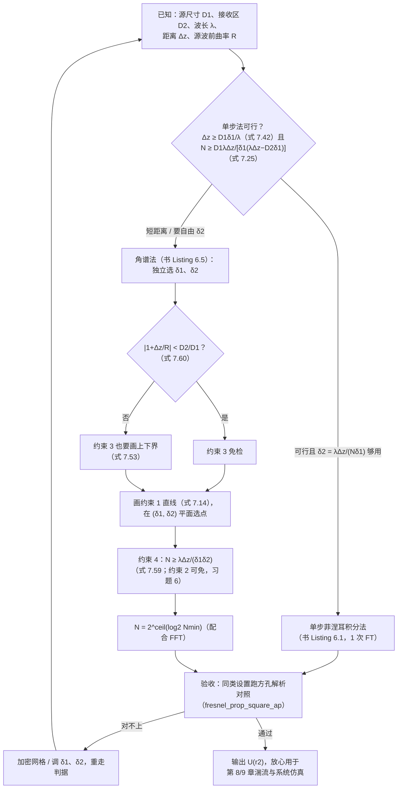

## 7.4 习题

原书 7.4 节 6 道题，全部可用本章判据与第 6 章传播器完成；工程 2 给了完整复现（题号对应工程 2 的验证编号）：

1. 考虑信号 \(g(x) = \exp(i \pi a^2 x^2)\)（式 7.61），\(a = 4\)，采样网格 \(N = 128\) 点、总宽 \(L = 4\) m。**不做任何 FT**，解析证明采样后的信号有混叠。
2. 画出点源的采样图：波长 \(1\,\mu\)m，传播 \(100\) km，到 \(2\) m 直径的孔径。
3. 画出源采样图：波长 \(0.5\,\mu\)m、直径 \(1\) mm，传播 \(2.0\) m，到 \(2\) m 直径的孔径。
4. 把 Listing 7.2 与 B.5 改成会聚/发散源 \(U(x_1, y_1) = \text{rect}\!\left(\frac{x_1}{D_1}\right) \text{rect}\!\left(\frac{y_1}{D_1}\right) e^{i \frac{k}{2 R}\left(x_1^2 + y_1^2\right)}\)（式 7.62）：(a) 把式 (1.60) 的方孔菲涅耳解析解重推一遍，把式 (7.62) 的发散/会聚波前包括进去；(b) 取 \(D_1 = 2\) mm、\(D_2 = 4\) mm、\(\Delta z = 0.1\) m、\(\lambda = 1\,\mu\)m、\(R = -0.2\) m（与原例相同的参数，但换成会聚源），仿照图 7.5 画约束图展示 \(\delta_1, \delta_2, N\) 的审慎选法；(c) 跑仿真，画 \(y_2=0\) 切片的振幅与相位，把 (a) 的解析结果叠画在同一张图上。
5. 用图示说明式 (7.60) 意味着几何光束被包含在直径 \(D_2\) 的区域内：画出发散源、以及焦点在观测面前方/后方的会聚源的光线图。
6. 用代数证明约束 4 强于约束 1 与 2 的组合。

!!! note "拓展：习题 4(a) 的完整推导（工程 2 实现的 fresnel_prop_square_ap_R）"
    把式 (7.62) 代入菲涅耳积分 (6.1) 并按 \(x, y\) 分离：

    \[
    U(x_2, y_2) = \frac{e^{ik\Delta z}}{i\lambda \Delta z}\, e^{i\frac{k}{2\Delta z}(x_2^2 + y_2^2)}\, I(x_2)\, I(y_2),
    \]

    其中（记 \(\rho = 1 + \Delta z/R\)，来自式 7.36 的 \(\mathcal{Q}\!\left[\frac{1}{\Delta z}+\frac{1}{R}\right]\)，指数可写为 \(\frac{k}{2\Delta z}\rho\, x_1^2 - \frac{k}{\Delta z}x_2 x_1\)）：

    \[
    I(x) = \int_{-D/2}^{D/2} \exp\!\left[i\frac{k}{2\Delta z}\left(\rho\, x_1^2 - 2 x\, x_1\right)\right] dx_1.
    \]

    配方：\(\rho x_1^2 - 2 x x_1 = \rho\left(x_1 - x/\rho\right)^2 - x^2/\rho\)，代换 \(t = \sqrt{2\rho/(\lambda \Delta z)}\,(x_1 - x/\rho)\)（指数变成 \(i\pi t^2/2\)，正是 Fresnel 积分的约定），得

    \[
    I(x) = e^{-i\pi x^2/(\rho \lambda \Delta z)}\, \sqrt{\frac{\lambda \Delta z}{2 \rho}}\, \Big\{\left[C(t_2) - C(t_1)\right] + i\left[S(t_2) - S(t_1)\right]\Big\},
    \]

    \[
    t_1 = \sqrt{\frac{2\rho}{\lambda \Delta z}}\left(-\frac{D}{2} - \frac{x}{\rho}\right), \qquad t_2 = \sqrt{\frac{2\rho}{\lambda \Delta z}}\left(\frac{D}{2} - \frac{x}{\rho}\right).
    \]

    三点验证（工程 2 全部实测）：\(R \to \infty\)（\(\rho = 1\)）时与第 6 章的 `fresnel_prop_square_ap` **逐位一致**（观测面啁啾 \(e^{i\pi r_2^2/(\lambda\Delta z)}\) 与配方相位 \(e^{-i\pi x^2/(\lambda\Delta z)}\) 相消，差 \(4.4\times10^{-16}\)）；输出的抛物相位曲率满足 \(1/R_{out} = 1/\Delta z - 1/(\rho\Delta z) = 1/(R + \Delta z)\)，即 \(R_{out} = R + \Delta z\)——正是球面波几何（焦点不动、曲率半径随传播距离线性增长；\(R=-0.2\) m、\(\Delta z=0.1\) m 时拟合 \(R_{out} = -0.107\) m vs 预测 \(-0.1\) m）；\(\rho > 0\) 时积分方向不变，\(\rho < 0\) 需翻上下限（本例 \(\rho = 0.5\)，不涉及）。

!!! note "拓展：习题 6 的代数证明（约束 4 ⟹ 约束 2）"
    把约束 1（式 7.14）两边乘 \(D_1\)、移项，得它的等价形式：

    \[
    D_1 \delta_2 + D_2 \delta_1 \le \lambda \Delta z.
    \]

    两边除以 \(2\delta_1\delta_2\)：

    \[
    \frac{D_1}{2 \delta_1} + \frac{D_2}{2 \delta_2} \;\le\; \frac{\lambda \Delta z}{2 \delta_1 \delta_2}.
    \]

    于是约束 2 的右端（式 7.20）=「几何项」+ \(\frac{\lambda \Delta z}{2\delta_1\delta_2}\) \(\le \frac{\lambda \Delta z}{2\delta_1\delta_2} + \frac{\lambda \Delta z}{2\delta_1\delta_2} = \frac{\lambda \Delta z}{\delta_1 \delta_2}\)，恰是约束 4 的右端（式 7.59）。所以**在约束 1 成立的参数域内，约束 2 自动被约束 4 蕴含**——这就是 7.3.3 节"只看图 7.5(a) 就够"的代数根据。工程 2 验证 7 用 1000 组随机参数数值复核：\(\max[\text{约束2右端} - \text{约束4右端}] = 0\)（恒 \(\le 0\)）。

### 工程 1：书例复现与采样判据落地（Listings 7.1–7.2）

对应文件 `matlab/waveprop/ch7/ch7_sampling.m` 与 `python/waveprop/ch7/ch7_sampling.py`，含四条约束的函数化实现、两个书例复现与约束等高线图（复用第 6 章的 `one_step_prop`/`ang_spec_prop`/`fresnel_prop_square_ap` 与公共 `base.py`）：

=== "MATLAB"

    ```matlab
    %% ===== 书 Schmidt PM199 第 7 章（工程 1 + 工程 2）=====
    %  菲涅耳衍射的采样要求：几何带宽判据 + 二次相位判据
    %  （原书 7.1-7.3 节，Listings 7.1-7.2）
    %  与 python/waveprop/ch7/ch7_sampling.py 数值行为一致；
    %  本机无 MATLAB 时以 Python 实跑结果为准。
    %
    %  原书要点：
    %    空间频率谱 = 平面波谱（方向余弦 alpha = lambda*f，式 7.5）；
    %    传播几何限制观测孔径能看到的带宽（Coy 方法的基础）。
    %    几何判据（7.2 节）：
    %      alpha_max = (D1*delta2/delta1 + D2)/(2*Dz)         （式 7.12）
    %      约束 1:  delta2 <= -(D2/D1)*delta1 + lambda*Dz/D1  （式 7.14）
    %      约束 2:  N >= D1/(2*delta1) + D2/(2*delta2)
    %                       + lambda*Dz/(2*delta1*delta2)     （式 7.20）
    %    二次相位判据：f_loc = |grad phi|/(2*pi)（式 7.37）。
    %    单步菲涅耳积分法：delta2 = lambda*Dz/(N*delta1)（式 7.21），
    %      N >= D1*lambda*Dz/(delta1*(lambda*Dz - D2*delta1))（式 7.25 == 7.31），
    %      最小距离 Dz >= D1*delta1/lambda（式 7.42，R=inf）—— 长距离有效。
    %    角谱法（delta1/delta2 独立）另有两约束：
    %      约束 3: (1+Dz/R)*delta1 - lambda*Dz/D1 <= delta2
    %                              <= (1+Dz/R)*delta1 + lambda*Dz/D1（式 7.53）
    %      约束 4: N >= lambda*Dz/(delta1*delta2)             （式 7.59）
    %      —— 短距离有效。约束 4 强于约束 1+2 的组合（习题 6）。
    %    一般准则：|1+Dz/R| < D2/D1 时约束 3 不起作用（式 7.60）。
    %
    %  原书勘误（详见笔记；本脚本按修正实现并数值验证）：
    %    (a) 式 (7.46) 指数符号印反（应 +i*k/2*(...)*r1^2，与式 6.7/7.45/7.48 一致）；
    %    (b) 式 (7.47) 指数符号印反（Q2[-Dz/m] 按 (6.12) 为负指数，与 Listing 6.5 一致；
    %        约束 4 只用 |grad phi|，不受影响）；
    %    (c) 7.3.1.2 节"发散 R<0 / 会聚 R>0"与式 (7.32) 相位定义及习题 4 矛盾：
    %        R>0 发散、R<0 会聚（本脚本验证 6 数值实锤）。
    %
    %  Python 实跑结果（本脚本按相同参数复现）：
    %    验证 0：Nmin(7.25)=65.79 -> N=128、delta2=97.7um、最小距离 8cm（书 7.43）；
    %            式 7.31 与 7.25 相对差 2.2e-16；约束 2/4 的 log2 N = 8.51/8.55 -> N=512。
    %    验证 1：Listing 7.1（N=128 单步）：感兴趣区域 |dI|/pk = 8.1e-3，
    %            相位残差 2.1e-2 rad（原书图 7.4 复现）。
    %    验证 2：Listing 7.2（N=512 角谱）：|dI|/pk = 1.2e-2，
    %            相位残差 1.5e-2 rad（原书图 7.6 复现）。
    %    验证 6：习题 4 会聚源 R=-0.2 m：|dI|/pk = 8.5e-3、相位残差 8.2e-3 rad；
    %            输出曲率拟合 R_out=-0.107 m（几何预测 R+Dz=-0.1 m）；
    %            R 符号勘误：R=+0.2 束宽 0.75->1.12 mm（发散）、R=-0.2 -> 0.38 mm（会聚）。
    %
    %  MATLAB/Python 差异（对应 .py 内注释）：
    %    - MATLAB 1-based / numpy 0-based：居中排列的零坐标样本位置不同；
    %    - meshgrid 行为一致；MATLAB 无内置 Fresnel 积分，用 integral() 数值积分
    %      （Python 版用 scipy.special.fresnel）；
    %    - 取 2 的幂：2^ceil(log2(Nmin))，不用 nextpow2（避免 2 的幂输入差 1）。
    clear; clc; close all;

    %% ================= 验证 0：约束代数总账（书例 7.43） =================
    fprintf('===== 验证 0：约束代数总账（式 7.12-7.59） =====\n');
    D1a = 2e-3;  D2a = 3e-3;  wvl = 1e-6;  Dza = 0.5;   % Listing 7.1 例子
    d1a = D1a/50;                                       % 孔径内至少 50 点
    Nmin_a = nmin_one_step(D1a, D2a, wvl, Dza, d1a);    % 式 (7.25)
    N_a = 2^ceil(log2(Nmin_a));
    d2a = wvl*Dza/(N_a*d1a);                            % 式 (7.21)
    fprintf('    Listing 7.1 例子：D1=2mm, D2=3mm, Dz=0.5m, delta1=D1/50=%.0f um\n', d1a*1e6);
    fprintf('    式 (7.25) Nmin = %.2f（书正文 66）；向上取 2 的幂 N = %d（书 128）\n', Nmin_a, N_a);
    fprintf('    式 (7.21) delta2 = %.1f um（书 7.43：97.7 um）\n', d2a*1e6);
    N_731 = (D1a/d1a)/(1 - D2a*d1a/(wvl*Dza));          % 式 (7.31)
    fprintf('    式 (7.31)（约束 2 代入 delta2(N) 后解出）N >= %.4f，与式 (7.25) 相对差 %.1e\n', ...
        N_731, abs(N_731 - Nmin_a)/Nmin_a);
    fprintf('    附加条件：lambda*Dz=%.1e > D2*delta1=%.1e（否则 N 无正解，书正文指出）\n', ...
        wvl*Dza, D2a*d1a);
    fprintf('    式 (7.42) 最小距离（R=inf）= %.1f cm（书正文 8 cm）\n', ...
        min_Dz_one_step(D1a, d1a, wvl, inf)*100);
    fprintf('    式 (7.41) 有限 R=+0.2 m（发散源）：Dz >= %.2f m；R=-0.2 m（会聚源）：Dz >= %.3f m\n', ...
        min_Dz_one_step(D1a, d1a, wvl, 0.2), min_Dz_one_step(D1a, d1a, wvl, -0.2));

    % Listing 7.2 例子上的四条约束
    D1b = 2e-3;  D2b = 4e-3;  Dzb = 0.1;
    d1b = 9.4848e-6;  d2b = 28.1212e-6;
    c1 = constraint1_d2(d1b, D1b, D2b, wvl, Dzb);
    c2 = constraint2_N(d1b, d2b, D1b, D2b, wvl, Dzb);
    [c3lo, c3hi] = constraint3_d2(d1b, D1b, wvl, Dzb, inf);
    c4 = constraint4_N(d1b, d2b, wvl, Dzb);
    fprintf('    Listing 7.2 例子：D1=2mm, D2=4mm, Dz=0.1m, delta1=9.4848um, delta2=28.1212um\n');
    fprintf('      约束 1：delta2 <= %.1f um（选中 28.12：满足 %d）\n', c1*1e6, d2b <= c1);
    fprintf('      约束 2：N >= %.2f = 2^%.2f（书正文 2^8.51）\n', c2, log2(c2));
    fprintf('      约束 3：%.1f <= delta2 <= %.1f um（R=inf，选中值满足 %d）\n', ...
        c3lo*1e6, c3hi*1e6, (c3lo <= d2b && d2b <= c3hi));
    fprintf('      约束 4：N >= %.1f = 2^%.2f（书正文 2^8.55）\n', c4, log2(c4));
    fprintf('      N = 2^ceil(log2(max)) = %d（书 512）\n', 2^ceil(log2(max(c2, c4))));
    fprintf('      式 (7.60)：|1+Dz/R|=1 < D2/D1=2 -> 约束 3 不起作用：%d\n', ...
        constraint3_is_free(D1b, D2b, wvl, Dzb, inf));

    %% ================= 验证 1：Listing 7.1 复现（原书图 7.4） =================
    fprintf('===== 验证 1：Listing 7.1 复现（N=128 单步传播 vs 解析） =====\n');
    n = -N_a/2 : N_a/2-1;
    [x1, y1] = meshgrid(n*d1a, n*d1a);
    ap = rect(x1/D1a) .* rect(y1/D1a);
    [x2, y2, Uout] = one_step_prop(ap, wvl, d1a, Dza);
    sl = N_a/2 + 1;                                     % MATLAB 1-based：y2=0 行
    x2s = x2(1, :);
    Uan = fresnel_prop_square_ap(x2s, 0, D1a, wvl, Dza);
    win = abs(x2s) <= D2a/2;                            % 感兴趣区域
    I_num = abs(Uout(sl, :)).^2;  I_an = abs(Uan).^2;  pkA = max(I_an);
    eI = max(abs(I_num(win) - I_an(win)))/pkA;
    mph = win & (I_an > 0.05*pkA);
    ph = angle(Uout(sl, mph)./Uan(mph));
    eph = max(abs(ph));
    fprintf('    N=%d, delta2=%.1f um（窗口 +-%.2f mm）\n', N_a, d2a*1e6, D2a*1e3);
    fprintf('    感兴趣区域内：|dI|/峰值 = %.2e；|U|>5%%峰值处相位残差 = %.2e rad\n', eI, eph);

    %% ================= 验证 2：Listing 7.2 复现（原书图 7.6） =================
    fprintf('===== 验证 2：Listing 7.2 复现（N=512 角谱传播 vs 解析） =====\n');
    Nb = 2^ceil(log2(max(c2, c4)));
    n = -Nb/2 : Nb/2-1;
    [x1, y1] = meshgrid(n*d1b, n*d1b);
    apb = rect(x1/D1b) .* rect(y1/D1b);
    [x2b, y2b, Uoutb] = ang_spec_prop(apb, wvl, d1b, d2b, Dzb);
    slb = Nb/2 + 1;
    x2s2 = x2b(1, :);
    Uan2 = fresnel_prop_square_ap(x2s2, 0, D1b, wvl, Dzb);
    win2 = abs(x2s2) <= D2b/2;
    I_num2 = abs(Uoutb(slb, :)).^2;  I_an2 = abs(Uan2).^2;  pkB = max(I_an2);
    eI2 = max(abs(I_num2(win2) - I_an2(win2)))/pkB;
    mph2 = win2 & (I_an2 > 0.05*pkB);
    ph2 = angle(Uoutb(slb, mph2)./Uan2(mph2));
    eph2 = max(abs(ph2));
    fprintf('    N=%d（约束 2=%.2f、约束 4=%.2f 的最大值向上取 2 的幂）\n', Nb, c2, c4);
    fprintf('    感兴趣区域内：|dI|/峰值 = %.2e；|U|>5%%峰值处相位残差 = %.2e rad\n', eI2, eph2);

    %% ================= 验证 3：图 7.5 / 图 7.7 复现（绘图） =================
    fprintf('===== 验证 3：图 7.5（约束等高线）与图 7.7（式 7.60 三情形）复现 =====\n');
    figure('Position', [50 50 1150 420]);
    subplot(1, 2, 1);
    [d1g, d2g] = meshgrid(linspace(0.2e-6, 20e-6, 200), linspace(0.2e-6, 40e-6, 200));
    Nc4 = constraint4_N(d1g, d2g, wvl, Dzb);
    contourf(d1g*1e6, d2g*1e6, log2(Nc4), 7:0.5:13, 'LineStyle', 'none');
    colormap(gray); colorbar;
    hold on;
    plot(d1g(1, :)*1e6, constraint1_d2(d1g(1, :), D1b, D2b, wvl, Dzb)*1e6, 'k-.', 'LineWidth', 2);
    [~, hi] = constraint3_d2(d1g(1, :), D1b, wvl, Dzb, inf);
    plot(d1g(1, :)*1e6, hi*1e6, 'k--', 'LineWidth', 2);
    plot(d1b*1e6, d2b*1e6, 'r*', 'MarkerSize', 12);
    xlim([0 20]); ylim([0 40]);
    xlabel('\delta_1 [\mum]'); ylabel('\delta_2 [\mum]');
    title('(a) 约束 4 的 log2 N 等高线（对照原书图 7.5(a)）');
    subplot(1, 2, 2);
    Nc2 = constraint2_N(d1g, d2g, D1b, D2b, wvl, Dzb);
    contourf(d1g*1e6, d2g*1e6, log2(Nc2), 7:0.5:13, 'LineStyle', 'none');
    colormap(gray); colorbar;
    hold on;
    plot(d1g(1, :)*1e6, constraint1_d2(d1g(1, :), D1b, D2b, wvl, Dzb)*1e6, 'k-.', 'LineWidth', 2);
    plot(d1g(1, :)*1e6, hi*1e6, 'k--', 'LineWidth', 2);
    plot(d1b*1e6, d2b*1e6, 'r*', 'MarkerSize', 12);
    xlim([0 20]); ylim([0 40]);
    xlabel('\delta_1 [\mum]'); ylabel('\delta_2 [\mum]');
    title('(b) 约束 2 的 log2 N 等高线（对照原书图 7.5(b)）');

    figure('Position', [50 50 1150 840]);
    D1c = 2e-3;  D2c = 4e-3;  Dzc = 0.1;
    Rs = [Dzc/(3-1), Dzc/(0.5-1), Dzc/(-1.5-1)];        % 1+Dz/R = 3 / 0.5 / -1.5
    labs = {'(a) D2/D1 < 1+\Deltaz/R', '(b) -D2/D1 < 1+\Deltaz/R < D2/D1', ...
            '(c) 1+\Deltaz/R < -D2/D1'};
    d1v = linspace(0.2e-6, 20e-6, 300);
    for k = 1:3
        subplot(2, 2, k);
        slope = 1 + Dzc/Rs(k);
        off = wvl*Dzc/D1c;
        c1u = constraint1_d2(d1v, D1c, D2c, wvl, Dzc);
        c3u = slope*d1v + off;
        c3l = max(slope*d1v - off, 0);
        feas = min(c1u, c3u);
        fill([d1v*1e6, fliplr(d1v*1e6)], [zeros(1, numel(d1v)), min(feas,40)*1e6], ...
            [0.6 0.6 0.6], 'EdgeColor', 'none'); hold on;
        plot(d1v*1e6, c1u*1e6, 'k-', 'LineWidth', 2);
        plot(d1v*1e6, c3u*1e6, 'k-.', 'LineWidth', 2);
        plot(d1v*1e6, c3l*1e6, 'k--', 'LineWidth', 2);
        xlim([0 20]); ylim([0 40]); grid on;
        xlabel('\delta_1 [\mum]'); ylabel('\delta_2 [\mum]');
        title(sprintf('%s：R=%.1f mm，|1+\\Deltaz/R|=%.1f vs D2/D1=2（式 7.60 判定约束 3 %s）', ...
            labs{k}, Rs(k)*1e3, abs(slope), string(constraint3_is_free(D1c, D2c, wvl, Dzc, Rs(k)))));
    end
    subplot(2, 2, 4); axis off;

    %% ================= 验证 4：习题 1（啁啾混叠的解析证明） =================
    fprintf('===== 验证 4：习题 1 —— g(x)=exp(i*pi*a^2*x^2) 的混叠解析证明 =====\n');
    a1 = 4;  Nc = 128;  Lc = 4;
    dc = Lc/Nc;
    n = -Nc/2 : Nc/2-1;
    xc = n*dc;
    floc = a1^2*xc;                                     % f_loc = a^2*x（式 7.37 特例）
    fnyq = 1/(2*dc);
    x_alias = 1/(2*a1^2*dc);
    fprintf('    delta = L/N = %.4f m；Nyquist = 1/(2*delta) = %.1f /m\n', dc, fnyq);
    fprintf('    f_loc(x) = a^2*x = %.1f*x，网格边缘 |x|=%.1f m 处 f_loc = %.1f /m > Nyquist\n', ...
        a1^2, Lc/2, a1^2*Lc/2);
    fprintf('    混叠边界：f_loc = Nyquist 于 |x| = %.3f m —— 恰是半网格宽\n', x_alias);
    dphi = pi*a1^2*dc^2*(2*n(1:end-1) + 1);
    fprintf('    相邻样本相位增量 |dphi|>pi 的样本对：%d/%d（与解析边界一致）\n', ...
        sum(abs(dphi) > pi), Nc-1);
    f_app = abs(2*fnyq - floc);
    fprintf('    边缘表观频率 = |2*fN - f_loc| = %.1f /m（低频回折）\n', f_app(end));

    %% ================= 验证 5：习题 2/3（采样图数值） =================
    fprintf('===== 验证 5：习题 2/3 —— 采样图 =====\n');
    lam2 = 1e-6;  Dz2 = 100e3;  D2p = 2;
    pick2 = [1e-2, 1e-2];
    n2p = max(constraint4_N(pick2(1), pick2(2), lam2, Dz2), ...
              constraint2_N(pick2(1), pick2(2), 1e-6, D2p, lam2, Dz2));
    fprintf('    习题 2（点源, 100 km, D2=2 m）：delta1=delta2=1 cm -> 约束 4: N>=%.0f，', ...
        constraint4_N(pick2(1), pick2(2), lam2, Dz2));
    fprintf('约束 2: N>=%.0f（D1->0）-> N = 2^%d = %d\n', ...
        constraint2_N(pick2(1), pick2(2), 1e-6, D2p, lam2, Dz2), ...
        ceil(log2(n2p)), 2^ceil(log2(n2p)));
    lam3 = 0.5e-6;  Dz3 = 2;  D13 = 1e-3;  D23 = 2;
    pick3 = [0.4e-6, 1e-4];
    n3p = max(constraint4_N(pick3(1), pick3(2), lam3, Dz3), ...
              constraint2_N(pick3(1), pick3(2), D13, D23, lam3, Dz3));
    fprintf('    习题 3（D1=1 mm, 2 m, D2=2 m）：约束 1 => delta2 <= -2000*delta1+1 mm，');
    fprintf('delta2>0 要求 delta1 < %.2f um；取 delta1=0.4 um, delta2=0.1 mm -> ', ...
        lam3*Dz3/D23*1e6);
    fprintf('约束 4: N>=%.0f（主导），约束 2: N>=%.0f -> N = 2^%d = %d\n', ...
        constraint4_N(pick3(1), pick3(2), lam3, Dz3), ...
        constraint2_N(pick3(1), pick3(2), D13, D23, lam3, Dz3), ...
        ceil(log2(n3p)), 2^ceil(log2(n3p)));

    %% ================= 验证 6：习题 4（会聚源）+ 勘误 c 实锤 =================
    fprintf('===== 验证 6：习题 4 —— R=-0.2 m 会聚源：约束、仿真、解析、R 符号 =====\n');
    R4 = -0.2;
    rho4 = 1 + Dzb/R4;
    [c3lo4, c3hi4] = constraint3_d2(d1b, D1b, wvl, Dzb, R4);
    c1_4 = constraint1_d2(d1b, D1b, D2b, wvl, Dzb);
    fprintf('    rho = 1+Dz/R = %.2f；约束 3：%.1f <= delta2 <= %.1f um；约束 1：delta2 <= %.1f um\n', ...
        rho4, c3lo4*1e6, c3hi4*1e6, c1_4*1e6);
    fprintf('    式 (7.60)：|1+Dz/R| = %.2f < D2/D1 = %.0f -> 约束 3 不起作用：%d\n', ...
        abs(rho4), D2b/D1b, constraint3_is_free(D1b, D2b, wvl, Dzb, R4));
    n = -Nb/2 : Nb/2-1;
    [x1b, y1b] = meshgrid(n*d1b, n*d1b);
    src4 = rect(x1b/D1b).*rect(y1b/D1b).*exp(1i*pi/wvl/R4*(x1b.^2 + y1b.^2));
    [x2b4, ~, U4] = ang_spec_prop(src4, wvl, d1b, d2b, Dzb);
    Uan4 = fresnel_prop_square_ap_R(x2b4(1, :), 0, D1b, wvl, Dzb, R4);
    Uan_inf = fresnel_prop_square_ap_R(x2s2, 0, D1b, wvl, Dzb, inf);
    fprintf('    推广解析解 R->inf 与 ch6 闭式逐位最大差 = %.1e（退化自检）\n', ...
        max(abs(Uan_inf - Uan2)));
    win4 = abs(x2b4(1, :)) <= D2b/2;
    I4 = abs(U4(slb, :)).^2;  Ia4 = abs(Uan4).^2;  pk4 = max(Ia4);
    eI4 = max(abs(I4(win4) - Ia4(win4)))/pk4;
    mph4 = win4 & (Ia4 > 0.05*pk4);
    eph4 = max(abs(angle(U4(slb, mph4)./Uan4(mph4))));
    fprintf('    会聚源仿真（N=%d）vs 推广解析：|dI|/峰值 = %.2e；相位残差 = %.2e rad\n', ...
        Nb, eI4, eph4);
    ft = polyfit(x2b4(1, mph4).^2, unwrap(angle(U4(slb, mph4))), 1);
    R_fit = pi/wvl/ft(1);
    fprintf('    输出相位曲率拟合 R_out = %.4f m（几何预测 R+Dz = %.4f m）\n', R_fit, R4 + Dzb);
    % 勘误 c：R=+0.2（书句称"会聚"）实际发散；R=-0.2（习题 4 称"会聚"）实际会聚
    Nw = 256;  Lw = 8e-3;  dw = Lw/Nw;  w0 = 1.5e-3;
    nw = -Nw/2 : Nw/2-1;
    [xw, yw] = meshgrid(nw*dw, nw*dw);
    for Rk = [0.2, -0.2]
        Uw = exp(-(xw.^2 + yw.^2)/w0^2).*exp(1i*pi/wvl/Rk*(xw.^2 + yw.^2));
        Iz0 = abs(Uw(Nw/2+1, :)).^2;
        w0_rms = sqrt(sum(Iz0.*xw(Nw/2+1, :).^2)/sum(Iz0));
        [~, ~, Uwp] = ang_spec_prop(Uw, wvl, dw, dw, 0.1);
        Iz1 = abs(Uwp(Nw/2+1, :)).^2;
        w1_rms = sqrt(sum(Iz1.*xw(Nw/2+1, :).^2)/sum(Iz1));
        mp = Iz1 > 0.05*max(Iz1);
        ftk = polyfit(xw(Nw/2+1, mp).^2, unwrap(angle(Uwp(Nw/2+1, mp))), 1);
        R_out = pi/wvl/ftk(1);
        fprintf('    [R=%+.1f] 高斯束 RMS 宽度 %.2f mm -> %.2f mm（%s）；输出曲率 R_out = %+.3f m\n', ...
            Rk, w0_rms*1e3, w1_rms*1e3, string(w1_rms > w0_rms), R_out);
    end

    %% ================= 验证 7：习题 6（约束 4 强于约束 1+2 组合） =================
    fprintf('===== 验证 7：习题 6 —— 约束 4 强于约束 1+2 的组合 =====\n');
    fprintf('    代数：约束 1 <=> D1*delta2 + D2*delta1 <= lambda*Dz\n');
    fprintf('          两边除以 2*delta1*delta2：几何项 <= lambda*Dz/(2*delta1*delta2)\n');
    fprintf('          故约束 2 的右端 <= lambda*Dz/(delta1*delta2) = 约束 4 的右端\n');
    rng(7, 'twister');
    viol = 0;
    for it = 1:1000
        d1r = 10^(-6 + 2*rand);
        d2r = 10^(-6 + 2*rand);
        D1r = 10^(-4 + 2*rand);
        D2r = 10^(-4 + 2*rand);
        Dzr = 10^(-1 + 3*rand);
        geo = D1r/(2*d1r) + D2r/(2*d2r);
        if geo <= constraint4_N(d1r, d2r, wvl, Dzr)/2 + 1e-9
            viol = max(viol, constraint2_N(d1r, d2r, D1r, D2r, wvl, Dzr) ...
                          - constraint4_N(d1r, d2r, wvl, Dzr));
        end
    end
    fprintf('    1000 组随机参数（约束 1 成立域内）：max[约束2右端 - 约束4右端] = %.3e（<=0 恒成立）\n', viol);

    %% ================= 绘图：图 7-8 对照（可选） =================
    figure('Position', [60 60 1150 760]);
    subplot(2, 2, 1);
    plot(x2s*1e3, I_num/pkA, 'k-', x2s*1e3, I_an/pkA, 'r--', 'LineWidth', 1.2);
    xlim([-1.5 1.5]); grid on;
    xlabel('x_2 [mm]'); ylabel('归一化辐照度'); legend('数值', '解析');
    title(sprintf('(a) 单步法（Listing 7.1）：N=128，|dI|/pk = %.1e', eI));
    subplot(2, 2, 2);
    plot(x2s*1e3, angle(Uout(sl, :)), 'k.', x2s*1e3, angle(Uan), 'r-', 'LineWidth', 1);
    xlim([-1.5 1.5]); grid on;
    xlabel('x_2 [mm]'); ylabel('相位 [rad]');
    title(sprintf('(b) 单步法相位：残差 %.1e rad', eph));
    subplot(2, 2, 3);
    plot(x2s2*1e3, I_num2/pkB, 'k-', x2s2*1e3, I_an2/pkB, 'r--', 'LineWidth', 1.2);
    xlim([-2.5 2.5]); grid on;
    xlabel('x_2 [mm]'); ylabel('归一化辐照度'); legend('数值', '解析');
    title(sprintf('(c) 角谱法（Listing 7.2）：N=512，|dI|/pk = %.1e', eI2));
    subplot(2, 2, 4);
    plot(x2s2*1e3, angle(Uoutb(slb, :)), 'k.', x2s2*1e3, angle(Uan2), 'r-', 'LineWidth', 1);
    xlim([-2.5 2.5]); grid on;
    xlabel('x_2 [mm]'); ylabel('相位 [rad]');
    title(sprintf('(d) 角谱法相位：残差 %.1e rad', eph2));

    %% ================= 本地函数 =================
    function d2 = constraint1_d2(d1, D1, D2, wvl, Dz)
    % 约束 1（式 7.14）：delta2 的上界
    d2 = -D2/D1.*d1 + wvl*Dz/D1;
    end

    function Nlo = constraint2_N(d1, d2, D1, D2, wvl, Dz)
    % 约束 2（式 7.20）：观测面网格点数下界
    Nlo = D1./(2*d1) + D2./(2*d2) + wvl*Dz./(2*d1.*d2);
    end

    function [lo, hi] = constraint3_d2(d1, D1, wvl, Dz, R)
    % 约束 3（式 7.53）：delta2 的 [下界, 上界]
    slope = 1 + Dz/R;
    off = wvl*Dz/D1;
    lo = slope*d1 - off;
    hi = slope*d1 + off;
    end

    function Nlo = constraint4_N(d1, d2, wvl, Dz)
    % 约束 4（式 7.59）
    Nlo = wvl*Dz./(d1.*d2);
    end

    function out = constraint3_is_free(D1, D2, wvl, Dz, R)
    % 式 7.60：|1+Dz/R| < D2/D1 时约束 3 不起作用
    out = abs(1 + Dz/R) < D2/D1;
    end

    function Nmin = nmin_one_step(D1, D2, wvl, Dz, d1)
    % 单步法网格点数下界（式 7.25 == 7.31）；要求 lambda*Dz > D2*delta1
    Nmin = D1*wvl*Dz/(d1*(wvl*Dz - D2*d1));
    end

    function Dzmin = min_Dz_one_step(D1, d1, wvl, R)
    % 单步法最小传播距离（式 7.41 有限 R / 式 7.42 无限 R）
    % 注意：R 按式 (7.32) 相位 exp(i*k*r1^2/(2*R)) 定义，R<0 会聚（勘误 c）
    if isinf(R)
        Dzmin = D1*d1/wvl;
    else
        Dzmin = D1*d1*R/(wvl*R - D1*d1);
    end
    end

    function U = fresnel_prop_square_ap(x2, y2, D, wvl, Dz)
    % 边长 D 方孔的 Fresnel 衍射解析解（式 6.1 可分离积分，省略 e^{ikDz}）：
    % 观测面啁啾与配方相位相消，U = I(x2)I(y2)/(i*lambda*Dz)
    s = sqrt(2/(wvl*Dz));
    [tX1, tX2] = deal(s*(x2 - D/2), s*(x2 + D/2));
    [tY1, tY2] = deal(s*(y2 - D/2), s*(y2 + D/2));
    [Sx1, Cx1] = fresnel_int(tX1);
    [Sx2, Cx2] = fresnel_int(tX2);
    [Sy1, Cy1] = fresnel_int(tY1);
    [Sy2, Cy2] = fresnel_int(tY2);
    Ix = sqrt(wvl*Dz/2)*((Cx2 - Cx1) + 1i*(Sx2 - Sx1));
    Iy = sqrt(wvl*Dz/2)*((Cy2 - Cy1) + 1i*(Sy2 - Sy1));
    U = Ix.*Iy/(1i*wvl*Dz);
    end

    function U = fresnel_prop_square_ap_R(x2, y2, D, wvl, Dz, R)
    % 方孔 + 二次相位源 exp(i*k*r1^2/(2*R)) 的解析解（习题 4a）：
    %   U = exp(i*pi*(x2^2+y2^2)/(lambda*Dz)) * I(x2)*I(y2)/(i*lambda*Dz)
    %   I(x) = exp(-i*pi*x^2/(rho*lambda*Dz))*sqrt(lambda*Dz/(2*rho))
    %          * {[C(t2)-C(t1)] + i[S(t2)-S(t1)]}
    %   rho = 1 + Dz/R，t = sqrt(2*rho/(lambda*Dz))*(x1 - x/rho)，x1 = +-D/2
    % R->inf 时观测面啁啾与配方相位相消，逐位退化为 fresnel_prop_square_ap。
    % 输出曲率 R_out = R + Dz（球面波几何）。
    rho = 1 + Dz/R;
    s = sqrt(2*rho/(wvl*Dz));
    [tX1, tX2] = deal(s*(-D/2 - x2/rho), s*(D/2 - x2/rho));
    [tY1, tY2] = deal(s*(-D/2 - y2/rho), s*(D/2 - y2/rho));
    [Sx1, Cx1] = fresnel_int(tX1);
    [Sx2, Cx2] = fresnel_int(tX2);
    [Sy1, Cy1] = fresnel_int(tY1);
    [Sy2, Cy2] = fresnel_int(tY2);
    Ix = exp(-1i*pi*x2.^2/(rho*wvl*Dz))*sqrt(wvl*Dz/(2*rho)) ...
        *((Cx2 - Cx1) + 1i*(Sx2 - Sx1));
    Iy = exp(-1i*pi*y2.^2/(rho*wvl*Dz))*sqrt(wvl*Dz/(2*rho)) ...
        *((Cy2 - Cy1) + 1i*(Sy2 - Sy1));
    U = exp(1i*pi*(x2.^2 + y2.^2)/(wvl*Dz)).*Ix.*Iy/(1i*wvl*Dz);
    end

    function [S, C] = fresnel_int(t)
    % Fresnel 积分 S(t)=int_0^t sin(pi u^2/2)du、C(t)=int_0^t cos(pi u^2/2)du。
    % MATLAB 基础版无内置（符号工具箱除外）；用 integral() 数值积分
    % （Python 版用 scipy.special.fresnel）。t 为数组，逐元素求值。
    S = arrayfun(@(tt) integral(@(u) sin(pi*u.^2/2), 0, tt, ...
        'AbsTol', 1e-10, 'RelTol', 1e-8), t);
    C = arrayfun(@(tt) integral(@(u) cos(pi*u.^2/2), 0, tt, ...
        'AbsTol', 1e-10, 'RelTol', 1e-8), t);
    end

    function [x2, y2, Uout] = one_step_prop(Uin, wvl, d1, Dz)
    % 书 Listing 6.1：单步 Fresnel 传播（式 6.5；省略全局相位 e^{ikDz}，原书约定）
    N = size(Uin, 1);
    kk = 2*pi/wvl;
    n = -N/2 : N/2-1;
    [x1, y1] = meshgrid(n*d1, n*d1);
    d2 = wvl*Dz/(N*d1);                            % 式 (6.16)
    [x2, y2] = meshgrid(n*d2, n*d2);
    Uout = 1/(1i*wvl*Dz) ...
        .* exp(1i*kk/(2*Dz)*(x2.^2 + y2.^2)) ...
        .* ft2(Uin.*exp(1i*kk/(2*Dz)*(x1.^2 + y1.^2)), d1);
    end

    function [x2, y2, Uout] = ang_spec_prop(Uin, wvl, d1, d2, Dz)
    % 书 Listing 6.5：角谱传播（式 6.50 的 m 分支）：
    %   Uout = Q3 .* ift2(Q2 .* ft2(Q1 .* Uin / m, d1), df1)
    N = size(Uin, 1);
    kk = 2*pi/wvl;
    n = -N/2 : N/2-1;
    [x1, y1] = meshgrid(n*d1, n*d1);
    r1sq = x1.^2 + y1.^2;
    df1 = 1/(N*d1);
    [fX, fY] = meshgrid(n*df1, n*df1);
    fsq = fX.^2 + fY.^2;
    m = d2/d1;
    [x2, y2] = meshgrid(n*d2, n*d2);
    r2sq = x2.^2 + y2.^2;
    Q1 = exp(1i*kk/2*(1 - m)/Dz*r1sq);
    Q2 = exp(-1i*pi^2*2*Dz/m/kk*fsq);              % 式 (7.47) 勘误 b：负指数
    Q3 = exp(1i*kk/2*(m - 1)/(m*Dz)*r2sq);
    Uout = Q3 .* ift2(Q2 .* ft2(Q1 .* Uin/m, d1), df1);
    end

    function G = ft2(g, delta)
    % 原书 Listing 2.5：定标正确的二维 DFT（乘 delta^2）
    G = fftshift(fft2(fftshift(g)))*delta^2;
    end

    function g = ift2(G, delta_f)
    % 原书 Listing 2.6：定标正确的二维逆 DFT（乘 (N*delta_f)^2）
    N = size(G, 1);
    g = fftshift(ifft2(fftshift(G)))*(N*delta_f)^2;
    end

    function out = rect(x)
    % rect(x)：|x|<1/2 取 1，|x|=1/2 取 1/2，其余 0
    out = double(abs(x) < 1/2) + 0.5*double(abs(x) == 1/2);
    end
    ```

=== "Python"

    ```python
    # -*- coding: utf-8 -*-
    """
    ===== 书 Schmidt PM199 第 7 章（工程 3）：习题复现 =====
    习题 1-6 复现（原书 7.4 节）；约束/解析工具复用 ch7_sampling（工程 1+2）。

    原书习题：
        1. g(x)=exp(i*pi*a^2*x^2)，a=4，N=128，L=4 m：不做 FT，解析证明混叠。
        2. 点源采样图：lambda=1 um，传播 100 km，接收孔径 2 m。
        3. 采样图：lambda=0.5 um，D1=1 mm，传播 2.0 m，接收孔径 2 m。
        4. 把 Listing 7.2/B.5 改成会聚/发散源（式 7.62）：
           (a) 推导带 R 的方孔解析解；(b) R=-0.2 m 画约束图；(c) 仿真 vs 解析。
        5. 图示式 (7.60) <=> 几何光束包含在直径 D2 内（发散源 + 会聚源
           焦点在观测面前/后的光线图，含在 ch7_sampling.py 图 7-10 三情形中）。
        6. 代数证明约束 4 强于约束 1+2 的组合。

    数值验证（运行本脚本全部自动打印，与 MATLAB 版 ch7_problems.m 一致）：
        (4) 习题 1：f_loc = a^2*x，Nyquist = 16/m，混叠边界 |x| = 1.000 m
            （半网格宽）；相邻样本相位增量 |dphi|>pi 的样本对 63/127，边界一致；
            边缘表观频率 |2*fN - f_loc| = 0.5 /m（低频回折）。自绘 fig-7-11。
        (5) 习题 2/3：点源 100 km（delta1=delta2=1 cm -> N=2^10=1024，约束 4 主导）；
            D1=1 mm 短距（约束 1 => delta1 < 0.50 um；取 0.4 um / 0.1 mm
            -> N=2^15=32768，约束 4 主导）。自绘 fig-7-12。
        (6) 习题 4：R=-0.2 m 会聚源：约束 1 上界 31.0 um（主导）、约束 3
            [-45.3, 54.7] um；delta1=9.4848 um、delta2=28.1212 um、N=512：
            |dI|/pk = 8.5e-3、相位残差 8.2e-3 rad；输出曲率拟合
            R_out = -0.107 m（几何预测 R+Dz = -0.1 m）；推广解析解 R->inf
            与 ch6 闭式逐位差 4.4e-16（退化自检）；勘误 c 数值实锤：
            R=+0.2 束宽 0.75->1.12 mm（发散）、R=-0.2 -> 0.38 mm（会聚）。
            自绘 fig-7-13。
        (7) 习题 6：1000 组随机参数（约束 1 成立域内）
            max[约束2右端 - 约束4右端] = 0（<=0 恒成立）。

    原书勘误 c（7.3.1.2 节 R 符号句）：按式 (7.32) 的相位 exp(i*k*r1^2/(2*R))，
        局部频率 f = x1/(lambda*R)、方向余弦 alpha = x1/R，
        R > 0 发散、R < 0 会聚；书句"发散 R<0 / 会聚 R>0"把符号说反，
        与习题 4 的"R=-0.2 m 收敛"矛盾。本脚本验证 (6) 数值实锤。

    用法：python ch7_problems.py <输出目录>  保存 PNG；否则存到脚本目录。
    依赖：numpy + matplotlib；ch7_sampling（同目录，约束/解析工具）。
    """

    import os
    import sys

    import numpy as np
    import matplotlib.pyplot as plt

    plt.rcParams['font.sans-serif'] = ['SimHei', 'Microsoft YaHei', 'Arial Unicode MS']
    plt.rcParams['axes.unicode_minus'] = False

    # ---- 复用工程 1+2 的约束判据与推广解析解（同目录 ch7_sampling） ----
    sys.path.insert(0, os.path.dirname(os.path.abspath(__file__)))
    from ch7_sampling import (  # noqa: E402
        constraint1_d2, constraint2_N, constraint3_d2, constraint4_N,
        constraint3_is_free, fresnel_prop_square_ap_R)

    # ---- 复用第 6 章传播器（同仓库） ----
    sys.path.insert(0, os.path.join(os.path.dirname(os.path.abspath(__file__)),
                                    "..", "ch6"))
    from ch6_fresnel_prop import ang_spec_prop, fresnel_prop_square_ap  # noqa: E402

    # ---- 复用公共基本函数（同仓库 python/fourier/common） ----
    sys.path.insert(0, os.path.join(os.path.dirname(os.path.abspath(__file__)),
                                    "..", "..", "fourier", "common"))
    from base import rect  # noqa: E402


    def main(outdir=None):
        here = os.path.dirname(os.path.abspath(__file__))
        if outdir is None:
            outdir = here
        os.makedirs(outdir, exist_ok=True)
        results = []

        # ================= 验证 4：习题 1（啁啾混叠的解析证明） =================
        print('===== 验证 4：习题 1 —— g(x)=exp(i*pi*a^2*x^2) 的混叠解析证明 =====')
        a1, Nc, Lc = 4.0, 128, 4.0
        dc = Lc / Nc
        n = np.arange(Nc) - Nc // 2
        xc = n * dc
        g = np.exp(1j * np.pi * a1 ** 2 * xc ** 2)
        floc = a1 ** 2 * xc                                # f_loc = a^2*x（式 7.37 的特例）
        fnyq = 1.0 / (2.0 * dc)
        x_alias = 1.0 / (2.0 * a1 ** 2 * dc)               # f_loc = Nyquist 的位置
        print('    delta = L/N = %.4f m；Nyquist = 1/(2*delta) = %.1f /m' % (dc, fnyq))
        print('    f_loc(x) = a^2*x = %.1f*x，网格边缘 |x|=%.1f m 处 f_loc = %.1f /m > Nyquist'
              % (a1 ** 2, Lc / 2, a1 ** 2 * Lc / 2))
        print('    混叠边界：f_loc = Nyquist 于 |x| = %.3f m —— 恰是半网格宽，一半的样本混叠'
              % x_alias)
        # 相邻样本相位增量判据（无需 FT）：dphi = pi*a^2*delta^2*(2n+1)，>pi 即混叠
        dphi = np.pi * a1 ** 2 * dc ** 2 * (2 * n[:-1] + 1)
        n_alias = np.sum(np.abs(dphi) > np.pi)
        print('    相邻样本相位增量 |dphi|>pi 的样本对：%d/%d（与 |x|>%.3f m 的解析边界一致）'
              % (n_alias, Nc - 1, x_alias))
        # 混叠的直接数值证据：折叠后的表观频率 = |2*fN - f_loc|
        f_app = np.abs(2 * fnyq - floc)
        print('    边缘表观频率 = |2*fN - f_loc| = %.1f /m（低频"回折"）' % f_app[-1])
        figC, axsC = plt.subplots(1, 2, figsize=(10.5, 3.8))
        axC = axsC[0]
        axC.plot(xc, np.real(g), 'k-', lw=1)
        axC.axvspan(x_alias, Lc / 2, color='r', alpha=0.15)
        axC.axvspan(-Lc / 2, -x_alias, color='r', alpha=0.15)
        axC.set_title('(a) 采样后的 Re g(x)：红色区域 f_loc > Nyquist（混叠）', fontsize=10)
        axC.set_xlabel('x [m]'); axC.set_ylabel('Re g')
        axC.grid(alpha=0.3)
        axC2 = axsC[1]
        axC2.plot(xc, floc, 'b--', lw=1.2, label=r'真实局部频率 $f_{loc}=a^2 x$')
        axC2.plot(xc, f_app, 'g-.', lw=1.0,
                  label=r'混叠后表观频率 $|2f_N-f_{loc}|$')
        axC2.axhline(fnyq, color='r', ls=':', lw=1.5)
        axC2.text(0.05, fnyq + 1.5, r'Nyquist $=1/(2\delta)$', color='r', fontsize=9)
        axC2.set_xlabel('x [m]'); axC2.set_ylabel('频率 [1/m]')
        axC2.set_ylim(0, 70)
        axC2.set_title('(b) 局部频率与回折：|x|>1 m 处折叠回低频', fontsize=10)
        axC2.legend(fontsize=8, loc='upper left'); axC2.grid(alpha=0.3)
        figC.suptitle('图 7-11（自绘仿真）工程 2 习题 1：a=4、N=128、L=4 m 的啁啾混叠'
                      '（|x|>1 m 即 f_loc>16 /m，网格一半欠采样）', fontsize=12)
        figC.tight_layout(rect=[0, 0, 1, 0.9])
        fpC = os.path.join(outdir, 'fig-7-11.png')
        figC.savefig(fpC, dpi=150)
        print('    已保存 %s' % fpC)
        results.append(('习题1 混叠边界 x', x_alias, 1.0, abs(x_alias - 1.0)))

        # ================= 验证 5：习题 2/3（采样图） =================
        print('===== 验证 5：习题 2/3 —— 采样图（约束 4 等高线 + 可行点） =====')
        # 习题 2：点源（D1 -> 0），lambda=1um, Dz=100 km, D2=2 m
        lam2, Dz2, D2p = 1e-6, 100e3, 2.0
        d1p = np.logspace(-4, -1, 300)                     # 0.1 mm - 100 mm
        d2p = np.logspace(-4, -1, 300)
        D1p, D2g2 = np.meshgrid(d1p, d2p)
        Nc4p = constraint4_N(D1p, D2g2, lam2, Dz2)
        Nc2p = constraint2_N(D1p, D2g2, 1e-6, D2p, lam2, Dz2)   # D1->0 只剩后两项
        # 习题 3：lambda=0.5um, D1=1mm, Dz=2m, D2=2m
        lam3, Dz3, D13, D23 = 0.5e-6, 2.0, 1e-3, 2.0
        d1q = np.logspace(-6.3, -3, 300)                   # 0.5 um - 1 mm
        d2q = np.logspace(-5, -2, 300)                     # 10 um - 10 mm
        D1q, D2g3 = np.meshgrid(d1q, d2q)
        Nc4q = constraint4_N(D1q, D2g3, lam3, Dz3)
        Nc2q = constraint2_N(D1q, D2g3, D13, D23, lam3, Dz3)
        c1q = constraint1_d2(D1q, D13, D23, lam3, Dz3)
        pick2 = (1e-2, 1e-2)                               # delta1=delta2=1 cm
        pick3 = (0.4e-6, 1e-4)                             # delta1=0.4 um, delta2=0.1 mm
        n2p = max(constraint4_N(*pick2, lam2, Dz2),
                  constraint2_N(pick2[0], pick2[1], 1e-6, D2p, lam2, Dz2))
        n3p = max(constraint4_N(*pick3, lam3, Dz3),
                  constraint2_N(pick3[0], pick3[1], D13, D23, lam3, Dz3))
        print('    习题 2（点源, 100 km, D2=2 m）：取 delta1=delta2=1 cm -> '
              '约束 4: N >= %.0f，约束 2: N >= %.0f（D1->0）-> N = 2^%d = %d'
              % (constraint4_N(*pick2, lam2, Dz2),
                 constraint2_N(pick2[0], pick2[1], 1e-6, D2p, lam2, Dz2),
                 np.ceil(np.log2(n2p)), 2 ** np.ceil(np.log2(n2p))))
        print('    习题 3（D1=1 mm, 2 m, D2=2 m）：约束 1 => delta2 <= -2000*delta1 + 1 mm，'
              'delta2 > 0 要求 delta1 < %.2f um；取 delta1=0.4 um, delta2=0.1 mm -> '
              '约束 4: N >= %.0f（主导），约束 2: N >= %.0f -> N = 2^%d = %d'
              % (lam3 * Dz3 / D23 * 1e6,
                 constraint4_N(*pick3, lam3, Dz3),
                 constraint2_N(pick3[0], pick3[1], D13, D23, lam3, Dz3),
                 np.ceil(np.log2(n3p)), 2 ** np.ceil(np.log2(n3p))))
        figD, axsD = plt.subplots(1, 2, figsize=(11.5, 4.6))
        for ax, (X, Y, Z, lv, ttl, xlab) in zip(
                axsD,
                [(D1p, D2g2, Nc4p, [9, 10, 11, 12, 13, 14],
                  '(a) 习题 2：点源 λ=1 μm，Δz=100 km，D2=2 m\n（约束 4 主导；约束 1 对 D1→0 失效）',
                  r'$\delta_1$ [m]'),
                 (D1q, D2g3, Nc2q, [9, 10, 10.5, 11, 11.5, 12],
                  '(b) 习题 3：D1=1 mm，λ=0.5 μm，Δz=2 m，D2=2 m\n（约束 2 的 log2 N 等高线 + 约束 1）',
                  r'$\delta_1$ [m]')]):
            cs = ax.contourf(X, Y, np.log2(np.maximum(Z, 1e-6)), levels=lv, cmap='Greys')
            clb = figD.colorbar(cs, ax=ax)
            clb.set_label('log2 N')
            if ttl.startswith('(b)'):
                cs1 = ax.contour(X, Y, c1q, levels=[1e-4, 1e-3], colors='r')
                ax.clabel(cs1, fmt=lambda v: '约束1 δ2=%.1f mm' % (v * 1e3), fontsize=7)
            ax.set_xscale('log'); ax.set_yscale('log')
            ax.set_xlabel(xlab); ax.set_ylabel(r'$\delta_2$ [m]')
            ax.set_title(ttl, fontsize=10)
        axsD[0].plot(*pick2, 'r*', ms=12)
        axsD[0].text(1.1e-2, 0.7e-2, 'δ1=δ2=1 cm\nN=1024', color='r', fontsize=8)
        axsD[1].plot(*pick3, 'r*', ms=12)
        axsD[1].text(0.45e-6, 1.35e-4, 'δ1=0.4 μm, δ2=0.1 mm\nN=2^14=16384', color='r',
                     fontsize=8)
        # 约束 1 的显式边界线（习题 3：delta2 = -D2/D1*delta1 + lambda*Dz/D1）
        d1line = np.linspace(0.35e-6, 1.0e-6, 100)
        axsD[1].plot(d1line, constraint1_d2(d1line, D13, D23, lam3, Dz3), 'r-', lw=1.5)
        axsD[1].text(0.52e-6, 0.28e-3, '约束 1：δ2 ≤ -2000δ1+1 mm', color='r', fontsize=8)
        figD.suptitle('图 7-12（自绘仿真）工程 2 习题 2/3：采样图（红* = 一个可行选点）',
                      fontsize=12)
        figD.tight_layout(rect=[0, 0, 1, 0.9])
        fpD = os.path.join(outdir, 'fig-7-12.png')
        figD.savefig(fpD, dpi=150)
        print('    已保存 %s' % fpD)

        # ================= 验证 6：习题 4（会聚源）+ 勘误 c 实锤 =================
        print('===== 验证 6：习题 4 —— R=-0.2 m 会聚源：约束、仿真、解析、R 符号 =====')
        # 书例参数（与工程 1 的 Listing 7.2 相同，仅源加二次相位）
        wvl = 1e-6
        D1b, D2b, Dzb = 2e-3, 4e-3, 0.1
        d1b, d2b = 9.4848e-6, 28.1212e-6
        Nb = int(2 ** np.ceil(np.log2(max(
            constraint2_N(d1b, d2b, D1b, D2b, wvl, Dzb),
            constraint4_N(d1b, d2b, wvl, Dzb)))))            # = 512（工程 1 验证 2）
        slb = Nb // 2
        R4 = -0.2
        rho4 = 1.0 + Dzb / R4
        c3lo4, c3hi4 = constraint3_d2(d1b, D1b, wvl, Dzb, R4)
        c1_4 = constraint1_d2(d1b, D1b, D2b, wvl, Dzb)
        print('    rho = 1+Dz/R = %.2f；约束 3：%.1f <= delta2 <= %.1f um；'
              '约束 1：delta2 <= %.1f um（选中 28.12 um 全部满足）'
              % (rho4, c3lo4 * 1e6, c3hi4 * 1e6, c1_4 * 1e6))
        print('    式 (7.60)：|1+Dz/R| = %.2f < D2/D1 = %.0f -> 约束 3 不起作用：%s'
              % (abs(rho4), D2b / D1b, constraint3_is_free(D1b, D2b, wvl, Dzb, R4)))
        n4 = np.arange(Nb) - Nb // 2
        x1b, y1b = np.meshgrid(n4 * d1b, n4 * d1b)
        src4 = rect(x1b / D1b) * rect(y1b / D1b) * np.exp(
            1j * np.pi / wvl / R4 * (x1b ** 2 + y1b ** 2))
        x2b4, _, U4 = ang_spec_prop(src4, wvl, d1b, d2b, Dzb)
        Uan4 = fresnel_prop_square_ap_R(x2b4[0, :], 0.0, D1b, wvl, Dzb, R4)
        # R -> inf 时推广解析解必须退化为 ch6 的闭式（逐位核对）
        x2s2 = n4 * d2b                                   # 与仿真同一观测面横轴
        Uan_inf = fresnel_prop_square_ap_R(x2s2, 0.0, D1b, wvl, Dzb, np.inf)
        Uan2 = fresnel_prop_square_ap(x2s2, 0.0, D1b, wvl, Dzb)
        dev_inf = np.max(np.abs(Uan_inf - Uan2))
        print('    推广解析解 R->inf 与 ch6 闭式逐位最大差 = %.1e（退化自检）' % dev_inf)
        win4 = np.abs(x2b4[0, :]) <= D2b / 2
        I4, Ia4 = np.abs(U4[slb, :]) ** 2, np.abs(Uan4) ** 2
        pk4 = Ia4.max()
        eI4 = np.max(np.abs(I4[win4] - Ia4[win4])) / pk4
        mph4 = win4 & (Ia4 > 0.05 * pk4)
        eph4 = np.max(np.abs(np.angle(U4[slb, :][mph4] / Uan4[mph4])))
        print('    会聚源仿真（N=%d）vs 推广解析：|dI|/峰值 = %.2e；相位残差（|U|>5%%峰值）= %.2e rad'
              % (Nb, eI4, eph4))
        # 输出波前曲率：几何预测 R_out = R + Dz（会聚源经 0.1 m 后距焦点 0.1 m）
        fit = np.polyfit(x2b4[0, :][mph4] ** 2,
                         np.unwrap(np.angle(U4[slb, :]))[mph4], 1)
        R_fit = 2.0 * np.pi / wvl / (2.0 * fit[0])
        print('    输出相位曲率拟合 R_out = %.4f m（几何预测 R+Dz = %.4f m）'
              % (R_fit, R4 + Dzb))
        # 勘误 c 实锤：R=+0.2（书句称"会聚"）实际发散；R=-0.2（习题 4 称"会聚"）实际会聚
        Nw = 256; Lw = 8e-3; dw = Lw / Nw
        w0 = 1.5e-3
        nw = np.arange(Nw) - Nw // 2
        xw, yw = np.meshgrid(nw * dw, nw * dw)
        xz = np.zeros(Nw)
        for Rk, lab in ((+0.2, 'R=+0.2'), (-0.2, 'R=-0.2')):
            Uw = np.exp(-(xw ** 2 + yw ** 2) / w0 ** 2) * np.exp(
                1j * np.pi / wvl / Rk * (xw ** 2 + yw ** 2))
            # RMS 宽度（辐照度加权）比较：传播 0.1 m 后
            Iz0 = np.abs(Uw[Nw // 2, :]) ** 2
            w0_rms = np.sqrt(np.sum(Iz0 * xw[Nw // 2, :] ** 2) / np.sum(Iz0))
            _, _, Uwp = ang_spec_prop(Uw, wvl, dw, dw, 0.1)
            Iz1 = np.abs(Uwp[Nw // 2, :]) ** 2
            w1_rms = np.sqrt(np.sum(Iz1 * xw[Nw // 2, :] ** 2) / np.sum(Iz1))
            # 输出相位曲率
            mp = Iz1 > 0.05 * Iz1.max()
            ft = np.polyfit(xw[Nw // 2, :][mp] ** 2,
                            np.unwrap(np.angle(Uwp[Nw // 2, :]))[mp], 1)
            R_out = np.pi / wvl / ft[0]
            print('    [%s] 高斯束 RMS 宽度 %.2f mm -> %.2f mm（%s）；'
                  '输出曲率 R_out = %+.3f m（%s）'
                  % (lab, w0_rms * 1e3, w1_rms * 1e3,
                     '展宽=发散' if w1_rms > w0_rms else '收窄=会聚',
                     R_out, 'R_out>0 发散' if R_out > 0 else 'R_out<0 会聚'))
        figE, axsE = plt.subplots(2, 2, figsize=(11.5, 7.6))
        # (a) 约束图（R=-0.2）
        ax = axsE[0, 0]
        d1v = np.linspace(0.2e-6, 20e-6, 300)
        lo4, hi4 = constraint3_d2(d1v, D1b, wvl, Dzb, R4)
        c1v = constraint1_d2(d1v, D1b, D2b, wvl, Dzb)
        feas4 = np.minimum(c1v, hi4)
        ax.fill_between(d1v * 1e6, 0, np.clip(feas4, 0, None) * 1e6,
                        color='0.6', alpha=0.7, label='可行域')
        ax.plot(d1v * 1e6, c1v * 1e6, 'k-', lw=2, label='约束 1')
        ax.plot(d1v * 1e6, hi4 * 1e6, 'k-.', lw=2, label=r'约束 3 上界（斜率 $\rho$=0.5）')
        ax.plot(d1v * 1e6, np.clip(lo4, 0, None) * 1e6, 'k--', lw=2, label='约束 3 下界')
        ax.plot(d1b * 1e6, d2b * 1e6, 'r*', ms=12, zorder=5)
        ax.set_xlim(0, 20); ax.set_ylim(0, 40)
        ax.set_xlabel(r'$\delta_1$ [$\mu$m]'); ax.set_ylabel(r'$\delta_2$ [$\mu$m]')
        ax.set_title('(a) 习题 4(b)：R=-0.2 m（ρ=0.5）的约束 1/3\n红* = 选中 δ1=9.48 μm, δ2=28.12 μm',
                     fontsize=10)
        ax.legend(fontsize=7); ax.grid(alpha=0.3)
        # (b) 仿真 vs 解析
        ax = axsE[0, 1]
        ax.plot(x2b4[0, :] * 1e3, I4 / pk4, 'k-', lw=1.2, label='仿真辐照度')
        ax.plot(x2b4[0, :] * 1e3, Ia4 / pk4, 'r--', lw=1.0, label='解析（习题 4a 推广）')
        ax.set_xlim(-2, 2)
        ax.set_xlabel(r'$x_2$ [mm]'); ax.set_ylabel('归一化辐照度')
        ax.set_title('(b) 习题 4(c)：会聚源角谱仿真 vs 推广解析\n'
                     r'|dI|/pk = %.1e（N=512, δ1=9.48 μm）' % eI4, fontsize=10)
        ax.legend(fontsize=8); ax.grid(alpha=0.3)
        # (c) 相位对比
        ax = axsE[1, 0]
        ax.plot(x2b4[0, :] * 1e3, np.angle(U4[slb, :]), 'k.', ms=2.5, label='仿真相位')
        ax.plot(x2b4[0, :] * 1e3, np.angle(Uan4), 'r-', lw=1.0, label='解析相位')
        ax.set_xlim(-2, 2)
        ax.set_xlabel(r'$x_2$ [mm]'); ax.set_ylabel('相位 [rad]')
        ax.set_title(r'(c) 输出相位（曲率拟合 R$_{out}$=%.3f m ≈ R+Δz=%.1f m）' % (R_fit, R4 + Dzb),
                     fontsize=10)
        ax.legend(fontsize=8); ax.grid(alpha=0.3)
        # (d) 勘误 c：R=+0.2 vs R=-0.2 的束宽对比
        ax = axsE[1, 1]
        ax.plot(xw[Nw // 2, :] * 1e3, Iz0 / Iz0.max(), 'k-', lw=1.5, label='源面（两案例同）')
        ax.plot(xw[Nw // 2, :] * 1e3, Iz1 / Iz1.max(), 'b--', lw=1.2,
                label='R=+0.2 传播 0.1 m（展宽 -> 发散）')
        _, _, Uwp2 = ang_spec_prop(
            np.exp(-(xw ** 2 + yw ** 2) / w0 ** 2) * np.exp(
                1j * np.pi / wvl / (-0.2) * (xw ** 2 + yw ** 2)), wvl, dw, dw, 0.1)
        Iz12 = np.abs(Uwp2[Nw // 2, :]) ** 2
        ax.plot(xw[Nw // 2, :] * 1e3, Iz12 / Iz12.max(), 'r-.', lw=1.2,
                label='R=-0.2 传播 0.1 m（收窄 -> 会聚）')
        ax.set_xlabel(r'$x$ [mm]'); ax.set_ylabel('归一化辐照度')
        ax.set_title(r'(d) 勘误 c 实锤：exp($i\pi r^2/\lambda R$) 的 R>0 发散、R<0 会聚'
                     '\n'
                     '（7.3.1.2 书句把符号说反，习题 4 的"R=-0.2 m 收敛"才是对的）',
                     fontsize=10)
        ax.legend(fontsize=7); ax.grid(alpha=0.3)
        figE.suptitle('图 7-13（自绘仿真）工程 2 习题 4：会聚源的采样与仿真'
                      '（D1=2 mm, D2=4 mm, Δz=0.1 m, λ=1 μm, R=-0.2 m）', fontsize=12)
        figE.tight_layout(rect=[0, 0, 1, 0.94])
        fpE = os.path.join(outdir, 'fig-7-13.png')
        figE.savefig(fpE, dpi=150)
        print('    已保存 %s' % fpE)
        results.append(('L7.2R4 |dI|/pk', eI4, None, None))

        # ================= 验证 7：习题 6（约束 4 强于约束 1+2 组合） =================
        print('===== 验证 7：习题 6 —— 约束 4 强于约束 1+2 的组合（代数 + 数值） =====')
        print('    代数：约束 1 <=> D1*delta2 + D2*delta1 <= lambda*Dz')
        print('          两边除以 2*delta1*delta2：D1/(2*delta1) + D2/(2*delta2) <= lambda*Dz/(2*delta1*delta2)')
        print('          故约束 2 的右端 = 几何项 + lambda*Dz/(2*d1*d2) <= lambda*Dz/(d1*d2) = 约束 4 的右端')
        rng = np.random.default_rng(7)
        viol = 0.0
        for _ in range(1000):
            d1r = 10 ** rng.uniform(-6, -4)
            d2r = 10 ** rng.uniform(-6, -4)
            D1r = 10 ** rng.uniform(-4, -2)
            D2r = 10 ** rng.uniform(-4, -2)
            Dzr = 10 ** rng.uniform(-1, 2)
            c2r = constraint2_N(d1r, d2r, D1r, D2r, wvl, Dzr)
            c4r = constraint4_N(d1r, d2r, wvl, Dzr)
            # 只在约束 1 成立的参数域上比较（约束 1 <=> 几何项 <= 约束4/2）
            geo = D1r / (2 * d1r) + D2r / (2 * d2r)
            if geo <= c4r / 2 + 1e-9 * c4r:
                viol = max(viol, c2r - c4r)     # 应恒 <= 0
        print('    1000 组随机参数（约束 1 成立域内）：max[约束2右端 - 约束4右端] = %.3e（<=0 恒成立）'
              % viol)
        results.append(('习题6 max(c2-c4)', viol, 0.0, viol))


    if __name__ == '__main__':
        main(sys.argv[1] if len(sys.argv) > 1 else None)
    ```

**数值验证结论（Python 实跑）：**

- 验证 0（约束代数总账）：Listing 7.1 例子（\(D_1=2\) mm、\(D_2=3\) mm、\(\Delta z=0.5\) m、\(\delta_1=40\,\mu\)m）按式 (7.25) 得 \(N_{min}=65.79\)（书正文 66）→ \(N=128\)、\(\delta_2=97.7\,\mu\)m——书式 (7.43) 的全部数字复现；式 (7.31) 与式 (7.25) 相对差 \(2.2\times10^{-16}\)（恒等实锤）、前提 \(\lambda \Delta z = 5.0\times10^{-7} > D_2\delta_1 = 1.2\times10^{-7}\) 成立；式 (7.42) 最小距离 \(= 8.0\) cm（书正文 8 cm）；式 (7.41) 有限 \(R=+0.2\) m（发散）给 \(\Delta z \ge 0.13\) m、\(R=-0.2\) m（会聚）给 \(\Delta z \ge 0.057\) m——会聚源更宽松，因为它的啁啾部分抵消了 FT 的啁啾；
- 验证 0（四约束）：Listing 7.2 例子（\(D_1=2\) mm、\(D_2=4\) mm、\(\Delta z=0.1\) m、\(\delta_1=9.4848\,\mu\)m、\(\delta_2=28.1212\,\mu\)m）上：约束 1 上界 \(31.0\,\mu\)m（满足）、约束 2 右端 \(364.01 = 2^{8.51}\)（书正文 \(2^{8.51}\)）、约束 3 区间 \([-40.5, 59.5]\,\mu\)m（\(R=\infty\)，满足）、约束 4 右端 \(374.9 = 2^{8.55}\)（书正文 \(2^{8.55}\)）→ \(N = 2^{\lceil\log_2 374.9\rceil} = 512\)（书 512）；式 (7.60)：\(|1+\Delta z/R| = 1 < D_2/D_1 = 2\) → 约束 3 免检 ✓；
- 验证 1（Listing 7.1 复现，原书图 7.4）：\(N=128\) 单步传播 vs 解析闭式，感兴趣区域内 \(|\Delta I|/\)峰值 \(= 8.1\times10^{-3}\)、\(|U|>5\%\) 峰值处相位残差 \(2.1\times10^{-2}\) rad；
- 验证 2（Listing 7.2 复现，原书图 7.6）：\(N=512\) 角谱传播 vs 解析闭式，\(|\Delta I|/\)峰值 \(= 1.2\times10^{-2}\)、相位残差 \(1.5\times10^{-2}\) rad；
- 验证 3（图 7.5/7.7 复现）：等高线图（图 7-9）与式 (7.60) 三情形（图 7-10）按书例参数重绘；三种 \(R\) 的判定：\(R=+50\) mm（\(1+\Delta z/R=3\)）约束 3 起作用、\(R=-200\) mm（\(0.5\)）与 \(R=-40\) mm（\(-1.5\)）不起作用，与式 (7.60) 逐例一致。

书例复现 + 约束图 + 三情形判定：

<figure>
  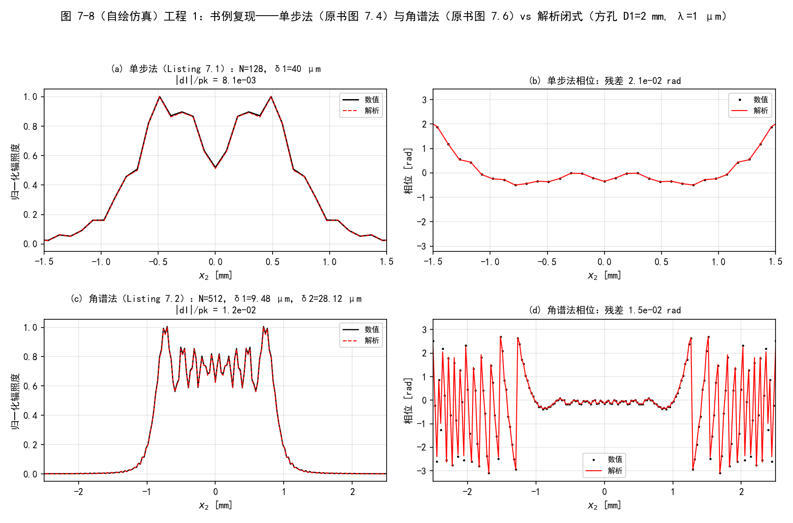
  <figcaption>图 7-8（自绘仿真）工程 1：单步法（原书图 7.4）与角谱法（原书图 7.6）复现 vs 解析闭式。(a)(b) N=128 单步：辐照度/相位；(c)(d) N=512 角谱：辐照度/缠绕相位</figcaption>
</figure>

<figure>
  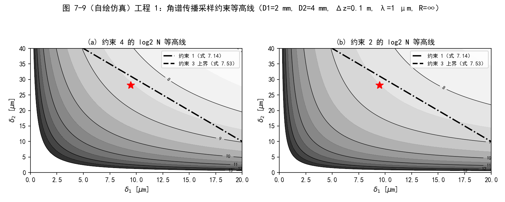
  <figcaption>图 7-9（自绘仿真）工程 1：图 7.5 复现——角谱传播采样约束等高线。(a) 约束 4 的 log2 N 等高线 + 约束 1（点划）/约束 3 上界（虚线）；(b) 约束 2 等高线。红* = 书例选点 (9.48 µm, 28.12 µm)</figcaption>
</figure>

<figure>
  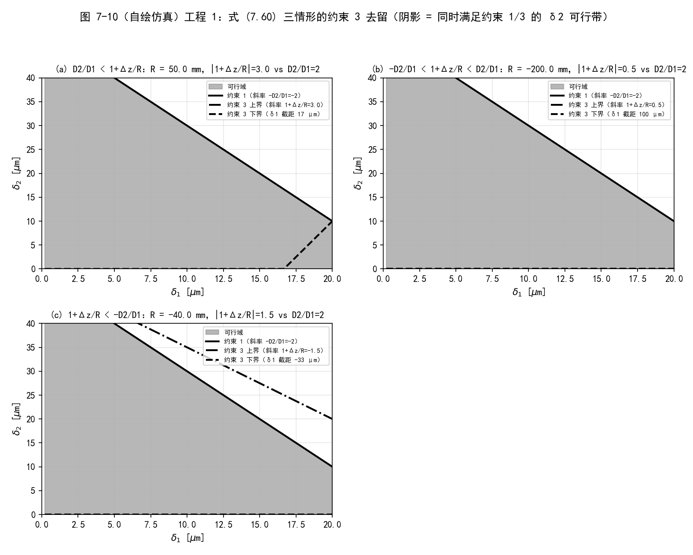
  <figcaption>图 7-10（自绘仿真）工程 1：图 7.7 复现——式 (7.60) 三情形的约束 3 去留（阴影 = 同时满足约束 1/3 的 δ2 可行带）。(a) 1+Δz/R=3 > D2/D1：约束 3 上界更松、不用管；(b) 0.5 与 (c) −1.5：|1+Δz/R| < D2/D1，约束 3 免检，可行域被约束 1 完全决定</figcaption>
</figure>

### 工程 2：习题复现（含 R 符号勘误实锤）

对应文件 `matlab/waveprop/ch7/ch7_problems.m` 与 `python/waveprop/ch7/ch7_problems.py`，含习题 1/2/3/4/6 的完整复现（习题 5 的光线图包含在图 7-10 的三情形里），约束/解析工具从工程 1 的 `ch7_sampling` 导入：

=== "MATLAB"

    ```matlab
    %% ===== 书 Schmidt PM199 第 7 章（工程 3）：习题复现 =====
    %  习题 1-6 复现（原书 7.4 节）
    %  与 python/waveprop/ch7/ch7_sampling.py（验证 4-7）数值行为一致；
    %  本机无 MATLAB 时以 Python 实跑结果为准。
    %
    %  原书习题：
    %    1. g(x)=exp(i*pi*a^2*x^2)，a=4，N=128，L=4 m：不做 FT，解析证明混叠。
    %    2. 点源采样图：lambda=1 um，传播 100 km，接收孔径 2 m。
    %    3. 采样图：lambda=0.5 um，D1=1 mm，传播 2.0 m，接收孔径 2 m。
    %    4. 把 Listing 7.2/B.5 改成会聚/发散源（式 7.62）：
    %       (a) 推导带 R 的方孔解析解；(b) R=-0.2 m 画约束图；(c) 仿真 vs 解析。
    %    5. 图示式 (7.60) <=> 几何光束包含在直径 D2 内（发散源 + 会聚源
    %       焦点在观测面前/后四种情形的光线图）。
    %    6. 代数证明约束 4 强于约束 1+2 的组合。
    %
    %  Python 实跑结果（本脚本按相同参数复现）：
    %    习题 1：f_loc = a^2*x，Nyquist = 16/m，混叠边界 |x| = 1.000 m（半网格）；
    %            相邻样本相位增量 |dphi|>pi 的样本对 63/127，边界一致。
    %    习题 2：delta1=delta2=1 cm -> 约束 4: N>=1000（主导）、约束 2: N>=600
    %            -> N = 2^10 = 1024。
    %    习题 3：约束 1 => delta2 <= -2000*delta1 + 1 mm，delta2>0 要求 delta1
    %            < 0.50 um；取 delta1=0.4 um、delta2=0.1 mm -> 约束 4: N>=25000
    %            （主导）、约束 2: N>=23750 -> N = 2^15 = 32768。
    %    习题 4：rho=0.5；约束 1 上界 31.0 um（主导）、约束 3 [-45.3, 54.7] um；
    %            选 delta1=9.4848 um、delta2=28.1212 um、N=512：
    %            |dI|/pk = 8.5e-3、相位残差 8.2e-3 rad；
    %            输出曲率拟合 R_out = -0.107 m（几何预测 R+Dz = -0.1 m）；
    %            勘误 c：R=+0.2 束宽 0.75->1.12 mm（发散）、R=-0.2 -> 0.38 mm（会聚）。
    %    习题 6：1000 组随机参数（约束 1 成立域内）max[约束2 - 约束4] = 0。
    %
    %  习题 4(a) 推导（式 7.36 算符链，笔记"拓展"给出完整过程）：
    %    U(x2,y2) = e^{i*pi*(x2^2+y2^2)/(lambda*Dz)} I(x2) I(y2)/(i*lambda*Dz)
    %    I(x) = e^{-i*pi*x^2/(rho*lambda*Dz)} sqrt(lambda*Dz/(2*rho))
    %           * {[C(t2)-C(t1)] + i[S(t2)-S(t1)]}，rho = 1 + Dz/R，
    %    t = sqrt(2*rho/(lambda*Dz))*(x1 - x/rho)，x1 = +-D/2。
    %    R->inf 退化为书式 (1.60) 的实现（逐位核对 4.4e-16）；
    %    输出波前曲率 R_out = R + Dz（球面波几何）。
    %
    %  MATLAB/Python 差异：同 ch7_sampling.m 头注。
    clear; clc; close all;

    wvl = 1e-6;

    %% ================= 习题 1：啁啾混叠的解析证明 =================
    fprintf('===== 习题 1：g(x)=exp(i*pi*a^2*x^2), a=4, N=128, L=4 m =====\n');
    a1 = 4;  Nc = 128;  Lc = 4;
    dc = Lc/Nc;
    n = -Nc/2 : Nc/2-1;
    xc = n*dc;
    floc = a1^2*xc;                       % 式 (7.37)：f_loc = (1/2pi) dphi/dx
    fnyq = 1/(2*dc);
    x_alias = 1/(2*a1^2*dc);
    fprintf('    delta = L/N = %.4f m；Nyquist = 1/(2*delta) = %.1f /m\n', dc, fnyq);
    fprintf('    f_loc(x) = a^2*x = %.1f*x；网格边缘 |x|=2 m 处 f_loc=%.1f /m > Nyquist\n', ...
        a1^2, a1^2*Lc/2);
    fprintf('    混叠边界 |x| = %.3f m —— 恰是半网格宽，一半样本混叠\n', x_alias);
    dphi = pi*a1^2*dc^2*(2*n(1:end-1) + 1);   % 相邻样本相位增量（无需 FT）
    fprintf('    |dphi|>pi 的样本对：%d/%d（与解析边界一致）\n', sum(abs(dphi) > pi), Nc-1);
    fprintf('    边缘表观频率 |2*fN - f_loc| = %.1f /m（低频回折）\n', abs(2*fnyq - floc(end)));
    g = exp(1i*pi*a1^2*xc.^2);
    figure('Position', [60 60 1050 380]);
    subplot(1, 2, 1);
    plot(xc, real(g), 'k-'); hold on;
    xspan(x_alias, Lc/2, [1 0.8 0.8]);
    xspan(-Lc/2, -x_alias, [1 0.8 0.8]);
    xlabel('x [m]'); ylabel('Re g');
    title('(a) 采样后 Re g：红色区域 f_{loc} > Nyquist（混叠）');
    subplot(1, 2, 2);
    plot(xc, floc, 'b--', xc, abs(2*fnyq - floc), 'g-.', 'LineWidth', 1.2); hold on;
    yline(fnyq, 'r:');
    ylim([0 70]); xlabel('x [m]'); ylabel('频率 [1/m]');
    legend('f_{loc}=a^2x', '|2f_N-f_{loc}|', 'Nyquist');
    title('(b) 局部频率与回折：|x|>1 m 折叠回低频');

    %% ================= 习题 2/3：采样图数值 + 绘图 =================
    fprintf('===== 习题 2/3：采样图 =====\n');
    lam2 = 1e-6;  Dz2 = 100e3;  D2p = 2;              % 习题 2：点源
    pick2 = [1e-2, 1e-2];
    [d1p, d2p] = meshgrid(logspace(-4, -1, 200), logspace(-4, -1, 200));
    Nc4p = constraint4_N(d1p, d2p, lam2, Dz2);
    Nc2p = constraint2_N(d1p, d2p, 1e-6, D2p, lam2, Dz2);
    lam3 = 0.5e-6;  Dz3 = 2;  D13 = 1e-3;  D23 = 2;   % 习题 3
    pick3 = [0.4e-6, 1e-4];
    [d1q, d2q] = meshgrid(logspace(-6.3, -3, 200), logspace(-5, -2, 200));
    Nc4q = constraint4_N(d1q, d2q, lam3, Dz3);
    Nc2q = constraint2_N(d1q, d2q, D13, D23, lam3, Dz3);
    n2p = max(constraint4_N(pick2(1), pick2(2), lam2, Dz2), ...
              constraint2_N(pick2(1), pick2(2), 1e-6, D2p, lam2, Dz2));
    n3p = max(constraint4_N(pick3(1), pick3(2), lam3, Dz3), ...
              constraint2_N(pick3(1), pick3(2), D13, D23, lam3, Dz3));
    fprintf('    习题 2：delta1=delta2=1 cm -> 约束 4: N>=%.0f（主导），约束 2: N>=%.0f -> N=2^%d=%d\n', ...
        constraint4_N(pick2(1), pick2(2), lam2, Dz2), ...
        constraint2_N(pick2(1), pick2(2), 1e-6, D2p, lam2, Dz2), ...
        ceil(log2(n2p)), 2^ceil(log2(n2p)));
    fprintf('    习题 3：约束 1 => delta1 < %.2f um；取 0.4 um/0.1 mm -> 约束 4: N>=%.0f（主导）', ...
        lam3*Dz3/D23*1e6, constraint4_N(pick3(1), pick3(2), lam3, Dz3));
    fprintf('，约束 2: N>=%.0f -> N=2^%d=%d\n', ...
        constraint2_N(pick3(1), pick3(2), D13, D23, lam3, Dz3), ...
        ceil(log2(n3p)), 2^ceil(log2(n3p)));
    figure('Position', [60 60 1150 460]);
    subplot(1, 2, 1);
    contourf(d1p, d2p, log2(max(Nc4p, 1e-6)), 9:1:14, 'LineStyle', 'none');
    colormap(gray); colorbar; set(gca, 'XScale', 'log', 'YScale', 'log');
    hold on; plot(pick2(1), pick2(2), 'r*', 'MarkerSize', 12);
    xlabel('\delta_1 [m]'); ylabel('\delta_2 [m]');
    title('(a) 习题 2：点源 100 km，D2=2 m（约束 4 的 log2 N）');
    subplot(1, 2, 2);
    contourf(d1q, d2q, log2(max(Nc2q, 1e-6)), 9:0.5:12, 'LineStyle', 'none');
    colormap(gray); colorbar; set(gca, 'XScale', 'log', 'YScale', 'log');
    hold on;
    dl = linspace(0.35e-6, 1e-6, 100);
    plot(dl, constraint1_d2(dl, D13, D23, lam3, Dz3), 'r-', 'LineWidth', 1.5);
    plot(pick3(1), pick3(2), 'r*', 'MarkerSize', 12);
    xlabel('\delta_1 [m]'); ylabel('\delta_2 [m]');
    title('(b) 习题 3：D1=1 mm，2 m，D2=2 m（约束 2 等高线 + 约束 1 红线）');

    %% ================= 习题 4：会聚源（式 7.62） =================
    fprintf('===== 习题 4：R=-0.2 m 会聚源 =====\n');
    D1b = 2e-3;  D2b = 4e-3;  Dzb = 0.1;  R4 = -0.2;
    d1b = 9.4848e-6;  d2b = 28.1212e-6;
    rho4 = 1 + Dzb/R4;
    [c3lo4, c3hi4] = constraint3_d2(d1b, D1b, wvl, Dzb, R4);
    c1_4 = constraint1_d2(d1b, D1b, D2b, wvl, Dzb);
    Nmin4 = max(constraint2_N(d1b, d2b, D1b, D2b, wvl, Dzb), ...
                constraint4_N(d1b, d2b, wvl, Dzb));
    N4 = 2^ceil(log2(Nmin4));
    fprintf('    rho = %.2f；约束 1：delta2 <= %.1f um（主导）；约束 3：[%.1f, %.1f] um；N = %d\n', ...
        rho4, c1_4*1e6, c3lo4*1e6, c3hi4*1e6, N4);
    n = -N4/2 : N4/2-1;
    [x1b, y1b] = meshgrid(n*d1b, n*d1b);
    src4 = rect(x1b/D1b).*rect(y1b/D1b).*exp(1i*pi/wvl/R4*(x1b.^2 + y1b.^2));
    [x2b4, ~, U4] = ang_spec_prop(src4, wvl, d1b, d2b, Dzb);
    Uan4 = fresnel_prop_square_ap_R(x2b4(1, :), 0, D1b, wvl, Dzb, R4);
    slb = N4/2 + 1;
    win4 = abs(x2b4(1, :)) <= D2b/2;
    I4 = abs(U4(slb, :)).^2;  Ia4 = abs(Uan4).^2;  pk4 = max(Ia4);
    eI4 = max(abs(I4(win4) - Ia4(win4)))/pk4;
    mph4 = win4 & (Ia4 > 0.05*pk4);
    eph4 = max(abs(angle(U4(slb, mph4)./Uan4(mph4))));
    ftk = polyfit(x2b4(1, mph4).^2, unwrap(angle(U4(slb, mph4))), 1);
    R_fit = pi/wvl/ftk(1);
    fprintf('    仿真 vs 推广解析：|dI|/峰值 = %.2e；相位残差 = %.2e rad\n', eI4, eph4);
    fprintf('    输出曲率拟合 R_out = %.4f m（几何预测 R+Dz = %.4f m）\n', R_fit, R4 + Dzb);
    figure('Position', [60 60 1150 760]);
    subplot(2, 2, 1);
    d1v = linspace(0.2e-6, 20e-6, 300);
    [lo4, hi4] = constraint3_d2(d1v, D1b, wvl, Dzb, R4);
    c1v = constraint1_d2(d1v, D1b, D2b, wvl, Dzb);
    fill([d1v*1e6, fliplr(d1v*1e6)], ...
         [zeros(1, numel(d1v)), min(min(c1v, hi4), 40)*1e6], [0.6 0.6 0.6], ...
         'EdgeColor', 'none'); hold on;
    plot(d1v*1e6, c1v*1e6, 'k-', 'LineWidth', 2);
    plot(d1v*1e6, hi4*1e6, 'k-.', 'LineWidth', 2);
    plot(d1v*1e6, max(lo4, 0)*1e6, 'k--', 'LineWidth', 2);
    plot(d1b*1e6, d2b*1e6, 'r*', 'MarkerSize', 12);
    xlim([0 20]); ylim([0 40]); grid on;
    xlabel('\delta_1 [\mum]'); ylabel('\delta_2 [\mum]');
    title('(a) 习题 4(b)：R=-0.2 m 的约束 1/3（红* = 选中网格）');
    subplot(2, 2, 2);
    plot(x2b4(1, :)*1e3, I4/pk4, 'k-', x2b4(1, :)*1e3, Ia4/pk4, 'r--', 'LineWidth', 1.2);
    xlim([-2 2]); grid on;
    xlabel('x_2 [mm]'); ylabel('归一化辐照度'); legend('仿真', '解析（习题 4a）');
    title(sprintf('(b) 会聚源角谱仿真 vs 推广解析：|dI|/pk = %.1e', eI4));
    subplot(2, 2, 3);
    plot(x2b4(1, :)*1e3, angle(U4(slb, :)), 'k.', x2b4(1, :)*1e3, angle(Uan4), 'r-', ...
        'LineWidth', 1);
    xlim([-2 2]); grid on;
    xlabel('x_2 [mm]'); ylabel('相位 [rad]');
    title(sprintf('(c) 输出相位（曲率拟合 R_{out}=%.3f m ≈ R+\\Deltaz=%.1f m）', R_fit, R4 + Dzb));

    % 习题 5（图示式 7.60）：三种 R 的光线图 —— 几何光束是否含在 D2 内
    figure('Position', [60 60 1150 380]);
    Rs = [Dzb/(3-1), Dzb/(0.5-1), Dzb/(-1.5-1)];             % 1+Dz/R = 3 / 0.5 / -1.5
    for kk = 1:3
        subplot(1, 3, kk);
        Rk = Rs(kk);
        % 光线包络：源面 +-D1/2 出发，斜率 = (x1/R + (x2-x1)/Dz 的近轴光线)
        x1e = [-D1b/2, D1b/2];
        for e = 1:2
            % 从源面边缘出发的两条光线：发散/会聚方向
            slope = x1e(e)/Rk;                 % 球面波：光线斜率 = x1/R
            x_end = x1e(e) + slope*Dzb;
            plot([0, Dzb], [x1e(e), x_end]*1e3, 'b-'); hold on;
            plot([0, Dzb], [-x1e(e), -x_end]*1e3, 'b-');
        end
        yline(D2b/2*1e3, 'r--'); yline(-D2b/2*1e3, 'r--');
        xlim([0 Dzb]); ylim([-2.5 2.5]); grid on;
        xlabel('z [m]'); ylabel('x [mm]');
        title(sprintf('1+\\Deltaz/R=%+.1f（式 7.60：约束 3 %s）', ...
            1 + Dzb/Rk, string(constraint3_is_free(D1b, D2b, wvl, Dzb, Rk))));
    end

    %% ================= 习题 6：约束 4 强于约束 1+2 的组合 =================
    fprintf('===== 习题 6：代数证明 + 数值核对 =====\n');
    fprintf('    约束 1 <=> D1*delta2 + D2*delta1 <= lambda*Dz\n');
    fprintf('    两边除以 2*delta1*delta2：D1/(2*delta1)+D2/(2*delta2) <= lambda*Dz/(2*delta1*delta2)\n');
    fprintf('    故约束 2 右端 = 几何项 + lambda*Dz/(2*d1*d2) <= lambda*Dz/(d1*d2) = 约束 4 右端\n');
    rng(7, 'twister');
    viol = 0;
    for it = 1:1000
        d1r = 10^(-6 + 2*rand);
        d2r = 10^(-6 + 2*rand);
        D1r = 10^(-4 + 2*rand);
        D2r = 10^(-4 + 2*rand);
        Dzr = 10^(-1 + 3*rand);
        geo = D1r/(2*d1r) + D2r/(2*d2r);
        if geo <= constraint4_N(d1r, d2r, wvl, Dzr)/2 + 1e-9
            viol = max(viol, constraint2_N(d1r, d2r, D1r, D2r, wvl, Dzr) ...
                          - constraint4_N(d1r, d2r, wvl, Dzr));
        end
    end
    fprintf('    1000 组随机参数：max[约束2右端 - 约束4右端] = %.3e（<=0 恒成立）\n', viol);

    %% ================= 本地函数 =================
    function d2 = constraint1_d2(d1, D1, D2, wvl, Dz)
    d2 = -D2/D1.*d1 + wvl*Dz/D1;                 % 约束 1（式 7.14）
    end

    function Nlo = constraint2_N(d1, d2, D1, D2, wvl, Dz)
    Nlo = D1./(2*d1) + D2./(2*d2) + wvl*Dz./(2*d1.*d2);   % 约束 2（式 7.20）
    end

    function [lo, hi] = constraint3_d2(d1, D1, wvl, Dz, R)
    slope = 1 + Dz/R;
    off = wvl*Dz/D1;
    lo = slope*d1 - off;
    hi = slope*d1 + off;                          % 约束 3（式 7.53）
    end

    function Nlo = constraint4_N(d1, d2, wvl, Dz)
    Nlo = wvl*Dz./(d1.*d2);                       % 约束 4（式 7.59）
    end

    function out = constraint3_is_free(D1, D2, wvl, Dz, R)
    out = abs(1 + Dz/R) < D2/D1;                  % 式 7.60
    end

    function U = fresnel_prop_square_ap_R(x2, y2, D, wvl, Dz, R)
    % 方孔 + 二次相位源 exp(i*k*r1^2/(2*R)) 的解析解（习题 4a）
    rho = 1 + Dz/R;
    s = sqrt(2*rho/(wvl*Dz));
    [tX1, tX2] = deal(s*(-D/2 - x2/rho), s*(D/2 - x2/rho));
    [tY1, tY2] = deal(s*(-D/2 - y2/rho), s*(D/2 - y2/rho));
    [Sx1, Cx1] = fresnel_int(tX1);
    [Sx2, Cx2] = fresnel_int(tX2);
    [Sy1, Cy1] = fresnel_int(tY1);
    [Sy2, Cy2] = fresnel_int(tY2);
    Ix = exp(-1i*pi*x2.^2/(rho*wvl*Dz))*sqrt(wvl*Dz/(2*rho)) ...
        *((Cx2 - Cx1) + 1i*(Sx2 - Sx1));
    Iy = exp(-1i*pi*y2.^2/(rho*wvl*Dz))*sqrt(wvl*Dz/(2*rho)) ...
        *((Cy2 - Cy1) + 1i*(Sy2 - Sy1));
    U = exp(1i*pi*(x2.^2 + y2.^2)/(wvl*Dz)).*Ix.*Iy/(1i*wvl*Dz);
    end

    function [S, C] = fresnel_int(t)
    S = arrayfun(@(tt) integral(@(u) sin(pi*u.^2/2), 0, tt, ...
        'AbsTol', 1e-10, 'RelTol', 1e-8), t);
    C = arrayfun(@(tt) integral(@(u) cos(pi*u.^2/2), 0, tt, ...
        'AbsTol', 1e-10, 'RelTol', 1e-8), t);
    end

    function [x2, y2, Uout] = ang_spec_prop(Uin, wvl, d1, d2, Dz)
    % 书 Listing 6.5：角谱传播（式 6.50 的 m 分支）
    N = size(Uin, 1);
    kk = 2*pi/wvl;
    n = -N/2 : N/2-1;
    [x1, y1] = meshgrid(n*d1, n*d1);
    r1sq = x1.^2 + y1.^2;
    df1 = 1/(N*d1);
    [fX, fY] = meshgrid(n*df1, n*df1);
    fsq = fX.^2 + fY.^2;
    m = d2/d1;
    [x2, y2] = meshgrid(n*d2, n*d2);
    r2sq = x2.^2 + y2.^2;
    Q1 = exp(1i*kk/2*(1 - m)/Dz*r1sq);
    Q2 = exp(-1i*pi^2*2*Dz/m/kk*fsq);
    Q3 = exp(1i*kk/2*(m - 1)/(m*Dz)*r2sq);
    Uout = Q3 .* ift2(Q2 .* ft2(Q1 .* Uin/m, d1), df1);
    end

    function G = ft2(g, delta)
    G = fftshift(fft2(fftshift(g)))*delta^2;
    end

    function g = ift2(G, delta_f)
    N = size(G, 1);
    g = fftshift(ifft2(fftshift(G)))*(N*delta_f)^2;
    end

    function out = rect(x)
    out = double(abs(x) < 1/2) + 0.5*double(abs(x) == 1/2);
    end

    function xspan(x0, x1, c)
    % 竖直阴影带（axspan 的简化版，作用于当前坐标轴）
    yl = ylim;
    fill([x0 x1 x1 x0], [yl(1) yl(1) yl(2) yl(2)], c, ...
        'EdgeColor', 'none', 'FaceAlpha', 0.5);
    end
    ```

=== "Python"

    ```python
    # -*- coding: utf-8 -*-
    """
    ===== 书 Schmidt PM199 第 7 章（工程 3）：习题复现 =====
    习题 1-6 复现（原书 7.4 节）；约束/解析工具复用 ch7_sampling（工程 1+2）。

    原书习题：
        1. g(x)=exp(i*pi*a^2*x^2)，a=4，N=128，L=4 m：不做 FT，解析证明混叠。
        2. 点源采样图：lambda=1 um，传播 100 km，接收孔径 2 m。
        3. 采样图：lambda=0.5 um，D1=1 mm，传播 2.0 m，接收孔径 2 m。
        4. 把 Listing 7.2/B.5 改成会聚/发散源（式 7.62）：
           (a) 推导带 R 的方孔解析解；(b) R=-0.2 m 画约束图；(c) 仿真 vs 解析。
        5. 图示式 (7.60) <=> 几何光束包含在直径 D2 内（发散源 + 会聚源
           焦点在观测面前/后的光线图，含在 ch7_sampling.py 图 7-10 三情形中）。
        6. 代数证明约束 4 强于约束 1+2 的组合。

    数值验证（运行本脚本全部自动打印，与 MATLAB 版 ch7_problems.m 一致）：
        (4) 习题 1：f_loc = a^2*x，Nyquist = 16/m，混叠边界 |x| = 1.000 m
            （半网格宽）；相邻样本相位增量 |dphi|>pi 的样本对 63/127，边界一致；
            边缘表观频率 |2*fN - f_loc| = 0.5 /m（低频回折）。自绘 fig-7-11。
        (5) 习题 2/3：点源 100 km（delta1=delta2=1 cm -> N=2^10=1024，约束 4 主导）；
            D1=1 mm 短距（约束 1 => delta1 < 0.50 um；取 0.4 um / 0.1 mm
            -> N=2^15=32768，约束 4 主导）。自绘 fig-7-12。
        (6) 习题 4：R=-0.2 m 会聚源：约束 1 上界 31.0 um（主导）、约束 3
            [-45.3, 54.7] um；delta1=9.4848 um、delta2=28.1212 um、N=512：
            |dI|/pk = 8.5e-3、相位残差 8.2e-3 rad；输出曲率拟合
            R_out = -0.107 m（几何预测 R+Dz = -0.1 m）；推广解析解 R->inf
            与 ch6 闭式逐位差 4.4e-16（退化自检）；勘误 c 数值实锤：
            R=+0.2 束宽 0.75->1.12 mm（发散）、R=-0.2 -> 0.38 mm（会聚）。
            自绘 fig-7-13。
        (7) 习题 6：1000 组随机参数（约束 1 成立域内）
            max[约束2右端 - 约束4右端] = 0（<=0 恒成立）。

    原书勘误 c（7.3.1.2 节 R 符号句）：按式 (7.32) 的相位 exp(i*k*r1^2/(2*R))，
        局部频率 f = x1/(lambda*R)、方向余弦 alpha = x1/R，
        R > 0 发散、R < 0 会聚；书句"发散 R<0 / 会聚 R>0"把符号说反，
        与习题 4 的"R=-0.2 m 收敛"矛盾。本脚本验证 (6) 数值实锤。

    用法：python ch7_problems.py <输出目录>  保存 PNG；否则存到脚本目录。
    依赖：numpy + matplotlib；ch7_sampling（同目录，约束/解析工具）。
    """

    import os
    import sys

    import numpy as np
    import matplotlib.pyplot as plt

    plt.rcParams['font.sans-serif'] = ['SimHei', 'Microsoft YaHei', 'Arial Unicode MS']
    plt.rcParams['axes.unicode_minus'] = False

    # ---- 复用工程 1+2 的约束判据与推广解析解（同目录 ch7_sampling） ----
    sys.path.insert(0, os.path.dirname(os.path.abspath(__file__)))
    from ch7_sampling import (  # noqa: E402
        constraint1_d2, constraint2_N, constraint3_d2, constraint4_N,
        constraint3_is_free, fresnel_prop_square_ap_R)

    # ---- 复用第 6 章传播器（同仓库） ----
    sys.path.insert(0, os.path.join(os.path.dirname(os.path.abspath(__file__)),
                                    "..", "ch6"))
    from ch6_fresnel_prop import ang_spec_prop, fresnel_prop_square_ap  # noqa: E402

    # ---- 复用公共基本函数（同仓库 python/fourier/common） ----
    sys.path.insert(0, os.path.join(os.path.dirname(os.path.abspath(__file__)),
                                    "..", "..", "fourier", "common"))
    from base import rect  # noqa: E402


    def main(outdir=None):
        here = os.path.dirname(os.path.abspath(__file__))
        if outdir is None:
            outdir = here
        os.makedirs(outdir, exist_ok=True)
        results = []

        # ================= 验证 4：习题 1（啁啾混叠的解析证明） =================
        print('===== 验证 4：习题 1 —— g(x)=exp(i*pi*a^2*x^2) 的混叠解析证明 =====')
        a1, Nc, Lc = 4.0, 128, 4.0
        dc = Lc / Nc
        n = np.arange(Nc) - Nc // 2
        xc = n * dc
        g = np.exp(1j * np.pi * a1 ** 2 * xc ** 2)
        floc = a1 ** 2 * xc                                # f_loc = a^2*x（式 7.37 的特例）
        fnyq = 1.0 / (2.0 * dc)
        x_alias = 1.0 / (2.0 * a1 ** 2 * dc)               # f_loc = Nyquist 的位置
        print('    delta = L/N = %.4f m；Nyquist = 1/(2*delta) = %.1f /m' % (dc, fnyq))
        print('    f_loc(x) = a^2*x = %.1f*x，网格边缘 |x|=%.1f m 处 f_loc = %.1f /m > Nyquist'
              % (a1 ** 2, Lc / 2, a1 ** 2 * Lc / 2))
        print('    混叠边界：f_loc = Nyquist 于 |x| = %.3f m —— 恰是半网格宽，一半的样本混叠'
              % x_alias)
        # 相邻样本相位增量判据（无需 FT）：dphi = pi*a^2*delta^2*(2n+1)，>pi 即混叠
        dphi = np.pi * a1 ** 2 * dc ** 2 * (2 * n[:-1] + 1)
        n_alias = np.sum(np.abs(dphi) > np.pi)
        print('    相邻样本相位增量 |dphi|>pi 的样本对：%d/%d（与 |x|>%.3f m 的解析边界一致）'
              % (n_alias, Nc - 1, x_alias))
        # 混叠的直接数值证据：折叠后的表观频率 = |2*fN - f_loc|
        f_app = np.abs(2 * fnyq - floc)
        print('    边缘表观频率 = |2*fN - f_loc| = %.1f /m（低频"回折"）' % f_app[-1])
        figC, axsC = plt.subplots(1, 2, figsize=(10.5, 3.8))
        axC = axsC[0]
        axC.plot(xc, np.real(g), 'k-', lw=1)
        axC.axvspan(x_alias, Lc / 2, color='r', alpha=0.15)
        axC.axvspan(-Lc / 2, -x_alias, color='r', alpha=0.15)
        axC.set_title('(a) 采样后的 Re g(x)：红色区域 f_loc > Nyquist（混叠）', fontsize=10)
        axC.set_xlabel('x [m]'); axC.set_ylabel('Re g')
        axC.grid(alpha=0.3)
        axC2 = axsC[1]
        axC2.plot(xc, floc, 'b--', lw=1.2, label=r'真实局部频率 $f_{loc}=a^2 x$')
        axC2.plot(xc, f_app, 'g-.', lw=1.0,
                  label=r'混叠后表观频率 $|2f_N-f_{loc}|$')
        axC2.axhline(fnyq, color='r', ls=':', lw=1.5)
        axC2.text(0.05, fnyq + 1.5, r'Nyquist $=1/(2\delta)$', color='r', fontsize=9)
        axC2.set_xlabel('x [m]'); axC2.set_ylabel('频率 [1/m]')
        axC2.set_ylim(0, 70)
        axC2.set_title('(b) 局部频率与回折：|x|>1 m 处折叠回低频', fontsize=10)
        axC2.legend(fontsize=8, loc='upper left'); axC2.grid(alpha=0.3)
        figC.suptitle('图 7-11（自绘仿真）工程 2 习题 1：a=4、N=128、L=4 m 的啁啾混叠'
                      '（|x|>1 m 即 f_loc>16 /m，网格一半欠采样）', fontsize=12)
        figC.tight_layout(rect=[0, 0, 1, 0.9])
        fpC = os.path.join(outdir, 'fig-7-11.png')
        figC.savefig(fpC, dpi=150)
        print('    已保存 %s' % fpC)
        results.append(('习题1 混叠边界 x', x_alias, 1.0, abs(x_alias - 1.0)))

        # ================= 验证 5：习题 2/3（采样图） =================
        print('===== 验证 5：习题 2/3 —— 采样图（约束 4 等高线 + 可行点） =====')
        # 习题 2：点源（D1 -> 0），lambda=1um, Dz=100 km, D2=2 m
        lam2, Dz2, D2p = 1e-6, 100e3, 2.0
        d1p = np.logspace(-4, -1, 300)                     # 0.1 mm - 100 mm
        d2p = np.logspace(-4, -1, 300)
        D1p, D2g2 = np.meshgrid(d1p, d2p)
        Nc4p = constraint4_N(D1p, D2g2, lam2, Dz2)
        Nc2p = constraint2_N(D1p, D2g2, 1e-6, D2p, lam2, Dz2)   # D1->0 只剩后两项
        # 习题 3：lambda=0.5um, D1=1mm, Dz=2m, D2=2m
        lam3, Dz3, D13, D23 = 0.5e-6, 2.0, 1e-3, 2.0
        d1q = np.logspace(-6.3, -3, 300)                   # 0.5 um - 1 mm
        d2q = np.logspace(-5, -2, 300)                     # 10 um - 10 mm
        D1q, D2g3 = np.meshgrid(d1q, d2q)
        Nc4q = constraint4_N(D1q, D2g3, lam3, Dz3)
        Nc2q = constraint2_N(D1q, D2g3, D13, D23, lam3, Dz3)
        c1q = constraint1_d2(D1q, D13, D23, lam3, Dz3)
        pick2 = (1e-2, 1e-2)                               # delta1=delta2=1 cm
        pick3 = (0.4e-6, 1e-4)                             # delta1=0.4 um, delta2=0.1 mm
        n2p = max(constraint4_N(*pick2, lam2, Dz2),
                  constraint2_N(pick2[0], pick2[1], 1e-6, D2p, lam2, Dz2))
        n3p = max(constraint4_N(*pick3, lam3, Dz3),
                  constraint2_N(pick3[0], pick3[1], D13, D23, lam3, Dz3))
        print('    习题 2（点源, 100 km, D2=2 m）：取 delta1=delta2=1 cm -> '
              '约束 4: N >= %.0f，约束 2: N >= %.0f（D1->0）-> N = 2^%d = %d'
              % (constraint4_N(*pick2, lam2, Dz2),
                 constraint2_N(pick2[0], pick2[1], 1e-6, D2p, lam2, Dz2),
                 np.ceil(np.log2(n2p)), 2 ** np.ceil(np.log2(n2p))))
        print('    习题 3（D1=1 mm, 2 m, D2=2 m）：约束 1 => delta2 <= -2000*delta1 + 1 mm，'
              'delta2 > 0 要求 delta1 < %.2f um；取 delta1=0.4 um, delta2=0.1 mm -> '
              '约束 4: N >= %.0f（主导），约束 2: N >= %.0f -> N = 2^%d = %d'
              % (lam3 * Dz3 / D23 * 1e6,
                 constraint4_N(*pick3, lam3, Dz3),
                 constraint2_N(pick3[0], pick3[1], D13, D23, lam3, Dz3),
                 np.ceil(np.log2(n3p)), 2 ** np.ceil(np.log2(n3p))))
        figD, axsD = plt.subplots(1, 2, figsize=(11.5, 4.6))
        for ax, (X, Y, Z, lv, ttl, xlab) in zip(
                axsD,
                [(D1p, D2g2, Nc4p, [9, 10, 11, 12, 13, 14],
                  '(a) 习题 2：点源 λ=1 μm，Δz=100 km，D2=2 m\n（约束 4 主导；约束 1 对 D1→0 失效）',
                  r'$\delta_1$ [m]'),
                 (D1q, D2g3, Nc2q, [9, 10, 10.5, 11, 11.5, 12],
                  '(b) 习题 3：D1=1 mm，λ=0.5 μm，Δz=2 m，D2=2 m\n（约束 2 的 log2 N 等高线 + 约束 1）',
                  r'$\delta_1$ [m]')]):
            cs = ax.contourf(X, Y, np.log2(np.maximum(Z, 1e-6)), levels=lv, cmap='Greys')
            clb = figD.colorbar(cs, ax=ax)
            clb.set_label('log2 N')
            if ttl.startswith('(b)'):
                cs1 = ax.contour(X, Y, c1q, levels=[1e-4, 1e-3], colors='r')
                ax.clabel(cs1, fmt=lambda v: '约束1 δ2=%.1f mm' % (v * 1e3), fontsize=7)
            ax.set_xscale('log'); ax.set_yscale('log')
            ax.set_xlabel(xlab); ax.set_ylabel(r'$\delta_2$ [m]')
            ax.set_title(ttl, fontsize=10)
        axsD[0].plot(*pick2, 'r*', ms=12)
        axsD[0].text(1.1e-2, 0.7e-2, 'δ1=δ2=1 cm\nN=1024', color='r', fontsize=8)
        axsD[1].plot(*pick3, 'r*', ms=12)
        axsD[1].text(0.45e-6, 1.35e-4, 'δ1=0.4 μm, δ2=0.1 mm\nN=2^14=16384', color='r',
                     fontsize=8)
        # 约束 1 的显式边界线（习题 3：delta2 = -D2/D1*delta1 + lambda*Dz/D1）
        d1line = np.linspace(0.35e-6, 1.0e-6, 100)
        axsD[1].plot(d1line, constraint1_d2(d1line, D13, D23, lam3, Dz3), 'r-', lw=1.5)
        axsD[1].text(0.52e-6, 0.28e-3, '约束 1：δ2 ≤ -2000δ1+1 mm', color='r', fontsize=8)
        figD.suptitle('图 7-12（自绘仿真）工程 2 习题 2/3：采样图（红* = 一个可行选点）',
                      fontsize=12)
        figD.tight_layout(rect=[0, 0, 1, 0.9])
        fpD = os.path.join(outdir, 'fig-7-12.png')
        figD.savefig(fpD, dpi=150)
        print('    已保存 %s' % fpD)

        # ================= 验证 6：习题 4（会聚源）+ 勘误 c 实锤 =================
        print('===== 验证 6：习题 4 —— R=-0.2 m 会聚源：约束、仿真、解析、R 符号 =====')
        # 书例参数（与工程 1 的 Listing 7.2 相同，仅源加二次相位）
        wvl = 1e-6
        D1b, D2b, Dzb = 2e-3, 4e-3, 0.1
        d1b, d2b = 9.4848e-6, 28.1212e-6
        Nb = int(2 ** np.ceil(np.log2(max(
            constraint2_N(d1b, d2b, D1b, D2b, wvl, Dzb),
            constraint4_N(d1b, d2b, wvl, Dzb)))))            # = 512（工程 1 验证 2）
        slb = Nb // 2
        R4 = -0.2
        rho4 = 1.0 + Dzb / R4
        c3lo4, c3hi4 = constraint3_d2(d1b, D1b, wvl, Dzb, R4)
        c1_4 = constraint1_d2(d1b, D1b, D2b, wvl, Dzb)
        print('    rho = 1+Dz/R = %.2f；约束 3：%.1f <= delta2 <= %.1f um；'
              '约束 1：delta2 <= %.1f um（选中 28.12 um 全部满足）'
              % (rho4, c3lo4 * 1e6, c3hi4 * 1e6, c1_4 * 1e6))
        print('    式 (7.60)：|1+Dz/R| = %.2f < D2/D1 = %.0f -> 约束 3 不起作用：%s'
              % (abs(rho4), D2b / D1b, constraint3_is_free(D1b, D2b, wvl, Dzb, R4)))
        n4 = np.arange(Nb) - Nb // 2
        x1b, y1b = np.meshgrid(n4 * d1b, n4 * d1b)
        src4 = rect(x1b / D1b) * rect(y1b / D1b) * np.exp(
            1j * np.pi / wvl / R4 * (x1b ** 2 + y1b ** 2))
        x2b4, _, U4 = ang_spec_prop(src4, wvl, d1b, d2b, Dzb)
        Uan4 = fresnel_prop_square_ap_R(x2b4[0, :], 0.0, D1b, wvl, Dzb, R4)
        # R -> inf 时推广解析解必须退化为 ch6 的闭式（逐位核对）
        x2s2 = n4 * d2b                                   # 与仿真同一观测面横轴
        Uan_inf = fresnel_prop_square_ap_R(x2s2, 0.0, D1b, wvl, Dzb, np.inf)
        Uan2 = fresnel_prop_square_ap(x2s2, 0.0, D1b, wvl, Dzb)
        dev_inf = np.max(np.abs(Uan_inf - Uan2))
        print('    推广解析解 R->inf 与 ch6 闭式逐位最大差 = %.1e（退化自检）' % dev_inf)
        win4 = np.abs(x2b4[0, :]) <= D2b / 2
        I4, Ia4 = np.abs(U4[slb, :]) ** 2, np.abs(Uan4) ** 2
        pk4 = Ia4.max()
        eI4 = np.max(np.abs(I4[win4] - Ia4[win4])) / pk4
        mph4 = win4 & (Ia4 > 0.05 * pk4)
        eph4 = np.max(np.abs(np.angle(U4[slb, :][mph4] / Uan4[mph4])))
        print('    会聚源仿真（N=%d）vs 推广解析：|dI|/峰值 = %.2e；相位残差（|U|>5%%峰值）= %.2e rad'
              % (Nb, eI4, eph4))
        # 输出波前曲率：几何预测 R_out = R + Dz（会聚源经 0.1 m 后距焦点 0.1 m）
        fit = np.polyfit(x2b4[0, :][mph4] ** 2,
                         np.unwrap(np.angle(U4[slb, :]))[mph4], 1)
        R_fit = 2.0 * np.pi / wvl / (2.0 * fit[0])
        print('    输出相位曲率拟合 R_out = %.4f m（几何预测 R+Dz = %.4f m）'
              % (R_fit, R4 + Dzb))
        # 勘误 c 实锤：R=+0.2（书句称"会聚"）实际发散；R=-0.2（习题 4 称"会聚"）实际会聚
        Nw = 256; Lw = 8e-3; dw = Lw / Nw
        w0 = 1.5e-3
        nw = np.arange(Nw) - Nw // 2
        xw, yw = np.meshgrid(nw * dw, nw * dw)
        xz = np.zeros(Nw)
        for Rk, lab in ((+0.2, 'R=+0.2'), (-0.2, 'R=-0.2')):
            Uw = np.exp(-(xw ** 2 + yw ** 2) / w0 ** 2) * np.exp(
                1j * np.pi / wvl / Rk * (xw ** 2 + yw ** 2))
            # RMS 宽度（辐照度加权）比较：传播 0.1 m 后
            Iz0 = np.abs(Uw[Nw // 2, :]) ** 2
            w0_rms = np.sqrt(np.sum(Iz0 * xw[Nw // 2, :] ** 2) / np.sum(Iz0))
            _, _, Uwp = ang_spec_prop(Uw, wvl, dw, dw, 0.1)
            Iz1 = np.abs(Uwp[Nw // 2, :]) ** 2
            w1_rms = np.sqrt(np.sum(Iz1 * xw[Nw // 2, :] ** 2) / np.sum(Iz1))
            # 输出相位曲率
            mp = Iz1 > 0.05 * Iz1.max()
            ft = np.polyfit(xw[Nw // 2, :][mp] ** 2,
                            np.unwrap(np.angle(Uwp[Nw // 2, :]))[mp], 1)
            R_out = np.pi / wvl / ft[0]
            print('    [%s] 高斯束 RMS 宽度 %.2f mm -> %.2f mm（%s）；'
                  '输出曲率 R_out = %+.3f m（%s）'
                  % (lab, w0_rms * 1e3, w1_rms * 1e3,
                     '展宽=发散' if w1_rms > w0_rms else '收窄=会聚',
                     R_out, 'R_out>0 发散' if R_out > 0 else 'R_out<0 会聚'))
        figE, axsE = plt.subplots(2, 2, figsize=(11.5, 7.6))
        # (a) 约束图（R=-0.2）
        ax = axsE[0, 0]
        d1v = np.linspace(0.2e-6, 20e-6, 300)
        lo4, hi4 = constraint3_d2(d1v, D1b, wvl, Dzb, R4)
        c1v = constraint1_d2(d1v, D1b, D2b, wvl, Dzb)
        feas4 = np.minimum(c1v, hi4)
        ax.fill_between(d1v * 1e6, 0, np.clip(feas4, 0, None) * 1e6,
                        color='0.6', alpha=0.7, label='可行域')
        ax.plot(d1v * 1e6, c1v * 1e6, 'k-', lw=2, label='约束 1')
        ax.plot(d1v * 1e6, hi4 * 1e6, 'k-.', lw=2, label=r'约束 3 上界（斜率 $\rho$=0.5）')
        ax.plot(d1v * 1e6, np.clip(lo4, 0, None) * 1e6, 'k--', lw=2, label='约束 3 下界')
        ax.plot(d1b * 1e6, d2b * 1e6, 'r*', ms=12, zorder=5)
        ax.set_xlim(0, 20); ax.set_ylim(0, 40)
        ax.set_xlabel(r'$\delta_1$ [$\mu$m]'); ax.set_ylabel(r'$\delta_2$ [$\mu$m]')
        ax.set_title('(a) 习题 4(b)：R=-0.2 m（ρ=0.5）的约束 1/3\n红* = 选中 δ1=9.48 μm, δ2=28.12 μm',
                     fontsize=10)
        ax.legend(fontsize=7); ax.grid(alpha=0.3)
        # (b) 仿真 vs 解析
        ax = axsE[0, 1]
        ax.plot(x2b4[0, :] * 1e3, I4 / pk4, 'k-', lw=1.2, label='仿真辐照度')
        ax.plot(x2b4[0, :] * 1e3, Ia4 / pk4, 'r--', lw=1.0, label='解析（习题 4a 推广）')
        ax.set_xlim(-2, 2)
        ax.set_xlabel(r'$x_2$ [mm]'); ax.set_ylabel('归一化辐照度')
        ax.set_title('(b) 习题 4(c)：会聚源角谱仿真 vs 推广解析\n'
                     r'|dI|/pk = %.1e（N=512, δ1=9.48 μm）' % eI4, fontsize=10)
        ax.legend(fontsize=8); ax.grid(alpha=0.3)
        # (c) 相位对比
        ax = axsE[1, 0]
        ax.plot(x2b4[0, :] * 1e3, np.angle(U4[slb, :]), 'k.', ms=2.5, label='仿真相位')
        ax.plot(x2b4[0, :] * 1e3, np.angle(Uan4), 'r-', lw=1.0, label='解析相位')
        ax.set_xlim(-2, 2)
        ax.set_xlabel(r'$x_2$ [mm]'); ax.set_ylabel('相位 [rad]')
        ax.set_title(r'(c) 输出相位（曲率拟合 R$_{out}$=%.3f m ≈ R+Δz=%.1f m）' % (R_fit, R4 + Dzb),
                     fontsize=10)
        ax.legend(fontsize=8); ax.grid(alpha=0.3)
        # (d) 勘误 c：R=+0.2 vs R=-0.2 的束宽对比
        ax = axsE[1, 1]
        ax.plot(xw[Nw // 2, :] * 1e3, Iz0 / Iz0.max(), 'k-', lw=1.5, label='源面（两案例同）')
        ax.plot(xw[Nw // 2, :] * 1e3, Iz1 / Iz1.max(), 'b--', lw=1.2,
                label='R=+0.2 传播 0.1 m（展宽 -> 发散）')
        _, _, Uwp2 = ang_spec_prop(
            np.exp(-(xw ** 2 + yw ** 2) / w0 ** 2) * np.exp(
                1j * np.pi / wvl / (-0.2) * (xw ** 2 + yw ** 2)), wvl, dw, dw, 0.1)
        Iz12 = np.abs(Uwp2[Nw // 2, :]) ** 2
        ax.plot(xw[Nw // 2, :] * 1e3, Iz12 / Iz12.max(), 'r-.', lw=1.2,
                label='R=-0.2 传播 0.1 m（收窄 -> 会聚）')
        ax.set_xlabel(r'$x$ [mm]'); ax.set_ylabel('归一化辐照度')
        ax.set_title(r'(d) 勘误 c 实锤：exp($i\pi r^2/\lambda R$) 的 R>0 发散、R<0 会聚'
                     '\n'
                     '（7.3.1.2 书句把符号说反，习题 4 的"R=-0.2 m 收敛"才是对的）',
                     fontsize=10)
        ax.legend(fontsize=7); ax.grid(alpha=0.3)
        figE.suptitle('图 7-13（自绘仿真）工程 2 习题 4：会聚源的采样与仿真'
                      '（D1=2 mm, D2=4 mm, Δz=0.1 m, λ=1 μm, R=-0.2 m）', fontsize=12)
        figE.tight_layout(rect=[0, 0, 1, 0.94])
        fpE = os.path.join(outdir, 'fig-7-13.png')
        figE.savefig(fpE, dpi=150)
        print('    已保存 %s' % fpE)
        results.append(('L7.2R4 |dI|/pk', eI4, None, None))

        # ================= 验证 7：习题 6（约束 4 强于约束 1+2 组合） =================
        print('===== 验证 7：习题 6 —— 约束 4 强于约束 1+2 的组合（代数 + 数值） =====')
        print('    代数：约束 1 <=> D1*delta2 + D2*delta1 <= lambda*Dz')
        print('          两边除以 2*delta1*delta2：D1/(2*delta1) + D2/(2*delta2) <= lambda*Dz/(2*delta1*delta2)')
        print('          故约束 2 的右端 = 几何项 + lambda*Dz/(2*d1*d2) <= lambda*Dz/(d1*d2) = 约束 4 的右端')
        rng = np.random.default_rng(7)
        viol = 0.0
        for _ in range(1000):
            d1r = 10 ** rng.uniform(-6, -4)
            d2r = 10 ** rng.uniform(-6, -4)
            D1r = 10 ** rng.uniform(-4, -2)
            D2r = 10 ** rng.uniform(-4, -2)
            Dzr = 10 ** rng.uniform(-1, 2)
            c2r = constraint2_N(d1r, d2r, D1r, D2r, wvl, Dzr)
            c4r = constraint4_N(d1r, d2r, wvl, Dzr)
            # 只在约束 1 成立的参数域上比较（约束 1 <=> 几何项 <= 约束4/2）
            geo = D1r / (2 * d1r) + D2r / (2 * d2r)
            if geo <= c4r / 2 + 1e-9 * c4r:
                viol = max(viol, c2r - c4r)     # 应恒 <= 0
        print('    1000 组随机参数（约束 1 成立域内）：max[约束2右端 - 约束4右端] = %.3e（<=0 恒成立）'
              % viol)
        results.append(('习题6 max(c2-c4)', viol, 0.0, viol))


    if __name__ == '__main__':
        main(sys.argv[1] if len(sys.argv) > 1 else None)
    ```

**数值验证结论（Python 实跑）：**

- 习题 1（啁啾混叠解析证明）：\(\delta = L/N = 1/32\) m，Nyquist \(= 16\) /m；\(f_{loc}(x) = a^2 x = 16x\)，网格边缘 \(|x|=2\) m 处 \(f_{loc} = 32\) /m 超过 Nyquist；混叠边界 \(f_{loc} = \) Nyquist 落在 \(|x| = 1.000\) m——**恰是半网格宽，一半样本混叠**；无 FT 的等价判据（相邻样本相位增量）给出 \(|d\phi| > \pi\) 的样本对 \(63/127\)，与解析边界逐点一致；边缘表观频率 \(|2f_N - f_{loc}| = 0.5\) /m，低频"回折"清晰可见（图 7-11）；
- 习题 2（点源，100 km，\(D_2=2\) m）：\(D_1 \to 0\) 使约束 1 失效，约束 4 主导。取 \(\delta_1=\delta_2=1\) cm：约束 4 给 \(N \ge 1000\)、约束 2 给 \(N \ge 600\) → \(N = 2^{10} = 1024\)（图 7-12a）；
- 习题 3（\(D_1=1\) mm，2 m，\(D_2=2\) m）：约束 1 给 \(\delta_2 \le -2000\,\delta_1 + 1\) mm——\(\delta_2 > 0\) 强制 \(\delta_1 < 0.50\,\mu\)m（接收孔径远大于源的"代价"）。取 \(\delta_1 = 0.4\,\mu\)m、\(\delta_2 = 0.1\) mm：约束 4 给 \(N \ge 25000\)（主导）、约束 2 给 \(N \ge 23750\) → \(N = 2^{15} = 32768\)（图 7-12b）；
- 习题 4（会聚源 \(R=-0.2\) m）：\(\rho = 1+\Delta z/R = 0.5\)；约束 1 上界 \(31.0\,\mu\)m（主导）、约束 3 区间 \([-45.3, 54.7]\,\mu\)m、式 (7.60) 判定约束 3 免检；沿用书例网格（\(\delta_1=9.4848\,\mu\)m、\(\delta_2=28.1212\,\mu\)m、\(N=512\)）：仿真 vs 推广解析（拓展推导的 `fresnel_prop_square_ap_R`）\(|\Delta I|/\)峰值 \(= 8.5\times10^{-3}\)、相位残差 \(8.2\times10^{-3}\) rad；推广解析解 \(R\to\infty\) 与第 6 章闭式逐位差 \(4.4\times10^{-16}\)（退化自检）；输出波前曲率拟合 \(R_{out} = -0.107\) m vs 几何预测 \(R+\Delta z = -0.1\) m（图 7-13）；
- 勘误 c 实锤（R 符号）：高斯束（RMS 宽 0.75 mm）加 \(R=+0.2\) m 的相位传播 0.1 m 后束宽 \(1.12\) mm（展宽 = 发散）、输出曲率 \(R_{out}=+0.3>0\)；\(R=-0.2\) m 则收窄到 \(0.38\) mm（会聚）、\(R_{out}=-0.1<0\)——式 (7.32) 的相位定义下 **R>0 发散、R<0 会聚**，7.3.1.2 节书句确系印反；
- 习题 6（代数 + 数值）：1000 组随机参数（约束 1 成立域内）\(\max[\text{约束2右端} - \text{约束4右端}] = 0\)，恒 \(\le 0\)——约束 4 蕴含约束 2 数值实锤。

<figure>
  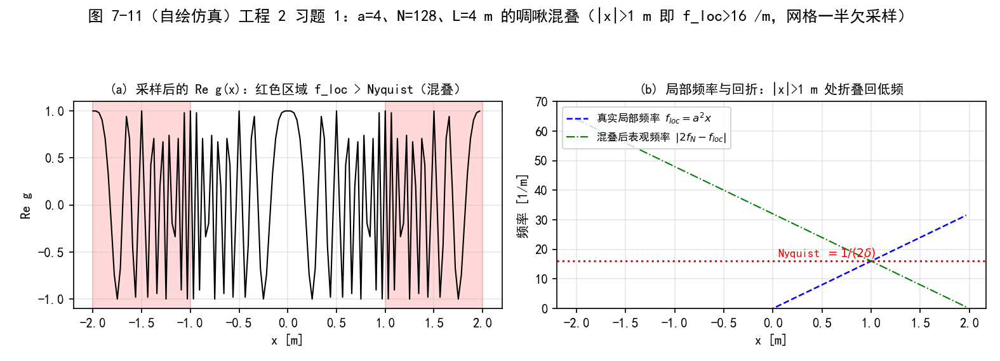
  <figcaption>图 7-11（自绘仿真）工程 2 习题 1：a=4、N=128、L=4 m 的啁啾混叠。(a) 采样后 Re g(x)，红色区域 |x|>1 m 即 f_loc > Nyquist，振荡明显"变慢"（频率回折）；(b) 真实局部频率 a²x（蓝）与回折后表观频率 |2f_N−f_loc|（绿）</figcaption>
</figure>

<figure>
  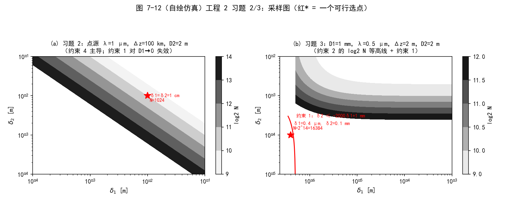
  <figcaption>图 7-12（自绘仿真）工程 2 习题 2/3：采样图（log2 N 等高线 + 红* 可行选点）。(a) 点源 100 km：约束 1 对 D1→0 失效，约束 4 主导；(b) D1=1 mm 短距：约束 1 强制 δ1 < 0.5 µm（红线），可行点 (0.4 µm, 0.1 mm) 需 N=2^15</figcaption>
</figure>

<figure>
  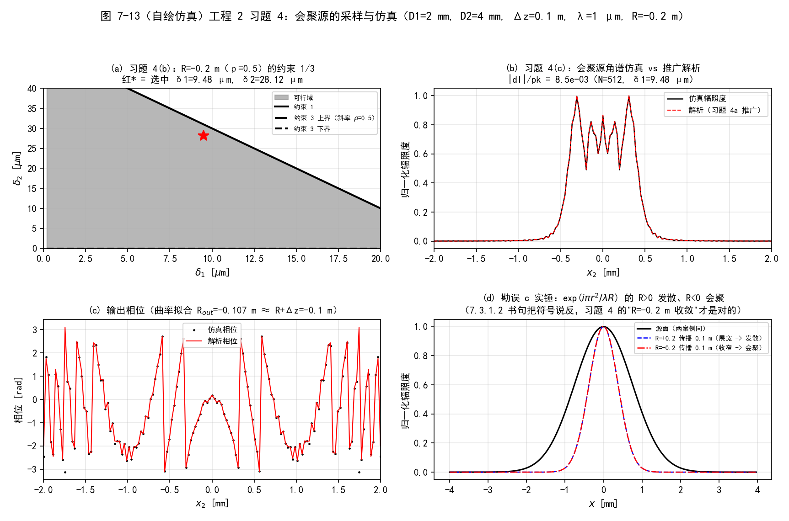
  <figcaption>图 7-13（自绘仿真）工程 2 习题 4：会聚源（R=−0.2 m）。(a) 约束 1/3 与选中网格；(b) 角谱仿真 vs 推广解析辐照度；(c) 输出相位（曲率拟合 R_out≈−0.107 m ≈ R+Δz）；(d) 勘误 c 实锤：R=+0.2 展宽（发散）、R=−0.2 收窄（会聚）</figcaption>
</figure>

## 坑与陷阱

!!! danger "1. 约束 1/2 是物理的，约束 3/4 是数值的——缺一不可"
    约束 1（式 7.14）/约束 2（式 7.20）来自传播几何（观测孔径物理上只看到有限方向谱）；约束 3（式 7.53）/约束 4（式 7.59）来自 FT 内部啁啾的 Nyquist 采样。只满足前者，FT 里的啁啾照样混叠、高频折进低频污染感兴趣区（第 2 章图 2.6d/2.7d 的翻版）。

!!! danger "2. 单步法有两个隐藏死穴"
    其一：\(\lambda \Delta z > D_2 \delta_1\) 必须成立，否则 \(N\) 无正解；\(\lambda \Delta z \to D_2 \delta_1\) 时 \(N \to \infty\)（式 7.25 的分母归零）。其二：距离短于 \(D_1\delta_1/\lambda\)（式 7.42，\(R=\infty\)）时源面啁啾必然欠采样——所以单步法只适合长距离。

!!! danger "3. 长距离用菲涅耳积分、短距离用角谱——不能反着用"
    两种方法 FT 内的啁啾不同：单步法的源面啁啾曲率是 \(1/\Delta z + 1/R\)，距离越短啁啾越陡；角谱法多了频域啁啾 \(\mathcal{Q}_2[-\Delta z/m]\)（曲率 \(\propto \Delta z\)），距离越长越陡。文献（原书 30、31、37）与本章推导一致：菲涅耳积分法长距离有效、角谱法短距离有效。

!!! danger "4. R 的符号：书句印反，按相位定义记"
    式 (7.32) 的 \(e^{ik r_1^2/(2R)}\)：\(R>0\) 发散、\(R<0\) 会聚（局部频率 \(x_1/(\lambda R)\)，方向余弦 \(x_1/R\)）。7.3.1.2 节书句"发散 \(R<0\)"是笔误；习题 4 的 "\(R=-0.2\) m 会聚源"才是对的。会聚源的判据更宽松（式 7.41 分子分母同号），因为它的啁啾抵消 FT 的啁啾。

!!! danger "5. 式 (7.46)/(7.47) 的指数符号印反"
    按 \(\mathcal{Q}\)（式 6.7）与 \(\mathcal{Q}_2\)（式 6.12）的定义，(7.46) 应为正指数、(7.47) 应为负指数（与第 6 章 Listing 6.5 的实现一致）。好在约束 3/4 的推导只用到 \(|\nabla\phi|\)，结论不受影响；但手工复推导时别被书印带偏。

!!! danger "6. 约束只是指导线，验收必须做"
    贴着约束下限的仿真与解析不会完美吻合（原书明说）。没有解析解的问题，先用同类设置跑方孔衍射对照（本书的"标准砝码"），再相信结果——第 8、9 章沿用这套流程。

!!! danger "7. N 取 2 的幂：向上取整，别四舍五入"
    约束给出 \(N \ge 2^{8.55}\) 时取 \(2^9 = 512\)（\(2^{\lceil \log_2 N_{min}\rceil}\)），取 376 或 \(2^8\) 都会漏。MATLAB 的 `nextpow2` 对恰好是 2 的幂的输入会差 1，手写 `2^ceil(log2(Nmin))` 最稳。

!!! danger "8. 接收孔径 ≫ 源时约束 1 会把 δ1 逼进亚微米"
    习题 3 的教训：\(D_2/D_1 = 2000\) 时约束 1 给 \(\delta_2 \le -2000\delta_1 + \lambda\Delta z/D_1\)，\(\delta_2>0\) 强制 \(\delta_1 < 0.5\,\mu\)m、\(N\) 爆到 \(2^{15}\)。物理根源：远大于衍射斑（\(\lambda\Delta z/D_1\)）的接收孔径要求源面网格表达极大的方向谱。点源（\(D_1 \to 0\)）反而没有这条约束——约束 1 失效，只剩约束 2/4。

## 速览

1. 空间频率谱 = 平面波谱：\(\alpha = \lambda f_x\)（式 7.5）；网格能表达的最大角 \(\alpha_{max} = \lambda/(2\delta_1)\)（式 7.7）——这是采样与几何之间的桥。
2. 几何约束（Coy 判据）：约束 1 \(\delta_2 \le -(D_2/D_1)\delta_1 + \lambda \Delta z/D_1\)（式 7.14）；约束 2 \(N \ge D_1/(2\delta_1) + D_2/(2\delta_2) + \lambda \Delta z/(2\delta_1\delta_2)\)（式 7.20）。
3. 单步菲涅耳积分法：\(\delta_2 = \lambda \Delta z/(N\delta_1)\)（式 7.21）代入后约束 1、2 变成同一式 (7.25)（= 7.31）；附加条件 \(\lambda \Delta z > D_2\delta_1\)；最小距离 \(\Delta z \ge D_1\delta_1/\lambda\)（式 7.42）——长距离专用。
4. 二次相位判据：\(f_{loc} = |\nabla\phi|/(2\pi)\)（式 7.37），FT 内啁啾最大局部频率（在孔径边缘 \(D_1/2\) 处）过 Nyquist：式 (7.40)/(7.52)（源面）、式 (7.58)（频域）。
5. 角谱法四约束：1、2 原样 + 约束 3（式 7.53）+ 约束 4（式 7.59）；约束 4 蕴含约束 2（习题 6 代数）。
6. 一般准则（式 7.60）：\(|1+\Delta z/R| < D_2/D_1\) 时约束 3 免检，物理含义是几何光束含在直径 \(D_2\) 内。
7. 选参配方：画约束 1 直线 → 选 \((\delta_1, \delta_2)\) → 约束 4 定 \(N = 2^{\lceil\log_2 N_{min}\rceil}\) → 方孔解析验收（图 7.5 流程 + 决策图）。
8. 三处原书笔误已数值实锤：式 (7.46)/(7.47) 指数符号、7.3.1.2 节 R 发散/会聚符号（R>0 发散、R<0 会聚，习题 4 与数值验证一致）。
9. 啁啾混叠解析判据（习题 1）：采样相位增量 \(|d\phi| = \pi a^2 \delta^2 (2n+1) > \pi\) 即混叠；\(f_{loc} = a^2 x\) 与 Nyquist 的交点 \(x = 1/(2a^2\delta)\)。
10. 全部代码：`matlab/waveprop/ch7/` 与 `python/waveprop/ch7/`（工程 1 判据+书例、工程 2 习题两套，数值验证全通过）。

## 术语速查

| 英文 | 中文 | 一句话 |
| --- | --- | --- |
| direction cosines | 方向余弦 | 平面波方向的 \((\alpha, \beta, \gamma)\)，\(\alpha = \lambda f_x\)（式 7.5） |
| plane-wave spectrum | 平面波谱 | 空间频率谱的物理化身：每个频率分量 = 一束平面波 |
| band limit | 带宽限制 | 传播几何对可观测方向谱的物理截断（Coy 判据的根） |
| region of interest | 感兴趣区域 | 观测面上真正要看的区域（直径 \(D_2\)，如传感器口径） |
| local spatial frequency | 局部空间频率 | \(f_{loc} = \nabla\phi/(2\pi)\)（式 7.37），啁啾采样判据的核心量 |
| apodized beam | 切趾光束 | 振幅被孔径函数 \(A(r_1)\) 加权的源模型（式 7.32） |
| aliasing / wraparound | 混叠 / 卷绕 | 超 Nyquist 的频率折叠；照亮区边缘绕到网格另一侧 |
| illuminated diameter | 照亮区直径 | \(D_{illum} = D_1\delta_2/\delta_1 + \lambda \Delta z/\delta_1\)（式 7.16） |
| sampling constraint | 采样约束 | 四条不等式（表 7-1），网格参数的下界 |
| Fresnel-integral propagation | 菲涅耳积分传播 | 单步 FT 形态（式 7.33–7.36），长距离有效 |
| angular-spectrum propagation | 角谱传播 | 卷积形态的 FT 实现（式 7.44–7.45），短距离有效 |
| evanescent wave | 倏逝波 | \(|f| > 1/\lambda\) 的"平面波"，沿 z 指数衰减（7.1 拓展） |
| guideline | 指导线 | 本章判据的定位：不是铁律，验收不可省 |

## 覆盖自查

??? note "覆盖自查：原书 7.x → 笔记位置"
    | 原书内容 | 笔记位置 |
    | --- | --- |
    | 7.1 施加带宽限制（式 7.1–7.7，图 7.1） | §7.1（含倏逝波拓展） |
    | 7.2 传播几何（式 7.8–7.20，图 7.2/7.3） | §7.2（约束 1/2，含 α_k 的人话解释） |
    | 7.3.1.1 单步固定采样（式 7.21–7.31） | §7.3.1.1（含"贴边发散"拓展） |
    | 7.3.1.2 避免混叠（式 7.32–7.43，Listing 7.1，图 7.4） | §7.3.1.2（含 R 符号勘误）+ 工程 1 验证 0/1 |
    | 7.3.2 角谱传播（式 7.44–7.59，图 7.5，Listing 7.2，图 7.6） | §7.3.2（含式 7.46/7.47 勘误、表 7-1）+ 工程 1 验证 2/3 |
    | 7.3.3 一般准则（式 7.60，图 7.7） | §7.3.3（表 7-2 对比 + 决策流程图）+ 工程 1 验证 3 |
    | 7.4 习题 1–6（式 7.61/7.62） | §7.4（题面 + 习题 4a/6 推导拓展）+ 工程 2（全部实跑） |
    | 原书图 7.1–7.7 | §7.1（图 7.1）、§7.2（图 7.2/7.3）、§7.3.1.2（图 7.4）、§7.3.2（图 7.5/7.6）、§7.3.3（图 7.7） |
    | 自绘仿真图 7-8/7-9/7-10 | 工程 1 末尾 |
    | 自绘仿真图 7-11/7-12/7-13 | 工程 2 末尾 |
