# 第 8 章 用部分传播放宽采样约束

> **本章解决**：角谱传播在长距离下的混叠死结——自由空间传递函数随 \(\Delta z\) 增大振荡越来越快，卷绕伪影从网格边缘一步步爬进感兴趣区域，而约束 4 要求的网格点数随 \(\Delta z\) 线性膨胀到不可行。方法是把一次全长传播拆成 \(n-1\) 次短距的"部分传播"，在每个平面用超高斯或图基窗做的吸收边界吃掉边缘能量；配套给出任意平面数的算符链与逐段采样约束——约束 3 与分段数无关，约束 4 给出单段最大距离 \(\min(\delta_1,\delta_n)^2 N/\lambda\)。学完能为给定的波长、孔径与距离配出一组网格小、无卷绕的多平面传播参数。

## 8.0 本章导图

<div class="brtree">
  <div class="brrow">
    <span class="brlabel root">用部分传播放宽采样约束</span>
    <span class="brace"></span>
    <div class="brkids">
      <div class="brrow">
        <span class="brlabel">为什么分段（章首）</span>
        <span class="brace"></span>
        <div class="brkids">
          <span class="brleaf">约束 4 只跟方法有关：随 Δz 线性变紧</span>
          <span class="brleaf">N &gt; 4096 不可行；缩短 Δz 约束 4 自动放松</span>
          <span class="brleaf">卷绕从网格边缘爬向中心（传递函数振荡加快）</span>
          <span class="brleaf">分段在数学上 ≡ 一次全长传播，治的是卷绕</span>
        </div>
      </div>
      <div class="brrow">
        <span class="brlabel">吸收边界（8.1）</span>
        <span class="brace"></span>
        <div class="brkids">
          <span class="brleaf">超高斯窗（式 8.1）：n &gt; 2</span>
          <span class="brleaf">图基窗（式 8.2）：α 定平顶宽窄</span>
          <span class="brleaf">汉明/巴特利特不合格：中心也被压低</span>
          <span class="brleaf">文献谱系：Flatté / Rubio / Frehlich / Martin–Flatté</span>
        </div>
      </div>
      <div class="brrow">
        <span class="brlabel">两次部分传播（8.2）</span>
        <span class="brace"></span>
        <div class="brkids">
          <span class="brleaf">相似三角形 → δ2 线性插值（式 8.3–8.8）</span>
          <span class="brleaf">算符链（式 8.9）：两个角谱传播 + 中平面吸收边界</span>
          <span class="brleaf">中平面两个啁啾互逆抵消（式 8.10–8.16）</span>
          <span class="brleaf">重排成"每段一段括号"（式 8.17）</span>
        </div>
      </div>
      <div class="brrow">
        <span class="brlabel">任意次部分传播（8.3）</span>
        <span class="brace"></span>
        <div class="brkids">
          <span class="brleaf">通用记号（表 8.2–8.4）：δi 随 αi 插值</span>
          <span class="brleaf">连乘公式（式 8.18）</span>
          <span class="brleaf">书 Listing 8.1：ang_spec_multi_prop_vac</span>
        </div>
      </div>
      <div class="brrow">
        <span class="brlabel">采样与书例（8.4）</span>
        <span class="brace"></span>
        <div class="brkids">
          <span class="brleaf">约束 1/2 原样；约束 3 与分段数无关（式 8.22）</span>
          <span class="brleaf">约束 4 按段：Δzi ≤ min²(δ1,δn)·N/λ（式 8.24）</span>
          <span class="brleaf">三步选参：定网格 → 定 Δzmax → 可多分段</span>
          <span class="brleaf">书例（式 8.25、图 8.5/8.6、Listing 8.2）</span>
        </div>
      </div>
      <div class="brrow">
        <span class="brlabel">习题（8.5）</span>
        <span class="brace"></span>
        <div class="brkids">
          <span class="brleaf">习题 1：吸收边界预乘压掉啁啾混叠</span>
          <span class="brleaf">习题 2：补全式 8.20→8.22 的 α 消去</span>
          <span class="brleaf">习题 3：点源 100 km——分段无收益的情形</span>
          <span class="brleaf">习题 4：环形孔径聚焦 100 km——21 段实测</span>
        </div>
      </div>
    </div>
  </div>
</div>

## 8.1 吸收边界

第 7 章的四条采样约束对角谱法相当苛刻：角谱法本就只适合短距离传播，而它的头号麻烦是**卷绕（wrap-around）**——混叠把网格一头的能量"瞬移"到另一头。文献里的对策大多围绕"空间上衰减 + 滤波光场"展开：比如 Johnston 与 Lane 的做法是把自由空间传递函数（第 6 章式 6.32）滤一滤，再按滤波带宽定网格尺寸、按 7.3.2 节的办法定采样间隔。这套方案能用，但滤波带宽与具体哪里卷绕是**间接**挂钩的。本章走更直接的路。

先看清困境的结构。固定 \(D_1\)、\(\lambda\)、\(D_2\)、\(\delta_n\)（通常 \(\Delta z\) 也是几何给死的），第 7 章的约束 1、3、4 就必须满足；唯一自由的参数往往只剩 \(N\)，而 \(\Delta z\) 一大，约束把 \(N\) 顶到天上——书举的量级是 \(N > 4096\)。罪魁通常是**约束 4**：\(N \ge \lambda \Delta z/(\delta_1\delta_2)\)（式 7.59）只跟传播方法有关，跟传播几何无关。反过来读它：固定 \(N\)、\(\delta_1\)、\(\delta_2\)、\(\lambda\) 而把 \(\Delta z\) 缩短，约束 4 只会**更松**。那就把全长拆成几段短距传播——这就是本章的"部分传播（partial propagation）"。

但先泼一盆冷水：**多次部分传播在数学上与一次全长传播完全等价**，多跑几段只是多花执行时间。它真正要治的是卷绕：自由空间传递函数随 \(\Delta z\) 增大变化越来越剧烈，卷绕伪影从网格边缘一步步渗进中心。部分传播给了你一个单次传播没有的机会——**沿途每一站都可以衰减网格边缘**，把卷积压死在路上。这样既扩大了仿真方法的可用范围，也可以反过来缩小网格；多花的变换次数通常能被更小的 \(N\) 赚回来（大多数情况下总时间反而更短）。

具体操作很朴素：在每个部分传播平面上把光场乘一个衰减因子。这与数据加窗（data windowing）像，但有个硬约束——**不能动网格中心的光**。所以衰减因子必须中心接近 1、边缘接近 0。常用的数据窗如汉明窗（Hamming window）与巴特利特窗（Bartlett window）中心也被压低，不合格。合格的两个：

**超高斯（super-Gaussian）衰减因子**（式 8.1）：

\[
g_{sg}(x, y) = \exp\!\left[-\left(\frac{r}{\sigma}\right)^{n}\right], \qquad n > 2,
\tag{8.1}
\]

**图基窗（Tukey window，又叫余弦锥削窗 cosine-taper）**（式 8.2，按图 8.1 与标准定义修正书写，书印的两处笔误见下方 warning）：

\[
g_{ct}(x, y) =
\begin{cases}
1, & r \le \alpha L/2, \\
\dfrac{1}{2}\left[1 + \cos\!\left(\dfrac{\pi\,(r - \alpha L/2)}{(1-\alpha)\,L/2}\right)\right], & \alpha L/2 \le r \le L/2,
\end{cases}
\tag{8.2}
\]

其中 \(0 \le \alpha \le 1\) 是锥削区宽度参数：\(\alpha\) 大，中心不衰减的平台就宽、边缘锥削就窄。两种窗画在一起（原书取 \(\sigma = 0.45L\)、\(n = 16\)；图基窗 \(\alpha = 0.65\)）：

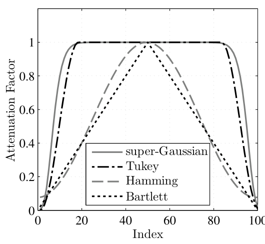

*图 8.1 四种数据窗对比：超高斯与图基窗中心是平顶（不碰中心光场）、边缘归零，适合当吸收边界；汉明窗与巴特利特窗从中心就开始往下压，不合格（截自原书）*

!!! warning "原书笔误：式 (8.2) 的图基窗不等号印反，还混用了 N 与 L"
    原书第一分支书印"1，\(r \ge \alpha L/2\)"——平顶跑到网格边缘去了，与图 8.1 直接矛盾，应为 \(r \le \alpha L/2\)；第二分支书印"\(\alpha N/2 \le r/L \le N/2\)"：\(r/L\) 无量纲，\(\alpha N/2\)、\(N/2\) 却是格点数，单位混写。按图 8.1 与标准图基窗定义，应为 \(\alpha L/2 \le r \le L/2\)（\(L = N\delta\) 是网格全宽），余弦母式分母 \((1-\alpha)N/2\) 同理应为 \((1-\alpha)L/2\)。工程 1 的 `tukey_absorber` 按修正后的定义实现。

吸收边界在文献里出场多次：Flatté 等人在湍流传播研究里用 \(n=8\) 的超高斯模拟平面波；Rubio 把同类超高斯明确当全程吸收边界用，装住发散球面波往外跑的能量；Frehlich 生成大气相位屏时用的是图基窗。还有一个不太"窗"的例子：Martin 与 Flatté 在大气湍流仿真里给随机相位屏加了一个**确定性的虚部分量**——等效于在对数振幅上乘一个高斯因子，边缘被衰减、中心处消光系数取零、中心场不受影响。

!!! note "拓展：数据窗 ≠ 吸收边界"
    数据窗（汉明、汉宁、布莱克曼……）的使命是压制**频谱旁瓣**：信号只在窗内"活着"，窗从中心往两边压是设计使然。吸收边界的使命是**处决撞到网格边的衍射光**：感兴趣区域（观察面中心）的光必须原样通过，只有边缘的逃逸能量该死。两者对"中心"的要求相反，所以不能拿数据窗直接当吸收边界用。有限差分光束传播法（FD-BPM）里的"透明边界条件"是同一个问题的另一种解法——都为了不让出射能量从边界弹回来污染场；角谱法不解差分方程，所以用乘窗这个更便宜的办法。

## 8.2 两次部分传播

本节把角谱传播跑两遍：第一段从源平面到**中间平面**（位置在源与观察面之间，不一定在中点），第二段从中间平面到观察平面。吸收边界在第一段传完、中间面上施加。几何见图 8.2，符号见表 8.1。

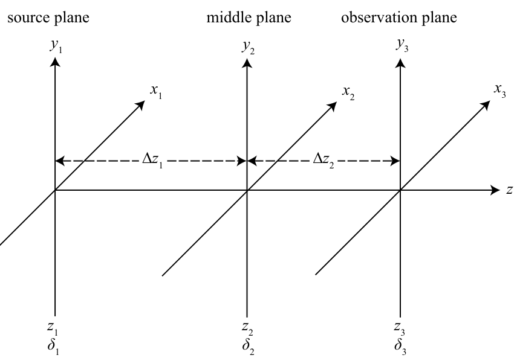

*图 8.2 两次部分传播的坐标系：源平面（z₁、δ₁）—中间平面（z₂、δ₂）—观察平面（z₃、δ₃），两段距离 Δz₁、Δz₂（截自原书）*

**表 8.1 两次部分传播的符号（按原书 Table 8.1 整理）**

| 符号 | 含义 |
| --- | --- |
| \(\mathbf{r}_1=(x_1,y_1)\)、\(\mathbf{r}_2\)、\(\mathbf{r}_3\) | 源 / 中间 / 观察面坐标 |
| \(\delta_1\)、\(\delta_2\)、\(\delta_3\) | 三个平面的网格间距 |
| \(\mathbf{f}_1\)、\(\mathbf{f}_2\)、\(\delta_{f1}\)、\(\delta_{f2}\) | 两平面的空间频率坐标与频域采样间隔 |
| \(\Delta z_1 = z_2 - z_1\)、\(\Delta z_2 = z_3 - z_2\)、\(\Delta z = \Delta z_1 + \Delta z_2\) | 两段距离与总距离 |
| \(\alpha = \Delta z_1/\Delta z\) | 第一段的分数距离 |
| \(m\)、\(m_1\)、\(m_2\) | 总缩放因子与两段各自的缩放因子（\(m_i = \delta_{i+1}/\delta_i\)） |

动手写仿真方程之前，先把符号之间的几何关系算清楚。图 8.3 里 \(A, B\) 是源面网格点（间距 \(\delta_1\)），\(C, D\) 是中间面网格点（间距 \(\delta_2\)），\(E, F\) 是观察面网格点（间距 \(\delta_3\)）。三角形 \(BDH\) 与 \(BFG\) 共享顶点 \(B\)，是相似三角形：

\[
\frac{DH}{BH} = \frac{FG}{BG}.
\tag{8.3}
\]

线段 \(FG = (\delta_3-\delta_1)/2\)，\(DH = (\delta_2-\delta_1)/2\)，\(BH = \Delta z_1\)，\(BG = \Delta z = \Delta z_1 + \Delta z_2\)。代入：

\[
\frac{\delta_2 - \delta_1}{2 \Delta z_1} = \frac{\delta_3 - \delta_1}{2 \Delta z}
\tag{8.4}
\]

\[
\delta_2 \Delta z - \delta_1 \Delta z = \delta_3 \Delta z_1 - \delta_1 \Delta z_1
\tag{8.5}
\]

\[
\delta_2 = \delta_1 + \delta_3 \frac{\Delta z_1}{\Delta z} - \delta_1 \frac{\Delta z_1}{\Delta z}
\tag{8.6}
\]

\[
\delta_2 = \delta_1 + \alpha\,(\delta_3 - \delta_1)
\tag{8.7}
\]

\[
\delta_2 = (1 - \alpha)\,\delta_1 + \alpha\,\delta_3.
\tag{8.8}
\]

人话：**中间面的网格间距 = 两端网格间距按位置线性插值**。第一段刚开始（\(\alpha \to 0\)）用 \(\delta_1\)，快到观察面（\(\alpha \to 1\)）就用 \(\delta_3\)，全程平滑过渡。式 (8.8) 是整个方法的几何地基。

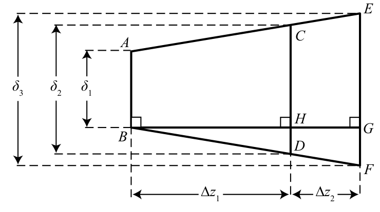

*图 8.3 网格间距的相似三角形：由 BDH ∼ BFG 导出 δ₂ = (1−α)δ₁ + αδ₃（截自原书）*

现在写两次传播的完整算符链。第 6 章的角谱传播（\(m\) 分支）用两次，中间夹一个吸收边界算符 \(\mathcal{A}[\mathbf{r}_2]\)：

\[
\begin{aligned}
U(\mathbf{r}_3) ={}& \mathcal{Q}\!\left[\frac{m_2 - 1}{m_2 \Delta z_2}, \mathbf{r}_3\right]
\mathcal{F}^{-1}\!\left[\mathbf{f}_2, \frac{\mathbf{r}_3}{m_2}\right]
\mathcal{Q}_2\!\left[-\frac{\Delta z_2}{m_2}, \mathbf{f}_2\right]
\mathcal{F}[\mathbf{r}_2, \mathbf{f}_2]\,
\mathcal{Q}\!\left[\frac{1 - m_2}{\Delta z_2}, \mathbf{r}_2\right] \frac{1}{m_2} \\
&\times \mathcal{A}[\mathbf{r}_2]\,
\mathcal{Q}\!\left[\frac{m_1 - 1}{m_1 \Delta z_1}, \mathbf{r}_2\right]
\mathcal{F}^{-1}\!\left[\mathbf{f}_1, \frac{\mathbf{r}_2}{m_1}\right]
\mathcal{Q}_2\!\left[-\frac{\Delta z_1}{m_1}, \mathbf{f}_1\right]
\mathcal{F}[\mathbf{r}_1, \mathbf{f}_1]\,
\mathcal{Q}\!\left[\frac{1 - m_1}{\Delta z_1}, \mathbf{r}_1\right] \frac{1}{m_1}\,
\{U(\mathbf{r}_1)\}.
\end{aligned}
\tag{8.9}
\]

所有二次相位因子与吸收边界都是纯乘性因子，**彼此对易**——这允许把中间面上挨着的两个二次相位合并掉。合并前要证它们互逆：找 \((1-m_2)/\Delta z_2\) 与 \((m_1-1)/(m_1 \Delta z_1)\) 的关系。把缩放因子 \(m_1 = \delta_2/\delta_1\)、\(m_2 = \delta_3/\delta_2\) 代回式 (8.5)，用 \(\Delta z = \Delta z_1 + \Delta z_2\) 展开再逐步归并：

\[
\delta_2 \Delta z_1 + \delta_2 \Delta z_2 - \delta_1 \Delta z_1 - \delta_1 \Delta z_2 = \delta_3 \Delta z_1 - \delta_1 \Delta z_1
\tag{8.11}
\]

\[
\delta_3 \Delta z_1 - \delta_2 \Delta z_1 = \delta_2 \Delta z_2 - \delta_1 \Delta z_2
\tag{8.12}
\]

\[
\frac{\delta_3 - \delta_2}{\Delta z_2} = \frac{\delta_2 - \delta_1}{\Delta z_1}
\tag{8.13}
\]

\[
\frac{\delta_3 - \delta_2}{\delta_2\, \Delta z_2} = \frac{\delta_2 - \delta_1}{\delta_2\, \Delta z_1}
\tag{8.14}
\]

\[
\frac{m_2 - 1}{\Delta z_2} = \frac{m_1 - 1}{m_1 \Delta z_1}.
\tag{8.15}
\]

于是中间面的两个二次相位因子相乘：

\[
\mathcal{Q}\!\left[\frac{1 - m_2}{\Delta z_2}, \mathbf{r}_2\right]\,
\mathcal{Q}\!\left[\frac{m_1 - 1}{m_1 \Delta z_1}, \mathbf{r}_2\right]
= \mathcal{Q}\!\left[-\frac{m_1 - 1}{m_1 \Delta z_1}, \mathbf{r}_2\right]\,
\mathcal{Q}\!\left[\frac{m_1 - 1}{m_1 \Delta z_1}, \mathbf{r}_2\right]
= 1.
\]

化简后的式 (8.16)：

\[
U(\mathbf{r}_3) =
\mathcal{Q}\!\left[\frac{m_2 - 1}{m_2 \Delta z_2}, \mathbf{r}_3\right]
\mathcal{F}^{-1}\!\left[\mathbf{f}_2, \frac{\mathbf{r}_3}{m_2}\right]
\mathcal{Q}_2\!\left[-\frac{\Delta z_2}{m_2}, \mathbf{f}_2\right]
\mathcal{F}[\mathbf{r}_2, \mathbf{f}_2]\, \frac{1}{m_2}
\times \mathcal{A}[\mathbf{r}_2]\,
\mathcal{F}^{-1}\!\left[\mathbf{f}_1, \frac{\mathbf{r}_2}{m_1}\right]
\mathcal{Q}_2\!\left[-\frac{\Delta z_1}{m_1}, \mathbf{f}_1\right]
\mathcal{F}[\mathbf{r}_1, \mathbf{f}_1]\,
\mathcal{Q}\!\left[\frac{1 - m_1}{\Delta z_1}, \mathbf{r}_1\right] \frac{1}{m_1}\,
\{U(\mathbf{r}_1)\}.
\tag{8.16}
\]

再把因子按"每段一对括号"重排（式 8.17）：

\[
U(\mathbf{r}_3) =
\mathcal{Q}\!\left[\frac{m_2 - 1}{m_2 \Delta z_2}, \mathbf{r}_3\right]
\left\{
\mathcal{F}^{-1}\!\left[\mathbf{f}_2, \frac{\mathbf{r}_3}{m_2}\right]
\mathcal{Q}_2\!\left[-\frac{\Delta z_2}{m_2}, \mathbf{f}_2\right]
\mathcal{F}[\mathbf{r}_2, \mathbf{f}_2]\, \frac{1}{m_2}
\right\}
\times
\left\{
\mathcal{A}[\mathbf{r}_2]\,
\mathcal{F}^{-1}\!\left[\mathbf{f}_1, \frac{\mathbf{r}_2}{m_1}\right]
\mathcal{Q}_2\!\left[-\frac{\Delta z_1}{m_1}, \mathbf{f}_1\right]
\mathcal{F}[\mathbf{r}_1, \mathbf{f}_1]\, \frac{1}{m_1}
\right\}
\times
\left\{
\mathcal{Q}\!\left[\frac{1 - m_1}{\Delta z_1}, \mathbf{r}_1\right]\,
U(\mathbf{r}_1)
\right\}.
\tag{8.17}
\]

书里明说：这个具体结果**不进任何仿真**，但它建立了"任意次部分传播"的模式——每个大括号就是一段传播的固定动作。原书没有给两段传播的仿真代码，直接进下一节推广到 \(n\) 个平面。

!!! note "拓展：中平面两个啁啾为什么恰好互逆"
    单看式 (8.15) 是代数巧合，背后是第 6 章 \(m\) 分支的算符结构：每段角谱传播在输出面"欠"一个二次相位 \(\mathcal{Q}[(m_i-1)/(m_i \Delta z_i)]\)（要补上才是物理场），在下一段输入面又要"剥掉"一个 \(\mathcal{Q}[(1-m_{i+1})/\Delta z_{i+1}]\)。式 (8.8) 的线性插值恰好让这两个曲率相等——线性插值正是让相邻两段"啁啾账目"无缝衔接的唯一选择。于是链式传播时，中间面保存的场是一个"啁啾被剥掉一层"的中间表示：只有源面要乘 \(\mathcal{Q}_1\)、观察面要乘 \(\mathcal{Q}_3\)，中间什么都不用补。工程 1 的验证 0 数值复核了式 (8.15)：两边相对差 \(0.0\)（浮点位级一致）。

## 8.3 任意次部分传播

把两段的模式推广到 \(n\) 个平面、\(n-1\) 次部分传播。先立通用记号（原书 Table 8.2–8.4，这里合并成一张表）：

**表 8-2 任意次部分传播的通用记号（按原书 Table 8.2 整理）**

| 量 | 定义 | 含义 |
| --- | --- | --- |
| \(n\) / \(n-1\) | — | 平面数 / 部分传播次数 |
| \(\Delta z_i = z_{i+1} - z_i\) | — | 第 \(i\) 段传播距离 |
| \(\alpha_i\) | \(z_i/\Delta z\) | 平面 \(i\) 的分数距离（\(\alpha_1 = 0\)，\(\alpha_n = 1\)） |
| \(m_i\) | \(\delta_{i+1}/\delta_i\) | 从平面 \(i\) 到平面 \(i+1\) 的缩放因子 |
| \(\delta_i\) | \((1-\alpha_i)\,\delta_1 + \alpha_i\,\delta_n\) | 平面 \(i\) 的网格间距（式 8.8 的推广） |
| \(\delta_{fi}\) | \(1/(N \delta_i)\) | 平面 \(i\) 的频域采样间隔 |

!!! warning "原书笔误：表 8.2 把 αᵢ 的描述差了一位"
    原书 Table 8.2 把 \(\alpha_i = z_i/\Delta z\) 描述成"从平面 1 到平面 i+1 的分数距离"。按 Table 8.3 自己的行（\(\alpha_1 = z_1/\Delta z = 0\) 对应平面 1、\(\alpha_2 = z_2/\Delta z\) 对应平面 2）以及 Listing 8.1 的实现（`alpha = z/z(n)` 逐平面对应），\(\alpha_i\) 对应平面 \(i\)。公式与代码都自洽，只有表格措辞差一位。

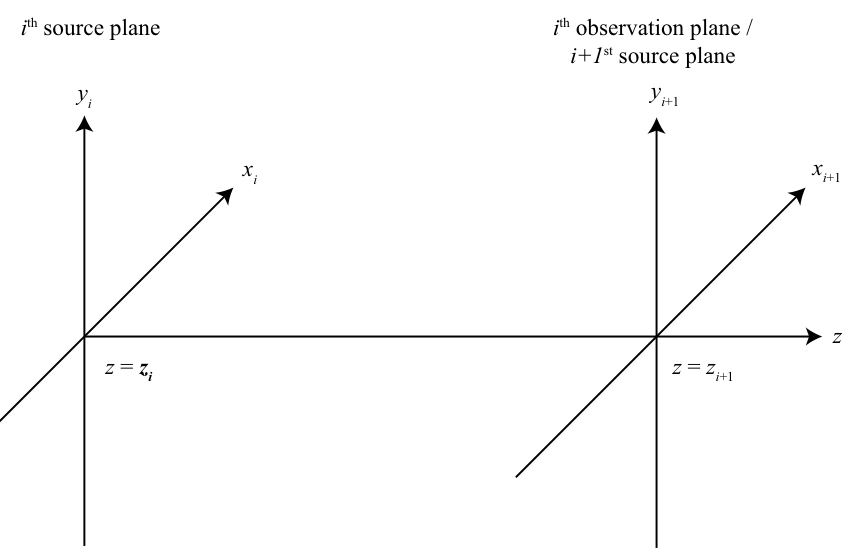

*图 8.4 单段部分传播的坐标系：第 i 面既是上一段的观察面、又是下一段的源面，网格间距按线性插值过渡（截自原书）*

把式 (8.17) 的模式循环起来，就是任意次部分传播的算符链（式 8.18）：

\[
U(\mathbf{r}_n) =
\mathcal{Q}\!\left[\frac{m_{n-1} - 1}{m_{n-1} \Delta z_{n-1}}, \mathbf{r}_n\right]
\left\{
\prod_{i=1}^{n-1}
\mathcal{A}[\mathbf{r}_{i+1}]\,
\mathcal{F}^{-1}\!\left[\mathbf{f}_i, \frac{\mathbf{r}_{i+1}}{m_i}\right]
\mathcal{Q}_2\!\left[-\frac{\Delta z_i}{m_i}, \mathbf{f}_i\right]
\mathcal{F}[\mathbf{r}_i, \mathbf{f}_i]\, \frac{1}{m_i}
\right\}
\mathcal{Q}\!\left[\frac{1 - m_1}{\Delta z_1}, \mathbf{r}_1\right]
\{U(\mathbf{r}_1)\}.
\tag{8.18}
\]

读法：源面先乘 \(\mathcal{Q}[(1-m_1)/\Delta z_1]\，U(\mathbf{r}_1)\)，然后每段做一遍"缩放 → FT → 频域啁啾 → IFT → 乘吸收边界"，最后观察面补上 \(\mathcal{Q}_3\)。注意连乘号里 \(\mathcal{A}[\mathbf{r}_{i+1}]\) 对**每个平面**（包括观察面）都出现——而式 (8.16) 的两段版本只在中间面放了 \(\mathcal{A}\)，两处口径不同；观察面感兴趣区域内窗函数 \(\approx 1\)，无实际影响（工程 1 与书 Listing 8.1 都按"每面都乘"实现）。

书 Listing 8.1 是这个算符链的 MATLAB 实现，输入输出：

| 输入 / 输出 | 含义 |
| --- | --- |
| `Uin` | \(U(\mathbf{r}_1)\)，源平面光场 [\((\mathrm{W/m^2})^{1/2}\)] |
| `wvl` | 光波长 [m] |
| `delta1` / `deltan` | 源 / 观察面网格间距 [m] |
| `z` | 平面位置数组 \([z_2, z_3, \ldots, z_n]\)（不含 \(z_1=0\)）[m] |
| `xn`, `yn`, `Uout` | 观察面坐标与光场 |

=== "MATLAB"

    ```matlab
    function [xn yn Uout] = ang_spec_multi_prop_vac ...
        (Uin, wvl, delta1, deltan, z)
    % function [xn yn Uout] = ang_spec_multi_prop_vac ...
    %     (Uin, wvl, delta1, deltan, z)
    %
    % 任意次部分传播的角谱法（书 Listing 8.1 原样整理，中文注释为笔记所加）。
    %   Uin    : U(r1)，源平面光场 [(W/m^2)^(1/2)]
    %   wvl    : 光波长 [m]
    %   delta1 : delta_1，源平面网格间距 [m]
    %   deltan : delta_n，观察平面网格间距 [m]
    %   z      : 平面位置数组 [z2, z3, ..., zn]（不含 z1=0）[m]
    % 输出 xn/yn/Uout：观察面坐标与 U(rn)。
    % 依赖：ft2（书 Listing 2.5）、ift2（书 Listing 2.6）。

    N = size(Uin, 1);                % number of grid points
    [nx ny] = meshgrid((-N/2 : 1 : N/2 - 1));
    k = 2*pi/wvl;                    % optical wavevector
    % super-Gaussian absorbing boundary（式 8.1 的 n=16、sigma=0.47L）
    nsq = nx.^2 + ny.^2;
    w = 0.47*N;
    sg = exp(-nsq.^8/w^16); clear(nsq, w);

    z = [0 z];                       % propagation plane locations（补上 z1=0）
    n = length(z);
    % propagation distances：Delta_z(i) = z(i+1) - z(i)
    Delta_z = z(2:n) - z(1:n-1);
    % grid spacings：alpha_i = z_i/z_n（式 8.8 的线性插值权重）
    alpha = z / z(n);
    delta = (1-alpha) * delta1 + alpha * deltan;
    m = delta(2:n) ./ delta(1:n-1);  % 缩放因子 m_i = delta_{i+1}/delta_i
    x1 = nx * delta(1);
    y1 = ny * delta(1);
    r1sq = x1.^2 + y1.^2;

    Q1 = exp(i*k/2*(1-m(1))/Delta_z(1)*r1sq);   % 源面二次相位（只乘这一次）
    Uin = Uin .* Q1;
    for idx = 1 : n-1
        % spatial frequencies (of i^th plane)
        deltaf = 1 / (N*delta(idx));
        fX = nx * deltaf;
        fY = ny * deltaf;
        fsq = fX.^2 + fY.^2;
        Z = Delta_z(idx);            % propagation distance
        % quadratic phase factor：Q2[-Delta_z_i/m_i]（频域啁啾）
        Q2 = exp(-i*pi^2*2*Z/m(idx)/k*fsq);
        % compute the propagated field：缩放 -> FT -> 频域啁啾 -> IFT -> 乘吸收边界
        Uin = sg .* ift2(Q2 ...
            .* ft2(Uin / m(idx), delta(idx)), deltaf);
    end
    % observation-plane coordinates
    xn = nx * delta(n);
    yn = ny * delta(n);
    rnsq = xn.^2 + yn.^2;
    % 循环结束后 Z 恰为最后一段 Delta_z(n-1)（书代码同款写法，见坑与陷阱 5）
    Q3 = exp(i*k/2*(m(n-1)-1)/(m(n-1)*Z)*rnsq);
    Uout = Q3 .* Uin;
    ```

=== "Python"

    ```python
    # ang_spec_multi_prop_vac（书 Listing 8.1 的 Python 等价实现，工程 1 摘录）
    #   Uin    : U(r1)，源平面光场 [(W/m^2)^(1/2)]
    #   wvl    : 光波长 [m]
    #   delta1 : 源平面网格间距 [m]
    #   deltan : 观察平面网格间距 [m]
    #   z      : 平面位置数组 [z2, ..., zn]（不含 z1=0）[m]
    # 依赖：ft2_centered（书 Listing 2.5 等价）、ift2（书 Listing 2.6 等价，见下）。
    # 与 MATLAB 版差异：numpy 0-based（零坐标样本在 N//2）；nsq**8 必须用
    # 浮点（Windows numpy 默认 int32，8192**8 会整数溢出回绕，窗静默失效）。

    def ift2(G, delta_f):
        """原书 Listing 2.6：定标正确的二维逆 DFT（乘 (N*delta_f)^2）。"""
        N = G.shape[0]
        return np.fft.fftshift(np.fft.ifft2(np.fft.fftshift(G))) * (N * delta_f) ** 2


    def super_gaussian_absorber(N, w_frac=0.47, order=16):
        """super-Gaussian 吸收边界（书第 10-12 行的函数化，式 8.1 的 n=16）。"""
        n = (np.arange(N) - N // 2).astype(float)   # 索引转 float，防 int 溢出
        nx, ny = np.meshgrid(n, n)
        nsq = nx ** 2 + ny ** 2
        w = w_frac * N
        return np.exp(-nsq ** (order // 2) / w ** order)


    def ang_spec_multi_prop_vac(Uin, wvl, delta1, deltan, z):
        N = Uin.shape[0]                       # number of grid points
        n = np.arange(N) - N // 2             # 书：nx = -N/2 : N/2-1（1-based）
        nx, ny = np.meshgrid(n, n)
        k = 2.0 * np.pi / wvl                  # optical wavevector
        # super-Gaussian absorbing boundary（书第 9-12 行）
        sg = super_gaussian_absorber(N)
        z = np.concatenate(([0.0], np.asarray(z, dtype=float)))   # 书：z = [0 z]
        n_planes = len(z)
        Delta_z = z[1:] - z[:-1]               # propagation distances
        alpha = z / z[-1]                      # fractional distances（alpha_i = z_i/Dz）
        delta = (1.0 - alpha) * delta1 + alpha * deltan           # 式 (8.8)
        m = delta[1:] / delta[:-1]             # scaling factors m_i
        x1 = nx * delta[0]
        y1 = ny * delta[0]
        r1sq = x1 ** 2 + y1 ** 2

        Q1 = np.exp(1j * k / 2.0 * (1.0 - m[0]) / Delta_z[0] * r1sq)
        Uin = Uin * Q1
        for idx in range(n_planes - 1):        # 书：for idx = 1 : n-1
            # spatial frequencies (of i-th plane)
            deltaf = 1.0 / (N * delta[idx])
            fX = nx * deltaf
            fY = ny * deltaf
            fsq = fX ** 2 + fY ** 2
            Z = Delta_z[idx]                   # propagation distance
            # quadratic phase factor（式 8.18 的 Q2[-Delta_z_i/m_i]，负号对照原书）
            Q2 = np.exp(-1j * np.pi ** 2 * 2.0 * Z / m[idx] / k * fsq)
            # compute the propagated field（含 A[r_{i+1}] 吸收边界，按式 8.18）
            Uin = sg * ift2(Q2 * ft2(Uin / m[idx], delta[idx]), deltaf)
        # observation-plane coordinates
        xn = nx * delta[-1]
        yn = ny * delta[-1]
        rnsq = xn ** 2 + yn ** 2
        # 循环结束后 Z 恰为最后一段 Delta_z(n-1)（书代码同款写法）
        Q3 = np.exp(1j * k / 2.0 * (m[-1] - 1.0) / (m[-1] * Z) * rnsq)
        Uout = Q3 * Uin
        return xn, yn, Uout
    ```

逐行看门道（行号按原书 Listing 8.1）：

- 第 10–12 行构造超高斯吸收边界：`sg = exp(-nsq.^8 / w^16)`，`w = 0.47*N`——这就是式 (8.1) 的 \(n=16\)、\(\sigma = 0.47\,N\delta = 0.47 L\)，与图 8.1 的 \(\sigma=0.45L\) 同量级；
- 第 14–21 行把总距离翻成逐段量：`z = [0 z]`、`Delta_z`、`alpha = z/z(n)`、`delta = (1-alpha)*delta1 + alpha*deltan`（式 8.8）、`m = delta(2:n)./delta(1:n-1)`；
- 第 26–27 行只在**源面**乘一次 \(\mathcal{Q}_1\)；
- 循环体内（第 28–40 行）每段做 `ift2(Q2 .* ft2(Uin/m, delta), deltaf)` 再乘 `sg`——吸收边界**每个平面都乘**（含观察面）；
- 第 42–46 行补观察面啁啾 \(\mathcal{Q}_3\)。注意 `Q3` 用了循环变量 `Z`——循环结束后它恰好等于最后一段距离，这是原书的写法，自己改循环边界时要小心（见坑与陷阱）。

Python 版的差异都写进注释：0-based 索引（零坐标样本在 `N//2`）、`ft2`/`ift2` 的归一化、以及一个 Windows 专属坑——`nsq ** 8` 在 numpy 默认 int32 下会整数溢出回绕，必须先转 float（MATLAB 全 double 没这个问题）。

各平面场上到底发生了什么？工程 1 把 Listing 8.2 书例的 5 个平面全部录了下来：

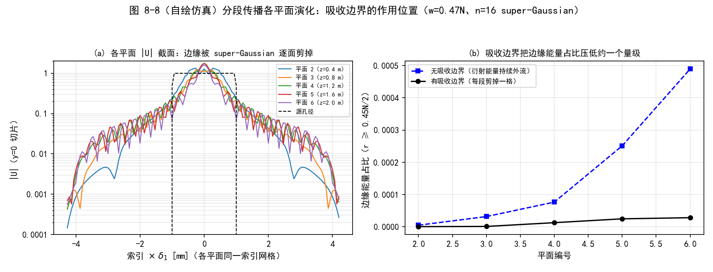

*图 8-8（自绘仿真）分段传播各平面演化（书例参数，5 段、每段 0.4 m）：(a) 各平面 |U| 的 y=0 切片——方孔衍射逐面展开、边缘被超高斯窗逐段剪掉；(b) 边缘能量占比（r ≥ 0.45N/2）：无吸收边界时随平面数持续增长（衍射能量外流），有吸收边界时被压低约一个量级、几乎不动*

## 8.4 多次部分传播的采样

平面一多，第 7 章的四条约束要重新过一遍。**约束 1 与约束 2 是纯几何的**（观测孔径的物理带宽、网格装不装得下卷绕），跟传播方法无关，原样沿用，只是把 \(\delta_2\) 换成 \(\delta_n\)：

1. \(\displaystyle \delta_n \le \frac{\lambda \Delta z - D_2 \delta_1}{D_1}\)（约束 1，即式 7.14）；
2. \(\displaystyle N \ge \frac{D_1}{2\delta_1} + \frac{D_2}{2\delta_n} + \frac{\lambda \Delta z}{2\delta_1 \delta_n}\)（约束 2，即式 7.20）。

**约束 3** 麻烦在 \(\delta_i\)、\(\Delta z_i\) 逐段都变。按第 7 章的套路，设源是球面波前（半径 \(R\)），第一段 FT 前的"源相位 + 网格啁啾"合计为

\[
\phi = \frac{k}{2}\left(\frac{1 - m_1}{\Delta z_1} + \frac{1}{R}\right)|\mathbf{r}_1|^2,
\tag{8.19}
\]

对第一段套 Nyquist 判据（与式 7.48–7.53 同样的推导）：

\[
\left(1 + \frac{\Delta z_1}{R}\right)\delta_1 - \frac{\lambda \Delta z_1}{D_1} \;\le\; \delta_2 \;\le\; \left(1 + \frac{\Delta z_1}{R}\right)\delta_1 + \frac{\lambda \Delta z_1}{D_1}.
\tag{8.20}
\]

现在代入 \(\delta_2 = (1-\alpha_2)\delta_1 + \alpha_2 \delta_n\) 和 \(\Delta z_1 = \alpha_2 \Delta z\)：

\[
\left(1 + \frac{\alpha_2 \Delta z}{R}\right)\delta_1 - \frac{\lambda \alpha_2 \Delta z}{D_1} \;\le\; (1-\alpha_2)\delta_1 + \alpha_2 \delta_n \;\le\; \left(1 + \frac{\alpha_2 \Delta z}{R}\right)\delta_1 + \frac{\lambda \alpha_2 \Delta z}{D_1}.
\tag{8.21}
\]

乘开、合并同类项、两边除以 \(\alpha_2\)（\(\alpha_2 > 0\)），\(\alpha_2\) **严格消去**：

\[
\left(1 + \frac{\Delta z}{R}\right)\delta_1 - \frac{\lambda \Delta z}{D_1} \;\le\; \delta_n \;\le\; \left(1 + \frac{\Delta z}{R}\right)\delta_1 + \frac{\lambda \Delta z}{D_1}.
\tag{8.22}
\]

与式 (7.53) 一字不差——**约束 3 与分段数无关**，\(\delta_2\)、\(\Delta z_1\) 这些部分传播量在推导里全部消失（习题 2 要求补全的正是这四行代数）。工程 1 用 1000 组随机参数复核：式 (8.20)（对 \(\delta_2\)）与式 (8.22)（对 \(\delta_n\)）的判定不一致组数为 0。

**约束 4** 才是真正要按段改写的。第 \(i\) 段一条：

\[
N \ge \frac{\lambda \Delta z_i}{\delta_i \delta_{i+1}}.
\tag{8.23}
\]

\(n-1\) 条不等式、参数空间随 \(n\) 胀——把 \(\delta_i\) 全用 \(\delta_1,\delta_n\) 表示也只是换成 \(\alpha_i\)（依赖 \(z_i\)），维度降不下来。而且"取右端最大的那段"需要先知道所有 \(\Delta z_i\)、\(\delta_i\)——这正是你还没定下来的量，鸡生蛋。

换个角度：不管网格扩张还是收缩，\(\delta_1\) 与 \(\delta_n\) 中**较小的一个**不大于任何 \(\delta_i\)、\(\delta_{i+1}\)。对给定的 \(\Delta z_i\)，用 \(\min(\delta_1, \delta_n)\) 替换式 (8.23) 里的 \(\delta_i, \delta_{i+1}\)，得到一条**充分**约束；再把 \(N\) 已定的事实翻过来，写成对段距的限制：

\[
\Delta z_i \;\le\; \frac{\min(\delta_1, \delta_n)^2\, N}{\lambda}.
\tag{8.24}
\]

右端就是单段最大传播距离 \(\Delta z_{max}\)。因此至少要

\[
n = \operatorname{ceil}\!\left(\frac{\Delta z}{\Delta z_{max}}\right) + 1
\]

个平面（\(n-1\) 次部分传播，`ceil` 是向上取整）。

!!! warning "原书笔误：'n = ceil(Δz/Δzmax)+1 次部分传播'数的是平面"
    按第 8.3 节的约定，\(n\) 是**平面数**、\(n-1\) 才是部分传播次数。书例里 \(n=5\) 被正文读成"至少 5 次部分传播"，其实最少需要 **4 次传播**（每段 0.5 m \(\le\) 0.569 m，5 个平面）；Listing 8.2 干脆取 5 次传播（每段 0.4 m）——"可以多用部分传播"没错，但正文句尾的"partial propagations"与式中的 \(n\) 不是同一个计数。

于是选参流程清晰了（原书三步）：

1. **先定 \(N\)、\(\delta_1\)、\(\delta_n\)**：用前两条约束（约束 3 按式 8.22 免检即可）；
2. **再用式 (8.24) 定 \(\Delta z_{max}\) 与最少分段数**（\(n-1\) 次传播）；
3. **分段只多不少**：更短的段距天然仍满足约束 4。

原书本章末尾用这个方法做了一个完整书例：均匀振幅平面波（\(R = \infty\)）离开源面的方孔。\(D_1 = 2\) mm、\(\lambda = 1\,\mu\)m、观察面在 \(\Delta z = 2\) m。要求源孔径与观察面感兴趣区内都至少 30 个网格点，取终稿参数 \(D_2 = 6\) mm（Listing 8.2）得 \(\delta_1 = D_1/30 \approx 66.7\,\mu\)m、\(\delta_n = D_2/30 = 200\,\mu\)m。图 8.5 画了约束 2 的 \(\log_2 N\) 等高线并叠上约束 1：按终稿口径，约束 2 需要 \(N \ge 105 = 2^{6.71}\)，向上取 2 的幂得 \(N = 128\)；约束 1 给 \(\delta_n \le 800\,\mu\)m，余量很大。

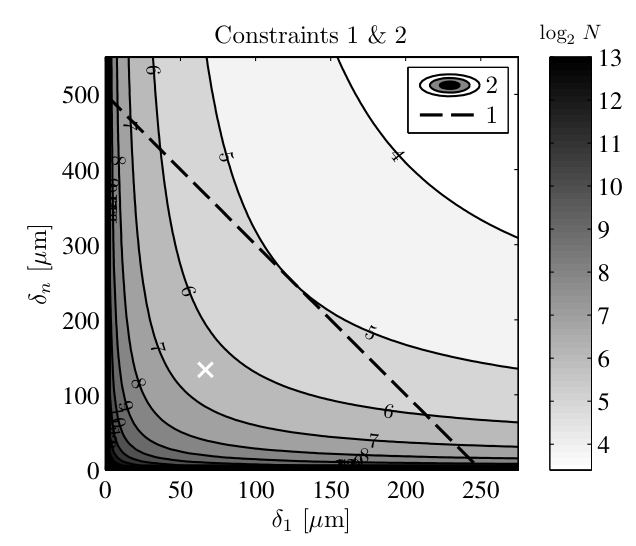

*图 8.5 采样约束分析：约束 2 的 log₂N 等高线 + 约束 1（虚线），白叉标记"30 点跨源孔径与观察孔径"对应的网格间距（截自原书）*

最后用约束 4 收尾（\(\delta_1 = 66.7\,\mu\)m、\(\delta_n = 200\,\mu\)m、\(N = 128\)）：

\[
\Delta z_{max} = \frac{\min(\delta_1, \delta_n)^2 N}{\lambda} = \frac{(66.7\,\mu\mathrm{m})^2 \times 128}{1\,\mu\mathrm{m}} = 0.569\ \mathrm{m},
\tag{8.25}
\]

（书印 0.567 m，尾数舍入。）于是至少 \(n = \operatorname{ceil}(2/0.569) + 1 = 5\) 个平面——最少 4 次部分传播；Listing 8.2 取了 5 次（每段 0.4 m）。注意**单次传播**在此参数下约束 4 要 \(N \ge 150 > 128\)：分段不是可选项，是必需品。仿真结果与解析对照（图 8.6）：感兴趣区域内辐照度与相位都贴得很近——解析峰值辐照度 2.56（书图读数 2.57）、第一暗环在 1.0 mm，工程 1 复现的 ROI 误差 \(|\Delta I|/\)峰值 \(= 3.9\times10^{-3}\)、相位残差 \(4.8\times10^{-3}\) rad。

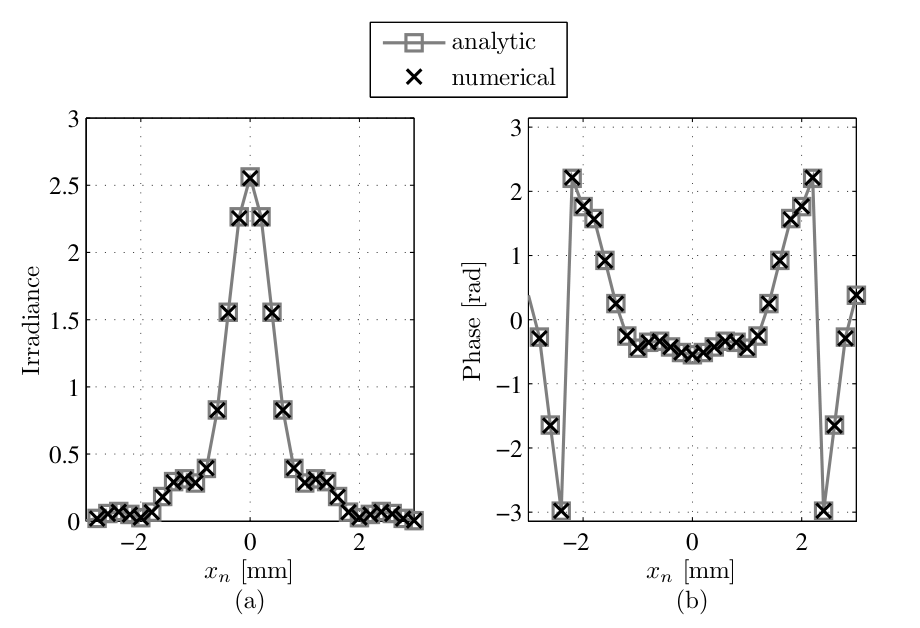

*图 8.6 观察面感兴趣区内的仿真 vs 解析：(a) 辐照度（峰值约 2.57）；(b) 缠绕相位（中央近平、暗环处 π 跳变）。数值点与解析曲线重合（截自原书）*

!!! note "拓展：图 8.6 峰值为什么是 2.57"
    书例的菲涅耳数 \(N_F = D_1^2/(\lambda \Delta z) = 2\)，处于"近场振荡区"——轴上辐照度不再是 1。把方孔菲涅耳积分的轴上值配方（代换 \(t = x_1\sqrt{2/(\lambda \Delta z)}\)，积分限走到 \(\pm\sqrt{N_F/2} = \pm 1\)），得 \(|U(0)|^2 = \tfrac{1}{4}\left|2\left[C(1) + iS(1)\right]\right|^4 = \tfrac{1}{4}\times 3.202^2 \approx 2.56\)（\(C(1)=0.780\)、\(S(1)=0.438\) 是 Fresnel 积分），与书图峰值 2.57 一致。相位图中央近平也是解析的必然：平面波源的配方相位恰好与观察面啁啾相消，剩下的只有暗环两侧的 \(\pi\) 跳变。

!!! warning "原书笔误：书例参数三处打架（133 µm vs 200 µm）"
    书例的参数在正文、图、Listing 之间对不上，需要分辨哪套是终稿：
    - 正文写"30 点跨 \(D_1\) 与 \(D_2\)，得 \(\delta_1 \le 66.7\,\mu\)m、\(\delta_n \le 133\,\mu\)m"，并按 \(\delta_n = 133\,\mu\)m 与 \(N=128\) 用约束 4 算出式 (8.25)。但 \(133\,\mu\)m \(= D_2/30\) 意味着 \(D_2 = 4\) mm；Listing 8.2 写的却是 \(D_2 = 6\) mm、\(\delta_n = D_2/30 = 200\,\mu\)m。
    - 图 8.5 整张按**旧稿参数**绘制：约束 1 虚线在 \(\delta_1 = 0\) 处的截距 500 µm \(= \lambda \times (1\,\mathrm{m})/D_1\)（即 \(\Delta z = 1\) m，不是正文的 2 m），虚线在 \(\delta_1 \approx 250\,\mu\)m 处触零（斜率 \(-2 = -D_2/D_1\)，即 \(D_2 = 4\) mm）；白叉实测位于 \((66.0, 132.7)\,\mu\)m。白叉处旧稿口径 \(\log_2 N = 6.43\)（\(N \ge 87\)，向上取 2 的幂 = 128），与正文"at least \(N = 2^7 = 128\)"自洽；若按正文混合口径（\(\delta_n = 133\,\mu\)m、\(\Delta z = 2\) m），约束 2 要求 \(N \ge 143\)，\(N = 128\) 不成立。
    - 图 8.6 数值标记的间距约 0.13 mm（\(\pm 2\) mm 内约 30 个点），对应 \(\delta_n = 133\,\mu\)m 而非 200 µm。
    - 数值自洽的一套是 **Listing 8.2**（\(\delta_n = 200\,\mu\)m、\(\Delta z = 2\) m）：约束 2 需 \(N \ge 105\)（满足）、单次约束 4 需 \(N \ge 150\)（分段确实必要）。本笔记与工程 1 以 Listing 8.2 为准复现，另附 133 µm 口径的对照（约束 2 被突破 143 vs 128，但卷绕污染温和，ROI 内 \(|\Delta I|/\)峰值 \(= 4.3\times10^{-3}\)，仍大致可用——约束是指导线不是铁律的又一例证）。

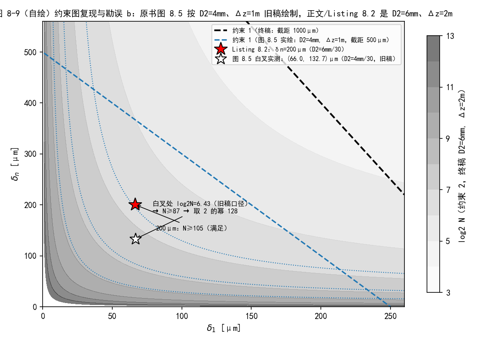

*图 8-9（自绘）约束图复现与勘误取证：灰度为终稿口径（D₂=6mm、Δz=2m）的约束 2 log₂N 等高线，蓝点线为图 8.5 实绘的旧稿口径（D₂=4mm、Δz=1m）；黑虚线是终稿约束 1（截距 1000 µm，出图范围外）、蓝虚线是图 8.5 实绘约束 1（截距 500 µm）；红星 = Listing 8.2 的 (66.7, 200) µm，白星 = 图 8.5 白叉实测 (66.0, 132.7) µm*

部分传播 + 吸收边界到底解决了什么？书例参数下把总距离拉到 \(\Delta z = 8\) m 做对照：单次传播（无吸收边界）违反约束 4（需 \(N \ge 600\)）也违反约束 2（需 \(N \ge 330\)），网格边缘的卷绕伪影成片爬进 ROI，误差 \(|\Delta I|/\)峰值 \(= 1.1\times10^{-1}\)；拆成 20 段（每段 0.4 m，每段约束 4 只需 \(N \ge 82\)）加超高斯吸收边界后误差降到 \(8.2\times10^{-3}\)——**差 14 倍**。这就是本章方法的存在意义。

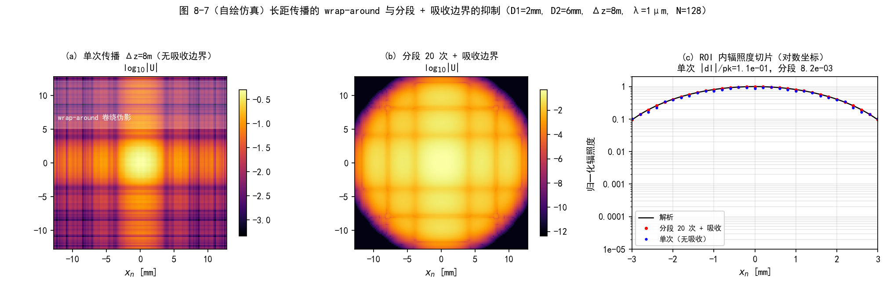

*图 8-7（自绘仿真）长距传播的 wrap-around 与分段 + 吸收边界的抑制（D₁=2mm、D₂=6mm、Δz=8m、λ=1µm、N=128）：(a) 单次传播的对数辐照度——网格边缘的卷绕伪影成片；(b) 分段 20 次 + 吸收边界——干净；(c) ROI 内辐照度切片（对数坐标）：单次的伪影抬高背景约两个量级*

书例的完整仿真就是 Listing 8.2 这十几行：

=== "MATLAB"

    ```matlab
    % example_square_prop_ang_spec_multi.m（书 Listing 8.2 原样整理，中文注释为笔记所加）
    D1 = 2e-3;           % diameter of the source aperture [m]
    D2 = 6e-3;           % diameter of the observation aperture [m]（终稿口径）
    wvl = 1e-6;          % optical wavelength [m]
    k = 2*pi / wvl;      % optical wavenumber [rad/m]
    z = 2;               % propagation distance [m]
    delta1 = D1/30;      % source-plane grid spacing [m]（30 点跨源孔径）
    deltan = D2/30;      % observation-plane grid spacing [m]（30 点跨观察孔径）
    N = 128;             % number of grid points
    n = 5;               % number of partial propagations
    % switch from total distance to individual distances：平面位置 [0.4 0.8 1.2 1.6 2]
    z = (1:n) * z / n;
    % source-plane coordinates
    [x1 y1] = meshgrid((-N/2 : N/2-1) * delta1);
    ap = rect(x1/D1) .* rect(y1/D1);            % source aperture
    [x2 y2 Uout] = ...
        ang_spec_multi_prop_vac(ap, wvl, delta1, deltan, z);

    % analytic result for y2=0 slice（MATLAB 1-based：零坐标在第 N/2+1 行）
    Dz = z(end);         % switch back to total distance
    Uout_an ...
        = fresnel_prop_square_ap(x2(N/2+1,:), 0, D1, wvl, Dz);
    ```

=== "Python"

    ```python
    # example_square_prop_ang_spec_multi（书 Listing 8.2 的 Python 等价，工程 1 摘录）
    # ang_spec_multi_prop_vac / fresnel_prop_square_ap / rect：
    #   前者见上方 Listing 8.1 的 Python 版；后两者见第 6 章笔记工程 1。
    import numpy as np

    D1, D2 = 2e-3, 6e-3          # 源孔径 / 观察孔径直径 [m]（终稿口径）
    wvl = 1e-6                   # 光波长 [m]
    z_tot = 2.0                  # 传播距离 [m]
    delta1 = D1 / 30             # 源面网格间距（30 点跨源孔径）
    deltan = D2 / 30             # 观察面网格间距（30 点跨观察孔径）
    N = 128                      # 网格点数
    nseg = 5                     # 部分传播次数
    z = (np.arange(1, nseg + 1)) * z_tot / nseg   # 平面位置 [0.4 0.8 1.2 1.6 2]
    n = np.arange(N) - N // 2    # numpy 0-based：零坐标样本在 N//2
    x1, y1 = np.meshgrid(n * delta1, n * delta1)
    ap = rect(x1 / D1) * rect(y1 / D1)            # 源方孔
    xn, yn, Uout = ang_spec_multi_prop_vac(ap, wvl, delta1, deltan, z)

    # 解析对照：y=0 切片（numpy 0-based：第 N//2 行）
    Uout_an = fresnel_prop_square_ap(xn[N // 2, :], 0.0, D1, wvl, z_tot)
    ```

!!! note "拓展：多分段为什么"通常反而更快""
    直觉上"跑 5 次当然比跑 1 次慢"，但账不是这么算的：二维 FFT 的代价 \(\propto N^2 \log_2 N\)，而约束 4 把单次传播需要的 \(N\) 顶得更高。书例 \(\Delta z = 2\) m：单次要 \(N = 256\)（两次 \(256^2\cdot 8\) 的变换）对分段 5 次 \(N = 128\)（十次 \(128^2\cdot 7\)）——基本打平；\(\Delta z = 8\) m 的对照里差距才拉开：单次要 \(N = 1024\)（\(2\times 1024^2\cdot 10 \approx 2.1\times 10^7\)），分段 20 次 \(N=128\) 只需 \(40 \times 128^2\cdot 7 \approx 4.7\times 10^6\)——快 4 倍半。\(N\) 进平方项，段数只进线性项，距离越长分段越划算。

### 工程 1：书例复现与约束落地（Listings 8.1–8.2）

对应文件 `matlab/waveprop/ch8/ch8_partial_prop.m` 与 `python/waveprop/ch8/ch8_partial_prop.py`：窗函数、几何关系、四条约束、Listing 8.1 的函数化实现、书例复现（终稿 + 133 µm 对照）、wrap-around 对照与各平面演化（复用第 6 章 `ang_spec_prop`/`fresnel_prop_square_ap` 与公共 `base.py`）：

=== "MATLAB"

    ```matlab
    %% ===== 书 Schmidt PM199 第 8 章（工程 1）：用部分传播放宽采样约束 =====
    %  原书 8.1-8.4 节（吸收边界、两次/任意次部分传播、采样约束），
    %  书 Listing 8.1 / 8.2 原样整理 + 中文注释。
    %  与 python/waveprop/ch8/ch8_partial_prop.py 数值行为一致；
    %  本机无 MATLAB 时以 Python 实跑结果为准。
    %
    %  原书要点：
    %    角谱法只适合短距离：约束 4（N >= lambda*Dz/(delta1*delta2)，式 7.59）
    %    随 Dz 线性变紧。解法：把全长传播拆成 n-1 次"部分传播"（n 个平面），
    %    每段用角谱法，并在每个平面乘吸收边界压掉网格边缘能量、抑制 wrap-around：
    %      - 吸收边界（8.1 节）：super-Gaussian（式 8.1）或 Tukey/余弦锥削窗
    %        （式 8.2），中心 ~1、边缘 ~0；Hamming/Bartlett 中心也被压低，不适用。
    %      - 网格间距沿 z 线性插值（式 8.8）：delta_i = (1-alpha_i)*delta1 + alpha_i*deltan，
    %        alpha_i = z_i/Dz（相似三角形，图 8.3）。
    %      - 中平面两个二次相位恰好互逆抵消（式 8.15），得干净算符链（式 8.16-8.18）。
    %      - 采样约束（8.4 节）：约束 1/2 原样；约束 3 与分段数无关（式 8.22 ==
    %        式 7.53，alpha 消去，习题 2）；约束 4 按段改写：
    %        Delta_z_i <= min(delta1,deltan)^2*N/lambda（式 8.24），定出最少平面数。
    %    书例（Listing 8.2，终稿参数）：方孔平面波 D1=2mm、lambda=1um、Dz=2m、
    %    N=128、delta1=D1/30=66.7um、deltan=D2/30=200um、5 次部分传播（每段 0.4m）。
    %
    %  原书笔误/不一致（Python 侧数值 + 图面取证，详见笔记对应 warning）：
    %    (a) 式 (8.2) Tukey 窗第一分支书印 "1, r >= alpha*L/2"：不等号印反
    %        （平顶应在中心，与图 8.1 矛盾），且 r/L 与 alpha*N/2、N/2 单位混用；
    %        按图 8.1 与标准 Tukey 定义实现（平顶 + 锥形）。
    %    (b) 书例参数三处不一致：正文 delta_n<=133um（D2=4mm/30 来）vs
    %        Listing 8.2 的 D2=6mm、deltan=200um；图 8.5 整张按旧稿 D2=4mm、
    %        Dz=1m 绘制（约束 1 虚线截距 500um = lambda*1m/D1、斜率 -2 = -D2/D1，
    %        白叉实测 (66.0,132.7)um 处旧稿口径 log2N=6.43 -> N>=87 -> 取 2 的幂
    %        128，与正文"at least N=2^7=128"自洽）；图 8.6 标记间距 ~0.13mm 对应
    %        133um。数值自洽的一套是 Listing 8.2（约束 2 需 N>=105；单次约束 4
    %        需 N>=150，分段确实必要）；正文 133um 与 Dz=2m 组合违反约束 2
    %        （N>=143）。以 Listing 8.2 为准复现。
    %    (c) "至少 n = ceil(Dz/Dzmax)+1 次部分传播"的计数口径：n 按表 8.2 是
    %        平面数（n-1 次传播），书例最少 4 次传播；Listing 8.2 取 5 次
    %        （每段 0.4m），比下限多一段、更稳妥。
    %    (d) 式 (8.16)（两次分段）只在中平面放 A[r2]，而式 (8.18)/Listing 8.1
    %        在每个平面（含观察面）都乘吸收边界 —— 代码按式 (8.18) 实现。
    %    (e) 表 8.2 把 alpha_i = z_i/Dz 描述成 "fractional distance from plane 1
    %        to plane i+1"：按表 8.3 与 Listing 8.1，alpha_i 对应平面 i，措辞差一。
    %
    %  Python 实跑结果（本脚本按相同参数复现）：
    %    验证 0：式 (8.15) 两中平面啁啾相对差 0.0；式 (8.20)/(8.22) 1000 组随机
    %            参数判定 0 不一致（约束 3 与分段数无关）。
    %    验证 1：n=1 单段（无吸收边界）与第 6 章 ang_spec_prop 最大复数差 0.0。
    %    验证 2：Listing 8.2 复现，解析峰值 2.56（书图 8.6 峰值 2.57）、
    %            第一暗环 1.00mm，ROI(+-3mm) 内 |dI|/pk = 3.9e-3、
    %            相位残差 4.8e-3 rad；
    %            正文 133um 口径 |dI|/pk = 4.3e-3（约束 2 突破仍大致可用）。
    %    验证 4：Dz=8m 单次传播 ROI |dI|/pk = 1.12e-1，分段 20 次+吸收边界
    %            8.2e-3 —— 差 14 倍（wrap-around 被抑制）。
    %
    %  MATLAB/Python 差异（对应 .py 内注释）：
    %    - MATLAB 1-based（零坐标样本在 N/2+1 行）/ numpy 0-based（N//2 行）；
    %    - MATLAB 全 double，无 int 溢出问题；numpy 侧 nsq.^8 必须转 float
    %      （Windows int32 溢出坑，见 .py 的 super_gaussian_absorber 注释）；
    %    - meshgrid/ft2/ift2 约定与书 Listing 2.5/2.6 一致。
    clear; clc; close all;

    %% ================= 验证 0：几何关系与 alpha 消去（式 8.8 / 8.15 / 习题 2） =====
    fprintf('===== 验证 0：式 (8.8) 网格插值 / 式 (8.15) 相位抵消 / 式 (8.21)->(8.22) =====\n');
    d1 = 66.7e-6;  d3 = 200e-6;  a1 = 0.3;
    d2 = delta_middle(d1, d3, a1);                       % 式 (8.8)
    fprintf('    式 (8.8)：delta1=66.7um, delta3=200um, alpha=0.3 -> delta2 = %.4f um\n', d2*1e6);
    [lhs, rhs] = middle_chirp_cancels(d1, d3, 0.6, 1.4); % 式 (8.15)
    fprintf('    式 (8.15)：(m2-1)/Dz2 = %.6e 与 (m1-1)/(m1*Dz1) = %.6e，相对差 %.1e\n', ...
        lhs, rhs, abs(lhs-rhs)/abs(rhs));
    % 式 (8.21)->(8.22)：约束 3 的 alpha_2 消去（随机参数验证）
    rng(8, 'twister');
    mism = 0;
    for it = 1:1000
        d1r = 10^(-5 + 2*rand);
        dnr = 10^(-5 + 2*rand);
        Dzr = 10^(-1 + 6*rand);
        Rr = 10^(-1 + 4*rand) * sign(rand - 0.5);
        wvlr = 10^(-7 + 2*rand);
        D1r = 10^(-3 + 2*rand);
        a2 = 0.05 + 0.9*rand;
        Dz1 = a2 * Dzr;
        d2r = (1 - a2)*d1r + a2*dnr;
        lo2 = (1 + Dz1/Rr)*d1r - wvlr*Dz1/D1r;           % 式 (8.20) 对 delta2
        hi2 = (1 + Dz1/Rr)*d1r + wvlr*Dz1/D1r;
        ok2 = (lo2 <= d2r) && (d2r <= hi2);
        lon = (1 + Dzr/Rr)*d1r - wvlr*Dzr/D1r;           % 式 (8.22) 对 deltan
        hin = (1 + Dzr/Rr)*d1r + wvlr*Dzr/D1r;
        okn = (lon <= dnr) && (dnr <= hin);
        if ok2 ~= okn
            mism = mism + 1;
        end
    end
    fprintf('    1000 组随机参数：式 (8.20)（对 delta2）与式 (8.22)（对 deltan）判定不一致 = %d 组\n', mism);

    %% ================= 验证 2：Listing 8.2 书例复现（原书图 8.6） =================
    fprintf('===== 验证 2：Listing 8.2 复现（方孔平面波，N=128，5 段传播） =====\n');
    D1 = 2e-3;            % diameter of the source aperture [m]
    D2 = 6e-3;            % diameter of the observation aperture [m]
    wvl = 1e-6;           % optical wavelength [m]
    z_tot = 2;            % propagation distance [m]
    delta1 = D1/30;       % source-plane grid spacing [m]（30 点跨孔径）
    deltan = D2/30;       % observation-plane grid spacing [m]（勘误 b：书正文 133um）
    N = 128;              % number of grid points
    nseg = 5;             % number of partial propagations
    z = (1:nseg) * z_tot / nseg;      % switch from total distance to segments
    [x1g y1g] = meshgrid((-N/2 : N/2-1) * delta1);
    ap = rect(x1g/D1) .* rect(y1g/D1);                % source aperture
    [xn yn Uout] = ang_spec_multi_prop_vac(ap, wvl, delta1, deltan, z);
    % analytic result for y=0 slice（MATLAB 1-based：零坐标在第 N/2+1 行）
    Uan = fresnel_prop_square_ap(xn(N/2+1,:), 0, D1, wvl, z_tot);
    win = abs(xn(N/2+1,:)) <= D2/2;
    I_num = abs(Uout(N/2+1,:)).^2;  I_an = abs(Uan).^2;  pk = max(I_an);
    eI = max(abs(I_num(win) - I_an(win)))/pk;
    mph = win & (I_an > 0.05*pk);
    eph = max(abs(angle(Uout(N/2+1,mph)./Uan(mph))));
    fprintf('    delta1=%.2f um, deltan=%.2f um, N=%d, 段长 %.2f m x %d\n', ...
        delta1*1e6, deltan*1e6, N, z(1), nseg);
    fprintf('    解析峰值辐照度 = %.2f（原书图 8.6 峰值 2.57）\n', pk);
    fprintf('    ROI 内：|dI|/峰值 = %.2e；相位残差(|U|>5%%峰值) = %.2e rad\n', eI, eph);
    % 正文口径（delta_n=133um）同样跑一遍：约束 2 被突破的后果
    [xn1, ~, Uout133] = ang_spec_multi_prop_vac(ap, wvl, delta1, 133e-6, z);
    Uan133 = fresnel_prop_square_ap(xn1(N/2+1,:), 0, D1, wvl, z_tot);
    winb = abs(xn1(N/2+1,:)) <= 2e-3;
    eI133 = max(abs(abs(Uout133(N/2+1,winb)).^2 - abs(Uan133(winb)).^2)) / max(abs(Uan133).^2);
    mphb = winb & (abs(Uan133).^2 > 0.05*max(abs(Uan133).^2));
    eph133 = max(abs(angle(Uout133(N/2+1,mphb)./Uan133(mphb))));
    fprintf('    [正文口径 deltan=133um] +-2mm 内：|dI|/峰值 = %.2e；相位残差 = %.2e rad\n', eI133, eph133);

    %% ================= 验证 3：采样约束总账 + 勘误 b 取证 =================
    fprintf('===== 验证 3：书例采样约束 + 勘误 b（图 8.5 旧稿 / 正文 133um / Listing 200um）=====\n');
    fprintf('    约束 1（D2=6mm, Dz=2m）：delta_n <= %.0f um（200um 满足）\n', ...
        constraint1_d2(delta1, D1, D2, wvl, z_tot)*1e6);
    fprintf('    约束 2（deltan=200um, Dz=2m）：N >= %.1f = 2^%.2f -> N=128 成立\n', ...
        constraint2_N(delta1, 200e-6, D1, D2, wvl, z_tot), ...
        log2(constraint2_N(delta1, 200e-6, D1, D2, wvl, z_tot)));
    fprintf('    约束 2（deltan=133um, D2=4mm, Dz=2m，正文口径）：N >= %.1f -> N=128 不成立\n', ...
        constraint2_N(delta1, 133e-6, D1, 4e-3, wvl, z_tot));
    fprintf('    约束 2（deltan=133um, D2=4mm, Dz=1m，图 8.5 旧稿口径）：N >= %.1f = 2^%.2f -> N=128 成立\n', ...
        constraint2_N(delta1, 133e-6, D1, 4e-3, wvl, 1.0), ...
        log2(constraint2_N(delta1, 133e-6, D1, 4e-3, wvl, 1.0)));
    [lo3, hi3] = constraint3_d2(delta1, D1, wvl, z_tot, inf);
    fprintf('    约束 3（R=inf）：%.0f <= delta_n <= %.0f um（|1+Dz/R|=1 < D2/D1=3，免检）\n', ...
        lo3*1e6, hi3*1e6);
    fprintf('    约束 4（单次，deltan=200um）：N >= %.1f > 128 -> 必须分段\n', ...
        wvl*z_tot/(delta1*deltan));
    fprintf('    [图 8.5 取证] 白叉实测 (66.0, 132.7) um；虚线截距 500um=Dz=1m 旧稿、斜率 -2=D2=4mm 旧稿\n');
    dzmax = dz_max_partial(delta1, deltan, N, wvl);   % 式 (8.24)/(8.25)
    fprintf('    式 (8.25)：Delta_z_max = %.4f m（书印 0.567，尾数舍入）；最少平面数 n = ceil(2/%.4f)+1 = %d（%d 次传播）\n', ...
        dzmax, dzmax, ceil(z_tot/dzmax)+1, ceil(z_tot/dzmax));
    fprintf('    Listing 8.2 取 5 次传播（每段 0.4 m）—— 比下限多一段，宁多勿少\n');

    %% ================= 验证 4：Dz=8m wrap-around 对比（自绘 fig-8-7） =================
    fprintf('===== 验证 4：长距传播的 wrap-around：单次 vs 分段 + 吸收边界 =====\n');
    Dz4 = 8;
    [~, ~, U_single] = ang_spec_prop(ap, wvl, delta1, deltan, Dz4);  % 单次、无吸收边界
    Uan4 = fresnel_prop_square_ap(xn(N/2+1,:), 0, D1, wvl, Dz4);
    I_an4 = abs(Uan4).^2;  pk4 = max(I_an4);
    I_sg = abs(U_single(N/2+1,:)).^2;
    nseg4 = 20;
    z4 = (1:nseg4) * Dz4 / nseg4;
    [~, ~, U_part4] = ang_spec_multi_prop_vac(ap, wvl, delta1, deltan, z4);
    I_pt4 = abs(U_part4(N/2+1,:)).^2;
    eI_s4 = max(abs(I_sg(win) - I_an4(win)))/pk4;
    eI_p4 = max(abs(I_pt4(win) - I_an4(win)))/pk4;
    fprintf('    [Dz=8m] 约束 2 需 N >= %.0f、单次约束 4 需 N >= %.0f（均 > 128）\n', ...
        constraint2_N(delta1, deltan, D1, D2, wvl, Dz4), wvl*Dz4/(delta1*deltan));
    fprintf('    单次：ROI |dI|/峰值 = %.2e；分段 20 次 + 吸收边界：%.2e —— 差 %.0f 倍\n', ...
        eI_s4, eI_p4, eI_s4/eI_p4);
    ext_mm = 1e3 * deltan * N / 2;
    figure('Position', [60 60 1350 440]);
    subplot(1, 3, 1);
    imagesc([-ext_mm ext_mm], [-ext_mm ext_mm], log10(abs(U_single) + 1e-12));
    axis image; colorbar; colormap(inferno);
    xlabel('x_n [mm]'); ylabel('y_n [mm]');
    title('(a) 单次传播 Δz=8m（无吸收边界）');
    subplot(1, 3, 2);
    imagesc([-ext_mm ext_mm], [-ext_mm ext_mm], log10(abs(U_part4) + 1e-12));
    axis image; colorbar; colormap(inferno);
    xlabel('x_n [mm]'); ylabel('y_n [mm]');
    title('(b) 分段 20 次 + 吸收边界');
    subplot(1, 3, 3);
    semilogy(xn(N/2+1,:), I_an4/pk4, 'k-', xn(N/2+1,:), I_pt4/pk4, 'r.', ...
        xn(N/2+1,:), I_sg/pk4, 'b.');
    xlim([-3 3]); ylim([1e-5 2]); grid on;
    xlabel('x_n [mm]'); ylabel('归一化辐照度');
    legend('解析', '分段 20 次 + 吸收', '单次（无吸收）', 'Location', 'southwest');
    title('(c) ROI 内辐照度切片（对数坐标）');

    %% ================= 验证 5：各平面演化（自绘 fig-8-8） =================
    fprintf('===== 验证 5：各平面场演化（吸收边界逐面吸收边缘能量） =====\n');
    [~, ~, ~, planes] = ang_spec_multi_prop_vac(ap, wvl, delta1, deltan, z, [], true);
    nvec = -N/2 : N/2-1;
    [nxs, nys] = meshgrid(nvec, nvec);
    edge = sqrt(nxs.^2 + nys.^2) >= 0.45*N;
    figure('Position', [60 60 1150 440]);
    subplot(1, 2, 1);
    hold on;
    for i = 1:numel(planes)
        semilogy(nvec*delta1*1e3, abs(planes{i}(N/2+1,:)), 'LineWidth', 1.1, ...
            'DisplayName', sprintf('平面 %d（z=%.1f m）', i+1, z(i)));
    end
    plot(nvec*delta1*1e3, abs(ap(N/2+1,:)), 'k--', 'DisplayName', '源孔径');
    set(gca, 'YScale', 'log'); ylim([1e-4 2]); grid on;
    xlabel('索引 × δ_1 [mm]'); ylabel('|U|（y=0 切片）');
    legend('Location', 'northeast');
    title('(a) 各平面 |U| 截面：边缘被 super-Gaussian 逐面剪掉');
    subplot(1, 2, 2);
    ef = zeros(1, numel(planes));
    for i = 1:numel(planes)
        ef(i) = sum(abs(planes{i}(edge)).^2)/sum(abs(planes{i}(~edge)).^2 ...
            + sum(abs(planes{i}(edge)).^2));
    end
    plot(2:numel(planes)+1, ef, 'ko-', 'MarkerFaceColor', 'k');
    grid on;
    xlabel('平面编号'); ylabel('边缘能量占比（r ≥ 0.45N/2）');
    title('(b) 边缘能量占比被吸收边界逐面压制');

    %% ================= 图 8-9：约束图复现（对照原书图 8.5） =================
    d1g = linspace(1e-6, 260e-6, 300);
    figure('Position', [80 80 820 560]);
    [Nc2g, dng] = meshgrid(d1g, linspace(1e-6, 560e-6, 300));
    C2 = constraint2_N(Nc2g, dng, D1, D2, wvl, z_tot);
    contourf(Nc2g*1e6, dng*1e6, log2(max(C2, 1e-6)), 3:13, 'LineStyle', 'none');
    colormap(gray); colorbar; hold on;
    plot(d1g*1e6, constraint1_d2(d1g, D1, D2, wvl, z_tot)*1e6, 'k--', 'LineWidth', 2);
    plot(d1g*1e6, constraint1_d2(d1g, D1, 4e-3, wvl, 1.0)*1e6, 'b--', 'LineWidth', 1.6);
    plot(delta1*1e6, 200, 'r*', 'MarkerSize', 14);
    plot(66.7, 133, 'w*', 'MarkerSize', 12);
    xlim([0 260]); ylim([0 560]);
    xlabel('\delta_1 [\mum]'); ylabel('\delta_n [\mum]');
    title('图 8-9（自绘）约束图复现与勘误 b：图 8.5 按 D2=4mm、Δz=1m 旧稿绘制');
    legend({'约束 2 等高线（log2 N，终稿）', '约束 1（终稿，截距 1000\mum)', ...
        '约束 1（图 8.5 实绘：截距 500\mum）', 'Listing 8.2：\delta_n=200\mum', ...
        '图 8.5 白叉实测 (66.0,132.7)\mum'});

    %% ================= 本地函数 =================
    function [xn, yn, Uout, planes] = ang_spec_multi_prop_vac(Uin, wvl, delta1, deltan, z, sg, record)
    % 任意次部分传播（书 Listing 8.1 原样整理 + 可选输出）。
    %   Uin    : U(r1)，源平面光场 [(W/m^2)^(1/2)]
    %   wvl    : 光波长 [m]
    %   delta1 : 源平面网格间距 [m]
    %   deltan : 观察平面网格间距 [m]
    %   z      : 平面位置数组 [z2, z3, ..., zn]（不含 z1=0）[m]
    %   sg     : 吸收边界阵列（[] = 书默认 super-Gaussian w=0.47N、n=16）
    %   record : true 时额外返回每个平面（乘吸收边界后）的场元胞数组
    if nargin < 6 || isempty(sg)
        N0 = size(Uin, 1);
        sg = super_gaussian_absorber(N0);            % 书第 9-12 行
    end
    if nargin < 7
        record = false;
    end
    N = size(Uin, 1);                                % number of grid points
    [nx, ny] = meshgrid((-N/2 : 1 : N/2 - 1));       % 书：-N/2 : N/2-1（1-based）
    k = 2*pi/wvl;                                    % optical wavevector
    z = [0 z];                                       % propagation plane locations
    n = length(z);
    Delta_z = z(2:n) - z(1:n-1);                     % propagation distances
    alpha = z / z(n);                                % fractional distances（alpha_i = z_i/Dz）
    delta = (1-alpha) * delta1 + alpha * deltan;     % 式 (8.8)：各平面网格间距
    m = delta(2:n) ./ delta(1:n-1);                  % scaling factors m_i
    x1 = nx * delta(1);
    y1 = ny * delta(1);
    r1sq = x1.^2 + y1.^2;
    Q1 = exp(i*k/2*(1-m(1))/Delta_z(1)*r1sq);        % 书第 26 行
    Uin = Uin .* Q1;
    planes = cell(1, n-1);
    for idx = 1 : n-1                                % 书第 28-40 行
        % spatial frequencies (of i-th plane)
        deltaf = 1 / (N*delta(idx));
        fX = nx * deltaf;
        fY = ny * deltaf;
        fsq = fX.^2 + fY.^2;
        Z = Delta_z(idx);                            % propagation distance
        % quadratic phase factor（式 8.18 的 Q2[-Delta_z_i/m_i]，负号已对照原书）
        Q2 = exp(-i*pi^2*2*Z/m(idx)/k*fsq);
        % compute the propagated field（含 A[r_{i+1}] 吸收边界，按式 8.18）
        Uin = sg .* ift2(Q2 .* ft2(Uin / m(idx), delta(idx)), deltaf);
        if record
            planes{idx} = Uin;
        end
    end
    % observation-plane coordinates
    xn = nx * delta(n);
    yn = ny * delta(n);
    rnsq = xn.^2 + yn.^2;
    % 循环结束后 Z 恰为最后一段 Delta_z(n-1)（书代码同款写法）
    Q3 = exp(i*k/2*(m(n-1)-1)/(m(n-1)*Z)*rnsq);
    Uout = Q3 .* Uin;
    end

    function g = super_gaussian_absorber(N, w_frac, order)
    % super-Gaussian 吸收边界（式 8.1；书 Listing 8.1 第 10-12 行的函数化）。
    % sg = exp(-nsq.^8 / w^16)，nsq = nx^2+ny^2（索引单位）、w = 0.47*N，
    % 即 n=16、sigma = 0.47*N*delta = 0.47*L（L 为网格全宽）。
    if nargin < 2
        w_frac = 0.47;
    end
    if nargin < 3
        order = 16;
    end
    [nx, ny] = meshgrid((-N/2 : 1 : N/2 - 1));
    nsq = nx.^2 + ny.^2;
    w = w_frac * N;
    g = exp(-nsq.^(order/2) / w^order);
    end

    function g = tukey_absorber(N, alpha)
    % Tukey（余弦锥削）吸收边界，式 (8.2) 的修正实现（勘误 a）。
    % 书印第一分支 "r >= alpha*L/2" 不等号反了（平顶应在中心），且 r 与 r/L、
    % L 与 N 单位混用；按图 8.1 与标准 Tukey 定义：平顶 r <= alpha*L/2，
    % 锥形 alpha*L/2 <= r <= L/2（L = N*delta 全宽，r 取索引半径 * delta）。
    % 方格四角（索引半径 > N/2）超出书公式定义域，钳为 0。
    [nx, ny] = meshgrid((-N/2 : 1 : N/2 - 1));
    R = sqrt(nx.^2 + ny.^2);                         % 索引半径（单位：格点）
    half = N/2;
    a_half = alpha * half;
    g = ones(N);
    band = (R > a_half) & (R <= half);
    g(band) = 0.5 * (1 + cos(pi*(R(band) - a_half)/((1-alpha)*half)));
    g(R > half) = 0;
    end

    function d2 = delta_middle(d1, d3, alpha)
    % 中间平面网格间距（式 8.8）：delta2 = (1-alpha)*delta1 + alpha*delta3。
    d2 = (1 - alpha)*d1 + alpha*d3;
    end

    function [lhs, rhs] = middle_chirp_cancels(d1, d3, Dz1, Dz2)
    % 式 (8.15)：(m2-1)/Dz2 == (m1-1)/(m1*Dz1)（中平面两个 Q 因子互逆）。
    a = Dz1/(Dz1 + Dz2);
    d2 = delta_middle(d1, d3, a);
    m1 = d2/d1;
    m2 = d3/d2;
    lhs = (m2 - 1)/Dz2;
    rhs = (m1 - 1)/(m1*Dz1);
    end

    function out = constraint1_d2(d1, D1, D2, wvl, Dz)
    % 约束 1（式 7.14）：delta_n 上界（几何，不随分段改变）。
    out = -D2/D1.*d1 + wvl*Dz/D1;
    end

    function Nlo = constraint2_N(d1, dn, D1, D2, wvl, Dz)
    % 约束 2（式 7.20）：网格点数下界（几何，不随分段改变）。
    Nlo = D1./(2*d1) + D2./(2*dn) + wvl*Dz./(2*d1.*dn);
    end

    function [lo, hi] = constraint3_d2(d1, D1, wvl, Dz, R)
    % 约束 3（式 8.22 == 式 7.53）：与分段数无关（alpha 消去，习题 2）。
    slope = 1 + Dz/R;
    off = wvl*Dz/D1;
    lo = slope*d1 - off;
    hi = slope*d1 + off;
    end

    function dzmax = dz_max_partial(d1, dn, N, wvl)
    % 式 (8.24)：单段最大传播距离 Delta_z_max = min(d1,dn)^2 * N / lambda。
    dzmax = min(d1, dn)^2 * N / wvl;
    end

    function [x2, y2, Uout] = ang_spec_prop(Uin, wvl, d1, d2, Dz)
    % 角谱传播（书 Listing 6.5；第 6 章），此处用于"单次传播"对照。
    N = size(Uin, 1);
    kk = 2*pi/wvl;
    n = -N/2 : N/2-1;
    [x1, y1] = meshgrid(n*d1, n*d1);
    r1sq = x1.^2 + y1.^2;
    df1 = 1/(N*d1);
    [fX, fY] = meshgrid(n*df1, n*df1);
    fsq = fX.^2 + fY.^2;
    m = d2/d1;
    [x2, y2] = meshgrid(n*d2, n*d2);
    r2sq = x2.^2 + y2.^2;
    Q1 = exp(1i*kk/2*(1 - m)/Dz*r1sq);
    Q2 = exp(-1i*pi^2*2*Dz/m/kk*fsq);
    Q3 = exp(1i*kk/2*(m - 1)/(m*Dz)*r2sq);
    Uout = Q3 .* ift2(Q2 .* ft2(Q1 .* Uin/m, d1), df1);
    end

    function U = fresnel_prop_square_ap(x2, y2, D, wvl, Dz)
    % 边长 D 方孔的 Fresnel 衍射解析解（书式 1.60/附录 B.5 思路；省略 e^{ikDz}）。
    s = sqrt(2/(wvl*Dz));
    [tX1, tX2] = deal(s*(x2 - D/2), s*(x2 + D/2));
    [tY1, tY2] = deal(s*(y2 - D/2), s*(y2 + D/2));
    [Sx1, Cx1] = fresnel_int(tX1);
    [Sx2, Cx2] = fresnel_int(tX2);
    [Sy1, Cy1] = fresnel_int(tY1);
    [Sy2, Cy2] = fresnel_int(tY2);
    Ix = sqrt(wvl*Dz/2)*((Cx2 - Cx1) + 1i*(Sx2 - Sx1));
    Iy = sqrt(wvl*Dz/2)*((Cy2 - Cy1) + 1i*(Sy2 - Sy1));
    U = Ix.*Iy/(1i*wvl*Dz);
    end

    function [S, C] = fresnel_int(t)
    % Fresnel 积分 S(t)/C(t)（MATLAB 基础版无内置，用 integral() 逐点求值；
    % Python 版用 scipy.special.fresnel）。
    S = arrayfun(@(tt) integral(@(u) sin(pi*u.^2/2), 0, tt, ...
        'AbsTol', 1e-10, 'RelTol', 1e-8), t);
    C = arrayfun(@(tt) integral(@(u) cos(pi*u.^2/2), 0, tt, ...
        'AbsTol', 1e-10, 'RelTol', 1e-8), t);
    end

    function G = ft2(g, delta)
    % 原书 Listing 2.5：定标正确的二维 DFT（乘 delta^2）。
    G = fftshift(fft2(fftshift(g)))*delta^2;
    end

    function g = ift2(G, delta_f)
    % 原书 Listing 2.6：定标正确的二维逆 DFT（乘 (N*delta_f)^2）。
    N = size(G, 1);
    g = fftshift(ifft2(fftshift(G)))*(N*delta_f)^2;
    end

    function out = rect(x)
    % rect(x)：|x|<1/2 取 1，|x|=1/2 取 1/2，其余 0。
    out = double(abs(x) < 1/2) + 0.5*double(abs(x) == 1/2);
    end
    ```

=== "Python"

    ```python
    # -*- coding: utf-8 -*-
    """
    ===== 书 Schmidt PM199 第 8 章（工程 1）：用部分传播放宽采样约束 =====
    原书第 8 章 8.1-8.4 节（吸收边界、两次/任意次部分传播、采样约束），
    书 Listing 8.1 / 8.2 的 Python 等价实现 + 数值验证。

    原书要点：
        角谱法只适合短距离：约束 4（N >= lambda*Dz/(delta1*delta2)，式 7.59）
        随 Dz 线性变紧，Dz 大时把 N 逼到离谱（书举 N > 4096）。约束 4 只与
        传播方法有关、与几何无关；固定 N、delta1、delta2、lambda 而缩短 Dz，
        约束 4 只会更松 —— 这就是把全长传播拆成多次"部分传播"的依据。
        解法（本章）：把 Dz 拆成 n-1 段（n 个平面），每段用角谱法，并在每个
        平面乘吸收边界（absorbing boundary）压掉网格边缘能量，抑制 wrap-around：
          - 吸收边界（8.1 节）：super-Gaussian（式 8.1）或 Tukey/余弦锥削窗
            （式 8.2），中心 ~1、边缘 ~0；Hamming/Bartlett 中心也被压低，不适用。
          - 网格间距沿 z 线性插值（式 8.8）：delta_i = (1-alpha_i)*delta1 + alpha_i*deltan，
            alpha_i = z_i/Dz（相似三角形，图 8.3）。
          - 中平面两个二次相位恰好互逆抵消（式 8.15：(m2-1)/Dz2 = (m1-1)/(m1*Dz1)），
            得到干净的连乘算符链（式 8.16-8.18）。
          - 采样约束（8.4 节）：约束 1/2 是几何的，原样；约束 3 与分段数无关
            （式 8.22 == 式 7.53，alpha_2 在推导中严格消去，习题 2）；约束 4 按段
            改写为 Delta_z_i <= min(delta1,deltan)^2 * N / lambda（式 8.24），
            由此定单段最大距离 Delta_z_max 与最少平面数 n = ceil(Dz/Dzmax) + 1。
        书例（Listing 8.2，终稿参数）：方孔平面波，D1=2mm、lambda=1um、Dz=2m、
        N=128、delta1=D1/30=66.7um、deltan=D2/30=200um、5 次部分传播（每段 0.4m）。

    原书笔误/不一致（数值与图面取证，详见笔记对应 warning）：
        (a) 式 (8.2) Tukey 窗第一分支书印 "1, r >= alpha*L/2"：不等号印反
            （平顶应在中心，与图 8.1 矛盾），且第二分支 r/L 与 alpha*N/2、N/2
            单位混用（L 与 N 混写）。按图 8.1 与标准 Tukey 定义实现：
            平顶 r <= alpha*L/2，锥形 alpha*L/2 <= r <= L/2（L = N*delta 全宽）。
        (b) 书例参数三处不一致：
            - 正文写 "delta_n <= 133 um"（由 D2=4mm/30 来），Listing 8.2 写
              D2=6mm、deltan=D2/30=200um；
            - 图 8.5 整张按旧稿参数绘制：约束 1 虚线截距 500um = lambda*1m/D1
              （Dz=1m，不是正文的 2m）、斜率 -2 = -D2/D1（D2=4mm，不是 6mm），
              白叉实测 (66.0, 132.7) um —— 白叉处旧稿口径 log2N = 6.43，
              N >= 87 -> 取 2 的幂 128，与正文 "at least N = 2^7 = 128" 自洽；
            - 图 8.6 数值标记间距 ~0.13 mm（+-2mm 内约 30 个点），对应
              delta_n = 133um（正文口径），不是 Listing 8.2 的 200um。
            数值自洽的一套是 Listing 8.2（约束 2 需 N>=105、单次约束 4 需
            N>=150 均在 N=128 下成立/成立不了——分段确实必要）；正文 133um
            与 Dz=2m 组合则违反约束 2（N>=143）。以 Listing 8.2 为准复现。
        (c) "至少 n = ceil(Dz/Dzmax)+1 次部分传播"的计数口径：按表 8.2 记号 n
            是平面数（n-1 次传播），书例最少 4 次传播（5 个平面，每段 0.5m
            <= 0.569m）；Listing 8.2 实际取 5 次传播（每段 0.4m），比下限多
            一段（"可以多用部分传播"），无害。
        (d) 式 (8.16)（两次分段）只在中平面放 A[r2]，而式 (8.18)/Listing 8.1
            在每个平面（含最终观察面）都乘吸收边界——ROI 内 sg~1，无实际影响；
            代码按式 (8.18)/Listing 8.1 实现。
        (e) 表 8.2 把 alpha_i = z_i/Dz 描述成 "fractional distance from plane 1
            to plane i+1"：按表 8.3（alpha_1 = z_1/Dz = 0 对应平面 1）与
            Listing 8.1，alpha_i 对应平面 i，表格措辞差一。

    数值验证（运行本脚本全部自动打印，图存 out_*.png）：
        (0) 式 (8.8) 网格插值 / 式 (8.15) 中平面相位抵消 / 式 (8.21)->(8.22)
            的 alpha 消去（习题 2 数值版，1000 组随机参数判定一致）。
        (1) 退化一致性：n=1（单段、无吸收边界）与第 6 章 ang_spec_prop 逐位一致。
        (2) Listing 8.2 复现（终稿参数）：N=128、5 段传播 vs 方孔解析闭式
            （原书图 8.6）；并按正文 133um 口径复算同题，量化约束 2 被突破的后果。
        (3) 采样约束总账 + 勘误 b 取证汇总（白叉坐标/虚线截距/斜率/标记间距）
            + 式 (8.25) 的 Delta_z_max 与最少平面数。
        (4) wrap-around 对比：Dz=8m 单次传播（违反约束 4）vs 分段 20 次 +
            吸收边界（out_fig7_wraparound.png -> 笔记 fig-8-7）。
        (5) 各平面场演化与边缘能量吸收（out_fig8_planes.png -> fig-8-8）。
        (6) 约束图复现与旧稿/终稿参数对照（out_fig9_constraints.png -> fig-8-9）。

    与 MATLAB 版（matlab/waveprop/ch8/ch8_partial_prop.m）的差异：
        - numpy 0-based（零坐标样本在 N//2）/ MATLAB 1-based（N/2+1 行）；
        - meshgrid 行为一致；fft 归一化：ft2 乘 delta^2、ift2 乘 (N*deltaf)^2
          （书 Listing 2.5/2.6）；
        - Python 版 ang_spec_multi_prop_vac 增加 sg/record 可选参数（书版等价于默认）；
        - MATLAB 全 double 无整数溢出；numpy 侧 nsq**8 必须转 float
          （Windows numpy 默认 int32，8192**8 会回绕，见 super_gaussian_absorber）。

    运行：C:/Anocanda/envs/machinelearn/python.exe -I ch8_partial_prop.py
    """

    import os
    import sys

    import numpy as np
    import matplotlib
    matplotlib.use('Agg')
    import matplotlib.pyplot as plt
    from matplotlib.ticker import FuncFormatter

    plt.rcParams['font.sans-serif'] = ['SimHei', 'Microsoft YaHei', 'DejaVu Sans']
    plt.rcParams['axes.unicode_minus'] = False


    def plain_log(axis):
        """log 轴用纯文本刻度（避免 mathtext 的 U+2212 负号被 SimHei 顶成缺字框）。"""
        axis.set_major_formatter(FuncFormatter(lambda v, p: '%g' % v))
        axis.set_minor_formatter(FuncFormatter(lambda v, p: ''))


    # ---- 复用公共基础模块与第 6 章传播器（同仓库） ----
    _HERE = os.path.dirname(os.path.abspath(__file__))
    sys.path.insert(0, os.path.join(_HERE, '..', '..', 'fourier', 'common'))
    from base import rect, ft2_centered as ft2          # noqa: E402
    sys.path.insert(0, os.path.join(_HERE, '..', 'ch6'))
    from ch6_fresnel_prop import ang_spec_prop, fresnel_prop_square_ap  # noqa: E402


    def ift2(G, delta_f):
        """原书 Listing 2.6：定标正确的二维逆 DFT（乘 (N*delta_f)^2）。"""
        N = G.shape[0]
        return np.fft.fftshift(np.fft.ifft2(np.fft.fftshift(G))) * (N * delta_f) ** 2


    # ===== 8.1 节：吸收边界（式 8.1 / 8.2） =====

    def super_gaussian_absorber(N, w_frac=0.47, order=16):
        """super-Gaussian 吸收边界（书 Listing 8.1 第 10-12 行的函数化）。

        书代码：sg = exp(-nsq.^8 / w^16)，nsq = nx^2+ny^2（索引单位）、w = 0.47*N。
        即式 (8.1) 的 n=16、sigma = w*delta = 0.47*N*delta = 0.47*L（L 为网格全宽），
        与图 8.1 的 sigma=0.45L 同量级。
        注意：nsq**8 必须用浮点算——Windows numpy 默认 int32，8192**8 会整数溢出
        回绕、sg 处处 ~1（MATLAB 是 double 无此坑）。
        """
        n = (np.arange(N) - N // 2).astype(float)
        nx, ny = np.meshgrid(n, n)
        nsq = nx ** 2 + ny ** 2
        w = w_frac * N
        return np.exp(-nsq ** (order // 2) / w ** order)


    def tukey_absorber(N, alpha):
        """Tukey（余弦锥削）吸收边界，式 (8.2) 的修正实现（勘误 a）。

        书印两分支为 "1, r >= alpha*L/2" 与 "alpha*N/2 <= r/L <= N/2"：
        第一分支不等号印反（否则平顶在边缘、与图 8.1 矛盾），且 r 与 r/L、
        L 与 N 单位混用。按图 8.1 与标准 Tukey 定义实现（L = N*delta 全宽，
        r 取索引半径 * delta，这里直接用索引半径，delta 两边约掉）：
            平顶：r <= alpha*L/2           （索引半径 <= alpha*N/2）
            锥形：alpha*L/2 <= r <= L/2    （索引半径 alpha*N/2 -> N/2，余弦降到 0）
        方格四角（索引半径 > N/2）超出书公式定义域，钳为 0。
        """
        n = np.arange(N) - N // 2
        nx, ny = np.meshgrid(n, n)
        R = np.sqrt(nx ** 2 + ny ** 2)          # 索引半径（单位：格点）
        half = N / 2.0
        a_half = alpha * half
        g = np.ones((N, N))
        band = (R > a_half) & (R <= half)
        g[band] = 0.5 * (1.0 + np.cos(np.pi * (R[band] - a_half) / ((1.0 - alpha) * half)))
        g[R > half] = 0.0
        return g


    # ===== 8.2 节：两分段的几何关系（式 8.3-8.8、8.10-8.15） =====

    def delta_middle(d1, d3, alpha):
        """中间平面网格间距（式 8.8）：delta2 = (1-alpha)*delta1 + alpha*delta3。"""
        return (1.0 - alpha) * d1 + alpha * d3


    def middle_chirp_cancels(d1, d3, Dz1, Dz2):
        """式 (8.15)：(m2-1)/Dz2 == (m1-1)/(m1*Dz1)（中平面两个 Q 因子互逆）。"""
        a = Dz1 / (Dz1 + Dz2)
        d2 = delta_middle(d1, d3, a)
        m1 = d2 / d1
        m2 = d3 / d2
        return (m2 - 1.0) / Dz2, (m1 - 1.0) / (m1 * Dz1)


    # ===== 8.4 节：采样约束（约束 1/2/3 沿用第 7 章，约束 4 按段改写） =====

    def constraint1_d2(d1, D1, D2, wvl, Dz):
        """约束 1（式 7.14）：delta_n 上界（几何，不随分段改变）。"""
        return -D2 / D1 * d1 + wvl * Dz / D1


    def constraint2_N(d1, dn, D1, D2, wvl, Dz):
        """约束 2（式 7.20）：网格点数下界（几何，不随分段改变）。"""
        return D1 / (2 * d1) + D2 / (2 * dn) + wvl * Dz / (2 * d1 * dn)


    def constraint3_d2(d1, D1, wvl, Dz, R):
        """约束 3（式 8.22 == 式 7.53）：与分段数无关（alpha 消去，习题 2）。"""
        slope = 1.0 + Dz / R
        off = wvl * Dz / D1
        return slope * d1 - off, slope * d1 + off


    def dz_max_partial(d1, dn, N, wvl):
        """式 (8.24)：单段最大传播距离 Delta_z_max = min(d1,dn)^2 * N / lambda。"""
        return min(d1, dn) ** 2 * N / wvl


    def n_planes_min(Dz, dzmax):
        """最少平面数：n = ceil(Dz/Dzmax) + 1（n-1 次传播；计数口径见勘误 c）。"""
        return int(np.ceil(Dz / dzmax)) + 1


    # ===== Listing 8.1：任意次分段传播的角谱法（书的函数原样整理 + 可选扩展） =====

    def ang_spec_multi_prop_vac(Uin, wvl, delta1, deltan, z, sg=None, record=False):
        """任意次部分传播（书 Listing 8.1 的 Python 等价）。

        输入
            Uin    : U(r1)，源平面光场 [(W/m^2)^(1/2)]
            wvl    : 光波长 [m]
            delta1 : 源平面网格间距 [m]
            deltan : 观察平面网格间距 [m]
            z      : 平面位置数组 [z2, z3, ..., zn]（不含 z1=0）[m]
        输出
            xn, yn : 观察平面坐标 [m]
            Uout   : U(rn) [(W/m^2)^(1/2)]
        可选扩展（书版等价于默认值）
            sg     : 吸收边界阵列；None 时用书的 super-Gaussian（w=0.47N, n=16）
            record : True 时额外返回每个平面（乘吸收边界后）的场列表
        与书的差异：numpy 0-based（零坐标样本在 N//2）；MATLAB 版为 1-based。
        """
        N = Uin.shape[0]                       # number of grid points
        n = np.arange(N) - N // 2             # 书：nx = -N/2 : N/2-1（1-based）
        nx, ny = np.meshgrid(n, n)
        k = 2.0 * np.pi / wvl                  # optical wavevector
        # super-Gaussian absorbing boundary（书第 9-12 行）
        if sg is None:
            sg = super_gaussian_absorber(N)
        z = np.concatenate(([0.0], np.asarray(z, dtype=float)))   # 书：z = [0 z]
        n_planes = len(z)
        Delta_z = z[1:] - z[:-1]               # propagation distances
        alpha = z / z[-1]                      # fractional distances（alpha_i = z_i/Dz）
        delta = (1.0 - alpha) * delta1 + alpha * deltan           # 式 (8.8)：各平面网格间距
        m = delta[1:] / delta[:-1]             # scaling factors m_i
        x1 = nx * delta[0]
        y1 = ny * delta[0]
        r1sq = x1 ** 2 + y1 ** 2

        Q1 = np.exp(1j * k / 2.0 * (1.0 - m[0]) / Delta_z[0] * r1sq)
        Uin = Uin * Q1
        planes = []
        for idx in range(n_planes - 1):        # 书：for idx = 1 : n-1
            # spatial frequencies (of i-th plane)
            deltaf = 1.0 / (N * delta[idx])
            fX = nx * deltaf
            fY = ny * deltaf
            fsq = fX ** 2 + fY ** 2
            Z = Delta_z[idx]                   # propagation distance
            # quadratic phase factor（式 8.18 的 Q2[-Delta_z_i/m_i]，负号已对照原书）
            Q2 = np.exp(-1j * np.pi ** 2 * 2.0 * Z / m[idx] / k * fsq)
            # compute the propagated field（含 A[r_{i+1}] 吸收边界，按式 8.18）
            Uin = sg * ift2(Q2 * ft2(Uin / m[idx], delta[idx]), deltaf)
            if record:
                planes.append(Uin.copy())
        # observation-plane coordinates
        xn = nx * delta[-1]
        yn = ny * delta[-1]
        rnsq = xn ** 2 + yn ** 2
        # 注意：循环结束后 Z 恰为最后一段 Delta_z(n-1)（书代码同款写法）
        Q3 = np.exp(1j * k / 2.0 * (m[-1] - 1.0) / (m[-1] * Z) * rnsq)
        Uout = Q3 * Uin
        if record:
            return xn, yn, Uout, planes
        return xn, yn, Uout


    # ===== 主流程：验证 0-6 =====

    def main(outdir=None):
        outdir = outdir or os.path.dirname(os.path.abspath(__file__))

        # ================= 验证 0：几何关系与 alpha 消去（习题 2 数值版） =================
        print('===== 验证 0：式 (8.8) 网格插值 / 式 (8.15) 相位抵消 / 式 (8.21)->(8.22) =====')
        d1, d3 = 66.7e-6, 200e-6
        a1 = 0.3
        d2 = delta_middle(d1, d3, a1)
        print('    式 (8.8)：delta1=66.7um, delta3=200um, alpha=0.3 -> delta2 = %.4f um'
              % (d2 * 1e6))
        lhs, rhs = middle_chirp_cancels(d1, d3, 0.6, 1.4)
        print('    式 (8.15)：(m2-1)/Dz2 = %.6e 与 (m1-1)/(m1*Dz1) = %.6e，相对差 %.1e'
              % (lhs, rhs, abs(lhs - rhs) / abs(rhs)))
        # 式 (8.21)->(8.22)：约束 3 的 alpha_2 消去（随机参数验证）
        rng = np.random.default_rng(8)
        mism = 0
        for _ in range(1000):
            d1r = 10 ** rng.uniform(-5, -3)
            dnr = 10 ** rng.uniform(-5, -3)
            Dzr = 10 ** rng.uniform(-1, 5)
            Rr = 10 ** rng.uniform(-1, 5) * rng.choice([-1.0, 1.0])
            wvlr = 10 ** rng.uniform(-7, -5)
            D1r = 10 ** rng.uniform(-3, -1)
            a2 = rng.uniform(0.05, 0.95)
            Dz1 = a2 * Dzr
            d2r = (1 - a2) * d1r + a2 * dnr
            lo2 = (1 + Dz1 / Rr) * d1r - wvlr * Dz1 / D1r      # 式 (8.20) 对 delta2
            hi2 = (1 + Dz1 / Rr) * d1r + wvlr * Dz1 / D1r
            ok2 = lo2 <= d2r <= hi2
            lon = (1 + Dzr / Rr) * d1r - wvlr * Dzr / D1r      # 式 (8.22) 对 deltan
            hin = (1 + Dzr / Rr) * d1r + wvlr * Dzr / D1r
            okn = lon <= dnr <= hin
            if ok2 != okn:
                mism += 1
        print('    1000 组随机参数：式 (8.20)（对 delta2）与式 (8.22)（对 deltan）'
              '判定不一致的组数 = %d —— alpha_2 严格消去，约束 3 与分段无关' % mism)

        # ================= 验证 1：n=1 退化一致性（与第 6 章 ang_spec_prop） =================
        print('===== 验证 1：n=1、无吸收边界 -> 与第 6 章 ang_spec_prop 逐位一致 =====')
        N = 128
        d1 = d3 = 100e-6
        Dz = 0.5
        n = np.arange(N) - N // 2
        x1, y1 = np.meshgrid(n * d1, n * d1)
        apt = rect(x1 / 2e-3) * rect(y1 / 2e-3)
        _, _, U_a = ang_spec_multi_prop_vac(apt, 1e-6, d1, d3, [Dz], sg=np.ones((N, N)))
        _, _, U_b = ang_spec_prop(apt, 1e-6, d1, d3, Dz)
        print('    最大复数差 = %.1e（应 ~1e-13 浮点位级）' % np.max(np.abs(U_a - U_b)))

        # ================= 验证 2：Listing 8.2 书例复现（原书图 8.6） =================
        print('===== 验证 2：Listing 8.2 复现（方孔平面波，N=128，5 段传播） =====')
        D1 = 2e-3
        wvl = 1e-6
        z_tot = 2.0
        delta1 = D1 / 30.0                     # 30 点跨源孔径 -> 66.67 um
        deltan = 200e-6                        # Listing 8.2：D2=6mm, deltan=D2/30（勘误 b：正文 133um）
        N = 128
        nseg = 5                               # 书：number of partial propagations
        z = (np.arange(1, nseg + 1)) * z_tot / nseg     # 书：z = (1:n)*z/n
        x1, y1 = np.meshgrid((np.arange(N) - N // 2) * delta1,
                             (np.arange(N) - N // 2) * delta1)
        ap = rect(x1 / D1) * rect(y1 / D1)
        xn, yn, Uout, planes = ang_spec_multi_prop_vac(ap, wvl, delta1, deltan, z,
                                                       record=True)
        # 解析对照：y=0 切片（numpy 0-based：第 N//2 行；MATLAB 书代码为 N/2+1 行）
        sl = N // 2
        Uan = fresnel_prop_square_ap(xn[sl, :], 0.0, D1, wvl, z_tot)
        win2mm = np.abs(xn[sl, :]) <= 2e-3          # 图 8.6 绘制的 +-2mm 范围
        win_roi = np.abs(xn[sl, :]) <= 3e-3         # 终稿 ROI（D2=6mm）
        I_num, I_an = np.abs(Uout[sl, :]) ** 2, np.abs(Uan) ** 2
        pk = I_an.max()
        eI = np.max(np.abs(I_num[win_roi] - I_an[win_roi])) / pk
        mph = win_roi & (I_an > 0.05 * pk)
        eph = np.max(np.abs(np.angle(Uout[sl, :][mph] / Uan[mph])))
        print('    delta1=%.2f um, deltan=%.2f um, N=%d, 段长 %.2f m x %d'
              % (delta1 * 1e6, deltan * 1e6, N, z[0], nseg))
        mzero = (xn[sl, :] > 0.5e-3) & (xn[sl, :] < 1.5e-3)
        xzero = xn[sl, :][mzero][np.argmin(I_an[mzero])]
        print('    解析峰值辐照度 = %.2f（原书图 8.6 峰值 2.57）；第一暗环 x = %.2f mm'
              '（lambda*Dz/D1 = 1 mm 量级）' % (pk, xzero * 1e3))
        print('    ROI(+-%.0f mm)内：|dI|/峰值 = %.2e；相位残差(|U|>5%%峰值) = %.2e rad'
              % (3.0, eI, eph))
        # 正文口径（delta_n=133um）同样跑一遍：约束 2 被突破的后果
        xn1, yn1, Uout133 = ang_spec_multi_prop_vac(ap, wvl, delta1, 133e-6, z)
        Uan133 = fresnel_prop_square_ap(xn1[sl, :], 0.0, D1, wvl, z_tot)
        I_num133, I_an133 = np.abs(Uout133[sl, :]) ** 2, np.abs(Uan133) ** 2
        winb = np.abs(xn1[sl, :]) <= 2e-3
        pkb = I_an133.max()
        eI133 = np.max(np.abs(I_num133[winb] - I_an133[winb])) / pkb
        mphb = winb & (I_an133 > 0.05 * pkb)
        eph133 = np.max(np.abs(np.angle(Uout133[sl, :][mphb] / Uan133[mphb])))
        print('    [正文口径 deltan=133um] +-2mm 内：|dI|/峰值 = %.2e；相位残差 = %.2e rad'
              '（约束 2 被突破 143>128 仍大致可用——卷绕污染温和）' % (eI133, eph133))

        # ================= 验证 3：采样约束总账 + 勘误 b 取证汇总 =================
        print('===== 验证 3：书例采样约束 + 勘误 b（图 8.5 旧稿 / 正文 133um / Listing 200um）=====')
        D2 = 6e-3
        c1 = constraint1_d2(delta1, D1, D2, wvl, z_tot)
        c2_200 = constraint2_N(delta1, 200e-6, D1, D2, wvl, z_tot)
        c2_133_2m = constraint2_N(delta1, 133e-6, D1, 4e-3, wvl, z_tot)
        c2_133_1m = constraint2_N(delta1, 133e-6, D1, 4e-3, wvl, 1.0)
        lo3, hi3 = constraint3_d2(delta1, D1, wvl, z_tot, np.inf)
        print('    约束 1（D2=6mm, Dz=2m）：delta_n <= %.0f um（200um 满足）' % (c1 * 1e6))
        print('    约束 2（deltan=200um, Dz=2m）：N >= %.1f = 2^%.2f -> N=128 成立'
              % (c2_200, np.log2(c2_200)))
        print('    约束 2（deltan=133um, D2=4mm, Dz=2m，正文口径）：N >= %.1f -> N=128 不成立'
              % c2_133_2m)
        print('    约束 2（deltan=133um, D2=4mm, Dz=1m，图 8.5 旧稿口径）：N >= %.1f'
              ' = 2^%.2f -> N=128 成立（与正文"at least N=2^7"自洽）'
              % (c2_133_1m, np.log2(c2_133_1m)))
        print('    约束 3（R=inf）：%.0f <= delta_n <= %.0f um（|1+Dz/R|=1 < D2/D1=3，免检）'
              % (lo3 * 1e6, hi3 * 1e6))
        print('    约束 4（单次，deltan=200um）：N >= lambda*Dz/(d1*dn) = %.1f > 128 -> 必须分段'
              % (wvl * z_tot / (delta1 * deltan)))
        # 图 8.5 取证（PDF 180dpi 像素实测，刻度用原书刻度标签标定）：
        print('    [图 8.5 取证] 白叉实测 (66.0, 132.7) um（对应 30 点跨 D1 与 D2=4mm）；')
        print('      约束 1 虚线：delta_n 截距 ~500um = lambda*1m/D1（Dz=1m 旧稿），')
        print('        delta_n=0 交于 delta_1~250um -> 斜率 -2 = -D2/D1（D2=4mm 旧稿）；')
        print('      白叉处 log2N：旧稿口径 %.2f（N>=87->128）、正文混合口径 %.2f（N>=143->256）'
              % (np.log2(c2_133_1m), np.log2(c2_133_2m)))
        dzmax = dz_max_partial(delta1, deltan, N, wvl)
        npmin = n_planes_min(z_tot, dzmax)
        print('    式 (8.25)：Delta_z_max = min^2*N/lambda = %.4f m（书印 0.567，尾数舍入）；'
              '最少平面数 n = ceil(2/%.4f)+1 = %d（%d 次传播）'
              % (dzmax, dzmax, npmin, npmin - 1))
        print('    Listing 8.2 取 5 次传播（每段 0.4 m）—— 比下限多一段，宁多勿少')

        # ================= 验证 4：wrap-around 对比（自绘 fig-8-7） =================
        # 书例 Dz=2m、N=128 下"单次违反约束 4（需 150）"的代价对光滑方孔谱几乎
        # 不可见（sinc 谱只占 f 网格的 ~3%，边缘能量趋零）——约束违反的可见后果
        # 取决于场的谱内容。wrap-around 真正发作的场景是长距离：Dz=8m 时衍射
        # 展宽 lambda*Dz/delta1 = 120 mm 远超观察网格 25.6 mm，场大量撞上网格
        # 边缘卷绕回中心（原书动机："wrap-around creeps into the center from the
        # edge"）。对比：单次传播（无吸收边界）vs 分段 20 次（每段 0.4 m）+
        # super-Gaussian 吸收边界。
        print('===== 验证 4：长距传播的 wrap-around：单次 vs 分段 + 吸收边界 =====')
        Dz4 = 8.0
        _, _, U_single = ang_spec_prop(ap, wvl, delta1, deltan, Dz4)   # 单次、无吸收边界
        Uan4 = fresnel_prop_square_ap(xn[sl, :], 0.0, D1, wvl, Dz4)
        I_an4 = np.abs(Uan4) ** 2
        pk4 = I_an4.max()
        I_sg = np.abs(U_single[sl, :]) ** 2
        nseg4 = 20
        z4 = (np.arange(1, nseg4 + 1)) * Dz4 / nseg4
        _, _, U_part4 = ang_spec_multi_prop_vac(ap, wvl, delta1, deltan, z4)
        I_pt4 = np.abs(U_part4[sl, :]) ** 2
        eI_s4 = np.max(np.abs(I_sg[win_roi] - I_an4[win_roi])) / pk4
        eI_p4 = np.max(np.abs(I_pt4[win_roi] - I_an4[win_roi])) / pk4
        print('    [Dz=8m] 约束 2 需 N >= %.0f、单次约束 4 需 N >= %.0f（均 > 128）'
              % (constraint2_N(delta1, deltan, D1, D2, wvl, Dz4),
                 wvl * Dz4 / (delta1 * deltan)))
        print('      分段 20 次（0.4 m/段）：每段约束 4 需 N >= %.0f ~ %.0f（<= 128）'
              % (wvl * 0.4 / (delta1 * delta_middle(delta1, deltan, z4[0] / Dz4)),
                 wvl * 0.4 / (delta_middle(delta1, deltan, z4[-2] / Dz4) * deltan)))
        print('      单次：ROI |dI|/峰值 = %.2e；分段 20 次 + 吸收边界：%.2e —— 差 %.0f 倍'
              % (eI_s4, eI_p4, eI_s4 / max(eI_p4, 1e-30)))
        ext_mm = 1e3 * deltan * N / 2
        fig7, axs7 = plt.subplots(1, 3, figsize=(13.5, 4.4))
        for ax, U, ttl in [(axs7[0], U_single, '(a) 单次传播 Δz=8m（无吸收边界）'),
                           (axs7[1], U_part4, '(b) 分段 20 次 + 吸收边界')]:
            im = ax.imshow(np.log10(np.abs(U + 1e-12)),
                           extent=[-ext_mm, ext_mm, -ext_mm, ext_mm],
                           cmap='inferno', origin='lower')
            ax.set_title(ttl + '\nlog$_{10}$|U|', fontsize=10)
            ax.set_xlabel('$x_n$ [mm]')
            fig7.colorbar(im, ax=ax, shrink=0.85)
        axs7[0].axhspan(0.4 * ext_mm, 0.95 * ext_mm, color='w', alpha=0.22)
        axs7[0].text(-ext_mm * 0.95, 0.5 * ext_mm, 'wrap-around 卷绕伪影', color='w',
                     fontsize=8)
        axs7[2].plot(xn[sl, :] * 1e3, I_an4 / pk4, 'k-', lw=1.2, label='解析')
        axs7[2].plot(xn[sl, :] * 1e3, I_pt4 / pk4, 'r.', ms=5,
                     label='分段 20 次 + 吸收')
        axs7[2].plot(xn[sl, :] * 1e3, I_sg / pk4, 'b.', ms=4, label='单次（无吸收）')
        axs7[2].set_xlim(-3, 3)
        axs7[2].set_ylim(1e-5, 2)
        axs7[2].set_yscale('log')
        plain_log(axs7[2].yaxis)
        axs7[2].set_xlabel('$x_n$ [mm]')
        axs7[2].set_ylabel('归一化辐照度')
        axs7[2].set_title('(c) ROI 内辐照度切片（对数坐标）\n单次 |dI|/pk=%.1e，分段 %.1e'
                          % (eI_s4, eI_p4), fontsize=10)
        axs7[2].legend(fontsize=8, loc='lower left')
        axs7[2].grid(alpha=0.3, which='both')
        fig7.suptitle('图 8-7（自绘仿真）长距传播的 wrap-around 与分段 + 吸收边界的抑制'
                      '（D1=2mm, D2=6mm, Δz=8m, λ=1μm, N=128）', fontsize=11)
        fig7.tight_layout(rect=[0, 0, 1, 0.92])
        fp7 = os.path.join(outdir, 'out_fig7_wraparound.png')
        fig7.savefig(fp7, dpi=150)
        print('    已保存 %s' % fp7)

        # ================= 验证 5：各平面演化与边缘能量吸收（自绘 fig-8-8） =================
        print('===== 验证 5：各平面场演化（吸收边界逐面吸收边缘能量） =====')
        nvec = np.arange(N) - N // 2
        nxs, nys = np.meshgrid(nvec, nvec)
        edge = np.sqrt(nxs ** 2 + nys ** 2) >= 0.45 * N
        edge_frac = []
        for i, Up in enumerate(planes):
            E_all = np.sum(np.abs(Up) ** 2)
            E_edge = np.sum(np.abs(Up[edge]) ** 2)
            edge_frac.append(E_edge / E_all)
            print('    平面 %d（z=%.2f m, delta=%.1f um）：总能量 %.4e，边缘占比 %.2e'
                  % (i + 2, z[i], (delta1 + (z[i] / z_tot) * (deltan - delta1)) * 1e6,
                     E_all, E_edge / E_all))
        # 对照：同管线、无吸收边界（sg=1）
        _, _, _, planes0 = ang_spec_multi_prop_vac(ap, wvl, delta1, deltan, z,
                                                   sg=np.ones((N, N)), record=True)
        edge_frac0 = [np.sum(np.abs(Up[edge]) ** 2) / np.sum(np.abs(Up) ** 2)
                      for Up in planes0]
        fig8, axs8 = plt.subplots(1, 2, figsize=(11.5, 4.4))
        for i, Up in enumerate(planes):
            axs8[0].plot(nvec * delta1 * 1e3, np.abs(Up[sl, :]),
                         lw=1.1, label='平面 %d（z=%.1f m）' % (i + 2, z[i]))
        axs8[0].plot(nvec * delta1 * 1e3, np.abs(ap[sl, :]), 'k--', lw=1.0, label='源孔径')
        axs8[0].set_yscale('log')
        plain_log(axs8[0].yaxis)
        axs8[0].set_ylim(1e-4, 2)
        axs8[0].set_xlabel('索引 $\\times\\ \\delta_1$ [mm]（各平面同一索引网格）')
        axs8[0].set_ylabel('|U|（y=0 切片）')
        axs8[0].set_title('(a) 各平面 |U| 截面：边缘被 super-Gaussian 逐面剪掉', fontsize=10)
        axs8[0].legend(fontsize=7)
        axs8[0].grid(alpha=0.3, which='both')
        axs8[1].plot(range(2, 7), edge_frac0, 'bs--', ms=5,
                     label='无吸收边界（衍射能量持续外流）')
        axs8[1].plot(range(2, 7), edge_frac, 'ko-', ms=5,
                     label='有吸收边界（每段剪掉一格）')
        axs8[1].set_xlabel('平面编号')
        axs8[1].set_ylabel('边缘能量占比（r ≥ 0.45N/2）')
        axs8[1].set_title('(b) 吸收边界把边缘能量占比压低约一个量级', fontsize=10)
        axs8[1].legend(fontsize=8)
        axs8[1].grid(alpha=0.3)
        fig8.suptitle('图 8-8（自绘仿真）分段传播各平面演化：吸收边界的作用位置'
                      '（w=0.47N、n=16 super-Gaussian）', fontsize=12)
        fig8.tight_layout(rect=[0, 0, 1, 0.93])
        fp8 = os.path.join(outdir, 'out_fig8_planes.png')
        fig8.savefig(fp8, dpi=150)
        print('    已保存 %s' % fp8)

        # ================= 图 8-9：约束图复现 + 旧稿/终稿参数对照（对照原书图 8.5） ======
        d1g = np.linspace(1e-6, 260e-6, 400)
        dng = np.linspace(1e-6, 560e-6, 400)
        D1g, Dng = np.meshgrid(d1g, dng)
        Nc2_new = constraint2_N(D1g, Dng, D1, D2, wvl, z_tot)          # 终稿口径
        Nc2_old = constraint2_N(D1g, Dng, D1, 4e-3, wvl, 1.0)          # 图 8.5 旧稿口径
        fig9, ax9 = plt.subplots(figsize=(8.2, 5.6))
        cs = ax9.contourf(D1g * 1e6, Dng * 1e6, np.log2(np.maximum(Nc2_new, 1e-6)),
                          levels=np.arange(3, 14), cmap='Greys', alpha=0.55)
        cb = fig9.colorbar(cs, ax=ax9, shrink=0.9)
        cb.set_label('log2 N（约束 2，终稿 D2=6mm, Δz=2m）')
        ax9.contour(D1g * 1e6, Dng * 1e6, np.log2(np.maximum(Nc2_old, 1e-6)),
                    levels=[6, 7, 8], colors='C0', linewidths=1.0,
                    linestyles='dotted')
        ax9.plot(d1g * 1e6, constraint1_d2(d1g, D1, D2, wvl, z_tot) * 1e6,
                 'k--', lw=2, label='约束 1（终稿：截距 1000μm）')
        ax9.plot(d1g * 1e6, constraint1_d2(d1g, D1, 4e-3, wvl, 1.0) * 1e6,
                 'C0--', lw=1.6, label='约束 1（图 8.5 实绘：D2=4mm, Δz=1m，截距 500μm）')
        ax9.plot(delta1 * 1e6, 200.0, 'r*', ms=16, mec='k', zorder=6,
                 label='Listing 8.2：δn=200μm（D2=6mm/30）')
        ax9.plot(66.7, 133.0, 'w*', ms=14, mec='k', zorder=6,
                 label='图 8.5 白叉实测：(66.0, 132.7)μm（D2=4mm/30，旧稿）')
        ax9.annotate('白叉处 log2N=6.43（旧稿口径）\n→ N≥87 → 取 2 的幂 128',
                     (66.7, 133.0), textcoords='offset points', xytext=(20, 30),
                     fontsize=8, arrowprops=dict(arrowstyle='->', lw=0.8))
        ax9.annotate('200μm：N≥%.0f（满足）' % c2_200, (delta1 * 1e6, 200.0),
                     textcoords='offset points', xytext=(24, -30), fontsize=8,
                     arrowprops=dict(arrowstyle='->', lw=0.8))
        ax9.set_xlim(0, 260)
        ax9.set_ylim(0, 560)
        ax9.set_xlabel('$\\delta_1$ [μm]')
        ax9.set_ylabel('$\\delta_n$ [μm]')
        ax9.set_title('图 8-9（自绘）约束图复现与勘误 b：原书图 8.5 按 D2=4mm、Δz=1m 旧稿绘制，'
                      '正文/Listing 8.2 是 D2=6mm、Δz=2m', fontsize=10)
        ax9.legend(fontsize=7.5, loc='upper right')
        fig9.tight_layout()
        fp9 = os.path.join(outdir, 'out_fig9_constraints.png')
        fig9.savefig(fp9, dpi=150)
        print('    已保存 %s' % fp9)

        results = [
            ('L8.2 分段 |dI|/pk', eI, None, None),
            ('L8.2 分段 相位残差 [rad]', eph, None, None),
            ('133um 口径 |dI|/pk', eI133, None, None),
            ('Dz=8m 单次 |dI|/pk', eI_s4, None, None),
            ('Dz=8m 分段+吸收 |dI|/pk', eI_p4, None, None),
        ]
        return results


    if __name__ == '__main__':
        main(sys.argv[1] if len(sys.argv) > 1 else None)
    ```

**数值验证结论（Python 实跑）：**

- 式 (8.8) 线性插值：\(\delta_1 = 66.7\,\mu\)m、\(\delta_3 = 200\,\mu\)m、\(\alpha = 0.3\) \(\to\) \(\delta_2 = 106.69\,\mu\)m；
- 式 (8.15) 中平面啁啾互逆：两边相对差 \(0.0\)；式 (8.20)→(8.22) 的 \(\alpha_2\) 消去：1000 组随机参数判定 0 反例；
- 退化一致性：\(n=1\)、无吸收边界时与第 6 章 `ang_spec_prop` 最大复数差 \(0.0\)（逐位一致）；
- Listing 8.2 复现（终稿口径）：解析峰值 2.56（书图 2.57）、第一暗环 1.00 mm；ROI(±3 mm) 内 \(|\Delta I|/\)峰值 \(= 3.9\times10^{-3}\)、相位残差 \(4.8\times10^{-3}\) rad；133 µm 口径对照 \(4.3\times10^{-3}\)、\(6.0\times10^{-3}\) rad；
- 采样总账：约束 1 \(\delta_n \le 800\,\mu\)m；约束 2 需 \(N \ge 105\)（终稿）/ \(\ge 143\)（133 µm 混合口径）/ \(\ge 87\)（图 8.5 旧稿口径）；约束 3 免检；单次约束 4 需 \(N \ge 150\)；式 (8.25) \(\Delta z_{max} = 0.5689\) m \(\to\) 最少 5 平面（4 次传播），Listing 8.2 用 5 次；
- wrap-around 对照（\(\Delta z = 8\) m）：单次 \(1.1\times10^{-1}\) vs 分段 20 次 + 吸收边界 \(8.2\times10^{-3}\)，差 14 倍。

## 8.5 习题

原书 8.5 节 4 道题，工程 2 全部复现（`matlab/waveprop/ch8/ch8_problems.m`、`python/waveprop/ch8/ch8_problems.py`）：

1. 考虑信号 \(g(x) = \exp(i\pi a^2 x^2)\)（式 8.26），\(a = 4\)，采样网格 \(N = 128\)、总宽 \(L = 4\) m。算出解析 FT 与离散 DFT；再把信号**预乘**一个 \(n = 16\)、\(\sigma = 0.25L\) 的超高斯吸收边界，重算 DFT。画两种 DFT 的实部与虚部，与解析 FT 对比。
2. 补全式 (8.20) 与 (8.22) 之间省掉的代数步骤，证明约束 3 对任意分段数都是同一条。
3. 画点源（\(\lambda = 1\,\mu\)m）传播 100 km 到 2 m 直径望远镜孔径的采样图，并回答：与只有一次传播的情形相比如何？
4. 模拟均匀振幅平面波从环形孔径到目标面的传播，源束聚焦在目标面上。环孔外径 1.5 m、内径 0.5 m、\(\lambda = 1.3\,\mu\)m，目标面在 100 km 外。(a) 给出类似图 8.5 的详细采样分析，并说明分段数怎么定；(b) 仿真后画 \(y_n = 0\) 切片的辐照度与相位，解析与仿真同图。

**习题 1**（窗压混叠的玩具版）：\(\delta = L/N = 1/32\) m，\(f_{loc} = a^2 x = 16x\)，Nyquist \(= 16\) /m——混叠边界 \(|x| = 1\) m 恰为 \(L/4\)。窗 \(\sigma = 0.25L = 1\) m 在 \(|x| = 1\) m 处的值 \(e^{-1} = 0.368\)，在 \(|x| = 2\) m 处已降到 \(10^{-7000}\) 量级（数值下溢为 0）：**混叠区被窗精确处决**。低频段（\(|f| \le 8\) /m）与解析 FT 的最大偏差：无窗 DFT 0.250（= 振幅尺度 \(1/a\)，谱被混叠完全污染），加窗 DFT 0.001——两个量级的改善。

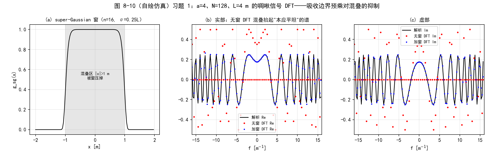

*图 8-10（自绘仿真）习题 1：a=4、N=128、L=4 m 的啁啾信号 DFT。(a) 超高斯窗（n=16、σ=0.25L），阴影区 |x|>1 m 是混叠区；(b) 实部与 (c) 虚部：无窗 DFT（红点）被混叠污染成散点，加窗 DFT（蓝点）贴住解析曲线（黑线）*

**习题 2**（\(\alpha_2\) 消去的代数）：把 \(\delta_2 = (1-\alpha_2)\delta_1 + \alpha_2\delta_n\)、\(\Delta z_1 = \alpha_2 \Delta z\) 代入式 (8.20) 后，左右两个不等式各移项、合并 \((1-\alpha_2)\delta_1\)，得 \(\alpha_2 \delta_n \ge \alpha_2\delta_1 + \alpha_2 \Delta z \delta_1/R - \lambda\alpha_2\Delta z/D_1\)（左）与 \(\alpha_2 \delta_n \le \alpha_2\delta_1 + \alpha_2 \Delta z \delta_1/R + \lambda\alpha_2\Delta z/D_1\)（右）；两边除以 \(\alpha_2 > 0\)，\(\alpha_2\) 严格消去，得式 (8.22)。工程 1 验证 0 的 1000 组随机参数复核判定不一致为 0 组。

**习题 3**（点源长距：分段无收益的情形）：沿用第 7 章习题 2 的选点 \(\delta_1 = \delta_2 = 1\) cm、\(N = 1024\)：约束 4（单次）要 \(N \ge 1000\)，约束 2 要 \(N \ge 600\)——约束 4 主导。从式 (8.24) 的视角看：\(\Delta z_{max} = (10^{-2})^2 \times 1024 / 10^{-6} = 1.024\times10^5\) m \(\ge \Delta z = 10^5\) m（余量仅 2%）——\(N = 1024\) 正是约束 4 逼出来的，单次传播本来就可行，**分段在这里没有收益**（分 2 段每段只需 \(N \ge 500\)，余量放大 4 倍，但也仅此而已）。对照书例（\(\delta \sim\) 几十 µm、\(\Delta z_{max} = 0.57\) m \(\ll 2\) m）：分段的收益由 \(\min(\delta_1,\delta_n)^2 N/\lambda\) 相对 \(\Delta z\) 的大小决定；点源长距场景网格间距是厘米级，约束 4 天然宽松。

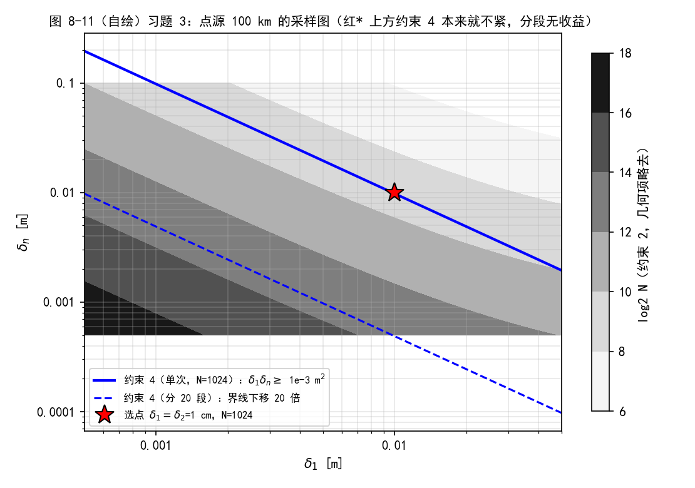

*图 8-11（自绘）习题 3：点源 100 km 的采样图（log₂N 等高线，约束 1 对 D₁→0 失效不画）。蓝实线 = 单次传播约束 4 的界（δ₁δₙ ≥ 10⁻³ m²），蓝虚线 = 分 20 段后的界（下移 20 倍）；红星 = 选点 (1 cm, 1 cm)、N=1024，恰好压在单次界线上*

**习题 4**（环形孔径聚焦 100 km）：源是环孔 \(\times\) 聚焦相位（\(R = -\Delta z\)）。取 \(\delta_1 = D_{out}/30 = 50\) mm、\(\delta_n = 2.5\) mm（聚焦斑 Airy 半径 \(1.22\lambda\Delta z/D_{out} = 106\) mm，约 40 点/半径，分辨充裕）、\(D_2 = 0.5\) m：约束 2 要 \(N \ge 635 = 2^{9.31}\) \(\to N = 1024\)；约束 3 因 \(|1 + \Delta z/R| = 0 < D_2/D_1\) 免检；约束 4 给 \(\Delta z_{max} = (2.5\,\mathrm{mm})^2 \times 1024/1.3\,\mu\mathrm{m} = 4.9\) km \(\to\) 至少 21 段（每段 4.8 km）。仿真（21 段收缩网格传播）vs 解析：峰值比 0.9992、ROI(±0.25 m) 内 \(|\Delta I|/\)峰值 \(= 1.0\times10^{-2}\)、相位残差 \(3.6\times10^{-4}\) rad。

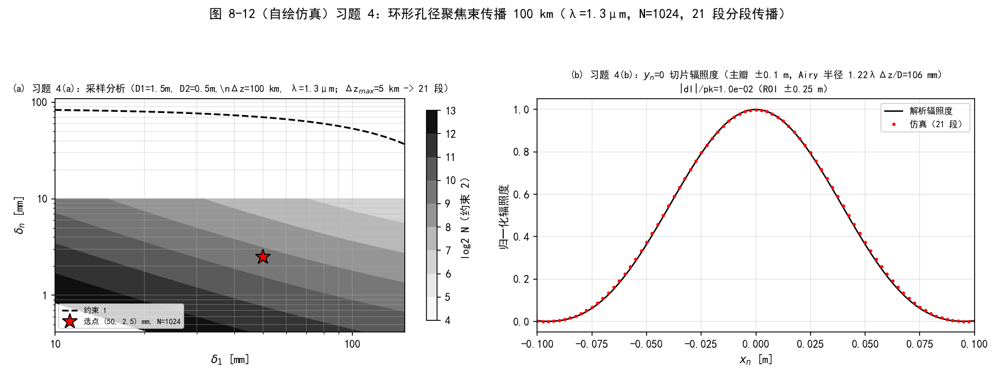

*图 8-12（自绘仿真）习题 4：环形孔径聚焦束传播 100 km（λ=1.3µm、N=1024、21 段）。(a) 采样分析（log₂N 等高线 + 约束 1 虚线 + 选点红星）；(b) yₙ=0 切片辐照度：仿真（红点）贴住解析（黑线），主瓣 ±0.1 m*

!!! note "拓展：习题 4 的解析解——聚焦啁啾精确相消"
    环孔聚焦源的相位是 \(e^{-ik r_1^2/(2\Delta z)}\)（\(R = -\Delta z\)），与菲涅耳核里的源面啁啾 \(e^{+ik r_1^2/(2\Delta z)}\) **逐点相消**（不是近似）——菲涅耳积分退化成光瞳的傅里叶变换：

    \[
    U(\mathbf{r}_n) = \frac{e^{ik\Delta z}}{i\lambda \Delta z}\, e^{i\frac{k}{2\Delta z}|\mathbf{r}_n|^2}\,
    \tilde{P}\!\left(\frac{\mathbf{r}_n}{\lambda \Delta z}\right), \qquad
    \tilde{P}(f) = \frac{\pi}{4}\left[D_{out}^2\,\frac{2J_1(\pi D_{out} f)}{\pi D_{out} f} - D_{in}^2\,\frac{2J_1(\pi D_{in} f)}{\pi D_{in} f}\right].
    \]

    \(\tilde{P}\) 是两个 jinc 函数之差（环孔 = 大圆减小圆）。\(f = 0\) 处取极限 \(2J_1(u)/u \to 1\)，\(\tilde{P}(0) = \tfrac{\pi}{4}(D_{out}^2 - D_{in}^2)\)；注意判断要用 \(|u|\)——负频率也走正规分支（坑与陷阱第 8 条）。

### 工程 2：习题复现（原书 8.5 节）

对应文件 `matlab/waveprop/ch8/ch8_problems.m` 与 `python/waveprop/ch8/ch8_problems.py`（习题 1/3/4 的图与量化、习题 2 的推导打印）：

=== "MATLAB"

    ```matlab
    %% ===== 书 Schmidt PM199 第 8 章（工程 2）：习题 1-4 复现 =====
    %  原书 8.5 节习题；与 python/waveprop/ch8/ch8_problems.py 数值行为一致。
    %
    %  习题清单与做法：
    %    1. g(x)=exp(i*pi*a^2*x^2)（式 8.26，a=4、N=128、L=4 m）的解析 FT 与
    %       离散 DFT 对比；预乘 super-Gaussian 吸收边界（n=16、sigma=0.25L）后
    %       重算 DFT，画实部/虚部与解析 FT 对比。
    %       解析：FT{exp(i*pi*a^2*x^2)} = e^{i*pi/4}/a * exp(-i*pi*f^2/a^2)。
    %       Python 实跑：低频段 |f|<=8 与解析的最大偏差：无窗 0.250（= 振幅尺度
    %       1/a，混叠完全污染），加窗 0.001 —— 吸收边界把混叠贡献压掉两个量级。
    %    2. 补全式 (8.20)->(8.22) 的代数步骤（alpha_2 消去），证明约束 3 与分段数
    %       无关（推导打印；数值复核在工程 1 验证 0）。
    %    3. 点源（lambda=1um）100 km -> 2 m 望远镜的采样图。取 delta1=delta2=1cm、
    %       N=1024（第 7 章习题 2 结论，约束 4 主导）；Delta_z_max = 1.02e5 m >=
    %       1e5 m（余量 2%）—— 单次传播可行，分段在这里没有收益；分段的收益
    %       出现在 delta 为几十 um 的场景（书例 Delta_z_max=0.57 m << 2 m）。
    %    4. 环形孔径（D_out=1.5m、D_in=0.5m、lambda=1.3um）平面波聚焦到 100 km
    %       处目标平面：(a) 采样分析 + 分段数确定；(b) yn=0 切片辐照度与相位
    %       （仿真 vs 解析同图）。
    %       解析：源带聚焦相位 exp(-i*k*r1^2/(2*Dz)) 时菲涅耳积分的二次相位恰好
    %       相消，观察面场 = e^{ikDz} e^{ikr^2/(2Dz)}/(i*lambda*Dz) x P~(f)，
    %       f = r/(lambda*Dz)，P~ 为环孔光瞳的 FT：
    %         P~(f) = (pi/4)*[D_out^2*2J1(pi*D_out*f)/(pi*D_out*f)
    %                        - D_in^2 *2J1(pi*D_in*f) /(pi*D_in*f)]。
    %       Python 实跑：delta1=50mm、delta_n=2.5mm（Airy 半径
    %       1.22*lambda*Dz/D_out = 106 mm，约 40 点/半径）、N=1024、21 段
    %       （每段 4.8 km <= Delta_z_max=4.9 km）；仿真/解析峰值比 0.9992，
    %       ROI 内 |dI|/pk=1.0e-2、相位残差 3.6e-4 rad；
    %       二次相位系数拟合 25.3 vs 解析 24.2 /m^2（差 4.7%，对应
    %       拟合区间 ±8mm 内 <1e-4 rad 的相位差——系数量化对小相位差极敏感）。
    %
    %  MATLAB/Python 差异：MATLAB 用 besselj() 求 J1（Python 用 scipy.special.j1）；
    %  索引 1-based；annulus_ft 的 f=0 极限分支要用 |u| 判断（负 f 同样走正规分支）。
    clear; clc; close all;

    %% ================= 习题 1：啁啾信号的 DFT 与吸收边界预乘 =================
    fprintf('===== 习题 1：g(x)=exp(i*pi*a^2*x^2) 的 DFT 与吸收边界预乘 =====\n');
    a = 4;  N = 128;  L = 4;
    delta = L/N;
    n = -N/2 : N/2-1;
    x = n * delta;
    g = exp(1i*pi*a^2*x.^2);                         % 式 (8.26)
    % super-Gaussian 吸收边界（n=16、sigma=0.25L；r 取索引半径 |x|/delta）
    sig_idx = 0.25*L/delta;
    w = exp(-(abs(x)/delta).^16 / sig_idx^16);
    g_win = w .* g;
    % 解析 FT 与两个 DFT
    f = n / (N*delta);
    G_an = exp(1i*pi/4)/a * exp(-1i*pi*f.^2/a^2);
    G_num = ft1(g, delta);
    G_win = ft1(g_win, delta);
    band = abs(f) <= 8;
    fprintf('    delta=%.4f m, Nyquist=%.1f /m；混叠边界 |x| = %.2f m\n', ...
        delta, 1/(2*delta), 1/(2*a^2*delta));
    fprintf('    窗在 |x|=1 m 处 |w| = %.3f；|x|=2 m 处 %.2e\n', ...
        interp1(x(x>0), w(x>0), 1.0), interp1(x(x>0), w(x>0), 2.0));
    fprintf('    低频段 |f|<=8 与解析 FT 最大偏差：无窗 %.3f，加窗 %.3f（尺度 1/a=%.2f）\n', ...
        max(abs(G_num(band) - G_an(band))), max(abs(G_win(band) - G_an(band))), 1/a);
    figure('Position', [60 60 1350 420]);
    subplot(1, 3, 1);
    plot(x, w, 'k-', 'LineWidth', 1.2); grid on;
    xlabel('x [m]'); ylabel('g_{sg}(x)');
    title('(a) super-Gaussian 窗（n=16, \sigma=0.25L）');
    subplot(1, 3, 2);
    plot(f, real(G_an), 'k-', f, real(G_num), 'r.', f, real(G_win), 'b.'); grid on;
    xlim([-16 16]);
    xlabel('f [m^{-1}]');
    legend('解析 Re', '无窗 DFT Re', '加窗 DFT Re');
    title('(b) 实部：无窗 DFT 混叠污染');
    subplot(1, 3, 3);
    plot(f, imag(G_an), 'k-', f, imag(G_num), 'r.', f, imag(G_win), 'b.'); grid on;
    xlim([-16 16]);
    xlabel('f [m^{-1}]');
    legend('解析 Im', '无窗 DFT Im', '加窗 DFT Im');
    title('(c) 虚部');

    %% ================= 习题 2：式 (8.20)->(8.22) 的代数填充 =================
    fprintf('===== 习题 2：式 (8.20) -> (8.22) 的代数填充 =====\n');
    fprintf('    起点（式 8.20）：(1+Dz1/R)*d1 - w*Dz1/D1 <= d2 <= (1+Dz1/R)*d1 + w*Dz1/D1\n');
    fprintf('    代入 d2 = (1-a2)*d1 + a2*dn、Dz1 = a2*Dz（式 8.21），移项合并后：\n');
    fprintf('      a2*dn >= a2*d1 + a2*Dz*d1/R - w*a2*Dz/D1（左）；<= ... + w*a2*Dz/D1（右）\n');
    fprintf('    两边除以 a2（>0）—— alpha_2 严格消去，得式 (8.22) == 式 (7.53)。\n');
    fprintf('    数值复核见工程 1 验证 0（1000 组随机参数判定不一致 = 0 组）。\n');

    %% ================= 习题 3：点源 100 km 的采样图 =================
    fprintf('===== 习题 3：点源 100 km -> 2 m 望远镜的采样图 =====\n');
    wvl = 1e-6;  Dz3 = 100e3;  D2p = 2;  d1p = 1e-2;  d2p = 1e-2;  Np = 1024;
    fprintf('    取 delta1 = delta2 = 1 cm、N = %d（约束 4 主导）\n', Np);
    fprintf('    约束 2（D1->0）：N >= %.0f；约束 4（单次）：N >= %.0f\n', ...
        D2p/(2*d2p) + wvl*Dz3/(2*d1p*d2p), wvl*Dz3/(d1p*d2p));
    dzmax3 = d1p^2 * Np / wvl;                        % 式 (8.24)
    fprintf('    Delta_z_max = %.3e m >= Dz = 1e5 m（余量 %.0f%%）-> 单次可行，分段无收益\n', ...
        dzmax3, (dzmax3/Dz3 - 1)*100);
    fprintf('    对照书例：Delta_z_max = 0.57 m << 2 m -> 必须分段\n');
    d1g = logspace(-3.3, -1.3, 300);
    [d1m, dnm] = meshgrid(d1g, logspace(-3.3, -1.0, 300));
    C2 = D2p./(2*dnm) + wvl*Dz3./(2*d1m.*dnm);        % 约束 2（几何项略去，D1->0）
    figure('Position', [80 80 760 540]);
    contourf(d1m, dnm, log2(max(C2, 1)), 6:2:18, 'LineStyle', 'none');
    colormap(gray); colorbar; hold on;
    plot(d1g, wvl*Dz3/Np./d1g, 'b-', 'LineWidth', 2);
    plot(d1g, wvl*Dz3/Np./d1g/20, 'b--', 'LineWidth', 1.5);
    plot(d1p, d2p, 'r*', 'MarkerSize', 14);
    set(gca, 'XScale', 'log', 'YScale', 'log');
    xlabel('\delta_1 [m]'); ylabel('\delta_n [m]');
    title('习题 3：点源 100 km 采样图（红* 上方约束 4 不紧，分段无收益）');
    legend({'约束 2（log2 N）', '约束 4（单次 N=1024）', '约束 4（分 20 段）', ...
        '选点 \delta=1 cm、N=1024'}, 'Location', 'southwest');

    %% ================= 习题 4：环形孔径聚焦束 100 km =================
    fprintf('===== 习题 4：环形孔径（D_out=1.5m, D_in=0.5m）聚焦 100 km =====\n');
    wvl4 = 1.3e-6;  Dz4 = 100e3;  D_out = 1.5;  D_in = 0.5;  D1 = D_out;
    delta1 = D1/30;                                   % 30 点跨外径 -> 50 mm
    deltan = 2.5e-3;                                  % Airy 半径 1.22*lambda*Dz/D = 106 mm
    N4 = 1024;
    D2q = 0.5;                                        % ROI 直径 0.5 m
    c2 = constraint2_N(delta1, deltan, D1, D2q, wvl4, Dz4);
    fprintf('    delta1=%.1f mm、delta_n=%.1f mm、约束 2：N >= %.0f -> N=%d\n', ...
        delta1*1e3, deltan*1e3, c2, N4);
    constraint3_d2(delta1, D1, wvl4, Dz4, -Dz4);      % 约束 3（R=-Dz）：|1+Dz/R|=0 < D2/D1 免检
    fprintf('    约束 3（R=-Dz，聚焦到目标）：|1+Dz/R|=0 < D2/D1 -> 免检\n');
    dzmax4 = dz_max_partial(delta1, deltan, N4, wvl4);
    nseg4 = ceil(Dz4/dzmax4);
    fprintf('    约束 4：Delta_z_max = %.0f m -> 至少 %d 段（%d 平面）；取 %d 段（每段 %.1f km）\n', ...
        dzmax4, nseg4, nseg4+1, nseg4, Dz4/nseg4/1e3);
    z4 = (1:nseg4) * Dz4 / nseg4;
    % 源：环孔 x 聚焦相位 exp(-i k r1^2/(2 Dz))（会聚到目标面）
    [x1g, y1g] = meshgrid((-N4/2 : N4/2-1) * delta1);
    r1 = sqrt(x1g.^2 + y1g.^2);
    ap = circle(x1g, y1g, D_out/2) - circle(x1g, y1g, D_in/2);
    src = ap .* exp(-1i*pi/wvl4/Dz4 * r1.^2);
    [xn4, ~, Uout4] = ang_spec_multi_prop_vac(src, wvl4, delta1, deltan, z4);
    % 解析：聚焦相位与传播核啁啾相消 -> 观察面 = e^{ikDz}e^{ikr^2/2Dz}/(i w Dz) x P~(f)
    xn1 = xn4(N4/2+1, :);
    f4 = xn1 / (wvl4*Dz4);
    Ptil = annulus_ft(f4, D_out, D_in);
    U_an = exp(1i*pi/wvl4/Dz4*xn1.^2) / (1i*wvl4*Dz4) .* Ptil;
    I_num = abs(Uout4(N4/2+1,:)).^2;  I_an = abs(U_an).^2;  pk = max(I_an);
    win4 = abs(xn1) <= D2q/2;
    eI4 = max(abs(I_num(win4) - I_an(win4)))/pk;
    mph4 = win4 & (I_an > 0.05*pk);
    eph4 = max(abs(angle(Uout4(N4/2+1,mph4)./U_an(mph4))));
    fprintf('    解析峰值辐照度 = %.3e；仿真/解析峰值比 = %.4f\n', pk, max(I_num)/pk);
    fprintf('    ROI(+-0.25 m)内：|dI|/峰值 = %.2e；相位残差(|U|>5%%峰值) = %.2e rad\n', eI4, eph4);
    % 采样图 + 切片图
    d1g4 = logspace(log10(delta1/5), log10(delta1*3), 260);
    [d1m4, dnm4] = meshgrid(d1g4, logspace(log10(deltan/6), log10(deltan*4), 260));
    C24 = constraint2_N(d1m4, dnm4, D1, D2q, wvl4, Dz4);
    figure('Position', [60 60 1260 480]);
    subplot(1, 2, 1);
    contourf(d1m4*1e3, dnm4*1e3, log2(max(C24, 1)), 4:13, 'LineStyle', 'none');
    colormap(gray); colorbar; hold on;
    plot(d1g4*1e3, constraint1_d2(d1g4, D1, D2q, wvl4, Dz4)*1e3, 'k--', 'LineWidth', 1.6);
    plot(delta1*1e3, deltan*1e3, 'r*', 'MarkerSize', 14);
    set(gca, 'XScale', 'log', 'YScale', 'log');
    xlabel('\delta_1 [mm]'); ylabel('\delta_n [mm]');
    title('(a) 习题 4(a)：采样分析（\Deltaz_{max}=4.9 km -> 21 段）');
    legend({'约束 2（log2 N）', '约束 1', '选点 (50, 2.5) mm、N=1024'}, ...
        'Location', 'southwest');
    subplot(1, 2, 2);
    plot(xn1, I_an/pk, 'k-', xn1, I_num/pk, 'r.'); grid on;
    xlim([-0.1 0.1]);
    xlabel('x_n [m]'); ylabel('归一化辐照度');
    legend('解析辐照度', '仿真（21 段）');
    title('(b) 习题 4(b)：y_n=0 切片辐照度（主瓣 ±0.1 m）');

    %% ================= 本地函数 =================
    function G = ft1(g, delta)
    % 原书 Listing 2.3 思路：定标正确的一维 DFT（乘 delta）。
    G = fftshift(fft(fftshift(g))) * delta;
    end

    function out = annulus_ft(f, D_out, D_in)
    % 环孔光瞳 P = circ(2r/D_out) - circ(2r/D_in) 的（径向）傅里叶变换。
    % FT{circ(r/a)} = pi*a^2 * 2J1(2*pi*a*f)/(2*pi*a*f)，代入 a = D/2。
    f = f(:).';
    out = zeros(size(f));
    for kk = 1:numel(f)
        uo = pi * D_out * f(kk);
        ui = pi * D_in * f(kk);
        if abs(uo) < 1e-12
            to = D_out^2;                            % u->0: 2J1(u)/u -> 1
        else
            to = D_out^2 * 2 * besselj(1, uo) / uo;
        end
        if abs(ui) < 1e-12
            ti = D_in^2;
        else
            ti = D_in^2 * 2 * besselj(1, ui) / ui;
        end
        out(kk) = pi/4 * (to - ti);
    end
    end

    function [xn, yn, Uout, planes] = ang_spec_multi_prop_vac(Uin, wvl, delta1, deltan, z, sg, record)
    % 任意次部分传播（书 Listing 8.1 原样整理，含吸收边界）。
    if nargin < 6 || isempty(sg)
        sg = super_gaussian_absorber(size(Uin, 1));
    end
    if nargin < 7
        record = false;
    end
    N = size(Uin, 1);
    [nx, ny] = meshgrid((-N/2 : 1 : N/2 - 1));
    k = 2*pi/wvl;
    z = [0 z];
    n = length(z);
    Delta_z = z(2:n) - z(1:n-1);
    alpha = z / z(n);
    delta = (1-alpha) * delta1 + alpha * deltan;     % 式 (8.8)
    m = delta(2:n) ./ delta(1:n-1);
    x1 = nx * delta(1);
    y1 = ny * delta(1);
    r1sq = x1.^2 + y1.^2;
    Q1 = exp(i*k/2*(1-m(1))/Delta_z(1)*r1sq);
    Uin = Uin .* Q1;
    planes = cell(1, n-1);
    for idx = 1 : n-1
        deltaf = 1 / (N*delta(idx));
        fX = nx * deltaf;
        fY = ny * deltaf;
        fsq = fX.^2 + fY.^2;
        Z = Delta_z(idx);
        Q2 = exp(-i*pi^2*2*Z/m(idx)/k*fsq);
        Uin = sg .* ift2(Q2 .* ft2(Uin / m(idx), delta(idx)), deltaf);
        if record
            planes{idx} = Uin;
        end
    end
    xn = nx * delta(n);
    yn = ny * delta(n);
    rnsq = xn.^2 + yn.^2;
    Q3 = exp(i*k/2*(m(n-1)-1)/(m(n-1)*Z)*rnsq);
    Uout = Q3 .* Uin;
    end

    function g = super_gaussian_absorber(N, w_frac, order)
    % super-Gaussian 吸收边界（式 8.1；书 Listing 8.1 第 10-12 行）。
    if nargin < 2
        w_frac = 0.47;
    end
    if nargin < 3
        order = 16;
    end
    [nx, ny] = meshgrid((-N/2 : 1 : N/2 - 1));
    nsq = nx.^2 + ny.^2;
    w = w_frac * N;
    g = exp(-nsq.^(order/2) / w^order);
    end

    function [lo, hi] = constraint3_d2(d1, D1, wvl, Dz, R)
    % 约束 3（式 8.22 == 式 7.53）。
    slope = 1 + Dz/R;
    off = wvl*Dz/D1;
    lo = slope*d1 - off;
    hi = slope*d1 + off;
    end

    function Nlo = constraint2_N(d1, dn, D1, D2, wvl, Dz)
    % 约束 2（式 7.20）。
    Nlo = D1./(2*d1) + D2./(2*dn) + wvl*Dz./(2*d1.*dn);
    end

    function dzmax = dz_max_partial(d1, dn, N, wvl)
    % 式 (8.24)：Delta_z_max = min(d1,dn)^2 * N / lambda。
    dzmax = min(d1, dn)^2 * N / wvl;
    end

    function G = ft2(g, delta)
    % 原书 Listing 2.5：定标正确的二维 DFT（乘 delta^2）。
    G = fftshift(fft2(fftshift(g)))*delta^2;
    end

    function g = ift2(G, delta_f)
    % 原书 Listing 2.6：定标正确的二维逆 DFT（乘 (N*delta_f)^2）。
    N = size(G, 1);
    g = fftshift(ifft2(fftshift(G)))*(N*delta_f)^2;
    end

    function out = rect(x)
    % rect(x)：|x|<1/2 取 1，|x|=1/2 取 1/2，其余 0。
    out = double(abs(x) < 1/2) + 0.5*double(abs(x) == 1/2);
    end

    function out = circle(X, Y, R)
    % circle(X,Y,R)：X^2+Y^2 <= R^2 内取 1，边界取 1/2（书附录 A 定义）。
    r2 = X.^2 + Y.^2;
    out = double(r2 < R^2) + 0.5*double(abs(r2 - R^2) < eps(R^2));
    end
    ```

=== "Python"

    ```python
    # -*- coding: utf-8 -*-
    """
    ===== 书 Schmidt PM199 第 8 章（工程 2：习题 1-4）=====
    部分传播与放宽采样约束——习题复现与数值验证（原书 8.5 节）。

    习题清单：
        1. 啁啾信号 g(x)=exp(i*pi*a^2*x^2)（式 8.26，a=4，N=128，L=4 m）的解析
           FT 与离散 DFT 对比；再把信号预乘 super-Gaussian 吸收边界
           （n=16、sigma=0.25L）重算 DFT，画两版 DFT 的实部/虚部并与解析 FT 对比。
           要点：a=4、L=4 m 时 f_loc = a^2*x = 16x，Nyquist = 16/m，混叠边界
           |x| = 1 m = L/4；sigma = 0.25L = 1 m 的窗恰好在混叠区把信号压掉
           ——吸收边界抑制混叠的一维玩具版。
        2. 补全式 (8.20) -> (8.22) 之间的代数步骤（alpha_2 消去），证明约束 3
           与分段数无关。代数推导见笔记；工程 1 的验证 0 已做 1000 组随机参数
           数值复核，这里再打印推导要点。
        3. 点源（lambda=1 um）传播 100 km 到 2 m 直径望远镜孔径的采样图
           （约束 1&2 等高线 + 可行选点），并与"只有一次传播"的情形比较：
           delta1=delta2=1 cm、N=1024 时 Delta_z_max = min^2*N/lambda = 1.02e5 m
           >= 1e5 m —— 单次传播约束 4 本来就不紧，分段在这里没有收益；
           分段的收益出现在网格间距小（delta ~ 几十 um）的场景（书例）。
        4. 环形孔径（外径 1.5 m、内径 0.5 m、lambda=1.3 um）平面波聚焦到
           100 km 处目标平面：(a) 采样分析（约束 1/2/3 + 分段数确定）；
           (b) yn=0 切片辐照度与相位，仿真 vs 解析同图。
           解析：源带聚焦相位 exp(-i*k*r1^2/(2*Dz)) 时菲涅耳积分的二次相位
           恰好相消，观察面场 = e^{ikDz} e^{ikr^2/(2Dz)} /(i*lambda*Dz) x
           环孔光瞳的傅里叶变换（精确成立，非近似）：
             P(r) = circ(2r/D_out) - circ(2r/D_in)
             P~(f) = (pi/4)[D_out^2 * 2J1(pi D_out f)/(pi D_out f)
                            - D_in^2 * 2J1(pi D_in f)/(pi D_in f)]，f = r/(lambda*Dz)。

    数值验证（运行本脚本全部自动打印，图存 out_*.png）：
        (1) 习题 1：无窗 DFT vs 加窗 DFT vs 解析 FT（实部/虚部），量化误差 ->
            out_fig10_prob1.png（笔记 fig-8-10）。
        (2) 习题 2：打印推导 + 引用工程 1 验证 0 的随机参数结论。
        (3) 习题 3：点源采样图 + 单次/分段约束 4 对照 -> out_fig11_prob3.png
            （笔记 fig-8-11）。
        (4) 习题 4：采样分析（约束 2 等高线 + 选点）+ yn=0 辐照度/相位
            仿真 vs 解析 -> out_fig12_prob4.png（笔记 fig-8-12）。

    运行：C:/Anocanda/envs/machinelearn/python.exe -I ch8_problems.py
    """

    import os
    import sys

    import numpy as np
    import matplotlib
    matplotlib.use('Agg')
    import matplotlib.pyplot as plt
    from scipy.special import j1

    plt.rcParams['font.sans-serif'] = ['SimHei', 'Microsoft YaHei', 'DejaVu Sans']
    plt.rcParams['axes.unicode_minus'] = False

    from matplotlib.ticker import FuncFormatter


    def plain_log(axis):
        """log 轴用纯文本刻度（避免 mathtext 的 U+2212 负号被 SimHei 顶成缺字框）。"""
        axis.set_major_formatter(FuncFormatter(lambda v, p: '%g' % v))
        axis.set_minor_formatter(FuncFormatter(lambda v, p: ''))


    _HERE = os.path.dirname(os.path.abspath(__file__))
    sys.path.insert(0, _HERE)                                # -I 模式下脚本目录不在 path
    sys.path.insert(0, os.path.join(_HERE, '..', '..', 'fourier', 'common'))
    from base import rect, circle, ft1_centered as ft1       # noqa: E402
    from ch8_partial_prop import (                           # noqa: E402
        ang_spec_multi_prop_vac, super_gaussian_absorber,
        constraint1_d2, constraint2_N, constraint3_d2,
        dz_max_partial, delta_middle)


    def prob1(outdir):
        """习题 1：啁啾信号的 DFT 与吸收边界预乘。"""
        print('===== 习题 1：g(x)=exp(i*pi*a^2*x^2) 的 DFT 与吸收边界预乘 =====')
        a = 4.0
        N = 128
        L = 4.0
        delta = L / N
        n = np.arange(N) - N // 2
        x = n * delta
        g = np.exp(1j * np.pi * a ** 2 * x ** 2)
        # super-Gaussian 吸收边界（n=16、sigma=0.25L；r 取索引半径 |x|/delta）
        sig_idx = 0.25 * L / delta
        w = np.exp(-(np.abs(x) / delta) ** 16 / sig_idx ** 16)   # 一维超高斯
        g_win = w * g
        # 解析 FT：FT{exp(i pi a^2 x^2)} = e^{i pi/4}/a * exp(-i pi f^2/a^2)
        df = 1.0 / (N * delta)                               # 频域采样间隔（ft1_centered 约定）
        f = n * df
        G_an = np.exp(1j * np.pi / 4.0) / a * np.exp(-1j * np.pi * f ** 2 / a ** 2)
        G_num = ft1(g, delta)
        G_win = ft1(g_win, delta)
        # 量化（比较低频段 |f| <= 8 m^-1，即窗明显起作用的范围）
        band = np.abs(f) <= 8.0
        e_raw = np.max(np.abs(G_num[band] - G_an[band]))
        e_win = np.max(np.abs(G_win[band] - G_an[band]))
        print('    delta=%.4f m, Nyquist=%.1f /m；f_loc = a^2*x = 16x，混叠边界 |x| = %.2f m'
              % (delta, 1 / (2 * delta), 1.0 / (2 * a ** 2 * delta)))
        print('    窗在 |x|=1 m（=混叠边界）处 |w| = %.3f；|x|=2 m 处 %.2e'
              % (np.interp(1.0, x[x > 0], w[x > 0]), np.interp(2.0, x[x > 0], w[x > 0])))
        print('    低频段 |f|<=8 与解析 FT 的最大偏差：无窗 DFT %.3f，加窗 DFT %.3f'
              '（振幅尺度 1/a = %.2f）' % (e_raw, e_win, 1 / a))
        fig, axs = plt.subplots(1, 3, figsize=(13.5, 4.2))
        axs[0].plot(x, w, 'k-', lw=1.2)
        axs[0].set_title('(a) super-Gaussian 窗（n=16, σ=0.25L）', fontsize=10)
        axs[0].set_xlabel('x [m]')
        axs[0].set_ylabel('g_sg(x)')
        axs[0].axvspan(-1, 1, color='0.9')
        axs[0].text(0, 0.5, '混叠区 |x|>1 m\n被窗压掉', ha='center', fontsize=8)
        axs[0].grid(alpha=0.3)
        axs[1].plot(f, G_an.real, 'k-', lw=1.3, label='解析 Re')
        axs[1].plot(f, G_num.real, 'r.', ms=4, label='无窗 DFT Re')
        axs[1].plot(f, G_win.real, 'b.', ms=3, label='加窗 DFT Re')
        axs[1].set_xlim(-16, 16)
        axs[1].set_xlabel('f [m$^{-1}$]')
        axs[1].set_title('(b) 实部：无窗 DFT 混叠抬起"本应平坦"的谱', fontsize=10)
        axs[1].legend(fontsize=8)
        axs[1].grid(alpha=0.3)
        axs[2].plot(f, G_an.imag, 'k-', lw=1.3, label='解析 Im')
        axs[2].plot(f, G_num.imag, 'r.', ms=4, label='无窗 DFT Im')
        axs[2].plot(f, G_win.imag, 'b.', ms=3, label='加窗 DFT Im')
        axs[2].set_xlim(-16, 16)
        axs[2].set_xlabel('f [m$^{-1}$]')
        axs[2].set_title('(c) 虚部', fontsize=10)
        axs[2].legend(fontsize=8)
        axs[2].grid(alpha=0.3)
        fig.suptitle('图 8-10（自绘仿真）习题 1：a=4、N=128、L=4 m 的啁啾信号 DFT'
                     '——吸收边界预乘对混叠的抑制', fontsize=12)
        fig.subplots_adjust(top=0.84, bottom=0.12, left=0.06, right=0.98,
                            wspace=0.25)
        fp = os.path.join(outdir, 'out_fig10_prob1.png')
        fig.savefig(fp, dpi=150)
        print('    已保存 %s' % fp)
        return e_raw, e_win


    def prob2():
        """习题 2：式 (8.20)->(8.22) 的代数填充（推导打印）。"""
        print('===== 习题 2：式 (8.20) -> (8.22) 的代数填充（约束 3 与分段数无关） =====')
        print('    起点（式 8.20）：(1+Dz1/R)*d1 - w*Dz1/D1 <= d2 <= (1+Dz1/R)*d1 + w*Dz1/D1')
        print('    代入 d2 = (1-a2)*d1 + a2*dn、Dz1 = a2*Dz（式 8.21）：')
        print('      (1+a2*Dz/R)*d1 - w*a2*Dz/D1 <= (1-a2)*d1 + a2*dn')
        print('                                <= (1+a2*Dz/R)*d1 + w*a2*Dz/D1')
        print('    左：a2*dn >= a2*d1 + a2*Dz*d1/R - w*a2*Dz/D1  （移项合并 (1-a2)d1）')
        print('    右：a2*dn <= a2*d1 + a2*Dz*d1/R + w*a2*Dz/D1')
        print('    两边除以 a2（a2>0）——alpha_2 严格消去：')
        print('      (1+Dz/R)*d1 - w*Dz/D1 <= dn <= (1+Dz/R)*d1 + w*Dz/D1   （式 8.22）')
        print('    与式 (7.53) 完全相同 —— 约束 3 对任意分段数一致；')
        print('    数值复核见工程 1 验证 0（1000 组随机参数判定不一致 = 0 组）。')


    def prob3(outdir):
        """习题 3：点源 100 km 的采样图，单次 vs 分段。"""
        print('===== 习题 3：点源 100 km -> 2 m 望远镜的采样图与单次/分段对比 =====')
        wvl = 1e-6
        Dz = 100e3
        D2 = 2.0
        # 第 7 章习题 2 的结论：delta1 = delta2 = 1 cm、N >= 1024（约束 4 主导；
        # 点源 D1->0 使约束 1 失效）
        d1 = d2 = 1e-2
        N = 1024
        print('    取 delta1 = delta2 = 1 cm、N = %d（第 7 章习题 2 的选点）' % N)
        print('    约束 2（D1->0）：N >= D2/(2*dn) + w*Dz/(2*d1*dn) = %.0f'
              % (D2 / (2 * d2) + wvl * Dz / (2 * d1 * d2)))
        print('    约束 4（单次）：N >= w*Dz/(d1*dn) = %.0f  -> 主导' % (wvl * Dz / (d1 * d2)))
        dzm = dz_max_partial(d1, d2, N, wvl)
        print('    分段视角：Delta_z_max = min^2*N/lambda = %.3e m >= Dz = 1e5 m'
              '（余量仅 %.0f%% —— N=1024 正是约束 4 逼出来的）-> 单次可行；'
              '分 2 段则每段约束 4 只需 N >= %.0f，余量 x4'
              % (dzm, (dzm / Dz - 1) * 100, wvl * Dz / 2 / (d1 * d2)))
        print('    对照书例（delta1=66.7um, delta_n=200um, N=128, Dz=2m）：'
              'Delta_z_max = 0.57 m << 2 m -> 必须分段')
        print('    结论：分段的收益由 min(delta1,deltan)^2*N/lambda 相对 Dz 的大小决定；'
              '点源长距场景 delta~cm 量级，约束 4 天然宽松')
        # 采样图：约束 2 的 log2 N 等高线（约束 1 对 D1->0 失效，不画）
        d1g = np.logspace(-3.3, -1.3, 300)
        dng = np.logspace(-3.3, -1.0, 300)
        D1g, Dng = np.meshgrid(d1g, dng)
        Nc2 = D2 / (2 * Dng) + wvl * Dz / (2 * D1g * Dng)      # 约束 2（几何项略去）
        fig, ax = plt.subplots(figsize=(7.4, 5.2))
        cs = ax.contourf(D1g, Dng, np.log2(np.maximum(Nc2, 1)),
                         levels=np.arange(6, 20, 2), cmap='Greys')
        cb = fig.colorbar(cs, ax=ax, shrink=0.9)
        cb.set_label('log2 N（约束 2，几何项略去）')
        # 约束 4 的单次 N=1024 界：w*Dz/(d1*dn) <= 1024 -> d1*dn >= w*Dz/1024
        prod_min = wvl * Dz / N
        d1line = np.logspace(-3.3, -1.3, 200)
        ax.plot(d1line, prod_min / d1line, 'b-', lw=2,
                label='约束 4（单次，N=1024）：$\\delta_1\\delta_n \\geq$ 1e-3 m$^2$')
        # 分段（例如 20 段，每段 5 km）后的约束 4 界
        ax.plot(d1line, prod_min / 20 / d1line, 'b--', lw=1.5,
                label='约束 4（分 20 段）：界线下移 20 倍')
        ax.plot(d1, d2, 'r*', ms=15, mec='k', zorder=6,
                label='选点 $\\delta_1=\\delta_2$=1 cm，N=1024')
        ax.set_xscale('log')
        ax.set_yscale('log')
        plain_log(ax.xaxis)
        plain_log(ax.yaxis)
        ax.set_xlabel('$\\delta_1$ [m]')
        ax.set_ylabel('$\\delta_n$ [m]')
        ax.set_title('图 8-11（自绘）习题 3：点源 100 km 的采样图'
                     '（红* 上方约束 4 本来就不紧，分段无收益）', fontsize=10)
        ax.legend(fontsize=8, loc='lower left')
        ax.grid(alpha=0.3, which='both')
        fig.tight_layout()
        fp = os.path.join(outdir, 'out_fig11_prob3.png')
        fig.savefig(fp, dpi=150)
        print('    已保存 %s' % fp)


    def annulus_ft(f, D_out, D_in):
        """环孔光瞳 P = circ(2r/D_out) - circ(2r/D_in) 的（径向）傅里叶变换。

        FT{circ(r/a)} = pi*a^2 * 2*J1(2*pi*a*f)/(2*pi*a*f)，代入 a = D/2：
            P~(f) = (pi/4)*[D_out^2*2J1(pi*D_out*f)/(pi*D_out*f)
                            - D_in^2*2J1(pi*D_in*f)/(pi*D_in*f)]
        f=0 处取极限 = (pi/4)(D_out^2 - D_in^2)。
        """
        f = np.atleast_1d(np.asarray(f, dtype=float))

        def jinc_term(D, fv):
            u = np.pi * D * fv
            small = np.abs(u) < 1e-12                 # 注意 |u|：负 f 也要走正规分支
            res = np.empty_like(u)
            res[small] = D ** 2                       # u->0: 2J1(u)/u -> 1
            uu = u[~small]
            res[~small] = D ** 2 * 2 * j1(uu) / uu
            return res

        out = (np.pi / 4.0) * (jinc_term(D_out, f) - jinc_term(D_in, f))
        return out


    def prob4(outdir):
        """习题 4：环形孔径聚焦束 100 km 的采样分析 + 仿真 vs 解析。"""
        print('===== 习题 4：环形孔径（D_out=1.5m, D_in=0.5m）聚焦 100 km =====')
        wvl = 1.3e-6
        Dz = 100e3
        D_out, D_in = 1.5, 0.5
        D1 = D_out
        # 源面：30 点跨外径 -> delta1 = 50 mm；观察面：聚焦斑 Airy 半径
        # 1.22*lambda*Dz/D_out = 1.22*1.3e-6*1e5/1.5 = 106 mm —— delta_n 细于它
        # 才能分辨主瓣与环结构，取 delta_n = 2.5 mm（约 40 点/Airy 半径，充裕）；
        # N 由约束 2 逼到 1024
        delta1 = D1 / 30
        deltan = 2.5e-3
        N = 1024
        D2 = 0.5                                             # ROI 直径 0.5 m
        # 约束 2：
        c2 = constraint2_N(delta1, deltan, D1, D2, wvl, Dz)
        print('    delta1 = %.1f mm（30 点跨外径）、delta_n = %.1f mm（Airy 半径 10.6 mm）、'
              'N = %d' % (delta1 * 1e3, deltan * 1e3, N))
        print('    约束 2（ROI 0.5m）：N >= %.1f = 2^%.2f -> N=%d 成立'
              % (c2, np.log2(c2), N))
        # 约束 3（聚焦源 R = -Dz）：
        lo3, hi3 = constraint3_d2(delta1, D1, wvl, Dz, -Dz)
        print('    约束 3（R=-Dz，聚焦到目标）：|1+Dz/R| = 0 < D2/D1 -> 免检'
              '（区间 [%.0f, %.0f] mm 恒含 delta_n）' % (lo3 * 1e3, hi3 * 1e3))
        # 约束 4 / 分段：
        dzm = dz_max_partial(delta1, deltan, N, wvl)
        nseg = int(np.ceil(Dz / dzm))
        print('    约束 4：Delta_z_max = min^2*N/lambda = %.0f m -> 至少 %d 段（%d 平面）'
              % (dzm, nseg, nseg + 1))
        print('    取 %d 段（每段 %.1f km，<= Delta_z_max）' % (nseg, Dz / nseg / 1e3))
        nseg_use = nseg
        z = (np.arange(1, nseg_use + 1)) * Dz / nseg_use
        # 源：环孔 x 聚焦相位 exp(-i k r1^2/(2 Dz))
        n = np.arange(N) - N // 2
        x1, y1 = np.meshgrid(n * delta1, n * delta1)
        r1 = np.sqrt(x1 ** 2 + y1 ** 2)
        ap = circle(x1, y1, D_out / 2) - circle(x1, y1, D_in / 2)
        src = ap * np.exp(-1j * np.pi / wvl / Dz * r1 ** 2)
        print('    仿真：%d 次分段传播（收缩网格 m=%.3f，网格跟随光束收缩）……'
              % (nseg_use, deltan / delta1))
        xn, yn, Uout = ang_spec_multi_prop_vac(src, wvl, delta1, deltan, z)
        # 解析：聚焦相位与传播核啁啾相消 -> 观察面 = e^{ikDz}e^{ikr^2/2Dz}/(i w Dz) x P~(f)
        sl = N // 2
        xn1 = xn[sl, :]
        f = xn1 / (wvl * Dz)
        Ptil = annulus_ft(f, D_out, D_in)
        U_an = np.exp(1j * np.pi / wvl / Dz * xn1 ** 2) / (1j * wvl * Dz) * Ptil
        I_num = np.abs(Uout[sl, :]) ** 2
        I_an = np.abs(U_an) ** 2
        pk = I_an.max()
        win = np.abs(xn1) <= D2 / 2
        eI = np.max(np.abs(I_num[win] - I_an[win])) / pk
        mph = win & (I_an > 0.05 * pk)
        eph = np.max(np.abs(np.angle(Uout[sl, :][mph] / U_an[mph])))
        print('    解析峰值辐照度 = %.3e；仿真/解析峰值比 = %.4f'
              % (pk, I_num.max() / pk))
        print('    ROI(+-0.25 m)内：|dI|/峰值 = %.2e；相位残差(|U|>5%%峰值) = %.2e rad'
              % (eI, eph))
        # 采样图（约束 2 等高线 + 选点）
        d1g = np.logspace(np.log10(delta1 / 5), np.log10(delta1 * 3), 260)
        dng = np.logspace(np.log10(deltan / 6), np.log10(deltan * 4), 260)
        D1g, Dng = np.meshgrid(d1g, dng)
        Nc2 = constraint2_N(D1g, Dng, D1, D2, wvl, Dz)
        fig, axs = plt.subplots(1, 2, figsize=(12.6, 4.8))
        ax = axs[0]
        cs = ax.contourf(D1g * 1e3, Dng * 1e3, np.log2(np.maximum(Nc2, 1)),
                         levels=np.arange(4, 14), cmap='Greys')
        cb = fig.colorbar(cs, ax=ax, shrink=0.9)
        cb.set_label('log2 N（约束 2）')
        ax.plot(d1g * 1e3, constraint1_d2(d1g, D1, D2, wvl, Dz) * 1e3, 'k--', lw=1.6,
                label='约束 1')
        ax.plot(delta1 * 1e3, deltan * 1e3, 'r*', ms=14, mec='k', zorder=6,
                label='选点 (%.0f, %.1f) mm, N=%d' % (delta1 * 1e3, deltan * 1e3, N))
        ax.set_xscale('log')
        ax.set_yscale('log')
        plain_log(ax.xaxis)
        plain_log(ax.yaxis)
        ax.set_xlabel('$\\delta_1$ [mm]')
        ax.set_ylabel('$\\delta_n$ [mm]')
        ax.set_title('(a) 习题 4(a)：采样分析（D1=1.5m, D2=0.5m,\\n'
                     'Δz=100 km, λ=1.3μm；Δz$_{max}$=%.0f km -> %d 段）'
                     % (dzm / 1e3, nseg_use), fontsize=9)
        ax.legend(fontsize=7)
        ax.grid(alpha=0.3, which='both')
        ax = axs[1]
        ax.plot(xn1, I_an / pk, 'k-', lw=1.3, label='解析辐照度')
        ax.plot(xn1, I_num / pk, 'r.', ms=4, label='仿真（%d 段）' % nseg_use)
        ax.set_xlim(-0.1, 0.1)
        ax.set_xlabel('$x_n$ [m]')
        ax.set_ylabel('归一化辐照度')
        ax.set_title('(b) 习题 4(b)：$y_n$=0 切片辐照度（主瓣 ±0.1 m，'
                     'Airy 半径 1.22λΔz/D=106 mm）\n'
                     r'|dI|/pk=%.1e（ROI ±0.25 m）' % eI, fontsize=9)
        ax.legend(fontsize=8)
        ax.grid(alpha=0.3)
        fig.suptitle('图 8-12（自绘仿真）习题 4：环形孔径聚焦束传播 100 km'
                     '（λ=1.3μm，N=1024，%d 段分段传播）' % nseg_use, fontsize=12)
        fig.tight_layout(rect=[0, 0, 1, 0.92])
        fp = os.path.join(outdir, 'out_fig12_prob4.png')
        fig.savefig(fp, dpi=150)
        print('    已保存 %s' % fp)
        # 相位切片单独量化（解析相位含二次相位 + jinc 差的 π 翻转）；
        # 拟合取中央主瓣（|x| <= 8 mm，P~(f) 无符号翻转，unwrap 不滑档）
        central = np.abs(xn1) <= 8e-3
        ph_num = np.angle(Uout[sl, :])
        ph_an = np.angle(U_an)
        print('    相位切片：二次相位系数拟合（仿真）= %.4e /m^2，解析 = %.4e /m^2'
              % (np.polyfit(xn1[central] ** 2, np.unwrap(ph_num[central]), 1)[0],
                 np.polyfit(xn1[central] ** 2, np.unwrap(ph_an[central]), 1)[0]))
        return eI, eph


    def main(outdir=None):
        outdir = outdir or os.path.dirname(os.path.abspath(__file__))
        prob1(outdir)
        prob2()
        prob3(outdir)
        prob4(outdir)


    if __name__ == '__main__':
        main(sys.argv[1] if len(sys.argv) > 1 else None)
    ```

**数值验证结论（Python 实跑）：**

- 习题 1：混叠边界 \(|x| = 1.00\) m（\(f_{loc} = 16x\) 交 Nyquist 16 /m）；窗在 1 m 处 0.368、2 m 处 0；无窗 DFT 偏差 0.250 vs 加窗 0.001（尺度 \(1/a = 0.25\)）；
- 习题 2：推导打印 + 工程验证 0 的 1000 组随机参数 0 反例；
- 习题 3：约束 2 需 \(N \ge 600\)、约束 4（单次）需 \(N \ge 1000\)（主导）\(\to N = 1024\)；\(\Delta z_{max} = 1.024\times10^5\) m \(\ge 10^5\) m（余量 2%）——单次可行，分段无收益；
- 习题 4：约束 2 需 \(N \ge 635\)、约束 3 免检、\(\Delta z_{max} = 4923\) m \(\to\) 21 段（每段 4.8 km）；仿真/解析峰值比 0.9992、ROI 内 \(|\Delta I|/\)峰值 \(= 1.0\times10^{-2}\)、相位残差 \(3.6\times10^{-4}\) rad。

## 坑与陷阱

!!! danger "1. 分段不改变物理，只治卷绕"
    多次部分传播与一次全长传播数学等价（书原话："The extra partial propagations just take longer to execute"）。如果场根本不撞网格边，分段纯属浪费时间。收益判据就是式 (8.24)：\(\Delta z_{max} = \min(\delta_1,\delta_n)^2 N/\lambda\) 明显小于 \(\Delta z\) 时才值得分段；习题 3 的厘米级长距点源就是反例。

!!! danger "2. 吸收边界必须"中心 ≈ 1、边缘 ≈ 0"，且每个平面都乘"
    汉明/巴特利特窗中心也衰减，会把感兴趣区域的光一起吃掉。Listing 8.1（与式 8.18）对**每个平面**（含观察面）都乘 `sg`——别把窗的零点画进 ROI；式 (8.16) 只在中平面放 \(\mathcal{A}\)，两处口径不同，实现时跟 Listing 8.1 走。

!!! danger "3. 四条约束里只有约束 4 要逐段查"
    约束 1/2 是几何的，\(\delta_2 \to \delta_n\) 换个记号原样用；约束 3 的 \(\alpha_2\) 在推导中严格消去（式 8.22 = 式 7.53），与分段数无关。真正逐段变化的只有约束 4——而式 (8.24) 已把它折算成"单段最大距离"。

!!! danger "4. 式 (8.24) 的 min 是保守界，别自己"优化"掉"
    扩张网格（\(\delta_n > \delta_1\)）时 \(\delta_1\) 最小，收缩网格时 \(\delta_n\) 最小。用 \(\min(\delta_1,\delta_n)^2\) 放大式 (8.23) 的右端才对每段都安全；拿"平均间距"或末端间距去算 \(\Delta z_{max}\)，收缩网格的中间段会爆。

!!! danger "5. Listing 8.1 的 Q3 用了循环残留变量 Z"
    `Q3 = exp(i*k/2*(m(n-1)-1)/(m(n-1)*Z)*rnsq)` 里的 `Z` 是循环体内 `Z = Delta_z(idx)` 的残留值——循环结束后恰好等于最后一段距离。这是原书写法；若你改循环边界或提前 break，这里的 `Z` 就不再是最后一段，观察面啁啾会错。

!!! danger "6. numpy 的 nsq**8 会整数溢出（Windows）"
    `super_gaussian_absorber` 里 `nsq ** 8`（nsq 最大约 \(2\times(64)^2 = 8192\)）在 Windows numpy 默认 int32 下回绕成负数，超高斯窗变成处处 \(\approx 1\) 的"假窗"，吸收边界静默失效。索引数组必须先 `.astype(float)`；MATLAB 全 double 无此坑。

!!! danger "7. 原书三处笔误，手工复推别被带偏"
    式 (8.2) 图基窗第一分支不等号印反（\(r \ge \alpha L/2\) 应为 \(\le\)）且 \(N\) 与 \(L\) 混写；书例参数三处打架（正文 \(\delta_n = 133\,\mu\)m vs Listing 8.2 的 200 µm，图 8.5 按 D₂=4 mm、Δz=1 m 旧稿绘制）；"\(n = \operatorname{ceil}(\Delta z/\Delta z_{max})+1\) 次"数的是平面不是传播次数。详见正文三处 warning。

!!! danger "8. jinc 函数的 f=0 极限要用 |u| 判断"
    环孔解析解（习题 4）与一切含 \(2J_1(u)/u\) 的公式在 \(u \to 0\) 处取极限 1。判断"是否走极限分支"要用 \(|u| < \epsilon\)：空间频率数组带负值，`u < epsilon` 会漏掉负半轴，直接除零出 NaN。

## 速览

1. 动机：约束 4 \(N \ge \lambda \Delta z/(\delta_1\delta_2)\) 只跟传播方法有关、随 \(\Delta z\) 线性变紧；缩短 \(\Delta z\) 它自动放松——把全长拆成 \(n-1\) 次部分传播。
2. 分段在数学上等价于一次全长传播；收益全在"沿途每个平面都可以衰减网格边缘"，用吸收边界压制卷绕。
3. 吸收边界：超高斯 \(g_{sg} = \exp[-(r/\sigma)^n]\)（\(n>2\)）或图基窗（平顶 \(\alpha L/2\) + 余弦锥削）；汉明/巴特利特不合格。
4. 几何关系（相似三角形）：\(\delta_i = (1-\alpha_i)\delta_1 + \alpha_i \delta_n\)，\(\alpha_i = z_i/\Delta z\)——网格间距沿 z 线性插值（式 8.8）。
5. 算符链（式 8.18）：源面乘 \(\mathcal{Q}_1\) → 每段"缩放 → FT → \(\mathcal{Q}_2\) → IFT → 乘窗" → 观察面补 \(\mathcal{Q}_3\)；中平面两个啁啾恰好互逆（式 8.15）。
6. 采样：约束 1/2 原样；约束 3 与分段数无关（式 8.22 = 式 7.53）；约束 4 折算成单段上限 \(\Delta z_i \le \min(\delta_1,\delta_n)^2 N/\lambda\)（式 8.24）。
7. 选参三步：前两条约束定 \(N,\delta_1,\delta_n\) → 式 (8.24) 定 \(\Delta z_{max}\) 与最少平面数 \(n = \operatorname{ceil}(\Delta z/\Delta z_{max})+1\) → 分段只多不少。
8. 书例（Listing 8.2 终稿口径）：\(\delta_1 = 66.7\,\mu\)m、\(\delta_n = 200\,\mu\)m、\(N = 128\)、5 次传播（每段 0.4 m）；\(\Delta z_{max} = 0.569\) m；单次约束 4 需 \(N \ge 150\)——分段必需；复现 ROI 误差 \(|\Delta I|/\)峰值 \(= 3.9\times10^{-3}\)。
9. 习题三味：习题 1 窗压混叠（偏差 0.25 → 0.001）；习题 3 点源长距 \(\delta \sim\) cm 时分段无收益；习题 4 环孔聚焦 100 km 需 21 段，仿真/解析峰值比 0.9992。
10. 全部代码：`matlab/waveprop/ch8/` 与 `python/waveprop/ch8/`（工程 1 书例复现 + 工程 2 习题，两套语言数值行为一致）。

## 术语速查

| 英文 | 中文 | 一句话 |
| --- | --- | --- |
| partial propagation | 部分传播 | 把全长拆成 n−1 段短距角谱传播，每段终点都是一个"平面" |
| absorbing boundary | 吸收边界 | 中心 ≈1、边缘 ≈0 的乘性窗，在每个部分传播平面处决边缘能量 |
| super-Gaussian window | 超高斯窗 | \(\exp[-(r/\sigma)^n]\)，\(n>2\)；书例用 \(n=16\)、\(\sigma=0.47L\) |
| Tukey window (cosine-taper) | 图基窗（余弦锥削窗） | 平顶 \(r \le \alpha L/2\) + 余弦锥削到边缘，\(\alpha\) 定平台宽窄 |
| Hamming / Bartlett window | 汉明窗 / 巴特利特窗 | 数据窗：中心也衰减，不能当吸收边界 |
| data window | 数据窗 | 为频谱旁瓣设计的信号窗，与吸收边界的目的相反 |
| wrap-around | 卷绕 | 混叠把网格一侧的能量瞬移到另一侧；分段的头号打击目标 |
| fractional distance | 分数距离 | \(\alpha_i = z_i/\Delta z\)，网格间距线性插值的权重 |
| scaling factor | 缩放因子 | \(m_i = \delta_{i+1}/\delta_i\)，第 i 段角谱传播的网格缩放 |
| region of interest | 感兴趣区域 | 观察面中心要保真的区域（直径 \(D_2\)，如传感器口径） |
| extinction coefficient | 消光系数 | Martin–Flatté 法：相位屏加虚部，等效边缘高斯吸收 |
| annular aperture | 环形孔径 | 习题 4：外径 1.5 m、内径 0.5 m，聚焦 100 km，需 21 段 |
