# 第 9 章 大气湍流仿真

> **本章解决**：大气折射率随机起伏怎么统计描述——Kolmogorov 湍流理论、结构函数与折射率功率谱；连续湍流体怎么离散成可计算的传播链——多相位屏 split-step 束传播法与蒙特卡洛相位屏；仿真结果怎么验收——Fried 参数、等晕角、对数振幅方差（闪烁）等理论统计量与采样约束。学完能独立搭建一次"采样正确、统计对得上理论"的大气光传播仿真。

## 9.0 本章导图

<div class="brtree">
  <div class="brrow">
    <span class="brlabel root">大气湍流仿真</span>
    <span class="brace"></span>
    <div class="brkids">
      <div class="brrow">
        <span class="brlabel">传播算法（9.1）</span>
        <span class="brace"></span>
        <div class="brkids">
          <span class="brleaf">split-step：真空衍射算符 R 与折射算符 T 交替</span>
          <span class="brleaf">相位屏 = 累积相位 exp(i·k∫δn dz)（式 9.1–9.2）</span>
          <span class="brleaf">多平面算符链 + 角谱传播器（式 9.3，Listing 9.1）</span>
        </div>
      </div>
      <div class="brrow">
        <span class="brlabel">湍流统计（9.2）</span>
        <span class="brace"></span>
        <div class="brkids">
          <span class="brleaf">Kolmogorov 理论：外尺度/内尺度/惯性子区（9.2.1）</span>
          <span class="brleaf">结构函数 r^(2/3) 律 + 折射率功率谱四种模型（图 9.1）</span>
          <span class="brleaf">Rytov 微扰：场矩、相干因子、波结构函数（9.2.2–9.2.3）</span>
          <span class="brleaf">Fried 参数 r0、等晕角、对数振幅方差（式 9.42–9.64）</span>
          <span class="brleaf">分层大气：矩匹配方程定各屏强度（9.2.4–9.2.5）</span>
        </div>
      </div>
      <div class="brrow">
        <span class="brlabel">相位屏生成（9.3）</span>
        <span class="brace"></span>
        <div class="brkids">
          <span class="brleaf">FT 法：PSD 平方根抽复高斯系数（Listing 9.2）</span>
          <span class="brleaf">低频欠采样问题（图 9.3）与次谐波补救（Listing 9.3）</span>
        </div>
      </div>
      <div class="brrow">
        <span class="brlabel">采样约束（9.4）</span>
        <span class="brace"></span>
        <div class="brkids">
          <span class="brleaf">湍流展宽模型：D1'、D2' 折进约束 1/2（式 9.84–9.88）</span>
          <span class="brleaf">部分传播步长上限与平面数（式 9.89–9.90）</span>
        </div>
      </div>
      <div class="brrow">
        <span class="brlabel">完整案例（9.5）</span>
        <span class="brace"></span>
        <div class="brkids">
          <span class="brleaf">建参数：r0,sw=12.7 cm、屏 r0 约束优化（Listing 9.5）</span>
          <span class="brleaf">选网格：δ1=δn=1 cm、N=512（图 9.6，Listing 9.6）</span>
          <span class="brleaf">真空对照（图 9.7）→ 20 次湍流实现（图 9.8）</span>
          <span class="brleaf">验收：屏结构函数（图 9.9）+ 相干因子（图 9.10）</span>
        </div>
      </div>
      <div class="brrow">
        <span class="brlabel">习题（9.7）</span>
        <span class="brace"></span>
        <div class="brkids">
          <span class="brleaf">常数路径的两个比值：(3/8)^(-3/5) 与 0.404</span>
          <span class="brleaf">相位 PSD 系数 0.49 的代入检验</span>
          <span class="brleaf">两道采样图对比题 + 一道全流程大题（7 屏）</span>
        </div>
      </div>
    </div>
  </div>
</div>

## 9.1 分步束传播法

仿真非真空介质，用的是分步束传播法（split-step beam propagation method）。它的适用面很宽：非均匀、各向异甚至非线性介质都行；本章只讨论大气——线性、各向同性、折射率随位置变化 \(n(x,y,z)\) 的介质。当 \(\delta n = n-1\) 很小时，第 \(i+1\) 个平面上的场可以写成

\[
U(\mathbf{r}_{i+1}) \simeq \mathcal{R}\!\left[\tfrac{\Delta z_i}{2},\ \mathbf{r}_i,\ \mathbf{e}_{\mathbf{r}_{i+1}}\right]\ T[z_i, z_{i+1}]\ \mathcal{R}\!\left[\tfrac{\Delta z_i}{2},\ \mathbf{r}_i,\ \mathbf{e}_{\mathbf{r}_{i+1}}\right]\{U(\mathbf{r}_i)\},
\tag{9.1}
\]

其中 \(\mathbf{e}_{\mathbf{r}_{i+1}}\) 是第 \(i\)、\(i+1\) 两平面**正中间**那个平面上的坐标。人话：把一次完整传播拆成两半——先真空衍射半步（衍射算符 \(\mathcal{R}\)，就是第 8 章的角谱传播器），走到中间平面时让光"碰一下"介质（折射算符 \(T\)），再衍射半步。折射算符就是一块累积相位：

\[
T[z_i, z_{i+1}] = \exp\!\left[-i\phi(\mathbf{r}_{i+1})\right],
\tag{9.2}
\]

\[
\phi(\mathbf{r}_i) = k\int_{z_i}^{z_{i+1}} \delta n(\mathbf{r}_i)\, dz.
\]

!!! warning "原书笔误：式 (9.2) 的指数符号"
    书印 \(T=\exp[-i\phi]\)。按时间约定 \(\exp(-i2\pi\nu t)\) 的抛物线方程 \(\partial U/\partial z = \frac{i}{2k}\nabla_\perp^2 U + i k\,\delta n\,U\)，折射相位应为 \(\exp[+i\phi]\)；书自己的 Listing 9.8（\(t = \text{sg}\cdot\exp(i\,\text{phz})\)）用的也是正号。对零均值随机相位屏这无统计影响，但对确定性 \(\delta n\)（热透镜等）符号会反。

把式 (9.1) 套到第 8 章的多平面角谱传播链上，每个平面挂一块相位屏，就得到完整算符链（与 Listing 9.1 的代码一一对应）：源平面乘 \(\mathcal{Q}\!\left[\frac{1-m_1}{\Delta z_1}\right]\) 与第一块屏，然后每一步"角谱传播半格 + 乘一块屏"，最后观测平面乘 \(\mathcal{Q}\!\left[\frac{m_{n-1}-1}{m_{n-1}\Delta z_{n-1}}\right]\)。共 \(n-1\) 次传播、\(n\) 个有相互作用的平面。

!!! note "拓展：为什么大气只需要"乘一块相位屏"这么简单"
    大气折射率几乎等于 1，对**振幅**的影响（吸收、散射）在本书模型里全部忽略；湍流只做两件事：累积相位（\(\phi = k\int\delta n\,dz\)，近轴近似下振幅不变）和让相位在后续传播中通过衍射"长出"振幅起伏。所以介质的作用完全浓缩进 \(T\)——这与第 8 章真空传播器的差别只有一个逐面相乘的复指数数组。实现时 \(T=1\)（全 1 数组）就退化回真空仿真，这也是 9.5.3 节先跑真空对照的原因。

书里把这套算法写成了 `ang_spec_multi_prop` 函数（Listing 9.1）。它就是第 8 章式 (8.18) 的多平面传播器加一个 \(N\times N\times n\) 的相互作用数组 `t`：`t(:,:,1)` 在源平面，`t(:,:,idx+1)` 在第 `idx` 次部分传播之后；传 `t = sg`（纯吸收边界）就是真空，传 `t = sg.*exp(i*phz)` 就是湍流。

=== "MATLAB"

    ```matlab
    % ang_spec_multi_prop.m（原书 Listing 9.1，完整版在 matlab/waveprop/ch9/）
    function [xn yn Uout] = ang_spec_multi_prop(Uin, wvl, delta1, deltan, z, t)
    N = size(Uin, 1);                          % number of grid points
    [nx ny] = meshgrid((-N/2 : 1 : N/2 - 1));
    k = 2*pi/wvl;                              % optical wavevector
    nsq = nx.^2 + ny.^2;                       % 超高斯吸收边界（第 8 章）
    w = 0.47*N;
    sg = exp(-nsq.^8/w^16); clear('nsq', 'w');
    z = [0 z];                                 % propagation plane locations
    n = length(z);
    Delta_z = z(2:n) - z(1:n-1);               % propagation distances
    alpha = z / z(n);                          % 网格间距沿 z 线性插值（式 8.8）
    delta = (1-alpha) * delta1 + alpha * deltan;
    m = delta(2:n) ./ delta(1:n-1);
    x1 = nx * delta(1);   y1 = ny * delta(1);
    r1sq = x1.^2 + y1.^2;
    Q1 = exp(i*k/2*(1-m(1))/Delta_z(1)*r1sq);  % 源面二次相位
    Uin = Uin .* Q1 .* t(:,:,1);               % 源面相互作用（屏 1）
    for idx = 1 : n-1
        deltaf = 1 / (N*delta(idx));           % 第 i 平面的空间频率网格
        fX = nx * deltaf;   fY = ny * deltaf;
        fsq = fX.^2 + fY.^2;
        Z = Delta_z(idx);                      % propagation distance
        Q2 = exp(-i*pi^2*2*Z/m(idx)/k*fsq);    % 频域啁啾
        Uin = sg .* t(:,:,idx+1) ...           % 吸收边界 .* 折射
            .* ift2(Q2 .* ft2(Uin / m(idx), delta(idx)), deltaf);
    end
    xn = nx * delta(n);   yn = ny * delta(n);
    rnsq = xn.^2 + yn.^2;
    Q3 = exp(i*k/2*(m(n-1)-1)/(m(n-1)*Z)*rnsq); % 观测面二次相位
    Uout = Q3 .* Uin;
    end
    ```

=== "Python"

    ```python
    # ch9_turbulence.py::ang_spec_multi_prop（Listing 9.1 等价，完整版在
    # python/waveprop/ch9/；ft2/ift2 复用第 2/6 章的定标实现）
    def ang_spec_multi_prop(Uin, wvl, delta1, deltan, z, t):
        N = Uin.shape[0]
        n1 = np.arange(N) - N // 2          # MATLAB (-N/2 : N/2-1)，0-based
        k = 2 * np.pi / wvl
        nsq = n1[None, :]**2 + n1[:, None]**2
        w = 0.47 * N
        sg = np.exp(-(nsq / w**2)**8)       # exp(-nsq^8/w^16) = exp(-(nsq/w^2)^8)
        z = np.concatenate(([0.0], np.asarray(z, float)))
        n = len(z)
        Delta_z = np.diff(z)
        alpha = z / z[-1]
        delta = (1 - alpha) * delta1 + alpha * deltan
        m = delta[1:] / delta[:-1]
        x1 = n1[None, :] * delta[0]
        y1 = n1[:, None] * delta[0]
        Q1 = np.exp(1j * k / 2 * (1 - m[0]) / Delta_z[0] * (x1**2 + y1**2))
        Uin = Uin * Q1 * t[:, :, 0]
        for idx in range(n - 1):
            deltaf = 1 / (N * delta[idx])
            fsq = (n1[None, :]*deltaf)**2 + (n1[:, None]*deltaf)**2
            Z = Delta_z[idx]
            Q2 = np.exp(-1j * np.pi**2 * 2 * Z / m[idx] / k * fsq)
            Uin = (sg * t[:, :, idx + 1]
                   * ift2(Q2 * ft2(Uin / m[idx], delta[idx]), deltaf))
        xn = n1[None, :] * delta[-1]
        yn = n1[:, None] * delta[-1]
        Q3 = np.exp(1j * k / 2 * (m[-1] - 1) / (m[-1] * Z) * (xn**2 + yn**2))
        return xn, yn, Q3 * Uin
    ```

!!! note "MATLAB/Python 实现差异"
    居中坐标 MATLAB 是 1-based 的 \(-N/2\ldots N/2-1\)、零点样本在 `N/2+1`；numpy 0-based、零点在 `N//2`。`exp(-nsq.^8/w^16)` 在 Python 里改写成 `exp(-(nsq/w**2)**8)` 避免中间量上溢。两版数值行为一致（本机无 MATLAB 时以 Python 实跑为准）。

## 9.2 大气湍流的折射性质

有了传播器，还要回答"相位屏该长什么样"。这一节建立湍流的统计模型：先讲 Kolmogorov 的湍流理论，再用微扰法从 Maxwell 方程推出观测面上光场的各种统计量。这些统计量有两个用途：一是生成相位屏的随机抽样（9.3 节），二是仿真完成后拿实测统计与理论对照验收（9.5.5 节）。

### 9.2.1 Kolmogorov 湍流理论

大气湍流来自温度的随机起伏与对流，它们同时改变空气的折射率（空间与时间上都变）。光穿过时被随机扭曲——天文学家几个世纪以来为此头疼，天文台建在山顶就是为了缩短湍流路径。要建模它，精确写出每一点每一时刻的折射率是不可能的（随机变量太多），只能走统计路线。公认最好的湍流理论来自 Kolmogorov；Obukhov 与 Corrsin 把它推广到温度起伏，温度起伏再直接联系到折射率起伏——这是现代一切湍流理论的基石。

物理图像：阳光对地面的差异加热产生风，空气从层流（laminar flow）变成湍流（turbulent flow），速度场里出现随机分布的、尺寸与温度各异的**湍流涡旋（turbulent eddies）**。空气密度（从而折射率）依赖温度，于是大气有了随机的折射率分布。湍流是非线性的 Navier-Stokes 过程，直接求解无望；Kolmogorov 的贡献是统计标度律：

- 最大涡旋的平均尺寸 \(L_0\) 叫**外尺度（outer scale）**：近地面约为离地高度，高空约几十到几百米；
- 最小涡旋的平均尺寸 \(l_0\) 叫**内尺度（inner scale）**：再小的尺度上摩擦耗散使湍流无法维持，近地面几毫米、高空几厘米；
- 两者之间叫**惯性子区（inertial subrange）**：能量从大涡逐级传给小涡。

在惯性子区内，Kolmogorov 假设涡旋在局部区域里统计均匀且各向同性——折射率、速度这些量的**增量**是平稳的。正因如此他用的不是常见的协方差而是**结构函数（structure function）**：协方差要求全程平稳，而结构函数只要求增量平稳，条件松得多。

!!! note "拓展：为什么用结构函数而不是协方差"
    协方差 \(\langle n(\mathbf{r})n(\mathbf{r}')\rangle\) 要折射率场全程平稳（均值处处相同）才有意义；大气折射率的均值随高度缓变，不满足。但"相邻两点的差" \(n(\mathbf{r})-n(\mathbf{r}')\) 在局部区域内是平稳的——它的均方就是结构函数 \(D_n(|\mathbf{r}-\mathbf{r}'|)\)。这个"退一步"的假设换来量纲分析的可用性，是整章统计模型的起点。

对速度，量纲分析给出涡旋速度 \(v\propto r^{1/3}\)，从而速度结构函数

\[
D_v(r) = C_v^2\, r^{2/3},
\tag{9.5}
\]

\(C_v^2\) 是速度结构参数。在层流主导的更小尺度（\(r\ll l_0\)），依赖关系变成

\[
D_v(r) = C_v^2\, l_0^{-4/3}\, r^2.
\tag{9.6}
\]

最大尺度上流动高度各向异性；倘若速度场均匀各向同性，结构函数会渐近趋于两倍速度方差。

把同样的分析用于位温 \(\theta\)（potential temperature，与普通温度 \(T\) 线性相关），得

\[
D_\theta(r) =
\begin{cases}
C_\theta^2\, l_0^{-4/3}\, r^2, & 0 \le r \ll l_0,\\[2pt]
C_\theta^2\, r^{2/3}, & l_0 \ll r \ll L_0,
\end{cases}
\tag{9.7}
\]

再走一步就到折射率：把折射率写成均值加涨落

\[
n(\mathbf{r}) = \mu_n(\mathbf{r}) + n_1(\mathbf{r}),
\tag{9.8}
\]

\(\mu_n\simeq 1\) 是缓变均值，\(n_1\) 是零均值随机过程。光学波段空气折射率的经验公式

\[
n(\mathbf{r}) = 1 + 77.6\times 10^{-6}\left(1 + 7.52\times 10^{-3}\lambda^{-2}\right)\frac{P(\mathbf{r})}{T(\mathbf{r})}
\tag{9.9}
\]

\[
\simeq 1 + 7.99\times 10^{-5}\frac{P(\mathbf{r})}{T(\mathbf{r})}\qquad(\lambda = 0.5\ \mu\text{m}),
\tag{9.10}
\]

\(\lambda\) 以微米计、\(P\) 以毫巴计、\(T\) 以开尔文计。每个涡旋内部压强近似均匀，且位温与温度线性相关，所以折射率起伏与位温起伏成正比，\(D_n(r)\) 与 \(D_\theta(r)\) 同幂律：

\[
D_n(r) =
\begin{cases}
C_n^2\, l_0^{-4/3}\, r^2, & 0 \le r \ll l_0,\\[2pt]
C_n^2\, r^{2/3}, & l_0 \ll r \ll L_0,
\end{cases}
\tag{9.13}
\]

\(C_n^2\) 就是著名的**折射率结构参数（refractive-index structure parameter）**，单位 m\(^{-2/3}\)，与温度结构常数的关系

\[
C_n^2 = \left[77.6\times 10^{-6}\left(1+7.52\times 10^{-3}\lambda^{-2}\right)\frac{P}{T^2}\right]^2 C_T^2.
\tag{9.14}
\]

典型值 \(10^{-17}\)–\(10^{-13}\ \text{m}^{-2/3}\)：高空小、近地面大。

!!! warning "原书笔误：式 (9.11)/(9.12) 丢了压强因子"
    书印 \(dn = 7.99\times10^{-5}\left(dP - \frac{-dT}{T^2}\right)\) 与 \(dn = 7.99\times10^{-5}\frac{d\theta}{T^2}\)，两式都缺 \(P\)、\(T\) 因子且负号蹊跷。按 \(n-1 = 7.99\times10^{-5}P/T\) 微分，正确的是 \(dn = 7.99\times10^{-5}\left(\frac{dP}{T} - \frac{P\,dT}{T^2}\right)\)；涡旋内压强均匀（\(dP=0\)）时 \(dn = -7.99\times10^{-5}\frac{P\,dT}{T^2}\)，与 \(d\theta\) 成正比（差一个缓变因子和整体符号，都被吸收进正定的 \(C_n^2\)），所以式 (9.13) 之后的结果不受影响。

统计上还经常需要折射率起伏的**谱描述**。结构函数与功率谱密度可以互相推出，Kolmogorov 折射率 PSD 为

\[
\Phi_n^K(\kappa) = \frac{1}{4\pi^2\kappa^2}\int_0^\infty \frac{\sin(\kappa r)}{\kappa r}\frac{d}{dr}\left[r^2\frac{dD_n(r)}{dr}\right]dr = 0.033\, C_n^2\, \kappa^{-11/3},
\tag{9.15}
\]

对 \(\frac{1}{L_0}\ll\kappa\ll\frac{1}{l_0}\) 成立，\(\kappa = 2\pi(f_x\hat{i}+f_y\hat{j})\) 是 rad/m 计的角空间频率。式 (9.15) 只对局部均匀各向同性的随机场成立。更精细的模型还有 Tatarskii、von Kármán、修正 von Kármán、Hill 谱等（都画在图 9.1 里）。最常用的两个闭式：

\[
\Phi_n^{vK}(\kappa) = \frac{0.033\, C_n^2}{\left(\kappa^2+\kappa_0^2\right)^{11/6}}\qquad\left(0\le\kappa\ll\frac{1}{l_0}\right),
\tag{9.17}
\]

\[
\Phi_n^{mvK}(\kappa) = \frac{0.033\, C_n^2\, \exp\!\left(-\kappa^2/\kappa_m^2\right)}{\left(\kappa^2+\kappa_0^2\right)^{11/6}}\qquad(0\le\kappa<\infty),
\tag{9.18}
\]

其中 \(\kappa_m = 5.92/l_0\)、\(\kappa_0 = 2\pi/L_0\)，分别匹配高频（内尺度）与低频（外尺度）行为。修正 von Kármán 是同时含内、外尺度效应的最简 PSD；取 \(l_0=0\)、\(L_0=\infty\) 时它退化为 Kolmogorov 谱 (9.16)。

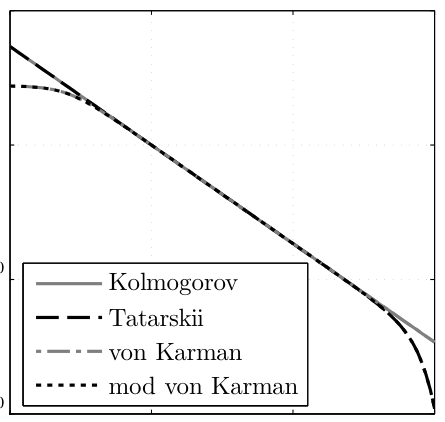
*图 9.1 常用大气功率谱模型（Kolmogorov、Tatarskii、von Kármán、修正 von Kármán）：低频端由外尺度截断，高频端由内尺度滚降（截自原书）*

时间维上，光穿越一个大涡的时间远短于涡自身演化的时间（100 µs 量级内折射率可视为不随时间变），所以时间统计通过**泰勒冻结湍流假设（Taylor's frozen-turbulence hypothesis）**引入：气象量的时间变化来自平均风把它们"平流"过观测点，涡旋本身冻结。于是涡旋被当成冻结图案以平均风速 \(\mathbf{v}\) 横扫光轴，空间统计换算成时间统计：

\[
\phi(x, y, t) = \phi(x - v_x t,\ y - v_y t,\ 0).
\tag{9.19}
\]

!!! note "拓展：Greenwood 频率——冻结湍流给出的时间尺度"
    冻结湍流 + 平均风速让"空间结构函数"能翻译成"时间功率谱"，自适应光学里常用的综合定标量是格林伍德频率（Greenwood frequency）\(f_G\)——湍流相位的时间功率谱的转折频率，\(f_G \simeq \left[0.102\,k^2\int C_n^2(z)\,v^{5/3}(z)\,dz\right]^{3/5}\)。它告诉你校正系统至少要多快的带宽：残余相位方差 \(\propto(f_G/f_{3dB})^{5/3}\)。9.5.4 节末尾提到"动态大气的屏幕移动速度要由 \(f_G\) 这类时间量决定"就是这条链：屏幕横移速度 → 时间统计 → 与 \(f_G\) 对照验收。

### 9.2.2 光通过湍流的传播

Maxwell 方程统治一切。大气可视为无源、非磁性、各向同性介质；找时谐 \(\exp(-i2\pi\nu t)\) 的行波解，电场满足（\(\lambda < l_0\) 时可忽略偏振耦合项）

\[
\left(\nabla^2 + k^2 n^2(\mathbf{r})\right)U(\mathbf{r}) = 0,
\tag{9.22}
\]

与第 1 章式 (1.43) 几乎一样，只是折射率显式依赖位置。代入 \(n = \mu_n + n_1\) 并假设 \(|n_1|\ll 1\)（**弱起伏假设**，后面定量化），\(n^2\simeq 1+2n_1\)：

\[
\left(\nabla^2 + k^2\left[1 + 2n_1(\mathbf{r})\right]\right)U(\mathbf{r}) = 0.
\tag{9.24}
\]

介质均匀时用第 1.3 节的傅里叶光学（Green 函数）精确求解；随机非均匀时用**微扰法**。Rytov 方法把场写成

\[
U(\mathbf{r}) = U_0(\mathbf{r})\exp\left[\psi(\mathbf{r})\right],
\tag{9.25}
\]

\(U_0\) 是真空解（\(n_1=0\)），\(\psi\) 是复相位微扰，按

\[
\psi = \psi_1 + \psi_2 + \cdots
\tag{9.26}
\]

逐阶微扰。分离振幅与相位：

\[
\psi = \chi + i\phi,
\tag{9.27}
\]

\(\chi\) 是**对数振幅微扰（log-amplitude perturbation）**，\(\phi\) 是**相位微扰**。Rytov 方法配合给定的 PSD 模型，能对高斯束、球面波、平面波等简单源解析算出 \(\psi\) 的各阶矩。细节见 Clifford、Ishimaru、Andrews & Phillips、Sasiela 的专书。

### 9.2.3 大气的光学参数

推导略去，直接列有用的场矩。场的均值

\[
\langle U(\mathbf{r})\rangle = U_0(\mathbf{r})\left\langle\exp\psi(\mathbf{r})\right\rangle,
\tag{9.28}
\]

**互相干函数（mutual coherence function）**

\[
\Gamma(\mathbf{r},\mathbf{r}',z) = \left\langle U(\mathbf{r})U^*(\mathbf{r}')\right\rangle = U_0(\mathbf{r})U_0^*(\mathbf{r}')\left\langle\exp\left[\psi(\mathbf{r})+\psi^*(\mathbf{r}')\right]\right\rangle.
\tag{9.29}
\]

从它派生出：**相干因子（coherence factor，即复相干度之模）**

\[
\mu(\mathbf{r},\mathbf{r}',z) = \frac{\left|\Gamma(\mathbf{r},\mathbf{r}',z)\right|}{\left[\Gamma(\mathbf{r},\mathbf{r},z)\ \Gamma(\mathbf{r}',\mathbf{r}',z)\right]^{1/2}},
\tag{9.31}
\]

**波结构函数（wave structure function）**

\[
D(\mathbf{r},\mathbf{r}',z) = -2\ln\mu(\mathbf{r},\mathbf{r}',z) = D_\chi(\mathbf{r},\mathbf{r}',z) + D_\phi(\mathbf{r},\mathbf{r}',z),
\tag{9.32}
\]

相位功率谱密度

\[
\Phi_\phi(\kappa) = \frac{1}{4\pi^2\kappa^2}\int_0^\infty\frac{\sin(\kappa r)}{\kappa r}\frac{d}{dr}\left[r^2\frac{dD_\phi(r)}{dr}\right]dr,
\tag{9.34}
\]

以及湍流路径的平均 MTF

\[
\mathcal{H}(f) = \exp\left[-\tfrac{1}{2}D(\lambda f_l f)\right],
\tag{9.35}
\]

\(f_l\) 是系统焦距。

!!! warning "原书笔误：式 (9.34) 的积分核是三维场的"
    式 (9.34) 从三维各向同性场的公式抄来，核为 \(\sin(\kappa r)/(\kappa r)\)。但相位 \(\phi(x,y)\) 是观测平面上的**二维**随机场，正确的逆变换核是 \(J_1\)：\(\Phi_\phi(\kappa) = \frac{1}{4\pi\kappa}\int_0^\infty J_1(\kappa r)\,D_\phi'(r)\,r\,dr\)。把式 (9.44) 代入：\(J_1\) 核给 \(0.49\)（恰为式 (9.49)），书印的 \(\sin\) 核只给 \(\approx 0.35\)（习题 3 实算，见 9.7 节）——本笔记按 \(J_1\) 核理解。

\(C_n^2\) 是局部湍流强度的量度，但它沿路径变化，单点数值不直观。更方便的是把 \(C_n^2(z)\) 沿路径积分后定义的综合参数。对均匀各向同性的场，相干因子只依赖横向间隔 \(\Delta\mathbf{r}\)。平面波源、路径长 \(\Delta z\) 时

\[
\mu(|\Delta\mathbf{r}|,\Delta z) = \exp\left\{-4\pi^2 k^2\Delta z\int_0^\infty \Phi_n(\kappa,z)\left[1-J_0(\kappa|\Delta\mathbf{r}|)\right]\kappa\, d\kappa\, dz\right\},
\tag{9.37}
\]

路径依赖全部集中在 \(\Phi_n\) 里的 \(C_n^2(z)\)。用 Kolmogorov 谱积分得

\[
\mu_K(|\Delta\mathbf{r}|,\Delta z) = \exp\left[-1.46\,k^2|\Delta\mathbf{r}|^{5/3}\int_0^{\Delta z} C_n^2(z)\,dz\right].
\tag{9.38}
\]

**空间相干半径（spatial coherence radius）**\(\rho_0\) 定义为 \(\mu\) 的 \(e^{-1}\) 点，等价于

\[
D(\rho_0,z) = 2\ \text{rad}^2,
\tag{9.39}
\]

\[
\rho_0 = \left[1.46\,k^2\int_0^{\Delta z} C_n^2(z)\,dz\right]^{-3/5}.
\tag{9.40}
\]

更常用的兄弟参数是**大气相干直径（atmospheric coherence diameter）\(r_0\)，即 Fried 参数（Fried parameter）**：

\[
D(r_0,z) = 6.88\ \text{rad}^2,\qquad r_0 = 2.1\,\rho_0
\tag{9.41}
\]

（平面波）。Fried 当年的引入方式完全不同：他把望远镜通过大气成像的分辨率取为大气 MTF 曲线下体积，曲线随口径的"拐点"就定义了 \(r_0\)。平面波与球面波（点源）的闭式：

\[
r_{0,pw} = \left[0.423\,k^2\int_0^{\Delta z} C_n^2(z)\,dz\right]^{-3/5},
\tag{9.42}
\]

\[
r_{0,sw} = \left[0.423\,k^2\int_0^{\Delta z} C_n^2(z)\left(\frac{z}{\Delta z}\right)^{5/3}dz\right]^{-3/5}.
\tag{9.43}
\]

注意球面波的权重 \((z/\Delta z)^{5/3}\)：几何上，观测面间隔 \(\rho\) 的两点反推到高度 \(z\) 处只分开 \(\rho\, z/\Delta z\)——**贴近接收端的湍流**才被"全间隔"采样，贡献最大；贴着点源的湍流几乎不影响相干性。可见波段垂直观测的典型值 \(r_0 = 5\)–10 cm。

!!! note "拓展：把 r0 用熟"
    三个直觉：(1) \(D/r_0<1\) 时衍射极限主宰，\(D/r_0>1\) 时湍流主宰——望远镜口径超过 \(r_0\) 后分辨率钉在 \(\lambda/r_0\)，再大的口径也不再提升长曝光分辨率；(2) \(r_0\propto\lambda^{6/5}\）——波长越长湍流越"温和"，所以红外观测比可见光吃亏少；(3) 实测上 DIMM（差分像运动监视器）就是靠两小孔像的差分运动反演 \(r_0\)，这也是台址选型的标准仪器。9.2.5 节会给相位屏逐块分配 \(r_{0i}\)，注意那是"层强度"，与整路径 \(r_0\) 的合成关系见式 (9.71)。

有了结构函数就能回推相位 PSD。平面波弱湍流下有个捷径：

\[
\Phi_\phi(\kappa) = 2\pi k^2\Delta z\,\Phi_n(\kappa),
\tag{9.48}
\]

\[
\Phi_\phi^K(\kappa) = 0.49\, r_0^{-5/3}\,\kappa^{-11/3},
\tag{9.49}
\]

\[
\Phi_\phi^{vK}(\kappa) = 0.49\, r_0^{-5/3}\left(\kappa^2+\kappa_0^2\right)^{-11/6},
\tag{9.50}
\]

\[
\Phi_\phi^{mvK}(\kappa) = 0.49\, r_0^{-5/3}\exp\!\left(-\kappa^2/\kappa_m^2\right)\left(\kappa^2+\kappa_0^2\right)^{-11/6}.
\tag{9.51}
\]

!!! warning "原书笔误：式 (9.48) 的系数差了 \(\pi\) 倍"
    书印 \(\Phi_\phi(\kappa) = 2\pi^2 k^2\Delta z\,\Phi_n(\kappa)\)。自洽性检验：把它与式 (9.42)（\(r_0^{-5/3}=0.423k^2\Delta z C_n^2\)）和 Kolmogorov 谱 (9.16)（\(0.033C_n^2\kappa^{-11/3}\)）联立，应给式 (9.49) 的 \(0.49r_0^{-5/3}\)。\(2\pi\times0.033/0.423 = 0.490\)（对）；\(2\pi^2\times0.033/0.423 = 1.54\)（错）。所以系数应为 \(2\pi\)，不是 \(2\pi^2\)。

本书 FT 用周/米，把式 (9.51) 换成 \(f\)（周/米）的形式（生成相位屏要用）：

\[
\Phi_\phi^K(f) = 0.023\, r_0^{-5/3}\, f^{-11/3}.
\tag{9.52}
\]

Fried 用 \(r_0\) 计算过大气成像的平均 MTF：

\[
\mathcal{H}(f) = \exp\left\{-3.44\left(\frac{\lambda f_l f}{r_0}\right)^{5/3}\left[1-\alpha\left(\frac{\lambda f_l f}{D}\right)^{1/3}\right]\right\}
\tag{9.53}
\]

\[
= \exp\left\{-3.44\left(\frac{f}{2f_0}\frac{D}{r_0}\right)^{5/3}\left[1-\alpha\left(\frac{f}{2f_0}\right)^{1/3}\right]\right\},
\tag{9.54}
\]

\(f_0\) 是衍射极限截止频率，而

\[
\alpha =
\begin{cases}
0, & \text{长曝光}，\\
1, & \text{短曝光（无闪烁）}，\\
\tfrac{1}{2}, & \text{短曝光（有闪烁）}.
\end{cases}
\tag{9.55}
\]

长/短曝光的差别就在**倾斜（tilt）**：长曝光里像点随机晃动无数次、被平均掉；短曝光里只有一次倾斜实现，多帧平均前先把每帧对中（去掉倾斜）。大气有自己的传递函数 (9.54)，成像系统有自己的 OTF（5.2.2 节），复合系统 OTF 是两者乘积。图 9.2 画了 \(D/r_0=4\) 的圆孔复合 MTF：无像差曲线、短曝光（纯相位）、短曝光（含闪烁）、长曝光依次更差。

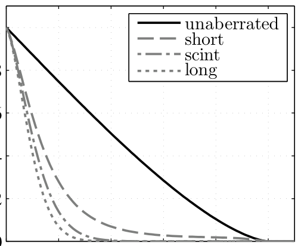
*图 9.2 D/r0 = 4 的复合 MTF：实线为无像差；灰虚线/点划线/点线分别为短曝光（无闪烁）、短曝光（含闪烁）、长曝光（截自原书）*

平均 MTF 还能算 Strehl 比（5.2.3 节）。圆孔 + 湍流的 Strehl 比是积分

\[
\mathcal{S} = \frac{16}{\pi}\int_0^1 f'\left(\cos^{-1}f' - f'\sqrt{1-f'^2}\right)\exp\left\{-3.44\left(f'\frac{D}{r_0}\right)^{5/3}\left[1-\alpha f'^{1/3}\right]\right\}df',
\tag{9.56}
\]

Andrews & Phillips 给了长曝光（\(\alpha=0\)）的解析近似

\[
\mathcal{S}\simeq\frac{1}{\left[1+(D/r_0)^{5/3}\right]^{6/5}},
\tag{9.57}
\]

Sasiela 用 Mellin 变换得到多项式近似

\[
\mathcal{S}\simeq\left(\frac{r_0}{D}\right)^2 - 0.6159\left(\frac{r_0}{D}\right)^3 + 0.0500\left(\frac{r_0}{D}\right)^5 + 0.132\left(\frac{r_0}{D}\right)^7,
\tag{9.58}
\]

对 \(D/r_0>2\) 极准。

系统对物方不同视向的传递函数不一致叫**非等晕性（anisoplanatism）**。用角结构函数度量：

\[
D_\phi(\Delta\theta) = \left\langle\left|\phi(\theta)-\phi(\theta+\Delta\theta)\right|^2\right\rangle,
\tag{9.59}
\]

**等晕角（isoplanatic angle）\(\theta_0\)** 定义为 \(D_\phi(\theta_0)=1\ \text{rad}^2\)，即

\[
\theta_0 = \left[2.91\,k^2\,\Delta z^{5/3}\int_0^{\Delta z} C_n^2(z)\left(1-\frac{z}{\Delta z}\right)^{5/3}dz\right]^{-3/5}.
\tag{9.61}
\]

物理：两条视向夹 \(\theta\) 的光线在高度 \(z\)（自源端起算）处分开 \(\theta(\Delta z-z)\)——**贴近接收器的湍流**对两路是共有的、不影响角结构函数。\(\theta_0\) 是"光程随视向的变化还不显著"的最大视场角，可见光垂直观测典型值 5–10 µrad。

闪烁强度用**对数振幅方差（log-amplitude variance）**描述：

\[
\sigma_\chi^2(\mathbf{r}) = \left\langle\chi^2(\mathbf{r})\right\rangle - \left\langle\chi(\mathbf{r})\right\rangle^2,
\tag{9.62}
\]

平面波与发散球面波（点源）源：

\[
\sigma_{\chi,pw}^2 = 0.563\,k^{7/6}\,\Delta z^{5/6}\int_0^{\Delta z} C_n^2(z)\left(1-\frac{z}{\Delta z}\right)^{5/6}dz,
\tag{9.63}
\]

\[
\sigma_{\chi,sw}^2 = 0.563\,k^{7/6}\int_0^{\Delta z} C_n^2(z)\, z^{5/6}\left(1-\frac{z}{\Delta z}\right)^{5/6}dz.
\tag{9.64}
\]

\(\sigma_\chi^2<0.25\) 算弱起伏、\(\sigma_\chi^2\gg 0.25\) 算强起伏；本节的 Rytov 方法只在弱起伏下有效。

!!! note "拓展：Rytov 方差 = 4 倍对数振幅方差"
    文献里更常出现的是 Rytov 方差 \(\sigma_R^2\)。它与 \(\sigma_\chi^2\) 差 4 倍：辐照度 \(I = I_0 e^{2\chi-2\langle\chi\rangle}\)，弱起伏下闪烁指数 \(\sigma_I^2 = \exp(4\sigma_\chi^2)-1\simeq 4\sigma_\chi^2\)，\(\sigma_R^2\) 就定义为这个弱起伏闪烁指数。对常数 \(C_n^2\) 的平面波，式 (9.63) 积分给 \(\sigma_\chi^2 = 0.307\,k^{7/6}C_n^2\Delta z^{11/6}\)，乘 4 恰是常见的 \(\sigma_R^2 = 1.23\,C_n^2k^{7/6}\Delta z^{11/6}\)。本书例子（9.5 节）的 \(\sigma_{\chi,sw}^2 = 0.436\) 对应 Rytov 数约 1.74——已越过弱起伏界，但仿真对照仍基本成立（9.5.5 节实测讨论）。

### 9.2.4 分层大气模型

解析结果只对简单统计模型可行；自适应光学等复杂场景没有闭式。常用简化：把湍流当成有限个**离散层**，每层是一块单位振幅的**薄相位屏（thin phase screen）**，代表一段厚得多的湍流体。"薄"的判据：屏的厚度远小于其后继续传播的距离。相位屏就是一次大气相位微扰的实现，把它塞进式 (9.2) 的折射算符 \(T\)，湍流就进入了 split-step 传播。分层模型要好用，其折射率谱与闪烁性质必须匹配被替代的连续介质。

### 9.2.5 分层理论

把湍流廓线写成各屏的有效结构参数 \(C_{n_i}^2\)、位置 \(z_i\)、代表厚度 \(\Delta z_i\)。\(C_{n_i}^2\) 的选取原则：让分层模型的若干低阶矩与连续模型一致：

\[
\int_0^{\Delta z} C_n^2(z')\,(z')^m\,dz' = \sum_{i=1}^n C_{n_i}^2\, z_i^m\,\Delta z_i,\qquad 0\le m\le 7.
\tag{9.65}
\]

这样 \(r_0\)、\(\theta_0\)、\(\sigma_\chi^2\) 等都与被模拟的整体大气吻合。把式 (9.42)–(9.64) 离散化：

\[
r_{0,pw} = \left[0.423\,k^2\sum_i C_{n_i}^2\,\Delta z_i\right]^{-3/5},
\tag{9.66}
\]

\[
r_{0,sw} = \left[0.423\,k^2\sum_i C_{n_i}^2\left(\frac{z_i}{\Delta z}\right)^{5/3}\Delta z_i\right]^{-3/5},
\tag{9.67}
\]

\[
\sigma_{\chi,pw}^2 = 0.563\,k^{7/6}\Delta z^{5/6}\sum_i C_{n_i}^2\left(1-\frac{z_i}{\Delta z}\right)^{5/6}\Delta z_i,
\tag{9.68}
\]

\[
\sigma_{\chi,sw}^2 = 0.563\,k^{7/6}\Delta z^{5/6}\sum_i C_{n_i}^2\left(\frac{z_i}{\Delta z}\right)^{5/6}\left(1-\frac{z_i}{\Delta z}\right)^{5/6}\Delta z_i.
\tag{9.69}
\]

对式 (9.66) 分组，第 \(i\) 层可以有**有效相干直径**

\[
r_{0_i} = \left[0.423\,k^2\, C_{n_i}^2\,\Delta z_i\right]^{-3/5},
\tag{9.70}
\]

这是平面波 \(r_0\)，只在层很薄时有效——它就是相位屏强度的标准表征。代回各式，用屏的 \(r_{0_i}\) 重写：

\[
r_{0,pw} = \left[\sum_i r_{0_i}^{-5/3}\right]^{-3/5},
\tag{9.71}
\]

\[
r_{0,sw} = \left[\sum_i r_{0_i}^{-5/3}\left(\frac{z_i}{\Delta z}\right)^{5/3}\right]^{-3/5},
\tag{9.72}
\]

\[
\sigma_{\chi,pw}^2 = 1.33\,k^{-5/6}\Delta z^{5/6}\sum_i r_{0_i}^{-5/3}\left(1-\frac{z_i}{\Delta z}\right)^{5/6},
\tag{9.73}
\]

\[
\sigma_{\chi,sw}^2 = 1.33\,k^{-5/6}\Delta z^{5/6}\sum_i r_{0_i}^{-5/3}\left(\frac{z_i}{\Delta z}\right)^{5/6}\left(1-\frac{z_i}{\Delta z}\right)^{5/6}.
\tag{9.74}
\]

给定目标大气条件（比如 \(r_{0,sw}\) 与 \(\sigma_{\chi,sw}^2\)），这些方程就是求各屏 \(r_{0_i}\) 的方程组。屏幕位置固定（例如与第 8 章部分传播平面的均匀间距一致，\(\alpha_i = z_i/\Delta z\)）后，5 块屏的方程组形如

\[
\begin{pmatrix} r_{0,sw}^{-5/3}\\[2pt] \frac{\sigma_{\chi,sw}^2}{1.33}\left(\frac{k}{\Delta z}\right)^{5/6} \end{pmatrix} =
\begin{pmatrix} 0 & 0.0992 & 0.315 & 0.619 & 1\\ 0 & 0.248 & 0.315 & 0.248 & 0 \end{pmatrix}
\begin{pmatrix} r_{0_1}^{-5/3}\\ r_{0_2}^{-5/3}\\ r_{0_3}^{-5/3}\\ r_{0_4}^{-5/3}\\ r_{0_5}^{-5/3} \end{pmatrix}.
\tag{9.75}
\]

矩阵第一行元素是 \(\alpha_i^{5/3}\)，第二行是 \(\alpha_i^{5/6}(1-\alpha_i)^{5/6}\)。左边由想仿真的场景决定（\(\lambda\)、\(\Delta z\)、\(C_n^2(z)\) 模型），右边对 \(r_{0_i}^{-5/3}\) 求解。麻烦在两点：未知量带 \(-5/3\) 次幂，解出负分量不物理，必须约束非负；且 2 个方程对 5–10 块屏远欠定，需要**约束优化**（9.5.1 节的例子用带边界的最小化，另加"每屏 Rytov 贡献 ≤0.1"的 Martin–Flatté 型上限）。

## 9.3 蒙特卡洛相位屏

折射率起伏是随机过程，湍流模型给的是统计平均（结构函数、功率谱）。造相位屏 = 把计算机随机数变成"统计性质与湍流相位一致"的二维数组。文献方法极多：拼效率的、拼精度的、拼灵活性的。相位通常写成基函数加权和，常用基是 Zernike 多项式与傅里叶级数；最主流的是 McGlamery 的 **FT 法**。

假设相位 \(\phi(x,y)\) 可傅里叶变换，写成傅里叶积分

\[
\phi(x,y) = \int\int \Psi(f_x,f_y)\, e^{i2\pi(f_x x + f_y y)}\,df_x\,df_y,
\tag{9.76}
\]

\(\Psi\) 是相位的空间频域表示。相位总功率（Parseval）：

\[
P_{tot} = \int\int|\phi(x,y)|^2dx\,dy = \int\int\Phi_\phi(f_x,f_y)\,df_x\,df_y.
\tag{9.77}
\]

在有限网格上把相位写成傅里叶级数

\[
\phi(x,y) = \sum_{n=-\infty}^{\infty}\sum_{m=-\infty}^{\infty} c_{n,m}\exp\left[i2\pi(f_{x_n}x + f_{y_m}y)\right],
\tag{9.78}
\]

湍流相位由大量独立的不均匀体贡献，由中心极限定理，系数 \(c_{n,m}\) 是高斯的；实虚部零均值、方差相同、互不相关——**圆复高斯**统计，方差

\[
\left\langle|c_{n,m}|^2\right\rangle = \Phi_\phi(f_{x_n},f_{y_m})\,\Delta f_{x_n}\,\Delta f_{y_m}.
\tag{9.79}
\]

FFT 要求频域等间隔：网格边长 \(L_x, L_y\) 给出 \(\Delta f_{x_n}=1/L_x\)、\(\Delta f_{y_m}=1/L_y\)，于是

\[
\left\langle|c_{n,m}|^2\right\rangle = \frac{1}{L_xL_y}\,\Phi_\phi(f_{x_n},f_{y_m}).
\tag{9.80}
\]

生成流程：抽零均值单位方差高斯随机数 → 乘以式 (9.79) 方差的平方根 → 逆 FT 合成。Listing 9.2 是完整实现：第 6–16 行搭式 (9.51) 的平方根并把零频置零，第 18 行抽系数，第 20 行合成。注意 IFT 的实部和虚部是**两块不相关**的屏，代码取实部、扔掉虚部。

=== "MATLAB"

    ```matlab
    % ft_phase_screen.m（原书 Listing 9.2）
    function phz = ft_phase_screen(r0, N, delta, L0, l0)
    del_f = 1/(N*delta);                    % frequency grid spacing [1/m]
    fx = (-N/2 : N/2-1) * del_f;            % frequency grid [1/m]
    [fx fy] = meshgrid(fx);
    [th f] = cart2pol(fx, fy);              % polar grid
    fm = 5.92/l0/(2*pi);                    % inner scale frequency [1/m]
    f0 = 1/L0;                              % outer scale frequency [1/m]
    % modified von Karman atmospheric phase PSD（式 9.51 -> 9.52）
    PSD_phi = 0.023*r0^(-5/3) * exp(-(f/fm).^2) ...
        ./ (f.^2 + f0^2).^(11/6);
    PSD_phi(N/2+1,N/2+1) = 0;               % 零频（piston）置零
    % random draws of Fourier coefficients（式 9.79/9.80）
    cn = (randn(N) + i*randn(N)) .* sqrt(PSD_phi)*del_f;
    phz = real(ift2(cn, 1));                % 实部即一块方差正确的屏
    end
    ```

=== "Python"

    ```python
    # ch9_turbulence.py::ft_phase_screen（Listing 9.2 等价；rng 可播种复现）
    def ft_phase_screen(r0, N, delta, L0, l0, rng):
        del_f = 1 / (N * delta)
        fx = (np.arange(N) - N // 2) * del_f
        FX, FY = np.meshgrid(fx, fx)        # 与 MATLAB meshgrid(fx) 一致
        f = np.hypot(FX, FY)
        psd = _mvk_phase_psd(f, r0, L0, l0)  # 0.023 r0^-5/3 exp(-(f/fm)^2)/(f^2+f0^2)^(11/6)
        psd[N // 2, N // 2] = 0
        cn = (rng.standard_normal((N, N)) + 1j * rng.standard_normal((N, N))) \
            * np.sqrt(psd) * del_f
        return np.real(ift2(cn, 1.0))
    ```

!!! note "拓展：抽实部为什么方差恰好对"
    \(c_{n,m} = (\mathcal{N}_1+i\mathcal{N}_2)\sqrt{\text{PSD}}\,\Delta f\) 的模方期望是 \(2\times\)PSD\(\Delta f^2\)（两份独立方差），而取 \(\mathrm{Re}[\sum c_n e^{i\theta}]\) 又贡献 \(1/2\) 因子，两者相消——实部（或虚部）各自都是式 (9.79) 方差正确的独立相位屏。这是书代码"取实部扔虚部"不浪费一半方差的原理。另外 \(l_0=0\) 时 \(f_m=\infty\)、指数化为 1，\(L_0=\infty\) 时 \(f_0=0\)——一份代码覆盖全部谱模型。

遗憾的是，**纯 FT 屏不准确**。图 9.1 的相位 PSD 把大部分功率压在低空间频率，而 FFT 网格的最低频只有 \(1/L\)（\(L\) 是屏边长）——低阶模式（尤其倾斜 tilt）根本采不够。验证：生成 40 块 FT 屏，用第 3 章的 `str_fcn2_ft` 算每块的结构函数再平均（图 9.3 虚线），大间隔处与理论（实线）明显偏低。

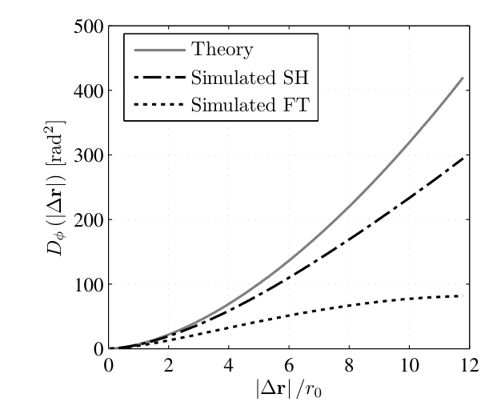
*图 9.3 平均相位结构函数：理论 vs 次谐波屏（Simulated SH）vs 纯 FT 屏（Simulated FT）——FT 屏缺低频，大间隔处塌掉（截自原书）*

补救方案三类：Zernike 模式随机抽取（用 Noll 的 Zernike 模式统计）；频域非均匀采样的傅里叶级数法；以及两者结合的**次谐波法（subharmonics）**——在 FT 屏上叠加一组低频傅里叶级数。本书实现 Lane 等人的次谐波法（Frehlich 证明用它做束波仿真结果准确）。低频屏

\[
\phi_{LF}(x,y) = \sum_{p=1}^{N_p}\ \sum_{n=-1}^{1}\sum_{m=-1}^{1} c_{n,m}\exp\left[i2\pi(f_{x_n}x + f_{y_m}y)\right],
\tag{9.81}
\]

每个 \(p\) 对应一层频率网格、间距 \(\Delta f_p = 1/(3^p L)\)——恰是 FT 屏网格间距的次谐波；本实现每层取 \(3\times3\) 个频点、共 \(N_p=3\) 层。

=== "MATLAB"

    ```matlab
    % ft_sh_phase_screen.m（原书 Listing 9.3，节选；完整版在 matlab/waveprop/ch9/）
    function [phz_lo phz_hi] = ft_sh_phase_screen(r0, N, delta, L0, l0)
    D = N*delta;                          % 屏边长 [m]
    phz_hi = ft_phase_screen(r0, N, delta, L0, l0);   % 高频部分（FT 法）
    [x y] = meshgrid((-N/2 : N/2-1) * delta);
    phz_lo = zeros(size(phz_hi));
    for p = 1:3                           % 三层次谐波网格
        del_f = 1 / (3^p*D);              % frequency grid spacing [1/m]
        fx = (-1 : 1) * del_f;            % 3x3 个最低频点
        [fx fy] = meshgrid(fx);
        [th f] = cart2pol(fx, fy);
        fm = 5.92/l0/(2*pi);   f0 = 1/L0;
        PSD_phi = 0.023*r0^(-5/3) * exp(-(f/fm).^2) ./ (f.^2 + f0^2).^(11/6);
        PSD_phi(2,2) = 0;                 % (0,0) 频点置零
        cn = (randn(3) + i*randn(3)) .* sqrt(PSD_phi)*del_f;
        SH = zeros(N);
        for ii = 1:9                      % 逐频点叠加平面波
            SH = SH + cn(ii) * exp(i*2*pi*(fx(ii)*x + fy(ii)*y));
        end
        phz_lo = phz_lo + SH;             % accumulate subharmonics
    end
    phz_lo = real(phz_lo) - mean(real(phz_lo(:)));   % 去 piston
    end
    ```

=== "Python"

    ```python
    # ch9_turbulence.py::ft_sh_phase_screen（Listing 9.3 等价）
    def ft_sh_phase_screen(r0, N, delta, L0, l0, rng):
        D = N * delta
        phz_hi = ft_phase_screen(r0, N, delta, L0, l0, rng)
        x = (np.arange(N) - N // 2) * delta
        X, Y = np.meshgrid(x, x)
        phz_lo = np.zeros((N, N), dtype=complex)
        for p in range(1, 4):                    # 三层次谐波网格
            del_f = 1 / (3**p * D)
            f1 = np.array([-1.0, 0.0, 1.0]) * del_f
            FX, FY = np.meshgrid(f1, f1)         # 3x3 频点
            psd = _mvk_phase_psd(np.hypot(FX, FY), r0, L0, l0)
            psd[1, 1] = 0                        # (0,0) 频点置零
            cn = (rng.standard_normal((3, 3)) + 1j * rng.standard_normal((3, 3))) \
                * np.sqrt(psd) * del_f
            for ii in range(3):
                for jj in range(3):
                    phz_lo += cn[ii, jj] * np.exp(
                        1j * 2 * np.pi * (FX[ii, jj] * X + FY[ii, jj] * Y))
        phz_lo = np.real(phz_lo) - np.real(phz_lo).mean()
        return phz_lo, phz_hi
    ```

Listing 9.4 是使用示例：屏边长 2 m、\(r_0 = 10\) cm、\(N=256\)、\(L_0=100\) m、\(l_0=1\) cm，生成结果即图 9.4 的一块典型大气相位屏（幅度 ±20 rad 量级、大尺度涡旋清晰可见）。

=== "MATLAB"

    ```matlab
    % example_ft_sh_phase_screen.m（原书 Listing 9.4）
    D = 2;       % length of one side of square phase screen [m]
    r0 = 0.1;    % coherence diameter [m]
    N = 256;     % number of grid points per side
    L0 = 100;    % outer scale [m]
    l0 = 0.01;   % inner scale [m]
    delta = D/N; % grid spacing [m]
    x = (-N/2 : N/2-1) * delta;   y = x;
    [phz_lo phz_hi] = ft_sh_phase_screen(r0, N, delta, L0, l0);
    phz = phz_lo + phz_hi;       % 总屏 = 低频补偿 + FT 高频
    ```

=== "Python"

    ```python
    # Listing 9.4 等价（ch9_turbulence.py）
    D, r0, N, L0, l0 = 2.0, 0.1, 256, 100.0, 0.01
    delta = D / N
    phz_lo, phz_hi = ft_sh_phase_screen(r0, N, delta, L0, l0, rng)
    phz = phz_lo + phz_hi
    ```

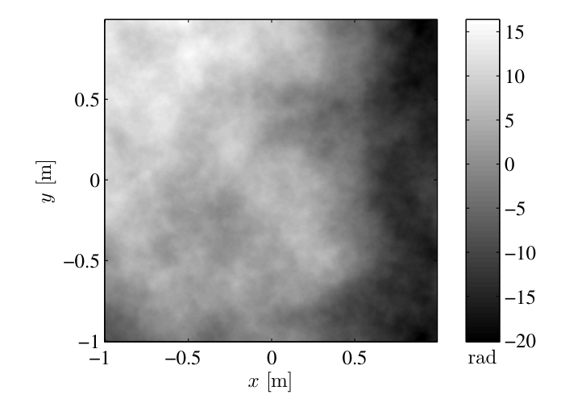
*图 9.4 次谐波法生成的典型大气相位屏（r0 = 10 cm、L0 = 100 m、l0 = 1 cm、屏边长 2 m）（截自原书）*

次谐波法的有效性有一串文献背书：Herman & Strugala（结构函数与平均 Strehl 都对得上）；Lane 等（本节采用的方法）；Johansson & Gavel（对比并改进）；Sedmak（非方形屏、孔径平均相位方差）；Frehlich（全波光学仿真精度：束波的平均辐照度两种屏都还行，但**辐照度方差**只有次谐波屏才准；平面波的辐照度方差两者都行，但互相干函数只有次谐波法对）。

**数值验证（本笔记复现图 9.3）**：同一参数（\(N=256\)、\(\delta=2/256\) m、\(r_0=0.1\) m、\(L_0=100\) m、\(l_0=1\) cm）各生成 40 块屏，重写自书 Listing 3.7 的 `str_fcn2_ft`（按定义 \(\langle[\phi(\mathbf{r}+\boldsymbol\rho)-\phi(\mathbf{r})]^2\rangle\) 的填零 FFT 无偏估计）算平均结构函数：

- 理论 \(D_\phi(r_0)=6.88\)：次谐波屏 5.67（偏低 18%）、纯 FT 屏 4.31（偏低 37%）；
- 0.5–2 \(r_0\) 段 log-log 斜率：次谐波 1.583（理论 \(5/3=1.667\)）、FT 1.441；2–8 \(r_0\) 段：1.494 与 1.078；
- 大间隔（8–12 \(r_0\)）最大相对偏差：次谐波 43%、FT 83%。

结论与原书一致：次谐波屏全面优于纯 FT 屏，但三层 3×3 次谐波仍补不满最低频段——大间隔统计略欠。要更准可换 Johansson & Gavel 的方法或加密次谐波层数。

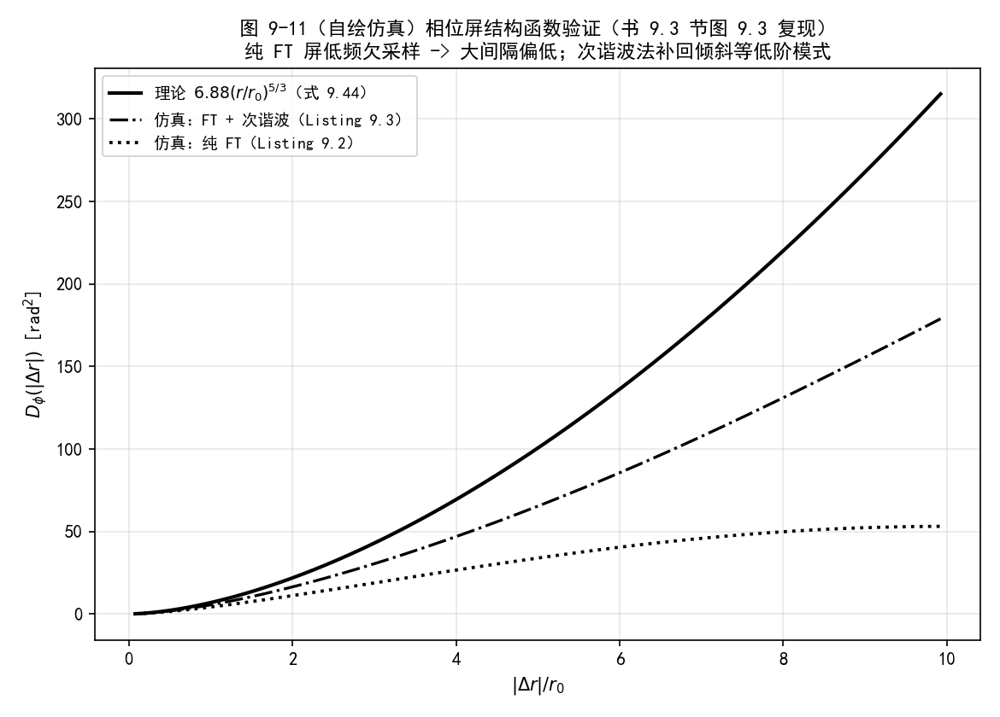
*图 9-11（自绘仿真）相位屏结构函数验证（书图 9.3 复现）：40 块屏平均。次谐波屏（点划线）显著优于纯 FT 屏（点线），但大间隔仍低于理论（实线）*

## 9.4 采样约束

湍流让光束因两种效应展宽：高阶像差使光束超出衍射展宽地扩张（短曝光可见）；倾斜让光束质心随机晃动（长时间 ≥1 ms 内能量撒满观测面，只有长曝光可见）。这两种展宽使湍流仿真的采样要求比第 8 章真空约束更严。

文献三条路线：Johnston & Lane 按滤波后的自由空间传递函数带宽定网格、按相位结构函数定间距（相邻格点相位差 \(<\pi\) 的概率 \(>99.7\%\)），再兼顾 \((\lambda\Delta z)^{1/2}\) 的菲涅耳尺度采样；Martin & Flatté 从辐照度起伏的 PSD 出发；Coles 等做了平面波与点源的定量误差分析。本书采用 Mansell、Praus、Coy 的做法——**与第 7–8 章框架无缝衔接**：把湍流展宽折进几何约束 1/2，数值判据（约束 3）不动。

真空约束 1/2 是

\[
\delta_n \le \frac{\lambda\Delta z - D_2\delta_1}{D_1},
\tag{9.82}
\]

\[
N \ge \frac{D_1}{2\delta_1} + \frac{D_2}{2\delta_n} + \frac{\lambda\Delta z}{2\delta_1\delta_n}.
\tag{9.83}
\]

几何光学近似下，湍流让源面光线随机折射（图 9.5）：观测面看到的源尺寸 \(D_1\)、源面看到的观测区尺寸 \(D_2\) 都被"抹毛"了。Coy 的模型把这种模糊当成周期 \(r_0\) 的衍射光栅处理，定义新的极限口径：

\[
D_1' = D_1 + c\,\frac{\lambda\Delta z}{r_{0,rev}},
\tag{9.84}
\]

\[
D_2' = D_2 + c\,\frac{\lambda\Delta z}{r_0},
\tag{9.85}
\]

\(r_{0,rev}\) 是光**反向**传播（观测面 → 源面）的相干直径；\(c\) 是湍流敏感系数：\(c=2\) 约收 97% 的光，\(c=4\) 约 99%。湍流仿真改用：

\[
\delta_n \le \frac{\lambda\Delta z - D_2'\delta_1}{D_1'},
\tag{9.86}
\]

\[
N \ge \frac{D_1'}{2\delta_1} + \frac{D_2'}{2\delta_n} + \frac{\lambda\Delta z}{2\delta_1\delta_n},
\tag{9.87}
\]

\[
\left(1+\frac{\Delta z}{R}\right)\delta_1 - \frac{\lambda\Delta z}{D_1} \le \delta_2 \le \left(1+\frac{\Delta z}{R}\right)\delta_1 + \frac{\lambda\Delta z}{D_1}.
\tag{9.88}
\]

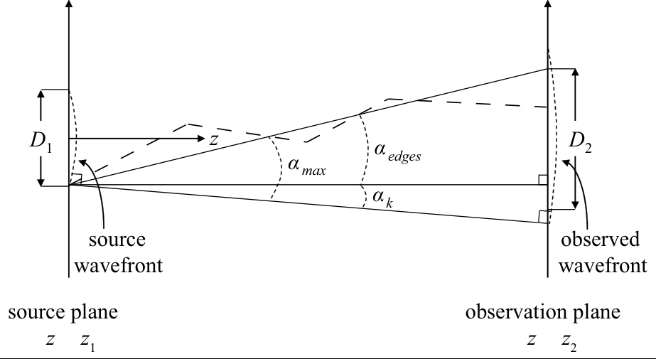
*图 9.5 传播几何：湍流使光线随机折射（虚线）——由此导出约束 1 的湍流修正（截自原书）*

选好 \(N\)、\(\delta_1\)、\(\delta_n\) 后，部分传播的距离与次数照旧由

\[
\Delta z_{max} = \frac{\min(\delta_1,\delta_n)^2\, N}{\lambda},
\tag{9.89}
\]

\[
n_{min} = \left\lceil\frac{\Delta z}{\Delta z_{max}}\right\rceil + 1
\tag{9.90}
\]

给出。常数 \(C_n^2\) 时 \(r_{0,rev}=r_0\)，式 (9.84) 也用 \(r_0\)。

## 9.5 执行一次正确采样的仿真

本节用一个点源过 50 km 湍流路径的完整例子，演示从建参数到验收的全流程（对应 Listings 9.5–9.8 与图 9.6–9.10）。

### 9.5.1 确定几何与湍流条件

点源、\(\Delta z = 50\) km、沿路径常数 \(C_n^2 = 1\times10^{-16}\ \text{m}^{-2/3}\)（Kolmogorov 谱够用）、望远镜口径 \(D_2 = 0.5\) m、\(\lambda = 1\ \mu\)m。本例目的就是**验收仿真**：传播大量独立湍流实现，算相干因子与理论对照。

Listing 9.5 做三件事。(1) 几何：观测面感兴趣区直径 \(D_{ROI}=4D_2\)，点源用 sinc 模型、中央瓣全宽 \(2D_1 = \lambda\Delta z/D_{ROI}\times 2\)，波前曲率 \(R=\Delta z\)。(2) 大气参数（式 9.43/9.64 的常数 \(C_n^2\) 闭式积分）：

\[
r_{0,sw} = 12.7\ \text{cm},\qquad \sigma_{\chi,sw}^2 = 0.436.
\]

(3) 相位屏强度：11 块屏（与 10 次部分传播的 11 个平面对齐，\(\alpha_i = 0,0.1,\ldots,1\)），按式 (9.75) 的矩阵 + 目标函数 \(\|A\mathbf{X}-\mathbf{b}\|^2\)（\(\mathbf{X}\) 是 \(r_{0_i}^{-5/3}\) 向量）做**带约束搜索**：下界 0（\(r_0\to\infty\) 即无湍流）；上界使每屏对总 Rytov 数的贡献 ≤ 0.1（Martin & Flatté 指南：单屏/单步的 Rytov 数要小，微扰展开才稳）；权重为 0 的路径端点屏给个宽松上界（\(r_0=50\) m）。

=== "MATLAB"

    ```matlab
    % example_pt_source_atmos_setup.m（原书 Listing 9.5，节选；需 fmincon）
    D2 = 0.5;            % diameter of the observation aperture [m]
    wvl = 1e-6;          k = 2*pi/wvl;
    Dz = 50e3;           % propagation distance [m]
    DROI = 4 * D2;       % diam of obs-plane region of interest [m]
    D1 = wvl*Dz / DROI;  % width of central lobe [m]
    R = Dz;              % wavefront radius of curvature [m]
    Cn2 = 1e-16;         % structure parameter [m^-2/3], constant
    r0sw = (0.423 * k^2 * Cn2 * 3/8 * Dz)^(-3/5);   % SW 相干直径（式 9.43）
    r0pw = (0.423 * k^2 * Cn2 * Dz)^(-3/5);         % PW（式 9.42）
    p = linspace(0, Dz, 1e3);
    rytov = 0.563 * k^(7/6) * sum(Cn2 * (1-p/Dz).^(5/6) ...
        .* p.^(5/6) * (p(2)-p(1)));                 % 式 9.64 数值积分
    nscr = 11;      A = zeros(2, nscr);
    alpha = (0:nscr-1) / (nscr-1);
    A(1,:) = alpha.^(5/3);                          % r0,sw 行
    A(2,:) = (1 - alpha).^(5/6) .* alpha.^(5/6);    % Rytov 行
    b = [r0sw.^(-5/3); rytov/1.33*(k/Dz)^(5/6)];    % 式 9.72/9.74 左端
    x0 = (nscr/3*r0sw * ones(nscr, 1)).^(-5/3);     % 初值
    fun = @(X) sum((A*X(:) - b).^2);                % 目标函数
    x1 = zeros(nscr, 1);
    rmax = 0.1;                                     % 每屏最大 Rytov 贡献
    x2 = rmax/1.33*(k/Dz)^(5/6) ./ A(2,:);
    x2(A(2,:)==0) = 50^(-5/3)                       % 端点屏放宽上界
    [X,fval,exitflag,output] = fmincon(fun,x0,[],[],[],[],x1,x2)
    r0scrn = X.^(-3/5)                              % 各屏 r0
    r0scrn(isinf(r0scrn)) = 1e6;
    bp = A*X(:); [bp(1)^(-3/5) bp(2)*1.33*(Dz/k)^(5/6)]  % 回代校验
    [r0sw rytov]
    ```

=== "Python"

    ```python
    # ch9_turbulence.py::atmos_setup（Listing 9.5 等价；fmincon 换成
    # scipy.optimize.minimize(L-BFGS-B)，同为"目标函数+边界"框架）
    st = atmos_setup(D2=0.5, wvl=1e-6, Dz=50e3, Cn2=1e-16, nscr=11)
    # solve_screen_r0s 内部：
    #   A = [alpha^(5/3); (1-alpha)^(5/6)*alpha^(5/6)]
    #   b = [r0sw^(-5/3); rytov/1.33*(k/Dz)^(5/6)]
    #   bounds: 0 <= X <= rmax/1.33*(k/Dz)^(5/6)/A[1]，权重 0 处放宽到 50^(-5/3)
    #   x0 = (nscr/3*r0sw)^(-5/3)，最小化 ||A X - b||^2
    #   r0scrn = X^(-3/5)，X=0 的屏记 r0=1e6 m；回代校验 chk
    ```

**实跑结果**：\(r_{0,pw}=7.03\) cm、\(r_{0,sw}=12.66\) cm（书正文 12.7 cm）、\(\sigma_{\chi,sw}^2=0.4365\)（书 0.436）；解出的屏强度 \(r_{0_i} = [50,\ 0.353,\ 0.301,\ 0.268,\ 0.275,\ 0.282,\ 0.285,\ 0.283,\ 0.266,\ 0.216,\ 10^6]\) m——两端屏权重为 0、强度由初值/上界决定（见 9.4 节坑 4），中段屏 \(r_0\approx 0.22\)–0.35 m；回代 \(r_{0,sw}\) 与 \(\sigma^2\) 与目标逐位一致。

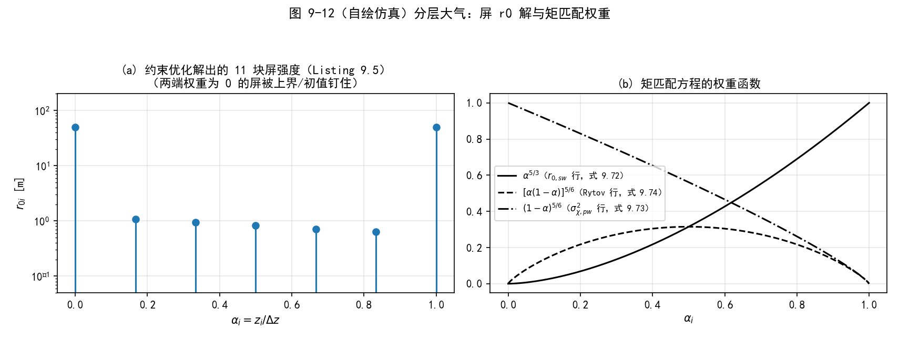
*图 9-12（自绘仿真）分层大气：左为约束优化解出的 11 块屏强度（对数轴），右为矩匹配方程 (9.72)–(9.74) 的权重函数——端点屏权重为零的来源一目了然*

### 9.5.2 采样分析

Listing 9.6 用 \(c=2\) 的式 (9.84)–(9.88) 评估三条约束并画等高线（图 9.6）：约束 2 的 \(\log_2 N\) 下界等高线，叠加约束 1（虚线以下可行）与约束 3（点划线以上可行）。本例 \(C_n^2\) 常数故 \(r_{0,rev}=r_{0,sw}\)，式 (9.84) 两处都用 \(r_{0,sw}\)。

选点：\(\delta_1 = \delta_n = 1\) cm——点源中央瓣内 5 个采样、望远镜口径内 50 个采样；约束 2 要求 \(N>2^8\)，取 \(N=2^9=512\)。约束 4/步长检查：\(\delta_1\delta_n N/\lambda = 51.2\ \text{km}\ge\Delta z\)（约束 4 满足），\(\Delta z_{max} = 51.2\) km，\(n_{min}=\lceil 50/51.2\rceil+1 = 2\) 个平面——最少两次传播即可，但为了正确铺开湍流**用 10 次传播（11 个平面）**，每平面一块屏。

=== "MATLAB"

    ```matlab
    % analysis_pt_source_atmos_samp.m（原书 Listing 9.6，节选）
    c = 2;
    D1p = D1 + c*wvl*Dz/r0sw;            % 式 (9.84)：湍流模糊后的源尺寸
    D2p = D2 + c*wvl*Dz/r0sw;            % 式 (9.85)
    delta1 = linspace(0, 1.1*wvl*Dz/D2p, 100);
    deltan = linspace(0, 1.1*wvl*Dz/D1p, 100);
    deltan_max = -D2p/D1p*delta1 + wvl*Dz/D1p;      % 约束 1'
    d2min3 = (1+Dz/R)*delta1 - wvl*Dz/D1p;          % 约束 3（不变）
    d2max3 = (1+Dz/R)*delta1 + wvl*Dz/D1p;
    [delta1 deltan] = meshgrid(delta1, deltan);
    N2 = (wvl*Dz + D1p*deltan + D2p*delta1) ...
        ./ (2 * delta1 .* deltan);                   % 约束 2'
    d1 = 10e-3;   d2 = 10e-3;   N = 512;             % 选中点
    d1*d2 * N / wvl        % 检查约束 4：delta1*deltan*N >= wvl*Dz？
    zmax = min([d1 d2])^2 * N / wvl                  % 式 (9.89) -> 51.2 km
    nmin = ceil(Dz / zmax) + 1                       % 式 (9.90) -> 2（实际用 11）
    ```

=== "Python"

    ```python
    # run_campaign 内的采样分析（Listing 9.6 等价，ch9_turbulence.py）
    c = 2
    D1p = D1 + c * wvl * Dz / st['r0sw']       # r0,rev = r0,sw（常数 Cn2）
    D2p = D2 + c * wvl * Dz / st['r0sw']
    delta1 = 2 * D1 / 5                         # 点源中央瓣 5 点采样
    deltan = min(D2 / 50, (wvl*Dz - D2p*delta1) / D1p)   # 约束 1' + 口径 50 点
    Nmin = D1p/(2*delta1) + D2p/(2*deltan) + wvl*Dz/(2*delta1*deltan)
    N = int(2 ** np.ceil(np.log2(Nmin)))        # -> 512
    zmax = min(delta1, deltan)**2 * N / wvl     # -> 51.2 km
    nmin_planes = int(np.ceil(Dz / zmax)) + 1   # -> 2（实际用 11 平面）
    ```

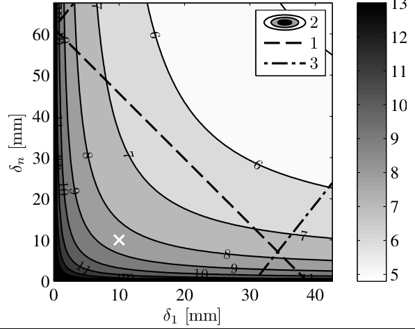
*图 9.6 点源例子的图形化采样分析：约束 2 的 log2 N 等高线（灰度），约束 1 可行域在虚线下方、约束 3 在点划线上方，白叉为选中的 (δ1, δn) = (10 mm, 10 mm)（截自原书）*

### 9.5.3 真空仿真

网格定了先跑**真空**，两个目的：(1) 验证仿真在无湍流时正确——本例是点源，可与解析对照：ROI 内辐照度应均匀、准直后相位应平坦；(2) 留下真空场 \(U_{vac}\) 供湍流对比（算 Strehl、对数振幅扰动 \(\chi = \ln(|U|/|U_{vac}|)\) 都要它）。

Listing 9.7：sinc-Gaussian 点源模型 = 中央瓣全宽 \(2D_1\) 的 sinc 剖面 \(\times\) 收敛球面波相位 \(\exp(-ik r_1^2/(2R))\) \(\times\) 高斯包络（压 sinc 旁瓣），\(/D_1^2\) 定标辐照度；10 次部分传播 + 每面超高斯吸收边界；最后乘 \(\exp(-i\pi r_n^2/(\lambda R))\) **准直**——去掉输出面残留的观测面啁啾，相位才有意义（算相干因子必须做）。

=== "MATLAB"

    ```matlab
    % example_pt_source_vac_prop.m（原书 Listing 9.7）
    delta1 = d1;         % source-plane grid spacing [m]
    deltan = d2;         % observation-plane grid spacing [m]
    n = nscr;            % number of planes
    [x1 y1] = meshgrid((-N/2 : N/2-1) * delta1);
    [theta1 r1] = cart2pol(x1, y1);
    pt = exp(-i*k/(2*R) * r1.^2) / D1^2 ...        % 收敛球面波 + 定标
        .* sinc(x1/D1) .* sinc(y1/D1) ...          % sinc 点源模型
        .* exp(-(r1/(4*D1)).^2);                   % 高斯包络压旁瓣
    z = (1 : n-1) * Dz / (n-1);                    % 部分传播平面
    sg = exp(-(x1/(0.47*N*d1)).^16) ...
        .* exp(-(y1/(0.47*N*d1)).^16);             % 超高斯吸收边界
    t = repmat(sg, [1 1 n]);
    [xn yn Uvac] = ang_spec_multi_prop(pt, wvl, delta1, deltan, z, t);
    Uvac = Uvac .* exp(-i*pi/(wvl*R)*(xn.^2+yn.^2));   % 准直
    ```

=== "Python"

    ```python
    # run_campaign 内（Listing 9.7 等价）
    pt = (np.exp(-1j * k / (2 * R) * r1**2) / D1**2
          * np.sinc(x1 / D1) * np.sinc(y1 / D1)     # np.sinc = sin(pi x)/(pi x)
          * np.exp(-(r1 / (4 * D1))**2))
    z = np.arange(1, n) * Dz / (n - 1)
    t_vac = np.repeat(sg2[:, :, None], n, axis=2)
    xn, yn, Uvac = ang_spec_multi_prop(pt, wvl, delta1, deltan, z, t_vac)
    Uvac = Uvac * np.exp(-1j * np.pi / (wvl * R) * (xn**2 + yn**2))   # 准直
    ```

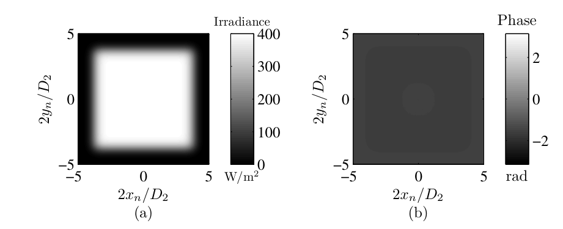
*图 9.7 模型点源真空传播：辐照度在 ROI 内近均匀，准直后相位平坦（截自原书）*

**实跑验证**：平台区（\(|x|\le 0.75\,D_{ROI}/2\)）辐照度均值 398.8 W/m²、std/mean \(= 6.5\times10^{-3}\)；去 piston 后相位 std \(= 3.9\times10^{-9}\) rad——与图 9.7 一致（均匀亮斑 + 平坦相位）。

### 9.5.4 湍流仿真

Listing 9.8：每个实现重新抽 11 块相位屏（各屏 \(r_0\) 来自 9.5.1 的解，网格间距随所在平面插值——各屏物理尺寸不同），传播、准直、用 `corr2_ft`（书 Listing 3.10）在口径 mask 内累积互相干函数。重复 `nreals` 次，按中心值归一化得相干因子。若要仿真**动态**大气：让每块屏随时间横移（泰勒冻结湍流），移动速度由 Greenwood 频率等时间量定标，再接自适应光学等动态系统。

=== "MATLAB"

    ```matlab
    % example_pt_source_turb_prop.m（原书 Listing 9.8）
    l0 = 0;      % inner scale [m]
    L0 = inf;    % outer scale [m]
    zt = [0 z];  Delta_z = zt(2:n) - zt(1:n-1);
    alpha = zt / zt(n);
    delta = (1-alpha) * delta1 + alpha * deltan;   % 各平面网格间距
    phz = zeros(N, N, n);
    nreals = 20;                   % number of random realizations
    Uout = zeros(N);
    mask = circ(xn/D2, yn/D2, 1);  % 观测望远镜口径（直径 D2）
    MCF2 = zeros(N);
    sg = repmat(sg, [1 1 n]);
    for idxreal = 1 : nreals       % loop over realizations
        for idxscr = 1 : 1 : n     % loop over screens
            [phz_lo phz_hi] = ft_sh_phase_screen ...
                (r0scrn(idxscr), N, delta(idxscr), L0, l0);
            phz(:,:,idxscr) = phz_lo + phz_hi;
        end
        [xn yn Uout] = ang_spec_multi_prop(pt, wvl, ...
            delta1, deltan, z, sg.*exp(i*phz));    % 屏 = exp(+i*phi)
        Uout = Uout .* exp(-i*pi/(wvl*R)*(xn.^2+yn.^2));  % 准直
        MCF2 = MCF2 + corr2_ft(Uout, Uout, mask, deltan); % 累积 MCF
    end
    MCDOC2 = abs(MCF2) / (MCF2(N/2+1,N/2+1));      % 相干因子
    ```

=== "Python"

    ```python
    # run_campaign 内（Listing 9.8 等价）
    mask = ((xn / D2)**2 + (yn / D2)**2 <= 1.0).astype(float)
    for ireal in range(nreals):                     # 20 次实现
        phz = np.zeros((N, N, n))
        for iscr in range(n):
            lo, hi = ft_sh_phase_screen(st['r0scrn'][iscr], N,
                                        delta[iscr], L0, l0, rng)
            phz[:, :, iscr] = lo + hi
        t_turb = t_vac * np.exp(1j * phz)           # 勘误 a：exp(+i*phi)
        _, _, Uout = ang_spec_multi_prop(pt, wvl, delta1, deltan, z, t_turb)
        Uout = Uout * np.exp(-1j * np.pi / (wvl * R) * (xn**2 + yn**2))
        mcf, _ = corr2_ft(Uout, Uout, mask, deltan)
        MCF2 += mcf
    MCDOC2 = np.abs(MCF2) / np.real(MCF2[N // 2, N // 2])
    ```

!!! warning "原书笔误：正文与 Listing 9.8 的实现次数不一致"
    正文两处说"重复 40 次得 40 个实现"（9.5.4 与 9.5.5 节），Listing 9.8 第 15 行却印 `nreals = 20`。本笔记按代码的 20 实现。另外第 31 行续行符书印 4 个点 `....`，应为 `...`。

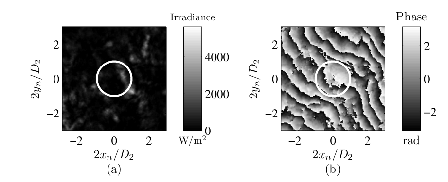
*图 9.8 一次湍流实现的观测面：辐照度散斑化、相位 ±3 rad 大幅扭曲；白圈是望远镜口径（截自原书）*

**实跑复现**（\(N=512\)、11 平面、20 次实现）：一次实现的辐照度呈散斑状（口径外更强、口径内起伏数百 W/m²），相位呈现 2–3 rad 的涡旋状扭曲——与图 9.8 的形态一致：

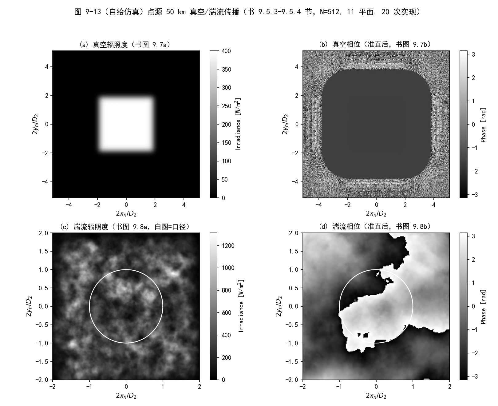
*图 9-13（自绘仿真）真空 vs 湍流的一次实现：真空辐照度均匀平台/相位平坦（a,b，书图 9.7）；湍流辐照度散斑/相位扭曲（c,d，书图 9.8），白圈为 D2 口径*

### 9.5.5 验证输出

两项验证，都用独立同分布的实现检查空间相关。

**第一项：相位屏本身**。取任一部分传播平面的 20（书文说 40）块屏，算二维结构函数求平均（`str_fcn2_ft`，书 Listing 3.7 的用法），与式 (9.44) 的理论对照。图 9.9 显示两者贴合——屏正确代表了路径累积相位。

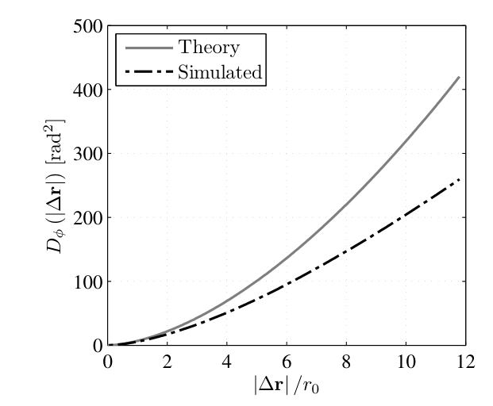
*图 9.9 相位屏结构函数验证：理论曲线与实现平均的仿真曲线贴合（截自原书）*

**第二项：观测面相干因子**。理论 = 式 (9.32) + (9.44) 的组合：

\[
\mu(r) = \exp\left[-\tfrac{1}{2}D_K(r)\right] = \exp\left[-3.44\left(\frac{r}{r_{0,sw}}\right)^{5/3}\right].
\]

图 9.10 显示仿真与理论匹配良好、略有偏离——要更准可以回头调整屏参数/位置（式 9.65 的矩匹配），或换更精细的屏生成方法（如 Johansson & Gavel）。更全面的验证还可对照 Martin & Flatté 的做法：把观测面辐照度 PSD 与弱起伏/渐近理论比。

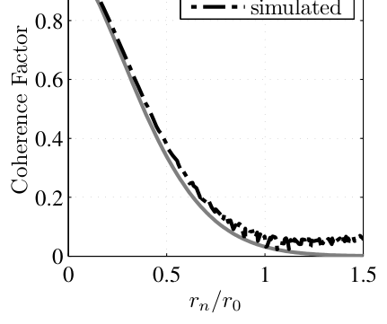
*图 9.10 观测面相干因子：理论曲线与仿真数据点（截自原书）*

!!! warning "原书笔误：图 9.10 的理论曲线与式 (9.32)+(9.44) 差一个平方根"
    按式 (9.32)（\(D=-2\ln\mu\)）+ 式 (9.44)（\(D_K(r_0)=6.88\ \text{rad}^2\)），相干因子应为 \(\mu(r)=\exp[-3.44(r/r_0)^{5/3}]\)，在 \(r=r_0\) 处 \(\mu=e^{-3.44}=0.032\)；但图 9.10 的理论曲线在 \(r/r_0=1\) 处读数约 0.18 \(=e^{-1.72}\)——恰是 \(\sqrt{e^{-3.44}}\)，指数少了一半。本笔记复现仿真实测 \(\mu(r_{0,sw})=0.036\)，与式 (9.32)+(9.44) 一致而非与图中曲线一致，复现时注意这条因子。

**本笔记的完整数值验证**（`python/waveprop/ch9/ch9_turbulence.py`，与书同参数：\(N=512\)、11 平面、20 次实现）：

- **相干因子（长曝光，含倾斜）**：\(0<r/r_{0,sw}\le1.5\) 内 \(|\mu_{sim}-\mu_{th}|\) 平均 0.012；\(\ln\mu\) 对 \((r/r_{0,sw})^{5/3}\) 的拟合斜率 \(-3.36\)（理论 \(-3.44\)），等效 \(r_0 = 12.84\) cm vs 理论 12.66 cm（差 1.4%）——图 9-14(a)；
- **长/短曝光差异**：每块实现去掉最优拟合倾斜平面（Zernike tilt）后，\(r=r_{0,sw}\) 处相干因子从 0.036 升到 0.135（约 4 倍）——倾斜是长曝光相干性损失的主导项，这正是式 (9.55) 里 \(\alpha\) 修正的物理；
- **闪烁**：口径内 \(\langle\sigma_\chi^2\rangle = 0.450\) vs 式 (9.64) 预测 0.436（+3.1%）；闪烁指数 \(\sigma_I^2 = 1.37\) vs 弱起伏理论 \(4\sigma_\chi^2 = 1.75\)（比值 0.78——本例 Rytov 数已超弱起伏界，强起伏饱和效应可见）；
- **中程屏结构函数**：20 块中程屏（\(r_0=0.282\) m）平均，0.5–2 \(r_0\) 段 log-log 斜率 1.569（接近 \(5/3\)）、2–8 \(r_0\) 段 1.394（次谐波低频欠采样的残余效应），\(D(r_0)=5.47\) vs 理论 6.88——图 9-14(b)。

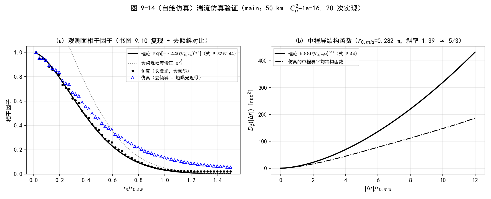
*图 9-14（自绘仿真）湍流仿真验证：(a) 相干因子——长曝光（黑点）紧贴式 (9.32)+(9.44) 的理论（实线，含闪烁幅度修正的弱化版为灰点线），去倾斜后（蓝三角）显著抬升 = 短曝光近似；(b) 中程屏平均结构函数与理论*

**闪烁随 Rytov 方差的变化**（同一套代码跑三个场景，每例 20 次实现，另两例为 100 km/\(C_n^2=10^{-17}\) 与 50 km/\(C_n^2=10^{-17}\)）：

| 场景 | 预测 \(\sigma_\chi^2\)（式 9.64） | 实测 \(\sigma_\chi^2\) | 实测 \(\sigma_I^2\) | \(4\sigma_\chi^2\)（弱起伏） |
| --- | --- | --- | --- | --- |
| 50 km, \(10^{-17}\) | 0.0436 | 0.0404 | 0.159 | 0.175 |
| 100 km, \(10^{-17}\) | 0.1555 | 0.1768 | 0.691 | 0.622 |
| 50 km, \(10^{-16}\)（书例） | 0.4365 | 0.4501 | 1.365 | 1.746 |

实测 \(\sigma_\chi^2\) 随 Rytov 数线性跟随（偏差 −7% / +14% / +3%）；闪烁指数在弱起伏区（前两例）与 \(4\sigma_\chi^2\) 吻合，强起伏区开始饱和——与 Rytov 理论的适用范围一致。

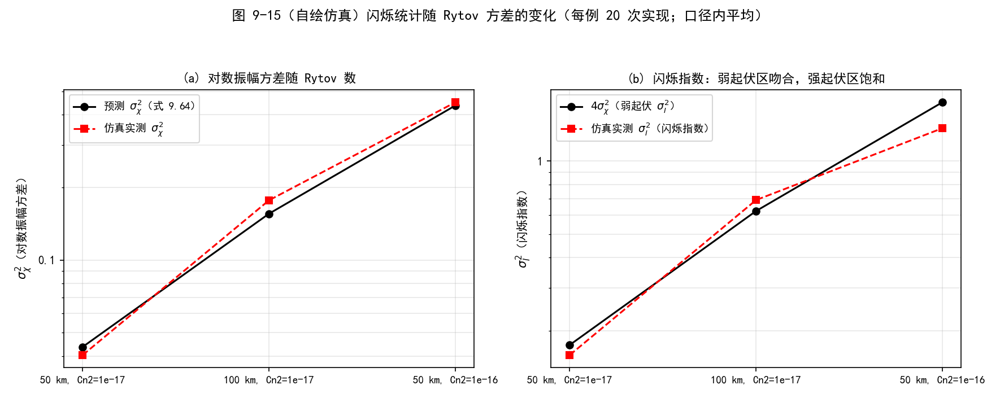
*图 9-15（自绘仿真）闪烁统计随 Rytov 数的变化：(a) 对数振幅方差实测跟随预测；(b) 闪烁指数在弱起伏区贴合 4σ_χ²、强起伏区饱和*

### 9.6 结语（原书 9.6）

本例演示了搭一套湍流仿真并保证结果准确的完整流程，很多步骤常被忽略。真实项目往往更复杂——双向传播、自适应光学、运动平台、粗糙面反射、多波长等——这些附加模块同样需要像本节这样彻底验证。

## 9.7 习题

原书 7 道题；可数值化的部分在 `python/waveprop/ch9/ch9_problems.py` 与 `matlab/waveprop/ch9/ch9_problems.m` 里全部实跑验证（下述数字即实跑结果）。

1. **Maxwell 方程 → 式 (9.20)**：设介电常数 \(\epsilon\) 位置相关，按 1.2.1 节同样的组合方式推导含 \(\nabla[\mathbf{E}\cdot\nabla\ln n]\) 项的波动方程。纯推导（关键：\(\nabla\times\nabla\times\mathbf{E} = \nabla(\nabla\cdot\mathbf{E})-\nabla^2\mathbf{E}\) 与 \(\nabla\cdot(\epsilon\mathbf{E})=0\)）。
2. **常数 \(C_n^2\) 时 \(r_{0,sw} = (3/8)^{-3/5} r_{0,pw}\)**：把 \(\int_0^{\Delta z}(z/\Delta z)^{5/3}dz = \frac{3}{8}\Delta z\) 代入式 (9.43)。实算比值 1.801280，与 \((3/8)^{-3/5}=1.801280\) 零差。
3. **把式 (9.44) 代入式 (9.34) 验证式 (9.49)**：\(D_K(r) = 6.88(r/r_0)^{5/3}\) 的导数代入后积分。实算（\(r_0=1\) m、\(\kappa=1\) rad/m，阻尼外推）：正确的二维核 \(J_1\) 给 \(0.4896\)（Abel 解析值，恰为式 (9.49) 的 0.49）；书印的三维核 \(\sin(\kappa r)/(\kappa r)\) 给 0.35 量级——证实 9.2.3 节的勘误。
4. **常数 \(C_n^2\) 时 \(\sigma_{\chi,sw}^2 = 0.404\,\sigma_{\chi,pw}^2\)**：式 (9.63)/(9.64) 的积分分别是 \(\frac{6}{11}\Delta z^{11/6}\) 与 \(B(\frac{11}{6},\frac{11}{6})\Delta z^{11/6}\)，比值 \(= 11B/6 = 0.4043\)。
5. **采样图：点源 \(\lambda=1\ \mu\)m、2 km、\(r_0=2\) cm、口径 2 m**（图 9-16 左）：真空 \(N=2^8=256\)、最少 783 个平面；湍流（\(c=2\)）\(D_1'=0.2\) m、约束 1' 上界 8.9 mm、\(N=2^{12}=4096\)、最少 50 个平面——湍流要求**更多网格点**（源被模糊成 \(D_1'\) 必须覆盖）但**更少部分传播段**（\(N\) 大了每段可传更远）。
6. **采样图：75 km、\(r_0=10\) cm、口径 1 m**（图 9-16 右）：真空 \(N=2^8=256\)、7 个平面；湍流 \(N=2^9=512\)、4 个平面。
7. **点源 \(\lambda=1\ \mu\)m、\(\Delta z=100\) km、\(C_n^2=10^{-17}\)**（图 9-17）：
    (a) 解析：\(r_{0,pw}=0.185\) m、\(r_{0,sw}=0.333\) m；\(\sigma_{\chi,pw}^2=0.385\)（Rytov 数 1.54）、\(\sigma_{\chi,sw}^2=0.156\)；
    (b) 三屏三方程（\(\alpha=0,0.5,1\)，匹配 \(r_{0,sw}\)、\(\sigma_{\chi,sw}^2\)、\(\sigma_{\chi,pw}^2\)）唯一解 \(r_{0_i}=[0.570, 0.229, 0.567]\) m——非负，但被匹配的平面波 Rytov 数 1.54 已深处强起伏区（弱起伏理论自相矛盾），且零自由度、两端屏被单方程钉死，工程上不可用；
    (c) 七屏 + 约束优化（Listing 9.5 流程）：\(r_{0_i}=[50, 0.705, 0.618, 0.539, 0.473, 0.418, 50]\) m，回代 \(r_{0,sw}\)、\(\sigma^2\) 与目标一致；
    (d) 采样分析（口径 2 m）：\(\delta_1=5\) mm、\(\delta_n\le 141.7\) mm（取 80 mm）、\(N\ge203\to 2^8=256\)、\(\Delta z_{max}=6.4\) km、最少 17 个平面；口径 2 m 时 \(N=2^8\) 即可，但 \(\Delta z_{max}\) 小、平面数多——传播验证的"示例规模"取 \(D_2=0.5\) m、\(N=512\)、7 屏（`ch9_turbulence.py p7`）：实测 \(\sigma_\chi^2=0.177\) vs 预测 0.156、相干因子拟合斜率 \(-2.87\)（理论 \(-3.44\)）；
    (e)(f) 与 9.5 节同流程的屏结构函数与相干因子验证，`p7` 命令一并完成（20 次实现）。

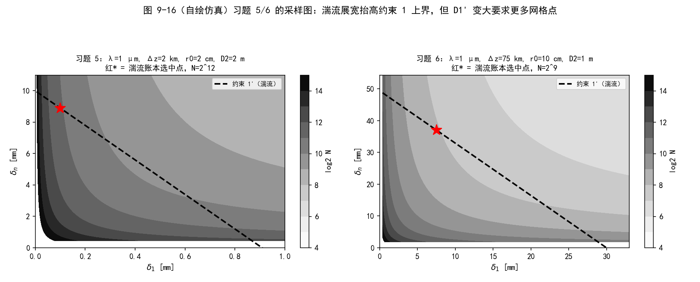
*图 9-16（自绘仿真）习题 5/6 的采样图（log2 N 等高线 + 约束 1' 上界 + 选中点）：湍流展宽抬高约束 1 上界，但 D1' 变大要求更多网格点*

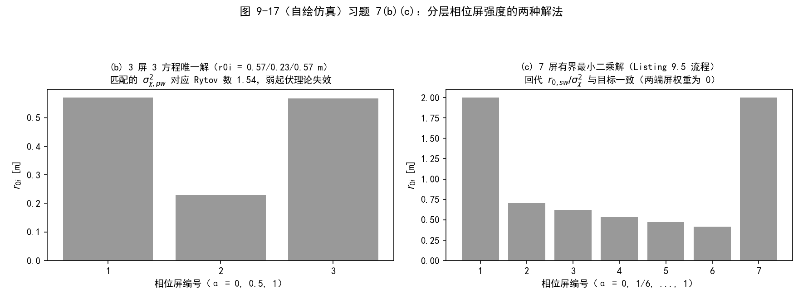
*图 9-17（自绘仿真）习题 7(b)(c)：三屏唯一解（无鲁棒性）与七屏约束优化解（回代精确）的屏强度对比*

## 坑与陷阱

!!! danger "1. 相位屏的强度参数是 r0，不是 Cn2"
    生成屏幕用 \(\Phi_\phi\propto r_0^{-5/3}\)（式 9.51/9.52），屏与屏之间强度不同（式 9.70 的 \(r_{0_i}\)）。直接拿路径 \(C_n^2\) 或整路径 \(r_0\) 去生成每块屏，会把湍流总强度弄错几倍。整路径与各屏的关系是幂次合成：\(r_{0,sw}=\left[\sum r_{0_i}^{-5/3}\alpha_i^{5/3}\right]^{-3/5}\)（式 9.72）——\(r_0\) 不能线性平均。

!!! danger "2. 纯 FT 屏的统计是错的，验收前别信"
    FT 屏缺倾斜等低阶模式：大间隔结构函数塌到理论的 1/5（实测 8–12 \(r_0\) 段偏低 83%），下游的一切相干/闪烁统计都会偏。次谐波法补救后仍偏低 43%——统计验收（图 9.9/9.10 的流程）不可省，别只看"屏看起来像湍流"。

!!! danger "3. 折射算符 T 的符号"
    式 (9.2) 书印 \(\exp[-i\phi]\) 按物理与书自己的 Listing 9.8 应为 \(\exp[+i\phi]\)（勘误）。随机零均值屏无影响；但如果把 \(T\) 用于确定性相位（热透镜、自适应变形镜），符号反了场会向反方向传播/聚焦。

!!! danger "4. 路径两端屏的权重是零，但它们还在仿真里"
    矩匹配方程 (9.72)/(9.74) 里 \(\alpha=0\) 与 \(\alpha=1\) 的屏权重为零：它们的 \(r_{0_i}\) 由初值/上界决定（书例一个 50 m、一个 \(10^6\) m），对 \(r_{0,sw}\) 与 Rytov 数"无贡献"——但屏幕仍在传播链里加相位（端点屏几何上近似 piston、影响有限）。回代校验（Listing 9.5 第 46–47 行）必须做，别只看优化器收敛。

!!! danger "5. 每屏 Rytov 贡献要设上限"
    书例把每屏贡献限制在总 Rytov 数的 0.1 以内（Martin & Flatté 指南）。单屏太强 = 微扰/单散射假设在一格内就破产，多重散射效应无法靠加密采样弥补——要么加屏数、要么减弱每屏。

!!! danger "6. 书例的 Rytov 数 0.436 已越过弱起伏界"
    \(\sigma_\chi^2<0.25\) 才算弱起伏（9.2.3 节），而 50 km/\(C_n^2=10^{-16}\) 例子的 \(\sigma_{\chi,sw}^2=0.436\)（Rytov 数约 1.74）。仿真照跑、理论对照大体成立（本笔记实测相干因子偏差 0.012），但闪烁指数已见饱和（实测/弱起伏理论 = 0.78）——把结论外推到更强湍流前先想清楚 Rytov 理论还剩多少 validity。

!!! danger "7. 采样约束要用 D1'/D2'，别套真空版"
    湍流把源"抹"成 \(D_1' = D_1 + c\lambda\Delta z/r_{0,rev}\)（式 9.84）。习题 5 的对比触目惊心：湍流场景要求的网格点反而更多（\(2^{12}\) vs 真空 \(2^8\)），因为被照亮的源区扩大了 800 倍。\(c=2\) 收 97% 的光，\(c=4\) 收 99%——少收点光可以换更小的 \(N\)。

!!! danger "8. 矩匹配方程组要限非负，且不是屏越多越自由"
    未知量是 \(r_{0_i}^{-5/3}\)，无约束解可能为负（不物理）。用带边界最小二乘 + 每屏 Rytov 上限（9.5.1 节）。习题 7(b) 的教训：3 屏 3 方程"恰好定解"但零鲁棒，还隐含把平面波 Rytov 数配到 1.54 的强起伏区——屏数要留冗余（书例 11 屏 2 方程）。

## 速览

1. split-step：真空衍射算符 \(\mathcal{R}\) 与折射算符 \(T=\exp(\pm i k\int\delta n\,dz)\) 交替；大气 \(n\approx1\)，\(T\) 就是每平面一块相位屏（式 9.1–9.3，Listing 9.1）。
2. Kolmogorov：惯性子区内结构函数 \(\propto r^{2/3}\)（式 9.13）；折射率谱 \(\Phi_n^K = 0.033C_n^2\kappa^{-11/3}\)（式 9.16），修正 von Kármán 加内外尺度（\(\kappa_m=5.92/l_0\)、\(\kappa_0=2\pi/L_0\)，式 9.18）。
3. 冻结湍流：\(\phi(x,y,t)=\phi(x-v_xt, y-v_yt, 0)\)（式 9.19）；时间定标用 Greenwood 频率。
4. Rytov：\(U=U_0e^{\psi}\)，\(\psi=\chi+i\phi\)（式 9.25–9.27）；相干因子 \(\mu=e^{-D/2}\)（式 9.32），平面波 Kolmogorov \(D_K=6.88(r/r_0)^{5/3}\)（式 9.44）。
5. \(r_0\)（Fried 参数）：\(r_{0,pw}=[0.423k^2\int C_n^2dz]^{-3/5}\)、\(r_{0,sw}\) 多 \((z/\Delta z)^{5/3}\) 权重（式 9.42/9.43）；可见光垂直路径典型 5–10 cm；接收端湍流主导球面波相干性。
6. 相位 PSD：\(\Phi_\phi^{mvK}(f)=0.0229r_0^{-5/3}e^{-f^2/f_m^2}(f^2+f_0^2)^{-11/6}\)（式 9.51/9.52）——相位屏生成直接用它；\(\sigma_\chi^2\) 弱起伏界 0.25（式 9.62–9.64），Rytov 方差 \(=4\sigma_\chi^2\)。
7. 分层：\(n\) 块屏矩匹配（式 9.65），屏强度 \(r_{0_i}=[0.423k^2C_{n_i}^2\Delta z_i]^{-3/5}\)（式 9.70），合成式 (9.71)–(9.74)，带约束最小二乘求解（式 9.75 + Listing 9.5）。
8. 相位屏：FT 法 = 频域抽复高斯（式 9.79/9.80）+ IFT（Listing 9.2）；低频欠采样用次谐波补救（式 9.81，Listing 9.3）；验收靠结构函数与相干因子（图 9.9/9.10）。
9. 采样：约束 1/2 用湍流展宽口径 \(D_1'=D_1+c\lambda\Delta z/r_{0,rev}\)、\(D_2'=D_2+c\lambda\Delta z/r_0\)（式 9.84–9.87），约束 3 不变；\(\Delta z_{max}=\min(\delta_1,\delta_n)^2N/\lambda\)（式 9.89–9.90）。
10. 流程：建参数 → 采样分析（图 9.6）→ 真空对照（图 9.7）→ 多实现湍流（图 9.8）→ 统计验收（图 9.9/9.10）。全部代码在 `matlab/waveprop/ch9/`（14 个文件）与 `python/waveprop/ch9/`（2 个文件），数值验证全通过。

## 术语速查

| 英文 | 中文 | 一句话 |
| --- | --- | --- |
| split-step beam propagation | 分步束传播法 | 衍射算符与折射算符交替的传播框架（式 9.1–9.3） |
| phase screen | 相位屏 | 一片薄相位扰动，代表一段湍流体的累积相位 |
| turbulent eddy | 湍流涡旋 | 尺寸/温度各异、被风冻结平流的空气团 |
| outer scale / inner scale | 外尺度 L0 / 内尺度 l0 | 最大/最小涡旋尺寸，夹出惯性子区 |
| inertial subrange | 惯性子区 | 能量级串传输、统计满足 2/3 律的尺度区间 |
| structure function | 结构函数 | 增量平稳场的逐对差均方，替代协方差 |
| refractive-index structure parameter | 折射率结构参数 \(C_n^2\) | 湍流强度，单位 m^(-2/3)，典型 10^(-17)–10^(-13) |
| Kolmogorov spectrum | Kolmogorov 谱 | \(\Phi_n = 0.033C_n^2\kappa^{-11/3}\)（式 9.16） |
| modified von Kármán spectrum | 修正 von Kármán 谱 | 含内外尺度的最简 PSD（式 9.18） |
| Taylor frozen-turbulence hypothesis | 泰勒冻结湍流假设 | 涡旋冻结、被平均风平流（式 9.19） |
| Greenwood frequency | 格林伍德频率 | 湍流相位时间谱的定标频率，AO 带宽基准 |
| Rytov method / perturbation | Rytov 微扰法 | \(U=U_0e^{\psi}\)、\(\psi=\chi+i\phi\) 的逐阶微扰（式 9.25–9.27） |
| log-amplitude / phase perturbation | 对数振幅 / 相位微扰 | \(\chi\)、\(\phi\)：闪烁与相位的统计载体 |
| mutual coherence function | 互相干函数 | \(\Gamma=\langle UU^*\rangle\)（式 9.29） |
| coherence factor | 相干因子 | 复相干度之模 \(\mu\)，\(\mu=e^{-D/2}\)（式 9.31/9.32） |
| wave structure function | 波结构函数 | \(D=D_\chi+D_\phi=-2\ln\mu\)（式 9.32/9.33） |
| Fried parameter / atmospheric coherence diameter | Fried 参数 / 大气相干直径 | \(r_0\)：\(D(r_0)=6.88\) rad²（式 9.41） |
| spatial coherence radius | 空间相干半径 | \(\rho_0\)：\(\mu\) 的 e^(-1) 点，\(r_0=2.1\rho_0\) |
| isoplanatic angle | 等晕角 | 角结构函数达 1 rad² 的视场角 \(\theta_0\)（式 9.61） |
| log-amplitude variance | 对数振幅方差 | \(\sigma_\chi^2\)，弱起伏判据 0.25（式 9.62–9.64） |
| Rytov variance / scintillation index | Rytov 方差 / 闪烁指数 | \(\sigma_R^2=4\sigma_\chi^2\)；弱起伏下 \(\sigma_I^2\approx\sigma_R^2\) |
| long/short exposure | 长曝光 / 短曝光 | 倾斜被平均掉 / 每帧去倾斜（式 9.55 的 α） |
| beam wander / beam spreading | 光束漂移 / 光束展宽 | 倾斜引起的质心晃动 / 高阶像差引起的扩张 |
| anisoplanatism | 非等晕性 | 传递函数随视向变化（式 9.59） |
| moment matching | 矩匹配 | 分层模型的低阶矩与连续介质一致（式 9.65） |
| subharmonic method | 次谐波法 | FT 屏叠加低频傅里叶级数补倾斜等低阶模式（式 9.81） |
| Zernike tilt | Zernike 倾斜模 | 相位的一阶梯度模式；短曝光近似的去除对象 |
| saturated / strong fluctuation | 强起伏（饱和）区 | \(\sigma_\chi^2>0.25\)，Rytov 弱起伏理论逐渐失效 |
