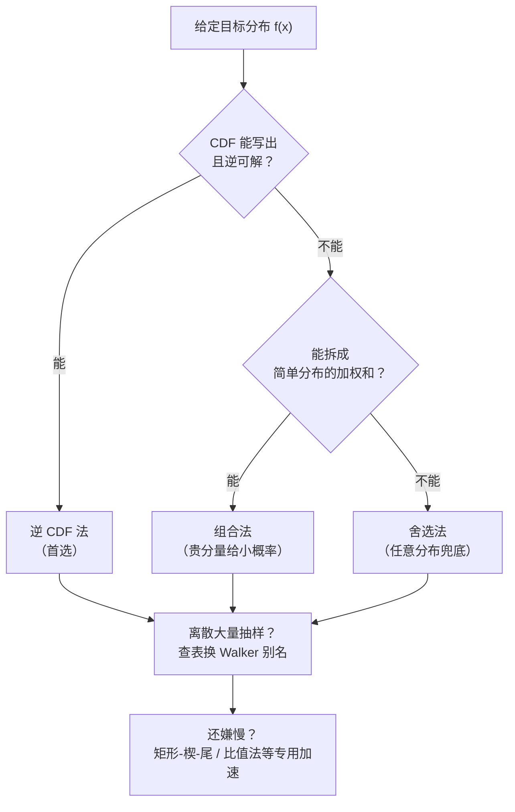

# 第 4 章 抽样、记分与精度

> **本章解决**：手里只有 \([0,1)\) 上的均匀随机数（第 3 章的产品），怎么把它变成**任意给定分布**的样本——逆 CDF、别名法、舍选法、组合法、变换法、专用加速法一套工具箱；样本抽出来之后怎么**记分**——累加器、0/1 记分、加权记分、标准误差与置信区间（数理统计复习主场）；最后分清两个常被混用的词——**精度**（precision，统计涨落）与**准确度**（accuracy，离真值多远）。第 2 章的大数定律与中心极限定理在本章全部落地成可操作的公式。
> **对照教材**：Dunn & Shultis《Exploring Monte Carlo Methods》§4.1–4.4（主线骨架）；Shonkwiler & Mendivil《Explorations in Monte Carlo Methods》§2.1–2.10（分布家族与算法细节，并入各节时标注）。建议先读 D&S §4.1 的方法框架，再按小节并入 S&M 的对应算法；D&S 附录 A 是常见分布抽样公式速查表，随用随翻。

| 关键词 | 事实 |
| --- | --- |
| 逆 CDF 法 | \(x_i=F^{-1}(\rho_i)\)：连续、离散通用，一步到位，但要求 \(F^{-1}\) 写得出来 |
| 舍选法 | 从 proposal \(g\) 抽候选、按 \(h=f/(Mg)\) 概率接受；接受率 \(1/M\)，只需 \(f\) 的相对值 |
| 组合法 | \(f=\sum A_i f_i\)：先抽分量再抽值；复杂分布拆成便宜分量 |
| 别名法 | Walker 建表 \(O(n)\)、抽样 \(O(1)\) 零搜索，离散大量抽样的最快方案 |
| 标准误差 | \(s(\bar z)=s(z)/\sqrt N\)；\(N\) 翻四倍精度才翻倍——治本是降 \(s(z)\)（第 5 章） |
| 精度 vs 准确度 | 精度看 \(\sigma(\bar z)\)，准确度看 \(\bar z\) 离真值多远；可以精确地错 |

本章代码：[nb/ch04.ipynb](nb/ch04.ipynb)（NumPy 实跑；随机种子 2024，9 张结果图编号与笔记一致；单格均可独立复跑）。

## 4.0 本章导图

  

    抽样、记分与精度
    
    

      

        抽样第一法
        
        

          概率积分变换：F(X) 均匀
          连续 / 离散逆 CDF
          指数规范法与无记忆性
          变换法：Cauchy 厚尾
        

      

      

        离散大量抽样
        
        

          二项 = Bernoulli 求和
          Poisson：乘积法三兄弟
          Walker 别名：建表 O(n) 抽样 O(1)
        

      

      

        通用兜底
        
        

          舍选法：接受率 1/M
          只需 f 的相对值
          Beta 分布例 + 无界版
          组合法：贵分量给小概率
        

      

      

        专用加速
        
        

          矩形-楔-尾：面积切三块
          近线性 PDF 的 squeeze
          组合-舍选、均匀比值法
        

      

      

        正态与联合
        
        

          Box–Muller 含雅可比证明
          极法：拒绝 1 − π/4
          对数正态与 Gibrat 定律
          联合：先边缘后条件
        

      

      

        记分与推断
        
        

          累加器 S1/S2 与标准误差
          t 分布与 batching
          0/1 记分与二项置信区间
          相对误差 R 与 FOM
        

      

      

        精度与准确度
        
        

          系统误差 vs 统计误差
          周期耗尽 → 伪收敛
          舍入误差：累加器冻结
        

      

    

  

拿到目标分布 \(f(x)\) 后，选哪条抽样路线？一张决策图：

## 4.1 抽样：从均匀到任意分布

**抽样**（sampling）就是把某个随机变量的取值按它的分布"造"出来：造出的一大串样本，频率直方图应复现该分布。**记分**（scoring）则是每条 history 算出一个分数 \(z(x_i)\)，累积平均得到估计。本章先解决抽样。

D&S 约定：本章所有方法都以伪随机数发生器为地基——它输出长序列 \(\rho_i\)，均匀分布于 \([0,1)\)（单位矩形分布 \(\mathcal U(0,1)\)，第 3 章）。物理法（电路白噪声、放射性衰变间隔、宇宙微波背景嘶声）也能造随机数，但蒙特卡罗要的是百万乃至十亿级的可复现数列，只能靠算法。S&M 把主流技法归纳为五类：**cdf 反演**（cdf inversion）、**模拟**（simulation，把底层试验直接演一遍）、**组合**（composition）、**变换**（transformation）、**舍选**（rejection）——本章按 D&S 的框架展开，五类都会遇到。

### 4.1.1 连续分布的逆 CDF 法

#### 概率积分变换：一切的开始

逆 CDF 法（inverse CDF method，也叫反变换法）的全部理论是一行恒等式：**CDF 是单调升函数，把任意连续分布映到均匀分布**。

**定理（S&M Thm 2.1，概率积分变换）**：设 \(X\) 有连续 CDF \(F\)，令 \(U=F(X)\)，则 \(U\sim U(0,1)\)。

**证明**：对 \(0\le u<1\)，因 \(F\) 连续且严格增，\(F^{-1}\) 存在，取 \(x=F^{-1}(u)\)：

\[
\operatorname{Pr}(U\le u)=\operatorname{Pr}(F(X)\le u)=\operatorname{Pr}\big(X\le F^{-1}(u)\big)=F\big(F^{-1}(u)\big)=u.
\]

反过来用就是抽样算法：若 \(U\sim U(0,1)\)，则 \(X=F^{-1}(U)\) 的 CDF 恰为 \(F\)。D&S 的推导（式 4.1–4.4）同源：任何两个 CDF 之间有一一对应 \(F(x_i)=G(y_i)\)；取 \(G\) 为单位矩形分布的 CDF（\(G(y)=y\)）即得 \(F(x_i)=\rho_i\)，解出

\[
x_i = F^{-1}(\rho_i).
\]

**验证它真的服从 \(f\)**：\(x_i\) 落在 \([x, x+\mathrm dx)\) 的概率等于 \(\rho_i\) 落在 \([F(x), F(x+\mathrm dx))\) 的概率：

\[
\operatorname{Pr}\{x<F^{-1}(\rho_i)<x+\mathrm dx\}
=\operatorname{Pr}\{F(x)<\rho_i<F(x+\mathrm dx)\}
=F(x+\mathrm dx)-F(x)=\int_x^{x+\mathrm dx}f(x')\,\mathrm dx' = f(x)\,\mathrm dx.
\]

<figure>
  
  <figcaption>图 4.1 逆 CDF 法示意（截自原书 D&S 图 4.1）：从纵轴取 \()，横走碰 CDF 曲线再垂下来，横坐标就是样本 \(x_i\)。CDF 平缓处（密度小）样本稀疏，陡峭处（密度大）样本密集。</figcaption>
</figure>

**局限性**：要求 \(F\) 能积分出来**且**逆可解。正态分布两样都不满足（无初等原函数），这是 §4.1.7 要专门伺候它的原因；数值求逆（解方程 \(\rho=F(x)\)）理论上可行，但每抽一个样本解一次非线性方程，实战不划算。

#### 两个手算例子

**均匀分布 \(\mathcal U(a,b)\)**（D&S 例 4.1）：

\[
\rho_i=F(x_i)=\frac{1}{b-a}\int_a^{x_i}\mathrm du=\frac{x_i-a}{b-a}
\quad\Longrightarrow\quad
x_i=a+\rho_i(b-a).
\]

**指数分布 \(f(x)=\alpha e^{-\alpha x}\)，\(x\ge0\)**（D&S 例 4.2；S&M §2.5.1 称之为"规范方法"）：

\[
F(x)=1-e^{-\alpha x}
\ \Longrightarrow\ 
\rho_i=1-e^{-\alpha x_i}
\ \Longrightarrow\ 
x_i=-\frac{1}{\alpha}\ln(1-\rho_i).
\]

因为 \(1-\rho_i\) 与 \(\rho_i\) 同为 \(U(0,1)\)，实际代码写 \(x_i=-\ln(\rho_i)/\alpha\)，每次抽样省一次减法（D&S 原话：computationally efficient）。

!!! danger "对数里喂零"
    数学上 \(\rho=0\) 概率为零，代码里不是：`rng.random()` 的值域是 \([0,1)\)，**含 0**。`-np.log(0.0)` 直接溢出。稳妥写法 `-np.log1p(-u)`（即 \(-\ln(1-u)\)，\(1-u\in(0,1]\)），或抽到 0 就重抽。本笔记 notebook 全部用 `log1p` 版。

<figure>
  
  <figcaption>图 4.2 逆 CDF 抽指数分布（代码实跑，times10^5()）：左，直方图贴住密度 )，样本均值 0.9968、方差 0.9967（理论均为 1）；右，半对数坐标下直方图高度落在一条直线上——"密度真是指数"最灵敏的检验，尾巴一丁点偏差都会被 log 放大。</figcaption>
</figure>

指数分布还有三件随身行李，后面排队模拟（§4.2.4）全要用到：

**无记忆性**（S&M §2.5）：等了 \(a\) 还没等到事件，再等 \(b\) 的分布与从头等 \(b\) 完全一样：

\[
\operatorname{Pr}(W<a+b\mid W\ge a)=\frac{F(a+b)-F(a)}{1-F(a)}
=\frac{e^{-\lambda a}-e^{-\lambda a}e^{-\lambda b}}{e^{-\lambda a}}
=1-e^{-\lambda b}=\operatorname{Pr}(W<b).
\]

指数是唯一无记忆的连续分布——这既是排队系统能解析求解的原因（§4.2.4），也是它不能当"零件寿命"模型的原因（旧零件不会因为旧而更容易坏）。均值与方差：\(\mu=1/\lambda\)、\(\mathrm{var}=1/\lambda^2\)（两次分部积分，S&M 图 2.4）。

**独立等待时间的合成**：两个独立过程 \(W_A\sim E(\lambda_A)\)、\(W_B\sim E(\lambda_B)\)，"谁先发生"的等待时间仍是指数，参数相加：

\[
\operatorname{Pr}(W_A<t)+\operatorname{Pr}(W_B<t)-\operatorname{Pr}(\text{两者都}<t)
=1-e^{-(\lambda_A+\lambda_B)t}.
\]

**尺度变换**：\(Y\sim E(1)\)，则 \(X=Y/\lambda\sim E(\lambda)\)——这是下一小节变换法的第一个例子，也是泊松乘积法"Method 2"的依据（§4.1.2）。

#### 变换法与 Cauchy 厚尾（S&M §2.5.3）

设 \(X=g(Y)\)，\(g\) 一一对应，换元 \(t=g(\tau)\) 给出密度之间的搬运规则：

\[
f_X(x)=f_Y\big(g^{-1}(x)\big)\,\big|\big(g^{-1}\big)'(x)\big|.
\]

用它验证指数的尺度变换：\(g(\tau)=\tau/\lambda\)、\(f_Y(\tau)=e^{-\tau}\)，则 \(f_X(x)=e^{-\lambda x}\cdot\lambda=\lambda e^{-\lambda x}\) ✓。

**Cauchy（柯西）分布**：取 \(Y\sim U(-\pi/2,\pi/2)\)、\(X=\tan Y\)。这里 \(g^{-1}(x)=\arctan x\)，故

\[
f_X(x)=\frac1\pi\cdot\frac{1}{1+x^2},
\qquad
F_X(x)=\frac12+\frac{1}{\pi}\arctan x,
\qquad
X=\tan\big(\pi(U-\tfrac12)\big).
\]

柯西密度钟形、对称、看起来人畜无害，方差却是**无穷**：\(\frac1\pi\int_{-\infty}^{\infty}\frac{t^2}{1+t^2}\,\mathrm dt\) 发散。后果很实际：**柯西样本的均值永远不收敛**——前 10 万个样本的均值和前 20 万个的可以差出一个量级（本 notebook 实跑：\(N=10^4\) 时 \(+23.3\)，\(N=2\times10^5\) 时 \(+4.3\)，毫无收敛迹象）。在高斯之前它一度被当成"误差定律"的候选，输就输在尾巴太厚：大样本里总有几个 \(\pm 10^3\) 量级的离群点把均值拽走。蒙特卡罗记分假设二阶矩存在（§4.2.3 的尾部判据），柯西是反例教科书。

<figure>
  
  <figcaption>图 4.3 柯西样本直方图（代码实跑，对数纵轴）：\(2) 个样本中 6.32% 落在 \(|x|>10(10^{-23}(N=10^4(+23.3(N=2) 时 \(+4.3\)，永不收敛。</figcaption>
</figure>

### 4.1.2 离散分布的逆 CDF 法

离散版本甚至更简单。设 \(x\) 只取值 \(x_1,\dots,x_N\)，概率 \(f_i\)，即 \(f(x)=\sum_i f_i\,\delta(x-x_i)\)，CDF 是阶梯函数 \(F(x)=\sum_{x_i\le x}f_i\)。抽 \(\rho\sim U(0,1)\)，找满足下式的 \(i\)：

\[
F(x_{i-1})<\rho\le F(x_i)
\qquad\Big(\text{即 } f_1+\dots+f_{i-1}<\rho\le f_1+\dots+f_i\Big),
\]

则 \(\operatorname{Pr}(X=x_i)=F(x_i)-F(x_{i-1})=f_i\)——均匀性原样搬运成分段概率。实现就是**查表**：累积概率落表，顺序搜索或二分（`np.searchsorted`）。

**两个提速细节**（S&M §2.1.2）：其一，把节点按概率**从大到小重排**，期望搜索次数立降——岸鸟窝卵数分布 \(p=(0.15,0.20,0.60,0.05)\) 顺序搜索期望循环 \(1(0.15)+2(0.2)+3(0.6)+4(0.05)=2.55\) 次，重排后 \(1(0.6)+2(0.2)+3(0.15)+4(0.05)=1.65\) 次；其二（D&S），对 Poisson、二项、几何这类支撑在整数上的分布，相邻概率之比 \(R(x)=f(x+1)/f(x)\) 常是简单函数（泊松是 \(\lambda/(x+1)\)），边搜边递推 \(f\)，不必每次从头算阶乘。概率全是两位小数时还有更土的办法：造一张 100 格的数组按概率填充、均匀下标抽（S&M 的轮盘赌数组法）——它就是下一节别名法的思路前身。

<figure>
  
  <figcaption>图 4.4 岸鸟窝卵数的离散 CDF 逆变换（截自原书 S&M 图 2.2）：从纵轴 \(U\) 出发右行，碰到阶梯的竖直虚线段就往下落，落在哪个"台阶"就抽哪个值；每段横台阶的长度 = 该结果的概率。</figcaption>
</figure>

#### Bernoulli 试验（S&M §2.1）

最简单的离散分布：一次只有成功（1）/失败（0）两种结果，成功概率 \(p\)：

\[
f(x)=p^x(1-p)^{1-x},\quad x=0,1;
\qquad
\mu=p,\quad \operatorname{var}=p(1-p).
\]

抽样一行：\(U<p\) 记成功。赌场轮盘赌"开红"：18 红 18 黑 2 绿，\(p=18/38=0.4736\)，\(U<0.4736\) 即红（S&M 图 2.1 的 CDF 视角：台阶只有两级）。

#### 二项分布（S&M §2.3）

\(n\) 次独立 Bernoulli 试验中成功的总次数 \(X\) 服从二项分布 \(b(n,p)\)。**计数推导**：给成功编号 \(S_1,\dots,S_x\)，安置到 \(n\) 个位置有 \(n(n-1)\cdots(n-x+1)\) 种放法；真实试验里成功不区分身份，除以 \(x\) 个编号的排列数 \(x!\)，得组合数

\[
\binom{n}{x}=\frac{n(n-1)\cdots(n-x+1)}{x!}=\frac{n!}{x!\,(n-x)!}.
\]

每种"位置方案"（前 \(x\) 个全成功、其余全失败）的概率是 \(p^x q^{n-x}\)（独立性 ⇒ 连乘），于是

\[
\operatorname{pdf}(x)=\binom{n}{x}p^x q^{n-x},\qquad x=0,1,\dots,n.
\]

对 \(x\) 求和恰是二项式定理 \((p+q)^n=1\)——"二项"分布由此得名。

**均值与方差**。直接算：\(\mu=\sum_x x\binom nx p^xq^{n-x}\)，用 \(\binom nx=\frac nx\binom{n-1}{x-1}\) 提出因子 \(np\)，剩余求和由 \(y=x-1,\ m=n-1\) 归结为 \((p+q)^{n-1}=1\)，得 \(\mu=np\)。更快的一条路：期望线性（第 2 章），二项变量是 \(n\) 个独立 Bernoulli 之和，均值即 \(n\) 份 \(p\) 相加；方差同理（独立和方差相加，S&M Thm 1.1）得 \(\operatorname{var}=npq\)。

**抽样**：\(n\) 不大时直接模拟——把 Bernoulli 试验重复 \(n\) 遍求和（向量化即 `(rng.random((N,n)) < p).sum(axis=1)`）。\(n\) 大时（S&M 的突变例子：\(10^6\) 次细胞分裂、每次突变概率 \(p=10^{-7}\)）逐个模拟太浪费，这就轮到泊松。

#### 泊松分布（S&M §2.4）

**从二项到泊松**。数"单位时间里随机发生的事件数"，四条假设：事件率 \(\lambda>0\)；不重叠区间的事件数独立；短区间 \(h\) 内恰一个事件的概率 \(\approx\lambda h\)；短区间内两个以上事件可忽略。把长 \(t\) 的区间切成 \(n\) 段，"某段有事件"是 Bernoulli 试验（成功率 \(\lambda t/n\)），事件总数服从 \(b(n,\lambda t/n)\)。令 \(n\to\infty\)：

\[
\binom nx\Big(\frac{\lambda t}{n}\Big)^x\Big(1-\frac{\lambda t}{n}\Big)^{n-x}
=\underbrace{\frac{n!}{n^x(n-x)!}}_{\to\,1}
(\lambda t)^x\,\underbrace{\Big(1-\frac{\lambda t}{n}\Big)^{n-x}}_{\to\,e^{-\lambda t}}
\ \longrightarrow\
\frac{(\lambda t)^x e^{-\lambda t}}{x!}.
\]

这就是泊松分布 \(Pois(\lambda t)\)。两个细节：\(\lambda t\) 是无量纲纯数（\(\lambda=1/10\) 件/分钟、\(t=30\) 分钟，则 \(\lambda t=3\)）；它对空间同样适用（每 8 英尺木龙骨平均 2 个节疤，\(P(\text{无节疤})=e^{-2}=0.135\)）。突变问题里 \(n=10^6,\ p=10^{-7}\)：精确值 \((1-p)^n=0.904837331\)，泊松近似 \(e^{-np}=e^{-0.1}=0.904837418\)——九位小数才分得出胜负。均值与方差都是 \(\lambda t\)（均值由级数求和立得；方差计算冗长，S&M 图 2.3，此处从略）。

**抽样：乘积法**。泊松变量 = "指数等待时间序列里，累计还没到时刻 \(t\) 的事件个数"。由 §4.1.1，\(W_i=-\ln U_i\sim E(1)\)，于是 S&M 给出三个等价方法：

1. **Method 1**：抽 \(W_i\sim E(\lambda)\)，取满足 \(\sum_{i=1}^{K}W_i<t\) 的最大 \(K\)；
2. **Method 2**：抽 \(Y_i\sim E(1)\)，取满足 \(\sum_{i=1}^K Y_i<\lambda t\) 的最大 \(K\)（省掉每次除 \(\lambda\)）；
3. **Method 3（乘积法）**：对 Method 2 取对数。\(-\sum Y_i>-\lambda t\iff\prod U_i>e^{-\lambda t}\)，所以连乘均匀数，**首次跌破 \(e^{-\lambda t}\) 之前的连乘个数**就是样本：

\[
X=\max\Big\{x:\ \prod_{i=0}^{x}U_i>e^{-\lambda t}\Big\},
\qquad U_0=1 .
\]

一条 \(\prod U_i>e^{-\lambda t}\) 同时是"间隔和还没到 \(\lambda t\)"的翻译——指数间隔这副骨架，§4.2.4 的排队模拟还要穿。

<figure>
  
  <figcaption>图 4.5 离散逆 CDF 实跑（代码实跑，times10^5(b(20,0.25)(Pois(4)\)（均值 4.002、方差 3.996，理论均为 4）。</figcaption>
</figure>

### 4.1.3 Walker 别名法

查表法的搜索是绕不开的成本：顺序搜索 \(O(n)\)，二分 \(O(\log n)\)。**Walker 别名法**（alias method，S&M §2.2）把离散抽样做到极限——建表 \(O(n)\)，之后**每次抽样 \(O(1)\)，零搜索**：两次均匀数 + 一次查表 + 一次比较，抽谁与 \(n\) 无关。

**轮盘赌图像**。\(n\) 个结果的概率 \(p_1,\dots,p_n\) 相当于一张扇区角为 \(p_i\,2\pi\) 的轮盘。别名法把每个扇区**等分**成 \(n\) 份：第 \(i\) 个扇区的一部分留给自己（份额记 \(Q[i]\），不足 \(1/n\) 的从别处借），剩下的份额**记到别人名下**（别名 \(A[i]\)）。抽样时先等可能地选一个扇区 \(Y\)，再看扇区内位置 \(Z\) 落在"留给自己的部分"还是"别名部分"：

1. 取 \(U\sim U(0,1)\)，令 \(Y=\lfloor Un\rfloor\)（等可能选扇区），\(Z=Un-Y\)（扇区内位置）；
2. 若 \(Z<Q[Y]\) 返回 \(X=Y\)，否则返回 \(X=A[Y]\)。

**为何成立**：\(Y\) 在 \(\{0,\dots,n-1\}\) 上等可能（概率 \(1/n\)）；\(Z\) 与 \(Y\) 独立且 \(Z\sim U(0,1)\)（每个扇区的子区间结构完全一样）。于是返回 \(Y\) 的概率是 \(Q[Y]/n\)——只要建表时保证"扇区 \(i\) 留给自己的份额 = \(n\,p_i\)"，每个结果就拿回自己的概率。

!!! warning "原书笔误"
    S&M 印刷版算法第 2 步写作"若 \(Q[Y]<Z\) 返回 \(X=Y\)"，但正文紧接着的解释是"该判断以概率 \(Q[Y]\) 成立、\(Y\) 以 \(Q[Y]/n\) 被选中"，两者矛盾：\(\operatorname{Pr}(Q[Y]<Z)=1-Q[Y]\)。按概率解释（也是本 notebook 实现与逐位复现其数表的依据），判据应为 \(Z<Q[Y]\) 时返回 \(Y\)。

**建表：归纳构造**（S&M Algorithm 2.4）。记均匀份额 \(S=1/n\)。任取一个不足扇区 \(t\)（\(p_t<S\)）与一个过剩扇区 \(p\)（\(p_p>S\)）：让 \(Q[t]=p_t\)（\(t\) 的家底全留给自己），把缺口 \(S-p_t\) 记到 \(p\) 名下（\(A[t]=p\)），同时把 \(p\) 的剩余家底扣掉 \(S-p_t\)。\(t\) 从此定稿出局，对剩下的扇区重复。归纳不变量：**未定稿扇区的（剩余家底 + 已替别人代管的份额）之和恒为 \(nS=1\)**，且每个已定稿扇区"自留 + 出借"恰好凑满一份 \(S\)。循环 \(n-1\) 轮后只剩一个扇区，它自留一份（\(Q=S\)）。最后把 \(Q\) 统一乘 \(n\)（因为扇区被选中的先验是 \(1/n\)）。

S&M 的鸟窝数据（一窝 8 卵中的雌雏数，\(n=9\)，Table 2.1）完整跑一遍：按"找第一个不足扇区 / 找第一个过剩扇区"的顺序建表，本 notebook **逐位复现**原书 Q/A 数表：

| \(i\) | 0 | 1 | 2 | 3 | 4 | 5 | 6 | 7 | 8 |
| --- | --- | --- | --- | --- | --- | --- | --- | --- | --- |
| \(p_i\) | 0.02 | 0.04 | 0.08 | 0.15 | 0.20 | 0.21 | 0.16 | 0.09 | 0.05 |
| \(Q[i]=np_i'\) | 0.18 | 0.36 | 0.72 | 0.53 | 0.88 | 0.56 | 1.0 | 0.81 | 0.45 |
| \(A[i]\)（1 基） | 4 | 5 | 5 | 6 | 6 | 7 | – | 6 | 6 |

抽样 30 万次，频率与 \(p_i\) 的最大偏差 0.0015（图 4.6）。S&M 顺带点破：别名法本质是**组合法**的一次漂亮实现——原分布被拆成 \(f_1=Q[\cdot]/n\)（支撑全集，占 \(\sum_i Q[i]/n=0.61\) 的抽中机会）与 \(f_2\)（支撑在 A 的值域 \(\{4,5,6,7\}\)，占 0.39）两层，两层都便宜。注意别名表不唯一（不同的"配对顺序"给出不同的合法表），判断对错只看频率。

<figure>
  
  <figcaption>图 4.6 Walker 别名法 30 万次抽样（代码实跑）：频率（柱）贴住理论概率 \(p_i(n\) 无关。</figcaption>
</figure>

### 4.1.4 舍选法

逆 CDF 要求 \(F\) 可积可逆；舍选法（rejection method，von Neumann 1951 提出）连 \(F\) 都不要——**只要能算 \(f(x)\) 的值（甚至只要相对值）**，就能从 \(f\) 抽样。它是 MCMC 之外最通用的抽样方法。

#### 基本版：往包络里打点

设 \(f\) 定义在 \([a,b]\)、上界 \(M\)。两步循环：

1. \(x_i=a+\rho_i(b-a)\)（候选），另抽 \(\rho_j\)；
2. 若 \(\rho_j M\le f(x_i)\) 接受，否则重来。

几何图像：向矩形 \([a,b]\times[0,M]\) 均匀撒点，落在 \(f\) 曲线**下方**的点的横坐标就是样本——第 1 章 hit-or-miss 求积的近亲。**效率**（接受概率）= 目标面积 / 容器面积 \(=\displaystyle\int_a^b f\,\mathrm dx\big/[M(b-a)]\)；\(f\) 归一时就是 \(1/[M(b-a)]\)。\(M\) 高估或 \(f\) 尖峰，效率就惨。

#### 一般版：proposal 密度（D&S §4.1.3 的 Bayes 推导）

矩形包络太笨，换一条"贴身"的 proposal：取一个容易抽样的 \(g(x)\)（有解析 CDF \(G\) 可逆），令比值 \(h(x)=f(x)/g(x)\)，要求它在 \([a,b]\) 有界，记上界 \(h_{\max}\)。算法：

1. 抽 \(\rho_1\)，候选 \(x_t=G^{-1}(\rho_1)\)（按 \(g\) 分布）；
2. 抽 \(\rho_2\)；若 \(\rho_2>h(x_t)/h_{\max}\) 拒绝重来，否则接受 \(x_t\)。

**成立性推导**（D&S 式 4.11–4.13）：给定 \(x_t\)，接受概率是 \(\operatorname{Pr}\{\rho_2<h(x_t)/h_{\max}\}=h(x_t)/h_{\max}\)（均匀密度下直接积分）。\(x_t\) 与 \(\rho_2\) 独立，联合密度 \(u(x_t,\rho_2)=g(x_t)\)。Bayes 公式（第 2 章式 2.42）给出"接受条件下 \(x_t\) 的分布"：

\[
\operatorname{Pr}\{x_t\mid \text{接受}\}
=\frac{g(x_t)\,[h(x_t)/h_{\max}]}{\int_a^b g(x)\,[h(x)/h_{\max}]\,\mathrm dx}
=\frac{g(x_t)h(x_t)}{\int_a^b f(x)\,\mathrm dx}=g(x_t)h(x_t)=f(x_t),
\]

（\(f\) 归一时分母为 1）——正是目标密度。接受率 \(=\int_a^b g(x)\,\frac{h(x)}{h_{\max}}\,\mathrm dx\)，换成 S&M 的记号就是 \(1/M\)，见下。

#### S&M 的一般框架与效率 1/M

S&M §2.8 把同一件事写成最便于记忆的形式。目标 \(f\)、proposal \(g\)、常数 \(M\) 使 \(f(x)\le M g(x)\) 处处成立，接受判据（acceptance discipline）：

\[
h(x)=\frac{f(x)}{M\,g(x)}\quad(\le 1),
\qquad
\text{accepted pdf}=\frac{g(x)h(x)}{\int g(z)h(z)\,\mathrm dz}
=\frac{f(x)/M}{\int f(z)\,\mathrm dz/M}=f(x).
\]

**接受概率 = \(\int g h=1/M\)，即效率 \(1/M\)**——所以 \(M\) 取"刚好够"的 \(\sup f/g\) 最优。两个重要性质：其一，**只需要 \(f\) 的相对值**，归一化常数 \(c\) 未定时照抽不误（\(c\) 在分子分母同时约掉）；其二，\(g(x)=0\) 的地方不用管——那些 \(x\) 根本抽不出来。

<figure>
  
  <figcaption>图 4.7 连续情形的舍选法（截自原书 S&M 图 2.15）：proposal \(g(M(f(f(M(1/M\) 越高。</figcaption>
</figure>

#### 离散热身：用硬币抽出任意概率（S&M §2.8）

舍选法的精髓"**接受/拒绝纪律让相对值说话**"用硬币就能演示。想要成功概率 \(p=1/3\) 的 Bernoulli 试验：掷两枚，HH 记成功，HT/TH 记失败，TT 作废重来。验证：

\[
\operatorname{Pr}(\text{成功})=\frac{\operatorname{Pr}(\text{HH})}{\operatorname{Pr}(\text{非 TT})}=\frac{1/4}{3/4}=\frac13 .
\]

进阶：掷两枚硬币要从 \(\{1,2,3,4\}\) 中以 \((2/5,1/5,1/5,1/5)\) 选择。目标除以 \(M=8/5\) 变成 \((1/4,1/8,1/8,1/8)\)：HH 全收（\(1/4\div1/4=1\)）映射到"1"；HT/TH/TT 各以 \(1/2\) 收（用第三枚硬币定生死），分别映射到 2、3、4。接受率 \(1\cdot\frac14+\frac12\cdot\frac34=\frac58\)；"返回 1"的条件概率 \(=\frac{1/4}{5/8}=\frac25\) ✓。

#### Beta 分布（S&M §2.8.1）

**Beta 分布** \(\mathrm{Be}(\alpha,\beta)\) 定义在 \([0,1]\)：

\[
f(x)=c\,x^{\alpha-1}(1-x)^{\beta-1},
\qquad
c=\frac1{B(\alpha,\beta)},\quad
B(\alpha,\beta)=\int_0^1x^{\alpha-1}(1-x)^{\beta-1}\mathrm dx=\frac{\Gamma(\alpha)\Gamma(\beta)}{\Gamma(\alpha+\beta)},
\]

均值 \(\frac{\alpha}{\alpha+\beta}\)、方差 \(\frac{\alpha\beta}{(\alpha+\beta+1)(\alpha+\beta)^2}\)。它天生是"比例/概率"的分布：贝叶斯推断里对成功概率 \(p\) 的无知先验经 \(n\) 次 \(k\) 成功的数据更新后就是 \(\mathrm{Be}(k+1,n-k+1)\)（第 7 章预告）；\(\mathrm{Be}(12,12)\) 均值 0.5、方差 0.01，是正态 \(N(0.5,0.01)\) 的**有限区间替身**（归一化常数 \(c=\frac{23!}{11!\,11!}=16\,224\,936\)，尾部硬截在 \([0,1]\)，而正态尾巴理论上无限长）。

**舍选抽样 \(\mathrm{Be}(2,3)\)**（S&M 的跑数例子）：\(f(x)=12x(1-x)^2\)，proposal \(g=U(0,1)\)，峰值 \(f\le16/9\) 取 \(M=16/9\)，判据

\[
h(x)=\frac{f}{Mg}=\frac{27}{4}x(1-x)^2 .
\]

跑一遍：候选 \(U=0.8213\)，\(h(U)=0.0786\)，side experiment 抽出 \(R=0.616>0.0786\)，拒；再抽 \(U=0.384\)，\(h(U)=0.4371\)，\(R=0.00506\le0.4371\)，收。这也是 hit-or-miss 视角：把 \((U,\tfrac{16}{9}R)\) 画进图里，落在 \(f\) 下方就收。

**本 notebook 实跑 Beta(2,5)**：\(f(x)=30x(1-x)^4\)，峰值 \(M=f(1/5)=2.4576\)，理论接受率 \(1/M=0.4069\)；40 万样本实测接受率 **0.4070**，样本均值 0.2856（理论 \(2/7=0.2857\)）、方差 0.02553（理论 \(10/392=0.02551\)）——效率、矩三线全对上（图 4.8）。

<figure>
  
  <figcaption>图 4.8 舍选法抽 Beta(2,5)（代码实跑）：左图候选点 \((x, MR)(f(1/M=0.4069\)；右图入选样本直方图贴住 Beta(2,5) 密度。</figcaption>
</figure>

**无界 Beta（\(\alpha<1\)）一句带过**：密度在端点爆炸但积分有限，矩形/均匀 proposal 罩不住。S&M 的对策是组合 + 舍选：对称性只需抽 \([0,1/2)\) 再镜像；proposal 取 \(g(x)=c'x^{\alpha-1}\)（CDF 可逆，\(Y=\tfrac12U^{1/\alpha}\)），舍选判据 \(h(x)=(2(1-x))^{\alpha-1}\)，全程只用到 \(f\) 的相对值。技巧与 §4.1.5 的 Gamma（\(0<\alpha<1\)）同款。

!!! note "拓展：圆盘均匀抽样的效率账（D&S 例 4.4）"
    向单位圆盘均匀撒点：舍选法在方块里判 \(x^2+y^2\le R^2\)，效率 \(\pi/4\approx0.785\)；逆 CDF 法取 \(r=R\sqrt\rho\)（由 \(F(r)=r^2/R^2\) 反解）、\(\phi=2\pi\rho'\)，效率 100% 却要算 sin/cos。D&S 的结论很工程：**效率高不等于跑得快**——三角函数比一次乘法贵得多，舍选法虽然"浪费" \(\pi/4\)，反而常常更快。同理，旧版笔记里"半径取 \(\sqrt U\)"的错误（半径均匀 → 中心堆积）正是忘了面积元 \(2\pi r\,\mathrm dr\) 的权重。

### 4.1.5 组合法与复合分布

#### 组合法（composition，D&S §4.1.4）

有时 \(f\) 本身难抽，却拆得开：

\[
f(x)=A_1f_1(x)+A_2f_2(x),\qquad a\le x\le b,
\]

其中 \(f_1,f_2\) 是好抽的 PDF、\(A_1+A_2=1\)（保证 \(f\) 归一）。抽样两步：抽 \(\rho_i\)；\(\rho_i<A_1\) 就从 \(f_1\) 抽，否则从 \(f_2\) 抽。推广到任意多个分量显然。两大好处：复杂分布化简为简单分布的混合；**把大概率给便宜的分量**——

**D&S 例 4.5**：\(f(x)=\frac78\big[1+(x-1)^6\big]\)，\(0\le x\le1\)。分解 \(f=\frac78f_1+\frac18f_2\)，\(f_1=1\)（均匀）、\(f_2=7(x-1)^6\)。抽样方案：

\[
x=\begin{cases}
\rho_2, & \rho_1\le 7/8,\\[2pt]
1-(1-\rho_2)^{1/7}, & \rho_1>7/8
\end{cases}
\]

（第二行由 \(F_2(x)=1-(1-x)^7=\rho_2\) 反解；难抽的 \(f_2\) 平均每 8 次才轮到 1 次。）

#### 复合分布的一般理论（S&M §2.9）

一般地，以概率 \(p_i\)（\(\sum p_i=1\)）选指标 \(i\)、再从 \(f_i\) 抽值，所得 \(X\) 的密度、均值、方差：

\[
f(x)=\sum_{i=1}^n p_i f_i(x),\qquad
E(X)=\sum_i p_i\mu_i,\qquad
\operatorname{var}(X)=\sum_i p_i\operatorname{var}(X_i)+\sum_{i<j}p_ip_j(\mu_i-\mu_j)^2 .
\]

方差公式值得多看一眼：除了各分量方差按权重相加，还多出一项**分量均值之差**的加权和——分量均值拉得越开，混合分布越"胖"。

!!! warning "原书笔误"
    S&M 正文式 (2.35) 的交叉项写作 \(\sum_{i\ne j}p_ip_j(\mu_i-\mu_j)^2\)，但其图 2.18 的推导（及 \(n=2\) 的显式结果 \(p_1p_2(\mu_1-\mu_2)^2\)）对应的是 \(\sum_{i<j}\)——\(\sum_{i\ne j}\) 会多出一倍因子。本笔记按推导取 \(\sum_{i<j}\)。

!!! note "拓展：Gamma 相除得 Beta 的三行推导"
    设 \(X\sim Gamma(\alpha,1)\)、\(Y\sim Gamma(\beta,1)\) 独立，换元 \(s=x+y,\ t=x/(x+y)\)（即 \(x=st,\ y=(1-t)s\)），雅可比 \(|J|=s\)。联合密度

    \[
    f_{S,T}(s,t)=\frac{(st)^{\alpha-1}e^{-st}}{\Gamma(\alpha)}\cdot\frac{((1-t)s)^{\beta-1}e^{-(1-t)s}}{\Gamma(\beta)}\cdot s
    =\underbrace{\frac{s^{\alpha+\beta-1}e^{-s}}{\Gamma(\alpha+\beta)}}_{S\sim Gamma(\alpha+\beta,1)}
    \cdot\ \underbrace{\frac{t^{\alpha-1}(1-t)^{\beta-1}}{B(\alpha,\beta)}}_{T\sim\,\mathrm{Be}(\alpha,\beta)},
    \]

    两变量密度因子分离 ⇒ \(S\) 与 \(T\) 独立，\(T=X/(X+Y)\sim\mathrm{Be}(\alpha,\beta)\)。本 notebook 用 2 + 5 个指数和复现了 Beta(2,5)，与 §4.1.4 的舍选法殊途同归（图 4.9 右）。

#### Gamma 分布与 Erlang（S&M §2.9.1）

泊松过程（事件率 \(\beta\)）里**第 \(\alpha\) 个事件的等待时间** \(W\) 服从 Gamma 分布。"到时刻 \(w\) 已发生不少于 \(\alpha\) 个事件"的反面就是 \(W>w\)，用泊松密度（\(\alpha\) 整数）写出 CDF：

\[
F(w)=1-\sum_{k=0}^{\alpha-1}\frac{(\beta w)^k}{k!}e^{-\beta w}.
\]

求导时裂项相消（telescoping），只剩一项：

\[
f(w)=\frac{\beta}{(\alpha-1)!}(\beta w)^{\alpha-1}e^{-\beta w}
\ \xrightarrow[\ \alpha\ \text{非整数}\ ]{}\
\frac{\beta}{\Gamma(\alpha)}(\beta w)^{\alpha-1}e^{-\beta w},
\qquad
\Gamma(t)=\int_0^\infty y^{t-1}e^{-y}\,\mathrm dy .
\]

\(\Gamma(n)=(n-1)!\)（\(n\) 正整数），\(\Gamma(\tfrac12)=\sqrt\pi\)。**再生性质**（reproductive property）：\(W_1\sim G(\alpha_1,\beta)\)、\(W_2\sim G(\alpha_2,\beta)\) 独立，则 \(W_1+W_2\sim G(\alpha_1+\alpha_2,\beta)\)——"等 \(\alpha_1+\alpha_2\) 个事件"当然是"等 \(\alpha_1\) 个"再"等 \(\alpha_2\) 个"；积分证明对整数 \(\alpha_1\) 反复分部积分即可（S&M 图 2.19）。由它立得均值方差 \(\mu=\alpha/\beta\)、\(\operatorname{var}=\alpha/\beta^2\)（指数的和）。\(\alpha\) 为整数的 Gamma 又叫 **Erlang 分布**。

**抽样 \(G(\alpha,1)\)**，按 \(\alpha\) 分三档（S&M §2.9.2）：

- **\(\alpha=m\) 正整数（Erlang）**：再生性质 + 指数抽样直接卷积：\(Y=-\ln\prod_{i=1}^m U_i\)（\(m\) 个 \(E(1)\) 之和）。
- **\(0<\alpha<1\)**：密度无界，用**组合 + 舍选**。在 \(x=1\) 处把定义域切两半，proposal 由两条好抽的密度拼接（拼接点连续要求 \(p\alpha=e(1-p)\)）：

\[
g(x)=\frac{e\alpha}{e+\alpha}\Big(x^{\alpha-1}\chi_1(x)+e^{-x}\chi_2(x)\Big),
\qquad
M=\frac{e+\alpha}{e\alpha},
\]

  其中 \(\chi_1\)（\(\chi_2\)）是 \([0,1)\)（\([1,\infty)\)）的示性函数。算法：抽 \(U_1,U_2\)；\(U_1<\frac{e}{e+\alpha}\) 走 A 案 \(Y=U_2^{1/\alpha}\)，否则 B 案 \(Y=1-\ln U_2\)；side experiment \(R\sim U(0,1)\)，A 案 \(R<e^{-Y}\) 收、B 案 \(R<Y^{\alpha-1}\) 收。效率 \(1/M=\dfrac{e\alpha}{e+\alpha}\)。
- **任意 \(\alpha\)**：\(m=\lfloor\alpha\rfloor\) 走 Erlang、\(\delta=\alpha-m\in[0,1)\) 走上一档，两样本相加（再生性质）。

<figure>
  
  <figcaption>图 4.9 组合法与卷积（代码实跑）：左，3 个 \(Exp(1)(Gamma(3,1)(Beta(2,5)\)（均值 0.2861 vs 2/7），与图 4.8 的舍选法目标同一条密度。</figcaption>
</figure>

### 4.1.6 其他专用技术速览

这四件兵器属于"特定场景的最快解"，各一段原理 + 适用场景，推导见 D&S 原文。

**矩形-楔-尾分解**（rectangle-wedge-tail，D&S §4.1.5）。把 PDF 下的面积切成 \(k\) 个矩形 + \(k\) 个楔形 + 1 条尾巴（图 4.10）：

\[
f(x)=\sum_{i=1}^{k}A_if_i(x)+\sum_{i=1}^{k}A_{k+i}f_{k+i}(x)+A_{2k+1}f_{2k+1}(x),
\]

矩形份额 \(A_i=f(x_i)(x_i-x_{i-1})\)，楔形份额 \(A_{k+i}=\int_{x_{i-1}}^{x_i}f\,\mathrm dx-A_i\)，尾巴 \(A_{2k+1}=\int_{x_k}^\infty f\,\mathrm dx\)。它是组合法的特化：**面积大头压进矩形**（均匀抽样，最快），楔形近似线性（下一招伺候），尾巴概率刻意压到 \(A_{2k+1}\ll1\)（最贵但极少轮到）。MacLaren–Marsaglia–Bray（1964）用它造出了当年最快的指数抽样器。

<figure>
  
  <figcaption>图 4.10 矩形-楔-尾分解（截自原书 D&S 图 4.5）：矩形份额 \(A_i(A_{k+i}(A_{2k+1}\) 概率极小但最贵。</figcaption>
</figure>

**近线性 PDF 抽样**（D&S §4.1.6）。楔形里的 PDF 近似"从 \(f_i(x_i)\) 线性降到 0"。Knuth 的招法：抽两个均匀数，令 \(u=\min(\rho_1,\rho_2)\)、\(v=\max(\rho_1,\rho_2)\)、\(x=x_{i-1}+u\,\Delta x_i\)；先查宽松判据 \(v\le b/a\)（两条平行"挤压线"围出的三角形），再查精确判据 \(v\le u+f_i(x)/a\)，都不满足才重来。两条挤压线把拒绝域压缩到极小，效率远高于朴素舍选。适用：任何"分块后近似线性"的密度——与矩形-楔-尾配套。

**组合-舍选法**（composition-rejection，D&S §4.1.7）。把组合与舍选串起来：\(f(x)=\sum_{j=1}^nA_jf_j(x)g_j(x)\)，其中 \(g_j\) 是 CDF 可逆的 PDF、\(0\le f_j\le1\)。按权重 \(A_j/\sum_jA_j\) 选指标 \(j\)，从 \(g_j\) 逆变换出候选 \(x_t=G_j^{-1}(\rho)\)，以概率 \(f_j(x_t)\) 接受。效率 \(1/\sum_iA_i\)。适用：密度能写成"好抽核 × 有界调制"的场合。

**均匀比值法**（ratio of uniforms，D&S §4.1.8）。Kinderman–Monahan 的漂亮结果：要抽 \(f(z)=h(z)/\int h\)，考虑平面区域 \(V:\ 0\le x^2\le h(y/x)\)；在 \(V\) 上均匀撒点 \((x,y)\)，则比值 \(z=y/x\) 的密度恰为 \(f\)。\(V\) 不规则，但 \(h\) 与 \(x^2h\) 有界时可用矩形 \(R:\ 0\le x\le b=\max\sqrt h\)、\(c=\min x\sqrt h\le y\le d=\max x\sqrt h\) 罩住它再做舍选：抽 \(\rho_1,\rho_2\)，令 \(x=b\rho_1\)、\(y=c+(d-c)\rho_2\)、\(z=y/x\)，接受当且仅当 \(x^2\le h(z)\)。适用：\(h\) 好算、CDF 无望，又想避免逐段拆分——正态（\(h(z)=e^{-z^2/2}\)）、Gamma 等都有干净的比值实现。

### 4.1.7 正态分布抽样

正态密度（S&M 式 2.18）

\[
f(x)=\frac{1}{\sigma\sqrt{2\pi}}\exp\Big[-\frac12\Big(\frac{x-\mu}{\sigma}\Big)^2\Big]
\]

是中心极限定理的主角，却对逆 CDF 法紧闭大门：\(e^{-x^2}\) 无初等原函数，\(F^{-1}\) 也写不出。专用算法有三条路（S&M §2.6.1），外加一个"派生分布"。

**路线一：CLT 近似**。\(U(0,1)\) 均值 \(\frac12\)、方差 \(\frac1{12}\)（第 2 章），CLT 说 \(n\) 个均匀数之和近似正态：

\[
X=\frac{\sum_{i=1}^{n}U_i-\frac n2}{\sqrt{n/12}}
\ \approx\ N(0,1),
\qquad n=12\ \text{时省去开方与除法}.
\]

快而不准：\(n=12\) 时尾巴远短于正态，只配当粗胚。

**路线二：Box–Muller（精确）**。抽 \(U_1,U_2\sim U(0,1)\)，令

\[
X_1=\cos(2\pi U_1)\sqrt{-2\ln U_2},
\qquad
X_2=\sin(2\pi U_1)\sqrt{-2\ln U_2},
\]

则 \(X_1,X_2\) 独立同 \(N(0,1)\)。**证明（含雅可比，S&M 图 2.10）**：\((U_1,U_2)\) 在单位方形均匀，密度 1。变换 \(\tau\) 的反解：两式平方相加得 \(x_1^2+x_2^2=-2\ln u_2\)，故 \(u_2=e^{-(x_1^2+x_2^2)/2}\)（\(0<u_2\le1\)）；\(u_1\) 由周期性唯一确定。二元换元公式 \(f_{X}(\mathbf x)=f_U(\tau^{-1}(\mathbf x))\,|\det(\tau^{-1})'|\) 且 \(|\det(\tau^{-1})'|=1/|\det\tau'|\)。算雅可比：

\[
\det\tau'=
\det\begin{pmatrix}
-2\pi\sin(2\pi u_1)\sqrt{-2\ln u_2} & -\dfrac{\cos(2\pi u_1)}{u_2\sqrt{-2\ln u_2}}\\[6pt]
\ \ \ 2\pi\cos(2\pi u_1)\sqrt{-2\ln u_2} & -\dfrac{\sin(2\pi u_1)}{u_2\sqrt{-2\ln u_2}}
\end{pmatrix}
=\frac{2\pi}{u_2}\big(\sin^2+\cos^2\big)=\frac{2\pi}{u_2}.
\]

于是

\[
f_{X_1,X_2}(x_1,x_2)=\frac{1}{\det\tau'}=\frac{u_2}{2\pi}
=\frac{1}{\sqrt{2\pi}}e^{-x_1^2/2}\cdot\frac{1}{\sqrt{2\pi}}e^{-x_2^2/2},
\]

两个标准正态密度之积 ⇒ 各自独立同 \(N(0,1)\)。直观：极坐标下 \(-2\ln U_2\) 给出 Rayleigh 径向、\(2\pi U_1\) 给出均匀角度——合成圆对称高斯云（图 4.11 左的散点圆对称；KS 检验 \(p=0.434\) 通过）。

<figure>
  
  <figcaption>图 4.11 Box–Muller 实跑（代码实跑，times10^5((Z_1,Z_2)(|)；右，) 直方图贴住标准正态密度，均值 −0.0023、方差 0.9944，KS 检验 )。</figcaption>
</figure>

**路线三：Marsaglia–Bray 极法（polar method，精确）**。拒绝采样版 Box–Muller：

1. \(V_1=2U_1-1,\ V_2=2U_2-1,\ S=V_1^2+V_2^2\)；\(S\ge1\)（落在单位圆外）重来；
2. 返回 \(X_1=V_1\sqrt{-2\ln S/S}\)，\(X_2=V_2\sqrt{-2\ln S/S}\)。

三处超越函数（BM 用 sin、cos、ln 三次）降到一次（\(\ln\)），代价是候选点有 \(1-\pi/4\approx21.5\%\) 被拒（S&M 留作习题的那个 fraction）。当年是提速利器，如今超越函数已足够便宜，差距不再要紧；现代库（如 NumPy）用的是更快的 ziggurat 类算法——日常抽正态直接 `rng.normal()`，这些手搓版的价值在懂原理与应急。

#### 对数正态与 Gibrat 定律（S&M §2.7）

**对数正态 \(LN(\alpha,\beta^2)\)**：\(Y\sim N(\alpha,\beta^2)\)，\(X=e^Y\)。CDF 换元（\(r=\ln u\)）给出密度：

\[
f_X(x)=\frac{1}{x\,\beta\sqrt{2\pi}}\exp\Big[-\frac{(\ln x-\alpha)^2}{2\beta^2}\Big],\qquad x>0,
\qquad
E(X)=e^{\alpha+\frac12\beta^2},\quad
\operatorname{var}(X)=(e^{\beta^2}-1)e^{2\alpha+\beta^2}.
\]

抽样毫无难度：抽正态再取指数。它是"乘性世界"的正态——配方对半错、增长率相乘的量（公司规模、生物体型、投资净值）都长这副右偏厚尾的模样。

**乘性中心极限定理（Gibrat 定律）**。设 \(R_1,\dots,R_n\) 独立同分布、取正值、方差有限，\(X=\prod_iR_i\)。取对数化乘为加：

\[
\ln X=\sum_{i=1}^n\ln R_i
\ \xrightarrow[\ n\to\infty\ ]{\ \text{CLT}\ }\
\ln X\approx N\big(nu,\ nv^2\big),
\qquad u=E(\ln R),\ v^2=\operatorname{var}(\ln R),
\]

即 \(X\) 渐近 \(LN(nu,nv^2)\)——**大量独立增长率的乘积是对数正态的**，这是 Gibrat 定律（比例效应定律）。S&M 的算例：\(R\sim U(0.2,2)\)、\(n=10\)，用 \(\int_0^1\ln(a+cu)\,\mathrm du=\frac1c[b(\ln b-1)-a(\ln a-1)]\)（分部积分）等式子算出

\[
\alpha=-0.510,\qquad \beta^2=3.220,\qquad \beta=1.794 .
\]

本 notebook 20 万次模拟：\(\ln X\) 样本均值 \(-0.509\)、标准差 \(1.861\)，直方图（对数纵轴）贴住 \(LN(-0.510,3.220)\) 密度（图 4.13；原书图 2.12 即图 4.12）。

<figure>
  
  <figcaption>图 4.12 乘积分布 vs 对数正态（截自原书 S&M 图 2.12）：10 个 \(U(0.2,2)(LN(-0.510,3.220)\) 密度——Gibrat 定律的视觉证据。</figcaption>
</figure>

<figure>
  
  <figcaption>图 4.13 Gibrat 定律实跑（代码实跑，times10^5(LN(-0.510,3.220)() 样本均值 \(-0.509()）、标准差 \(1.861()）。</figcaption>
</figure>

### 4.1.8 联合分布抽样

联合密度 \(f(x,y,z)\) 的标准拆法是**逐级条件化**（D&S §4.1.9）：

\[
f(x,y,z)=f(x\mid y,z)\,f(y\mid z)\,f_z(z):
\]

先从边缘 \(f_z\) 抽 \(z\)，再从条件 \(f(y\mid z)\) 抽 \(y\)，最后从 \(f(x\mid y,z)\) 抽 \(x\)——每一步都是一维标准抽样。MCMC（第 6 章预告）是条件分布拿不到解析时的另一条路。

**抽样顺序决定计算量**（D&S 例 4.6）。联合密度 \(f(\theta,\phi)=\frac1K\sin\theta\)（\(\frac\pi4\le\theta\le\frac\pi2\)，\(0\le\phi\le\theta\)，\(K=1+\frac{\sqrt2(\pi-4)}8\approx0.8483\)，来自"对某曲面所张立体角抽样"）。边缘与条件：\(f_\theta(\theta)=\theta\sin\theta/K\)、\(f_\phi(\phi)=\frac{1}{\sqrt2K}\approx0.8336\)（均匀！）、\(f(\theta\mid\phi)=\sqrt2\sin\theta\)、\(f(\phi\mid\theta)=1/\theta\)。两条路线：

- 先 \(\theta\) 后 \(\phi\)：\(\rho_i=\frac1K\int_{\pi/4}^{\theta_i}\theta\sin\theta\,\mathrm d\theta=\frac{\sin\theta_i-\theta_i\cos\theta_i-\sqrt2(4-\pi)/8}{K}\) 是**超越方程**，得数值求解后才轮到下一步——贵。
- 先 \(\phi\) 后 \(\theta\)：\(\phi_i=\sqrt2K\,\rho_{1i}\) 直接反解；再由 \(\rho_{2i}=1-\sqrt2\cos\theta_i\) 得 \(\theta_i=\arccos(\rho_{2i}/\sqrt2)\)，全程解析——**便宜**。

同一条联合密度，抽样顺序一换，成本天差地别；动手前把两个方向的边缘/条件都算一遍再选路。

**三角形上的均匀分布**（S&M §2.10）。\(f(x,y)=2\)（三角形面积 \(\frac12\) 的归一），区域 \(x\ge0,\ y\ge0,\ y\le1-x\)。边缘 \(f_X(x)=\int_0^{1-x}2\,\mathrm dy=2(1-x)\)，CDF \(F_X(x)=2x-x^2\)；条件 \(f_{Y|X}(y|x)=\frac{1}{1-x}\)，CDF \(=\frac{y}{1-x}\)。分别反解（\(1-U\) 换成 \(U\)）：

\[
X=1-\sqrt{U_1},
\qquad
Y=U_2\sqrt{U_1}.
\]

<figure>
  
  <figcaption>图 4.14 三角形区域均匀抽样 200 点（截自原书 S&M 图 2.20）：每点耗两个均匀数，\(X=1-) 负责边缘（左边界附近密、右顶点附近疏，正是 \(2(1-x)(Y=U_2) 负责条件。</figcaption>
</figure>

**二元正态与条件推导**。两个独立标准正态的联合密度 \(Ce^{-(x_1^2+x_2^2)/2}\) 圆对称（\(C=\frac1{2\pi}\)，即 Box–Muller 图像）；线性变换 \(\mathbf Y=A\mathbf X+\boldsymbol\mu\) 把圆压扁、平移成一般二元正态（S&M 习题 7 的做法）。反过来看条件分布：二元正态 \(N(\mu_1,\mu_2,\sigma_1^2,\sigma_2^2,\rho)\) 在 \(x_1\) 给定时，条件分布仍是正态——把联合密度按 \(x_1\) 配方：

\[
\mu_{2|1}=\mu_2+\rho\frac{\sigma_2}{\sigma_1}(x_1-\mu_1),
\qquad
\sigma_{2|1}^2=\sigma_2^2(1-\rho^2).
\]

于是联合抽样有两条等价路线：线性变换（抽两个独立正态乘 \(A\) 加 \(\mu\)）或条件法（抽 \(x_1\)，再按上式抽 \(x_2\mid x_1\)）——相关性完全藏进了条件均值与收缩了的条件方差里。

**多维积分的记分方式**（D&S §4.2.4）。要估 \(\langle z\rangle=\int_V z(\mathbf x)f(\mathbf x)\,\mathrm d\mathbf x\)（\(n\) 维），笨办法是 \(n\) 层嵌套网格（式 4.33，需 \(\prod N_i\) 次求值且覆盖失衡）；正规做法是**每条 history 独立抽整个向量 \(\mathbf x_i\)（逐级条件化），记一个分 \(z(\mathbf x_i)\)**，\(N\) 条平均（式 4.34）——样本空间覆盖均匀，这正是蒙特卡罗"维数无关"优势的记分面。

## 4.2 记分与统计推断（数理统计复习）

抽样解决"样本从哪来"；**记分**解决"每条 history 记什么账"。D&S §4.2 的记账格式：开跑前各累加器清零，每条 history 累加一次。估 \(\langle z\rangle=\int_a^bz(x)f(x)\,\mathrm dx\)，用 \(S_1\) 累加 \(z(x_i)\)、\(S_2\) 累加 \(z^2(x_i)\)：

\[
\bar z=\frac{S_1}{N}\ \approx\ \langle z\rangle,
\qquad
\overline{z^2}=\frac{S_2}{N}.
\]

### 4.2.1 样本均值、样本方差与置信区间

#### 复习：无偏性与标准误差

**样本均值** \(\bar z=\frac1N\sum_i z_i\) 是 \(\langle z\rangle\) 的**无偏估计**：\(E[\bar z]=\langle z\rangle\)（第 2 章）。**样本方差**

\[
s^2(z)=\frac{N}{N-1}\big(\overline{z^2}-\bar z^{\,2}\big)
\]

里那个 \(N-1\) 修正不是为了好看：除以 \(N\) 的版本系统性地低估 \(\sigma^2\)（少了一个自由度——均值已经用掉一份数据），除以 \(N-1\) 才使 \(E[s^2]=\sigma^2\)（无偏）。**标准误差**（standard error）是估计量的标准差，用两个累加器直接算（D&S 式 4.25–4.26）：

\[
s(\bar z)=\frac{s(z)}{\sqrt N}
=\sqrt{\frac{\overline{z^2}-\bar z^{\,2}}{N-1}}
=\frac{1}{N\sqrt{N-1}}\sqrt{N\mathcal S_2-\mathcal S_1^2}.
\]

它就是第 1 章 \(N^{-1/2}\) 误差律的精确身份：\(N\) 翻四倍，\(\sigma(\bar z)\) 才减半。想再快，只能压 \(s(z)\)——方差缩减，第 5 章的预告只到这里。

#### 置信区间：95.4% 的来历（S&M §2.6.3）

设 \(X_1,\dots,X_n\) 是独立同分布、均值 \(\theta\)（真值）、方差 \(\sigma_X^2\) 的估计量。CLT 说样本均值近似正态：

\[
Y=\frac{\bar X-\theta}{\sqrt{\sigma_X^2/n}}\approx N(0,1),
\qquad
\operatorname{Pr}(-2<Y<2)=0.954
\ \Longrightarrow\
\theta\in\Big[\bar X-2\sqrt{\sigma_X^2/n},\ \bar X+2\sqrt{\sigma_X^2/n}\Big]\ \text{以概率 }0.954 .
\]

这就是"均值 ± 2 倍标准误盖住真值 95.4%"的出处（S&M 的口径；更常用的 95% 区间用 1.96 代替 2，第 2 章已给）。但 S&M 紧接着点了三个现实问题：其一，\(\sigma_X^2\) 本身要靠数据估，\(Y\) 就不再严格正态；其二，\(X_i\) 未必同分布（模拟的**启动效应**：前段样本不在稳态）；其三，\(X_i\) 可能相关（排队模拟的常态）。前两个的对策：

**t 统计量**。\(\sigma\) 未知、用样本标准差顶替后，\((\hat\theta-\theta)/(s_B/\sqrt m)\) 服从 **Student-t 分布**（自由度 \(\nu=m-1\)；正态除以 Gamma 型变量，S&M 式 2.21）。自由度小时尾巴明显比正态厚（\(\nu=1\) 的 95% 分位是 6.31，\(\nu\to\infty\) 衰减到 1.96）——**样本越少，误差棒要越宽**。95% 双侧区间查累积表 \(\beta=(1+0.95)/2=0.975\) 列。

**批处理（batching）**。把 \(n\) 个样本切成 \(m=n/J\) 批、每批 \(J\) 个，批均值

\[
B_i=\frac1J\sum_{j=(i-1)J+1}^{iJ}X_j
\]

近似独立同分布（批内相关被平均掉），对 \(B_i\) 用上面的 t 区间即可。\(m\) 越大区间越窄，但 \(J\) 必须大到足以切断批间相关——\(m\) 与 \(J\) 的拉锯是排队模拟的日常（§4.2.4 立刻用到）。

### 4.2.2 successes-over-trials 记分与二项置信区间

最原始的记分：每条 history 只记成功（1）或失败（0）。此时 \(S_1\) 就是成功次数，估计

\[
\bar z=\frac{S_1}{N}\quad\text{估计成功概率 } p .
\]

**D&S 例 4.7（掷骰子掷出 7）**：两枚骰子和为 7 有 6 种组合，\(P_7=6/36=0.16667\)。模拟记分 \(z=1\iff J+K=7\)。原书 Table 4.1 的收敛：

| \(N\) | 10 | 100 | 1 000 | 10 000 | 100 000 |
| --- | --- | --- | --- | --- | --- |
| \(\bar P_7\) | 0.200 | 0.210 | 0.156 | 0.1626 | 0.1652 |
| \(s(\bar P_7)\) | 0.100 | 0.040 | 0.011 | 0.0037 | 0.0012 |

严格按 \(1/\sqrt N\) 收窄，与 \(\pm1\) 个标准误覆盖 68%、\(\pm2\) 个覆盖 95.4% 的解读配套。

**二项置信区间**。0/1 记分下 \(s^2(z)=p(1-p)\)，标准误差

\[
s(\bar z)=\sqrt{\frac{\bar z(1-\bar z)}{N}}
\qquad\Longrightarrow\qquad
p\in\Big[\hat p-1.96\sqrt{\tfrac{\hat p(1-\hat p)}{N}},\ \hat p+1.96\sqrt{\tfrac{\hat p(1-\hat p)}{N}}\Big]\ \text{(95\%)} .
\]

\(N\) 小或 \(p\) 贴近 0/1 时正态近似失真，改用精确二项（Clopper–Pearson）区间；蒙特卡罗里通常 \(N\) 巨大，Wald 区间够用。

**从 0/1 到加权记分**（D&S §4.2.3）。很多 history 天生"低产"：蒲丰问题 \(D\gg L\) 时，绝大多数针根本碰不到线；尖峰被积函数在均匀抽样下大量求值都在白干。蒙特卡罗的强项是**偏置抽样**（bias）：故意让高产 history 多发生，再用**权重** \(W_i\) 把账算平——§4.1.2 的逆 CDF 视角下，把某子区间的抽样频率人为放大 10 倍，这些样本的权重就设 \(W_i=1/10\)。无偏记账公式：

\[
\bar z=\frac1N\sum_{i=1}^{N}W_i\,z(x_i)=\frac1N\sum_{i=1}^N\zeta_i,
\qquad
\zeta_i=W_i\,z(x_i).
\]

**D&S 例 4.8（偏置蒲丰投针）**：\(D/L=10^4\) 时 \(P_{cut}=2L/(\pi D)\approx6.37\times10^{-5}\)，analog 模拟几乎全记 0。偏置三连：针端只往"可能相交"的 \((0,L)\) 区间投（权重补 \(L/(D/2)\)）；角度只在 \((\pi/2,3\pi/2)\) 投（频率加倍，权重减半）；判相交后按权重记分。同样的相对误差，偏置版所需 history 数少几个量级（原书图 4.7）——这正是第 5 章方差缩减的动机预演。

### 4.2.3 统计检验

#### 评估结果的三个统计量（D&S §4.2.1）

**相对误差** \(R=s(\bar z)/\bar z\)。大 \(N\) 下用累加器直接算：

\[
R=\sqrt{\frac{\mathcal S_2}{\mathcal S_1^2}-\frac1N}.
\]

判读：所有 \(z_i\) 相等则 \(R=0\)（零方差解最省）；\(z_i\) 同号时恒有 \(R<1\)；**实务红线 \(R\le0.05\)**（MCNP 的经验值）。\(z_i\) 有正有负时 \(R\) 可以超过 1，此时它不再是"百分之几"的直觉量。

**品质因子** \(FOM=1/(R^2T)\)（\(T\) 为机时）。因 \(R^2\propto1/N\)、\(T\propto N\)，**正常运行的 FOM 应近似恒定**。三个用途：FOM 忽高忽低 ⇒ 置信区间可能没盖住真值（有问题）；短跑对比不同方差缩减方案，FOM 最大者胜；预估达标机时 \(T\approx1/(R^2\cdot FOM)\)。

**方差的方差**（VOV）。\(R\) 自己的方差：

\[
VOV=\frac{s^4(\bar z)}{s^2\big(s^2(\bar z)\big)}
=\frac{\sum_{i=1}^N(z_i-\bar z)^4}{\Big[\sum_{i=1}^N(z_i-\bar z)^2\Big]^2}-\frac1N
\ \xrightarrow{}\ \frac1N\ \text{速率单调下降}.
\]

需要 \(S_1\)–\(S_4\) 四个累加器；经验判据 \(VOV<0.1\)，否则置信区间不可信（重尾分数分布的标志）。

**高分尾部体检**。把每条 history 的分数分箱，得到未知 PDF \(f(z)\) 的经验估计。CLT 要求 \(\langle z^2\rangle\) 存在，所以 properly 抽样的尾巴要么有上界、要么衰减快于 \(1/|z|^3\)；难啃的模拟里，"罕见高分事件有没有被抽够"是最难过的一关（柯西型厚尾会让一切置信区间失效，见 §4.1.1）。

#### 卡方与 KS：复习提纲（回指第 3 章）

对"抽样器输出是否真服从目标分布"的假设检验，第 3 章已展开，这里只留提纲：

- **卡方拟合优度**：分箱数频数 \(O_i\) vs 期望 \(E_i\)，\(\chi^2=\sum(O_i-E_i)^2/E_i\)，大样本下 \(\chi^2\) 分布、自由度 \(k-1\)（一个约束 \(\sum O_i=N\)）；对离散分布/分箱数据最顺手。
- **Kolmogorov–Smirnov**：\(D_N=\sup_x|F_N(x)-F(x)|\)，连续 CDF 的整体最大偏差，大 \(N\) 的 5% 临界值 \(\approx1.36/\sqrt N\)；不依赖分组，但只对连续分布灵敏。
- 纪律同前：p 值只能**证伪**不能证真；本 notebook 对 Box–Muller 样本的 KS 检验（\(p=0.434\)）就是这套流程的最小应用。

### 4.2.4 离散事件模拟小例：M/M/1 排队

#### 事件调度法（S&M §2.5.2）

排队论处理的系统布满随机等待时间。指数是唯一无记忆的连续分布（§4.1.1），所以只有指数等待时间的系统（M/M/1 等）能解析求解；**再复杂一点就必须模拟**——这个领域的蒙特卡罗叫**离散事件模拟**（discrete event simulation），且它允许任意等待时间分布按同一套流程替换。

**事件调度**（event scheduling）的骨架：维护一份按时间排序的**事件时刻表**（master schedule）；仿真执行器不断跳到**下一个事件**处理，处理时按相应分布抽样出新事件、插回时刻表。S&M 的细胞分裂小例：1 个细胞、分裂等待 \(E(0.5)\)（每小时）、模拟 8 小时——分裂一个变两个，各自再抽分裂时间，时刻表不断插队重排，直到所有后续事件越过 8 小时截止线。

#### M/M/1 与 Little 定律

M/M/1：到达间隔 \(E(\lambda)\)（泊松到达流），单个服务台，服务时长 \(E(\mu)\)，先到先服务。利用率 \(\rho=\lambda/\mu<1\) 时存在稳态；生灭过程平衡给出队长分布 \(P_k=(1-\rho)\rho^k\)，于是

\[
L=\frac{\rho}{1-\rho}=\frac{\lambda}{\mu-\lambda},
\qquad
W=\frac{L}{\lambda}=\frac{1}{\mu-\lambda},
\qquad
W_q=W-\frac1\mu=\frac{\lambda}{\mu(\mu-\lambda)} ,
\]

（\(L\)：系统中平均人数；\(W\)：平均逗留；\(W_q\)：平均排队等待。）其中第一步 \(W=L/\lambda\) 就是 **Little 定律** \(L=\lambda W\)——它对**任何**稳定排队系统成立（与分布无关），是排队模拟最方便的交叉验证。

**模拟 vs 解析**（本 notebook，\(\lambda=0.9,\ \mu=1\)，理论 \(W_q=9,\ W=10,\ L=9\)）：事件调度模拟器只维护"下一到达 / 下一离开"两个候补事件（比通用时刻表省，单服务台够用）；单条长跑 \(T=10^5\) 的累计平均 \(W_q\) 从空系统的剧烈波动（前段冲到 20+）缓慢爬向 9，印证**瞬态**存在；12 次重复、每条丢弃前 500 位顾客（burn-in）后：

\[
W_q=9.11\pm0.34\ (\text{理论 }9),\qquad
W=10.11\pm0.34\ (\text{理论 }10),\qquad
L=\lambda W=9.10\ (\text{理论 }9).
\]

95% t 区间（自由度 11，\(t_{0.975}=2.20\)）：\(W_q\in[8.36,\,9.86]\)，盖住 9；\(W\in[9.36,\,10.86]\)，盖住 10；Little 定律在模拟世界里成立到小数点后一位。

<figure>
  
  <figcaption>图 4.15 M/M/1 离散事件模拟（代码实跑，lambda=0.9,mu=1(W_q(W_q=9.11)、pm0.34(L=)。</figcaption>
</figure>

两个记账细节值得点名：其一，**启动效应**是真的——模拟从空系统出发，前几百位顾客的 \(W_q\) 分布与稳态不同，必须丢弃（§4.2.1 的"非同分布"问题）；其二，顾客级样本强相关（队长一次堆积影响几十上百位顾客），**不能**把 \(N\) 个 \(W_q\) 当独立样本套 \(\sqrt N\) 公式，要走 batching（12 次重复就是 \(m=12\) 批）。到达间隔与服务时长全靠 \(-\ln U\)（§4.1.1 的指数规范法）——抽样的账在这里闭环。

## 4.3 精度与准确度

日常语言里 precision、accuracy 混着用，蒙特卡罗里必须分家：

- **精度**（precision）：\(\bar z\) 因统计涨落带来的不确定度，用 \(\sigma(\bar z)\approx s/\sqrt N\) 度量。多跑 history 就能改善，但 \(N^{-1/2}\) 的代价很硬。
- **准确度**（accuracy）：\(\bar z\) 离**物理真值**多远。\(N\to\infty\) 时 \(\bar z\) 与真值之差是**系统误差**（systematic error），通常未知、不会因为多跑而消失。

打靶比喻：枪法准（弹着点散布小）是精度，瞄准点对不对是准确度——瞄具歪了，弹着再密集也是**精确地打偏**。三年级学生用尺子量栅栏：读数散布小是精度，尺子刻度准不准决定准确度。蒙特卡罗是"用数字做实验"，同理受实验误差学管辖；惯例是把结果连同精度一起报告，并声明"在模型假设范围内准确"。

### 4.3.1 影响准确度的因素

**代码错误**：物理常数错、模型过简、bug（比如偶尔给某条 history 记了个错误高分）——只能靠与测量、理论或独立计算**对标**（benchmarking）来抓。

**用户错误**：误用成熟代码（选项没吃透）、输入文件笔误（密度打错、几何摆错位置）——输出"看起来合理"实则离谱。对策：从简单模型出发逐步搭建复杂模型，每一步检查输出变化是否合理。

**随机数发生器的坑**：现代生成器的统计缺陷基本被消灭，但**周期有限**这个死穴还在。D&S 给了真实的**伪收敛**（false convergence）案例：蒲丰模拟（\(D=2L\)）在每次投针之间丢弃大量随机数，约 500 次投针后就耗尽了一个周期——估计值看起来收敛了，却收敛在比真值 \(P_{cut}\approx0.3183\) **低约 5%** 的地方，且每个周期的重复模式清晰可辨。经验法则：**一次计算消耗的随机数不要超过周期长度的 10–20%**。

<figure>
  
  <figcaption>图 4.16 蒲丰投针的伪收敛（截自原书 D&S 图 4.8，)）：随机数周期耗尽后，估计值"收敛"到比真值低约 5% 的错误平台——曲线平滑不等于正确。</figcaption>
</figure>

### 4.3.2 影响精度的因素

精度的杠杆几乎都在用户手里：记分方式的选择（0/1 分数换连续分数立刻降方差，§1.4 的教训）、方差缩减技术（第 5 章预告）、利用问题对称性简化模型。最后才是硬调 \(N\)：四倍 history 换两倍精度。

**舍入误差**是精度的天花板。数字计算机用有限比特表示实数，总存在 \(\epsilon\) 使 \(1+\epsilon=1\)。蒙特卡罗把每条 history 的分数累进同一个累加器 \(S\)——\(S\) 大到一定程度后，加小分数不再改变 \(S\)。D&S 的单精度实验（Table 4.2）触目惊心：\(S_1=\sum_{i=1}^N(1/N)\)（真值恒为 1）在 \(N\le10^7\) 时完美，\(3\times10^7\) 时掉到 0.559，\(10^8\) 时只剩 0.16777——恰是 \(2^{24}/10^8\)：float32 只有 24 位尾数，累加器冻结在 \(2^{24}=16\,777\,216\) 后，加 \(10^{-8}\) 量级的分数全部丢失。**症状识别**：\(N\) 增大时 \(s(\bar z)\) 不降反升 = 舍入误差接管。对策三选：累加器用双精度（默认该做）；大小分数分开累加、最后从小到大求和（顺带得到高分尾部直方图，服务 §4.2.3 的尾部体检）；或分 \(M\) 个独立批各自求和再平均——顺带能从批间波动直接估 \(s(\bar z)\)（与 §4.2.1 的 batching 一石二鸟）。

总结成一句话：强定律与 CLT 说"原则上要多准有多准"，实际精度被比特数封顶——所以**能上双精度就上双精度**，然后接受蒙特卡罗"几位有效数字"的诚实交付。

## 坑与陷阱

!!! danger "对数里喂零"
    `-np.log(rng.random())` 会以约 \(2^{-53}\) 的概率抽到 0 直接溢出。写 `-np.log1p(-u)`（即 \(-\ln(1-u)\)），分布相同、绝对安全。Box–Muller 的 \(\ln U_2\) 同理。

!!! danger "舍选法的 M 失手"
    \(M\) 取小了（峰值估错）会**悄悄截尾**：样本分布系统性缺峰、且没有任何报错。\(M\) 宁大勿小；但\(M\) 过大效率归零——先数值扫一遍 \(\sup f/g\) 再定 \(M\)。

!!! danger "别名法判据写反"
    返回本扇区的条件是 \(Z<Q[Y]\)（原书自己都印反了，见 §4.1.3）。建表后忘了把 \(Q\) 乘 \(n\)、或 A 表用了 0 基索引，都是高频翻车点。验收靠频率对照，不靠肉眼。

!!! danger "把置信区间读成概率陈述"
    “95% 置信区间”是区间构造方法的长程性质：重复实验时 95% 的区间盖住真值；**不是**“真值有 95% 概率落在这个具体区间里”（频率派口径下真值是常数）。报告误差棒时心里要有这条分界线。

!!! danger "排队模拟不做 burn-in、不批处理"
    从空系统起步的模拟前段不在稳态（本实验前 500 人的均值明显偏离）；顾客级样本强相关，直接套 \(\sqrt N\) 会把误差低估几个数量级。丢弃前段 + 批处理，是离散事件模拟的标配。

!!! danger "精度 ≠ 准确度"
    \(R\le0.05\) 只证明统计涨落小。模型错、常数错、RNG 周期耗尽（伪收敛）都能让你**精确地得到错误答案**。精度报告永远搭配对标与 FOM 恒定性检查。

!!! danger "累加器饱和不自知"
    单精度累加上亿条分数后，\(s(\bar z)\) 不降反升是典型症状。上双精度；分数跨度大时分箱累加；\(N\) 巨大时分批求和再平均。

!!! danger "用柯西式厚尾分布算均值"
    无方差分布（柯西）的样本均值永不收敛，任何置信区间都是自欺。记分前先确认 \(\langle z^2\rangle\) 存在（尾部衰减快于 \(1/|z|^3\)）。

## 速览

1. 概率积分变换：\(U=F(X)\sim U(0,1)\)；逆 CDF 抽样 \(x_i=F^{-1}(\rho_i)\)，连续离散通用，代价是要求 \(F^{-1}\) 可解。
2. 指数规范法 \(x=-\ln(1-\rho)/\alpha\)（代码写 \(-\ln\rho/\alpha\)，防 \(\rho=0\) 用 `log1p`）；指数无记忆，是排队解析求解的前提。
3. 变换法 \(f_X(x)=f_Y(g^{-1}(x))|(g^{-1})'|\)；\(X=\tan(\pi(U-\frac12))\) 抽柯西——厚尾、无方差、均值不收敛。
4. 二项 = \(n\) 个 Bernoulli 求和（\(\mu=np,\ \operatorname{var}=npq\)）；泊松来自二项的 \(n\to\infty,\ np=\lambda t\) 极限，乘积法抽样 \(\prod U_i>e^{-\lambda t}\)。
5. Walker 别名法：建表 \(O(n)\)、抽样 \(O(1)\) 零搜索；\(Y=\lfloor Un\rfloor\)、\(Z<Q[Y]\) 返回 \(Y\) 否则 \(A[Y]\)。
6. 舍选法：\(f\le Mg\)，判据 \(h=f/(Mg)\)，接受率 \(1/M\)；只需 \(f\) 的相对值——任意分布的通用兜底。
7. 组合法 \(f=\sum A_if_i\)：先抽指标再抽值；Gamma 卷积（\(m\) 个指数和）与 Gamma 相除（Beta）是两大应用。
8. Box–Muller 精确抽正态（雅可比证明）；极法省超越函数、拒绝 \(1-\pi/4\)；乘性 CLT（Gibrat）：独立正增长率之积 \(\to\) 对数正态。
9. 联合分布：先边缘后条件逐级抽；抽样顺序决定计算量（D&S 例 4.6 的两种走法）。
10. 记分账本：\(S_1,S_2\) 累加器 → \(\bar z\)、\(s(\bar z)=\sqrt{(\overline{z^2}-\bar z^2)/(N-1)}\)；\(\pm2\) 标准误盖 95.4%，\(\sigma\) 未知用 t，样本相关用 batching；\(R\le0.05\)、FOM 恒定是健康指标；精度靠降方差（第 5 章），准确度靠对标与防系统误差。

## 术语速查

| 英文 | 中文 | 一句话 |
| --- | --- | --- |
| sampling | 抽样 | 从给定分布产生样本值的过程 |
| scoring | 记分 | 每条 history 计算分数并累加的记账过程 |
| inverse CDF method | 逆 CDF 法 | \(x_i=F^{-1}(\rho_i)\)，均匀数到目标分布的第一桥梁 |
| probability integral transform | 概率积分变换 | \(F(X)\sim U(0,1)\)：CDF 把任意分布映成均匀 |
| memoryless | 无记忆性 | 指数分布"等过多久都白等"的性质，排队可解析的根源 |
| transformation method | 变换法 | \(X=g(Y)\) 的密度搬运 \(f_X=f_Y(g^{-1})\,|\cdot|\) |
| Cauchy distribution | 柯西分布 | 无方差厚尾分布，样本均值永不收敛 |
| composition method | 组合法 | \(f=\sum A_if_i\)：先抽分量再抽值 |
| alias method | 别名法 | Walker 的 \(O(1)\) 离散抽样：Q/A 双表、零搜索 |
| rejection method | 舍选法 | proposal \(g\) + 判据 \(h=f/(Mg)\)，接受率 \(1/M\) |
| proposal density | 提议密度 | 舍选法中实际抽样的那个"便宜"分布 |
| acceptance discipline | 接受判据 | \(h(x)=f/(Mg)\)：候选被收下的概率函数 |
| efficiency | 效率 | 舍选法接受概率 \(1/M\)，越大越省 |
| rectangle-wedge-tail | 矩形-楔-尾分解 | 面积切成矩形（快）+ 楔（近线性）+ 尾（稀有）的组合特化 |
| ratio of uniforms | 均匀比值法 | 在 \(0\le x^2\le h(y/x)\) 上撒点，\(z=y/x\) 服从 \(f\) |
| Box–Muller | Box–Muller 变换 | 两个均匀数换两个精确正态样本，雅可比 \(2\pi/u_2\) |
| polar method | 极法 | Marsaglia–Bray：单位圆内拒绝采样，只算一次 \(\ln\) |
| lognormal distribution | 对数正态分布 | \(e^{N(\alpha,\beta^2)}\)，乘性世界的"正态" |
| Gibrat's law | Gibrat 定律（比例效应） | 独立正乘子的乘积渐近对数正态 |
| marginal / conditional PDF | 边缘 / 条件密度 | 联合分布逐级拆解 \(f(x|y)f(y|z)f_z(z)\) 的两级台阶 |
| standard error | 标准误差 | 估计量的标准差 \(s(z)/\sqrt N\)，误差棒的本体 |
| confidence interval | 置信区间 | 区间构造的长程覆盖率（±2 标准误 → 95.4%） |
| Student-t distribution | t 分布 | 正态 / (样本标准差归一) 的厚尾分布，自由度 \(m-1\) |
| batching | 批处理 | 切批取均值以恢复独立同分布，估算相关样本的误差 |
| relative error R | 相对误差 | \(s(\bar z)/\bar z\)，实务红线 0.05 |
| figure of merit (FOM) | 品质因子 | \(1/(R^2T)\)，正常运行应恒定的效率指标 |
| VOV | 方差的方差 | \(R\) 的方差，\(VOV<0.1\) 置信区间才可信 |
| burn-in | 预热期 | 丢弃模拟启动阶段样本，避免瞬态污染 |
| discrete event simulation | 离散事件模拟 | 事件时刻表驱动时间推进的排队模拟范式 |
| Little's law | Little 定律 | \(L=\lambda W\)：对任何稳定排队系统成立 |
| false convergence | 伪收敛 | RNG 周期耗尽导致的假收敛，曲线平滑但系统偏差 |
