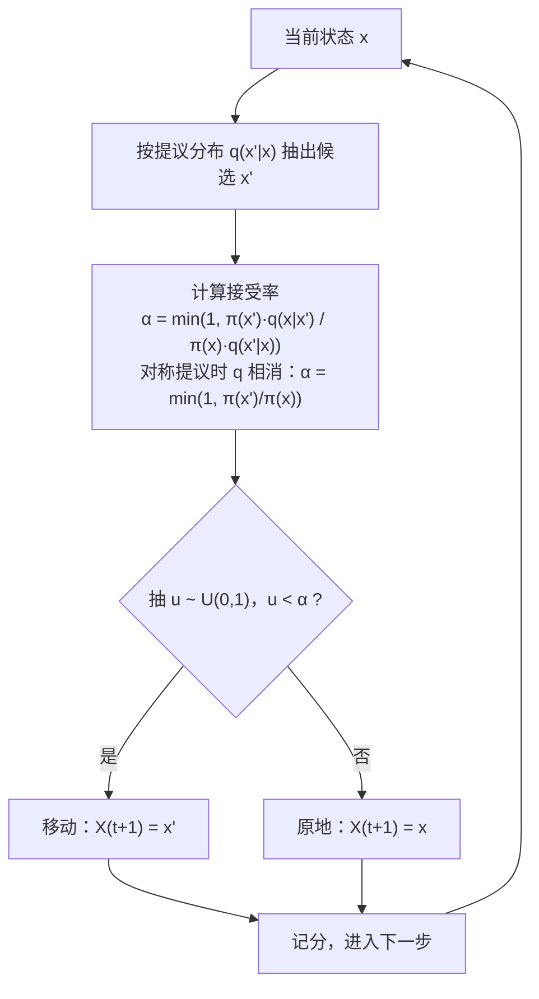

# 第 6 章 神奇的马尔科夫链蒙特卡罗方法

> **本章解决**：第 5 章的抽样武器有一类死角——**归一化常数算不出来**的分布：贝叶斯后验（证据 \(Z=\int\) 似然×先验 是高维积分）、统计物理的 Boltzmann 分布（配分函数）。MCMC 的思路拐了个弯：不直接抽，而是**造一条马尔可夫链，让它跑着跑着收敛到目标分布**。路线：马尔可夫链与平稳分布（6.1）→ 细致平衡设计原理（6.2）→ Metropolis（6.3）→ Metropolis-Hastings（6.4）→ Gibbs（6.5）→ 贝叶斯推断（6.6）→ Ising 模型与相变（6.7）。
> **承上启下**：6.7 的相变模拟是第 11 章复杂系统的预演；6.6 的后验采样是现代统计推断的通用引擎（Stan/PyMC 的内核）；本章样本带自相关，"有效样本量"修正了第 2 章误差公式——第 4 章记分时要记得。

| 关键词 | 事实 |
| --- | --- |
| 马尔可夫性 | 未来只依赖现在：\(P(X_{t+1}\mid X_t,\dots,X_0)=P(X_{t+1}\mid X_t)\) |
| 平稳分布 | \(\pi P=\pi\)；不可约+非周期 ⇒ 链收敛到它 |
| 细致平衡 | \(\pi(x)P(x\to x')=\pi(x')P(x'\to x)\) ⇒ 平稳（MCMC 的设计原理） |
| Metropolis-Hastings | 提议 + 接受率 \(\min(1,\cdot)\)，只需 \(\tilde\pi\) 的**比值** |
| Gibbs | 按满条件分布轮抽；MH 的接受率恒 1 特例 |

本章代码：[nb/ch06.ipynb](nb/ch06.ipynb)（NumPy 实跑，种子 2029）。

## 6.1 马尔可夫链与平稳分布

**马尔可夫链**：一串随机变量 \(X_0,X_1,X_2,\dots\)，满足**无记忆性**——给定现在，未来与过去独立。离散状态时它由**转移矩阵** \(P\) 完全刻画，\(P_{ij}=P(X_{t+1}=j\mid X_t=i)\)（每行和为 1）。两步转移概率按全概率公式叠加：

\[
P^{(2)}_{ij}=\sum_k P_{ik}P_{kj},
\]

这正是矩阵乘法——\(n\) 步转移概率就是 \(P^n\) 的元素（Chapman–Kolmogorov 方程）。

**平稳分布**：行向量 \(\pi\) 满足 \(\pi P=\pi\)——"到达每个状态的概率流恰好平衡"。什么时候任意初始分布 \(w_0\) 都收敛到 \(\pi\)？两个条件：**不可约**（任何状态可达任何状态）与**非周期**（回来的时刻不都差某个数的倍数）。演示：天气链（晴↔雨）：

```python
P = np.array([[0.8, 0.2],
              [0.4, 0.6]])
# 平稳分布 π = [2/3, 1/3]；特征值 {1, 0.4}
# ‖w0 P^n − π‖ 沿 0.4^n 直线衰减
```

<figure>
  
  <figcaption>代码实跑：从"晴天"出发，\(\|w_0P^n-\pi\|_\infty\) 在对数坐标下是斜率 \(\log_{10}0.4\) 的直线——收敛速率由**次特征值**决定。</figcaption>
</figure>

!!! note "拓展：Perron–Frobenius 定理"
    不可约非周期的转移矩阵是正矩阵的特例，Perron–Frobenius 定理（证明见 Shonkwiler 附录 B）保证：最大特征值 1 单重、对应特征向量可取正（即 \(\pi\)），其余特征值模长严格小于 1。把 \(w_0\) 按特征基展开，\(w_0P^n=\pi+\sum_k c_k\lambda_k^n v_k\to\pi\)，衰减由 \(\max|\lambda_k|<1\)（谱隙）控制——上图的直线就是 \(\lambda_2=0.4\)。

MCMC 还需要最后一块砖——**遍历定理**：对不可约非周期的链，

\[
\frac1N\sum_{t=1}^N f(X_t)\ \xrightarrow{a.s.}\ \mathbb E_\pi[f] .
\]

时间平均 = 空间平均，是大数定律的马尔可夫版（i.i.d. 换成了"相关性随时间衰减"的样本；证明思路仍是 Chebyshev 配合协方差衰减）。**这就是 MCMC 记分的合法性证书**：链跑出来的样本均值，收敛的是 \(\pi\) 下的期望。

## 6.2 细致平衡：MCMC 的设计原理

现在倒过来用平稳分布：目标分布 \(\pi\) 已知到常数（\(\tilde\pi=c\,\pi\)，\(c\) 算不出），要**设计**一条以 \(\pi\) 为平稳分布的链。

**细致平衡**（detailed balance）：转移核 \(P\) 满足逐点守恒

\[
\pi(x)\,P(x\to x')=\pi(x')\,P(x'\to x)\qquad\forall\, x,x'.
\]

**推导：细致平衡 \(\Rightarrow\) \(\pi\) 平稳**。对 \(x'\) 所在列求和（这是 \((\pi P)(x')\) 的定义）：

\[
(\pi P)(x')=\sum_x \pi(x)P(x\to x')
\overset{\text{d.b.}}{=}\sum_x \pi(x')P(x'\to x)=\pi(x')\sum_x P(x'\to x)=\pi(x') .
\]

（末步用转移核的归一性。）直觉：任意一对状态之间的概率流左右相等，总体自然处处守恒。于是 MCMC 的设计问题降级为：**发明一个满足细致平衡的转移规则**。Metropolis 给出的答案是两段式——随机提议，按门槛接受。

## 6.3 Metropolis 算法

**算法**（提议对称：\(q(x'\mid x)=q(x\mid x')\)，如随机游走 \(x'=x+\sigma\varepsilon\)）：

1. 从当前 \(x\) 按提议分布抽 \(x'\)；
2. 以概率

\[
\alpha(x\to x')=\min\!\Big(1,\ \frac{\tilde\pi(x')}{\tilde\pi(x)}\Big)
\]

接受（移到 \(x'\)），否则拒绝（**原地不动**，也算一步）。

单步流程如下（6.4 的 Hastings 校正只改 \(\alpha\) 的算式，流程骨架不变）：



**推导（为什么细致平衡）**。实际转移概率 \(P(x\to x')=q(x'\mid x)\,\alpha(x\to x')\)。考察乘积：

\[
\tilde\pi(x)\,q(x')\min\!\Big(1,\frac{\tilde\pi(x')}{\tilde\pi(x)}\Big)
=\min\!\big(\tilde\pi(x)q(x'),\ \tilde\pi(x')q(x)\big),
\]

交换 \(x\leftrightarrow x'\) 表达式不变——正是细致平衡。注意两件事：接受率只含 \(\tilde\pi\) 的**比值**，常数 \(c\) 相消——"归一化常数算不出"的死角就这么绕过去了；拒绝时原地重复采样，看似浪费，实则是细致平衡的一部分（把去程的概率流补回来）。

**实验（双势阱）**：目标 \(\pi(x)\propto e^{-(x^2-4)^2/2}\)，峰在 \(\pm 2\)、谷底深 \(e^{-8}\)。两个步长各跑 4 万步：

| 提议步长 | 右峰占比 | 每千步过零 |
| --- | --- | --- |
| \(\sigma=0.5\) | 0.510 | **0.2**（粘在单峰里） |
| \(\sigma=3.0\) | 0.512 | **49.1**（自由跨越） |

<figure>
  
  <figcaption>代码实跑：两步长的边缘分布都对（左列直方图贴合目标），但混合速度天差地别——\(\sigma=0.5\) 的轨迹 2000 步没出过左峰（上左），\(\sigma=3.0\) 频繁往返（下左）。</figcaption>
</figure>

!!! note "拓展：实用诊断"
    实战四件套：**burn-in**（丢掉前段未收敛样本，上面贝叶斯实验丢了 1000 个）；**trace plot**（肉眼查粘滞）；**接受率**（一维随机游走提议的经验最优约 0.44，高维更低——太低=原地踏步，太高=步子太碎）；**自相关与有效样本量**（链样本相关，\(N_{\text{eff}}\approx N/(1+2\sum\rho_k)\)，第 2 章的 \(\sigma/\sqrt N\) 要换成 \(\sigma/\sqrt{N_{\text{eff}}}\)）。

## 6.4 Metropolis–Hastings：非对称提议的校正

提议不对称（如独立性提议、向某方向偏置）时，细致平衡要求"来去概率"匹配，接受率改为

\[
\alpha(x\to x')=\min\!\Big(1,\ \frac{\tilde\pi(x')\,q(x\mid x')}{\tilde\pi(x)\,q(x'\mid x)}\Big).
\]

**推导**与 6.3 同构：

\[
\tilde\pi(x)\,q(x')\,\alpha(x\to x')=\min\big(\tilde\pi(x)q(x'),\ \tilde\pi(x')q(x)\big)
\]

对交换 \(x\leftrightarrow x'\) 对称成立。校正是"提议偏向的补偿"：往提议不爱去的地方走，额外奖励；顺着提议偏爱走，额外收税。

**实验**：目标半正态（\(x>0\)），独立性提议 \(x'\sim Exp(1)\)（密度 \(q=e^{-x'}\)）。三组对比：

- 正确 MH：均值 **0.797**（理论 \(\sqrt{2/\pi}=0.798\)）✓
- 忘记校正（只比 \(\tilde\pi\)）：均值 **0.525**，分布系统性错位 ✗

<figure>
  
  <figcaption>代码实跑：忘记 \(q\) 校正的"伪 MH"不是合法的马尔可夫链目标采样——橙柱整体压向 0，尾部枯瘦；蓝色正确链贴合半正态。</figcaption>
</figure>

## 6.5 Gibbs 抽样

多维目标 \(\pi(\mathbf x)\) 难抽，但**每个满条件分布**（固定其余坐标）好抽时，轮着抽就行：

\[
X_1^{(t+1)}\sim\pi(x_1\mid x_2^{(t)},\dots,x_d^{(t)}),\quad
X_2^{(t+1)}\sim\pi(x_2\mid x_1^{(t+1)},x_3^{(t)},\dots),\ \dots
\]

**满条件正比于联合**（推导）：

\[
\pi(x_i\mid \mathbf x_{-i})=\frac{\pi(\mathbf x)}{\int \pi(\mathbf x)\,\mathrm dx_i}\ \propto\ \tilde\pi(\mathbf x),
\]

分母与 \(x_i\) 无关——采样时只用把 \(\tilde\pi\) 当 \(x_i\) 的函数"配方"即可。

**Gibbs 是 MH 的特例**：把"从条件分布抽 \(x_i'\)"看作提议 \(q(x_i'\mid x)=\pi(x_i'\mid\mathbf x_{-i})\)，MH 接受率

\[
\frac{\pi(x_i')\,\pi(x_i\mid \mathbf x_{-i})}{\pi(x_i)\,\pi(x_i'\mid \mathbf x_{-i})}=1
\]

——**永远接受**，提议即转移，细致平衡自动成立。

**例（二维正态，兑现 2.4.7 的预告）**：\(\rho=0.8\)、\(\sigma=1\)。对联合密度 \(f\propto \exp\big(-\frac{x_1^2-2\rho x_1x_2+x_2^2}{2(1-\rho^2)}\big)\) 按 \(x_1\) 配方：

\[
X_1\mid X_2=x_2 \sim N\big(\rho x_2,\ 1-\rho^2\big),
\]

（对称地 \(X_2\mid X_1\sim N(\rho x_1,1-\rho^2)\)。）Gibbs 5000 轮 vs 直接抽样：

<figure>
  
  <figcaption>代码实跑：Gibbs 样本相关 0.8018、直接抽样 0.7966，椭圆云一模一样——代价是 Gibbs 样本沿链强相关（右图样本独立）。</figcaption>
</figure>

## 6.6 贝叶斯推断：MCMC 的主场

2.2 节的贝叶斯公式在此全面升级。参数 \(\theta\)、数据 \(D\)：

\[
p(\theta\mid D)=\frac{p(D\mid\theta)\,p(\theta)}{p(D)},\qquad
p(D)=\int p(D\mid\theta)\,p(\theta)\,\mathrm d\theta .
\]

分母 \(p(D)\)（证据）是高维积分，参数一多就算不动；而 MCMC 只需要分子——**后验 ∝ 似然 × 先验**，恰好是"已知到常数"的标准猎物。

**共轭情形（解析可对照）**：先验 \(\theta\sim Beta(\alpha,\beta)\)（密度 \(\propto\theta^{\alpha-1}(1-\theta)^{\beta-1}\)），数据为 \(n\) 次抛掷 \(k\) 次正面（似然 \(\theta^k(1-\theta)^{n-k}\)）。相乘：

\[
p(\theta\mid D)\propto \theta^{\alpha+k-1}(1-\theta)^{\beta+n-k-1}
\ \Longrightarrow\
\theta\mid D\sim Beta(\alpha+k,\ \beta+n-k) .
\]

先验的"伪计数" \(\alpha-1,\beta-1\) 与数据计数简单相加——这就是**共轭**。

**实验**：先验 \(Beta(2,2)\)（均值 0.5），20 次抛掷 15 正。解析后验 \(Beta(17,7)\)；MCMC 只用未归一化分子 \(\theta^{16}(1-\theta)^6\) 跑随机游走 Metropolis（区间外直接拒绝）：后验均值 **0.7076** vs 解析 **0.7083**。

<figure>
  
  <figcaption>代码实跑：数据把信念从先验均值 0.5 拉到 0.71；MCMC 直方图与解析 Beta(17,7) 重合。20 个数据就把先验几乎"淹没"——样本量的话语权可见一斑。</figcaption>
</figure>

!!! note "拓展"
    共轭是奢侈品：logistic 回归、层次模型、物理 inverse problem 的后验都没有闭式。MCMC 的历史地位正在于此——它把贝叶斯推断从"会算积分的人的特权"变成所有人的通用工具（Gilks 等 1996 年的 MCMC 实用化浪潮，Dunn 第 6 章的决策论应用同源）。

## 6.7 Ising 模型：相变的模拟

MCMC 哲学的极致展示。\(L\times L\) 格点上自旋 \(s_i=\pm1\)，能量只算近邻

\[
E(\mathbf s)=-\sum_{\langle i,j\rangle}s_is_j ,
\qquad
P(\mathbf s)=\frac{e^{-E(\mathbf s)/T}}{Z},\quad Z=\sum_{\mathbf s}e^{-E(\mathbf s)/T}.
\]

\(Z\) 有 \(2^{L^2}\) 项，宇宙年龄也算不完——但 Metropolis 不需要它。**单点翻转提议**：翻 \(s_i\to -s_i\)，能量变化

\[
\Delta E = 2 s_i\sum_{j\sim i}s_j
\]

（推导：翻转只改 \(s_i\) 与四邻居的 \(4\) 项乘积，\((-s_i)s_j-s_is_j=-2s_is_j\) 求和取负。）接受规则：\(\Delta E\le0\) 直接接受，否则以 \(e^{-\Delta E/T}\) 接受——正是 Metropolis 的 \(\min(1,e^{-\Delta E/T})\)。

**实验**：\(14\times14\)、周期边界。低温（\(T=2.2\)）自旋统一、\(|m|=0.85\)；高温（\(T=3.5\)）黑白混杂、\(|m|=0.11\)；磁化强度 \(|m|\) 随 \(T\) 的曲线在**精确临界温度 \(T_c\approx2.269\)**（Onsager 解）附近陡降——二维 Ising 相变被一个 20 行的 Metropolis 复现：

<figure>
  
  <figcaption>代码实跑：左，T=2.2 有序相；中，T=3.5 无序相；右，\(|m|\)–T 曲线在 \(T_c\) 处陡降（小格点有限尺寸效应使转变略缓）。</figcaption>
</figure>

全程没有出现 \(Z\) 的影子：**配分函数从未被计算，统计物理照常运转**——只靠比值 \(e^{-\Delta E/T}\) 抽样。这就是 MCMC 的哲学：不与归一化常数正面硬刚。

## 6.8 小结

- **三件套**：链（马尔可夫性）、规则（细致平衡：Metropolis/MH/Gibbs）、记分（遍历定理：时间平均→空间平均）。
- **只需要比值**：\(\tilde\pi(x')/\tilde\pi(x)\) ——归一化常数、配分函数、证据统统被绕开。
- **样本不独立**：有效样本量 \(N_{\text{eff}}\) 取代 \(N\)，混合慢的链（双势阱 \(\sigma=0.5\)）千步才过零 0.2 次——诊断永远先于结论。
- 至此"求积视角"的兵器库齐备；下一章回到"模拟视角"的完整形态：把一个**带时间演化的随机系统**（排队服务系统）在计算机里逐事件推演。

!!! note "拓展"
    Metropolis 1953（与 Rosenbluth 夫妇、Teller 夫妇合著，五人签名）本是为统计物理而生；Hastings 1970 推广出非对称校正；Gibbs 得名于 Gibbs 分布，经 Geman 兄弟 1984 年图像处理论文流行。一条算法血脉，横跨物理、统计与计算——蒙特卡罗方法史的最佳注脚。
