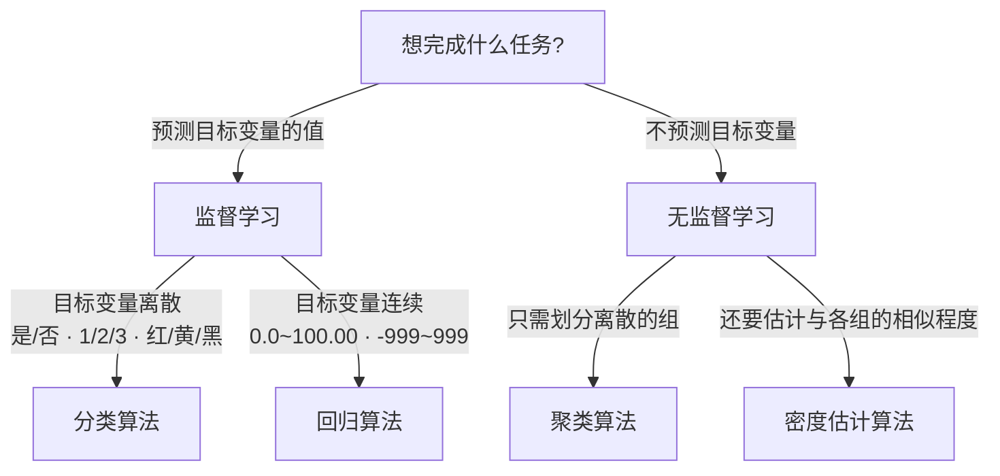

# 第 1 章 机器学习基础

> **本章解决**：机器学习是什么——把无序的数据转换成有用的信息；它的主要任务分几类（分类、回归、聚类、密度估计），关键术语（特征、训练集、目标变量）怎么定义；拿到问题如何选算法、开发应用要走哪六步；以及为什么用 Python 加 NumPy 来做这件事。
> **承上启下**：本章是全书地基——这里确立的术语体系和开发六步贯穿后面 14 章；第一部分的后续 6 章集中解决分类问题（监督学习的一个分支），下一章就进入第一个分类算法：k-近邻算法。

作者以餐桌上的一问一答开场：妻子问"什么是机器学习"，丈夫答"T-800 型终结者"。作者说这是偏差——机器学习既不是只会徒然模仿的机器人，也不是有人类感情的仿生人；**机器学习让我们从数据集中受到启发，利用计算机来彰显数据背后的真实含义**。

机器学习早已渗入日常。作者假想了一天的经历，每一段背后都有机器学习软件在工作：

| 场景 | 背后的机器学习 |
| --- | --- |
| 网上挑生日贺卡，搜索引擎给出 10 个最相关链接，点了第 2 个 | 搜索引擎记录这次点击，从中学习以优化下次搜索结果 |
| 查收邮件，垃圾广告已被自动放进垃圾箱 | 垃圾邮件过滤器在后台自动过滤 |
| 买贺卡和尿布时，收银员给了一张可买 6 罐装啤酒的 1 美元优惠券 | 收费软件基于以前的统计知识：买尿布的人往往也会买啤酒 |
| 邮寄贺卡，信件被送往正确的邮车 | 手写识别软件识别出邮寄地址 |
| 申请贷款，办事员把你的金融活动信息输入计算机 | 由软件判定你是否合格，而不是直接给出结果 |
| 走进赌场，保安拦下尾随的人："对不起，索普先生，我们不欢迎老千" | 赌场用机器学习软件识别老千（索普本人就是以战胜赌场闻名的数学家） |

<figure>
  
  <figcaption>图 1.1 机器学习在日常生活中的应用——从左上角顺时针依次为：人脸识别、手写数字识别、垃圾邮件过滤、亚马逊的产品推荐（截自原书）</figcaption>
</figure>

如今很多公司用机器学习软件改善商业决策、提高生产率、检测疾病、预测天气。随着技术指数级增长，我们既需要更好的工具解析当前的数据，也要为将来可能产生的数据做好准备。

## 1.0 本章导图

<div class="brtree">
  <div class="brrow">
    <span class="brlabel root">机器学习基础</span>
    <span class="brace"></span>
    <div class="brkids">
      <div class="brrow">
        <span class="brlabel">何谓机器学习</span>
        <span class="brace"></span>
        <div class="brkids">
          <span class="brleaf">把无序的数据转换成有用的信息</span>
          <span class="brleaf">横跨计算机科学、工程技术、统计学</span>
          <span class="brleaf">需要统计学的理由：现实问题没有确定解</span>
        </div>
      </div>
      <div class="brrow">
        <span class="brlabel">数据洪流</span>
        <span class="brace"></span>
        <div class="brkids">
          <span class="brleaf">传感器产生海量非人为数据</span>
          <span class="brleaf">手机 = 廉价的移动传感器平台</span>
          <span class="brleaf">穿越数据雾霭，抽取有价值信息</span>
        </div>
      </div>
      <div class="brrow">
        <span class="brlabel">关键术语</span>
        <span class="brace"></span>
        <div class="brkids">
          <span class="brleaf">特征 / 实例 / 训练集</span>
          <span class="brleaf">目标变量：类别 vs 连续值</span>
          <span class="brleaf">训练数据与测试数据两套样本</span>
          <span class="brleaf">知识表示：规则集 / 概率分布 / 实例</span>
        </div>
      </div>
      <div class="brrow">
        <span class="brlabel">主要任务</span>
        <span class="brace"></span>
        <div class="brkids">
          <span class="brleaf">监督学习：分类、回归</span>
          <span class="brleaf">无监督学习：聚类、密度估计</span>
          <span class="brleaf">无监督还可降维以便可视化</span>
        </div>
      </div>
      <div class="brrow">
        <span class="brlabel">选算法与开发流程</span>
        <span class="brace"></span>
        <div class="brkids">
          <span class="brleaf">两问：目的 + 数据</span>
          <span class="brleaf">没有最好的算法，靠反复试错</span>
          <span class="brleaf">开发六步：收集→准备→分析→训练→测试→使用</span>
        </div>
      </div>
      <div class="brrow">
        <span class="brlabel">Python 与 NumPy</span>
        <span class="brace"></span>
        <div class="brkids">
          <span class="brleaf">可执行伪代码：语法清晰</span>
          <span class="brleaf">NumPy / SciPy 底层 C、Fortran</span>
          <span class="brleaf">matrix 与 array，.I 求逆</span>
          <span class="brleaf">缺点是性能：可调用 C 代码补足</span>
        </div>
      </div>
    </div>
  </div>
</div>

## 1.1 何谓机器学习

人们很难直接从原始数据本身获得所需信息。以垃圾邮件检测为例：侦测某个单词是否存在并没有太大作用；而当某几个特定单词同时出现，再辅以考察邮件长度及其他因素，人们就能更准确地判定该邮件是否为垃圾邮件。简单地说：

> **机器学习就是把无序的数据转换成有用的信息。**

机器学习横跨计算机科学、工程技术、统计学等多个学科，需要多学科的专业知识；同时它也可以作为实际工具应用于从政治到地质学的多个领域——可以说，机器学习对任何需要解释并操作数据的领域都有所裨益。

机器学习用到了统计学知识。但统计学在多数人看来不过是企业炫耀产品功能的诡计——Darrell Huff 写过一本《如何使用统计学说谎》（How to Lie With Statistics），颇具讽刺意味的是，它也是有史以来卖得最好的统计学书。那为什么还要用统计学？拿工程实践来说，我们常面对**解法确凿不变**的问题：编写自动售货机的控制软件，最好让它在任何时候都能正确运行，而不必让人们考虑塞进的钱或按下的按钮。但现实世界中并不是每个问题都有确定的解决方案——很多时候我们无法透彻理解问题，或者没有足够的计算资源为问题精确建立模型（比如无法给人类活动的动机建模）。为了解决这类问题，就需要统计学知识。

!!! note "拓展：《如何使用统计学说谎》"
    Darrell Huff 的这本小册子 1954 年出版，是统计学科普的经典：它专门演示平均值、图表、百分比等手法如何被用来"合法地"误导读者。原书在此引用，正是提醒读者：统计学本身是工具，用不好（或故意用坏）就会说谎。这本书的中文译名是《统计数据会说谎》。

书里给出一个反直觉的事实：**在社会科学领域，正确率达 60% 以上的分析就被认为是非常成功的**。能准确预测人类当下 60% 的行为就很棒了——为什么不是 100%？是不是做错了什么？作者的回答：像"能否实现个人的极乐？我们为何不能准确地预测人们所参与事件的结果？"就是典型的无法精确建模的问题——每个人都对幸福有迥异不同的理解，即使"人人能达到极乐"这一假定成立，如此复杂的幸福也很难建立正确的模型。除了人类行为，现实世界中还有很多无法建立精确数学模型的例子，解决它们需要统计学工具。

### 1.1.1 传感器和海量数据

过去互联网上以人为产生的数据为主，最近却涌现了更多**非人为数据**——传感器技术并不时髦，但如何把它们接入互联网是新挑战。有预测表明，在本书出版后不久，**20% 的互联网非视频流量都将由物理传感器产生**（Gartner 预测，2010 年 7 月检索）。

**地震预测**是个好例子。1989 年，洛马·普列埃塔（Loma Prieta）地震袭击北加利福尼亚州，63 人死亡、3757 人受伤、成千上万人无家可归；然而相同规模的地震 2010 年袭击海地，死亡人数却超过 23 万。洛马·普列埃塔地震后不久，一份研究报告宣称低频磁场检测可以预测地震，但后续研究显示最初的研究没有考虑诸多环境因素，存在明显缺陷。如果想重做这项研究、寻找预测地震的方法，该怎么入手？自己掏钱买磁力计、再买地安放，或者寻求政府帮助——即便如此也无法保证磁力计不受干扰，读数怎么获取也是问题。这些都不是理想方案，而**使用移动电话可以低成本地解决这个问题**。

现今市售的移动电话和智能手机均带有**三轴磁力计**，智能手机还有操作系统，可以运行我们编写的应用——十几行代码就能让手机按**每秒上百次**的频率读取磁力计数据；手机上已经装好通信系统，只要说服人们安装运行读取软件，就能以很小的代价记录海量磁力计数据。除磁力计外，智能手机还封装了偏航率陀螺仪、三轴加速计、温度传感器和 GPS 接收器等传感器，都可以用于测量研究。

!!! note "拓展：这个设想后来成真了"
    原书出版于 2012 年，"用数以百万计的手机传感器众包监测地震"在当时还是设想。2016 年，加州大学伯克利分校上线的 MyShake 项目正是这样做的：用手机内置的加速计识别地震波形，靠大量用户众包实现地震预警。原书对"移动设备 = 传感器网络"的判断相当有远见。

移动计算和传感器产生的海量数据，意味着未来我们将面对越来越多的数据，**如何从海量数据中抽取有价值的信息是一个非常重要的课题**。

### 1.1.2 机器学习非常重要

过去半个世纪，发达国家的多数工作岗位已从体力劳动转化为脑力劳动。过去的工作有明确定义——把物品从 A 处搬到 B 处、在这里打个洞——现在这类工作正逐步消失。现今的任务具有很大的二义性："最大化利润""最小化风险""找到最好的市场策略"……互联网上的海量数据并没有简化知识工人的工作难度，**针对具体任务搞懂所有相关数据的意义所在，正成为基本的技能要求**。谷歌首席经济学家 Hal Varian 是这么说的：

> "我不断地告诉大家，未来十年最热门的职业是统计学家。很多人认为我是开玩笑，谁又能想到计算机工程师会是 20 世纪 90 年代最诱人的职业呢？如何解释数据、处理数据、从中抽取价值、展示和交流数据结果，在未来十年将是最重要的职业技能，甚至是大学，中学，小学的学生也必需具备的技能，因为我们每时每刻都在接触大量的免费信息，如何理解数据、从中抽取有价值的信息才是其中的关键。这里统计学家只是其中的一个关键环节，我们还需要合理的展示数据、交流和利用数据。我确实认为，能够从数据分析中领悟到有价值信息是非常重要的。职业经理人尤其需要能够合理使用和理解自己部门产生的数据。"
> ——McKinsey Quarterly，2009 年 1 月

大量的经济活动都依赖于信息。我们不能在海量数据中迷失——**机器学习将帮助我们穿越数据雾霭，从中抽取出有用的信息**。开始学习之前，先掌握一些基本术语。

## 1.2 关键术语

作者用一个**鸟类分类系统**来引出术语：开发出能识别鸟类的计算机软件，鸟类学者就可以退休了——鸟类学者是研究鸟类的专家，所以我们创建的是一个**专家系统**（Expert System）。

用于区分鸟类的是四个属性值：体重、翼展、有无脚蹼、后背颜色。现实中通常的做法是测量所有可测属性，再挑选出重要部分。这四种测量值称为**特征**（Feature），也可以称作属性（Attribute），但本书一律称为特征；表中每一行都是一个具有相关特征的**实例**（Instance）。

**表 1-1 基于四种特征的鸟物种分类表**

| 序号 | 体重（克） | 翼展（厘米） | 脚蹼 | 后背颜色 | 种属 |
| --- | --- | --- | --- | --- | --- |
| 1 | 1000.1 | 125.0 | 无 | 棕色 | 红尾鵟 |
| 2 | 3000.7 | 200.0 | 无 | 灰色 | 鹭鹰 |
| 3 | 3300.0 | 220.3 | 无 | 灰色 | 鹭鹰 |
| 4 | 4100.0 | 136.0 | 有 | 黑色 | 普通潜鸟 |
| 5 | 3.0 | 11.0 | 无 | 绿色 | 瑰丽蜂鸟 |
| 6 | 570.0 | 75.0 | 无 | 黑色 | 象牙喙啄木鸟 |

四种特征的类型各不相同：

| 特征 | 类型 | 取值 |
| --- | --- | --- |
| 体重 | 数值型 | 十进制数字 |
| 翼展 | 数值型 | 十进制数字 |
| 有无脚蹼 | 二值型 | 只可取 0 或 1 |
| 后背颜色 | 枚举型（自定义调色板） | 常用色彩；若只用常见七色，也可以是整数 |

（作为专家系统的演示用例，从七色里选一个当后背颜色是简单了点，但足够了。顺带一提原书的玩笑：如果你看到了一只象牙喙啄木鸟，请马上通知我！而且千万不要告诉任何人——任何发现活的象牙喙啄木鸟的人都可以得到 5 万美元的奖励。）

<figure>
  
  <figcaption>图 1.2 特征和标识的目标变量——前四列是特征，最右列（Species，种属）是目标变量（截自原书）</figcaption>
</figure>

**机器学习的主要任务就是分类**：从众多其他鸟类中分辨出象牙喙啄木鸟，从而领取那 5 万美元。最笨的办法是安装一个喂食器、雇一位鸟类学者观察在附近进食的鸟，发现目标就通知我们——太贵，而且专家同一时间只能出现在一个地方。自动化方案：安装多个带照相机的喂食器并接入计算机，标识前来进食的鸟；在喂食器中放置称重仪器获取鸟的体重；利用计算机视觉技术提取鸟的翅长、脚的类型和后背色彩。假定所需的全部特征信息都能拿到，判断飞入喂食器的鸟是不是象牙喙啄木鸟——这就是分类，有很多机器学习算法非常善于分类。本例中的**类别**就是鸟的物种，更具体地说，就是区分"是否为象牙喙啄木鸟"。

决定使用某个机器学习算法进行分类后，首先要做的是**算法训练**（Training），即学习如何分类。通常为算法输入大量已分类数据作为**训练集**（Training Set）——训练集是用于训练机器学习算法的数据样本集合。表 1-1 就是包含六个训练样本的训练集，每个训练样本有 4 种特征、一个目标变量（见图 1.2）。

- **目标变量**（Target Variable）：机器学习算法的预测结果。在**分类**算法中目标变量的类型通常是**标称型**的；在**回归**算法中通常是**连续型**的。训练样本集必须确定知道目标变量的值，机器学习算法才能发现特征和目标变量之间的关系。本例的目标变量是物种，也可以简化为标称型的数值。分类问题中的目标变量通常称为**类别**（Class），并假定分类问题只存在有限个数的类别。

!!! note "注意：特征是列"
    特征或者属性通常是训练样本集的**列**，它们是独立测量得到的结果；多个特征联系在一起，共同组成一个训练样本（行）。

!!! note "拓展：目标变量也叫「标签」"
    在通行的机器学习教材里，目标变量更常被叫作**标签**（Label），"带标签的数据"指的就是每个样本都已知目标变量的数据。看到"标签数据 / 无标签数据"这对说法时，对应本书的"目标变量已知 / 未知"即可。

为了测试机器学习算法的效果，通常使用**两套独立的样本集**：**训练数据**（Training Data）和**测试数据**（Test Data）。程序开始运行时，用训练样本集作为算法的输入；训练完成后输入测试样本——输入测试样本时**并不提供测试样本的目标变量**，由程序决定样本属于哪个类别。比较测试样本预测的目标变量值与实际样本类别之间的差别，就能得出算法的实际精确度。（本书后续章节会引入更好地使用测试样本和训练样本信息的方法。）

!!! note "拓展：训练 / 测试之外还有验证集"
    更严格的评估会把数据分成三份：训练集、**验证集**（Validation Set）、测试集——验证集用于调超参数，测试集只在最后出场，避免"用测试集调参"造成信息泄露。数据不充裕时常用 **k 折交叉验证**（k-fold Cross Validation）轮流充当验证集。原书说的"后续章节引入更好地使用测试样本和训练样本信息的方法"，指的就是这类技巧。

假定鸟类分类程序经过测试满足精确度要求，是否就可以说机器已经学会了如何区分不同的鸟类？这部分工作称为**知识表示**（Knowledge Representation）：某些算法可以产生很容易理解的知识表示，某些算法的知识表示也许只能为计算机所理解。知识表示可以采用**规则集**的形式，也可以采用**概率分布**的形式，甚至可以是**训练样本集中的一个实例**。在某些场合，人们并不想建立专家系统，而仅仅对机器学习算法获取的信息感兴趣——此时采用何种方式表示知识就非常重要了。

用 Python 的列表（list）把表 1-1 表达出来，就是 1.5 节"准备输入数据"要的标准格式（拓展演示，原书本节无代码）：

```python
# ===== 书 1.2 节：表 1-1 的 Python 表达（拓展演示）=====
# 每行 = 一个训练样本：[体重(克), 翼展(厘米), 有无脚蹼(0无/1有), 后背颜色, 种属]
birds = [
    [1000.1, 125.0, 0, '棕色', '红尾鵟'],
    [3000.7, 200.0, 0, '灰色', '鹭鹰'],
    [3300.0, 220.3, 0, '灰色', '鹭鹰'],
    [4100.0, 136.0, 1, '黑色', '普通潜鸟'],
    [3.0,    11.0,  0, '绿色', '瑰丽蜂鸟'],
    [570.0,  75.0,  0, '黑色', '象牙喙啄木鸟'],
]
# 机器学习算法通常把它拆成两部分：特征 + 目标变量
features = [row[:4] for row in birds]   # 前 4 列是特征（列）
targets  = [row[4]  for row in birds]   # 最后一列是目标变量（类别）
```

## 1.3 机器学习的主要任务

上节的例子是**分类**：主要任务是将实例数据划分到合适的分类中。机器学习的另一项任务是**回归**（Regression），主要用于预测数值型数据——多数人都见过回归的例子：数据拟合曲线，即找出通过给定数据点的最优拟合曲线。

分类和回归属于**监督学习**（Supervised Learning），之所以叫"监督"，是因为这类算法**必须知道预测什么，即目标变量的分类信息**。与之对应的是**无监督学习**（Unsupervised Learning）：此时数据没有类别信息，也不会给定目标值。在无监督学习中：

- 将数据集合分成由类似的对象组成的多个类的过程，称为**聚类**（Clustering）；
- 寻找描述数据统计值的过程，称为**密度估计**（Density Estimation）；
- 此外，无监督学习还可以减少数据特征的维度，以便用二维或三维图形更加直观地展示数据信息。

**表 1-2 用于执行分类、回归、聚类和密度估计的机器学习算法**

监督学习的用途：

| 分类 | 回归 |
| --- | --- |
| k-近邻算法 | 线性回归 |
| 朴素贝叶斯算法 | 局部加权线性回归 |
| 支持向量机 | Ridge 回归 |
| 决策树 | Lasso 最小回归系数估计 |

无监督学习的用途：

| 聚类 | 密度估计 |
| --- | --- |
| K-均值 | 最大期望算法 |
| DBSCAN | Parzen 窗设计 |

!!! note "拓展：Ridge 回归与 Lasso 是什么"
    两者都是给线性回归加"惩罚项"的**正则化**方法：Ridge 回归（岭回归）在损失函数中加入系数的平方和（L2 惩罚），Lasso 加入系数绝对值之和（L1 惩罚），后者还能把不重要的系数压成 0，顺带筛选特征。第 8 章回归会实际用到 Ridge。

!!! note "拓展：监督与无监督之间还有半监督"
    现实中常见"少量数据有标签、大量数据没标签"的情形，对应的学习方式叫**半监督学习**（Semi-supervised Learning）。原书只讲两大类，知道有这条中间路线即可。

你可能已经注意到表 1-2 中很多算法都可以用于解决同样的问题，有心人肯定会问："为什么解决同一个问题存在四种方法？精通其中一种算法，是否可以处理所有类似问题？"——下一节回答这些疑问。

空口说分类太抽象，这里把第 2 章的 k-近邻函数提前借来，在 4 个样本的小数据集上把"分类"跑通（原书本章无代码；函数与书 2.1 节完全一致，已改写为 Python 3）：

```python
# ===== 提前尝鲜：书 2.1 节的 kNN（createDataSet + classify0，Python 3 版）=====
import numpy as np
import operator

def createDataSet():
    group = np.array([[1.0, 1.1],      # 4 个训练样本，每行一个实例、2 个特征
                      [1.0, 1.0],
                      [0,   0  ],
                      [0,   0.1]])
    labels = ['A', 'A', 'B', 'B']      # 每个样本的目标变量（类别）
    return group, labels

def classify0(inX, dataSet, labels, k):
    # inX：待分类的新样本；dataSet：训练样本集；labels：类别；k：参与投票的近邻数
    dataSetSize = dataSet.shape[0]                       # 训练样本个数
    diffMat = np.tile(inX, (dataSetSize, 1)) - dataSet   # 新样本与每个样本逐特征相减
    sqDiffMat = diffMat ** 2                             # 差值逐个平方
    sqDistances = sqDiffMat.sum(axis=1)                  # 每行求和 → 平方距离
    distances = sqDistances ** 0.5                       # 开方 → 欧氏距离
    sortedDistIndicies = distances.argsort()             # 按距离从小到大排序的索引
    classCount = {}
    for i in range(k):                                   # 取最近 k 个邻居依次投票
        voteIlabel = labels[sortedDistIndicies[i]]
        classCount[voteIlabel] = classCount.get(voteIlabel, 0) + 1
    sortedClassCount = sorted(classCount.items(),
                              key=operator.itemgetter(1), reverse=True)
    return sortedClassCount[0][0]                        # 票数最高的类别

group, labels = createDataSet()
print(classify0([0, 0], group, labels, 3))   # B
print(classify0([1, 1], group, labels, 3))   # A
```

其中"距离"用的是欧氏距离——两点在各特征上的差值平方求和再开方（以两个特征为例）：

\[
d(A, B) = \sqrt{(A_0 - B_0)^2 + (A_1 - B_1)^2}
\]

实跑结果：`(0, 0)` 被判为 `B`，`(1, 1)` 被判为 `A`——新点离哪一类更近，就随哪一类的多数投票。`np.tile(inX, (dataSetSize, 1))` 负责把新样本复制成与训练集同形，才能整列一次完成相减（tile 详见 1.7 节的演示）。

<figure>
  
  <figcaption>图 1.3 kNN 迷你演示：4 个训练样本（A 蓝 / B 红），绿色五角星是两个待分类新点；虚线圆圈住各自参与投票的 3 个最近邻，k=3 投票结果分别为 B 与 A（代码实跑）</figcaption>
</figure>

## 1.4 如何选择合适的算法

从表 1-2 所列的算法中选择实际可用的算法，必须考虑下面两个问题：

1. **使用机器学习算法的目的**：想要算法完成何种任务？比如是预测明天下雨的概率，还是对投票者按照兴趣分组；
2. **需要分析或收集的数据是什么**。

首先考虑目的。如果想**预测目标变量的值**，则选择监督学习算法，否则选择无监督学习算法。确定选择监督学习算法之后，需要进一步确定目标变量类型：

- 目标变量是**离散型**（如是/否、1/2/3、A/B/C 或者红/黄/黑等）→ 选择**分类**算法；
- 目标变量是**连续型**数值（如 0.0～100.00、−999～999 或者 +∞～−∞ 等）→ 选择**回归**算法。

如果**不想预测目标变量的值**，则选择无监督学习算法，再进一步分析：是否需要将数据划分为离散的组。如果这是唯一的需求，使用**聚类**算法；如果还需要估计数据与每个分组的相似程度，则需要**密度估计**算法。



不过这条选择路径并非一成不变——第 9 章我们就会使用分类算法来处理回归问题，显然这将与上面监督学习中处理回归问题的原则不同。

其次考虑数据问题。**对实际数据了解得越充分，越容易创建符合实际需求的应用程序**。主要应该了解数据的以下特性：

- 特征值是离散型变量还是连续型变量；
- 特征值中是否存在缺失的值，何种原因造成缺失值；
- 数据中是否存在异常值；
- 某个特征发生的频率如何（是否罕见得如同海底捞针）。

充分了解这些特性可以缩短选择机器学习算法的时间。但要注意：我们**只能在一定程度上缩小算法的选择范围，一般并不存在最好的算法**或者可以给出最好结果的算法——同时还要尝试不同算法的执行效果。对于所选的每种算法，都可以使用其他的机器学习技术来改进其性能；处理输入数据之后，两个算法的相对性能也可能会发生变化。一般说来，发现最好算法的关键环节是**反复试错的迭代过程**。

机器学习算法虽然各不相同，但是使用算法创建应用程序的步骤却基本类似——见下节。

## 1.5 开发机器学习应用程序的步骤

| 步骤 | 做什么 | 要点 |
| --- | --- | --- |
| (1) 收集数据 | 制作网络爬虫从网站上抽取数据、从 RSS 反馈或 API 中获取信息、接收设备发来的实测数据（风速、血糖等） | 提取数据的方法非常多；为节省时间与精力，可以使用公开可用的数据源 |
| (2) 准备输入数据 | 确保数据格式符合要求——本书采用 Python 的列表（list），用标准数据格式融合算法和数据源、方便匹配；此外还要按算法的特殊要求调整（一些算法要求目标变量和特征值是字符串类型，另一些可能要求是整数类型） | 与收集数据的格式相比，处理特殊算法要求的格式相对简单得多；不熟悉 Python 可参阅附录 A |
| (3) 分析输入数据 | 人工分析数据：用文本编辑器打开数据文件查看是否为空值；进一步浏览数据，识别模式；找异常值（与数据集中其他值明显差异的数据点）；用一维、二维或三维图形展示数据 | 主要作用是确保数据集中没有垃圾数据；多数时候特征值不会低于 3 个，无法一次图形化展示所有特征，后续章节会介绍把多维数据压缩到二维或三维的方法（如第 13 章 PCA）；产品化系统中算法能处理系统产生的数据格式、或你信任数据来源时可直接跳过——自动化系统还需要人工干预，显然降低了系统价值 |
| (4) 训练算法 | 将前两步得到的格式化数据输入算法，从中抽取知识或信息，并存储为计算机可以处理的格式，方便后续步骤使用 | 机器学习算法从这一步才真正开始学习；第 4 步和第 5 步是算法的核心；**无监督学习由于不存在目标变量值，不需要训练算法**，所有与算法相关的内容都集中在第 5 步 |
| (5) 测试算法 | 实际使用第 4 步得到的知识信息，评估算法工作的效果 | 监督学习必须已知用于评估算法的目标变量值；无监督学习也必须用其他评测手段检验算法的成功率；不满意算法的输出→回到第 4 步改正并再测试；问题常常出在数据的收集和准备上，此时必须跳回第 1 步重新开始 |
| (6) 使用算法 | 将机器学习算法转换为应用程序，执行实际任务，检验上述步骤是否可以在实际环境中正常工作 | 碰到新的数据问题，同样需要重复执行上述步骤 |

## 1.6 Python语言的优势

选择 Python 作为实现机器学习算法的编程语言，基于三个原因：(1) 语法清晰；(2) 易于操作纯文本文件；(3) 使用广泛，存在大量的开发文档。

### 1.6.1 可执行伪代码

Python 语法结构清晰，大家把它称作**可执行伪代码**（executable pseudo-code）。默认安装的 Python 开发环境已附带很多高级数据类型——列表、元组、字典、集合、队列——无需进一步编程就可以使用这些数据类型的操作，使得实现抽象的数学概念非常简单。此外，你还可以按自己熟悉的编程风格写：面向对象编程、面向过程编程，或者函数式编程。

Python 处理和操作文本文件非常简单，非常易于处理非数值型数据；Python 提供了丰富的正则表达式函数以及很多访问 Web 页面的函数库，使得从 HTML 中提取数据变得非常简单直观。

### 1.6.2 Python比较流行

Python 使用广泛、代码范例多，便于快速学习和掌握；开发实际应用程序时，也可以利用丰富的模块库缩短开发周期。在科学和金融领域，Python 都得到了广泛应用：

- **SciPy 和 NumPy** 等科学函数库实现了向量和矩阵操作，增加了代码的可读性——学过线性代数的人都可以看懂代码的实际功能；它们使用底层语言（**C 和 Fortran**）编写，提高了应用程序的计算性能。本书将大量使用 NumPy。
- **Matplotlib** 可以绘制 2D、3D 图形，也能处理科学研究中经常用到的图形，与 Python 的科学工具协同工作。本书也将大量使用。
- Python 开发环境还提供**交互式 shell 环境**，允许用户开发程序时查看和检测程序内容。

!!! warning "原书过时：Pylab 的预言没有实现"
    原书本节结尾写道："Python 开发环境将来还会集成 Pylab 模块，它将 NumPy、SciPy 和 Matplotlib 合并为一个开发环境……不远的将来我们肯定可以在 Python 开发环境找到它。"后来的实际答案是：科学计算环境统一到了 **Anaconda 发行版**与 **Jupyter Notebook**；matplotlib 官方则早已**弃用** pylab 接口（它把 NumPy 的名字全部塞进命名空间，容易引起混乱），推荐使用 `pyplot`。这句话当历史注脚读即可。

### 1.6.3 Python语言的特色

MATLAB、Mathematica 等高级程序语言也允许用户执行矩阵操作，MATLAB 甚至还有许多内嵌特征可以轻松构造机器学习应用，运算速度也很快。然而 MATLAB 的不足是**软件费用太高——单个软件授权就要数千美元**；虽有适合它的第三方插件，但没有一个有影响力的大型开源项目。Java 和 C 等强类型语言也有矩阵数学库，但对它们来说，最大的问题是**即使完成简单的操作也要编写大量代码**：程序员首先要定义变量的类型；Java 每次封装属性还要实现 getter 和 setter 方法；即使并不想使用子类，也必须实现子类方法——大量时间花在了冗长代码上。Python 则与 Java 和 C 完全不同，它清晰简练、易于理解，**即使不是编程人员也能够理解程序的含义**，而 Java 和 C 对非编程人员则像天书一样难懂。

> "所有人在小学二年级已经学会了写作，然而大多数人必须从事其他更重要的工作。"
> ——鲍比·奈特

也许某一天，这句话中的"写作"可以替换成"编写代码"——虽然有些人对编写代码很感兴趣，但对大多数人来说，编程仅是完成其他任务的工具。Python 是高级编程语言：**我们可以花费更多的时间处理数据的内在含义，而无须花费太多精力解决计算机如何得到数据结果**，Python 让我们很容易表达自己的目的。

### 1.6.4 Python语言的缺点

Python 唯一的不足是**性能问题**：Python 程序运行的效率不如 Java 或者 C 代码高。但我们可以**使用 Python 调用 C 编译的代码**，同时利用 C 和 Python 的优点，逐步地开发机器学习应用程序：先使用 Python 编写实验程序；如果进一步想在产品中实现机器学习，转换成 C 代码也不困难。只要程序按模块化原则组织，就可以先构造可运行的 Python 程序，然后逐步使用 C 代码替换核心代码以改进性能——**C++ Boost 库**适合完成这个任务，**Cython 和 PyPy** 等工具也可以编写强类型的 Python 代码，改进一般 Python 程序的性能。

更关键的一条判断：**如果程序的算法或者思想有缺陷，则无论程序的性能如何，都无法得到正确的结果**——解决问题的思想存在问题时，单纯提高运行效率、扩展用户规模都无法解决核心问题。从这个角度看，Python 快速实现系统的优势更加明显：先快速检验算法或思想是否正确，需要时再进一步优化代码。

## 1.7 NumPy函数库基础

机器学习算法涉及很多线性代数知识，因此本书用 Python 构造机器学习应用时会经常使用 **NumPy 函数库**。不熟悉线性代数也不用着急——这里用到线性代数只是为了**简化在不同数据点上执行的相同数学运算**：将数据表示为矩阵形式，只需要执行简单的矩阵运算，而不需要复杂的循环操作。

NumPy 函数库是 Python 开发环境的一个独立模块，而且**大多数 Python 发行版没有默认安装**，因此在安装 Python 之后必须单独安装 NumPy。

!!! warning "原书过时：Python 2.7 的启动方式"
    原书让你在 Windows 命令行提示符下输入 `c:\Python27\python.exe`（Linux 或 Mac OS 的终端上输入 `python`）进入 Python shell 开发环境。Python 2.7 已于 2020 年停止维护，图 1.4 的原书截图（Python 2.6.1，2010 年 2 月编译）也定格在那个年代。如今装好 Anaconda 后打开 Anaconda Prompt、直接输入 `python` 即可进入 Python 3 的 shell；今后看到 `>>>` 提示符，就意味着进入了 Python shell 交互环境。

<figure>
  
  <figcaption>图 1.4 命令行启动 Python 并在 shell 开发环境中导入模块——注意截图里是 Python 2.6.1（截自原书）</figcaption>
</figure>

在 Python shell 开发环境中输入 `from numpy import *`，将 NumPy 函数库中的**所有模块**引入当前的命名空间；然后输入 `random.rand(4,4)`，构造一个 4×4 的随机数组——因为产生的是随机数组，**不同计算机的输出结果可能与书上完全不同**。

原书整节都在 shell 里逐条敲命令，回显即输出；写成脚本文件时裸表达式不会显示，需要 `print()`（见下方拓展）。核心流程按 Python 3 + NumPy 2.x 改写如下：

```python
# ===== 书 1.7 节（Python 3 + NumPy 2.x 改写）=====
from numpy import *          # 原书写法：把 NumPy 所有模块引入当前命名空间
import numpy as np           # NumPy 2.x 下 mat 已被移除，需显式 import（见下方警告）

print(random.rand(4, 4))                  # 4×4 随机数组；每台机器的输出都不同

randMat = np.asmatrix(random.rand(4, 4))  # 原书写作 mat(...)；NumPy 2.0 起改用 asmatrix
invRandMat = randMat.I                    # .I 操作符实现矩阵求逆，结果存入 invRandMat
myEye = randMat * invRandMat              # 矩阵与其逆矩阵相乘
print(myEye)                              # 接近单位矩阵，但残留极小的误差元素
print(myEye - np.eye(4))                  # 与单位矩阵相减得到误差值；eye(4) 创建 4×4 单位矩阵
```

!!! warning "原书代码在 NumPy 2.x 会报错：mat() 已被移除"
    原书调用 `mat(random.rand(4,4))` 把数组转化为矩阵。NumPy 2.0 起官方**移除了 `np.mat`**，运行会报 `AttributeError: np.mat was removed in the NumPy 2.0 release. Use np.asmatrix instead`；而且 `from numpy import *` 也不再带出 `mat` 这个名字。本笔记统一改写为 `np.asmatrix(...)`——它返回的仍是 `numpy.matrix` 类型，`.I` 求逆操作符照常可用。

!!! note "拓展：脚本 vs 交互式 shell（REPL）"
    原书的命令都在 `>>>` 提示符下交互执行：敲一行、回车、结果自动回显。这种交互环境也叫 **REPL**（Read–Eval–Print Loop，读取-求值-打印循环），今天的 IPython 和 Jupyter 是它的加强版。把同样的代码写进 `.py` 文件整段运行时，`random.rand(4,4)` 这样的裸表达式不会显示任何东西，必须 `print()`。本笔记代码按脚本风格给出 print，效果与书中的 shell 回显一致。

<figure>
  
  <figcaption>图 1.5 书 1.7 节流程的实跑输出（Python 3 + NumPy 2.2）：randMat 乘以自己的逆矩阵得到 myEye，它与单位矩阵相减只剩 10⁻¹⁶ 量级的误差（代码实跑）</figcaption>
</figure>

实跑结果与书中描述一致：`myEye` 应该是单位矩阵——除了对角线元素是 1，4×4 矩阵的其他元素应该全是 0；但实际输出略有不同，矩阵里还留下了许多**非常小的元素**（如 `2.03e-16`），这是**计算机处理误差**产生的结果。输入 `myEye - np.eye(4)`，就能得到误差值。`.I` 非常简单吧？没有 NumPy 库，Python 也不能这么容易算出矩阵的逆运算；不记得或者没学过矩阵求逆也没关系，NumPy 库帮我们做完了。

**NumPy 矩阵与数组的区别**。NumPy 函数库中存在两种不同的数据类型：**矩阵（matrix）和数组（array）**，都可以用于处理行列表示的数字元素。虽然它们看起来很相似，但是**在这两个数据类型上执行相同的数学运算可能得到不同的结果**——其中 NumPy 的 matrix 与 MATLAB 中的 matrices 等价（`*` 是矩阵乘法），而 array 的 `*` 是逐元素相乘。调用 `mat()` 函数可以将数组转化为矩阵。

!!! note "拓展：np.matrix 为什么被弃用，以及数组怎么求逆"
    `matrix` 类型是为了照顾 MATLAB 用户的使用习惯而设，与 ndarray 生态割裂（很多函数拿到 matrix 会返回 ndarray，行为不一致），官方多年来一直**不推荐新代码使用**。现代写法是全程用 ndarray：求逆用 `np.linalg.inv(a)`，矩阵乘法用 `@` 运算符（`a @ np.linalg.inv(a)`）。读本书代码时记住对应关系即可：`mat(a)` → `np.asmatrix(a)`，`randMat.I` → `np.linalg.inv(a)`。

最后补充几个常用构造函数的直观演示，为第 2 章的 kNN 打底（拓展演示）：

```python
# ===== 书 1.7 节拓展：NumPy 常用构造函数（Python 3 版）=====
import numpy as np

print(np.zeros((2, 3)))            # 2 行 3 列的全 0 数组
print(np.eye(4))                   # 4×4 单位矩阵（书 1.7 节用它验证求逆结果）

a = np.array([[1, 2], [3, 4]])     # 2×2 数组当作一块"积木"
print(np.tile(a, (2, 3)))          # 铺成 2 行 × 3 列的积木阵
# 第 2 章 kNN 第一步就靠它：np.tile(inX, (dataSetSize, 1))
# 把新样本复制成与训练集同形，才能整列相减算距离
```

<figure>
  
  <figcaption>图 1.6 np.zeros / np.eye / np.tile 的实跑输出（上）与 tile 分块示意（下）：把 2×2 的 a 当作积木，按 (2, 3) 铺成 4 行 6 列（代码实跑）</figcaption>
</figure>

只要能够顺利地完成上述例子，就说明已经正确地安装了 NumPy 函数库，以后就可以利用它构造机器学习应用程序。即使没有提前学习所有的函数也没有关系——本书将在需要的时候介绍更多的 NumPy 函数库功能。

## 1.8 本章小结

尽管没有引起大多数人的注意，机器学习算法已经广泛应用于我们的日常生活之中。每天我们需要处理的数据在不断地增加，**能够深入理解数据背后的真实含义，是数据驱动产业必须具备的基本技能**。

学习机器学习算法，必须了解**数据实例**——每个数据实例由多个特征值组成。**分类**是基本的机器学习任务：它分析未分类数据，以确定如何将其放入已知群组中。为了构建和训练分类器，必须首先输入大量已知分类的数据，我们将这些数据称为**训练样本集**。

尽管我们构造的鸟类识别专家系统无法像人类专家一样精确地识别不同的鸟类，然而构建接近专家水平的机器系统可以显著地改进我们的生活质量：如果医生专家系统能够达到人类医生的准确率，病人可以得到快速的治疗；如果天气预报可以改进，则可以减少水资源的短缺、提高食物供给。这样的例子数不胜数——**机器学习的应用前景几乎是无限的**。

第一部分的后续 6 章主要研究**分类问题**，它是监督学习算法的一个分支。下一章我们将介绍第一个分类算法——**k-近邻算法**。

## 坑与陷阱

!!! danger "7 个容易踩的坑"
    1. **NumPy 2.x 里没有 mat()**：原书 `mat(random.rand(4,4))` 在 NumPy 2.0 以上直接 `AttributeError`。改用 `np.asmatrix(...)`；注意 `from numpy import *` 也带不出这个名字。
    2. **`.I` 是 matrix 专属**：ndarray 没有 `.I` 属性，`np.array(...).I` 会报 AttributeError。数组求逆用 `np.linalg.inv()`，矩阵乘法用 `@`。
    3. **shell 回显 ≠ 脚本输出**：原书代码在 `>>>` 下敲一行显一行；写进 `.py` 文件整段跑时，`random.rand(4,4)` 这样的裸表达式什么都不会显示，要 `print()`。
    4. **myEye 不是严格的单位矩阵**：残留 10⁻¹⁶ 量级的元素是浮点运算的正常误差，不是 bug——书里专门让你用 `myEye - np.eye(4)` 看误差值。
    5. **random.rand 每次每机都不同**：别拿随机数组的输出对答案；要复现实验，先 `np.random.seed(整数)` 固定随机种子。
    6. **测试样本不能带答案进场**：测试时只给特征、不给目标变量，程序预测后再与实际类别比对才是真实精确度；两套样本必须相互独立，不能拿训练样本自测。
    7. **无监督学习没有"训练算法"一步**：没有目标变量可学，开发六步中第 (4) 步为空，重心全在第 (5) 步的评测手段上。

## 速览

1. 机器学习 = **把无序的数据转换成有用的信息**；横跨计算机科学、工程技术、统计学；对任何需要解释并操作数据的领域都有裨益。
2. 需要统计学的理由：现实问题没有确定解（自动售货机有，人类行为没有）；社会科学中 60% 正确率已非常成功。
3. 数据洪流：传感器 + 移动计算产生海量非人为数据（手机就有三轴磁力计、陀螺仪、加速计、温度计、GPS）；从海量数据中抽取有价值信息是核心课题。
4. 术语链：**特征**（列，独立测量）→ **实例**（行）→ **训练集**；**目标变量** = 预测结果（分类取标称型"类别"，回归取连续型）；训练/测试两套独立样本集；**知识表示** = 规则集 / 概率分布 / 训练样本中的实例。
5. 任务二分：**监督学习**（分类 + 回归，必须知道目标变量）与**无监督学习**（聚类 + 密度估计 + 降维可视化）；代表算法见表 1-2。
6. 选算法两问：**目的**（预测目标变量→监督；离散→分类、连续→回归；不预测→无监督；分组→聚类、还要相似度→密度估计）与**数据**（离散/连续、缺失值、异常值、特征频率）。
7. 没有最好的算法，只有反复试错的迭代过程；处理输入数据之后，算法间的相对性能还会变化。
8. 开发六步：**收集数据 → 准备输入数据（Python 列表）→ 分析输入数据 → 训练算法 → 测试算法 → 使用算法**；无监督学习没有训练这一步。
9. Python 三优势：语法清晰（可执行伪代码）、易处理文本、流行 + 文档多；NumPy/SciPy 底层是 C/Fortran；缺点是性能，可用 Boost/Cython/PyPy 调 C 补足——思想错了，跑得再快也没用。
10. NumPy：matrix 与 array 是两种类型，相同运算结果可能不同；`asmatrix()` 转矩阵、`.I` 求逆、`eye(4)` 单位矩阵；`randMat * invRandMat` 只剩 10⁻¹⁶ 量级误差。

## 术语速查

| 英文 | 中文 | 一句话 |
| --- | --- | --- |
| machine learning | 机器学习 | 把无序的数据转换成有用的信息 |
| feature / attribute | 特征 / 属性 | 训练样本集的列，独立测量得到；本书一律称特征 |
| instance | 实例 | 训练样本集中的一行，由多个特征组成 |
| training set | 训练集 | 用于训练机器学习算法的数据样本集合 |
| target variable | 目标变量 | 算法的预测结果；分类中为标称型（类别），回归中为连续型 |
| class | 类别 | 分类问题中目标变量的称呼，假定只有有限个 |
| label | 标签 | 目标变量的通用叫法（拓展名） |
| classification | 分类 | 将实例数据划分到合适的分类中；监督学习任务 |
| regression | 回归 | 预测数值型数据，如数据拟合曲线 |
| supervised learning | 监督学习 | 必须知道预测什么（目标变量的分类信息）的算法族 |
| unsupervised learning | 无监督学习 | 数据没有类别信息、也不给定目标值的算法族 |
| clustering | 聚类 | 将数据集合分成由类似对象组成的多个类 |
| density estimation | 密度估计 | 寻找描述数据统计值的过程 |
| knowledge representation | 知识表示 | 算法学到的知识的形态：规则集 / 概率分布 / 训练样本中的实例 |
| expert system | 专家系统 | 模拟人类专家做判断的系统，如本书的鸟类分类器 |
| test data | 测试数据 | 与训练数据独立的样本集；测试时不提供目标变量 |
| k-Nearest Neighbor (kNN) | k-近邻算法 | 表 1-2 中第一个分类算法，第 2 章登场 |
| executable pseudo-code | 可执行伪代码 | Python 语法清晰的俗称 |
| NumPy | —— | Python 数值计算库，底层 C/Fortran；本书矩阵运算的主力 |
| matrix vs array | 矩阵与数组 | NumPy 两种数据类型，相同数学运算可能得到不同结果 |
| asmatrix()（原 mat()） | 数组转矩阵 | 原书 mat()；NumPy 2.0 起改用 np.asmatrix() |
| .I | 矩阵求逆 | matrix 对象的求逆操作符；ndarray 请用 np.linalg.inv() |
| eye(4) | 单位矩阵 | 创建 4×4 单位矩阵，用于验证"矩阵 × 逆 = 单位矩阵" |
| tile(a, (2,3)) | 平铺复制 | 把 a 当积木铺 2 行 × 3 列；kNN 用它把新样本复制成训练集同形 |
| Matplotlib | —— | Python 绘图库，2D/3D 都行，与 NumPy 协同工作 |
| Cython / PyPy / Boost | 性能加速工具 | 用 C（或强类型代码）替换核心代码，弥补 Python 性能短板 |
