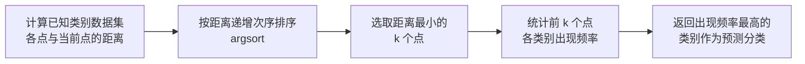

# 第 2 章 k-近邻算法

> **本章解决**：怎么用一个"看邻居投票"的极简算法做分类——原理、距离度量、用 Python 从零实现分类器，以及数据侧的两件关键预处理：从文本文件解析数据、数值归一化。
> 全章用两个实战把这套流程走通：改进约会网站的配对效果（三分类）和手写数字识别系统（0–9 十分类），并给出错误率验证。这一章是全书第一个分类算法，后面各章的分类框架（准备 → 分析 → 测试 → 使用）都从这里起笔。

本书第一部分介绍的第一个机器学习算法就是 k-近邻算法。章首预告了本章的四块内容：

- k-近邻分类算法；
- 从文本文件中解析和导入数据；
- 使用 Matplotlib 创建扩散图（散点图）；
- 归一化数值。

作者用电影分类作引子：电影可以按题材分类，但题材本身怎么定义？同一题材的电影有哪些公共特征？动作片里也有接吻镜头，爱情片里也有打斗场景，不能单靠"有没有打斗或亲吻"来判断——但**爱情片亲吻镜头更多，动作片打斗更频繁**，于是"此类场景出现的次数"就可以拿来给电影分类。

## 2.0 本章导图

<div class="brtree">
  <div class="brrow">
    <span class="brlabel root">k-近邻算法</span>
    <span class="brace"></span>
    <div class="brkids">
      <div class="brrow">
        <span class="brlabel">算法原理</span>
        <span class="brace"></span>
        <div class="brkids">
          <span class="brleaf">有标签训练集 + 逐特征比距离</span>
          <span class="brleaf">取前 k 个最近邻投票，k 通常不大于 20</span>
          <span class="brleaf">欧氏距离度量相似度</span>
          <span class="brleaf">优缺点：精度高 / 计算与存储开销大</span>
        </div>
      </div>
      <div class="brrow">
        <span class="brlabel">实现 classify0</span>
        <span class="brace"></span>
        <div class="brkids">
          <span class="brleaf">tile 复制输入向量，逐特征作差</span>
          <span class="brleaf">平方 → 求和 → 开方得距离</span>
          <span class="brleaf">argsort 排序取前 k 个索引</span>
          <span class="brleaf">字典计票 + itemgetter 排序取冠军</span>
        </div>
      </div>
      <div class="brrow">
        <span class="brlabel">测试分类器</span>
        <span class="brace"></span>
        <div class="brkids">
          <span class="brleaf">错误率 = 错分次数 / 测试总数</span>
          <span class="brleaf">完美分类器为 0，最差为 1.0</span>
        </div>
      </div>
      <div class="brrow">
        <span class="brlabel">约会配对示例</span>
        <span class="brace"></span>
        <div class="brkids">
          <span class="brleaf">file2matrix 解析文本数据</span>
          <span class="brleaf">Matplotlib 散点图观察数据</span>
          <span class="brleaf">autoNorm 归一化到 0 到 1</span>
          <span class="brleaf">错误率测试 + classifyPerson 命令行预测</span>
        </div>
      </div>
      <div class="brrow">
        <span class="brlabel">手写识别示例</span>
        <span class="brace"></span>
        <div class="brkids">
          <span class="brleaf">32×32 二值图摊平成 1×1024 向量</span>
          <span class="brleaf">文件名解析标签：9_45.txt 即数字 9</span>
          <span class="brleaf">错误率约 1.2%（实跑见正文）</span>
        </div>
      </div>
      <div class="brrow">
        <span class="brlabel">局限与展望</span>
        <span class="brace"></span>
        <div class="brkids">
          <span class="brleaf">必须保存全部数据集，存储开销大</span>
          <span class="brleaf">逐点算距离，计算耗时长</span>
          <span class="brleaf">给不出数据的基础结构信息</span>
          <span class="brleaf">优化方向：k 决策树（下一章：概率方法）</span>
        </div>
      </div>
    </div>
  </div>
</div>

## 2.1 k-近邻算法概述

简单地说，**k-近邻算法采用测量不同特征值之间的距离方法进行分类**。

| k-近邻算法 | |
| --- | --- |
| 优点 | 精度高、对异常值不敏感、无数据输入假定 |
| 缺点 | 计算复杂度高、空间复杂度高 |
| 适用数据范围 | 数值型和标称型 |

工作原理：存在一个样本数据集合，也称作**训练样本集（training set）**，并且样本集中每个数据都存在标签，即我们知道样本集中每一数据与所属分类的对应关系。输入没有标签的新数据后，将新数据的每个特征与样本集中数据对应的特征进行比较，然后算法提取样本集中特征最相似数据（**最近邻**）的分类标签。一般来说，我们只选择样本数据集中前 \(k\) 个最相似的数据——这就是 k-近邻算法中 \(k\) 的出处，**通常 \(k\) 是不大于 20 的整数**。最后，选择这 \(k\) 个最相似数据中出现次数最多的分类，作为新数据的分类。

回到电影分类的例子：有人统计过很多电影的打斗镜头和接吻镜头，下面用这两个特征给电影分类。

<figure>
  
  <figcaption>图 2-1 使用打斗镜头数和接吻镜头数分类电影（截自原书）</figcaption>
</figure>

图 2-1 中问号位置是一部未知电影的镜头数。具体数字见下表（6 部已知电影 + 1 部未知电影）：

| 电影名称 | 打斗镜头 | 接吻镜头 | 电影类型 |
| --- | ---: | ---: | --- |
| California Man | 3 | 104 | 爱情片 |
| He's Not Really into Dudes | 2 | 100 | 爱情片 |
| Beautiful Woman | 1 | 81 | 爱情片 |
| Kevin Longblade | 101 | 10 | 动作片 |
| Robo Slayer 3000 | 99 | 5 | 动作片 |
| Amped II | 98 | 2 | 动作片 |
| ?（未知电影） | 18 | 90 | 未知 |

即使不知道未知电影属于哪种类型，也可以算出来：先计算未知电影与样本集中其他电影的距离（此处暂不用关心距离怎么算，实现时会给出具体计算方法）：

| 电影名称 | 与未知电影的距离 |
| --- | ---: |
| California Man | 20.5 |
| He's Not Really into Dudes | 18.7 |
| Beautiful Woman | 19.2 |
| Kevin Longblade | 115.3 |
| Robo Slayer 3000 | 117.4 |
| Amped II | 118.9 |

按照距离递增排序，找到 \(k\) 个距离最近的电影。假定 \(k=3\)，三个最靠近的电影依次是 He's Not Really into Dudes（18.7）、Beautiful Woman（19.2）和 California Man（20.5）。k-近邻算法按照距离最近的三部电影的类型决定未知电影的类型——这三部电影全是爱情片，因此判定未知电影是**爱情片**。

按照第 1 章开发机器学习应用的通用步骤，k-近邻算法的一般流程是：

> **k-近邻算法的一般流程**
> (1) 收集数据：可以使用任何方法。
> (2) 准备数据：距离计算所需要的数值，最好是结构化的数据格式。
> (3) 分析数据：可以使用任何方法。
> (4) 训练算法：**此步骤不适用于 k-近邻算法**。
> (5) 测试算法：计算错误率。
> (6) 使用算法：首先需要输入样本数据和结构化的输出结果，然后运行 k-近邻算法判定输入数据分别属于哪个分类，最后对计算出的分类执行后续的处理。

!!! note "拓展：注意第 (4) 步——kNN 没有"训练"过程"
    其他算法（如决策树、神经网络）要花大力气从数据中"学"出模型参数，而 kNN 把全部计算推迟到分类那一刻：训练等于把数据原样存下来，分类时现场算距离。这类方法叫**基于实例的学习（instance-based learning）**，也称**惰性学习（lazy learning）**。代价正是 2.4 节小结的两条缺点：存全部数据（空间复杂度高）+ 逐点算距离（计算复杂度高）。

!!! note "拓展：k 怎么选"
    书中约定 \(k\) 是不大于 20 的整数。\(k\) 太小（如 \(k=1\)）只听"最近一个邻居"的话，对噪声敏感、决策边界抖动；\(k\) 太大又会被远处"不那么像"的样本稀释局部信息。实践中常用**奇数**避免平票，并通过交叉验证挑选 \(k\)。本章 2.2.4 节实跑了一组 \(k=1,3,5,7,9\) 的错误率对比，可以直观感受 \(k\) 的影响。

### 2.1.1 准备：使用 Python 导入数据

首先创建名为 kNN.py 的 Python 模块，本章所有代码都在这个文件中。作者推荐从头开始创建模块、按学习进度编写代码（也可以直接复制本书源码的 kNN.py）。

在 kNN.py 中加入下面的代码：

```python
# ===== 书 2.1.1 节：模块头部与 createDataSet =====
from numpy import *      # 导入科学计算包 NumPy（书中写法；现代工程更推荐 import numpy as np）
import operator          # 运算符模块：kNN 排序时将使用它提供的函数

def createDataSet():
    group = array([[1.0, 1.1], [1.0, 1.0], [0, 0], [0, 0.1]])
    labels = ['A', 'A', 'B', 'B']
    return group, labels
```

上面导入了两个模块：第一个是科学计算包 **NumPy**；第二个是**运算符模块（operator）**，k-近邻算法执行排序操作时将使用这个模块提供的函数（见 2.1.2 节）。

保存 kNN.py，把当前路径改到存储 kNN.py 的位置，打开 Python 交互环境。原书基于 Python 2，Windows 下要输 `c:\Python2.6\python.exe`；如今装好 Python 3 直接输 `python` 即可——**本笔记全部代码已改写为 Python 3 可直接运行**，差异处逐一点明。进入 Python 环境后依次输入：

```text
>>> import kNN
>>> group, labels = kNN.createDataSet()
```

输入变量名检验定义是否正确（以下为 Python 3 实跑输出）：

```text
>>> group
array([[1. , 1.1],
       [1. , 1. ],
       [0. , 0. ],
       [0. , 0.1]])
>>> labels
['A', 'A', 'B', 'B']
```

这里有 4 组数据，每组数据有两个已知的属性或者特征值。group 矩阵**每行包含一个不同的数据**，可以把它想象为某个日志文件中不同的测量点或者入口。由于人类大脑的限制，我们通常只能可视化处理三维以下的事物，因此为了简单地实现数据可视化，每个数据点通常只使用两个特征。

向量 labels 包含每个数据点的标签信息，**labels 包含的元素个数等于 group 矩阵行数**。这里将数据点 (1, 1.1) 定义为类 A，数据点 (0, 0.1) 定义为类 B。例子中的数值是任意选择的，并没有给出轴标签，图 2-2 是带有类标签信息的四个数据点。

<figure>
  
  <figcaption>图 2-2 k-近邻算法：带有 4 个数据点的简单例子（截自原书）</figcaption>
</figure>

### 2.1.2 实施 kNN 算法

本节使用程序清单 2-1 的函数运行 kNN 算法，为每组数据分类。该函数的功能是使用 k-近邻算法将每组数据划分到某个类中，伪代码如下：

> 对未知类别属性的数据集中的每个点依次执行以下操作：
> (1) 计算已知类别数据集中的点与当前点之间的距离；
> (2) 按照距离递增次序排序；
> (3) 选取与当前点距离最小的 \(k\) 个点；
> (4) 确定前 \(k\) 个点所在类别的出现频率；
> (5) 返回前 \(k\) 个点出现频率最高的类别作为当前点的预测分类。



Python 函数 classify0() 如程序清单 2-1 所示：

```python
# ===== 书 2.1.2 节 程序清单 2-1：k-近邻算法 =====
def classify0(inX, dataSet, labels, k):
    dataSetSize = dataSet.shape[0]                  # 训练样本集的行数
    diffMat = tile(inX, (dataSetSize, 1)) - dataSet # ① 距离计算：把 inX 复制成与 dataSet 同形，逐特征作差
    sqDiffMat = diffMat ** 2                        # 差值逐个平方
    sqDistances = sqDiffMat.sum(axis=1)             # 每行求和（axis=1 表示按行跨列相加）
    distances = sqDistances ** 0.5                  # 开平方，得到欧氏距离
    sortedDistIndicies = distances.argsort()        # ② 排序：按距离从小到大排序，返回的是索引
    classCount = {}                                 # ③ 选择距离最小的 k 个点
    for i in range(k):
        voteIlabel = labels[sortedDistIndicies[i]]  # 第 i 个最近邻的类别标签
        classCount[voteIlabel] = classCount.get(voteIlabel, 0) + 1  # 该标签票数加 1
    sortedClassCount = sorted(classCount.items(),   # ④ 排序：按票数从大到小（原书 Python2 写法是 iteritems()）
                              key=operator.itemgetter(1), reverse=True)
    return sortedClassCount[0][0]                   # 返回票数最高的标签
```

!!! warning "Python 2 → Python 3 改写"
    原书倒数第二行用的是 Python 2 的 `classCount.iteritems()`。Python 3 的 dict 没有 `iteritems`，直接运行会报 `AttributeError`，要改成 `items()`。后文还有三处 Python 2 遗留：`print` 语句（改为 `print()` 函数）、`raw_input()`（改为 `input()`）、`reload(kNN)`（Python 3 改用 `importlib.reload(kNN)`），到对应位置不再重复展开。

classify0() 函数有 4 个输入参数：用于分类的输入向量是 inX，输入的训练样本集为 dataSet，标签向量为 labels，最后的参数 \(k\) 表示用于选择最近邻居的数目，其中**标签向量的元素数目和矩阵 dataSet 的行数相同**。程序清单 2-1 使用**欧氏距离公式（Euclidean distance）**，计算两个向量点 \(x_A\) 和 \(x_B\) 之间的距离：

\[
d = \sqrt{(x_{A_0} - x_{B_0})^2 + (x_{A_1} - x_{B_1})^2}
\]

例如，点 (0, 0) 与 (1, 2) 之间的距离计算为：

\[
\sqrt{(1-0)^2 + (2-0)^2}
\]

如果数据集存在 4 个特征值，则点 (1, 0, 0, 1) 与 (7, 6, 9, 4) 之间的距离计算为：

\[
\sqrt{(7-1)^2 + (6-0)^2 + (9-0)^2 + (4-1)^2}
\]

逐块拆解程序清单 2-1：

1. **距离计算**：`tile(inX, (dataSetSize, 1))` 把输入向量 inX 纵向复制 dataSetSize 行、横向 1 列，变成与 dataSet 一样的形状，相减得到"每个训练样本与待分类点"的逐特征差值；随后**平方 → 按行求和 → 开方**，没有写任何 Python 层的 for 循环，全部交给 NumPy 一次算完。
2. **排序**：`distances.argsort()` 返回按距离从小到大排列的**元素索引**（不是排序后的距离值），后面用索引去 labels 里取对应标签。
3. **选择前 k 个点并计票**：循环 \(k\) 次，`labels[sortedDistIndicies[i]]` 取出第 \(i\) 个最近邻的标签；`classCount.get(voteIlabel, 0)` 读取该标签当前票数（没有则从 0 起），加 1 后写回字典——这就是伪代码第 (4) 步"确定前 \(k\) 个点所在类别的出现频率"。
4. **统计排序**：`classCount.items()` 把字典分解为（标签, 票数）元组列表，`operator.itemgetter(1)` 表示按元组的第二个元素（票数）排序，`reverse=True` 为逆序即按照从最大到最小次序排序，最后 `sortedClassCount[0][0]` 返回发生频率最高的元素标签。

!!! note "拓展：距离度量不止欧氏距离一种"
    欧氏距离是最常用的度量，但不是唯一的。常见的还有**曼哈顿距离（Manhattan distance）**（各维差值绝对值之和，走"棋盘格"街道的距离）、**闵可夫斯基距离（Minkowski distance）**（欧氏与曼哈顿的一般化形式，调节幂次可在两者间切换）、**余弦相似度（cosine similarity）**（看向量夹角不看长度，文本场景常用）。换距离公式只需改 classify0 里"差 → 平方 → 求和 → 开方"这一段，其余流程不变。选哪种取决于特征含义：数值大小有意义的用欧氏，方向更重要的可考虑余弦。

!!! note "拓展：itemgetter 与 argsort 这两个"小工具""
    `operator.itemgetter(1)` 返回一个"取对象第 1 号元素"的函数，等价写法是 `key=lambda kv: kv[1]`——它常用在 `sorted` 的 key 参数里，比 lambda 更具声明性。`ndarray.argsort()` 则返回"如果按值升序排，各元素应站在什么位置"的索引序列，例如 `array([9.0, 1.0, 5.0]).argsort()` 得到 `[1, 2, 0]`。kNN 的排序、计票逻辑全部踩在这两个工具上，值得单独弄熟。

为了预测数据所在分类，在 Python 提示符中输入下列命令：

```text
>>> kNN.classify0([0, 0], group, labels, 3)
'B'
```

输出结果应该是 B（实跑确认；Python 3 的交互环境会带引号显示字符串 `'B'`）。也可以把输入 [0, 0] 改为其他值，测试程序的运行结果。到现在为止，我们已经构造了第一个分类器，使用这个分类器可以完成很多分类任务。

!!! note "拓展：函数名尾巴上的 0"
    classify0 带个 0 不是笔误：作者预留了命名空间，后面章节会出现它的变体（如决策树一章的 classify）。同风格的还有 2.2.1 节的 file2matrix（file to matrix，"文件转矩阵"）——数字只是函数名的一部分。

### 2.1.3 如何测试分类器

上文已经使用 k-近邻算法构造了第一个分类器，那么"分类器何种情况下会出错？""答案是否总是正确的？"——答案是否定的。分类器并不会得到百分百正确的结果，我们可以使用多种方法检测分类器的正确率。此外分类器的性能也会受多种因素影响，如**分类器设置和数据集**等。不同的算法在不同数据集上的表现可能完全不同，这也是本书这部分用 6 章讨论分类算法的原因。

为了测试分类器的效果，可以使用**已知答案的数据**——当然答案不能告诉分类器——检验分类器给出的结果是否符合预期结果。通过大量的测试数据，可以得到分类器的**错误率（error rate）**：分类器给出错误结果的次数除以测试执行的总数。错误率是常用的评估方法，主要用于评估分类器在某个数据集上的执行效果。完美分类器的错误率为 0，最差分类器的错误率是 1.0——这种情况下分类器根本无法找到一个正确答案。

!!! note "拓展：错误率的"孪生兄弟"与更规范的评测"
    错误率（error rate）= 1 − 准确率（accuracy），二者只差一个视角。实践中还有两个细节值得知道：一是"用已知答案的数据测试但答案不给分类器"，这套做法叫**留出法（holdout）**——本节只埋了个概念，2.2.4 节的 hoRatio 变量就是它的实现；二是后续章节会介绍更高级的评估方法（如交叉验证），能进一步降低"划分恰好不巧"带来的偶然性。

上一节介绍的例子已经可以正常运转，但并没有太大的实际用处。本章的后两节将在现实世界中使用 k-近邻算法：先用它改进约会网站的效果，再用它改进手写识别系统。本书将使用手写识别系统的测试程序检测 k-近邻算法的效果。

## 2.2 示例：使用 k-近邻算法改进约会网站的配对效果

作者的朋友海伦一直使用在线约会网站寻找适合自己的约会对象。尽管约会网站会推荐不同的人选，但她并不是喜欢每一个人。经过一番总结，她发现曾交往过三种类型的人：

- 不喜欢的人
- 魅力一般的人
- 极具魅力的人

尽管发现了上述规律，海伦依然无法将约会网站推荐的匹配对象归入恰当的分类。她觉得可以**在周一到周五约会那些魅力一般的人，而周末则更喜欢与那些极具魅力的人为伴**。海伦希望我们的分类软件可以更好地帮助她将匹配对象划分到确切的分类中。此外她还收集了一些约会网站未曾记录的数据信息，认为这些数据更有助于匹配对象的归类。

> **示例：在约会网站上使用 k-近邻算法**
> (1) 收集数据：提供文本文件。
> (2) 准备数据：使用 Python 解析文本文件。
> (3) 分析数据：使用 Matplotlib 画二维扩散图（散点图）。
> (4) 训练算法：此步骤不适用于 k-近邻算法。
> (5) 测试算法：使用海伦提供的部分数据作为测试样本。测试样本和非测试样本的区别在于：测试样本是已经完成分类的数据，如果预测分类与实际类别不同，则标记为一个错误。
> (6) 使用算法：产生简单的命令行程序，然后海伦可以输入一些特征数据以判断对方是否为自己喜欢的类型。

### 2.2.1 准备数据：从文本文件中解析数据

海伦收集约会数据已经有了一段时间，她把这些数据存放在文本文件 datingTestSet.txt 中，每个样本数据占据一行，**总共有 1000 行**。海伦的样本主要包含以下 3 种特征：

- 每年获得的飞行常客里程数
- 玩视频游戏所耗时间百分比
- 每周消费的冰淇淋公升数

在将上述特征数据输入到分类器之前，必须将待处理数据的格式改变为分类器可以接受的格式。在 kNN.py 中创建名为 file2matrix 的函数来处理输入格式问题。该函数的**输入为文件名字符串，输出为训练样本矩阵和类标签向量**。

!!! note "运行环境"
    本节起代码要从数据文件读数据，文件名一律写相对路径（如 `'datingTestSet2.txt'`）。**运行时工作目录需在数据文件所在目录**（本站配套数据位于 `_ml_data\Ch02\`，内含 datingTestSet2.txt、trainingDigits\、testDigits\）。拿不准时先 `import os; print(os.getcwd())` 检查。

```python
# ===== 书 2.2.1 节 程序清单 2-2：将文本记录转换为 NumPy 的解析程序 =====
def file2matrix(filename):
    fr = open(filename)
    arrayOLines = fr.readlines()                 # 一次性读入全部行
    numberOfLines = len(arrayOLines)             # ① 得到文件行数
    returnMat = zeros((numberOfLines, 3))        # ② 创建以零填充的 NumPy 矩阵（行数 = 文件行数，列数固定为 3）
    classLabelVector = []                        # 类标签向量（Python 列表）
    index = 0
    for line in arrayOLines:                     # ③ 解析文件数据到列表
        line = line.strip()                      # 截取掉所有的回车字符
        listFromLine = line.split('\t')          # 按 tab 字符 \t 把整行分割成一个元素列表
        returnMat[index, :] = listFromLine[0:3]  # 前 3 个元素存入特征矩阵
        classLabelVector.append(int(listFromLine[-1]))  # 最后一列（标签）用负索引取出，明确转成整型
        index += 1
    return returnMat, classLabelVector
```

从上面的代码可以看到，Python 处理文本文件非常容易，逐块解释：

1. **得到文件行数**：打开文件，`readlines()` 把所有行读成一个列表，`len()` 即文件行数。
2. **创建返回的 NumPy 矩阵**：`zeros((numberOfLines, 3))` 创建以零填充的矩阵（实际上，NumPy 是一个二维数组）。为了简化处理，矩阵的另一维度设置为固定值 3——你可以按照自己的实际需求增加相应的代码以适应变化的输入值。
3. **解析文件数据到列表**：循环处理文件中的每行数据。先用 `line.strip()` 截取掉所有的回车字符，再用 tab 字符 `\t` 将上一步得到的整行数据分割成一个元素列表。接着，选取前 3 个元素存储到特征矩阵中。Python 可以使用索引值 -1 表示列表中的最后一列元素，利用这种**负索引**可以很方便地将列表的最后一列存储到向量 classLabelVector 中。需要注意的是，**必须明确地通知解释器，列表中存储的元素值为整型，否则 Python 会将这些元素当作字符串处理**。以前我们必须自己处理这些变量值类型问题，现在这些细节问题完全可以交给 NumPy 函数库来处理。

!!! warning "原书笔误：datingTestSet.txt 的标签是字符串，int() 会报错"
    原书正文和程序清单 2-4 读的都是 `datingTestSet.txt`。但官方数据仓库里这个文件的标签列是英文单词（`largeDoses` / `smallDoses` / `didntLike`），`int(listFromLine[-1])` 会直接抛 `ValueError: invalid literal for int() with base 10: 'largeDoses'`。而程序清单 2-5（classifyPerson）读的却是数值标签的 `datingTestSet2.txt`——书内前后自相矛盾。**本笔记统一改用标签为数字 1、2、3 的 `datingTestSet2.txt`**（1 = 不喜欢，2 = 魅力一般，3 = 极具魅力），与 int() 解析完全对应。另注：书中印刷的 datingDataMat 数值与官方数据文件的行序略有出入（官方数据重新生成过），数值以实跑输出为准，不影响方法本身。

在 Python 命令提示符下输入下面命令（原书 Python 2 的 `reload(kNN)` 在 Python 3 中改为 `importlib.reload(kNN)`，且需先 `import importlib`；Jupyter 下重新运行单元格也会重新加载模块）：

```text
>>> importlib.reload(kNN)
>>> datingDataMat, datingLabels = kNN.file2matrix('datingTestSet2.txt')
```

使用 file2matrix 读取文件数据，必须确保数据文件存储在**工作目录**中；此外在执行这个函数之前重新加载 kNN 模块，以确保更新的内容可以生效，否则 Python 将继续使用上次加载的 kNN 模块。

成功导入数据之后，可以简单检查一下数据内容。Python 的输出结果大致如下（实跑，标签值与书中印刷输出完全一致）：

```text
>>> datingDataMat
array([[ 4.09200000e+04,  8.32697600e+00,  9.53952000e-01],
       [ 1.44880000e+04,  7.15346900e+00,  1.67390400e+00],
       [ 2.60520000e+04,  1.44187100e+00,  8.05124000e-01],
       ...,
       [ 1.24290000e+04,  4.43233100e+00,  9.24649000e-01],
       [ 2.52880000e+04,  1.31899030e+01,  1.05013800e+00],
       [ 4.91800000e+03,  3.01112400e+00,  1.90663000e-01]])
>>> datingLabels[0:20]
[3, 2, 1, 1, 1, 1, 3, 3, 1, 3, 1, 1, 2, 1, 1, 1, 1, 1, 2, 3]
```

> **侧栏：NumPy 数组和 Python 数组**
> 本书将大量使用 NumPy 数组，你既可以直接在 Python 命令行环境中输入 `from numpy import array` 将其导入，也可以通过直接导入所有 NumPy 库内容来将其导入。由于 NumPy 库提供的数组操作并不支持 Python 自带的数组类型，因此在编写代码时要注意**不要使用错误的数组类型**。

现在已经从文本文件中导入了数据并将其格式化为想要的格式，接着需要了解数据的真实含义。当然可以直接浏览文本文件，但这种方法非常不友好；一般来说我们会采用**图形化的方式**直观地展示数据内容，以便辨识出一些数据模式。

### 2.2.2 分析数据：使用 Matplotlib 创建散点图

首先使用 Matplotlib 制作原始数据的散点图，在 Python 命令行环境中输入下列命令：

```python
# ===== 书 2.2.2 节：第一版散点图（无类别信息） =====
import matplotlib
import matplotlib.pyplot as plt
fig = plt.figure()
ax = fig.add_subplot(111)
ax.scatter(datingDataMat[:, 1], datingDataMat[:, 2])
plt.show()
```

散点图使用 datingDataMat 矩阵的**第二、第三列**数据，分别表示特征值"玩视频游戏所耗时间百分比"和"每周所消费的冰淇淋公升数"。输出效果如下：

<figure>
  
  <figcaption>约会数据散点图：第二、三列特征，无样本类别标签（代码实跑）</figcaption>
</figure>

原书的图 2-3 就是这张图：

<figure>
  
  <figcaption>图 2-3 没有样本类别标签的约会数据散点图。难以辨识图中的点究竟属于哪个样本分类（截自原书）</figcaption>
</figure>

由于没有使用样本分类的特征值，我们很难从图 2-3 中看到任何有用的数据模式信息。一般来说，我们会采用**色彩或其他的记号**来标记不同样本分类，以便更好地理解数据信息。Matplotlib 库提供的 scatter 函数支持个性化标记散点图上的点。重新输入上面的代码，调用 scatter 函数时使用下列参数：

!!! warning "matplotlib 3.x 勘误：scatter 的第 3、4 个位置参数已经变义"
    原书代码 `ax.scatter(datingDataMat[:,1], datingDataMat[:,2], 15.0*array(datingLabels), 15.0*array(datingLabels))` 在 matplotlib 3.x 下会报错 `ValueError: s must be a scalar, or float array-like with the same size as x and y`——scatter 的第 3 个位置参数如今是色彩数组 c，第 4 个才是尺寸 s，把同一个数组连塞两个位置参数会先在 s 上炸掉。**改用关键字参数 `c=labels, s=15.0*array(labels)`**，语义与原书一致（颜色与尺寸都随类别变化）。

```python
# ===== 书 2.2.2 节：带类别标记的散点图（matplotlib 3.x 正确写法） =====
ax.scatter(datingDataMat[:, 1], datingDataMat[:, 2],
           c=datingLabels, s=15.0 * array(datingLabels))  # c 控制颜色，s 控制点尺寸
plt.show()
```

上述代码利用变量 datingLabels 存储的类标签属性，在散点图上绘制了**色彩不等、尺寸不同**的点：

<figure>
  
  <figcaption>约会数据散点图：颜色与尺寸标识三个样本分类（代码实跑）</figcaption>
</figure>

<figure>
  
  <figcaption>图 2-4 带有样本分类标签的约会数据散点图。虽然能够比较容易地区分数据点从属类别，但依然很难根据这张图得出结论性信息（截自原书）</figcaption>
</figure>

由于图 2-4 利用颜色及尺寸标识了数据点的属性类别，我们基本上可以从中看到数据点所属三个样本分类的**区域轮廓**。但依然很难根据这张图得出结论性信息。

本节的图 2-4 使用了 datingDataMat 矩阵属性列 2 和 3 展示数据，虽然也可以区别，但采用**列 1 和 2** 的属性值却可以得到更好的效果——图中清晰地标识了三个不同的样本分类区域，具有不同爱好的人其类别区域也不同：

<figure>
  
  <figcaption>约会数据散点图：飞行常客里程数（列 1）与玩视频游戏所耗时间百分比（列 2），三个分类区域清晰可辨（代码实跑）</figcaption>
</figure>

<figure>
  
  <figcaption>图 2-5 每年赢得的飞行常客里程数与玩视频游戏所占百分比的约会数据散点图。约会数据有三个特征，通过图中展示的两个特征更容易区分数据点从属的类别（截自原书）</figcaption>
</figure>

!!! note "拓展：三个特征怎么挑两个来画？"
    约会数据有 3 个特征，二维散点图一次只能展示 2 个，所以"挑哪两列"本身就是一次迷你**特征选择（feature selection）**：列 2、3（游戏时间、冰淇淋）画出来三类几乎混成一片；列 1、2（飞行里程、游戏时间）画出来三个类别泾渭分明——说明飞行里程这个特征携带的分类信息量大。工程上的系统做法是**散点图矩阵（scatter plot matrix）**：所有特征两两成图一次看全，再决定用哪几维建模。

### 2.2.3 准备数据：归一化数值

下表给出了提取的四组数据，如果想要计算样本 3 和样本 4 之间的距离，可以使用下面的方法：

| 样本 | 玩视频游戏所耗时间百分比 | 每年获得的飞行常客里程数 | 每周消费的冰淇淋公升数 | 样本分类 |
| ---: | ---: | ---: | ---: | ---: |
| 1 | 0.8 | 400 | 0.5 | 1 |
| 2 | 12 | 134 000 | 0.9 | 3 |
| 3 | 0 | 20 000 | 1.1 | 2 |
| 4 | 67 | 32 000 | 0.1 | 2 |

\[
\sqrt{(0-67)^2 + (20\,000-32\,000)^2 + (1.1-0.1)^2}
\]

我们很容易发现，上面方程中**数字差值最大的属性对计算结果的影响最大**——也就是说，每年获取的飞行常客里程数对于计算结果的影响将远远大于表 2-3 中其他两个特征（玩视频游戏的和每周消费冰淇淋公升数）的影响。而产生这种现象的唯一原因，仅仅是因为飞行常客里程数远大于其他特征值。但海伦认为这三种特征是**同等重要**的，因此作为三个等权重的特征之一，飞行常客里程数并不应该如此严重地影响到计算结果。

在处理这种不同取值范围的特征值时，我们通常采用的方法是**数值归一化（normalization）**，如将取值范围处理为 0 到 1 或者 -1 到 1 之间。下面的公式可以将任意取值范围的特征值转化为 0 到 1 区间内的值：

\[
newValue = \frac{oldValue - min}{max - min}
\]

其中 min 和 max 分别是数据集中的最小特征值和最大特征值。虽然改变数值取值范围增加了分类器的复杂度，但为了得到准确结果，我们必须这样做。在 kNN.py 中增加一个新函数 autoNorm()，该函数可以自动将数字特征值转化为 0 到 1 的区间：

```python
# ===== 书 2.2.3 节 程序清单 2-3：归一化特征值 =====
def autoNorm(dataSet):
    minVals = dataSet.min(0)                  # 参数 0：从列中选取最小值（而不是当前行的最小值），得到 1×3
    maxVals = dataSet.max(0)                  # 同理按列取最大值
    ranges = maxVals - minVals                # 可能的取值范围
    normDataSet = zeros(shape(dataSet))       # 创建新的返回矩阵
    m = dataSet.shape[0]                      # 样本行数
    normDataSet = dataSet - tile(minVals, (m, 1))        # 当前值减去最小值
    normDataSet = normDataSet / tile(ranges, (m, 1))     # ① 特征值相除：除以取值范围
    return normDataSet, ranges, minVals
```

在函数 autoNorm() 中，我们将每列的最小值放在变量 minVals 中，将最大值放在变量 maxVals 中。其中 `dataSet.min(0)` 中的**参数 0 使得函数可以从列中选取最小值**，而不是选取当前行的最小值。然后，函数计算可能的取值范围，并创建新的返回矩阵。正如前面给出的公式，为了归一化特征值，必须使用当前值减去最小值，然后除以取值范围。需要注意的是，**特征值矩阵有 1000×3 个值，而 minVals 和 range 的值都为 1×3**。为了解决这个问题，我们使用 NumPy 库中 tile() 函数将变量内容复制成输入矩阵同样大小的矩阵。注意这是**具体特征值相除**——对于某些数值处理软件包，`/` 可能意味着矩阵除法，但在 NumPy 库中，矩阵除法需要使用函数 `linalg.solve(matA, matB)`。

!!! note "拓展：tile 与广播机制"
    老版 NumPy 里要把 1×3 的 minVals "抻"成 1000×3 再逐元素相减/相除，`tile(minVals, (m, 1))` 就是干这个的。如今的 NumPy 支持**广播（broadcasting）**：形状不匹配时自动沿缺维复制，`dataSet - minVals`、`normDataSet / ranges` 直接写就能跑，无须 tile。书中保留 tile 是为了在旧环境下不踩坑；两种写法数值完全一致。另外再强调一次那个易混点：NumPy 的 `/` 永远是逐元素相除，不是线性代数里的矩阵除法（那要 `linalg.solve(matA, matB)` 或矩阵乘法 `dot`）。

在 Python 命令提示符下重新加载 kNN 模块，执行 autoNorm 函数，检测函数的执行结果（实跑）：

```text
>>> importlib.reload(kNN)
>>> normMat, ranges, minVals = kNN.autoNorm(datingDataMat)
>>> normMat
array([[ 0.44832535,  0.39805139,  0.56233353],
       [ 0.15873259,  0.34195467,  0.98724416],
       ...,
       [ 0.26281781,  0.21106054,  0.54894008],
       [ 0.27632272,  0.62993990,  0.61965143]])
>>> ranges
array([  9.12730000e+04,   2.09193490e+01,   1.69436100e+00])
>>> minVals
array([ 0.      ,  0.      ,  0.001156])
```

归一化前后数据的对比（列 1、2 两个维度）：

<figure>
  
  <figcaption>约会数据归一化前（原始量纲）与归一化后（0 到 1 区间）对比：三个类别的相对位置关系不变，只是所有特征被压到了同一量纲（代码实跑）</figcaption>
</figure>

这里也可以只返回 normMat 矩阵，但是下一节我们将需要取值范围和最小值来归一化测试数据——所以 autoNorm 一次性把 ranges 和 minVals 也带了出来。

!!! note "拓展：min-max 归一化只是归一化家族的一员"
    书里这种"减最小、除极差"的做法叫 **min-max 归一化**，输出必然落在 [0, 1]。另一族常用做法是 **z-score 标准化（standardization）**：减均值、除标准差，输出以 0 为中心、不设硬边界，对异常值更鲁棒。无论哪种，都有个容易栽的坑：**测试数据必须用训练集统计出的 min/max（或均值/方差）来变换**，不能拿测试集自己重新算——否则训练和测试就处在了两把不同的"尺子"下。autoNorm 把 ranges、minVals 一并返回，正是为 2.2.5 节用同一把尺子归一化新输入做的铺垫。

### 2.2.4 测试算法：作为完整程序验证分类器

上节已经将数据按照需求做了处理，本节将测试分类器的效果。如果分类器的正确率满足要求，海伦就可以使用这个软件来处理约会网站提供的约会名单了。机器学习算法一个很重要的工作就是**评估算法的正确率**。通常我们只提供已有数据的 **90% 作为训练样本**来训练分类器，而使用其余的 **10% 数据去测试**分类器，检测分类器的正确率。本书后续章节还会介绍一些高级方法完成同样的任务，这里我们还是采用最原始的做法。需要注意的是，10% 的测试数据应该是随机选择的；由于海伦提供的数据并没有按照特定目的来排序，所以我们可以随意选择 10% 数据而不影响其随机性。

前面我们已经提到可以使用错误率来检测分类器的性能。对于分类器来说，错误率就是分类器给出错误结果的次数除以测试数据的总数：完美分类器的错误率为 0，而错误率为 1.0 的分类器不会给出任何正确的分类结果。代码里定义一个计数器变量，每次分类器错误地分类数据，计数器就加 1，程序执行完成之后计数器的结果除以数据点总数即是错误率。

为了测试分类器效果，在 kNN.py 文件中创建函数 datingClassTest。该函数是**自包含**的，你可以在任何时候在 Python 运行环境中使用该函数测试分类器效果：

```python
# ===== 书 2.2.4 节 程序清单 2-4：分类器针对约会网站的测试代码 =====
def datingClassTest():
    hoRatio = 0.10                                            # 10% 的数据留作测试
    datingDataMat, datingLabels = file2matrix('datingTestSet2.txt')   # 读取数据（原书此处写 datingTestSet.txt，见 2.2.1 勘误）
    normMat, ranges, minVals = autoNorm(datingDataMat)        # 转换为归一化特征值
    m = normMat.shape[0]                                      # 样本总数 1000
    numTestVecs = int(m * hoRatio)                            # 测试向量数量：决定哪些数据用于测试、哪些用于训练
    errorCount = 0.0
    for i in range(numTestVecs):
        # 前 numTestVecs 行作为待测样本，其余 900 行作为分类器的训练样本
        classifierResult = classify0(normMat[i, :], normMat[numTestVecs:m, :],
                                     datingLabels[numTestVecs:m], 3)
        print('the classifier came back with: %d, the real answer is: %d'
              % (classifierResult, datingLabels[i]))
        if classifierResult != datingLabels[i]:
            errorCount += 1.0                                 # 每错分一次计数器加 1
    print('the total error rate is: %f' % (errorCount / float(numTestVecs)))
```

函数 datingClassTest 首先使用 file2matrix 和 autoNorm() 函数从文件中读取数据并将其转换为归一化特征值。接着计算测试向量的数量，此步决定了 normMat 向量中哪些数据用于测试、哪些数据用于分类器的训练样本；然后将这两部分数据输入到**原始 kNN 分类器函数 classify0**。最后，函数计算错误率并输出结果。注意此处我们使用原始分类器——本章花费了大量篇幅讲解如何处理数据、如何将数据改造为分类器可以使用的特征值；**得到可靠的数据同样重要**，本书后续章节将介绍这个主题。

在 Python 命令提示符下重新加载 kNN 模块并输入 `kNN.datingClassTest()`，执行分类器测试程序。函数会依次打印 100 行测试结果（格式如 `the classifier came back with: 3, the real answer is: 3`），末尾给出错误率。实跑输出（错分的 5 个样本与最终错误率）：

```text
the classifier came back with: 3, the real answer is: 2     ← 第 22 号样本错分
the classifier came back with: 3, the real answer is: 1     ← 第 74 号样本错分
the classifier came back with: 3, the real answer is: 1     ← 第 83 号样本错分
the classifier came back with: 2, the real answer is: 3     ← 第 91 号样本错分
the classifier came back with: 3, the real answer is: 1     ← 第 99 号样本错分
the total error rate is: 0.050000
```

原书印刷的错误率是 2.4%（书印输出为 `the total error rate is: 0.024000`）。在官方数据文件 datingTestSet2.txt、\(k=3\)、hoRatio=0.10 的条件下，本笔记实跑得到 **5.0%**（5 个错分 / 100 个测试样本）——数据文件与书印快照的行序不同，错误率落在同一量级，这是一个相当不错的结果。海伦完全可以输入未知对象的属性信息，由分类软件帮助她判定某一对象的可交往程度：讨厌、一般喜欢、非常喜欢。

原书建议改变函数 datingClassTest 内变量 hoRatio 和变量 \(k\) 的值，检测错误率是否随着变量值的变化而增加。下面是固定 hoRatio=0.10、让 \(k\) 从 1 扫到 9 的实跑结果：

| \(k\) | 1 | 3 | 5 | 7 | 9 |
| ---: | ---: | ---: | ---: | ---: | ---: |
| 错误率 | 0.080 | 0.050 | 0.050 | 0.040 | 0.050 |

可以看到 \(k=1\) 时错误率明显抬高（只信一个邻居，对噪声最敏感），\(k\) 在 3–9 之间稳定在 4%–5%。依赖于分类算法、数据集和程序设置，分类器的输出结果可能有很大的不同。

### 2.2.5 使用算法：构建完整可用系统

上面已经在数据上对分类器进行了测试，现在终于可以使用这个分类器为海伦来对人们分类。我们给海伦一小段程序：她在约会网站上找到某个人并输入他的信息，程序给出她对对方喜欢程度的预测值。将下列代码加入到 kNN.py 并重新载入：

```python
# ===== 书 2.2.5 节 程序清单 2-5：约会网站预测函数 =====
def classifyPerson():
    resultList = ['not at all', 'in small doses', 'in large doses']  # 三档喜欢的程度
    percentTats = float(input(                                       # 原书 Python2 的 raw_input 在 Python3 中改为 input
        "percentage of time spent playing video games?"))
    ffMiles = float(input("frequent flier miles earned per year?"))
    iceCream = float(input("liters of ice cream consumed per year?"))
    datingDataMat, datingLabels = file2matrix('datingTestSet2.txt')
    normMat, ranges, minVals = autoNorm(datingDataMat)
    inArr = array([ffMiles, percentTats, iceCream])      # 注意顺序：与数据集的列序一致（里程、游戏、冰淇淋）
    classifierResult = classify0((inArr - minVals) / ranges, normMat, datingLabels, 3)
    print('You will probably like this person: ',
          resultList[classifierResult - 1])
```

上述程序清单中的大部分代码我们在前面都见过。唯一新加入的代码是输入函数：原书 Python 2 用 `raw_input()`，该函数允许用户输入文本行命令并返回用户所输入的命令；Python 3 改名为 `input()`，行为一致。还有一处值得盯紧：`(inArr - minVals) / ranges` 用 **autoNorm 返回的 ranges 和 minVals** 把新输入归一化——同一把尺子，见 2.2.3 节拓展。为了解程序的实际运行效果，输入如下命令（实跑）：

```text
>>> kNN.classifyPerson()
percentage of time spent playing video games?10
frequent flier miles earned per year?10000
liters of ice cream consumed per year?0.5
You will probably like this person:  in small doses
```

输入 10% 的游戏时间、每年 10 000 英里飞行里程、每周 0.5 公升冰淇淋，分类器判断：此人属于"有点魅力（in small doses）"那一档——与书中印刷结果完全一致。

目前为止，我们已经看到如何在数据上构建分类器。这里所有的数据让人看起来都很容易，但是如何在人不太容易看懂的数据上使用分类器呢？下一节的例子会展示如何在二进制存储的图像数据上使用 kNN。

## 2.3 示例：手写识别系统

本节我们一步步地构造使用 k-近邻分类器的手写识别系统。为了简单起见，这里构造的系统**只能识别数字 0 到 9**。需要识别的数字已经使用图形处理软件处理成具有相同的色彩和大小：**宽高是 32 像素 × 32 像素的黑白图像**。尽管采用文本格式存储图像不能有效地利用内存空间，但是为了方便理解，我们还是将图像转换为文本格式。

<figure>
  
  <figcaption>图 2-6 手写数字数据集的例子（截自原书）</figcaption>
</figure>

!!! note "拓展：这套数据的出处"
    原书脚注写明：该数据集合修改自"手写数字数据集的光学识别"一文中的数据集合，登载于 2010 年 10 月 3 日的 UCI 机器学习资料库（http://archive.ics.uci.edu/ml），作者是土耳其伊斯坦布尔海峡大学计算机工程系的 E. Alpaydin 与 C. Kaynak。记住它：这是日后 MNIST 等大规模手写数据集的"同族前辈"。

> **示例：使用 k-近邻算法的手写识别系统**
> (1) 收集数据：提供文本文件。
> (2) 准备数据：编写函数 img2vector()，将图像格式转换为分类器使用的 list 格式。
> (3) 分析数据：在 Python 命令提示符中检查数据，确保它符合要求。
> (4) 训练算法：此步骤不适用于 k-近邻算法。
> (5) 测试算法：编写函数使用提供的部分数据集作为测试样本。测试样本与非测试样本的区别在于：测试样本是已经完成分类的数据，如果预测分类与实际类别不同，则标记为一个错误。
> (6) 使用算法：本例没有完成此步骤。若你感兴趣，可以构建完整的应用程序，从图像中提取数字并完成数字识别——美国的邮件分拣系统就是一个实际运行的类似系统。

### 2.3.1 准备数据：将图像转换为测试向量

实际图像存储在第 2 章源代码的两个子目录内：目录 **trainingDigits** 中包含了大约 **2000 个例子**（每个数字大约有 200 个样本），目录 **testDigits** 中包含了大约 **900 个测试数据**。我们使用 trainingDigits 中的数据训练分类器，使用 testDigits 中的数据测试分类器的效果。两组数据没有重叠，你可以检查一下这些文件夹的文件是否符合要求。

为了使用前面两个例子的分类器，我们必须将图像格式化处理为一个向量：**把一个 32×32 的二进制图像矩阵转换为 1×1024 的向量**，这样前两节使用的分类器就可以处理数字图像信息了。我们首先编写一段函数 img2vector 将图像转换为向量：该函数创建 1×1024 的 NumPy 数组，然后打开给定的文件，循环读出文件的前 32 行，并将每行的头 32 个字符值存储在 NumPy 数组中，最后返回数组：

```python
# ===== 书 2.3.1 节：img2vector，将图像转换为向量 =====
def img2vector(filename):
    returnVect = zeros((1, 1024))            # 创建 1×1024 的 NumPy 数组
    fr = open(filename)
    for i in range(32):                      # 循环读出文件的前 32 行
        lineStr = fr.readline()
        for j in range(32):                  # 每行的头 32 个字符依次存入数组
            returnVect[0, 32 * i + j] = int(lineStr[j])   # 第 i 行第 j 列 → 向量第 32*i+j 个元素
    return returnVect
```

注意行号到向量下标的映射：第 \(i\) 行第 \(j\) 列的像素存到 `returnVect[0, 32*i+j]`，即**按行优先顺序摊平**成一条 1024 维的长向量。将上述代码输入到 kNN.py 后，在 Python 命令行中测试 img2vector 函数，然后与文本编辑器打开的文件进行比对（实跑）：

```text
>>> testVector = kNN.img2vector('testDigits/0_13.txt')
>>> testVector[0, 0:31]
array([ 0.,  0.,  0.,  0.,  0.,  0.,  0.,  0.,  0.,  0.,  0.,  0.,  0.,
        0.,  1.,  1.,  1.,  1.,  0.,  0.,  0.,  0.,  0.,  0.,  0.,  0.,
        0.,  0.,  0.,  0.,  0.])
>>> testVector[0, 32:63]
array([ 0.,  0.,  0.,  0.,  0.,  0.,  0.,  0.,  0.,  0.,  0.,  1.,  1.,
        1.,  1.,  1.,  1.,  1.,  0.,  0.,  0.,  0.,  0.,  0.,  0.,  0.,
        0.,  0.,  0.,  0.,  0.])
```

与文本编辑器打开的 0_13.txt 逐字符比对：文件第 1 行的 1 字段落在向量前 31 个元素的下标 14–17 处，第 2 行的 1 字段落在下标 44–50（切片 32:63 之内）——**图像内容被原样搬进了向量**。手写数字数据集的样例长这样：

<figure>
  
  <figcaption>手写数字数据集示例：0_0、1_0、7_0、9_0 四个 32×32 二值文本文件的渲染（代码实跑）</figcaption>
</figure>

### 2.3.2 测试算法：使用 k-近邻算法识别手写数字

上节已经将数据处理成分类器可以识别的格式，本节将这些数据输入到分类器，检测分类器的执行效果。程序清单 2-6 所示的自包含函数 handwritingClassTest() 是测试分类器的代码，将其写入 kNN.py 文件中。在写入这些代码之前，我们必须确保将 `from os import listdir` 写入文件的起始部分——这段代码的主要功能是从 os 模块中导入函数 listdir，它可以列出给定目录的文件名：

```python
# ===== 书 2.3.2 节 程序清单 2-6：手写数字识别系统的测试代码 =====
# 文件起始部分需加：from os import listdir
def handwritingClassTest():
    hwLabels = []
    trainingFileList = listdir('trainingDigits')      # ① 获取目录内容
    m = len(trainingFileList)                         # 目录中的文件数（约 2000）
    trainingMat = zeros((m, 1024))                    # 创建 m 行 1024 列的训练矩阵，每行存储一个图像
    for i in range(m):
        fileNameStr = trainingFileList[i]             # 例如 '9_45.txt'
        fileStr = fileNameStr.split('.')[0]           # 去掉扩展名 → '9_45'
        classNumStr = int(fileStr.split('_')[0])      # ② 从文件名解析分类数字 → 9
        hwLabels.append(classNumStr)
        trainingMat[i, :] = img2vector('trainingDigits/%s' % fileNameStr)
    testFileList = listdir('testDigits')              # 测试目录做相似的处理
    errorCount = 0.0
    mTest = len(testFileList)
    for i in range(mTest):
        fileNameStr = testFileList[i]
        fileStr = fileNameStr.split('.')[0]
        classNumStr = int(fileStr.split('_')[0])
        vectorUnderTest = img2vector('testDigits/%s' % fileNameStr)
        classifierResult = classify0(vectorUnderTest, trainingMat, hwLabels, 3)
        print('the classifier came back with: %d, the real answer is: %d'
              % (classifierResult, classNumStr))
        if classifierResult != classNumStr:
            errorCount += 1.0
    print('\nthe total number of errors is: %d' % errorCount)
    print('\nthe total error rate is: %f' % (errorCount / float(mTest)))
```

逐块解释程序清单 2-6：

1. **获取目录内容**：将 trainingDigits 目录中的文件名存储在列表中，`len()` 得到目录中有多少文件并存储在变量 m 中。接着，代码创建一个 **m 行 1024 列的训练矩阵**，该矩阵的每行数据存储一个图像。
2. **从文件名解析分类数字**：该目录下的文件按照规则命名，如文件 **9_45.txt 的分类是 9，它是数字 9 的第 45 个实例**。然后可以将类代码存储在 hwLabels 向量中，使用前面讨论的 img2vector 函数载入图像。
3. **测试**：在下一步中，对 testDigits 目录中的文件执行相似的操作，不同之处是我们**并不将这个目录下的文件载入矩阵中**，而是使用 classify0() 函数测试该目录下的每个文件。由于文件中的值已经在 0 和 1 之间，本节**并不需要使用 2.2 节的 autoNorm() 函数**。

在 Python 命令提示符中输入 `kNN.handwritingClassTest()`。依赖于机器速度，加载数据集可能需要花费很长时间，然后函数开始依次测试每个文件。函数会打印 900 余行分类结果（错分的行混杂其中，例如 `the classifier came back with: 6, the real answer is: 8`），末尾输出错误总数与错误率。实跑结果：

```text
the classifier came back with: 7, the real answer is: 1     ← 1_86.txt 错分
the classifier came back with: 9, the real answer is: 3     ← 3_11.txt 错分
...
the classifier came back with: 6, the real answer is: 8     ← 8_11.txt 错分（书印输出同款错例）
...
the total number of errors is: 11
the total error rate is: 0.011628
```

本笔记实跑（1934 个训练样本、全部 946 个测试文件、\(k=3\)）得到 **11 个错误、错误率 0.011628，约 1.2%**——与原书印刷输出逐位一致。错分的 11 个文件里数字 8、9 占了大头（8_11/8_23/8_36/8_45、9_14/9_60/9_68），它们和被误判成的 1、3、6、7、5 字形确实相近。改变变量 \(k\) 的值、修改函数 handwritingClassTest 随机选取训练样本、改变训练样本的数目，都会对 k-近邻算法的错误率产生影响，感兴趣的话可以改变这些变量值，观察错误率的变化。

实际使用这个算法时，**算法的执行效率并不高**：算法需要为每个测试向量做 2000 次距离计算，每个距离计算包括了 1024 个维度的浮点运算，总计要执行 900 次，此外我们还需要为测试向量准备 2MB 的存储空间。是否存在一种算法减少存储空间和计算时间的开销呢？**k 决策树（k-d tree）** 就是 k-近邻算法的优化版，可以节省大量的计算开销。

!!! note "拓展：k 决策树（kd-tree）为什么快"
    暴力 kNN 对每个查询都要和全部 2000 个训练样本算距离；kd-tree 则按特征维度递归地把空间切成一个个"盒子"，查询时从树根出发只探索可能包含近邻的分支，用"当前最近距离"剪掉大半候选——平均复杂度从 O(N) 降到 O(log N) 量级。代价是树要预建，且维度太高（成百上千维）时剪枝失效、性能退化回暴力。这也解释了为什么工程上常先降维再做近邻检索，或者干脆换用后面章节的结构化方法。

!!! note "拓展：从 32×32 文本文件到 MNIST 与深度学习"
    用 1024 维欧氏距离做"最近邻模板匹配"，错误率只有约 1%，已经相当惊艳。今天耳熟能详的 MNIST 数据集（70000 张 28×28 手写数字）正是同一问题的放大版，而卷积神经网络能把它做到 0.5% 以下。对比本章可以看清一条主线：**特征表示不变时，换更强的分类器；分类器到位后，再回头打磨特征表示**——深度学习正是把"特征提取"也交给了模型本身。

## 2.4 本章小结

k-近邻算法是分类数据**最简单最有效**的算法，本章通过两个例子讲述了如何使用 k-近邻算法构造分类器。两个例子正好覆盖两种典型输入：结构化表格数据（约会数据）与图像展开成的向量数据（手写数字）。

k-近邻算法是**基于实例的学习**，使用算法时我们必须有接近实际数据的训练样本数据。k-近邻算法必须**保存全部数据集**，如果训练数据集很大，必须使用大量的存储空间；此外，由于必须对数据集中的每个数据计算距离值，实际使用时可能非常耗时。

k-近邻算法的另一个缺陷是**它无法给出任何数据的基础结构信息**，因此我们也无法知晓平均实例样本和典型实例样本具有什么特征。下一章我们将使用概率测量方法处理分类问题，该算法可以解决这个问题。

## 坑与陷阱

!!! danger "本章最容易栽的 8 个地方"
    1. **原书文件名笔误**：书印代码读 datingTestSet.txt，但该文件标签是英文单词，`int(listFromLine[-1])` 直接抛 ValueError。改读数值标签的 datingTestSet2.txt（见 2.2.1 节勘误）。
    2. **matplotlib 3.x 散点报错**：`scatter(x, y, 15.0*array(labels), 15.0*array(labels))` 的第 3、4 个位置参数如今是 c 和 s，形状约束也更严，会抛 `ValueError: s must be a scalar...`。写明关键字 `c=labels, s=15.0*array(labels)`（见 2.2.2 节勘误）。
    3. **忘记归一化**：飞行里程上万、冰淇淋不到 2 公升，不归一化时距离被里程一个特征霸占，另两个特征形同虚设。任何基于距离的方法（kNN、K-均值、SVM 的 RBF 核……）上数据前都要先归一化。
    4. **归一化新样本用错尺子**：classifyPerson 里必须用训练集算出的 `minVals` 和 `ranges` 归一化输入，而不是拿新输入自己现算 min/max——尺子不同，距离就没意义。
    5. **`dataSet.min(0)` 忘写参数 0**：默认沿行取最小值，得到的是"每一行自己的最小值"而不是"每一列的最小值"，归一化结果全错。参数 0 = 跨行按列统计。
    6. **NumPy 的 `/` 不是矩阵除法**：`normDataSet / tile(ranges, (m,1))` 是逐元素相除（这正是我们要的）；线性代数意义的矩阵除法要用 `linalg.solve(matA, matB)`。两种"除法"语义混淆会算出莫名其妙的结果。
    7. **Python 2 → 3 四连**：`iteritems()` → `items()`、`print` 语句 → `print()`、`raw_input()` → `input()`、`reload(kNN)` → `importlib.reload(kNN)`。原书代码直接粘进 Python 3 会四处报错，本笔记代码已全部改写。
    8. **手写识别的性能错觉**：错误率虽只有约 1%，代价却是 2000×900 次 1024 维距离计算加 2MB 存储，实时场景撑不住。这是 kNN"无训练、现算现付"特性的直接后果，优化方向是 k 决策树。

## 速览

1. k-近邻算法（kNN）：测量不同特征值之间的距离进行分类；优点精度高、对异常值不敏感、无数据输入假定，缺点计算与空间复杂度都高；适用于数值型和标称型数据。
2. 工作原理：新数据与带标签训练集逐特征比较 → 取距离最小的前 \(k\) 个（\(k\) 通常不大于 20）→ 其中出现次数最多的类别即预测结果。
3. 一般流程六步中"训练算法"不适用于 kNN——它是基于实例（惰性）的学习，没有显式训练过程。
4. classify0 四步：tile 复制 inX 作差 → 平方求和开方得欧氏距离 → argsort 取前 k 个索引 → 字典计票、itemgetter 按票数逆序排序、返回最高票标签。
5. 错误率 = 分类器给出错误结果的次数 ÷ 测试执行总数；完美为 0，最差为 1.0。
6. 约会示例数据链：file2matrix 解析文本 → Matplotlib 散点图观察（列 1、2 区分度最好）→ autoNorm 归一化 → 90% 训练 / 10% 测试算错误率 → classifyPerson 命令行预测。
7. 归一化公式 newValue = (oldValue − min)/(max − min)；测试/新样本必须用训练集的 min 与 max 来变换；NumPy 的 `/` 是逐元素相除，矩阵除法用 linalg.solve。
8. 实跑数字：约会分类错误率 5.0%（书印 2.4%，\(k=3\)、10% 测试）；手写数字错误率 1.16%（11/946，与书印 0.011628 逐位一致）。
9. 手写识别：32×32 二值图按行摊平成 1×1024 向量（img2vector）；文件名 9_45.txt 即"数字 9 的第 45 个实例"；值已在 0–1 之间无须 autoNorm。
10. kNN 必须保存全部数据集且逐点算距离，耗时耗空间；无法给出数据的基础结构信息——下一章的概率方法补上这一课；加速可考虑 k 决策树。

## 术语速查

| 英文 / 符号 | 中文 | 一句话 |
| --- | --- | --- |
| k-Nearest Neighbors (kNN) | k-近邻算法 | 看新样本周围 k 个带标签邻居谁票多，就跟谁走 |
| training set | 训练样本集 | 带标签的样本集合，kNN 的"记忆库" |
| label | 标签 | 每个训练样本所属分类的对应关系 |
| Euclidean distance | 欧氏距离 | 两向量各维差值平方和开方，本章的相似度度量 |
| instance-based learning | 基于实例的学习 | 不训练模型、把实例存下来现场比对（又称惰性学习） |
| error rate | 错误率 | 错分次数 ÷ 测试总数，完美 0、最差 1.0 |
| accuracy | 准确率 | 1 − 错误率，同一件事的另一视角 |
| feature | 特征 | 描述样本的一个属性，如飞行里程、打斗镜头数 |
| nominal / numerical | 标称型 / 数值型 | kNN 适用数据范围的两种类型 |
| normalization | 归一化 | 把任意取值范围的特征压到 0 到 1（或 −1 到 1） |
| min-max normalization | 最小-最大归一化 | newValue = (oldValue − min)/(max − min) |
| standardization (z-score) | 标准化 | 减均值除标准差的另一族归一化（拓展） |
| holdout | 留出法 | 90% 训练、10% 测试的原始划分做法（hoRatio 变量） |
| tile | NumPy 平铺函数 | 把小矩阵复制成大矩阵同形状，如 tile(minVals, (m,1)) |
| broadcasting | 广播机制 | NumPy 自动补维对齐形状的现代写法，可替代 tile |
| argsort | 排序索引函数 | 返回按值升序排列后的元素索引（不是值本身） |
| operator.itemgetter | 取元组元素函数 | itemgetter(1) 表示按元组第 2 个元素排序 |
| listdir | 列目录函数 | os.listdir 列出给定目录的全部文件名 |
| scatter | 散点图函数 | Matplotlib 二维散点，c 控颜色、s 控尺寸（书中称扩散图） |
| file2matrix | 文件转矩阵函数 | 文本文件 → 特征矩阵 + 类标签向量 |
| autoNorm | 自动归一化函数 | 返回归一化矩阵、取值范围 ranges、最小值 minVals |
| hoRatio | 留出比例 | 测试样本占总样本的比例，本章取 0.10 |
| img2vector | 图像转向量函数 | 32×32 二值图按行摊平成 1×1024 向量 |
| trainingDigits / testDigits | 训练 / 测试数字目录 | 约 2000 个训练样本与约 900 个测试样本，无重叠 |
| 9_45.txt | 文件名编码 | 分类 9、第 45 个实例——标签藏在文件名里 |
| k-d tree | k 决策树 | kNN 的优化版，空间切分加速近邻查找 |
